# 🗺� Mapa do Sistema — prototipo-percorre

> Gerado por **LaraMap** em 05/11/2026 19:52
> 505 arquivos próprios analisados · 26 arquivos padrão do Laravel/pacotes ignorados

## Sumário

1. [Visão geral](#visão-geral)
2. [Pontos de entrada (rotas)](#pontos-de-entrada-rotas)
3. [Diagramas de sequência](#diagramas-de-sequência)
4. [Fluxo por arquivo](#fluxo-por-arquivo)
5. [Views Blade (com botões e links)](#views-blade)
6. [�ndice reverso — quem chama quem](#índice-reverso--quem-chama-quem)
7. [Models e onde são usados](#models-e-onde-são-usados)
8. [Diagrama de banco de dados](#diagrama-de-banco-de-dados)
9. [Eventos](#eventos)
10. [Gatilhos — dispatch / disparar](#gatilhos-dispatch--disparar)
11. [Métodos sem chamador conhecido](#métodos-sem-chamador-conhecido)
12. [Grafo de dependências](#grafo-de-dependências)
13. [�rvore da arquitetura](#árvore-da-arquitetura)
14. [Permissões e Feature Flags](#permissões-e-feature-flags)
15. [�ndice de funções por arquivo](#índice-de-funções-por-arquivo)
16. [Textos e strings do sistema](#textos-e-strings-do-sistema)
17. [Tema escuro (dark mode)](#tema-escuro-dark-mode)
18. [Arquivos ignorados](#arquivos-ignorados)

---
## Visão geral

| Tipo | Quantidade |
| --- | ---: |
| âš¡ Componentes Livewire | 103 |
| 🗃� Models | 61 |
| 🌱 Seeders | 28 |
| 📦 Outras classes | 23 |
| ⚙� Services | 14 |
| � Jobs | 12 |
| 🧬 Traits | 9 |
| ⌨� Comandos Artisan | 5 |
| 🔌 Interfaces | 5 |
| ✉� Mailables | 3 |
| 🚦 Middlewares | 2 |
| 🎮 Controllers | 2 |
| 🔔 Notifications | 2 |
| 🧩 Service Providers | 1 |
| 🖼� Views Blade | 131 |
| 🛣� Rotas declaradas | 108 |
| 🔧 Métodos mapeados | 1543 |

---

## Pontos de entrada (rotas)

| Verbo | URI | Destino | Nome | Middleware |
| --- | --- | --- | --- | --- |
| GET | `/` | `Home::render()` | `home` | — |
| GET | `/retomar-inscricao/{token}` | `RetomarInscricao::render()` | `inscricao.retomar` | — |
| GET | `/inscricao/retomar/{token}` | `RetomarInscricao::render()` | — | — |
| GET | `/inscricao/{slug_projeto?}` | `Inscricao::render()` | `publico.inscricao` | — |
| GET | `/f/{slug}` | `FormularioPublico::render()` | `formularios.publico` | `throttle:30,1` |
| GET | `/portal` | `PortalNoticias::render()` | `portal.index` | — |
| GET | `/portal/{slug}` | `ConteudoPublico::render()` | `conteudo.show` | — |
| GET | `/redefinir-senha/{token}` | `ResetPassword::render()` | `password.reset` | `guest:student,company,web` |
| GET | `/login` | `Login::render()` | `login` | `guest:web,student,company, throttle:5,1` |
| GET | `/esqueci-senha` | `ForgotPassword::render()` | `password.request` | `guest:student,company,web` |
| GET | `/matricula/{token}` | `PortalMatricula::render()` | `matricula.portal` | — |
| GET | `/email/t/o/{token}.gif` | `EmailTrackingController::open()` | `email.tracking.open` | — |
| GET | `/email/t/c/{token}` | `EmailTrackingController::click()` | `email.tracking.click` | — |
| GET | `/seguranca/atualizar-senha` | `ForcePasswordChange::render()` | `password.force-change` | `auth:web,student,company` |
| GET | `/formulario-aprendizagem/{slug}/{aluno_id}` | `FormularioAprendizagem::render()` | `formulario-aprendizagem.responder` | `auth:web,student,company` |
| GET | `/comunicacao/suri/laboratorio` | `SuriTestDashboard::render()` | `suri.dashboard` | `auth` |
| GET | `/conteudo/categorias` | `ConteudoCategoriaManager::render()` | `conteudo.categorias` | `auth` |
| GET | `/conteudo` | `ConteudoManager::render()` | `conteudo.index` | `auth` |
| GET | `/conteudo/novo` | `ConteudoForm::render()` | `conteudo.create` | `auth` |
| GET | `/conteudo/{id}/editar` | `ConteudoForm::render()` | `conteudo.edit` | `auth` |
| GET | `/comunicacao/esteiras` | `EsteiraManager::render()` | `esteiras.index` | `auth` |
| GET | `/comunicacao/esteiras/nova` | `EsteiraForm::render()` | `esteiras.create` | `auth` |
| GET | `/comunicacao/esteiras/{id}/editar` | `EsteiraForm::render()` | `esteiras.edit` | `auth` |
| GET | `/comunicacao/esteiras/{id}/detalhes` | `EsteiraDetails::render()` | `esteiras.show` | `auth` |
| GET | `/dashboard` | `Dashboard::render()` | `dashboard` | `auth` |
| GET | `/meu-perfil` | `ProfileManager::render()` | `profile.show` | `auth` |
| GET | `/features` | `FeatureManager::render()` | `features.index` | `auth` |
| GET | `/roles` | `RoleManager::render()` | `roles.index` | `auth` |
| GET | `/permissions` | `PermissionManager::render()` | `permissions.index` | `auth` |
| GET | `/roles/{roleId}/permissions` | `RolePermissionManager::render()` | `roles.permissions` | `auth` |
| GET | `/users` | `UserManager::render()` | `users.index` | `auth` |
| GET | `/users/{userId}/extra-permissions` | `UserExtraPermissionManager::render()` | `users.extra-permissions` | `auth` |
| GET | `/users/{id}/{slug?}` | `UserDetails::render()` | `users.show` | `auth` |
| GET | `/estudantes` | `StudentManager::render()` | `students.index` | `auth` |
| GET | `/estudantes/{id}/{slug?}` | `StudentDetails::render()` | `students.show` | `auth` |
| GET | `/turnos` | `TurnoManager::render()` | `turnos.index` | `auth` |
| GET | `/unidades` | `UnidadeManager::render()` | `unidades.index` | `auth` |
| GET | `/unidades/{id}/{slug?}` | `UnidadeDetalhes::render()` | `unidades.show` | `auth` |
| GET | `/cursos` | `CursoManager::render()` | `cursos.index` | `auth` |
| GET | `/cursos/{id}/{slug?}` | `CursoDetalhes::render()` | `cursos.show` | `auth` |
| GET | `/empresas` | `EmpresaManager::render()` | `empresas.index` | `auth` |
| GET | `/empresas/{id}` | `EmpresaDetalhes::render()` | `empresas.show` | `auth` |
| GET | `/inscricoes` | `RegistrationManager::render()` | `inscricoes.index` | `auth` |
| GET | `/inscricoes/status` | `StatusManager::render()` | `status-inscricoes.index` | `auth` |
| GET | `/inscricoes/{id}/{slug?}` | `RegistrationDetails::render()` | `inscricoes.show` | `auth` |
| GET | `/ciclos` | `PeriodManager::render()` | `ciclos.index` | `auth` |
| GET | `/ciclos/regras/{id}/{slug?}` | `RegrasManager::render()` | `ciclos.regras` | `auth` |
| GET | `/ciclos/{id}/editar` | `PeriodEdit::render()` | `ciclos.edit` | `auth` |
| GET | `/ciclos/{id}/{slug?}` | `PeriodDetails::render()` | `ciclos.show` | `auth` |
| GET | `/crm/{id?}` | `KanbanBoard::render()` | `ciclos.crm` | `auth` |
| GET | `/matriculas/configuracao-ia` | `IaConfigManager::render()` | `matriculas.configuracao` | `auth` |
| GET | `/matriculas/acompanhamento` | `ProcessoMatriculaManager::render()` | `matriculas.acompanhamento` | `auth` |
| GET | `/formularios` | `FormManager::render()` | `formularios.index` | `auth` |
| GET | `/formularios/novo` | `FormEdit::render()` | `formularios.create` | `auth` |
| GET | `/formularios/{id}/editar` | `FormEdit::render()` | `formularios.edit` | `auth` |
| GET | `/formularios/{id}/planilha` | `FormSpreadsheet::render()` | `formularios.planilha` | `auth` |
| GET | `/formularios/respostas/{id}/{slug?}` | `ResponseDetails::render()` | `formularios.respostas.show` | `auth` |
| GET | `/formularios/{id}/{slug?}` | `FormDetails::render()` | `formularios.show` | `auth` |
| GET | `/construtor/{tipo}/{id}/{slug?}` | `DynamicFields::render()` | `construtor.campos` | `auth` |
| GET | `/form-builder` | `Hub::render()` | `formbuilder.hub` | `auth` |
| GET | `/templates` | `TemplateManager::render()` | `templates.index` | `auth` |
| GET | `/templates/create` | `TemplateForm::render()` | `templates.create` | `auth` |
| GET | `/templates/{id}/edit` | `TemplateForm::render()` | `templates.edit` | `auth` |
| GET | `/comunicados` | `ComunicadoManager::render()` | `comunicados.index` | `auth` |
| GET | `/comunicados/create` | `ComunicadoForm::render()` | `comunicados.create` | `auth` |
| GET | `/automacoes` | `AutomacaoManager::render()` | `automacoes.index` | `auth` |
| GET | `/automacoes/create` | `AutomacaoForm::render()` | `automacoes.create` | `auth` |
| GET | `/automacoes/{id}` | `AutomacaoDetails::render()` | `automacoes.show` | `auth` |
| GET | `/automacoes/{id}/edit` | `AutomacaoForm::render()` | `automacoes.edit` | `auth` |
| GET | `/monitor-emails` | `EmailLogManager::render()` | `monitor.emails` | `auth` |
| GET | `/avaliacoes/gerador` | `GeradorMock::render()` | `avaliacoes.gerador` | `auth` |
| GET | `/avaliacoes/gerador-aprendizagem` | `GeradorMockAprendizagem::render()` | `avaliacoes.gerador-aprendizagem` | `auth` |
| GET | `/avaliacoes/relatorios` | `Relatorios::render()` | `avaliacoes.relatorios` | `auth` |
| GET | `/avaliacoes/periodos` | `Listagem::render()` | `avaliacoes.periodos.index` | `auth` |
| GET | `/avaliacoes/periodos/novo` | `Detalhes::render()` | `avaliacoes.periodos.create` | `auth` |
| GET | `/avaliacoes/periodos/{id}/editar` | `Detalhes::render()` | `avaliacoes.periodos.edit` | `auth` |
| GET | `/matriculas` | `Listagem::render()` | `matriculas.index` | `auth` |
| GET | `/matriculas/nova` | `Detalhes::render()` | `matriculas.create` | `auth` |
| GET | `/matriculas/{id}/editar` | `Detalhes::render()` | `matriculas.edit` | `auth` |
| GET | `/turmas` | `Listagem::render()` | `turmas.index` | `auth` |
| GET | `/turmas/nova` | `Detalhes::render()` | `turmas.create` | `auth` |
| GET | `/turmas/{id}/editar` | `Detalhes::render()` | `turmas.edit` | `auth` |
| GET | `/aprendizagem` | `Listagem::render()` | `aprendizagem.index` | `auth` |
| GET | `/aprendizagem/{id}/acompanhamento` | `Acompanhamento::render()` | `acompanhamento.index` | `auth` |
| GET | `/auditoria` | `AuditoriaManager::render()` | `auditoria.index` | `auth` |
| GET | `/sistema/tarefas` | `SystemTaskManager::render()` | `system_tasks.index` | `auth` |
| GET | `/sistema/hub` | `SystemTaskConfigManager::render()` | `system_tasks.hub` | `auth` |
| GET | `/configuracoes` | `ConfiguracoesGeraisManager::render()` | `configuracoes.index` | `auth` |
| GET | `/solicitacoes` | `SolicitacoesManager::render()` | `solicitacoes.index` | `auth` |
| GET | `/teste/rd-crm` | `RdCrmManager::render()` | `teste.rdcrm` | `auth` |
| GET | `/teste/design` | `DesignSystemViewer::render()` | `teste.design` | `auth` |
| GET | `/sistema/erros` | `ErrorLogManager::render()` | `system.errors.index` | `auth` |
| GET | `/financeiro/orcamentos` | `OrcamentoManager::render()` | `financeiro.orcamentos` | `auth` |
| GET | `/financeiro/aprovacoes` | `OrcamentoAprovacaoManager::render()` | `financeiro.aprovacoes` | `auth` |
| GET | `/financeiro/centros-custo` | `CentroCustoManager::render()` | `financeiro.centro_custo` | `auth` |
| GET | `/financeiro/naturezas` | `NaturezaManager::render()` | `financeiro.naturezas` | `auth` |
| GET | `/financeiro/orcamentos/{id}/editar` | `OrcamentoEditor::render()` | `financeiro.orcamentos.editor` | `auth` |
| GET | `/financeiro/aprovacoes/{id}/avaliar` | `OrcamentoAprovacaoEditor::render()` | `financeiro.aprovacoes.editor` | `auth` |
| GET | `/dev/avaliacoes` | `Listagem::render()` | `avaliacoes.index` | `auth:web,student` |
| GET | `/dev/avaliacoes/{periodo}/{turma}/{student}/responder` | `Responder::render()` | `avaliacoes.responder` | `auth:web,student` |
| GET | `/avaliacoes/{periodo}/{turma}/{student}/pdf` | `AvaliacaoPdfController::exportar()` | `avaliacoes.pdf` | `auth:web,student` |
| GET | `/empresa/dashboard` | `Dashboard::render()` | `company.dashboard` | `auth:company` |
| GET | `/empresa/avaliadores` | `GestoresManager::render()` | `company.gestores` | `auth:company` |
| GET | `/empresa/aprendizes` | `AprendizesManager::render()` | `company.aprendizes` | `auth:company` |
| GET | `/alunos/solicitacoes` | `MinhasSolicitacoes::render()` | `student.solicitacoes` | `auth:student` |
| GET | `/alunos/dashboard` | `Dashboard::render()` | `student.dashboard` | `auth:student` |
| GET | `/alunos/meus-documentos` | `DocumentManager::render()` | `student.student.documentos` | `auth:student` |
| GET | `/alunos/meu-perfil` | `ProfileManager::render()` | `student.profile` | `auth:student` |

---

## Diagramas de sequência

_Um diagrama por rota e por ação de view (`wire:click`/`wire:submit`). Chamadas internas (`$this->metodo()`) são expandidas em até 3 níveis; chamadas para outras classes aparecem como uma única troca de mensagens, sem entrar no código delas._

### GET / (home)

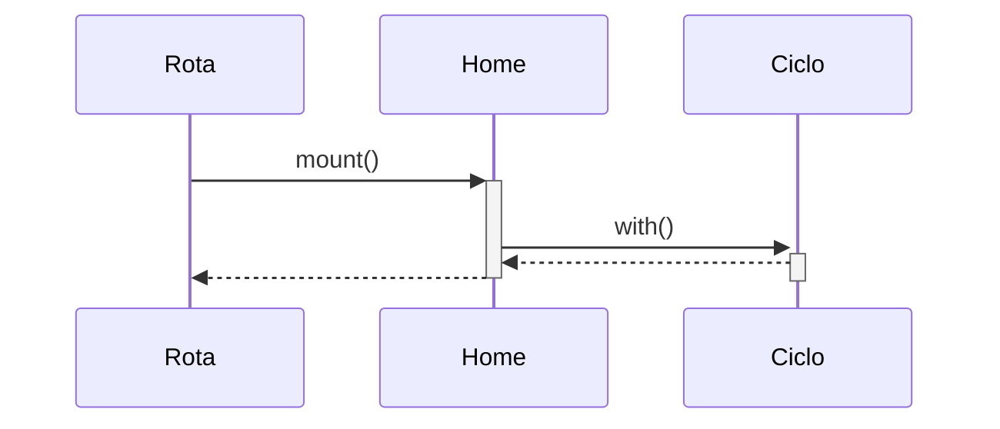

### GET /retomar-inscricao/{token} (inscricao.retomar)

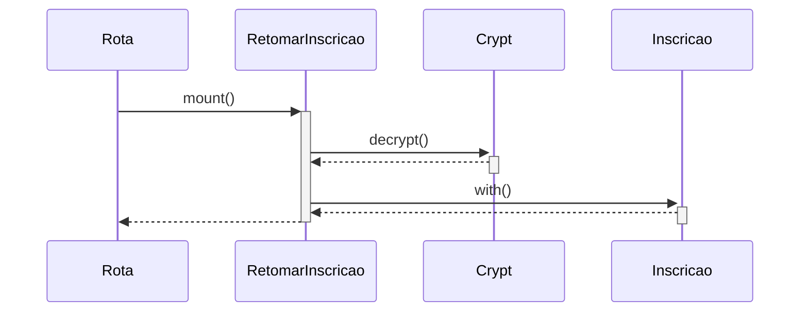

### GET /inscricao/{slug_projeto?} (publico.inscricao)

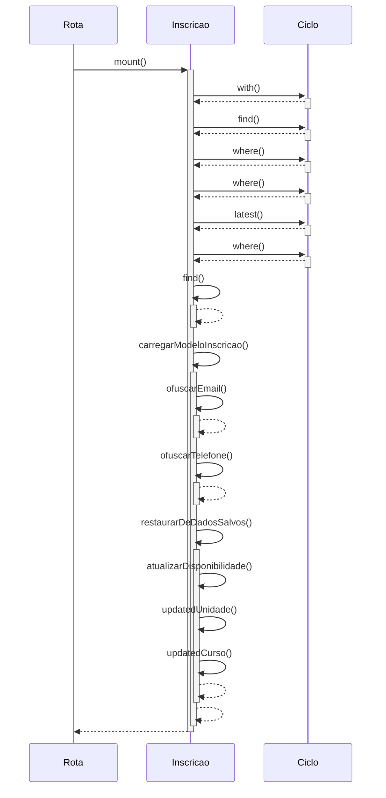

### GET /f/{slug} (formularios.publico)

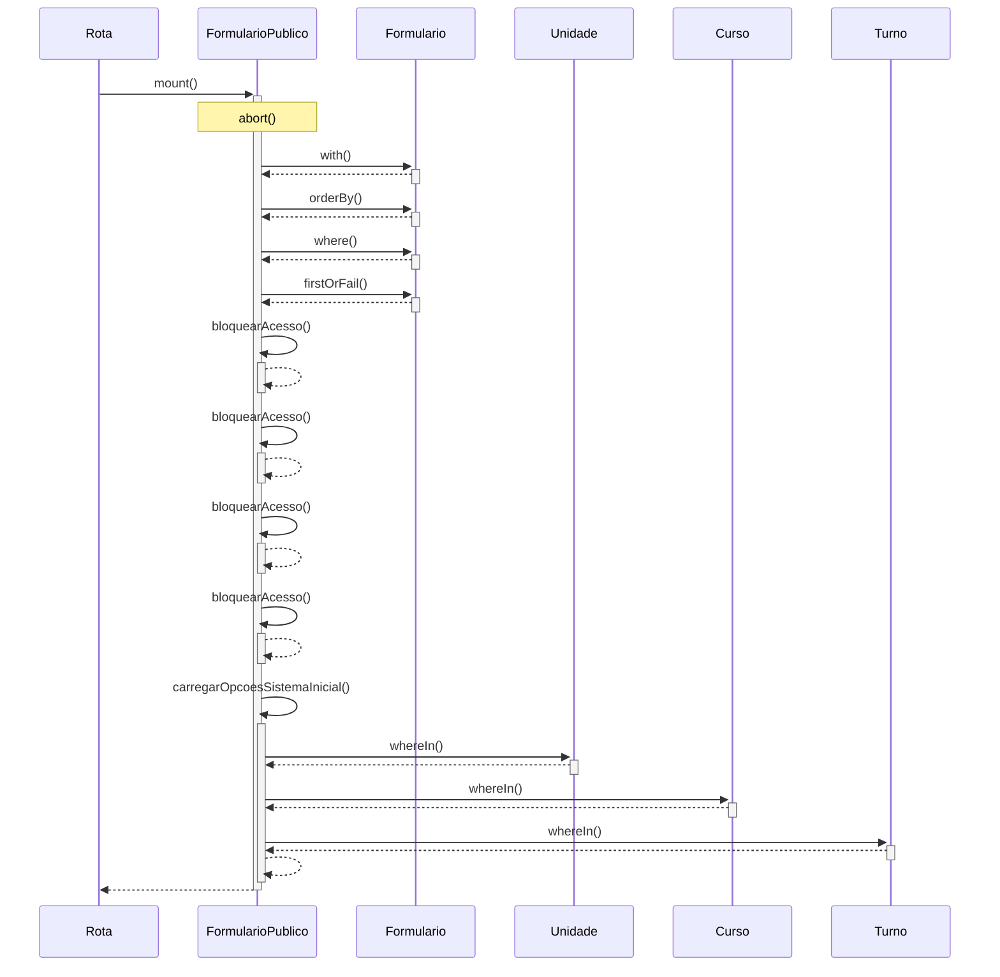

### GET /portal (portal.index)

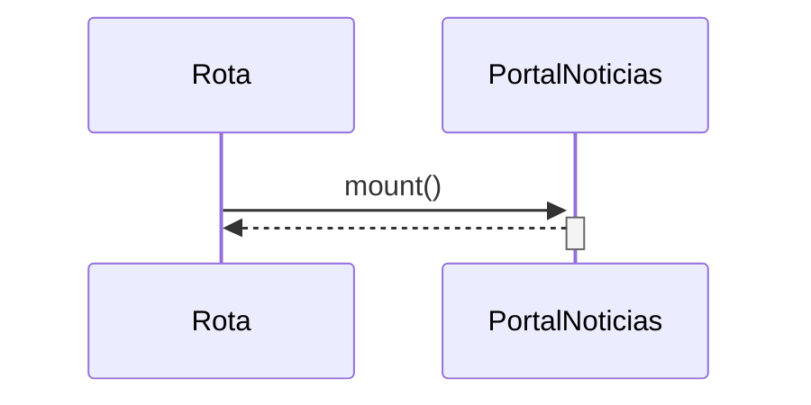

### GET /portal/{slug} (conteudo.show)

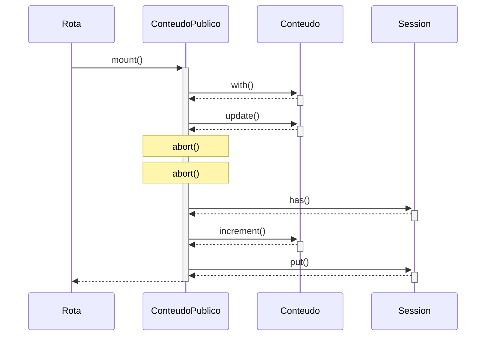

### GET /redefinir-senha/{token} (password.reset)

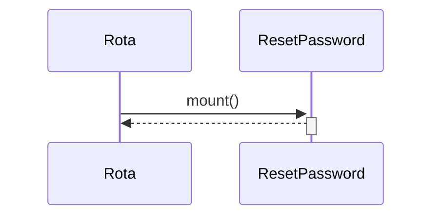

### GET /login (login)

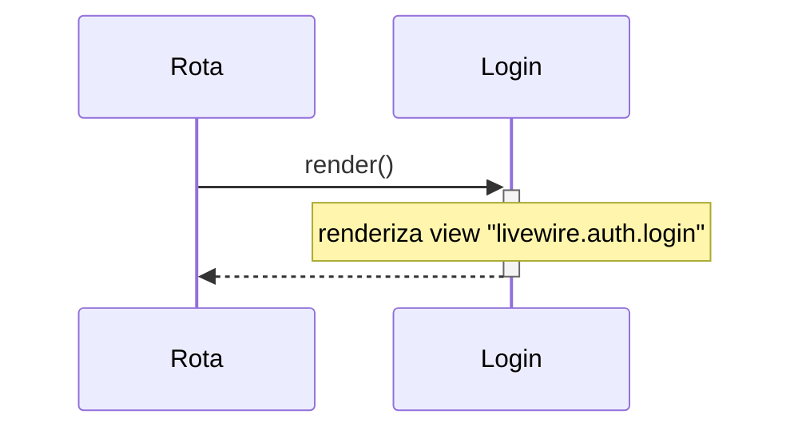

### GET /esqueci-senha (password.request)

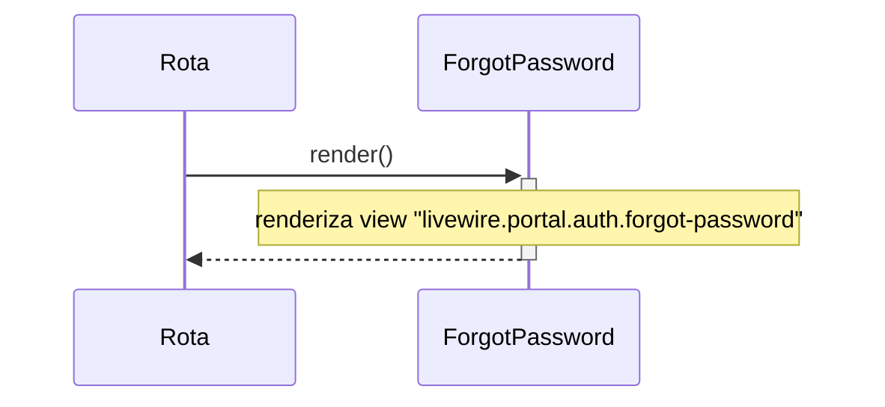

### GET /matricula/{token} (matricula.portal)

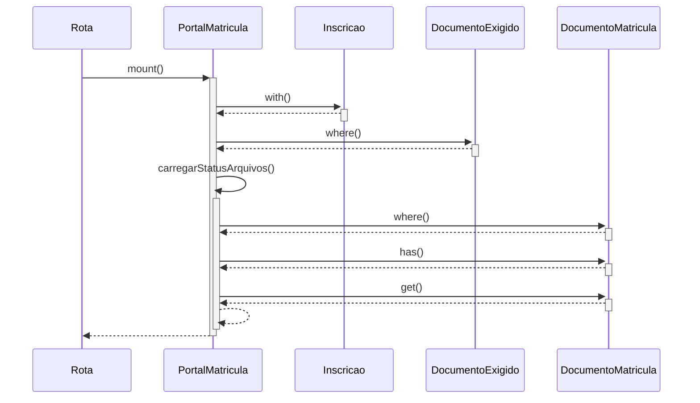

### GET /email/t/o/{token}.gif (email.tracking.open)

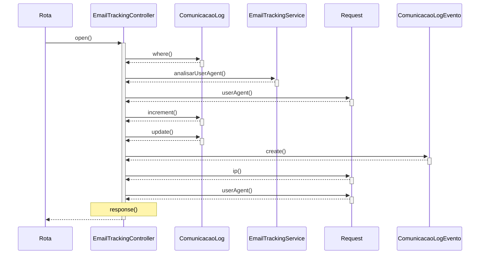

### GET /email/t/c/{token} (email.tracking.click)

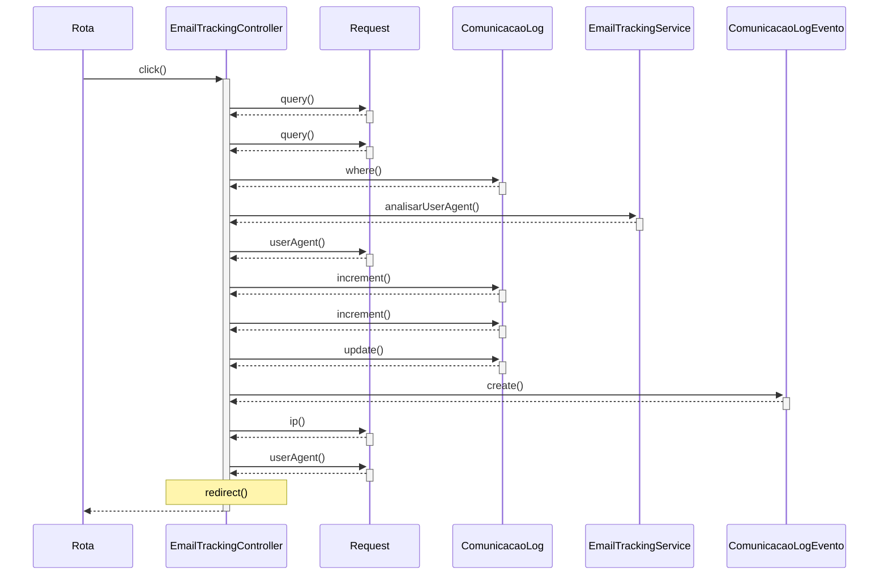

### GET /seguranca/atualizar-senha (password.force-change)

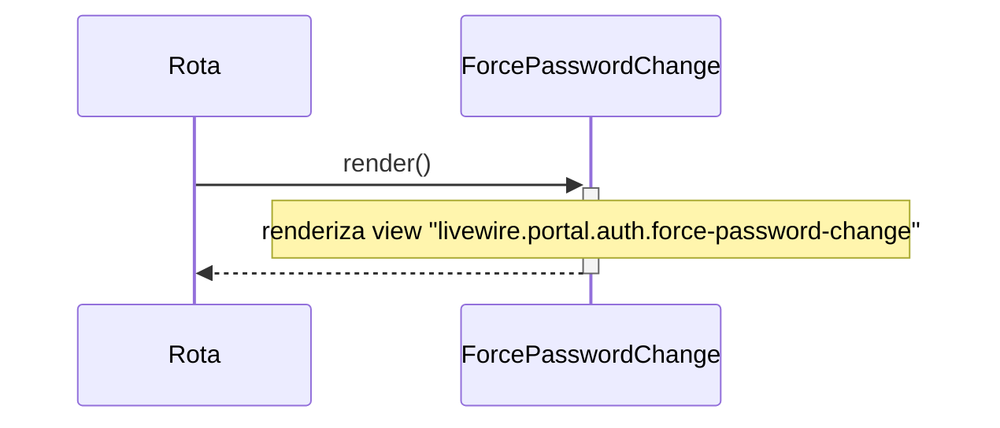

### GET /formulario-aprendizagem/{slug}/{aluno_id} (formulario-aprendizagem.responder)

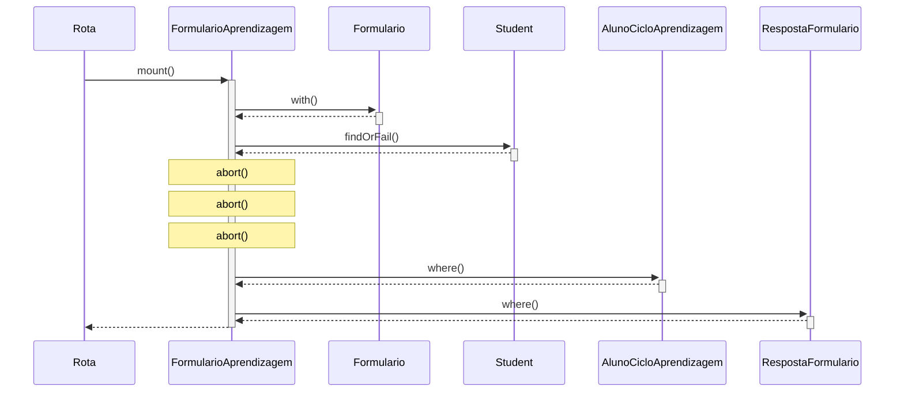

### GET /comunicacao/suri/laboratorio (suri.dashboard)

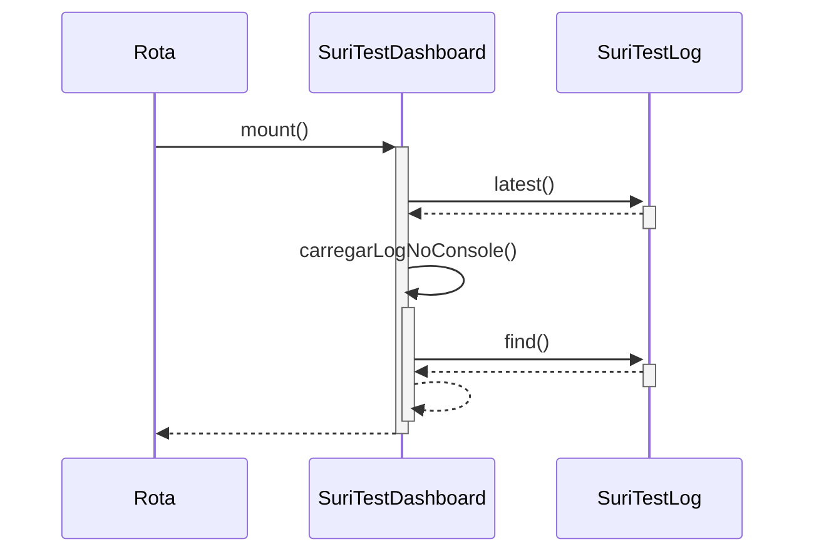

### GET /conteudo/categorias (conteudo.categorias)

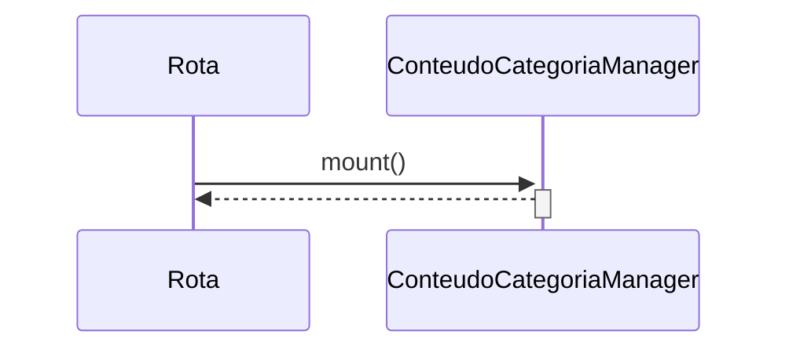

### GET /conteudo (conteudo.index)

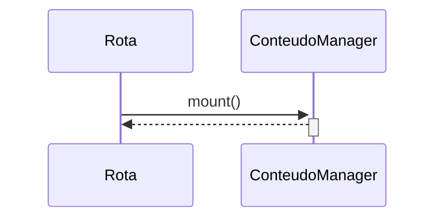

### GET /conteudo/novo (conteudo.create)

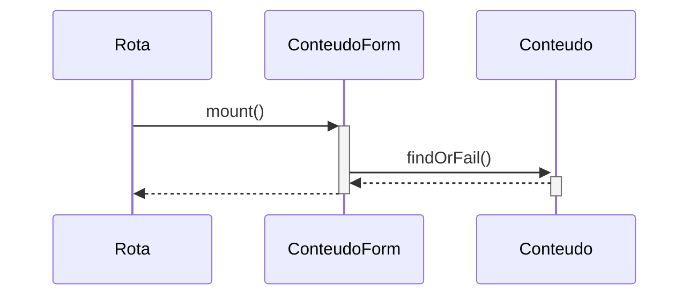

### GET /comunicacao/esteiras (esteiras.index)

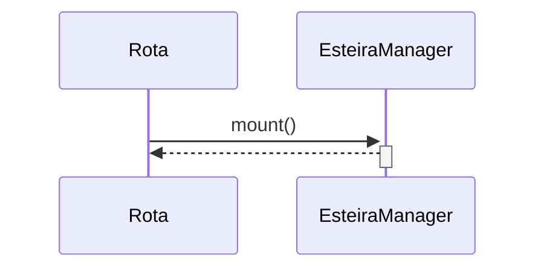

### GET /comunicacao/esteiras/nova (esteiras.create)

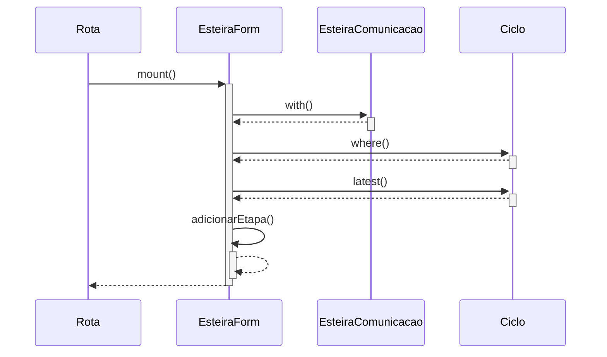

### GET /comunicacao/esteiras/{id}/detalhes (esteiras.show)

```mermaid
sequenceDiagram
    participant P1 as Rota
    participant P2 as EsteiraDetails
    participant P3 as EsteiraComunicacao
    P1->>+P2: mount()
    P2->>+P3: with()
    P3-->>-P2: 
    P2-->>-P1: 
```

### GET /dashboard (dashboard)

```mermaid
sequenceDiagram
    participant P1 as Rota
    participant P2 as Dashboard
    participant P3 as Ciclo
    P1->>+P2: mount()
    P2->>+P3: orderBy()
    P3-->>-P2: 
    P2->>+P2: inicializarEstruturaGraficos()
    P2-->>-P2: 
    P2-->>-P1: 
```

### GET /meu-perfil (profile.show)

```mermaid
sequenceDiagram
    participant P1 as Rota
    participant P2 as ProfileManager
    P1->>+P2: mount()
    P2-->>-P1: 
```

### GET /features (features.index)

```mermaid
sequenceDiagram
    participant P1 as Rota
    participant P2 as FeatureManager
    participant P3 as BreadcrumbHelper
    P1->>+P2: mount()
    P2->>+P3: generate()
    P3-->>-P2: 
    P2-->>-P1: 
```

### GET /roles (roles.index)

```mermaid
sequenceDiagram
    participant P1 as Rota
    participant P2 as RoleManager
    participant P3 as BreadcrumbHelper
    P1->>+P2: mount()
    P2->>+P3: generate()
    P3-->>-P2: 
    P2-->>-P1: 
```

### GET /permissions (permissions.index)

```mermaid
sequenceDiagram
    participant P1 as Rota
    participant P2 as PermissionManager
    participant P3 as BreadcrumbHelper
    P1->>+P2: mount()
    P2->>+P3: generate()
    P3-->>-P2: 
    P2-->>-P1: 
```

### GET /roles/{roleId}/permissions (roles.permissions)

```mermaid
sequenceDiagram
    participant P1 as Rota
    participant P2 as RolePermissionManager
    participant P3 as Role
    P1->>+P2: mount()
    P2->>+P3: findOrFail()
    P3-->>-P2: 
    P2-->>-P1: 
```

### GET /users (users.index)

```mermaid
sequenceDiagram
    participant P1 as Rota
    participant P2 as UserManager
    participant P3 as Permission
    participant P4 as BreadcrumbHelper
    P1->>+P2: mount()
    P2->>+P3: firstOrCreate()
    P3-->>-P2: 
    P2->>+P3: firstOrCreate()
    P3-->>-P2: 
    P2->>+P4: generate()
    P4-->>-P2: 
    P2-->>-P1: 
```

### GET /users/{userId}/extra-permissions (users.extra-permissions)

```mermaid
sequenceDiagram
    participant P1 as Rota
    participant P2 as UserExtraPermissionManager
    participant P3 as User
    P1->>+P2: mount()
    P2->>+P3: findOrFail()
    P3-->>-P2: 
    P2->>+P3: hasRole()
    P3-->>-P2: 
    Note over P2: abort()
    P2->>+P3: getPermissionsViaRoles()
    P3-->>-P2: 
    P2->>+P3: permissions()
    P3-->>-P2: 
    P2-->>-P1: 
```

### GET /users/{id}/{slug?} (users.show)

```mermaid
sequenceDiagram
    participant P1 as Rota
    participant P2 as UserDetails
    participant P3 as User
    P1->>+P2: mount()
    P2->>+P3: with()
    P3-->>-P2: 
    P2-->>-P1: 
```

### GET /estudantes (students.index)

```mermaid
sequenceDiagram
    participant P1 as Rota
    participant P2 as StudentManager
    participant P3 as BreadcrumbHelper
    P1->>+P2: mount()
    P2->>+P3: generate()
    P3-->>-P2: 
    P2-->>-P1: 
```

### GET /estudantes/{id}/{slug?} (students.show)

```mermaid
sequenceDiagram
    participant P1 as Rota
    participant P2 as StudentDetails
    participant P3 as Student
    P1->>+P2: mount()
    P2->>+P3: with()
    P3-->>-P2: 
    P2-->>-P1: 
```

### GET /turnos (turnos.index)

```mermaid
sequenceDiagram
    participant P1 as Rota
    participant P2 as TurnoManager
    participant P3 as BreadcrumbHelper
    P1->>+P2: mount()
    P2->>+P3: generate()
    P3-->>-P2: 
    P2-->>-P1: 
```

### GET /unidades (unidades.index)

```mermaid
sequenceDiagram
    participant P1 as Rota
    participant P2 as UnidadeManager
    participant P3 as BreadcrumbHelper
    P1->>+P2: mount()
    P2->>+P3: generate()
    P3-->>-P2: 
    P2-->>-P1: 
```

### GET /unidades/{id}/{slug?} (unidades.show)

```mermaid
sequenceDiagram
    participant P1 as Rota
    participant P2 as UnidadeDetalhes
    participant P3 as UnidadeService
    participant P4 as Unidade
    P1->>+P2: mount()
    P2->>+P3: buscarPorId()
    P3-->>-P2: 
    P2->>+P4: load()
    P4-->>-P2: 
    P2->>+P4: load()
    P4-->>-P2: 
    P2-->>-P1: 
```

### GET /cursos (cursos.index)

```mermaid
sequenceDiagram
    participant P1 as Rota
    participant P2 as CursoManager
    participant P3 as BreadcrumbHelper
    P1->>+P2: mount()
    P2->>+P3: generate()
    P3-->>-P2: 
    P2-->>-P1: 
```

### GET /cursos/{id}/{slug?} (cursos.show)

```mermaid
sequenceDiagram
    participant P1 as Rota
    participant P2 as CursoDetalhes
    P1->>+P2: mount()
    P2-->>-P1: 
```

### GET /empresas (empresas.index)

```mermaid
sequenceDiagram
    participant P1 as Rota
    participant P2 as EmpresaManager
    P1->>+P2: mount()
    P2-->>-P1: 
```

### GET /empresas/{id} (empresas.show)

```mermaid
sequenceDiagram
    participant P1 as Rota
    participant P2 as EmpresaDetalhes
    participant P3 as Empresa
    P1->>+P2: mount()
    P2->>+P3: with()
    P3-->>-P2: 
    P2-->>-P1: 
```

### GET /inscricoes (inscricoes.index)

```mermaid
sequenceDiagram
    participant P1 as Rota
    participant P2 as RegistrationManager
    participant P3 as Ciclo
    P1->>+P2: mount()
    P2->>+P2: obterCicloPadrao()
    P2->>+P3: find()
    P3-->>-P2: 
    P2->>+P3: where()
    P3-->>-P2: 
    P2->>+P3: latest()
    P3-->>-P2: 
    P2-->>-P2: 
    P2-->>-P1: 
```

### GET /inscricoes/status (status-inscricoes.index)

```mermaid
sequenceDiagram
    participant P1 as Rota
    participant P2 as StatusManager
    participant P3 as BreadcrumbHelper
    P1->>+P2: mount()
    P2->>+P3: generate()
    P3-->>-P2: 
    P2-->>-P1: 
```

### GET /inscricoes/{id}/{slug?} (inscricoes.show)

```mermaid
sequenceDiagram
    participant P1 as Rota
    participant P2 as RegistrationDetails
    participant P3 as Inscricao
    participant P4 as Carbon
    participant P5 as DocumentoMatricula
    P1->>+P2: mount()
    P2->>+P3: with()
    P3-->>-P2: 
    P2->>+P2: carregarDadosEdicao()
    P2->>+P4: parse()
    P4-->>-P2: 
    P2-->>-P2: 
    P2->>+P2: carregarStatusArquivos()
    P2->>+P5: where()
    P5-->>-P2: 
    P2->>+P5: has()
    P5-->>-P2: 
    P2->>+P5: get()
    P5-->>-P2: 
    P2-->>-P2: 
    P2-->>-P1: 
```

### GET /ciclos (ciclos.index)

```mermaid
sequenceDiagram
    participant P1 as Rota
    participant P2 as PeriodManager
    participant P3 as BreadcrumbHelper
    P1->>+P2: mount()
    P2->>+P3: generate()
    P3-->>-P2: 
    P2-->>-P1: 
```

### GET /ciclos/regras/{id}/{slug?} (ciclos.regras)

```mermaid
sequenceDiagram
    participant P1 as Rota
    participant P2 as RegrasManager
    participant P3 as Ciclo
    participant P4 as Cache
    participant P5 as CampoFormulario
    P1->>+P2: mount()
    P2->>+P3: findOrFail()
    P3-->>-P2: 
    P2->>+P2: checkAndAcquireLock()
    P2->>+P2: getLockKey()
    P2-->>-P2: 
    P2->>+P4: get()
    P4-->>-P2: 
    P2->>+P4: get()
    P4-->>-P2: 
    P2->>+P2: getTransferKey()
    P2-->>-P2: 
    P2->>+P2: takeOverLock()
    P2->>+P4: forget()
    P4-->>-P2: 
    P2->>P2: getTransferKey()
    P2->>P2: checkAndAcquireLock()
    Note over P2: dispara evento "sucesso"
    P2-->>-P2: 
    P2->>+P4: put()
    P4-->>-P2: 
    P2-->>-P2: 
    P2->>+P2: carregarCampos()
    P2->>+P5: where()
    P5-->>-P2: 
    P2-->>-P2: 
    P2->>+P2: addRegra()
    P2-->>-P2: 
    P2-->>-P1: 
```

### GET /ciclos/{id}/editar (ciclos.edit)

```mermaid
sequenceDiagram
    participant P1 as Rota
    participant P2 as PeriodEdit
    participant P3 as Ciclo
    participant P4 as Carbon
    participant P5 as OfertaVaga
    participant P6 as DocumentoExigido
    P1->>+P2: mount()
    P2->>+P3: with()
    P3-->>-P2: 
    P2->>+P4: parse()
    P4-->>-P2: 
    P2->>+P4: parse()
    P4-->>-P2: 
    P2->>+P5: where()
    P5-->>-P2: 
    P2->>+P6: where()
    P6-->>-P2: 
    P2-->>-P1: 
```

### GET /ciclos/{id}/{slug?} (ciclos.show)

```mermaid
sequenceDiagram
    participant P1 as Rota
    participant P2 as PeriodDetails
    participant P3 as Ciclo
    participant P4 as BreadcrumbHelper
    P1->>+P2: mount()
    P2->>+P3: with()
    P3-->>-P2: 
    P2->>+P4: generate()
    P4-->>-P2: 
    P2-->>-P1: 
```

### GET /crm/{id?} (ciclos.crm)

```mermaid
sequenceDiagram
    participant P1 as Rota
    participant P2 as KanbanBoard
    participant P3 as Ciclo
    P1->>+P2: mount()
    P2->>+P2: obterCicloPadrao()
    P2->>+P3: find()
    P3-->>-P2: 
    P2->>+P3: where()
    P3-->>-P2: 
    P2->>+P3: where()
    P3-->>-P2: 
    P2->>+P3: latest()
    P3-->>-P2: 
    P2-->>-P2: 
    P2-->>-P1: 
```

### GET /matriculas/configuracao-ia (matriculas.configuracao)

```mermaid
sequenceDiagram
    participant P1 as Rota
    participant P2 as IaConfigManager
    participant P3 as ConfiguracaoIa
    P1->>+P2: mount()
    P2->>+P3: first()
    P3-->>-P2: 
    P2-->>-P1: 
```

### GET /matriculas/acompanhamento (matriculas.acompanhamento)

```mermaid
sequenceDiagram
    participant P1 as Rota
    participant P2 as ProcessoMatriculaManager
    P1->>+P2: mount()
    P2-->>-P1: 
```

### GET /formularios (formularios.index)

```mermaid
sequenceDiagram
    participant P1 as Rota
    participant P2 as FormManager
    participant P3 as BreadcrumbHelper
    P1->>+P2: mount()
    P2->>+P3: generate()
    P3-->>-P2: 
    P2-->>-P1: 
```

### GET /formularios/novo (formularios.create)

```mermaid
sequenceDiagram
    participant P1 as Rota
    participant P2 as FormEdit
    participant P3 as Formulario
    P1->>+P2: mount()
    P2->>+P3: findOrFail()
    P3-->>-P2: 
    P2-->>-P1: 
```

### GET /formularios/{id}/planilha (formularios.planilha)

```mermaid
sequenceDiagram
    participant P1 as Rota
    participant P2 as FormSpreadsheet
    participant P3 as Formulario
    P1->>+P2: mount()
    P2->>+P3: findOrFail()
    P3-->>-P2: 
    P2-->>-P1: 
```

### GET /formularios/respostas/{id}/{slug?} (formularios.respostas.show)

```mermaid
sequenceDiagram
    participant P1 as Rota
    participant P2 as ResponseDetails
    participant P3 as RespostaFormulario
    participant P4 as Formulario
    P1->>+P2: mount()
    P2->>+P3: findOrFail()
    P3-->>-P2: 
    P2->>+P4: findOrFail()
    P4-->>-P2: 
    P2-->>-P1: 
```

### GET /formularios/{id}/{slug?} (formularios.show)

```mermaid
sequenceDiagram
    participant P1 as Rota
    participant P2 as FormDetails
    participant P3 as Formulario
    P1->>+P2: mount()
    P2->>+P3: findOrFail()
    P3-->>-P2: 
    P2-->>-P1: 
```

### GET /construtor/{tipo}/{id}/{slug?} (construtor.campos)

```mermaid
sequenceDiagram
    participant P1 as Rota
    participant P2 as DynamicFields
    participant P3 as Cache
    participant P4 as Ciclo
    participant P5 as Formulario
    participant P6 as Etapa
    participant P7 as CampoFormulario
    P1->>+P2: mount()
    P2->>+P2: checkAndAcquireLock()
    P2->>+P2: getLockKey()
    P2-->>-P2: 
    P2->>+P3: get()
    P3-->>-P2: 
    P2->>+P3: get()
    P3-->>-P2: 
    P2->>+P2: getTransferKey()
    P2-->>-P2: 
    P2->>+P2: takeOverLock()
    P2->>+P3: forget()
    P3-->>-P2: 
    P2->>P2: getTransferKey()
    P2->>P2: checkAndAcquireLock()
    Note over P2: dispara evento "sucesso"
    P2-->>-P2: 
    P2->>+P3: put()
    P3-->>-P2: 
    P2-->>-P2: 
    P2->>+P4: findOrFail()
    P4-->>-P2: 
    P2->>+P5: with()
    P5-->>-P2: 
    P2->>+P2: carregarEtapas()
    P2->>+P6: query()
    P6-->>-P2: 
    P2->>+P6: where()
    P6-->>-P2: 
    P2->>+P6: where()
    P6-->>-P2: 
    P2->>+P6: orderBy()
    P6-->>-P2: 
    P2->>+P7: where()
    P7-->>-P2: 
    P2->>+P2: getContextColumn()
    P2-->>-P2: 
    P2->>+P6: create()
    P6-->>-P2: 
    P2->>+P2: getContextColumn()
    P2-->>-P2: 
    P2-->>-P2: 
    P2->>+P2: loadFormSettings()
    P2->>+P7: where()
    P7-->>-P2: 
    P2->>+P2: getContextColumn()
    P2-->>-P2: 
    P2-->>-P2: 
    P2->>+P2: inicializarDefaultsDicas()
    P2-->>-P2: 
    P2->>+P2: atualizarProximaOrdem()
    P2->>+P2: limiteOrdem()
    P2->>+P7: where()
    P7-->>-P2: 
    P2->>P2: getContextColumn()
    P2->>+P7: find()
    P7-->>-P2: 
    P2-->>-P2: 
    P2-->>-P2: 
    P2-->>-P1: 
```

### GET /form-builder (formbuilder.hub)

```mermaid
sequenceDiagram
    participant P1 as Rota
    participant P2 as Hub
    participant P3 as Ciclo
    participant P4 as Unidade
    participant P5 as Curso
    participant P6 as CicloAprendizagem
    P1->>+P2: mount()
    P2->>+P3: orderBy()
    P3-->>-P2: 
    P2->>+P4: whereIn()
    P4-->>-P2: 
    P2->>+P5: whereIn()
    P5-->>-P2: 
    P2->>+P6: with()
    P6-->>-P2: 
    P2-->>-P1: 
```

### GET /templates (templates.index)

```mermaid
sequenceDiagram
    participant P1 as Rota
    participant P2 as TemplateManager
    participant P3 as BreadcrumbHelper
    P1->>+P2: mount()
    P2->>+P3: generate()
    P3-->>-P2: 
    P2-->>-P1: 
```

### GET /templates/create (templates.create)

```mermaid
sequenceDiagram
    participant P1 as Rota
    participant P2 as TemplateForm
    participant P3 as EmailTemplate
    participant P4 as Cache
    participant P5 as BreadcrumbHelper
    P1->>+P2: mount()
    P2->>+P3: findOrFail()
    P3-->>-P2: 
    P2->>+P2: checkAndAcquireLock()
    P2->>+P2: getLockKey()
    P2-->>-P2: 
    P2->>+P4: get()
    P4-->>-P2: 
    P2->>+P4: get()
    P4-->>-P2: 
    P2->>+P2: getTransferKey()
    P2-->>-P2: 
    P2->>+P2: takeOverLock()
    P2->>+P4: forget()
    P4-->>-P2: 
    P2->>P2: getTransferKey()
    P2->>P2: checkAndAcquireLock()
    Note over P2: dispara evento "sucesso"
    P2-->>-P2: 
    P2->>+P4: put()
    P4-->>-P2: 
    P2-->>-P2: 
    P2->>+P2: sincronizarVariaveisCorpo()
    P2-->>-P2: 
    P2->>+P5: generate()
    P5-->>-P2: 
    P2-->>-P1: 
```

### GET /comunicados (comunicados.index)

```mermaid
sequenceDiagram
    participant P1 as Rota
    participant P2 as ComunicadoManager
    participant P3 as BreadcrumbHelper
    P1->>+P2: mount()
    P2->>+P3: generate()
    P3-->>-P2: 
    P2-->>-P1: 
```

### GET /comunicados/create (comunicados.create)

```mermaid
sequenceDiagram
    participant P1 as Rota
    participant P2 as ComunicadoForm
    participant P3 as BreadcrumbHelper
    P1->>+P2: mount()
    P2->>+P3: generate()
    P3-->>-P2: 
    P2-->>-P1: 
```

### GET /automacoes (automacoes.index)

```mermaid
sequenceDiagram
    participant P1 as Rota
    participant P2 as AutomacaoManager
    participant P3 as BreadcrumbHelper
    P1->>+P2: mount()
    P2->>+P3: generate()
    P3-->>-P2: 
    P2-->>-P1: 
```

### GET /automacoes/create (automacoes.create)

```mermaid
sequenceDiagram
    participant P1 as Rota
    participant P2 as AutomacaoForm
    participant P3 as StatusInscricao
    participant P4 as Str
    participant P5 as FormularioFase
    participant P6 as Automacao
    participant P7 as BreadcrumbHelper
    P1->>+P2: mount()
    P2->>+P3: orderBy()
    P3-->>-P2: 
    P2->>+P4: slug()
    P4-->>-P2: 
    P2->>+P2: listarGatilhosDeFasesDisponiveis()
    P2->>+P5: with()
    P5-->>-P2: 
    P2->>+P4: slug()
    P4-->>-P2: 
    P2-->>-P2: 
    P2->>+P6: findOrFail()
    P6-->>-P2: 
    P2->>+P7: generate()
    P7-->>-P2: 
    P2-->>-P1: 
```

### GET /automacoes/{id} (automacoes.show)

```mermaid
sequenceDiagram
    participant P1 as Rota
    participant P2 as AutomacaoDetails
    participant P3 as Automacao
    participant P4 as BreadcrumbHelper
    P1->>+P2: mount()
    P2->>+P3: with()
    P3-->>-P2: 
    P2->>+P4: generate()
    P4-->>-P2: 
    P2-->>-P1: 
```

### GET /monitor-emails (monitor.emails)

```mermaid
sequenceDiagram
    participant P1 as Rota
    participant P2 as EmailLogManager
    participant P3 as BreadcrumbHelper
    P1->>+P2: mount()
    P2->>+P3: generate()
    P3-->>-P2: 
    P2-->>-P1: 
```

### GET /avaliacoes/gerador (avaliacoes.gerador)

```mermaid
sequenceDiagram
    participant P1 as Rota
    participant P2 as GeradorMock
    P1->>+P2: mount()
    P2-->>-P1: 
```

### GET /avaliacoes/gerador-aprendizagem (avaliacoes.gerador-aprendizagem)

```mermaid
sequenceDiagram
    participant P1 as Rota
    participant P2 as GeradorMockAprendizagem
    P1->>+P2: mount()
    P2-->>-P1: 
```

### GET /avaliacoes/relatorios (avaliacoes.relatorios)

```mermaid
sequenceDiagram
    participant P1 as Rota
    participant P2 as Relatorios
    P1->>+P2: mount()
    P2-->>-P1: 
```

### GET /avaliacoes/periodos (avaliacoes.periodos.index)

```mermaid
sequenceDiagram
    participant P1 as Rota
    participant P2 as Listagem
    P1->>+P2: mount()
    P2-->>-P1: 
```

### GET /avaliacoes/periodos/novo (avaliacoes.periodos.create)

```mermaid
sequenceDiagram
    participant P1 as Rota
    participant P2 as Detalhes
    participant P3 as PeriodoAvaliacao
    participant P4 as AlunoAvaliacao
    P1->>+P2: mount()
    P2->>+P3: with()
    P3-->>-P2: 
    P2->>+P4: where()
    P4-->>-P2: 
    P2->>+P2: calcularProximoCiclo()
    P2->>+P3: orderBy()
    P3-->>-P2: 
    P2-->>-P2: 
    P2-->>-P1: 
```

### GET /matriculas (matriculas.index)

```mermaid
sequenceDiagram
    participant P1 as Rota
    participant P2 as Listagem
    P1->>+P2: mount()
    P2-->>-P1: 
```

### GET /matriculas/nova (matriculas.create)

```mermaid
sequenceDiagram
    participant P1 as Rota
    participant P2 as Detalhes
    participant P3 as Student
    participant P4 as DB
    participant P5 as Turma
    participant P6 as Matricula
    P1->>+P2: mount()
    P2->>+P3: select()
    P3-->>-P2: 
    P2->>+P4: table()
    P4-->>-P2: 
    P2->>+P4: table()
    P4-->>-P2: 
    P2->>+P4: table()
    P4-->>-P2: 
    P2->>+P5: select()
    P5-->>-P2: 
    P2->>+P6: with()
    P6-->>-P2: 
    P2-->>-P1: 
```

### GET /turmas (turmas.index)

```mermaid
sequenceDiagram
    participant P1 as Rota
    participant P2 as Listagem
    P1->>+P2: mount()
    P2-->>-P1: 
```

### GET /turmas/nova (turmas.create)

```mermaid
sequenceDiagram
    participant P1 as Rota
    participant P2 as Detalhes
    participant P3 as DB
    participant P4 as Turma
    P1->>+P2: mount()
    P2->>+P3: table()
    P3-->>-P2: 
    P2->>+P3: table()
    P3-->>-P2: 
    P2->>+P3: table()
    P3-->>-P2: 
    P2->>+P3: table()
    P3-->>-P2: 
    P2->>+P4: with()
    P4-->>-P2: 
    P2-->>-P1: 
```

### GET /aprendizagem (aprendizagem.index)

```mermaid
sequenceDiagram
    participant P1 as Rota
    participant P2 as Listagem
    P1->>+P2: mount()
    P2->>+P2: adicionarFase()
    P2-->>-P2: 
    P2-->>-P1: 
```

### GET /aprendizagem/{id}/acompanhamento (acompanhamento.index)

```mermaid
sequenceDiagram
    participant P1 as Rota
    participant P2 as Acompanhamento
    participant P3 as CicloAprendizagem
    P1->>+P2: mount()
    P2->>+P3: with()
    P3-->>-P2: 
    P2-->>-P1: 
```

### GET /auditoria (auditoria.index)

```mermaid
sequenceDiagram
    participant P1 as Rota
    participant P2 as AuditoriaManager
    participant P3 as BreadcrumbHelper
    P1->>+P2: mount()
    P2->>+P3: generate()
    P3-->>-P2: 
    P2-->>-P1: 
```

### GET /sistema/tarefas (system_tasks.index)

```mermaid
sequenceDiagram
    participant P1 as Rota
    participant P2 as SystemTaskManager
    participant P3 as BreadcrumbHelper
    participant P4 as Ciclo
    participant P5 as Formulario
    P1->>+P2: mount()
    P2->>+P3: generate()
    P3-->>-P2: 
    P2->>+P4: orderBy()
    P4-->>-P2: 
    P2->>+P5: withCount()
    P5-->>-P2: 
    P2-->>-P1: 
```

### GET /sistema/hub (system_tasks.hub)

```mermaid
sequenceDiagram
    participant P1 as Rota
    participant P2 as SystemTaskConfigManager
    participant P3 as SystemTaskConfig
    P1->>+P2: mount()
    P2->>+P2: carregarConfigs()
    P2->>+P3: all()
    P3-->>-P2: 
    P2-->>-P2: 
    P2-->>-P1: 
```

### GET /configuracoes (configuracoes.index)

```mermaid
sequenceDiagram
    participant P1 as Rota
    participant P2 as ConfiguracoesGeraisManager
    participant P3 as Schema
    participant P4 as ConfiguracaoGeral
    participant P5 as StatusInscricao
    P1->>+P2: mount()
    P2->>+P3: hasTable()
    P3-->>-P2: 
    P2->>+P4: where()
    P4-->>-P2: 
    P2->>+P4: where()
    P4-->>-P2: 
    P2->>+P4: where()
    P4-->>-P2: 
    P2->>+P4: where()
    P4-->>-P2: 
    P2->>+P5: whereIn()
    P5-->>-P2: 
    P2-->>-P1: 
```

### GET /solicitacoes (solicitacoes.index)

```mermaid
sequenceDiagram
    participant P1 as Rota
    participant P2 as SolicitacoesManager
    P1->>+P2: mount()
    P2-->>-P1: 
```

_...e mais 476 ponto(s) de entrada não mostrados (limite de 80 diagramas)._

---

## Fluxo por arquivo

### âš¡ Componentes Livewire

#### `App\Livewire\Components\QuickViewDrawer`
`app/Livewire/Components/QuickViewDrawer.php` · linha 8

- **Estende:** `Component`
- **Views:** `livewire.components.quick-view-drawer`

##### `loadData(array $payload)` — linha 18
- **Atributos:** `#[On('load-quick-view')]`
- **Eventos Livewire emitidos:** `show-quick-view-drawer`

##### `render()` — linha 29
- **Acionado por:** view `components.layouts.app`, view `components.layouts.auth`, view `components.layouts.company`, view `components.layouts.public`, view `components.layouts.student-app`, view `components.layouts.student-auth`
- **Views renderizadas:** `livewire.components.quick-view-drawer` → `resources/views/livewire/components/quick-view-drawer.blade.php`
- **Helpers:** `view()`

#### `App\Modules\ACL\UI\Livewire\PermissionManager`
`app/Modules/ACL/UI/Livewire/PermissionManager.php` · linha 18

- **Estende:** `Component`
- **Traits:** `WithPagination`, `ComPadraoListagem`
- **Atributos PHP:** `#[Layout('components.layouts.app')]`, `#[Title('Gerenciar Permissões - Administrativo')]`
- **Models usados na classe:** `Permission`, `Feature`
- **Views:** `livewire.acl.permission-manager`, `components.layouts.app (layout)`

##### `mount()` — linha 36
- **Acionado por:** rota `GET /permissions` (name: permissions.index)
- **Chama em outras classes:** `BreadcrumbHelper::generate()`

##### `updating($nomePropriedade)` — linha 44
- **Chama nesta classe:** `$this->resetPage()` _(Livewire/framework)_

##### `limparFiltros()` — linha 51
- **Acionado por:** view `livewire.acl.permission-manager` (wire:click)
- **Chama nesta classe:** `$this->reset()` _(Livewire/framework)_, `$this->resetPage()` _(Livewire/framework)_

##### `abrirModal($id)` — linha 57
- **Acionado por:** view `livewire.acl.permission-manager` (wire:click)
- **Models:** `Permission` → `findOrFail()`
- **Chama nesta classe:** `$this->resetValidation()` _(Livewire/framework)_, `$this->reset()` _(Livewire/framework)_

##### `addItem()` — linha 92
- **Acionado por:** view `livewire.acl.permission-manager` (wire:click)

##### `removeItem(int $index)` — linha 97
- **Acionado por:** view `livewire.acl.permission-manager` (wire:click)

##### `fecharModal()` — linha 103
- **Acionado por:** `PermissionManager::efetivarSalvar()`, view `livewire.acl.permission-manager` (wire:click)

##### `salvar()` — linha 109
- **Acionado por:** view `livewire.acl.permission-manager` (wire:submit.prevent)
- **Models:** `Permission` → `find()` · `Feature` → `where()` · `Permission` → `getOriginal()`
- **Chama nesta classe:** `$this->validate()` _(Livewire/framework)_, `$this->efetivarSalvar()`
- **Validação:** executa `validate()`

##### `confirmarCriacaoAusentes()` — linha 160
- **Acionado por:** view `livewire.acl.permission-manager` (wire:click)
- **Chama nesta classe:** `$this->efetivarSalvar()`

##### `ignorarCriacaoAusentes()` — linha 166
- **Acionado por:** view `livewire.acl.permission-manager` (wire:click)
- **Chama nesta classe:** `$this->efetivarSalvar()`

##### `private efetivarSalvar(bool $criarAusentes)` — linha 172
- **Acionado por:** `PermissionManager::salvar()`, `PermissionManager::confirmarCriacaoAusentes()`, `PermissionManager::ignorarCriacaoAusentes()`
- **Models:** `Permission` → `where()`, `findOrFail()`, `create()` · `Feature` → `where()` · `Permission` → `getOriginal()`, `update()` · `Feature` → `update()`
- **Chama nesta classe:** `$this->addError()` _(Livewire/framework)_, `$this->fecharModal()`
- **Chama em outras classes:** `Cache::forget()` _(framework)_
- **Eventos Livewire emitidos:** `sucesso(msg:$this->permissionId?'Permissão e F…)`
- **Helpers:** `app()`

##### `excluir($id)` — linha 249
- **Acionado por:** view `livewire.acl.permission-manager` (wire:click)
- **Models:** `Permission` → `findOrFail()`
- **Eventos Livewire emitidos:** `sucesso(msg:'Permissão excluída com sucesso.')`

##### `getHeadersProperty()` — linha 258
- _Sem dependências externas detectadas._

##### `render()` — linha 269
- **Acionado por:** rota `GET /permissions` (name: permissions.index)
- **Models:** `Permission` → `query()`, `select()` · `Permission` → `orderBy()`, `paginate()`
- **Views renderizadas:** `livewire.acl.permission-manager` → `resources/views/livewire/acl/permission-manager.blade.php`
- **Helpers:** `view()`

#### `App\Modules\ACL\UI\Livewire\RoleManager`
`app/Modules/ACL/UI/Livewire/RoleManager.php` · linha 16

- **Estende:** `Component`
- **Traits:** `WithPagination`, `ComPadraoListagem`
- **Atributos PHP:** `#[Layout('components.layouts.app')]`, `#[Title('Gerenciar Roles - Administrativo')]`
- **Models usados na classe:** `Role`
- **Views:** `livewire.acl.role-manager`, `components.layouts.app (layout)`

##### `mount()` — linha 30
- **Acionado por:** rota `GET /roles` (name: roles.index)
- **Chama em outras classes:** `BreadcrumbHelper::generate()`

##### `openModal()` — linha 38
- **Acionado por:** view `livewire.acl.role-manager` (wire:click)
- **Chama nesta classe:** `$this->resetInputFields()`

##### `addItem()` — linha 48
- **Acionado por:** view `livewire.acl.role-manager` (wire:click)

##### `removeItem(int $index)` — linha 53
- **Acionado por:** view `livewire.acl.role-manager` (wire:click)

##### `edit(int $id)` — linha 59
- **Acionado por:** view `livewire.acl.role-manager` (wire:click)
- **Models:** `Role` → `findOrFail()`
- **Chama nesta classe:** `$this->resetInputFields()`
- **Eventos Livewire emitidos:** `erro(msg:'A Role DEV não pode ser alterada.')`
- **Permissões / feature flags:** `dev`
- **Helpers:** `auth()`

##### `save()` — linha 79
- **Acionado por:** view `livewire.acl.role-manager` (wire:submit.prevent)
- **Models:** `Role` → `where()`, `create()`
- **Chama nesta classe:** `$this->validate()` _(Livewire/framework)_, `$this->addError()` _(Livewire/framework)_, `$this->resetInputFields()`
- **Eventos Livewire emitidos:** `sucesso(msg:$this->isEditMode?'Grupo atualizado…)`
- **Validação:** executa `validate()`

##### `delete(int $id)` — linha 120
- **Acionado por:** view `livewire.acl.role-manager` (wire:click)
- **Models:** `Role` → `findOrFail()` · `Role` → `delete()`
- **Eventos Livewire emitidos:** `erro(msg:'Grupos base do sistema não podem …)`, `sucesso(msg:'Grupo excluído com sucesso.')`

##### `private resetInputFields()` — linha 136
- **Acionado por:** `RoleManager::openModal()`, `RoleManager::edit()`, `RoleManager::save()`
- **Chama nesta classe:** `$this->resetErrorBag()` _(Livewire/framework)_

##### `getHeadersProperty()` — linha 144
- _Sem dependências externas detectadas._

##### `render()` — linha 154
- **Acionado por:** rota `GET /roles` (name: roles.index)
- **Models:** `Role` → `query()` · `Role` → `orderBy()`, `paginate()`
- **Views renderizadas:** `livewire.acl.role-manager` → `resources/views/livewire/acl/role-manager.blade.php`
- **Helpers:** `view()`

#### `App\Modules\ACL\UI\Livewire\RolePermissionManager`
`app/Modules/ACL/UI/Livewire/RolePermissionManager.php` · linha 16

- **Estende:** `Component`
- **Traits:** `WithPagination`, `ComPadraoListagem`
- **Atributos PHP:** `#[Layout('components.layouts.app')]`, `#[Title('Permissões da Role - Administrativo')]`
- **Models usados na classe:** `Role`, `Permission`
- **Views:** `livewire.acl.role-permission-manager`, `components.layouts.app (layout)`

##### `mount(int $roleId)` — linha 30
- **Acionado por:** rota `GET /roles/{roleId}/permissions` (name: roles.permissions)
- **Models:** `Role` → `findOrFail()`
- **Rotas referenciadas:** `dashboard`, `roles.index`
- **Helpers:** `route()`

##### `getHeadersProperty()` — linha 50
- _Sem dependências externas detectadas._

##### `updating($nomePropriedade)` — linha 60
- **Chama nesta classe:** `$this->resetPage()` _(Livewire/framework)_

##### `limparFiltros()` — linha 67
- **Acionado por:** view `livewire.acl.role-permission-manager` (wire:click)
- **Chama nesta classe:** `$this->reset()` _(Livewire/framework)_, `$this->resetPage()` _(Livewire/framework)_

##### `updatedSelectedPermissions()` — linha 73
- **Models:** `Role` → `findOrFail()` · `Role` → `syncPermissions()`
- **Eventos Livewire emitidos:** `sucesso(msg:'Permissões atualizadas e salvas a…)`

##### `render()` — linha 84
- **Acionado por:** rota `GET /roles/{roleId}/permissions` (name: roles.permissions)
- **Models:** `Permission` → `query()`, `select()` · `Permission` → `orderBy()`
- **Views renderizadas:** `livewire.acl.role-permission-manager` → `resources/views/livewire/acl/role-permission-manager.blade.php`
- **Helpers:** `collect()`, `view()`

#### `App\Modules\Admin\UI\Livewire\ConfiguracoesGeraisManager`
`app/Modules/Admin/UI/Livewire/ConfiguracoesGeraisManager.php` · linha 12

- **Estende:** `Component`
- **Atributos PHP:** `#[Layout('components.layouts.app')]`, `#[Title('Configurações Gerais')]`
- **Models usados na classe:** `ConfiguracaoGeral`, `StatusInscricao`
- **Views:** `livewire.admin.configuracoes-gerais-manager`, `components.layouts.app (layout)`

##### `mount()` — linha 23
- **Acionado por:** rota `GET /configuracoes` (name: configuracoes.index)
- **Models:** `ConfiguracaoGeral` → `where()` · `StatusInscricao` → `whereIn()`
- **Chama em outras classes:** `Schema::hasTable()` _(framework)_

##### `salvar()` — linha 43
- **Acionado por:** view `livewire.admin.configuracoes-gerais-manager` (wire:click)
- **Models:** `ConfiguracaoGeral` → `updateOrCreate()`
- **Eventos Livewire emitidos:** `sucesso(msg:'Configurações do sistema salvas …)`

##### `render()` — linha 68
- **Acionado por:** rota `GET /configuracoes` (name: configuracoes.index)
- **Models:** `StatusInscricao` → `orderBy()`
- **Views renderizadas:** `livewire.admin.configuracoes-gerais-manager` → `resources/views/livewire/admin/configuracoes-gerais-manager.blade.php`
- **Helpers:** `view()`

#### `App\Modules\Admin\UI\Livewire\NotificationBadge`
`app/Modules/Admin/UI/Livewire/NotificationBadge.php` · linha 9

- **Estende:** `Component`
- **Models usados na classe:** `Solicitacao`
- **Views:** `livewire.admin.notification-badge`

##### `mount()` — linha 13
- **Chama nesta classe:** `$this->atualizarContador()`

##### `atualizarContador()` — linha 19
- **Atributos:** `#[On('sucesso')]`
- **Acionado por:** `NotificationBadge::mount()`, view `livewire.admin.notification-badge` (wire:poll.30s)
- **Models:** `Solicitacao` → `where()` · `Solicitacao` → `where()`, `count()`
- **Permissões / feature flags:** `professor`, `dev|admin`
- **Helpers:** `auth()`

##### `render()` — linha 36
- **Views renderizadas:** `livewire.admin.notification-badge` → `resources/views/livewire/admin/notification-badge.blade.php`
- **Helpers:** `auth()`, `view()`

#### `App\Modules\Admin\UI\Livewire\SolicitacoesManager`
`app/Modules/Admin/UI/Livewire/SolicitacoesManager.php` · linha 14

- **Estende:** `Component`
- **Traits:** `WithPagination`
- **Atributos PHP:** `#[Layout('components.layouts.app')]`, `#[Title('Central de Solicitações')]`
- **Models usados na classe:** `Solicitacao`, `Inscricao`, `Unidade`, `Curso`, `Turno`, `OfertaVaga`, `AlunoAvaliacao`
- **Views:** `livewire.admin.solicitacoes-manager`, `components.layouts.app (layout)`

##### `mount()` — linha 29
- **Acionado por:** rota `GET /solicitacoes` (name: solicitacoes.index)

##### `abrirResposta($id, $acao)` — linha 34
- **Acionado por:** view `livewire.admin.solicitacoes-manager` (wire:click)
- **Models:** `Solicitacao` → `with()` · `Inscricao` → `where()` · `Unidade` → `find()` · `Curso` → `find()` · `Turno` → `find()` · `OfertaVaga` → `where()`
- **Chama nesta classe:** `$this->reset()` _(Livewire/framework)_

##### `confirmarResposta()` — linha 96
- **Acionado por:** view `livewire.admin.solicitacoes-manager` (wire:click)
- **Models:** `Inscricao` → `create()`, `where()` · `AlunoAvaliacao` → `where()`, `whereIn()` · `Inscricao` → `update()`
- **Chama nesta classe:** `$this->validate()` _(Livewire/framework)_
- **Chama em outras classes:** `AutomacaoService::disparar()` _(service)_
- **Eventos Livewire emitidos:** `sucesso(msg:'Solicitação processada com suces…)`
- **Validação:** executa `validate()`
- **Helpers:** `auth()`

##### `render()` — linha 149
- **Acionado por:** rota `GET /solicitacoes` (name: solicitacoes.index)
- **Models:** `Solicitacao` → `with()` · `Solicitacao` → `where()`, `paginate()`
- **Views renderizadas:** `livewire.admin.solicitacoes-manager` → `resources/views/livewire/admin/solicitacoes-manager.blade.php`
- **Permissões / feature flags:** `professor`, `dev|admin`
- **Helpers:** `auth()`, `view()`

#### `App\Modules\Auditoria\UI\Livewire\AuditoriaManager`
`app/Modules/Auditoria/UI/Livewire/AuditoriaManager.php` · linha 11

- **Estende:** `Component`
- **Traits:** `WithPagination`, `ComPadraoListagem`
- **Models usados na classe:** `AuditoriaLog`
- **Views:** `livewire.auditoria.auditoria-manager`

##### `mount()` — linha 24
- **Acionado por:** rota `GET /auditoria` (name: auditoria.index)
- **Chama em outras classes:** `BreadcrumbHelper::generate()`

##### `updating($nomePropriedade)` — linha 32
- **Chama nesta classe:** `$this->resetPage()` _(Livewire/framework)_

##### `limparFiltros()` — linha 39
- **Acionado por:** view `livewire.auditoria.auditoria-manager` (wire:click)
- **Chama nesta classe:** `$this->reset()` _(Livewire/framework)_, `$this->resetPage()` _(Livewire/framework)_

##### `getHeadersProperty()` — linha 45
- _Sem dependências externas detectadas._

##### `showQuickView(int $id)` — linha 57
- **Acionado por:** view `livewire.auditoria.auditoria-manager` (wire:click)
- **Models:** `AuditoriaLog` → `findOrFail()`
- **Eventos Livewire emitidos:** `load-quick-view(['title'=>'Log de Registro #'.$log->id,…)`

##### `render()` — linha 165
- **Acionado por:** rota `GET /auditoria` (name: auditoria.index)
- **Models:** `AuditoriaLog` → `query()`, `select()` · `AuditoriaLog` → `where()`, `orderBy()`, `paginate()`
- **Views renderizadas:** `livewire.auditoria.auditoria-manager` → `resources/views/livewire/auditoria/auditoria-manager.blade.php`
- **Helpers:** `view()`

#### `App\Modules\Auditoria\UI\Livewire\ErrorLogManager`
`app/Modules/Auditoria/UI/Livewire/ErrorLogManager.php` · linha 13

- **Estende:** `Component`
- **Traits:** `WithPagination`
- **Atributos PHP:** `#[Layout('components.layouts.app')]`, `#[Title('Central de Exceções e Erros')]`
- **Models usados na classe:** `ErrorLog`
- **Views:** `livewire.auditoria.error-log-manager`, `components.layouts.app (layout)`

##### `updating($nomePropriedade)` — linha 25
- **Chama nesta classe:** `$this->resetPage()` _(Livewire/framework)_

##### `limparFiltros()` — linha 32
- **Chama nesta classe:** `$this->reset()` _(Livewire/framework)_, `$this->resetPage()` _(Livewire/framework)_

##### `verDetalhes($id)` — linha 38
- **Acionado por:** view `livewire.auditoria.error-log-manager` (wire:click)
- **Models:** `ErrorLog` → `with()`

##### `alternarResolvido($id)` — linha 44
- **Acionado por:** view `livewire.auditoria.error-log-manager` (wire:click)
- **Models:** `ErrorLog` → `findOrFail()` · `ErrorLog` → `update()`
- **Eventos Livewire emitidos:** `sucesso(msg:'Estado do erro atualizado com suce…)`

##### `eliminarErro($id)` — linha 51
- **Acionado por:** view `livewire.auditoria.error-log-manager` (wire:click)
- **Models:** `ErrorLog` → `findOrFail()`
- **Eventos Livewire emitidos:** `sucesso(msg:'Registo de erro removido.')`

##### `limparTodos()` — linha 57
- **Acionado por:** view `livewire.auditoria.error-log-manager` (wire:click)
- **Models:** `ErrorLog` → `truncate()`
- **Eventos Livewire emitidos:** `sucesso(msg:'Todos os registos de erros foram l…)`

##### `render()` — linha 63
- **Acionado por:** rota `GET /sistema/erros` (name: system.errors.index)
- **Models:** `ErrorLog` → `with()` · `ErrorLog` → `where()`, `orderBy()`, `paginate()`
- **Views renderizadas:** `livewire.auditoria.error-log-manager` → `resources/views/livewire/auditoria/error-log-manager.blade.php`
- **Helpers:** `view()`

#### `App\Modules\Auth\UI\Livewire\Login`
`app/Modules/Auth/UI/Livewire/Login.php` · linha 14

- **Estende:** `Component`
- **Atributos PHP:** `#[Layout('components.layouts.public')]`, `#[Title('Acesso ao Portal - Instituto Percorre')]`
- **Views:** `livewire.auth.login`, `components.layouts.public (layout)`

##### `authenticate()` — linha 20
- **Acionado por:** view `livewire.auth.login` (wire:submit)
- **Chama nesta classe:** `$this->validate()` _(Livewire/framework)_, `$this->addError()` _(Livewire/framework)_
- **Chama em outras classes:** `Str::lower()` _(framework)_, `RateLimiter::tooManyAttempts/availableIn/clear/hit()` _(framework)_, `Auth::guard()` _(framework)_
- **Eventos Livewire emitidos:** `erro(msg:"Conta bloqueada temporariamente po…)`
- **Validação:** executa `validate()`
- **Helpers:** `request()`, `session()`, `redirect()`

##### `render()` — linha 62
- **Acionado por:** rota `GET /login` (name: login)
- **Views renderizadas:** `livewire.auth.login` → `resources/views/livewire/auth/login.blade.php`
- **Helpers:** `view()`

#### `App\Modules\Auth\UI\Livewire\LogoutButton`
`app/Modules/Auth/UI/Livewire/LogoutButton.php` · linha 8

- **Estende:** `Component`
- **Views:** `livewire.auth.logout-button`

##### `logout()` — linha 10
- **Acionado por:** view `livewire.auth.logout-button` (wire:click)
- **Chama em outras classes:** `Auth::logout()` _(framework)_
- **Helpers:** `session()`, `redirect()`

##### `render()` — linha 21
- **Acionado por:** view `components.layouts.app`
- **Views renderizadas:** `livewire.auth.logout-button` → `resources/views/livewire/auth/logout-button.blade.php`
- **Helpers:** `view()`

#### `App\Modules\Auth\UI\Livewire\ProfileManager`
`app/Modules/Auth/UI/Livewire/ProfileManager.php` · linha 13

- **Estende:** `Component`
- **Atributos PHP:** `#[Layout('components.layouts.app')]`, `#[Title('Meu Perfil - Instituto Percorre')]`
- **Views:** `livewire.auth.profile-manager`, `components.layouts.app (layout)`

##### `mount()` — linha 22
- **Acionado por:** rota `GET /meu-perfil` (name: profile.show)
- **Helpers:** `auth()`

##### `updateProfile()` — linha 29
- **Acionado por:** view `livewire.auth.profile-manager` (wire:submit)
- **Chama nesta classe:** `$this->validate()` _(Livewire/framework)_
- **Chama em outras classes:** `Rule::unique()` _(framework)_
- **Eventos Livewire emitidos:** `profile-updated`, `sucesso(msg:'Seus dados foram atualizados com s…)`
- **Validação:** executa `validate()`
- **Helpers:** `auth()`

##### `updatePassword()` — linha 48
- **Acionado por:** view `livewire.auth.profile-manager` (wire:submit)
- **Chama nesta classe:** `$this->validate()` _(Livewire/framework)_, `$this->addError()` _(Livewire/framework)_, `$this->reset()` _(Livewire/framework)_
- **Chama em outras classes:** `Hash::check/make()` _(framework)_
- **Eventos Livewire emitidos:** `sucesso(msg:'Senha alterada com segurança!')`
- **Validação:** executa `validate()`
- **Helpers:** `auth()`

##### `render()` — linha 72
- **Acionado por:** rota `GET /meu-perfil` (name: profile.show)
- **Views renderizadas:** `livewire.auth.profile-manager` → `resources/views/livewire/auth/profile-manager.blade.php`
- **Helpers:** `view()`

#### `App\Modules\Company\UI\Livewire\AprendizesManager`
`app/Modules/Company/UI/Livewire/AprendizesManager.php` · linha 15

- **Estende:** `Component`
- **Traits:** `WithPagination`
- **Atributos PHP:** `#[Layout('components.layouts.company')]`, `#[Title('Meus Aprendizes')]`
- **Models usados na classe:** `Student`, `CompanyUser`, `AlunoCicloAprendizagem`
- **Views:** `livewire.company.aprendizes-manager`, `components.layouts.company (layout)`

##### `updatingBusca()` — linha 24
- **Chama nesta classe:** `$this->resetPage()` _(Livewire/framework)_

##### `abrirModalVinculo($id)` — linha 29
- **Acionado por:** view `livewire.company.aprendizes-manager` (wire:click)
- **Models:** `Student` → `findOrFail()`
- **Chama em outras classes:** `Auth::guard()` _(framework)_

##### `vincularGestor()` — linha 41
- **Acionado por:** view `livewire.company.aprendizes-manager` (wire:submit.prevent)
- **Models:** `Student` → `findOrFail()` · `Student` → `update()`
- **Helpers:** `session()`

##### `render()` — linha 53
- **Acionado por:** rota `GET /empresa/aprendizes` (name: company.aprendizes)
- **Models:** `Student` → `with()` · `CompanyUser` → `where()` · `AlunoCicloAprendizagem` → `with()` · `Student` → `where()`, `orderBy()`
- **Chama em outras classes:** `Auth::guard()` _(framework)_
- **Views renderizadas:** `livewire.company.aprendizes-manager` → `resources/views/livewire/company/aprendizes-manager.blade.php`
- **Helpers:** `view()`

#### `App\Modules\Company\UI\Livewire\Dashboard`
`app/Modules/Company/UI/Livewire/Dashboard.php` · linha 14

- **Estende:** `Component`
- **Atributos PHP:** `#[Layout('components.layouts.company')]`, `#[Title('Portal da Empresa - Dashboard')]`
- **Models usados na classe:** `Student`, `AlunoCicloAprendizagem`
- **Views:** `livewire.company.dashboard`, `components.layouts.company (layout)`

##### `render()` — linha 16
- **Acionado por:** rota `GET /empresa/dashboard` (name: company.dashboard)
- **Models:** `Student` → `where()` · `AlunoCicloAprendizagem` → `with()` · `Student` → `where()`, `pluck()`
- **Chama em outras classes:** `Auth::guard()` _(framework)_
- **Views renderizadas:** `livewire.company.dashboard` → `resources/views/livewire/company/dashboard.blade.php`
- **Helpers:** `view()`

#### `App\Modules\Company\UI\Livewire\EmpresaDetalhes`
`app/Modules/Company/UI/Livewire/EmpresaDetalhes.php` · linha 12

- **Estende:** `Component`
- **Atributos PHP:** `#[Layout('components.layouts.app')]`, `#[Title('Detalhes da Empresa - Integração')]`
- **Propriedades tipadas:** `$empresa`: `Empresa`
- **Models usados na classe:** `Empresa`
- **Views:** `livewire.company.empresa-detalhes`, `components.layouts.app (layout)`

##### `mount($id)` — linha 18
- **Acionado por:** rota `GET /empresas/{id}` (name: empresas.show)
- **Models:** `Empresa` → `with()` · `Empresa` (via `$this->empresa`)
- **Rotas referenciadas:** `dashboard`, `empresas.index`
- **Helpers:** `route()`

##### `setAba($aba)` — linha 34
- **Acionado por:** view `livewire.company.empresa-detalhes` (wire:click)

##### `render()` — linha 39
- **Acionado por:** rota `GET /empresas/{id}` (name: empresas.show)
- **Views renderizadas:** `livewire.company.empresa-detalhes` → `resources/views/livewire/company/empresa-detalhes.blade.php`
- **Helpers:** `view()`

#### `App\Modules\Company\UI\Livewire\EmpresaManager`
`app/Modules/Company/UI/Livewire/EmpresaManager.php` · linha 14

- **Estende:** `Component`
- **Traits:** `WithPagination`, `ComPadraoListagem`
- **Atributos PHP:** `#[Layout('components.layouts.app')]`, `#[Title('Empresas Parceiras (Integração)')]`
- **Models usados na classe:** `Empresa`
- **Views:** `livewire.company.empresa-manager`, `components.layouts.app (layout)`

##### `mount()` — linha 25
- **Acionado por:** rota `GET /empresas` (name: empresas.index)
- **Rotas referenciadas:** `dashboard`, `empresas.index`
- **Helpers:** `route()`

##### `updatingFiltroBusca()` — linha 41
- **Chama nesta classe:** `$this->resetPage()` _(Livewire/framework)_

##### `limparFiltros()` — linha 46
- **Acionado por:** view `livewire.company.empresa-manager` (wire:click)
- **Chama nesta classe:** `$this->reset()` _(Livewire/framework)_, `$this->resetPage()` _(Livewire/framework)_

##### `getHeadersProperty()` — linha 52
- _Sem dependências externas detectadas._

##### `render()` — linha 63
- **Acionado por:** rota `GET /empresas` (name: empresas.index)
- **Models:** `Empresa` → `query()` · `Empresa` → `where()`, `orderBy()`, `withCount()`
- **Views renderizadas:** `livewire.company.empresa-manager` → `resources/views/livewire/company/empresa-manager.blade.php`
- **Helpers:** `view()`

#### `App\Modules\Company\UI\Livewire\GestoresManager`
`app/Modules/Company/UI/Livewire/GestoresManager.php` · linha 18

- **Estende:** `Component`
- **Traits:** `WithPagination`
- **Atributos PHP:** `#[Layout('components.layouts.company')]`, `#[Title('Gerenciar Equipe de Avaliadores')]`
- **Models usados na classe:** `CompanyUser`
- **Views:** `livewire.company.gestores-manager`, `components.layouts.company (layout)`

##### `mount()` — linha 27
- **Acionado por:** rota `GET /empresa/avaliadores` (name: company.gestores)
- **Chama em outras classes:** `Auth::guard()` _(framework)_

##### `updatingBusca()` — linha 34
- **Chama nesta classe:** `$this->resetPage()` _(Livewire/framework)_

##### `abrirModal($id)` — linha 39
- **Acionado por:** view `livewire.company.gestores-manager` (wire:click)
- **Models:** `CompanyUser` → `where()`
- **Chama nesta classe:** `$this->resetValidation()` _(Livewire/framework)_, `$this->reset()` _(Livewire/framework)_
- **Chama em outras classes:** `Auth::guard()` _(framework)_

##### `salvar()` — linha 61
- **Acionado por:** view `livewire.company.gestores-manager` (wire:submit.prevent)
- **Models:** `CompanyUser` → `updateOrCreate()`
- **Chama nesta classe:** `$this->validate()` _(Livewire/framework)_
- **Chama em outras classes:** `Rule::unique()` _(framework)_, `Auth::guard()` _(framework)_, `Hash::make()` _(framework)_
- **Validação:** executa `validate()`
- **Helpers:** `session()`

##### `excluir($id)` — linha 112
- **Acionado por:** view `livewire.company.gestores-manager` (wire:click)
- **Models:** `CompanyUser` → `where()` · `CompanyUser` → `delete()`
- **Chama em outras classes:** `Auth::guard()` _(framework)_
- **Helpers:** `session()`

##### `render()` — linha 123
- **Acionado por:** rota `GET /empresa/avaliadores` (name: company.gestores)
- **Models:** `CompanyUser` → `where()`
- **Chama em outras classes:** `Auth::guard()` _(framework)_
- **Views renderizadas:** `livewire.company.gestores-manager` → `resources/views/livewire/company/gestores-manager.blade.php`
- **Helpers:** `view()`

#### `App\Modules\Comunicacao\UI\Livewire\Automacao\AutomacaoDetails`
`app/Modules/Comunicacao/UI/Livewire/Automacao/AutomacaoDetails.php` · linha 11

- **Estende:** `Component`
- **Traits:** `WithPagination`
- **Propriedades tipadas:** `$automacao`: `Automacao`
- **Models usados na classe:** `Automacao`, `Comunicado`
- **Views:** `livewire.comunicacao.automacao.automacao-details`

##### `mount($id)` — linha 22
- **Acionado por:** rota `GET /automacoes/{id}` (name: automacoes.show)
- **Models:** `Automacao` → `with()` · `Automacao` (via `$this->automacao`)
- **Chama em outras classes:** `BreadcrumbHelper::generate()`

##### `updating($nomePropriedade)` — linha 31
- **Chama nesta classe:** `$this->resetPage()` _(Livewire/framework)_

##### `limparFiltros()` — linha 38
- **Acionado por:** view `livewire.comunicacao.automacao.automacao-details` (wire:click)
- **Chama nesta classe:** `$this->reset()` _(Livewire/framework)_, `$this->resetPage()` _(Livewire/framework)_

##### `alternarStatusRegra()` — linha 44
- **Acionado por:** view `livewire.comunicacao.automacao.automacao-details` (wire:click)
- **Models:** `Automacao` → `save()` · `Automacao` (via `$this->automacao`)
- **Eventos Livewire emitidos:** `sucesso(msg:$this->automacao->status?'Regra ati…)`

##### `showQuickView($id)` — linha 54
- **Acionado por:** view `livewire.comunicacao.automacao.automacao-details` (wire:click)
- **Models:** `Comunicado` → `with()`
- **Eventos Livewire emitidos:** `load-quick-view(['title'=>'Auditoria de Engajamento do …)`
- **Funções:** `e`

##### `render()` — linha 102
- **Acionado por:** rota `GET /automacoes/{id}` (name: automacoes.show)
- **Models:** `Comunicado` → `where()` · `Comunicado` → `when()`, `orderBy()` · `Automacao` (via `$this->automacao`)
- **Views renderizadas:** `livewire.comunicacao.automacao.automacao-details` → `resources/views/livewire/comunicacao/automacao/automacao-details.blade.php`
- **Helpers:** `view()`

#### `App\Modules\Comunicacao\UI\Livewire\Automacao\AutomacaoForm`
`app/Modules/Comunicacao/UI/Livewire/Automacao/AutomacaoForm.php` · linha 13

- **Estende:** `Component`
- **Models usados na classe:** `StatusInscricao`, `Automacao`, `EmailTemplate`, `FormularioFase`
- **Views:** `livewire.comunicacao.automacao.automacao-form`

##### `mount($id)` — linha 25
- **Acionado por:** rota `GET /automacoes/create` (name: automacoes.create), rota `GET /automacoes/{id}/edit` (name: automacoes.edit)
- **Models:** `StatusInscricao` → `orderBy()` · `Automacao` → `findOrFail()`
- **Chama nesta classe:** `$this->listarGatilhosDeFasesDisponiveis()`
- **Chama em outras classes:** `Str::slug()` _(framework)_, `BreadcrumbHelper::generate()`

##### `templateSelecionado()` — linha 70
- **Atributos:** `#[Computed]`
- **Models:** `EmailTemplate` → `find()`

##### `listarGatilhosDeFasesDisponiveis()` — linha 81
- **Acionado por:** `AutomacaoForm::mount()`
- **Models:** `FormularioFase` → `with()`
- **Chama em outras classes:** `Str::slug()` _(framework)_

##### `salvar()` — linha 112
- **Acionado por:** view `livewire.comunicacao.automacao.automacao-form` (wire:submit.prevent)
- **Models:** `Automacao` → `findOrFail()`, `create()`
- **Chama nesta classe:** `$this->validate()` _(Livewire/framework)_
- **Eventos Livewire emitidos:** `sucesso(msg:'Regra de automação atualizada co…)`
- **Validação:** executa `validate()`
- **Helpers:** `redirect()`

##### `render()` — linha 152
- **Acionado por:** rota `GET /automacoes/create` (name: automacoes.create), rota `GET /automacoes/{id}/edit` (name: automacoes.edit)
- **Models:** `EmailTemplate` → `orderBy()`
- **Views renderizadas:** `livewire.comunicacao.automacao.automacao-form` → `resources/views/livewire/comunicacao/automacao/automacao-form.blade.php`
- **Helpers:** `view()`

#### `App\Modules\Comunicacao\UI\Livewire\Automacao\AutomacaoManager`
`app/Modules/Comunicacao/UI/Livewire/Automacao/AutomacaoManager.php` · linha 12

- **Estende:** `Component`
- **Traits:** `WithPagination`, `ComPadraoListagem`
- **Models usados na classe:** `EmailTemplate`, `Automacao`
- **Views:** `livewire.comunicacao.automacao.automacao-manager`

##### `updating($nomePropriedade)` — linha 21
- **Chama nesta classe:** `$this->resetPage()` _(Livewire/framework)_

##### `limparFiltros()` — linha 28
- **Acionado por:** view `livewire.comunicacao.automacao.automacao-manager` (wire:click)
- **Chama nesta classe:** `$this->reset()` _(Livewire/framework)_, `$this->resetPage()` _(Livewire/framework)_

##### `mount()` — linha 34
- **Acionado por:** rota `GET /automacoes` (name: automacoes.index)
- **Chama em outras classes:** `BreadcrumbHelper::generate()`

##### `previewTemplate($templateId)` — linha 43
- **Acionado por:** view `livewire.comunicacao.automacao.automacao-manager` (wire:click)
- **Models:** `EmailTemplate` → `find()`
- **Eventos Livewire emitidos:** `load-quick-view(['title'=>'Pré-visualização do Templ…)`, `erro(msg:'Template não encontrado ou excluÃ…)`
- **Funções:** `e`

##### `getHeadersProperty()` — linha 84
- _Sem dependências externas detectadas._

##### `toggleStatus($id)` — linha 96
- **Models:** `Automacao` → `findOrFail()` · `Automacao` → `save()`
- **Eventos Livewire emitidos:** `sucesso(msg:$automacao->status?'Automação ati…)`

##### `excluir($id)` — linha 108
- **Acionado por:** view `livewire.comunicacao.automacao.automacao-manager` (wire:click)
- **Models:** `Automacao` → `findOrFail()`
- **Eventos Livewire emitidos:** `sucesso(msg:'Regra de automação excluída.')`

##### `render()` — linha 117
- **Acionado por:** rota `GET /automacoes` (name: automacoes.index)
- **Models:** `Automacao` → `with()`, `count()`, `where()` · `Automacao` → `when()`, `orderBy()`, `paginate()`
- **Views renderizadas:** `livewire.comunicacao.automacao.automacao-manager` → `resources/views/livewire/comunicacao/automacao/automacao-manager.blade.php`
- **Helpers:** `view()`

#### `App\Modules\Comunicacao\UI\Livewire\Automacao\EsteiraDetails`
`app/Modules/Comunicacao/UI/Livewire/Automacao/EsteiraDetails.php` · linha 12

- **Estende:** `Component`
- **Traits:** `WithPagination`
- **Propriedades tipadas:** `$esteira`: `EsteiraComunicacao`
- **Models usados na classe:** `EsteiraComunicacao`, `EsteiraDisparo`, `Comunicado`
- **Views:** `livewire.comunicacao.automacao.esteira-details`

##### `mount($id)` — linha 25
- **Acionado por:** rota `GET /comunicacao/esteiras/{id}/detalhes` (name: esteiras.show)
- **Models:** `EsteiraComunicacao` → `with()` · `EsteiraComunicacao` (via `$this->esteira`)
- **Rotas referenciadas:** `dashboard`, `esteiras.index`
- **Helpers:** `route()`

##### `updating($nomePropriedade)` — linha 35
- **Chama nesta classe:** `$this->resetPage()` _(Livewire/framework)_

##### `limparFiltros()` — linha 42
- **Acionado por:** view `livewire.comunicacao.automacao.esteira-details` (wire:click)
- **Chama nesta classe:** `$this->reset()` _(Livewire/framework)_, `$this->resetPage()` _(Livewire/framework)_

##### `alternarStatusEsteira()` — linha 48
- **Acionado por:** view `livewire.comunicacao.automacao.esteira-details` (wire:click)
- **Models:** `EsteiraComunicacao` → `save()` · `EsteiraComunicacao` (via `$this->esteira`)
- **Eventos Livewire emitidos:** `sucesso(msg:$this->esteira->status?'Esteira ati…)`

##### `processarEsteiraAgora()` — linha 55
- **Acionado por:** view `livewire.comunicacao.automacao.esteira-details` (wire:click)
- **Chama em outras classes:** `EsteiraComunicacaoService::processarEsteirasAtivas()` _(service)_
- **Eventos Livewire emitidos:** `sucesso(msg:"Verificação executada! {$enviado…)`

##### `reenviarEtapa(int $disparoId)` — linha 61
- **Acionado por:** view `livewire.comunicacao.automacao.esteira-details` (wire:click)
- **Chama em outras classes:** `EsteiraComunicacaoService::reenviarDisparoIndividual()` _(service)_
- **Eventos Livewire emitidos:** `sucesso(msg:'E-mail da etapa colocado na fila d…)`, `erro(msg:'Não foi possível reenviar: verif…)`

##### `cancelarEtapasDestinatario(int $disparoId)` — linha 72
- **Acionado por:** view `livewire.comunicacao.automacao.esteira-details` (wire:click)
- **Models:** `EsteiraDisparo` → `findOrFail()` · `EsteiraDisparo` → `update()` · `EsteiraComunicacao` (via `$this->esteira`)
- **Chama em outras classes:** `EsteiraComunicacaoService::cancelarProximasEtapasDestinatario()` _(service)_
- **Eventos Livewire emitidos:** `sucesso(msg:"Próximas etapas canceladas para {…)`
- **Helpers:** `auth()`

##### `reativarDestinatario(int $disparoId)` — linha 94
- **Acionado por:** view `livewire.comunicacao.automacao.esteira-details` (wire:click)
- **Models:** `EsteiraDisparo` → `findOrFail()` · `EsteiraComunicacao` (via `$this->esteira`)
- **Chama em outras classes:** `EsteiraComunicacaoService::reativarDestinatarioNaEsteira()` _(service)_
- **Eventos Livewire emitidos:** `sucesso(msg:"Destinatário reativado na esteira…)`

##### `showQuickView(int $disparoId)` — linha 107
- **Acionado por:** view `livewire.comunicacao.automacao.esteira-details` (wire:click)
- **Models:** `EsteiraDisparo` → `with()` · `Comunicado` → `with()`
- **Eventos Livewire emitidos:** `load-quick-view(['title'=>$disparo->destinatario_nome?:…)`
- **Funções:** `e`

##### `render()` — linha 155
- **Acionado por:** rota `GET /comunicacao/esteiras/{id}/detalhes` (name: esteiras.show)
- **Models:** `EsteiraDisparo` → `with()`, `where()` · `EsteiraDisparo` → `when()`, `orderBy()` · `EsteiraComunicacao` (via `$this->esteira`)
- **Chama em outras classes:** `EsteiraComunicacaoService::contarPublicoElegivel()` _(service)_
- **Views renderizadas:** `livewire.comunicacao.automacao.esteira-details` → `resources/views/livewire/comunicacao/automacao/esteira-details.blade.php`
- **Helpers:** `view()`

#### `App\Modules\Comunicacao\UI\Livewire\Automacao\EsteiraForm`
`app/Modules/Comunicacao/UI/Livewire/Automacao/EsteiraForm.php` · linha 20

- **Estende:** `Component`
- **Models usados na classe:** `EsteiraComunicacao`, `Ciclo`, `CampoFormulario`, `EsteiraEtapa`, `EmailTemplate`, `Formulario`, `StatusInscricao`, `Unidade`, `Curso`
- **Views:** `livewire.comunicacao.automacao.esteira-form`

##### `mount($id)` — linha 62
- **Acionado por:** rota `GET /comunicacao/esteiras/nova` (name: esteiras.create), rota `GET /comunicacao/esteiras/{id}/editar` (name: esteiras.edit)
- **Models:** `EsteiraComunicacao` → `with()` · `Ciclo` → `where()`, `latest()`
- **Chama nesta classe:** `$this->adicionarEtapa()`
- **Rotas referenciadas:** `dashboard`, `esteiras.index`
- **Helpers:** `route()`

##### `abrirModalConfigCombo()` — linha 122
- **Acionado por:** view `livewire.comunicacao.automacao.esteira-form` (wire:click)

##### `updatedComboUnidadesSelecionadas()` — linha 135
- _Sem dependências externas detectadas._

##### `updatedComboCursosSelecionados()` — linha 150
- _Sem dependências externas detectadas._

##### `updatedComboTurnosSelecionados()` — linha 173
- _Sem dependências externas detectadas._

##### `setComboActiveUnidade($id)` — linha 191
- **Acionado por:** view `livewire.comunicacao.automacao.esteira-form` (wire:click)

##### `setComboActiveCurso($id)` — linha 197
- **Acionado por:** view `livewire.comunicacao.automacao.esteira-form` (wire:click)

##### `confirmarConfigComboAcademico()` — linha 202
- **Acionado por:** view `livewire.comunicacao.automacao.esteira-form` (wire:click)
- **Eventos Livewire emitidos:** `sucesso(msg:'Filtro de Unidades, Cursos e Turno…)`

##### `limparRestricaoComboAcademico()` — linha 212
- **Acionado por:** view `livewire.comunicacao.automacao.esteira-form` (wire:click)

##### `adicionarEtapa()` — linha 226
- **Acionado por:** `EsteiraForm::mount()`, view `livewire.comunicacao.automacao.esteira-form` (wire:click)
- **Helpers:** `now()`

##### `removerEtapa(int $index)` — linha 242
- **Acionado por:** view `livewire.comunicacao.automacao.esteira-form` (wire:click)
- **Eventos Livewire emitidos:** `erro(msg:'A esteira precisa ter pelo menos 1…)`

##### `adicionarRegraDinamica()` — linha 256
- **Acionado por:** view `livewire.comunicacao.automacao.esteira-form` (wire:click)

##### `removerRegraDinamica(int $index)` — linha 265
- **Acionado por:** view `livewire.comunicacao.automacao.esteira-form` (wire:click)

##### `camposDinamicosDisponiveis()` — linha 272
- **Atributos:** `#[Computed]`
- **Models:** `CampoFormulario` → `where()`
- **Helpers:** `collect()`

##### `estimativaPublicoAtual()` — linha 292
- **Atributos:** `#[Computed]`
- **Models:** `EsteiraComunicacao` → `new`
- **Chama nesta classe:** `$this->montarArrayCondicoes()`
- **Chama em outras classes:** `EsteiraComunicacaoService::contarPublicoElegivel()` _(service)_

##### `private montarArrayCondicoes()` — linha 308
- **Acionado por:** `EsteiraForm::estimativaPublicoAtual()`, `EsteiraForm::salvar()`

##### `salvar()` — linha 323
- **Acionado por:** view `livewire.comunicacao.automacao.esteira-form` (wire:submit.prevent)
- **Models:** `EsteiraComunicacao` → `findOrFail()`, `create()` · `EsteiraEtapa` → `where()`, `create()` · `EsteiraComunicacao` → `update()` · `EsteiraEtapa` → `update()`
- **Chama nesta classe:** `$this->validate()` _(Livewire/framework)_, `$this->addError()` _(Livewire/framework)_, `$this->montarArrayCondicoes()`
- **Chama em outras classes:** `DB::transaction()` _(framework)_
- **Eventos Livewire emitidos:** `sucesso(msg:'Esteira de disparos configurada e …)`
- **Validação:** executa `validate()`
- **Helpers:** `auth()`, `redirect()`

##### `render()` — linha 410
- **Acionado por:** rota `GET /comunicacao/esteiras/nova` (name: esteiras.create), rota `GET /comunicacao/esteiras/{id}/editar` (name: esteiras.edit)
- **Models:** `EmailTemplate` → `orderBy()` · `Ciclo` → `orderBy()` · `Formulario` → `orderBy()` · `StatusInscricao` → `orderBy()` · `Unidade` → `whereIn()` · `Curso` → `with()`
- **Views renderizadas:** `livewire.comunicacao.automacao.esteira-form` → `resources/views/livewire/comunicacao/automacao/esteira-form.blade.php`
- **Helpers:** `view()`

#### `App\Modules\Comunicacao\UI\Livewire\Automacao\EsteiraManager`
`app/Modules/Comunicacao/UI/Livewire/Automacao/EsteiraManager.php` · linha 13

- **Estende:** `Component`
- **Traits:** `WithPagination`, `ComPadraoListagem`
- **Models usados na classe:** `EsteiraComunicacao`, `EsteiraDisparo`
- **Views:** `livewire.comunicacao.automacao.esteira-manager`

##### `mount()` — linha 22
- **Acionado por:** rota `GET /comunicacao/esteiras` (name: esteiras.index)
- **Rotas referenciadas:** `dashboard`, `automacoes.index`, `esteiras.index`
- **Helpers:** `route()`

##### `updating($nomePropriedade)` — linha 32
- **Chama nesta classe:** `$this->resetPage()` _(Livewire/framework)_

##### `limparFiltros()` — linha 39
- **Acionado por:** view `livewire.comunicacao.automacao.esteira-manager` (wire:click)
- **Chama nesta classe:** `$this->reset()` _(Livewire/framework)_, `$this->resetPage()` _(Livewire/framework)_

##### `toggleStatus(int $id)` — linha 45
- **Models:** `EsteiraComunicacao` → `findOrFail()` · `EsteiraComunicacao` → `save()`
- **Eventos Livewire emitidos:** `sucesso(msg:$esteira->status?'Esteira ativada c…)`

##### `processarAgora()` — linha 54
- **Acionado por:** view `livewire.comunicacao.automacao.esteira-manager` (wire:click)
- **Chama em outras classes:** `EsteiraComunicacaoService::processarEsteirasAtivas()` _(service)_
- **Eventos Livewire emitidos:** `sucesso(msg:"Processamento manual executado! {$…)`

##### `excluir(int $id)` — linha 60
- **Acionado por:** view `livewire.comunicacao.automacao.esteira-manager` (wire:click)
- **Models:** `EsteiraComunicacao` → `findOrFail()`
- **Eventos Livewire emitidos:** `sucesso(msg:'Esteira de comunicação excluída…)`

##### `getHeadersProperty()` — linha 66
- _Sem dependências externas detectadas._

##### `render()` — linha 78
- **Acionado por:** rota `GET /comunicacao/esteiras` (name: esteiras.index)
- **Models:** `EsteiraComunicacao` → `with()`, `count()`, `where()` · `EsteiraDisparo` → `where()` · `EsteiraComunicacao` → `when()`, `orderBy()`, `paginate()`
- **Views renderizadas:** `livewire.comunicacao.automacao.esteira-manager` → `resources/views/livewire/comunicacao/automacao/esteira-manager.blade.php`
- **Helpers:** `view()`

#### `App\Modules\Comunicacao\UI\Livewire\Comunicado\ComunicadoForm`
`app/Modules/Comunicacao/UI/Livewire/Comunicado/ComunicadoForm.php` · linha 15

- **Estende:** `Component`
- **Traits:** `WithFileUploads`
- **Models usados na classe:** `EmailTemplate`, `User`, `Inscricao`, `Comunicado`, `ComunicacaoLog`
- **Views:** `livewire.comunicacao.comunicado.comunicado-form`

##### `mount()` — linha 37
- **Acionado por:** rota `GET /comunicados/create` (name: comunicados.create)
- **Chama em outras classes:** `BreadcrumbHelper::generate()`

##### `removerAnexoUpload(int $index)` — linha 45
- **Acionado por:** view `livewire.comunicacao.comunicado.comunicado-form` (wire:click)

##### `templateSelecionado()` — linha 54
- **Atributos:** `#[Computed]`
- **Models:** `EmailTemplate` → `find()`

##### `totalDestinatariosEstimado()` — linha 63
- **Atributos:** `#[Computed]`
- **Models:** `User` → `whereNotNull()`, `role()` · `Inscricao` → `where()`

##### `salvar()` — linha 85
- **Acionado por:** view `livewire.comunicacao.comunicado.comunicado-form` (wire:submit.prevent)
- **Models:** `User` → `whereNotNull()`, `role()`, `where()` · `Inscricao` → `where()` · `Comunicado` → `create()` · `EmailTemplate` → `find()` · `ComunicacaoLog` → `create()`
- **Chama nesta classe:** `$this->validate()` _(Livewire/framework)_
- **Chama em outras classes:** `Carbon::parse()` _(framework)_, `EmailParserService::parseTexto()` _(service)_, `ProcessarComunicadoJob::dispatch()` _(job)_
- **Jobs despachados:** `ProcessarComunicadoJob($comunicado)`
- **Eventos Livewire emitidos:** `sucesso(msg:$this->tipo_envio==='agendado'?'Com…)`
- **Validação:** executa `validate()`
- **Helpers:** `now()`, `redirect()`

##### `render()` — linha 173
- **Acionado por:** rota `GET /comunicados/create` (name: comunicados.create)
- **Models:** `EmailTemplate` → `orderBy()`
- **Chama em outras classes:** `DB::table()` _(framework)_
- **Views renderizadas:** `livewire.comunicacao.comunicado.comunicado-form` → `resources/views/livewire/comunicacao/comunicado/comunicado-form.blade.php`
- **Helpers:** `view()`

#### `App\Modules\Comunicacao\UI\Livewire\Comunicado\ComunicadoManager`
`app/Modules/Comunicacao/UI/Livewire/Comunicado/ComunicadoManager.php` · linha 12

- **Estende:** `Component`
- **Traits:** `WithPagination`, `ComPadraoListagem`
- **Models usados na classe:** `Comunicado`, `EmailTemplate`
- **Views:** `livewire.comunicacao.comunicado.comunicado-manager`

##### `updating($nomePropriedade)` — linha 22
- **Chama nesta classe:** `$this->resetPage()` _(Livewire/framework)_

##### `limparFiltros()` — linha 29
- **Acionado por:** view `livewire.comunicacao.comunicado.comunicado-manager` (wire:click)
- **Chama nesta classe:** `$this->reset()` _(Livewire/framework)_, `$this->resetPage()` _(Livewire/framework)_

##### `mount()` — linha 35
- **Acionado por:** rota `GET /comunicados` (name: comunicados.index)
- **Chama em outras classes:** `BreadcrumbHelper::generate()`

##### `getHeadersProperty()` — linha 44
- _Sem dependências externas detectadas._

##### `showQuickView(int $id)` — linha 56
- **Acionado por:** view `livewire.comunicacao.comunicado.comunicado-manager` (wire:click)
- **Models:** `Comunicado` → `with()`
- **Eventos Livewire emitidos:** `load-quick-view(['title'=>'Detalhes do Comunicado #'.$c…)`
- **Helpers:** `asset()`
- **Funções:** `e`

##### `excluir($id)` — linha 94
- **Acionado por:** view `livewire.comunicacao.comunicado.comunicado-manager` (wire:click)
- **Models:** `Comunicado` → `findOrFail()` · `Comunicado` → `delete()`
- **Chama em outras classes:** `Storage::disk()` _(framework)_
- **Eventos Livewire emitidos:** `erro(msg:'Não é possível excluir um comun…)`, `sucesso(msg:'Registro de comunicado removido co…)`

##### `render()` — linha 116
- **Acionado por:** rota `GET /comunicados` (name: comunicados.index)
- **Models:** `Comunicado` → `with()`, `count()`, `where()`, `whereIn()` · `EmailTemplate` → `orderBy()` · `Comunicado` → `when()`, `orderBy()`, `paginate()`
- **Views renderizadas:** `livewire.comunicacao.comunicado.comunicado-manager` → `resources/views/livewire/comunicacao/comunicado/comunicado-manager.blade.php`
- **Helpers:** `view()`

#### `App\Modules\Comunicacao\UI\Livewire\EmailLog\EmailLogManager`
`app/Modules/Comunicacao/UI/Livewire/EmailLog/EmailLogManager.php` · linha 11

- **Estende:** `Component`
- **Traits:** `WithPagination`, `ComPadraoListagem`
- **Models usados na classe:** `ComunicacaoLog`
- **Views:** `livewire.comunicacao.email-log.email-log-manager`

##### `mount()` — linha 26
- **Acionado por:** rota `GET /monitor-emails` (name: monitor.emails)
- **Chama em outras classes:** `BreadcrumbHelper::generate()`

##### `updating($nomePropriedade)` — linha 35
- **Chama nesta classe:** `$this->resetPage()` _(Livewire/framework)_

##### `limparFiltros()` — linha 42
- **Acionado por:** view `livewire.comunicacao.email-log.email-log-manager` (wire:click)
- **Chama nesta classe:** `$this->reset()` _(Livewire/framework)_, `$this->resetPage()` _(Livewire/framework)_

##### `getHeadersProperty()` — linha 48
- _Sem dependências externas detectadas._

##### `verPreview($id)` — linha 61
- **Acionado por:** view `livewire.comunicacao.email-log.email-log-manager` (wire:click)
- **Models:** `ComunicacaoLog` → `findOrFail()`

##### `verMetricas($id)` — linha 67
- **Acionado por:** view `livewire.comunicacao.email-log.email-log-manager` (wire:click)
- **Models:** `ComunicacaoLog` → `with()`

##### `verErro($id)` — linha 73
- **Acionado por:** view `livewire.comunicacao.email-log.email-log-manager` (wire:click)
- **Models:** `ComunicacaoLog` → `findOrFail()`

##### `render()` — linha 79
- **Acionado por:** rota `GET /monitor-emails` (name: monitor.emails)
- **Models:** `ComunicacaoLog` → `query()`, `where()` · `ComunicacaoLog` → `where()`, `whereIn()`, `orderBy()`, `paginate()`
- **Views renderizadas:** `livewire.comunicacao.email-log.email-log-manager` → `resources/views/livewire/comunicacao/email-log/email-log-manager.blade.php`
- **Helpers:** `view()`

#### `App\Modules\Comunicacao\UI\Livewire\Suri\SuriTestDashboard`
`app/Modules/Comunicacao/UI/Livewire/Suri/SuriTestDashboard.php` · linha 16

- **Estende:** `Component`
- **Traits:** `WithPagination`
- **Atributos PHP:** `#[Layout('components.layouts.app')]`, `#[Title('Laboratório de Integração Suri (WhatsApp)')]`
- **Models usados na classe:** `SuriTestLog`, `Inscricao`, `EmailTemplate`
- **Views:** `livewire.comunicacao.suri.suri-test-dashboard`, `components.layouts.app (layout)`

##### `mount()` — linha 59
- **Acionado por:** rota `GET /comunicacao/suri/laboratorio` (name: suri.dashboard)
- **Models:** `SuriTestLog` → `latest()`
- **Chama nesta classe:** `$this->carregarLogNoConsole()`
- **Funções:** `env`

##### `updating($property)` — linha 70
- **Chama nesta classe:** `$this->resetPage()` _(Livewire/framework)_

##### `limparFiltrosLog()` — linha 77
- **Acionado por:** view `livewire.comunicacao.suri.suri-test-dashboard` (wire:click)
- **Chama nesta classe:** `$this->reset()` _(Livewire/framework)_, `$this->resetPage()` _(Livewire/framework)_

##### `abrirModal(string $tipo)` — linha 83
- **Acionado por:** view `livewire.comunicacao.suri.suri-test-dashboard` (wire:click)
- **Chama nesta classe:** `$this->resetValidation()` _(Livewire/framework)_, `$this->dispararListarContatos()`

##### `fecharModal()` — linha 93
- **Acionado por:** view `livewire.comunicacao.suri.suri-test-dashboard` (wire:click)

##### `updatedInscricaoTesteId($id)` — linha 98
- **Models:** `Inscricao` → `find()`

##### `adicionarParametro()` — linha 113
- **Acionado por:** view `livewire.comunicacao.suri.suri-test-dashboard` (wire:click)

##### `removerParametro(int $index)` — linha 118
- **Acionado por:** view `livewire.comunicacao.suri.suri-test-dashboard` (wire:click)

##### `private registrarResultado(string $acao, array $resultado)` — linha 131
- **Acionado por:** `SuriTestDashboard::replayLog()`, `SuriTestDashboard::dispararListarTemplatesSuri()`, `SuriTestDashboard::dispararBuscarTemplateEspecifico()`, `SuriTestDashboard::dispararListarContatos()`, `SuriTestDashboard::dispararImportarContato()`, `SuriTestDashboard::dispararTemplateSimples()`, `SuriTestDashboard::dispararTemplateComBotoes()`, `SuriTestDashboard::dispararTemplateComVariaveis()`, `SuriTestDashboard::dispararMensagemSimples()`, `SuriTestDashboard::sincronizarTemplateLocal()`
- **Models:** `SuriTestLog` → `create()`
- **Eventos Livewire emitidos:** `sucesso(msg:"{$acao}: Requisição executada e …)`, `erro(msg:"{$acao}: Falha na requisição (HT…)`
- **Helpers:** `auth()`, `request()`
- **Funções:** `data_get`

##### `carregarLogNoConsole(int $logId)` — linha 177
- **Acionado por:** `SuriTestDashboard::mount()`, `SuriTestDashboard::excluirLog()`, view `livewire.comunicacao.suri.suri-test-dashboard` (wire:click)
- **Models:** `SuriTestLog` → `find()`

##### `replayLog(int $logId)` — linha 200
- **Acionado por:** view `livewire.comunicacao.suri.suri-test-dashboard` (wire:click)
- **Models:** `SuriTestLog` → `findOrFail()`
- **Chama nesta classe:** `$this->registrarResultado()`
- **Helpers:** `app()`

##### `dispararListarTemplatesSuri()` — linha 217
- **Chama nesta classe:** `$this->registrarResultado()`
- **Helpers:** `app()`

##### `dispararBuscarTemplateEspecifico()` — linha 226
- **Chama nesta classe:** `$this->validate()` _(Livewire/framework)_, `$this->registrarResultado()`
- **Validação:** executa `validate()`
- **Helpers:** `app()`

##### `excluirLog(int $logId)` — linha 238
- **Acionado por:** view `livewire.comunicacao.suri.suri-test-dashboard` (wire:click)
- **Models:** `SuriTestLog` → `where()`, `latest()`
- **Chama nesta classe:** `$this->carregarLogNoConsole()`
- **Eventos Livewire emitidos:** `sucesso(msg:'Registro de log excluído.')`

##### `limparTodosOsLogs()` — linha 255
- **Acionado por:** view `livewire.comunicacao.suri.suri-test-dashboard` (wire:click)
- **Models:** `SuriTestLog` → `truncate()`
- **Chama nesta classe:** `$this->resetPage()` _(Livewire/framework)_
- **Eventos Livewire emitidos:** `sucesso(msg:'Histórico de logs de testes da Su…)`

##### `dispararListarContatos(bool $usarProximoToken)` — linha 268
- **Acionado por:** `SuriTestDashboard::abrirModal()`, view `livewire.comunicacao.suri.suri-test-dashboard` (wire:click)
- **Chama nesta classe:** `$this->validate()` _(Livewire/framework)_, `$this->registrarResultado()`
- **Validação:** executa `validate()`
- **Helpers:** `app()`
- **Funções:** `data_get`

##### `selecionarContatoSuri(string $id, string $nome, string $telefone, string $canalId)` — linha 301
- **Acionado por:** view `livewire.comunicacao.suri.suri-test-dashboard` (wire:click)
- **Eventos Livewire emitidos:** `sucesso(msg:"Contato '{$id}' selecionado e carr…)`

##### `dispararImportarContato()` — linha 311
- **Acionado por:** view `livewire.comunicacao.suri.suri-test-dashboard` (wire:click)
- **Chama nesta classe:** `$this->validate()` _(Livewire/framework)_, `$this->registrarResultado()`
- **Validação:** executa `validate()`
- **Helpers:** `app()`

##### `dispararTemplateSimples()` — linha 332
- **Acionado por:** view `livewire.comunicacao.suri.suri-test-dashboard` (wire:click)
- **Chama nesta classe:** `$this->validate()` _(Livewire/framework)_, `$this->registrarResultado()`
- **Validação:** executa `validate()`
- **Helpers:** `app()`

##### `dispararTemplateComBotoes()` — linha 351
- **Acionado por:** view `livewire.comunicacao.suri.suri-test-dashboard` (wire:click)
- **Chama nesta classe:** `$this->validate()` _(Livewire/framework)_, `$this->registrarResultado()`
- **Validação:** executa `validate()`
- **Helpers:** `app()`

##### `dispararTemplateComVariaveis()` — linha 375
- **Acionado por:** view `livewire.comunicacao.suri.suri-test-dashboard` (wire:click)
- **Chama nesta classe:** `$this->validate()` _(Livewire/framework)_, `$this->registrarResultado()`
- **Validação:** executa `validate()`
- **Helpers:** `app()`

##### `dispararMensagemSimples()` — linha 405
- **Acionado por:** view `livewire.comunicacao.suri.suri-test-dashboard` (wire:click)
- **Chama nesta classe:** `$this->validate()` _(Livewire/framework)_, `$this->registrarResultado()`
- **Validação:** executa `validate()`
- **Helpers:** `app()`

##### `sincronizarTemplateLocal(int $id)` — linha 422
- **Acionado por:** view `livewire.comunicacao.suri.suri-test-dashboard` (wire:click)
- **Models:** `EmailTemplate` → `findOrFail()` · `EmailTemplate` → `update()`
- **Chama nesta classe:** `$this->registrarResultado()`
- **Eventos Livewire emitidos:** `sucesso(msg:"Template sincronizado! ID Suri: {$…)`, `erro(msg:'Falha ao sincronizar template com …)`
- **Helpers:** `app()`
- **Funções:** `env`

##### `render()` — linha 456
- **Acionado por:** rota `GET /comunicacao/suri/laboratorio` (name: suri.dashboard)
- **Models:** `EmailTemplate` → `whereIn()` · `Inscricao` → `select()` · `SuriTestLog` → `query()`, `select()`, `count()` · `SuriTestLog` → `paginate()`
- **Views renderizadas:** `livewire.comunicacao.suri.suri-test-dashboard` → `resources/views/livewire/comunicacao/suri/suri-test-dashboard.blade.php`
- **Helpers:** `app()`, `view()`

#### `App\Modules\Comunicacao\UI\Livewire\Template\TemplateForm`
`app/Modules/Comunicacao/UI/Livewire/Template/TemplateForm.php` · linha 14

- **Estende:** `Component`
- **Traits:** `WithEditingLock`, `WithFileUploads`
- **Models usados na classe:** `EmailTemplate`
- **Views:** `livewire.comunicacao.template.template-form`

##### `mount($id)` — linha 55
- **Acionado por:** rota `GET /templates/create` (name: templates.create), rota `GET /templates/{id}/edit` (name: templates.edit)
- **Models:** `EmailTemplate` → `findOrFail()`
- **Chama nesta classe:** `$this->checkAndAcquireLock()`, `$this->sincronizarVariaveisCorpo()`
- **Chama em outras classes:** `BreadcrumbHelper::generate()`

##### `updatedCorpo()` — linha 90
- **Chama nesta classe:** `$this->sincronizarVariaveisCorpo()`

##### `updatedSamplePdfUpload()` — linha 95
- **Chama nesta classe:** `$this->validate()` _(Livewire/framework)_
- **Validação:** executa `validate()`

##### `sincronizarVariaveisCorpo()` — linha 112
- **Acionado por:** `TemplateForm::mount()`, `TemplateForm::updatedCorpo()`

##### `setCanal(string $novoCanal)` — linha 130
- **Acionado por:** view `livewire.comunicacao.template.template-form` (wire:click)

##### `adicionarBotao(int $tipoSuri)` — linha 145
- **Acionado por:** view `livewire.comunicacao.template.template-form` (wire:click)
- **Eventos Livewire emitidos:** `erro(msg:'Limite máximo de 10 botões por t…)`

##### `removerBotao(int $index)` — linha 164
- **Acionado por:** view `livewire.comunicacao.template.template-form` (wire:click)

##### `getPayloadSuriPreviewProperty()` — linha 170
- **Models:** `EmailTemplate` → `new`
- **Helpers:** `app()`

##### `salvar()` — linha 194
- **Acionado por:** view `livewire.comunicacao.template.template-form` (wire:click)
- **Models:** `EmailTemplate` → `findOrFail()`, `create()` · `EmailTemplate` → `update()`
- **Chama nesta classe:** `$this->addError()` _(Livewire/framework)_, `$this->validate()` _(Livewire/framework)_
- **Chama em outras classes:** `Schema::hasColumn()` _(framework)_
- **Eventos Livewire emitidos:** `erro(msg:'Este template está sendo editado …)`, `sucesso(msg:'Template salvo e sincronizado com …)`
- **Validação:** executa `validate()`
- **Helpers:** `app()`, `redirect()`
- **Funções:** `data_get`

##### `render()` — linha 340
- **Acionado por:** rota `GET /templates/create` (name: templates.create), rota `GET /templates/{id}/edit` (name: templates.edit)
- **Chama em outras classes:** `EmailParserService::getDicionarioDisponivel()` _(service)_
- **Views renderizadas:** `livewire.comunicacao.template.template-form` → `resources/views/livewire/comunicacao/template/template-form.blade.php`
- **Helpers:** `view()`

#### `App\Modules\Comunicacao\UI\Livewire\Template\TemplateManager`
`app/Modules/Comunicacao/UI/Livewire/Template/TemplateManager.php` · linha 12

- **Estende:** `Component`
- **Traits:** `WithPagination`, `ComPadraoListagem`
- **Models usados na classe:** `EmailTemplate`
- **Views:** `livewire.comunicacao.template.template-manager`

##### `updating($nomePropriedade)` — linha 29
- **Chama nesta classe:** `$this->resetPage()` _(Livewire/framework)_

##### `limparFiltros()` — linha 36
- **Acionado por:** view `livewire.comunicacao.template.template-manager` (wire:click)
- **Chama nesta classe:** `$this->reset()` _(Livewire/framework)_, `$this->resetPage()` _(Livewire/framework)_

##### `mount()` — linha 42
- **Acionado por:** rota `GET /templates` (name: templates.index)
- **Chama em outras classes:** `BreadcrumbHelper::generate()`

##### `alternarAba(string $aba)` — linha 48
- **Acionado por:** view `livewire.comunicacao.template.template-manager` (wire:click)
- **Chama nesta classe:** `$this->carregarTemplatesDaSuri()`

##### `carregarTemplatesDaSuri()` — linha 59
- **Acionado por:** `TemplateManager::alternarAba()`, view `livewire.comunicacao.template.template-manager` (wire:click)
- **Eventos Livewire emitidos:** `sucesso(msg:count($this->templatesSuriRemotos).…)`
- **Helpers:** `app()`
- **Funções:** `data_get`

##### `inspecionarTemplateSuriEspecifico(string $templateId)` — linha 85
- **Acionado por:** view `livewire.comunicacao.template.template-manager` (wire:click)
- **Eventos Livewire emitidos:** `erro(msg:"Não foi possível carregar os det…)`
- **Helpers:** `app()`
- **Funções:** `data_get`

##### `importarTemplateDaSuriParaLocal(string $suriTemplateId, string $titulo, string $corpo, string $categoria)` — linha 101
- **Acionado por:** view `livewire.comunicacao.template.template-manager` (wire:click)
- **Models:** `EmailTemplate` → `where()`, `create()`
- **Eventos Livewire emitidos:** `erro(msg:"Este template da Suri já está vi…)`, `sucesso(msg:"Template '{$titulo}' importado da …)`
- **Funções:** `e`

##### `sincronizarSuri($id)` — linha 121
- **Acionado por:** view `livewire.comunicacao.template.template-manager` (wire:click)
- **Models:** `EmailTemplate` → `findOrFail()` · `EmailTemplate` → `update()`
- **Eventos Livewire emitidos:** `erro(msg:'Este template já está sincroniza…)`, `sucesso(msg:'Template sincronizado com a Suri c…)`
- **Helpers:** `app()`
- **Funções:** `data_get`

##### `getHeadersProperty()` — linha 141
- _Sem dependências externas detectadas._

##### `preVisualizar($id)` — linha 152
- **Acionado por:** view `livewire.comunicacao.template.template-manager` (wire:click)
- **Models:** `EmailTemplate` → `findOrFail()`
- **Eventos Livewire emitidos:** `load-quick-view(['title'=>'Pré-visualização do Templ…)`
- **Funções:** `e`

##### `excluir($id)` — linha 189
- **Acionado por:** view `livewire.comunicacao.template.template-manager` (wire:click)
- **Models:** `EmailTemplate` → `findOrFail()`
- **Eventos Livewire emitidos:** `sucesso(msg:'Template removido com sucesso!')`, `erro(msg:'Não é possível excluir este tem…)`

##### `render()` — linha 199
- **Acionado por:** rota `GET /templates` (name: templates.index)
- **Models:** `EmailTemplate` → `query()` · `EmailTemplate` → `when()`, `orderBy()`, `paginate()`
- **Views renderizadas:** `livewire.comunicacao.template.template-manager` → `resources/views/livewire/comunicacao/template/template-manager.blade.php`
- **Helpers:** `collect()`, `view()`

#### `App\Modules\Conteudo\UI\Livewire\ConteudoCategoriaManager`
`app/Modules/Conteudo/UI/Livewire/ConteudoCategoriaManager.php` · linha 15

- **Estende:** `Component`
- **Traits:** `WithPagination`, `ComPadraoListagem`
- **Atributos PHP:** `#[Layout('components.layouts.app')]`, `#[Title('Categorias de Conteúdo - Administrativo')]`
- **Models usados na classe:** `ConteudoCategoria`
- **Views:** `livewire.conteudo.categoria-manager`, `components.layouts.app (layout)`

##### `mount()` — linha 28
- **Acionado por:** rota `GET /conteudo/categorias` (name: conteudo.categorias)
- **Rotas referenciadas:** `dashboard`
- **Helpers:** `route()`

##### `updatingFiltroBusca()` — linha 40
- **Chama nesta classe:** `$this->resetPage()` _(Livewire/framework)_

##### `limparFiltros()` — linha 45
- **Acionado por:** view `livewire.conteudo.categoria-manager` (wire:click)
- **Chama nesta classe:** `$this->reset()` _(Livewire/framework)_, `$this->resetPage()` _(Livewire/framework)_

##### `getHeadersProperty()` — linha 51
- _Sem dependências externas detectadas._

##### `abrirModal()` — linha 61
- **Acionado por:** view `livewire.conteudo.categoria-manager` (wire:click)
- **Chama nesta classe:** `$this->resetValidation()` _(Livewire/framework)_, `$this->reset()` _(Livewire/framework)_

##### `edit($id)` — linha 68
- **Acionado por:** view `livewire.conteudo.categoria-manager` (wire:click)
- **Models:** `ConteudoCategoria` → `findOrFail()`
- **Chama nesta classe:** `$this->resetValidation()` _(Livewire/framework)_

##### `salvar()` — linha 80
- **Acionado por:** view `livewire.conteudo.categoria-manager` (wire:submit.prevent)
- **Models:** `ConteudoCategoria` → `updateOrCreate()`
- **Chama nesta classe:** `$this->validate()` _(Livewire/framework)_
- **Chama em outras classes:** `Str::slug()` _(framework)_
- **Eventos Livewire emitidos:** `sucesso(msg:$this->isEditMode?'Categoria atuali…)`
- **Validação:** executa `validate()`

##### `excluir($id)` — linha 99
- **Acionado por:** view `livewire.conteudo.categoria-manager` (wire:click)
- **Models:** `ConteudoCategoria` → `findOrFail()` · `ConteudoCategoria` → `conteudos()`, `delete()`
- **Eventos Livewire emitidos:** `erro(msg:'Ação negada: Esta categoria poss…)`, `sucesso(msg:'Categoria excluída permanentement…)`

##### `toggleStatus($id)` — linha 112
- **Acionado por:** view `livewire.conteudo.categoria-manager` (wire:click)
- **Models:** `ConteudoCategoria` → `findOrFail()` · `ConteudoCategoria` → `save()`
- **Eventos Livewire emitidos:** `sucesso(msg:'Status alterado com sucesso!')`

##### `render()` — linha 121
- **Acionado por:** rota `GET /conteudo/categorias` (name: conteudo.categorias)
- **Models:** `ConteudoCategoria` → `withCount()` · `ConteudoCategoria` → `where()`, `orderBy()`, `paginate()`
- **Views renderizadas:** `livewire.conteudo.categoria-manager` → `resources/views/livewire/conteudo/categoria-manager.blade.php`
- **Helpers:** `view()`

#### `App\Modules\Conteudo\UI\Livewire\ConteudoForm`
`app/Modules/Conteudo/UI/Livewire/ConteudoForm.php` · linha 15

- **Estende:** `Component`
- **Atributos PHP:** `#[Layout('components.layouts.app')]`, `#[Title('Formulário de Conteúdo - Administrativo')]`
- **Models usados na classe:** `Conteudo`, `ConteudoCategoria`
- **Views:** `livewire.conteudo.conteudo-form`, `components.layouts.app (layout)`

##### `mount($id)` — linha 50
- **Acionado por:** rota `GET /conteudo/novo` (name: conteudo.create), rota `GET /conteudo/{id}/editar` (name: conteudo.edit)
- **Models:** `Conteudo` → `findOrFail()`
- **Rotas referenciadas:** `dashboard`, `conteudo.index`
- **Helpers:** `route()`

##### `updatedPublicoAlvo($value)` — linha 88
- _Sem dependências externas detectadas._

##### `addSlide()` — linha 98
- **Acionado por:** view `livewire.conteudo.conteudo-form` (wire:click)

##### `removeSlide($index)` — linha 108
- **Acionado por:** view `livewire.conteudo.conteudo-form` (wire:click)

##### `removerImagemSlide($index)` — linha 114
- **Acionado por:** view `livewire.conteudo.conteudo-form` (wire:click)

##### `private processarImagemBase64($base64String, $prefix)` — linha 120
- **Acionado por:** `ConteudoForm::salvar()`
- **Chama em outras classes:** `Storage::disk()` _(framework)_

##### `removerImagem($tipo)` — linha 135
- **Acionado por:** view `livewire.conteudo.conteudo-form` (wire:click)

##### `salvar()` — linha 143
- **Acionado por:** view `livewire.conteudo.conteudo-form` (wire:submit.prevent)
- **Models:** `Conteudo` → `where()`, `findOrFail()`, `create()`
- **Chama nesta classe:** `$this->validate()` _(Livewire/framework)_, `$this->processarImagemBase64()`
- **Chama em outras classes:** `Str::slug()` _(framework)_
- **Eventos Livewire emitidos:** `erro(msg:'Ação bloqueada: O sistema já at…)`, `sucesso(msg:'Conteúdo validado e guardado com …)`
- **Validação:** executa `validate()`
- **Helpers:** `now()`, `auth()`, `redirect()`

##### `render()` — linha 255
- **Acionado por:** rota `GET /conteudo/novo` (name: conteudo.create), rota `GET /conteudo/{id}/editar` (name: conteudo.edit)
- **Models:** `ConteudoCategoria` → `where()`
- **Views renderizadas:** `livewire.conteudo.conteudo-form` → `resources/views/livewire/conteudo/conteudo-form.blade.php`
- **Helpers:** `view()`

#### `App\Modules\Conteudo\UI\Livewire\ConteudoManager`
`app/Modules/Conteudo/UI/Livewire/ConteudoManager.php` · linha 15

- **Estende:** `Component`
- **Traits:** `WithPagination`, `ComPadraoListagem`
- **Atributos PHP:** `#[Layout('components.layouts.app')]`, `#[Title('Gerir Conteúdos - Administrativo')]`
- **Models usados na classe:** `Conteudo`, `ConteudoCategoria`
- **Views:** `livewire.conteudo.conteudo-manager`, `components.layouts.app (layout)`

##### `mount()` — linha 33
- **Acionado por:** rota `GET /conteudo` (name: conteudo.index)
- **Rotas referenciadas:** `dashboard`
- **Helpers:** `route()`

##### `updating($nomePropriedade)` — linha 45
- **Chama nesta classe:** `$this->resetPage()` _(Livewire/framework)_

##### `limparFiltros()` — linha 52
- **Acionado por:** view `livewire.conteudo.conteudo-manager` (wire:click)
- **Chama nesta classe:** `$this->reset()` _(Livewire/framework)_, `$this->resetPage()` _(Livewire/framework)_

##### `getHeadersProperty()` — linha 58
- _Sem dependências externas detectadas._

##### `toggleStatus($id)` — linha 71
- **Acionado por:** view `livewire.conteudo.conteudo-manager` (wire:click)
- **Models:** `Conteudo` → `findOrFail()` · `Conteudo` → `save()`
- **Eventos Livewire emitidos:** `sucesso(msg:'Status do conteúdo alterado!')`

##### `excluir($id)` — linha 79
- **Acionado por:** view `livewire.conteudo.conteudo-manager` (wire:click)
- **Models:** `Conteudo` → `findOrFail()` · `Conteudo` → `delete()`
- **Eventos Livewire emitidos:** `sucesso(msg:'Conteúdo movido para a lixeira!')`

##### `abrirModalDestaque($id)` — linha 88
- **Acionado por:** view `livewire.conteudo.conteudo-manager` (wire:click)
- **Models:** `Conteudo` → `findOrFail()`

##### `salvarDestaque()` — linha 96
- **Acionado por:** view `livewire.conteudo.conteudo-manager` (wire:click)
- **Models:** `Conteudo` → `findOrFail()`, `where()` · `Conteudo` → `update()`
- **Chama nesta classe:** `$this->validate()` _(Livewire/framework)_
- **Eventos Livewire emitidos:** `erro(msg:'Já existem 5 conteúdos em destaq…)`, `sucesso(msg:'Destaque configurado com sucesso!')`
- **Validação:** executa `validate()`

##### `removerDestaque($id)` — linha 130
- **Acionado por:** view `livewire.conteudo.conteudo-manager` (wire:click)
- **Models:** `Conteudo` → `where()`
- **Eventos Livewire emitidos:** `sucesso(msg:'Conteúdo removido dos destaques!')`

##### `render()` — linha 139
- **Acionado por:** rota `GET /conteudo` (name: conteudo.index)
- **Models:** `Conteudo` → `with()` · `ConteudoCategoria` → `where()` · `Conteudo` → `where()`, `whereJsonContains()`, `orderBy()`, `paginate()`
- **Views renderizadas:** `livewire.conteudo.conteudo-manager` → `resources/views/livewire/conteudo/conteudo-manager.blade.php`
- **Helpers:** `view()`

#### `App\Modules\Conteudo\UI\Livewire\ConteudoPublico`
`app/Modules/Conteudo/UI/Livewire/ConteudoPublico.php` · linha 11

- **Estende:** `Component`
- **Atributos PHP:** `#[Layout('components.layouts.public')]`
- **Propriedades tipadas:** `$conteudo`: `Conteudo`
- **Models usados na classe:** `Conteudo`
- **Views:** `livewire.conteudo.conteudo-publico`, `components.layouts.public (layout)`

##### `mount($slug)` — linha 16
- **Acionado por:** rota `GET /portal/{slug}` (name: conteudo.show)
- **Models:** `Conteudo` → `with()` · `Conteudo` → `update()`, `increment()` · `Conteudo` (via `$this->conteudo`)
- **Chama em outras classes:** `Session::has/put()` _(framework)_
- **Helpers:** `abort()`

##### `render()` — linha 54
- **Acionado por:** rota `GET /portal/{slug}` (name: conteudo.show)
- **Models:** `Conteudo` → `publicados()`, `with()` · `Conteudo` (via `$this->conteudo`)
- **Views renderizadas:** `livewire.conteudo.conteudo-publico` → `resources/views/livewire/conteudo/conteudo-publico.blade.php`
- **Helpers:** `collect()`, `view()`

#### `App\Modules\Conteudo\UI\Livewire\PortalNoticias`
`app/Modules/Conteudo/UI/Livewire/PortalNoticias.php` · linha 14

- **Estende:** `Component`
- **Traits:** `WithPagination`
- **Atributos PHP:** `#[Layout('components.layouts.public')]`, `#[Title('Portal de Notícias - Instituto Percorre')]`
- **Models usados na classe:** `Conteudo`, `ConteudoCategoria`
- **Views:** `livewire.conteudo.portal-noticias`, `components.layouts.public (layout)`

##### `mount()` — linha 21
- **Acionado por:** rota `GET /portal` (name: portal.index)

##### `updating($prop)` — linha 27
- **Chama nesta classe:** `$this->resetPage()` _(Livewire/framework)_

##### `setCategoria($id)` — linha 34
- **Acionado por:** view `livewire.conteudo.portal-noticias` (wire:click)
- **Chama nesta classe:** `$this->resetPage()` _(Livewire/framework)_

##### `render()` — linha 40
- **Acionado por:** rota `GET /portal` (name: portal.index)
- **Models:** `Conteudo` → `with()`, `publicados()` · `ConteudoCategoria` → `where()` · `Conteudo` → `where()`, `orderBy()`
- **Views renderizadas:** `livewire.conteudo.portal-noticias` → `resources/views/livewire/conteudo/portal-noticias.blade.php`
- **Helpers:** `collect()`, `view()`

#### `App\Modules\Corporate\UI\Livewire\UserDetails`
`app/Modules/Corporate/UI/Livewire/UserDetails.php` · linha 12

- **Estende:** `Component`
- **Atributos PHP:** `#[Layout('components.layouts.app')]`, `#[Title('Perfil do Usuário - Administrativo')]`
- **Propriedades tipadas:** `$user`: `User`
- **Models usados na classe:** `User`
- **Views:** `livewire.corporate.user-details`, `components.layouts.app (layout)`

##### `mount(int $id)` — linha 16
- **Acionado por:** rota `GET /users/{id}/{slug?}` (name: users.show)
- **Models:** `User` → `with()` · `User` (via `$this->user`)

##### `render()` — linha 23
- **Acionado por:** rota `GET /users/{id}/{slug?}` (name: users.show)
- **Views renderizadas:** `livewire.corporate.user-details` → `resources/views/livewire/corporate/user-details.blade.php`
- **Helpers:** `view()`

#### `App\Modules\Corporate\UI\Livewire\UserExtraPermissionManager`
`app/Modules/Corporate/UI/Livewire/UserExtraPermissionManager.php` · linha 16

- **Estende:** `Component`
- **Traits:** `WithPagination`, `ComPadraoListagem`
- **Atributos PHP:** `#[Layout('components.layouts.app')]`, `#[Title('Permissões Extras - Corporativo')]`
- **Models usados na classe:** `User`, `Permission`
- **Views:** `livewire.corporate.user-extra-permission-manager`, `components.layouts.app (layout)`

##### `mount(int $userId)` — linha 32
- **Acionado por:** rota `GET /users/{userId}/extra-permissions` (name: users.extra-permissions)
- **Models:** `User` → `findOrFail()` · `User` → `hasRole()`, `getPermissionsViaRoles()`, `permissions()`
- **Rotas referenciadas:** `dashboard`, `users.index`
- **Permissões / feature flags:** `dev`
- **Helpers:** `auth()`, `abort()`, `route()`

##### `getHeadersProperty()` — linha 66
- _Sem dependências externas detectadas._

##### `updating($nomePropriedade)` — linha 76
- **Chama nesta classe:** `$this->resetPage()` _(Livewire/framework)_

##### `limparFiltros()` — linha 83
- **Acionado por:** view `livewire.corporate.user-extra-permission-manager` (wire:click)
- **Chama nesta classe:** `$this->reset()` _(Livewire/framework)_, `$this->resetPage()` _(Livewire/framework)_

##### `updatedSelectedPermissions()` — linha 89
- **Chama nesta classe:** `$this->syncExtraPermissions()`

##### `updatedExpirations()` — linha 94
- **Chama nesta classe:** `$this->syncExtraPermissions()`

##### `private syncExtraPermissions()` — linha 99
- **Acionado por:** `UserExtraPermissionManager::updatedSelectedPermissions()`, `UserExtraPermissionManager::updatedExpirations()`
- **Models:** `User` → `findOrFail()` · `Permission` → `findById()` · `User` → `permissions()`
- **Eventos Livewire emitidos:** `erro(msg:"Você não tem autorização para …)`, `sucesso(msg:'Permissões extras guardadas autom…)`
- **Permissões / feature flags:** `dev`
- **Helpers:** `auth()`

##### `render()` — linha 131
- **Acionado por:** rota `GET /users/{userId}/extra-permissions` (name: users.extra-permissions)
- **Models:** `Permission` → `query()`, `select()` · `Permission` → `orderBy()`
- **Views renderizadas:** `livewire.corporate.user-extra-permission-manager` → `resources/views/livewire/corporate/user-extra-permission-manager.blade.php`
- **Helpers:** `collect()`, `view()`

#### `App\Modules\Corporate\UI\Livewire\UserManager`
`app/Modules/Corporate/UI/Livewire/UserManager.php` · linha 26

- **Estende:** `Component`
- **Traits:** `WithPagination`, `ComPadraoListagem`
- **Atributos PHP:** `#[Layout('components.layouts.app')]`, `#[Title('Gerenciar Usuários - Administrativo')]`
- **Models usados na classe:** `Permission`, `Role`, `Curso`, `User`, `Permission`, `Unidade`, `CentroCusto`
- **Views:** `livewire.corporate.user-manager`, `components.layouts.app (layout)`

##### `mount()` — linha 77
- **Acionado por:** rota `GET /users` (name: users.index)
- **Models:** `Permission` → `firstOrCreate()`
- **Chama em outras classes:** `BreadcrumbHelper::generate()`

##### `openModal()` — linha 96
- **Acionado por:** view `livewire.corporate.user-manager` (wire:click)
- **Chama nesta classe:** `$this->resetInputFields()`, `$this->aplicarRegrasCascata()`

##### `setActiveUnidade($id)` — linha 103
- **Acionado por:** view `livewire.corporate.user-manager` (wire:click)
- **Chama nesta classe:** `$this->aplicarRegrasCascata()`

##### `setActiveCurso($id)` — linha 110
- **Acionado por:** view `livewire.corporate.user-manager` (wire:click)
- **Chama nesta classe:** `$this->aplicarRegrasCascata()`

##### `proximoPasso()` — linha 117
- **Acionado por:** view `livewire.corporate.user-manager` (wire:click)
- **Chama nesta classe:** `$this->validarEtapa1()`, `$this->validarEtapa2()`

##### `passoAnterior()` — linha 128
- **Acionado por:** view `livewire.corporate.user-manager` (wire:click)

##### `irParaEtapa(int $etapa)` — linha 135
- **Acionado por:** view `livewire.corporate.user-manager` (wire:click)
- **Chama nesta classe:** `$this->validarEtapa1()`, `$this->validarEtapa2()`

##### `private validarEtapa1()` — linha 151
- **Acionado por:** `UserManager::proximoPasso()`, `UserManager::irParaEtapa()`, `UserManager::save()`
- **Chama nesta classe:** `$this->validate()` _(Livewire/framework)_
- **Validação:** executa `validate()`

##### `private validarEtapa2()` — linha 168
- **Acionado por:** `UserManager::proximoPasso()`, `UserManager::irParaEtapa()`, `UserManager::save()`
- **Chama nesta classe:** `$this->validate()` _(Livewire/framework)_
- **Validação:** executa `validate()`

##### `updatedRoleName()` — linha 199
- **Chama nesta classe:** `$this->carregarPermissoesDaRole()`, `$this->aplicarRegrasCascata()`

##### `updatedUnidadesSelecionadas()` — linha 205
- **Chama nesta classe:** `$this->aplicarRegrasCascata()`

##### `updatedCursosSelecionados()` — linha 220
- **Chama nesta classe:** `$this->aplicarRegrasCascata()`

##### `carregarPermissoesDaRole()` — linha 233
- **Acionado por:** `UserManager::updatedRoleName()`, `UserManager::edit()`
- **Models:** `Role` → `with()`

##### `aplicarRegrasCascata()` — linha 267
- **Acionado por:** `UserManager::openModal()`, `UserManager::setActiveUnidade()`, `UserManager::setActiveCurso()`, `UserManager::updatedRoleName()`, `UserManager::updatedUnidadesSelecionadas()`, `UserManager::updatedCursosSelecionados()`, `UserManager::edit()`
- **Models:** `Curso` → `with()` · `Curso` → `pluck()`, `filter()`, `whereIn()`, `firstWhere()`
- **Helpers:** `collect()`

##### `save()` — linha 328
- **Acionado por:** view `livewire.corporate.user-manager` (wire:click)
- **Models:** `User` → `findOrFail()`, `create()` · `Permission` → `firstOrCreate()` · `Permission` → `find()` · `User` → `hasRole()`, `update()`, `syncRoles()`, `unidades()`, `cursos()`, `turnos()`, `permissions()`
- **Chama nesta classe:** `$this->validarEtapa1()`, `$this->validarEtapa2()`, `$this->resetInputFields()`
- **Chama em outras classes:** `Str::slug()` _(framework)_, `Hash::make()` _(framework)_, `DB::table()` _(framework)_
- **Eventos Livewire emitidos:** `erro(msg:'Você não tem permissão para edi…)`, `sucesso(msg:'Usuário, vínculos e permissões …)`
- **Permissões / feature flags:** `dev`
- **Helpers:** `auth()`, `now()`, `app()`

##### `edit(int $id)` — linha 463
- **Acionado por:** view `livewire.corporate.user-manager` (wire:click)
- **Models:** `User` → `with()` · `User` → `hasRole()`, `permissions()`
- **Chama nesta classe:** `$this->resetInputFields()`, `$this->carregarPermissoesDaRole()`, `$this->aplicarRegrasCascata()`
- **Chama em outras classes:** `Carbon::parse()` _(framework)_
- **Eventos Livewire emitidos:** `erro(msg:'Você não tem privilégios para a…)`
- **Permissões / feature flags:** `dev`
- **Helpers:** `auth()`

##### `delete(int $id)` — linha 535
- **Acionado por:** view `livewire.corporate.user-manager` (wire:click)
- **Models:** `User` → `findOrFail()` · `User` → `hasRole()`, `delete()`
- **Chama nesta classe:** `$this->resetInputFields()`
- **Eventos Livewire emitidos:** `erro(msg:'Você não pode excluir a sua pró…)`, `sucesso(msg:'Usuário excluído com sucesso!')`
- **Permissões / feature flags:** `dev`
- **Helpers:** `auth()`

##### `private resetInputFields()` — linha 551
- **Acionado por:** `UserManager::openModal()`, `UserManager::save()`, `UserManager::edit()`, `UserManager::delete()`
- **Chama nesta classe:** `$this->resetErrorBag()` _(Livewire/framework)_

##### `showQuickDetails(int $id)` — linha 585
- **Acionado por:** view `livewire.corporate.user-manager` (wire:click)
- **Models:** `User` → `with()` · `User` → `possuiVisaoGlobalCentrosCusto()`
- **Eventos Livewire emitidos:** `load-quick-view(['title'=>'Perfil do Usuário','icon'=>…)`

##### `getHeadersProperty()` — linha 627
- _Sem dependências externas detectadas._

##### `render()` — linha 636
- **Acionado por:** rota `GET /users` (name: users.index)
- **Models:** `User` → `query()` · `Permission` → `orderBy()` · `Role` → `orderBy()` · `Unidade` → `whereIn()` · `CentroCusto` → `where()` · `User` → `orderBy()`, `paginate()` · `Permission` → `where()`, `get()`
- **Views renderizadas:** `livewire.corporate.user-manager` → `resources/views/livewire/corporate/user-manager.blade.php`
- **Helpers:** `view()`

#### `App\Modules\Curso\UI\Livewire\CursoDetalhes`
`app/Modules/Curso/UI/Livewire/CursoDetalhes.php` · linha 14

- **Estende:** `Component`
- **Atributos PHP:** `#[Layout('components.layouts.app')]`, `#[Title('Detalhes do Curso - Administrativo')]`
- **Models usados na classe:** `Curso`, `User`, `Inscricao`
- **Views:** `livewire.curso.curso-detalhes`, `components.layouts.app (layout)`

##### `mount(int $id)` — linha 18
- **Acionado por:** rota `GET /cursos/{id}/{slug?}` (name: cursos.show)

##### `curso()` — linha 26
- **Atributos:** `#[Computed]`
- **Models:** `Curso` → `with()`
- **Helpers:** `auth()`

##### `professoresVinculados()` — linha 47
- **Atributos:** `#[Computed]`
- **Models:** `User` → `role()`

##### `inscricoesRecentes()` — linha 56
- **Atributos:** `#[Computed]`
- **Models:** `Inscricao` → `where()`

##### `render()` — linha 65
- **Acionado por:** rota `GET /cursos/{id}/{slug?}` (name: cursos.show)
- **Views renderizadas:** `livewire.curso.curso-detalhes` → `resources/views/livewire/curso/curso-detalhes.blade.php`
- **Helpers:** `view()`

#### `App\Modules\Curso\UI\Livewire\CursoManager`
`app/Modules/Curso/UI/Livewire/CursoManager.php` · linha 17

- **Estende:** `Component`
- **Traits:** `WithPagination`, `ComPadraoListagem`, `WithToggleStatus`
- **Atributos PHP:** `#[Layout('components.layouts.app')]`, `#[Title('Gerenciar Cursos - Administrativo')]`
- **Models usados na classe:** `Curso`, `Unidade`, `Turno`
- **Views:** `livewire.curso.curso-manager`, `components.layouts.app (layout)`

##### `mount()` — linha 35
- **Acionado por:** rota `GET /cursos` (name: cursos.index)
- **Chama em outras classes:** `BreadcrumbHelper::generate()`

##### `openModal()` — linha 42
- **Acionado por:** view `livewire.curso.curso-manager` (wire:click)
- **Chama nesta classe:** `$this->resetInputFields()`

##### `save(CursoService $service)` — linha 49
- **Acionado por:** view `livewire.curso.curso-manager` (wire:submit)
- **Chama nesta classe:** `$this->validate()` _(Livewire/framework)_, `$this->resetInputFields()`
- **Chama em outras classes:** `Str::slug()` _(framework)_, `CursoService->atualizarCurso/criarCurso/sincronizarRelacionamentos()` _(service)_
- **Eventos Livewire emitidos:** `sucesso(msg:$this->isEditMode?'Curso atualizado…)`
- **Validação:** executa `validate()`

##### `edit(CursoService $service, int $id)` — linha 87
- **Chama nesta classe:** `$this->resetInputFields()`
- **Chama em outras classes:** `CursoService->buscarPorId()` _(service)_

##### `delete(CursoService $service, int $id)` — linha 104
- **Acionado por:** view `livewire.curso.curso-manager` (wire:click)
- **Chama em outras classes:** `CursoService->deletarCurso()` _(service)_
- **Eventos Livewire emitidos:** `sucesso(msg:'Curso movido para a lixeira.')`

##### `private resetInputFields()` — linha 111
- **Acionado por:** `CursoManager::openModal()`, `CursoManager::save()`, `CursoManager::edit()`
- **Chama nesta classe:** `$this->reset()` _(Livewire/framework)_, `$this->resetErrorBag()` _(Livewire/framework)_

##### `showQuickView(CursoService $service, int $id)` — linha 119
- **Acionado por:** view `livewire.curso.curso-manager` (wire:click)
- **Chama em outras classes:** `CursoService->buscarPorId()` _(service)_
- **Eventos Livewire emitidos:** `load-quick-view(['title'=>$curso->nome,'subtitle'=>'Sta…)`
- **Rotas referenciadas:** `cursos.show`
- **Helpers:** `route()`

##### `getHeadersProperty()` — linha 140
- _Sem dependências externas detectadas._

##### `render(CursoService $service)` — linha 148
- **Acionado por:** rota `GET /cursos` (name: cursos.index)
- **Models:** `Curso` → `query()` · `Unidade` → `where()` · `Turno` → `orderBy()` · `Curso` → `orderBy()`, `paginate()`
- **Views renderizadas:** `livewire.curso.curso-manager` → `resources/views/livewire/curso/curso-manager.blade.php`
- **Helpers:** `view()`

#### `App\Modules\Dashboard\UI\Livewire\Dashboard`
`app/Modules/Dashboard/UI/Livewire/Dashboard.php` · linha 11

- **Estende:** `Component`
- **Atributos PHP:** `#[Layout('components.layouts.app')]`, `#[Title('Dashboard - Painel Administrativo')]`
- **Views:** `livewire.dashboard.dashboard`, `components.layouts.app (layout)`

##### `render()` — linha 13
- **Views renderizadas:** `livewire.dashboard.dashboard` → `resources/views/livewire/dashboard/dashboard.blade.php`
- **Helpers:** `view()`

#### `App\Modules\FeatureToggle\UI\Livewire\FeatureManager`
`app/Modules/FeatureToggle/UI/Livewire/FeatureManager.php` · linha 19

- **Estende:** `Component`
- **Traits:** `WithPagination`, `ComPadraoListagem`, `WithToggleStatus`
- **Atributos PHP:** `#[Layout('components.layouts.app')]`, `#[Title('Gerenciar Features - Administrativo')]`
- **Models usados na classe:** `Feature`, `Permission`
- **Views:** `livewire.feature-toggle.feature-manager`, `components.layouts.app (layout)`

##### `mount()` — linha 38
- **Acionado por:** rota `GET /features` (name: features.index)
- **Chama em outras classes:** `BreadcrumbHelper::generate()`

##### `updating($nomePropriedade)` — linha 45
- **Chama nesta classe:** `$this->resetPage()` _(Livewire/framework)_

##### `limparFiltros()` — linha 52
- **Acionado por:** view `livewire.feature-toggle.feature-manager` (wire:click)
- **Chama nesta classe:** `$this->reset()` _(Livewire/framework)_, `$this->resetPage()` _(Livewire/framework)_

##### `abrirModal($id)` — linha 58
- **Acionado por:** view `livewire.feature-toggle.feature-manager` (wire:click)
- **Models:** `Feature` → `findOrFail()`
- **Chama nesta classe:** `$this->resetValidation()` _(Livewire/framework)_, `$this->reset()` _(Livewire/framework)_

##### `addItem()` — linha 85
- **Acionado por:** view `livewire.feature-toggle.feature-manager` (wire:click)

##### `removeItem(int $index)` — linha 90
- **Acionado por:** view `livewire.feature-toggle.feature-manager` (wire:click)

##### `fecharModal()` — linha 96
- **Acionado por:** `FeatureManager::efetivarSalvar()`, view `livewire.feature-toggle.feature-manager` (wire:click)

##### `salvar()` — linha 102
- **Acionado por:** view `livewire.feature-toggle.feature-manager` (wire:submit.prevent)
- **Models:** `Feature` → `find()` · `Permission` → `where()` · `Feature` → `getOriginal()`
- **Chama nesta classe:** `$this->validate()` _(Livewire/framework)_, `$this->efetivarSalvar()`
- **Validação:** executa `validate()`

##### `confirmarCriacaoAusentes()` — linha 145
- **Acionado por:** view `livewire.feature-toggle.feature-manager` (wire:click)
- **Chama nesta classe:** `$this->efetivarSalvar()`

##### `ignorarCriacaoAusentes()` — linha 151
- **Acionado por:** view `livewire.feature-toggle.feature-manager` (wire:click)
- **Chama nesta classe:** `$this->efetivarSalvar()`

##### `private efetivarSalvar(bool $criarAusentes)` — linha 157
- **Acionado por:** `FeatureManager::salvar()`, `FeatureManager::confirmarCriacaoAusentes()`, `FeatureManager::ignorarCriacaoAusentes()`
- **Models:** `Feature` → `where()`, `findOrFail()` · `Permission` → `where()`, `create()` · `Feature` → `getOriginal()`, `update()` · `Permission` → `update()`
- **Chama nesta classe:** `$this->addError()` _(Livewire/framework)_, `$this->fecharModal()`
- **Chama em outras classes:** `Cache::forget()` _(framework)_
- **Eventos Livewire emitidos:** `sucesso(msg:$this->featureId?'Feature e Permiss…)`
- **Helpers:** `app()`

##### `excluir($id)` — linha 231
- **Acionado por:** view `livewire.feature-toggle.feature-manager` (wire:click)
- **Models:** `Feature` → `findOrFail()` · `Feature` → `delete()`
- **Chama em outras classes:** `Cache::forget()` _(framework)_
- **Eventos Livewire emitidos:** `sucesso(msg:'Feature excluída com sucesso.')`

##### `toggleStatus($id)` — linha 241
- **Models:** `Feature` → `findOrFail()`
- **Eventos Livewire emitidos:** `sucesso(msg:'Status da feature alterado!')`
- **Helpers:** `app()`

##### `getHeadersProperty()` — linha 249
- _Sem dependências externas detectadas._

##### `render()` — linha 261
- **Acionado por:** rota `GET /features` (name: features.index)
- **Models:** `Feature` → `query()`, `select()` · `Feature` → `orderBy()`, `paginate()`
- **Views renderizadas:** `livewire.feature-toggle.feature-manager` → `resources/views/livewire/feature-toggle/feature-manager.blade.php`
- **Helpers:** `view()`

#### `App\Modules\Financeiro\UI\Livewire\CentroCustoManager`
`app/Modules/Financeiro/UI/Livewire/CentroCustoManager.php` · linha 15

- **Estende:** `Component`
- **Traits:** `WithPagination`, `ComPadraoListagem`
- **Atributos PHP:** `#[Layout('components.layouts.app')]`, `#[Title('Centros de Custo - Financeiro')]`
- **Models usados na classe:** `CentroCusto`
- **Views:** `livewire.financeiro.centro-custo-manager`, `components.layouts.app (layout)`

##### `mount()` — linha 25
- **Acionado por:** rota `GET /financeiro/centros-custo` (name: financeiro.centro_custo)
- **Rotas referenciadas:** `dashboard`
- **Helpers:** `route()`

##### `updating($nomePropriedade)` — linha 40
- **Chama nesta classe:** `$this->resetPage()` _(Livewire/framework)_

##### `limparFiltros()` — linha 47
- **Acionado por:** view `livewire.financeiro.centro-custo-manager` (wire:click)
- **Chama nesta classe:** `$this->reset()` _(Livewire/framework)_, `$this->resetPage()` _(Livewire/framework)_

##### `sincronizarProtheus()` — linha 53
- **Acionado por:** view `livewire.financeiro.centro-custo-manager` (wire:click)
- **Chama em outras classes:** `ProtheusOrcamentoService::sincronizarCentrosCusto()` _(service)_
- **Eventos Livewire emitidos:** `sucesso(msg:$resultado['mensagem'])`, `erro(msg:$resultado['mensagem'])`

##### `getHeadersProperty()` — linha 65
- _Sem dependências externas detectadas._

##### `render()` — linha 75
- **Acionado por:** rota `GET /financeiro/centros-custo` (name: financeiro.centro_custo)
- **Models:** `CentroCusto` → `query()` · `CentroCusto` → `where()`, `orderBy()`, `paginate()`
- **Views renderizadas:** `livewire.financeiro.centro-custo-manager` → `resources/views/livewire/financeiro/centro-custo-manager.blade.php`
- **Helpers:** `view()`

#### `App\Modules\Financeiro\UI\Livewire\NaturezaManager`
`app/Modules/Financeiro/UI/Livewire/NaturezaManager.php` · linha 15

- **Estende:** `Component`
- **Traits:** `WithPagination`, `ComPadraoListagem`
- **Atributos PHP:** `#[Layout('components.layouts.app')]`, `#[Title('Naturezas Financeiras - Financeiro')]`
- **Models usados na classe:** `Natureza`
- **Views:** `livewire.financeiro.natureza-manager`, `components.layouts.app (layout)`

##### `mount()` — linha 31
- **Acionado por:** rota `GET /financeiro/naturezas` (name: financeiro.naturezas)
- **Rotas referenciadas:** `dashboard`
- **Helpers:** `route()`

##### `updating($nomePropriedade)` — linha 46
- **Chama nesta classe:** `$this->resetPage()` _(Livewire/framework)_

##### `limparFiltros()` — linha 53
- **Acionado por:** view `livewire.financeiro.natureza-manager` (wire:click)
- **Chama nesta classe:** `$this->reset()` _(Livewire/framework)_, `$this->resetPage()` _(Livewire/framework)_

##### `sincronizarProtheus()` — linha 59
- **Acionado por:** view `livewire.financeiro.natureza-manager` (wire:click)
- **Chama em outras classes:** `ProtheusOrcamentoService::sincronizarNaturezas()` _(service)_
- **Eventos Livewire emitidos:** `sucesso(msg:$resultado['mensagem'])`, `erro(msg:$resultado['mensagem'])`

##### `getHeadersProperty()` — linha 71
- _Sem dependências externas detectadas._

##### `render()` — linha 83
- **Acionado por:** rota `GET /financeiro/naturezas` (name: financeiro.naturezas)
- **Models:** `Natureza` → `query()` · `Natureza` → `where()`, `orderBy()`, `paginate()`
- **Views renderizadas:** `livewire.financeiro.natureza-manager` → `resources/views/livewire/financeiro/natureza-manager.blade.php`
- **Helpers:** `view()`

#### `App\Modules\Financeiro\UI\Livewire\OrcamentoAprovacaoEditor`
`app/Modules/Financeiro/UI/Livewire/OrcamentoAprovacaoEditor.php` · linha 15

- **Estende:** `Component`
- **Atributos PHP:** `#[Layout('components.layouts.app')]`, `#[Title('Análise e Aprovação de Orçamento')]`
- **Propriedades tipadas:** `$orcamento`: `Orcamento`
- **Models usados na classe:** `Orcamento`, `OrcamentoAvaliacao`, `OrcamentoItem`
- **Views:** `livewire.financeiro.orcamento-aprovacao-editor`, `components.layouts.app (layout)`

##### `mount($id)` — linha 56
- **Acionado por:** rota `GET /financeiro/aprovacoes/{id}/avaliar` (name: financeiro.aprovacoes.editor)
- **Models:** `Orcamento` → `with()` · `Orcamento` → `load()` · `Orcamento` (via `$this->orcamento`)
- **Chama nesta classe:** `$this->carregarDecisoesExistentesDoAprovador()`, `$this->selecionarItem()`
- **Chama em outras classes:** `ProtheusOrcamentoService::sincronizarDetalhesOrcamento()` _(service)_
- **Helpers:** `auth()`, `abort_unless()`

##### `obterTotalAprovadores()` — linha 96
- **Acionado por:** `OrcamentoAprovacaoEditor::salvarAnaliseAprovador()`, `OrcamentoAprovacaoEditor::render()`
- **Models:** `Orcamento` (via `$this->orcamento`)
- **Chama em outras classes:** `OrcamentoNotificacaoService::obterAprovadores()` _(service)_

##### `podeInserirComentarios()` — linha 104
- **Acionado por:** `OrcamentoAprovacaoEditor::salvarAnaliseAprovador()`, `OrcamentoAprovacaoEditor::adicionarMotivoRevisaoNoDrawer()`, `OrcamentoAprovacaoEditor::adicionarComentarioGlobal()`, `OrcamentoAprovacaoEditor::adicionarComentarioPorItem()`
- **Models:** `Orcamento` (via `$this->orcamento`)

##### `salvarAnaliseAprovador()` — linha 118
- **Acionado por:** view `livewire.financeiro.orcamento-aprovacao-editor` (wire:click)
- **Models:** `OrcamentoAvaliacao` → `create()`, `where()`, `with()` · `Orcamento` → `itens()`, `update()`, `refresh()` · `OrcamentoAvaliacao` → `where()`, `get()` · `Orcamento` (via `$this->orcamento`)
- **Chama nesta classe:** `$this->podeInserirComentarios()`, `$this->obterTotalAprovadores()`
- **Chama em outras classes:** `OrcamentoNotificacaoService::notificarMovimentacaoAprovacao()` _(service)_
- **Eventos Livewire emitidos:** `erro(msg:'Este orçamento já está finaliza…)`, `sucesso(msg:'Todos os itens foram aprovados! O …)`
- **Permissões / feature flags:** `dev`
- **Helpers:** `auth()`

##### `private carregarDecisoesExistentesDoAprovador()` — linha 231
- **Acionado por:** `OrcamentoAprovacaoEditor::mount()`
- **Models:** `OrcamentoAvaliacao` → `where()` · `OrcamentoAvaliacao` → `where()`, `latest()` · `Orcamento` (via `$this->orcamento`)
- **Helpers:** `auth()`

##### `selecionarItem(int $index)` — linha 267
- **Acionado por:** `OrcamentoAprovacaoEditor::mount()`, `OrcamentoAprovacaoEditor::abrirComentariosDoItem()`, `OrcamentoAprovacaoEditor::abrirHistoricoMotivoRevisao()`, view `livewire.financeiro.orcamento-aprovacao-editor` (wire:click), view `livewire.financeiro.orcamento-aprovacao-editor` ($wire)
- **Models:** `Orcamento` (via `$this->orcamento`)

##### `updatedSelecionarTudo($value)` — linha 281
- **Models:** `Orcamento` (via `$this->orcamento`)

##### `definirStatusItem(int $itemId, string $statusDesejado)` — linha 301
- **Acionado por:** view `livewire.financeiro.orcamento-aprovacao-editor` (wire:click)
- **Models:** `Orcamento` (via `$this->orcamento`)
- **Chama nesta classe:** `$this->resetErrorBag()` _(Livewire/framework)_
- **Eventos Livewire emitidos:** `erro(msg:'Este orçamento já foi finalizado…)`

##### `aplicarDecisaoLote(string $statusDesejado)` — linha 326
- **Acionado por:** view `livewire.financeiro.orcamento-aprovacao-editor` (wire:click)
- **Chama nesta classe:** `$this->resetErrorBag()` _(Livewire/framework)_
- **Eventos Livewire emitidos:** `erro(msg:'Selecione pelo menos um item nas c…)`, `sucesso(msg:"Decisão '{$statusDesejado}' marca…)`

##### `confirmarMotivoRevisaoModal()` — linha 363
- **Acionado por:** view `livewire.financeiro.orcamento-aprovacao-editor` (wire:click)
- **Chama nesta classe:** `$this->validate()` _(Livewire/framework)_
- **Validação:** executa `validate()`

##### `adicionarMotivoRevisaoNoDrawer()` — linha 406
- **Acionado por:** view `livewire.financeiro.orcamento-aprovacao-editor` (wire:submit.prevent)
- **Models:** `OrcamentoItem` → `findOrFail()` · `OrcamentoAvaliacao` → `create()` · `Orcamento` → `refresh()` · `Orcamento` (via `$this->orcamento`)
- **Chama nesta classe:** `$this->podeInserirComentarios()`, `$this->validate()` _(Livewire/framework)_
- **Eventos Livewire emitidos:** `erro(msg:'Orçamentos finalizados não permi…)`
- **Validação:** executa `validate()`
- **Helpers:** `auth()`

##### `abrirComentariosGerais()` — linha 455
- **Acionado por:** view `livewire.financeiro.orcamento-aprovacao-editor` (wire:click)

##### `abrirComentariosDoItem(int $index, int $itemId)` — linha 461
- **Acionado por:** view `livewire.financeiro.orcamento-aprovacao-editor` (wire:click)
- **Chama nesta classe:** `$this->selecionarItem()`

##### `abrirHistoricoMotivoRevisao(int $index, int $itemId)` — linha 469
- **Acionado por:** view `livewire.financeiro.orcamento-aprovacao-editor` (wire:click)
- **Chama nesta classe:** `$this->selecionarItem()`

##### `adicionarComentarioGlobal()` — linha 477
- **Acionado por:** view `livewire.financeiro.orcamento-aprovacao-editor` (wire:submit.prevent)
- **Models:** `OrcamentoAvaliacao` → `create()` · `Orcamento` → `refresh()` · `Orcamento` (via `$this->orcamento`)
- **Chama nesta classe:** `$this->podeInserirComentarios()`, `$this->validate()` _(Livewire/framework)_
- **Eventos Livewire emitidos:** `erro(msg:'Orçamentos finalizados não permi…)`
- **Validação:** executa `validate()`
- **Helpers:** `auth()`

##### `adicionarComentarioPorItem()` — linha 500
- **Acionado por:** view `livewire.financeiro.orcamento-aprovacao-editor` (wire:submit.prevent)
- **Models:** `OrcamentoAvaliacao` → `create()` · `Orcamento` → `refresh()` · `Orcamento` (via `$this->orcamento`)
- **Chama nesta classe:** `$this->podeInserirComentarios()`, `$this->validate()` _(Livewire/framework)_
- **Eventos Livewire emitidos:** `erro(msg:'Orçamentos finalizados não permi…)`
- **Validação:** executa `validate()`
- **Helpers:** `auth()`

##### `aprovarReabertura()` — linha 528
- **Acionado por:** view `livewire.financeiro.orcamento-aprovacao-editor` (wire:click)
- **Models:** `OrcamentoAvaliacao` → `create()` · `Orcamento` → `update()`, `refresh()` · `Orcamento` (via `$this->orcamento`)
- **Eventos Livewire emitidos:** `sucesso(msg:'Orçamento reaberto para revisão …)`
- **Helpers:** `auth()`

##### `negarReabertura()` — linha 551
- **Acionado por:** view `livewire.financeiro.orcamento-aprovacao-editor` (wire:click)
- **Models:** `OrcamentoAvaliacao` → `create()` · `Orcamento` → `update()`, `refresh()` · `Orcamento` (via `$this->orcamento`)
- **Eventos Livewire emitidos:** `sucesso(msg:'Pedido de reabertura negado.')`
- **Helpers:** `auth()`

##### `voltar()` — linha 569
- **Acionado por:** view `livewire.financeiro.orcamento-aprovacao-editor` (wire:click)
- **Helpers:** `redirect()`

##### `render()` — linha 574
- **Acionado por:** rota `GET /financeiro/aprovacoes/{id}/avaliar` (name: financeiro.aprovacoes.editor)
- **Models:** `OrcamentoAvaliacao` → `where()` · `Orcamento` → `itens()` · `Orcamento` (via `$this->orcamento`)
- **Chama nesta classe:** `$this->obterTotalAprovadores()`
- **Views renderizadas:** `livewire.financeiro.orcamento-aprovacao-editor` → `resources/views/livewire/financeiro/orcamento-aprovacao-editor.blade.php`
- **Helpers:** `collect()`, `view()`

#### `App\Modules\Financeiro\UI\Livewire\OrcamentoAprovacaoManager`
`app/Modules/Financeiro/UI/Livewire/OrcamentoAprovacaoManager.php` · linha 14

- **Estende:** `Component`
- **Traits:** `WithPagination`, `ComPadraoListagem`
- **Atributos PHP:** `#[Layout('components.layouts.app')]`, `#[Title('Aprovações de Orçamentos - Financeiro')]`
- **Models usados na classe:** `Orcamento`
- **Views:** `livewire.financeiro.orcamento-aprovacao-manager`, `components.layouts.app (layout)`

##### `mount()` — linha 25
- **Acionado por:** rota `GET /financeiro/aprovacoes` (name: financeiro.aprovacoes)
- **Rotas referenciadas:** `dashboard`
- **Helpers:** `route()`

##### `updating($nomePropriedade)` — linha 37
- **Chama nesta classe:** `$this->resetPage()` _(Livewire/framework)_

##### `limparFiltros()` — linha 44
- **Acionado por:** view `livewire.financeiro.orcamento-aprovacao-manager` (wire:click)
- **Chama nesta classe:** `$this->reset()` _(Livewire/framework)_, `$this->resetPage()` _(Livewire/framework)_

##### `avaliarOrcamento($id)` — linha 51
- **Acionado por:** view `livewire.financeiro.orcamento-aprovacao-manager` (wire:click)
- **Helpers:** `redirect()`

##### `getHeadersProperty()` — linha 56
- _Sem dependências externas detectadas._

##### `protected aplicarEscopoCentrosCustoUsuario($query)` — linha 70
- **Acionado por:** `OrcamentoAprovacaoManager::obterQueryFiltrada()`, `OrcamentoAprovacaoManager::render()`
- **Helpers:** `auth()`

##### `protected obterQueryFiltrada()` — linha 82
- **Acionado por:** `OrcamentoAprovacaoManager::render()`
- **Models:** `Orcamento` → `with()` · `Orcamento` → `where()`, `whereIn()`
- **Chama nesta classe:** `$this->aplicarEscopoCentrosCustoUsuario()`

##### `resetarStatusOrcamento(int $id)` — linha 126
- **Acionado por:** view `livewire.financeiro.orcamento-aprovacao-manager` (wire:click)
- **Models:** `Orcamento` → `with()`
- **Eventos Livewire emitidos:** `erro(msg:$resultado['mensagem'])`, `sucesso(msg:$resultado['mensagem'])`
- **Helpers:** `app()`

##### `render()` — linha 141
- **Acionado por:** rota `GET /financeiro/aprovacoes` (name: financeiro.aprovacoes)
- **Models:** `Orcamento` → `whereIn()` · `Orcamento` → `count()`
- **Chama nesta classe:** `$this->obterQueryFiltrada()`, `$this->aplicarEscopoCentrosCustoUsuario()`
- **Views renderizadas:** `livewire.financeiro.orcamento-aprovacao-manager` → `resources/views/livewire/financeiro/orcamento-aprovacao-manager.blade.php`
- **Helpers:** `view()`

#### `App\Modules\Financeiro\UI\Livewire\OrcamentoEditor`
`app/Modules/Financeiro/UI/Livewire/OrcamentoEditor.php` · linha 20

- **Estende:** `Component`
- **Atributos PHP:** `#[Layout('components.layouts.app')]`, `#[Title('Edição de Orçamento')]`
- **Propriedades tipadas:** `$orcamento`: `Orcamento`
- **Models usados na classe:** `Orcamento`, `Natureza`, `OrcamentoItem`, `OrcamentoAvaliacao`, `User`
- **Views:** `livewire.financeiro.orcamento-editor`, `components.layouts.app (layout)`

##### `mount($id)` — linha 57
- **Acionado por:** rota `GET /financeiro/orcamentos/{id}/editar` (name: financeiro.orcamentos.editor)
- **Models:** `Orcamento` → `with()` · `Orcamento` → `load()` · `Orcamento` (via `$this->orcamento`)
- **Chama nesta classe:** `$this->atualizarBloqueioGlobal()`, `$this->carregarItens()`, `$this->selecionarItem()`
- **Chama em outras classes:** `ProtheusOrcamentoService::sincronizarDetalhesOrcamento()` _(service)_
- **Helpers:** `auth()`, `abort_unless()`

##### `private atualizarBloqueioGlobal()` — linha 92
- **Acionado por:** `OrcamentoEditor::mount()`, `OrcamentoEditor::integrarComProtheus()`
- **Models:** `Orcamento` (via `$this->orcamento`)
- **Helpers:** `now()`

##### `private carregarItens()` — linha 110
- **Acionado por:** `OrcamentoEditor::mount()`, `OrcamentoEditor::salvarOrcamento()`, `OrcamentoEditor::adicionarComentarioPorItem()`
- **Models:** `Orcamento` → `itens()` · `Orcamento` (via `$this->orcamento`)
- **Chama nesta classe:** `$this->adicionarItem()`

##### `private encontrarIndicePorTempId(string $tempId)` — linha 168
- **Acionado por:** `OrcamentoEditor::atualizarValorMes()`, `OrcamentoEditor::atualizarCampoItem()`

##### `itemPodeSerEditado(array $item)` — linha 178
- **Acionado por:** `OrcamentoEditor::atualizarValorMes()`, `OrcamentoEditor::atualizarCampoItem()`, `OrcamentoEditor::updatedSelecionarTudo()`, `OrcamentoEditor::removerItensSelecionados()`
- **Models:** `Orcamento` (via `$this->orcamento`)

##### `selecionarItem(int $index)` — linha 205
- **Acionado por:** `OrcamentoEditor::mount()`, `OrcamentoEditor::reabrirItemParaEdicao()`, `OrcamentoEditor::adicionarItem()`, `OrcamentoEditor::removerItem()`, `OrcamentoEditor::removerItensSelecionados()`, `OrcamentoEditor::abrirComentariosDoItem()`, view `livewire.financeiro.orcamento-editor` (wire:click), view `livewire.financeiro.orcamento-editor` ($wire)

##### `atualizarValorMes(string $tempId, string $siglaMes, $novoValor)` — linha 226
- **Acionado por:** view `livewire.financeiro.orcamento-editor` (wire:change)
- **Chama nesta classe:** `$this->encontrarIndicePorTempId()`, `$this->itemPodeSerEditado()`, `$this->marcarItemEHeaderEmRevisao()`

##### `atualizarCampoItem(string $tempId, string $campo, $valor)` — linha 252
- **Acionado por:** view `livewire.financeiro.orcamento-editor` (wire:change), view `livewire.financeiro.orcamento-editor` ($wire)
- **Models:** `Natureza` → `where()`
- **Chama nesta classe:** `$this->encontrarIndicePorTempId()`, `$this->itemPodeSerEditado()`, `$this->marcarItemEHeaderEmRevisao()`

##### `private marcarItemEHeaderEmRevisao(int $idx)` — linha 278
- **Acionado por:** `OrcamentoEditor::atualizarValorMes()`, `OrcamentoEditor::atualizarCampoItem()`
- **Models:** `Orcamento` → `update()` · `Orcamento` (via `$this->orcamento`)

##### `liberarItemParaAprovacao(int $index)` — linha 291
- **Acionado por:** view `livewire.financeiro.orcamento-editor` (wire:click)
- **Models:** `Orcamento` → `update()` · `Orcamento` (via `$this->orcamento`)
- **Chama nesta classe:** `$this->persistirItemIndividual()`, `$this->todosItensLiberados()`
- **Eventos Livewire emitidos:** `erro(msg:'Clique primeiro sobre o item para …)`, `sucesso(msg:"Despesa #{$item['id_despesa']} lib…)`

##### `liberarSelecionadosParaAprovacao()` — linha 337
- **Acionado por:** view `livewire.financeiro.orcamento-editor` (wire:click)
- **Chama nesta classe:** `$this->persistirItemIndividual()`, `$this->todosItensLiberados()`
- **Eventos Livewire emitidos:** `erro(msg:'Selecione pelo menos uma despesa p…)`, `sucesso(msg:"{$liberados} despesa(s) liberada(s…)`

##### `updatedSelecionarTudo($value)` — linha 382
- **Chama nesta classe:** `$this->itemPodeSerEditado()`
- **Helpers:** `collect()`

##### `reabrirItemParaEdicao(int $index)` — linha 396
- **Acionado por:** view `livewire.financeiro.orcamento-editor` (wire:click)
- **Chama nesta classe:** `$this->persistirItemIndividual()`, `$this->selecionarItem()`

##### `todosItensLiberados()` — linha 411
- **Acionado por:** `OrcamentoEditor::liberarItemParaAprovacao()`, `OrcamentoEditor::liberarSelecionadosParaAprovacao()`, `OrcamentoEditor::finalizarOrcamento()`

##### `private gerarProximoIdDespesa()` — linha 427
- **Acionado por:** `OrcamentoEditor::adicionarItem()`

##### `private persistirItemIndividual(int $index)` — linha 439
- **Acionado por:** `OrcamentoEditor::liberarItemParaAprovacao()`, `OrcamentoEditor::liberarSelecionadosParaAprovacao()`, `OrcamentoEditor::reabrirItemParaEdicao()`, `OrcamentoEditor::salvarOrcamento()`, `OrcamentoEditor::finalizarOrcamento()`, `OrcamentoEditor::abrirComentariosDoItem()`
- **Models:** `OrcamentoItem` → `updateOrCreate()` · `Orcamento` (via `$this->orcamento`)

##### `adicionarItem()` — linha 473
- **Acionado por:** `OrcamentoEditor::carregarItens()`, `OrcamentoEditor::removerItem()`, `OrcamentoEditor::removerItensSelecionados()`, view `livewire.financeiro.orcamento-editor` (wire:click)
- **Models:** `Orcamento` → `update()` · `Orcamento` (via `$this->orcamento`)
- **Chama nesta classe:** `$this->gerarProximoIdDespesa()`, `$this->selecionarItem()`
- **Eventos Livewire emitidos:** `item-adicionado`

##### `removerItem(int $index)` — linha 509
- **Acionado por:** view `livewire.financeiro.orcamento-editor` (wire:click)
- **Chama nesta classe:** `$this->adicionarItem()`, `$this->selecionarItem()`
- **Eventos Livewire emitidos:** `erro(msg:'Não é permitido remover um item …)`, `sucesso(msg:'Item removido da lista. Clique em …)`

##### `removerItensSelecionados()` — linha 534
- **Acionado por:** view `livewire.financeiro.orcamento-editor` (wire:click)
- **Chama nesta classe:** `$this->itemPodeSerEditado()`, `$this->adicionarItem()`, `$this->selecionarItem()`
- **Eventos Livewire emitidos:** `sucesso(msg:'Despesas selecionadas removidas. C…)`

##### `salvarOrcamento()` — linha 564
- **Acionado por:** view `livewire.financeiro.orcamento-editor` (wire:click)
- **Models:** `OrcamentoItem` → `whereIn()` · `Orcamento` → `update()`, `refresh()` · `Orcamento` (via `$this->orcamento`)
- **Chama nesta classe:** `$this->persistirItemIndividual()`, `$this->carregarItens()`
- **Eventos Livewire emitidos:** `erro(msg:'O orçamento está bloqueado para …)`, `sucesso(msg:'Alterações salvas com sucesso!')`

##### `finalizarOrcamento()` — linha 605
- **Acionado por:** view `livewire.financeiro.orcamento-editor` (wire:click)
- **Models:** `OrcamentoItem` → `whereIn()` · `OrcamentoAvaliacao` → `create()` · `Orcamento` → `update()` · `Orcamento` (via `$this->orcamento`)
- **Chama nesta classe:** `$this->todosItensLiberados()`, `$this->persistirItemIndividual()`
- **Chama em outras classes:** `OrcamentoNotificacaoService::notificarSubmissaoParaAprovacao()` _(service)_
- **Eventos Livewire emitidos:** `erro(msg:'Este orçamento já foi enviado pa…)`, `sucesso(msg:'Orçamento submetido para aprovaç…)`
- **Helpers:** `auth()`, `redirect()`

##### `integrarComProtheus()` — linha 669
- **Acionado por:** view `livewire.financeiro.orcamento-editor` (wire:click)
- **Models:** `Orcamento` → `update()`, `refresh()` · `Orcamento` (via `$this->orcamento`)
- **Chama nesta classe:** `$this->atualizarBloqueioGlobal()`
- **Chama em outras classes:** `OrcamentoNotificacaoService::notificarIntegracaoProtheus()` _(service)_
- **Eventos Livewire emitidos:** `erro(msg:'A integração com o Protheus só …)`, `sucesso(msg:$resultado['mensagem'])`
- **Helpers:** `app()`, `auth()`

##### `private notificarAvaliadoresPorEmail()` — linha 695
- **Models:** `User` → `permission()` · `Orcamento` (via `$this->orcamento`)
- **Chama em outras classes:** `Mail::to()` _(framework)_, `Log::error()` _(framework)_
- **Instancia:** `new OrcamentoFinalizadoMail` _(mail)_
- **Helpers:** `auth()`

##### `abrirComentariosGerais()` — linha 715
- **Acionado por:** view `livewire.financeiro.orcamento-editor` (wire:click)

##### `abrirComentariosDoItem(int $index)` — linha 721
- **Acionado por:** view `livewire.financeiro.orcamento-editor` (wire:click)
- **Chama nesta classe:** `$this->selecionarItem()`, `$this->persistirItemIndividual()`

##### `podeInserirComentarios()` — linha 741
- **Acionado por:** `OrcamentoEditor::adicionarComentarioGlobal()`, `OrcamentoEditor::adicionarComentarioPorItem()`
- **Models:** `Orcamento` (via `$this->orcamento`)

##### `adicionarComentarioGlobal()` — linha 762
- **Acionado por:** view `livewire.financeiro.orcamento-editor` (wire:submit.prevent)
- **Models:** `OrcamentoAvaliacao` → `create()` · `Orcamento` → `refresh()` · `Orcamento` (via `$this->orcamento`)
- **Chama nesta classe:** `$this->podeInserirComentarios()`, `$this->validate()` _(Livewire/framework)_
- **Eventos Livewire emitidos:** `erro(msg:'Não é permitido inserir comentá…)`, `comentario-adicionado`
- **Validação:** executa `validate()`
- **Helpers:** `auth()`

##### `adicionarComentarioPorItem()` — linha 789
- **Acionado por:** view `livewire.financeiro.orcamento-editor` (wire:submit.prevent)
- **Models:** `OrcamentoAvaliacao` → `create()` · `Orcamento` → `refresh()` · `Orcamento` (via `$this->orcamento`)
- **Chama nesta classe:** `$this->podeInserirComentarios()`, `$this->validate()` _(Livewire/framework)_, `$this->carregarItens()`
- **Eventos Livewire emitidos:** `erro(msg:'Não é permitido inserir comentá…)`, `comentario-adicionado`
- **Validação:** executa `validate()`
- **Helpers:** `auth()`

##### `solicitarReabertura()` — linha 817
- **Acionado por:** view `livewire.financeiro.orcamento-editor` (wire:click)
- **Models:** `OrcamentoAvaliacao` → `create()` · `Orcamento` → `update()`, `refresh()` · `Orcamento` (via `$this->orcamento`)
- **Chama nesta classe:** `$this->validate()` _(Livewire/framework)_
- **Eventos Livewire emitidos:** `sucesso(msg:'Pedido enviado aos Aprovadores.')`
- **Validação:** executa `validate()`
- **Helpers:** `auth()`

##### `voltar()` — linha 840
- **Acionado por:** view `livewire.financeiro.orcamento-editor` (wire:click)
- **Helpers:** `redirect()`

##### `render()` — linha 845
- **Acionado por:** rota `GET /financeiro/orcamentos/{id}/editar` (name: financeiro.orcamentos.editor)
- **Models:** `Natureza` → `where()` · `OrcamentoAvaliacao` → `where()` · `Orcamento` (via `$this->orcamento`)
- **Views renderizadas:** `livewire.financeiro.orcamento-editor` → `resources/views/livewire/financeiro/orcamento-editor.blade.php`
- **Helpers:** `collect()`, `view()`

#### `App\Modules\Financeiro\UI\Livewire\OrcamentoManager`
`app/Modules/Financeiro/UI/Livewire/OrcamentoManager.php` · linha 15

- **Estende:** `Component`
- **Traits:** `WithPagination`, `ComPadraoListagem`
- **Atributos PHP:** `#[Layout('components.layouts.app')]`, `#[Title('Orçamentos - Financeiro')]`
- **Models usados na classe:** `Orcamento`
- **Views:** `livewire.financeiro.orcamento-manager`, `components.layouts.app (layout)`

##### `mount()` — linha 31
- **Acionado por:** rota `GET /financeiro/orcamentos` (name: financeiro.orcamentos)
- **Rotas referenciadas:** `dashboard`, `financeiro.orcamentos`
- **Helpers:** `route()`

##### `updating($nomePropriedade)` — linha 46
- **Chama nesta classe:** `$this->resetPage()` _(Livewire/framework)_

##### `limparFiltros()` — linha 53
- **Acionado por:** view `livewire.financeiro.orcamento-manager` (wire:click)
- **Chama nesta classe:** `$this->reset()` _(Livewire/framework)_, `$this->resetPage()` _(Livewire/framework)_

##### `integrarAoProtheus(int $id)` — linha 60
- **Acionado por:** view `livewire.financeiro.orcamento-manager` (wire:click)
- **Models:** `Orcamento` → `with()` · `Orcamento` → `update()`
- **Chama em outras classes:** `OrcamentoNotificacaoService::notificarIntegracaoProtheus()` _(service)_
- **Eventos Livewire emitidos:** `erro(msg:'O orçamento precisa estar com sta…)`, `sucesso(msg:$resultado['mensagem'])`
- **Permissões / feature flags:** `dev`, `financeiro.orcamentos.editar`, `financeiro.orcamentos.integrar`
- **Helpers:** `abort_if()`, `auth()`, `app()`

##### `sincronizarCadastrosProtheus()` — linha 91
- **Acionado por:** view `livewire.financeiro.orcamento-manager` (wire:click)
- **Chama em outras classes:** `ProtheusOrcamentoService::sincronizarCadastrosBase()` _(service)_
- **Eventos Livewire emitidos:** `sucesso(msg:$resultado['mensagem'])`, `erro(msg:$resultado['mensagem'])`

##### `resetarStatusOrcamento(int $id)` — linha 101
- **Acionado por:** view `livewire.financeiro.orcamento-manager` (wire:click)
- **Models:** `Orcamento` → `with()`
- **Eventos Livewire emitidos:** `erro(msg:$resultado['mensagem'])`, `sucesso(msg:$resultado['mensagem'])`
- **Permissões / feature flags:** `dev`, `financeiro.orcamentos.editar`, `financeiro.orcamentos.integrar`
- **Helpers:** `abort_if()`, `auth()`, `app()`

##### `sincronizarProtheus()` — linha 123
- **Acionado por:** view `livewire.financeiro.orcamento-manager` (wire:click)
- **Chama em outras classes:** `ProtheusOrcamentoService::sincronizar()` _(service)_
- **Eventos Livewire emitidos:** `sucesso(msg:$resultado['mensagem'])`, `erro(msg:$resultado['mensagem'])`

##### `editarOrcamento($id)` — linha 133
- **Acionado por:** view `livewire.financeiro.orcamento-manager` (wire:click)
- **Helpers:** `redirect()`

##### `verJsonConsolidado($id)` — linha 138
- **Acionado por:** view `livewire.financeiro.orcamento-manager` (wire:click)
- **Models:** `Orcamento` → `with()`
- **Eventos Livewire emitidos:** `erro(msg:'Os dados consolidados só ficam di…)`
- **Helpers:** `app()`

##### `fecharModalJson()` — linha 158
- **Acionado por:** view `livewire.financeiro.orcamento-manager` (wire:click)

##### `getHeadersProperty()` — linha 165
- _Sem dependências externas detectadas._

##### `protected obterQueryFiltrada()` — linha 179
- **Acionado por:** `OrcamentoManager::render()`
- **Models:** `Orcamento` → `with()` · `Orcamento` → `whereIn()`, `where()`
- **Helpers:** `auth()`

##### `render()` — linha 209
- **Acionado por:** rota `GET /financeiro/orcamentos` (name: financeiro.orcamentos)
- **Chama nesta classe:** `$this->obterQueryFiltrada()`
- **Views renderizadas:** `livewire.financeiro.orcamento-manager` → `resources/views/livewire/financeiro/orcamento-manager.blade.php`
- **Helpers:** `view()`

#### `App\Modules\FormBuilder\UI\Livewire\DynamicFields`
`app/Modules/FormBuilder/UI/Livewire/DynamicFields.php` · linha 16

- **Estende:** `Component`
- **Traits:** `WithFileUploads`, `WithEditingLock`
- **Models usados na classe:** `Ciclo`, `Formulario`, `CampoFormulario`, `FormularioFase`, `EmailTemplate`, `Etapa`, `Unidade`, `Curso`
- **Views:** `livewire.form-builder.dynamic-fields`

##### `mount($tipo, $id)` — linha 90
- **Acionado por:** rota `GET /construtor/{tipo}/{id}/{slug?}` (name: construtor.campos)
- **Models:** `Ciclo` → `findOrFail()` · `Formulario` → `with()`
- **Chama nesta classe:** `$this->checkAndAcquireLock()`, `$this->carregarEtapas()`, `$this->loadFormSettings()`, `$this->inicializarDefaultsDicas()`, `$this->atualizarProximaOrdem()`

##### `updatedCamposSelecionados()` — linha 143
- **Chama nesta classe:** `$this->editar()`

##### `toggleSelecionarCampo(int $id)` — linha 166
- _Sem dependências externas detectadas._

##### `selecionarTodosDaEtapa(?int $numEtapa)` — linha 189
- **Acionado por:** view `livewire.form-builder.dynamic-fields` (wire:click)
- **Models:** `CampoFormulario` → `where()`
- **Chama nesta classe:** `$this->getContextColumn()`

##### `limparSelecaoCampos()` — linha 214
- **Acionado por:** `DynamicFields::moverCamposSelecionadosParaEtapa()`, `DynamicFields::excluirCamposSelecionados()`, view `livewire.form-builder.dynamic-fields` (wire:click)

##### `moverCamposSelecionadosParaEtapa()` — linha 220
- **Acionado por:** view `livewire.form-builder.dynamic-fields` (wire:click)
- **Models:** `CampoFormulario` → `where()` · `CampoFormulario` → `isEmpty()`, `pluck()`, `count()`
- **Chama nesta classe:** `$this->getContextColumn()`, `$this->reindexarOrdensDaEtapa()`, `$this->limparSelecaoCampos()`, `$this->atualizarProximaOrdem()`
- **Chama em outras classes:** `DB::transaction()` _(framework)_
- **Eventos Livewire emitidos:** `erro(msg:'Selecione uma página de destino e…)`, `sucesso(msg:"{$qtd} campo(s) movido(s) para a P…)`

##### `moverSelecionadosNaMesmaEtapa(string $posicao)` — linha 273
- **Acionado por:** view `livewire.form-builder.dynamic-fields` (wire:click)
- **Models:** `CampoFormulario` → `where()` · `CampoFormulario` → `filter()`, `reject()`
- **Chama nesta classe:** `$this->getContextColumn()`, `$this->atualizarProximaOrdem()`
- **Chama em outras classes:** `DB::transaction()` _(framework)_
- **Eventos Livewire emitidos:** `sucesso(msg:'Posição dos campos selecionados …)`

##### `private reindexarOrdensDaEtapa(int $numeroEtapa)` — linha 316
- **Acionado por:** `DynamicFields::moverCamposSelecionadosParaEtapa()`, `DynamicFields::excluirCamposSelecionados()`
- **Models:** `CampoFormulario` → `where()`
- **Chama nesta classe:** `$this->getContextColumn()`

##### `abrirModalFases()` — linha 338
- **Acionado por:** view `livewire.form-builder.dynamic-fields` (wire:click)
- **Models:** `CampoFormulario` → `where()` · `FormularioFase` → `where()` · `EmailTemplate` → `orderBy()`
- **Chama nesta classe:** `$this->carregarEtapas()`, `$this->getContextColumn()`, `$this->resetErrorBag()` _(Livewire/framework)_
- **Helpers:** `collect()`

##### `adicionarFase()` — linha 379
- **Acionado por:** view `livewire.form-builder.dynamic-fields` (wire:click)

##### `removerFase($index)` — linha 391
- **Acionado por:** view `livewire.form-builder.dynamic-fields` (wire:click)
- **Models:** `FormularioFase` → `where()`

##### `salvarFases()` — linha 401
- **Acionado por:** view `livewire.form-builder.dynamic-fields` (wire:click)
- **Models:** `FormularioFase` → `find()`, `create()` · `FormularioFase` → `update()`
- **Chama nesta classe:** `$this->validate()` _(Livewire/framework)_
- **Chama em outras classes:** `Carbon::parse()` _(framework)_, `Carbon->isFuture()` _(framework)_
- **Eventos Livewire emitidos:** `sucesso(msg:'Fases, bloqueios de data e gatilho…)`
- **Validação:** executa `validate()`

##### `private inicializarDefaultsDicas()` — linha 448
- **Acionado por:** `DynamicFields::mount()`, `DynamicFields::setTipo()`, `DynamicFields::editar()`, `DynamicFields::cancelarEdicao()`

##### `updatedConfiguracoesDicaModo($valor)` — linha 459
- _Sem dependências externas detectadas._

##### `updatedConfiguracoesDica1Tipo($valor)` — linha 474
- _Sem dependências externas detectadas._

##### `updatedConfiguracoesDica2Tipo($valor)` — linha 481
- _Sem dependências externas detectadas._

##### `private getContextColumn()` — linha 488
- **Acionado por:** `DynamicFields::selecionarTodosDaEtapa()`, `DynamicFields::moverCamposSelecionadosParaEtapa()`, `DynamicFields::moverSelecionadosNaMesmaEtapa()`, `DynamicFields::reindexarOrdensDaEtapa()`, `DynamicFields::abrirModalFases()`, `DynamicFields::carregarEtapas()`, `DynamicFields::loadFormSettings()`, `DynamicFields::limiteOrdem()`, `DynamicFields::excluirCamposSelecionados()`, `DynamicFields::salvarFormSettings()`, `DynamicFields::salvar()`, `DynamicFields::gerarCamposEnderecoViaCep()`, `DynamicFields::gerarCamposComboAcademico()`, `DynamicFields::excluir()`, `DynamicFields::adicionarEtapa()`, `DynamicFields::excluirEtapa()`, `DynamicFields::render()`

##### `carregarEtapas()` — linha 493
- **Acionado por:** `DynamicFields::mount()`, `DynamicFields::abrirModalFases()`, `DynamicFields::adicionarEtapa()`, `DynamicFields::atualizarNomeEtapa()`, `DynamicFields::excluirEtapa()`
- **Models:** `Etapa` → `query()`, `create()` · `CampoFormulario` → `where()` · `Etapa` → `where()`, `orderBy()`
- **Chama nesta classe:** `$this->getContextColumn()`

##### `loadFormSettings()` — linha 525
- **Acionado por:** `DynamicFields::mount()`
- **Models:** `CampoFormulario` → `where()`
- **Chama nesta classe:** `$this->getContextColumn()`

##### `iniciarNovoCampo()` — linha 534
- **Acionado por:** view `livewire.form-builder.dynamic-fields` (wire:click)
- **Chama nesta classe:** `$this->cancelarEdicao()`

##### `setTipo($tipo, $subtipo)` — linha 540
- **Acionado por:** view `livewire.form-builder.dynamic-fields` (wire:click)
- **Chama nesta classe:** `$this->inicializarDefaultsDicas()`
- **Chama em outras classes:** `Str::slug()` _(framework)_
- **Eventos Livewire emitidos:** `sincronizar-quill-builder`

##### `updatedConfiguracoesTipoAssinante($valor)` — linha 678
- **Chama em outras classes:** `Str::slug()` _(framework)_

##### `updatedConfiguracoesTipoArquivo($valor)` — linha 690
- _Sem dependências externas detectadas._

##### `updatedLabel($valor)` — linha 710
- **Chama em outras classes:** `Str::slug()` _(framework)_

##### `limiteOrdem()` — linha 723
- **Atributos:** `#[Computed]`
- **Acionado por:** `DynamicFields::atualizarProximaOrdem()`, `DynamicFields::salvar()`
- **Models:** `CampoFormulario` → `where()`, `find()`
- **Chama nesta classe:** `$this->getContextColumn()`

##### `atualizarProximaOrdem()` — linha 742
- **Acionado por:** `DynamicFields::mount()`, `DynamicFields::moverCamposSelecionadosParaEtapa()`, `DynamicFields::moverSelecionadosNaMesmaEtapa()`, `DynamicFields::updatedEtapa()`, `DynamicFields::excluirCamposSelecionados()`, `DynamicFields::cancelarEdicao()`, `DynamicFields::excluir()`, `DynamicFields::excluirEtapa()`
- **Chama nesta classe:** `$this->limiteOrdem()`

##### `updatedEtapa()` — linha 748
- **Chama nesta classe:** `$this->atualizarProximaOrdem()`

##### `editar($id)` — linha 753
- **Acionado por:** `DynamicFields::updatedCamposSelecionados()`, view `livewire.form-builder.dynamic-fields` (wire:click), view `livewire.form-builder.dynamic-fields` (wire:click.stop)
- **Models:** `CampoFormulario` → `findOrFail()`
- **Chama nesta classe:** `$this->inicializarDefaultsDicas()`
- **Eventos Livewire emitidos:** `sincronizar-quill-builder`

##### `excluirCamposSelecionados()` — linha 833
- **Acionado por:** view `livewire.form-builder.dynamic-fields` (wire:click)
- **Models:** `CampoFormulario` → `where()`
- **Chama nesta classe:** `$this->getContextColumn()`, `$this->reindexarOrdensDaEtapa()`, `$this->limparSelecaoCampos()`, `$this->cancelarEdicao()`, `$this->atualizarProximaOrdem()`
- **Chama em outras classes:** `DB::transaction()` _(framework)_
- **Eventos Livewire emitidos:** `sucesso(msg:"{$qtdRemovida} bloco(s) excluído(…)`

##### `cancelarEdicao()` — linha 872
- **Acionado por:** `DynamicFields::iniciarNovoCampo()`, `DynamicFields::excluirCamposSelecionados()`, `DynamicFields::salvar()`, `DynamicFields::excluir()`, view `livewire.form-builder.dynamic-fields` (wire:click)
- **Chama nesta classe:** `$this->reset()` _(Livewire/framework)_, `$this->inicializarDefaultsDicas()`, `$this->atualizarProximaOrdem()`
- **Eventos Livewire emitidos:** `sincronizar-quill-builder`

##### `salvarFormSettings()` — linha 889
- **Acionado por:** view `livewire.form-builder.dynamic-fields` (wire:submit.prevent)
- **Models:** `Ciclo` → `where()` · `Formulario` → `where()` · `CampoFormulario` → `updateOrCreate()`
- **Chama nesta classe:** `$this->validate()` _(Livewire/framework)_, `$this->getContextColumn()`
- **Chama em outras classes:** `Str::slug()` _(framework)_, `Rule::unique()` _(framework)_
- **Eventos Livewire emitidos:** `sucesso(msg:'Tema e aparência aplicados com su…)`
- **Validação:** executa `validate()`

##### `private limparHtmlQuill(?string $html)` — linha 940
- **Acionado por:** `DynamicFields::salvar()`

##### `salvar()` — linha 953
- **Acionado por:** view `livewire.form-builder.dynamic-fields` (wire:submit.prevent)
- **Models:** `CampoFormulario` → `where()`, `findOrFail()`, `create()`
- **Chama nesta classe:** `$this->limparHtmlQuill()`, `$this->validate()` _(Livewire/framework)_, `$this->limiteOrdem()`, `$this->getContextColumn()`, `$this->gerarCamposEnderecoViaCep()`, `$this->gerarCamposComboAcademico()`, `$this->cancelarEdicao()`
- **Chama em outras classes:** `Rule::unique()` _(framework)_
- **Eventos Livewire emitidos:** `sucesso(msg:$deveCriarEnderecoViaCep?'Campo CEP…)`
- **Validação:** executa `validate()`

##### `private gerarCamposEnderecoViaCep(int $etapa, int $ordemCep, string $cepFieldName, bool $obrigatorio, bool $exibirNoTopo)` — linha 1268
- **Acionado por:** `DynamicFields::salvar()`
- **Models:** `CampoFormulario` → `where()`, `create()`
- **Chama nesta classe:** `$this->getContextColumn()`

##### `private gerarCamposComboAcademico(int $etapa, int $ordemUnidade, string $baseFieldName, bool $obrigatorio, bool $exibirNoTopo, array $cfgBase)` — linha 1320
- **Acionado por:** `DynamicFields::salvar()`
- **Models:** `CampoFormulario` → `where()`, `create()`
- **Chama nesta classe:** `$this->getContextColumn()`

##### `excluir($id)` — linha 1385
- **Acionado por:** view `livewire.form-builder.dynamic-fields` (wire:click.stop)
- **Models:** `CampoFormulario` → `findOrFail()`, `where()` · `CampoFormulario` → `delete()`
- **Chama nesta classe:** `$this->getContextColumn()`, `$this->cancelarEdicao()`, `$this->atualizarProximaOrdem()`
- **Eventos Livewire emitidos:** `sucesso(msg:'Bloco removido do formulário!')`

##### `adicionarEtapa()` — linha 1410
- **Acionado por:** view `livewire.form-builder.dynamic-fields` (wire:click)
- **Models:** `Etapa` → `create()`
- **Chama nesta classe:** `$this->getContextColumn()`, `$this->carregarEtapas()`
- **Eventos Livewire emitidos:** `sucesso(msg:'Nova página adicionada!')`

##### `atualizarNomeEtapa($id, $novoNome)` — linha 1422
- **Acionado por:** view `livewire.form-builder.dynamic-fields` (wire:change)
- **Models:** `Etapa` → `where()`
- **Chama nesta classe:** `$this->carregarEtapas()`

##### `excluirEtapa($id)` — linha 1430
- **Acionado por:** view `livewire.form-builder.dynamic-fields` (wire:click)
- **Models:** `Etapa` → `find()`, `where()` · `CampoFormulario` → `where()` · `FormularioFase` → `where()` · `Etapa` → `delete()`
- **Chama nesta classe:** `$this->getContextColumn()`, `$this->carregarEtapas()`, `$this->atualizarProximaOrdem()`
- **Chama em outras classes:** `DB::transaction()` _(framework)_
- **Eventos Livewire emitidos:** `erro(msg:'A 1º Fase é obrigatória e não …)`, `sucesso(msg:'Página removida e numeração das…)`

##### `abrirModalConfigCombo()` — linha 1511
- **Acionado por:** view `livewire.form-builder.dynamic-fields` (wire:click)

##### `updatedComboUnidadesSelecionadas()` — linha 1528
- _Sem dependências externas detectadas._

##### `updatedComboCursosSelecionados()` — linha 1544
- _Sem dependências externas detectadas._

##### `updatedComboTurnosSelecionados()` — linha 1569
- _Sem dependências externas detectadas._

##### `setComboActiveUnidade($id)` — linha 1588
- **Acionado por:** view `livewire.form-builder.dynamic-fields` (wire:click)

##### `setComboActiveCurso($id)` — linha 1594
- **Acionado por:** view `livewire.form-builder.dynamic-fields` (wire:click)

##### `confirmarConfigComboAcademico()` — linha 1599
- **Acionado por:** view `livewire.form-builder.dynamic-fields` (wire:click)
- **Eventos Livewire emitidos:** `sucesso(msg:'Opções de Unidades, Cursos e Tur…)`

##### `limparRestricaoComboAcademico()` — linha 1609
- **Acionado por:** view `livewire.form-builder.dynamic-fields` (wire:click)

##### `render()` — linha 1619
- **Acionado por:** rota `GET /construtor/{tipo}/{id}/{slug?}` (name: construtor.campos)
- **Models:** `CampoFormulario` → `where()` · `Unidade` → `whereIn()` · `Curso` → `with()` · `CampoFormulario` → `groupBy()`
- **Chama nesta classe:** `$this->getContextColumn()`
- **Views renderizadas:** `livewire.form-builder.dynamic-fields` → `resources/views/livewire/form-builder/dynamic-fields.blade.php`
- **Helpers:** `view()`

#### `App\Modules\FormBuilder\UI\Livewire\Hub`
`app/Modules/FormBuilder/UI/Livewire/Hub.php` · linha 18

- **Estende:** `Component`
- **Atributos PHP:** `#[Layout('components.layouts.app')]`, `#[Title('Central de Formulários')]`
- **Models usados na classe:** `Ciclo`, `Unidade`, `Curso`, `CicloAprendizagem`, `Formulario`, `CampoFormulario`, `Etapa`, `FormularioFase`
- **Views:** `livewire.form-builder.hub`, `components.layouts.app (layout)`

##### `mount()` — linha 42
- **Acionado por:** rota `GET /form-builder` (name: formbuilder.hub)
- **Models:** `Ciclo` → `orderBy()` · `Unidade` → `whereIn()` · `Curso` → `whereIn()` · `CicloAprendizagem` → `with()`

##### `selecionarCicloSeletivo($cicloId)` — linha 50
- **Acionado por:** view `livewire.form-builder.hub` (wire:click)
- **Helpers:** `redirect()`

##### `updatedAprendizagemCicloId($cicloId)` — linha 55
- _Sem dependências externas detectadas._

##### `updatedVinculoAprendizagemCicloId($cicloId)` — linha 62
- **Acionado por:** `Hub::abrirModalVincular()`

##### `criarFormularioAprendizagem()` — linha 69
- **Acionado por:** view `livewire.form-builder.hub` (wire:click)
- **Models:** `Formulario` → `create()`
- **Chama nesta classe:** `$this->validate()` _(Livewire/framework)_
- **Chama em outras classes:** `Str::slug()` _(framework)_
- **Validação:** executa `validate()`
- **Helpers:** `redirect()`

##### `criarFormularioAvulsoRascunho()` — linha 102
- **Acionado por:** view `livewire.form-builder.hub` (wire:click)
- **Models:** `Formulario` → `create()`
- **Helpers:** `redirect()`

##### `abrirModalVincular(int $id)` — linha 118
- **Acionado por:** `Hub::alternarStatusRascunho()`, view `livewire.form-builder.hub` (wire:click)
- **Models:** `Formulario` → `with()`
- **Chama nesta classe:** `$this->updatedVinculoAprendizagemCicloId()`, `$this->resetValidation()` _(Livewire/framework)_

##### `salvarVinculoFormulario()` — linha 143
- **Acionado por:** view `livewire.form-builder.hub` (wire:click)
- **Models:** `Formulario` → `with()` · `CampoFormulario` → `where()`, `updateOrCreate()` · `Etapa` → `where()`, `firstOrCreate()` · `FormularioFase` → `where()` · `Formulario` → `update()`
- **Chama nesta classe:** `$this->validate()` _(Livewire/framework)_
- **Eventos Livewire emitidos:** `sucesso(msg:'Campos e estrutura aplicados ao Ci…)`
- **Validação:** executa `validate()`

##### `alternarStatusRascunho(int $id)` — linha 258
- **Acionado por:** view `livewire.form-builder.hub` (wire:click)
- **Models:** `Formulario` → `findOrFail()` · `Formulario` → `update()`
- **Chama nesta classe:** `$this->abrirModalVincular()`
- **Eventos Livewire emitidos:** `sucesso(msg:$novoEstadoRascunho?'Formulário mo…)`

##### `render()` — linha 276
- **Acionado por:** rota `GET /form-builder` (name: formbuilder.hub)
- **Models:** `Formulario` → `with()`
- **Views renderizadas:** `livewire.form-builder.hub` → `resources/views/livewire/form-builder/hub.blade.php`
- **Helpers:** `view()`

#### `App\Modules\Forms\UI\Livewire\FormDetails`
`app/Modules/Forms/UI/Livewire/FormDetails.php` · linha 18

- **Estende:** `Component`
- **Traits:** `WithPagination`, `ComPadraoListagem`, `WithFichaPdfDownload`
- **Atributos PHP:** `#[Layout('components.layouts.app')]`, `#[Title('Respostas do Formulário')]`
- **Propriedades tipadas:** `$formulario`: `Formulario`
- **Models usados na classe:** `Formulario`, `RespostaFormulario`, `SystemTask`, `CampoFormulario`
- **Views:** `livewire.forms.form-details`, `components.layouts.app (layout)`

##### `mount($id)` — linha 35
- **Acionado por:** rota `GET /formularios/{id}/{slug?}` (name: formularios.show)
- **Models:** `Formulario` → `findOrFail()` · `Formulario` (via `$this->formulario`)

##### `alternarVisualizacao(string $modo)` — linha 42
- **Acionado por:** view `livewire.forms.form-details` (wire:click)
- **Chama nesta classe:** `$this->resetPage()` _(Livewire/framework)_

##### `updating($property)` — linha 51
- **Chama nesta classe:** `$this->resetPage()` _(Livewire/framework)_

##### `limparFiltros()` — linha 59
- **Acionado por:** view `livewire.forms.form-details` (wire:click)
- **Chama nesta classe:** `$this->reset()` _(Livewire/framework)_, `$this->resetPage()` _(Livewire/framework)_

##### `updatedSelecionarTudo($value)` — linha 65
- **Chama nesta classe:** `$this->obterQueryFiltrada()`

##### `desmarcarTodas()` — linha 80
- **Acionado por:** view `livewire.forms.form-details` (wire:click)

##### `excluirResposta(int $id)` — linha 86
- **Models:** `RespostaFormulario` → `where()` · `Formulario` (via `$this->formulario`)
- **Eventos Livewire emitidos:** `sucesso(msg:'Resposta excluída com sucesso.')`

##### `solicitarExportacao($formato)` — linha 93
- **Acionado por:** view `livewire.forms.form-details` (wire:click)
- **Models:** `SystemTask` → `create()` · `Formulario` (via `$this->formulario`)
- **Chama nesta classe:** `$this->obterQueryFiltrada()`
- **Chama em outras classes:** `Str::limit()` _(framework)_
- **Instancia:** `new ExportarRespostasFormularioJob` _(job)_
- **Eventos Livewire emitidos:** `erro(msg:'Não há registros para exportar c…)`, `sucesso(msg:'Exportação enviada para o plano …)`
- **Helpers:** `auth()`, `dispatch()`

##### `getHeadersProperty()` — linha 144
- **Chama nesta classe:** `$this->getCamposDinamicos()`
- **Chama em outras classes:** `Str::limit()` _(framework)_

##### `getCamposFiltraveisProperty()` — linha 176
- **Models:** `CampoFormulario` → `where()` · `Formulario` (via `$this->formulario`)

##### `private getCamposDinamicos()` — linha 185
- **Acionado por:** `FormDetails::getHeadersProperty()`, `FormDetails::render()`
- **Models:** `CampoFormulario` → `where()` · `Formulario` (via `$this->formulario`)

##### `protected obterQueryFiltrada()` — linha 194
- **Acionado por:** `FormDetails::updatedSelecionarTudo()`, `FormDetails::solicitarExportacao()`, `FormDetails::render()`
- **Models:** `RespostaFormulario` → `where()` · `CampoFormulario` → `where()` · `RespostaFormulario` → `whereRaw()`, `orderBy()` · `Formulario` (via `$this->formulario`)

##### `render()` — linha 240
- **Acionado por:** rota `GET /formularios/{id}/{slug?}` (name: formularios.show)
- **Models:** `RespostaFormulario` → `where()` · `Formulario` (via `$this->formulario`)
- **Chama nesta classe:** `$this->getCamposDinamicos()`, `$this->obterQueryFiltrada()`
- **Views renderizadas:** `livewire.forms.form-details` → `resources/views/livewire/forms/form-details.blade.php`
- **Helpers:** `view()`

#### `App\Modules\Forms\UI\Livewire\FormEdit`
`app/Modules/Forms/UI/Livewire/FormEdit.php` · linha 18

- **Estende:** `Component`
- **Atributos PHP:** `#[Layout('components.layouts.app')]`, `#[Title('Configuração do Formulário')]`
- **Models usados na classe:** `Formulario`, `Role`, `User`, `Unidade`, `Curso`, `Turno`
- **Views:** `livewire.forms.form-edit`, `components.layouts.app (layout)`

##### `mount($id)` — linha 38
- **Acionado por:** rota `GET /formularios/novo` (name: formularios.create), rota `GET /formularios/{id}/editar` (name: formularios.edit)
- **Models:** `Formulario` → `findOrFail()`

##### `setActiveUnidade($id)` — linha 64
- **Acionado por:** view `livewire.forms.form-edit` (wire:click)

##### `setActiveCurso($id)` — linha 70
- **Acionado por:** view `livewire.forms.form-edit` (wire:click)

##### `salvar()` — linha 75
- **Acionado por:** view `livewire.forms.form-edit` (wire:submit.prevent)
- **Models:** `Formulario` → `updateOrCreate()`
- **Chama nesta classe:** `$this->validate()` _(Livewire/framework)_
- **Chama em outras classes:** `Str::slug/random()` _(framework)_
- **Validação:** executa `validate()`
- **Helpers:** `session()`, `redirect()`

##### `render()` — linha 111
- **Acionado por:** rota `GET /formularios/novo` (name: formularios.create), rota `GET /formularios/{id}/editar` (name: formularios.edit)
- **Models:** `Role` → `where()` · `User` → `orderBy()` · `Unidade` → `whereIn()` · `Curso` → `with()` · `Turno` → `orderBy()`
- **Views renderizadas:** `livewire.forms.form-edit` → `resources/views/livewire/forms/form-edit.blade.php`
- **Helpers:** `view()`

#### `App\Modules\Forms\UI\Livewire\FormManager`
`app/Modules/Forms/UI/Livewire/FormManager.php` · linha 22

- **Estende:** `Component`
- **Traits:** `WithPagination`, `ComPadraoListagem`, `WithToggleStatus`
- **Atributos PHP:** `#[Layout('components.layouts.app')]`, `#[Title('Gerenciamento de Formulários')]`
- **Models usados na classe:** `Formulario`, `RespostaFormulario`, `SystemTask`, `Role`, `User`, `Unidade`, `Curso`, `Turno`
- **Views:** `livewire.forms.form-manager`, `components.layouts.app (layout)`

##### `mount()` — linha 46
- **Acionado por:** rota `GET /formularios` (name: formularios.index)
- **Chama em outras classes:** `BreadcrumbHelper::generate()`

##### `solicitarExportacao($id, $formato)` — linha 54
- **Models:** `Formulario` → `findOrFail()` · `RespostaFormulario` → `where()` · `SystemTask` → `create()`
- **Chama em outras classes:** `Str::limit()` _(framework)_
- **Instancia:** `new ExportarRespostasFormularioJob` _(job)_
- **Eventos Livewire emitidos:** `erro(msg:'Este formulário não possui respo…)`, `sucesso(msg:'Exportação enviada para o plano …)`
- **Helpers:** `auth()`, `dispatch()`

##### `duplicar(int $id)` — linha 82
- **Acionado por:** view `livewire.forms.form-manager` (wire:click)
- **Models:** `Formulario` → `with()` · `Formulario` → `replicate()`
- **Chama em outras classes:** `Str::slug/random()` _(framework)_
- **Eventos Livewire emitidos:** `sucesso(msg:'Formulário e seus campos foram du…)`

##### `abrirModal($id)` — linha 108
- **Models:** `Formulario` → `findOrFail()`
- **Chama nesta classe:** `$this->reset()` _(Livewire/framework)_, `$this->resetValidation()` _(Livewire/framework)_

##### `salvar()` — linha 135
- **Models:** `Formulario` → `updateOrCreate()`
- **Chama nesta classe:** `$this->validate()` _(Livewire/framework)_
- **Chama em outras classes:** `Str::slug/random()` _(framework)_
- **Eventos Livewire emitidos:** `sucesso(msg:'Formulário salvo com sucesso!')`
- **Validação:** executa `validate()`

##### `excluir($id)` — linha 170
- **Acionado por:** view `livewire.forms.form-manager` (wire:click)
- **Models:** `Formulario` → `findOrFail()`
- **Eventos Livewire emitidos:** `sucesso(msg:'Formulário excluído!')`

##### `getHeadersProperty()` — linha 176
- _Sem dependências externas detectadas._

##### `render()` — linha 193
- **Acionado por:** rota `GET /formularios` (name: formularios.index)
- **Models:** `Formulario` → `query()` · `Role` → `where()` · `User` → `orderBy()` · `Unidade` → `orderBy()` · `Curso` → `orderBy()` · `Turno` → `orderBy()` · `Formulario` → `orderBy()`, `paginate()`
- **Views renderizadas:** `livewire.forms.form-manager` → `resources/views/livewire/forms/form-manager.blade.php`
- **Helpers:** `view()`

#### `App\Modules\Forms\UI\Livewire\FormSpreadsheet`
`app/Modules/Forms/UI/Livewire/FormSpreadsheet.php` · linha 19

- **Estende:** `Component`
- **Traits:** `WithPagination`
- **Atributos PHP:** `#[Layout('components.layouts.app')]`, `#[Title('Planilha de Respostas')]`
- **Propriedades tipadas:** `$formulario`: `Formulario`
- **Models usados na classe:** `Formulario`, `CampoFormulario`, `RespostaFormulario`, `Curso`, `Unidade`, `Turno`, `SystemTask`
- **Views:** `livewire.forms.form-spreadsheet`, `components.layouts.app (layout)`

##### `mount($id)` — linha 36
- **Acionado por:** rota `GET /formularios/{id}/planilha` (name: formularios.planilha)
- **Models:** `Formulario` → `findOrFail()` · `Formulario` (via `$this->formulario`)

##### `updating($property)` — linha 44
- **Chama nesta classe:** `$this->resetPage()` _(Livewire/framework)_

##### `limparFiltros()` — linha 51
- **Acionado por:** view `livewire.forms.form-spreadsheet` (wire:click)
- **Chama nesta classe:** `$this->reset()` _(Livewire/framework)_, `$this->resetPage()` _(Livewire/framework)_

##### `sortBy($field)` — linha 57
- **Acionado por:** view `livewire.forms.form-spreadsheet` (wire:click)

##### `getCamposProperty()` — linha 67
- **Models:** `CampoFormulario` → `where()` · `Formulario` (via `$this->formulario`)

##### `protected getQuery()` — linha 76
- **Acionado por:** `FormSpreadsheet::solicitarExportacao()`, `FormSpreadsheet::render()`
- **Models:** `RespostaFormulario` → `where()` · `Curso` → `find()` · `Unidade` → `find()` · `Turno` → `find()` · `Formulario` (via `$this->formulario`)

##### `solicitarExportacao($formato)` — linha 108
- **Acionado por:** view `livewire.forms.form-spreadsheet` (wire:click)
- **Models:** `SystemTask` → `create()` · `Formulario` (via `$this->formulario`)
- **Chama nesta classe:** `$this->getQuery()`
- **Chama em outras classes:** `Str::limit()` _(framework)_
- **Instancia:** `new ExportarRespostasFormularioJob` _(job)_
- **Eventos Livewire emitidos:** `erro(msg:'Não há registros para exportar c…)`, `sucesso(msg:'Exportação processada em backgro…)`
- **Helpers:** `auth()`, `dispatch()`

##### `render()` — linha 144
- **Acionado por:** rota `GET /formularios/{id}/planilha` (name: formularios.planilha)
- **Models:** `Curso` → `orderBy()` · `Unidade` → `orderBy()` · `Turno` → `orderBy()`
- **Chama nesta classe:** `$this->getQuery()`
- **Views renderizadas:** `livewire.forms.form-spreadsheet` → `resources/views/livewire/forms/form-spreadsheet.blade.php`
- **Helpers:** `view()`

#### `App\Modules\Forms\UI\Livewire\ResponseDetails`
`app/Modules/Forms/UI/Livewire/ResponseDetails.php` · linha 15

- **Estende:** `Component`
- **Traits:** `WithFichaPdfDownload`
- **Atributos PHP:** `#[Layout('components.layouts.app')]`, `#[Title('Ficha da Resposta')]`
- **Propriedades tipadas:** `$resposta`: `RespostaFormulario`, `$formulario`: `Formulario`
- **Models usados na classe:** `RespostaFormulario`, `Formulario`, `CampoFormulario`
- **Views:** `livewire.forms.response-details`, `components.layouts.app (layout)`

##### `mount($id)` — linha 22
- **Acionado por:** rota `GET /formularios/respostas/{id}/{slug?}` (name: formularios.respostas.show)
- **Models:** `RespostaFormulario` → `findOrFail()` · `Formulario` → `findOrFail()` · `RespostaFormulario` (via `$this->resposta`) · `Formulario` (via `$this->formulario`)

##### `render()` — linha 28
- **Acionado por:** rota `GET /formularios/respostas/{id}/{slug?}` (name: formularios.respostas.show)
- **Models:** `CampoFormulario` → `where()` · `CampoFormulario` → `groupBy()`, `count()` · `Formulario` (via `$this->formulario`) · `RespostaFormulario` (via `$this->resposta`)
- **Chama nesta classe:** `$this->extrairNomeDeRespostas()`, `$this->extrairCpfDeRespostas()`
- **Views renderizadas:** `livewire.forms.response-details` → `resources/views/livewire/forms/response-details.blade.php`
- **Helpers:** `view()`

#### `App\Modules\GestaoEducacional\UI\Livewire\Avaliacao\Listagem`
`app/Modules/GestaoEducacional/UI/Livewire/Avaliacao/Listagem.php` · linha 11

- **Estende:** `Component`
- **Traits:** `WithPagination`, `ComPadraoListagem`
- **Models usados na classe:** `AlunoAvaliacao`
- **Views:** `livewire.gestao-educacional.avaliacao.listagem`

##### `mount()` — linha 17
- **Acionado por:** rota `GET /dev/avaliacoes` (name: avaliacoes.index)

##### `getHeadersProperty()` — linha 22
- _Sem dependências externas detectadas._

##### `updatingBusca()` — linha 32
- **Chama nesta classe:** `$this->resetPage()` _(Livewire/framework)_

##### `render()` — linha 37
- **Acionado por:** rota `GET /dev/avaliacoes` (name: avaliacoes.index)
- **Models:** `AlunoAvaliacao` → `selectRaw()`, `with()`, `whereIn()` · `AlunoAvaliacao` → `where()`, `whereIn()`, `orderBy()`, `paginate()`
- **Chama em outras classes:** `DB::table()` _(framework)_
- **Views renderizadas:** `livewire.gestao-educacional.avaliacao.listagem` → `resources/views/livewire/gestao-educacional/avaliacao/listagem.blade.php`
- **Permissões / feature flags:** `professor`
- **Helpers:** `auth()`, `view()`

#### `App\Modules\GestaoEducacional\UI\Livewire\Avaliacao\Relatorios`
`app/Modules/GestaoEducacional/UI/Livewire/Avaliacao/Relatorios.php` · linha 14

- **Estende:** `Component`
- **Traits:** `WithPagination`, `ComPadraoListagem`
- **Models usados na classe:** `AlunoAvaliacao`, `AlunoAvaliacaoItem`, `Turma`, `PeriodoAvaliacao`
- **Views:** `livewire.gestao-educacional.avaliacao.relatorios`

##### `mount()` — linha 22
- **Acionado por:** rota `GET /avaliacoes/relatorios` (name: avaliacoes.relatorios)

##### `getHeadersProperty()` — linha 28
- _Sem dependências externas detectadas._

##### `updatingBusca()` — linha 40
- **Chama nesta classe:** `$this->resetPage()` _(Livewire/framework)_

##### `updatingPeriodoFiltro()` — linha 41
- **Chama nesta classe:** `$this->resetPage()` _(Livewire/framework)_

##### `updatingTurmaFiltro()` — linha 42
- **Chama nesta classe:** `$this->resetPage()` _(Livewire/framework)_

##### `private getQueryBase()` — linha 44
- **Acionado por:** `Relatorios::exportarCSV()`, `Relatorios::render()`
- **Models:** `AlunoAvaliacao` → `selectRaw()`, `with()` · `AlunoAvaliacao` → `whereIn()`, `where()`, `whereHas()`
- **Chama em outras classes:** `DB::table()` _(framework)_
- **Permissões / feature flags:** `professor`, `dev|admin`
- **Helpers:** `auth()`

##### `exportarCSV()` — linha 80
- **Acionado por:** view `livewire.gestao-educacional.avaliacao.relatorios` (wire:click)
- **Models:** `AlunoAvaliacaoItem` → `join()` · `AlunoAvaliacaoItem` → `where()`
- **Chama nesta classe:** `$this->getQueryBase()`
- **Helpers:** `response()`

##### `render()` — linha 127
- **Acionado por:** rota `GET /avaliacoes/relatorios` (name: avaliacoes.relatorios)
- **Models:** `AlunoAvaliacaoItem` → `join()` · `AlunoAvaliacao` → `whereIn()` · `Turma` → `orderBy()` · `PeriodoAvaliacao` → `orderBy()` · `AlunoAvaliacaoItem` → `whereIn()`, `where()` · `AlunoAvaliacao` → `where()` · `Turma` → `whereIn()`, `get()`
- **Chama nesta classe:** `$this->getQueryBase()`
- **Chama em outras classes:** `DB::table()` _(framework)_
- **Views renderizadas:** `livewire.gestao-educacional.avaliacao.relatorios` → `resources/views/livewire/gestao-educacional/avaliacao/relatorios.blade.php`
- **Permissões / feature flags:** `professor`, `dev|admin`
- **Helpers:** `auth()`, `view()`

#### `App\Modules\GestaoEducacional\UI\Livewire\Avaliacao\Responder`
`app/Modules/GestaoEducacional/UI/Livewire/Avaliacao/Responder.php` · linha 12

- **Estende:** `Component`
- **Models usados na classe:** `ConfiguracaoGeral`, `PeriodoAvaliacao`, `AlunoAvaliacao`, `Solicitacao`, `User`
- **Views:** `livewire.gestao-educacional.avaliacao.responder`

##### `mount($periodo, $turma, $student)` — linha 44
- **Acionado por:** `Responder::salvarFase()`, `Responder::executarSelfUnlock()`, rota `GET /dev/avaliacoes/{periodo}/{turma}/{student}/responder` (name: avaliacoes.responder)
- **Models:** `ConfiguracaoGeral` → `where()` · `PeriodoAvaliacao` → `with()` · `AlunoAvaliacao` → `with()`
- **Chama nesta classe:** `$this->calcularMedias()`
- **Chama em outras classes:** `DB::table()` _(framework)_, `Schema::hasTable()` _(framework)_
- **Permissões / feature flags:** `professor`, `dev`
- **Helpers:** `auth()`, `abort()`

##### `salvarFase($faseNumero)` — linha 174
- **Acionado por:** view `livewire.gestao-educacional.avaliacao.responder` (wire:click)
- **Chama nesta classe:** `$this->addError()` _(Livewire/framework)_, `$this->mount()`
- **Eventos Livewire emitidos:** `sucesso(msg:"Fase {$faseNumero} salva com suces…)`
- **Helpers:** `now()`

##### `salvar()` — linha 215
- **Acionado por:** view `livewire.gestao-educacional.avaliacao.responder` (wire:submit.prevent)
- **Chama nesta classe:** `$this->addError()` _(Livewire/framework)_
- **Helpers:** `now()`, `session()`, `redirect()`

##### `abrirModalSolicitacao($alunoAvaliacaoId, $faseNumero)` — linha 255
- **Acionado por:** view `livewire.gestao-educacional.avaliacao.responder` (wire:click)
- **Chama nesta classe:** `$this->reset()` _(Livewire/framework)_

##### `enviarSolicitacao()` — linha 263
- **Acionado por:** view `livewire.gestao-educacional.avaliacao.responder` (wire:click)
- **Models:** `Solicitacao` → `create()`
- **Chama nesta classe:** `$this->validate()` _(Livewire/framework)_, `$this->dispararAutomacoesFila()`
- **Eventos Livewire emitidos:** `sucesso(msg:'Solicitação enviada para o profe…)`
- **Validação:** executa `validate()`
- **Helpers:** `auth()`

##### `abrirModalSelfUnlock($faseNumero)` — linha 290
- **Acionado por:** view `livewire.gestao-educacional.avaliacao.responder` (wire:click)
- **Chama nesta classe:** `$this->reset()` _(Livewire/framework)_

##### `executarSelfUnlock()` — linha 297
- **Acionado por:** view `livewire.gestao-educacional.avaliacao.responder` (wire:click)
- **Models:** `Solicitacao` → `create()`
- **Chama nesta classe:** `$this->validate()` _(Livewire/framework)_, `$this->mount()`
- **Eventos Livewire emitidos:** `sucesso(msg:'Sua fase foi desbloqueada. Você j…)`
- **Validação:** executa `validate()`
- **Helpers:** `auth()`

##### `abrirModalTotalUnlock()` — linha 319
- **Acionado por:** view `livewire.gestao-educacional.avaliacao.responder` (wire:click)
- **Chama nesta classe:** `$this->reset()` _(Livewire/framework)_

##### `enviarSolicitacaoTotal()` — linha 325
- **Acionado por:** view `livewire.gestao-educacional.avaliacao.responder` (wire:click)
- **Models:** `PeriodoAvaliacao` → `with()` · `Solicitacao` → `create()`
- **Chama nesta classe:** `$this->validate()` _(Livewire/framework)_, `$this->dispararAutomacoesFila()`
- **Eventos Livewire emitidos:** `sucesso(msg:'Sua solicitação foi enviada aos …)`
- **Validação:** executa `validate()`
- **Helpers:** `auth()`

##### `private dispararAutomacoesFila($eventoGatilho)` — linha 358
- **Acionado por:** `Responder::enviarSolicitacao()`, `Responder::enviarSolicitacaoTotal()`
- **Models:** `User` → `role()`, `whereIn()` · `User` → `merge()`
- **Chama em outras classes:** `DB::table()` _(framework)_, `AutomacaoService::disparar()` _(service)_
- **Helpers:** `auth()`

##### `calcularMedias()` — linha 375
- **Acionado por:** `Responder::mount()`

##### `render()` — linha 400
- **Acionado por:** rota `GET /dev/avaliacoes/{periodo}/{turma}/{student}/responder` (name: avaliacoes.responder)
- **Views renderizadas:** `livewire.gestao-educacional.avaliacao.responder` → `resources/views/livewire/gestao-educacional/avaliacao/responder.blade.php`
- **Helpers:** `auth()`, `view()`

#### `App\Modules\GestaoEducacional\UI\Livewire\CicloAprendizagem\Acompanhamento`
`app/Modules/GestaoEducacional/UI/Livewire/CicloAprendizagem/Acompanhamento.php` · linha 15

- **Estende:** `Component`
- **Traits:** `WithPagination`
- **Atributos PHP:** `#[Layout('components.layouts.app')]`, `#[Title('Acompanhamento de Avaliações')]`
- **Propriedades tipadas:** `$ciclo`: `CicloAprendizagem`
- **Models usados na classe:** `CicloAprendizagem`, `Student`, `Formulario`, `RespostaFormulario`, `AlunoCicloAprendizagem`
- **Views:** `livewire.gestao-educacional.ciclo-aprendizagem.acompanhamento`, `components.layouts.app (layout)`

##### `mount($id)` — linha 27
- **Acionado por:** rota `GET /aprendizagem/{id}/acompanhamento` (name: acompanhamento.index)
- **Models:** `CicloAprendizagem` → `with()` · `CicloAprendizagem` (via `$this->ciclo`)

##### `updatingBusca()` — linha 31
- **Chama nesta classe:** `$this->resetPage()` _(Livewire/framework)_

##### `updatingFiltroStatus()` — linha 32
- **Chama nesta classe:** `$this->resetPage()` _(Livewire/framework)_

##### `verRespostas($alunoId)` — linha 34
- **Acionado por:** view `livewire.gestao-educacional.ciclo-aprendizagem.acompanhamento` (wire:click)
- **Models:** `Student` → `find()` · `Formulario` → `whereIn()` · `RespostaFormulario` → `with()` · `CicloAprendizagem` (via `$this->ciclo`)

##### `fecharModal()` — linha 48
- **Acionado por:** view `livewire.gestao-educacional.ciclo-aprendizagem.acompanhamento` (wire:click)

##### `render()` — linha 55
- **Acionado por:** rota `GET /aprendizagem/{id}/acompanhamento` (name: acompanhamento.index)
- **Models:** `AlunoCicloAprendizagem` → `with()` · `AlunoCicloAprendizagem` → `whereHas()`, `where()`, `paginate()` · `CicloAprendizagem` (via `$this->ciclo`)
- **Views renderizadas:** `livewire.gestao-educacional.ciclo-aprendizagem.acompanhamento` → `resources/views/livewire/gestao-educacional/ciclo-aprendizagem/acompanhamento.blade.php`
- **Helpers:** `view()`

#### `App\Modules\GestaoEducacional\UI\Livewire\CicloAprendizagem\Listagem`
`app/Modules/GestaoEducacional/UI/Livewire/CicloAprendizagem/Listagem.php` · linha 14

- **Estende:** `Component`
- **Traits:** `WithPagination`
- **Atributos PHP:** `#[Layout('components.layouts.app')]`, `#[Title('Ciclos de Aprendizagem')]`
- **Models usados na classe:** `CicloAprendizagem`, `CicloAprendizagemFase`
- **Views:** `livewire.gestao-educacional.ciclo-aprendizagem.listagem`, `components.layouts.app (layout)`

##### `mount()` — linha 29
- **Acionado por:** rota `GET /aprendizagem` (name: aprendizagem.index)
- **Chama nesta classe:** `$this->adicionarFase()`

##### `abrirModal()` — linha 34
- **Acionado por:** view `livewire.gestao-educacional.ciclo-aprendizagem.listagem` (wire:click)
- **Chama nesta classe:** `$this->reset()` _(Livewire/framework)_, `$this->adicionarFase()`

##### `fecharModal()` — linha 41
- **Acionado por:** `Listagem::salvar()`, view `livewire.gestao-educacional.ciclo-aprendizagem.listagem` (wire:click)

##### `adicionarFase()` — linha 46
- **Acionado por:** `Listagem::mount()`, `Listagem::abrirModal()`, view `livewire.gestao-educacional.ciclo-aprendizagem.listagem` (wire:click)

##### `removerFase($index)` — linha 54
- **Acionado por:** view `livewire.gestao-educacional.ciclo-aprendizagem.listagem` (wire:click)

##### `salvar()` — linha 62
- **Acionado por:** view `livewire.gestao-educacional.ciclo-aprendizagem.listagem` (wire:click)
- **Models:** `CicloAprendizagem` → `create()` · `CicloAprendizagemFase` → `create()`
- **Chama nesta classe:** `$this->validate()` _(Livewire/framework)_, `$this->fecharModal()`
- **Eventos Livewire emitidos:** `sucesso(msg:'Ciclo de aprendizagem criado com s…)`
- **Validação:** executa `validate()`
- **Helpers:** `now()`

##### `render()` — linha 96
- **Acionado por:** rota `GET /aprendizagem` (name: aprendizagem.index)
- **Models:** `CicloAprendizagem` → `with()`
- **Views renderizadas:** `livewire.gestao-educacional.ciclo-aprendizagem.listagem` → `resources/views/livewire/gestao-educacional/ciclo-aprendizagem/listagem.blade.php`
- **Helpers:** `view()`

#### `App\Modules\GestaoEducacional\UI\Livewire\FormularioAprendizagem`
`app/Modules/GestaoEducacional/UI/Livewire/FormularioAprendizagem.php` · linha 14

- **Estende:** `Component`
- **Traits:** `WithFileUploads`
- **Atributos PHP:** `#[Title('Avaliação de Aprendizagem')]`
- **Propriedades tipadas:** `$formulario`: `Formulario`, `$aluno`: `Student`
- **Models usados na classe:** `Formulario`, `Student`, `AlunoCicloAprendizagem`, `RespostaFormulario`, `CicloAprendizagemFase`
- **Views:** `livewire.gestao-educacional.formulario-aprendizagem`

##### `mount($slug, $aluno_id)` — linha 33
- **Acionado por:** rota `GET /formulario-aprendizagem/{slug}/{aluno_id}` (name: formulario-aprendizagem.responder)
- **Models:** `Formulario` → `with()` · `Student` → `findOrFail()` · `AlunoCicloAprendizagem` → `where()` · `RespostaFormulario` → `where()` · `Formulario` (via `$this->formulario`) · `Student` (via `$this->aluno`)
- **Helpers:** `auth()`, `abort()`

##### `protected regrasPorEtapa($etapa)` — linha 105
- **Acionado por:** `FormularioAprendizagem::salvarEAvancar()`
- **Models:** `Formulario` (via `$this->formulario`)
- **Chama em outras classes:** `Rule::unique()` _(framework)_

##### `removerArquivo(string $campoName, $index)` — linha 218
- _Sem dependências externas detectadas._

##### `salvarEAvancar()` — linha 239
- **Acionado por:** view `livewire.gestao-educacional.formulario-aprendizagem` (wire:click)
- **Models:** `RespostaFormulario` → `updateOrCreate()` · `CicloAprendizagemFase` → `where()` · `Formulario` (via `$this->formulario`) · `Student` (via `$this->aluno`)
- **Chama nesta classe:** `$this->regrasPorEtapa()`, `$this->validate()` _(Livewire/framework)_
- **Eventos Livewire emitidos:** `sucesso(msg:$msg)`
- **Validação:** executa `validate()`
- **Helpers:** `now()`

##### `updatingLayout()` — linha 302
- _Sem dependências externas detectadas._

##### `render()` — linha 307
- **Acionado por:** rota `GET /formulario-aprendizagem/{slug}/{aluno_id}` (name: formulario-aprendizagem.responder)
- **Views renderizadas:** `livewire.gestao-educacional.formulario-aprendizagem` → `resources/views/livewire/gestao-educacional/formulario-aprendizagem.blade.php`
- **Helpers:** `auth()`, `view()`

#### `App\Modules\GestaoEducacional\UI\Livewire\GeradorMock`
`app/Modules/GestaoEducacional/UI/Livewire/GeradorMock.php` · linha 21

- **Estende:** `Component`
- **Models usados na classe:** `CriterioAvaliacao`, `PeriodoAvaliacao`, `PeriodoFase`, `Role`, `User`, `Student`, `Turma`, `AlunoAvaliacao`, `AlunoAvaliacaoItem`
- **Views:** `livewire.gestao-educacional.gerador-mock`

##### `mount()` — linha 26
- **Acionado por:** rota `GET /avaliacoes/gerador` (name: avaliacoes.gerador)

##### `gerarAmbienteCompleto()` — linha 32
- **Acionado por:** view `livewire.gestao-educacional.gerador-mock` (wire:click)
- **Models:** `CriterioAvaliacao` → `firstOrCreate()` · `PeriodoAvaliacao` → `firstOrCreate()` · `PeriodoFase` → `firstOrCreate()` · `Role` → `firstOrCreate()` · `User` → `role()`, `create()` · `Student` → `create()` · `Turma` → `inRandomOrder()`, `create()` · `AlunoAvaliacao` → `create()` · `AlunoAvaliacaoItem` → `insert()` · `PeriodoAvaliacao` → `criterios()` · `User` → `assignRole()`
- **Chama nesta classe:** `$this->validate()` _(Livewire/framework)_
- **Chama em outras classes:** `Factory::create()`, `DB::beginTransaction/table/commit/rollBack()` _(framework)_, `Str::random/slug()` _(framework)_, `Hash::make()` _(framework)_, `Factory->unique/bothify()`
- **Eventos Livewire emitidos:** `sucesso(msg:"{$this->quantidadeInjecao} avaliaÃ…)`, `erro(msg:'Erro ao gerar ambiente: '.$e->getM…)`
- **Validação:** executa `validate()`
- **Helpers:** `now()`

##### `render()` — linha 163
- **Acionado por:** rota `GET /avaliacoes/gerador` (name: avaliacoes.gerador)
- **Views renderizadas:** `livewire.gestao-educacional.gerador-mock` → `resources/views/livewire/gestao-educacional/gerador-mock.blade.php`
- **Helpers:** `view()`

#### `App\Modules\GestaoEducacional\UI\Livewire\GeradorMockAprendizagem`
`app/Modules/GestaoEducacional/UI/Livewire/GeradorMockAprendizagem.php` · linha 17

- **Estende:** `Component`
- **Models usados na classe:** `CicloAprendizagem`, `CicloAprendizagemFase`, `Empresa`, `CompanyUser`, `Student`, `AlunoCicloAprendizagem`
- **Views:** `livewire.gestao-educacional.gerador-mock-aprendizagem`

##### `mount()` — linha 23
- **Acionado por:** rota `GET /avaliacoes/gerador-aprendizagem` (name: avaliacoes.gerador-aprendizagem)

##### `gerarAmbienteCompleto()` — linha 29
- **Acionado por:** view `livewire.gestao-educacional.gerador-mock-aprendizagem` (wire:click)
- **Models:** `CicloAprendizagem` → `firstOrCreate()` · `CicloAprendizagemFase` → `firstOrCreate()` · `Empresa` → `create()` · `CompanyUser` → `create()` · `Student` → `create()` · `AlunoCicloAprendizagem` → `create()`
- **Chama nesta classe:** `$this->validate()` _(Livewire/framework)_
- **Chama em outras classes:** `Factory::create()`, `DB::beginTransaction/commit/rollBack()` _(framework)_, `Hash::make()` _(framework)_, `Str::slug/random()` _(framework)_, `AutomacaoService::disparar()` _(service)_, `Factory->unique()`
- **Eventos Livewire emitidos:** `sucesso(msg:"{$this->quantidadeInjecao} fluxos …)`, `erro(msg:'Erro ao gerar ambiente: '.$e->getM…)`
- **Rotas referenciadas:** `formulario-aprendizagem.responder`
- **Validação:** executa `validate()`
- **Helpers:** `now()`, `route()`

##### `render()` — linha 143
- **Acionado por:** rota `GET /avaliacoes/gerador-aprendizagem` (name: avaliacoes.gerador-aprendizagem)
- **Views renderizadas:** `livewire.gestao-educacional.gerador-mock-aprendizagem` → `resources/views/livewire/gestao-educacional/gerador-mock-aprendizagem.blade.php`
- **Helpers:** `view()`

#### `App\Modules\GestaoEducacional\UI\Livewire\Matricula\Detalhes`
`app/Modules/GestaoEducacional/UI/Livewire/Matricula/Detalhes.php` · linha 11

- **Estende:** `Component`
- **Models usados na classe:** `Student`, `Turma`, `Matricula`
- **Views:** `livewire.gestao-educacional.matricula.detalhes`

##### `mount($id)` — linha 24
- **Acionado por:** rota `GET /matriculas/nova` (name: matriculas.create), rota `GET /matriculas/{id}/editar` (name: matriculas.edit)
- **Models:** `Student` → `select()` · `Turma` → `select()` · `Matricula` → `with()`
- **Chama em outras classes:** `DB::table()` _(framework)_
- **Helpers:** `now()`

##### `salvar()` — linha 56
- **Acionado por:** view `livewire.gestao-educacional.matricula.detalhes` (wire:submit.prevent)
- **Models:** `Matricula` → `updateOrCreate()` · `Matricula` → `turmas()`
- **Chama nesta classe:** `$this->validate()` _(Livewire/framework)_
- **Validação:** executa `validate()`
- **Helpers:** `session()`, `redirect()`

##### `render()` — linha 94
- **Acionado por:** rota `GET /matriculas/nova` (name: matriculas.create), rota `GET /matriculas/{id}/editar` (name: matriculas.edit)
- **Views renderizadas:** `livewire.gestao-educacional.matricula.detalhes` → `resources/views/livewire/gestao-educacional/matricula/detalhes.blade.php`
- **Helpers:** `view()`

#### `App\Modules\GestaoEducacional\UI\Livewire\Matricula\Listagem`
`app/Modules/GestaoEducacional/UI/Livewire/Matricula/Listagem.php` · linha 10

- **Estende:** `Component`
- **Traits:** `WithPagination`, `ComPadraoListagem`
- **Models usados na classe:** `Matricula`
- **Views:** `livewire.gestao-educacional.matricula.listagem`

##### `mount()` — linha 16
- **Acionado por:** rota `GET /matriculas` (name: matriculas.index)

##### `getHeadersProperty()` — linha 23
- _Sem dependências externas detectadas._

##### `updatingBusca()` — linha 34
- **Chama nesta classe:** `$this->resetPage()` _(Livewire/framework)_

##### `excluir($id)` — linha 36
- **Acionado por:** view `livewire.gestao-educacional.matricula.listagem` (wire:click)
- **Models:** `Matricula` → `findOrFail()` · `Matricula` → `delete()`
- **Eventos Livewire emitidos:** `sucesso(msg:'Matrícula excluída e vínculo co…)`

##### `render()` — linha 46
- **Acionado por:** rota `GET /matriculas` (name: matriculas.index)
- **Models:** `Matricula` → `with()` · `Matricula` → `orderBy()`, `paginate()`
- **Views renderizadas:** `livewire.gestao-educacional.matricula.listagem` → `resources/views/livewire/gestao-educacional/matricula/listagem.blade.php`
- **Helpers:** `view()`

#### `App\Modules\GestaoEducacional\UI\Livewire\PeriodoAvaliacao\Detalhes`
`app/Modules/GestaoEducacional/UI/Livewire/PeriodoAvaliacao/Detalhes.php` · linha 10

- **Estende:** `Component`
- **Models usados na classe:** `PeriodoAvaliacao`, `AlunoAvaliacao`, `CriterioAvaliacao`
- **Views:** `livewire.gestao-educacional.periodo-avaliacao.detalhes`

##### `mount($id)` — linha 21
- **Acionado por:** rota `GET /avaliacoes/periodos/novo` (name: avaliacoes.periodos.create), rota `GET /avaliacoes/periodos/{id}/editar` (name: avaliacoes.periodos.edit)
- **Models:** `PeriodoAvaliacao` → `with()` · `AlunoAvaliacao` → `where()`
- **Chama nesta classe:** `$this->calcularProximoCiclo()`

##### `private calcularProximoCiclo()` — linha 52
- **Acionado por:** `Detalhes::mount()`
- **Models:** `PeriodoAvaliacao` → `orderBy()`

##### `adicionarFase()` — linha 69
- **Acionado por:** view `livewire.gestao-educacional.periodo-avaliacao.detalhes` (wire:click)
- **Eventos Livewire emitidos:** `erro(msg:'Não é possível alterar as fases…)`

##### `removerFase($index)` — linha 79
- **Acionado por:** view `livewire.gestao-educacional.periodo-avaliacao.detalhes` (wire:click)
- **Eventos Livewire emitidos:** `erro(msg:'Não é possível alterar as fases…)`

##### `salvar()` — linha 92
- **Acionado por:** view `livewire.gestao-educacional.periodo-avaliacao.detalhes` (wire:submit.prevent)
- **Models:** `PeriodoAvaliacao` → `where()`, `with()`, `updateOrCreate()` · `PeriodoAvaliacao` → `criterios()`, `fases()`
- **Chama nesta classe:** `$this->validate()` _(Livewire/framework)_, `$this->addError()` _(Livewire/framework)_
- **Eventos Livewire emitidos:** `erro(msg:'Não é possível alterar a estrut…)`
- **Validação:** executa `validate()`
- **Helpers:** `session()`, `redirect()`

##### `render()` — linha 157
- **Acionado por:** rota `GET /avaliacoes/periodos/novo` (name: avaliacoes.periodos.create), rota `GET /avaliacoes/periodos/{id}/editar` (name: avaliacoes.periodos.edit)
- **Models:** `CriterioAvaliacao` → `where()`
- **Views renderizadas:** `livewire.gestao-educacional.periodo-avaliacao.detalhes` → `resources/views/livewire/gestao-educacional/periodo-avaliacao/detalhes.blade.php`
- **Helpers:** `view()`

#### `App\Modules\GestaoEducacional\UI\Livewire\PeriodoAvaliacao\Listagem`
`app/Modules/GestaoEducacional/UI/Livewire/PeriodoAvaliacao/Listagem.php` · linha 10

- **Estende:** `Component`
- **Traits:** `WithPagination`, `ComPadraoListagem`
- **Models usados na classe:** `PeriodoAvaliacao`
- **Views:** `livewire.gestao-educacional.periodo-avaliacao.listagem`

##### `mount()` — linha 16
- **Acionado por:** rota `GET /avaliacoes/periodos` (name: avaliacoes.periodos.index)

##### `getHeadersProperty()` — linha 23
- _Sem dependências externas detectadas._

##### `updatingBusca()` — linha 34
- **Chama nesta classe:** `$this->resetPage()` _(Livewire/framework)_

##### `excluir($id)` — linha 36
- **Acionado por:** view `livewire.gestao-educacional.periodo-avaliacao.listagem` (wire:click)
- **Models:** `PeriodoAvaliacao` → `withCount()` · `PeriodoAvaliacao` → `delete()`
- **Eventos Livewire emitidos:** `erro(msg:'Não é possível excluir um perí…)`, `sucesso(msg:'Período movido para a lixeira.')`

##### `render()` — linha 52
- **Acionado por:** rota `GET /avaliacoes/periodos` (name: avaliacoes.periodos.index)
- **Models:** `PeriodoAvaliacao` → `withCount()` · `PeriodoAvaliacao` → `orderBy()`, `paginate()`
- **Views renderizadas:** `livewire.gestao-educacional.periodo-avaliacao.listagem` → `resources/views/livewire/gestao-educacional/periodo-avaliacao/listagem.blade.php`
- **Helpers:** `view()`

#### `App\Modules\GestaoEducacional\UI\Livewire\Turma\Detalhes`
`app/Modules/GestaoEducacional/UI/Livewire/Turma/Detalhes.php` · linha 9

- **Estende:** `Component`
- **Models usados na classe:** `Turma`
- **Views:** `livewire.gestao-educacional.turma.detalhes`

##### `mount($id)` — linha 19
- **Acionado por:** rota `GET /turmas/nova` (name: turmas.create), rota `GET /turmas/{id}/editar` (name: turmas.edit)
- **Models:** `Turma` → `with()`
- **Chama em outras classes:** `DB::table()` _(framework)_

##### `salvar()` — linha 53
- **Acionado por:** view `livewire.gestao-educacional.turma.detalhes` (wire:submit.prevent)
- **Models:** `Turma` → `updateOrCreate()`
- **Chama nesta classe:** `$this->validate()` _(Livewire/framework)_
- **Validação:** executa `validate()`
- **Helpers:** `session()`, `redirect()`

##### `render()` — linha 90
- **Acionado por:** rota `GET /turmas/nova` (name: turmas.create), rota `GET /turmas/{id}/editar` (name: turmas.edit)
- **Views renderizadas:** `livewire.gestao-educacional.turma.detalhes` → `resources/views/livewire/gestao-educacional/turma/detalhes.blade.php`
- **Helpers:** `view()`

#### `App\Modules\GestaoEducacional\UI\Livewire\Turma\Listagem`
`app/Modules/GestaoEducacional/UI/Livewire/Turma/Listagem.php` · linha 10

- **Estende:** `Component`
- **Traits:** `WithPagination`, `ComPadraoListagem`
- **Models usados na classe:** `Turma`
- **Views:** `livewire.gestao-educacional.turma.listagem`

##### `mount()` — linha 16
- **Acionado por:** rota `GET /turmas` (name: turmas.index)

##### `getHeadersProperty()` — linha 23
- _Sem dependências externas detectadas._

##### `updatingBusca()` — linha 34
- **Chama nesta classe:** `$this->resetPage()` _(Livewire/framework)_

##### `excluir($id)` — linha 36
- **Acionado por:** view `livewire.gestao-educacional.turma.listagem` (wire:click)
- **Models:** `Turma` → `withCount()` · `Turma` → `delete()`
- **Eventos Livewire emitidos:** `erro(msg:'Não é possível excluir uma turm…)`, `sucesso(msg:'Turma excluída com sucesso.')`

##### `render()` — linha 52
- **Acionado por:** rota `GET /turmas` (name: turmas.index)
- **Models:** `Turma` → `with()` · `Turma` → `orderBy()`, `paginate()`
- **Views renderizadas:** `livewire.gestao-educacional.turma.listagem` → `resources/views/livewire/gestao-educacional/turma/listagem.blade.php`
- **Helpers:** `view()`

#### `App\Modules\Matricula\UI\Livewire\IaConfigManager`
`app/Modules/Matricula/UI/Livewire/IaConfigManager.php` · linha 17

- **Estende:** `Component`
- **Atributos PHP:** `#[Layout('components.layouts.app')]`, `#[Title('Motor de IA e Matrículas')]`
- **Models usados na classe:** `ConfiguracaoIa`, `AiProvider`, `AiModel`, `DocumentoExigido`, `Ciclo`
- **Views:** `livewire.matricula.ia-config-manager`, `components.layouts.app (layout)`

##### `mount()` — linha 53
- **Acionado por:** rota `GET /matriculas/configuracao-ia` (name: matriculas.configuracao)
- **Models:** `ConfiguracaoIa` → `first()`

##### `salvarConfiguracaoIa()` — linha 65
- **Acionado por:** view `livewire.matricula.ia-config-manager` (wire:submit.prevent)
- **Models:** `ConfiguracaoIa` → `updateOrCreate()`
- **Chama nesta classe:** `$this->validate()` _(Livewire/framework)_
- **Eventos Livewire emitidos:** `sucesso(msg:'Motor de Inteligência Artificial …)`
- **Validação:** executa `validate()`

##### `abrirModalCombined()` — linha 85
- **Acionado por:** view `livewire.matricula.ia-config-manager` (wire:click)
- **Chama nesta classe:** `$this->reset()` _(Livewire/framework)_

##### `salvarCombined()` — linha 94
- **Acionado por:** view `livewire.matricula.ia-config-manager` (wire:submit.prevent)
- **Models:** `AiProvider` → `create()` · `AiModel` → `create()`
- **Chama nesta classe:** `$this->validate()` _(Livewire/framework)_
- **Chama em outras classes:** `Crypt::encryptString()` _(framework)_
- **Eventos Livewire emitidos:** `sucesso(msg:'Provedor e Modelo criados e vincul…)`
- **Validação:** executa `validate()`

##### `abrirModalProvider($id)` — linha 125
- **Acionado por:** view `livewire.matricula.ia-config-manager` (wire:click)
- **Models:** `AiProvider` → `findOrFail()`
- **Chama nesta classe:** `$this->reset()` _(Livewire/framework)_

##### `salvarProvider()` — linha 139
- **Acionado por:** view `livewire.matricula.ia-config-manager` (wire:submit.prevent)
- **Models:** `AiProvider` → `findOrFail()`, `create()`
- **Chama nesta classe:** `$this->validate()` _(Livewire/framework)_
- **Chama em outras classes:** `Crypt::encryptString()` _(framework)_
- **Eventos Livewire emitidos:** `sucesso(msg:'Provedor de IA salvo com sucesso!')`
- **Validação:** executa `validate()`

##### `excluirProvider($id)` — linha 168
- **Acionado por:** view `livewire.matricula.ia-config-manager` (wire:click)
- **Models:** `AiProvider` → `findOrFail()`
- **Eventos Livewire emitidos:** `sucesso(msg:'Provedor removido.')`

##### `abrirModalModel($id)` — linha 174
- **Acionado por:** view `livewire.matricula.ia-config-manager` (wire:click)
- **Models:** `AiModel` → `findOrFail()`
- **Chama nesta classe:** `$this->reset()` _(Livewire/framework)_

##### `salvarModel()` — linha 187
- **Acionado por:** view `livewire.matricula.ia-config-manager` (wire:submit.prevent)
- **Models:** `AiModel` → `findOrFail()`, `create()`
- **Chama nesta classe:** `$this->validate()` _(Livewire/framework)_
- **Eventos Livewire emitidos:** `sucesso(msg:'Modelo salvo com sucesso!')`
- **Validação:** executa `validate()`

##### `excluirModel($id)` — linha 211
- **Acionado por:** view `livewire.matricula.ia-config-manager` (wire:click)
- **Models:** `AiModel` → `findOrFail()`
- **Eventos Livewire emitidos:** `sucesso(msg:'Modelo removido.')`

##### `adicionarDocumento()` — linha 217
- **Acionado por:** view `livewire.matricula.ia-config-manager` (wire:submit.prevent)
- **Models:** `DocumentoExigido` → `create()`
- **Chama nesta classe:** `$this->validate()` _(Livewire/framework)_, `$this->reset()` _(Livewire/framework)_
- **Eventos Livewire emitidos:** `sucesso(msg:'Exigência de documento adicionada…)`
- **Validação:** executa `validate()`

##### `excluirDocumento($id)` — linha 235
- **Acionado por:** view `livewire.matricula.ia-config-manager` (wire:click)
- **Models:** `DocumentoExigido` → `findOrFail()`
- **Eventos Livewire emitidos:** `sucesso(msg:'Exigência removida.')`

##### `render()` — linha 241
- **Acionado por:** rota `GET /matriculas/configuracao-ia` (name: matriculas.configuracao)
- **Models:** `Ciclo` → `orderBy()` · `DocumentoExigido` → `with()` · `AiProvider` → `orderBy()` · `AiModel` → `with()`
- **Views renderizadas:** `livewire.matricula.ia-config-manager` → `resources/views/livewire/matricula/ia-config-manager.blade.php`
- **Helpers:** `view()`

#### `App\Modules\Matricula\UI\Livewire\PortalMatricula`
`app/Modules/Matricula/UI/Livewire/PortalMatricula.php` · linha 18

- **Estende:** `Component`
- **Traits:** `WithFileUploads`
- **Atributos PHP:** `#[Layout('components.layouts.public')]`, `#[Title('Portal de Matrícula')]`
- **Models usados na classe:** `Inscricao`, `DocumentoExigido`, `DocumentoMatricula`
- **Views:** `livewire.matricula.portal-matricula`, `components.layouts.public (layout)`

##### `mount($token)` — linha 34
- **Acionado por:** rota `GET /matricula/{token}` (name: matricula.portal)
- **Models:** `Inscricao` → `with()` · `DocumentoExigido` → `where()`
- **Chama nesta classe:** `$this->carregarStatusArquivos()`
- **Helpers:** `session()`, `auth()`, `now()`

##### `verificarIdentidade()` — linha 56
- **Acionado por:** view `livewire.matricula.portal-matricula` (wire:submit.prevent)
- **Chama nesta classe:** `$this->addError()` _(Livewire/framework)_, `$this->validate()` _(Livewire/framework)_
- **Chama em outras classes:** `RateLimiter::tooManyAttempts/availableIn/clear/hit/remaining()` _(framework)_, `Carbon::parse()` _(framework)_
- **Eventos Livewire emitidos:** `sucesso(msg:'Identidade confirmada com sucesso.…)`
- **Validação:** executa `validate()`
- **Helpers:** `request()`, `session()`, `now()`

##### `sair()` — linha 97
- **Acionado por:** view `livewire.matricula.portal-matricula` (wire:click)
- **Eventos Livewire emitidos:** `sucesso(msg:'Sessão encerrada com segurança.')`
- **Helpers:** `session()`

##### `carregarStatusArquivos()` — linha 106
- **Acionado por:** `PortalMatricula::mount()`, `PortalMatricula::updatedUploads()`, `PortalMatricula::updatedUploadsLote()`
- **Models:** `DocumentoMatricula` → `where()` · `DocumentoMatricula` → `has()`, `get()`

##### `updatedUploads($value, $documentoExigidoId)` — linha 133
- **Models:** `DocumentoExigido` → `findOrFail()` · `DocumentoMatricula` → `firstOrNew()` · `DocumentoMatricula` → `save()`
- **Chama nesta classe:** `$this->validate()` _(Livewire/framework)_, `$this->carregarStatusArquivos()`
- **Chama em outras classes:** `Storage::disk()` _(framework)_, `AiValidationService::validarDocumento()` _(service)_
- **Eventos Livewire emitidos:** `analise-concluida(docId:$documentoExigidoId)`
- **Validação:** executa `validate()`

##### `updatedUploadsLote()` — linha 184
- **Models:** `DocumentoMatricula` → `firstOrNew()` · `DocumentoMatricula` → `save()`
- **Chama nesta classe:** `$this->validate()` _(Livewire/framework)_, `$this->carregarStatusArquivos()`
- **Chama em outras classes:** `AiValidationService::classificarDocumentoLote()` _(service)_, `Storage::move/exists/delete()` _(framework)_
- **Eventos Livewire emitidos:** `lote-concluido(msg:"Processamento concluído: {$sucess…)`
- **Validação:** executa `validate()`

##### `finalizarMatricula()` — linha 243
- **Acionado por:** view `livewire.matricula.portal-matricula` (wire:click)
- **Eventos Livewire emitidos:** `erro(msg:'Documentos pendentes ou inválidos…)`

##### `render()` — linha 259
- **Acionado por:** rota `GET /matricula/{token}` (name: matricula.portal)
- **Views renderizadas:** `livewire.matricula.portal-matricula` → `resources/views/livewire/matricula/portal-matricula.blade.php`
- **Helpers:** `view()`

#### `App\Modules\Matricula\UI\Livewire\ProcessoMatriculaManager`
`app/Modules/Matricula/UI/Livewire/ProcessoMatriculaManager.php` · linha 20

- **Estende:** `Component`
- **Traits:** `WithPagination`, `ComPadraoListagem`
- **Atributos PHP:** `#[Layout('components.layouts.app')]`, `#[Title('Acompanhamento de Matrículas')]`
- **Models usados na classe:** `Inscricao`, `DocumentoExigido`, `DocumentoMatricula`, `Curso`, `Unidade`, `Turno`
- **Views:** `livewire.matricula.processo-matricula-manager`, `components.layouts.app (layout)`

##### `mount()` — linha 41
- **Acionado por:** rota `GET /matriculas/acompanhamento` (name: matriculas.acompanhamento)

##### `updating($nomePropriedade)` — linha 46
- **Chama nesta classe:** `$this->resetPage()` _(Livewire/framework)_

##### `limparFiltros()` — linha 54
- **Acionado por:** view `livewire.matricula.processo-matricula-manager` (wire:click)
- **Chama nesta classe:** `$this->reset()` _(Livewire/framework)_, `$this->resetPage()` _(Livewire/framework)_

##### `sortBy($campo)` — linha 61
- **Chama nesta classe:** `$this->aplicarOrdenacao()`

##### `ordenar($campo)` — linha 62
- **Chama nesta classe:** `$this->aplicarOrdenacao()`

##### `sort($campo)` — linha 63
- **Chama nesta classe:** `$this->aplicarOrdenacao()`

##### `private aplicarOrdenacao($campo)` — linha 65
- **Acionado por:** `ProcessoMatriculaManager::sortBy()`, `ProcessoMatriculaManager::ordenar()`, `ProcessoMatriculaManager::sort()`
- **Chama nesta classe:** `$this->resetPage()` _(Livewire/framework)_

##### `getHeadersProperty()` — linha 86
- _Sem dependências externas detectadas._

##### `getHeadersRevisaoProperty()` — linha 97
- _Sem dependências externas detectadas._

##### `abrirDossie($inscricaoId)` — linha 108
- **Acionado por:** `ProcessoMatriculaManager::aprovarDocumento()`, `ProcessoMatriculaManager::reprovarDocumento()`, view `livewire.matricula.processo-matricula-manager` (wire:click)
- **Models:** `Inscricao` → `with()` · `DocumentoExigido` → `where()` · `DocumentoMatricula` → `where()`

##### `aprovarDocumento($documentoMatriculaId)` — linha 121
- **Acionado por:** view `livewire.matricula.processo-matricula-manager` (wire:click)
- **Models:** `DocumentoMatricula` → `findOrFail()` · `DocumentoMatricula` → `update()`
- **Chama nesta classe:** `$this->verificarConclusaoMatricula()`, `$this->abrirDossie()`
- **Eventos Livewire emitidos:** `sucesso(msg:'Documento aprovado manualmente!')`
- **Helpers:** `auth()`

##### `reprovarDocumento($documentoMatriculaId)` — linha 132
- **Acionado por:** view `livewire.matricula.processo-matricula-manager` (wire:click)
- **Models:** `DocumentoMatricula` → `findOrFail()` · `DocumentoMatricula` → `update()`
- **Chama nesta classe:** `$this->validate()` _(Livewire/framework)_, `$this->abrirDossie()`
- **Chama em outras classes:** `Storage::disk()` _(framework)_
- **Eventos Livewire emitidos:** `sucesso(msg:'Documento reprovado em definitivo.…)`
- **Validação:** executa `validate()`
- **Helpers:** `auth()`

##### `showContactInfo(int $id)` — linha 161
- **Acionado por:** view `livewire.matricula.processo-matricula-manager` (wire:click)
- **Models:** `Inscricao` → `findOrFail()`
- **Eventos Livewire emitidos:** `load-quick-view(['title'=>'Contatos do Candidato','subt…)`
- **Helpers:** `collect()`

##### `private verificarConclusaoMatricula($inscricaoId)` — linha 189
- **Acionado por:** `ProcessoMatriculaManager::aprovarDocumento()`
- **Models:** `Inscricao` → `find()` · `DocumentoExigido` → `where()` · `DocumentoMatricula` → `where()` · `Inscricao` → `update()`

##### `render()` — linha 203
- **Acionado por:** rota `GET /matriculas/acompanhamento` (name: matriculas.acompanhamento)
- **Models:** `Inscricao` → `with()` · `DocumentoMatricula` → `with()` · `Curso` → `whereIn()` · `Unidade` → `whereIn()` · `Turno` → `orderBy()` · `Inscricao` → `where()`, `orderBy()`, `paginate()` · `DocumentoMatricula` → `whereHas()`, `orderBy()`, `paginate()`
- **Views renderizadas:** `livewire.matricula.processo-matricula-manager` → `resources/views/livewire/matricula/processo-matricula-manager.blade.php`
- **Helpers:** `view()`

#### `App\Modules\Period\UI\Livewire\PeriodDetails`
`app/Modules/Period/UI/Livewire/PeriodDetails.php` · linha 21

- **Estende:** `Component`
- **Traits:** `WithPagination`, `ComPadraoListagem`, `WithToggleStatus`
- **Atributos PHP:** `#[Layout('components.layouts.app')]`, `#[Title('Detalhes do Ciclo')]`
- **Propriedades tipadas:** `$ciclo`: `Ciclo`
- **Models usados na classe:** `Ciclo`, `Inscricao`, `StatusInscricao`, `Student`, `SystemTask`, `CampoFormulario`, `OfertaVaga`, `Unidade`, `Turno`, `Curso`
- **Views:** `livewire.period.period-details`, `components.layouts.app (layout)`

##### `mount($id, ?string $slug)` — linha 51
- **Acionado por:** rota `GET /ciclos/{id}/{slug?}` (name: ciclos.show)
- **Models:** `Ciclo` → `with()` · `Ciclo` (via `$this->ciclo`)
- **Chama em outras classes:** `BreadcrumbHelper::generate()`

##### `toggleStatus($id)` — linha 66
- **Models:** `Ciclo` → `findOrFail()`, `where()` · `Ciclo` → `update()`, `refresh()` · `Ciclo` (via `$this->ciclo`)
- **Eventos Livewire emitidos:** `sucesso(msg:'Status do ciclo atualizado com suc…)`

##### `updating($nomePropriedade)` — linha 86
- **Chama nesta classe:** `$this->resetPage()` _(Livewire/framework)_, `$this->desmarcarTodas()`

##### `limparFiltrosVagas()` — linha 94
- **Acionado por:** view `livewire.period.period-details` (wire:click)
- **Chama nesta classe:** `$this->reset()` _(Livewire/framework)_

##### `limparFiltros()` — linha 99
- **Acionado por:** view `livewire.period.period-details` (wire:click)
- **Chama nesta classe:** `$this->reset()` _(Livewire/framework)_, `$this->resetPage()` _(Livewire/framework)_, `$this->desmarcarTodas()`

##### `protected obterQueryFiltrada()` — linha 106
- **Acionado por:** `PeriodDetails::selecionarQuantidade()`, `PeriodDetails::render()`
- **Models:** `Inscricao` → `with()` · `Inscricao` → `where()` · `Ciclo` (via `$this->ciclo`)

##### `private aplicarMudancaDeStatus($inscricoes, $statusId)` — linha 125
- **Acionado por:** `PeriodDetails::alterarStatusQuickView()`, `PeriodDetails::salvarStatusEmLote()`, `PeriodDetails::alterarStatusLoteRapido()`
- **Models:** `StatusInscricao` → `find()` · `Student` → `firstOrCreate()`
- **Chama em outras classes:** `Hash::make()` _(framework)_, `Str::random()` _(framework)_

##### `alterarStatusQuickView($id, $status)` — linha 150
- **Atributos:** `#[On('quick-change-status')]`
- **Models:** `Inscricao` → `find()`
- **Chama nesta classe:** `$this->aplicarMudancaDeStatus()`, `$this->showQuickView()`
- **Eventos Livewire emitidos:** `sucesso(msg:'Status atualizado com sucesso!')`

##### `gerarLinkRetomada(int $id)` — linha 163
- **Acionado por:** view `livewire.period.period-details` ($wire)
- **Models:** `Inscricao` → `findOrFail()`
- **Chama em outras classes:** `Crypt::encrypt()` _(framework)_
- **Eventos Livewire emitidos:** `sucesso(msg:'Link de Retomada gerado! Copiado p…)`, `copiar-para-clipboard(text:$urlRetomada)`
- **Rotas referenciadas:** `inscricao.retomar`
- **Helpers:** `route()`

##### `showQuickView(int $id)` — linha 173
- **Acionado por:** `PeriodDetails::alterarStatusQuickView()`, view `livewire.period.period-details` (wire:click)
- **Models:** `Inscricao` → `with()` · `StatusInscricao` → `orderBy()`
- **Eventos Livewire emitidos:** `load-quick-view(['title'=>$inscricao->nome,'subtitle'=>…)`
- **Rotas referenciadas:** `inscricoes.show`
- **Helpers:** `route()`

##### `selecionarQuantidade($quantidade)` — linha 213
- **Acionado por:** view `livewire.period.period-details` (wire:click)
- **Chama nesta classe:** `$this->obterQueryFiltrada()`

##### `desmarcarTodas()` — linha 214
- **Acionado por:** `PeriodDetails::updating()`, `PeriodDetails::limparFiltros()`, `PeriodDetails::salvarStatusEmLote()`, `PeriodDetails::alterarStatusLoteRapido()`, view `livewire.period.period-details` (wire:click)

##### `abrirModalLote()` — linha 216
- **Acionado por:** view `livewire.period.period-details` (wire:click)

##### `salvarStatusEmLote()` — linha 223
- **Acionado por:** view `livewire.period.period-details` (wire:click)
- **Models:** `Inscricao` → `whereIn()`
- **Chama nesta classe:** `$this->validate()` _(Livewire/framework)_, `$this->aplicarMudancaDeStatus()`, `$this->desmarcarTodas()`
- **Eventos Livewire emitidos:** `sucesso(msg:'Status alterado em lote com sucess…)`
- **Validação:** executa `validate()`

##### `alterarStatusLoteRapido($statusId)` — linha 236
- **Acionado por:** view `livewire.period.period-details` (wire:click)
- **Models:** `Inscricao` → `whereIn()`
- **Chama nesta classe:** `$this->aplicarMudancaDeStatus()`, `$this->desmarcarTodas()`
- **Eventos Livewire emitidos:** `sucesso(msg:'Status alterado rapidamente com su…)`

##### `recalcularPontuacoes()` — linha 248
- **Acionado por:** view `livewire.period.period-details` (wire:click)
- **Models:** `SystemTask` → `create()` · `Ciclo` (via `$this->ciclo`)
- **Chama em outras classes:** `Bus::chain()` _(framework)_
- **Instancia:** `new RecalcularPontuacoesGlobaisJob` _(job)_, `new GerarRankingGlobalJob` _(job)_
- **Eventos Livewire emitidos:** `sucesso(msg:"Processamento iniciado! Acompanhe …)`
- **Helpers:** `auth()`

##### `gerarRanking()` — linha 271
- **Acionado por:** view `livewire.period.period-details` (wire:click)
- **Models:** `SystemTask` → `create()` · `Ciclo` (via `$this->ciclo`)
- **Instancia:** `new GerarRankingGlobalJob` _(job)_
- **Eventos Livewire emitidos:** `sucesso(msg:"O motor de Ranking foi iniciado. A…)`
- **Helpers:** `auth()`, `dispatch()`

##### `getHeadersProperty()` — linha 285
- _Sem dependências externas detectadas._

##### `render()` — linha 299
- **Acionado por:** rota `GET /ciclos/{id}/{slug?}` (name: ciclos.show)
- **Models:** `CampoFormulario` → `where()` · `OfertaVaga` → `with()` · `Inscricao` → `selectRaw()` · `StatusInscricao` → `orderBy()` · `Unidade` → `whereIn()` · `Turno` → `orderBy()` · `Curso` → `whereIn()` · `OfertaVaga` → `whereIn()`, `where()`, `orderBy()` · `Ciclo` (via `$this->ciclo`)
- **Chama nesta classe:** `$this->obterQueryFiltrada()`
- **Views renderizadas:** `livewire.period.period-details` → `resources/views/livewire/period/period-details.blade.php`
- **Helpers:** `auth()`, `view()`

#### `App\Modules\Period\UI\Livewire\PeriodEdit`
`app/Modules/Period/UI/Livewire/PeriodEdit.php` · linha 19

- **Estende:** `Component`
- **Atributos PHP:** `#[Layout('components.layouts.app')]`, `#[Title('Editar Ciclo - Administrativo')]`
- **Models usados na classe:** `Ciclo`, `OfertaVaga`, `DocumentoExigido`, `Inscricao`, `DocumentoMatricula`, `Unidade`, `Curso`, `StatusInscricao`
- **Views:** `livewire.period.period-edit`, `components.layouts.app (layout)`

##### `mount($id)` — linha 41
- **Acionado por:** rota `GET /ciclos/{id}/editar` (name: ciclos.edit)
- **Models:** `Ciclo` → `with()` · `OfertaVaga` → `where()` · `DocumentoExigido` → `where()`
- **Chama em outras classes:** `Carbon::parse()` _(framework)_

##### `setActiveUnidade($id)` — linha 91
- **Acionado por:** view `livewire.period.period-edit` (wire:click)

##### `setActiveCurso($id)` — linha 92
- **Acionado por:** view `livewire.period.period-edit` (wire:click)

##### `updatedOfertasVagas($value, $name)` — linha 94
- _Sem dependências externas detectadas._

##### `adicionarStatusPipeline()` — linha 111
- **Acionado por:** view `livewire.period.period-edit` (wire:click)

##### `atualizarOrdemStatus($ordemIds)` — linha 119
- **Acionado por:** view `livewire.period.period-edit` ($wire)
- **Models:** `Ciclo` → `findOrFail()`

##### `removerStatusPipeline($id)` — linha 128
- **Acionado por:** view `livewire.period.period-edit` (wire:click)
- **Models:** `Inscricao` → `where()` · `Ciclo` → `findOrFail()`
- **Eventos Livewire emitidos:** `erro(msg:'Ação Bloqueada: Já existem insc…)`

##### `addOferta()` — linha 143
- **Acionado por:** view `livewire.period.period-edit` (wire:click)

##### `removeOferta($index)` — linha 148
- **Acionado por:** view `livewire.period.period-edit` (wire:click)

##### `addDocumento()` — linha 154
- **Acionado por:** view `livewire.period.period-edit` (wire:click)

##### `removeDocumento($index)` — linha 159
- **Acionado por:** view `livewire.period.period-edit` (wire:click)
- **Models:** `DocumentoMatricula` → `where()` · `DocumentoExigido` → `find()`
- **Eventos Livewire emitidos:** `erro(msg:'Ação Bloqueada: Candidatos já e…)`

##### `salvar()` — linha 174
- **Acionado por:** view `livewire.period.period-edit` (wire:submit.prevent)
- **Models:** `Ciclo` → `where()`, `findOrFail()` · `OfertaVaga` → `where()`, `create()` · `DocumentoExigido` → `updateOrCreate()` · `Ciclo` → `update()`, `unidades()`, `cursos()`, `turnos()`, `statusPipeline()`
- **Chama nesta classe:** `$this->validate()` _(Livewire/framework)_
- **Chama em outras classes:** `Str::slug()` _(framework)_, `Rule::unique()` _(framework)_
- **Validação:** executa `validate()`
- **Helpers:** `session()`, `redirect()`

##### `render()` — linha 264
- **Acionado por:** rota `GET /ciclos/{id}/editar` (name: ciclos.edit)
- **Models:** `Unidade` → `whereIn()` · `Curso` → `with()` · `StatusInscricao` → `orderBy()`
- **Views renderizadas:** `livewire.period.period-edit` → `resources/views/livewire/period/period-edit.blade.php`
- **Helpers:** `view()`

#### `App\Modules\Period\UI\Livewire\PeriodManager`
`app/Modules/Period/UI/Livewire/PeriodManager.php` · linha 22

- **Estende:** `Component`
- **Traits:** `WithPagination`, `ComPadraoListagem`, `WithToggleStatus`
- **Atributos PHP:** `#[Layout('components.layouts.app')]`, `#[Title('Gerenciar Ciclos - Administrativo')]`
- **Models usados na classe:** `Ciclo`, `StatusInscricao`, `Curso`, `Unidade`, `OfertaVaga`, `DocumentoExigido`, `Inscricao`, `CampoFormulario`
- **Views:** `livewire.period.period-manager`, `components.layouts.app (layout)`

##### `mount()` — linha 68
- **Acionado por:** rota `GET /ciclos` (name: ciclos.index)
- **Chama em outras classes:** `BreadcrumbHelper::generate()`

##### `updating($nomePropriedade)` — linha 76
- **Chama nesta classe:** `$this->resetPage()` _(Livewire/framework)_, `$this->desmarcarTodas()`

##### `limparFiltros()` — linha 84
- **Acionado por:** view `livewire.period.period-manager` (wire:click)
- **Chama nesta classe:** `$this->reset()` _(Livewire/framework)_, `$this->resetPage()` _(Livewire/framework)_, `$this->desmarcarTodas()`

##### `desmarcarTodas()` — linha 91
- **Acionado por:** `PeriodManager::updating()`, `PeriodManager::limparFiltros()`, view `livewire.period.period-manager` (wire:click)

##### `toggleStatus($id)` — linha 96
- **Models:** `Ciclo` → `findOrFail()`, `where()` · `Ciclo` → `update()`
- **Eventos Livewire emitidos:** `sucesso(msg:'Status do ciclo atualizado com suc…)`

##### `abrirModal()` — linha 115
- **Acionado por:** view `livewire.period.period-manager` (wire:click)
- **Models:** `StatusInscricao` → `orderBy()`
- **Chama nesta classe:** `$this->resetValidation()` _(Livewire/framework)_, `$this->reset()` _(Livewire/framework)_

##### `proximoPasso()` — linha 140
- **Acionado por:** view `livewire.period.period-manager` (wire:click)
- **Chama nesta classe:** `$this->validate()` _(Livewire/framework)_, `$this->salvarPasso1Parcial()`, `$this->salvarPasso2Parcial()`, `$this->sincronizarCombinacoesVagas()`, `$this->salvarPasso3Parcial()`, `$this->salvarPasso4Parcial()`, `$this->salvarPasso5Final()`
- **Chama em outras classes:** `Str::slug()` _(framework)_, `Rule::unique()` _(framework)_
- **Validação:** executa `validate()`

##### `passoAnterior()` — linha 184
- **Acionado por:** view `livewire.period.period-manager` (wire:click)

##### `irParaPasso(int $passo)` — linha 191
- **Acionado por:** view `livewire.period.period-manager` (wire:click)

##### `private salvarPasso1Parcial()` — linha 198
- **Acionado por:** `PeriodManager::proximoPasso()`
- **Models:** `Ciclo` → `where()`, `findOrFail()`, `create()` · `Ciclo` → `update()`
- **Chama em outras classes:** `Str::slug()` _(framework)_

##### `private salvarPasso2Parcial()` — linha 236
- **Acionado por:** `PeriodManager::proximoPasso()`
- **Models:** `Ciclo` → `findOrFail()` · `Ciclo` → `unidades()`, `cursos()`, `turnos()`
- **Helpers:** `collect()`

##### `private sincronizarCombinacoesVagas()` — linha 250
- **Acionado por:** `PeriodManager::proximoPasso()`
- **Models:** `Curso` → `with()` · `Unidade` → `pluck()` · `Curso` → `firstWhere()`

##### `private salvarPasso3Parcial()` — linha 308
- **Acionado por:** `PeriodManager::proximoPasso()`
- **Models:** `OfertaVaga` → `where()`, `create()`

##### `private salvarPasso4Parcial()` — linha 326
- **Acionado por:** `PeriodManager::proximoPasso()`, `PeriodManager::atualizarOrdemStatus()`, `PeriodManager::removerStatusPipeline()`
- **Models:** `Ciclo` → `findOrFail()` · `Ciclo` → `statusPipeline()`

##### `private salvarPasso5Final()` — linha 337
- **Acionado por:** `PeriodManager::proximoPasso()`
- **Models:** `DocumentoExigido` → `updateOrCreate()`
- **Eventos Livewire emitidos:** `sucesso(msg:'Ciclo configurado com sucesso!')`

##### `setActiveUnidade($id)` — linha 352
- **Acionado por:** view `livewire.period.period-manager` (wire:click)

##### `setActiveCurso($id)` — linha 353
- **Acionado por:** view `livewire.period.period-manager` (wire:click)

##### `adicionarStatusPipeline()` — linha 355
- **Acionado por:** view `livewire.period.period-manager` (wire:click)

##### `atualizarOrdemStatus($ordemIds)` — linha 363
- **Acionado por:** view `livewire.period.period-manager` ($wire)
- **Chama nesta classe:** `$this->salvarPasso4Parcial()`

##### `removerStatusPipeline($id)` — linha 373
- **Acionado por:** view `livewire.period.period-manager` (wire:click)
- **Models:** `Inscricao` → `where()`
- **Chama nesta classe:** `$this->salvarPasso4Parcial()`
- **Eventos Livewire emitidos:** `erro(msg:'Ação Bloqueada: Já existem cand…)`

##### `addDocumento()` — linha 394
- **Acionado por:** view `livewire.period.period-manager` (wire:click)

##### `removeDocumento($index)` — linha 395
- **Acionado por:** view `livewire.period.period-manager` (wire:click)

##### `delete(int $id)` — linha 397
- **Acionado por:** view `livewire.period.period-manager` (wire:click)
- **Models:** `Inscricao` → `withTrashed()` · `Ciclo` → `findOrFail()`
- **Eventos Livewire emitidos:** `erro(msg:'Ação Bloqueada: Este ciclo possu…)`, `sucesso(msg:'Ciclo eliminado com sucesso!')`

##### `toggleBloqueio(int $id)` — linha 419
- **Acionado por:** view `livewire.period.period-manager` (wire:click)
- **Models:** `Ciclo` → `findOrFail()` · `Ciclo` → `save()`
- **Eventos Livewire emitidos:** `sucesso(msg:$msg)`

##### `duplicar(int $id)` — linha 432
- **Acionado por:** view `livewire.period.period-manager` (wire:click)
- **Models:** `Ciclo` → `with()` · `CampoFormulario` → `where()` · `OfertaVaga` → `where()` · `DocumentoExigido` → `where()` · `Ciclo` → `replicate()`
- **Chama em outras classes:** `Str::slug()` _(framework)_
- **Eventos Livewire emitidos:** `sucesso(msg:'Ciclo duplicado com sucesso!')`

##### `showQuickView(int $id)` — linha 472
- **Acionado por:** view `livewire.period.period-manager` (wire:click)
- **Models:** `Ciclo` → `withCount()` · `OfertaVaga` → `where()` · `Inscricao` → `where()`
- **Eventos Livewire emitidos:** `load-quick-view(['title'=>$ciclo->nome,'subtitle'=>"Sem…)`
- **Rotas referenciadas:** `ciclos.show`
- **Helpers:** `route()`
- **Funções:** `url`, `e`

##### `getHeadersProperty()` — linha 500
- _Sem dependências externas detectadas._

##### `updatedOfertasVagas($value, $name)` — linha 516
- _Sem dependências externas detectadas._

##### `protected obterQueryFiltrada()` — linha 528
- **Acionado por:** `PeriodManager::render()`
- **Models:** `Ciclo` → `with()` · `OfertaVaga` → `selectRaw()` · `Inscricao` → `selectRaw()` · `Ciclo` → `addSelect()`, `where()`, `when()`

##### `render()` — linha 551
- **Acionado por:** rota `GET /ciclos` (name: ciclos.index)
- **Models:** `Ciclo` → `select()` · `Unidade` → `whereIn()` · `Curso` → `with()` · `StatusInscricao` → `orderBy()`
- **Chama nesta classe:** `$this->obterQueryFiltrada()`
- **Views renderizadas:** `livewire.period.period-manager` → `resources/views/livewire/period/period-manager.blade.php`
- **Helpers:** `view()`

#### `App\Modules\Period\UI\Livewire\RegrasManager`
`app/Modules/Period/UI/Livewire/RegrasManager.php` · linha 14

- **Estende:** `Component`
- **Traits:** `WithEditingLock`
- **Atributos PHP:** `#[Layout('components.layouts.app')]`, `#[Title('Regras de Pontuação')]`
- **Propriedades tipadas:** `$ciclo`: `Ciclo`
- **Models usados na classe:** `Ciclo`, `CampoFormulario`
- **Views:** `livewire.period.regras-manager`, `components.layouts.app (layout)`

##### `mount($id, ?string $slug)` — linha 22
- **Acionado por:** rota `GET /ciclos/regras/{id}/{slug?}` (name: ciclos.regras)
- **Models:** `Ciclo` → `findOrFail()` · `Ciclo` (via `$this->ciclo`)
- **Chama nesta classe:** `$this->checkAndAcquireLock()`, `$this->carregarCampos()`, `$this->addRegra()`

##### `carregarCampos()` — linha 51
- **Acionado por:** `RegrasManager::mount()`
- **Models:** `CampoFormulario` → `where()` · `Ciclo` (via `$this->ciclo`)

##### `addRegra()` — linha 72
- **Acionado por:** `RegrasManager::mount()`, view `livewire.period.regras-manager` (wire:click)

##### `removeRegra($index)` — linha 86
- **Acionado por:** view `livewire.period.regras-manager` (wire:click)

##### `salvar()` — linha 94
- **Acionado por:** view `livewire.period.regras-manager` (wire:click)
- **Models:** `Ciclo` → `update()` · `Ciclo` (via `$this->ciclo`)
- **Chama nesta classe:** `$this->validate()` _(Livewire/framework)_
- **Eventos Livewire emitidos:** `erro(msg:'Edição bloqueada por outro utili…)`, `sucesso(msg:'Regras de pontuação salvas com s…)`
- **Validação:** executa `validate()`

##### `render()` — linha 143
- **Acionado por:** rota `GET /ciclos/regras/{id}/{slug?}` (name: ciclos.regras)
- **Views renderizadas:** `livewire.period.regras-manager` → `resources/views/livewire/period/regras-manager.blade.php`
- **Helpers:** `view()`

#### `App\Modules\Portal\UI\Livewire\Auth\ForcePasswordChange`
`app/Modules/Portal/UI/Livewire/Auth/ForcePasswordChange.php` · linha 14

- **Estende:** `Component`
- **Atributos PHP:** `#[Layout('components.layouts.public')]`, `#[Title('Atualização de Segurança - Instituto Percorre')]`
- **Views:** `livewire.portal.auth.force-password-change`, `components.layouts.public (layout)`

##### `logout()` — linha 18
- **Acionado por:** view `livewire.portal.auth.force-password-change` (wire:click)
- **Chama em outras classes:** `Auth::guard()` _(framework)_
- **Helpers:** `session()`, `redirect()`

##### `salvar()` — linha 35
- **Acionado por:** view `livewire.portal.auth.force-password-change` (wire:submit.prevent)
- **Chama nesta classe:** `$this->validate()` _(Livewire/framework)_
- **Chama em outras classes:** `Password::min()` _(framework)_, `Auth::guard()` _(framework)_, `Hash::make()` _(framework)_, `Auth->update()` _(framework)_
- **Validação:** executa `validate()`
- **Helpers:** `session()`, `redirect()`

##### `render()` — linha 80
- **Acionado por:** rota `GET /seguranca/atualizar-senha` (name: password.force-change)
- **Views renderizadas:** `livewire.portal.auth.force-password-change` → `resources/views/livewire/portal/auth/force-password-change.blade.php`
- **Helpers:** `view()`

#### `App\Modules\Portal\UI\Livewire\Auth\ForgotPassword`
`app/Modules/Portal/UI/Livewire/Auth/ForgotPassword.php` · linha 12

- **Estende:** `Component`
- **Atributos PHP:** `#[Layout('components.layouts.public')]`, `#[Title('Recuperar Senha - Instituto Percorre')]`
- **Views:** `livewire.portal.auth.forgot-password`, `components.layouts.public (layout)`

##### `enviarLink()` — linha 18
- **Acionado por:** view `livewire.portal.auth.forgot-password` (wire:submit.prevent)
- **Chama nesta classe:** `$this->validate()` _(Livewire/framework)_
- **Chama em outras classes:** `Password::broker/RESET_LINK_SENT()` _(framework)_
- **Validação:** executa `validate()`
- **Helpers:** `trans()`

##### `render()` — linha 50
- **Acionado por:** rota `GET /esqueci-senha` (name: password.request)
- **Views renderizadas:** `livewire.portal.auth.forgot-password` → `resources/views/livewire/portal/auth/forgot-password.blade.php`
- **Helpers:** `view()`

#### `App\Modules\Portal\UI\Livewire\Auth\LogoutButton`
`app/Modules/Portal/UI/Livewire/Auth/LogoutButton.php` · linha 8

- **Estende:** `Component`
- **Views:** `livewire.portal.auth.logout-button`

##### `logout()` — linha 12
- **Acionado por:** view `livewire.portal.auth.logout-button` (wire:click)
- **Chama em outras classes:** `Auth::guard()` _(framework)_
- **Helpers:** `session()`, `redirect()`

##### `render()` — linha 28
- **Acionado por:** view `components.layouts.company`, view `components.layouts.public`, view `components.layouts.student-app`
- **Views renderizadas:** `livewire.portal.auth.logout-button` → `resources/views/livewire/portal/auth/logout-button.blade.php`
- **Helpers:** `view()`

#### `App\Modules\Portal\UI\Livewire\Auth\ResetPassword`
`app/Modules/Portal/UI/Livewire/Auth/ResetPassword.php` · linha 14

- **Estende:** `Component`
- **Atributos PHP:** `#[Layout('components.layouts.public')]`, `#[Title('Redefinir Senha - Instituto Percorre')]`
- **Views:** `livewire.portal.auth.reset-password`, `components.layouts.public (layout)`

##### `mount($token)` — linha 21
- **Acionado por:** rota `GET /redefinir-senha/{token}` (name: password.reset)
- **Helpers:** `request()`

##### `redefinir()` — linha 27
- **Acionado por:** view `livewire.portal.auth.reset-password` (wire:submit.prevent)
- **Chama nesta classe:** `$this->validate()` _(Livewire/framework)_, `$this->addError()` _(Livewire/framework)_
- **Chama em outras classes:** `Password::min()` _(framework)_, `Hash::make()` _(framework)_, `Password::broker/PASSWORD_RESET()` _(framework)_
- **Validação:** executa `validate()`
- **Helpers:** `session()`, `redirect()`, `trans()`

##### `render()` — linha 74
- **Acionado por:** rota `GET /redefinir-senha/{token}` (name: password.reset)
- **Views renderizadas:** `livewire.portal.auth.reset-password` → `resources/views/livewire/portal/auth/reset-password.blade.php`
- **Helpers:** `view()`

#### `App\Modules\Registration\UI\Livewire\KanbanBoard`
`app/Modules/Registration/UI/Livewire/KanbanBoard.php` · linha 23

- **Estende:** `Component`
- **Traits:** `ComFiltroAvancado`
- **Atributos PHP:** `#[Layout('components.layouts.app')]`, `#[Title('Fluxo de Inscrição')]`
- **Models usados na classe:** `Unidade`, `Curso`, `Turno`, `CampoFormulario`, `Ciclo`, `OfertaVaga`, `Inscricao`, `Student`, `ConfiguracaoGeral`, `StatusInscricao`, `Automacao`, `Comunicado`, `SystemTask`
- **Views:** `livewire.registration.kanban-board`, `components.layouts.app (layout)`

##### `mount($id)` — linha 47
- **Acionado por:** rota `GET /crm/{id?}` (name: ciclos.crm)
- **Chama nesta classe:** `$this->obterCicloPadrao()`
- **Helpers:** `request()`

##### `getEsquemaFiltrosProperty()` — linha 62
- **Models:** `Unidade` → `whereIn()` · `Curso` → `whereIn()` · `Turno` → `orderBy()` · `CampoFormulario` → `where()` · `Unidade` → `whereIn()`, `pluck()`
- **Chama nesta classe:** `$this->mapearCamposDinamicosParaFiltro()`
- **Permissões / feature flags:** `dev`
- **Helpers:** `auth()`

##### `protected obterCicloPadrao(?int $cicloId)` — linha 126
- **Acionado por:** `KanbanBoard::mount()`, `KanbanBoard::limparFiltros()`
- **Models:** `Ciclo` → `find()`, `where()`, `latest()`
- **Helpers:** `now()`

##### `relacaoVagas()` — linha 161
- **Atributos:** `#[Computed]`
- **Models:** `OfertaVaga` → `query()` · `Inscricao` → `query()` · `Student` → `where()` · `OfertaVaga` → `where()`, `sum()` · `Inscricao` → `where()`, `whereIn()`, `count()`
- **Chama nesta classe:** `$this->getVagasConfig()`

##### `updatedCicloId($value)` — linha 195
- _Sem dependências externas detectadas._

##### `updating($nomePropriedade)` — linha 201
- _Sem dependências externas detectadas._

##### `limparFiltros()` — linha 209
- **Chama nesta classe:** `$this->reset()` _(Livewire/framework)_, `$this->obterCicloPadrao()`

##### `private buildBaseQuery()` — linha 217
- **Acionado por:** `KanbanBoard::selecionarTop()`, `KanbanBoard::render()`
- **Models:** `Inscricao` → `query()` · `Inscricao` → `where()`, `apenasVinculosPermitidos()`
- **Chama nesta classe:** `$this->aplicarFiltrosAvancadosNaQuery()`

##### `selecionarTop($quantidade)` — linha 263
- **Acionado por:** view `livewire.registration.kanban-board` (wire:click)
- **Chama nesta classe:** `$this->buildBaseQuery()`

##### `carregarMais($statusId)` — linha 276
- **Acionado por:** view `livewire.registration.kanban-board` ($wire)

##### `atualizarStatus($id, $statusId)` — linha 284
- **Atributos:** `#[On('atualizar-status-crm')]`
- **Models:** `Inscricao` → `with()`
- **Chama nesta classe:** `$this->validarVagasDisponiveisParaAprovacao()`, `$this->verificarAntiSpam()`
- **Eventos Livewire emitidos:** `erro(msg:'Status de destino inválido para o…)`
- **Helpers:** `collect()`

##### `private getVagasConfig()` — linha 307
- **Acionado por:** `KanbanBoard::relacaoVagas()`, `KanbanBoard::validarVagasDisponiveisParaAprovacao()`
- **Models:** `ConfiguracaoGeral` → `where()` · `StatusInscricao` → `whereIn()`

##### `private validarVagasDisponiveisParaAprovacao($inscricoes, $statusId)` — linha 318
- **Acionado por:** `KanbanBoard::atualizarStatus()`, `KanbanBoard::quickChangeStatus()`, `KanbanBoard::moverLote()`
- **Models:** `OfertaVaga` → `where()` · `Inscricao` → `where()` · `Student` → `where()` · `Inscricao` → `where()`, `whereIn()`, `count()`
- **Chama nesta classe:** `$this->getVagasConfig()`
- **Eventos Livewire emitidos:** `erro(msg:'Inscrições sem vínculos acadêm…)`
- **Helpers:** `collect()`

##### `quickChangeStatus($id, $status)` — linha 387
- **Atributos:** `#[On('quick-change-status-crm')]`
- **Models:** `Inscricao` → `with()`
- **Chama nesta classe:** `$this->validarVagasDisponiveisParaAprovacao()`, `$this->verificarAntiSpam()`
- **Eventos Livewire emitidos:** `erro(msg:'O candidato já está nesta etapa!')`
- **Helpers:** `collect()`

##### `moverLote()` — linha 407
- **Acionado por:** view `livewire.registration.kanban-board` (wire:click)
- **Models:** `Inscricao` → `with()` · `Inscricao` → `isEmpty()`, `sortBy()`
- **Chama nesta classe:** `$this->validate()` _(Livewire/framework)_, `$this->validarVagasDisponiveisParaAprovacao()`, `$this->verificarAntiSpam()`
- **Eventos Livewire emitidos:** `erro(msg:'Todas as inscrições já estão n…)`
- **Validação:** executa `validate()`

##### `abrirRegras(int $id)` — linha 446
- **Atributos:** `#[On('open-regras-crm')]`
- **Models:** `Inscricao` → `with()`
- **Eventos Livewire emitidos:** `load-quick-view(['title'=>'Mapa de Regras: '.$inscricao…)`
- **Helpers:** `collect()`

##### `showContactInfo(int $id)` — linha 562
- **Acionado por:** view `livewire.registration.kanban-board` (wire:click)
- **Models:** `Inscricao` → `findOrFail()`
- **Eventos Livewire emitidos:** `load-quick-view(['title'=>'Contatos do Candidato','subt…)`
- **Helpers:** `collect()`

##### `showQuickView(int $id)` — linha 592
- **Acionado por:** view `livewire.registration.kanban-board` (wire:click)
- **Models:** `Inscricao` → `with()` · `StatusInscricao` → `orderBy()`
- **Eventos Livewire emitidos:** `load-quick-view(['title'=>$inscricao->nome,'subtitle'=>…)`
- **Rotas referenciadas:** `inscricoes.show`
- **Helpers:** `asset()`, `route()`

##### `private verificarAntiSpam($inscricoesValidas, $statusId, $isLote)` — linha 664
- **Acionado por:** `KanbanBoard::atualizarStatus()`, `KanbanBoard::quickChangeStatus()`, `KanbanBoard::moverLote()`
- **Models:** `StatusInscricao` → `find()` · `Automacao` → `where()` · `Comunicado` → `where()`
- **Chama nesta classe:** `$this->reset()` _(Livewire/framework)_, `$this->executarMudancaStatusFinal()`
- **Chama em outras classes:** `Str::slug()` _(framework)_

##### `removerConflitoAntiSpam($idConflito)` — linha 699
- **Acionado por:** view `livewire.registration.kanban-board` (wire:click)
- **Chama nesta classe:** `$this->cancelarAntiSpam()`, `$this->prosseguirComReenvioAntiSpam()`
- **Eventos Livewire emitidos:** `erro(msg:'Nenhuma inscrição restou para se…)`

##### `prosseguirComReenvioAntiSpam()` — linha 714
- **Acionado por:** `KanbanBoard::removerConflitoAntiSpam()`, view `livewire.registration.kanban-board` (wire:click)
- **Chama nesta classe:** `$this->executarMudancaStatusFinal()`, `$this->cancelarAntiSpam()`

##### `cancelarAntiSpam()` — linha 720
- **Acionado por:** `KanbanBoard::removerConflitoAntiSpam()`, `KanbanBoard::prosseguirComReenvioAntiSpam()`, view `livewire.registration.kanban-board` (wire:click)

##### `private executarMudancaStatusFinal($ids, $statusId)` — linha 729
- **Acionado por:** `KanbanBoard::verificarAntiSpam()`, `KanbanBoard::prosseguirComReenvioAntiSpam()`
- **Models:** `StatusInscricao` → `find()` · `Inscricao` → `whereIn()` · `SystemTask` → `create()`
- **Chama nesta classe:** `$this->reset()` _(Livewire/framework)_
- **Chama em outras classes:** `Str::slug()` _(framework)_, `AutomacaoService::disparar()` _(service)_
- **Instancia:** `new ProcessarStatusEmLoteJob` _(job)_
- **Eventos Livewire emitidos:** `sucesso(msg:'Status atualizado com sucesso!')`
- **Helpers:** `auth()`, `dispatch()`

##### `render()` — linha 766
- **Acionado por:** rota `GET /crm/{id?}` (name: ciclos.crm)
- **Models:** `Ciclo` → `with()`, `orderByDesc()` · `StatusInscricao` → `orderBy()` · `Unidade` → `select()` · `Curso` → `select()` · `Unidade` → `whereIn()`, `get()`
- **Chama nesta classe:** `$this->buildBaseQuery()`
- **Views renderizadas:** `livewire.registration.kanban-board` → `resources/views/livewire/registration/kanban-board.blade.php`
- **Permissões / feature flags:** `dev`
- **Helpers:** `collect()`, `auth()`, `view()`

#### `App\Modules\Registration\UI\Livewire\RegistrationDetails`
`app/Modules/Registration/UI/Livewire/RegistrationDetails.php` · linha 27

- **Estende:** `Component`
- **Traits:** `WithFileUploads`, `WithFichaPdfDownload`
- **Atributos PHP:** `#[Layout('components.layouts.app')]`, `#[Title('Detalhes da Inscrição')]`
- **Propriedades tipadas:** `$inscricao`: `Inscricao`
- **Models usados na classe:** `Inscricao`, `CampoFormulario`, `AuditoriaLog`, `DocumentoExigido`, `DocumentoMatricula`, `Formulario`, `InscricaoContato`, `ComunicacaoLog`, `StatusInscricao`, `Automacao`, `Comunicado`, `Unidade`, `Curso`, `Turno`
- **Views:** `livewire.registration.registration-details`, `components.layouts.app (layout)`

##### `mount($id)` — linha 62
- **Acionado por:** rota `GET /inscricoes/{id}/{slug?}` (name: inscricoes.show)
- **Models:** `Inscricao` → `with()` · `Inscricao` (via `$this->inscricao`)
- **Chama nesta classe:** `$this->carregarDadosEdicao()`, `$this->carregarStatusArquivos()`

##### `setAba(string $aba)` — linha 70
- **Acionado por:** view `livewire.registration.registration-details` (wire:click)
- **Chama nesta classe:** `$this->carregarStatusArquivos()`

##### `usuarioPodeEditarAssistido()` — linha 78
- **Acionado por:** `RegistrationDetails::iniciarEdicaoAssistida()`, `RegistrationDetails::salvarEdicaoAssistida()`, `RegistrationDetails::updatedUploads()`, `RegistrationDetails::aprovarDocumentoManualmente()`, `RegistrationDetails::abrirFormularioEmbed()`
- **Permissões / feature flags:** `inscricao.editar`, `inscricao.criar`
- **Helpers:** `auth()`

##### `carregarDadosEdicao()` — linha 92
- **Acionado por:** `RegistrationDetails::mount()`, `RegistrationDetails::iniciarEdicaoAssistida()`, `RegistrationDetails::cancelarEdicaoAssistida()`, `RegistrationDetails::fecharFormularioEmbed()`
- **Models:** `Inscricao` (via `$this->inscricao`)
- **Chama em outras classes:** `Carbon::parse()` _(framework)_

##### `iniciarEdicaoAssistida()` — linha 124
- **Acionado por:** view `livewire.registration.registration-details` (wire:click)
- **Chama nesta classe:** `$this->usuarioPodeEditarAssistido()`, `$this->carregarDadosEdicao()`
- **Helpers:** `abort_unless()`

##### `cancelarEdicaoAssistida()` — linha 131
- **Acionado por:** view `livewire.registration.registration-details` (wire:click)
- **Chama nesta classe:** `$this->carregarDadosEdicao()`

##### `camposDinamicosCiclo()` — linha 138
- **Atributos:** `#[Computed]`
- **Models:** `CampoFormulario` → `where()` · `Inscricao` (via `$this->inscricao`)
- **Helpers:** `collect()`

##### `salvarEdicaoAssistida()` — linha 149
- **Acionado por:** view `livewire.registration.registration-details` (wire:click), view `livewire.registration.registration-details` (wire:submit.prevent)
- **Models:** `AuditoriaLog` → `create()` · `Inscricao` → `update()`, `refresh()` · `Inscricao` (via `$this->inscricao`)
- **Chama nesta classe:** `$this->usuarioPodeEditarAssistido()`, `$this->validate()` _(Livewire/framework)_
- **Chama em outras classes:** `Carbon::parse()` _(framework)_
- **Eventos Livewire emitidos:** `sucesso(msg:'Dados da inscrição atualizados c…)`
- **Validação:** executa `validate()`
- **Helpers:** `abort_unless()`, `auth()`, `now()`, `request()`

##### `documentosExigidos()` — linha 275
- **Atributos:** `#[Computed]`
- **Models:** `DocumentoExigido` → `where()` · `Inscricao` (via `$this->inscricao`)
- **Helpers:** `collect()`

##### `carregarStatusArquivos()` — linha 281
- **Acionado por:** `RegistrationDetails::mount()`, `RegistrationDetails::setAba()`, `RegistrationDetails::updatedUploads()`, `RegistrationDetails::aprovarDocumentoManualmente()`
- **Models:** `DocumentoMatricula` → `where()` · `DocumentoMatricula` → `has()`, `get()` · `Inscricao` (via `$this->inscricao`)

##### `updatedUploads($value, $documentoExigidoId)` — linha 323
- **Models:** `DocumentoExigido` → `findOrFail()` · `DocumentoMatricula` → `firstOrNew()` · `AuditoriaLog` → `create()` · `DocumentoMatricula` → `save()` · `Inscricao` (via `$this->inscricao`)
- **Chama nesta classe:** `$this->usuarioPodeEditarAssistido()`, `$this->validate()` _(Livewire/framework)_, `$this->carregarStatusArquivos()`
- **Chama em outras classes:** `Storage::disk()` _(framework)_, `AiValidationService::validarDocumento()` _(service)_
- **Eventos Livewire emitidos:** `sucesso(msg:$this->validarComIa?"Documento '{$d…)`
- **Validação:** executa `validate()`
- **Helpers:** `abort_unless()`, `auth()`, `now()`, `request()`

##### `aprovarDocumentoManualmente(int $documentoExigidoId)` — linha 418
- **Acionado por:** view `livewire.registration.registration-details` (wire:click)
- **Models:** `DocumentoMatricula` → `where()` · `DocumentoMatricula` → `update()` · `Inscricao` (via `$this->inscricao`)
- **Chama nesta classe:** `$this->usuarioPodeEditarAssistido()`, `$this->carregarStatusArquivos()`
- **Eventos Livewire emitidos:** `sucesso(msg:'Documento aprovado manualmente pel…)`
- **Helpers:** `abort_unless()`, `auth()`, `now()`

##### `formulariosDisponiveisEmbed()` — linha 444
- **Atributos:** `#[Computed]`
- **Models:** `Formulario` → `where()`

##### `abrirFormularioEmbed()` — linha 451
- **Acionado por:** view `livewire.registration.registration-details` (wire:click)
- **Models:** `Formulario` → `findOrFail()` · `AuditoriaLog` → `create()` · `Inscricao` → `update()` · `Inscricao` (via `$this->inscricao`)
- **Chama nesta classe:** `$this->usuarioPodeEditarAssistido()`
- **Chama em outras classes:** `Crypt::encrypt()` _(framework)_
- **Eventos Livewire emitidos:** `erro(msg:'Selecione qual formulário deseja …)`
- **Rotas referenciadas:** `inscricao.retomar`
- **Helpers:** `abort_unless()`, `auth()`, `route()`, `now()`, `request()`
- **Funções:** `url`

##### `fecharFormularioEmbed()` — linha 530
- **Acionado por:** view `livewire.registration.registration-details` (wire:click)
- **Models:** `Inscricao` → `refresh()` · `Inscricao` (via `$this->inscricao`)
- **Chama nesta classe:** `$this->carregarDadosEdicao()`

##### `contatosRegistrados()` — linha 543
- **Atributos:** `#[Computed]`
- **Models:** `InscricaoContato` → `where()` · `Inscricao` (via `$this->inscricao`)

##### `verConteudoEmail($logId)` — linha 551
- **Acionado por:** view `livewire.registration.registration-details` (wire:click)
- **Models:** `ComunicacaoLog` → `find()`

##### `fecharModalEmail()` — linha 557
- **Acionado por:** view `livewire.registration.registration-details` (wire:click)

##### `logsMovimentacao()` — linha 564
- **Atributos:** `#[Computed]`
- **Models:** `AuditoriaLog` → `where()` · `StatusInscricao` → `find()` · `Inscricao` (via `$this->inscricao`)

##### `logsComunicacao()` — linha 636
- **Atributos:** `#[Computed]`
- **Models:** `ComunicacaoLog` → `query()` · `Inscricao` (via `$this->inscricao`)
- **Chama em outras classes:** `Schema::hasColumn()` _(framework)_

##### `getDataInscricao()` — linha 656
- **Models:** `Inscricao` (via `$this->inscricao`)
- **Chama em outras classes:** `Carbon::parse()` _(framework)_

##### `getDataAtualizacao()` — linha 668
- **Models:** `Inscricao` (via `$this->inscricao`)
- **Chama em outras classes:** `Carbon::parse()` _(framework)_

##### `atualizarStatus()` — linha 680
- **Acionado por:** view `livewire.registration.registration-details` (wire:click)
- **Models:** `StatusInscricao` → `find()` · `Automacao` → `where()` · `Comunicado` → `where()` · `Inscricao` (via `$this->inscricao`)
- **Chama nesta classe:** `$this->executarMudancaStatusFinal()`
- **Chama em outras classes:** `Str::slug()` _(framework)_
- **Eventos Livewire emitidos:** `erro(msg:'O candidato já se encontra neste …)`

##### `cancelarAntiSpam()` — linha 713
- **Acionado por:** view `livewire.registration.registration-details` (wire:click)
- **Models:** `Inscricao` (via `$this->inscricao`)

##### `executarMudancaStatusFinal()` — linha 719
- **Acionado por:** `RegistrationDetails::atualizarStatus()`, view `livewire.registration.registration-details` (wire:click)
- **Models:** `StatusInscricao` → `find()` · `Inscricao` → `save()`, `refresh()` · `Inscricao` (via `$this->inscricao`)
- **Chama em outras classes:** `Str::slug()` _(framework)_, `AutomacaoService::disparar()` _(service)_
- **Eventos Livewire emitidos:** `sucesso(msg:'Status atualizado com sucesso!')`

##### `abrirRegras()` — linha 736
- **Acionado por:** view `livewire.registration.registration-details` (wire:click)
- **Models:** `Inscricao` (via `$this->inscricao`)
- **Eventos Livewire emitidos:** `load-quick-view(['title'=>'Mapa de Regras do Ciclo','su…)`
- **Helpers:** `collect()`

##### `render()` — linha 826
- **Acionado por:** rota `GET /inscricoes/{id}/{slug?}` (name: inscricoes.show)
- **Models:** `StatusInscricao` → `orderBy()` · `Unidade` → `whereIn()` · `Curso` → `whereIn()` · `Turno` → `orderBy()` · `Inscricao` (via `$this->inscricao`)
- **Views renderizadas:** `livewire.registration.registration-details` → `resources/views/livewire/registration/registration-details.blade.php`
- **Helpers:** `collect()`, `view()`

#### `App\Modules\Registration\UI\Livewire\RegistrationManager`
`app/Modules/Registration/UI/Livewire/RegistrationManager.php` · linha 28

- **Estende:** `Component`
- **Traits:** `WithPagination`, `ComPadraoListagem`, `ComFiltroAvancado`, `WithFichaPdfDownload`
- **Atributos PHP:** `#[Layout('components.layouts.app')]`, `#[Title('Gerenciar Inscrições - Administrativo')]`
- **Models usados na classe:** `Inscricao`, `StatusInscricao`, `Ciclo`, `Unidade`, `Turno`, `Curso`, `Etapa`, `CampoFormulario`, `ConfiguracaoGeral`, `Solicitacao`, `OfertaVaga`, `Student`, `SystemTask`, `Automacao`, `Comunicado`, `InscricaoContato`
- **Views:** `livewire.registration.registration-manager`, `components.layouts.app (layout)`

##### `mount()` — linha 86
- **Acionado por:** rota `GET /inscricoes` (name: inscricoes.index)
- **Chama nesta classe:** `$this->obterCicloPadrao()`
- **Rotas referenciadas:** `dashboard`, `ciclos.index`, `inscricoes.index`
- **Helpers:** `route()`

##### `gerarLinkRetomada(int $id)` — linha 107
- **Acionado por:** view `livewire.registration.registration-manager` ($wire)
- **Models:** `Inscricao` → `findOrFail()`
- **Chama em outras classes:** `Crypt::encrypt()` _(framework)_
- **Eventos Livewire emitidos:** `sucesso(msg:"Link gerado com sucesso! Copiado p…)`, `copiar-para-clipboard(text:$urlRetomada)`
- **Rotas referenciadas:** `inscricao.retomar`
- **Helpers:** `route()`

##### `getEsquemaFiltrosProperty()` — linha 117
- **Models:** `StatusInscricao` → `orderBy()` · `Ciclo` → `orderBy()` · `Unidade` → `whereIn()` · `Turno` → `orderBy()` · `Curso` → `whereIn()` · `Etapa` → `where()` · `CampoFormulario` → `where()`
- **Chama nesta classe:** `$this->obterCicloPadrao()`, `$this->mapearCamposDinamicosParaFiltro()`
- **Chama em outras classes:** `Cache::remember()` _(framework)_

##### `protected obterCicloPadrao(?int $cicloId)` — linha 211
- **Acionado por:** `RegistrationManager::mount()`, `RegistrationManager::getEsquemaFiltrosProperty()`, `RegistrationManager::executarSelecaoAvancada()`, `RegistrationManager::recalcularScoresGlobais()`, `RegistrationManager::gerarRankingGlobal()`, `RegistrationManager::limparFiltros()`, `RegistrationManager::render()`
- **Models:** `Ciclo` → `find()`, `where()`, `latest()`
- **Helpers:** `now()`

##### `abrirModalMoverCiclo()` — linha 234
- **Acionado por:** view `livewire.registration.registration-manager` (wire:click)

##### `moverCicloLote()` — linha 241
- **Acionado por:** view `livewire.registration.registration-manager` (wire:click)
- **Models:** `Inscricao` → `whereIn()`
- **Chama nesta classe:** `$this->validate()` _(Livewire/framework)_, `$this->desmarcarTodas()`
- **Eventos Livewire emitidos:** `sucesso(msg:'As inscrições foram transferidas…)`
- **Validação:** executa `validate()`

##### `private getVagasConfig()` — linha 255
- **Acionado por:** `RegistrationManager::validarVagasDisponiveisParaAprovacao()`, `RegistrationManager::executarSelecaoAvancada()`
- **Models:** `ConfiguracaoGeral` → `where()` · `StatusInscricao` → `whereIn()`

##### `fecharModal()` — linha 266
- **Acionado por:** `RegistrationManager::salvarNovaInscricao()`, view `livewire.registration.registration-manager` (wire:click)
- **Chama nesta classe:** `$this->resetInputFields()`

##### `private resetInputFields()` — linha 272
- **Acionado por:** `RegistrationManager::fecharModal()`
- **Chama nesta classe:** `$this->resetErrorBag()` _(Livewire/framework)_

##### `abrirModal()` — linha 281
- **Acionado por:** view `livewire.registration.registration-manager` (wire:click)
- **Chama nesta classe:** `$this->resetValidation()` _(Livewire/framework)_, `$this->reset()` _(Livewire/framework)_

##### `salvarNovaInscricao()` — linha 291
- **Acionado por:** view `livewire.registration.registration-manager` (wire:submit.prevent)
- **Models:** `Inscricao` → `where()`, `create()` · `Solicitacao` → `create()` · `ConfiguracaoGeral` → `where()`
- **Chama nesta classe:** `$this->validate()` _(Livewire/framework)_, `$this->addError()` _(Livewire/framework)_, `$this->fecharModal()`
- **Chama em outras classes:** `AutomacaoService::disparar()` _(service)_
- **Eventos Livewire emitidos:** `sucesso(msg:'Inscrição efetivada e e-mail de …)`
- **Permissões / feature flags:** `dev|admin`, `inscricao.aprovar`
- **Validação:** executa `validate()`
- **Helpers:** `auth()`

##### `excluirInscricao($id)` — linha 349
- **Acionado por:** view `livewire.registration.registration-manager` (wire:click)
- **Models:** `Inscricao` → `findOrFail()`
- **Eventos Livewire emitidos:** `sucesso(msg:'Inscrição removida permanentemen…)`

##### `updating($nomePropriedade)` — linha 364
- **Chama nesta classe:** `$this->resetPage()` _(Livewire/framework)_, `$this->desmarcarTodas()`

##### `protected obterQueryFiltrada()` — linha 376
- **Acionado por:** `RegistrationManager::selecionarQuantidade()`, `RegistrationManager::executarSelecaoAvancada()`, `RegistrationManager::updatedSelecionarTudo()`, `RegistrationManager::solicitarExportacao()`, `RegistrationManager::selecionarTop()`, `RegistrationManager::render()`
- **Models:** `Inscricao` → `with()` · `Inscricao` → `where()`
- **Chama nesta classe:** `$this->aplicarFiltrosAvancadosNaQuery()`

##### `abrirRegras(int $id)` — linha 404
- **Acionado por:** view `livewire.registration.registration-manager` (wire:click)
- **Models:** `Inscricao` → `with()`
- **Eventos Livewire emitidos:** `load-quick-view(['title'=>'Critérios atingidos','subti…)`
- **Helpers:** `collect()`

##### `showQuickView(int $id)` — linha 519
- **Acionado por:** `RegistrationManager::executarMudancaStatusFinal()`, view `livewire.registration.registration-manager` (wire:click)
- **Models:** `Inscricao` → `with()` · `StatusInscricao` → `orderBy()`
- **Eventos Livewire emitidos:** `load-quick-view(['title'=>$inscricao->nome,'subtitle'=>…)`
- **Rotas referenciadas:** `inscricoes.show`
- **Helpers:** `asset()`, `route()`

##### `private validarVagasDisponiveisParaAprovacao($inscricoes, $statusId)` — linha 590
- **Acionado por:** `RegistrationManager::alterarStatusQuickView()`, `RegistrationManager::alterarStatusLoteRapido()`
- **Models:** `OfertaVaga` → `where()` · `Inscricao` → `where()` · `Student` → `where()` · `Inscricao` → `where()`, `whereIn()`, `count()`
- **Chama nesta classe:** `$this->getVagasConfig()`
- **Eventos Livewire emitidos:** `erro(msg:'Algumas inscrições sem vínculos…)`
- **Helpers:** `collect()`

##### `alterarStatusQuickView($id, $statusId)` — linha 665
- **Atributos:** `#[On('quick-change-status')]`
- **Models:** `Inscricao` → `find()`, `with()`
- **Chama nesta classe:** `$this->validarVagasDisponiveisParaAprovacao()`, `$this->verificarAntiSpam()`
- **Eventos Livewire emitidos:** `erro(msg:'O ciclo desta inscrição está bl…)`
- **Helpers:** `collect()`

##### `abrirModalSolicitacao()` — linha 687
- **Acionado por:** view `livewire.registration.registration-manager` (wire:click)
- **Eventos Livewire emitidos:** `erro(msg:'Selecione pelo menos uma inscriçÃ…)`

##### `removerDaSolicitacao($id)` — linha 700
- **Acionado por:** view `livewire.registration.registration-manager` (wire:click)

##### `enviarSolicitacaoAlteracao()` — linha 708
- **Acionado por:** view `livewire.registration.registration-manager` (wire:click)
- **Models:** `StatusInscricao` → `find()` · `Solicitacao` → `create()` · `ConfiguracaoGeral` → `where()`
- **Chama nesta classe:** `$this->validate()` _(Livewire/framework)_, `$this->desmarcarTodas()`
- **Chama em outras classes:** `AutomacaoService::disparar()` _(service)_
- **Eventos Livewire emitidos:** `sucesso(msg:"Solicitação de alteração para …)`
- **Validação:** executa `validate()`
- **Helpers:** `auth()`

##### `selecionarQuantidade($quantidade)` — linha 751
- **Chama nesta classe:** `$this->desmarcarTodas()`, `$this->obterQueryFiltrada()`, `$this->resetPage()` _(Livewire/framework)_
- **Eventos Livewire emitidos:** `sucesso(msg:count($this->selecionadas).' inscri…)`

##### `abrirModalSelecaoAvancada()` — linha 777
- _Sem dependências externas detectadas._

##### `executarSelecaoAvancada()` — linha 782
- **Acionado por:** view `livewire.registration.registration-manager` (wire:click)
- **Models:** `OfertaVaga` → `query()` · `Inscricao` → `where()` · `Student` → `where()` · `OfertaVaga` → `get()` · `Inscricao` → `where()`, `whereIn()`, `count()`
- **Chama nesta classe:** `$this->validate()` _(Livewire/framework)_, `$this->obterCicloPadrao()`, `$this->getVagasConfig()`, `$this->obterQueryFiltrada()`
- **Eventos Livewire emitidos:** `erro(msg:'Por favor, selecione um Ciclo no f…)`, `sucesso(msg:count($this->selecionadas).' inscri…)`
- **Validação:** executa `validate()`

##### `updatedSelecionarTudo($value)` — linha 862
- **Chama nesta classe:** `$this->obterQueryFiltrada()`

##### `desmarcarTodas()` — linha 878
- **Acionado por:** `RegistrationManager::moverCicloLote()`, `RegistrationManager::updating()`, `RegistrationManager::enviarSolicitacaoAlteracao()`, `RegistrationManager::selecionarQuantidade()`, `RegistrationManager::executarMudancaStatusFinal()`, `RegistrationManager::avancarSelecionadas()`, view `livewire.registration.registration-manager` (wire:click)

##### `solicitarExportacao($formato)` — linha 884
- **Acionado por:** view `livewire.registration.registration-manager` (wire:click)
- **Models:** `SystemTask` → `create()`
- **Chama nesta classe:** `$this->obterQueryFiltrada()`
- **Instancia:** `new ExportarInscricoesFiltradasJob` _(job)_
- **Eventos Livewire emitidos:** `erro(msg:'Não há inscrições para exporta…)`, `sucesso(msg:'Exportação enviada para o plano …)`
- **Helpers:** `auth()`, `dispatch()`

##### `abrirModalLote()` — linha 933
- **Acionado por:** view `livewire.registration.registration-manager` (wire:click)

##### `getInscricoesModal()` — linha 940
- **Models:** `Inscricao` → `with()`
- **Helpers:** `collect()`

##### `desmarcarIndividual($id)` — linha 946
- **Acionado por:** view `livewire.registration.registration-manager` (wire:click)

##### `alterarStatusLoteRapido($statusId)` — linha 955
- **Acionado por:** `RegistrationManager::salvarStatusEmLote()`
- **Models:** `Ciclo` → `find()` · `Inscricao` → `with()` · `Inscricao` → `isEmpty()`, `sortBy()`
- **Chama nesta classe:** `$this->validarVagasDisponiveisParaAprovacao()`, `$this->verificarAntiSpam()`
- **Eventos Livewire emitidos:** `erro(msg:'Este ciclo está bloqueado. As alt…)`

##### `private verificarAntiSpam($inscricoesValidas, $statusId, $isLote)` — linha 992
- **Acionado por:** `RegistrationManager::alterarStatusQuickView()`, `RegistrationManager::alterarStatusLoteRapido()`
- **Models:** `StatusInscricao` → `find()` · `Automacao` → `where()` · `Comunicado` → `where()`
- **Chama nesta classe:** `$this->executarMudancaStatusFinal()`
- **Chama em outras classes:** `Str::slug()` _(framework)_

##### `removerConflitoAntiSpam($idConflito)` — linha 1027
- **Acionado por:** view `livewire.registration.registration-manager` (wire:click)
- **Chama nesta classe:** `$this->cancelarAntiSpam()`, `$this->prosseguirComReenvioAntiSpam()`
- **Eventos Livewire emitidos:** `erro(msg:'Nenhuma inscrição restou para se…)`

##### `prosseguirComReenvioAntiSpam()` — linha 1042
- **Acionado por:** `RegistrationManager::removerConflitoAntiSpam()`, view `livewire.registration.registration-manager` (wire:click)
- **Chama nesta classe:** `$this->executarMudancaStatusFinal()`, `$this->cancelarAntiSpam()`

##### `cancelarAntiSpam()` — linha 1048
- **Acionado por:** `RegistrationManager::removerConflitoAntiSpam()`, `RegistrationManager::prosseguirComReenvioAntiSpam()`, view `livewire.registration.registration-manager` (wire:click)

##### `private executarMudancaStatusFinal($ids, $statusId)` — linha 1057
- **Acionado por:** `RegistrationManager::verificarAntiSpam()`, `RegistrationManager::prosseguirComReenvioAntiSpam()`
- **Models:** `StatusInscricao` → `find()` · `Inscricao` → `whereIn()` · `SystemTask` → `create()`
- **Chama nesta classe:** `$this->desmarcarTodas()`, `$this->showQuickView()`
- **Chama em outras classes:** `Str::slug()` _(framework)_, `AutomacaoService::disparar()` _(service)_
- **Instancia:** `new ProcessarStatusEmLoteJob` _(job)_
- **Eventos Livewire emitidos:** `sucesso(msg:'Status atualizado com sucesso!')`
- **Helpers:** `auth()`, `dispatch()`

##### `salvarStatusEmLote()` — linha 1091
- **Acionado por:** view `livewire.registration.registration-manager` (wire:click)
- **Chama nesta classe:** `$this->validate()` _(Livewire/framework)_, `$this->alterarStatusLoteRapido()`
- **Validação:** executa `validate()`

##### `recalcularScoresGlobais()` — linha 1099
- **Models:** `Ciclo` → `find()` · `SystemTask` → `create()`
- **Chama nesta classe:** `$this->obterCicloPadrao()`
- **Chama em outras classes:** `Bus::chain()` _(framework)_
- **Instancia:** `new RecalcularPontuacoesGlobaisJob` _(job)_, `new GerarRankingGlobalJob` _(job)_
- **Eventos Livewire emitidos:** `erro(msg:'Por favor, selecione um Ciclo espe…)`, `sucesso(msg:"Processamento iniciado para o cicl…)`
- **Permissões / feature flags:** `feature:inscricao.editar`, `inscricao.editar`, `dev`
- **Helpers:** `abort_if()`, `feature()`, `auth()`

##### `gerarRankingGlobal()` — linha 1132
- **Models:** `Ciclo` → `find()` · `SystemTask` → `create()`
- **Chama nesta classe:** `$this->obterCicloPadrao()`
- **Instancia:** `new GerarRankingGlobalJob` _(job)_
- **Eventos Livewire emitidos:** `erro(msg:'Por favor, selecione um Ciclo espe…)`, `sucesso(msg:"O motor de Ranking foi iniciado pa…)`
- **Permissões / feature flags:** `feature:inscricao.editar`, `inscricao.editar`, `dev`
- **Helpers:** `abort_if()`, `feature()`, `auth()`, `dispatch()`

##### `getFabActionsProperty()` — linha 1157
- _Sem dependências externas detectadas._

##### `limparFiltros()` — linha 1181
- **Chama nesta classe:** `$this->reset()` _(Livewire/framework)_, `$this->obterCicloPadrao()`, `$this->resetPage()` _(Livewire/framework)_

##### `getHeadersProperty()` — linha 1192
- _Sem dependências externas detectadas._

##### `abrirModalContato(int $inscricaoId, string $canal)` — linha 1209
- **Acionado por:** view `livewire.registration.registration-manager` (wire:click)
- **Models:** `Inscricao` → `with()`
- **Chama nesta classe:** `$this->novoRegistroContatoNoModal()`, `$this->carregarHistoricoContatosCanal()`
- **Helpers:** `now()`

##### `novoRegistroContatoNoModal()` — linha 1231
- **Acionado por:** `RegistrationManager::abrirModalContato()`, `RegistrationManager::excluirRegistroContato()`, view `livewire.registration.registration-manager` (wire:click)
- **Helpers:** `now()`

##### `editarRegistroContato(int $registroId)` — linha 1239
- **Acionado por:** view `livewire.registration.registration-manager` (wire:click)
- **Models:** `InscricaoContato` → `where()`
- **Helpers:** `now()`

##### `salvarContato()` — linha 1249
- **Acionado por:** view `livewire.registration.registration-manager` (wire:click)
- **Models:** `InscricaoContato` → `where()`, `create()` · `InscricaoContato` → `update()`
- **Chama nesta classe:** `$this->carregarHistoricoContatosCanal()`
- **Eventos Livewire emitidos:** `sucesso(msg:'Tentativa de contato via '.strtoup…)`
- **Helpers:** `now()`, `auth()`

##### `excluirRegistroContato(int $registroId)` — linha 1283
- **Acionado por:** view `livewire.registration.registration-manager` (wire:click)
- **Models:** `InscricaoContato` → `where()`
- **Chama nesta classe:** `$this->novoRegistroContatoNoModal()`, `$this->carregarHistoricoContatosCanal()`
- **Eventos Livewire emitidos:** `sucesso(msg:'Registro de contato removido.')`

##### `private carregarHistoricoContatosCanal()` — linha 1291
- **Acionado por:** `RegistrationManager::abrirModalContato()`, `RegistrationManager::salvarContato()`, `RegistrationManager::excluirRegistroContato()`
- **Models:** `InscricaoContato` → `where()`

##### `selecionarTop($quantidade)` — linha 1301
- **Acionado por:** view `livewire.registration.registration-manager` (wire:click)
- **Chama nesta classe:** `$this->obterQueryFiltrada()`

##### `avancarSelecionadas()` — linha 1314
- **Acionado por:** view `livewire.registration.registration-manager` (wire:click)
- **Models:** `Ciclo` → `find()` · `SystemTask` → `create()`
- **Chama nesta classe:** `$this->desmarcarTodas()`
- **Instancia:** `new AvancarStatusNoFunilJob` _(job)_
- **Eventos Livewire emitidos:** `erro(msg:'Este ciclo está bloqueado. Solici…)`, `sucesso(msg:'Avanço iniciado em background!')`
- **Helpers:** `auth()`, `dispatch()`

##### `render()` — linha 1349
- **Acionado por:** rota `GET /inscricoes` (name: inscricoes.index)
- **Models:** `OfertaVaga` → `query()` · `StatusInscricao` → `query()`, `orderBy()` · `Etapa` → `where()` · `Ciclo` → `orderBy()`, `with()`, `find()` · `Unidade` → `whereIn()` · `Turno` → `orderBy()` · `Curso` → `whereIn()` · `OfertaVaga` → `where()`, `sum()` · `StatusInscricao` → `join()`, `orderBy()`, `get()`
- **Chama nesta classe:** `$this->obterQueryFiltrada()`, `$this->obterCicloPadrao()`
- **Chama em outras classes:** `Cache::remember()` _(framework)_
- **Views renderizadas:** `livewire.registration.registration-manager` → `resources/views/livewire/registration/registration-manager.blade.php`
- **Helpers:** `view()`

#### `App\Modules\Registration\UI\Livewire\RetomarInscricao`
`app/Modules/Registration/UI/Livewire/RetomarInscricao.php` · linha 13

- **Estende:** `Component`
- **Atributos PHP:** `#[Layout('components.layouts.public')]`, `#[Title('Retomar Inscrição - Percorre')]`
- **Propriedades tipadas:** `$inscricao`: `Inscricao`
- **Models usados na classe:** `Inscricao`
- **Views:** `livewire.registration.retomar-inscricao`, `components.layouts.public (layout)`

##### `mount($token)` — linha 22
- **Acionado por:** rota `GET /retomar-inscricao/{token}` (name: inscricao.retomar), rota `GET /inscricao/retomar/{token}`
- **Models:** `Inscricao` → `with()` · `Inscricao` (via `$this->inscricao`)
- **Chama em outras classes:** `Crypt::decrypt()` _(framework)_

##### `validar()` — linha 35
- **Acionado por:** view `livewire.registration.retomar-inscricao` (wire:submit.prevent)
- **Models:** `Inscricao` (via `$this->inscricao`)
- **Chama nesta classe:** `$this->validate()` _(Livewire/framework)_, `$this->addError()` _(Livewire/framework)_
- **Validação:** executa `validate()`
- **Helpers:** `session()`, `redirect()`

##### `render()` — linha 64
- **Acionado por:** rota `GET /retomar-inscricao/{token}` (name: inscricao.retomar), rota `GET /inscricao/retomar/{token}`
- **Views renderizadas:** `livewire.registration.retomar-inscricao` → `resources/views/livewire/registration/retomar-inscricao.blade.php`
- **Helpers:** `view()`

#### `App\Modules\Registration\UI\Livewire\StatusManager`
`app/Modules/Registration/UI/Livewire/StatusManager.php` · linha 20

- **Estende:** `Component`
- **Traits:** `WithPagination`, `ComPadraoListagem`, `WithToggleStatus`
- **Atributos PHP:** `#[Layout('components.layouts.app')]`, `#[Title('Status de Inscrição - Administrativo')]`
- **Models usados na classe:** `StatusInscricao`, `Inscricao`
- **Views:** `livewire.registration.status-manager`, `components.layouts.app (layout)`

##### `mount()` — linha 42
- **Acionado por:** rota `GET /inscricoes/status` (name: status-inscricoes.index)
- **Chama em outras classes:** `BreadcrumbHelper::generate()`

##### `openModal()` — linha 50
- **Acionado por:** view `livewire.registration.status-manager` (wire:click)
- **Chama nesta classe:** `$this->resetInputFields()`

##### `toggleVisibilidade($id)` — linha 59
- **Models:** `StatusInscricao` → `findOrFail()` · `StatusInscricao` → `save()`
- **Eventos Livewire emitidos:** `sucesso(msg:$status->visivel_estudante?'Status …)`

##### `edit(int $id)` — linha 71
- **Acionado por:** view `livewire.registration.status-manager` (wire:click)
- **Models:** `StatusInscricao` → `findOrFail()` · `Inscricao` → `where()`
- **Chama nesta classe:** `$this->resetInputFields()`

##### `save()` — linha 92
- **Acionado por:** view `livewire.registration.status-manager` (wire:submit)
- **Models:** `StatusInscricao` → `findOrFail()`, `create()`
- **Chama nesta classe:** `$this->validate()` _(Livewire/framework)_, `$this->resetInputFields()`
- **Chama em outras classes:** `Str::slug()` _(framework)_
- **Eventos Livewire emitidos:** `sucesso(msg:$this->isEditMode?'Status atualizad…)`
- **Validação:** executa `validate()`

##### `delete(int $id)` — linha 133
- **Acionado por:** view `livewire.registration.status-manager` (wire:click)
- **Models:** `Inscricao` → `withTrashed()` · `StatusInscricao` → `findOrFail()`
- **Eventos Livewire emitidos:** `erro(msg:'Ação Bloqueada: Existem inscriç…)`, `sucesso(msg:'Status excluído com sucesso!')`

##### `private resetInputFields()` — linha 149
- **Acionado por:** `StatusManager::openModal()`, `StatusManager::edit()`, `StatusManager::save()`
- **Chama nesta classe:** `$this->resetErrorBag()` _(Livewire/framework)_

##### `getHeadersProperty()` — linha 160
- _Sem dependências externas detectadas._

##### `render()` — linha 173
- **Acionado por:** rota `GET /inscricoes/status` (name: status-inscricoes.index)
- **Models:** `StatusInscricao` → `query()` · `StatusInscricao` → `orderBy()`, `paginate()`
- **Views renderizadas:** `livewire.registration.status-manager` → `resources/views/livewire/registration/status-manager.blade.php`
- **Helpers:** `view()`

#### `App\Modules\Report\UI\Livewire\ChartWidget`
`app/Modules/Report/UI/Livewire/ChartWidget.php` · linha 8

- **Estende:** `Component`
- **Views:** `livewire.report.chart-widget`

##### `render()` — linha 15
- **Acionado por:** view `livewire.report.dashboard`
- **Views renderizadas:** `livewire.report.chart-widget` → `resources/views/livewire/report/chart-widget.blade.php`
- **Helpers:** `view()`

#### `App\Modules\Report\UI\Livewire\Dashboard`
`app/Modules/Report/UI/Livewire/Dashboard.php` · linha 19

- **Estende:** `Component`
- **Atributos PHP:** `#[Layout('components.layouts.app')]`, `#[Title('Dashboard - Relatórios')]`
- **Models usados na classe:** `Ciclo`, `Inscricao`, `CampoFormulario`, `OfertaVaga`
- **Views:** `livewire.report.dashboard`, `components.layouts.app (layout)`

##### `mount()` — linha 37
- **Acionado por:** rota `GET /dashboard` (name: dashboard)
- **Models:** `Ciclo` → `orderBy()`
- **Chama nesta classe:** `$this->inicializarEstruturaGraficos()`

##### `private inicializarEstruturaGraficos()` — linha 46
- **Acionado por:** `Dashboard::mount()`

##### `updatingFiltroCiclo()` — linha 54
- **Chama nesta classe:** `$this->carregarDados()`

##### `atualizarManualmente()` — linha 61
- **Acionado por:** view `livewire.report.dashboard` (wire:click)
- **Chama nesta classe:** `$this->carregarDados()`
- **Chama em outras classes:** `Cache::forget()` _(framework)_

##### `carregarDados()` — linha 68
- **Acionado por:** `Dashboard::updatingFiltroCiclo()`, `Dashboard::atualizarManualmente()`, view `livewire.report.dashboard` (wire:init), view `livewire.report.dashboard` (wire:poll.60s)
- **Models:** `Inscricao` → `where()`, `select()` · `CampoFormulario` → `where()` · `OfertaVaga` → `where()`
- **Chama em outras classes:** `Cache::remember()` _(framework)_, `DB::raw()` _(framework)_, `Carbon::parse()` _(framework)_, `Str::limit()` _(framework)_

##### `processarCliqueGrafico($chartId, $label)` — linha 198
- **Atributos:** `#[On('chart-click')]`
- **Models:** `Inscricao` → `select()` · `Inscricao` → `pluck()`
- **Chama em outras classes:** `DB::raw()` _(framework)_

##### `render()` — linha 224
- **Acionado por:** rota `GET /dashboard` (name: dashboard)
- **Views renderizadas:** `livewire.report.dashboard` → `resources/views/livewire/report/dashboard.blade.php`
- **Helpers:** `view()`

#### `App\Modules\Student\UI\Livewire\Dashboard\Dashboard`
`app/Modules/Student/UI/Livewire/Dashboard/Dashboard.php` · linha 17

- **Estende:** `Component`
- **Atributos PHP:** `#[Layout('components.layouts.student-app')]`, `#[Title('Meu Painel - Portal do Aluno')]`
- **Models usados na classe:** `Solicitacao`, `Inscricao`, `AlunoCicloAprendizagem`, `DocumentoExigido`, `Unidade`, `Curso`, `Turno`
- **Views:** `livewire.student.dashboard.dashboard`, `components.layouts.student-app (layout)`

##### `abrirModalSolicitacao()` — linha 29
- **Acionado por:** view `livewire.student.dashboard.dashboard` (wire:click)
- **Chama nesta classe:** `$this->reset()` _(Livewire/framework)_

##### `salvarSolicitacao()` — linha 35
- **Acionado por:** view `livewire.student.dashboard.dashboard` (wire:submit.prevent)
- **Models:** `Solicitacao` → `create()`
- **Chama nesta classe:** `$this->validate()` _(Livewire/framework)_
- **Chama em outras classes:** `AutomacaoService::disparar()` _(service)_
- **Eventos Livewire emitidos:** `sucesso(msg:'Sua solicitação de alteração f…)`
- **Validação:** executa `validate()`
- **Helpers:** `auth()`

##### `abrirDetalhesInscricao($id)` — linha 77
- **Acionado por:** view `livewire.student.dashboard.dashboard` (wire:click)
- **Models:** `Inscricao` → `with()`
- **Helpers:** `auth()`

##### `render()` — linha 86
- **Acionado por:** rota `GET /alunos/dashboard` (name: student.dashboard)
- **Models:** `Inscricao` → `with()` · `AlunoCicloAprendizagem` → `with()` · `Solicitacao` → `where()` · `DocumentoExigido` → `where()` · `Unidade` → `whereIn()` · `Curso` → `whereIn()` · `Turno` → `orderBy()` · `Inscricao` → `first()`
- **Views renderizadas:** `livewire.student.dashboard.dashboard` → `resources/views/livewire/student/dashboard/dashboard.blade.php`
- **Helpers:** `auth()`, `view()`

#### `App\Modules\Student\UI\Livewire\DocumentManager`
`app/Modules/Student/UI/Livewire/DocumentManager.php` · linha 18

- **Estende:** `Component`
- **Traits:** `WithFileUploads`
- **Atributos PHP:** `#[Layout('components.layouts.student-app')]`, `#[Title('Envio de Documentos - Portal do Estudante')]`
- **Models usados na classe:** `Inscricao`, `DocumentoExigido`, `DocumentoMatricula`
- **Views:** `livewire.student.document-manager`, `components.layouts.student-app (layout)`

##### `mount()` — linha 27
- **Acionado por:** rota `GET /alunos/meus-documentos` (name: student.student.documentos)
- **Chama nesta classe:** `$this->carregarStatusArquivos()`

##### `inscricaoAtual()` — linha 33
- **Atributos:** `#[Computed]`
- **Models:** `Inscricao` → `with()`
- **Helpers:** `auth()`

##### `documentosExigidos()` — linha 42
- **Atributos:** `#[Computed]`
- **Models:** `DocumentoExigido` → `where()`
- **Helpers:** `collect()`

##### `carregarStatusArquivos()` — linha 48
- **Acionado por:** `DocumentManager::mount()`, `DocumentManager::updatedUploads()`, `DocumentManager::updatedUploadsLote()`
- **Models:** `DocumentoMatricula` → `where()` · `DocumentoMatricula` → `has()`, `get()`

##### `updatedUploads($value, $documentoExigidoId)` — linha 86
- **Models:** `DocumentoExigido` → `findOrFail()` · `DocumentoMatricula` → `firstOrNew()` · `DocumentoMatricula` → `save()`
- **Chama nesta classe:** `$this->validate()` _(Livewire/framework)_, `$this->carregarStatusArquivos()`
- **Chama em outras classes:** `Storage::disk()` _(framework)_, `AiValidationService::validarDocumento()` _(service)_
- **Eventos Livewire emitidos:** `analise-concluida(docId:$documentoExigidoId)`
- **Validação:** executa `validate()`

##### `updatedUploadsLote()` — linha 138
- **Models:** `DocumentoMatricula` → `firstOrNew()` · `DocumentoMatricula` → `save()`
- **Chama nesta classe:** `$this->validate()` _(Livewire/framework)_, `$this->carregarStatusArquivos()`
- **Chama em outras classes:** `AiValidationService::classificarDocumentoLote()` _(service)_, `Storage::move/exists/delete()` _(framework)_
- **Eventos Livewire emitidos:** `lote-concluido(msg:"Processamento concluído: {$sucess…)`
- **Validação:** executa `validate()`

##### `finalizarMatricula()` — linha 198
- **Acionado por:** view `livewire.student.document-manager` (wire:click)
- **Eventos Livewire emitidos:** `erro(msg:'Documentos pendentes ou inválidos…)`
- **Helpers:** `session()`, `redirect()`

##### `render()` — linha 218
- **Acionado por:** rota `GET /alunos/meus-documentos` (name: student.student.documentos)
- **Views renderizadas:** `livewire.student.document-manager` → `resources/views/livewire/student/document-manager.blade.php`
- **Helpers:** `view()`

#### `App\Modules\Student\UI\Livewire\MinhasSolicitacoes`
`app/Modules/Student/UI/Livewire/MinhasSolicitacoes.php` · linha 13

- **Estende:** `Component`
- **Traits:** `WithPagination`
- **Atributos PHP:** `#[Layout('components.layouts.student-app')]`, `#[Title('Minhas Solicitações - Portal do Aluno')]`
- **Models usados na classe:** `Solicitacao`
- **Views:** `livewire.student.minhas-solicitacoes`, `components.layouts.student-app (layout)`

##### `abrirDetalhes($id)` — linha 20
- **Acionado por:** view `livewire.student.minhas-solicitacoes` (wire:click)
- **Models:** `Solicitacao` → `with()`
- **Helpers:** `auth()`

##### `render()` — linha 29
- **Acionado por:** rota `GET /alunos/solicitacoes` (name: student.solicitacoes)
- **Models:** `Solicitacao` → `where()`
- **Views renderizadas:** `livewire.student.minhas-solicitacoes` → `resources/views/livewire/student/minhas-solicitacoes.blade.php`
- **Helpers:** `auth()`, `view()`

#### `App\Modules\Student\UI\Livewire\ProfileManager`
`app/Modules/Student/UI/Livewire/ProfileManager.php` · linha 20

- **Estende:** `Component`
- **Traits:** `WithFileUploads`
- **Atributos PHP:** `#[Layout('components.layouts.student-app')]`, `#[Title('Meu Perfil - Portal do Estudante')]`
- **Models usados na classe:** `Inscricao`, `DocumentoExigido`, `DocumentoMatricula`
- **Views:** `livewire.student.profile-manager`, `components.layouts.student-app (layout)`

##### `mount()` — linha 36
- **Acionado por:** rota `GET /alunos/meu-perfil` (name: student.profile)
- **Chama nesta classe:** `$this->carregarStatusArquivos()`
- **Helpers:** `auth()`

##### `inscricaoAtual()` — linha 47
- **Atributos:** `#[Computed]`
- **Models:** `Inscricao` → `with()`
- **Helpers:** `auth()`

##### `documentosExigidos()` — linha 56
- **Atributos:** `#[Computed]`
- **Models:** `DocumentoExigido` → `where()`
- **Helpers:** `collect()`

##### `carregarStatusArquivos()` — linha 62
- **Acionado por:** `ProfileManager::mount()`, `ProfileManager::updatedUploads()`, `ProfileManager::updatedUploadsLote()`
- **Models:** `DocumentoMatricula` → `where()` · `DocumentoExigido` → `where()` · `DocumentoMatricula` → `has()`, `get()`

##### `updatedUploads($value, $documentoExigidoId)` — linha 98
- **Models:** `DocumentoExigido` → `findOrFail()` · `DocumentoMatricula` → `firstOrNew()` · `DocumentoMatricula` → `save()`
- **Chama nesta classe:** `$this->validate()` _(Livewire/framework)_, `$this->carregarStatusArquivos()`
- **Chama em outras classes:** `Storage::disk()` _(framework)_, `AiValidationService::validarDocumento()` _(service)_
- **Eventos Livewire emitidos:** `analise-concluida(docId:$documentoExigidoId)`
- **Validação:** executa `validate()`

##### `updatedUploadsLote()` — linha 150
- **Models:** `DocumentoMatricula` → `firstOrNew()` · `DocumentoMatricula` → `save()`
- **Chama nesta classe:** `$this->validate()` _(Livewire/framework)_, `$this->carregarStatusArquivos()`
- **Chama em outras classes:** `AiValidationService::classificarDocumentoLote()` _(service)_, `Storage::move/exists/delete()` _(framework)_
- **Eventos Livewire emitidos:** `lote-concluido(msg:"Processamento concluído: {$sucess…)`
- **Validação:** executa `validate()`

##### `finalizarMatricula()` — linha 210
- **Acionado por:** view `livewire.student.profile-manager` (wire:click)
- **Eventos Livewire emitidos:** `erro(msg:'Documentos pendentes ou inválidos…)`, `sucesso(msg:'A sua documentação foi enviada c…)`

##### `updateProfile()` — linha 230
- **Acionado por:** view `livewire.student.profile-manager` (wire:submit)
- **Chama nesta classe:** `$this->validate()` _(Livewire/framework)_
- **Chama em outras classes:** `Rule::unique()` _(framework)_
- **Eventos Livewire emitidos:** `profile-updated`, `sucesso(msg:'Os seus dados foram atualizados co…)`
- **Validação:** executa `validate()`
- **Helpers:** `auth()`

##### `updatePassword()` — linha 249
- **Acionado por:** view `livewire.student.profile-manager` (wire:submit)
- **Chama nesta classe:** `$this->validate()` _(Livewire/framework)_, `$this->addError()` _(Livewire/framework)_, `$this->reset()` _(Livewire/framework)_
- **Chama em outras classes:** `Hash::check/make()` _(framework)_
- **Eventos Livewire emitidos:** `sucesso(msg:'Senha alterada com segurança!')`
- **Validação:** executa `validate()`
- **Helpers:** `auth()`

##### `render()` — linha 275
- **Acionado por:** rota `GET /alunos/meu-perfil` (name: student.profile)
- **Views renderizadas:** `livewire.student.profile-manager` → `resources/views/livewire/student/profile-manager.blade.php`
- **Helpers:** `view()`

#### `App\Modules\Student\UI\Livewire\StudentDetails`
`app/Modules/Student/UI/Livewire/StudentDetails.php` · linha 12

- **Estende:** `Component`
- **Atributos PHP:** `#[Layout('components.layouts.app')]`, `#[Title('Perfil do Estudante - Administrativo')]`
- **Propriedades tipadas:** `$student`: `Student`
- **Models usados na classe:** `Student`
- **Views:** `livewire.student.student-details`, `components.layouts.app (layout)`

##### `mount(int $id)` — linha 16
- **Acionado por:** rota `GET /estudantes/{id}/{slug?}` (name: students.show)
- **Models:** `Student` → `with()` · `Student` (via `$this->student`)

##### `render()` — linha 24
- **Acionado por:** rota `GET /estudantes/{id}/{slug?}` (name: students.show)
- **Views renderizadas:** `livewire.student.student-details` → `resources/views/livewire/student/student-details.blade.php`
- **Helpers:** `view()`

#### `App\Modules\Student\UI\Livewire\StudentManager`
`app/Modules/Student/UI/Livewire/StudentManager.php` · linha 20

- **Estende:** `Component`
- **Traits:** `WithPagination`, `ComPadraoListagem`, `WithToggleStatus`
- **Atributos PHP:** `#[Layout('components.layouts.app')]`, `#[Title('Gerenciar Estudantes - Administrativo')]`
- **Models usados na classe:** `Student`, `Unidade`, `Empresa`
- **Views:** `livewire.student.student-manager`, `components.layouts.app (layout)`

##### `mount()` — linha 48
- **Acionado por:** rota `GET /estudantes` (name: students.index)
- **Chama em outras classes:** `BreadcrumbHelper::generate()`

##### `openModal()` — linha 57
- **Acionado por:** view `livewire.student.student-manager` (wire:click)
- **Chama nesta classe:** `$this->resetInputFields()`

##### `updating($nomePropriedade)` — linha 66
- **Chama nesta classe:** `$this->resetPage()` _(Livewire/framework)_

##### `limparFiltros()` — linha 73
- **Acionado por:** view `livewire.student.student-manager` (wire:click)
- **Chama nesta classe:** `$this->reset()` _(Livewire/framework)_, `$this->resetPage()` _(Livewire/framework)_

##### `edit(int $id)` — linha 79
- **Acionado por:** view `livewire.student.student-manager` (wire:click)
- **Models:** `Student` → `findOrFail()`
- **Chama nesta classe:** `$this->resetInputFields()`

##### `save()` — linha 100
- **Acionado por:** view `livewire.student.student-manager` (wire:submit.prevent)
- **Models:** `Student` → `findOrFail()`, `create()`
- **Chama nesta classe:** `$this->validate()` _(Livewire/framework)_, `$this->resetInputFields()`
- **Chama em outras classes:** `Str::slug()` _(framework)_, `Hash::make()` _(framework)_
- **Eventos Livewire emitidos:** `sucesso(msg:'Estudante salvo com sucesso!')`
- **Validação:** executa `validate()`

##### `delete(int $id)` — linha 152
- **Acionado por:** view `livewire.student.student-manager` (wire:click)
- **Models:** `Student` → `findOrFail()`
- **Eventos Livewire emitidos:** `sucesso(msg:'Estudante excluído com sucesso!')`

##### `getHeadersProperty()` — linha 161
- _Sem dependências externas detectadas._

##### `toggleMatriculado($id)` — linha 173
- **Models:** `Student` → `findOrFail()` · `Student` → `save()`
- **Eventos Livewire emitidos:** `sucesso(msg:'Status de matrícula do aluno alte…)`

##### `toggleStatus($id)` — linha 181
- **Chama nesta classe:** `$this->traitToggleStatus()` _(herdado/trait)_

##### `showQuickDetails(int $id)` — linha 188
- **Acionado por:** view `livewire.student.student-manager` (wire:click)
- **Models:** `Student` → `with()`
- **Eventos Livewire emitidos:** `load-quick-view(['title'=>'Ficha Rápida do Aluno','ico…)`

##### `private resetInputFields()` — linha 216
- **Acionado por:** `StudentManager::openModal()`, `StudentManager::edit()`, `StudentManager::save()`
- **Chama nesta classe:** `$this->resetErrorBag()` _(Livewire/framework)_
- **Helpers:** `auth()`

##### `render()` — linha 232
- **Acionado por:** rota `GET /estudantes` (name: students.index)
- **Models:** `Student` → `query()` · `Unidade` → `select()`, `orderBy()` · `Empresa` → `where()` · `Student` → `whereHas()`, `when()`, `orderBy()`, `paginate()`
- **Views renderizadas:** `livewire.student.student-manager` → `resources/views/livewire/student/student-manager.blade.php`
- **Helpers:** `auth()`, `view()`

#### `App\Modules\SystemTasks\UI\Livewire\SystemTaskConfigManager`
`app/Modules/SystemTasks/UI/Livewire/SystemTaskConfigManager.php` · linha 12

- **Estende:** `Component`
- **Atributos PHP:** `#[Layout('components.layouts.app')]`, `#[Title('Configurações de Integração - DEV')]`
- **Models usados na classe:** `SystemTaskConfig`
- **Views:** `livewire.system-tasks.system-task-config-manager`, `components.layouts.app (layout)`

##### `mount()` — linha 19
- **Acionado por:** rota `GET /sistema/hub` (name: system_tasks.hub)
- **Chama nesta classe:** `$this->carregarConfigs()`

##### `carregarConfigs()` — linha 25
- **Acionado por:** `SystemTaskConfigManager::mount()`, `SystemTaskConfigManager::salvar()`, `SystemTaskConfigManager::excluir()`
- **Models:** `SystemTaskConfig` → `all()`

##### `abrirModalNovo()` — linha 30
- **Acionado por:** view `livewire.system-tasks.system-task-config-manager` (wire:click)
- **Chama nesta classe:** `$this->reset()` _(Livewire/framework)_

##### `editar($id)` — linha 36
- **Acionado por:** view `livewire.system-tasks.system-task-config-manager` (wire:click)
- **Models:** `SystemTaskConfig` → `findOrFail()`

##### `salvar()` — linha 48
- **Acionado por:** view `livewire.system-tasks.system-task-config-manager` (wire:submit.prevent)
- **Models:** `SystemTaskConfig` → `updateOrCreate()`
- **Chama nesta classe:** `$this->validate()` _(Livewire/framework)_, `$this->addError()` _(Livewire/framework)_, `$this->carregarConfigs()`
- **Eventos Livewire emitidos:** `sucesso(msg:'Configuração salva com sucesso!')`
- **Validação:** executa `validate()`

##### `excluir($id)` — linha 81
- **Acionado por:** view `livewire.system-tasks.system-task-config-manager` (wire:click)
- **Models:** `SystemTaskConfig` → `findOrFail()`
- **Chama nesta classe:** `$this->carregarConfigs()`
- **Eventos Livewire emitidos:** `sucesso(msg:'Configuração removida.')`

##### `render()` — linha 88
- **Acionado por:** rota `GET /sistema/hub` (name: system_tasks.hub)
- **Views renderizadas:** `livewire.system-tasks.system-task-config-manager` → `resources/views/livewire/system-tasks/system-task-config-manager.blade.php`
- **Helpers:** `view()`

#### `App\Modules\SystemTasks\UI\Livewire\SystemTaskManager`
`app/Modules/SystemTasks/UI/Livewire/SystemTaskManager.php` · linha 18

- **Estende:** `Component`
- **Traits:** `WithFileUploads`, `WithPagination`, `ComPadraoListagem`, `FuzzyMatchingTrait`
- **Models usados na classe:** `Ciclo`, `Formulario`, `CampoFormulario`, `SystemTask`, `Inscricao`, `RespostaFormulario`, `User`
- **Views:** `livewire.system-tasks.system-task-manager`

##### `mount()` — linha 96
- **Acionado por:** rota `GET /sistema/tarefas` (name: system_tasks.index)
- **Models:** `Ciclo` → `orderBy()` · `Formulario` → `withCount()`
- **Chama em outras classes:** `BreadcrumbHelper::generate()`

##### `updating($nomePropriedade)` — linha 109
- **Chama nesta classe:** `$this->resetPage()` _(Livewire/framework)_

##### `limparFiltros()` — linha 116
- **Acionado por:** view `livewire.system-tasks.system-task-manager` (wire:click)
- **Chama nesta classe:** `$this->reset()` _(Livewire/framework)_, `$this->resetPage()` _(Livewire/framework)_

##### `getHeadersProperty()` — linha 122
- _Sem dependências externas detectadas._

##### `baixarTemplate()` — linha 133
- **Acionado por:** view `livewire.system-tasks.system-task-manager` (wire:click)
- **Helpers:** `response()`

##### `private detectarDelimitadorCsv($caminhoAbsoluto)` — linha 148
- **Acionado por:** `SystemTaskManager::reprocessar()`, `SystemTaskManager::processarUpload()`, `SystemTaskManager::verDetalhes()`, `SystemTaskManager::baixarErros()`

##### `private repararCsvMalFormatado($caminhoAbsoluto)` — linha 160
- **Acionado por:** `SystemTaskManager::reprocessar()`, `SystemTaskManager::processarUpload()`

##### `abrirModalReprocessar($id)` — linha 205
- **Acionado por:** view `livewire.system-tasks.system-task-manager` (wire:click)
- **Chama nesta classe:** `$this->reset()` _(Livewire/framework)_

##### `private carregarCamposDinamicos()` — linha 212
- **Acionado por:** `SystemTaskManager::reprocessar()`, `SystemTaskManager::processarUpload()`
- **Models:** `CampoFormulario` → `where()`

##### `reprocessar($modo)` — linha 234
- **Acionado por:** view `livewire.system-tasks.system-task-manager` (wire:click)
- **Models:** `SystemTask` → `findOrFail()` · `SystemTask` → `update()`
- **Chama nesta classe:** `$this->repararCsvMalFormatado()`, `$this->detectarDelimitadorCsv()`, `$this->carregarCamposDinamicos()`, `$this->reset()` _(Livewire/framework)_
- **Chama em outras classes:** `Storage::disk()` _(framework)_, `SimpleExcelReader::create()` _(framework)_, `SimpleExcelReader->useDelimiter/getHeaders()` _(framework)_
- **Instancia:** `new ProcessarImportacaoUniversalJob` _(job)_
- **Eventos Livewire emitidos:** `erro(msg:'Não encontramos linhas com erro n…)`, `sucesso(msg:'A tarefa foi enviada para processa…)`
- **Helpers:** `dispatch()`

##### `abrirModalUpload()` — linha 329
- **Acionado por:** view `livewire.system-tasks.system-task-manager` (wire:click)
- **Chama nesta classe:** `$this->reset()` _(Livewire/framework)_

##### `processarUpload()` — linha 335
- **Acionado por:** view `livewire.system-tasks.system-task-manager` (wire:submit.prevent)
- **Models:** `SystemTask` → `where()`, `create()`
- **Chama nesta classe:** `$this->validate()` _(Livewire/framework)_, `$this->addError()` _(Livewire/framework)_, `$this->repararCsvMalFormatado()`, `$this->detectarDelimitadorCsv()`, `$this->reset()` _(Livewire/framework)_, `$this->carregarCamposDinamicos()`, `$this->inicializarMapeamentoManualmente()`
- **Chama em outras classes:** `Storage::disk()` _(framework)_, `SimpleExcelReader::create()` _(framework)_, `SimpleExcelReader->useDelimiter/getHeaders/getRows()` _(framework)_
- **Validação:** executa `validate()`
- **Helpers:** `auth()`

##### `private inicializarMapeamentoManualmente()` — linha 400
- **Acionado por:** `SystemTaskManager::processarUpload()`
- **Chama nesta classe:** `$this->calcularCompatibilidade()`

##### `iniciarImportacao()` — linha 453
- **Acionado por:** view `livewire.system-tasks.system-task-manager` (wire:click)
- **Models:** `SystemTask` → `findOrFail()` · `SystemTask` → `update()`
- **Chama nesta classe:** `$this->reset()` _(Livewire/framework)_
- **Instancia:** `new ProcessarImportacaoUniversalJob` _(job)_
- **Helpers:** `dispatch()`

##### `monitorarProgresso()` — linha 493
- **Acionado por:** view `livewire.system-tasks.system-task-manager` (wire:poll.1s)
- **Models:** `SystemTask` → `find()`
- **Chama nesta classe:** `$this->verDetalhes()`

##### `fecharMonitoramento()` — linha 505
- **Acionado por:** `SystemTaskManager::cancelarImportacao()`, view `livewire.system-tasks.system-task-manager` (wire:click)

##### `cancelarImportacaoListagem($id, $apagarDados)` — linha 512
- **Acionado por:** view `livewire.system-tasks.system-task-manager` (wire:click)
- **Chama nesta classe:** `$this->cancelarImportacao()`

##### `cancelarImportacao($apagarDados)` — linha 518
- **Acionado por:** `SystemTaskManager::cancelarImportacaoListagem()`, view `livewire.system-tasks.system-task-manager` (wire:click)
- **Models:** `SystemTask` → `find()` · `Inscricao` → `where()` · `SystemTask` → `update()`
- **Chama nesta classe:** `$this->fecharMonitoramento()`, `$this->resetPage()` _(Livewire/framework)_
- **Chama em outras classes:** `Storage::disk()` _(framework)_
- **Eventos Livewire emitidos:** `sucesso(msg:'Tarefa interrompida e dados revert…)`

##### `verDetalhes($id)` — linha 558
- **Acionado por:** `SystemTaskManager::monitorarProgresso()`, view `livewire.system-tasks.system-task-manager` (wire:click)
- **Models:** `SystemTask` → `findOrFail()`
- **Chama nesta classe:** `$this->detectarDelimitadorCsv()`
- **Chama em outras classes:** `Storage::disk()` _(framework)_, `SimpleExcelReader::create()` _(framework)_, `SimpleExcelReader->useDelimiter/getHeaders/getRows()` _(framework)_
- **Permissões / feature flags:** `dev`
- **Helpers:** `auth()`

##### `baixarErros($id)` — linha 621
- **Acionado por:** view `livewire.system-tasks.system-task-manager` (wire:click)
- **Models:** `SystemTask` → `findOrFail()`
- **Chama nesta classe:** `$this->detectarDelimitadorCsv()`
- **Chama em outras classes:** `Storage::disk()` _(framework)_, `SimpleExcelReader::create()` _(framework)_, `SimpleExcelReader->useDelimiter/getHeaders/getRows()` _(framework)_
- **Eventos Livewire emitidos:** `erro(msg:'Não há erros para baixar ou o ar…)`
- **Permissões / feature flags:** `dev`
- **Helpers:** `auth()`, `response()`

##### `baixarArquivoOriginal($id)` — linha 688
- **Acionado por:** view `livewire.system-tasks.system-task-manager` (wire:click)
- **Models:** `SystemTask` → `findOrFail()`
- **Chama em outras classes:** `Storage::disk()` _(framework)_
- **Eventos Livewire emitidos:** `erro(msg:'O arquivo original não foi encont…)`

##### `baixarExportacao($id)` — linha 703
- **Acionado por:** view `livewire.system-tasks.system-task-manager` (wire:click)
- **Models:** `SystemTask` → `findOrFail()`
- **Chama em outras classes:** `Storage::disk()` _(framework)_
- **Eventos Livewire emitidos:** `sucesso(msg:'Arquivo não encontrado ou geraçÃ…)`

##### `abrirModalExportacao()` — linha 712
- **Acionado por:** view `livewire.system-tasks.system-task-manager` (wire:click)
- **Chama nesta classe:** `$this->resetValidation()` _(Livewire/framework)_

##### `solicitarExportacao()` — linha 722
- **Acionado por:** view `livewire.system-tasks.system-task-manager` (wire:submit.prevent)
- **Models:** `SystemTask` → `where()`, `create()` · `Formulario` → `findOrFail()` · `RespostaFormulario` → `where()` · `Ciclo` → `find()` · `Inscricao` → `when()`
- **Chama nesta classe:** `$this->validate()` _(Livewire/framework)_, `$this->addError()` _(Livewire/framework)_
- **Chama em outras classes:** `Str::limit()` _(framework)_
- **Instancia:** `new ExportarRespostasFormularioJob` _(job)_, `new ExportarInscricoesFiltradasJob` _(job)_
- **Eventos Livewire emitidos:** `erro(msg:'Sua fila está cheia. Aguarde as t…)`, `sucesso(msg:"Exportação das respostas de '{$f…)`
- **Validação:** executa `validate()`
- **Helpers:** `auth()`, `dispatch()`

##### `excluirImportacao($id)` — linha 809
- **Acionado por:** view `livewire.system-tasks.system-task-manager` (wire:click)
- **Models:** `SystemTask` → `find()` · `SystemTask` → `delete()`
- **Chama nesta classe:** `$this->reset()` _(Livewire/framework)_
- **Chama em outras classes:** `Storage::disk()` _(framework)_
- **Eventos Livewire emitidos:** `sucesso(msg:'Registro e arquivos removidos do s…)`

##### `reentrarNaFila($id)` — linha 833
- **Acionado por:** view `livewire.system-tasks.system-task-manager` (wire:click)
- **Models:** `SystemTask` → `findOrFail()` · `SystemTask` → `update()`
- **Instancia:** `new ProcessarImportacaoUniversalJob` _(job)_, `new ExportarRespostasFormularioJob` _(job)_, `new ExportarInscricoesFiltradasJob` _(job)_, `new ProcessarExportacaoUniversalJob` _(job)_, `new RecalcularPontuacoesGlobaisJob` _(job)_, `new GerarRankingGlobalJob` _(job)_
- **Eventos Livewire emitidos:** `sucesso(msg:'Tarefa reenviada para a fila de pr…)`
- **Helpers:** `dispatch()`

##### `render()` — linha 882
- **Acionado por:** rota `GET /sistema/tarefas` (name: system_tasks.index)
- **Models:** `SystemTask` → `with()`, `select()` · `User` → `whereIn()` · `SystemTask` → `where()`, `orderBy()`, `paginate()`
- **Views renderizadas:** `livewire.system-tasks.system-task-manager` → `resources/views/livewire/system-tasks/system-task-manager.blade.php`
- **Helpers:** `view()`

#### `App\Modules\SystemTasks\UI\Livewire\SystemTaskProgress`
`app/Modules/SystemTasks/UI/Livewire/SystemTaskProgress.php` · linha 8

- **Estende:** `Component`
- **Models usados na classe:** `SystemTask`
- **Views:** `livewire.system-tasks.system-task-progress`

##### `render()` — linha 10
- **Models:** `SystemTask` → `where()` · `SystemTask` → `count()`
- **Views renderizadas:** `livewire.system-tasks.system-task-progress` → `resources/views/livewire/system-tasks/system-task-progress.blade.php`
- **Permissões / feature flags:** `feature:tarefas.acessar`, `tarefas.acessar`, `dev`
- **Helpers:** `feature()`, `auth()`, `view()`

#### `App\Modules\Teste\RDCrm\UI\Livewire\DesignSystemViewer`
`app/Modules/Teste/RDCrm/UI/Livewire/DesignSystemViewer.php` · linha 11

- **Estende:** `Component`
- **Atributos PHP:** `#[Layout('components.layouts.app')]`, `#[Title('Design System - Visualizador')]`
- **Views:** `livewire.teste.rd-crm.design-system-viewer`, `components.layouts.app (layout)`

##### `mount()` — linha 15
- **Acionado por:** rota `GET /teste/design` (name: teste.design)
- **Rotas referenciadas:** `dashboard`
- **Helpers:** `route()`

##### `render()` — linha 25
- **Acionado por:** rota `GET /teste/design` (name: teste.design)
- **Views renderizadas:** `livewire.teste.rd-crm.design-system-viewer` → `resources/views/livewire/teste/rd-crm/design-system-viewer.blade.php`
- **Helpers:** `view()`

#### `App\Modules\Teste\RDCrm\UI\Livewire\RdCrmManager`
`app/Modules/Teste/RDCrm/UI/Livewire/RdCrmManager.php` · linha 16

- **Estende:** `Component`
- **Traits:** `WithPagination`
- **Atributos PHP:** `#[Layout('components.layouts.app')]`, `#[Title('RD Station CRM - Integração')]`
- **Models usados na classe:** `RdCrmContact`, `RdCrmDeal`, `RdCrmPipeline`
- **Views:** `livewire.teste.rd-crm.rd-crm-manager`, `components.layouts.app (layout)`

##### `mount()` — linha 27
- **Acionado por:** rota `GET /teste/rd-crm` (name: teste.rdcrm)
- **Rotas referenciadas:** `dashboard`, `teste.rdcrm`
- **Helpers:** `route()`

##### `atualizarFunis()` — linha 41
- **Acionado por:** `RdCrmManager::processarInput()`, view `livewire.teste.rd-crm.rd-crm-manager` (wire:click)
- **Chama em outras classes:** `RdCrmService::sincronizarFunis()` _(service)_
- **Eventos Livewire emitidos:** `sucesso(msg:$resultado['mensagem'])`, `erro(msg:$resultado['mensagem'])`

##### `forcarEnvioPendentes()` — linha 55
- **Acionado por:** view `livewire.teste.rd-crm.rd-crm-manager` (wire:click)
- **Chama em outras classes:** `RdCrmService::enviarNegociacoesPendentes()` _(service)_
- **Eventos Livewire emitidos:** `sucesso(msg:"Processamento concluído. {$result…)`, `erro(msg:'Ocorreu um erro ao tentar processa…)`

##### `criarCadastroTeste()` — linha 69
- **Acionado por:** view `livewire.teste.rd-crm.rd-crm-manager` (wire:click)
- **Models:** `RdCrmContact` → `create()` · `RdCrmDeal` → `create()`
- **Chama nesta classe:** `$this->resetPage()` _(Livewire/framework)_
- **Eventos Livewire emitidos:** `sucesso(msg:'Contato e Negociação criados! O …)`

##### `abrirModalInput()` — linha 103
- **Acionado por:** view `livewire.teste.rd-crm.rd-crm-manager` (wire:click)
- **Chama nesta classe:** `$this->resetValidation()` _(Livewire/framework)_

##### `fecharModalInput()` — linha 112
- **Acionado por:** `RdCrmManager::processarInput()`, view `livewire.teste.rd-crm.rd-crm-manager` (wire:click), view `livewire.teste.rd-crm.rd-crm-manager` ($wire)

##### `adicionarEtapa()` — linha 118
- **Acionado por:** view `livewire.teste.rd-crm.rd-crm-manager` (wire:click)

##### `removerEtapa($index)` — linha 124
- **Acionado por:** view `livewire.teste.rd-crm.rd-crm-manager` (wire:click)

##### `processarInput()` — linha 130
- **Acionado por:** view `livewire.teste.rd-crm.rd-crm-manager` (wire:click)
- **Chama nesta classe:** `$this->validate()` _(Livewire/framework)_, `$this->fecharModalInput()`, `$this->atualizarFunis()`
- **Chama em outras classes:** `RdCrmService::cadastrarFunilVendas()` _(service)_
- **Eventos Livewire emitidos:** `sucesso(msg:$resultado['mensagem'])`, `erro(msg:$resultado['mensagem'])`
- **Validação:** executa `validate()`

##### `render()` — linha 156
- **Acionado por:** rota `GET /teste/rd-crm` (name: teste.rdcrm)
- **Models:** `RdCrmPipeline` → `with()` · `RdCrmDeal` → `with()`, `count()`, `where()`
- **Views renderizadas:** `livewire.teste.rd-crm.rd-crm-manager` → `resources/views/livewire/teste/rd-crm/rd-crm-manager.blade.php`
- **Helpers:** `view()`

#### `App\Modules\Turno\UI\Livewire\TurnoManager`
`app/Modules/Turno/UI/Livewire/TurnoManager.php` · linha 20

- **Estende:** `Component`
- **Traits:** `WithPagination`, `ComPadraoListagem`, `WithToggleStatus`
- **Atributos PHP:** `#[Layout('components.layouts.app')]`, `#[Title('Gerenciar Turnos - Administrativo')]`
- **Models usados na classe:** `Turno`
- **Views:** `livewire.turno.turno-manager`, `components.layouts.app (layout)`

##### `mount()` — linha 38
- **Acionado por:** rota `GET /turnos` (name: turnos.index)
- **Chama em outras classes:** `BreadcrumbHelper::generate()`

##### `openModal()` — linha 45
- **Acionado por:** view `livewire.turno.turno-manager` (wire:click)
- **Chama nesta classe:** `$this->resetInputFields()`

##### `closeModal()` — linha 53
- **Acionado por:** `TurnoManager::save()`, view `livewire.turno.turno-manager` (wire:click)
- **Chama nesta classe:** `$this->resetInputFields()`

##### `save(TurnoService $service)` — linha 59
- **Acionado por:** view `livewire.turno.turno-manager` (wire:submit)
- **Chama nesta classe:** `$this->validate()` _(Livewire/framework)_, `$this->closeModal()`
- **Chama em outras classes:** `Str::slug()` _(framework)_, `TurnoService->atualizarTurno/criarTurno()` _(service)_
- **Eventos Livewire emitidos:** `sucesso(msg:'Turno atualizado com sucesso!')`
- **Validação:** executa `validate()`

##### `edit(TurnoService $service, int $id)` — linha 93
- **Acionado por:** view `livewire.turno.turno-manager` (wire:click)
- **Chama em outras classes:** `Carbon::parse()` _(framework)_, `TurnoService->buscarPorId()` _(service)_

##### `delete(TurnoService $service, int $id)` — linha 109
- **Acionado por:** view `livewire.turno.turno-manager` (wire:click)
- **Chama em outras classes:** `TurnoService->deletarTurno()` _(service)_
- **Eventos Livewire emitidos:** `sucesso(msg:'Turno excluído com sucesso!')`

##### `private resetInputFields()` — linha 118
- **Acionado por:** `TurnoManager::openModal()`, `TurnoManager::closeModal()`
- **Chama nesta classe:** `$this->resetErrorBag()` _(Livewire/framework)_

##### `getHeadersProperty()` — linha 128
- _Sem dependências externas detectadas._

##### `render(TurnoService $service)` — linha 140
- **Acionado por:** rota `GET /turnos` (name: turnos.index)
- **Models:** `Turno` → `query()` · `Turno` → `orderBy()`, `paginate()`
- **Views renderizadas:** `livewire.turno.turno-manager` → `resources/views/livewire/turno/turno-manager.blade.php`
- **Helpers:** `view()`

##### `toggleStatus($id)` — linha 157
- **Chama nesta classe:** `$this->traitToggleStatus()` _(herdado/trait)_

#### `App\Modules\Unidade\UI\Livewire\UnidadeDetalhes`
`app/Modules/Unidade/UI/Livewire/UnidadeDetalhes.php` · linha 13

- **Estende:** `Component`
- **Atributos PHP:** `#[Layout('components.layouts.app')]`, `#[Title('Detalhes da Unidade - Administrativo')]`
- **Propriedades tipadas:** `$unidade`: `Unidade`
- **Models usados na classe:** `Unidade`
- **Views:** `livewire.unidade.unidade-detalhes`, `components.layouts.app (layout)`

##### `mount(int $id, UnidadeService $service)` — linha 17
- **Acionado por:** rota `GET /unidades/{id}/{slug?}` (name: unidades.show)
- **Models:** `Unidade` → `load()` · `Unidade` (via `$this->unidade`)
- **Chama em outras classes:** `UnidadeService->buscarPorId()` _(service)_
- **Helpers:** `auth()`

##### `render()` — linha 40
- **Acionado por:** rota `GET /unidades/{id}/{slug?}` (name: unidades.show)
- **Views renderizadas:** `livewire.unidade.unidade-detalhes` → `resources/views/livewire/unidade/unidade-detalhes.blade.php`
- **Helpers:** `view()`

#### `App\Modules\Unidade\UI\Livewire\UnidadeManager`
`app/Modules/Unidade/UI/Livewire/UnidadeManager.php` · linha 20

- **Estende:** `Component`
- **Traits:** `WithPagination`, `ComPadraoListagem`, `WithToggleStatus`, `WithCepConsulta`
- **Atributos PHP:** `#[Layout('components.layouts.app')]`, `#[Title('Gerenciar Unidades - Percorre')]`
- **Models usados na classe:** `Curso`, `Unidade`
- **Views:** `livewire.unidade.unidade-manager`, `components.layouts.app (layout)`

##### `mount()` — linha 45
- **Acionado por:** rota `GET /unidades` (name: unidades.index)
- **Chama em outras classes:** `BreadcrumbHelper::generate()`

##### `setActiveCurso($id)` — linha 52
- **Acionado por:** view `livewire.unidade.unidade-manager` (wire:click)

##### `updatedCursosSelecionados()` — linha 57
- **Models:** `Curso` → `with()`

##### `openModal()` — linha 73
- **Acionado por:** view `livewire.unidade.unidade-manager` (wire:click)
- **Chama nesta classe:** `$this->resetInputFields()`

##### `save(UnidadeService $service)` — linha 80
- **Acionado por:** view `livewire.unidade.unidade-manager` (wire:submit)
- **Models:** `Unidade` → `find()` · `Unidade` → `turnos()`
- **Chama nesta classe:** `$this->validate()` _(Livewire/framework)_, `$this->resetInputFields()`
- **Chama em outras classes:** `Str::slug()` _(framework)_, `UnidadeService->atualizarUnidade/criarUnidade/sincronizarCursos()` _(service)_
- **Eventos Livewire emitidos:** `sucesso(msg:$this->isEditMode?'Unidade atualiza…)`
- **Validação:** executa `validate()`

##### `edit(UnidadeService $service, int $id)` — linha 140
- **Acionado por:** view `livewire.unidade.unidade-manager` (wire:click)
- **Chama nesta classe:** `$this->resetInputFields()`
- **Chama em outras classes:** `Carbon::parse()` _(framework)_, `UnidadeService->buscarPorId()` _(service)_

##### `delete(UnidadeService $service, int $id)` — linha 175
- **Acionado por:** view `livewire.unidade.unidade-manager` (wire:click)
- **Chama em outras classes:** `UnidadeService->deletarUnidade()` _(service)_
- **Eventos Livewire emitidos:** `sucesso(msg:'Unidade movida para a lixeira.')`

##### `private resetInputFields()` — linha 184
- **Acionado por:** `UnidadeManager::openModal()`, `UnidadeManager::save()`, `UnidadeManager::edit()`
- **Chama nesta classe:** `$this->reset()` _(Livewire/framework)_, `$this->resetErrorBag()` _(Livewire/framework)_

##### `showQuickView(UnidadeService $service, int $id)` — linha 191
- **Acionado por:** view `livewire.unidade.unidade-manager` (wire:click)
- **Chama em outras classes:** `UnidadeService->buscarPorId()` _(service)_
- **Eventos Livewire emitidos:** `load-quick-view(['title'=>$unidade->nome,'subtitle'=>'S…)`
- **Rotas referenciadas:** `unidades.show`
- **Helpers:** `route()`

##### `getHeadersProperty()` — linha 213
- _Sem dependências externas detectadas._

##### `toggleStatus($id)` — linha 224
- **Models:** `Unidade` → `findOrFail()` · `Unidade` → `update()`
- **Eventos Livewire emitidos:** `sucesso(msg:'Status da unidade atualizado!')`

##### `render(UnidadeService $service)` — linha 238
- **Acionado por:** rota `GET /unidades` (name: unidades.index)
- **Models:** `Unidade` → `query()` · `Curso` → `with()` · `Unidade` → `whereIn()`, `whereRaw()`, `orderBy()`, `paginate()`
- **Views renderizadas:** `livewire.unidade.unidade-manager` → `resources/views/livewire/unidade/unidade-manager.blade.php`
- **Helpers:** `auth()`, `view()`

#### `App\Modules\Website\UI\Livewire\FormularioPublico`
`app/Modules/Website/UI/Livewire/FormularioPublico.php` · linha 17

- **Estende:** `Component`
- **Traits:** `WithFileUploads`, `WithFichaPdfDownload`
- **Atributos PHP:** `#[Layout('components.layouts.public')]`
- **Propriedades tipadas:** `$formulario`: `Formulario`
- **Models usados na classe:** `Formulario`, `RespostaFormulario`, `Curso`, `Unidade`, `Turno`
- **Views:** `livewire.website.formulario-publico`, `components.layouts.public (layout)`

##### `mount($slug)` — linha 46
- **Acionado por:** rota `GET /f/{slug}` (name: formularios.publico)
- **Models:** `Formulario` → `with()` · `Formulario` → `orderBy()`, `where()`, `firstOrFail()` · `Formulario` (via `$this->formulario`)
- **Chama nesta classe:** `$this->bloquearAcesso()`, `$this->carregarOpcoesSistemaInicial()`
- **Permissões / feature flags:** `formulario.testar`, `formulario.criar`, `inscricao.criar`, `dev`
- **Helpers:** `request()`, `auth()`, `abort()`, `abort_unless()`, `now()`

##### `restaurarRascunhoLocal(array $dados)` — linha 187
- **Acionado por:** view `livewire.website.formulario-publico` ($wire)
- **Models:** `RespostaFormulario` → `where()` · `Curso` → `whereIn()`, `find()` · `Curso` → `turnosVinculados()` · `Formulario` (via `$this->formulario`)
- **Chama nesta classe:** `$this->salvarRascunhoSilencioso()`
- **Helpers:** `request()`

##### `salvarRascunhoSilencioso()` — linha 235
- **Acionado por:** `FormularioPublico::restaurarRascunhoLocal()`, `FormularioPublico::updated()`, `FormularioPublico::removerArquivo()`, `FormularioPublico::avancarEtapa()`
- **Models:** `RespostaFormulario` → `updateOrCreate()` · `Formulario` (via `$this->formulario`)
- **Helpers:** `auth()`

##### `private bloquearAcesso(string $mensagem, string $icone, bool $exibeBotaoLogin)` — linha 262
- **Acionado por:** `FormularioPublico::mount()`

##### `carregarOpcoesSistemaInicial()` — linha 270
- **Acionado por:** `FormularioPublico::mount()`
- **Models:** `Unidade` → `whereIn()` · `Curso` → `whereIn()` · `Turno` → `whereIn()`

##### `rules()` — linha 294
- _Sem dependências externas detectadas._

##### `private normalizarTextoComparacao($valor)` — linha 296
- **Acionado por:** `FormularioPublico::campoEstaVisivel()`
- **Chama em outras classes:** `Str::ascii()` _(framework)_

##### `campoEstaVisivel($campo, array $visitados)` — linha 302
- **Acionado por:** `FormularioPublico::campoEstaVisivel()`, `FormularioPublico::limparRespostasCondicionaisInativas()`, `FormularioPublico::regrasPorEtapa()`
- **Chama nesta classe:** `$this->campoEstaVisivel()`, `$this->normalizarTextoComparacao()`
- **Helpers:** `collect()`

##### `private limparRespostasCondicionaisInativas()` — linha 358
- **Acionado por:** `FormularioPublico::updated()`
- **Chama nesta classe:** `$this->campoEstaVisivel()`, `$this->resetErrorBag()` _(Livewire/framework)_

##### `protected regrasPorEtapa($etapa)` — linha 375
- **Acionado por:** `FormularioPublico::updated()`, `FormularioPublico::avancarEtapa()`
- **Models:** `Formulario` (via `$this->formulario`)
- **Chama nesta classe:** `$this->campoEstaVisivel()`
- **Chama em outras classes:** `Rule::unique()` _(framework)_

##### `updated($propertyName)` — linha 542
- **Models:** `Curso` → `whereIn()`, `find()` · `Curso` → `turnosVinculados()`
- **Chama nesta classe:** `$this->regrasPorEtapa()`, `$this->validateOnly()` _(Livewire/framework)_, `$this->limparRespostasCondicionaisInativas()`, `$this->salvarRascunhoSilencioso()`
- **Validação:** executa `validate()`

##### `removerArquivo(string $campoName, $index)` — linha 620
- **Chama nesta classe:** `$this->salvarRascunhoSilencioso()`

##### `avancarEtapa()` — linha 643
- **Acionado por:** view `livewire.website.formulario-publico` (wire:click)
- **Models:** `RespostaFormulario` → `updateOrCreate()` · `Formulario` (via `$this->formulario`)
- **Chama nesta classe:** `$this->regrasPorEtapa()`, `$this->validate()` _(Livewire/framework)_, `$this->salvarRascunhoSilencioso()`
- **Eventos Livewire emitidos:** `limpar-storage-formulario`
- **Validação:** executa `validate()`
- **Helpers:** `auth()`

##### `render()` — linha 711
- **Acionado por:** rota `GET /f/{slug}` (name: formularios.publico)
- **Models:** `Formulario` (via `$this->formulario`)
- **Views renderizadas:** `livewire.website.formulario-publico` → `resources/views/livewire/website/formulario-publico.blade.php`
- **Helpers:** `view()`

#### `App\Modules\Website\UI\Livewire\Home`
`app/Modules/Website/UI/Livewire/Home.php` · linha 12

- **Estende:** `Component`
- **Atributos PHP:** `#[Layout('components.layouts.public')]`, `#[Title('Bem-vindo - Instituto Percorre')]`
- **Models usados na classe:** `Ciclo`
- **Views:** `livewire.website.home`, `components.layouts.public (layout)`

##### `mount()` — linha 16
- **Acionado por:** rota `GET /` (name: home)
- **Models:** `Ciclo` → `with()`
- **Helpers:** `now()`

##### `render()` — linha 28
- **Acionado por:** rota `GET /` (name: home)
- **Views renderizadas:** `livewire.website.home` → `resources/views/livewire/website/home.blade.php`
- **Helpers:** `view()`

#### `App\Modules\Website\UI\Livewire\Inscricao`
`app/Modules/Website/UI/Livewire/Inscricao.php` · linha 19

- **Estende:** `Component`
- **Traits:** `WithCepConsulta`, `WithFileUploads`, `WithFichaPdfDownload`
- **Atributos PHP:** `#[Layout('components.layouts.public')]`, `#[Title('Inscrição - Instituto Percorre')]`
- **Models usados na classe:** `Ciclo`, `Inscricao`, `FormularioFase`, `StatusInscricao`, `OfertaVaga`, `Unidade`, `Curso`, `Turno`
- **Views:** `livewire.website.inscricao`, `components.layouts.public (layout)`

##### `mount(?string $slug_projeto)` — linha 68
- **Acionado por:** rota `GET /inscricao/{slug_projeto?}` (name: publico.inscricao)
- **Models:** `Ciclo` → `with()`, `latest()` · `Inscricao` → `find()` · `Ciclo` → `find()`, `where()`
- **Chama nesta classe:** `$this->carregarModeloInscricao()`
- **Permissões / feature flags:** `formulario.testar`, `inscricao.criar`
- **Helpers:** `request()`, `auth()`, `abort_unless()`, `now()`, `session()`

##### `hydrate()` — linha 173
- _Sem dependências externas detectadas._

##### `bloqueioFaseAtual()` — linha 187
- **Atributos:** `#[Computed]`
- **Models:** `FormularioFase` → `where()`
- **Helpers:** `now()`

##### `bloqueioFaseSeguinte()` — linha 206
- **Atributos:** `#[Computed]`
- **Models:** `FormularioFase` → `where()`
- **Helpers:** `now()`

##### `restaurarRascunhoLocal(array $dados)` — linha 226
- **Acionado por:** view `livewire.website.inscricao` ($wire)
- **Models:** `Inscricao` → `where()`
- **Chama nesta classe:** `$this->atualizarDisponibilidade()`, `$this->updatedUnidade()`, `$this->updatedCurso()`, `$this->salvarRascunhoSilencioso()`
- **Eventos Livewire emitidos:** `limpar-storage-inscricao`

##### `salvarRascunhoSilencioso()` — linha 297
- **Acionado por:** `Inscricao::restaurarRascunhoLocal()`, `Inscricao::removerArquivo()`, `Inscricao::updated()`, `Inscricao::avancarEtapa()`
- **Models:** `StatusInscricao` → `where()` · `Inscricao` → `updateOrCreate()`
- **Chama em outras classes:** `Str::slug()` _(framework)_
- **Helpers:** `now()`

##### `tentarRecuperarRascunho()` — linha 354
- **Acionado por:** `Inscricao::updated()`
- **Models:** `Inscricao` → `with()`
- **Chama nesta classe:** `$this->addError()` _(Livewire/framework)_, `$this->carregarModeloInscricao()`
- **Eventos Livewire emitidos:** `sucesso(msg:'Rascunho recuperado com sucesso! S…)`

##### `private carregarModeloInscricao(Inscricao $inscricaoRetomada)` — linha 383
- **Acionado por:** `Inscricao::mount()`, `Inscricao::tentarRecuperarRascunho()`
- **Chama nesta classe:** `$this->ofuscarEmail()`, `$this->ofuscarTelefone()`, `$this->restaurarDeDadosSalvos()`

##### `private getOfertasValidas()` — linha 440
- **Acionado por:** `Inscricao::avancarEtapa()`, `Inscricao::atualizarDisponibilidade()`, `Inscricao::updatedUnidade()`, `Inscricao::updatedCurso()`
- **Models:** `OfertaVaga` → `where()` · `Inscricao` → `selectRaw()`

##### `private ofuscarEmail(?string $email)` — linha 469
- **Acionado por:** `Inscricao::carregarModeloInscricao()`

##### `private ofuscarTelefone(?string $telefone)` — linha 480
- **Acionado por:** `Inscricao::carregarModeloInscricao()`

##### `removerArquivo(string $campoName, $index)` — linha 489
- **Chama nesta classe:** `$this->salvarRascunhoSilencioso()`

##### `private normalizarTextoComparacao($valor)` — linha 512
- **Acionado por:** `Inscricao::campoEstaVisivel()`, `Inscricao::calcularPontuacaoAutomatica()`
- **Chama em outras classes:** `Str::ascii()` _(framework)_

##### `campoEstaVisivel($campo, array $visitados)` — linha 518
- **Acionado por:** `Inscricao::campoEstaVisivel()`, `Inscricao::limparRespostasCondicionaisInativas()`, `Inscricao::regrasPorEtapa()`
- **Chama nesta classe:** `$this->campoEstaVisivel()`, `$this->normalizarTextoComparacao()`
- **Helpers:** `collect()`

##### `private limparRespostasCondicionaisInativas()` — linha 578
- **Acionado por:** `Inscricao::updated()`, `Inscricao::avancarEtapa()`
- **Chama nesta classe:** `$this->campoEstaVisivel()`, `$this->resetErrorBag()` _(Livewire/framework)_

##### `protected mensagensValidacao()` — linha 595
- **Acionado por:** `Inscricao::updated()`, `Inscricao::avancarEtapa()`

##### `protected regrasPorEtapa($etapa)` — linha 630
- **Acionado por:** `Inscricao::updated()`, `Inscricao::avancarEtapa()`
- **Chama nesta classe:** `$this->campoEstaVisivel()`
- **Chama em outras classes:** `Rule::unique()` _(framework)_

##### `updated($propertyName)` — linha 806
- **Chama nesta classe:** `$this->tentarRecuperarRascunho()`, `$this->regrasPorEtapa()`, `$this->validateOnly()` _(Livewire/framework)_, `$this->mensagensValidacao()`, `$this->limparRespostasCondicionaisInativas()`, `$this->salvarRascunhoSilencioso()`, `$this->rules()`
- **Validação:** executa `validate()`

##### `avancarEtapa()` — linha 844
- **Acionado por:** view `livewire.website.inscricao` (wire:click)
- **Models:** `Inscricao` → `find()` · `Inscricao` → `update()`
- **Chama nesta classe:** `$this->salvarRascunhoSilencioso()`, `$this->limparRespostasCondicionaisInativas()`, `$this->rules()`, `$this->regrasPorEtapa()`, `$this->validate()` _(Livewire/framework)_, `$this->mensagensValidacao()`, `$this->getOfertasValidas()`, `$this->addError()` _(Livewire/framework)_, `$this->atualizarDisponibilidade()`, `$this->salvarProgresso()`, `$this->atualizarRankingInstantaneo()`
- **Chama em outras classes:** `Carbon::parse()` _(framework)_, `AutomacaoService::disparar()` _(service)_
- **Eventos Livewire emitidos:** `erro(msg:"A próxima fase ({$this->bloqueioF…)`, `limpar-storage-inscricao`, `inscricao-concluida`
- **Validação:** executa `validate()`
- **Helpers:** `now()`

##### `protected rules()` — linha 940
- **Acionado por:** `Inscricao::updated()`, `Inscricao::avancarEtapa()`
- **Chama em outras classes:** `Rule::unique()` _(framework)_

##### `private atualizarRankingInstantaneo()` — linha 1012
- **Acionado por:** `Inscricao::avancarEtapa()`
- **Chama em outras classes:** `DB::table/statement()` _(framework)_

##### `private salvarProgresso($statusForcado)` — linha 1051
- **Acionado por:** `Inscricao::avancarEtapa()`
- **Models:** `StatusInscricao` → `where()` · `Ciclo` → `find()` · `Inscricao` → `updateOrCreate()` · `Ciclo` → `getStatusInicialId()`
- **Chama nesta classe:** `$this->calcularPontuacaoAutomatica()`
- **Chama em outras classes:** `Str::slug()` _(framework)_
- **Helpers:** `now()`

##### `restaurarDeDadosSalvos()` — linha 1112
- **Acionado por:** `Inscricao::carregarModeloInscricao()`
- **Chama nesta classe:** `$this->atualizarDisponibilidade()`, `$this->updatedUnidade()`, `$this->updatedCurso()`

##### `voltarEtapa()` — linha 1133
- **Acionado por:** view `livewire.website.inscricao` (wire:click)

##### `updatedDataNascimento()` — linha 1140
- **Chama nesta classe:** `$this->atualizarDisponibilidade()`
- **Eventos Livewire emitidos:** `erro(msg:'A data de nascimento precisa ser m…)`

##### `private obterIdadesParaValidacao()` — linha 1154
- **Acionado por:** `Inscricao::atualizarDisponibilidade()`, `Inscricao::updatedUnidade()`, `Inscricao::updatedCurso()`
- **Models:** `Ciclo` → `find()`
- **Chama em outras classes:** `Carbon::parse()` _(framework)_, `Carbon->gt/diffInYears()` _(framework)_
- **Helpers:** `now()`

##### `private ofertaCompativelComIdade($oferta, int $idadeHoje, int $idadeFimPeriodo, ?string $motivoBloqueio)` — linha 1186
- **Acionado por:** `Inscricao::atualizarDisponibilidade()`, `Inscricao::updatedUnidade()`, `Inscricao::updatedCurso()`

##### `atualizarDisponibilidade()` — linha 1209
- **Acionado por:** `Inscricao::restaurarRascunhoLocal()`, `Inscricao::avancarEtapa()`, `Inscricao::restaurarDeDadosSalvos()`, `Inscricao::updatedDataNascimento()`
- **Models:** `OfertaVaga` → `with()`
- **Chama nesta classe:** `$this->obterIdadesParaValidacao()`, `$this->getOfertasValidas()`, `$this->ofertaCompativelComIdade()`, `$this->updatedUnidade()`
- **Helpers:** `collect()`

##### `selecionarSugestaoCurso(int $unidadeId, int $cursoId)` — linha 1298
- **Acionado por:** view `livewire.website.inscricao` (wire:click)
- **Chama nesta classe:** `$this->updatedUnidade()`, `$this->updatedCurso()`

##### `updatedUnidade($unidadeId)` — linha 1310
- **Acionado por:** `Inscricao::restaurarRascunhoLocal()`, `Inscricao::restaurarDeDadosSalvos()`, `Inscricao::atualizarDisponibilidade()`, `Inscricao::selecionarSugestaoCurso()`
- **Models:** `Unidade` → `find()` · `OfertaVaga` → `with()`
- **Chama nesta classe:** `$this->obterIdadesParaValidacao()`, `$this->getOfertasValidas()`, `$this->ofertaCompativelComIdade()`, `$this->updatedCurso()`

##### `updatedCurso($cursoId)` — linha 1358
- **Acionado por:** `Inscricao::restaurarRascunhoLocal()`, `Inscricao::restaurarDeDadosSalvos()`, `Inscricao::selecionarSugestaoCurso()`, `Inscricao::updatedUnidade()`
- **Models:** `OfertaVaga` → `with()`
- **Chama nesta classe:** `$this->obterIdadesParaValidacao()`, `$this->getOfertasValidas()`, `$this->ofertaCompativelComIdade()`

##### `private calcularPontuacaoAutomatica()` — linha 1391
- **Acionado por:** `Inscricao::salvarProgresso()`
- **Models:** `Ciclo` → `find()` · `Curso` → `find()` · `Turno` → `find()` · `Unidade` → `find()`
- **Chama nesta classe:** `$this->normalizarTextoComparacao()`
- **Chama em outras classes:** `Carbon::parse()` _(framework)_

##### `render()` — linha 1546
- **Acionado por:** rota `GET /inscricao/{slug_projeto?}` (name: publico.inscricao)
- **Models:** `Unidade` → `whereIn()` · `Curso` → `whereIn()` · `Turno` → `all()`
- **Views renderizadas:** `livewire.website.inscricao` → `resources/views/livewire/website/inscricao.blade.php`
- **Helpers:** `collect()`, `view()`

### 🎮 Controllers

#### `App\Modules\Comunicacao\Http\Controllers\EmailTrackingController`
`app/Modules/Comunicacao/Http/Controllers/EmailTrackingController.php` · linha 11

- **Estende:** `Controller`
- **Models usados na classe:** `ComunicacaoLog`, `ComunicacaoLogEvento`

##### `open(Request $request, string $token)` — linha 16
- **Acionado por:** rota `GET /email/t/o/{token}.gif` (name: email.tracking.open)
- **Models:** `ComunicacaoLog` → `where()` · `ComunicacaoLogEvento` → `create()` · `ComunicacaoLog` → `increment()`, `update()`
- **Chama em outras classes:** `EmailTrackingService::analisarUserAgent()` _(service)_, `Request->userAgent/ip()` _(framework)_
- **Helpers:** `now()`, `response()`

##### `click(Request $request, string $token)` — linha 62
- **Acionado por:** rota `GET /email/t/c/{token}` (name: email.tracking.click)
- **Models:** `ComunicacaoLog` → `where()` · `ComunicacaoLogEvento` → `create()` · `ComunicacaoLog` → `increment()`, `update()`
- **Chama em outras classes:** `EmailTrackingService::analisarUserAgent()` _(service)_, `Request->query/userAgent/ip()` _(framework)_
- **Helpers:** `config()`, `now()`, `redirect()`
- **Funções:** `url`

#### `App\Modules\GestaoEducacional\Http\Controllers\AvaliacaoPdfController`
`app/Modules/GestaoEducacional/Http/Controllers/AvaliacaoPdfController.php` · linha 13

- **Estende:** `Controller`
- **Models usados na classe:** `PeriodoAvaliacao`, `Turma`, `Student`, `Matricula`, `AlunoAvaliacao`

##### `exportar($periodo_id, $turma_id, $student_id)` — linha 15
- **Acionado por:** rota `GET /avaliacoes/{periodo}/{turma}/{student}/pdf` (name: avaliacoes.pdf)
- **Models:** `PeriodoAvaliacao` → `with()` · `Turma` → `with()` · `Student` → `findOrFail()` · `Matricula` → `where()` · `AlunoAvaliacao` → `with()` · `AlunoAvaliacao` → `isEmpty()`
- **Chama em outras classes:** `Pdf::loadView()` _(framework)_, `Str::slug()` _(framework)_, `Pdf->download()` _(framework)_
- **Helpers:** `abort()`

### 🗃� Models

#### `App\Models\AlunoCicloAprendizagem`
`app/Models/AlunoCicloAprendizagem.php` · linha 8

- **Estende:** `Model`
- **Traits:** `RegistraAuditoria`
- **Models usados na classe:** `CicloAprendizagem`, `Student`, `CicloAprendizagemFase`

##### `ciclo()` — linha 14
- **Chama nesta classe:** `$this->belongsTo()` _(herdado/trait)_
- **Relacionamento:** `belongsTo` → `CicloAprendizagem`

##### `student()` — linha 19
- **Chama nesta classe:** `$this->belongsTo()` _(herdado/trait)_
- **Relacionamento:** `belongsTo` → `Student`

##### `faseAtual()` — linha 24
- **Chama nesta classe:** `$this->belongsTo()` _(herdado/trait)_
- **Relacionamento:** `belongsTo` → `CicloAprendizagemFase`

#### `App\Models\AuditoriaLog`
`app/Models/AuditoriaLog.php` · linha 7

- **Estende:** `Model`
- **Models usados na classe:** `User`

##### `usuario()` — linha 30
- **Chama nesta classe:** `$this->belongsTo()` _(herdado/trait)_
- **Relacionamento:** `belongsTo` → `User`

#### `App\Models\CampoFormulario`
`app/Models/CampoFormulario.php` · linha 8

- **Estende:** `Model`
- **Traits:** `RegistraAuditoria`
- **Models usados na classe:** `Ciclo`

##### `ciclo()` — linha 23
- **Chama nesta classe:** `$this->belongsTo()` _(herdado/trait)_
- **Relacionamento:** `belongsTo` → `Ciclo`

#### `App\Models\Ciclo`
`app/Models/Ciclo.php` · linha 8

- **Estende:** `Model`
- **Traits:** `RegistraAuditoria`
- **Models usados na classe:** `StatusInscricao`, `Inscricao`, `CampoFormulario`, `Curso`, `Unidade`, `Turno`, `FormularioFase`

##### `inscricoes()` — linha 25
- **Chama nesta classe:** `$this->hasMany()` _(herdado/trait)_
- **Relacionamento:** `hasMany` → `Inscricao`

##### `campos()` — linha 30
- **Chama nesta classe:** `$this->hasMany()` _(herdado/trait)_
- **Relacionamento:** `hasMany` → `CampoFormulario`

##### `cursos()` — linha 35
- **Acionado por:** `PeriodEdit::salvar()`, `PeriodManager::salvarPasso2Parcial()`
- **Chama nesta classe:** `$this->belongsToMany()` _(herdado/trait)_
- **Relacionamento:** `belongsToMany` → `Curso`

##### `unidades()` — linha 40
- **Acionado por:** `PeriodEdit::salvar()`, `PeriodManager::salvarPasso2Parcial()`
- **Chama nesta classe:** `$this->belongsToMany()` _(herdado/trait)_
- **Relacionamento:** `belongsToMany` → `Unidade`

##### `turnos()` — linha 45
- **Acionado por:** `PeriodEdit::salvar()`, `PeriodManager::salvarPasso2Parcial()`
- **Chama nesta classe:** `$this->belongsToMany()` _(herdado/trait)_
- **Relacionamento:** `belongsToMany` → `Turno`

##### `statusPipeline()` — linha 50
- **Acionado por:** `Ciclo::getStatusInicialId()`, `PeriodEdit::salvar()`, `PeriodManager::salvarPasso4Parcial()`
- **Chama nesta classe:** `$this->belongsToMany()` _(herdado/trait)_
- **Relacionamento:** `belongsToMany` → `StatusInscricao`

##### `getStatusInicialId()` — linha 61
- **Acionado por:** `Inscricao::salvarProgresso()`
- **Models:** `StatusInscricao` → `where()`
- **Chama nesta classe:** `$this->statusPipeline()`

##### `fases()` — linha 77
- **Acionado por:** `Ciclo::getFaseAtualNomeAttribute()`
- **Chama nesta classe:** `$this->hasMany()` _(herdado/trait)_
- **Relacionamento:** `hasMany` → `FormularioFase`

##### `getFaseAtualNomeAttribute()` — linha 82
- **Chama nesta classe:** `$this->relationLoaded()` _(herdado/trait)_, `$this->fases()`
- **Helpers:** `now()`

#### `App\Models\CicloAprendizagem`
`app/Models/CicloAprendizagem.php` · linha 9

- **Estende:** `Model`
- **Traits:** `RegistraAuditoria`, `SoftDeletes`
- **Models usados na classe:** `CicloAprendizagemFase`, `AlunoCicloAprendizagem`

##### `fases()` — linha 18
- **Chama nesta classe:** `$this->hasMany()` _(herdado/trait)_
- **Relacionamento:** `hasMany` → `CicloAprendizagemFase`

##### `acompanhamentosAlunos()` — linha 23
- **Chama nesta classe:** `$this->hasMany()` _(herdado/trait)_
- **Relacionamento:** `hasMany` → `AlunoCicloAprendizagem`

#### `App\Models\CicloAprendizagemFase`
`app/Models/CicloAprendizagemFase.php` · linha 8

- **Estende:** `Model`
- **Traits:** `RegistraAuditoria`
- **Models usados na classe:** `CicloAprendizagem`, `Formulario`

##### `ciclo()` — linha 18
- **Chama nesta classe:** `$this->belongsTo()` _(herdado/trait)_
- **Relacionamento:** `belongsTo` → `CicloAprendizagem`

##### `formularios()` — linha 23
- **Chama nesta classe:** `$this->hasMany()` _(herdado/trait)_
- **Relacionamento:** `hasMany` → `Formulario`

#### `App\Models\ConfiguracaoGeral`
`app/Models/ConfiguracaoGeral.php` · linha 8

- **Estende:** `Model`
- **Traits:** `RegistraAuditoria`

_Sem métodos._

#### `App\Models\Conteudo`
`app/Models/Conteudo.php` · linha 9

- **Estende:** `Model`
- **Traits:** `SoftDeletes`
- **Models usados na classe:** `ConteudoCategoria`, `User`

##### `categoria()` — linha 32
- **Chama nesta classe:** `$this->belongsTo()` _(herdado/trait)_
- **Relacionamento:** `belongsTo` → `ConteudoCategoria`

##### `autor()` — linha 37
- **Chama nesta classe:** `$this->belongsTo()` _(herdado/trait)_
- **Relacionamento:** `belongsTo` → `User`

##### `scopePublicados($query)` — linha 43
- **Helpers:** `now()`

##### `scopeAutorizado($query)` — linha 55
- **Chama em outras classes:** `Auth::check/user()` _(framework)_
- **Funções:** `class_basename`

#### `App\Models\ConteudoCategoria`
`app/Models/ConteudoCategoria.php` · linha 8

- **Estende:** `Model`
- **Traits:** `SoftDeletes`
- **Models usados na classe:** `Conteudo`

##### `conteudos()` — linha 15
- **Acionado por:** `ConteudoCategoriaManager::excluir()`
- **Chama nesta classe:** `$this->hasMany()` _(herdado/trait)_
- **Relacionamento:** `hasMany` → `Conteudo`

#### `App\Models\Curso`
`app/Models/Curso.php` · linha 10

- **Estende:** `Model`
- **Traits:** `HasFactory`, `SoftDeletes`, `RegistraAuditoria`
- **Models usados na classe:** `Unidade`, `Turno`, `Ciclo`, `Inscricao`

##### `unidades()` — linha 23
- **Chama nesta classe:** `$this->belongsToMany()` _(herdado/trait)_
- **Relacionamento:** `belongsToMany` → `Unidade`

##### `turnosVinculados()` — linha 28
- **Acionado por:** `FormularioPublico::restaurarRascunhoLocal()`, `FormularioPublico::updated()`
- **Chama nesta classe:** `$this->belongsToMany()` _(herdado/trait)_
- **Relacionamento:** `belongsToMany` → `Turno`

##### `ciclos()` — linha 33
- **Chama nesta classe:** `$this->belongsToMany()` _(herdado/trait)_
- **Relacionamento:** `belongsToMany` → `Ciclo`

##### `inscricoes()` — linha 38
- **Chama nesta classe:** `$this->hasMany()` _(herdado/trait)_
- **Relacionamento:** `hasMany` → `Inscricao`

#### `App\Models\ErrorLog`
`app/Models/ErrorLog.php` · linha 7

- **Estende:** `Model`
- **Models usados na classe:** `User`

##### `user()` — linha 18
- **Chama nesta classe:** `$this->belongsTo()` _(herdado/trait)_
- **Relacionamento:** `belongsTo` → `User`

#### `App\Models\Etapa`
`app/Models/Etapa.php` · linha 9

- **Estende:** `Model`
- **Traits:** `RegistraAuditoria`, `HasFactory`

_Sem métodos._

#### `App\Models\Formulario`
`app/Models/Formulario.php` · linha 10

- **Estende:** `Model`
- **Traits:** `HasFactory`, `SoftDeletes`, `RegistraAuditoria`
- **Models usados na classe:** `CicloAprendizagemFase`, `Ciclo`, `Unidade`, `Curso`, `CampoFormulario`, `RespostaFormulario`, `FormularioFase`

##### `protected static booted()` — linha 55
- **Chama em outras classes:** `Schema::hasColumn()` _(framework)_

##### `faseAprendizagem()` — linha 65
- **Chama nesta classe:** `$this->belongsTo()` _(herdado/trait)_
- **Relacionamento:** `belongsTo` → `CicloAprendizagemFase`

##### `cicloSeletivo()` — linha 70
- **Chama nesta classe:** `$this->belongsTo()` _(herdado/trait)_
- **Relacionamento:** `belongsTo` → `Ciclo`

##### `unidade()` — linha 75
- **Chama nesta classe:** `$this->belongsTo()` _(herdado/trait)_
- **Relacionamento:** `belongsTo` → `Unidade`

##### `curso()` — linha 80
- **Chama nesta classe:** `$this->belongsTo()` _(herdado/trait)_
- **Relacionamento:** `belongsTo` → `Curso`

##### `campos()` — linha 85
- **Chama nesta classe:** `$this->hasMany()` _(herdado/trait)_
- **Relacionamento:** `hasMany` → `CampoFormulario`

##### `respostas()` — linha 90
- **Chama nesta classe:** `$this->hasMany()` _(herdado/trait)_
- **Relacionamento:** `hasMany` → `RespostaFormulario`

##### `fases()` — linha 95
- **Chama nesta classe:** `$this->hasMany()` _(herdado/trait)_
- **Relacionamento:** `hasMany` → `FormularioFase`

##### `scopeAtivos($query)` — linha 100
- _Sem dependências externas detectadas._

##### `scopeRascunhos($query)` — linha 105
- _Sem dependências externas detectadas._

#### `App\Models\FormularioFase`
`app/Models/FormularioFase.php` · linha 9

- **Estende:** `Model`
- **Traits:** `RegistraAuditoria`
- **Models usados na classe:** `Ciclo`, `Formulario`, `EmailTemplate`

##### `ciclo()` — linha 32
- **Chama nesta classe:** `$this->belongsTo()` _(herdado/trait)_
- **Relacionamento:** `belongsTo` → `Ciclo`

##### `formulario()` — linha 37
- **Chama nesta classe:** `$this->belongsTo()` _(herdado/trait)_
- **Relacionamento:** `belongsTo` → `Formulario`

##### `emailTemplate()` — linha 42
- **Chama nesta classe:** `$this->belongsTo()` _(herdado/trait)_
- **Relacionamento:** `belongsTo` → `EmailTemplate`

##### `obterGatilhosDisparo()` — linha 50
- **Acionado por:** `ProcessarLiberacaoFasesCommand::processarDisparoCiclo()`, `ProcessarLiberacaoFasesCommand::processarDisparoFormularioPublico()`
- **Chama em outras classes:** `Str::slug()` _(framework)_

#### `App\Models\Inscricao`
`app/Models/Inscricao.php` · linha 10

- **Estende:** `Model`
- **Traits:** `SoftDeletes`, `FiltraPorVinculo`, `RegistraAuditoria`
- **Models usados na classe:** `User`, `Ciclo`, `Unidade`, `Curso`, `Turno`, `StatusInscricao`, `InscricaoContato`, `Comunicado`

##### `student()` — linha 72
- **Chama nesta classe:** `$this->belongsTo()` _(herdado/trait)_
- **Relacionamento:** `belongsTo` → `User`

##### `ciclo()` — linha 77
- **Chama nesta classe:** `$this->belongsTo()` _(herdado/trait)_
- **Relacionamento:** `belongsTo` → `Ciclo`

##### `unidade()` — linha 82
- **Chama nesta classe:** `$this->belongsTo()` _(herdado/trait)_
- **Relacionamento:** `belongsTo` → `Unidade`

##### `curso()` — linha 87
- **Chama nesta classe:** `$this->belongsTo()` _(herdado/trait)_
- **Relacionamento:** `belongsTo` → `Curso`

##### `turno()` — linha 92
- **Chama nesta classe:** `$this->belongsTo()` _(herdado/trait)_
- **Relacionamento:** `belongsTo` → `Turno`

##### `statusInscricao()` — linha 97
- **Chama nesta classe:** `$this->belongsTo()` _(herdado/trait)_
- **Relacionamento:** `belongsTo` → `StatusInscricao`

##### `criador()` — linha 102
- **Chama nesta classe:** `$this->belongsTo()` _(herdado/trait)_
- **Relacionamento:** `belongsTo` → `User`

##### `contatos()` — linha 107
- **Chama nesta classe:** `$this->hasMany()` _(herdado/trait)_
- **Relacionamento:** `hasMany` → `InscricaoContato`

##### `comunicados()` — linha 114
- **Chama nesta classe:** `$this->hasMany()` _(herdado/trait)_
- **Relacionamento:** `hasMany` → `Comunicado`

#### `App\Models\InscricaoContato`
`app/Models/InscricaoContato.php` · linha 8

- **Estende:** `Model`
- **Traits:** `RegistraAuditoria`
- **Models usados na classe:** `Inscricao`, `User`

##### `inscricao()` — linha 20
- **Chama nesta classe:** `$this->belongsTo()` _(herdado/trait)_
- **Relacionamento:** `belongsTo` → `Inscricao`

##### `usuario()` — linha 25
- **Chama nesta classe:** `$this->belongsTo()` _(herdado/trait)_
- **Relacionamento:** `belongsTo` → `User`

#### `App\Models\Matricula`
`app/Models/Matricula.php` · linha 10

- **Estende:** `Model`
- **Traits:** `SoftDeletes`, `RegistraAuditoria`
- **Models usados na classe:** `Student`, `Turma`, `Curso`, `Unidade`, `Turno`

##### `student()` — linha 21
- **Chama nesta classe:** `$this->belongsTo()` _(herdado/trait)_
- **Relacionamento:** `belongsTo` → `Student`

##### `turmas()` — linha 26
- **Acionado por:** `Detalhes::salvar()`
- **Chama nesta classe:** `$this->belongsToMany()` _(herdado/trait)_
- **Relacionamento:** `belongsToMany` → `Turma`

##### `curso()` — linha 31
- **Chama nesta classe:** `$this->belongsTo()` _(herdado/trait)_
- **Relacionamento:** `belongsTo` → `Curso`

##### `unidade()` — linha 36
- **Chama nesta classe:** `$this->belongsTo()` _(herdado/trait)_
- **Relacionamento:** `belongsTo` → `Unidade`

##### `turno()` — linha 41
- **Chama nesta classe:** `$this->belongsTo()` _(herdado/trait)_
- **Relacionamento:** `belongsTo` → `Turno`

#### `App\Models\OfertaVaga`
`app/Models/OfertaVaga.php` · linha 8

- **Estende:** `Model`
- **Traits:** `RegistraAuditoria`
- **Models usados na classe:** `Inscricao`, `Ciclo`, `Curso`, `Unidade`, `Turno`

##### `ciclo()` — linha 17
- **Chama nesta classe:** `$this->belongsTo()` _(herdado/trait)_
- **Relacionamento:** `belongsTo` → `Ciclo`

##### `curso()` — linha 18
- **Chama nesta classe:** `$this->belongsTo()` _(herdado/trait)_
- **Relacionamento:** `belongsTo` → `Curso`

##### `unidade()` — linha 19
- **Chama nesta classe:** `$this->belongsTo()` _(herdado/trait)_
- **Relacionamento:** `belongsTo` → `Unidade`

##### `turno()` — linha 20
- **Chama nesta classe:** `$this->belongsTo()` _(herdado/trait)_
- **Relacionamento:** `belongsTo` → `Turno`

##### `vagasOcupadas()` — linha 23
- **Acionado por:** `OfertaVaga::temVagaDisponivel()`
- **Models:** `Inscricao` → `where()`

##### `temVagaDisponivel()` — linha 36
- **Chama nesta classe:** `$this->vagasOcupadas()`

#### `App\Models\RespostaFormulario`
`app/Models/RespostaFormulario.php` · linha 8

- **Estende:** `Model`
- **Traits:** `RegistraAuditoria`
- **Models usados na classe:** `Formulario`

##### `formulario()` — linha 18
- **Chama nesta classe:** `$this->belongsTo()` _(herdado/trait)_
- **Relacionamento:** `belongsTo` → `Formulario`

#### `App\Models\Solicitacao`
`app/Models/Solicitacao.php` · linha 8

- **Estende:** `Model`
- **Traits:** `RegistraAuditoria`
- **Models usados na classe:** `User`

##### `solicitante()` — linha 16
- **Chama nesta classe:** `$this->morphTo()` _(herdado/trait)_

##### `responsavel()` — linha 20
- **Chama nesta classe:** `$this->belongsTo()` _(herdado/trait)_
- **Relacionamento:** `belongsTo` → `User`

#### `App\Models\StatusInscricao`
`app/Models/StatusInscricao.php` · linha 8

- **Estende:** `Model`
- **Traits:** `RegistraAuditoria`
- **Models usados na classe:** `StatusInscricao`, `Ciclo`

##### `protected static booted()` — linha 17
- **Models:** `StatusInscricao` → `gerarCorSegura()`

##### `ciclos()` — linha 26
- **Chama nesta classe:** `$this->belongsToMany()` _(herdado/trait)_
- **Relacionamento:** `belongsToMany` → `Ciclo`

##### `static gerarCorSegura()` — linha 31
- **Acionado por:** `MaisStatusInscricaoSeeder::run()`, `StatusInscricaoBaseSeeder::run()`, `StatusInscricaoInicialSeeder::run()`

#### `App\Models\SystemTask`
`app/Models/SystemTask.php` · linha 8

- **Estende:** `Model`
- **Traits:** `RegistraAuditoria`
- **Models usados na classe:** `User`

##### `user()` — linha 21
- **Chama nesta classe:** `$this->belongsTo()` _(herdado/trait)_
- **Relacionamento:** `belongsTo` → `User`

##### `getTempoExecucaoAttribute()` — linha 26
- **Helpers:** `now()`

##### `getProgressoAttribute()` — linha 51
- _Sem dependências externas detectadas._

##### `getStatusVisualAttribute()` — linha 58
- _Sem dependências externas detectadas._

##### `getFormatoIconeAttribute()` — linha 71
- _Sem dependências externas detectadas._

#### `App\Models\SystemTaskConfig`
`app/Models/SystemTaskConfig.php` · linha 8

- **Estende:** `Model`
- **Traits:** `RegistraAuditoria`

_Sem métodos._

#### `App\Models\Turma`
`app/Models/Turma.php` · linha 9

- **Estende:** `Model`
- **Traits:** `SoftDeletes`, `RegistraAuditoria`
- **Models usados na classe:** `User`, `Matricula`, `Curso`, `Unidade`, `Turno`, `Ciclo`

##### `professores()` — linha 20
- **Chama nesta classe:** `$this->belongsToMany()` _(herdado/trait)_
- **Relacionamento:** `belongsToMany` → `User`

##### `matriculas()` — linha 25
- **Chama nesta classe:** `$this->belongsToMany()` _(herdado/trait)_
- **Relacionamento:** `belongsToMany` → `Matricula`

##### `curso()` — linha 30
- **Chama nesta classe:** `$this->belongsTo()` _(herdado/trait)_
- **Relacionamento:** `belongsTo` → `Curso`

##### `unidade()` — linha 35
- **Chama nesta classe:** `$this->belongsTo()` _(herdado/trait)_
- **Relacionamento:** `belongsTo` → `Unidade`

##### `turno()` — linha 40
- **Chama nesta classe:** `$this->belongsTo()` _(herdado/trait)_
- **Relacionamento:** `belongsTo` → `Turno`

##### `ciclo()` — linha 45
- **Chama nesta classe:** `$this->belongsTo()` _(herdado/trait)_
- **Relacionamento:** `belongsTo` → `Ciclo`

#### `App\Models\User`
`app/Models/User.php` · linha 14

- **Estende:** `User`
- **Traits:** `HasFactory`, `Notifiable`, `HasRoles`, `RegistraAuditoria`
- **Models usados na classe:** `Unidade`, `Curso`, `Turno`, `CentroCusto`

##### `protected casts()` — linha 50
- _Sem dependências externas detectadas._

##### `unidades()` — linha 59
- **Acionado por:** `UserManager::save()`
- **Chama nesta classe:** `$this->belongsToMany()` _(herdado/trait)_
- **Relacionamento:** `belongsToMany` → `Unidade`

##### `cursos()` — linha 64
- **Acionado por:** `UserManager::save()`
- **Chama nesta classe:** `$this->belongsToMany()` _(herdado/trait)_
- **Relacionamento:** `belongsToMany` → `Curso`

##### `turnos()` — linha 70
- **Acionado por:** `UserManager::save()`
- **Chama nesta classe:** `$this->belongsToMany()` _(herdado/trait)_
- **Relacionamento:** `belongsToMany` → `Turno`

##### `temVisaoGlobal(?string $modulo)` — linha 75
- **Chama nesta classe:** `$this->hasRole()` _(herdado/trait)_, `$this->getAllPermissions()` _(herdado/trait)_
- **Permissões / feature flags:** `dev|admin`

##### `sendPasswordResetNotification($token)` — linha 96
- **Chama nesta classe:** `$this->notify()` _(herdado/trait)_
- **Instancia:** `new CustomResetPasswordNotification` _(notification)_

##### `centros_de_custo()` — linha 101
- **Chama nesta classe:** `$this->belongsToMany()` _(herdado/trait)_
- **Relacionamento:** `belongsToMany` → `CentroCusto`

##### `centros_de_custo_edicao()` — linha 111
- **Acionado por:** `User::obterCodigosCcEdicao()`
- **Chama nesta classe:** `$this->belongsToMany()` _(herdado/trait)_
- **Relacionamento:** `belongsToMany` → `CentroCusto`

##### `centros_de_custo_aprovacao()` — linha 122
- **Acionado por:** `User::obterCodigosCcAprovacao()`
- **Chama nesta classe:** `$this->belongsToMany()` _(herdado/trait)_
- **Relacionamento:** `belongsToMany` → `CentroCusto`

##### `possuiVisaoGlobalCentrosCusto(?string $tipo)` — linha 133
- **Acionado por:** `User::obterCodigosCcEdicao()`, `User::obterCodigosCcAprovacao()`, `UserManager::showQuickDetails()`
- **Chama nesta classe:** `$this->hasRole()` _(herdado/trait)_, `$this->getAllPermissions()` _(herdado/trait)_
- **Permissões / feature flags:** `dev`

##### `obterCodigosCcEdicao()` — linha 165
- **Chama nesta classe:** `$this->possuiVisaoGlobalCentrosCusto()`, `$this->centros_de_custo_edicao()`
- **Helpers:** `now()`

##### `obterCodigosCcAprovacao()` — linha 184
- **Chama nesta classe:** `$this->possuiVisaoGlobalCentrosCusto()`, `$this->centros_de_custo_aprovacao()`
- **Helpers:** `now()`

#### `App\Modules\ACL\Domain\Models\Permission`
`app/Modules/ACL/Domain/Models/Permission.php` · linha 8

- **Estende:** `Permission`
- **Traits:** `RegistraAuditoria`

_Sem métodos._

#### `App\Modules\Company\Domain\Models\CompanyUser`
`app/Modules/Company/Domain/Models/CompanyUser.php` · linha 15

- **Estende:** `User`
- **Implementa:** `CanResetPassword`
- **Traits:** `HasFactory`, `Notifiable`, `CanResetPassword`, `RegistraAuditoria`
- **Models usados na classe:** `Empresa`

##### `empresa()` — linha 36
- **Chama nesta classe:** `$this->belongsTo()` _(herdado/trait)_
- **Relacionamento:** `belongsTo` → `Empresa`

##### `sendPasswordResetNotification($token)` — linha 41
- **Chama nesta classe:** `$this->notify()` _(herdado/trait)_
- **Instancia:** `new CustomResetPasswordNotification` _(notification)_

#### `App\Modules\Company\Domain\Models\Empresa`
`app/Modules/Company/Domain/Models/Empresa.php` · linha 9

- **Estende:** `Model`
- **Traits:** `SoftDeletes`, `RegistraAuditoria`
- **Models usados na classe:** `CompanyUser`, `Student`

##### `companyUsers()` — linha 23
- **Chama nesta classe:** `$this->hasMany()` _(herdado/trait)_
- **Relacionamento:** `hasMany` → `CompanyUser`

##### `gestores()` — linha 28
- **Chama nesta classe:** `$this->hasMany()` _(herdado/trait)_
- **Relacionamento:** `hasMany` → `CompanyUser`

##### `aprendizes()` — linha 33
- **Chama nesta classe:** `$this->hasMany()` _(herdado/trait)_
- **Relacionamento:** `hasMany` → `Student`

#### `App\Modules\Comunicacao\Domain\Models\Automacao`
`app/Modules/Comunicacao/Domain/Models/Automacao.php` · linha 8

- **Estende:** `Model`
- **Traits:** `RegistraAuditoria`
- **Models usados na classe:** `EmailTemplate`

##### `template()` — linha 26
- **Chama nesta classe:** `$this->belongsTo()` _(herdado/trait)_
- **Relacionamento:** `belongsTo` → `EmailTemplate`

#### `App\Modules\Comunicacao\Domain\Models\ComunicacaoLog`
`app/Modules/Comunicacao/Domain/Models/ComunicacaoLog.php` · linha 9

- **Estende:** `Model`
- **Traits:** `RegistraAuditoria`
- **Models usados na classe:** `Comunicado`, `Inscricao`, `ComunicacaoLogEvento`

##### `comunicado()` — linha 26
- **Chama nesta classe:** `$this->belongsTo()` _(herdado/trait)_
- **Relacionamento:** `belongsTo` → `Comunicado`

##### `inscricao()` — linha 31
- **Chama nesta classe:** `$this->belongsTo()` _(herdado/trait)_
- **Relacionamento:** `belongsTo` → `Inscricao`

##### `eventos()` — linha 36
- **Chama nesta classe:** `$this->hasMany()` _(herdado/trait)_
- **Relacionamento:** `hasMany` → `ComunicacaoLogEvento`

#### `App\Modules\Comunicacao\Domain\Models\ComunicacaoLogEvento`
`app/Modules/Comunicacao/Domain/Models/ComunicacaoLogEvento.php` · linha 7

- **Estende:** `Model`
- **Models usados na classe:** `ComunicacaoLog`, `Comunicado`

##### `log()` — linha 12
- **Chama nesta classe:** `$this->belongsTo()` _(herdado/trait)_
- **Relacionamento:** `belongsTo` → `ComunicacaoLog`

##### `comunicado()` — linha 17
- **Chama nesta classe:** `$this->belongsTo()` _(herdado/trait)_
- **Relacionamento:** `belongsTo` → `Comunicado`

#### `App\Modules\Comunicacao\Domain\Models\Comunicado`
`app/Modules/Comunicacao/Domain/Models/Comunicado.php` · linha 9

- **Estende:** `Model`
- **Traits:** `RegistraAuditoria`
- **Models usados na classe:** `EmailTemplate`, `Inscricao`, `ComunicacaoLog`, `ComunicacaoLogEvento`

##### `template()` — linha 45
- **Chama nesta classe:** `$this->belongsTo()` _(herdado/trait)_
- **Relacionamento:** `belongsTo` → `EmailTemplate`

##### `inscricao()` — linha 50
- **Chama nesta classe:** `$this->belongsTo()` _(herdado/trait)_
- **Relacionamento:** `belongsTo` → `Inscricao`

##### `logs()` — linha 55
- **Chama nesta classe:** `$this->hasMany()` _(herdado/trait)_
- **Relacionamento:** `hasMany` → `ComunicacaoLog`

##### `eventos()` — linha 60
- **Chama nesta classe:** `$this->hasMany()` _(herdado/trait)_
- **Relacionamento:** `hasMany` → `ComunicacaoLogEvento`

##### `getStatusColorAttribute()` — linha 65
- _Sem dependências externas detectadas._

#### `App\Modules\Comunicacao\Domain\Models\EmailTemplate`
`app/Modules/Comunicacao/Domain/Models/EmailTemplate.php` · linha 8

- **Estende:** `Model`
- **Traits:** `RegistraAuditoria`

_Sem métodos._

#### `App\Modules\Comunicacao\Domain\Models\EsteiraComunicacao`
`app/Modules/Comunicacao/Domain/Models/EsteiraComunicacao.php` · linha 9

- **Estende:** `Model`
- **Models usados na classe:** `EsteiraEtapa`, `EsteiraDisparo`, `Ciclo`, `Formulario`

##### `etapas()` — linha 35
- **Chama nesta classe:** `$this->hasMany()` _(herdado/trait)_
- **Relacionamento:** `hasMany` → `EsteiraEtapa`

##### `disparos()` — linha 40
- **Chama nesta classe:** `$this->hasMany()` _(herdado/trait)_
- **Relacionamento:** `hasMany` → `EsteiraDisparo`

##### `ciclo()` — linha 45
- **Chama nesta classe:** `$this->belongsTo()` _(herdado/trait)_
- **Relacionamento:** `belongsTo` → `Ciclo`

##### `formulario()` — linha 50
- **Chama nesta classe:** `$this->belongsTo()` _(herdado/trait)_
- **Relacionamento:** `belongsTo` → `Formulario`

#### `App\Modules\Comunicacao\Domain\Models\EsteiraDisparo`
`app/Modules/Comunicacao/Domain/Models/EsteiraDisparo.php` · linha 7

- **Estende:** `Model`
- **Models usados na classe:** `EsteiraComunicacao`, `EsteiraEtapa`, `Comunicado`

##### `esteira()` — linha 28
- **Chama nesta classe:** `$this->belongsTo()` _(herdado/trait)_
- **Relacionamento:** `belongsTo` → `EsteiraComunicacao`

##### `etapa()` — linha 33
- **Chama nesta classe:** `$this->belongsTo()` _(herdado/trait)_
- **Relacionamento:** `belongsTo` → `EsteiraEtapa`

##### `comunicado()` — linha 38
- **Chama nesta classe:** `$this->belongsTo()` _(herdado/trait)_
- **Relacionamento:** `belongsTo` → `Comunicado`

#### `App\Modules\Comunicacao\Domain\Models\EsteiraEtapa`
`app/Modules/Comunicacao/Domain/Models/EsteiraEtapa.php` · linha 7

- **Estende:** `Model`
- **Models usados na classe:** `EsteiraComunicacao`, `EmailTemplate`, `EsteiraDisparo`

##### `esteira()` — linha 32
- **Chama nesta classe:** `$this->belongsTo()` _(herdado/trait)_
- **Relacionamento:** `belongsTo` → `EsteiraComunicacao`

##### `template()` — linha 37
- **Chama nesta classe:** `$this->belongsTo()` _(herdado/trait)_
- **Relacionamento:** `belongsTo` → `EmailTemplate`

##### `disparos()` — linha 42
- **Chama nesta classe:** `$this->hasMany()` _(herdado/trait)_
- **Relacionamento:** `hasMany` → `EsteiraDisparo`

#### `App\Modules\FeatureToggle\Domain\Models\Feature`
`app/Modules/FeatureToggle/Domain/Models/Feature.php` · linha 8

- **Estende:** `Model`
- **Traits:** `RegistraAuditoria`

_Sem métodos._

#### `App\Modules\Financeiro\Domain\Models\CentroCusto`
`app/Modules/Financeiro/Domain/Models/CentroCusto.php` · linha 8

- **Estende:** `Model`
- **Traits:** `RegistraAuditoria`
- **Models usados na classe:** `User`

##### `getStatusDescricaoAttribute()` — linha 27
- _Sem dependências externas detectadas._

##### `users()` — linha 32
- **Chama nesta classe:** `$this->belongsToMany()` _(herdado/trait)_
- **Relacionamento:** `belongsToMany` → `User`

##### `editores()` — linha 39
- **Chama nesta classe:** `$this->belongsToMany()` _(herdado/trait)_
- **Relacionamento:** `belongsToMany` → `User`

##### `aprovadores()` — linha 47
- **Chama nesta classe:** `$this->belongsToMany()` _(herdado/trait)_
- **Relacionamento:** `belongsToMany` → `User`

#### `App\Modules\Financeiro\Domain\Models\Natureza`
`app/Modules/Financeiro/Domain/Models/Natureza.php` · linha 8

- **Estende:** `Model`
- **Traits:** `RegistraAuditoria`

##### `getStatusDescricaoAttribute()` — linha 29
- _Sem dependências externas detectadas._

#### `App\Modules\Financeiro\Domain\Models\Orcamento`
`app/Modules/Financeiro/Domain/Models/Orcamento.php` · linha 8

- **Estende:** `Model`
- **Traits:** `RegistraAuditoria`
- **Models usados na classe:** `OrcamentoAvaliacao`, `OrcamentoItem`, `CentroCusto`

##### `protected static booted()` — linha 35
- _Sem dependências externas detectadas._

##### `getValorTotalAttribute()` — linha 53
- _Sem dependências externas detectadas._

##### `avaliacoes()` — linha 69
- **Chama nesta classe:** `$this->hasMany()` _(herdado/trait)_
- **Relacionamento:** `hasMany` → `OrcamentoAvaliacao`

##### `itens()` — linha 74
- **Acionado por:** `ProtheusOrcamentoService::sincronizar()`, `ProtheusOrcamentoService::sincronizarDetalhesOrcamento()`, `ProtheusOrcamentoService::consolidarParaTabelaIntermediaria()`, `ProtheusOrcamentoService::resetarStatusOrcamentoProtheus()`, `OrcamentoAprovacaoEditor::salvarAnaliseAprovador()`, `OrcamentoAprovacaoEditor::render()`, `OrcamentoEditor::carregarItens()`
- **Chama nesta classe:** `$this->hasMany()` _(herdado/trait)_
- **Relacionamento:** `hasMany` → `OrcamentoItem`

##### `centroCusto()` — linha 79
- **Chama nesta classe:** `$this->belongsTo()` _(herdado/trait)_
- **Relacionamento:** `belongsTo` → `CentroCusto`

##### `logsGerais()` — linha 84
- **Chama nesta classe:** `$this->hasMany()` _(herdado/trait)_
- **Relacionamento:** `hasMany` → `OrcamentoAvaliacao`

#### `App\Modules\Financeiro\Domain\Models\OrcamentoAvaliacao`
`app/Modules/Financeiro/Domain/Models/OrcamentoAvaliacao.php` · linha 8

- **Estende:** `Model`
- **Models usados na classe:** `OrcamentoItem`, `Orcamento`, `User`

##### `orcamentoItem()` — linha 14
- **Chama nesta classe:** `$this->belongsTo()` _(herdado/trait)_
- **Relacionamento:** `belongsTo` → `OrcamentoItem`

##### `orcamento()` — linha 20
- **Chama nesta classe:** `$this->belongsTo()` _(herdado/trait)_
- **Relacionamento:** `belongsTo` → `Orcamento`

##### `usuario()` — linha 25
- **Chama nesta classe:** `$this->belongsTo()` _(herdado/trait)_
- **Relacionamento:** `belongsTo` → `User`

#### `App\Modules\Financeiro\Domain\Models\OrcamentoHistorico`
`app/Modules/Financeiro/Domain/Models/OrcamentoHistorico.php` · linha 8

- **Estende:** `Model`
- **Traits:** `RegistraAuditoria`

_Sem métodos._

#### `App\Modules\Financeiro\Domain\Models\OrcamentoItem`
`app/Modules/Financeiro/Domain/Models/OrcamentoItem.php` · linha 8

- **Estende:** `Model`
- **Traits:** `RegistraAuditoria`
- **Models usados na classe:** `Orcamento`, `Natureza`, `OrcamentoAvaliacao`

##### `getValorTotalAttribute()` — linha 18
- _Sem dependências externas detectadas._

##### `orcamento()` — linha 26
- **Chama nesta classe:** `$this->belongsTo()` _(herdado/trait)_
- **Relacionamento:** `belongsTo` → `Orcamento`

##### `natureza()` — linha 34
- **Chama nesta classe:** `$this->belongsTo()` _(herdado/trait)_
- **Relacionamento:** `belongsTo` → `Natureza`

##### `avaliacoes()` — linha 39
- **Chama nesta classe:** `$this->hasMany()` _(herdado/trait)_
- **Relacionamento:** `hasMany` → `OrcamentoAvaliacao`

#### `App\Modules\GestaoEducacional\Domain\Models\AlunoAvaliacao`
`app/Modules/GestaoEducacional/Domain/Models/AlunoAvaliacao.php` · linha 10

- **Estende:** `Model`
- **Traits:** `SoftDeletes`, `RegistraAuditoria`
- **Models usados na classe:** `PeriodoAvaliacao`, `Student`, `Turma`, `AlunoAvaliacaoItem`

##### `periodo()` — linha 17
- **Chama nesta classe:** `$this->belongsTo()` _(herdado/trait)_
- **Relacionamento:** `belongsTo` → `PeriodoAvaliacao`

##### `student()` — linha 18
- **Chama nesta classe:** `$this->belongsTo()` _(herdado/trait)_
- **Relacionamento:** `belongsTo` → `Student`

##### `turma()` — linha 19
- **Chama nesta classe:** `$this->belongsTo()` _(herdado/trait)_
- **Relacionamento:** `belongsTo` → `Turma`

##### `itens()` — linha 20
- **Chama nesta classe:** `$this->hasMany()` _(herdado/trait)_
- **Relacionamento:** `hasMany` → `AlunoAvaliacaoItem`

#### `App\Modules\GestaoEducacional\Domain\Models\AlunoAvaliacaoItem`
`app/Modules/GestaoEducacional/Domain/Models/AlunoAvaliacaoItem.php` · linha 7

- **Estende:** `Model`
- **Traits:** `RegistraAuditoria`
- **Models usados na classe:** `CriterioAvaliacao`

##### `criterio()` — linha 13
- **Chama nesta classe:** `$this->belongsTo()` _(herdado/trait)_
- **Relacionamento:** `belongsTo` → `CriterioAvaliacao`

#### `App\Modules\GestaoEducacional\Domain\Models\CriterioAvaliacao`
`app/Modules/GestaoEducacional/Domain/Models/CriterioAvaliacao.php` · linha 8

- **Estende:** `Model`
- **Traits:** `SoftDeletes`, `RegistraAuditoria`

_Sem métodos._

#### `App\Modules\GestaoEducacional\Domain\Models\PeriodoAvaliacao`
`app/Modules/GestaoEducacional/Domain/Models/PeriodoAvaliacao.php` · linha 8

- **Estende:** `Model`
- **Traits:** `SoftDeletes`, `RegistraAuditoria`
- **Models usados na classe:** `PeriodoFase`, `CriterioAvaliacao`

##### `fases()` — linha 15
- **Acionado por:** `Detalhes::salvar()`
- **Chama nesta classe:** `$this->hasMany()` _(herdado/trait)_
- **Relacionamento:** `hasMany` → `PeriodoFase`

##### `criterios()` — linha 19
- **Acionado por:** `GeradorMock::gerarAmbienteCompleto()`, `Detalhes::salvar()`
- **Chama nesta classe:** `$this->belongsToMany()` _(herdado/trait)_
- **Relacionamento:** `belongsToMany` → `CriterioAvaliacao`

#### `App\Modules\GestaoEducacional\Domain\Models\PeriodoFase`
`app/Modules/GestaoEducacional/Domain/Models/PeriodoFase.php` · linha 7

- **Estende:** `Model`
- **Traits:** `RegistraAuditoria`

_Sem métodos._

#### `App\Modules\Matricula\Domain\Models\AiModel`
`app/Modules/Matricula/Domain/Models/AiModel.php` · linha 7

- **Estende:** `Model`
- **Models usados na classe:** `AiProvider`

##### `provider()` — linha 12
- **Chama nesta classe:** `$this->belongsTo()` _(herdado/trait)_
- **Relacionamento:** `belongsTo` → `AiProvider`

#### `App\Modules\Matricula\Domain\Models\AiProvider`
`app/Modules/Matricula/Domain/Models/AiProvider.php` · linha 7

- **Estende:** `Model`
- **Models usados na classe:** `AiModel`

##### `modelos()` — linha 12
- **Chama nesta classe:** `$this->hasMany()` _(herdado/trait)_
- **Relacionamento:** `hasMany` → `AiModel`

#### `App\Modules\Matricula\Domain\Models\ConfiguracaoIa`
`app/Modules/Matricula/Domain/Models/ConfiguracaoIa.php` · linha 8

- **Estende:** `Model`
- **Traits:** `RegistraAuditoria`

_Sem métodos._

#### `App\Modules\Matricula\Domain\Models\DocumentoExigido`
`app/Modules/Matricula/Domain/Models/DocumentoExigido.php` · linha 9

- **Estende:** `Model`
- **Traits:** `RegistraAuditoria`
- **Models usados na classe:** `Ciclo`

##### `ciclo()` — linha 15
- **Chama nesta classe:** `$this->belongsTo()` _(herdado/trait)_
- **Relacionamento:** `belongsTo` → `Ciclo`

#### `App\Modules\Matricula\Domain\Models\DocumentoMatricula`
`app/Modules/Matricula/Domain/Models/DocumentoMatricula.php` · linha 10

- **Estende:** `Model`
- **Traits:** `RegistraAuditoria`
- **Models usados na classe:** `Inscricao`, `DocumentoExigido`, `User`

##### `inscricao()` — linha 19
- **Chama nesta classe:** `$this->belongsTo()` _(herdado/trait)_
- **Relacionamento:** `belongsTo` → `Inscricao`

##### `documentoExigido()` — linha 24
- **Chama nesta classe:** `$this->belongsTo()` _(herdado/trait)_
- **Relacionamento:** `belongsTo` → `DocumentoExigido`

##### `avaliador()` — linha 29
- **Chama nesta classe:** `$this->belongsTo()` _(herdado/trait)_
- **Relacionamento:** `belongsTo` → `User`

#### `App\Modules\Student\Domain\Models\Student`
`app/Modules/Student/Domain/Models/Student.php` · linha 17

- **Estende:** `User`
- **Implementa:** `CanResetPassword`
- **Traits:** `HasFactory`, `Notifiable`, `FiltraPorVinculo`, `CanResetPassword`, `RegistraAuditoria`
- **Models usados na classe:** `Unidade`, `CompanyUser`, `Empresa`, `Inscricao`

##### `unidade()` — linha 52
- **Chama nesta classe:** `$this->belongsTo()` _(herdado/trait)_
- **Relacionamento:** `belongsTo` → `Unidade`

##### `gestor()` — linha 57
- **Chama nesta classe:** `$this->belongsTo()` _(herdado/trait)_
- **Relacionamento:** `belongsTo` → `CompanyUser`

##### `empresa()` — linha 62
- **Chama nesta classe:** `$this->belongsTo()` _(herdado/trait)_
- **Relacionamento:** `belongsTo` → `Empresa`

##### `inscricoes()` — linha 67
- **Chama nesta classe:** `$this->hasMany()` _(herdado/trait)_
- **Relacionamento:** `hasMany` → `Inscricao`

##### `sendPasswordResetNotification($token)` — linha 71
- **Chama nesta classe:** `$this->notify()` _(herdado/trait)_
- **Instancia:** `new CustomResetPasswordNotification` _(notification)_

#### `App\Modules\Teste\RDCrm\Domain\Models\RdCrmContact`
`app/Modules/Teste/RDCrm/Domain/Models/RdCrmContact.php` · linha 6

- **Estende:** `Model`
- **Traits:** `RegistraAuditoria`
- **Models usados na classe:** `RdCrmDeal`

##### `deals()` — linha 12
- **Chama nesta classe:** `$this->hasMany()` _(herdado/trait)_
- **Relacionamento:** `hasMany` → `RdCrmDeal`

#### `App\Modules\Teste\RDCrm\Domain\Models\RdCrmDeal`
`app/Modules/Teste/RDCrm/Domain/Models/RdCrmDeal.php` · linha 6

- **Estende:** `Model`
- **Traits:** `RegistraAuditoria`
- **Models usados na classe:** `RdCrmContact`

##### `contact()` — linha 17
- **Chama nesta classe:** `$this->belongsTo()` _(herdado/trait)_
- **Relacionamento:** `belongsTo` → `RdCrmContact`

#### `App\Modules\Teste\RDCrm\Domain\Models\RdCrmDealStage`
`app/Modules/Teste/RDCrm/Domain/Models/RdCrmDealStage.php` · linha 8

- **Estende:** `Model`
- **Traits:** `RegistraAuditoria`
- **Models usados na classe:** `RdCrmPipeline`

##### `pipeline()` — linha 14
- **Chama nesta classe:** `$this->belongsTo()` _(herdado/trait)_
- **Relacionamento:** `belongsTo` → `RdCrmPipeline`

#### `App\Modules\Teste\RDCrm\Domain\Models\RdCrmPipeline`
`app/Modules/Teste/RDCrm/Domain/Models/RdCrmPipeline.php` · linha 8

- **Estende:** `Model`
- **Traits:** `RegistraAuditoria`
- **Models usados na classe:** `RdCrmDealStage`

##### `stages()` — linha 14
- **Chama nesta classe:** `$this->hasMany()` _(herdado/trait)_
- **Relacionamento:** `hasMany` → `RdCrmDealStage`

#### `App\Modules\Teste\Suri\Models\SuriTestLog`
`app/Modules/Teste/Suri/Models/SuriTestLog.php` · linha 8

- **Estende:** `Model`
- **Models usados na classe:** `User`

##### `usuario()` — linha 32
- **Chama nesta classe:** `$this->belongsTo()` _(herdado/trait)_
- **Relacionamento:** `belongsTo` → `User`

#### `App\Modules\Turno\Domain\Models\Turno`
`app/Modules/Turno/Domain/Models/Turno.php` · linha 8

- **Estende:** `Model`
- **Traits:** `RegistraAuditoria`
- **Models usados na classe:** `Ciclo`

##### `ciclos()` — linha 24
- **Chama nesta classe:** `$this->belongsToMany()` _(herdado/trait)_
- **Relacionamento:** `belongsToMany` → `Ciclo`

#### `App\Modules\Unidade\Domain\Models\Unidade`
`app/Modules/Unidade/Domain/Models/Unidade.php` · linha 12

- **Estende:** `Model`
- **Traits:** `HasFactory`, `SoftDeletes`, `RegistraAuditoria`
- **Models usados na classe:** `User`, `Curso`, `Ciclo`

##### `usuarios()` — linha 22
- **Chama nesta classe:** `$this->belongsToMany()` _(herdado/trait)_
- **Relacionamento:** `belongsToMany` → `User`

##### `cursos()` — linha 27
- **Chama nesta classe:** `$this->belongsToMany()` _(herdado/trait)_
- **Relacionamento:** `belongsToMany` → `Curso`

##### `ciclos()` — linha 32
- **Chama nesta classe:** `$this->belongsToMany()` _(herdado/trait)_
- **Relacionamento:** `belongsToMany` → `Ciclo`

### � Jobs

#### `App\Jobs\AvancarStatusNoFunilJob`
`app/Jobs/AvancarStatusNoFunilJob.php` · linha 16

- **Implementa:** `ShouldQueue`
- **Traits:** `Dispatchable`, `InteractsWithQueue`, `Queueable`, `SerializesModels`
- **Models usados na classe:** `SystemTask`, `Inscricao`, `StatusInscricao`

##### `__construct($trackingId, $inscricoesIds)` — linha 23
- **Acionado por:** `RegistrationManager::avancarSelecionadas()`

##### `handle()` — linha 29
- **Models:** `SystemTask` → `find()` · `Inscricao` → `whereIn()` · `StatusInscricao` → `find()` · `SystemTask` → `update()`
- **Chama em outras classes:** `DB::table()` _(framework)_, `Str::slug()` _(framework)_, `AutomacaoService::disparar()` _(service)_

#### `App\Jobs\ExportarInscricoesFiltradasJob`
`app/Jobs/ExportarInscricoesFiltradasJob.php` · linha 15

- **Implementa:** `ShouldQueue`
- **Traits:** `Dispatchable`, `InteractsWithQueue`, `Queueable`, `SerializesModels`
- **Models usados na classe:** `SystemTask`, `Inscricao`, `CampoFormulario`

##### `__construct($trackingId, $filtros)` — linha 23
- **Acionado por:** `RegistrationManager::solicitarExportacao()`, `SystemTaskManager::solicitarExportacao()`, `SystemTaskManager::reentrarNaFila()`

##### `handle()` — linha 29
- **Models:** `SystemTask` → `find()` · `Inscricao` → `with()` · `CampoFormulario` → `whereIn()` · `SystemTask` → `update()` · `Inscricao` → `whereIn()`, `where()`, `cursor()`
- **Chama nesta classe:** `$this->formatarValorParaExportacao()`
- **Chama em outras classes:** `Storage::disk()` _(framework)_, `SimpleExcelWriter::create()` _(framework)_, `Carbon::parse()` _(framework)_, `SimpleExcelWriter->addRow()` _(framework)_
- **Helpers:** `now()`

##### `private formatarValorParaExportacao($val)` — linha 219
- **Acionado por:** `ExportarInscricoesFiltradasJob::handle()`, `ExportarInscricoesFiltradasJob::formatarValorParaExportacao()`
- **Chama nesta classe:** `$this->formatarValorParaExportacao()`
- **Chama em outras classes:** `Storage::disk()` _(framework)_
- **Helpers:** `asset()`

#### `App\Jobs\ExportarRespostasFormularioJob`
`app/Jobs/ExportarRespostasFormularioJob.php` · linha 21

- **Implementa:** `ShouldQueue`
- **Traits:** `Dispatchable`, `InteractsWithQueue`, `Queueable`, `SerializesModels`
- **Models usados na classe:** `SystemTask`, `Formulario`, `CampoFormulario`, `RespostaFormulario`, `Unidade`, `Curso`, `Turno`

##### `__construct($trackingId, $formularioId, $filtros)` — linha 30
- **Acionado por:** `FormDetails::solicitarExportacao()`, `FormManager::solicitarExportacao()`, `FormSpreadsheet::solicitarExportacao()`, `SystemTaskManager::solicitarExportacao()`, `SystemTaskManager::reentrarNaFila()`

##### `handle()` — linha 37
- **Models:** `SystemTask` → `find()` · `Formulario` → `findOrFail()` · `CampoFormulario` → `where()` · `RespostaFormulario` → `where()` · `Unidade` → `find()` · `Curso` → `find()` · `Turno` → `find()` · `SystemTask` → `update()` · `RespostaFormulario` → `whereIn()`, `where()`, `whereDate()`, `whereRaw()`, `orderBy()`, `cursor()` · `CampoFormulario` → `firstWhere()`
- **Chama nesta classe:** `$this->formatarValorParaExportacao()`
- **Chama em outras classes:** `Str::slug()` _(framework)_, `Storage::disk()` _(framework)_, `SimpleExcelWriter::create()` _(framework)_, `SimpleExcelWriter->addRow/close()` _(framework)_
- **Helpers:** `now()`

##### `private formatarValorParaExportacao($val)` — linha 218
- **Acionado por:** `ExportarRespostasFormularioJob::handle()`, `ExportarRespostasFormularioJob::formatarValorParaExportacao()`
- **Chama nesta classe:** `$this->formatarValorParaExportacao()`
- **Chama em outras classes:** `Storage::disk()` _(framework)_
- **Helpers:** `asset()`

#### `App\Jobs\GerarRankingGlobalJob`
`app/Jobs/GerarRankingGlobalJob.php` · linha 14

- **Implementa:** `ShouldQueue`
- **Traits:** `Dispatchable`, `InteractsWithQueue`, `Queueable`, `SerializesModels`
- **Models usados na classe:** `SystemTask`, `Ciclo`

##### `__construct($trackingId, $cicloId)` — linha 22
- **Acionado por:** `PeriodDetails::recalcularPontuacoes()`, `PeriodDetails::gerarRanking()`, `RegistrationManager::recalcularScoresGlobais()`, `RegistrationManager::gerarRankingGlobal()`, `SystemTaskManager::reentrarNaFila()`

##### `handle()` — linha 28
- **Models:** `SystemTask` → `find()` · `Ciclo` → `query()` · `SystemTask` → `update()` · `Ciclo` → `where()`, `get()`
- **Chama em outras classes:** `DB::table/statement()` _(framework)_
- **Helpers:** `now()`

#### `App\Jobs\ProcessarDisparoAutomacaoJob`
`app/Jobs/ProcessarDisparoAutomacaoJob.php` · linha 16

- **Implementa:** `ShouldQueue`
- **Traits:** `Dispatchable`, `InteractsWithQueue`, `Queueable`, `SerializesModels`
- **Models usados na classe:** `Comunicado`

##### `__construct(Automacao $automacao, Inscricao $inscricao)` — linha 23
- _Sem dependências externas detectadas._

##### `handle()` — linha 29
- **Models:** `Comunicado` → `create()` · `Comunicado` → `update()`
- **Chama em outras classes:** `EmailParserService::parseTexto()` _(service)_, `Mail::html()` _(framework)_

#### `App\Jobs\ProcessarExportacaoUniversalJob`
`app/Jobs/ProcessarExportacaoUniversalJob.php` · linha 18

- **Implementa:** `ShouldQueue`
- **Traits:** `Dispatchable`, `InteractsWithQueue`, `Queueable`, `SerializesModels`
- **Models usados na classe:** `Inscricao`, `User`, `CampoFormulario`

##### `__construct(SystemTask $exportacao)` — linha 25
- **Acionado por:** `SystemTaskManager::reentrarNaFila()`

##### `handle()` — linha 30
- **Models:** `Inscricao` → `query()` · `User` → `query()` · `CampoFormulario` → `query()`
- **Chama nesta classe:** `$this->mapearInscricao()`, `$this->mapearUsuario()`, `$this->mapearCampo()`
- **Chama em outras classes:** `Storage::disk()` _(framework)_, `SimpleExcelWriter::create()` _(framework)_, `SimpleExcelWriter->addRow/close()` _(framework)_
- **Instancia:** `new Exception`
- **Helpers:** `now()`

##### `private mapearInscricao($registro)` — linha 97
- **Acionado por:** `ProcessarExportacaoUniversalJob::handle()`
- **Chama nesta classe:** `$this->formatarValorParaExportacao()`
- **Chama em outras classes:** `Carbon::parse()` _(framework)_

##### `private formatarValorParaExportacao($val)` — linha 125
- **Acionado por:** `ProcessarExportacaoUniversalJob::mapearInscricao()`, `ProcessarExportacaoUniversalJob::formatarValorParaExportacao()`
- **Chama nesta classe:** `$this->formatarValorParaExportacao()`
- **Chama em outras classes:** `Storage::disk()` _(framework)_
- **Helpers:** `asset()`

##### `private mapearUsuario($registro)` — linha 160
- **Acionado por:** `ProcessarExportacaoUniversalJob::handle()`

##### `private mapearCampo($registro)` — linha 171
- **Acionado por:** `ProcessarExportacaoUniversalJob::handle()`

#### `App\Jobs\ProcessarImportacaoUniversalJob`
`app/Jobs/ProcessarImportacaoUniversalJob.php` · linha 19

- **Implementa:** `ShouldQueue`
- **Traits:** `Dispatchable`, `InteractsWithQueue`, `Queueable`, `SerializesModels`, `FuzzyMatchingTrait`
- **Models usados na classe:** `Ciclo`, `SystemTaskConfig`, `Inscricao`

##### `__construct(SystemTask $task)` — linha 35
- **Acionado por:** `SystemTaskManager::reprocessar()`, `SystemTaskManager::iniciarImportacao()`, `SystemTaskManager::reentrarNaFila()`

##### `private detectarDelimitadorCsv($caminhoAbsoluto)` — linha 40
- **Acionado por:** `ProcessarImportacaoUniversalJob::handle()`

##### `private repararCsvMalFormatado($caminhoAbsoluto)` — linha 52
- **Acionado por:** `ProcessarImportacaoUniversalJob::handle()`

##### `handle()` — linha 97
- **Models:** `Ciclo` → `find()`
- **Chama nesta classe:** `$this->repararCsvMalFormatado()`, `$this->detectarDelimitadorCsv()`, `$this->processarInscricao()`
- **Chama em outras classes:** `DB::disableQueryLog/table()` _(framework)_, `Storage::disk()` _(framework)_, `SimpleExcelReader::create()` _(framework)_, `SimpleExcelReader->useDelimiter/getRows()` _(framework)_
- **Instancia:** `new Exception`
- **Helpers:** `now()`

##### `private buscarOuCriarVinculo($classeModel, $nomePlanilha, $permiteAutoCadastro, $tipoVinculo)` — linha 261
- **Acionado por:** `ProcessarImportacaoUniversalJob::processarInscricao()`
- **Chama nesta classe:** `$this->calcularCompatibilidade()`

##### `private processarInscricao(array $linhaFormatada, array $mapeamento, int $statusInicialId)` — linha 310
- **Acionado por:** `ProcessarImportacaoUniversalJob::handle()`
- **Models:** `SystemTaskConfig` → `all()` · `Inscricao` → `withoutEvents()`, `where()` · `Inscricao` → `toArray()`, `forceFill()`, `save()` · `Inscricao` → `new`
- **Chama nesta classe:** `$this->buscarOuCriarVinculo()`
- **Chama em outras classes:** `Carbon::parse()` _(framework)_, `Str::slug()` _(framework)_, `Carbon->format()` _(framework)_
- **Instancia:** `new Exception`
- **Helpers:** `now()`

#### `App\Jobs\ProcessarStatusEmLoteJob`
`app/Jobs/ProcessarStatusEmLoteJob.php` · linha 15

- **Implementa:** `ShouldQueue`
- **Traits:** `Dispatchable`, `InteractsWithQueue`, `Queueable`, `SerializesModels`
- **Models usados na classe:** `SystemTask`, `StatusInscricao`, `Inscricao`

##### `__construct($trackingId, $inscricoesIds, $novoStatusId)` — linha 23
- **Acionado por:** `KanbanBoard::executarMudancaStatusFinal()`, `RegistrationManager::executarMudancaStatusFinal()`

##### `handle()` — linha 30
- **Models:** `SystemTask` → `find()` · `StatusInscricao` → `find()` · `Inscricao` → `whereIn()` · `SystemTask` → `update()`
- **Chama em outras classes:** `Str::slug()` _(framework)_, `AutomacaoService::disparar()` _(service)_

#### `App\Jobs\RecalcularPontuacoesGlobaisJob`
`app/Jobs/RecalcularPontuacoesGlobaisJob.php` · linha 13

- **Implementa:** `ShouldQueue`
- **Traits:** `Dispatchable`, `InteractsWithQueue`, `Queueable`, `SerializesModels`
- **Models usados na classe:** `SystemTask`, `Ciclo`

##### `__construct($trackingId, $cicloId)` — linha 21
- **Acionado por:** `PeriodDetails::recalcularPontuacoes()`, `RegistrationManager::recalcularScoresGlobais()`, `SystemTaskManager::reentrarNaFila()`

##### `handle()` — linha 27
- **Models:** `SystemTask` → `find()` · `Ciclo` → `whereNotNull()` · `SystemTask` → `update()` · `Ciclo` → `where()`, `get()`
- **Chama em outras classes:** `Carbon::parse()` _(framework)_
- **Helpers:** `now()`

#### `App\Jobs\RevogarPermissoesExpiradasJob`
`app/Jobs/RevogarPermissoesExpiradasJob.php` · linha 13

- **Implementa:** `ShouldQueue`
- **Traits:** `Dispatchable`, `InteractsWithQueue`, `Queueable`, `SerializesModels`

##### `handle()` — linha 17
- **Chama em outras classes:** `DB::table()` _(framework)_
- **Helpers:** `now()`, `app()`

#### `App\Modules\Comunicacao\Jobs\DispararAutomacaoJob`
`app/Modules/Comunicacao/Jobs/DispararAutomacaoJob.php` · linha 19

- **Implementa:** `ShouldQueue`
- **Traits:** `Dispatchable`, `InteractsWithQueue`, `Queueable`, `SerializesModels`
- **Models usados na classe:** `Comunicado`, `ComunicacaoLog`, `AuditoriaLog`

##### `__construct(EmailTemplate $template, string $emailDestino, $inscricao, array $dadosExtras, string $gatilho)` — linha 29
- **Acionado por:** `ProcessarFasesFormulario::handle()`

##### `handle()` — linha 38
- **Acionado por:** `AutomacaoService::disparar()`, `EsteiraComunicacaoService::executarDisparoEtapa()`, `EsteiraComunicacaoService::reenviarDisparoIndividual()`
- **Models:** `Comunicado` → `create()` · `ComunicacaoLog` → `create()` · `AuditoriaLog` → `create()` · `ComunicacaoLog` → `update()` · `Comunicado` → `update()`
- **Chama em outras classes:** `EmailParserService::parseTexto()` _(service)_, `Str::uuid()` _(framework)_, `EmailTrackingService::empacotarEmail()` _(service)_, `Mail::html()` _(framework)_
- **Helpers:** `now()`

#### `App\Modules\Comunicacao\Jobs\ProcessarComunicadoJob`
`app/Modules/Comunicacao/Jobs/ProcessarComunicadoJob.php` · linha 17

- **Implementa:** `ShouldQueue`
- **Traits:** `Dispatchable`, `InteractsWithQueue`, `Queueable`, `SerializesModels`
- **Models usados na classe:** `ComunicacaoLog`

##### `__construct(Comunicado $comunicado)` — linha 24
- _Sem dependências externas detectadas._

##### `handle()` — linha 29
- **Acionado por:** `ComunicadoForm::salvar()`
- **Models:** `ComunicacaoLog` → `where()`
- **Chama em outras classes:** `Str::uuid()` _(framework)_, `EmailTrackingService::empacotarEmail()` _(service)_, `Mail::to()` _(framework)_, `Mail->cc/bcc/send()` _(framework)_
- **Instancia:** `new ComunicadoMail` _(mail)_
- **Helpers:** `now()`

### 🔔 Notifications

#### `App\Notifications\CustomResetPasswordNotification`
`app/Notifications/CustomResetPasswordNotification.php` · linha 8

- **Estende:** `ResetPassword`

##### `toMail($notifiable)` — linha 16
- **Instancia:** `new MailMessage` _(framework)_
- **Rotas referenciadas:** `password.reset`
- **Helpers:** `route()`, `config()`, `public_path()`, `asset()`
- **Funções:** `url`

#### `App\Notifications\OrcamentoWorkflowNotification`
`app/Notifications/OrcamentoWorkflowNotification.php` · linha 9

- **Estende:** `Notification`
- **Traits:** `Queueable`

##### `__construct(array $dados)` — linha 30
- **Acionado por:** `OrcamentoNotificacaoService::dispararParaUsuarios()`

##### `via(object $notifiable)` — linha 35
- _Sem dependências externas detectadas._

##### `toMail(object $notifiable)` — linha 44
- **Instancia:** `new MailMessage` _(framework)_

##### `toArray(object $notifiable)` — linha 62
- **Rotas referenciadas:** `financeiro.orcamentos`
- **Helpers:** `route()`

### ✉� Mailables

#### `App\Mail\NovaSolicitacaoMail`
`app/Mail/NovaSolicitacaoMail.php` · linha 10

- **Estende:** `Mailable`
- **Traits:** `Queueable`, `SerializesModels`

##### `__construct(Solicitacao $solicitacao, $nomeSolicitante, $tipoAcao)` — linha 18
- _Sem dependências externas detectadas._

##### `build()` — linha 25
- **Chama nesta classe:** `$this->subject()` _(herdado/trait)_

#### `App\Mail\OrcamentoFinalizadoMail`
`app/Mail/OrcamentoFinalizadoMail.php` · linha 12

- **Estende:** `Mailable`
- **Traits:** `Queueable`, `SerializesModels`
- **Propriedades tipadas:** `$orcamento`: `Orcamento`
- **Models usados na classe:** `Orcamento`

##### `__construct(Orcamento $orcamento, string $coordenadorNome)` — linha 21
- **Acionado por:** `OrcamentoEditor::notificarAvaliadoresPorEmail()`
- **Models:** `Orcamento` → `loadMissing()` · `Orcamento` (via `$this->orcamento`)

##### `envelope()` — linha 37
- **Models:** `Orcamento` (via `$this->orcamento`)
- **Instancia:** `new Envelope` _(framework)_

##### `content()` — linha 48
- **Instancia:** `new Content` _(framework)_

##### `attachments()` — linha 55
- _Sem dependências externas detectadas._

#### `App\Modules\Comunicacao\Mail\ComunicadoMail`
`app/Modules/Comunicacao/Mail/ComunicadoMail.php` · linha 12

- **Estende:** `Mailable`
- **Traits:** `Queueable`, `SerializesModels`

##### `__construct(string $assunto, string $corpoHtml, array $anexos)` — linha 20
- **Acionado por:** `ProcessarComunicadoJob::handle()`

##### `envelope()` — linha 27
- **Instancia:** `new Envelope` _(framework)_

##### `content()` — linha 32
- **Instancia:** `new Content` _(framework)_

##### `attachments()` — linha 37
- **Chama em outras classes:** `Attachment::fromStorageDisk()` _(framework)_

### 🚦 Middlewares

#### `App\Http\Middleware\ForcePasswordChange`
`app/Http/Middleware/ForcePasswordChange.php` · linha 10

##### `handle(Request $request, Closure $next)` — linha 12
- **Chama em outras classes:** `Auth::guard()` _(framework)_, `Request->routeIs()` _(framework)_
- **Helpers:** `redirect()`

#### `App\Modules\FeatureToggle\UI\Http\Middleware\CheckFeatureToggle`
`app/Modules/FeatureToggle/UI/Http/Middleware/CheckFeatureToggle.php` · linha 10

##### `handle(Request $request, Closure $next, string $featureName)` — linha 12
- **Helpers:** `app()`, `abort()`

### ⚙� Services

#### `App\Modules\Comunicacao\Services\AutomacaoService`
`app/Modules/Comunicacao/Services/AutomacaoService.php` · linha 12

- **Models usados na classe:** `Automacao`, `Inscricao`, `Student`

##### `static disparar(string $eventoGatilho, $destinatario, array $dadosExtras)` — linha 14
- **Acionado por:** `GerarAvaliacoesAprendizagem::handle()`, `ProcessarLiberacaoFasesCommand::processarDisparoCiclo()`, `ProcessarLiberacaoFasesCommand::processarDisparoFormularioPublico()`, `AvancarStatusNoFunilJob::handle()`, `ProcessarStatusEmLoteJob::handle()`, `SolicitacoesManager::confirmarResposta()`, `Responder::dispararAutomacoesFila()`, `GeradorMockAprendizagem::gerarAmbienteCompleto()`, `KanbanBoard::executarMudancaStatusFinal()`, `RegistrationDetails::executarMudancaStatusFinal()`, `RegistrationManager::salvarNovaInscricao()`, `RegistrationManager::enviarSolicitacaoAlteracao()`, `RegistrationManager::executarMudancaStatusFinal()`, `Dashboard::salvarSolicitacao()`, `Inscricao::avancarEtapa()`
- **Models:** `Automacao` → `with()` · `Inscricao` → `where()` · `Student` → `firstOrCreate()` · `Automacao` → `isEmpty()` · `Inscricao` → `update()`
- **Chama em outras classes:** `Str::random()` _(framework)_, `Hash::make()` _(framework)_, `DispararAutomacaoJob::dispatch()` _(job)_
- **Jobs despachados:** `DispararAutomacaoJob($automacao->template, $email, $inscricao, $contextoEnvio, $automacao->evento_gatilho)`
- **Funções:** `url`

#### `App\Modules\Comunicacao\Services\EmailParserService`
`app/Modules/Comunicacao/Services/EmailParserService.php` · linha 8

##### `static getDicionarioDisponivel()` — linha 10
- **Acionado por:** `TemplateForm::render()`

##### `static parseTexto($texto, $inscricao, $dadosExtras)` — linha 40
- **Acionado por:** `ProcessarDisparoAutomacaoJob::handle()`, `DispararAutomacaoJob::handle()`, `ComunicadoForm::salvar()`
- **Chama em outras classes:** `Str::random()` _(framework)_, `Crypt::encrypt()` _(framework)_
- **Rotas referenciadas:** `matricula.portal`, `inscricao.retomar`
- **Helpers:** `route()`
- **Funções:** `url`

#### `App\Modules\Comunicacao\Services\EmailTrackingService`
`app/Modules/Comunicacao/Services/EmailTrackingService.php` · linha 7

- **Views:** `emails.layouts.padrao`

##### `static empacotarEmail(string $corpoBruto, ComunicacaoLog $log, string $assunto)` — linha 12
- **Acionado por:** `DispararAutomacaoJob::handle()`, `ProcessarComunicadoJob::handle()`
- **Views renderizadas:** `emails.layouts.padrao` → `resources/views/emails/layouts/padrao.blade.php`
- **Rotas referenciadas:** `email.tracking.click`, `email.tracking.open`
- **Helpers:** `route()`, `public_path()`, `asset()`, `view()`

##### `static analisarUserAgent(?string $userAgent)` — linha 71
- **Acionado por:** `EmailTrackingController::open()`, `EmailTrackingController::click()`

#### `App\Modules\Comunicacao\Services\EsteiraComunicacaoService`
`app/Modules/Comunicacao/Services/EsteiraComunicacaoService.php` · linha 21

- **Models usados na classe:** `EsteiraComunicacao`, `EsteiraDisparo`, `Inscricao`, `CampoFormulario`, `RespostaFormulario`, `User`, `Student`, `Comunicado`

##### `static processarEsteirasAtivas()` — linha 26
- **Acionado por:** `ProcessarEsteirasComunicacaoCommand::handle()`, `EsteiraDetails::processarEsteiraAgora()`, `EsteiraManager::processarAgora()`
- **Models:** `EsteiraComunicacao` → `with()` · `EsteiraDisparo` → `where()`, `create()`
- **Chama em outras classes:** `self->isEmpty()`
- **Helpers:** `now()`

##### `static contarPublicoElegivel(EsteiraComunicacao $esteira)` — linha 181
- **Acionado por:** `EsteiraDetails::render()`, `EsteiraForm::estimativaPublicoAtual()`
- **Chama em outras classes:** `self->filter()`

##### `static obterUniversoBase(EsteiraComunicacao $esteira)` — linha 193
- **Models:** `Inscricao` → `with()`, `where()` · `CampoFormulario` → `where()` · `RespostaFormulario` → `where()` · `User` → `find()`, `whereNotNull()` · `Student` → `where()` · `Inscricao` → `where()`, `whereIn()`, `get()` · `Student` → `whereIn()`, `get()` · `User` → `whereIn()`, `get()`
- **Helpers:** `collect()`
- **Funções:** `url`

##### `static atingiuCondicaoSaida(EsteiraComunicacao $esteira, array $item)` — linha 325
- _Sem dependências externas detectadas._

##### `private static atendeFiltroEngajamentoAnterior(EsteiraEtapa $etapaAtual, EsteiraDisparo $disparoAnterior)` — linha 348
- **Models:** `Comunicado` → `find()`, `where()`

##### `private static executarDisparoEtapa(EsteiraComunicacao $esteira, EsteiraEtapa $etapa, array $item, string $email, int $entidadeId)` — linha 382
- **Models:** `Student` → `firstOrCreate()` · `EsteiraDisparo` → `create()`
- **Chama em outras classes:** `Str::random()` _(framework)_, `Hash::make()` _(framework)_, `DispararAutomacaoJob::dispatch()` _(job)_
- **Jobs despachados:** `DispararAutomacaoJob($etapa->template, $email, $inscricao, $contextoEnvio, $eventoGatilho)`
- **Helpers:** `now()`
- **Funções:** `url`

##### `static atendeCondicoes(EsteiraComunicacao $esteira, ?EsteiraEtapa $etapa, array $item)` — linha 457
- _Sem dependências externas detectadas._

##### `static reenviarDisparoIndividual(int $disparoId)` — linha 563
- **Acionado por:** `EsteiraDetails::reenviarEtapa()`
- **Models:** `EsteiraDisparo` → `with()` · `Inscricao` → `with()`, `where()` · `RespostaFormulario` → `find()` · `Student` → `firstOrCreate()` · `Inscricao` → `update()` · `EsteiraDisparo` → `update()`
- **Chama em outras classes:** `Str::random()` _(framework)_, `Hash::make()` _(framework)_, `DispararAutomacaoJob::dispatch()` _(job)_
- **Jobs despachados:** `DispararAutomacaoJob($etapa->template, $disparo->destinatario_email, $inscricao, $contextoEnvio, $eventoGatilho)`
- **Helpers:** `auth()`, `now()`
- **Funções:** `url`

##### `static cancelarProximasEtapasDestinatario(int $esteiraId, string $email, ?int $entidadeId, ?string $nome, ?string $entidadeTipo)` — linha 648
- **Acionado por:** `EsteiraDetails::cancelarEtapasDestinatario()`
- **Models:** `EsteiraComunicacao` → `with()` · `EsteiraDisparo` → `where()`, `create()` · `EsteiraDisparo` → `where()`, `first()`
- **Helpers:** `auth()`, `now()`

##### `static reativarDestinatarioNaEsteira(int $esteiraId, string $email, ?int $entidadeId)` — linha 693
- **Acionado por:** `EsteiraDetails::reativarDestinatario()`
- **Models:** `EsteiraDisparo` → `where()` · `EsteiraDisparo` → `where()`, `delete()`

#### `App\Modules\Curso\Application\Services\CursoService`
`app/Modules/Curso/Application/Services/CursoService.php` · linha 8

- **Estende:** `BaseService`
- **Propriedades tipadas:** `$repository`: `CursoRepositoryInterface`

##### `__construct(CursoRepositoryInterface $repository)` — linha 12
- _Sem dependências externas detectadas._

##### `listarTodos()` — linha 17
- **Chama em outras classes:** `CursoRepositoryInterface->getAll()` _(interface)_

##### `criarCurso(array $dados)` — linha 18
- **Acionado por:** `CursoManager::save()`
- **Chama em outras classes:** `CursoRepositoryInterface->create()` _(interface)_

##### `atualizarCurso(int $id, array $dados)` — linha 19
- **Acionado por:** `CursoManager::save()`
- **Chama em outras classes:** `CursoRepositoryInterface->update()` _(interface)_

##### `deletarCurso(int $id)` — linha 20
- **Acionado por:** `CursoManager::delete()`
- **Chama em outras classes:** `CursoRepositoryInterface->delete()` _(interface)_

##### `buscarPorId(int $id)` — linha 21
- **Acionado por:** `CursoManager::edit()`, `CursoManager::showQuickView()`
- **Chama em outras classes:** `CursoRepositoryInterface->findById()` _(interface)_

##### `sincronizarRelacionamentos(int $cursoId, array $unidadesIds, array $turnosIds)` — linha 23
- **Acionado por:** `CursoManager::save()`
- **Chama em outras classes:** `CursoRepositoryInterface->findById()` _(interface)_

#### `App\Modules\FeatureToggle\Application\Services\FeatureService`
`app/Modules/FeatureToggle/Application/Services/FeatureService.php` · linha 8

- **Models usados na classe:** `Feature`

##### `isActive(string $name)` — linha 13
- **Models:** `Feature` → `where()`
- **Chama em outras classes:** `Cache::rememberForever()` _(framework)_

##### `toggle(string $name, bool $status)` — linha 24
- **Models:** `Feature` → `updateOrCreate()`
- **Chama em outras classes:** `Cache::forget()` _(framework)_

##### `create(string $module, string $name, string $description)` — linha 37
- **Models:** `Feature` → `firstOrCreate()`
- **Chama em outras classes:** `Str::slug()` _(framework)_, `Cache::forget()` _(framework)_

#### `App\Modules\Financeiro\Services\OrcamentoNotificacaoService`
`app/Modules/Financeiro/Services/OrcamentoNotificacaoService.php` · linha 13

- **Models usados na classe:** `User`, `Orcamento`, `OrcamentoAvaliacao`

##### `static obterAprovadores(Orcamento $orcamento)` — linha 21
- **Acionado por:** `OrcamentoAprovacaoEditor::obterTotalAprovadores()`
- **Models:** `User` → `with()` · `Orcamento` → `loadMissing()`
- **Permissões / feature flags:** `dev`, `financeiro.orcamentos.aprovar`, `financeiro.orcamentos.avaliacao`
- **Helpers:** `collect()`, `now()`

##### `static obterResponsaveis(Orcamento $orcamento)` — linha 59
- **Models:** `OrcamentoAvaliacao` → `where()` · `User` → `whereIn()` · `Orcamento` → `loadMissing()`
- **Permissões / feature flags:** `dev`, `financeiro.orcamentos.editar`, `financeiro.orcamentos.listar`
- **Helpers:** `collect()`, `now()`

##### `private static dispararParaUsuarios(Collection $usuarios, array $payload)` — linha 95
- **Chama em outras classes:** `Log::warning()` _(framework)_, `Notification::route()` _(framework)_, `Collection->filter()` _(framework)_
- **Instancia:** `new OrcamentoWorkflowNotification` _(notification)_

##### `static notificarSubmissaoParaAprovacao(Orcamento $orcamento, ?User $responsavel)` — linha 117
- **Acionado por:** `OrcamentoEditor::finalizarOrcamento()`
- **Models:** `Orcamento` → `loadMissing()`
- **Rotas referenciadas:** `financeiro.aprovacoes.editor`
- **Helpers:** `auth()`, `route()`

##### `static notificarMovimentacaoAprovacao(Orcamento $orcamento, ?User $aprovadorAtivo)` — linha 140
- **Acionado por:** `OrcamentoAprovacaoEditor::salvarAnaliseAprovador()`
- **Models:** `Orcamento` → `loadMissing()`
- **Chama em outras classes:** `self->isNotEmpty()`
- **Rotas referenciadas:** `financeiro.aprovacoes.editor`, `financeiro.orcamentos.editor`
- **Helpers:** `auth()`, `route()`

##### `static notificarIntegracaoProtheus(Orcamento $orcamento, ?User $autor)` — linha 189
- **Acionado por:** `OrcamentoEditor::integrarComProtheus()`, `OrcamentoManager::integrarAoProtheus()`
- **Models:** `Orcamento` → `loadMissing()` · `User` → `hasRole()`
- **Chama em outras classes:** `self->push()`
- **Rotas referenciadas:** `financeiro.orcamentos.editor`
- **Permissões / feature flags:** `dev`
- **Helpers:** `auth()`, `route()`

#### `App\Modules\Financeiro\Services\ProtheusOrcamentoService`
`app/Modules/Financeiro/Services/ProtheusOrcamentoService.php` · linha 15

- **Models usados na classe:** `AuditoriaLog`, `CentroCusto`, `Natureza`, `Orcamento`, `OrcamentoItem`, `OrcamentoAvaliacao`

##### `private static registrarLogIntegracao(string $acao, string $tabelaAfetada, ?int $registroId, array $payloadEnviado, $respostaApi)` — linha 20
- **Models:** `AuditoriaLog` → `create()`
- **Chama em outras classes:** `Log::error()` _(framework)_
- **Helpers:** `auth()`, `request()`

##### `private static httpClient()` — linha 43
- **Chama em outras classes:** `Http::withHeaders()` _(framework)_, `Http->withBasicAuth()` _(framework)_
- **Funções:** `env`

##### `static sincronizarCentrosCusto(?array $dadosJson)` — linha 69
- **Acionado por:** `CentroCustoManager::sincronizarProtheus()`
- **Models:** `CentroCusto` → `updateOrCreate()`
- **Chama em outras classes:** `self->successful/status/body/json()`
- **Funções:** `env`

##### `static sincronizarNaturezas(?array $dadosJson)` — linha 118
- **Acionado por:** `NaturezaManager::sincronizarProtheus()`
- **Models:** `Natureza` → `updateOrCreate()`
- **Chama em outras classes:** `self->successful/status/body/json()`
- **Funções:** `env`

##### `static sincronizarCadastrosBase()` — linha 171
- **Acionado por:** `OrcamentoManager::sincronizarCadastrosProtheus()`

##### `static sincronizar()` — linha 186
- **Acionado por:** `OrcamentoManager::sincronizarProtheus()`
- **Models:** `CentroCusto` → `firstOrCreate()` · `Orcamento` → `firstOrCreate()` · `Orcamento` → `itens()`, `updateQuietly()`
- **Chama em outras classes:** `self->successful/status/body/json()`
- **Funções:** `env`

##### `static sincronizarDetalhesOrcamento(Orcamento $orcamento, bool $forcarAtualizacao)` — linha 274
- **Acionado por:** `OrcamentoAprovacaoEditor::mount()`, `OrcamentoEditor::mount()`
- **Models:** `CentroCusto` → `updateOrCreate()` · `Orcamento` → `itens()`
- **Chama em outras classes:** `Log::warning()` _(framework)_, `self->successful/status/body/json()`
- **Funções:** `env`

##### `private static processarDespesasDoOrcamento(Orcamento $orcamento, array $despesas)` — linha 325
- **Models:** `Natureza` → `firstOrCreate()` · `OrcamentoItem` → `updateOrCreate()` · `OrcamentoAvaliacao` → `updateOrCreate()`
- **Helpers:** `auth()`

##### `consolidarParaTabelaIntermediaria(Orcamento $orcamento)` — linha 389
- **Acionado por:** `ProtheusOrcamentoService::integrarOrcamentoComProtheus()`, `ProtheusOrcamentoService::enviarParaProtheusSimulado()`
- **Models:** `Orcamento` → `loadMissing()`, `itens()`

##### `integrarOrcamentoComProtheus(Orcamento $orcamento)` — linha 459
- **Models:** `OrcamentoAvaliacao` → `create()` · `Orcamento` → `updateQuietly()`
- **Chama nesta classe:** `$this->consolidarParaTabelaIntermediaria()`
- **Chama em outras classes:** `Log::error/info()` _(framework)_, `Str::limit()` _(framework)_, `self->successful/body/status/json()`
- **Helpers:** `auth()`
- **Funções:** `env`

##### `enviarParaProtheusSimulado(Orcamento $orcamento)` — linha 537
- **Models:** `Orcamento` → `updateQuietly()`
- **Chama nesta classe:** `$this->consolidarParaTabelaIntermediaria()`

##### `resetarStatusOrcamentoProtheus(Orcamento $orcamento, string $codigoStatusInicial)` — linha 548
- **Models:** `OrcamentoAvaliacao` → `create()` · `Orcamento` → `update()`, `itens()`
- **Chama em outras classes:** `Log::error()` _(framework)_, `Str::limit()` _(framework)_, `self->successful/body/status/json()`
- **Helpers:** `auth()`
- **Funções:** `env`

#### `App\Modules\Matricula\Services\AiValidationService`
`app/Modules/Matricula/Services/AiValidationService.php` · linha 12

- **Models usados na classe:** `ConfiguracaoIa`, `AiModel`

##### `private static getApiKey($provedor)` — linha 14
- **Chama em outras classes:** `Crypt::decryptString()` _(framework)_

##### `static validarDocumento($inscricao, $documentoExigido, $arquivoPath)` — linha 25
- **Acionado por:** `PortalMatricula::updatedUploads()`, `RegistrationDetails::updatedUploads()`, `DocumentManager::updatedUploads()`, `ProfileManager::updatedUploads()`
- **Models:** `ConfiguracaoIa` → `first()` · `AiModel` → `with()`

##### `static classificarDocumentoLote($inscricao, $documentosExigidos, $arquivoPath)` — linha 45
- **Acionado por:** `PortalMatricula::updatedUploadsLote()`, `DocumentManager::updatedUploadsLote()`, `ProfileManager::updatedUploadsLote()`
- **Models:** `ConfiguracaoIa` → `first()` · `AiModel` → `with()`

##### `private static processarEnvioIa($driver, $apiUrl, $codigoModelo, $apiKey, $promptFinal, $arquivoPath, $modo)` — linha 70
- **Chama em outras classes:** `Log::error()` _(framework)_
- **Helpers:** `storage_path()`

##### `private static chamarGemini($apiUrl, $codigoModelo, $apiKey, $prompt, $mimeType, $base64, $modo)` — linha 92
- **Chama em outras classes:** `Http::timeout()` _(framework)_, `Http->successful/json()` _(framework)_

##### `private static chamarOpenAiCompatible($apiUrl, $codigoModelo, $apiKey, $prompt, $mimeType, $base64, $modo)` — linha 134
- **Chama em outras classes:** `Http::withToken()` _(framework)_, `Http->successful/json()` _(framework)_

#### `App\Modules\Shared\Application\Services\BaseService`
`app/Modules/Shared/Application/Services/BaseService.php` · linha 5

- **Implementa:** `BaseServiceInterface`

_Sem métodos._

#### `App\Modules\Teste\RDCrm\Services\RdCrmService`
`app/Modules/Teste/RDCrm/Services/RdCrmService.php` · linha 11

- **Models usados na classe:** `RdCrmPipeline`, `RdCrmDealStage`, `RdCrmDeal`

##### `private static getBaseUrl($endpoint)` — linha 16
- **Funções:** `env`

##### `static sincronizarFunis()` — linha 25
- **Acionado por:** `RdCrmManager::atualizarFunis()`
- **Models:** `RdCrmPipeline` → `updateOrCreate()` · `RdCrmDealStage` → `updateOrCreate()`
- **Chama em outras classes:** `Http::timeout()` _(framework)_, `Log::error()` _(framework)_, `Http->successful/json/status/body()` _(framework)_

##### `static cadastrarFunilVendas($nomeFunil, $etapasNomes)` — linha 73
- **Acionado por:** `RdCrmManager::processarInput()`
- **Chama em outras classes:** `Str::slug()` _(framework)_, `Http::timeout()` _(framework)_, `Log::error()` _(framework)_, `Http->successful/json/body()` _(framework)_

##### `static enviarNegociacoesPendentes()` — linha 144
- **Acionado por:** `RdCrmManager::forcarEnvioPendentes()`
- **Models:** `RdCrmDeal` → `with()`
- **Chama em outras classes:** `Carbon::parse()` _(framework)_, `Http::timeout()` _(framework)_, `Log::error()` _(framework)_, `Http->successful/json/status/body()` _(framework)_

#### `App\Modules\Teste\Suri\Services\SuriApiService`
`app/Modules/Teste/Suri/Services/SuriApiService.php` · linha 9

##### `__construct()` — linha 15
- **Funções:** `env`

##### `getConfigResumo()` — linha 22
- _Sem dependências externas detectadas._

##### `montarPayloadTemplate(EmailTemplate $template)` — linha 38
- **Acionado por:** `SuriApiService::syncTemplateComDetalhes()`
- **Chama nesta classe:** `$this->gerarExemploPadraoVariavel()`

##### `private gerarExemploPadraoVariavel(string $varNome)` — linha 177
- **Acionado por:** `SuriApiService::montarPayloadTemplate()`

##### `syncTemplateComDetalhes(EmailTemplate $template)` — linha 192
- **Acionado por:** `SuriApiService::syncTemplate()`
- **Chama nesta classe:** `$this->montarPayloadTemplate()`, `$this->postEndpoint()`
- **Funções:** `data_get`

##### `syncTemplate(EmailTemplate $template)` — linha 207
- **Chama nesta classe:** `$this->syncTemplateComDetalhes()`

##### `listarTemplates(array $queryParams)` — linha 217
- **Chama nesta classe:** `$this->getEndpoint()`

##### `obterTemplate(string $templateId)` — linha 222
- **Chama nesta classe:** `$this->getEndpoint()`

##### `criarTemplateDireto(array $payload)` — linha 228
- **Chama nesta classe:** `$this->postEndpoint()`

##### `listarContatos(?string $continuationToken, string $limit)` — linha 237
- **Chama nesta classe:** `$this->getEndpoint()`

##### `importarContato(string $name, string $phone, int $gender, ?string $channelId, int $channelType)` — linha 246
- **Chama nesta classe:** `$this->postEndpoint()`

##### `enviarTemplateSimples(string $userId, string $templateId, ?string $flowId, bool $ignorePortfolio, int $responseActionType)` — linha 263
- **Chama nesta classe:** `$this->postEndpoint()`

##### `enviarTemplateComBotoes(string $userName, string $userPhone, string $templateId, ?string $email, int $gender, ?string $channelId, int $channelType, ?string $defaultDepartmentId)` — linha 288
- **Chama nesta classe:** `$this->postEndpoint()`

##### `enviarTemplateComVariaveis(string $userName, string $userPhone, string $templateId, array $bodyParameters, ?string $flowId, bool $ignorePortfolio, int $responseActionType, ?string $email, int $gender, ?string $channelId, int $channelType, ?string $defaultDepartmentId, array $buttonsParameters)` — linha 316
- **Chama nesta classe:** `$this->postEndpoint()`

##### `enviarMensagemSimples(string $userId, string $texto, ?string $contextMsgId)` — linha 364
- **Chama nesta classe:** `$this->postEndpoint()`

##### `reexecutarLog(string $metodo, string $urlCompleta, array $payload)` — linha 386
- **Chama nesta classe:** `$this->getEndpoint()`, `$this->postEndpoint()`

##### `getEndpoint(string $endpoint, array $queryParams)` — linha 398
- **Acionado por:** `SuriApiService::listarTemplates()`, `SuriApiService::obterTemplate()`, `SuriApiService::listarContatos()`, `SuriApiService::reexecutarLog()`
- **Chama em outras classes:** `Http::withToken()` _(framework)_, `Log::error()` _(framework)_, `Http->json/successful/status/body()` _(framework)_

##### `postEndpoint(string $endpoint, array $payload)` — linha 445
- **Acionado por:** `SuriApiService::syncTemplateComDetalhes()`, `SuriApiService::criarTemplateDireto()`, `SuriApiService::importarContato()`, `SuriApiService::enviarTemplateSimples()`, `SuriApiService::enviarTemplateComBotoes()`, `SuriApiService::enviarTemplateComVariaveis()`, `SuriApiService::enviarMensagemSimples()`, `SuriApiService::reexecutarLog()`
- **Chama em outras classes:** `Http::withToken()` _(framework)_, `Log::error()` _(framework)_, `Http->json/successful/status/body()` _(framework)_

#### `App\Modules\Turno\Application\Services\TurnoService`
`app/Modules/Turno/Application/Services/TurnoService.php` · linha 8

- **Estende:** `BaseService`
- **Propriedades tipadas:** `$repository`: `TurnoRepositoryInterface`

##### `__construct(TurnoRepositoryInterface $repository)` — linha 12
- _Sem dependências externas detectadas._

##### `listarTodos()` — linha 17
- **Chama em outras classes:** `TurnoRepositoryInterface->getAll()` _(interface)_

##### `criarTurno(array $dados)` — linha 22
- **Acionado por:** `TurnoManager::save()`
- **Chama em outras classes:** `TurnoRepositoryInterface->create()` _(interface)_

##### `atualizarTurno(int $id, array $dados)` — linha 27
- **Acionado por:** `TurnoManager::save()`
- **Chama em outras classes:** `TurnoRepositoryInterface->update()` _(interface)_

##### `deletarTurno(int $id)` — linha 32
- **Acionado por:** `TurnoManager::delete()`
- **Chama em outras classes:** `TurnoRepositoryInterface->delete()` _(interface)_

##### `buscarPorId(int $id)` — linha 37
- **Acionado por:** `TurnoManager::edit()`
- **Chama em outras classes:** `TurnoRepositoryInterface->findById()` _(interface)_

#### `App\Modules\Unidade\Application\Services\UnidadeService`
`app/Modules/Unidade/Application/Services/UnidadeService.php` · linha 6

- **Estende:** `BaseService`
- **Propriedades tipadas:** `$repository`: `UnidadeRepositoryInterface`

##### `__construct(UnidadeRepositoryInterface $repository)` — linha 10
- _Sem dependências externas detectadas._

##### `listarTodos()` — linha 14
- **Chama em outras classes:** `UnidadeRepositoryInterface->getAll()` _(interface)_

##### `criarUnidade(array $dados)` — linha 15
- **Acionado por:** `UnidadeManager::save()`
- **Chama em outras classes:** `UnidadeRepositoryInterface->create()` _(interface)_

##### `atualizarUnidade(int $id, array $dados)` — linha 16
- **Acionado por:** `UnidadeManager::save()`
- **Chama em outras classes:** `UnidadeRepositoryInterface->update()` _(interface)_

##### `deletarUnidade(int $id)` — linha 17
- **Acionado por:** `UnidadeManager::delete()`
- **Chama em outras classes:** `UnidadeRepositoryInterface->delete()` _(interface)_

##### `buscarPorId(int $id)` — linha 18
- **Acionado por:** `UnidadeDetalhes::mount()`, `UnidadeManager::edit()`, `UnidadeManager::showQuickView()`
- **Chama em outras classes:** `UnidadeRepositoryInterface->findById()` _(interface)_

##### `sincronizarCursos(int $unidadeId, array $cursosIds)` — linha 20
- **Acionado por:** `UnidadeManager::save()`
- **Chama em outras classes:** `UnidadeRepositoryInterface->findById()` _(interface)_

### 🧬 Traits

#### `App\Traits\ComFiltroAvancado`
`app/Traits/ComFiltroAvancado.php` · linha 8

##### `updatedFiltrosAvancados()` — linha 27
- **Acionado por:** `ComFiltroAvancado::toggleFiltroValor()`, `ComFiltroAvancado::adicionarTermoFiltro()`, `ComFiltroAvancado::removerFiltroItem()`, `ComFiltroAvancado::limparTodosFiltrosAvancados()`
- **Chama nesta classe:** `$this->resetPage()` _(Livewire/framework)_, `$this->desmarcarTodas()` _(herdado/trait)_

##### `toggleFiltroValor(string $chave, string $valor)` — linha 40
- **Chama nesta classe:** `$this->updatedFiltrosAvancados()`

##### `adicionarTermoFiltro(string $chave, string $termo)` — linha 66
- **Chama nesta classe:** `$this->updatedFiltrosAvancados()`

##### `removerFiltroItem(string $chave, ?string $valorEspecifico)` — linha 87
- **Chama nesta classe:** `$this->updatedFiltrosAvancados()`

##### `limparTodosFiltrosAvancados()` — linha 114
- **Chama nesta classe:** `$this->updatedFiltrosAvancados()`

##### `obterChipsAtivos(array $esquemaFiltros)` — linha 127
- **Helpers:** `collect()`

##### `aplicarFiltrosAvancadosNaQuery(Builder $query, array $esquemaFiltros, string $tabelaPrincipal, string $colunaJsonDinamico)` — linha 175
- **Chama em outras classes:** `Builder->whereRaw/where/whereDate/whereIn()` _(framework)_
- **Helpers:** `collect()`

##### `mapearCamposDinamicosParaFiltro(Collection $campos)` — linha 253
- _Sem dependências externas detectadas._

#### `App\Traits\ComPadraoListagem`
`app/Traits/ComPadraoListagem.php` · linha 5

##### `ordenarPor($campo)` — linha 14
- _Sem dependências externas detectadas._

##### `updatingPorPagina()` — linha 24
- **Chama nesta classe:** `$this->resetPage()` _(Livewire/framework)_

##### `alternarModoExibicao($modo)` — linha 29
- _Sem dependências externas detectadas._

#### `App\Traits\FiltraPorVinculo`
`app/Traits/FiltraPorVinculo.php` · linha 7

##### `scopeApenasVinculosPermitidos($query)` — linha 9
- **Chama nesta classe:** `$this->getTable()` _(herdado/trait)_
- **Chama em outras classes:** `Schema::hasColumn()` _(framework)_
- **Helpers:** `auth()`

#### `App\Traits\FuzzyMatchingTrait`
`app/Traits/FuzzyMatchingTrait.php` · linha 7

##### `calcularCompatibilidade(string $textoPlanilha, string $textoBanco)` — linha 10
- **Chama em outras classes:** `Str::ascii()` _(framework)_

#### `App\Traits\RegistraAuditoria`
`app/Traits/RegistraAuditoria.php` · linha 11

- **Models usados na classe:** `AuditoriaLog`

##### `static bootRegistraAuditoria()` — linha 13
- _Sem dependências externas detectadas._

##### `protected static salvarLogAuditoria($model, $acao)` — linha 28
- **Models:** `AuditoriaLog` → `create()`
- **Chama em outras classes:** `Auth::user()` _(framework)_, `Auth->getRoleNames()` _(framework)_
- **Helpers:** `request()`

#### `App\Traits\WithCepConsulta`
`app/Traits/WithCepConsulta.php` · linha 7

##### `updatedCep($valor)` — linha 9
- **Chama nesta classe:** `$this->dispararGatilhos()`, `$this->limparEndereco()`
- **Chama em outras classes:** `Http::get()` _(framework)_, `Http->successful()` _(framework)_

##### `private limparEndereco()` — linha 30
- **Acionado por:** `WithCepConsulta::updatedCep()`
- **Chama nesta classe:** `$this->dispararGatilhos()`

##### `private dispararGatilhos()` — linha 39
- **Acionado por:** `WithCepConsulta::updatedCep()`, `WithCepConsulta::limparEndereco()`
- **Chama nesta classe:** `$this->atualizarDisponibilidade()` _(herdado/trait)_

#### `App\Traits\WithEditingLock`
`app/Traits/WithEditingLock.php` · linha 7

##### `protected getLockKey()` — linha 24
- **Acionado por:** `WithEditingLock::checkAndAcquireLock()`, `WithEditingLock::acceptTransfer()`

##### `protected getTransferKey()` — linha 29
- **Acionado por:** `WithEditingLock::checkAndAcquireLock()`, `WithEditingLock::pingLock()`, `WithEditingLock::requestControl()`, `WithEditingLock::cancelTransferRequest()`, `WithEditingLock::acceptTransfer()`, `WithEditingLock::rejectTransfer()`, `WithEditingLock::takeOverLock()`

##### `checkAndAcquireLock()` — linha 34
- **Acionado por:** `WithEditingLock::pingLock()`, `WithEditingLock::takeOverLock()`
- **Chama nesta classe:** `$this->getLockKey()`, `$this->getTransferKey()`, `$this->takeOverLock()`
- **Chama em outras classes:** `Cache::get/put()` _(framework)_
- **Helpers:** `auth()`, `now()`

##### `pingLock()` — linha 65
- **Chama nesta classe:** `$this->checkAndAcquireLock()`, `$this->getTransferKey()`
- **Chama em outras classes:** `Cache::get()` _(framework)_

##### `requestControl()` — linha 85
- **Chama nesta classe:** `$this->getTransferKey()`
- **Chama em outras classes:** `Cache::put()` _(framework)_
- **Eventos Livewire emitidos:** `sucesso(msg:'Solicitação enviada! Aguarde a r…)`
- **Helpers:** `auth()`, `now()`

##### `cancelTransferRequest()` — linha 100
- **Chama nesta classe:** `$this->getTransferKey()`
- **Chama em outras classes:** `Cache::forget()` _(framework)_

##### `acceptTransfer()` — linha 106
- **Chama nesta classe:** `$this->getTransferKey()`, `$this->getLockKey()`
- **Chama em outras classes:** `Cache::get/put/forget()` _(framework)_
- **Helpers:** `now()`, `redirect()`

##### `rejectTransfer()` — linha 122
- **Chama nesta classe:** `$this->getTransferKey()`
- **Chama em outras classes:** `Cache::get/put()` _(framework)_
- **Helpers:** `now()`

##### `private takeOverLock()` — linha 132
- **Acionado por:** `WithEditingLock::checkAndAcquireLock()`
- **Chama nesta classe:** `$this->getTransferKey()`, `$this->checkAndAcquireLock()`
- **Chama em outras classes:** `Cache::forget()` _(framework)_
- **Eventos Livewire emitidos:** `sucesso(msg:'Controlo transferido com sucesso! …)`

#### `App\Traits\WithFichaPdfDownload`
`app/Traits/WithFichaPdfDownload.php` · linha 17

- **Models usados na classe:** `RespostaFormulario`, `Formulario`, `CampoFormulario`, `Inscricao`, `Unidade`, `Curso`, `Turno`, `Ciclo`

##### `baixarFichaPdf()` — linha 22
- **Chama nesta classe:** `$this->baixarFichaRespostaPdf()`, `$this->baixarFichaInscricaoPdf()`, `$this->montarDadosFichaPdf()`, `$this->gerarStreamPdf()`

##### `baixarFichaRespostaPdf(?int $respostaId)` — linha 39
- **Acionado por:** `WithFichaPdfDownload::baixarFichaPdf()`
- **Models:** `RespostaFormulario` → `with()` · `Formulario` → `findOrFail()` · `CampoFormulario` → `where()`
- **Chama nesta classe:** `$this->formatarCamposDinamicosParaPdf()`, `$this->extrairNomeDeRespostas()`, `$this->extrairCpfDeRespostas()`, `$this->obterLogoBase64Pdf()`, `$this->gerarStreamPdf()`
- **Helpers:** `now()`

##### `baixarFichaInscricaoPdf(?int $inscricaoId)` — linha 83
- **Acionado por:** `WithFichaPdfDownload::baixarFichaPdf()`
- **Models:** `Inscricao` → `with()` · `Unidade` → `find()` · `Curso` → `find()` · `Turno` → `find()` · `CampoFormulario` → `where()`
- **Chama nesta classe:** `$this->formatarCamposDinamicosParaPdf()`, `$this->obterLogoBase64Pdf()`, `$this->gerarStreamPdf()`
- **Chama em outras classes:** `Carbon::parse()` _(framework)_
- **Helpers:** `collect()`, `now()`

##### `protected gerarStreamPdf(array $dadosPdf)` — linha 196
- **Acionado por:** `WithFichaPdfDownload::baixarFichaPdf()`, `WithFichaPdfDownload::baixarFichaRespostaPdf()`, `WithFichaPdfDownload::baixarFichaInscricaoPdf()`
- **Chama em outras classes:** `Pdf::loadView()` _(framework)_, `Str::slug()` _(framework)_, `Pdf->output()` _(framework)_
- **Helpers:** `response()`

##### `protected formatarCamposDinamicosParaPdf($campos, array $respostasArray, bool $incluirChavesExtras)` — linha 216
- **Acionado por:** `WithFichaPdfDownload::baixarFichaRespostaPdf()`, `WithFichaPdfDownload::baixarFichaInscricaoPdf()`, `WithFichaPdfDownload::montarDadosFichaPdf()`
- **Models:** `Unidade` → `find()` · `Curso` → `find()` · `Turno` → `find()`
- **Chama em outras classes:** `Carbon::parse()` _(framework)_

##### `protected extrairNomeDeRespostas($campos, array $respostas)` — linha 385
- **Acionado por:** `WithFichaPdfDownload::baixarFichaRespostaPdf()`, `WithFichaPdfDownload::resolverNomePreenchedorPdf()`

##### `protected extrairCpfDeRespostas($campos, array $respostas)` — linha 406
- **Acionado por:** `WithFichaPdfDownload::baixarFichaRespostaPdf()`, `WithFichaPdfDownload::resolverCpfPreenchedorPdf()`

##### `protected obterLogoBase64Pdf()` — linha 419
- **Acionado por:** `WithFichaPdfDownload::baixarFichaRespostaPdf()`, `WithFichaPdfDownload::baixarFichaInscricaoPdf()`, `WithFichaPdfDownload::montarDadosFichaPdf()`
- **Helpers:** `public_path()`
- **Funções:** `resource_path`

##### `protected montarDadosFichaPdf()` — linha 436
- **Acionado por:** `WithFichaPdfDownload::baixarFichaPdf()`
- **Models:** `Ciclo` → `find()` · `Unidade` → `find()` · `Curso` → `find()` · `Turno` → `find()`
- **Chama nesta classe:** `$this->resolverNomePreenchedorPdf()`, `$this->resolverCpfPreenchedorPdf()`, `$this->campoVisivelNoPdf()`, `$this->formatarCamposDinamicosParaPdf()`, `$this->obterLogoBase64Pdf()`
- **Chama em outras classes:** `Carbon::parse()` _(framework)_
- **Helpers:** `collect()`, `now()`

##### `protected resolverNomePreenchedorPdf()` — linha 568
- **Acionado por:** `WithFichaPdfDownload::montarDadosFichaPdf()`
- **Chama nesta classe:** `$this->extrairNomeDeRespostas()`
- **Helpers:** `auth()`

##### `protected resolverCpfPreenchedorPdf()` — linha 589
- **Acionado por:** `WithFichaPdfDownload::montarDadosFichaPdf()`
- **Chama nesta classe:** `$this->extrairCpfDeRespostas()`

##### `protected campoVisivelNoPdf($campo)` — linha 602
- **Acionado por:** `WithFichaPdfDownload::montarDadosFichaPdf()`

#### `App\Traits\WithToggleStatus`
`app/Traits/WithToggleStatus.php` · linha 8

- **Models usados na classe:** `Ciclo`

##### `toggleStatus($id)` — linha 10
- **Models:** `Ciclo` → `where()`
- **Chama em outras classes:** `Schema::hasColumn()` _(framework)_
- **Instancia:** `new Exception`
- **Eventos Livewire emitidos:** `sucesso(msg:'Status do ciclo atualizado com suc…)`

### 🔌 Interfaces

#### `App\Modules\Curso\Domain\Repositories\CursoRepositoryInterface`
`app/Modules/Curso/Domain/Repositories/CursoRepositoryInterface.php` · linha 7

- **Estende:** `BaseRepositoryInterface`

_Sem métodos._

#### `App\Modules\Shared\Application\Services\BaseServiceInterface`
`app/Modules/Shared/Application/Services/BaseServiceInterface.php` · linha 5

_Sem métodos._

#### `App\Modules\Shared\Domain\Repositories\BaseRepositoryInterface`
`app/Modules/Shared/Domain/Repositories/BaseRepositoryInterface.php` · linha 8

##### `getAll()` — linha 10
- _Sem dependências externas detectadas._

##### `findById(int $id)` — linha 11
- _Sem dependências externas detectadas._

##### `create(array $data)` — linha 12
- _Sem dependências externas detectadas._

##### `update(int $id, array $data)` — linha 13
- _Sem dependências externas detectadas._

##### `delete(int $id)` — linha 14
- _Sem dependências externas detectadas._

#### `App\Modules\Turno\Domain\Repositories\TurnoRepositoryInterface`
`app/Modules/Turno/Domain/Repositories/TurnoRepositoryInterface.php` · linha 7

- **Estende:** `BaseRepositoryInterface`

_Sem métodos._

#### `App\Modules\Unidade\Domain\Repositories\UnidadeRepositoryInterface`
`app/Modules/Unidade/Domain/Repositories/UnidadeRepositoryInterface.php` · linha 5

- **Estende:** `BaseRepositoryInterface`

_Sem métodos._

### 🧩 Service Providers

#### `App\Providers\AppServiceProvider`
`app/Providers/AppServiceProvider.php` · linha 44

- **Estende:** `ServiceProvider`
- **Models usados na classe:** `AuditoriaLog`

##### `register()` — linha 46
- _Sem dependências externas detectadas._

##### `boot()` — linha 53
- **Models:** `AuditoriaLog` → `create()`
- **Chama em outras classes:** `URL::forceScheme()` _(framework)_, `Gate::before()` _(framework)_, `Livewire::component/setUpdateRoute()` _(framework)_, `Blade::if()` _(framework)_, `Route::post()` _(framework)_, `Event::listen()` _(framework)_, `DB::table()` _(framework)_, `DB->isNotEmpty()` _(framework)_
- **Permissões / feature flags:** `dev`
- **Helpers:** `app()`, `now()`, `request()`

### ⌨� Comandos Artisan

#### `App\Console\Commands\GerarAvaliacoesAprendizagem`
`app/Console/Commands/GerarAvaliacoesAprendizagem.php` · linha 12

- **Estende:** `Command`
- **Models usados na classe:** `CicloAprendizagem`, `Student`, `ConfiguracaoGeral`, `AlunoCicloAprendizagem`

##### `handle()` — linha 17
- **Models:** `CicloAprendizagem` → `with()` · `Student` → `with()` · `ConfiguracaoGeral` → `where()` · `AlunoCicloAprendizagem` → `where()`, `create()` · `Student` → `whereDate()`, `get()`
- **Chama nesta classe:** `$this->argument()` _(herdado/trait)_, `$this->info()` _(herdado/trait)_, `$this->error()` _(herdado/trait)_
- **Chama em outras classes:** `AutomacaoService::disparar()` _(service)_
- **Rotas referenciadas:** `formulario-aprendizagem.responder`
- **Helpers:** `now()`, `route()`

#### `App\Console\Commands\ProcessarEsteirasComunicacaoCommand`
`app/Console/Commands/ProcessarEsteirasComunicacaoCommand.php` · linha 8

- **Estende:** `Command`

##### `handle()` — linha 13
- **Chama nesta classe:** `$this->info()` _(herdado/trait)_
- **Chama em outras classes:** `EsteiraComunicacaoService::processarEsteirasAtivas()` _(service)_

#### `App\Console\Commands\ProcessarFasesFormulario`
`app/Console/Commands/ProcessarFasesFormulario.php` · linha 11

- **Estende:** `Command`
- **Models usados na classe:** `FormularioFase`, `Inscricao`

##### `handle()` — linha 16
- **Models:** `FormularioFase` → `with()` · `Inscricao` → `where()` · `FormularioFase` → `isEmpty()` · `Inscricao` → `count()`
- **Chama nesta classe:** `$this->info()` _(herdado/trait)_
- **Chama em outras classes:** `Carbon::now()` _(framework)_
- **Instancia:** `new DispararAutomacaoJob` _(job)_
- **Helpers:** `dispatch()`

#### `App\Console\Commands\ProcessarFechamentoCiclos`
`app/Console/Commands/ProcessarFechamentoCiclos.php` · linha 9

- **Estende:** `Command`
- **Models usados na classe:** `AlunoCicloAprendizagem`, `CicloAprendizagem`

##### `handle()` — linha 14
- **Models:** `AlunoCicloAprendizagem` → `where()` · `CicloAprendizagem` → `where()`
- **Chama nesta classe:** `$this->info()` _(herdado/trait)_
- **Helpers:** `now()`

#### `App\Console\Commands\ProcessarLiberacaoFasesCommand`
`app/Console/Commands/ProcessarLiberacaoFasesCommand.php` · linha 13

- **Estende:** `Command`
- **Models usados na classe:** `FormularioFase`, `Inscricao`, `CampoFormulario`, `RespostaFormulario`, `User`

##### `handle()` — linha 18
- **Models:** `FormularioFase` → `with()` · `FormularioFase` → `isEmpty()`
- **Chama nesta classe:** `$this->processarDisparoCiclo()`, `$this->processarDisparoFormularioPublico()`
- **Chama em outras classes:** `Log::error()` _(framework)_
- **Helpers:** `now()`

##### `private processarDisparoCiclo(FormularioFase $fase)` — linha 53
- **Acionado por:** `ProcessarLiberacaoFasesCommand::handle()`
- **Models:** `Inscricao` → `with()` · `Inscricao` → `isEmpty()` · `FormularioFase` → `obterGatilhosDisparo()`
- **Chama em outras classes:** `Crypt::encrypt()` _(framework)_, `AutomacaoService::disparar/dispararTemplateDireto()` _(service)_
- **Rotas referenciadas:** `inscricao.retomar`
- **Helpers:** `route()`

##### `private processarDisparoFormularioPublico(FormularioFase $fase)` — linha 110
- **Acionado por:** `ProcessarLiberacaoFasesCommand::handle()`
- **Models:** `CampoFormulario` → `where()` · `RespostaFormulario` → `where()` · `User` → `find()` · `RespostaFormulario` → `isEmpty()` · `FormularioFase` → `obterGatilhosDisparo()`
- **Chama em outras classes:** `AutomacaoService::disparar/dispararTemplateDireto()` _(service)_
- **Funções:** `url`

### 🌱 Seeders

#### `Database\Seeders\AutomacaoMatriculaSeeder`
`database/seeders/AutomacaoMatriculaSeeder.php` · linha 9

- **Estende:** `Seeder`
- **Models usados na classe:** `EmailTemplate`, `Automacao`

##### `run()` — linha 11
- **Models:** `EmailTemplate` → `firstOrCreate()` · `Automacao` → `firstOrCreate()`

#### `Database\Seeders\CamposFormularioSeeder`
`database/seeders/CamposFormularioSeeder.php` · linha 8

- **Estende:** `Seeder`

##### `run()` — linha 10
- **Chama em outras classes:** `DB::table()` _(framework)_
- **Helpers:** `now()`

#### `Database\Seeders\CentroCustoSeeder`
`database/seeders/CentroCustoSeeder.php` · linha 8

- **Estende:** `Seeder`
- **Models usados na classe:** `CentroCusto`

##### `run()` — linha 10
- **Models:** `CentroCusto` → `firstOrCreate()`

#### `Database\Seeders\Ciclo2026Seeder`
`database/seeders/Ciclo2026Seeder.php` · linha 9

- **Estende:** `Seeder`

##### `run()` — linha 11
- **Chama nesta classe:** `$this->inserirOferta()`
- **Chama em outras classes:** `DB::table()` _(framework)_, `Str::slug()` _(framework)_
- **Helpers:** `now()`

##### `private inserirOferta($cicloId, $cursoSlug, $unidadeSlug, $unidadeNome, $turnoNome, $vagas, $idadeMin, $idadeMax)` — linha 117
- **Acionado por:** `Ciclo2026Seeder::run()`
- **Chama em outras classes:** `DB::table()` _(framework)_
- **Helpers:** `now()`

#### `Database\Seeders\CompanyUsersSeeder`
`database/seeders/CompanyUsersSeeder.php` · linha 10

- **Estende:** `Seeder`

##### `run()` — linha 12
- **Chama nesta classe:** `$this->gerarCpfFalso()`
- **Chama em outras classes:** `DB::table()` _(framework)_, `Hash::make()` _(framework)_, `Str::slug()` _(framework)_, `DB->isEmpty()` _(framework)_
- **Helpers:** `now()`

##### `private gerarCpfFalso()` — linha 67
- **Acionado por:** `CompanyUsersSeeder::run()`

#### `Database\Seeders\ComunicacaoTemplatesSeeder`
`database/seeders/ComunicacaoTemplatesSeeder.php` · linha 9

- **Estende:** `Seeder`
- **Models usados na classe:** `EmailTemplate`, `Automacao`

##### `run()` — linha 11
- **Models:** `EmailTemplate` → `firstOrCreate()` · `Automacao` → `firstOrCreate()`

#### `Database\Seeders\ConteudoSeeder`
`database/seeders/ConteudoSeeder.php` · linha 12

- **Estende:** `Seeder`
- **Models usados na classe:** `User`, `ConteudoCategoria`, `Conteudo`

##### `run()` — linha 14
- **Models:** `User` → `first()`, `create()` · `ConteudoCategoria` → `firstOrCreate()` · `Conteudo` → `create()`
- **Chama em outras classes:** `Factory::create()`, `Str::slug/random()` _(framework)_, `Factory->randomElement/sentence/paragraphs()`
- **Helpers:** `bcrypt()`, `now()`

#### `Database\Seeders\CursosTesteSeeder`
`database/seeders/CursosTesteSeeder.php` · linha 9

- **Estende:** `Seeder`
- **Models usados na classe:** `Curso`

##### `run()` — linha 14
- **Models:** `Curso` → `updateOrCreate()`

#### `Database\Seeders\DatabaseSeeder`
`database/seeders/DatabaseSeeder.php` · linha 9

- **Estende:** `Seeder`
- **Traits:** `WithoutModelEvents`

##### `run()` — linha 16
- **Chama nesta classe:** `$this->call()` _(Livewire/framework)_

#### `Database\Seeders\EmpresasSeeder`
`database/seeders/EmpresasSeeder.php` · linha 8

- **Estende:** `Seeder`

##### `run()` — linha 10
- **Chama em outras classes:** `DB::table()` _(framework)_
- **Helpers:** `now()`

#### `Database\Seeders\EtapaSeeder`
`database/seeders/EtapaSeeder.php` · linha 8

- **Estende:** `Seeder`
- **Models usados na classe:** `Etapa`

##### `run()` — linha 10
- **Models:** `Etapa` → `firstOrCreate()`

#### `Database\Seeders\FinanceiroPermissionsSeeder`
`database/seeders/FinanceiroPermissionsSeeder.php` · linha 12

- **Estende:** `Seeder`
- **Models usados na classe:** `Permission`, `Role`

##### `run()` — linha 14
- **Models:** `Permission` → `whereIn()`, `updateOrCreate()` · `Role` → `where()` · `Role` → `givePermissionTo()`
- **Chama em outras classes:** `Schema::hasTable/hasColumn()` _(framework)_, `DB::table()` _(framework)_
- **Helpers:** `app()`, `now()`

#### `Database\Seeders\HelpdeskTemplatesSeeder`
`database/seeders/HelpdeskTemplatesSeeder.php` · linha 9

- **Estende:** `Seeder`
- **Models usados na classe:** `EmailTemplate`, `Automacao`

##### `run()` — linha 11
- **Models:** `EmailTemplate` → `firstOrCreate()` · `Automacao` → `firstOrCreate()`

#### `Database\Seeders\InscricaoRecebidaTemplateSeeder`
`database/seeders/InscricaoRecebidaTemplateSeeder.php` · linha 9

- **Estende:** `Seeder`
- **Models usados na classe:** `EmailTemplate`, `Automacao`

##### `run()` — linha 11
- **Models:** `EmailTemplate` → `firstOrCreate()` · `Automacao` → `firstOrCreate()`

#### `Database\Seeders\InscricoesSeeder`
`database/seeders/InscricoesSeeder.php` · linha 9

- **Estende:** `Seeder`

##### `run()` — linha 11
- **Chama nesta classe:** `$this->randomDateTimeInRange()`
- **Chama em outras classes:** `DB::table()` _(framework)_
- **Helpers:** `now()`

##### `randomDateTimeInRange()` — linha 183057
- **Acionado por:** `InscricoesSeeder::run()`
- **Chama em outras classes:** `DateTime->getTimestamp/setTimestamp()`
- **Instancia:** `new DateTime`

#### `Database\Seeders\MaisStatusInscricaoSeeder`
`database/seeders/MaisStatusInscricaoSeeder.php` · linha 10

- **Estende:** `Seeder`
- **Models usados na classe:** `Ciclo`, `StatusInscricao`

##### `run()` — linha 12
- **Models:** `Ciclo` → `all()` · `StatusInscricao` → `firstOrCreate()`, `gerarCorSegura()` · `Ciclo` → `isEmpty()`
- **Chama em outras classes:** `DB::table()` _(framework)_
- **Helpers:** `now()`

#### `Database\Seeders\NaturezaSeeder`
`database/seeders/NaturezaSeeder.php` · linha 8

- **Estende:** `Seeder`
- **Models usados na classe:** `Natureza`

##### `run()` — linha 10
- **Models:** `Natureza` → `firstOrCreate()`

#### `Database\Seeders\OrcamentoAjusteSeeder`
`database/seeders/OrcamentoAjusteSeeder.php` · linha 9

- **Estende:** `Seeder`
- **Models usados na classe:** `CentroCusto`, `Orcamento`

##### `run()` — linha 11
- **Models:** `CentroCusto` → `pluck()` · `Orcamento` → `with()`, `firstOrCreate()`

#### `Database\Seeders\RolesAndPermissionsSeeder`
`database/seeders/RolesAndPermissionsSeeder.php` · linha 9

- **Estende:** `Seeder`
- **Models usados na classe:** `Role`

##### `run()` — linha 11
- **Models:** `Role` → `firstOrCreate()`
- **Helpers:** `app()`

#### `Database\Seeders\StatusInscricaoBaseSeeder`
`database/seeders/StatusInscricaoBaseSeeder.php` · linha 9

- **Estende:** `Seeder`
- **Models usados na classe:** `StatusInscricao`

##### `run()` — linha 14
- **Models:** `StatusInscricao` → `firstOrCreate()`, `gerarCorSegura()`

#### `Database\Seeders\StatusInscricaoInicialSeeder`
`database/seeders/StatusInscricaoInicialSeeder.php` · linha 8

- **Estende:** `Seeder`
- **Models usados na classe:** `StatusInscricao`

##### `run()` — linha 10
- **Models:** `StatusInscricao` → `updateOrCreate()`, `gerarCorSegura()`

#### `Database\Seeders\StudentSeeder`
`database/seeders/StudentSeeder.php` · linha 9

- **Estende:** `Seeder`
- **Models usados na classe:** `Student`

##### `run()` — linha 11
- **Models:** `Student` → `updateOrCreate()`
- **Chama em outras classes:** `Hash::make()` _(framework)_

#### `Database\Seeders\SystemPermissionsAndFeaturesSeeder`
`database/seeders/SystemPermissionsAndFeaturesSeeder.php` · linha 11

- **Estende:** `Seeder`
- **Models usados na classe:** `Feature`, `Permission`, `Role`

##### `run()` — linha 13
- **Models:** `Feature` → `updateOrCreate()` · `Permission` → `updateOrCreate()`, `all()` · `Role` → `firstOrCreate()` · `Role` → `syncPermissions()`
- **Helpers:** `app()`

#### `Database\Seeders\SystemTaskConfigSeeder`
`database/seeders/SystemTaskConfigSeeder.php` · linha 8

- **Estende:** `Seeder`
- **Models usados na classe:** `SystemTaskConfig`

##### `run()` — linha 10
- **Models:** `SystemTaskConfig` → `updateOrCreate()`

#### `Database\Seeders\TarefasAclSeeder`
`database/seeders/TarefasAclSeeder.php` · linha 10

- **Estende:** `Seeder`
- **Models usados na classe:** `Feature`, `Permission`

##### `run()` — linha 12
- **Models:** `Feature` → `where()` · `Permission` → `where()` · `Feature` → `update()` · `Permission` → `update()`
- **Helpers:** `app()`

#### `Database\Seeders\TemplatesMatriculaSeeder`
`database/seeders/TemplatesMatriculaSeeder.php` · linha 8

- **Estende:** `Seeder`
- **Models usados na classe:** `EmailTemplate`

##### `run()` — linha 10
- **Models:** `EmailTemplate` → `firstOrCreate()`

#### `Database\Seeders\UnidadesTesteSeeder`
`database/seeders/UnidadesTesteSeeder.php` · linha 9

- **Estende:** `Seeder`
- **Models usados na classe:** `Unidade`

##### `run()` — linha 14
- **Models:** `Unidade` → `updateOrCreate()`

#### `Database\Seeders\UserSeeder`
`database/seeders/UserSeeder.php` · linha 10

- **Estende:** `Seeder`
- **Models usados na classe:** `User`

##### `run()` — linha 12
- **Models:** `User` → `updateOrCreate()` · `User` → `assignRole()`
- **Chama em outras classes:** `Hash::make()` _(framework)_

### 📦 Outras classes

#### `App\Helpers\BreadcrumbHelper`
`app/Helpers/BreadcrumbHelper.php` · linha 8

##### `static generate($tituloPersonalizado)` — linha 13
- **Acionado por:** `PermissionManager::mount()`, `RoleManager::mount()`, `AuditoriaManager::mount()`, `AutomacaoDetails::mount()`, `AutomacaoForm::mount()`, `AutomacaoManager::mount()`, `ComunicadoForm::mount()`, `ComunicadoManager::mount()`, `EmailLogManager::mount()`, `TemplateForm::mount()`, `TemplateManager::mount()`, `UserManager::mount()`, `CursoManager::mount()`, `FeatureManager::mount()`, `FormManager::mount()`, `PeriodDetails::mount()`, `PeriodManager::mount()`, `StatusManager::mount()`, `StudentManager::mount()`, `SystemTaskManager::mount()`, `TurnoManager::mount()`, `UnidadeManager::mount()`
- **Chama em outras classes:** `Route::currentRouteName/has()` _(framework)_, `Str::title()` _(framework)_
- **Helpers:** `route()`

#### `App\Modules\Curso\Infrastructure\Persistence\EloquentCursoRepository`
`app/Modules/Curso/Infrastructure/Persistence/EloquentCursoRepository.php` · linha 9

- **Estende:** `EloquentBaseRepository`
- **Implementa:** `CursoRepositoryInterface`

##### `__construct(Curso $model)` — linha 11
- **Chama em outras classes:** `parent::__construct()`

#### `App\Modules\Shared\Infrastructure\Persistence\EloquentBaseRepository`
`app/Modules/Shared/Infrastructure/Persistence/EloquentBaseRepository.php` · linha 9

- **Implementa:** `BaseRepositoryInterface`
- **Propriedades tipadas:** `$model`: `Model`

##### `__construct(Model $model)` — linha 13
- _Sem dependências externas detectadas._

##### `getAll()` — linha 18
- **Chama em outras classes:** `Model->all()` _(framework)_

##### `findById(int $id)` — linha 23
- **Acionado por:** `EloquentBaseRepository::update()`, `EloquentBaseRepository::delete()`
- **Chama em outras classes:** `Model->find()` _(framework)_

##### `create(array $data)` — linha 28
- **Chama em outras classes:** `Model->create()` _(framework)_

##### `update(int $id, array $data)` — linha 33
- **Chama nesta classe:** `$this->findById()`

##### `delete(int $id)` — linha 42
- **Chama nesta classe:** `$this->findById()`

#### `App\Modules\Turno\Infrastructure\Persistence\EloquentTurnoRepository`
`app/Modules/Turno/Infrastructure/Persistence/EloquentTurnoRepository.php` · linha 9

- **Estende:** `EloquentBaseRepository`
- **Implementa:** `TurnoRepositoryInterface`

##### `__construct(Turno $model)` — linha 11
- **Chama em outras classes:** `parent::__construct()`

#### `App\Modules\Unidade\Infrastructure\Persistence\EloquentUnidadeRepository`
`app/Modules/Unidade/Infrastructure/Persistence/EloquentUnidadeRepository.php` · linha 7

- **Estende:** `EloquentBaseRepository`
- **Implementa:** `UnidadeRepositoryInterface`

##### `__construct(Unidade $model)` — linha 9
- **Chama em outras classes:** `parent::__construct()`

#### `BladeAnalyzer`
`laramap.php` · linha 1222

##### `static analyze(string $rel, string $code)` — linha 1224
- **Acionado por:** `Main::run()`

##### `private static interativos(string $code)` — linha 1337
- _Sem dependências externas detectadas._

##### `private static acaoDoElemento(string $attrs)` — linha 1374
- _Sem dependências externas detectadas._

##### `static viewName(string $rel)` — linha 1413
- _Sem dependências externas detectadas._

##### `private static all(string $pattern, string $subject)` — linha 1421
- _Sem dependências externas detectadas._

#### `Extrator`
`laramap.php` · linha 3494

##### `static extrair(string $rel, string $code, bool $todas)` — linha 3501
- **Acionado por:** `Main::run()`
- **Chama em outras classes:** `ExtratorHtml::extrair()`, `ExtratorPhp::extrair()`, `ExtratorJs::extrair()`, `Textos::normalizar/pareceTexto()`

#### `ExtratorCss`
`laramap.php` · linha 3842

##### `static extrair(string $css, int $linhaBase)` — linha 3851
- **Acionado por:** `ExtratorDark::extrair()`, `ExtratorDark::tags()`
- **Chama em outras classes:** `Textos::utf8()`

##### `static mencionaDark(string $prelude)` — linha 3935
- _Sem dependências externas detectadas._

##### `private static declaracao(array $pilha, string $stmt)` — linha 3942
- _Sem dependências externas detectadas._

##### `private static fechar(array $frame, array $pilha, array $out)` — linha 3962
- **Chama em outras classes:** `ExtratorDark::montar()`, `TemaClasses::tomCss()`

##### `private static regraDark(array $frame, array $decl, array $apply, array $out)` — linha 4008
- **Chama em outras classes:** `Textos::cortar()`

##### `static classesDe(string $sel)` — linha 4027
- **Chama em outras classes:** `TemaClasses::ehMarcadorDark()`

#### `ExtratorDark`
`laramap.php` · linha 4037

##### `static extrair(string $rel, string $code)` — linha 4059
- **Acionado por:** `Main::run()`
- **Chama em outras classes:** `Textos::utf8()`, `ExtratorCss::extrair()`

##### `static montar(array $tokens, string $tag, int $linha, ?string $principalFixo, bool $dinamico)` — linha 4096
- **Acionado por:** `ExtratorCss::fechar()`
- **Chama em outras classes:** `TemaClasses::classificar()`

##### `private static tags(string $code, bool $blade, array $r, array $spans)` — linha 4119
- **Chama em outras classes:** `ExtratorHtml::apagar/blocos()`, `ExtratorCss::extrair()`, `Textos::decodificarEcos/cortar/normalizar()`, `TemaClasses::ehMarcadorDark()`

##### `private static classesDaTag(string $tag, array $ecos, array $dirClasses)` — linha 4214
- **Chama em outras classes:** `Textos::decodificarEcos()`

##### `private static tokenPlausivel(string $t)` — linha 4267
- _Sem dependências externas detectadas._

##### `private static literaisDe(string $expr)` — linha 4273
- _Sem dependências externas detectadas._

##### `private static diretivas(string $work, array $dirClasses)` — linha 4299
- **Chama em outras classes:** `ExtratorHtml::DIRETIVAS/fechar/branco()`

##### `private static citacoes(string $code, bool $ehBlade, bool $ehCss, array $r, array $spans)` — linha 4347
- **Chama em outras classes:** `ExtratorHtml::apagar()`, `TemaClasses::$padraoExtra()`, `Textos::cortar()`

#### `ExtratorHtml`
`laramap.php` · linha 2838

##### `static extrair(string $code, bool $blade, int $linhaBase, bool $todas, string $tipoTexto)` — linha 2869
- **Acionado por:** `ExtratorPhp::extrair()`, `ExtratorPhp::tratar()`, `ExtratorJs::extrair()`, `Extrator::extrair()`
- **Chama em outras classes:** `Textos::utf8()`, `ExtratorPhp::extrair()`, `ExtratorJs::extrair()`

##### `private static acumular(string $seg, int $pos, string $buffer, ?int $bufLinha, bool $pular, Closure $linhaEm)` — linha 2987
- _Sem dependências externas detectadas._

##### `private static descarregar(string $buffer, ?int $bufLinha, array $ecos, array $out, bool $todas, string $tipo)` — linha 3008
- **Chama em outras classes:** `Textos::decodificarEcos/normalizar/semPlaceholders/temLetra()`

##### `private static atributos(string $tag, string $nome, int $linha, array $ecos, array $out, bool $todas)` — linha 3027
- **Chama em outras classes:** `Textos::decodificarEcos/normalizar/pareceTexto()`

##### `private static literais(string $expr, int $linha, array $out, bool $todas, bool $relaxarTernario)` — linha 3078
- **Chama em outras classes:** `Textos::normalizar/pareceTexto()`

##### `private static literaisGenericos(string $s, int $linha, string $tipo, array $out, bool $todas, bool $relaxarTernario)` — linha 3102
- **Chama em outras classes:** `Textos::normalizar/pareceTexto()`

##### `private static diretivas(string $work, int $linhaBase, array $out, bool $todas)` — linha 3128
- **Chama em outras classes:** `Textos::normalizar/pareceTexto()`

##### `static fechar(string $s, int $abre)` — linha 3189
- **Acionado por:** `ExtratorDark::diretivas()`

##### `static apagar(string $re, string $work)` — linha 3219
- **Acionado por:** `ExtratorDark::tags()`, `ExtratorDark::citacoes()`

##### `static blocos(string $re, string $work, Closure $cb)` — linha 3225
- **Acionado por:** `ExtratorDark::tags()`

##### `static branco(string $s)` — linha 3236
- **Acionado por:** `ExtratorDark::diretivas()`

#### `ExtratorJs`
`laramap.php` · linha 3444

##### `static extrair(string $code, int $linhaBase, bool $todas)` — linha 3449
- **Acionado por:** `ExtratorHtml::extrair()`, `Extrator::extrair()`
- **Chama em outras classes:** `Textos::utf8/temHtml/normalizar/pareceTexto()`, `ExtratorHtml::extrair()`

#### `ExtratorPhp`
`laramap.php` · linha 3242

##### `static extrair(string $code, int $linhaBase, bool $lang, bool $todas)` — linha 3255
- **Acionado por:** `ExtratorHtml::extrair()`, `Extrator::extrair()`
- **Chama em outras classes:** `PhpToken::tokenize()`, `Textos::utf8()`, `ExtratorHtml::extrair()`

##### `private static tratar(string $valor, int $linha, bool $forcado, bool $lang, bool $todas, array $out)` — linha 3302
- **Chama em outras classes:** `Textos::temHtml/normalizar/pareceTexto()`, `ExtratorHtml::extrair()`

##### `private static contextoTexto(array $sig, bool $lang, bool $chave)` — linha 3321
- **Chama em outras classes:** `Textos::minusculas()`

##### `private static seguidoDeSeta(array $tokens, int $i, int $n)` — linha 3349
- _Sem dependências externas detectadas._

##### `private static desaspar(string $literal)` — linha 3363
- _Sem dependências externas detectadas._

##### `private static interpolada(array $tokens, int $i, int $n)` — linha 3377
- _Sem dependências externas detectadas._

#### `Indexer`
`laramap.php` · linha 4395

##### `addPhpFile(array $file)` — linha 4441
- **Acionado por:** `Main::run()`

##### `addBlade(array $blade)` — linha 4451
- **Acionado por:** `Main::run()`

##### `addRoutes(array $rotas)` — linha 4458
- **Acionado por:** `Main::run()`

##### `addVoltComponent(string $view, array $class)` — linha 4466
- **Acionado por:** `Main::run()`

##### `addDark(string $rel, array $d)` — linha 4473
- **Acionado por:** `Main::run()`

##### `addTextos(string $rel, array $lista)` — linha 4488
- **Acionado por:** `Main::run()`

##### `mergeMigration(array $operacoes)` — linha 4510
- **Acionado por:** `Main::run()`

##### `build()` — linha 4550
- **Acionado por:** `Main::run()`
- **Chama nesta classe:** `$this->classify()`, `$this->linkViews()`, `$this->buildCallGraph()`, `$this->linkBlades()`, `$this->linkRoutes()`

##### `private linkViews()` — linha 4562
- **Acionado por:** `Indexer::build()`
- **Chama nesta classe:** `$this->conventionalView()`

##### `private buildCallGraph()` — linha 4584
- **Acionado por:** `Indexer::build()`
- **Chama nesta classe:** `$this->methodExists()`, `$this->addCaller()`, `$this->isModel()`

##### `private linkBlades()` — linha 4686
- **Acionado por:** `Indexer::build()`
- **Chama nesta classe:** `$this->methodExists()`, `$this->addCaller()`, `$this->componentFromAlias()`

##### `private linkRoutes()` — linha 4717
- **Acionado por:** `Indexer::build()`
- **Chama nesta classe:** `$this->methodExists()`, `$this->addCaller()`

##### `methodExists(string $fqcn, string $metodo)` — linha 4745
- **Acionado por:** `Indexer::buildCallGraph()`, `Indexer::linkBlades()`, `Indexer::linkRoutes()`, `Indexer::methodExists()`
- **Chama nesta classe:** `$this->methodExists()`

##### `isModel(string $fqcn)` — linha 4765
- **Acionado por:** `Indexer::buildCallGraph()`
- **Chama nesta classe:** `$this->classify()`

##### `classify(string $fqcn, array $class)` — linha 4777
- **Acionado por:** `Indexer::build()`, `Indexer::isModel()`

##### `isOrphan(string $fqcn, array $metodo)` — linha 4878
- _Sem dependências externas detectadas._

##### `callersOf(string $fqcn, string $metodo)` — linha 4900
- _Sem dependências externas detectadas._

##### `private addCaller(string $alvo, string $origem)` — linha 4905
- **Acionado por:** `Indexer::buildCallGraph()`, `Indexer::linkBlades()`, `Indexer::linkRoutes()`

##### `private conventionalView(string $fqcn)` — linha 4910
- **Acionado por:** `Indexer::linkViews()`, `Indexer::componentFromAlias()`

##### `componentFromAlias(string $alias)` — linha 4925
- **Acionado por:** `Indexer::linkBlades()`
- **Chama nesta classe:** `$this->conventionalView()`

#### `Main`
`laramap.php` · linha 6834

##### `static run(array $argv)` — linha 6838
- **Chama em outras classes:** `TemaClasses::$padraoExtra()`, `ExtratorDark::extrair()`, `Extrator::extrair()`, `BladeAnalyzer::analyze()`, `VoltAnalyzer::isVolt/analyze()`, `PhpAnalyzer::analyze()`, `RouteAnalyzer::analyze()`, `MigrationAnalyzer::analyze()`, `Scanner->scan()`, `Indexer->addDark/addTextos/addBlade/addVoltComponent/addPhpFile/addRoutes/mergeMigration/build()`, `MarkdownWriter->render/renderDarkAvulso/renderTextosAvulso()`
- **Instancia:** `new Scanner`, `new Indexer`, `new MarkdownWriter`

##### `private static help()` — linha 7074
- _Sem dependências externas detectadas._

#### `MarkdownWriter`
`laramap.php` · linha 4974

##### `__construct(Indexer $index, array $scan, string $projeto, bool $mermaid, bool $sequencia, bool $erd, bool $textos, bool $palavras, ?string $textosArquivo, bool $dark, ?string $darkArquivo)` — linha 5010
- **Acionado por:** `Main::run()`

##### `render()` — linha 5025
- **Acionado por:** `Main::run()`
- **Chama nesta classe:** `$this->cabecalho()`, `$this->visaoGeral()`, `$this->pontosDeEntrada()`, `$this->diagramasSequencia()`, `$this->fluxoPorArquivo()`, `$this->viewsBlade()`, `$this->indiceReverso()`, `$this->modelsUsados()`, `$this->diagramaBanco()`, `$this->eventosLivewire()`, `$this->gatilhos()`, `$this->orfaos()`, `$this->grafo()`, `$this->arvoreArquitetura()`, `$this->permissoesFeatures()`, `$this->indiceFuncoes()`, `$this->textosDoSistema()`, `$this->temaEscuro()`, `$this->arquivosIgnorados()`

##### `private cabecalho()` — linha 5063
- **Acionado por:** `MarkdownWriter::render()`

##### `private visaoGeral()` — linha 5100
- **Acionado por:** `MarkdownWriter::render()`

##### `private pontosDeEntrada()` — linha 5132
- **Acionado por:** `MarkdownWriter::render()`
- **Chama nesta classe:** `$this->curto()`

##### `private diagramasSequencia()` — linha 5162
- **Acionado por:** `MarkdownWriter::render()`
- **Chama nesta classe:** `$this->pontosDeEntradaParaSequencia()`, `$this->umDiagramaSequencia()`

##### `private pontosDeEntradaParaSequencia()` — linha 5185
- **Acionado por:** `MarkdownWriter::diagramasSequencia()`

##### `private umDiagramaSequencia(string $fqcn, string $metodo, string $atorLabel, string $titulo)` — linha 5245
- **Acionado por:** `MarkdownWriter::diagramasSequencia()`
- **Chama nesta classe:** `$this->idParticipante()`, `$this->curto()`, `$this->passosSequencia()`

##### `private passosSequencia(string $fqcn, string $metodo, string $idAtual, int $profundidade, array $visitados, array $linhas, array $participantes, array $ids)` — linha 5271
- **Acionado por:** `MarkdownWriter::umDiagramaSequencia()`, `MarkdownWriter::passosSequencia()`
- **Chama nesta classe:** `$this->buscarMetodo()`, `$this->passosSequencia()`, `$this->idParticipante()`, `$this->curto()`, `$this->escaparMermaid()`

##### `private buscarMetodo(string $fqcn, string $metodo)` — linha 5334
- **Acionado por:** `MarkdownWriter::passosSequencia()`, `MarkdownWriter::buscarMetodo()`
- **Chama nesta classe:** `$this->buscarMetodo()`

##### `private idParticipante(string $label, array $participantes, array $ids)` — linha 5357
- **Acionado por:** `MarkdownWriter::umDiagramaSequencia()`, `MarkdownWriter::passosSequencia()`
- **Chama nesta classe:** `$this->escaparMermaid()`

##### `private escaparMermaid(string $s)` — linha 5369
- **Acionado por:** `MarkdownWriter::passosSequencia()`, `MarkdownWriter::idParticipante()`

##### `private fluxoPorArquivo()` — linha 5374
- **Acionado por:** `MarkdownWriter::render()`
- **Chama nesta classe:** `$this->renderClasse()`

##### `private renderClasse(string $fqcn, array $class)` — linha 5402
- **Acionado por:** `MarkdownWriter::fluxoPorArquivo()`
- **Chama nesta classe:** `$this->listaCodigo()`, `$this->curto()`, `$this->modelsDaClasse()`, `$this->renderMetodo()`

##### `private renderMetodo(string $fqcn, array $metodo)` — linha 5471
- **Acionado por:** `MarkdownWriter::renderClasse()`
- **Chama nesta classe:** `$this->curto()`, `$this->tagClasse()`, `$this->paramsDoGatilho()`, `$this->parenteses()`, `$this->listaCodigo()`

##### `private viewsBlade()` — linha 5616
- **Acionado por:** `MarkdownWriter::render()`
- **Chama nesta classe:** `$this->listaCodigo()`, `$this->curto()`, `$this->tabelaElementos()`

##### `private tabelaElementos(array $elementos, ?string $owner)` — linha 5705
- **Acionado por:** `MarkdownWriter::viewsBlade()`
- **Chama nesta classe:** `$this->curto()`, `$this->truncar()`

##### `private indiceReverso()` — linha 5734
- **Acionado por:** `MarkdownWriter::render()`
- **Chama nesta classe:** `$this->curto()`

##### `private modelsUsados()` — linha 5754
- **Acionado por:** `MarkdownWriter::render()`
- **Chama nesta classe:** `$this->curto()`

##### `private diagramaBanco()` — linha 5774
- **Acionado por:** `MarkdownWriter::render()`
- **Chama nesta classe:** `$this->idMermaid()`

##### `private idMermaid(string $nome)` — linha 5843
- **Acionado por:** `MarkdownWriter::diagramaBanco()`

##### `private eventosLivewire()` — linha 5848
- **Acionado por:** `MarkdownWriter::render()`
- **Chama nesta classe:** `$this->curto()`

##### `private gatilhos()` — linha 5874
- **Acionado por:** `MarkdownWriter::render()`
- **Chama nesta classe:** `$this->truncar()`, `$this->curto()`

##### `private orfaos()` — linha 5904
- **Acionado por:** `MarkdownWriter::render()`

##### `private grafo()` — linha 5923
- **Acionado por:** `MarkdownWriter::render()`
- **Chama nesta classe:** `$this->curto()`

##### `private arvoreArquitetura()` — linha 5975
- **Acionado por:** `MarkdownWriter::render()`
- **Chama nesta classe:** `$this->renderArvore()`

##### `private renderArvore(array $nivel, string $prefixo)` — linha 6000
- **Acionado por:** `MarkdownWriter::arvoreArquitetura()`, `MarkdownWriter::renderArvore()`
- **Chama nesta classe:** `$this->renderArvore()`

##### `private permissoesFeatures()` — linha 6029
- **Acionado por:** `MarkdownWriter::render()`
- **Chama nesta classe:** `$this->tabelaPermissoes()`

##### `private tabelaPermissoes(string $titulo, array $mapa)` — linha 6062
- **Acionado por:** `MarkdownWriter::permissoesFeatures()`
- **Chama nesta classe:** `$this->curto()`

##### `private indiceFuncoes()` — linha 6083
- **Acionado por:** `MarkdownWriter::render()`
- **Chama nesta classe:** `$this->curto()`

##### `private textosDoSistema()` — linha 6119
- **Acionado por:** `MarkdownWriter::render()`
- **Chama nesta classe:** `$this->corpoTextos()`

##### `renderTextosAvulso()` — linha 6129
- **Acionado por:** `Main::run()`
- **Chama nesta classe:** `$this->corpoTextos()`

##### `private corpoTextos()` — linha 6136
- **Acionado por:** `MarkdownWriter::textosDoSistema()`, `MarkdownWriter::renderTextosAvulso()`
- **Chama nesta classe:** `$this->diretorioDe()`, `$this->celulaTexto()`, `$this->tiposTexto()`, `$this->ondeAparece()`, `$this->tabelaPalavras()`

##### `private tabelaPalavras()` — linha 6223
- **Acionado por:** `MarkdownWriter::corpoTextos()`
- **Chama nesta classe:** `$this->diretorioDe()`, `$this->celulaTexto()`
- **Chama em outras classes:** `Textos::semPlaceholders/minusculas()`

##### `private diretorioDe(string $rel)` — linha 6269
- **Acionado por:** `MarkdownWriter::corpoTextos()`, `MarkdownWriter::tabelaPalavras()`, `MarkdownWriter::ondeAparece()`

##### `private celulaTexto(string $texto)` — linha 6276
- **Acionado por:** `MarkdownWriter::corpoTextos()`, `MarkdownWriter::tabelaPalavras()`, `MarkdownWriter::corpoDark()`
- **Chama em outras classes:** `Textos::cortar()`

##### `private tiposTexto(array $tipos, array $rotulos)` — linha 6286
- **Acionado por:** `MarkdownWriter::corpoTextos()`

##### `private ondeAparece(array $arquivos)` — linha 6294
- **Acionado por:** `MarkdownWriter::corpoTextos()`
- **Chama nesta classe:** `$this->diretorioDe()`

##### `private temaEscuro()` — linha 6327
- **Acionado por:** `MarkdownWriter::render()`
- **Chama nesta classe:** `$this->corpoDark()`

##### `renderDarkAvulso()` — linha 6337
- **Acionado por:** `Main::run()`
- **Chama nesta classe:** `$this->corpoDark()`

##### `private corpoDark()` — linha 6344
- **Acionado por:** `MarkdownWriter::temaEscuro()`, `MarkdownWriter::renderDarkAvulso()`
- **Chama nesta classe:** `$this->analisarDark()`, `$this->celulaTexto()`, `$this->somarMapa()`, `$this->exemplos()`, `$this->chaveComponente()`

##### `private analisarDark(array $t)` — linha 6647
- **Acionado por:** `MarkdownWriter::corpoDark()`
- **Chama em outras classes:** `TemaClasses::analisar()`

##### `private somarMapa(array $mapa, string $prop, string $luz, string $dark, string $loc)` — linha 6697
- **Acionado por:** `MarkdownWriter::corpoDark()`

##### `private exemplos(array $ex)` — linha 6710
- **Acionado por:** `MarkdownWriter::corpoDark()`

##### `private chaveComponente(array $t)` — linha 6716
- **Acionado por:** `MarkdownWriter::corpoDark()`

##### `private arquivosIgnorados()` — linha 6732
- **Acionado por:** `MarkdownWriter::render()`

##### `private modelsDaClasse(array $class)` — linha 6744
- **Acionado por:** `MarkdownWriter::renderClasse()`

##### `private tagClasse(string $fqcn)` — linha 6775
- **Acionado por:** `MarkdownWriter::renderMetodo()`

##### `private curto(string $fqcn)` — linha 6792
- **Acionado por:** `MarkdownWriter::pontosDeEntrada()`, `MarkdownWriter::umDiagramaSequencia()`, `MarkdownWriter::passosSequencia()`, `MarkdownWriter::renderClasse()`, `MarkdownWriter::renderMetodo()`, `MarkdownWriter::viewsBlade()`, `MarkdownWriter::tabelaElementos()`, `MarkdownWriter::indiceReverso()`, `MarkdownWriter::modelsUsados()`, `MarkdownWriter::eventosLivewire()`, `MarkdownWriter::gatilhos()`, `MarkdownWriter::grafo()`, `MarkdownWriter::tabelaPermissoes()`, `MarkdownWriter::indiceFuncoes()`, `MarkdownWriter::curto()`, `MarkdownWriter::listaCodigo()`
- **Chama nesta classe:** `$this->curto()`

##### `private listaCodigo(array $itens)` — linha 6804
- **Acionado por:** `MarkdownWriter::renderClasse()`, `MarkdownWriter::renderMetodo()`, `MarkdownWriter::viewsBlade()`
- **Chama nesta classe:** `$this->curto()`

##### `private paramsDoGatilho(array $gatilhos, string $tipo, string $alvo)` — linha 6810
- **Acionado por:** `MarkdownWriter::renderMetodo()`
- **Chama nesta classe:** `$this->truncar()`

##### `private parenteses(string $conteudo)` — linha 6821
- **Acionado por:** `MarkdownWriter::renderMetodo()`

##### `private truncar(string $texto, int $tamanho)` — linha 6826
- **Acionado por:** `MarkdownWriter::tabelaElementos()`, `MarkdownWriter::gatilhos()`, `MarkdownWriter::paramsDoGatilho()`

#### `MigrationAnalyzer`
`laramap.php` · linha 2138

##### `static analyze(string $rel, string $code)` — linha 2152
- **Acionado por:** `Main::run()`
- **Chama em outras classes:** `PhpAnalyzer::compact()`, `PhpToken::tokenize()`

##### `private static processarColuna(array $chamadas, array $acc, int $linha)` — linha 2230
- _Sem dependências externas detectadas._

##### `private static fkDaCadeia(array $chamadas, ?string $tabelaPadrao, ?string $colunaPadrao)` — linha 2346
- _Sem dependências externas detectadas._

##### `private static colunasMultiplas(string $metodo, array $argsComParens)` — linha 2376
- _Sem dependências externas detectadas._

##### `private static colunaBase(string $nome, string $tipo, int $linha, bool $nullable)` — linha 2392
- _Sem dependências externas detectadas._

##### `private static corpoDoMetodoUp(array $tokens)` — linha 2417
- **Chama em outras classes:** `PhpAnalyzer::matchBrace()`

##### `private static corpoDoClosure(array $tokens, int $inicio, int $fim)` — linha 2454
- **Chama em outras classes:** `PhpAnalyzer::matchBrace()`

##### `private static statements(array $tokens)` — linha 2495
- _Sem dependências externas detectadas._

##### `private static cadeia(array $stmt)` — linha 2530
- _Sem dependências externas detectadas._

##### `private static stringsDosArgs(array $argsComParens)` — linha 2557
- **Chama em outras classes:** `PhpAnalyzer::argsSource()`

##### `private static matchParen(array $tokens, int $abre)` — linha 2570
- _Sem dependências externas detectadas._

##### `private static pluralizar(string $s)` — linha 2588
- _Sem dependências externas detectadas._

#### `PhpAnalyzer`
`laramap.php` · linha 280

##### `static analyze(string $rel, string $code)` — linha 310
- **Acionado por:** `Main::run()`
- **Chama em outras classes:** `PhpToken::tokenize()`

##### `static readClass(array $tokens, int $i, string $ns, array $uses, array $attrs, string $rel)` — linha 379
- **Acionado por:** `VoltAnalyzer::parseClassBased()`

##### `static readFunction(array $tokens, int $i, string $ns, array $uses, array $mods, array $props, array $attrs, string $ownerFqcn)` — linha 559
- **Acionado por:** `VoltAnalyzer::processarStatement()`, `VoltAnalyzer::localizarClosure()`

##### `static analyzeBody(array $s, string $ns, array $uses, array $props, array $varTypes, string $owner)` — linha 676
- **Acionado por:** `VoltAnalyzer::parseArrow()`

##### `private static recordSelfCall(array $refs, string $member, array $s, int $parenIndex, int $line)` — linha 857
- _Sem dependências externas detectadas._

##### `static emptyRefs()` — linha 902
- _Sem dependências externas detectadas._

##### `private static push(array $bucket, string $key, string $value)` — linha 928
- _Sem dependências externas detectadas._

##### `static firstString(array $s, int $parenIndex)` — linha 937
- **Acionado por:** `VoltAnalyzer::processarChamada()`

##### `private static funcaoInterna(string $nome)` — linha 951
- **Instancia:** `new ReflectionFunction`

##### `static isName(?PhpToken $tok)` — linha 962
- **Acionado por:** `VoltAnalyzer::parseArrow()`, `VoltAnalyzer::classesDoArray()`

##### `static readName(array $tokens, int $i)` — linha 968
- **Acionado por:** `VoltAnalyzer::analyze()`, `VoltAnalyzer::classesDoArray()`

##### `static readUses(array $tokens, int $i, array $uses)` — linha 984
- **Acionado por:** `VoltAnalyzer::analyze()`

##### `static readAttribute(array $tokens, int $i)` — linha 1038
- _Sem dependências externas detectadas._

##### `static matchBrace(array $tokens, int $start)` — linha 1081
- **Acionado por:** `MigrationAnalyzer::corpoDoMetodoUp()`, `MigrationAnalyzer::corpoDoClosure()`

##### `static argsSource(array $s, int $parenIndex, int $skip)` — linha 1107
- **Acionado por:** `MigrationAnalyzer::stringsDosArgs()`

##### `private static juntar(array $tokens)` — linha 1152
- _Sem dependências externas detectadas._

##### `private static ehPalavra(string $c)` — linha 1169
- _Sem dependências externas detectadas._

##### `static resolve(string $name, string $ns, array $uses, string $owner)` — linha 1174
- **Acionado por:** `RouteAnalyzer::analyze()`, `VoltAnalyzer::parseArrow()`, `VoltAnalyzer::classesDoArray()`

##### `static compact(array $tokens)` — linha 1204
- **Acionado por:** `VoltAnalyzer::analyze()`, `MigrationAnalyzer::analyze()`

#### `RouteAnalyzer`
`laramap.php` · linha 1431

##### `static analyze(string $rel, string $code, string $ns, array $uses)` — linha 1438
- **Acionado por:** `Main::run()`
- **Chama em outras classes:** `PhpAnalyzer::resolve()`

##### `private static grupos(string $code)` — linha 1516
- _Sem dependências externas detectadas._

##### `private static contexto(array $grupos, int $pos)` — linha 1552
- _Sem dependências externas detectadas._

##### `private static limpar(string $txt)` — linha 1577
- _Sem dependências externas detectadas._

##### `private static matchParen(string $code, int $pos)` — linha 1582
- _Sem dependências externas detectadas._

##### `private static matchBrace(string $code, int $pos)` — linha 1587
- _Sem dependências externas detectadas._

##### `private static match(string $code, int $pos, string $abre, string $fecha)` — linha 1592
- _Sem dependências externas detectadas._

#### `Scanner`
`laramap.php` · linha 123

##### `__construct(string $root, bool $includeStock, ?string $baselineDir, array $extraIgnore)` — linha 128
- **Acionado por:** `Main::run()`
- **Chama nesta classe:** `$this->loadBaseline()`

##### `scan()` — linha 140
- **Acionado por:** `Main::run()`
- **Chama nesta classe:** `$this->relative()`, `$this->isExtraIgnored()`, `$this->isAnalyzable()`
- **Chama em outras classes:** `FilesystemIterator::SKIP_DOTS()`, `Stock::inIgnoredDir/isStock()`, `RecursiveIteratorIterator::LEAVES_ONLY()`
- **Instancia:** `new RecursiveIteratorIterator`, `new RecursiveCallbackFilterIterator`, `new RecursiveDirectoryIterator`

##### `private isAnalyzable(string $rel)` — linha 199
- **Acionado por:** `Scanner::scan()`

##### `private isExtraIgnored(string $rel)` — linha 209
- **Acionado por:** `Scanner::scan()`

##### `private relative(string $absolute)` — linha 220
- **Acionado por:** `Scanner::scan()`

##### `private loadBaseline(string $dir)` — linha 234
- **Acionado por:** `Scanner::__construct()`
- **Chama em outras classes:** `FilesystemIterator::SKIP_DOTS()`, `Stock::inIgnoredDir()`, `RecursiveIteratorIterator::LEAVES_ONLY()`
- **Instancia:** `new RecursiveIteratorIterator`, `new RecursiveCallbackFilterIterator`, `new RecursiveDirectoryIterator`

##### `private static relativoA(string $absoluto, string $base)` — linha 264
- _Sem dependências externas detectadas._

#### `Stock`
`laramap.php` · linha 23

##### `static isStock(string $rel)` — linha 91
- **Acionado por:** `Scanner::scan()`

##### `static inIgnoredDir(string $rel)` — linha 108
- **Acionado por:** `Scanner::scan()`, `Scanner::loadBaseline()`

#### `TemaClasses`
`laramap.php` · linha 3558

##### `static dividir(string $token)` — linha 3593
- _Sem dependências externas detectadas._

##### `static analisar(string $token)` — linha 3618
- **Acionado por:** `MarkdownWriter::analisarDark()`

##### `private static propDeDark(string $base)` — linha 3650
- _Sem dependências externas detectadas._

##### `private static tom(string $cor, ?int $shade, ?string $hex)` — linha 3680
- _Sem dependências externas detectadas._

##### `static precisaDark(?string $prop, ?string $tom)` — linha 3714
- _Sem dependências externas detectadas._

##### `static luminanciaHex(string $hex)` — linha 3729
- _Sem dependências externas detectadas._

##### `static luminanciaCss(string $valor)` — linha 3743
- _Sem dependências externas detectadas._

##### `static tomCss(string $prop, string $valor)` — linha 3759
- **Acionado por:** `ExtratorCss::fechar()`

##### `static ehMarcadorDark(string $token)` — linha 3777
- **Acionado por:** `ExtratorCss::classesDe()`, `ExtratorDark::tags()`

##### `static ehDarkDoProjeto(string $token)` — linha 3783
- _Sem dependências externas detectadas._

##### `static ehUtilitaria(string $base)` — linha 3788
- _Sem dependências externas detectadas._

##### `static classificar(array $tokens)` — linha 3813
- **Acionado por:** `ExtratorDark::montar()`

#### `Textos`
`laramap.php` · linha 2612

##### `static utf8(string $s)` — linha 2628
- **Acionado por:** `ExtratorHtml::extrair()`, `ExtratorPhp::extrair()`, `ExtratorJs::extrair()`, `ExtratorCss::extrair()`, `ExtratorDark::extrair()`

##### `static normalizar(string $s)` — linha 2643
- **Acionado por:** `ExtratorHtml::descarregar()`, `ExtratorHtml::atributos()`, `ExtratorHtml::literais()`, `ExtratorHtml::literaisGenericos()`, `ExtratorHtml::diretivas()`, `ExtratorPhp::tratar()`, `ExtratorJs::extrair()`, `Extrator::extrair()`, `ExtratorDark::tags()`

##### `static semPlaceholders(string $s)` — linha 2651
- **Acionado por:** `ExtratorHtml::descarregar()`, `MarkdownWriter::tabelaPalavras()`

##### `static temLetra(string $s)` — linha 2656
- **Acionado por:** `ExtratorHtml::descarregar()`

##### `static temHtml(string $s)` — linha 2661
- **Acionado por:** `ExtratorPhp::tratar()`, `ExtratorJs::extrair()`

##### `static minusculas(string $s)` — linha 2666
- **Acionado por:** `ExtratorPhp::contextoTexto()`, `MarkdownWriter::tabelaPalavras()`

##### `static decodificarEcos(string $s, array $ecos)` — linha 2678
- **Acionado por:** `ExtratorHtml::descarregar()`, `ExtratorHtml::atributos()`, `ExtratorDark::tags()`, `ExtratorDark::classesDaTag()`

##### `static cortar(string $s, int $max)` — linha 2688
- **Acionado por:** `ExtratorCss::regraDark()`, `ExtratorDark::tags()`, `ExtratorDark::citacoes()`, `MarkdownWriter::celulaTexto()`

##### `static pareceTexto(string $s, bool $forcado, bool $todas)` — linha 2705
- **Acionado por:** `ExtratorHtml::atributos()`, `ExtratorHtml::literais()`, `ExtratorHtml::literaisGenericos()`, `ExtratorHtml::diretivas()`, `ExtratorPhp::tratar()`, `ExtratorJs::extrair()`, `Extrator::extrair()`

##### `private static palavraSolta(string $w)` — linha 2803
- _Sem dependências externas detectadas._

#### `VoltAnalyzer`
`laramap.php` · linha 1641

##### `static isVolt(string $code)` — linha 1649
- **Acionado por:** `Main::run()`

##### `static analyze(string $rel, string $code, string $view)` — linha 1661
- **Acionado por:** `Main::run()`
- **Chama em outras classes:** `PhpAnalyzer::compact/readName/readUses()`, `PhpToken::tokenize()`

##### `private static parseClassBased(array $tokens, int $classIndex, array $uses, string $rel, string $fqcn)` — linha 1716
- **Chama em outras classes:** `PhpAnalyzer::readClass()`
- **Instancia:** `new PhpToken`

##### `private static parseFuncional(array $tokens, string $ns, array $uses, string $rel, string $fqcn)` — linha 1740
- _Sem dependências externas detectadas._

##### `private static processarStatement(array $stmt, string $ns, array $uses, string $fqcn, array $class)` — linha 1757
- **Chama em outras classes:** `PhpAnalyzer::readFunction()`

##### `private static processarChamada(string $nome, array $stmt, string $ns, array $uses, string $fqcn, array $class)` — linha 1801
- **Chama em outras classes:** `PhpAnalyzer::firstString()`

##### `private static localizarClosure(array $stmt, int $desdeIdx, string $ns, array $uses, array $props, string $owner, string $nome)` — linha 1861
- **Chama em outras classes:** `PhpAnalyzer::readFunction()`

##### `private static parseArrow(array $s, int $fnIndex, string $ns, array $uses, array $props, string $owner, string $nome)` — linha 1882
- **Chama em outras classes:** `PhpAnalyzer::resolve/isName/analyzeBody()`

##### `private static statements(array $tokens)` — linha 1954
- _Sem dependências externas detectadas._

##### `private static chavesDoArray(array $stmt)` — linha 1991
- _Sem dependências externas detectadas._

##### `private static paresDoArray(array $stmt)` — linha 2026
- _Sem dependências externas detectadas._

##### `private static classesDoArray(array $stmt, string $ns, array $uses)` — linha 2061
- **Chama em outras classes:** `PhpAnalyzer::isName/readName/resolve()`

##### `private static anonimoComNome(array $tokens, int $funcIndex)` — linha 2084
- **Instancia:** `new PhpToken`

##### `private static indiceDoColchete(array $stmt)` — linha 2097
- _Sem dependências externas detectadas._

##### `private static vazio(string $rel, string $fqcn, array $uses)` — linha 2108
- _Sem dependências externas detectadas._

---

## Views Blade

### `components.breadcrumb`
`resources/views/components/breadcrumb.blade.php`

_View estática._

**Botões e links:**

| Tipo | Texto | Aciona | Linha |
| --- | --- | --- | --- |
| link | {{ $item['label'] }} | `{{ $item['url'] }}` | 13 |

### `components.details-card`
`resources/views/components/details-card.blade.php`

_View estática._

**Botões e links:**

| Tipo | Texto | Aciona | Linha |
| --- | --- | --- | --- |
| link | {{ $backLabel }} | `{{ $backUrl }}` | 21 |

### `components.dynamic-filter-chips`
`resources/views/components/dynamic-filter-chips.blade.php`

- **Ações que aciona:**
  - `wire:click` → `toggle()` ⚠� _não localizado no componente_
  - `wire:click` → `removerFiltroItem()` ⚠� _não localizado no componente_
  - `wire:click` → `limparTodosFiltrosAvancados()` ⚠� _não localizado no componente_
- **Chamadas via `$wire`:** `set`

**Botões e links:**

| Tipo | Texto | Aciona | Linha |
| --- | --- | --- | --- |
| button | {{ $painelAberto ? 'Ocultar Filtros' : … | `toggle()` ⚠� _não localizado no componente_ | 10 |
| button | Filtros Avançados @if(count($chips) > … | `set()` ⚠� _não localizado no componente_ | 22 |
| button | _(sem texto — ícone?)_ | `removerFiltroItem()` ⚠� _não localizado no componente_ | 37 |
| button | Limpar Todos | `limparTodosFiltrosAvancados()` ⚠� _não localizado no componente_ | 46 |

### `components.dynamic-filter`
`resources/views/components/dynamic-filter.blade.php`

- **Ações que aciona:**
  - `wire:click` → `limparTodosFiltrosAvancados()` ⚠� _não localizado no componente_
  - `wire:click` → `toggleFiltroValor()` ⚠� _não localizado no componente_
  - `wire:click` → `removerFiltroItem()` ⚠� _não localizado no componente_
- **Chamadas via `$wire`:** `adicionarTermoFiltro`, `set`
- **Propriedades ligadas (`wire:model`):** `filtrosAvancados.{{ $chave }}.inicio`, `filtrosAvancados.{{ $chave }}.fim`

**Botões e links:**

| Tipo | Texto | Aciona | Linha |
| --- | --- | --- | --- |
| button | Limpar tudo | `limparTodosFiltrosAvancados()` ⚠� _não localizado no componente_ | 37 |
| button | @if(!empty($filtro['icon'])) @endif {{ … | JS: `openGroup = !openGroup` | 63 |
| button | + | `adicionarTermoFiltro()` ⚠� _não localizado no componente_ | 124 |
| button | _(sem texto — ícone?)_ | `removerFiltroItem()` ⚠� _não localizado no componente_ | 135 |
| button | Limpar tudo | `limparTodosFiltrosAvancados()` ⚠� _não localizado no componente_ | 174 |
| button | _(sem texto — ícone?)_ | `set()` ⚠� _não localizado no componente_ | 178 |
| button | @if(!empty($filtro['icon'])) @endif {{ … | JS: `openGroup = !openGroup` | 203 |
| button | + | `adicionarTermoFiltro()` ⚠� _não localizado no componente_ | 252 |
| button | Ver Resultados | `set()` ⚠� _não localizado no componente_ | 264 |

### `components.fab`
`resources/views/components/fab.blade.php`

_View estática._

**Botões e links:**

| Tipo | Texto | Aciona | Linha |
| --- | --- | --- | --- |
| link | _(sem texto — ícone?)_ | `{{ $action['href'] }}` | 41 |
| button | _(sem texto — ícone?)_ | JS: `{{ $action['wire_click'] }}` | 46 |
| link | _(sem texto — ícone?)_ | `{{ $mainHref }}` | 61 |
| button | _(sem texto — ícone?)_ | JS: `{{ $mainWireClick }}` | 66 |
| button | _(sem texto — ícone?)_ | JS: `open = !open` | 72 |

### `components.layouts.app`
`resources/views/components/layouts/app.blade.php`

- **Inclui:** `components.partials.analytics-heatmap`
- **Componentes Blade:** `<x-toast>` → `resources/views/components/toast.blade.php`
- **Componentes Livewire:** `auth.logout-button` → `LogoutButton`, `components.quick-view-drawer` → `QuickViewDrawer`
- **Rotas usadas:** `dashboard`, `financeiro.orcamentos`, `financeiro.aprovacoes`, `financeiro.centro_custo`, `financeiro.naturezas`, `ciclos.index`, `inscricoes.index`, `ciclos.crm`, `students.index`, `status-inscricoes.index`, `empresas.index`, `solicitacoes.index`, `cursos.index`, `turnos.index`, `unidades.index`, `formularios.index`, `conteudo.index`, `conteudo.categorias`, `portal.index`, `comunicados.index`, `templates.index`, `automacoes.index`, `monitor.emails`, `avaliacoes.relatorios`, `avaliacoes.periodos.index`, `avaliacoes.gerador`, `avaliacoes.gerador-aprendizagem`, `matriculas.index`, `turmas.index`, `matriculas.acompanhamento`, `aprendizagem.index`, `configuracoes.index`, `users.index`, `roles.index`, `permissions.index`, `features.index`, `auditoria.index`, `system_tasks.index`, `system_tasks.hub`, `formbuilder.hub`, `system.errors.index`, `profile.show`
- **Permissões checadas:** `ciclo.listar`, `inscricao.listar`, `estudante.listar`, `status.listar`, `dev`, `curso.listar`, `turno.listar`, `unidade.listar`, `formulario.listar`, `comunicado.listar`, `template.listar`, `automacao.listar`, `email_log.listar`, `relatorio.acessar`, `periodo_avaliacao.listar`, `ferramenta.mock`, `matricula.listar`, `turma.listar`, `aprendizagem.listar`, `usuario.listar`, `acl.role.listar`, `acl.permission.listar`, `feature.listar`, `auditoria.listar`, `tarefas.acessar`, `form.builder`
- **Classes referenciadas:** `Vite`, `SystemTaskProgress`, `NotificationBadge`

**Botões e links:**

| Tipo | Texto | Aciona | Linha |
| --- | --- | --- | --- |
| link | _(sem texto — ícone?)_ | rota `dashboard` | 83 |
| button | _(sem texto — ícone?)_ | JS: `toggleMinimize()` | 88 |
| link | Dashboard Dashboard | rota `dashboard` | 96 |
| button | Financeiro | JS: `open = !open` | 118 |
| link | Orçamentos | rota `financeiro.orcamentos` | 127 |
| link | Aprovações | rota `financeiro.aprovacoes` | 128 |
| link | Centro de Custos | rota `financeiro.centro_custo` | 129 |
| link | Naturezas | rota `financeiro.naturezas` | 130 |
| link | Orçamentos | rota `financeiro.orcamentos` | 136 |
| link | Aprovações | rota `financeiro.aprovacoes` | 137 |
| link | Centro de Custos | rota `financeiro.centro_custo` | 138 |
| link | Naturezas | rota `financeiro.naturezas` | 139 |
| button | Processos Seletivos | JS: `open = !open` | 151 |
| link | Ciclos de Inscrição | rota `ciclos.index` | 159 |
| link | Inscrições | rota `inscricoes.index` | 161 |
| link | Kanban (CRM) | rota `ciclos.crm` | 162 |
| link | Ciclos de Inscrição | rota `ciclos.index` | 168 |
| link | Inscrições | rota `inscricoes.index` | 170 |
| link | Kanban (CRM) | rota `ciclos.crm` | 171 |
| button | Secretaria | JS: `open = !open` | 184 |
| link | Base de Alunos | rota `students.index` | 192 |
| link | Tags de Status | rota `status-inscricoes.index` | 193 |
| link | Empresas Parceiras | rota `empresas.index` | 195 |
| link | Solicitações | rota `solicitacoes.index` | 197 |
| link | Base de Alunos | rota `students.index` | 202 |
| link | Tags de Status | rota `status-inscricoes.index` | 203 |
| link | Empresas Parceiras | rota `empresas.index` | 204 |
| link | Solicitações | rota `solicitacoes.index` | 205 |
| button | Instituição | JS: `open = !open` | 217 |
| link | Cursos | rota `cursos.index` | 225 |
| link | Grade de Turnos | rota `turnos.index` | 226 |
| link | Unidades | rota `unidades.index` | 227 |
| link | Formulários | rota `formularios.index` | 228 |
| link | Cursos | rota `cursos.index` | 233 |
| link | Grade de Turnos | rota `turnos.index` | 234 |
| link | Unidades | rota `unidades.index` | 235 |
| link | Formulários | rota `formularios.index` | 236 |
| button | Comunicação | JS: `open = !open` | 247 |
| link | Gestão de Publicações | rota `conteudo.index` | 257 |
| link | Categorias | rota `conteudo.categorias` | 258 |
| link | Ver Portal ↗ | rota `portal.index` | 259 |
| link | Comunicados | rota `comunicados.index` | 262 |
| link | Templates | rota `templates.index` | 263 |
| link | Automações | rota `automacoes.index` | 264 |
| link | Agenda de E-mails | rota `monitor.emails` | 265 |
| link | Publicações | rota `conteudo.index` | 270 |
| link | Categorias | rota `conteudo.categorias` | 271 |
| link | Comunicados | rota `comunicados.index` | 272 |
| link | Templates | rota `templates.index` | 273 |
| link | Automações | rota `automacoes.index` | 274 |
| link | Agenda de E-mails | rota `monitor.emails` | 275 |
| button | Educacional | JS: `open = !open` | 286 |
| link | Relatórios | rota `avaliacoes.relatorios` | 295 |
| link | Listar Períodos | rota `avaliacoes.periodos.index` | 296 |
| link | Gerador Mock | rota `avaliacoes.gerador` | 298 |
| link | Gerador Aprendizagem | rota `avaliacoes.gerador-aprendizagem` | 299 |
| link | Ver Matrículas | rota `matriculas.index` | 302 |
| link | Ver Turmas | rota `turmas.index` | 303 |
| link | Portal IA | rota `matriculas.acompanhamento` | 304 |
| link | Ciclos de Aprendizagem | rota `aprendizagem.index` | 306 |
| link | Relatórios de Avaliação | rota `avaliacoes.relatorios` | 312 |
| link | Períodos de Avaliação | rota `avaliacoes.periodos.index` | 313 |
| link | Gerador Mock | rota `avaliacoes.gerador` | 315 |
| link | Gerador Aprendizagem | rota `avaliacoes.gerador-aprendizagem` | 316 |
| link | Matrículas | rota `matriculas.index` | 318 |
| link | Turmas | rota `turmas.index` | 319 |
| link | Portal IA | rota `matriculas.acompanhamento` | 320 |
| link | Ciclos de Aprendizagem | rota `aprendizagem.index` | 322 |
| button | Administração | JS: `open = !open` | 335 |
| link | Configurações Base | rota `configuracoes.index` | 344 |
| link | Gestão de Usuários | rota `users.index` | 346 |
| link | Perfis (Roles) | rota `roles.index` | 347 |
| link | Permissões | rota `permissions.index` | 348 |
| link | Feature Toggles | rota `features.index` | 349 |
| link | Auditoria Geral | rota `auditoria.index` | 350 |
| link | Motor de Importações | rota `system_tasks.index` | 352 |
| link | Hub de Tarefas | rota `system_tasks.hub` | 353 |
| link | Form Builder | rota `formbuilder.hub` | 355 |
| link | Central de Erros | rota `system.errors.index` | 356 |
| link | Configurações | rota `configuracoes.index` | 361 |
| link | Usuários | rota `users.index` | 362 |
| link | Perfis (Roles) | rota `roles.index` | 363 |
| link | Permissões | rota `permissions.index` | 364 |
| link | Feature Toggles | rota `features.index` | 365 |
| link | Form Builder | rota `formbuilder.hub` | 366 |
| link | Auditoria | rota `auditoria.index` | 367 |
| link | Motor de Importações | rota `system_tasks.index` | 369 |
| link | Hub de Tarefas | rota `system_tasks.hub` | 370 |
| link | Central de Erros | rota `system.errors.index` | 372 |
| button | _(sem texto — ícone?)_ | JS: `drawerOpen = true` | 389 |
| link | _(sem texto — ícone?)_ | rota `dashboard` | 393 |
| link | Ver Portal | rota `portal.index` | 403 |
| button | _(sem texto — ícone?)_ | JS: `tema = tema === 'light' ? 'dark' : 'light'` | 409 |
| button | _(sem texto — ícone?)_ | JS: `toggleLayout()` | 415 |
| link | {{ explode(' ', auth()->user()->name)[0… | rota `profile.show` | 426 |
| link | Dashboard | rota `dashboard` | 440 |
| button | Financeiro | JS: `open = !open` | 446 |
| link | Orçamentos | rota `financeiro.orcamentos` | 450 |
| link | Aprovações | rota `financeiro.aprovacoes` | 451 |
| link | Centro de Custos | rota `financeiro.centro_custo` | 452 |
| link | Naturezas | rota `financeiro.naturezas` | 453 |
| button | Processos Seletivos | JS: `open = !open` | 460 |
| link | Ciclos de Inscrição | rota `ciclos.index` | 464 |
| link | Inscrições | rota `inscricoes.index` | 466 |
| link | Kanban (CRM) | rota `ciclos.crm` | 467 |
| button | Secretaria | JS: `open = !open` | 475 |
| link | Base de Alunos | rota `students.index` | 479 |
| link | Tags de Status | rota `status-inscricoes.index` | 480 |
| link | Empresas Parceiras | rota `empresas.index` | 483 |
| link | Solicitações | rota `solicitacoes.index` | 485 |
| button | Instituição | JS: `open = !open` | 492 |
| link | Cursos | rota `cursos.index` | 496 |
| link | Grade de Turnos | rota `turnos.index` | 497 |
| link | Unidades | rota `unidades.index` | 498 |
| link | Formulários | rota `formularios.index` | 499 |
| button | Comunicação | JS: `open = !open` | 506 |
| link | Gestão de Publicações | rota `conteudo.index` | 512 |
| link | Categorias | rota `conteudo.categorias` | 513 |
| link | Ver Portal ↗ | rota `portal.index` | 514 |
| link | Comunicados | rota `comunicados.index` | 517 |
| link | Templates | rota `templates.index` | 518 |
| link | Automações | rota `automacoes.index` | 519 |
| link | Agenda de E-mails | rota `monitor.emails` | 520 |
| button | Educacional | JS: `open = !open` | 526 |
| link | Relatórios | rota `avaliacoes.relatorios` | 532 |
| link | Listar Períodos | rota `avaliacoes.periodos.index` | 535 |
| link | Gerador Mock | rota `avaliacoes.gerador` | 539 |
| link | Gerador Aprendizagem | rota `avaliacoes.gerador-aprendizagem` | 540 |
| link | Ver Matrículas | rota `matriculas.index` | 545 |
| link | Ver Turmas | rota `turmas.index` | 547 |
| link | Portal IA | rota `matriculas.acompanhamento` | 549 |
| link | Ciclos de Aprendizagem | rota `aprendizagem.index` | 551 |
| button | Administração | JS: `open = !open` | 559 |
| link | Configurações Base | rota `configuracoes.index` | 564 |
| link | Usuários | rota `users.index` | 567 |
| link | Perfis (Roles) | rota `roles.index` | 568 |
| link | Permissões | rota `permissions.index` | 569 |
| link | Feature Toggles | rota `features.index` | 570 |
| link | Form Builder | rota `formbuilder.hub` | 571 |
| link | Auditoria Geral | rota `auditoria.index` | 572 |
| link | Motor de Importações | rota `system_tasks.index` | 574 |
| link | Hub de Tarefas | rota `system_tasks.hub` | 575 |
| link | Central de Erros | rota `system.errors.index` | 577 |
| link | {{ auth()->user()->name }} {{ auth()->u… | rota `profile.show` | 601 |
| link | Dashboard | rota `dashboard` | 610 |
| button | Financeiro | JS: `open = !open` | 616 |
| link | Orçamentos | rota `financeiro.orcamentos` | 621 |
| link | Aprovações | rota `financeiro.aprovacoes` | 622 |
| link | Centro de Custos | rota `financeiro.centro_custo` | 623 |
| link | Naturezas | rota `financeiro.naturezas` | 624 |
| button | Processos Seletivos | JS: `open = !open` | 631 |
| link | Ciclos de Inscrição | rota `ciclos.index` | 636 |
| link | Inscrições | rota `inscricoes.index` | 638 |
| link | Kanban (CRM) | rota `ciclos.crm` | 639 |
| button | Secretaria | JS: `open = !open` | 647 |
| link | Base de Alunos | rota `students.index` | 652 |
| link | Tags de Status | rota `status-inscricoes.index` | 653 |
| link | Empresas Parceiras | rota `empresas.index` | 655 |
| link | Solicitações | rota `solicitacoes.index` | 657 |
| button | Instituição | JS: `open = !open` | 664 |
| link | Cursos | rota `cursos.index` | 669 |
| link | Grade de Turnos | rota `turnos.index` | 670 |
| link | Unidades | rota `unidades.index` | 671 |
| link | Formulários | rota `formularios.index` | 672 |
| button | Comunicação | JS: `open = !open` | 678 |
| link | Gestão de Publicações | rota `conteudo.index` | 685 |
| link | Categorias | rota `conteudo.categorias` | 686 |
| link | Comunicados | rota `comunicados.index` | 688 |
| link | Templates | rota `templates.index` | 689 |
| link | Automações | rota `automacoes.index` | 690 |
| link | Agenda de E-mails | rota `monitor.emails` | 691 |
| button | Educacional | JS: `open = !open` | 698 |
| link | Relatórios | rota `avaliacoes.relatorios` | 703 |
| link | Listar Períodos | rota `avaliacoes.periodos.index` | 704 |
| link | Gerador Mock | rota `avaliacoes.gerador` | 706 |
| link | Gerador Aprendizagem | rota `avaliacoes.gerador-aprendizagem` | 707 |
| link | Ver Matrículas | rota `matriculas.index` | 709 |
| link | Ver Turmas | rota `turmas.index` | 710 |
| link | Portal IA | rota `matriculas.acompanhamento` | 711 |
| link | Ciclos de Aprendizagem | rota `aprendizagem.index` | 713 |
| button | Administração | JS: `open = !open` | 721 |
| link | Configurações Base | rota `configuracoes.index` | 727 |
| link | Gestão de Usuários | rota `users.index` | 729 |
| link | Perfis (Roles) | rota `roles.index` | 730 |
| link | Permissões | rota `permissions.index` | 731 |
| link | Feature Toggles | rota `features.index` | 732 |
| link | Auditoria Geral | rota `auditoria.index` | 733 |
| link | Motor de Importações | rota `system_tasks.index` | 735 |
| link | Hub de Tarefas | rota `system_tasks.hub` | 736 |
| link | Form Builder | rota `formbuilder.hub` | 738 |
| link | Central de Erros | rota `system.errors.index` | 739 |

### `components.layouts.auth`
`resources/views/components/layouts/auth.blade.php`

- **Componentes Livewire:** `components.quick-view-drawer` → `QuickViewDrawer`

### `components.layouts.company`
`resources/views/components/layouts/company.blade.php`

- **Componentes Blade:** `<x-toast>` → `resources/views/components/toast.blade.php`
- **Componentes Livewire:** `portal.auth.logout-button` → `LogoutButton`, `components.quick-view-drawer` → `QuickViewDrawer`
- **Rotas usadas:** `company.dashboard`, `company.aprendizes`, `portal.index`, `company.gestores`
- **Classes referenciadas:** `Vite`

**Botões e links:**

| Tipo | Texto | Aciona | Linha |
| --- | --- | --- | --- |
| button | _(sem texto — ícone?)_ | JS: `drawerOpen = true` | 45 |
| link | Dashboard | rota `company.dashboard` | 73 |
| link | Aprendizes | rota `company.aprendizes` | 77 |
| link | Portal Editorial | rota `portal.index` | 80 |
| link | Equipe Avaliadora | rota `company.gestores` | 85 |
| link | Dashboard | rota `company.dashboard` | 108 |
| link | Aprendizes | rota `company.aprendizes` | 111 |
| link | Portal Editorial | rota `portal.index` | 114 |
| link | Equipe Avaliadora | rota `company.gestores` | 118 |
| button | Fechar | JS: `drawerOpen = false` | 125 |

### `components.layouts.public`
`resources/views/components/layouts/public.blade.php`

- **Inclui:** `components.partials.analytics-heatmap`
- **Componentes Blade:** `<x-toast>` → `resources/views/components/toast.blade.php`
- **Componentes Livewire:** `portal.auth.logout-button` → `LogoutButton`, `components.quick-view-drawer` → `QuickViewDrawer`
- **Rotas usadas:** `dashboard`, `student.dashboard`, `company.dashboard`, `login`
- **Classes referenciadas:** `Auth`, `Vite`

**Botões e links:**

| Tipo | Texto | Aciona | Linha |
| --- | --- | --- | --- |
| button | _(sem texto — ícone?)_ | JS: `drawerOpen = true` | 85 |
| link | _(sem texto — ícone?)_ | `/` | 88 |
| button | _(sem texto — ícone?)_ | JS: `toggleTema()` | 95 |
| link | Meu Painel | `{{ $dashRoute }}` | 106 |
| link | Acessar Conta | rota `login` | 113 |
| button | _(sem texto — ícone?)_ | JS: `toggleTema()` | 122 |
| link | Ir para o Painel | `{{ $dashRoute }}` | 149 |
| link | Acessar Conta | rota `login` | 155 |
| button | Fechar | JS: `drawerOpen = false` | 163 |
| button | _(sem texto — ícone?)_ | JS: `toggleTema()` | 175 |
| link | Cursos | _(sem destino — provavelmente JS)_ | 195 |
| link | Quem somos | _(sem destino — provavelmente JS)_ | 196 |
| link | Contratar talentos | _(sem destino — provavelmente JS)_ | 202 |
| link | Apoie o Percorre | _(sem destino — provavelmente JS)_ | 203 |
| link | contato@percorre.org.br | `mailto:contato@percorre.org.br` | 209 |
| link | Instagram | _(sem destino — provavelmente JS)_ | 211 |
| link | LinkedIn | _(sem destino — provavelmente JS)_ | 212 |
| link | Política de Privacidade | _(sem destino — provavelmente JS)_ | 220 |
| link | Termos de Uso | _(sem destino — provavelmente JS)_ | 222 |
| link | _(sem texto — ícone?)_ | _(sem destino — provavelmente JS)_ | 225 |
| link | _(sem texto — ícone?)_ | _(sem destino — provavelmente JS)_ | 226 |
| link | _(sem texto — ícone?)_ | _(sem destino — provavelmente JS)_ | 227 |

### `components.layouts.student-app`
`resources/views/components/layouts/student-app.blade.php`

- **Componentes Blade:** `<x-toast>` → `resources/views/components/toast.blade.php`
- **Componentes Livewire:** `portal.auth.logout-button` → `LogoutButton`, `components.quick-view-drawer` → `QuickViewDrawer`
- **Rotas usadas:** `dashboard`, `student.dashboard`, `student.solicitacoes`, `avaliacoes.index`, `portal.index`, `student.profile`
- **Classes referenciadas:** `Vite`

**Botões e links:**

| Tipo | Texto | Aciona | Linha |
| --- | --- | --- | --- |
| link | _(sem texto — ícone?)_ | rota `dashboard` | 69 |
| button | _(sem texto — ícone?)_ | JS: `toggleMinimize()` | 74 |
| link | Meu Painel Meu Painel | rota `student.dashboard` | 81 |
| link | Minhas Solicitações Minhas Solicitaç… | rota `student.solicitacoes` | 97 |
| link | Avaliações Avaliações | rota `avaliacoes.index` | 114 |
| link | Portal Editorial Portal Editorial | rota `portal.index` | 131 |
| link | Meu Perfil Meu Perfil | rota `student.profile` | 147 |
| button | _(sem texto — ícone?)_ | JS: `drawerOpen = true` | 173 |
| link | _(sem texto — ícone?)_ | rota `dashboard` | 177 |
| button | _(sem texto — ícone?)_ | JS: `tema = tema === 'light' ? 'dark' : 'light'` | 186 |
| button | _(sem texto — ícone?)_ | JS: `toggleLayout()` | 192 |
| link | Olá, {{ explode(' ', auth('student')->… | rota `student.profile` | 197 |
| link | Meu Painel | rota `student.dashboard` | 212 |
| link | Minhas Solicitações | rota `student.solicitacoes` | 216 |
| link | Avaliações | rota `avaliacoes.index` | 221 |
| link | Portal Editorial | rota `portal.index` | 226 |
| link | Meu Perfil | rota `student.profile` | 230 |
| link | Meu Painel | rota `student.dashboard` | 261 |
| link | Minhas Solicitações | rota `student.solicitacoes` | 264 |
| link | Avaliações | rota `avaliacoes.index` | 268 |
| link | Portal Editorial | rota `portal.index` | 272 |
| link | Meu Perfil | rota `student.profile` | 275 |
| button | Fechar | JS: `drawerOpen = false` | 281 |

### `components.layouts.student-auth`
`resources/views/components/layouts/student-auth.blade.php`

- **Componentes Livewire:** `components.quick-view-drawer` → `QuickViewDrawer`

### `components.modal`
`resources/views/components/modal.blade.php`

_View estática._

### `components.page-header`
`resources/views/components/page-header.blade.php`

- **Componentes Blade:** `<x-breadcrumb>` → `resources/views/components/breadcrumb.blade.php`, `<x-summary-cards>` → `resources/views/components/summary-cards.blade.php`

### `components.paginacao-customizada`
`resources/views/components/paginacao-customizada.blade.php`

- **Ações que aciona:**
  - `wire:click` → `previousPage()` ⚠� _não localizado no componente_
  - `wire:click` → `gotoPage()` ⚠� _não localizado no componente_
  - `wire:click` → `nextPage()` ⚠� _não localizado no componente_

**Botões e links:**

| Tipo | Texto | Aciona | Linha |
| --- | --- | --- | --- |
| button | _(sem texto — ícone?)_ | `previousPage()` ⚠� _não localizado no componente_ | 10 |
| button | {{ $page }} | `gotoPage()` ⚠� _não localizado no componente_ | 30 |
| button | _(sem texto — ícone?)_ | `nextPage()` ⚠� _não localizado no componente_ | 40 |

### `components.partials.analytics-heatmap`
`resources/views/components/partials/analytics-heatmap.blade.php`

_View estática._

### `components.summary-cards`
`resources/views/components/summary-cards.blade.php`

_View estática._

### `components.table`
`resources/views/components/table.blade.php`

- **Ações que aciona:**
  - `wire:click` → `alternarModoExibicao()` ⚠� _não localizado no componente_
  - `wire:click` → `ordenarPor()` ⚠� _não localizado no componente_
- **Propriedades ligadas (`wire:model`):** `porPagina`

**Botões e links:**

| Tipo | Texto | Aciona | Linha |
| --- | --- | --- | --- |
| button | Grid | `alternarModoExibicao()` ⚠� _não localizado no componente_ | 34 |
| button | Lista | `alternarModoExibicao()` ⚠� _não localizado no componente_ | 37 |

### `components.toast`
`resources/views/components/toast.blade.php`

_View estática._

**Botões e links:**

| Tipo | Texto | Aciona | Linha |
| --- | --- | --- | --- |
| button | _(sem texto — ícone?)_ | JS: `show = false` | 59 |

### `components.toggle`
`resources/views/components/toggle.blade.php`

_View estática._

**Botões e links:**

| Tipo | Texto | Aciona | Linha |
| --- | --- | --- | --- |
| button | Alternar status | JS: `{{ $action }}` | 3 |

### `emails.financeiro.orcamento-finalizado`
`resources/views/emails/financeiro/orcamento-finalizado.blade.php`

- **Rotas usadas:** `financeiro.aprovacoes`

**Botões e links:**

| Tipo | Texto | Aciona | Linha |
| --- | --- | --- | --- |
| link | Acessar Painel de Aprovações | rota `financeiro.aprovacoes` | 91 |

### `emails.layouts.padrao`
`resources/views/emails/layouts/padrao.blade.php`

_View estática._

**Botões e links:**

| Tipo | Texto | Aciona | Linha |
| --- | --- | --- | --- |
| link | {{ parse_url(config('app.url'), PHP_URL… | `{{ config('app.url') }}` | 52 |

### `errors.500`
`resources/views/errors/500.blade.php`

_View estática._

### `livewire.acl.permission-manager`
`resources/views/livewire/acl/permission-manager.blade.php`

- **Renderizada por:** `App\Modules\ACL\UI\Livewire\PermissionManager`
- **Componentes Blade:** `<x-page-header>` → `resources/views/components/page-header.blade.php`, `<x-slot>`, `<x-table>` → `resources/views/components/table.blade.php`
- **Ações que aciona:**
  - `wire:click` → `PermissionManager::abrirModal()`
  - `wire:click` → `PermissionManager::limparFiltros()`
  - `wire:click` → `PermissionManager::excluir()`
  - `wire:click` → `PermissionManager::fecharModal()`
  - `wire:submit.prevent` → `PermissionManager::salvar()`
  - `wire:click` → `PermissionManager::removeItem()`
  - `wire:click` → `PermissionManager::addItem()`
  - `wire:click` → `PermissionManager::ignorarCriacaoAusentes()`
  - `wire:click` → `PermissionManager::confirmarCriacaoAusentes()`
- **Chamadas via `$wire`:** `set`
- **Propriedades ligadas (`wire:model`):** `filtro_keyword`, `filtro_module`, `items.{{ $index }}.module`, `items.{{ $index }}.submodule`, `items.{{ $index }}.action`, `items.{{ $index }}.description`, `replicar_para_features`

**Botões e links:**

| Tipo | Texto | Aciona | Linha |
| --- | --- | --- | --- |
| button | Nova Permissão | `PermissionManager::abrirModal()` | 11 |
| button | _(sem texto — ícone?)_ | JS: `remove('modulo')` | 58 |
| button | + Adicionar Filtro | JS: `open = !open` | 63 |
| button | Módulo | JS: `add('modulo'); open = false` | 67 |
| button | Limpar Todos | `PermissionManager::limparFiltros()` | 71 |
| button | id }})" class="p-1.5 text-gray-400 tran… | _sem acao identificada_ | 100 |
| button | id }})" class="p-1.5 text-gray-400 tran… | _sem acao identificada_ | 105 |
| button | id }})" class="p-1.5 text-gray-400 hove… | _sem acao identificada_ | 133 |
| button | id }})" class="p-1.5 text-gray-400 hove… | _sem acao identificada_ | 136 |
| button | _(sem texto — ícone?)_ | `PermissionManager::removeItem()` | 196 |
| button | Adicionar outra linha | `PermissionManager::addItem()` | 206 |
| button | Cancelar | `PermissionManager::fecharModal()` | 223 |
| button | Salvar Permissões | _envia o formulario (wire:submit do <form> pai)_ | 226 |
| button | Não, atualizar apenas existentes | `PermissionManager::ignorarCriacaoAusentes()` | 261 |
| button | Sim, criar os ausentes | `PermissionManager::confirmarCriacaoAusentes()` | 264 |

### `livewire.acl.role-manager`
`resources/views/livewire/acl/role-manager.blade.php`

- **Renderizada por:** `App\Modules\ACL\UI\Livewire\RoleManager`
- **Componentes Blade:** `<x-page-header>` → `resources/views/components/page-header.blade.php`, `<x-slot>`, `<x-table>` → `resources/views/components/table.blade.php`
- **Ações que aciona:**
  - `wire:click` → `RoleManager::openModal()`
  - `wire:click` → `RoleManager::edit()`
  - `wire:click` → `RoleManager::delete()`
  - `wire:click` → `set()` ⚠� _não localizado no componente_
  - `wire:submit.prevent` → `RoleManager::save()`
  - `wire:click` → `RoleManager::removeItem()`
  - `wire:click` → `RoleManager::addItem()`
- **Propriedades ligadas (`wire:model`):** `items.{{ $index }}.name`
- **Rotas usadas:** `roles.permissions`

**Botões e links:**

| Tipo | Texto | Aciona | Linha |
| --- | --- | --- | --- |
| button | Novos Grupos | `RoleManager::openModal()` | 11 |
| link | id) }}" class="p-1.5 text-gray-400 tran… | _sem acao identificada_ | 49 |
| button | id }})" class="p-1.5 text-gray-400 tran… | _sem acao identificada_ | 56 |
| button | id }})" class="p-1.5 text-gray-400 tran… | _sem acao identificada_ | 61 |
| link | id) }}" class="p-1.5 text-gray-400 tran… | _sem acao identificada_ | 87 |
| button | id }})" class="p-1.5 text-gray-400 tran… | _sem acao identificada_ | 91 |
| button | id }})" class="p-1.5 text-gray-400 tran… | _sem acao identificada_ | 94 |
| button | _(sem texto — ícone?)_ | `RoleManager::removeItem()` | 131 |
| button | Adicionar outra linha | `RoleManager::addItem()` | 141 |
| button | Cancelar | `set()` ⚠� _não localizado no componente_ | 148 |
| button | Salvar Tudo | _envia o formulario (wire:submit do <form> pai)_ | 151 |

### `livewire.acl.role-permission-manager`
`resources/views/livewire/acl/role-permission-manager.blade.php`

- **Renderizada por:** `App\Modules\ACL\UI\Livewire\RolePermissionManager`
- **Componentes Blade:** `<x-page-header>` → `resources/views/components/page-header.blade.php`, `<x-slot>`, `<x-table>` → `resources/views/components/table.blade.php`
- **Ações que aciona:**
  - `wire:click` → `RolePermissionManager::limparFiltros()`
- **Chamadas via `$wire`:** `set`
- **Propriedades ligadas (`wire:model`):** `filtro_keyword`, `filtro_module`, `selectedPermissions`
- **Rotas usadas:** `roles.index`

**Botões e links:**

| Tipo | Texto | Aciona | Linha |
| --- | --- | --- | --- |
| link | Voltar para Grupos | rota `roles.index` | 9 |
| button | _(sem texto — ícone?)_ | JS: `remove('modulo')` | 53 |
| button | + Adicionar Filtro | JS: `open = !open` | 57 |
| button | Filtrar Módulo | JS: `add('modulo'); open = false` | 61 |
| button | Limpar Todos | `RolePermissionManager::limparFiltros()` | 65 |

### `livewire.admin.configuracoes-gerais-manager`
`resources/views/livewire/admin/configuracoes-gerais-manager.blade.php`

- **Renderizada por:** `App\Modules\Admin\UI\Livewire\ConfiguracoesGeraisManager`
- **Componentes Blade:** `<x-page-header>` → `resources/views/components/page-header.blade.php`, `<x-slot>`
- **Ações que aciona:**
  - `wire:click` → `ConfiguracoesGeraisManager::salvar()`
- **Chamadas via `$wire`:** `entangle`
- **Propriedades ligadas (`wire:model`):** `ocultar_fases_restritas`, `permitir_aluno_responder_ambos`, `regra_ocupacao_vaga`, `status_ocupacao_vaga`

**Botões e links:**

| Tipo | Texto | Aciona | Linha |
| --- | --- | --- | --- |
| button | Salvar Configurações | `ConfiguracoesGeraisManager::salvar()` | 5 |
| button | Gestão Educacional | JS: `abaLateral = 'gestao_educacional'` | 14 |
| button | Processos Seletivos | JS: `abaLateral = 'processos_seletivos'` | 17 |

### `livewire.admin.notification-badge`
`resources/views/livewire/admin/notification-badge.blade.php`

- **Renderizada por:** `App\Modules\Admin\UI\Livewire\NotificationBadge`
- **Ações que aciona:**
  - `wire:poll.30s` → `NotificationBadge::atualizarContador()`
- **Rotas usadas:** `solicitacoes.index`

**Botões e links:**

| Tipo | Texto | Aciona | Linha |
| --- | --- | --- | --- |
| link | @if($count > 0) {{ $count > 99 ? '99+' … | rota `solicitacoes.index` | 3 |

### `livewire.admin.solicitacoes-manager`
`resources/views/livewire/admin/solicitacoes-manager.blade.php`

- **Renderizada por:** `App\Modules\Admin\UI\Livewire\SolicitacoesManager`
- **Componentes Blade:** `<x-page-header>` → `resources/views/components/page-header.blade.php`, `<x-slot>`
- **Ações que aciona:**
  - `wire:click` → `SolicitacoesManager::abrirResposta()`
  - `wire:click` → `set()` ⚠� _não localizado no componente_
  - `wire:click` → `SolicitacoesManager::confirmarResposta()`
- **Propriedades ligadas (`wire:model`):** `filtroStatus`, `textoResposta`

**Botões e links:**

| Tipo | Texto | Aciona | Linha |
| --- | --- | --- | --- |
| button | id }}, 'aprovar')" class="px-3 py-1.5 b… | _sem acao identificada_ | 55 |
| button | id }}, 'rejeitar')" class="px-3 py-1.5 … | _sem acao identificada_ | 56 |
| button | id }}, 'visualizar')" class="px-3 py-1.… | _sem acao identificada_ | 58 |
| button | _(sem texto — ícone?)_ | `set()` ⚠� _não localizado no componente_ | 85 |
| button | Fechar | `set()` ⚠� _não localizado no componente_ | 165 |
| button | {{ $acaoResposta === 'aprovar' ? 'Aprov… | `SolicitacoesManager::confirmarResposta()` | 169 |

### `livewire.auditoria.auditoria-manager`
`resources/views/livewire/auditoria/auditoria-manager.blade.php`

- **Renderizada por:** `App\Modules\Auditoria\UI\Livewire\AuditoriaManager`
- **Componentes Blade:** `<x-page-header>` → `resources/views/components/page-header.blade.php`, `<x-slot>`, `<x-table>` → `resources/views/components/table.blade.php`
- **Ações que aciona:**
  - `wire:click` → `AuditoriaManager::limparFiltros()`
  - `wire:click` → `AuditoriaManager::showQuickView()`
- **Propriedades ligadas (`wire:model`):** `filtro_keyword`, `filtro_acao`, `filtro_tabela`, `filtro_data_inicio`, `filtro_data_fim`
- **Classes referenciadas:** `Str`

**Botões e links:**

| Tipo | Texto | Aciona | Linha |
| --- | --- | --- | --- |
| button | Limpar Filtros | `AuditoriaManager::limparFiltros()` | 87 |
| button | id }})" class="p-1.5 text-gray-400 tran… | _sem acao identificada_ | 139 |
| button | id }})" class="p-1.5 text-gray-400 hove… | _sem acao identificada_ | 178 |

### `livewire.auditoria.error-log-manager`
`resources/views/livewire/auditoria/error-log-manager.blade.php`

- **Renderizada por:** `App\Modules\Auditoria\UI\Livewire\ErrorLogManager`
- **Componentes Blade:** `<x-page-header>` → `resources/views/components/page-header.blade.php`, `<x-slot>`
- **Ações que aciona:**
  - `wire:click` → `ErrorLogManager::limparTodos()`
  - `wire:click` → `ErrorLogManager::verDetalhes()`
  - `wire:click` → `ErrorLogManager::alternarResolvido()`
  - `wire:click` → `ErrorLogManager::eliminarErro()`
  - `wire:click` → `set()` ⚠� _não localizado no componente_
- **Propriedades ligadas (`wire:model`):** `filtroBusca`, `filtroTipo`, `filtroCodigo`, `filtroResolvido`
- **Classes referenciadas:** `Str`

**Botões e links:**

| Tipo | Texto | Aciona | Linha |
| --- | --- | --- | --- |
| button | Limpar Histórico | `ErrorLogManager::limparTodos()` | 8 |
| button | id }})" class="p-1.5 text-blue-600 hove… | _sem acao identificada_ | 93 |
| button | id }})" class="p-1.5 text-green-600 hov… | _sem acao identificada_ | 96 |
| button | id }})" class="p-1.5 text-red-600 hover… | _sem acao identificada_ | 99 |
| button | _(sem texto — ícone?)_ | `set()` ⚠� _não localizado no componente_ | 133 |
| button | id }})" class="px-4 py-2 bg-green-600 h… | _sem acao identificada_ | 162 |
| button | Fechar | `set()` ⚠� _não localizado no componente_ | 165 |

### `livewire.auth.login`
`resources/views/livewire/auth/login.blade.php`

- **Renderizada por:** `App\Modules\Auth\UI\Livewire\Login`
- **Ações que aciona:**
  - `wire:submit` → `Login::authenticate()`
- **Propriedades ligadas (`wire:model`):** `email`, `password`, `remember`
- **Rotas usadas:** `password.request`
- **Classes referenciadas:** `Vite`

**Botões e links:**

| Tipo | Texto | Aciona | Linha |
| --- | --- | --- | --- |
| link | Esqueceu a senha? | rota `password.request` | 35 |
| button | Acessar Portal | _envia o formulario (wire:submit do <form> pai)_ | 50 |

### `livewire.auth.logout-button`
`resources/views/livewire/auth/logout-button.blade.php`

- **Renderizada por:** `App\Modules\Auth\UI\Livewire\LogoutButton`
- **Ações que aciona:**
  - `wire:click` → `LogoutButton::logout()`

**Botões e links:**

| Tipo | Texto | Aciona | Linha |
| --- | --- | --- | --- |
| button | _(sem texto — ícone?)_ | `LogoutButton::logout()` | 1 |

### `livewire.auth.profile-manager`
`resources/views/livewire/auth/profile-manager.blade.php`

- **Renderizada por:** `App\Modules\Auth\UI\Livewire\ProfileManager`
- **Ações que aciona:**
  - `wire:submit` → `ProfileManager::updateProfile()`
  - `wire:submit` → `ProfileManager::updatePassword()`
- **Propriedades ligadas (`wire:model`):** `name`, `email`, `current_password`, `new_password`, `new_password_confirmation`

**Botões e links:**

| Tipo | Texto | Aciona | Linha |
| --- | --- | --- | --- |
| button | _(sem texto — ícone?)_ | _sem acao identificada_ | 16 |
| button | Dados da Conta | JS: `abaAtual = 'dados'` | 42 |
| button | Meus Acessos | JS: `abaAtual = 'permissoes'` | 47 |
| button | Salvar Alterações | _envia o formulario (wire:submit do <form> pai)_ | 79 |
| button | Atualizar Senha | _envia o formulario (wire:submit do <form> pai)_ | 116 |

### `livewire.company.aprendizes-manager`
`resources/views/livewire/company/aprendizes-manager.blade.php`

- **Renderizada por:** `App\Modules\Company\UI\Livewire\AprendizesManager`
- **Ações que aciona:**
  - `wire:click` → `AprendizesManager::abrirModalVinculo()`
  - `wire:click` → `set()` ⚠� _não localizado no componente_
  - `wire:submit.prevent` → `AprendizesManager::vincularGestor()`
- **Propriedades ligadas (`wire:model`):** `busca`, `gestorSelecionadoId`
- **Rotas usadas:** `company.dashboard`

**Botões e links:**

| Tipo | Texto | Aciona | Linha |
| --- | --- | --- | --- |
| link | Voltar ao Dashboard | rota `company.dashboard` | 5 |
| button | id }})" class="px-3 py-1.5 bg-gray-100 … | _sem acao identificada_ | 61 |
| button | Responder ({{ count($pendentes) }}) | JS: `open = !open` | 69 |
| link | slug }}/{{ $aluno->id }}" target="_blan… | _sem acao identificada_ | 80 |
| button | _(sem texto — ícone?)_ | `set()` ⚠� _não localizado no componente_ | 120 |
| button | Cancelar | `set()` ⚠� _não localizado no componente_ | 138 |
| button | Confirmar Vínculo | _envia o formulario (wire:submit do <form> pai)_ | 139 |

### `livewire.company.dashboard`
`resources/views/livewire/company/dashboard.blade.php`

- **Renderizada por:** `App\Modules\Company\UI\Livewire\Dashboard`
- **Rotas usadas:** `company.aprendizes`, `company.gestores`

**Botões e links:**

| Tipo | Texto | Aciona | Linha |
| --- | --- | --- | --- |
| link | Ver Meus Aprendizes | rota `company.aprendizes` | 49 |
| link | Gerenciar Avaliadores | rota `company.gestores` | 60 |

### `livewire.company.empresa-detalhes`
`resources/views/livewire/company/empresa-detalhes.blade.php`

- **Renderizada por:** `App\Modules\Company\UI\Livewire\EmpresaDetalhes`
- **Componentes Blade:** `<x-page-header>` → `resources/views/components/page-header.blade.php`, `<x-slot>`
- **Ações que aciona:**
  - `wire:click` → `EmpresaDetalhes::setAba()`
- **Rotas usadas:** `empresas.index`

**Botões e links:**

| Tipo | Texto | Aciona | Linha |
| --- | --- | --- | --- |
| link | Voltar à Listagem | rota `empresas.index` | 9 |
| button | Aprendizes Vinculados {{ $empresa->apre… | `EmpresaDetalhes::setAba()` | 47 |
| button | Equipe e Avaliadores {{ $empresa->compa… | `EmpresaDetalhes::setAba()` | 53 |

### `livewire.company.empresa-manager`
`resources/views/livewire/company/empresa-manager.blade.php`

- **Renderizada por:** `App\Modules\Company\UI\Livewire\EmpresaManager`
- **Componentes Blade:** `<x-page-header>` → `resources/views/components/page-header.blade.php`, `<x-slot>`, `<x-table>` → `resources/views/components/table.blade.php`
- **Ações que aciona:**
  - `wire:click` → `EmpresaManager::limparFiltros()`
- **Propriedades ligadas (`wire:model`):** `filtro_busca`
- **Rotas usadas:** `empresas.show`

**Botões e links:**

| Tipo | Texto | Aciona | Linha |
| --- | --- | --- | --- |
| button | Limpar | `EmpresaManager::limparFiltros()` | 21 |
| link | id) }}" class="inline-flex items-center… | _sem acao identificada_ | 74 |

### `livewire.company.gestores-manager`
`resources/views/livewire/company/gestores-manager.blade.php`

- **Renderizada por:** `App\Modules\Company\UI\Livewire\GestoresManager`
- **Ações que aciona:**
  - `wire:click` → `GestoresManager::abrirModal()`
  - `wire:click` → `GestoresManager::excluir()`
  - `wire:click` → `set()` ⚠� _não localizado no componente_
  - `wire:submit.prevent` → `GestoresManager::salvar()`
- **Propriedades ligadas (`wire:model`):** `busca`, `name`, `email`, `documento`, `is_active`
- **Rotas usadas:** `company.dashboard`

**Botões e links:**

| Tipo | Texto | Aciona | Linha |
| --- | --- | --- | --- |
| link | Voltar ao Dashboard | rota `company.dashboard` | 5 |
| button | Novo Avaliador | `GestoresManager::abrirModal()` | 12 |
| button | id }})" class="p-1.5 text-gray-400 hove… | _sem acao identificada_ | 57 |
| button | id }})" wire:confirm="Remover este gest… | _sem acao identificada_ | 60 |
| button | _(sem texto — ícone?)_ | `set()` ⚠� _não localizado no componente_ | 86 |
| button | Cancelar | `set()` ⚠� _não localizado no componente_ | 122 |
| button | Salvar Dados | _envia o formulario (wire:submit do <form> pai)_ | 123 |

### `livewire.components.quick-view-drawer`
`resources/views/livewire/components/quick-view-drawer.blade.php`

- **Renderizada por:** `App\Livewire\Components\QuickViewDrawer`

**Botões e links:**

| Tipo | Texto | Aciona | Linha |
| --- | --- | --- | --- |
| button | _(sem texto — ícone?)_ | JS: `open = false` | 71 |
| button | Fechar Painel | JS: `open = false` | 101 |

### `livewire.comunicacao.automacao.automacao-details`
`resources/views/livewire/comunicacao/automacao/automacao-details.blade.php`

- **Renderizada por:** `App\Modules\Comunicacao\UI\Livewire\Automacao\AutomacaoDetails`
- **Componentes Blade:** `<x-page-header>` → `resources/views/components/page-header.blade.php`, `<x-slot>`
- **Ações que aciona:**
  - `wire:click` → `AutomacaoDetails::alternarStatusRegra()`
  - `wire:click` → `AutomacaoDetails::limparFiltros()`
  - `wire:click` → `AutomacaoDetails::showQuickView()`
- **Propriedades ligadas (`wire:model`):** `filtro_busca`, `filtro_data_inicio`, `filtro_data_fim`
- **Rotas usadas:** `automacoes.index`, `automacoes.edit`
- **Classes referenciadas:** `Str`

**Botões e links:**

| Tipo | Texto | Aciona | Linha |
| --- | --- | --- | --- |
| link | Voltar | rota `automacoes.index` | 12 |
| button | status ? 'text-amber-700 bg-amber-50 bo… | `AutomacaoDetails::alternarStatusRegra()` | 17 |
| link | id) }}" class="btn btn--primary btn--me… | _sem acao identificada_ | 22 |
| button | Limpar | `AutomacaoDetails::limparFiltros()` | 56 |
| button | id }})" class="px-2.5 py-1 text-xs font… | _sem acao identificada_ | 134 |

### `livewire.comunicacao.automacao.automacao-form`
`resources/views/livewire/comunicacao/automacao/automacao-form.blade.php`

- **Renderizada por:** `App\Modules\Comunicacao\UI\Livewire\Automacao\AutomacaoForm`
- **Componentes Blade:** `<x-page-header>` → `resources/views/components/page-header.blade.php`, `<x-slot>`
- **Ações que aciona:**
  - `wire:submit.prevent` → `AutomacaoForm::salvar()`
- **Propriedades ligadas (`wire:model`):** `status`, `nome`, `evento_gatilho`, `tipo_acao`, `template_id`
- **Rotas usadas:** `automacoes.index`, `templates.create`, `templates.edit`

**Botões e links:**

| Tipo | Texto | Aciona | Linha |
| --- | --- | --- | --- |
| link | Voltar para Lista | rota `automacoes.index` | 10 |
| link | Criar novo template | rota `templates.create` | 118 |
| link | Cancelar | rota `automacoes.index` | 134 |
| button | {{ $automacaoId ? 'Salvar Alterações'… | _envia o formulario (wire:submit do <form> pai)_ | 136 |
| link | templateSelecionado->id) }}" target="_b… | _sem acao identificada_ | 153 |

### `livewire.comunicacao.automacao.automacao-manager`
`resources/views/livewire/comunicacao/automacao/automacao-manager.blade.php`

- **Renderizada por:** `App\Modules\Comunicacao\UI\Livewire\Automacao\AutomacaoManager`
- **Componentes Blade:** `<x-page-header>` → `resources/views/components/page-header.blade.php`, `<x-slot>`, `<x-table>` → `resources/views/components/table.blade.php`, `<x-toggle>` → `resources/views/components/toggle.blade.php`
- **Ações que aciona:**
  - `wire:click` → `AutomacaoManager::limparFiltros()`
  - `wire:click` → `AutomacaoManager::previewTemplate()`
  - `wire:click` → `AutomacaoManager::excluir()`
- **Propriedades ligadas (`wire:model`):** `filtro_busca`, `filtro_status`, `filtro_acao`
- **Rotas usadas:** `templates.index`, `automacoes.create`, `esteiras.create`, `esteiras.index`, `automacoes.show`, `automacoes.edit`

**Botões e links:**

| Tipo | Texto | Aciona | Linha |
| --- | --- | --- | --- |
| link | Templates | rota `templates.index` | 13 |
| link | Nova Automação | rota `automacoes.create` | 16 |
| link | Nova Esteira de Disparos | rota `esteiras.create` | 19 |
| link | Esteiras de Disparo | rota `esteiras.index` | 22 |
| button | Limpar Filtros | `AutomacaoManager::limparFiltros()` | 66 |
| button | template_id }})" class="group flex item… | _sem acao identificada_ | 107 |
| link | id) }}" class="p-1.5 text-gray-400 tran… | _sem acao identificada_ | 145 |
| link | id) }}" class="p-1.5 text-gray-400 tran… | _sem acao identificada_ | 150 |
| button | id }})" class="p-1.5 text-gray-400 tran… | _sem acao identificada_ | 155 |

### `livewire.comunicacao.automacao.esteira-details`
`resources/views/livewire/comunicacao/automacao/esteira-details.blade.php`

- **Renderizada por:** `App\Modules\Comunicacao\UI\Livewire\Automacao\EsteiraDetails`
- **Componentes Blade:** `<x-page-header>` → `resources/views/components/page-header.blade.php`, `<x-slot>`
- **Ações que aciona:**
  - `wire:click` → `EsteiraDetails::processarEsteiraAgora()`
  - `wire:click` → `EsteiraDetails::alternarStatusEsteira()`
  - `wire:click` → `EsteiraDetails::limparFiltros()`
  - `wire:click` → `EsteiraDetails::reenviarEtapa()`
  - `wire:click` → `EsteiraDetails::reativarDestinatario()`
  - `wire:click` → `EsteiraDetails::cancelarEtapasDestinatario()`
  - `wire:click` → `EsteiraDetails::showQuickView()`
- **Propriedades ligadas (`wire:model`):** `filtro_busca`, `filtro_etapa`, `filtro_status`, `filtro_data_inicio`, `filtro_data_fim`
- **Rotas usadas:** `esteiras.index`, `esteiras.edit`

**Botões e links:**

| Tipo | Texto | Aciona | Linha |
| --- | --- | --- | --- |
| link | Voltar | rota `esteiras.index` | 12 |
| button | Processar Fila Agora | `EsteiraDetails::processarEsteiraAgora()` | 16 |
| button | status ? 'text-amber-700 bg-amber-50 bo… | `EsteiraDetails::alternarStatusEsteira()` | 20 |
| link | id) }}" class="btn btn--primary btn--me… | _sem acao identificada_ | 25 |
| button | Limpar | `EsteiraDetails::limparFiltros()` | 75 |
| button | id }})" wire:confirm="Deseja {{ $disp->… | _sem acao identificada_ | 172 |
| button | id }})" wire:confirm="Reativar as etapa… | _sem acao identificada_ | 183 |
| button | id }})" wire:confirm="Cancelar todas as… | _sem acao identificada_ | 192 |
| button | id }})" class="px-2.5 py-1 text-xs font… | _sem acao identificada_ | 203 |

### `livewire.comunicacao.automacao.esteira-form`
`resources/views/livewire/comunicacao/automacao/esteira-form.blade.php`

- **Renderizada por:** `App\Modules\Comunicacao\UI\Livewire\Automacao\EsteiraForm`
- **Componentes Blade:** `<x-page-header>` → `resources/views/components/page-header.blade.php`, `<x-slot>`
- **Ações que aciona:**
  - `wire:submit.prevent` → `EsteiraForm::salvar()`
  - `wire:click` → `EsteiraForm::limparRestricaoComboAcademico()`
  - `wire:click` → `EsteiraForm::abrirModalConfigCombo()`
  - `wire:click` → `EsteiraForm::adicionarRegraDinamica()`
  - `wire:click` → `EsteiraForm::removerRegraDinamica()`
  - `wire:click` → `EsteiraForm::adicionarEtapa()`
  - `wire:click` → `EsteiraForm::removerEtapa()`
  - `wire:click` → `set()` ⚠� _não localizado no componente_
  - `wire:click` → `EsteiraForm::setComboActiveUnidade()`
  - `wire:click` → `EsteiraForm::setComboActiveCurso()`
  - `wire:click` → `EsteiraForm::confirmarConfigComboAcademico()`
- **Propriedades ligadas (`wire:model`):** `status`, `nome`, `publico_alvo`, `ciclo_id`, `formulario_id`, `status_ids`, `progresso_preenchimento`, `regras_dinamicas.{{ $rIdx }}.campo`, `regras_dinamicas.{{ $rIdx }}.operador`, `regras_dinamicas.{{ $rIdx }}.valor`, `emails_manuais_texto`, `etapas.{{ $index }}.nome`, `etapas.{{ $index }}.template_id`, `etapas.{{ $index }}.tipo_agendamento`, `etapas.{{ $index }}.data_disparo`, `etapas.{{ $index }}.atraso_valor`, `etapas.{{ $index }}.atraso_unidade`, `etapas.{{ $index }}.filtro_engajamento_anterior`, `revalidar_condicoes_no_envio`, `sair_ao_concluir_formulario`, `apenas_horario_comercial`, `comboUnidadesSelecionadas`, `comboCursosSelecionados`, `comboTurnosSelecionados`
- **Rotas usadas:** `esteiras.index`

**Botões e links:**

| Tipo | Texto | Aciona | Linha |
| --- | --- | --- | --- |
| link | Voltar para Lista | rota `esteiras.index` | 10 |
| button | Limpar filtro (Usar Todos) | `EsteiraForm::limparRestricaoComboAcademico()` | 130 |
| button | Configurar Unidades / Cursos / Turnos | `EsteiraForm::abrirModalConfigCombo()` | 141 |
| button | Adicionar Condição de Campo | `EsteiraForm::adicionarRegraDinamica()` | 164 |
| button | _(sem texto — ícone?)_ | `EsteiraForm::removerRegraDinamica()` | 194 |
| button | Adicionar Etapa | `EsteiraForm::adicionarEtapa()` | 222 |
| button | _(sem texto — ícone?)_ | `EsteiraForm::removerEtapa()` | 242 |
| button | {{ $esteiraId ? 'Salvar Alterações da… | _envia o formulario (wire:submit do <form> pai)_ | 370 |
| button | _(sem texto — ícone?)_ | `set()` ⚠� _não localizado no componente_ | 393 |
| button | Cancelar | `set()` ⚠� _não localizado no componente_ | 484 |
| button | Aplicar Filtro Acadêmico | `EsteiraForm::confirmarConfigComboAcademico()` | 487 |

### `livewire.comunicacao.automacao.esteira-manager`
`resources/views/livewire/comunicacao/automacao/esteira-manager.blade.php`

- **Renderizada por:** `App\Modules\Comunicacao\UI\Livewire\Automacao\EsteiraManager`
- **Componentes Blade:** `<x-page-header>` → `resources/views/components/page-header.blade.php`, `<x-slot>`, `<x-table>` → `resources/views/components/table.blade.php`, `<x-toggle>` → `resources/views/components/toggle.blade.php`
- **Ações que aciona:**
  - `wire:click` → `EsteiraManager::processarAgora()`
  - `wire:click` → `EsteiraManager::limparFiltros()`
  - `wire:click` → `EsteiraManager::excluir()`
- **Propriedades ligadas (`wire:model`):** `filtro_busca`, `filtro_status`, `filtro_publico`
- **Rotas usadas:** `automacoes.index`, `esteiras.create`, `esteiras.show`, `esteiras.edit`

**Botões e links:**

| Tipo | Texto | Aciona | Linha |
| --- | --- | --- | --- |
| link | Gatilhos Simples | rota `automacoes.index` | 12 |
| button | Executar Fila Agora | `EsteiraManager::processarAgora()` | 15 |
| link | Nova Esteira | rota `esteiras.create` | 18 |
| button | Limpar | `EsteiraManager::limparFiltros()` | 63 |
| link | id) }}" class="text-sm font-bold text-g… | _sem acao identificada_ | 82 |
| link | id) }}" class="inline-flex items-center… | _sem acao identificada_ | 124 |
| link | id) }}" class="p-1.5 text-gray-400 roun… | _sem acao identificada_ | 140 |
| link | id) }}" class="p-1.5 text-gray-400 roun… | _sem acao identificada_ | 143 |
| button | id }})" class="p-1.5 text-gray-400 roun… | _sem acao identificada_ | 146 |

### `livewire.comunicacao.comunicado.comunicado-form`
`resources/views/livewire/comunicacao/comunicado/comunicado-form.blade.php`

- **Renderizada por:** `App\Modules\Comunicacao\UI\Livewire\Comunicado\ComunicadoForm`
- **Componentes Blade:** `<x-page-header>` → `resources/views/components/page-header.blade.php`, `<x-slot>`
- **Ações que aciona:**
  - `wire:submit.prevent` → `ComunicadoForm::salvar()`
  - `wire:click` → `set()` ⚠� _não localizado no componente_
  - `wire:click` → `ComunicadoForm::removerAnexoUpload()`
- **Propriedades ligadas (`wire:model`):** `template_id`, `filtro_publico`, `filtro_role`, `filtro_unidade`, `filtro_curso`, `anexos_upload`, `tipo_envio`, `data_agendamento`
- **Rotas usadas:** `comunicados.index`, `templates.create`
- **Classes referenciadas:** `Str`

**Botões e links:**

| Tipo | Texto | Aciona | Linha |
| --- | --- | --- | --- |
| link | Histórico de Disparos | rota `comunicados.index` | 10 |
| link | Criar Template | rota `templates.create` | 57 |
| button | Lista Manual | `set()` ⚠� _não localizado no componente_ | 83 |
| button | Filtro da Base de Dados | `set()` ⚠� _não localizado no componente_ | 86 |
| button | 0" @click="emails = []" class="text-[11… | _sem acao identificada_ | 98 |
| button | _(sem texto — ícone?)_ | JS: `remove(index)` | 108 |
| button | Adicionar Cópia (CC) ou Cópia Oculta … | JS: `mostrarCopias = !mostrarCopias` | 165 |
| button | _(sem texto — ícone?)_ | JS: `remove(index)` | 177 |
| button | _(sem texto — ícone?)_ | JS: `remove(index)` | 190 |
| button | _(sem texto — ícone?)_ | `ComunicadoForm::removerAnexoUpload()` | 222 |
| link | Cancelar | rota `comunicados.index` | 265 |
| button | {{ $tipo_envio === 'agendado' ? 'Confir… | _envia o formulario (wire:submit do <form> pai)_ | 268 |

### `livewire.comunicacao.comunicado.comunicado-manager`
`resources/views/livewire/comunicacao/comunicado/comunicado-manager.blade.php`

- **Renderizada por:** `App\Modules\Comunicacao\UI\Livewire\Comunicado\ComunicadoManager`
- **Componentes Blade:** `<x-page-header>` → `resources/views/components/page-header.blade.php`, `<x-slot>`, `<x-table>` → `resources/views/components/table.blade.php`
- **Ações que aciona:**
  - `wire:click` → `ComunicadoManager::limparFiltros()`
  - `wire:click` → `ComunicadoManager::showQuickView()`
  - `wire:click` → `ComunicadoManager::excluir()`
- **Propriedades ligadas (`wire:model`):** `filtro_template`, `filtro_status`, `filtro_data_inicio`, `filtro_data_fim`
- **Rotas usadas:** `monitor.emails`, `comunicados.create`

**Botões e links:**

| Tipo | Texto | Aciona | Linha |
| --- | --- | --- | --- |
| link | Monitor de Envios | rota `monitor.emails` | 13 |
| link | Novo Disparo | rota `comunicados.create` | 16 |
| button | Limpar | `ComunicadoManager::limparFiltros()` | 56 |
| button | id }})" class="p-1.5 text-gray-400 tran… | _sem acao identificada_ | 133 |
| button | id }})" class="p-1.5 text-gray-400 tran… | _sem acao identificada_ | 139 |
| button | id }})" class="p-1.5 text-gray-400 tran… | _sem acao identificada_ | 143 |

### `livewire.comunicacao.email-log.email-log-manager`
`resources/views/livewire/comunicacao/email-log/email-log-manager.blade.php`

- **Renderizada por:** `App\Modules\Comunicacao\UI\Livewire\EmailLog\EmailLogManager`
- **Componentes Blade:** `<x-page-header>` → `resources/views/components/page-header.blade.php`, `<x-slot>`, `<x-table>` → `resources/views/components/table.blade.php`
- **Ações que aciona:**
  - `wire:click` → `EmailLogManager::limparFiltros()`
  - `wire:click` → `EmailLogManager::verErro()`
  - `wire:click` → `EmailLogManager::verMetricas()`
  - `wire:click` → `EmailLogManager::verPreview()`
  - `wire:click` → `set()` ⚠� _não localizado no componente_
- **Propriedades ligadas (`wire:model`):** `filtro_status`, `filtro_origem`, `filtro_engajamento`

**Botões e links:**

| Tipo | Texto | Aciona | Linha |
| --- | --- | --- | --- |
| button | Limpar Filtros | `EmailLogManager::limparFiltros()` | 32 |
| button | id }})" class="p-1.5 text-red-500 trans… | _sem acao identificada_ | 142 |
| button | id }})" class="p-1.5 text-purpura-600 t… | _sem acao identificada_ | 146 |
| button | id }})" class="p-1.5 text-blue-500 tran… | _sem acao identificada_ | 149 |
| button | _(sem texto — ícone?)_ | `set()` ⚠� _não localizado no componente_ | 184 |
| link | url_destino }}" target="_blank" class="… | _sem acao identificada_ | 234 |
| button | Fechar | `set()` ⚠� _não localizado no componente_ | 263 |
| button | _(sem texto — ícone?)_ | `set()` ⚠� _não localizado no componente_ | 283 |
| button | Fechar | `set()` ⚠� _não localizado no componente_ | 297 |
| button | Fechar Detalhes | `set()` ⚠� _não localizado no componente_ | 321 |

### `livewire.comunicacao.suri.suri-test-dashboard`
`resources/views/livewire/comunicacao/suri/suri-test-dashboard.blade.php`

- **Renderizada por:** `App\Modules\Comunicacao\UI\Livewire\Suri\SuriTestDashboard`
- **Ações que aciona:**
  - `wire:click` → `SuriTestDashboard::abrirModal()`
  - `wire:click` → `set()` ⚠� _não localizado no componente_
  - `wire:click` → `SuriTestDashboard::sincronizarTemplateLocal()`
  - `wire:click` → `SuriTestDashboard::limparFiltrosLog()`
  - `wire:click` → `SuriTestDashboard::limparTodosOsLogs()`
  - `wire:click` → `SuriTestDashboard::replayLog()`
  - `wire:click` → `SuriTestDashboard::carregarLogNoConsole()`
  - `wire:click` → `SuriTestDashboard::excluirLog()`
  - `wire:click` → `SuriTestDashboard::fecharModal()`
  - `wire:click` → `SuriTestDashboard::dispararListarContatos()`
  - `wire:click` → `SuriTestDashboard::selecionarContatoSuri()`
  - `wire:click` → `SuriTestDashboard::dispararImportarContato()`
  - `wire:click` → `SuriTestDashboard::dispararTemplateSimples()`
  - `wire:click` → `SuriTestDashboard::dispararTemplateComBotoes()`
  - `wire:click` → `SuriTestDashboard::adicionarParametro()`
  - `wire:click` → `SuriTestDashboard::removerParametro()`
  - `wire:click` → `SuriTestDashboard::dispararTemplateComVariaveis()`
  - `wire:click` → `SuriTestDashboard::dispararMensagemSimples()`
- **Propriedades ligadas (`wire:model`):** `filtroBuscaLog`, `filtroAcaoLog`, `filtroStatusLog`, `continuationToken`, `limit`, `inscricaoTesteId`, `name`, `phone`, `channelId`, `gender`, `channelType`, `userId`, `templateId`, `flowId`, `ignorePortfolio`, `defaultDepartmentId`, `bodyParameters.{{ $idx }}`, `textoMensagem`, `contextMsgId`
- **Rotas usadas:** `templates.index`

**Botões e links:**

| Tipo | Texto | Aciona | Linha |
| --- | --- | --- | --- |
| button | Onde buscar os IDs na Suri? | `SuriTestDashboard::abrirModal()` | 38 |
| link | Voltar aos Templates | rota `templates.index` | 41 |
| button | Listar Contatos | `SuriTestDashboard::abrirModal()` | 64 |
| button | Testar Importação | `SuriTestDashboard::abrirModal()` | 83 |
| button | Disparar Simples | `SuriTestDashboard::abrirModal()` | 102 |
| button | Disparar c/ Botões | `SuriTestDashboard::abrirModal()` | 121 |
| button | Disparar c/ Variáveis | `SuriTestDashboard::abrirModal()` | 140 |
| button | Enviar Texto Livre | `SuriTestDashboard::abrirModal()` | 159 |
| button | suri_template_id }}')" class="px-2.5 py… | _sem acao identificada_ | 193 |
| button | id }})" class="px-2.5 py-1 text-[11px] … | _sem acao identificada_ | 199 |
| button | Limpar Filtro | `SuriTestDashboard::limparFiltrosLog()` | 322 |
| button | Limpar Histórico | `SuriTestDashboard::limparTodosOsLogs()` | 328 |
| button | id }})" wire:confirm="Deseja reenviar (… | _sem acao identificada_ | 380 |
| button | id }})" class="px-2.5 py-1 rounded-lg t… | _sem acao identificada_ | 389 |
| button | id }})" class="p-1 text-gray-400 hover:… | _sem acao identificada_ | 396 |
| button | _(sem texto — ícone?)_ | `SuriTestDashboard::fecharModal()` | 449 |
| button | Buscar | `SuriTestDashboard::dispararListarContatos()` | 469 |
| button | Carregar Próxima Página → | `SuriTestDashboard::dispararListarContatos()` | 478 |
| button | Usar Contato | `SuriTestDashboard::selecionarContatoSuri()` | 508 |
| button | Fechar | `SuriTestDashboard::fecharModal()` | 526 |
| button | Fechar | `SuriTestDashboard::fecharModal()` | 576 |
| button | Executar POST /api/contacts | `SuriTestDashboard::dispararImportarContato()` | 577 |
| button | Fechar | `SuriTestDashboard::fecharModal()` | 619 |
| button | Disparar Template Simples | `SuriTestDashboard::dispararTemplateSimples()` | 620 |
| button | Fechar | `SuriTestDashboard::fecharModal()` | 651 |
| button | Disparar Template com Botões | `SuriTestDashboard::dispararTemplateComBotoes()` | 652 |
| button | + Adicionar Variável | `SuriTestDashboard::adicionarParametro()` | 680 |
| button | _(sem texto — ícone?)_ | `SuriTestDashboard::removerParametro()` | 686 |
| button | Fechar | `SuriTestDashboard::fecharModal()` | 704 |
| button | Disparar Template com Variáveis | `SuriTestDashboard::dispararTemplateComVariaveis()` | 705 |
| button | Fechar | `SuriTestDashboard::fecharModal()` | 728 |
| button | Enviar Mensagem Simples | `SuriTestDashboard::dispararMensagemSimples()` | 729 |

### `livewire.comunicacao.template.template-form`
`resources/views/livewire/comunicacao/template/template-form.blade.php`

- **Renderizada por:** `App\Modules\Comunicacao\UI\Livewire\Template\TemplateForm`
- **Ações que aciona:**
  - `wire:poll.5s` → `TemplateForm::pingLock()`
  - `wire:click` → `TemplateForm::cancelTransferRequest()`
  - `wire:click` → `TemplateForm::requestControl()`
  - `wire:click` → `TemplateForm::setCanal()`
  - `wire:click` → `TemplateForm::salvar()`
  - `wire:click` → `set()` ⚠� _não localizado no componente_
  - `wire:click` → `TemplateForm::adicionarBotao()`
  - `wire:click` → `TemplateForm::removerBotao()`
  - `wire:click` → `TemplateForm::rejectTransfer()`
  - `wire:click` → `TemplateForm::acceptTransfer()`
- **Propriedades ligadas (`wire:model`):** `buscaVariavel`, `nome`, `assunto`, `suriCategory`, `suriHeaderMode`, `suriFooter`, `sampleFileUrl`, `sampleFileName`, `samplePdfUpload`, `sampleFileBase64`, `bodyExamples.{{ $varKey }}`, `botoes.{{ $index }}.suri_type`, `botoes.{{ $index }}.texto`, `botoes.{{ $index }}.url`, `botoes.{{ $index }}.example`, `botoes.{{ $index }}.phone`
- **Rotas usadas:** `templates.index`
- **Classes referenciadas:** `Cache`

**Botões e links:**

| Tipo | Texto | Aciona | Linha |
| --- | --- | --- | --- |
| button | Aguardando resposta... | _sem acao identificada_ | 81 |
| button | Cancelar Pedido | `TemplateForm::cancelTransferRequest()` | 84 |
| button | Solicitar Controle | `TemplateForm::requestControl()` | 88 |
| link | Voltar para Templates | rota `templates.index` | 91 |
| link | _(sem texto — ícone?)_ | rota `templates.index` | 105 |
| button | Apenas E-mail | `TemplateForm::setCanal()` | 135 |
| button | Apenas WhatsApp | `TemplateForm::setCanal()` | 138 |
| button | Ambos (E-mail + WhatsApp) | `TemplateForm::setCanal()` | 141 |
| button | _(sem texto — ícone?)_ | JS: `modoExpandido = !modoExpandido; navbarOculta = modoExpandid…` | 149 |
| button | _(sem texto — ícone?)_ | JS: `navbarOculta = !navbarOculta` | 152 |
| button | {{ $templateId ? 'Atualizar Template' :… | `TemplateForm::salvar()` | 158 |
| button | {{ $categoria }} | JS: `open = !open` | 188 |
| button | + Inserir | JS: `window.dispatchEvent(new CustomEvent('inserir-variavel-quil…` | 204 |
| button | _(sem texto — ícone?)_ | JS: `navigator.clipboard.writeText('{{ $chave }}'); $dispatch('s…` | 210 |
| button | { } Ver JSON Suri | `set()` ⚠� _não localizado no componente_ | 332 |
| button | + Resposta Rápida | `TemplateForm::adicionarBotao()` | 428 |
| button | + Botão URL | `TemplateForm::adicionarBotao()` | 431 |
| button | + Botão Ligar | `TemplateForm::adicionarBotao()` | 434 |
| button | + Copiar Código | `TemplateForm::adicionarBotao()` | 437 |
| button | _(sem texto — ícone?)_ | `TemplateForm::removerBotao()` | 466 |
| button | E-mail | `set()` ⚠� _não localizado no componente_ | 531 |
| button | WhatsApp | `set()` ⚠� _não localizado no componente_ | 536 |
| button | JSON Suri | `set()` ⚠� _não localizado no componente_ | 541 |
| link | {{ $bEmail['texto'] }} | `{{ $bEmail['url'] ?: '#' }}` | 619 |
| button | Recusar e Continuar | `TemplateForm::rejectTransfer()` | 714 |
| button | Aceitar e Sair | `TemplateForm::acceptTransfer()` | 717 |

### `livewire.comunicacao.template.template-manager`
`resources/views/livewire/comunicacao/template/template-manager.blade.php`

- **Renderizada por:** `App\Modules\Comunicacao\UI\Livewire\Template\TemplateManager`
- **Componentes Blade:** `<x-page-header>` → `resources/views/components/page-header.blade.php`, `<x-slot>`, `<x-table>` → `resources/views/components/table.blade.php`
- **Ações que aciona:**
  - `wire:click` → `TemplateManager::alternarAba()`
  - `wire:click` → `TemplateManager::limparFiltros()`
  - `wire:click` → `TemplateManager::carregarTemplatesDaSuri()`
  - `wire:click` → `TemplateManager::sincronizarSuri()`
  - `wire:click` → `TemplateManager::inspecionarTemplateSuriEspecifico()`
  - `wire:click` → `TemplateManager::preVisualizar()`
  - `wire:click` → `TemplateManager::excluir()`
  - `wire:click` → `TemplateManager::importarTemplateDaSuriParaLocal()`
  - `wire:click` → `set()` ⚠� _não localizado no componente_
- **Propriedades ligadas (`wire:model`):** `filtro_busca`, `buscaSuriRemoto`
- **Rotas usadas:** `suri.dashboard`, `templates.create`, `templates.edit`
- **Classes referenciadas:** `Str`

**Botões e links:**

| Tipo | Texto | Aciona | Linha |
| --- | --- | --- | --- |
| link | Laboratório Suri | rota `suri.dashboard` | 10 |
| link | Novo Template | rota `templates.create` | 14 |
| button | Templates do Sistema | `TemplateManager::alternarAba()` | 23 |
| button | Templates Retornados da Suri (API) | `TemplateManager::alternarAba()` | 28 |
| button | Limpar | `TemplateManager::limparFiltros()` | 39 |
| button | Atualizar da Suri (GET /api/templates) | `TemplateManager::carregarTemplatesDaSuri()` | 47 |
| button | id }})" class="p-1.5 text-gray-400 tran… | _sem acao identificada_ | 103 |
| button | suri_template_id }}')" class="p-1.5 tex… | _sem acao identificada_ | 107 |
| button | id }})" class="p-1.5 text-gray-400 tran… | _sem acao identificada_ | 112 |
| link | id) }}" class="p-1.5 text-gray-400 tran… | _sem acao identificada_ | 116 |
| button | id }})" class="p-1.5 text-gray-400 tran… | _sem acao identificada_ | 120 |
| button | Detalhes API | `TemplateManager::inspecionarTemplateSuriEspecifico()` | 202 |
| button | Importar p/ Sistema | `TemplateManager::importarTemplateDaSuriParaLocal()` | 209 |
| button | _(sem texto — ícone?)_ | `set()` ⚠� _não localizado no componente_ | 241 |
| button | Fechar | `set()` ⚠� _não localizado no componente_ | 249 |

### `livewire.conteudo.categoria-manager`
`resources/views/livewire/conteudo/categoria-manager.blade.php`

- **Renderizada por:** `App\Modules\Conteudo\UI\Livewire\ConteudoCategoriaManager`
- **Componentes Blade:** `<x-page-header>` → `resources/views/components/page-header.blade.php`, `<x-slot>`, `<x-table>` → `resources/views/components/table.blade.php`
- **Ações que aciona:**
  - `wire:click` → `ConteudoCategoriaManager::abrirModal()`
  - `wire:click` → `ConteudoCategoriaManager::limparFiltros()`
  - `wire:click` → `ConteudoCategoriaManager::toggleStatus()`
  - `wire:click` → `ConteudoCategoriaManager::edit()`
  - `wire:click` → `ConteudoCategoriaManager::excluir()`
  - `wire:click` → `set()` ⚠� _não localizado no componente_
  - `wire:submit.prevent` → `ConteudoCategoriaManager::salvar()`
- **Propriedades ligadas (`wire:model`):** `filtro_busca`, `nome`

**Botões e links:**

| Tipo | Texto | Aciona | Linha |
| --- | --- | --- | --- |
| button | Nova Categoria | `ConteudoCategoriaManager::abrirModal()` | 5 |
| button | _(sem texto — ícone?)_ | `ConteudoCategoriaManager::limparFiltros()` | 14 |
| button | id }})" class="p-1.5 text-gray-400 tran… | _sem acao identificada_ | 51 |
| button | id }})" class="p-1.5 text-gray-400 tran… | _sem acao identificada_ | 54 |
| button | _(sem texto — ícone?)_ | `set()` ⚠� _não localizado no componente_ | 77 |
| button | Cancelar | `set()` ⚠� _não localizado no componente_ | 87 |
| button | {{ $isEditMode ? 'Atualizar Categoria' … | _envia o formulario (wire:submit do <form> pai)_ | 88 |

### `livewire.conteudo.conteudo-form`
`resources/views/livewire/conteudo/conteudo-form.blade.php`

- **Renderizada por:** `App\Modules\Conteudo\UI\Livewire\ConteudoForm`
- **Componentes Blade:** `<x-page-header>` → `resources/views/components/page-header.blade.php`, `<x-slot>`, `<x-toggle>` → `resources/views/components/toggle.blade.php`
- **Ações que aciona:**
  - `wire:submit.prevent` → `ConteudoForm::salvar()`
  - `wire:click` → `ConteudoForm::addSlide()`
  - `wire:click` → `ConteudoForm::removeSlide()`
  - `wire:click` → `ConteudoForm::removerImagemSlide()`
  - `wire:click` → `ConteudoForm::removerImagem()`
- **Propriedades ligadas (`wire:model`):** `titulo`, `slides.{{ $index }}.posicao_texto`, `texto_overlay`, `categoria_id`, `tipo`, `data_inicio`, `data_fim`, `publico_alvo`, `ordem_destaque`, `texto_destaque_overlay`
- **Rotas usadas:** `conteudo.index`
- **Classes referenciadas:** `Storage`

**Botões e links:**

| Tipo | Texto | Aciona | Linha |
| --- | --- | --- | --- |
| link | Voltar | rota `conteudo.index` | 21 |
| button | Novo Item | `ConteudoForm::addSlide()` | 78 |
| button | _(sem texto — ícone?)_ | `ConteudoForm::removeSlide()` | 87 |
| button | _(sem texto — ícone?)_ | `ConteudoForm::removerImagemSlide()` | 98 |
| button | _(sem texto — ícone?)_ | `ConteudoForm::removerImagem()` | 179 |
| button | _(sem texto — ícone?)_ | `ConteudoForm::removerImagem()` | 201 |
| button | _(sem texto — ícone?)_ | `ConteudoForm::removerImagem()` | 218 |
| button | _(sem texto — ícone?)_ | `ConteudoForm::removerImagem()` | 341 |
| button | {{ $conteudoId ? 'Atualizar Publicaçã… | _envia o formulario (wire:submit do <form> pai)_ | 361 |
| button | _(sem texto — ícone?)_ | JS: `closeCropper` | 373 |
| button | Cancelar | JS: `closeCropper` | 383 |
| button | Recortar e Aplicar | JS: `cropAndSave` | 384 |

### `livewire.conteudo.conteudo-manager`
`resources/views/livewire/conteudo/conteudo-manager.blade.php`

- **Renderizada por:** `App\Modules\Conteudo\UI\Livewire\ConteudoManager`
- **Componentes Blade:** `<x-page-header>` → `resources/views/components/page-header.blade.php`, `<x-slot>`, `<x-table>` → `resources/views/components/table.blade.php`
- **Ações que aciona:**
  - `wire:click` → `ConteudoManager::limparFiltros()`
  - `wire:click` → `ConteudoManager::abrirModalDestaque()`
  - `wire:click` → `ConteudoManager::toggleStatus()`
  - `wire:click` → `ConteudoManager::excluir()`
  - `wire:click` → `set()` ⚠� _não localizado no componente_
  - `wire:click` → `ConteudoManager::removerDestaque()`
  - `wire:click` → `ConteudoManager::salvarDestaque()`
- **Propriedades ligadas (`wire:model`):** `filtro_busca`, `filtro_categoria`, `filtro_status`, `filtro_tipo`, `filtro_publico`, `ordemDestaque`
- **Rotas usadas:** `conteudo.create`, `conteudo.show`, `conteudo.edit`
- **Classes referenciadas:** `Storage`

**Botões e links:**

| Tipo | Texto | Aciona | Linha |
| --- | --- | --- | --- |
| link | Nova Publicação | rota `conteudo.create` | 5 |
| button | Limpar | `ConteudoManager::limparFiltros()` | 55 |
| button | id }})" class="inline-flex flex-col ite… | _sem acao identificada_ | 114 |
| button | id }})" class="text-gray-300 hover:text… | _sem acao identificada_ | 119 |
| link | slug) }}" target="_blank" class="p-1.5 … | _sem acao identificada_ | 136 |
| link | id) }}" class="p-1.5 text-gray-400 tran… | _sem acao identificada_ | 139 |
| button | id }})" class="p-1.5 text-gray-400 tran… | _sem acao identificada_ | 142 |
| button | _(sem texto — ícone?)_ | `set()` ⚠� _não localizado no componente_ | 167 |
| button | Remover Destaque | `ConteudoManager::removerDestaque()` | 187 |
| button | Cancelar | `set()` ⚠� _não localizado no componente_ | 191 |
| button | Salvar | `ConteudoManager::salvarDestaque()` | 192 |

### `livewire.conteudo.conteudo-publico`
`resources/views/livewire/conteudo/conteudo-publico.blade.php`

- **Renderizada por:** `App\Modules\Conteudo\UI\Livewire\ConteudoPublico`
- **Rotas usadas:** `portal.index`, `conteudo.show`
- **Classes referenciadas:** `Storage`

**Botões e links:**

| Tipo | Texto | Aciona | Linha |
| --- | --- | --- | --- |
| link | Voltar ao Portal | rota `portal.index` | 22 |
| link | slug) }}" class="flex gap-4 group"> #{{… | _sem acao identificada_ | 94 |
| button | _(sem texto — ícone?)_ | JS: `active = active === 0 ? total - 1 : active - 1` | 153 |
| button | _(sem texto — ícone?)_ | JS: `active = active === total - 1 ? 0 : active + 1` | 156 |
| link | _(sem texto — ícone?)_ | rota `portal.index` | 186 |

### `livewire.conteudo.portal-noticias`
`resources/views/livewire/conteudo/portal-noticias.blade.php`

- **Renderizada por:** `App\Modules\Conteudo\UI\Livewire\PortalNoticias`
- **Ações que aciona:**
  - `wire:click` → `PortalNoticias::setCategoria()`
  - `wire:click` → `set()` ⚠� _não localizado no componente_
- **Propriedades ligadas (`wire:model`):** `termoBusca`
- **Rotas usadas:** `conteudo.show`
- **Classes referenciadas:** `Storage`

**Botões e links:**

| Tipo | Texto | Aciona | Linha |
| --- | --- | --- | --- |
| button | Todas | `PortalNoticias::setCategoria()` | 16 |
| button | id }}')" class="{{ $categoriaFiltro ===… | _sem acao identificada_ | 18 |
| link | slug) }}" class="inline-flex items-cent… | _sem acao identificada_ | 66 |
| button | { activeSlide = activeSlide === slides … | _sem acao identificada_ | 78 |
| button | Ver todos | `set()` ⚠� _não localizado no componente_ | 105 |
| link | slug) }}" class="min-w-[160px] sm:min-w… | _sem acao identificada_ | 112 |
| link | slug) }}" class="flex flex-col sm:flex-… | _sem acao identificada_ | 143 |
| link | slug) }}" class="flex gap-4 group items… | _sem acao identificada_ | 216 |

### `livewire.corporate.user-details`
`resources/views/livewire/corporate/user-details.blade.php`

- **Renderizada por:** `App\Modules\Corporate\UI\Livewire\UserDetails`
- **Rotas usadas:** `users.index`, `users.extra-permissions`

**Botões e links:**

| Tipo | Texto | Aciona | Linha |
| --- | --- | --- | --- |
| link | Voltar para a lista | rota `users.index` | 3 |
| link | id) }}" class="flex items-center gap-2 … | _sem acao identificada_ | 31 |

### `livewire.corporate.user-extra-permission-manager`
`resources/views/livewire/corporate/user-extra-permission-manager.blade.php`

- **Renderizada por:** `App\Modules\Corporate\UI\Livewire\UserExtraPermissionManager`
- **Componentes Blade:** `<x-page-header>` → `resources/views/components/page-header.blade.php`, `<x-slot>`, `<x-table>` → `resources/views/components/table.blade.php`
- **Ações que aciona:**
  - `wire:click` → `UserExtraPermissionManager::limparFiltros()`
- **Chamadas via `$wire`:** `set`
- **Propriedades ligadas (`wire:model`):** `filtro_keyword`, `filtro_module`, `selectedPermissions`, `expirations.{{ $p->id }}`
- **Rotas usadas:** `users.index`

**Botões e links:**

| Tipo | Texto | Aciona | Linha |
| --- | --- | --- | --- |
| link | Voltar para Usuários | rota `users.index` | 9 |
| button | _(sem texto — ícone?)_ | JS: `remove('modulo')` | 61 |
| button | + Adicionar Filtro | JS: `open = !open` | 65 |
| button | Filtrar Módulo | JS: `add('modulo'); open = false` | 69 |
| button | Limpar Todos | `UserExtraPermissionManager::limparFiltros()` | 73 |

### `livewire.corporate.user-manager`
`resources/views/livewire/corporate/user-manager.blade.php`

- **Renderizada por:** `App\Modules\Corporate\UI\Livewire\UserManager`
- **Componentes Blade:** `<x-page-header>` → `resources/views/components/page-header.blade.php`, `<x-slot>`, `<x-table>` → `resources/views/components/table.blade.php`
- **Ações que aciona:**
  - `wire:click` → `UserManager::openModal()`
  - `wire:click` → `UserManager::showQuickDetails()`
  - `wire:click` → `UserManager::edit()`
  - `wire:click` → `UserManager::delete()`
  - `wire:click` → `set()` ⚠� _não localizado no componente_
  - `wire:click` → `UserManager::irParaEtapa()`
  - `wire:click` → `UserManager::setActiveUnidade()`
  - `wire:click` → `UserManager::setActiveCurso()`
  - `wire:click` → `UserManager::passoAnterior()`
  - `wire:click` → `UserManager::save()`
  - `wire:click` → `UserManager::proximoPasso()`
- **Propriedades ligadas (`wire:model`):** `name`, `email`, `codigo_protheus`, `password`, `roleName`, `unidadesSelecionadas`, `cursosSelecionados`, `turnosSelecionados`, `acessoGlobalEdicao`, `centrosCustoEdicaoSelecionados`, `expiracoesCentrosCustoEdicao.{{ $cc->id }}`, `acessoGlobalAprovacao`, `centrosCustoAprovacaoSelecionados`, `expiracoesCentrosCustoAprovacao.{{ $cc->id }}`, `buscaPermissaoExtra`, `selectedExtraPermissions`, `extraPermissionExpirations.{{ $permission->id }}`
- **Rotas usadas:** `users.show`

**Botões e links:**

| Tipo | Texto | Aciona | Linha |
| --- | --- | --- | --- |
| button | Novo Usuário | `UserManager::openModal()` | 12 |
| button | id }})" class="p-1.5 text-gray-400 tran… | _sem acao identificada_ | 95 |
| link | id) }}" class="p-1.5 text-gray-400 tran… | _sem acao identificada_ | 98 |
| button | id }})" class="p-1.5 text-gray-400 tran… | _sem acao identificada_ | 103 |
| button | id }})" class="p-1.5 text-gray-400 tran… | _sem acao identificada_ | 108 |
| button | id }})" class="p-1.5 text-gray-400 tran… | _sem acao identificada_ | 139 |
| link | id) }}" class="p-1.5 text-gray-400 tran… | _sem acao identificada_ | 140 |
| button | id }})" class="p-1.5 text-gray-400 tran… | _sem acao identificada_ | 141 |
| button | id }})" class="p-1.5 text-gray-400 tran… | _sem acao identificada_ | 143 |
| button | _(sem texto — ícone?)_ | `set()` ⚠� _não localizado no componente_ | 170 |
| button | 1 ? 'bg-purpura-50/60 dark:bg-gray-800/… | `UserManager::irParaEtapa()` | 178 |
| button | 2 ? 'bg-purpura-50/60 dark:bg-gray-800/… | `UserManager::irParaEtapa()` | 189 |
| button | 3 Etapa 3 Permissões Extras | `UserManager::irParaEtapa()` | 200 |
| button | Voltar | `UserManager::passoAnterior()` | 610 |
| button | Cancelar | `set()` ⚠� _não localizado no componente_ | 614 |
| button | Salvar Direto | `UserManager::save()` | 622 |
| button | Próxima Etapa | `UserManager::proximoPasso()` | 628 |
| button | {{ $isEditMode ? 'Salvar Alterações' … | `UserManager::save()` | 632 |

### `livewire.curso.curso-detalhes`
`resources/views/livewire/curso/curso-detalhes.blade.php`

- **Renderizada por:** `App\Modules\Curso\UI\Livewire\CursoDetalhes`
- **Componentes Blade:** `<x-breadcrumb>` → `resources/views/components/breadcrumb.blade.php`, `<x-details-card>` → `resources/views/components/details-card.blade.php`, `<x-slot>`
- **Rotas usadas:** `cursos.index`, `inscricoes.index`

**Botões e links:**

| Tipo | Texto | Aciona | Linha |
| --- | --- | --- | --- |
| link | $this->curso->id]) }}" class="text-xs f… | _sem acao identificada_ | 98 |

### `livewire.curso.curso-manager`
`resources/views/livewire/curso/curso-manager.blade.php`

- **Renderizada por:** `App\Modules\Curso\UI\Livewire\CursoManager`
- **Componentes Blade:** `<x-page-header>` → `resources/views/components/page-header.blade.php`, `<x-slot>`, `<x-table>` → `resources/views/components/table.blade.php`, `<x-toggle>` → `resources/views/components/toggle.blade.php`
- **Ações que aciona:**
  - `wire:click` → `CursoManager::openModal()`
  - `wire:click` → `CursoManager::showQuickView()`
  - `wire:click` → `CursoManager::delete()`
  - `wire:click` → `excluir()` ⚠� _não localizado no componente_
  - `wire:submit` → `CursoManager::save()`
  - `wire:click` → `set()` ⚠� _não localizado no componente_
- **Propriedades ligadas (`wire:model`):** `nome`, `status`, `unidadesSelecionadas`, `turnosSelecionados`, `permite_estado_diferente`
- **Rotas usadas:** `cursos.show`

**Botões e links:**

| Tipo | Texto | Aciona | Linha |
| --- | --- | --- | --- |
| button | Novo Curso | `CursoManager::openModal()` | 11 |
| button | id }})" class="p-1.5 text-gray-400 tran… | _sem acao identificada_ | 47 |
| link | id) }}" class="p-1.5 text-gray-400 tran… | _sem acao identificada_ | 52 |
| button | id }})" class="p-1.5 text-gray-400 tran… | _sem acao identificada_ | 61 |
| link | id) }}" class="p-1.5 text-gray-400 tran… | _sem acao identificada_ | 103 |
| button | id }})" class="p-1.5 text-gray-400 tran… | _sem acao identificada_ | 112 |
| button | Cancelar | `set()` ⚠� _não localizado no componente_ | 212 |
| button | Salvar Curso | _envia o formulario (wire:submit do <form> pai)_ | 213 |

### `livewire.dashboard.dashboard`
`resources/views/livewire/dashboard/dashboard.blade.php`

- **Renderizada por:** `App\Modules\Dashboard\UI\Livewire\Dashboard`

### `livewire.feature-toggle.feature-manager`
`resources/views/livewire/feature-toggle/feature-manager.blade.php`

- **Renderizada por:** `App\Modules\FeatureToggle\UI\Livewire\FeatureManager`
- **Componentes Blade:** `<x-page-header>` → `resources/views/components/page-header.blade.php`, `<x-slot>`, `<x-table>` → `resources/views/components/table.blade.php`, `<x-toggle>` → `resources/views/components/toggle.blade.php`
- **Ações que aciona:**
  - `wire:click` → `FeatureManager::abrirModal()`
  - `wire:click` → `FeatureManager::limparFiltros()`
  - `wire:click` → `FeatureManager::excluir()`
  - `wire:click` → `FeatureManager::fecharModal()`
  - `wire:submit.prevent` → `FeatureManager::salvar()`
  - `wire:click` → `FeatureManager::removeItem()`
  - `wire:click` → `FeatureManager::addItem()`
  - `wire:click` → `FeatureManager::ignorarCriacaoAusentes()`
  - `wire:click` → `FeatureManager::confirmarCriacaoAusentes()`
- **Chamadas via `$wire`:** `set`
- **Propriedades ligadas (`wire:model`):** `filtro_keyword`, `filtro_module`, `filtro_status`, `items.{{ $index }}.module`, `items.{{ $index }}.submodule`, `items.{{ $index }}.action`, `items.{{ $index }}.description`, `replicar_para_permissoes`

**Botões e links:**

| Tipo | Texto | Aciona | Linha |
| --- | --- | --- | --- |
| button | Nova Feature | `FeatureManager::abrirModal()` | 10 |
| button | _(sem texto — ícone?)_ | JS: `remove('modulo')` | 58 |
| button | _(sem texto — ícone?)_ | JS: `remove('status')` | 69 |
| button | + Adicionar Filtro | JS: `open = !open` | 74 |
| button | Módulo | JS: `add('modulo'); open = false` | 78 |
| button | Status | JS: `add('status'); open = false` | 79 |
| button | Limpar Todos | `FeatureManager::limparFiltros()` | 83 |
| button | id }})" class="p-1.5 text-gray-400 tran… | _sem acao identificada_ | 122 |
| button | id }})" class="p-1.5 text-gray-400 tran… | _sem acao identificada_ | 125 |
| button | id }})" class="p-1.5 text-gray-400 hove… | _sem acao identificada_ | 156 |
| button | id }})" class="p-1.5 text-gray-400 hove… | _sem acao identificada_ | 157 |
| button | _(sem texto — ícone?)_ | `FeatureManager::removeItem()` | 216 |
| button | Adicionar outra linha | `FeatureManager::addItem()` | 226 |
| button | Cancelar | `FeatureManager::fecharModal()` | 243 |
| button | Salvar Tudo | _envia o formulario (wire:submit do <form> pai)_ | 246 |
| button | Não, atualizar apenas existentes | `FeatureManager::ignorarCriacaoAusentes()` | 281 |
| button | Sim, criar os ausentes | `FeatureManager::confirmarCriacaoAusentes()` | 284 |

### `livewire.financeiro.centro-custo-manager`
`resources/views/livewire/financeiro/centro-custo-manager.blade.php`

- **Renderizada por:** `App\Modules\Financeiro\UI\Livewire\CentroCustoManager`
- **Componentes Blade:** `<x-page-header>` → `resources/views/components/page-header.blade.php`, `<x-slot>`, `<x-table>` → `resources/views/components/table.blade.php`
- **Ações que aciona:**
  - `wire:click` → `CentroCustoManager::sincronizarProtheus()`
  - `wire:click` → `CentroCustoManager::limparFiltros()`
- **Propriedades ligadas (`wire:model`):** `filtroCodigo`, `filtroNome`, `filtroDisponivel`

**Botões e links:**

| Tipo | Texto | Aciona | Linha |
| --- | --- | --- | --- |
| button | Sincronizar Protheus | `CentroCustoManager::sincronizarProtheus()` | 12 |
| button | Limpar Filtros | `CentroCustoManager::limparFiltros()` | 30 |

### `livewire.financeiro.natureza-manager`
`resources/views/livewire/financeiro/natureza-manager.blade.php`

- **Renderizada por:** `App\Modules\Financeiro\UI\Livewire\NaturezaManager`
- **Componentes Blade:** `<x-page-header>` → `resources/views/components/page-header.blade.php`, `<x-slot>`, `<x-table>` → `resources/views/components/table.blade.php`
- **Ações que aciona:**
  - `wire:click` → `NaturezaManager::sincronizarProtheus()`
  - `wire:click` → `NaturezaManager::limparFiltros()`
- **Propriedades ligadas (`wire:model`):** `filtroCodigo`, `filtroDescricao`, `filtroDisponivel`, `filtroTipo`

**Botões e links:**

| Tipo | Texto | Aciona | Linha |
| --- | --- | --- | --- |
| button | Sincronizar Protheus | `NaturezaManager::sincronizarProtheus()` | 12 |
| button | Limpar Filtros | `NaturezaManager::limparFiltros()` | 36 |

### `livewire.financeiro.orcamento-aprovacao-editor`
`resources/views/livewire/financeiro/orcamento-aprovacao-editor.blade.php`

- **Renderizada por:** `App\Modules\Financeiro\UI\Livewire\OrcamentoAprovacaoEditor`
- **Ações que aciona:**
  - `wire:click` → `OrcamentoAprovacaoEditor::voltar()`
  - `wire:click` → `OrcamentoAprovacaoEditor::abrirComentariosGerais()`
  - `wire:click` → `OrcamentoAprovacaoEditor::salvarAnaliseAprovador()`
  - `wire:click` → `set()` ⚠� _não localizado no componente_
  - `wire:click` → `OrcamentoAprovacaoEditor::aplicarDecisaoLote()`
  - `wire:click` → `OrcamentoAprovacaoEditor::selecionarItem()`
  - `wire:click` → `OrcamentoAprovacaoEditor::abrirComentariosDoItem()`
  - `wire:click` → `OrcamentoAprovacaoEditor::abrirHistoricoMotivoRevisao()`
  - `wire:click` → `OrcamentoAprovacaoEditor::definirStatusItem()`
  - `wire:click` → `OrcamentoAprovacaoEditor::confirmarMotivoRevisaoModal()`
  - `wire:click` → `OrcamentoAprovacaoEditor::negarReabertura()`
  - `wire:click` → `OrcamentoAprovacaoEditor::aprovarReabertura()`
  - `wire:submit.prevent` → `OrcamentoAprovacaoEditor::adicionarComentarioGlobal()`
  - `wire:submit.prevent` → `OrcamentoAprovacaoEditor::adicionarComentarioPorItem()`
  - `wire:submit.prevent` → `OrcamentoAprovacaoEditor::adicionarMotivoRevisaoNoDrawer()`
- **Chamadas via `$wire`:** `selecionarItem`, `set`
- **Propriedades ligadas (`wire:model`):** `selecionarTudo`, `itensSelecionados`, `textoMotivoRevisao`, `prazoReabertura`, `novoComentarioGeral`, `itemComentarioId`, `novoComentarioItem`, `novoMotivoRevisaoDrawer`

**Botões e links:**

| Tipo | Texto | Aciona | Linha |
| --- | --- | --- | --- |
| button | _(sem texto — ícone?)_ | `OrcamentoAprovacaoEditor::voltar()` | 39 |
| button | _(sem texto — ícone?)_ | JS: `modoExpandido = !modoExpandido; if (!modoExpandido) navbarO…` | 54 |
| button | _(sem texto — ícone?)_ | JS: `navbarOculta = !navbarOculta` | 59 |
| button | Histórico Geral | `OrcamentoAprovacaoEditor::abrirComentariosGerais()` | 64 |
| button | Salvar Análise | `OrcamentoAprovacaoEditor::salvarAnaliseAprovador()` | 69 |
| button | Analisar Pedido | `set()` ⚠� _não localizado no componente_ | 82 |
| button | 1. Itens ({{ $itensOrdenados->count() }… | JS: `abaMobile = 'itens'` | 110 |
| button | 2. Meses (#{{ $itemAtual ? ($itemAtual-… | JS: `abaMobile = 'meses'` | 113 |
| button | 3. Totais do Ano | JS: `abaMobile = 'totais'` | 116 |
| button | Aprovar Selecionados | `OrcamentoAprovacaoEditor::aplicarDecisaoLote()` | 126 |
| button | Solicitar Revisão nos Selecionados | `OrcamentoAprovacaoEditor::aplicarDecisaoLote()` | 129 |
| button | Não Aprovar Selecionados | `OrcamentoAprovacaoEditor::aplicarDecisaoLote()` | 132 |
| button | Ver Meses &rarr; | `OrcamentoAprovacaoEditor::selecionarItem()` | 204 |
| button | id }})" class="px-1.5 py-0.5 text-[10px… | _sem acao identificada_ | 217 |
| button | id }})" class="px-1.5 py-0.5 text-[10px… | _sem acao identificada_ | 225 |
| button | id }}, 'Aprovada')" @disabled(!$foiClic… | _sem acao identificada_ | 269 |
| button | id }}, 'Aguardando Revisão pelo Respon… | _sem acao identificada_ | 278 |
| button | id }}, 'Não Aprovada')" @disabled(!$fo… | _sem acao identificada_ | 287 |
| button | Itens | JS: `abaMobile = 'itens'` | 309 |
| button | Cancelar | `set()` ⚠� _não localizado no componente_ | 418 |
| button | Confirmar Motivo | `OrcamentoAprovacaoEditor::confirmarMotivoRevisaoModal()` | 419 |
| button | Negar | `OrcamentoAprovacaoEditor::negarReabertura()` | 433 |
| button | Aprovar Reabertura | `OrcamentoAprovacaoEditor::aprovarReabertura()` | 434 |
| button | _(sem texto — ícone?)_ | `set()` ⚠� _não localizado no componente_ | 448 |
| button | Geral ({{ count($comentariosGerais) }}) | `set()` ⚠� _não localizado no componente_ | 454 |
| button | Comentários Item | `set()` ⚠� _não localizado no componente_ | 459 |
| button | Motivo da Revisão | `set()` ⚠� _não localizado no componente_ | 464 |
| button | Enviar Comentário Geral | _envia o formulario (wire:submit do <form> pai)_ | 493 |
| button | Adicionar Comentário | _envia o formulario (wire:submit do <form> pai)_ | 531 |
| button | Registar Motivo da Revisão | _envia o formulario (wire:submit do <form> pai)_ | 580 |

### `livewire.financeiro.orcamento-aprovacao-manager`
`resources/views/livewire/financeiro/orcamento-aprovacao-manager.blade.php`

- **Renderizada por:** `App\Modules\Financeiro\UI\Livewire\OrcamentoAprovacaoManager`
- **Ações que aciona:**
  - `wire:click` → `OrcamentoAprovacaoManager::limparFiltros()`
  - `wire:click` → `OrcamentoAprovacaoManager::resetarStatusOrcamento()`
  - `wire:click` → `OrcamentoAprovacaoManager::avaliarOrcamento()`
- **Propriedades ligadas (`wire:model`):** `filtroAno`, `filtroFilial`, `filtroCentroCusto`, `filtroStatus`

**Botões e links:**

| Tipo | Texto | Aciona | Linha |
| --- | --- | --- | --- |
| button | Limpar | `OrcamentoAprovacaoManager::limparFiltros()` | 28 |
| button | id }})" wire:loading.attr="disabled" wi… | _sem acao identificada_ | 74 |
| button | id }})" class="px-3 py-1.5 text-xs font… | _sem acao identificada_ | 85 |

### `livewire.financeiro.orcamento-editor`
`resources/views/livewire/financeiro/orcamento-editor.blade.php`

- **Renderizada por:** `App\Modules\Financeiro\UI\Livewire\OrcamentoEditor`
- **Ações que aciona:**
  - `wire:click` → `OrcamentoEditor::voltar()`
  - `wire:click` → `OrcamentoEditor::abrirComentariosGerais()`
  - `wire:click` → `OrcamentoEditor::adicionarItem()`
  - `wire:click` → `OrcamentoEditor::salvarOrcamento()`
  - `wire:click` → `OrcamentoEditor::finalizarOrcamento()`
  - `wire:click` → `OrcamentoEditor::integrarComProtheus()`
  - `wire:click` → `set()` ⚠� _não localizado no componente_
  - `wire:click` → `OrcamentoEditor::liberarSelecionadosParaAprovacao()`
  - `wire:click` → `OrcamentoEditor::removerItensSelecionados()`
  - `wire:click` → `OrcamentoEditor::selecionarItem()`
  - `wire:change` → `OrcamentoEditor::atualizarCampoItem()`
  - `wire:click` → `OrcamentoEditor::abrirComentariosDoItem()`
  - `wire:click` → `OrcamentoEditor::reabrirItemParaEdicao()`
  - `wire:click` → `OrcamentoEditor::liberarItemParaAprovacao()`
  - `wire:click` → `OrcamentoEditor::removerItem()`
  - `wire:change` → `OrcamentoEditor::atualizarValorMes()`
  - `wire:click` → `OrcamentoEditor::solicitarReabertura()`
  - `wire:submit.prevent` → `OrcamentoEditor::adicionarComentarioGlobal()`
  - `wire:submit.prevent` → `OrcamentoEditor::adicionarComentarioPorItem()`
- **Chamadas via `$wire`:** `selecionarItem`, `atualizarCampoItem`, `set`
- **Propriedades ligadas (`wire:model`):** `selecionarTudo`, `itensSelecionados`, `motivoReabertura`, `novoComentarioGeral`, `itemComentarioId`, `novoComentarioItem`

**Botões e links:**

| Tipo | Texto | Aciona | Linha |
| --- | --- | --- | --- |
| button | _(sem texto — ícone?)_ | `OrcamentoEditor::voltar()` | 118 |
| button | _(sem texto — ícone?)_ | JS: `modoExpandido = !modoExpandido; if (!modoExpandido) navbarO…` | 128 |
| button | _(sem texto — ícone?)_ | JS: `navbarOculta = !navbarOculta` | 133 |
| button | Histórico / Comentários | `OrcamentoEditor::abrirComentariosGerais()` | 138 |
| button | Novo Item | `OrcamentoEditor::adicionarItem()` | 143 |
| button | Salvar | `OrcamentoEditor::salvarOrcamento()` | 149 |
| button | Submeter Aprovação | `OrcamentoEditor::finalizarOrcamento()` | 153 |
| button | Integrar ao Protheus | `OrcamentoEditor::integrarComProtheus()` | 158 |
| button | Solicitar Reabertura | `set()` ⚠� _não localizado no componente_ | 173 |
| button | 1. Itens ({{ count($itensOrcamento) }}) | JS: `abaMobile = 'itens'` | 205 |
| button | 2. Meses (#{{ $itemAtual['id_despesa'] … | JS: `abaMobile = 'meses'` | 208 |
| button | 3. Totais do Ano | JS: `abaMobile = 'totais'` | 211 |
| button | Liberar Selecionados | `OrcamentoEditor::liberarSelecionadosParaAprovacao()` | 221 |
| button | Excluir Selecionados | `OrcamentoEditor::removerItensSelecionados()` | 224 |
| button | Adicionar Item | `OrcamentoEditor::adicionarItem()` | 247 |
| button | Editar Meses &rarr; | `OrcamentoEditor::selecionarItem()` | 313 |
| button | 0 ? 'bg-sky-50 text-sky-700 border-sky-… | `OrcamentoEditor::abrirComentariosDoItem()` | 337 |
| button | _(sem texto — ícone?)_ | `OrcamentoEditor::reabrirItemParaEdicao()` | 423 |
| button | Liberar p/ Aprov. | `OrcamentoEditor::liberarItemParaAprovacao()` | 431 |
| button | _(sem texto — ícone?)_ | `OrcamentoEditor::removerItem()` | 441 |
| button | Adicionar Novo Item | `OrcamentoEditor::adicionarItem()` | 459 |
| button | Itens | JS: `abaMobile = 'itens'` | 474 |
| button | Continuar revisando | `set()` ⚠� _não localizado no componente_ | 598 |
| button | Sim, Enviar para Aprovação | `OrcamentoEditor::finalizarOrcamento()` | 601 |
| button | Cancelar | `set()` ⚠� _não localizado no componente_ | 618 |
| button | Enviar Pedido | `OrcamentoEditor::solicitarReabertura()` | 619 |
| button | _(sem texto — ícone?)_ | `set()` ⚠� _não localizado no componente_ | 633 |
| button | Comentários Gerais ({{ count($comentar… | `set()` ⚠� _não localizado no componente_ | 639 |
| button | Comentários por Item | `set()` ⚠� _não localizado no componente_ | 644 |
| button | Enviar Comentário Geral | _envia o formulario (wire:submit do <form> pai)_ | 674 |
| button | Adicionar ao Item | _envia o formulario (wire:submit do <form> pai)_ | 720 |

### `livewire.financeiro.orcamento-manager`
`resources/views/livewire/financeiro/orcamento-manager.blade.php`

- **Renderizada por:** `App\Modules\Financeiro\UI\Livewire\OrcamentoManager`
- **Componentes Blade:** `<x-summary-cards>` → `resources/views/components/summary-cards.blade.php`
- **Ações que aciona:**
  - `wire:click` → `OrcamentoManager::sincronizarCadastrosProtheus()`
  - `wire:click` → `OrcamentoManager::sincronizarProtheus()`
  - `wire:click` → `OrcamentoManager::limparFiltros()`
  - `wire:click` → `OrcamentoManager::integrarAoProtheus()`
  - `wire:click` → `OrcamentoManager::resetarStatusOrcamento()`
  - `wire:click` → `OrcamentoManager::verJsonConsolidado()`
  - `wire:click` → `OrcamentoManager::editarOrcamento()`
  - `wire:click` → `OrcamentoManager::fecharModalJson()`
- **Propriedades ligadas (`wire:model`):** `filtroAno`, `filtroFilial`, `filtroCentroCusto`, `filtroStatus`

**Botões e links:**

| Tipo | Texto | Aciona | Linha |
| --- | --- | --- | --- |
| button | Sincronizar C. Custo e Naturezas Sincro… | `OrcamentoManager::sincronizarCadastrosProtheus()` | 12 |
| button | Importar Orçamentos Buscando... | `OrcamentoManager::sincronizarProtheus()` | 21 |
| button | Limpar | `OrcamentoManager::limparFiltros()` | 49 |
| button | id }})" wire:loading.attr="disabled" on… | _sem acao identificada_ | 93 |
| button | id }})" wire:loading.attr="disabled" wi… | _sem acao identificada_ | 106 |
| button | id }})" class="p-1.5 text-gray-500 hove… | _sem acao identificada_ | 121 |
| button | id }})" class="p-1.5 text-gray-500 hove… | _sem acao identificada_ | 126 |
| button | _(sem texto — ícone?)_ | `OrcamentoManager::fecharModalJson()` | 156 |
| button | copiado = false, 2000)" class="px-3 py-… | _sem acao identificada_ | 166 |
| button | Fechar | `OrcamentoManager::fecharModalJson()` | 170 |

### `livewire.form-builder.dynamic-fields`
`resources/views/livewire/form-builder/dynamic-fields.blade.php`

- **Renderizada por:** `App\Modules\FormBuilder\UI\Livewire\DynamicFields`
- **Ações que aciona:**
  - `wire:poll.5s` → `DynamicFields::pingLock()`
  - `wire:click` → `DynamicFields::cancelTransferRequest()`
  - `wire:click` → `DynamicFields::requestControl()`
  - `wire:click` → `DynamicFields::abrirModalFases()`
  - `wire:click` → `DynamicFields::iniciarNovoCampo()`
  - `wire:click` → `DynamicFields::setTipo()`
  - `wire:click` → `DynamicFields::adicionarEtapa()`
  - `wire:click` → `set()` ⚠� _não localizado no componente_
  - `wire:change` → `DynamicFields::atualizarNomeEtapa()`
  - `wire:click` → `DynamicFields::excluirEtapa()`
  - `wire:click` → `DynamicFields::selecionarTodosDaEtapa()`
  - `wire:click` → `DynamicFields::limparSelecaoCampos()`
  - `wire:click` → `DynamicFields::moverSelecionadosNaMesmaEtapa()`
  - `wire:click` → `DynamicFields::moverCamposSelecionadosParaEtapa()`
  - `wire:click` → `DynamicFields::excluirCamposSelecionados()`
  - `wire:click` → `DynamicFields::editar()`
  - `wire:click.stop` → `DynamicFields::editar()`
  - `wire:click.stop` → `DynamicFields::excluir()`
  - `wire:click` → `DynamicFields::cancelarEdicao()`
  - `wire:submit.prevent` → `DynamicFields::salvar()`
  - `wire:click` → `DynamicFields::limparRestricaoComboAcademico()`
  - `wire:click` → `DynamicFields::abrirModalConfigCombo()`
  - `wire:submit.prevent` → `DynamicFields::salvarFormSettings()`
  - `wire:click` → `DynamicFields::adicionarFase()`
  - `wire:click` → `DynamicFields::salvarFases()`
  - `wire:click` → `DynamicFields::removerFase()`
  - `wire:click` → `DynamicFields::rejectTransfer()`
  - `wire:click` → `DynamicFields::acceptTransfer()`
  - `wire:click` → `DynamicFields::setComboActiveUnidade()`
  - `wire:click` → `DynamicFields::setComboActiveCurso()`
  - `wire:click` → `DynamicFields::confirmarConfigComboAcademico()`
- **Chamadas via `$wire`:** `set`
- **Propriedades ligadas (`wire:model`):** `etapaDestinoLote`, `camposSelecionados`, `etapa`, `ordem`, `configuracoes.exibir_no_topo`, `name`, `largura`, `configuracoes.calcular_idade`, `configuracoes.dica_modo`, `configuracoes.dica_1_tipo`, `configuracoes.dica_1_trigger`, `configuracoes.dica_2_tipo`, `configuracoes.dica_2_trigger`, `configuracoes.tipo_assinante`, `configuracoes.tipo_destino`, `link_file_upload`, `configuracoes.abrir_preview`, `configuracoes.permitir_download`, `configuracoes.url`, `configuracoes.viacep`, `configuracoes.criar_campos_endereco`, `tamanho_min`, `tamanho_max`, `regex_mascara`, `configuracoes.validar_cpf`
- **Rotas usadas:** `dashboard`, `formbuilder.hub`
- **Classes referenciadas:** `Cache`, `Str`, `Str`

**Botões e links:**

| Tipo | Texto | Aciona | Linha |
| --- | --- | --- | --- |
| button | Aguardando resposta... | _sem acao identificada_ | 84 |
| button | Cancelar Pedido | `DynamicFields::cancelTransferRequest()` | 87 |
| button | Solicitar Controle | `DynamicFields::requestControl()` | 91 |
| link | Voltar ao Dashboard | rota `dashboard` | 94 |
| link | _(sem texto — ícone?)_ | rota `formbuilder.hub` | 107 |
| button | _(sem texto — ícone?)_ | JS: `modoExpandido = !modoExpandido; navbarOculta = modoExpandid…` | 136 |
| button | _(sem texto — ícone?)_ | JS: `navbarOculta = !navbarOculta` | 140 |
| button | Agendamento de Fases | `DynamicFields::abrirModalFases()` | 144 |
| link | Testar Formulário | `{{ $urlTeste }}` | 155 |
| button | Configurações do Formulário | `set()` ⚠� _não localizado no componente_ | 161 |
| button | Novo | `DynamicFields::iniciarNovoCampo()` | 178 |
| button | Texto Curto | `DynamicFields::setTipo()` | 190 |
| button | E-mail | `DynamicFields::setTipo()` | 195 |
| button | Número | `DynamicFields::setTipo()` | 200 |
| button | Moeda (R$) | `DynamicFields::setTipo()` | 205 |
| button | Telefone | `DynamicFields::setTipo()` | 210 |
| button | CPF | `DynamicFields::setTipo()` | 215 |
| button | CNPJ | `DynamicFields::setTipo()` | 220 |
| button | CEP (ViaCEP) | `DynamicFields::setTipo()` | 225 |
| button | Data | `DynamicFields::setTipo()` | 236 |
| button | Hora | `DynamicFields::setTipo()` | 241 |
| button | Data e Hora Completa | `DynamicFields::setTipo()` | 246 |
| button | Assinatura à Mão Desenho (Utilizador/… | `DynamicFields::setTipo()` | 257 |
| button | Upload / Anexos Imagens, vídeos e docu… | `DynamicFields::setTipo()` | 265 |
| button | Dropdown | `DynamicFields::setTipo()` | 279 |
| button | Múltipla Esc. | `DynamicFields::setTipo()` | 283 |
| button | Checkboxes | `DynamicFields::setTipo()` | 287 |
| button | Escala Num. | `DynamicFields::setTipo()` | 291 |
| button | Matriz | `DynamicFields::setTipo()` | 295 |
| button | Estrelas | `DynamicFields::setTipo()` | 299 |
| button | Link externo URL externa, página ou PD… | `DynamicFields::setTipo()` | 310 |
| button | Texto / Aviso | `DynamicFields::setTipo()` | 318 |
| button | Mídia Visual | `DynamicFields::setTipo()` | 322 |
| button | Redes Sociais | `DynamicFields::setTipo()` | 326 |
| button | Divisória | `DynamicFields::setTipo()` | 330 |
| button | Espaço em Branco (Colunas) | `DynamicFields::setTipo()` | 334 |
| button | Unidades Ativas | `DynamicFields::setTipo()` | 344 |
| button | Cursos Ativos | `DynamicFields::setTipo()` | 348 |
| button | Turnos Ativos | `DynamicFields::setTipo()` | 352 |
| button | Conjunto Unidade / Curso / Turno Gera o… | `DynamicFields::setTipo()` | 356 |
| button | Nova Página | `DynamicFields::adicionarEtapa()` | 411 |
| button | numero }})" class="px-2.5 py-1.5 border… | _sem acao identificada_ | 418 |
| button | id }})" wire:confirm="Excluir esta pág… | _sem acao identificada_ | 426 |
| button | Selecionar/Desmarcar Página #{{ $etapa… | `DynamicFields::selecionarTodosDaEtapa()` | 440 |
| button | Limpar seleção | `DynamicFields::limparSelecaoCampos()` | 443 |
| button | Início da Pág. | `DynamicFields::moverSelecionadosNaMesmaEtapa()` | 449 |
| button | Fim da Pág. | `DynamicFields::moverSelecionadosNaMesmaEtapa()` | 452 |
| button | Mover Selecionados | `DynamicFields::moverCamposSelecionadosParaEtapa()` | 464 |
| button | Excluir Selecionados | `DynamicFields::excluirCamposSelecionados()` | 471 |
| button | Selecionar página | `DynamicFields::selecionarTodosDaEtapa()` | 524 |
| button | Personalizar Fixos | `set()` ⚠� _não localizado no componente_ | 557 |
| button | id }})" class="p-1.5 hover:bg-purpura-5… | _sem acao identificada_ | 693 |
| button | id }})" wire:confirm="Tem certeza de qu… | _sem acao identificada_ | 694 |
| button | _(sem texto — ícone?)_ | JS: `showTip = !showTip` | 719 |
| button | Desmarcar Todos | `DynamicFields::limparSelecaoCampos()` | 930 |
| button | _(sem texto — ícone?)_ | `DynamicFields::cancelarEdicao()` | 945 |
| button | Usar Todas | `DynamicFields::limparRestricaoComboAcademico()` | 1480 |
| button | Configurar Unidades / Cursos / Turnos | `DynamicFields::abrirModalConfigCombo()` | 1498 |
| button | Exibição Condicional | JS: `openCond = !openCond` | 1651 |
| button | Cancelar | `DynamicFields::cancelarEdicao()` | 1685 |
| button | {{ $campoId ? 'Atualizar Bloco' : 'Inse… | _envia o formulario (wire:submit do <form> pai)_ | 1688 |
| button | _(sem texto — ícone?)_ | `set()` ⚠� _não localizado no componente_ | 1729 |
| button | Guardar Aparência do Formulário | _envia o formulario (wire:submit do <form> pai)_ | 1862 |
| button | Nova Fase | `DynamicFields::adicionarFase()` | 1884 |
| button | Salvar Tudo | `DynamicFields::salvarFases()` | 1887 |
| button | _(sem texto — ícone?)_ | `set()` ⚠� _não localizado no componente_ | 1890 |
| button | _(sem texto — ícone?)_ | `DynamicFields::removerFase()` | 1970 |
| button | Recusar e Continuar | `DynamicFields::rejectTransfer()` | 2006 |
| button | Aceitar e Sair | `DynamicFields::acceptTransfer()` | 2009 |
| button | _(sem texto — ícone?)_ | `set()` ⚠� _não localizado no componente_ | 2029 |
| button | Cancelar | `set()` ⚠� _não localizado no componente_ | 2120 |
| button | Aplicar Opções ao Conjunto | `DynamicFields::confirmarConfigComboAcademico()` | 2123 |

### `livewire.form-builder.hub`
`resources/views/livewire/form-builder/hub.blade.php`

- **Renderizada por:** `App\Modules\FormBuilder\UI\Livewire\Hub`
- **Ações que aciona:**
  - `wire:click` → `set()` ⚠� _não localizado no componente_
  - `wire:click` → `Hub::criarFormularioAvulsoRascunho()`
  - `wire:click` → `Hub::abrirModalVincular()`
  - `wire:click` → `Hub::alternarStatusRascunho()`
  - `wire:click` → `Hub::selecionarCicloSeletivo()`
  - `wire:click` → `Hub::criarFormularioAprendizagem()`
  - `wire:click` → `Hub::salvarVinculoFormulario()`
- **Chamadas via `$wire`:** `set`
- **Propriedades ligadas (`wire:model`):** `aprendizagem.titulo`, `aprendizagem.is_rascunho`, `aprendizagem.ciclo_id`, `aprendizagem.fase_id`, `formVincularTitulo`, `destinoVinculo`, `vinculoCicloInscricaoId`, `substituirCamposCiclo`, `vinculoAprendizagemCicloId`, `vinculoAprendizagemFaseId`, `publicarAoVincular`
- **Rotas usadas:** `formularios.create`, `formularios.show`, `construtor.campos`, `formularios.edit`

**Botões e links:**

| Tipo | Texto | Aciona | Linha |
| --- | --- | --- | --- |
| link | Formulário Geral Pesquisas, questioná… | rota `formularios.create` | 38 |
| button | Formulários Publicados | `set()` ⚠� _não localizado no componente_ | 55 |
| button | Rascunhos / Modelos Sem Vínculo | `set()` ⚠� _não localizado no componente_ | 61 |
| button | Criar Rascunho Livre (Sem Ciclo) | `Hub::criarFormularioAvulsoRascunho()` | 68 |
| link | id) }}" class="font-bold text-sm text-g… | _sem acao identificada_ | 78 |
| link | slug) }}" target="_blank" class="font-m… | _sem acao identificada_ | 92 |
| link | slug . '?modo=teste') }}" target="_blan… | _sem acao identificada_ | 103 |
| link | id) }}" class="px-3 py-1.5 bg-white hov… | _sem acao identificada_ | 108 |
| button | id }})" class="px-3 py-1.5 bg-indigo-50… | _sem acao identificada_ | 112 |
| link | 'formulario', 'id' => $formItem->id]) }… | _sem acao identificada_ | 116 |
| link | id) }}" class="px-2.5 py-1.5 bg-white h… | _sem acao identificada_ | 120 |
| button | id }})" class="px-3 py-1.5 rounded-lg t… | _sem acao identificada_ | 124 |
| button | _(sem texto — ícone?)_ | `set()` ⚠� _não localizado no componente_ | 143 |
| button | id }})" class="w-full text-left px-4 py… | _sem acao identificada_ | 147 |
| button | _(sem texto — ícone?)_ | `set()` ⚠� _não localizado no componente_ | 173 |
| button | Criar e Abrir Construtor | `Hub::criarFormularioAprendizagem()` | 212 |
| button | _(sem texto — ícone?)_ | `set()` ⚠� _não localizado no componente_ | 228 |
| button | Cancelar | `set()` ⚠� _não localizado no componente_ | 314 |
| button | Confirmar Vínculo | `Hub::salvarVinculoFormulario()` | 315 |

### `livewire.forms.form-details`
`resources/views/livewire/forms/form-details.blade.php`

- **Renderizada por:** `App\Modules\Forms\UI\Livewire\FormDetails`
- **Componentes Blade:** `<x-page-header>` → `resources/views/components/page-header.blade.php`, `<x-slot>`, `<x-table>` → `resources/views/components/table.blade.php`
- **Ações que aciona:**
  - `wire:click` → `FormDetails::alternarVisualizacao()`
  - `wire:click` → `FormDetails::solicitarExportacao()`
  - `wire:click` → `FormDetails::desmarcarTodas()`
  - `wire:click` → `FormDetails::limparFiltros()`
  - `wire:click` → `FormDetails::baixarFichaRespostaPdf()`
- **Chamadas via `$wire`:** `set`
- **Propriedades ligadas (`wire:model`):** `search`, `selecionarTudo`, `data_inicio`, `data_fim`, `filtrosDinamicos.{{ $campo->name }}.de`, `filtrosDinamicos.{{ $campo->name }}.ate`, `filtrosDinamicos.{{ $campo->name }}`, `selecionadas`
- **Rotas usadas:** `formularios.index`, `formularios.publico`, `construtor.campos`, `formularios.respostas.show`
- **Classes referenciadas:** `Str`

**Botões e links:**

| Tipo | Texto | Aciona | Linha |
| --- | --- | --- | --- |
| link | Voltar | rota `formularios.index` | 35 |
| button | Lista Padrão | `FormDetails::alternarVisualizacao()` | 41 |
| button | Modo Planilha | `FormDetails::alternarVisualizacao()` | 46 |
| button | _(sem texto — ícone?)_ | JS: `modoExpandido = !modoExpandido; if (!modoExpandido) navbarO…` | 54 |
| button | Exportar {{ count($selecionadas) > 0 ? … | JS: `openExport = !openExport` | 65 |
| button | Planilha Excel (.xlsx) — {{ count($se… | `FormDetails::solicitarExportacao()` | 72 |
| button | Arquivo CSV (.csv) — {{ count($seleci… | `FormDetails::solicitarExportacao()` | 76 |
| link | $formulario->id, 'slug' => $formulario-… | _sem acao identificada_ | 84 |
| link | 'formulario', 'id' => $formulario->id])… | _sem acao identificada_ | 89 |
| button | Limpar Seleção ({{ count($selecionada… | `FormDetails::desmarcarTodas()` | 147 |
| button | _(sem texto — ícone?)_ | `set()` ⚠� _não localizado no componente_ | 179 |
| button | name }}')" class="text-indigo-400 hover… | _sem acao identificada_ | 214 |
| button | Filtrar por Pergunta | JS: `openMenu = !openMenu` | 219 |
| button | name }}'); openMenu = false;" x-show="!… | _sem acao identificada_ | 224 |
| button | Limpar Filtros | `FormDetails::limparFiltros()` | 236 |
| button | Exportar Selecionadas (.XLSX) | `FormDetails::solicitarExportacao()` | 247 |
| button | Exportar Selecionadas (.CSV) | `FormDetails::solicitarExportacao()` | 250 |
| link | id) }}" class="px-2.5 py-1 text-xs font… | _sem acao identificada_ | 303 |
| link | id) }}" class="text-sm font-bold text-g… | _sem acao identificada_ | 316 |
| button | Assinatura | _sem acao identificada_ | 359 |
| link | Anexo | `{{ asset('storage/' . trim($caminhoArquivo)) }}` | 368 |
| button | id }})" wire:loading.attr="disabled" ti… | _sem acao identificada_ | 383 |
| link | id) }}" title="Visualizar Detalhes da R… | _sem acao identificada_ | 391 |

### `livewire.forms.form-edit`
`resources/views/livewire/forms/form-edit.blade.php`

- **Renderizada por:** `App\Modules\Forms\UI\Livewire\FormEdit`
- **Componentes Blade:** `<x-page-header>` → `resources/views/components/page-header.blade.php`, `<x-slot>`
- **Ações que aciona:**
  - `wire:submit.prevent` → `FormEdit::salvar()`
  - `wire:click` → `FormEdit::setActiveUnidade()`
  - `wire:click` → `FormEdit::setActiveCurso()`
- **Propriedades ligadas (`wire:model`):** `titulo`, `descricao`, `data_inicio`, `data_fim`, `status`, `acesso_livre`, `exigir_email`, `roles_permitidas`, `users_permitidos`, `apenas_estudantes`, `unidades_permitidas`, `cursos_permitidos`, `turnos_permitidas`
- **Rotas usadas:** `formularios.index`

**Botões e links:**

| Tipo | Texto | Aciona | Linha |
| --- | --- | --- | --- |
| link | Voltar | rota `formularios.index` | 9 |
| button | Salvar e Prosseguir | _envia o formulario (wire:submit do <form> pai)_ | 194 |

### `livewire.forms.form-manager`
`resources/views/livewire/forms/form-manager.blade.php`

- **Renderizada por:** `App\Modules\Forms\UI\Livewire\FormManager`
- **Componentes Blade:** `<x-page-header>` → `resources/views/components/page-header.blade.php`, `<x-slot>`, `<x-table>` → `resources/views/components/table.blade.php`, `<x-toggle>` → `resources/views/components/toggle.blade.php`
- **Ações que aciona:**
  - `wire:click` → `FormManager::duplicar()`
  - `wire:click` → `FormManager::excluir()`
- **Rotas usadas:** `formularios.create`, `formularios.show`, `aprendizagem.index`, `formularios.publico`, `construtor.campos`, `formularios.edit`
- **Classes referenciadas:** `Str`

**Botões e links:**

| Tipo | Texto | Aciona | Linha |
| --- | --- | --- | --- |
| link | Novo Formulário | rota `formularios.create` | 12 |
| link | id) }}" class="font-bold text-gray-900 … | _sem acao identificada_ | 33 |
| link | id) }}" class="inline-flex items-center… | _sem acao identificada_ | 78 |
| link | id) }}" class="p-1.5 text-gray-400 tran… | _sem acao identificada_ | 101 |
| button | id }})" class="p-1.5 text-gray-400 tran… | _sem acao identificada_ | 105 |
| link | _(sem texto — ícone?)_ | rota `aprendizagem.index` | 110 |
| link | $form->id, 'slug' => $form->slug]) }}" … | _sem acao identificada_ | 114 |
| button | $form->id, 'slug' => $form->slug]) }}?e… | _sem acao identificada_ | 118 |
| link | 'formulario', 'id' => $form->id]) }}" c… | _sem acao identificada_ | 133 |
| link | id) }}" class="p-1.5 text-gray-400 tran… | _sem acao identificada_ | 137 |
| button | id }})" class="p-1.5 text-gray-400 tran… | _sem acao identificada_ | 143 |
| link | id) }}" class="text-sm font-bold text-g… | _sem acao identificada_ | 162 |
| link | id) }}" class="p-1.5 text-gray-400 tran… | _sem acao identificada_ | 178 |
| link | 'formulario', 'id' => $form->id]) }}" c… | _sem acao identificada_ | 180 |

### `livewire.forms.form-spreadsheet`
`resources/views/livewire/forms/form-spreadsheet.blade.php`

- **Renderizada por:** `App\Modules\Forms\UI\Livewire\FormSpreadsheet`
- **Ações que aciona:**
  - `wire:click` → `FormSpreadsheet::limparFiltros()`
  - `wire:click` → `FormSpreadsheet::solicitarExportacao()`
  - `wire:click` → `FormSpreadsheet::sortBy()`
- **Propriedades ligadas (`wire:model`):** `search`, `data_inicio`, `data_fim`, `filtro_unidade`, `filtro_curso`, `filtro_turno`
- **Rotas usadas:** `formularios.show`
- **Classes referenciadas:** `Str`

**Botões e links:**

| Tipo | Texto | Aciona | Linha |
| --- | --- | --- | --- |
| link | id) }}" wire:navigate class="w-8 h-8 fl… | _sem acao identificada_ | 34 |
| button | Limpar Filtros | `FormSpreadsheet::limparFiltros()` | 47 |
| button | _(sem texto — ícone?)_ | JS: `navbarOculta = !navbarOculta` | 53 |
| button | Exportar | JS: `openExport = !openExport` | 59 |
| button | Excel (.xlsx) | `FormSpreadsheet::solicitarExportacao()` | 64 |
| button | CSV (.csv) | `FormSpreadsheet::solicitarExportacao()` | 67 |
| button | Ver Assinatura | _sem acao identificada_ | 160 |
| link | Abrir Arquivo | `{{ asset('storage/' . trim($caminhoArquivo)) }}` | 169 |

### `livewire.forms.response-details`
`resources/views/livewire/forms/response-details.blade.php`

- **Renderizada por:** `App\Modules\Forms\UI\Livewire\ResponseDetails`
- **Componentes Blade:** `<x-breadcrumb>` → `resources/views/components/breadcrumb.blade.php`, `<x-details-card>` → `resources/views/components/details-card.blade.php`, `<x-slot>`
- **Ações que aciona:**
  - `wire:click` → `ResponseDetails::baixarFichaRespostaPdf()`
- **Rotas usadas:** `formularios.index`, `formularios.show`

**Botões e links:**

| Tipo | Texto | Aciona | Linha |
| --- | --- | --- | --- |
| button | id }})" wire:loading.attr="disabled" cl… | _sem acao identificada_ | 24 |
| link | id }}.png" class="text-purpura-600 hove… | `{{ $valor }}` | 91 |
| link | {{ basename($arqPath) }} | `{{ asset('storage/' . $arqPath) }}` | 101 |
| button | id }})" wire:loading.attr="disabled" cl… | _sem acao identificada_ | 170 |

### `livewire.gestao-educacional.avaliacao.listagem`
`resources/views/livewire/gestao-educacional/avaliacao/listagem.blade.php`

- **Renderizada por:** `App\Modules\GestaoEducacional\UI\Livewire\Avaliacao\Listagem`
- **Componentes Blade:** `<x-page-header>` → `resources/views/components/page-header.blade.php`, `<x-slot>`, `<x-table>` → `resources/views/components/table.blade.php`
- **Propriedades ligadas (`wire:model`):** `busca`
- **Rotas usadas:** `avaliacoes.responder`

**Botões e links:**

| Tipo | Texto | Aciona | Linha |
| --- | --- | --- | --- |
| link | $av->periodo_id, 'turma' => $av->turma_… | _sem acao identificada_ | 55 |

### `livewire.gestao-educacional.avaliacao.relatorios`
`resources/views/livewire/gestao-educacional/avaliacao/relatorios.blade.php`

- **Renderizada por:** `App\Modules\GestaoEducacional\UI\Livewire\Avaliacao\Relatorios`
- **Componentes Blade:** `<x-page-header>` → `resources/views/components/page-header.blade.php`, `<x-slot>`, `<x-table>` → `resources/views/components/table.blade.php`
- **Ações que aciona:**
  - `wire:click` → `Relatorios::exportarCSV()`
- **Propriedades ligadas (`wire:model`):** `periodoFiltro`, `turmaFiltro`, `busca`
- **Rotas usadas:** `avaliacoes.responder`

**Botões e links:**

| Tipo | Texto | Aciona | Linha |
| --- | --- | --- | --- |
| button | Exportar CSV | `Relatorios::exportarCSV()` | 6 |
| link | $av->periodo_id, 'turma' => $av->turma_… | _sem acao identificada_ | 85 |

### `livewire.gestao-educacional.avaliacao.responder`
`resources/views/livewire/gestao-educacional/avaliacao/responder.blade.php`

- **Renderizada por:** `App\Modules\GestaoEducacional\UI\Livewire\Avaliacao\Responder`
- **Componentes Blade:** `<x-page-header>` → `resources/views/components/page-header.blade.php`, `<x-slot>`
- **Ações que aciona:**
  - `wire:click` → `Responder::abrirModalTotalUnlock()`
  - `wire:submit.prevent` → `Responder::salvar()`
  - `wire:click` → `Responder::abrirModalSolicitacao()`
  - `wire:click` → `Responder::abrirModalSelfUnlock()`
  - `wire:click` → `Responder::salvarFase()`
  - `wire:click` → `set()` ⚠� _não localizado no componente_
  - `wire:click` → `Responder::enviarSolicitacao()`
  - `wire:click` → `Responder::executarSelfUnlock()`
  - `wire:click` → `Responder::enviarSolicitacaoTotal()`
- **Propriedades ligadas (`wire:model`):** `nps.{{ $criterio->id }}.{{ $avFase->fase }}`, `metas.{{ $criterio->id }}.{{ $avFase->fase }}`, `criteriosSelecionados`, `motivoTexto`
- **Rotas usadas:** `avaliacoes.pdf`, `avaliacoes.index`

**Botões e links:**

| Tipo | Texto | Aciona | Linha |
| --- | --- | --- | --- |
| link | $periodo_id, 'turma' => $turma_id, 'stu… | _sem acao identificada_ | 5 |
| link | Voltar | rota `avaliacoes.index` | 8 |
| button | Solicitar Reabertura | `Responder::abrirModalTotalUnlock()` | 32 |
| button | id }}, {{ $avFase->fase }})" class="mt-… | _sem acao identificada_ | 85 |
| button | fase }})" class="mt-2 text-[10px] text-… | _sem acao identificada_ | 90 |
| button | fase }})" class="mt-3 flex items-center… | _sem acao identificada_ | 97 |
| button | Salvar e Voltar | _envia o formulario (wire:submit do <form> pai)_ | 158 |
| button | Cancelar | `set()` ⚠� _não localizado no componente_ | 193 |
| button | Enviar para o Professor Enviando... | `Responder::enviarSolicitacao()` | 194 |
| button | Cancelar | `set()` ⚠� _não localizado no componente_ | 221 |
| button | Confirmar Desbloqueio Processando... | `Responder::executarSelfUnlock()` | 222 |
| button | Cancelar | `set()` ⚠� _não localizado no componente_ | 249 |
| button | Enviar Solicitação Geral Enviando... | `Responder::enviarSolicitacaoTotal()` | 250 |

### `livewire.gestao-educacional.ciclo-aprendizagem.acompanhamento`
`resources/views/livewire/gestao-educacional/ciclo-aprendizagem/acompanhamento.blade.php`

- **Renderizada por:** `App\Modules\GestaoEducacional\UI\Livewire\CicloAprendizagem\Acompanhamento`
- **Componentes Blade:** `<x-page-header>` → `resources/views/components/page-header.blade.php`, `<x-slot>`
- **Ações que aciona:**
  - `wire:click` → `Acompanhamento::verRespostas()`
  - `wire:click` → `Acompanhamento::fecharModal()`
- **Propriedades ligadas (`wire:model`):** `busca`, `filtroStatus`
- **Rotas usadas:** `formularios.respostas.show`

**Botões e links:**

| Tipo | Texto | Aciona | Linha |
| --- | --- | --- | --- |
| button | student_id }})" class="px-3 py-1.5 bg-w… | _sem acao identificada_ | 49 |
| button | _(sem texto — ícone?)_ | `Acompanhamento::fecharModal()` | 78 |
| link | id) }}" target="_blank" class="px-4 py-… | _sem acao identificada_ | 95 |
| button | Fechar Janela | `Acompanhamento::fecharModal()` | 109 |

### `livewire.gestao-educacional.ciclo-aprendizagem.listagem`
`resources/views/livewire/gestao-educacional/ciclo-aprendizagem/listagem.blade.php`

- **Renderizada por:** `App\Modules\GestaoEducacional\UI\Livewire\CicloAprendizagem\Listagem`
- **Componentes Blade:** `<x-page-header>` → `resources/views/components/page-header.blade.php`, `<x-slot>`
- **Ações que aciona:**
  - `wire:click` → `Listagem::abrirModal()`
  - `wire:click` → `Listagem::fecharModal()`
  - `wire:click` → `Listagem::adicionarFase()`
  - `wire:click` → `Listagem::removerFase()`
  - `wire:click` → `Listagem::salvar()`
- **Propriedades ligadas (`wire:model`):** `nome`, `ano`, `ciclo_mes`, `prazo_dias`, `data_fechamento`, `fases.{{ $index }}.nome`, `fases.{{ $index }}.respondedores.{{ $key }}`
- **Rotas usadas:** `formularios.publico`, `acompanhamento.index`
- **Classes referenciadas:** `Formulario`

**Botões e links:**

| Tipo | Texto | Aciona | Linha |
| --- | --- | --- | --- |
| button | Novo Ciclo | `Listagem::abrirModal()` | 5 |
| link | $formsPreview->first()->id, 'slug' => $… | _sem acao identificada_ | 43 |
| button | _(sem texto — ícone?)_ | JS: `open = !open` | 48 |
| link | $fPreview->id, 'slug' => $fPreview->slu… | _sem acao identificada_ | 58 |
| link | id) }}" wire:navigate class="inline-fle… | _sem acao identificada_ | 67 |
| button | _(sem texto — ícone?)_ | `Listagem::fecharModal()` | 89 |
| button | + Adicionar Fase | `Listagem::adicionarFase()` | 131 |
| button | _(sem texto — ícone?)_ | `Listagem::removerFase()` | 156 |
| button | Cancelar | `Listagem::fecharModal()` | 166 |
| button | Salvar Ciclo | `Listagem::salvar()` | 167 |

### `livewire.gestao-educacional.formulario-aprendizagem`
`resources/views/livewire/gestao-educacional/formulario-aprendizagem.blade.php`

- **Renderizada por:** `App\Modules\GestaoEducacional\UI\Livewire\FormularioAprendizagem`
- **Inclui:** `livewire.website.partials.render-dinamico`
- **Ações que aciona:**
  - `wire:click` → `set()` ⚠� _não localizado no componente_
  - `wire:click` → `FormularioAprendizagem::salvarEAvancar()`

**Botões e links:**

| Tipo | Texto | Aciona | Linha |
| --- | --- | --- | --- |
| button | Voltar à página anterior | _sem acao identificada_ | 29 |
| button | Voltar | `set()` ⚠� _não localizado no componente_ | 61 |
| button | {{ $etapaAtual === $totalEtapas ? 'Fina… | `FormularioAprendizagem::salvarEAvancar()` | 68 |

### `livewire.gestao-educacional.gerador-mock-aprendizagem`
`resources/views/livewire/gestao-educacional/gerador-mock-aprendizagem.blade.php`

- **Renderizada por:** `App\Modules\GestaoEducacional\UI\Livewire\GeradorMockAprendizagem`
- **Componentes Blade:** `<x-page-header>` → `resources/views/components/page-header.blade.php`
- **Ações que aciona:**
  - `wire:click` → `GeradorMockAprendizagem::gerarAmbienteCompleto()`
  - `wire:click` → `set()` ⚠� _não localizado no componente_
- **Propriedades ligadas (`wire:model`):** `quantidadeInjecao`

**Botões e links:**

| Tipo | Texto | Aciona | Linha |
| --- | --- | --- | --- |
| button | Injetar Dados Fictícios Processando BD… | `GeradorMockAprendizagem::gerarAmbienteCompleto()` | 28 |
| button | Gerar Mais | `set()` ⚠� _não localizado no componente_ | 39 |

### `livewire.gestao-educacional.gerador-mock`
`resources/views/livewire/gestao-educacional/gerador-mock.blade.php`

- **Renderizada por:** `App\Modules\GestaoEducacional\UI\Livewire\GeradorMock`
- **Componentes Blade:** `<x-page-header>` → `resources/views/components/page-header.blade.php`
- **Ações que aciona:**
  - `wire:click` → `GeradorMock::gerarAmbienteCompleto()`
  - `wire:click` → `set()` ⚠� _não localizado no componente_
- **Propriedades ligadas (`wire:model`):** `quantidadeInjecao`

**Botões e links:**

| Tipo | Texto | Aciona | Linha |
| --- | --- | --- | --- |
| button | Injetar Dados Fictícios Processando BD… | `GeradorMock::gerarAmbienteCompleto()` | 29 |
| button | Gerar Mais | `set()` ⚠� _não localizado no componente_ | 43 |

### `livewire.gestao-educacional.matricula.detalhes`
`resources/views/livewire/gestao-educacional/matricula/detalhes.blade.php`

- **Renderizada por:** `App\Modules\GestaoEducacional\UI\Livewire\Matricula\Detalhes`
- **Componentes Blade:** `<x-page-header>` → `resources/views/components/page-header.blade.php`, `<x-slot>`
- **Ações que aciona:**
  - `wire:submit.prevent` → `Detalhes::salvar()`
- **Propriedades ligadas (`wire:model`):** `numero_matricula`, `student_id`, `curso_id`, `status`, `unidade_id`, `turno_id`, `turmas_selecionadas`
- **Rotas usadas:** `matriculas.index`

**Botões e links:**

| Tipo | Texto | Aciona | Linha |
| --- | --- | --- | --- |
| link | Voltar | rota `matriculas.index` | 9 |
| button | Salvar Matrícula | _envia o formulario (wire:submit do <form> pai)_ | 87 |

### `livewire.gestao-educacional.matricula.listagem`
`resources/views/livewire/gestao-educacional/matricula/listagem.blade.php`

- **Renderizada por:** `App\Modules\GestaoEducacional\UI\Livewire\Matricula\Listagem`
- **Componentes Blade:** `<x-page-header>` → `resources/views/components/page-header.blade.php`, `<x-slot>`, `<x-table>` → `resources/views/components/table.blade.php`
- **Ações que aciona:**
  - `wire:click` → `Listagem::excluir()`
- **Propriedades ligadas (`wire:model`):** `busca`
- **Rotas usadas:** `matriculas.create`, `matriculas.edit`

**Botões e links:**

| Tipo | Texto | Aciona | Linha |
| --- | --- | --- | --- |
| link | Nova Matrícula | rota `matriculas.create` | 10 |
| link | id) }}" wire:navigate class="p-1.5 text… | _sem acao identificada_ | 66 |
| button | id }})" wire:confirm="Isso apagará a m… | _sem acao identificada_ | 71 |

### `livewire.gestao-educacional.periodo-avaliacao.detalhes`
`resources/views/livewire/gestao-educacional/periodo-avaliacao/detalhes.blade.php`

- **Renderizada por:** `App\Modules\GestaoEducacional\UI\Livewire\PeriodoAvaliacao\Detalhes`
- **Componentes Blade:** `<x-page-header>` → `resources/views/components/page-header.blade.php`, `<x-slot>`
- **Ações que aciona:**
  - `wire:submit.prevent` → `Detalhes::salvar()`
  - `wire:click` → `Detalhes::adicionarFase()`
  - `wire:click` → `Detalhes::removerFase()`
- **Propriedades ligadas (`wire:model`):** `ano`, `ciclo`, `data_inicio`, `data_fim`, `status`, `trava_fases`, `criterios_selecionados`, `fases.{{ $index }}.responsavel`
- **Rotas usadas:** `avaliacoes.periodos.index`

**Botões e links:**

| Tipo | Texto | Aciona | Linha |
| --- | --- | --- | --- |
| link | Voltar | rota `avaliacoes.periodos.index` | 9 |
| button | + Adicionar Fase | `Detalhes::adicionarFase()` | 105 |
| button | _(sem texto — ícone?)_ | `Detalhes::removerFase()` | 131 |
| button | Salvar Configuração | _envia o formulario (wire:submit do <form> pai)_ | 144 |

### `livewire.gestao-educacional.periodo-avaliacao.listagem`
`resources/views/livewire/gestao-educacional/periodo-avaliacao/listagem.blade.php`

- **Renderizada por:** `App\Modules\GestaoEducacional\UI\Livewire\PeriodoAvaliacao\Listagem`
- **Componentes Blade:** `<x-page-header>` → `resources/views/components/page-header.blade.php`, `<x-slot>`, `<x-table>` → `resources/views/components/table.blade.php`
- **Ações que aciona:**
  - `wire:click` → `Listagem::excluir()`
- **Propriedades ligadas (`wire:model`):** `busca`
- **Rotas usadas:** `avaliacoes.periodos.create`, `avaliacoes.periodos.edit`
- **Classes referenciadas:** `Carbon`

**Botões e links:**

| Tipo | Texto | Aciona | Linha |
| --- | --- | --- | --- |
| link | Novo Período | rota `avaliacoes.periodos.create` | 10 |
| link | id) }}" wire:navigate class="p-1.5 text… | _sem acao identificada_ | 57 |
| button | id }})" wire:confirm="Tem certeza que d… | _sem acao identificada_ | 62 |

### `livewire.gestao-educacional.turma.detalhes`
`resources/views/livewire/gestao-educacional/turma/detalhes.blade.php`

- **Renderizada por:** `App\Modules\GestaoEducacional\UI\Livewire\Turma\Detalhes`
- **Componentes Blade:** `<x-page-header>` → `resources/views/components/page-header.blade.php`, `<x-slot>`
- **Ações que aciona:**
  - `wire:submit.prevent` → `Detalhes::salvar()`
- **Propriedades ligadas (`wire:model`):** `nome`, `unidade_id`, `curso_id`, `turno_id`, `ciclo_id`, `ano`, `status`
- **Rotas usadas:** `turmas.index`

**Botões e links:**

| Tipo | Texto | Aciona | Linha |
| --- | --- | --- | --- |
| link | Voltar | rota `turmas.index` | 9 |
| button | Salvar Turma | _envia o formulario (wire:submit do <form> pai)_ | 89 |

### `livewire.gestao-educacional.turma.listagem`
`resources/views/livewire/gestao-educacional/turma/listagem.blade.php`

- **Renderizada por:** `App\Modules\GestaoEducacional\UI\Livewire\Turma\Listagem`
- **Componentes Blade:** `<x-page-header>` → `resources/views/components/page-header.blade.php`, `<x-slot>`, `<x-table>` → `resources/views/components/table.blade.php`
- **Ações que aciona:**
  - `wire:click` → `Listagem::excluir()`
- **Propriedades ligadas (`wire:model`):** `busca`
- **Rotas usadas:** `turmas.create`, `turmas.edit`

**Botões e links:**

| Tipo | Texto | Aciona | Linha |
| --- | --- | --- | --- |
| link | Nova Turma | rota `turmas.create` | 10 |
| link | id) }}" wire:navigate class="p-1.5 text… | _sem acao identificada_ | 66 |
| button | id }})" wire:confirm="Tem certeza que d… | _sem acao identificada_ | 71 |

### `livewire.importacao.import-progress`
`resources/views/livewire/importacao/import-progress.blade.php`

- **Rotas usadas:** `system_tasks.index`
- **Classes referenciadas:** `Str`

**Botões e links:**

| Tipo | Texto | Aciona | Linha |
| --- | --- | --- | --- |
| link | {{ $totalAtivas }} processo(s) Em andam… | rota `system_tasks.index` | 4 |
| link | _(sem texto — ícone?)_ | rota `system_tasks.index` | 33 |

### `livewire.importacao.importacao-config-manager`
`resources/views/livewire/importacao/importacao-config-manager.blade.php`

- **Ações que aciona:**
  - `wire:click` → `abrirModalNovo()` ⚠� _não localizado no componente_
  - `wire:click` → `editar()` ⚠� _não localizado no componente_
  - `wire:click` → `excluir()` ⚠� _não localizado no componente_
  - `wire:click` → `set()` ⚠� _não localizado no componente_
  - `wire:submit.prevent` → `salvar()` ⚠� _não localizado no componente_
- **Propriedades ligadas (`wire:model`):** `coluna`, `model_class`, `campo_busca`, `auto_cadastro`, `payload_padrao`

**Botões e links:**

| Tipo | Texto | Aciona | Linha |
| --- | --- | --- | --- |
| button | Novo Mapeamento | `abrirModalNovo()` ⚠� _não localizado no componente_ | 7 |
| button | id }})" class="p-1.5 text-blue-500 hove… | _sem acao identificada_ | 33 |
| button | id }})" class="p-1.5 text-red-500 hover… | _sem acao identificada_ | 34 |
| button | _(sem texto — ícone?)_ | `set()` ⚠� _não localizado no componente_ | 49 |
| button | Salvar Regra | _envia o formulario (wire:submit do <form> pai)_ | 76 |

### `livewire.importacao.importacao-manager`
`resources/views/livewire/importacao/importacao-manager.blade.php`

- **Componentes Blade:** `<x-page-header>` → `resources/views/components/page-header.blade.php`, `<x-slot>`, `<x-table>` → `resources/views/components/table.blade.php`
- **Ações que aciona:**
  - `wire:click` → `limparFiltros()` ⚠� _não localizado no componente_
  - `wire:click` → `solicitarExportacao()` ⚠� _não localizado no componente_
  - `wire:click` → `baixarTemplate()` ⚠� _não localizado no componente_
  - `wire:click` → `abrirModalUpload()` ⚠� _não localizado no componente_
  - `wire:click` → `cancelarImportacaoListagem()` ⚠� _não localizado no componente_
  - `wire:click` → `verDetalhes()` ⚠� _não localizado no componente_
  - `wire:click` → `abrirModalReprocessar()` ⚠� _não localizado no componente_
  - `wire:click` → `baixarExportacao()` ⚠� _não localizado no componente_
  - `wire:click` → `excluirImportacao()` ⚠� _não localizado no componente_
  - `wire:click` → `set()` ⚠� _não localizado no componente_
  - `wire:submit.prevent` → `processarUpload()` ⚠� _não localizado no componente_
  - `wire:click` → `iniciarImportacao()` ⚠� _não localizado no componente_
  - `wire:click` → `baixarErros()` ⚠� _não localizado no componente_
  - `wire:click` → `baixarArquivoOriginal()` ⚠� _não localizado no componente_
  - `wire:click` → `reprocessar()` ⚠� _não localizado no componente_
  - `wire:poll.1s` → `monitorarProgresso()` ⚠� _não localizado no componente_
  - `wire:click` → `fecharMonitoramento()` ⚠� _não localizado no componente_
  - `wire:click` → `cancelarImportacao()` ⚠� _não localizado no componente_
- **Propriedades ligadas (`wire:model`):** `filtro_status`, `filtro_usuario`, `filtro_data_inicio`, `filtro_data_fim`, `cicloSelecionadoId`, `arquivo`, `permitirAutoCadastro`, `mesclarDuplicadas`, `mapeamento.{{ $index }}.destino`, `mapeamento.{{ $index }}.tipo`, `refazerMapeamento`
- **Classes referenciadas:** `Str`

**Botões e links:**

| Tipo | Texto | Aciona | Linha |
| --- | --- | --- | --- |
| button | Limpar Filtros | `limparFiltros()` ⚠� _não localizado no componente_ | 49 |
| button | Exportar Inscrições | `solicitarExportacao()` ⚠� _não localizado no componente_ | 59 |
| button | Baixar Modelo | `baixarTemplate()` ⚠� _não localizado no componente_ | 65 |
| button | Nova Importação | `abrirModalUpload()` ⚠� _não localizado no componente_ | 69 |
| button | _(sem texto — ícone?)_ | JS: `openCancel = !openCancel` | 125 |
| button | id }}, false)" class="flex items-center… | _sem acao identificada_ | 130 |
| button | id }}, true)" class="flex items-center … | _sem acao identificada_ | 133 |
| button | id }})" class="p-1.5 text-gray-500 tran… | _sem acao identificada_ | 141 |
| button | id }})" class="p-1.5 text-orange-500 tr… | _sem acao identificada_ | 146 |
| button | id }})" class="p-1.5 text-green-600 tra… | _sem acao identificada_ | 152 |
| button | id }})" class="p-1.5 text-gray-400 tran… | _sem acao identificada_ | 157 |
| button | Cancelar | `set()` ⚠� _não localizado no componente_ | 248 |
| button | Analisar Colunas | _envia o formulario (wire:submit do <form> pai)_ | 249 |
| button | Cancelar e apagar Arquivo | `excluirImportacao()` ⚠� _não localizado no componente_ | 314 |
| button | Confirmar e Enviar para a Fila Processa… | `iniciarImportacao()` ⚠� _não localizado no componente_ | 315 |
| button | id }})" class="px-3 py-1.5 bg-red-50 bo… | _sem acao identificada_ | 355 |
| button | id }})" class="px-3 py-1.5 bg-gray-50 b… | _sem acao identificada_ | 360 |
| button | _(sem texto — ícone?)_ | JS: `fullscreen = !fullscreen` | 364 |
| button | _(sem texto — ícone?)_ | `set()` ⚠� _não localizado no componente_ | 367 |
| button | Eventos e Logs do Sistema | JS: `tab = 'logs'` | 399 |
| button | Reprocessar Arquivo Completo O sistema … | `reprocessar()` ⚠� _não localizado no componente_ | 477 |
| button | Reprocessar Apenas as Falhas O sistema … | `reprocessar()` ⚠� _não localizado no componente_ | 487 |
| button | Cancelar Operação | `set()` ⚠� _não localizado no componente_ | 499 |
| button | Ocultar e processar em 2º plano | `fecharMonitoramento()` ⚠� _não localizado no componente_ | 582 |
| button | Cancelar Importação | JS: `showCancelOptions = true` | 585 |
| button | Fechar | JS: `showCancelOptions = false` | 596 |
| button | Apenas Cancelar Parando... | `cancelarImportacao()` ⚠� _não localizado no componente_ | 600 |
| button | Cancelar e apagar Dados Revertendo... | `cancelarImportacao()` ⚠� _não localizado no componente_ | 605 |

### `livewire.matricula.ia-config-manager`
`resources/views/livewire/matricula/ia-config-manager.blade.php`

- **Renderizada por:** `App\Modules\Matricula\UI\Livewire\IaConfigManager`
- **Ações que aciona:**
  - `wire:submit.prevent` → `IaConfigManager::salvarConfiguracaoIa()`
  - `wire:click` → `IaConfigManager::abrirModalCombined()`
  - `wire:click` → `IaConfigManager::abrirModalProvider()`
  - `wire:click` → `IaConfigManager::excluirProvider()`
  - `wire:click` → `IaConfigManager::abrirModalModel()`
  - `wire:click` → `IaConfigManager::excluirModel()`
  - `wire:submit.prevent` → `IaConfigManager::adicionarDocumento()`
  - `wire:click` → `IaConfigManager::excluirDocumento()`
  - `wire:submit.prevent` → `IaConfigManager::salvarProvider()`
  - `wire:click` → `set()` ⚠� _não localizado no componente_
  - `wire:submit.prevent` → `IaConfigManager::salvarModel()`
  - `wire:submit.prevent` → `IaConfigManager::salvarCombined()`
- **Propriedades ligadas (`wire:model`):** `is_ativa`, `ai_model_id`, `prompt_documentos`, `cicloSelecionado`, `nomeDocumento`, `descricaoDocumento`, `provider_nome`, `provider_driver`, `provider_api_url`, `provider_api_key`, `model_ai_provider_id`, `model_nome`, `model_codigo`, `c_provider_nome`, `c_provider_driver`, `c_provider_api_url`, `c_provider_api_key`, `c_model_nome`, `c_model_codigo`

**Botões e links:**

| Tipo | Texto | Aciona | Linha |
| --- | --- | --- | --- |
| button | Configurações do Motor (LLM) | JS: `abaAtiva = 'config'` | 12 |
| button | Provedores e Modelos | JS: `abaAtiva = 'provedores'` | 15 |
| button | Documentos Exigidos | JS: `abaAtiva = 'documentos'` | 18 |
| button | Salvar e Aplicar | _envia o formulario (wire:submit do <form> pai)_ | 66 |
| button | Completo | `IaConfigManager::abrirModalCombined()` | 84 |
| button | Provedor | `IaConfigManager::abrirModalProvider()` | 87 |
| button | id }})" class="p-2 text-gray-400 hover:… | _sem acao identificada_ | 104 |
| button | id }})" class="p-2 text-gray-400 hover:… | _sem acao identificada_ | 105 |
| button | Novo Modelo | `IaConfigManager::abrirModalModel()` | 120 |
| button | id }})" class="p-2 text-gray-400 hover:… | _sem acao identificada_ | 134 |
| button | id }})" class="p-2 text-gray-400 hover:… | _sem acao identificada_ | 135 |
| button | Adicionar | _envia o formulario (wire:submit do <form> pai)_ | 168 |
| button | id }})" class="text-red-500 hover:bg-re… | _sem acao identificada_ | 192 |
| button | Cancelar | `set()` ⚠� _não localizado no componente_ | 243 |
| button | Salvar | _envia o formulario (wire:submit do <form> pai)_ | 244 |
| button | Cancelar | `set()` ⚠� _não localizado no componente_ | 280 |
| button | Salvar | _envia o formulario (wire:submit do <form> pai)_ | 281 |
| button | _(sem texto — ícone?)_ | `set()` ⚠� _não localizado no componente_ | 297 |
| button | Cancelar | `set()` ⚠� _não localizado no componente_ | 357 |
| button | Cadastrar e Vincular Tudo | _envia o formulario (wire:submit do <form> pai)_ | 358 |

### `livewire.matricula.portal-matricula`
`resources/views/livewire/matricula/portal-matricula.blade.php`

- **Renderizada por:** `App\Modules\Matricula\UI\Livewire\PortalMatricula`
- **Ações que aciona:**
  - `wire:submit.prevent` → `PortalMatricula::verificarIdentidade()`
  - `wire:click` → `PortalMatricula::sair()`
  - `wire:click` → `PortalMatricula::finalizarMatricula()`
- **Chamadas via `$wire`:** `uploadMultiple`, `upload`
- **Propriedades ligadas (`wire:model`):** `cpf_acesso`, `data_nascimento_acesso`

**Botões e links:**

| Tipo | Texto | Aciona | Linha |
| --- | --- | --- | --- |
| button | Acessar meu Perfil | _envia o formulario (wire:submit do <form> pai)_ | 35 |
| button | Sair | `PortalMatricula::sair()` | 62 |
| button | Enviar | `PortalMatricula::finalizarMatricula()` | 207 |

### `livewire.matricula.processo-matricula-manager`
`resources/views/livewire/matricula/processo-matricula-manager.blade.php`

- **Renderizada por:** `App\Modules\Matricula\UI\Livewire\ProcessoMatriculaManager`
- **Componentes Blade:** `<x-page-header>` → `resources/views/components/page-header.blade.php`, `<x-table>` → `resources/views/components/table.blade.php`, `<x-slot>`
- **Ações que aciona:**
  - `wire:click` → `ProcessoMatriculaManager::limparFiltros()`
  - `wire:click` → `ProcessoMatriculaManager::abrirDossie()`
  - `wire:click` → `ProcessoMatriculaManager::showContactInfo()`
  - `wire:click` → `set()` ⚠� _não localizado no componente_
  - `wire:click` → `ProcessoMatriculaManager::aprovarDocumento()`
  - `wire:click` → `ProcessoMatriculaManager::reprovarDocumento()`
- **Chamadas via `$wire`:** `entangle`
- **Propriedades ligadas (`wire:model`):** `filtroBusca`, `filtroUnidade`, `filtroCurso`, `filtroTurno`, `filtroEtapa`, `motivosReprovacao.{{ $enviado->id }}`
- **Classes referenciadas:** `DocumentoExigido`, `DocumentoMatricula`, `Storage`

**Botões e links:**

| Tipo | Texto | Aciona | Linha |
| --- | --- | --- | --- |
| button | Detalhes dos Alunos | JS: `abaAtiva = 'dossies'` | 11 |
| button | Revisão de IA Pendente @if($totalRevis… | JS: `abaAtiva = 'revisao'` | 19 |
| button | Limpar Filtros | `ProcessoMatriculaManager::limparFiltros()` | 69 |
| button | id }})" class="p-1.5 text-gray-400 tran… | _sem acao identificada_ | 122 |
| button | id }})" class="text-purpura-600 hover:t… | _sem acao identificada_ | 136 |
| button | inscricao_id }})" class="p-1.5 text-gra… | _sem acao identificada_ | 181 |
| button | id }})" class="p-1.5 bg-blue-50 text-bl… | _sem acao identificada_ | 206 |
| button | _(sem texto — ícone?)_ | `set()` ⚠� _não localizado no componente_ | 210 |
| link | _(sem texto — ícone?)_ | `{{ $imgBase64 }}` | 241 |
| button | Aprovar | JS: `subAcao = 'aprovar'` | 282 |
| button | Recusar | JS: `subAcao = 'reprovar'` | 283 |
| button | id }})" class="w-full bg-green-600 hove… | _sem acao identificada_ | 287 |
| button | Cancelar ação | JS: `subAcao = ''` | 288 |
| button | id }})" class="w-full bg-red-600 hover:… | _sem acao identificada_ | 294 |
| button | Cancelar ação | JS: `subAcao = ''` | 295 |

### `livewire.period.period-details`
`resources/views/livewire/period/period-details.blade.php`

- **Renderizada por:** `App\Modules\Period\UI\Livewire\PeriodDetails`
- **Componentes Blade:** `<x-page-header>` → `resources/views/components/page-header.blade.php`, `<x-slot>`, `<x-toggle>` → `resources/views/components/toggle.blade.php`, `<x-summary-cards>` → `resources/views/components/summary-cards.blade.php`, `<x-table>` → `resources/views/components/table.blade.php`
- **Ações que aciona:**
  - `wire:click` → `PeriodDetails::limparFiltrosVagas()`
  - `wire:click` → `PeriodDetails::recalcularPontuacoes()`
  - `wire:click` → `PeriodDetails::gerarRanking()`
  - `wire:click` → `PeriodDetails::selecionarQuantidade()`
  - `wire:click` → `PeriodDetails::desmarcarTodas()`
  - `wire:click` → `PeriodDetails::alterarStatusLoteRapido()`
  - `wire:click` → `PeriodDetails::abrirModalLote()`
  - `wire:click` → `PeriodDetails::limparFiltros()`
  - `wire:click` → `PeriodDetails::showQuickView()`
  - `wire:click` → `set()` ⚠� _não localizado no componente_
  - `wire:click` → `PeriodDetails::salvarStatusEmLote()`
- **Chamadas via `$wire`:** `entangle`, `gerarLinkRetomada`
- **Propriedades ligadas (`wire:model`):** `filtroUnidadeVagas`, `filtroCursoVagas`, `filtroTurnoVagas`, `filtroNome`, `filtroStatus`, `filtroUnidade`, `filtroCurso`, `selecionadas`, `novoStatusId`
- **Rotas usadas:** `ciclos.crm`, `ciclos.regras`, `construtor.campos`, `ciclos.edit`, `inscricoes.show`
- **Classes referenciadas:** `Carbon`

**Botões e links:**

| Tipo | Texto | Aciona | Linha |
| --- | --- | --- | --- |
| link | id }}" target="_blank" class="flex item… | _sem acao identificada_ | 20 |
| link | id) }}" class="flex items-center gap-1.… | _sem acao identificada_ | 25 |
| link | id) }}" class="flex items-center gap-1.… | _sem acao identificada_ | 31 |
| link | 'ciclo', 'id' => $ciclo->id]) }}" class… | _sem acao identificada_ | 35 |
| link | id) }}" class="flex items-center gap-1.… | _sem acao identificada_ | 39 |
| link | slug_projeto) }}" target="_blank" class… | _sem acao identificada_ | 70 |
| button | Visão Geral & Estrutura | JS: `abaAtiva = 'visao-geral'` | 97 |
| button | Inscrições Registradas {{ $registros-… | JS: `abaAtiva = 'inscricoes'` | 105 |
| button | Regras de Seleção | JS: `abaAtiva = 'regras'` | 116 |
| button | Campos Dinâmicos {{ collect($camposDin… | JS: `abaAtiva = 'campos'` | 124 |
| button | Limpar Filtros | `PeriodDetails::limparFiltrosVagas()` | 215 |
| button | Recalcular Pontuação | `PeriodDetails::recalcularPontuacoes()` | 294 |
| button | Gerar Ranking | `PeriodDetails::gerarRanking()` | 299 |
| button | 10 | `PeriodDetails::selecionarQuantidade()` | 312 |
| button | 50 | `PeriodDetails::selecionarQuantidade()` | 313 |
| button | Limpar | `PeriodDetails::desmarcarTodas()` | 320 |
| button | id }})" class="px-2 py-1 bg-white borde… | _sem acao identificada_ | 326 |
| button | Outros | `PeriodDetails::abrirModalLote()` | 330 |
| button | Limpar Filtros | `PeriodDetails::limparFiltros()` | 354 |
| button | id }}).then(() => {}); window.addEventL… | _sem acao identificada_ | 401 |
| button | id }})" class="p-1.5 text-gray-400 hove… | _sem acao identificada_ | 413 |
| link | id) }}" class="p-1.5 text-gray-400 hove… | _sem acao identificada_ | 416 |
| link | id) }}" class="px-3.5 py-2 bg-yellow-50… | _sem acao identificada_ | 460 |
| link | 'ciclo', 'id' => $ciclo->id]) }}" class… | _sem acao identificada_ | 527 |
| button | Cancelar | `set()` ⚠� _não localizado no componente_ | 593 |
| button | Confirmar | `PeriodDetails::salvarStatusEmLote()` | 594 |

### `livewire.period.period-edit`
`resources/views/livewire/period/period-edit.blade.php`

- **Renderizada por:** `App\Modules\Period\UI\Livewire\PeriodEdit`
- **Componentes Blade:** `<x-page-header>` → `resources/views/components/page-header.blade.php`, `<x-slot>`
- **Ações que aciona:**
  - `wire:submit.prevent` → `PeriodEdit::salvar()`
  - `wire:click` → `PeriodEdit::setActiveUnidade()`
  - `wire:click` → `PeriodEdit::setActiveCurso()`
  - `wire:click` → `PeriodEdit::addOferta()`
  - `wire:click` → `PeriodEdit::removeOferta()`
  - `wire:click` → `PeriodEdit::adicionarStatusPipeline()`
  - `wire:click` → `PeriodEdit::removerStatusPipeline()`
  - `wire:click` → `PeriodEdit::addDocumento()`
  - `wire:click` → `PeriodEdit::removeDocumento()`
- **Chamadas via `$wire`:** `atualizarOrdemStatus`
- **Propriedades ligadas (`wire:model`):** `nome`, `ano`, `semestre`, `tipo_ciclo`, `slug_projeto`, `data_inicio`, `data_fim`, `data_inicio_matricula`, `data_fim_matricula`, `status`, `unidadesSelecionadas`, `cursosSelecionados`, `turnosSelecionados`, `ofertasVagas.{{ $index }}.unidade_id`, `ofertasVagas.{{ $index }}.curso_id`, `ofertasVagas.{{ $index }}.turno_id`, `ofertasVagas.{{ $index }}.vagas`, `ofertasVagas.{{ $index }}.meta`, `ofertasVagas.{{ $index }}.idade_min`, `ofertasVagas.{{ $index }}.idade_max`, `novoStatusSelecionado`, `documentosExigidos.{{ $index }}.nome`, `documentosExigidos.{{ $index }}.descricao`, `documentosExigidos.{{ $index }}.is_obrigatorio`
- **Rotas usadas:** `ciclos.show`, `ciclos.regras`, `construtor.campos`, `ciclos.index`

**Botões e links:**

| Tipo | Texto | Aciona | Linha |
| --- | --- | --- | --- |
| link | Ver Detalhes | rota `ciclos.show` | 9 |
| link | Editar Regras | rota `ciclos.regras` | 13 |
| link | 'ciclo', 'id' => $cicloId]) }}" class="… | _sem acao identificada_ | 17 |
| link | Voltar | rota `ciclos.index` | 21 |
| button | Config. Geral | JS: `abaAtiva = 'geral'` | 30 |
| button | Unidades/Curso/Turno @if(count($cursosS… | JS: `abaAtiva = 'estrutura'` | 33 |
| button | Distribuição de Vagas @if(count($ofer… | JS: `abaAtiva = 'vagas'` | 37 |
| button | Etapas do Ciclo @if(count($statusSeleci… | JS: `abaAtiva = 'crm'` | 41 |
| button | Documentos Exigidos @if(count($document… | JS: `abaAtiva = 'documentos'` | 45 |
| button | Adicionar | `PeriodEdit::addOferta()` | 221 |
| button | _(sem texto — ícone?)_ | `PeriodEdit::removeOferta()` | 292 |
| button | Inserir | `PeriodEdit::adicionarStatusPipeline()` | 343 |
| button | _(sem texto — ícone?)_ | `PeriodEdit::removerStatusPipeline()` | 361 |
| button | Novo Documento | `PeriodEdit::addDocumento()` | 387 |
| button | _(sem texto — ícone?)_ | `PeriodEdit::removeDocumento()` | 414 |
| button | Salvar Ciclo | _envia o formulario (wire:submit do <form> pai)_ | 432 |

### `livewire.period.period-manager`
`resources/views/livewire/period/period-manager.blade.php`

- **Renderizada por:** `App\Modules\Period\UI\Livewire\PeriodManager`
- **Componentes Blade:** `<x-page-header>` → `resources/views/components/page-header.blade.php`, `<x-slot>`, `<x-table>` → `resources/views/components/table.blade.php`, `<x-toggle>` → `resources/views/components/toggle.blade.php`
- **Ações que aciona:**
  - `wire:click` → `PeriodManager::abrirModal()`
  - `wire:click` → `PeriodManager::limparFiltros()`
  - `wire:click` → `PeriodManager::desmarcarTodas()`
  - `wire:click` → `PeriodManager::toggleBloqueio()`
  - `wire:click` → `PeriodManager::showQuickView()`
  - `wire:click` → `PeriodManager::duplicar()`
  - `wire:click` → `PeriodManager::delete()`
  - `wire:click` → `set()` ⚠� _não localizado no componente_
  - `wire:click` → `PeriodManager::irParaPasso()`
  - `wire:click` → `PeriodManager::setActiveUnidade()`
  - `wire:click` → `PeriodManager::setActiveCurso()`
  - `wire:click` → `PeriodManager::adicionarStatusPipeline()`
  - `wire:click` → `PeriodManager::removerStatusPipeline()`
  - `wire:click` → `PeriodManager::addDocumento()`
  - `wire:click` → `PeriodManager::removeDocumento()`
  - `wire:click` → `PeriodManager::passoAnterior()`
  - `wire:click` → `PeriodManager::proximoPasso()`
- **Chamadas via `$wire`:** `set`, `atualizarOrdemStatus`
- **Propriedades ligadas (`wire:model`):** `filtroNome`, `ordenacao`, `filtro_ano`, `filtro_semestre`, `filtro_status`, `selecionadas`, `nome`, `ano`, `semestre`, `tipo_ciclo`, `slug_projeto`, `data_inicio`, `data_fim`, `data_inicio_matricula`, `data_fim_matricula`, `status`, `unidadesSelecionadas`, `cursosSelecionados`, `turnosSelecionados`, `ofertasVagas.{{ $index }}.vagas`, `ofertasVagas.{{ $index }}.meta`, `ofertasVagas.{{ $index }}.idade_min`, `ofertasVagas.{{ $index }}.idade_max`, `novoStatusSelecionado`, `documentosExigidos.{{ $index }}.nome`
- **Rotas usadas:** `ciclos.crm`, `ciclos.show`, `ciclos.edit`, `construtor.campos`, `ciclos.regras`

**Botões e links:**

| Tipo | Texto | Aciona | Linha |
| --- | --- | --- | --- |
| button | Incorporar / Link | JS: `showEmbedInscricao = true` | 15 |
| button | _(sem texto — ícone?)_ | JS: `showEmbedInscricao = false` | 27 |
| button | Copiar Iframe | JS: `navigator.clipboard.writeText(document.getElementById('embe…` | 39 |
| link | Testar em Sandbox | `{{ url('/inscricao?modo=teste') }}` | 53 |
| button | Copiar Link | JS: `navigator.clipboard.writeText(document.getElementById('link…` | 59 |
| button | Novo Ciclo | `PeriodManager::abrirModal()` | 68 |
| button | _(sem texto — ícone?)_ | JS: `remove('ano')` | 135 |
| button | _(sem texto — ícone?)_ | JS: `remove('semestre')` | 146 |
| button | _(sem texto — ícone?)_ | JS: `remove('status')` | 157 |
| button | + Adicionar Filtro | JS: `open = !open` | 161 |
| button | Ano | JS: `add('ano'); open = false` | 165 |
| button | Semestre | JS: `add('semestre'); open = false` | 166 |
| button | Status Ativo/Inativo | JS: `add('status'); open = false` | 167 |
| button | Limpar Todos | `PeriodManager::limparFiltros()` | 171 |
| button | Limpar Seleção | `PeriodManager::desmarcarTodas()` | 183 |
| button | Deletar Selecionados | _sem acao identificada_ | 187 |
| button | id }})" class="p-1.5 rounded-lg border … | _sem acao identificada_ | 257 |
| button | `; navigator.clipboard.writeText(code);… | _sem acao identificada_ | 281 |
| link | id) }}" class="p-1.5 text-gray-400 tran… | _sem acao identificada_ | 293 |
| button | id }})" class="p-1.5 text-gray-400 tran… | _sem acao identificada_ | 294 |
| link | id }}" target="_blank" class="p-1.5 tex… | _sem acao identificada_ | 295 |
| link | id }}" target="_blank" class="p-1.5 tex… | _sem acao identificada_ | 298 |
| link | id) }}" class="p-1.5 text-gray-400 tran… | _sem acao identificada_ | 301 |
| button | id }})" class="p-1.5 text-gray-400 tran… | _sem acao identificada_ | 302 |
| link | id) }}" class="p-1.5 text-gray-400 tran… | _sem acao identificada_ | 303 |
| link | 'ciclo', 'id' => $ciclo->id]) }}" class… | _sem acao identificada_ | 304 |
| link | id) }}" class="p-1.5 text-yellow-600 tr… | _sem acao identificada_ | 305 |
| button | id }})" class="p-1.5 text-gray-400 tran… | _sem acao identificada_ | 306 |
| link | id) }}" class="p-1.5 text-gray-400 hove… | _sem acao identificada_ | 384 |
| button | id }})" class="p-1.5 text-gray-400 hove… | _sem acao identificada_ | 385 |
| link | id) }}" class="p-1.5 text-gray-400 hove… | _sem acao identificada_ | 386 |
| button | _(sem texto — ícone?)_ | `set()` ⚠� _não localizado no componente_ | 409 |
| button | Inserir | `PeriodManager::adicionarStatusPipeline()` | 687 |
| button | _(sem texto — ícone?)_ | `PeriodManager::removerStatusPipeline()` | 702 |
| button | Novo Documento | `PeriodManager::addDocumento()` | 721 |
| button | _(sem texto — ícone?)_ | `PeriodManager::removeDocumento()` | 742 |
| link | 'ciclo', 'id' => $cicloCriadoId]) }}" c… | _sem acao identificada_ | 765 |
| button | Concluir e Fechar | `set()` ⚠� _não localizado no componente_ | 768 |
| button | Anterior | `PeriodManager::passoAnterior()` | 781 |
| button | {{ $passoAtual === 5 ? 'Finalizar Confi… | `PeriodManager::proximoPasso()` | 784 |

### `livewire.period.regras-manager`
`resources/views/livewire/period/regras-manager.blade.php`

- **Renderizada por:** `App\Modules\Period\UI\Livewire\RegrasManager`
- **Ações que aciona:**
  - `wire:poll.5s` → `RegrasManager::pingLock()`
  - `wire:click` → `RegrasManager::cancelTransferRequest()`
  - `wire:click` → `RegrasManager::requestControl()`
  - `wire:click` → `RegrasManager::salvar()`
  - `wire:click` → `RegrasManager::removeRegra()`
  - `wire:click` → `RegrasManager::addRegra()`
  - `wire:click` → `RegrasManager::rejectTransfer()`
  - `wire:click` → `RegrasManager::acceptTransfer()`
- **Propriedades ligadas (`wire:model`):** `regras.{{ $index }}.tipo_regra`, `regras.{{ $index }}.escopo`, `regras.{{ $index }}.campo`, `regras.{{ $index }}.operador`, `regras.{{ $index }}.valor`, `regras.{{ $index }}.pontos`
- **Rotas usadas:** `ciclos.index`
- **Classes referenciadas:** `Cache`, `Str`

**Botões e links:**

| Tipo | Texto | Aciona | Linha |
| --- | --- | --- | --- |
| button | Aguardando resposta... | _sem acao identificada_ | 32 |
| button | Cancelar Pedido | `RegrasManager::cancelTransferRequest()` | 35 |
| button | Solicitar Controlo | `RegrasManager::requestControl()` | 39 |
| link | Voltar para Ciclos | rota `ciclos.index` | 42 |
| link | Voltar para Ciclos | rota `ciclos.index` | 54 |
| button | Salvar Regras | `RegrasManager::salvar()` | 62 |
| button | _(sem texto — ícone?)_ | `RegrasManager::removeRegra()` | 161 |
| button | Adicionar Nova Regra | `RegrasManager::addRegra()` | 172 |
| button | Recusar e Continuar | `RegrasManager::rejectTransfer()` | 195 |
| button | Aceitar e Sair | `RegrasManager::acceptTransfer()` | 198 |

### `livewire.portal.auth.force-password-change`
`resources/views/livewire/portal/auth/force-password-change.blade.php`

- **Renderizada por:** `App\Modules\Portal\UI\Livewire\Auth\ForcePasswordChange`
- **Ações que aciona:**
  - `wire:submit.prevent` → `ForcePasswordChange::salvar()`
  - `wire:click` → `ForcePasswordChange::logout()`
- **Propriedades ligadas (`wire:model`):** `password`, `password_confirmation`
- **Classes referenciadas:** `Vite`

**Botões e links:**

| Tipo | Texto | Aciona | Linha |
| --- | --- | --- | --- |
| button | _(sem texto — ícone?)_ | JS: `show = !show` | 22 |
| button | _(sem texto — ícone?)_ | JS: `show = !show` | 30 |
| button | Atualizar Senha | _envia o formulario (wire:submit do <form> pai)_ | 37 |
| button | Cancelar e sair | `ForcePasswordChange::logout()` | 43 |

### `livewire.portal.auth.forgot-password`
`resources/views/livewire/portal/auth/forgot-password.blade.php`

- **Renderizada por:** `App\Modules\Portal\UI\Livewire\Auth\ForgotPassword`
- **Ações que aciona:**
  - `wire:submit.prevent` → `ForgotPassword::enviarLink()`
- **Propriedades ligadas (`wire:model`):** `email`
- **Rotas usadas:** `login`
- **Classes referenciadas:** `Vite`

**Botões e links:**

| Tipo | Texto | Aciona | Linha |
| --- | --- | --- | --- |
| button | Enviar Link | _envia o formulario (wire:submit do <form> pai)_ | 39 |
| link | Voltar para o login | rota `login` | 43 |

### `livewire.portal.auth.logout-button`
`resources/views/livewire/portal/auth/logout-button.blade.php`

- **Renderizada por:** `App\Modules\Portal\UI\Livewire\Auth\LogoutButton`
- **Ações que aciona:**
  - `wire:click` → `LogoutButton::logout()`

**Botões e links:**

| Tipo | Texto | Aciona | Linha |
| --- | --- | --- | --- |
| button | Sair | `LogoutButton::logout()` | 1 |

### `livewire.portal.auth.reset-password`
`resources/views/livewire/portal/auth/reset-password.blade.php`

- **Renderizada por:** `App\Modules\Portal\UI\Livewire\Auth\ResetPassword`
- **Ações que aciona:**
  - `wire:submit.prevent` → `ResetPassword::redefinir()`
- **Propriedades ligadas (`wire:model`):** `token`, `email`, `password`, `password_confirmation`
- **Classes referenciadas:** `Vite`

**Botões e links:**

| Tipo | Texto | Aciona | Linha |
| --- | --- | --- | --- |
| button | _(sem texto — ícone?)_ | JS: `show = !show` | 28 |
| button | _(sem texto — ícone?)_ | JS: `show = !show` | 36 |
| button | Redefinir Senha | _envia o formulario (wire:submit do <form> pai)_ | 43 |

### `livewire.registration.kanban-board`
`resources/views/livewire/registration/kanban-board.blade.php`

- **Renderizada por:** `App\Modules\Registration\UI\Livewire\KanbanBoard`
- **Componentes Blade:** `<x-dynamic-filter-chips>` → `resources/views/components/dynamic-filter-chips.blade.php`, `<x-dynamic-filter>` → `resources/views/components/dynamic-filter.blade.php`
- **Ações que aciona:**
  - `wire:click` → `KanbanBoard::selecionarTop()`
  - `wire:click` → `set()` ⚠� _não localizado no componente_
  - `wire:click` → `KanbanBoard::moverLote()`
  - `wire:click` → `KanbanBoard::showContactInfo()`
  - `wire:click` → `KanbanBoard::showQuickView()`
  - `wire:click` → `KanbanBoard::cancelarAntiSpam()`
  - `wire:click` → `KanbanBoard::removerConflitoAntiSpam()`
  - `wire:click` → `KanbanBoard::prosseguirComReenvioAntiSpam()`
- **Chamadas via `$wire`:** `carregarMais`
- **Propriedades ligadas (`wire:model`):** `filtroBusca`, `ordenacao`, `cicloId`, `statusDestinoLote`, `selecionados`
- **Rotas usadas:** `inscricoes.show`

**Botões e links:**

| Tipo | Texto | Aciona | Linha |
| --- | --- | --- | --- |
| button | _(sem texto — ícone?)_ | JS: `modoExpandido = !modoExpandido; navbarOculta = modoExpandid…` | 78 |
| button | _(sem texto — ícone?)_ | JS: `navbarOculta = !navbarOculta` | 86 |
| button | Top 10 | `KanbanBoard::selecionarTop()` | 142 |
| button | Top 50 | `KanbanBoard::selecionarTop()` | 143 |
| button | Top 100 | `KanbanBoard::selecionarTop()` | 144 |
| button | Limpar Seleção | `set()` ⚠� _não localizado no componente_ | 157 |
| button | Aplicar | `KanbanBoard::moverLote()` | 168 |
| button | id }})" class="p-1.5 text-gray-400 hove… | _sem acao identificada_ | 290 |
| button | id }} })" class="p-1.5 text-gray-400 ho… | _sem acao identificada_ | 293 |
| button | id }})" class="p-1.5 text-gray-400 hove… | _sem acao identificada_ | 296 |
| link | id) }}" target="_blank" class="p-1.5 te… | _sem acao identificada_ | 299 |
| button | _(sem texto — ícone?)_ | `KanbanBoard::cancelarAntiSpam()` | 388 |
| button | Tirar da Lista | `KanbanBoard::removerConflitoAntiSpam()` | 412 |
| button | Cancelar Tudo | `KanbanBoard::cancelarAntiSpam()` | 424 |
| button | Prosseguir e Reenviar | `KanbanBoard::prosseguirComReenvioAntiSpam()` | 427 |

### `livewire.registration.registration-details`
`resources/views/livewire/registration/registration-details.blade.php`

- **Renderizada por:** `App\Modules\Registration\UI\Livewire\RegistrationDetails`
- **Componentes Blade:** `<x-breadcrumb>` → `resources/views/components/breadcrumb.blade.php`, `<x-details-card>` → `resources/views/components/details-card.blade.php`, `<x-slot>`
- **Ações que aciona:**
  - `wire:click` → `RegistrationDetails::baixarFichaInscricaoPdf()`
  - `wire:click` → `RegistrationDetails::atualizarStatus()`
  - `wire:click` → `RegistrationDetails::setAba()`
  - `wire:click` → `RegistrationDetails::iniciarEdicaoAssistida()`
  - `wire:click` → `RegistrationDetails::cancelarEdicaoAssistida()`
  - `wire:click` → `RegistrationDetails::salvarEdicaoAssistida()`
  - `wire:submit.prevent` → `RegistrationDetails::salvarEdicaoAssistida()`
  - `wire:click` → `RegistrationDetails::abrirRegras()`
  - `wire:click` → `RegistrationDetails::aprovarDocumentoManualmente()`
  - `wire:click` → `RegistrationDetails::abrirFormularioEmbed()`
  - `wire:click` → `RegistrationDetails::fecharFormularioEmbed()`
  - `wire:click` → `RegistrationDetails::verConteudoEmail()`
  - `wire:click` → `RegistrationDetails::cancelarAntiSpam()`
  - `wire:click` → `RegistrationDetails::executarMudancaStatusFinal()`
  - `wire:click` → `RegistrationDetails::fecharModalEmail()`
- **Propriedades ligadas (`wire:model`):** `status_selecionado`, `formFixo.nome`, `formFixo.cpf`, `formFixo.data_nascimento`, `formFixo.celular`, `formFixo.email`, `formFixo.unidade_id`, `formFixo.curso_id`, `formFixo.turno_id`, `formFixo.possui_deficiencia`, `formFixo.natureza_deficiencia`, `formFixo.cep`, `formFixo.logradouro`, `formFixo.numero`, `formFixo.complemento`, `formFixo.bairro`, `formFixo.cidade`, `formFixo.estado`, `formFixo.regiao`, `formDinamico.{{ $cDin->name }}`, `validarComIa`, `uploads.{{ $doc->id }}`, `tipoFormularioEmbed`, `formularioEmbedId`
- **Rotas usadas:** `inscricoes.index`
- **Classes referenciadas:** `StatusInscricao`, `Carbon`, `Unidade`, `Curso`, `Turno`, `Str`

**Botões e links:**

| Tipo | Texto | Aciona | Linha |
| --- | --- | --- | --- |
| button | id }})" wire:loading.attr="disabled" cl… | _sem acao identificada_ | 53 |
| button | Mover | `RegistrationDetails::atualizarStatus()` | 67 |
| button | Geral e Dados | `RegistrationDetails::setAba()` | 106 |
| button | Documentação (Envio Assistido) @if(co… | `RegistrationDetails::setAba()` | 110 |
| button | Formulários (Embed) | `RegistrationDetails::setAba()` | 119 |
| button | Movimentação | `RegistrationDetails::setAba()` | 123 |
| button | Comunicação | `RegistrationDetails::setAba()` | 127 |
| button | Editar Dados da Inscrição | `RegistrationDetails::iniciarEdicaoAssistida()` | 159 |
| button | Cancelar | `RegistrationDetails::cancelarEdicaoAssistida()` | 163 |
| button | Salvar como Participante | `RegistrationDetails::salvarEdicaoAssistida()` | 166 |
| button | Cancelar | `RegistrationDetails::cancelarEdicaoAssistida()` | 318 |
| button | Salvar Alterações como Participante | _envia o formulario (wire:submit do <form> pai)_ | 319 |
| link | {{ basename(trim($caminhoArquivo)) }} | `{{ asset('storage/' . trim($caminhoArquivo)) }}` | 501 |
| button | Ver mapa completo | `RegistrationDetails::abrirRegras()` | 590 |
| link | Ver Arquivo | `{{ asset('storage/' . $infoDoc['arquivo_caminho']) }}` | 731 |
| button | id }})" class="px-3 py-1.5 text-xs font… | _sem acao identificada_ | 737 |
| button | Carregar Formulário | `RegistrationDetails::abrirFormularioEmbed()` | 803 |
| button | Fechar | `RegistrationDetails::fecharFormularioEmbed()` | 808 |
| link | Abrir em nova guia | `{{ $urlEmbedAtiva }}` | 834 |
| button | id }})" class="p-2 bg-gray-100 hover:bg… | _sem acao identificada_ | 996 |
| button | Cancelar | `RegistrationDetails::cancelarAntiSpam()` | 1029 |
| button | Sim, Reenviar E-mail | `RegistrationDetails::executarMudancaStatusFinal()` | 1030 |
| button | _(sem texto — ícone?)_ | `RegistrationDetails::fecharModalEmail()` | 1046 |

### `livewire.registration.registration-manager`
`resources/views/livewire/registration/registration-manager.blade.php`

- **Renderizada por:** `App\Modules\Registration\UI\Livewire\RegistrationManager`
- **Componentes Blade:** `<x-page-header>` → `resources/views/components/page-header.blade.php`, `<x-slot>`, `<x-dynamic-filter>` → `resources/views/components/dynamic-filter.blade.php`, `<x-table>` → `resources/views/components/table.blade.php`, `<x-dynamic-filter-chips>` → `resources/views/components/dynamic-filter-chips.blade.php`, `<x-fab>` → `resources/views/components/fab.blade.php`
- **Ações que aciona:**
  - `wire:click` → `RegistrationManager::solicitarExportacao()`
  - `wire:click` → `RegistrationManager::abrirModal()`
  - `wire:click` → `RegistrationManager::selecionarTop()`
  - `wire:click` → `RegistrationManager::desmarcarTodas()`
  - `wire:click` → `RegistrationManager::abrirModalSolicitacao()`
  - `wire:click` → `RegistrationManager::salvarStatusEmLote()`
  - `wire:click` → `RegistrationManager::avancarSelecionadas()`
  - `wire:click` → `RegistrationManager::abrirModalMoverCiclo()`
  - `wire:click` → `RegistrationManager::abrirModalLote()`
  - `wire:click` → `RegistrationManager::abrirModalContato()`
  - `wire:click` → `RegistrationManager::baixarFichaInscricaoPdf()`
  - `wire:click` → `RegistrationManager::showQuickView()`
  - `wire:click` → `RegistrationManager::abrirRegras()`
  - `wire:click` → `RegistrationManager::excluirInscricao()`
  - `wire:click` → `set()` ⚠� _não localizado no componente_
  - `wire:click` → `RegistrationManager::desmarcarIndividual()`
  - `wire:click` → `RegistrationManager::executarSelecaoAvancada()`
  - `wire:click` → `RegistrationManager::fecharModal()`
  - `wire:submit.prevent` → `RegistrationManager::salvarNovaInscricao()`
  - `wire:click` → `RegistrationManager::cancelarAntiSpam()`
  - `wire:click` → `RegistrationManager::removerConflitoAntiSpam()`
  - `wire:click` → `RegistrationManager::prosseguirComReenvioAntiSpam()`
  - `wire:click` → `RegistrationManager::moverCicloLote()`
  - `wire:click` → `RegistrationManager::removerDaSolicitacao()`
  - `wire:click` → `RegistrationManager::enviarSolicitacaoAlteracao()`
  - `wire:click` → `RegistrationManager::novoRegistroContatoNoModal()`
  - `wire:click` → `RegistrationManager::editarRegistroContato()`
  - `wire:click` → `RegistrationManager::excluirRegistroContato()`
  - `wire:click` → `RegistrationManager::salvarContato()`
- **Chamadas via `$wire`:** `entangle`, `gerarLinkRetomada`
- **Propriedades ligadas (`wire:model`):** `filtroNome`, `filtroCiclo`, `selecionarTudo`, `novoStatusId`, `selecionadas`, `selecaoPreencherVagas`, `selecaoQtd`, `selecaoBase`, `selecaoModo`, `nome`, `cpf`, `celular`, `email`, `ciclo_id`, `cicloDestinoId`, `statusDesejadoSolicitacao`, `justificativaSolicitacao`, `contatoData`, `contatoConteudo`, `contatoHouveResposta`
- **Rotas usadas:** `inscricoes.show`
- **Classes referenciadas:** `Ciclo`, `Inscricao`, `Carbon`

**Botões e links:**

| Tipo | Texto | Aciona | Linha |
| --- | --- | --- | --- |
| button | Incorporar / Link | JS: `showEmbedInscricao = true` | 15 |
| button | _(sem texto — ícone?)_ | JS: `showEmbedInscricao = false` | 34 |
| button | Copiar Iframe | JS: `navigator.clipboard.writeText(document.getElementById('embe…` | 46 |
| link | Testar (Sandbox) | `{{ $urlInscricaoModal }}?modo=teste` | 60 |
| button | Copiar Link | JS: `navigator.clipboard.writeText(document.getElementById('link…` | 66 |
| button | Exportar {{ count($selecionadas) > 0 ? … | JS: `openExport = !openExport` | 75 |
| button | CSV (.csv) — {{ count($selecionadas) … | `RegistrationManager::solicitarExportacao()` | 81 |
| button | Excel (.xlsx) — {{ count($selecionada… | `RegistrationManager::solicitarExportacao()` | 85 |
| button | Novo Registo | `RegistrationManager::abrirModal()` | 94 |
| button | Top 10 | `RegistrationManager::selecionarTop()` | 175 |
| button | Top 50 | `RegistrationManager::selecionarTop()` | 176 |
| button | Top 100 | `RegistrationManager::selecionarTop()` | 177 |
| button | Desmarcar Todos ({{ count($selecionadas… | `RegistrationManager::desmarcarTodas()` | 179 |
| button | Excel | `RegistrationManager::solicitarExportacao()` | 190 |
| button | CSV | `RegistrationManager::solicitarExportacao()` | 193 |
| button | Solicitar Alteração | `RegistrationManager::abrirModalSolicitacao()` | 203 |
| button | Aplicar | `RegistrationManager::salvarStatusEmLote()` | 215 |
| button | Avançar Etapa | `RegistrationManager::avancarSelecionadas()` | 218 |
| button | Alterar ciclo | `RegistrationManager::abrirModalMoverCiclo()` | 222 |
| button | _(sem texto — ícone?)_ | `RegistrationManager::abrirModalLote()` | 226 |
| button | id }}, 'email')" class="relative w-7 h-… | _sem acao identificada_ | 287 |
| button | id }}, 'whatsapp')" class="relative w-7… | _sem acao identificada_ | 298 |
| button | id }}, 'telefone')" class="relative w-7… | _sem acao identificada_ | 309 |
| button | id }}).then(() => { // Ouve o evento em… | _sem acao identificada_ | 372 |
| button | id }})" wire:loading.attr="disabled" cl… | _sem acao identificada_ | 387 |
| button | id }})" class="p-1.5 text-gray-400 tran… | _sem acao identificada_ | 395 |
| button | id }})" class="p-1.5 text-gray-400 tran… | _sem acao identificada_ | 397 |
| link | id) }}" class="p-1.5 text-gray-400 font… | _sem acao identificada_ | 400 |
| button | id }})" class="p-1.5 text-gray-400 hove… | _sem acao identificada_ | 406 |
| button | id }})" class="p-1.5 text-gray-400 hove… | _sem acao identificada_ | 497 |
| link | id) }}" class="p-1.5 text-gray-400 hove… | _sem acao identificada_ | 498 |
| button | id }})" class="p-1.5 text-gray-400 hove… | _sem acao identificada_ | 499 |
| button | _(sem texto — ícone?)_ | `set()` ⚠� _não localizado no componente_ | 515 |
| button | Confirmar Ação | `RegistrationManager::salvarStatusEmLote()` | 534 |
| button | id }})" class="text-gray-400 hover:text… | _sem acao identificada_ | 557 |
| button | _(sem texto — ícone?)_ | `set()` ⚠� _não localizado no componente_ | 601 |
| button | Cancelar | `set()` ⚠� _não localizado no componente_ | 640 |
| button | Executar Filtro | `RegistrationManager::executarSelecaoAvancada()` | 641 |
| button | _(sem texto — ícone?)_ | `RegistrationManager::fecharModal()` | 659 |
| button | Cancelar | `RegistrationManager::fecharModal()` | 706 |
| button | Salvar e Processar Aguarde... | _envia o formulario (wire:submit do <form> pai)_ | 707 |
| button | _(sem texto — ícone?)_ | `RegistrationManager::cancelarAntiSpam()` | 725 |
| button | Remover da Fila | `RegistrationManager::removerConflitoAntiSpam()` | 750 |
| button | Cancelar | `RegistrationManager::cancelarAntiSpam()` | 763 |
| button | Prosseguir e Reenviar | `RegistrationManager::prosseguirComReenvioAntiSpam()` | 766 |
| button | _(sem texto — ícone?)_ | `set()` ⚠� _não localizado no componente_ | 782 |
| button | Cancelar | `set()` ⚠� _não localizado no componente_ | 803 |
| button | Confirmar Transferência | `RegistrationManager::moverCicloLote()` | 804 |
| button | _(sem texto — ícone?)_ | `set()` ⚠� _não localizado no componente_ | 831 |
| button | id }})" class="text-red-500 hover:text-… | _sem acao identificada_ | 890 |
| button | Cancelar | `set()` ⚠� _não localizado no componente_ | 903 |
| button | Submeter Solicitação | `RegistrationManager::enviarSolicitacaoAlteracao()` | 906 |
| button | _(sem texto — ícone?)_ | `set()` ⚠� _não localizado no componente_ | 936 |
| button | E-mail | `RegistrationManager::abrirModalContato()` | 944 |
| button | WhatsApp | `RegistrationManager::abrirModalContato()` | 947 |
| button | Telefone | `RegistrationManager::abrirModalContato()` | 950 |
| button | Novo Registro neste Canal | `RegistrationManager::novoRegistroContatoNoModal()` | 959 |
| button | _(sem texto — ícone?)_ | `RegistrationManager::editarRegistroContato()` | 1000 |
| button | _(sem texto — ícone?)_ | `RegistrationManager::excluirRegistroContato()` | 1001 |
| button | Cancelar | `set()` ⚠� _não localizado no componente_ | 1011 |
| button | {{ $contatoRegistroId ? 'Atualizar Cont… | `RegistrationManager::salvarContato()` | 1012 |

### `livewire.registration.retomar-inscricao`
`resources/views/livewire/registration/retomar-inscricao.blade.php`

- **Renderizada por:** `App\Modules\Registration\UI\Livewire\RetomarInscricao`
- **Ações que aciona:**
  - `wire:submit.prevent` → `RetomarInscricao::validar()`
- **Propriedades ligadas (`wire:model`):** `cpf`, `data_nascimento`

**Botões e links:**

| Tipo | Texto | Aciona | Linha |
| --- | --- | --- | --- |
| button | Acessar Formulário Validando credencia… | _envia o formulario (wire:submit do <form> pai)_ | 39 |

### `livewire.registration.status-manager`
`resources/views/livewire/registration/status-manager.blade.php`

- **Renderizada por:** `App\Modules\Registration\UI\Livewire\StatusManager`
- **Componentes Blade:** `<x-page-header>` → `resources/views/components/page-header.blade.php`, `<x-slot>`, `<x-table>` → `resources/views/components/table.blade.php`, `<x-toggle>` → `resources/views/components/toggle.blade.php`
- **Ações que aciona:**
  - `wire:click` → `StatusManager::openModal()`
  - `wire:click` → `StatusManager::edit()`
  - `wire:click` → `StatusManager::delete()`
  - `wire:submit` → `StatusManager::save()`
  - `wire:click` → `set()` ⚠� _não localizado no componente_
- **Propriedades ligadas (`wire:model`):** `nome`, `titulo_amigavel`, `descricao`, `cor`, `visivel_estudante`

**Botões e links:**

| Tipo | Texto | Aciona | Linha |
| --- | --- | --- | --- |
| button | Novo Status | `StatusManager::openModal()` | 11 |
| button | id }})" class="p-1.5 text-gray-400 tran… | _sem acao identificada_ | 71 |
| button | id }})" class="p-1.5 text-gray-400 tran… | _sem acao identificada_ | 76 |
| button | Cancelar | `set()` ⚠� _não localizado no componente_ | 144 |
| button | Salvar Status | _envia o formulario (wire:submit do <form> pai)_ | 147 |

### `livewire.report.chart-widget`
`resources/views/livewire/report/chart-widget.blade.php`

- **Renderizada por:** `App\Modules\Report\UI\Livewire\ChartWidget`

### `livewire.report.dashboard`
`resources/views/livewire/report/dashboard.blade.php`

- **Renderizada por:** `App\Modules\Report\UI\Livewire\Dashboard`
- **Componentes Livewire:** `chart-widget` → `ChartWidget`
- **Ações que aciona:**
  - `wire:init` → `Dashboard::carregarDados()`
  - `wire:poll.60s` → `Dashboard::carregarDados()`
  - `wire:click` → `Dashboard::atualizarManualmente()`
  - `wire:click` → `set()` ⚠� _não localizado no componente_
- **Propriedades ligadas (`wire:model`):** `filtroCiclo`

**Botões e links:**

| Tipo | Texto | Aciona | Linha |
| --- | --- | --- | --- |
| button | Atualizar Atualizando... | `Dashboard::atualizarManualmente()` | 18 |
| button | _(sem texto — ícone?)_ | `set()` ⚠� _não localizado no componente_ | 41 |

### `livewire.student.dashboard.dashboard`
`resources/views/livewire/student/dashboard/dashboard.blade.php`

- **Renderizada por:** `App\Modules\Student\UI\Livewire\Dashboard\Dashboard`
- **Ações que aciona:**
  - `wire:click` → `Dashboard::abrirDetalhesInscricao()`
  - `wire:click` → `Dashboard::abrirModalSolicitacao()`
  - `wire:click` → `set()` ⚠� _não localizado no componente_
  - `wire:submit.prevent` → `Dashboard::salvarSolicitacao()`
- **Propriedades ligadas (`wire:model`):** `novaUnidadeId`, `novoCursoId`, `novoTurnoId`, `motivoSolicitacao`
- **Rotas usadas:** `student.student.documentos`, `student.formulario-aprendizagem.responder`, `student.solicitacoes`
- **Classes referenciadas:** `Carbon`

**Botões e links:**

| Tipo | Texto | Aciona | Linha |
| --- | --- | --- | --- |
| link | Enviar Documentação | rota `student.student.documentos` | 19 |
| link | $form->slug, 'aluno_id' => $student->id… | _sem acao identificada_ | 42 |
| button | id }})" class="px-5 py-2.5 bg-purpura-5… | _sem acao identificada_ | 96 |
| button | Solicitar Alteração | `Dashboard::abrirModalSolicitacao()` | 99 |
| link | Acessar Histórico Completo | rota `student.solicitacoes` | 137 |
| button | id }})" class="text-[11px] font-bold px… | _sem acao identificada_ | 171 |
| button | _(sem texto — ícone?)_ | `set()` ⚠� _não localizado no componente_ | 196 |
| button | Cancelar | `set()` ⚠� _não localizado no componente_ | 229 |
| button | Enviar Pedido | _envia o formulario (wire:submit do <form> pai)_ | 230 |
| button | _(sem texto — ícone?)_ | `set()` ⚠� _não localizado no componente_ | 248 |
| button | Fechar Visualização | `set()` ⚠� _não localizado no componente_ | 323 |

### `livewire.student.document-manager`
`resources/views/livewire/student/document-manager.blade.php`

- **Renderizada por:** `App\Modules\Student\UI\Livewire\DocumentManager`
- **Ações que aciona:**
  - `wire:click` → `DocumentManager::finalizarMatricula()`
- **Chamadas via `$wire`:** `uploadMultiple`, `upload`
- **Rotas usadas:** `student.dashboard`

**Botões e links:**

| Tipo | Texto | Aciona | Linha |
| --- | --- | --- | --- |
| link | Voltar ao Painel | rota `student.dashboard` | 4 |
| button | Enviar para a Secretaria | `DocumentManager::finalizarMatricula()` | 176 |

### `livewire.student.minhas-solicitacoes`
`resources/views/livewire/student/minhas-solicitacoes.blade.php`

- **Renderizada por:** `App\Modules\Student\UI\Livewire\MinhasSolicitacoes`
- **Ações que aciona:**
  - `wire:click` → `MinhasSolicitacoes::abrirDetalhes()`
  - `wire:click` → `set()` ⚠� _não localizado no componente_
- **Rotas usadas:** `student.dashboard`

**Botões e links:**

| Tipo | Texto | Aciona | Linha |
| --- | --- | --- | --- |
| link | Voltar ao Painel | rota `student.dashboard` | 7 |
| button | id }})" class="px-3 py-1.5 bg-white bor… | _sem acao identificada_ | 46 |
| button | _(sem texto — ícone?)_ | `set()` ⚠� _não localizado no componente_ | 78 |
| button | Fechar | `set()` ⚠� _não localizado no componente_ | 120 |

### `livewire.student.profile-manager`
`resources/views/livewire/student/profile-manager.blade.php`

- **Renderizada por:** `App\Modules\Student\UI\Livewire\ProfileManager`
- **Ações que aciona:**
  - `wire:submit` → `ProfileManager::updateProfile()`
  - `wire:submit` → `ProfileManager::updatePassword()`
  - `wire:click` → `ProfileManager::finalizarMatricula()`
- **Chamadas via `$wire`:** `uploadMultiple`, `upload`
- **Propriedades ligadas (`wire:model`):** `name`, `email`, `current_password`, `new_password`, `new_password_confirmation`

**Botões e links:**

| Tipo | Texto | Aciona | Linha |
| --- | --- | --- | --- |
| button | Atualizar Meus Dados | _envia o formulario (wire:submit do <form> pai)_ | 43 |
| button | Gravar Nova Senha | _envia o formulario (wire:submit do <form> pai)_ | 83 |
| button | Enviar para a Secretaria | `ProfileManager::finalizarMatricula()` | 255 |

### `livewire.student.student-details`
`resources/views/livewire/student/student-details.blade.php`

- **Renderizada por:** `App\Modules\Student\UI\Livewire\StudentDetails`
- **Componentes Blade:** `<x-breadcrumb>` → `resources/views/components/breadcrumb.blade.php`, `<x-details-card>` → `resources/views/components/details-card.blade.php`, `<x-slot>`
- **Rotas usadas:** `students.index`

**Botões e links:**

| Tipo | Texto | Aciona | Linha |
| --- | --- | --- | --- |
| button | Ver Boletim Geral | _sem acao identificada_ | 54 |

### `livewire.student.student-manager`
`resources/views/livewire/student/student-manager.blade.php`

- **Renderizada por:** `App\Modules\Student\UI\Livewire\StudentManager`
- **Componentes Blade:** `<x-page-header>` → `resources/views/components/page-header.blade.php`, `<x-slot>`, `<x-table>` → `resources/views/components/table.blade.php`, `<x-toggle>` → `resources/views/components/toggle.blade.php`
- **Ações que aciona:**
  - `wire:click` → `StudentManager::openModal()`
  - `wire:click` → `StudentManager::limparFiltros()`
  - `wire:click` → `StudentManager::showQuickDetails()`
  - `wire:click` → `StudentManager::edit()`
  - `wire:click` → `StudentManager::delete()`
  - `wire:click` → `set()` ⚠� _não localizado no componente_
  - `wire:submit.prevent` → `StudentManager::save()`
- **Propriedades ligadas (`wire:model`):** `filtro_busca`, `filtro_unidade`, `filtro_status`, `name`, `email`, `password`, `unidade_id`, `is_active`, `is_aprendiz`, `empresa_id`
- **Rotas usadas:** `students.show`

**Botões e links:**

| Tipo | Texto | Aciona | Linha |
| --- | --- | --- | --- |
| button | Novo Aluno | `StudentManager::openModal()` | 12 |
| button | Limpar | `StudentManager::limparFiltros()` | 38 |
| button | id }})" class="p-1.5 text-gray-400 tran… | _sem acao identificada_ | 108 |
| link | id) }}" class="p-1.5 text-gray-400 tran… | _sem acao identificada_ | 112 |
| button | id }})" class="p-1.5 text-gray-400 tran… | _sem acao identificada_ | 118 |
| button | id }})" class="p-1.5 text-gray-400 tran… | _sem acao identificada_ | 124 |
| button | id }})" class="p-1.5 text-gray-400 tran… | _sem acao identificada_ | 174 |
| button | id }})" class="p-1.5 text-gray-400 tran… | _sem acao identificada_ | 184 |
| button | id }})" class="p-1.5 text-gray-400 tran… | _sem acao identificada_ | 190 |
| button | Cancelar | `set()` ⚠� _não localizado no componente_ | 271 |
| button | Salvar Matrícula | _envia o formulario (wire:submit do <form> pai)_ | 274 |

### `livewire.system-tasks.system-task-config-manager`
`resources/views/livewire/system-tasks/system-task-config-manager.blade.php`

- **Renderizada por:** `App\Modules\SystemTasks\UI\Livewire\SystemTaskConfigManager`
- **Ações que aciona:**
  - `wire:click` → `SystemTaskConfigManager::abrirModalNovo()`
  - `wire:click` → `SystemTaskConfigManager::editar()`
  - `wire:click` → `SystemTaskConfigManager::excluir()`
  - `wire:click` → `set()` ⚠� _não localizado no componente_
  - `wire:submit.prevent` → `SystemTaskConfigManager::salvar()`
- **Propriedades ligadas (`wire:model`):** `coluna`, `model_class`, `campo_busca`, `auto_cadastro`, `payload_padrao`

**Botões e links:**

| Tipo | Texto | Aciona | Linha |
| --- | --- | --- | --- |
| button | Novo Mapeamento | `SystemTaskConfigManager::abrirModalNovo()` | 7 |
| button | id }})" class="p-1.5 text-blue-500 hove… | _sem acao identificada_ | 33 |
| button | id }})" class="p-1.5 text-red-500 hover… | _sem acao identificada_ | 34 |
| button | _(sem texto — ícone?)_ | `set()` ⚠� _não localizado no componente_ | 49 |
| button | Salvar Regra | _envia o formulario (wire:submit do <form> pai)_ | 76 |

### `livewire.system-tasks.system-task-manager`
`resources/views/livewire/system-tasks/system-task-manager.blade.php`

- **Renderizada por:** `App\Modules\SystemTasks\UI\Livewire\SystemTaskManager`
- **Componentes Blade:** `<x-page-header>` → `resources/views/components/page-header.blade.php`, `<x-slot>`, `<x-table>` → `resources/views/components/table.blade.php`
- **Ações que aciona:**
  - `wire:click` → `SystemTaskManager::limparFiltros()`
  - `wire:click` → `SystemTaskManager::abrirModalExportacao()`
  - `wire:click` → `SystemTaskManager::baixarTemplate()`
  - `wire:click` → `SystemTaskManager::abrirModalUpload()`
  - `wire:click` → `SystemTaskManager::cancelarImportacaoListagem()`
  - `wire:click` → `SystemTaskManager::reentrarNaFila()`
  - `wire:click` → `SystemTaskManager::verDetalhes()`
  - `wire:click` → `SystemTaskManager::abrirModalReprocessar()`
  - `wire:click` → `SystemTaskManager::baixarExportacao()`
  - `wire:click` → `SystemTaskManager::excluirImportacao()`
  - `wire:click` → `set()` ⚠� _não localizado no componente_
  - `wire:submit.prevent` → `SystemTaskManager::processarUpload()`
  - `wire:click` → `SystemTaskManager::iniciarImportacao()`
  - `wire:click` → `SystemTaskManager::baixarErros()`
  - `wire:click` → `SystemTaskManager::baixarArquivoOriginal()`
  - `wire:click` → `SystemTaskManager::reprocessar()`
  - `wire:poll.1s` → `SystemTaskManager::monitorarProgresso()`
  - `wire:click` → `SystemTaskManager::fecharMonitoramento()`
  - `wire:click` → `SystemTaskManager::cancelarImportacao()`
  - `wire:submit.prevent` → `SystemTaskManager::solicitarExportacao()`
- **Propriedades ligadas (`wire:model`):** `filtro_status`, `filtro_usuario`, `filtro_data_inicio`, `filtro_data_fim`, `cicloSelecionadoId`, `arquivo`, `permitirAutoCadastro`, `mesclarDuplicadas`, `mapeamento.{{ $index }}.destino`, `mapeamento.{{ $index }}.tipo`, `refazerMapeamento`, `exportTipo`, `exportFormularioId`, `exportCicloId`, `exportFormato`
- **Classes referenciadas:** `Str`

**Botões e links:**

| Tipo | Texto | Aciona | Linha |
| --- | --- | --- | --- |
| button | Limpar Filtros | `SystemTaskManager::limparFiltros()` | 49 |
| button | Solicitar Exportação | `SystemTaskManager::abrirModalExportacao()` | 59 |
| button | Modelo Base | `SystemTaskManager::baixarTemplate()` | 65 |
| button | Iniciar Tarefa | `SystemTaskManager::abrirModalUpload()` | 69 |
| button | _(sem texto — ícone?)_ | JS: `openCancel = !openCancel` | 130 |
| button | id }}, false)" class="flex items-center… | _sem acao identificada_ | 135 |
| button | id }}, true)" class="flex items-center … | _sem acao identificada_ | 138 |
| button | id }})" class="p-1.5 text-blue-500 tran… | _sem acao identificada_ | 148 |
| button | id }})" class="p-1.5 text-gray-500 tran… | _sem acao identificada_ | 153 |
| button | id }})" class="p-1.5 text-orange-500 tr… | _sem acao identificada_ | 158 |
| button | id }})" class="p-1.5 text-green-600 tra… | _sem acao identificada_ | 164 |
| button | id }})" class="p-1.5 text-gray-400 tran… | _sem acao identificada_ | 169 |
| button | Cancelar | `set()` ⚠� _não localizado no componente_ | 260 |
| button | Analisar Estrutura | _envia o formulario (wire:submit do <form> pai)_ | 261 |
| button | Cancelar e descartar | `SystemTaskManager::excluirImportacao()` | 326 |
| button | Confirmar e Despachar Tarefa A alocar r… | `SystemTaskManager::iniciarImportacao()` | 327 |
| button | id }})" class="px-3 py-1.5 bg-red-50 bo… | _sem acao identificada_ | 367 |
| button | id }})" class="px-3 py-1.5 bg-gray-50 b… | _sem acao identificada_ | 372 |
| button | _(sem texto — ícone?)_ | JS: `fullscreen = !fullscreen` | 376 |
| button | _(sem texto — ícone?)_ | `set()` ⚠� _não localizado no componente_ | 379 |
| button | Saída de Console (Logs) | JS: `tab = 'logs'` | 415 |
| button | Executar do Zero (Full Scan) Reinicia a… | `SystemTaskManager::reprocessar()` | 493 |
| button | Reprocessar Delta (Apenas Anomalias) Is… | `SystemTaskManager::reprocessar()` | 503 |
| button | Abortar Ação | `set()` ⚠� _não localizado no componente_ | 515 |
| button | Desacoplar Monitor (Correr em Backgroun… | `SystemTaskManager::fecharMonitoramento()` | 598 |
| button | Interromper Processamento (Kill Job) | JS: `showCancelOptions = true` | 601 |
| button | Abortar comando de cancelamento | JS: `showCancelOptions = false` | 612 |
| button | Apenas Parar o Worker Parando rotina... | `SystemTaskManager::cancelarImportacao()` | 616 |
| button | Parar e Reverter Banco de Dados Executa… | `SystemTaskManager::cancelarImportacao()` | 622 |
| button | _(sem texto — ícone?)_ | `set()` ⚠� _não localizado no componente_ | 655 |
| button | Cancelar | `set()` ⚠� _não localizado no componente_ | 725 |
| button | Gerar Exportação em Background | _envia o formulario (wire:submit do <form> pai)_ | 728 |

### `livewire.system-tasks.system-task-progress`
`resources/views/livewire/system-tasks/system-task-progress.blade.php`

- **Renderizada por:** `App\Modules\SystemTasks\UI\Livewire\SystemTaskProgress`
- **Rotas usadas:** `system_tasks.index`
- **Classes referenciadas:** `Str`

**Botões e links:**

| Tipo | Texto | Aciona | Linha |
| --- | --- | --- | --- |
| link | {{ $totalAtivas }} processo(s) Em andam… | rota `system_tasks.index` | 4 |
| link | _(sem texto — ícone?)_ | rota `system_tasks.index` | 33 |

### `livewire.teste.rd-crm.design-system-viewer`
`resources/views/livewire/teste/rd-crm/design-system-viewer.blade.php`

- **Renderizada por:** `App\Modules\Teste\RDCrm\UI\Livewire\DesignSystemViewer`
- **Componentes Blade:** `<x-page-header>` → `resources/views/components/page-header.blade.php`

**Botões e links:**

| Tipo | Texto | Aciona | Linha |
| --- | --- | --- | --- |
| button | Small Button | _sem acao identificada_ | 40 |
| button | Medium Button | _sem acao identificada_ | 41 |
| button | Large Button | _sem acao identificada_ | 42 |
| button | Primary | _sem acao identificada_ | 50 |
| button | CTA (Call to Action) | _sem acao identificada_ | 51 |
| button | Secondary | _sem acao identificada_ | 52 |
| button | Disabled | _sem acao identificada_ | 53 |
| button | Botão On Dark | _sem acao identificada_ | 61 |
| button | Saber mais | _sem acao identificada_ | 106 |
| button | Matricular agora | _sem acao identificada_ | 127 |

### `livewire.teste.rd-crm.rd-crm-manager`
`resources/views/livewire/teste/rd-crm/rd-crm-manager.blade.php`

- **Renderizada por:** `App\Modules\Teste\RDCrm\UI\Livewire\RdCrmManager`
- **Componentes Blade:** `<x-page-header>` → `resources/views/components/page-header.blade.php`, `<x-slot>`, `<x-summary-cards>` → `resources/views/components/summary-cards.blade.php`
- **Ações que aciona:**
  - `wire:click` → `RdCrmManager::criarCadastroTeste()`
  - `wire:click` → `RdCrmManager::atualizarFunis()`
  - `wire:click` → `RdCrmManager::forcarEnvioPendentes()`
  - `wire:click` → `RdCrmManager::abrirModalInput()`
  - `wire:click` → `RdCrmManager::fecharModalInput()`
  - `wire:click` → `RdCrmManager::adicionarEtapa()`
  - `wire:click` → `RdCrmManager::removerEtapa()`
  - `wire:click` → `RdCrmManager::processarInput()`
- **Chamadas via `$wire`:** `fecharModalInput`
- **Propriedades ligadas (`wire:model`):** `nomeNovoFunil`, `etapasNovoFunil.{{ $index }}.nome`

**Botões e links:**

| Tipo | Texto | Aciona | Linha |
| --- | --- | --- | --- |
| button | Gerar Teste | `RdCrmManager::criarCadastroTeste()` | 13 |
| button | Baixar Funis | `RdCrmManager::atualizarFunis()` | 17 |
| button | Forçar Envio | `RdCrmManager::forcarEnvioPendentes()` | 21 |
| button | Abrir Modal | `RdCrmManager::abrirModalInput()` | 25 |
| button | Funis e Etapas (RD) | JS: `abaAtiva = 'funis'` | 41 |
| button | Negociações Locais (Deals) | JS: `abaAtiva = 'deals'` | 44 |
| button | _(sem texto — ícone?)_ | `RdCrmManager::fecharModalInput()` | 149 |
| button | Adicionar Etapa | `RdCrmManager::adicionarEtapa()` | 176 |
| button | _(sem texto — ícone?)_ | `RdCrmManager::removerEtapa()` | 198 |
| button | Cancelar | `RdCrmManager::fecharModalInput()` | 210 |
| button | Criar Funil Enviando ao RD... | `RdCrmManager::processarInput()` | 213 |

### `livewire.turno.turno-manager`
`resources/views/livewire/turno/turno-manager.blade.php`

- **Renderizada por:** `App\Modules\Turno\UI\Livewire\TurnoManager`
- **Componentes Blade:** `<x-page-header>` → `resources/views/components/page-header.blade.php`, `<x-slot>`, `<x-table>` → `resources/views/components/table.blade.php`, `<x-toggle>` → `resources/views/components/toggle.blade.php`, `<x-modal>` → `resources/views/components/modal.blade.php`
- **Ações que aciona:**
  - `wire:click` → `TurnoManager::openModal()`
  - `wire:click` → `TurnoManager::edit()`
  - `wire:click` → `TurnoManager::delete()`
  - `wire:submit` → `TurnoManager::save()`
  - `wire:click` → `TurnoManager::closeModal()`
- **Propriedades ligadas (`wire:model`):** `nome`, `horario_inicio`, `horario_fim`
- **Classes referenciadas:** `Carbon`

**Botões e links:**

| Tipo | Texto | Aciona | Linha |
| --- | --- | --- | --- |
| button | Novo Turno | `TurnoManager::openModal()` | 11 |
| button | id }})" class="p-1.5 text-gray-400 tran… | _sem acao identificada_ | 56 |
| button | id }})" class="p-1.5 text-gray-400 tran… | _sem acao identificada_ | 61 |
| button | id }})" class="p-1.5 text-gray-400 tran… | _sem acao identificada_ | 97 |
| button | id }})" class="p-1.5 text-gray-400 tran… | _sem acao identificada_ | 103 |
| button | Cancelar | `TurnoManager::closeModal()` | 137 |
| button | Salvar Turno | _envia o formulario (wire:submit do <form> pai)_ | 140 |

### `livewire.unidade.unidade-detalhes`
`resources/views/livewire/unidade/unidade-detalhes.blade.php`

- **Renderizada por:** `App\Modules\Unidade\UI\Livewire\UnidadeDetalhes`
- **Componentes Blade:** `<x-breadcrumb>` → `resources/views/components/breadcrumb.blade.php`, `<x-details-card>` → `resources/views/components/details-card.blade.php`, `<x-slot>`
- **Rotas usadas:** `unidades.index`
- **Classes referenciadas:** `Carbon`

### `livewire.unidade.unidade-manager`
`resources/views/livewire/unidade/unidade-manager.blade.php`

- **Renderizada por:** `App\Modules\Unidade\UI\Livewire\UnidadeManager`
- **Componentes Blade:** `<x-page-header>` → `resources/views/components/page-header.blade.php`, `<x-slot>`, `<x-table>` → `resources/views/components/table.blade.php`, `<x-toggle>` → `resources/views/components/toggle.blade.php`
- **Ações que aciona:**
  - `wire:click` → `UnidadeManager::openModal()`
  - `wire:click` → `UnidadeManager::showQuickView()`
  - `wire:click` → `UnidadeManager::edit()`
  - `wire:click` → `UnidadeManager::delete()`
  - `wire:submit` → `UnidadeManager::save()`
  - `wire:click` → `UnidadeManager::setActiveCurso()`
  - `wire:click` → `set()` ⚠� _não localizado no componente_
- **Propriedades ligadas (`wire:model`):** `nome`, `cep`, `logradouro`, `numero`, `complemento`, `bairro`, `cidade`, `estado`, `email`, `telefone`, `status`, `data_inauguracao`, `cursosSelecionados`, `turnosSelecionados`
- **Rotas usadas:** `unidades.show`

**Botões e links:**

| Tipo | Texto | Aciona | Linha |
| --- | --- | --- | --- |
| button | Nova Unidade | `UnidadeManager::openModal()` | 10 |
| button | id }})" class="p-1.5 text-gray-400 tran… | _sem acao identificada_ | 55 |
| link | id) }}" class="p-1.5 text-gray-400 tran… | _sem acao identificada_ | 61 |
| button | id }})" class="p-1.5 text-gray-400 tran… | _sem acao identificada_ | 68 |
| button | id }})" class="p-1.5 text-gray-400 tran… | _sem acao identificada_ | 74 |
| button | id }})" class="p-1.5 text-gray-400 tran… | _sem acao identificada_ | 115 |
| link | id) }}" class="p-1.5 text-gray-400 tran… | _sem acao identificada_ | 118 |
| button | id }})" class="p-1.5 text-gray-400 tran… | _sem acao identificada_ | 124 |
| button | id }})" class="p-1.5 text-gray-400 tran… | _sem acao identificada_ | 130 |
| button | Cancelar | `set()` ⚠� _não localizado no componente_ | 296 |
| button | Salvar Unidade | _envia o formulario (wire:submit do <form> pai)_ | 297 |

### `livewire.website.formulario-publico`
`resources/views/livewire/website/formulario-publico.blade.php`

- **Renderizada por:** `App\Modules\Website\UI\Livewire\FormularioPublico`
- **Inclui:** `livewire.website.partials.render-dinamico`
- **Ações que aciona:**
  - `wire:click` → `FormularioPublico::baixarFichaPdf()`
  - `wire:click` → `set()` ⚠� _não localizado no componente_
  - `wire:click` → `FormularioPublico::avancarEtapa()`
- **Chamadas via `$wire`:** `restaurarRascunhoLocal`
- **Propriedades ligadas (`wire:model`):** `respostas._email_coletado`
- **Rotas usadas:** `login`

**Botões e links:**

| Tipo | Texto | Aciona | Linha |
| --- | --- | --- | --- |
| button | Encerrar Teste | _sem acao identificada_ | 73 |
| link | Fazer Login no Portal | rota `login` | 91 |
| button | Voltar à página anterior | _sem acao identificada_ | 95 |
| button | Baixar Ficha de Respostas (PDF) | `FormularioPublico::baixarFichaPdf()` | 113 |
| button | Preencher Novamente | _sem acao identificada_ | 119 |
| button | Voltar | `set()` ⚠� _não localizado no componente_ | 165 |
| button | {{ $etapaAtual === $totalEtapas ? 'Envi… | `FormularioPublico::avancarEtapa()` | 177 |

### `livewire.website.home`
`resources/views/livewire/website/home.blade.php`

- **Renderizada por:** `App\Modules\Website\UI\Livewire\Home`
- **Rotas usadas:** `publico.inscricao`

**Botões e links:**

| Tipo | Texto | Aciona | Linha |
| --- | --- | --- | --- |
| link | Inscreva-se | rota `publico.inscricao` | 20 |

### `livewire.website.inscricao`
`resources/views/livewire/website/inscricao.blade.php`

- **Renderizada por:** `App\Modules\Website\UI\Livewire\Inscricao`
- **Inclui:** `livewire.website.partials.render-dinamico`
- **Ações que aciona:**
  - `wire:click` → `set()` ⚠� _não localizado no componente_
  - `wire:click` → `Inscricao::selecionarSugestaoCurso()`
  - `wire:click` → `Inscricao::voltarEtapa()`
  - `wire:click` → `Inscricao::avancarEtapa()`
  - `wire:click` → `Inscricao::baixarFichaPdf()`
- **Chamadas via `$wire`:** `restaurarRascunhoLocal`
- **Propriedades ligadas (`wire:model`):** `nome`, `possui_nome_social`, `nome_social`, `cpf`, `data_nascimento`, `celular`, `email`, `possui_deficiencia`, `natureza_deficiencia`, `cep`, `logradouro`, `numero`, `bairro`, `cidade`, `estado`, `complemento`, `regiao`, `unidade`, `curso`, `turno`, `deseja_informar`, `unidade_interesse`, `curso_interesse`, `turno_interesse`, `autorizacao_uso_infos`
- **Classes referenciadas:** `Vite`, `FormularioFase`, `Carbon`

**Botões e links:**

| Tipo | Texto | Aciona | Linha |
| --- | --- | --- | --- |
| button | Encerrar Teste | _sem acao identificada_ | 119 |
| button | Alterar telefone | `set()` ⚠� _não localizado no componente_ | 278 |
| button | Alterar e-mail | `set()` ⚠� _não localizado no componente_ | 295 |
| button | {{ $sug['curso_nome'] }} — {{ $sug['u… | `Inscricao::selecionarSugestaoCurso()` | 418 |
| button | Voltar | `Inscricao::voltarEtapa()` | 562 |
| button | @if(($isPreview \|\| $isTeste) && $etap… | `Inscricao::avancarEtapa()` | 578 |
| button | Baixar Ficha de Inscrição (PDF) | `Inscricao::baixarFichaPdf()` | 610 |
| button | Voltar ao Início | _sem acao identificada_ | 615 |
| button | Baixar Comprovante (PDF) | `Inscricao::baixarFichaPdf()` | 632 |
| button | Voltar ao Início | _sem acao identificada_ | 637 |
| link | Voltar ao Início | `/` | 656 |

### `livewire.website.partials.render-dinamico`
`resources/views/livewire/website/partials/render-dinamico.blade.php`

- **Ações que aciona:**
  - `wire:click` → `removerArquivo()` ⚠� _não localizado no componente_
- **Chamadas via `$wire`:** `get`, `set`
- **Propriedades ligadas (`wire:model`):** `respostas.{{ $campo->name }}`, `respostas.{{ $campo->name }}.{{ $indexLinha }}`, `respostas.{{ $campo->name }}.{{ $redeKey }}`, `uploads.{{ $campo->name }}`
- **Classes referenciadas:** `Unidade`, `Curso`, `Turno`

**Botões e links:**

| Tipo | Texto | Aciona | Linha |
| --- | --- | --- | --- |
| link | '); } $text = htmlspecialchars($text ??… | _sem acao identificada_ | 6 |
| button | calculatePos());" @mouseleave="openTip … | _sem acao identificada_ | 179 |
| button | Visualizar | JS: `abrirVisualizador()` | 391 |
| link | Baixar | `{{ $fileFullUrl }}` | 399 |
| link | Download | `{{ $fileFullUrl }}` | 426 |
| button | _(sem texto — ícone?)_ | JS: `previewOpen = false` | 434 |
| link | {!! formatWppText($campo->label ?: $url… | `{{ $hrefFinal }}` | 470 |
| button | Limpar assinatura | JS: `clearPad()` | 619 |
| button | name }}'{{ $aceitaMultiplos ? ', ' . $p… | _sem acao identificada_ | 791 |
| link | Ver ↗ | `{{ asset('storage/' . $path) }}` | 825 |
| button | name }}'{{ $aceitaMultiplos ? ', ' . $s… | _sem acao identificada_ | 829 |

### `pdf.ficha-respostas`
`resources/views/pdf/ficha-respostas.blade.php`

_View estática._

### `pdf.matriz-avaliacao`
`resources/views/pdf/matriz-avaliacao.blade.php`

_View estática._

---

## �ndice reverso — quem chama quem

| Método | Acionado por |
| --- | --- |
| `ProcessarLiberacaoFasesCommand::processarDisparoCiclo()` | `ProcessarLiberacaoFasesCommand::handle()` |
| `ProcessarLiberacaoFasesCommand::processarDisparoFormularioPublico()` | `ProcessarLiberacaoFasesCommand::handle()` |
| `BreadcrumbHelper::generate()` | `PermissionManager::mount()`, `RoleManager::mount()`, `AuditoriaManager::mount()`, `AutomacaoDetails::mount()`, `AutomacaoForm::mount()`, `AutomacaoManager::mount()`, `ComunicadoForm::mount()`, `ComunicadoManager::mount()`, `EmailLogManager::mount()`, `TemplateForm::mount()`, `TemplateManager::mount()`, `UserManager::mount()`, `CursoManager::mount()`, `FeatureManager::mount()`, `FormManager::mount()`, `PeriodDetails::mount()`, `PeriodManager::mount()`, `StatusManager::mount()`, `StudentManager::mount()`, `SystemTaskManager::mount()`, `TurnoManager::mount()`, `UnidadeManager::mount()` |
| `AvancarStatusNoFunilJob::__construct()` | `RegistrationManager::avancarSelecionadas()` |
| `ExportarInscricoesFiltradasJob::__construct()` | `RegistrationManager::solicitarExportacao()`, `SystemTaskManager::solicitarExportacao()`, `SystemTaskManager::reentrarNaFila()` |
| `ExportarInscricoesFiltradasJob::formatarValorParaExportacao()` | `ExportarInscricoesFiltradasJob::handle()`, `ExportarInscricoesFiltradasJob::formatarValorParaExportacao()` |
| `ExportarRespostasFormularioJob::__construct()` | `FormDetails::solicitarExportacao()`, `FormManager::solicitarExportacao()`, `FormSpreadsheet::solicitarExportacao()`, `SystemTaskManager::solicitarExportacao()`, `SystemTaskManager::reentrarNaFila()` |
| `ExportarRespostasFormularioJob::formatarValorParaExportacao()` | `ExportarRespostasFormularioJob::handle()`, `ExportarRespostasFormularioJob::formatarValorParaExportacao()` |
| `GerarRankingGlobalJob::__construct()` | `PeriodDetails::recalcularPontuacoes()`, `PeriodDetails::gerarRanking()`, `RegistrationManager::recalcularScoresGlobais()`, `RegistrationManager::gerarRankingGlobal()`, `SystemTaskManager::reentrarNaFila()` |
| `ProcessarExportacaoUniversalJob::__construct()` | `SystemTaskManager::reentrarNaFila()` |
| `ProcessarExportacaoUniversalJob::formatarValorParaExportacao()` | `ProcessarExportacaoUniversalJob::mapearInscricao()`, `ProcessarExportacaoUniversalJob::formatarValorParaExportacao()` |
| `ProcessarExportacaoUniversalJob::mapearCampo()` | `ProcessarExportacaoUniversalJob::handle()` |
| `ProcessarExportacaoUniversalJob::mapearInscricao()` | `ProcessarExportacaoUniversalJob::handle()` |
| `ProcessarExportacaoUniversalJob::mapearUsuario()` | `ProcessarExportacaoUniversalJob::handle()` |
| `ProcessarImportacaoUniversalJob::__construct()` | `SystemTaskManager::reprocessar()`, `SystemTaskManager::iniciarImportacao()`, `SystemTaskManager::reentrarNaFila()` |
| `ProcessarImportacaoUniversalJob::buscarOuCriarVinculo()` | `ProcessarImportacaoUniversalJob::processarInscricao()` |
| `ProcessarImportacaoUniversalJob::calcularCompatibilidade()` | `ProcessarImportacaoUniversalJob::buscarOuCriarVinculo()` |
| `ProcessarImportacaoUniversalJob::detectarDelimitadorCsv()` | `ProcessarImportacaoUniversalJob::handle()` |
| `ProcessarImportacaoUniversalJob::processarInscricao()` | `ProcessarImportacaoUniversalJob::handle()` |
| `ProcessarImportacaoUniversalJob::repararCsvMalFormatado()` | `ProcessarImportacaoUniversalJob::handle()` |
| `ProcessarStatusEmLoteJob::__construct()` | `KanbanBoard::executarMudancaStatusFinal()`, `RegistrationManager::executarMudancaStatusFinal()` |
| `RecalcularPontuacoesGlobaisJob::__construct()` | `PeriodDetails::recalcularPontuacoes()`, `RegistrationManager::recalcularScoresGlobais()`, `SystemTaskManager::reentrarNaFila()` |
| `QuickViewDrawer::render()` | view `components.layouts.app`, view `components.layouts.auth`, view `components.layouts.company`, view `components.layouts.public`, view `components.layouts.student-app`, view `components.layouts.student-auth` |
| `OrcamentoFinalizadoMail::__construct()` | `OrcamentoEditor::notificarAvaliadoresPorEmail()` |
| `AlunoCicloAprendizagem::create()` | `GerarAvaliacoesAprendizagem::handle()`, `GeradorMockAprendizagem::gerarAmbienteCompleto()` |
| `AlunoCicloAprendizagem::paginate()` | `Acompanhamento::render()` |
| `AlunoCicloAprendizagem::where()` | `GerarAvaliacoesAprendizagem::handle()`, `ProcessarFechamentoCiclos::handle()`, `Acompanhamento::render()`, `FormularioAprendizagem::mount()` |
| `AlunoCicloAprendizagem::whereHas()` | `Acompanhamento::render()` |
| `AlunoCicloAprendizagem::with()` | `AprendizesManager::render()`, `Dashboard::render()`, `Acompanhamento::render()`, `Dashboard::render()` |
| `AuditoriaLog::create()` | `DispararAutomacaoJob::handle()`, `ProtheusOrcamentoService::registrarLogIntegracao()`, `RegistrationDetails::salvarEdicaoAssistida()`, `RegistrationDetails::updatedUploads()`, `RegistrationDetails::abrirFormularioEmbed()`, `AppServiceProvider::boot()`, `RegistraAuditoria::salvarLogAuditoria()` |
| `AuditoriaLog::findOrFail()` | `AuditoriaManager::showQuickView()` |
| `AuditoriaLog::orderBy()` | `AuditoriaManager::render()` |
| `AuditoriaLog::paginate()` | `AuditoriaManager::render()` |
| `AuditoriaLog::query()` | `AuditoriaManager::render()` |
| `AuditoriaLog::select()` | `AuditoriaManager::render()` |
| `AuditoriaLog::where()` | `AuditoriaManager::render()`, `RegistrationDetails::logsMovimentacao()` |
| `CampoFormulario::count()` | `DynamicFields::moverCamposSelecionadosParaEtapa()`, `ResponseDetails::render()` |
| `CampoFormulario::create()` | `DynamicFields::salvar()`, `DynamicFields::gerarCamposEnderecoViaCep()`, `DynamicFields::gerarCamposComboAcademico()` |
| `CampoFormulario::delete()` | `DynamicFields::excluir()` |
| `CampoFormulario::filter()` | `DynamicFields::moverSelecionadosNaMesmaEtapa()` |
| `CampoFormulario::find()` | `DynamicFields::limiteOrdem()` |
| `CampoFormulario::findOrFail()` | `DynamicFields::editar()`, `DynamicFields::salvar()`, `DynamicFields::excluir()` |
| `CampoFormulario::firstWhere()` | `ExportarRespostasFormularioJob::handle()` |
| `CampoFormulario::groupBy()` | `DynamicFields::render()`, `ResponseDetails::render()` |
| `CampoFormulario::isEmpty()` | `DynamicFields::moverCamposSelecionadosParaEtapa()` |
| `CampoFormulario::pluck()` | `DynamicFields::moverCamposSelecionadosParaEtapa()` |
| `CampoFormulario::query()` | `ProcessarExportacaoUniversalJob::handle()` |
| `CampoFormulario::reject()` | `DynamicFields::moverSelecionadosNaMesmaEtapa()` |
| `CampoFormulario::updateOrCreate()` | `DynamicFields::salvarFormSettings()`, `Hub::salvarVinculoFormulario()` |
| `CampoFormulario::where()` | `ProcessarLiberacaoFasesCommand::processarDisparoFormularioPublico()`, `ExportarRespostasFormularioJob::handle()`, `EsteiraComunicacaoService::obterUniversoBase()`, `EsteiraForm::camposDinamicosDisponiveis()`, `DynamicFields::selecionarTodosDaEtapa()`, `DynamicFields::moverCamposSelecionadosParaEtapa()`, `DynamicFields::moverSelecionadosNaMesmaEtapa()`, `DynamicFields::reindexarOrdensDaEtapa()`, `DynamicFields::abrirModalFases()`, `DynamicFields::carregarEtapas()`, `DynamicFields::loadFormSettings()`, `DynamicFields::limiteOrdem()`, `DynamicFields::excluirCamposSelecionados()`, `DynamicFields::salvar()`, `DynamicFields::gerarCamposEnderecoViaCep()`, `DynamicFields::gerarCamposComboAcademico()`, `DynamicFields::excluir()`, `DynamicFields::excluirEtapa()`, `DynamicFields::render()`, `Hub::salvarVinculoFormulario()`, `FormDetails::getCamposFiltraveisProperty()`, `FormDetails::getCamposDinamicos()`, `FormDetails::obterQueryFiltrada()`, `FormSpreadsheet::getCamposProperty()`, `ResponseDetails::render()`, `PeriodDetails::render()`, `PeriodManager::duplicar()`, `RegrasManager::carregarCampos()`, `KanbanBoard::getEsquemaFiltrosProperty()`, `RegistrationDetails::camposDinamicosCiclo()`, `RegistrationManager::getEsquemaFiltrosProperty()`, `Dashboard::carregarDados()`, `SystemTaskManager::carregarCamposDinamicos()`, `WithFichaPdfDownload::baixarFichaRespostaPdf()`, `WithFichaPdfDownload::baixarFichaInscricaoPdf()` |
| `CampoFormulario::whereIn()` | `ExportarInscricoesFiltradasJob::handle()` |
| `Ciclo::addSelect()` | `PeriodManager::obterQueryFiltrada()` |
| `Ciclo::all()` | `MaisStatusInscricaoSeeder::run()` |
| `Ciclo::create()` | `PeriodManager::salvarPasso1Parcial()` |
| `Ciclo::cursos()` | `PeriodEdit::salvar()`, `PeriodManager::salvarPasso2Parcial()` |
| `Ciclo::fases()` | `Ciclo::getFaseAtualNomeAttribute()` |
| `Ciclo::find()` | `ProcessarImportacaoUniversalJob::handle()`, `KanbanBoard::obterCicloPadrao()`, `RegistrationManager::obterCicloPadrao()`, `RegistrationManager::alterarStatusLoteRapido()`, `RegistrationManager::recalcularScoresGlobais()`, `RegistrationManager::gerarRankingGlobal()`, `RegistrationManager::avancarSelecionadas()`, `RegistrationManager::render()`, `SystemTaskManager::solicitarExportacao()`, `Inscricao::mount()`, `Inscricao::salvarProgresso()`, `Inscricao::obterIdadesParaValidacao()`, `Inscricao::calcularPontuacaoAutomatica()`, `WithFichaPdfDownload::montarDadosFichaPdf()` |
| `Ciclo::findOrFail()` | `DynamicFields::mount()`, `PeriodDetails::toggleStatus()`, `PeriodEdit::atualizarOrdemStatus()`, `PeriodEdit::removerStatusPipeline()`, `PeriodEdit::salvar()`, `PeriodManager::toggleStatus()`, `PeriodManager::salvarPasso1Parcial()`, `PeriodManager::salvarPasso2Parcial()`, `PeriodManager::salvarPasso4Parcial()`, `PeriodManager::delete()`, `PeriodManager::toggleBloqueio()`, `RegrasManager::mount()` |
| `Ciclo::get()` | `GerarRankingGlobalJob::handle()`, `RecalcularPontuacoesGlobaisJob::handle()` |
| `Ciclo::getStatusInicialId()` | `Inscricao::salvarProgresso()` |
| `Ciclo::isEmpty()` | `MaisStatusInscricaoSeeder::run()` |
| `Ciclo::latest()` | `EsteiraForm::mount()`, `KanbanBoard::obterCicloPadrao()`, `RegistrationManager::obterCicloPadrao()`, `Inscricao::mount()` |
| `Ciclo::orderBy()` | `EsteiraForm::render()`, `Hub::mount()`, `IaConfigManager::render()`, `RegistrationManager::getEsquemaFiltrosProperty()`, `RegistrationManager::render()`, `Dashboard::mount()`, `SystemTaskManager::mount()` |
| `Ciclo::orderByDesc()` | `KanbanBoard::render()` |
| `Ciclo::query()` | `GerarRankingGlobalJob::handle()` |
| `Ciclo::refresh()` | `PeriodDetails::toggleStatus()` |
| `Ciclo::replicate()` | `PeriodManager::duplicar()` |
| `Ciclo::save()` | `PeriodManager::toggleBloqueio()` |
| `Ciclo::select()` | `PeriodManager::render()` |
| `Ciclo::statusPipeline()` | `Ciclo::getStatusInicialId()`, `PeriodEdit::salvar()`, `PeriodManager::salvarPasso4Parcial()` |
| `Ciclo::turnos()` | `PeriodEdit::salvar()`, `PeriodManager::salvarPasso2Parcial()` |
| `Ciclo::unidades()` | `PeriodEdit::salvar()`, `PeriodManager::salvarPasso2Parcial()` |
| `Ciclo::update()` | `PeriodDetails::toggleStatus()`, `PeriodEdit::salvar()`, `PeriodManager::toggleStatus()`, `PeriodManager::salvarPasso1Parcial()`, `RegrasManager::salvar()` |
| `Ciclo::when()` | `PeriodManager::obterQueryFiltrada()` |
| `Ciclo::where()` | `GerarRankingGlobalJob::handle()`, `RecalcularPontuacoesGlobaisJob::handle()`, `EsteiraForm::mount()`, `DynamicFields::salvarFormSettings()`, `PeriodDetails::toggleStatus()`, `PeriodEdit::salvar()`, `PeriodManager::toggleStatus()`, `PeriodManager::salvarPasso1Parcial()`, `PeriodManager::obterQueryFiltrada()`, `KanbanBoard::obterCicloPadrao()`, `RegistrationManager::obterCicloPadrao()`, `Inscricao::mount()`, `WithToggleStatus::toggleStatus()` |
| `Ciclo::whereNotNull()` | `RecalcularPontuacoesGlobaisJob::handle()` |
| `Ciclo::with()` | `PeriodDetails::mount()`, `PeriodEdit::mount()`, `PeriodManager::duplicar()`, `PeriodManager::obterQueryFiltrada()`, `KanbanBoard::render()`, `RegistrationManager::render()`, `Home::mount()`, `Inscricao::mount()` |
| `Ciclo::withCount()` | `PeriodManager::showQuickView()` |
| `CicloAprendizagem::create()` | `Listagem::salvar()` |
| `CicloAprendizagem::firstOrCreate()` | `GeradorMockAprendizagem::gerarAmbienteCompleto()` |
| `CicloAprendizagem::where()` | `ProcessarFechamentoCiclos::handle()` |
| `CicloAprendizagem::with()` | `GerarAvaliacoesAprendizagem::handle()`, `Hub::mount()`, `Acompanhamento::mount()`, `Listagem::render()` |
| `CicloAprendizagemFase::create()` | `Listagem::salvar()` |
| `CicloAprendizagemFase::firstOrCreate()` | `GeradorMockAprendizagem::gerarAmbienteCompleto()` |
| `CicloAprendizagemFase::where()` | `FormularioAprendizagem::salvarEAvancar()` |
| `ConfiguracaoGeral::updateOrCreate()` | `ConfiguracoesGeraisManager::salvar()` |
| `ConfiguracaoGeral::where()` | `GerarAvaliacoesAprendizagem::handle()`, `ConfiguracoesGeraisManager::mount()`, `Responder::mount()`, `KanbanBoard::getVagasConfig()`, `RegistrationManager::getVagasConfig()`, `RegistrationManager::salvarNovaInscricao()`, `RegistrationManager::enviarSolicitacaoAlteracao()` |
| `Conteudo::create()` | `ConteudoForm::salvar()`, `ConteudoSeeder::run()` |
| `Conteudo::delete()` | `ConteudoManager::excluir()` |
| `Conteudo::findOrFail()` | `ConteudoForm::mount()`, `ConteudoForm::salvar()`, `ConteudoManager::toggleStatus()`, `ConteudoManager::excluir()`, `ConteudoManager::abrirModalDestaque()`, `ConteudoManager::salvarDestaque()` |
| `Conteudo::increment()` | `ConteudoPublico::mount()` |
| `Conteudo::orderBy()` | `ConteudoManager::render()`, `PortalNoticias::render()` |
| `Conteudo::paginate()` | `ConteudoManager::render()` |
| `Conteudo::publicados()` | `ConteudoPublico::render()`, `PortalNoticias::render()` |
| `Conteudo::save()` | `ConteudoManager::toggleStatus()` |
| `Conteudo::update()` | `ConteudoManager::salvarDestaque()`, `ConteudoPublico::mount()` |
| `Conteudo::where()` | `ConteudoForm::salvar()`, `ConteudoManager::salvarDestaque()`, `ConteudoManager::removerDestaque()`, `ConteudoManager::render()`, `PortalNoticias::render()` |
| `Conteudo::whereJsonContains()` | `ConteudoManager::render()` |
| `Conteudo::with()` | `ConteudoManager::render()`, `ConteudoPublico::mount()`, `ConteudoPublico::render()`, `PortalNoticias::render()` |
| `ConteudoCategoria::conteudos()` | `ConteudoCategoriaManager::excluir()` |
| `ConteudoCategoria::delete()` | `ConteudoCategoriaManager::excluir()` |
| `ConteudoCategoria::findOrFail()` | `ConteudoCategoriaManager::edit()`, `ConteudoCategoriaManager::excluir()`, `ConteudoCategoriaManager::toggleStatus()` |
| `ConteudoCategoria::firstOrCreate()` | `ConteudoSeeder::run()` |
| `ConteudoCategoria::orderBy()` | `ConteudoCategoriaManager::render()` |
| `ConteudoCategoria::paginate()` | `ConteudoCategoriaManager::render()` |
| `ConteudoCategoria::save()` | `ConteudoCategoriaManager::toggleStatus()` |
| `ConteudoCategoria::updateOrCreate()` | `ConteudoCategoriaManager::salvar()` |
| `ConteudoCategoria::where()` | `ConteudoCategoriaManager::render()`, `ConteudoForm::render()`, `ConteudoManager::render()`, `PortalNoticias::render()` |
| `ConteudoCategoria::withCount()` | `ConteudoCategoriaManager::render()` |
| `Curso::filter()` | `UserManager::aplicarRegrasCascata()` |
| `Curso::find()` | `ExportarRespostasFormularioJob::handle()`, `SolicitacoesManager::abrirResposta()`, `FormSpreadsheet::getQuery()`, `FormularioPublico::restaurarRascunhoLocal()`, `FormularioPublico::updated()`, `Inscricao::calcularPontuacaoAutomatica()`, `WithFichaPdfDownload::baixarFichaInscricaoPdf()`, `WithFichaPdfDownload::formatarCamposDinamicosParaPdf()`, `WithFichaPdfDownload::montarDadosFichaPdf()` |
| `Curso::firstWhere()` | `UserManager::aplicarRegrasCascata()`, `PeriodManager::sincronizarCombinacoesVagas()` |
| `Curso::orderBy()` | `CursoManager::render()`, `FormManager::render()`, `FormSpreadsheet::render()` |
| `Curso::paginate()` | `CursoManager::render()` |
| `Curso::pluck()` | `UserManager::aplicarRegrasCascata()` |
| `Curso::query()` | `CursoManager::render()` |
| `Curso::select()` | `KanbanBoard::render()` |
| `Curso::turnosVinculados()` | `FormularioPublico::restaurarRascunhoLocal()`, `FormularioPublico::updated()` |
| `Curso::updateOrCreate()` | `CursosTesteSeeder::run()` |
| `Curso::whereIn()` | `UserManager::aplicarRegrasCascata()`, `Hub::mount()`, `ProcessoMatriculaManager::render()`, `PeriodDetails::render()`, `KanbanBoard::getEsquemaFiltrosProperty()`, `RegistrationDetails::render()`, `RegistrationManager::getEsquemaFiltrosProperty()`, `RegistrationManager::render()`, `Dashboard::render()`, `FormularioPublico::restaurarRascunhoLocal()`, `FormularioPublico::carregarOpcoesSistemaInicial()`, `FormularioPublico::updated()`, `Inscricao::render()` |
| `Curso::with()` | `EsteiraForm::render()`, `UserManager::aplicarRegrasCascata()`, `CursoDetalhes::curso()`, `DynamicFields::render()`, `FormEdit::render()`, `PeriodEdit::render()`, `PeriodManager::sincronizarCombinacoesVagas()`, `PeriodManager::render()`, `UnidadeManager::updatedCursosSelecionados()`, `UnidadeManager::render()` |
| `ErrorLog::findOrFail()` | `ErrorLogManager::alternarResolvido()`, `ErrorLogManager::eliminarErro()` |
| `ErrorLog::orderBy()` | `ErrorLogManager::render()` |
| `ErrorLog::paginate()` | `ErrorLogManager::render()` |
| `ErrorLog::truncate()` | `ErrorLogManager::limparTodos()` |
| `ErrorLog::update()` | `ErrorLogManager::alternarResolvido()` |
| `ErrorLog::where()` | `ErrorLogManager::render()` |
| `ErrorLog::with()` | `ErrorLogManager::verDetalhes()`, `ErrorLogManager::render()` |
| `Etapa::create()` | `DynamicFields::carregarEtapas()`, `DynamicFields::adicionarEtapa()` |
| `Etapa::delete()` | `DynamicFields::excluirEtapa()` |
| `Etapa::find()` | `DynamicFields::excluirEtapa()` |
| `Etapa::firstOrCreate()` | `Hub::salvarVinculoFormulario()`, `EtapaSeeder::run()` |
| `Etapa::orderBy()` | `DynamicFields::carregarEtapas()` |
| `Etapa::query()` | `DynamicFields::carregarEtapas()` |
| `Etapa::where()` | `DynamicFields::carregarEtapas()`, `DynamicFields::atualizarNomeEtapa()`, `DynamicFields::excluirEtapa()`, `Hub::salvarVinculoFormulario()`, `RegistrationManager::getEsquemaFiltrosProperty()`, `RegistrationManager::render()` |
| `Formulario::create()` | `Hub::criarFormularioAprendizagem()`, `Hub::criarFormularioAvulsoRascunho()` |
| `Formulario::findOrFail()` | `ExportarRespostasFormularioJob::handle()`, `Hub::alternarStatusRascunho()`, `FormDetails::mount()`, `FormEdit::mount()`, `FormManager::solicitarExportacao()`, `FormManager::abrirModal()`, `FormManager::excluir()`, `FormSpreadsheet::mount()`, `ResponseDetails::mount()`, `RegistrationDetails::abrirFormularioEmbed()`, `SystemTaskManager::solicitarExportacao()`, `WithFichaPdfDownload::baixarFichaRespostaPdf()` |
| `Formulario::firstOrFail()` | `FormularioPublico::mount()` |
| `Formulario::orderBy()` | `EsteiraForm::render()`, `FormManager::render()`, `FormularioPublico::mount()` |
| `Formulario::paginate()` | `FormManager::render()` |
| `Formulario::query()` | `FormManager::render()` |
| `Formulario::replicate()` | `FormManager::duplicar()` |
| `Formulario::update()` | `Hub::salvarVinculoFormulario()`, `Hub::alternarStatusRascunho()` |
| `Formulario::updateOrCreate()` | `FormEdit::salvar()`, `FormManager::salvar()` |
| `Formulario::where()` | `DynamicFields::salvarFormSettings()`, `RegistrationDetails::formulariosDisponiveisEmbed()`, `FormularioPublico::mount()` |
| `Formulario::whereIn()` | `Acompanhamento::verRespostas()` |
| `Formulario::with()` | `DynamicFields::mount()`, `Hub::abrirModalVincular()`, `Hub::salvarVinculoFormulario()`, `Hub::render()`, `FormManager::duplicar()`, `FormularioAprendizagem::mount()`, `FormularioPublico::mount()` |
| `Formulario::withCount()` | `SystemTaskManager::mount()` |
| `FormularioFase::create()` | `DynamicFields::salvarFases()` |
| `FormularioFase::find()` | `DynamicFields::salvarFases()` |
| `FormularioFase::isEmpty()` | `ProcessarFasesFormulario::handle()`, `ProcessarLiberacaoFasesCommand::handle()` |
| `FormularioFase::obterGatilhosDisparo()` | `ProcessarLiberacaoFasesCommand::processarDisparoCiclo()`, `ProcessarLiberacaoFasesCommand::processarDisparoFormularioPublico()` |
| `FormularioFase::update()` | `DynamicFields::salvarFases()` |
| `FormularioFase::where()` | `DynamicFields::abrirModalFases()`, `DynamicFields::removerFase()`, `DynamicFields::excluirEtapa()`, `Hub::salvarVinculoFormulario()`, `Inscricao::bloqueioFaseAtual()`, `Inscricao::bloqueioFaseSeguinte()` |
| `FormularioFase::with()` | `ProcessarFasesFormulario::handle()`, `ProcessarLiberacaoFasesCommand::handle()`, `AutomacaoForm::listarGatilhosDeFasesDisponiveis()` |
| `Inscricao::__construct()` | `ProcessarImportacaoUniversalJob::processarInscricao()` |
| `Inscricao::apenasVinculosPermitidos()` | `KanbanBoard::buildBaseQuery()` |
| `Inscricao::count()` | `ProcessarFasesFormulario::handle()`, `KanbanBoard::relacaoVagas()`, `KanbanBoard::validarVagasDisponiveisParaAprovacao()`, `RegistrationManager::validarVagasDisponiveisParaAprovacao()`, `RegistrationManager::executarSelecaoAvancada()` |
| `Inscricao::create()` | `SolicitacoesManager::confirmarResposta()`, `RegistrationManager::salvarNovaInscricao()` |
| `Inscricao::cursor()` | `ExportarInscricoesFiltradasJob::handle()` |
| `Inscricao::find()` | `SuriTestDashboard::updatedInscricaoTesteId()`, `ProcessoMatriculaManager::verificarConclusaoMatricula()`, `PeriodDetails::alterarStatusQuickView()`, `RegistrationManager::alterarStatusQuickView()`, `Inscricao::mount()`, `Inscricao::avancarEtapa()` |
| `Inscricao::findOrFail()` | `ProcessoMatriculaManager::showContactInfo()`, `PeriodDetails::gerarLinkRetomada()`, `KanbanBoard::showContactInfo()`, `RegistrationManager::gerarLinkRetomada()`, `RegistrationManager::excluirInscricao()` |
| `Inscricao::first()` | `Dashboard::render()` |
| `Inscricao::forceFill()` | `ProcessarImportacaoUniversalJob::processarInscricao()` |
| `Inscricao::get()` | `EsteiraComunicacaoService::obterUniversoBase()` |
| `Inscricao::isEmpty()` | `ProcessarLiberacaoFasesCommand::processarDisparoCiclo()`, `KanbanBoard::moverLote()`, `RegistrationManager::alterarStatusLoteRapido()` |
| `Inscricao::orderBy()` | `ProcessoMatriculaManager::render()` |
| `Inscricao::paginate()` | `ProcessoMatriculaManager::render()` |
| `Inscricao::pluck()` | `Dashboard::processarCliqueGrafico()` |
| `Inscricao::query()` | `ProcessarExportacaoUniversalJob::handle()`, `KanbanBoard::relacaoVagas()`, `KanbanBoard::buildBaseQuery()` |
| `Inscricao::refresh()` | `RegistrationDetails::salvarEdicaoAssistida()`, `RegistrationDetails::fecharFormularioEmbed()`, `RegistrationDetails::executarMudancaStatusFinal()` |
| `Inscricao::save()` | `ProcessarImportacaoUniversalJob::processarInscricao()`, `RegistrationDetails::executarMudancaStatusFinal()` |
| `Inscricao::select()` | `SuriTestDashboard::render()`, `Dashboard::carregarDados()`, `Dashboard::processarCliqueGrafico()` |
| `Inscricao::selectRaw()` | `PeriodDetails::render()`, `PeriodManager::obterQueryFiltrada()`, `Inscricao::getOfertasValidas()` |
| `Inscricao::sortBy()` | `KanbanBoard::moverLote()`, `RegistrationManager::alterarStatusLoteRapido()` |
| `Inscricao::toArray()` | `ProcessarImportacaoUniversalJob::processarInscricao()` |
| `Inscricao::update()` | `SolicitacoesManager::confirmarResposta()`, `AutomacaoService::disparar()`, `EsteiraComunicacaoService::reenviarDisparoIndividual()`, `ProcessoMatriculaManager::verificarConclusaoMatricula()`, `RegistrationDetails::salvarEdicaoAssistida()`, `RegistrationDetails::abrirFormularioEmbed()`, `Inscricao::avancarEtapa()` |
| `Inscricao::updateOrCreate()` | `Inscricao::salvarRascunhoSilencioso()`, `Inscricao::salvarProgresso()` |
| `Inscricao::when()` | `SystemTaskManager::solicitarExportacao()` |
| `Inscricao::where()` | `ProcessarFasesFormulario::handle()`, `ExportarInscricoesFiltradasJob::handle()`, `ProcessarImportacaoUniversalJob::processarInscricao()`, `OfertaVaga::vagasOcupadas()`, `SolicitacoesManager::abrirResposta()`, `SolicitacoesManager::confirmarResposta()`, `AutomacaoService::disparar()`, `EsteiraComunicacaoService::obterUniversoBase()`, `EsteiraComunicacaoService::reenviarDisparoIndividual()`, `ComunicadoForm::totalDestinatariosEstimado()`, `ComunicadoForm::salvar()`, `CursoDetalhes::inscricoesRecentes()`, `ProcessoMatriculaManager::render()`, `PeriodDetails::obterQueryFiltrada()`, `PeriodEdit::removerStatusPipeline()`, `PeriodManager::removerStatusPipeline()`, `PeriodManager::showQuickView()`, `KanbanBoard::relacaoVagas()`, `KanbanBoard::buildBaseQuery()`, `KanbanBoard::validarVagasDisponiveisParaAprovacao()`, `RegistrationManager::salvarNovaInscricao()`, `RegistrationManager::obterQueryFiltrada()`, `RegistrationManager::validarVagasDisponiveisParaAprovacao()`, `RegistrationManager::executarSelecaoAvancada()`, `StatusManager::edit()`, `Dashboard::carregarDados()`, `SystemTaskManager::cancelarImportacao()`, `Inscricao::restaurarRascunhoLocal()` |
| `Inscricao::whereIn()` | `AvancarStatusNoFunilJob::handle()`, `ExportarInscricoesFiltradasJob::handle()`, `ProcessarStatusEmLoteJob::handle()`, `EsteiraComunicacaoService::obterUniversoBase()`, `PeriodDetails::salvarStatusEmLote()`, `PeriodDetails::alterarStatusLoteRapido()`, `KanbanBoard::relacaoVagas()`, `KanbanBoard::validarVagasDisponiveisParaAprovacao()`, `KanbanBoard::executarMudancaStatusFinal()`, `RegistrationManager::moverCicloLote()`, `RegistrationManager::validarVagasDisponiveisParaAprovacao()`, `RegistrationManager::executarSelecaoAvancada()`, `RegistrationManager::executarMudancaStatusFinal()` |
| `Inscricao::with()` | `ProcessarLiberacaoFasesCommand::processarDisparoCiclo()`, `ExportarInscricoesFiltradasJob::handle()`, `EsteiraComunicacaoService::obterUniversoBase()`, `EsteiraComunicacaoService::reenviarDisparoIndividual()`, `PortalMatricula::mount()`, `ProcessoMatriculaManager::abrirDossie()`, `ProcessoMatriculaManager::render()`, `PeriodDetails::obterQueryFiltrada()`, `PeriodDetails::showQuickView()`, `KanbanBoard::atualizarStatus()`, `KanbanBoard::quickChangeStatus()`, `KanbanBoard::moverLote()`, `KanbanBoard::abrirRegras()`, `KanbanBoard::showQuickView()`, `RegistrationDetails::mount()`, `RegistrationManager::obterQueryFiltrada()`, `RegistrationManager::abrirRegras()`, `RegistrationManager::showQuickView()`, `RegistrationManager::alterarStatusQuickView()`, `RegistrationManager::getInscricoesModal()`, `RegistrationManager::alterarStatusLoteRapido()`, `RegistrationManager::abrirModalContato()`, `RetomarInscricao::mount()`, `Dashboard::abrirDetalhesInscricao()`, `Dashboard::render()`, `DocumentManager::inscricaoAtual()`, `ProfileManager::inscricaoAtual()`, `Inscricao::tentarRecuperarRascunho()`, `WithFichaPdfDownload::baixarFichaInscricaoPdf()` |
| `Inscricao::withTrashed()` | `PeriodManager::delete()`, `StatusManager::delete()` |
| `Inscricao::withoutEvents()` | `ProcessarImportacaoUniversalJob::processarInscricao()` |
| `InscricaoContato::create()` | `RegistrationManager::salvarContato()` |
| `InscricaoContato::update()` | `RegistrationManager::salvarContato()` |
| `InscricaoContato::where()` | `RegistrationDetails::contatosRegistrados()`, `RegistrationManager::editarRegistroContato()`, `RegistrationManager::salvarContato()`, `RegistrationManager::excluirRegistroContato()`, `RegistrationManager::carregarHistoricoContatosCanal()` |
| `Matricula::delete()` | `Listagem::excluir()` |
| `Matricula::findOrFail()` | `Listagem::excluir()` |
| `Matricula::orderBy()` | `Listagem::render()` |
| `Matricula::paginate()` | `Listagem::render()` |
| `Matricula::turmas()` | `Detalhes::salvar()` |
| `Matricula::updateOrCreate()` | `Detalhes::salvar()` |
| `Matricula::where()` | `AvaliacaoPdfController::exportar()` |
| `Matricula::with()` | `Detalhes::mount()`, `Listagem::render()` |
| `OfertaVaga::create()` | `PeriodEdit::salvar()`, `PeriodManager::salvarPasso3Parcial()` |
| `OfertaVaga::get()` | `RegistrationManager::executarSelecaoAvancada()` |
| `OfertaVaga::orderBy()` | `PeriodDetails::render()` |
| `OfertaVaga::query()` | `KanbanBoard::relacaoVagas()`, `RegistrationManager::executarSelecaoAvancada()`, `RegistrationManager::render()` |
| `OfertaVaga::selectRaw()` | `PeriodManager::obterQueryFiltrada()` |
| `OfertaVaga::sum()` | `KanbanBoard::relacaoVagas()`, `RegistrationManager::render()` |
| `OfertaVaga::vagasOcupadas()` | `OfertaVaga::temVagaDisponivel()` |
| `OfertaVaga::where()` | `SolicitacoesManager::abrirResposta()`, `PeriodDetails::render()`, `PeriodEdit::mount()`, `PeriodEdit::salvar()`, `PeriodManager::salvarPasso3Parcial()`, `PeriodManager::duplicar()`, `PeriodManager::showQuickView()`, `KanbanBoard::relacaoVagas()`, `KanbanBoard::validarVagasDisponiveisParaAprovacao()`, `RegistrationManager::validarVagasDisponiveisParaAprovacao()`, `RegistrationManager::render()`, `Dashboard::carregarDados()`, `Inscricao::getOfertasValidas()` |
| `OfertaVaga::whereIn()` | `PeriodDetails::render()` |
| `OfertaVaga::with()` | `PeriodDetails::render()`, `Inscricao::atualizarDisponibilidade()`, `Inscricao::updatedUnidade()`, `Inscricao::updatedCurso()` |
| `RespostaFormulario::cursor()` | `ExportarRespostasFormularioJob::handle()` |
| `RespostaFormulario::find()` | `EsteiraComunicacaoService::reenviarDisparoIndividual()` |
| `RespostaFormulario::findOrFail()` | `ResponseDetails::mount()` |
| `RespostaFormulario::isEmpty()` | `ProcessarLiberacaoFasesCommand::processarDisparoFormularioPublico()` |
| `RespostaFormulario::orderBy()` | `ExportarRespostasFormularioJob::handle()`, `FormDetails::obterQueryFiltrada()` |
| `RespostaFormulario::updateOrCreate()` | `FormularioAprendizagem::salvarEAvancar()`, `FormularioPublico::salvarRascunhoSilencioso()`, `FormularioPublico::avancarEtapa()` |
| `RespostaFormulario::where()` | `ProcessarLiberacaoFasesCommand::processarDisparoFormularioPublico()`, `ExportarRespostasFormularioJob::handle()`, `EsteiraComunicacaoService::obterUniversoBase()`, `FormDetails::excluirResposta()`, `FormDetails::obterQueryFiltrada()`, `FormDetails::render()`, `FormManager::solicitarExportacao()`, `FormSpreadsheet::getQuery()`, `FormularioAprendizagem::mount()`, `SystemTaskManager::solicitarExportacao()`, `FormularioPublico::restaurarRascunhoLocal()` |
| `RespostaFormulario::whereDate()` | `ExportarRespostasFormularioJob::handle()` |
| `RespostaFormulario::whereIn()` | `ExportarRespostasFormularioJob::handle()` |
| `RespostaFormulario::whereRaw()` | `ExportarRespostasFormularioJob::handle()`, `FormDetails::obterQueryFiltrada()` |
| `RespostaFormulario::with()` | `Acompanhamento::verRespostas()`, `WithFichaPdfDownload::baixarFichaRespostaPdf()` |
| `Solicitacao::count()` | `NotificationBadge::atualizarContador()` |
| `Solicitacao::create()` | `Responder::enviarSolicitacao()`, `Responder::executarSelfUnlock()`, `Responder::enviarSolicitacaoTotal()`, `RegistrationManager::salvarNovaInscricao()`, `RegistrationManager::enviarSolicitacaoAlteracao()`, `Dashboard::salvarSolicitacao()` |
| `Solicitacao::paginate()` | `SolicitacoesManager::render()` |
| `Solicitacao::where()` | `NotificationBadge::atualizarContador()`, `SolicitacoesManager::render()`, `Dashboard::render()`, `MinhasSolicitacoes::render()` |
| `Solicitacao::with()` | `SolicitacoesManager::abrirResposta()`, `SolicitacoesManager::render()`, `MinhasSolicitacoes::abrirDetalhes()` |
| `StatusInscricao::create()` | `StatusManager::save()` |
| `StatusInscricao::find()` | `AvancarStatusNoFunilJob::handle()`, `ProcessarStatusEmLoteJob::handle()`, `PeriodDetails::aplicarMudancaDeStatus()`, `KanbanBoard::verificarAntiSpam()`, `KanbanBoard::executarMudancaStatusFinal()`, `RegistrationDetails::logsMovimentacao()`, `RegistrationDetails::atualizarStatus()`, `RegistrationDetails::executarMudancaStatusFinal()`, `RegistrationManager::enviarSolicitacaoAlteracao()`, `RegistrationManager::verificarAntiSpam()`, `RegistrationManager::executarMudancaStatusFinal()` |
| `StatusInscricao::findOrFail()` | `StatusManager::toggleVisibilidade()`, `StatusManager::edit()`, `StatusManager::save()`, `StatusManager::delete()` |
| `StatusInscricao::firstOrCreate()` | `MaisStatusInscricaoSeeder::run()`, `StatusInscricaoBaseSeeder::run()` |
| `StatusInscricao::gerarCorSegura()` | `MaisStatusInscricaoSeeder::run()`, `StatusInscricaoBaseSeeder::run()`, `StatusInscricaoInicialSeeder::run()` |
| `StatusInscricao::get()` | `RegistrationManager::render()` |
| `StatusInscricao::join()` | `RegistrationManager::render()` |
| `StatusInscricao::orderBy()` | `ConfiguracoesGeraisManager::render()`, `AutomacaoForm::mount()`, `EsteiraForm::render()`, `PeriodDetails::showQuickView()`, `PeriodDetails::render()`, `PeriodEdit::render()`, `PeriodManager::abrirModal()`, `PeriodManager::render()`, `KanbanBoard::showQuickView()`, `KanbanBoard::render()`, `RegistrationDetails::render()`, `RegistrationManager::getEsquemaFiltrosProperty()`, `RegistrationManager::showQuickView()`, `RegistrationManager::render()`, `StatusManager::render()` |
| `StatusInscricao::paginate()` | `StatusManager::render()` |
| `StatusInscricao::query()` | `RegistrationManager::render()`, `StatusManager::render()` |
| `StatusInscricao::save()` | `StatusManager::toggleVisibilidade()` |
| `StatusInscricao::updateOrCreate()` | `StatusInscricaoInicialSeeder::run()` |
| `StatusInscricao::where()` | `Ciclo::getStatusInicialId()`, `Inscricao::salvarRascunhoSilencioso()`, `Inscricao::salvarProgresso()` |
| `StatusInscricao::whereIn()` | `ConfiguracoesGeraisManager::mount()`, `KanbanBoard::getVagasConfig()`, `RegistrationManager::getVagasConfig()` |
| `SystemTask::count()` | `SystemTaskProgress::render()` |
| `SystemTask::create()` | `FormDetails::solicitarExportacao()`, `FormManager::solicitarExportacao()`, `FormSpreadsheet::solicitarExportacao()`, `PeriodDetails::recalcularPontuacoes()`, `PeriodDetails::gerarRanking()`, `KanbanBoard::executarMudancaStatusFinal()`, `RegistrationManager::solicitarExportacao()`, `RegistrationManager::executarMudancaStatusFinal()`, `RegistrationManager::recalcularScoresGlobais()`, `RegistrationManager::gerarRankingGlobal()`, `RegistrationManager::avancarSelecionadas()`, `SystemTaskManager::processarUpload()`, `SystemTaskManager::solicitarExportacao()` |
| `SystemTask::delete()` | `SystemTaskManager::excluirImportacao()` |
| `SystemTask::find()` | `AvancarStatusNoFunilJob::handle()`, `ExportarInscricoesFiltradasJob::handle()`, `ExportarRespostasFormularioJob::handle()`, `GerarRankingGlobalJob::handle()`, `ProcessarStatusEmLoteJob::handle()`, `RecalcularPontuacoesGlobaisJob::handle()`, `SystemTaskManager::monitorarProgresso()`, `SystemTaskManager::cancelarImportacao()`, `SystemTaskManager::excluirImportacao()` |
| `SystemTask::findOrFail()` | `SystemTaskManager::reprocessar()`, `SystemTaskManager::iniciarImportacao()`, `SystemTaskManager::verDetalhes()`, `SystemTaskManager::baixarErros()`, `SystemTaskManager::baixarArquivoOriginal()`, `SystemTaskManager::baixarExportacao()`, `SystemTaskManager::reentrarNaFila()` |
| `SystemTask::orderBy()` | `SystemTaskManager::render()` |
| `SystemTask::paginate()` | `SystemTaskManager::render()` |
| `SystemTask::select()` | `SystemTaskManager::render()` |
| `SystemTask::update()` | `AvancarStatusNoFunilJob::handle()`, `ExportarInscricoesFiltradasJob::handle()`, `ExportarRespostasFormularioJob::handle()`, `GerarRankingGlobalJob::handle()`, `ProcessarStatusEmLoteJob::handle()`, `RecalcularPontuacoesGlobaisJob::handle()`, `SystemTaskManager::reprocessar()`, `SystemTaskManager::iniciarImportacao()`, `SystemTaskManager::cancelarImportacao()`, `SystemTaskManager::reentrarNaFila()` |
| `SystemTask::where()` | `SystemTaskManager::processarUpload()`, `SystemTaskManager::solicitarExportacao()`, `SystemTaskManager::render()`, `SystemTaskProgress::render()` |
| `SystemTask::with()` | `SystemTaskManager::render()` |
| `SystemTaskConfig::all()` | `ProcessarImportacaoUniversalJob::processarInscricao()`, `SystemTaskConfigManager::carregarConfigs()` |
| `SystemTaskConfig::findOrFail()` | `SystemTaskConfigManager::editar()`, `SystemTaskConfigManager::excluir()` |
| `SystemTaskConfig::updateOrCreate()` | `SystemTaskConfigManager::salvar()`, `SystemTaskConfigSeeder::run()` |
| `Turma::create()` | `GeradorMock::gerarAmbienteCompleto()` |
| `Turma::delete()` | `Listagem::excluir()` |
| `Turma::get()` | `Relatorios::render()` |
| `Turma::inRandomOrder()` | `GeradorMock::gerarAmbienteCompleto()` |
| `Turma::orderBy()` | `Relatorios::render()`, `Listagem::render()` |
| `Turma::paginate()` | `Listagem::render()` |
| `Turma::select()` | `Detalhes::mount()` |
| `Turma::updateOrCreate()` | `Detalhes::salvar()` |
| `Turma::whereIn()` | `Relatorios::render()` |
| `Turma::with()` | `AvaliacaoPdfController::exportar()`, `Detalhes::mount()`, `Listagem::render()` |
| `Turma::withCount()` | `Listagem::excluir()` |
| `User::assignRole()` | `GeradorMock::gerarAmbienteCompleto()`, `UserSeeder::run()` |
| `User::centros_de_custo_aprovacao()` | `User::obterCodigosCcAprovacao()` |
| `User::centros_de_custo_edicao()` | `User::obterCodigosCcEdicao()` |
| `User::create()` | `UserManager::save()`, `GeradorMock::gerarAmbienteCompleto()`, `ConteudoSeeder::run()` |
| `User::cursos()` | `UserManager::save()` |
| `User::delete()` | `UserManager::delete()` |
| `User::find()` | `ProcessarLiberacaoFasesCommand::processarDisparoFormularioPublico()`, `EsteiraComunicacaoService::obterUniversoBase()` |
| `User::findOrFail()` | `UserExtraPermissionManager::mount()`, `UserExtraPermissionManager::syncExtraPermissions()`, `UserManager::save()`, `UserManager::delete()` |
| `User::first()` | `ConteudoSeeder::run()` |
| `User::get()` | `EsteiraComunicacaoService::obterUniversoBase()` |
| `User::getPermissionsViaRoles()` | `UserExtraPermissionManager::mount()` |
| `User::hasRole()` | `UserExtraPermissionManager::mount()`, `UserManager::save()`, `UserManager::edit()`, `UserManager::delete()`, `OrcamentoNotificacaoService::notificarIntegracaoProtheus()` |
| `User::merge()` | `Responder::dispararAutomacoesFila()` |
| `User::orderBy()` | `UserManager::render()`, `FormEdit::render()`, `FormManager::render()` |
| `User::paginate()` | `UserManager::render()` |
| `User::permission()` | `OrcamentoEditor::notificarAvaliadoresPorEmail()` |
| `User::permissions()` | `UserExtraPermissionManager::mount()`, `UserExtraPermissionManager::syncExtraPermissions()`, `UserManager::save()`, `UserManager::edit()` |
| `User::possuiVisaoGlobalCentrosCusto()` | `User::obterCodigosCcEdicao()`, `User::obterCodigosCcAprovacao()`, `UserManager::showQuickDetails()` |
| `User::query()` | `ProcessarExportacaoUniversalJob::handle()`, `UserManager::render()` |
| `User::role()` | `ComunicadoForm::totalDestinatariosEstimado()`, `ComunicadoForm::salvar()`, `CursoDetalhes::professoresVinculados()`, `Responder::dispararAutomacoesFila()`, `GeradorMock::gerarAmbienteCompleto()` |
| `User::syncRoles()` | `UserManager::save()` |
| `User::turnos()` | `UserManager::save()` |
| `User::unidades()` | `UserManager::save()` |
| `User::update()` | `UserManager::save()` |
| `User::updateOrCreate()` | `UserSeeder::run()` |
| `User::where()` | `ComunicadoForm::salvar()` |
| `User::whereIn()` | `EsteiraComunicacaoService::obterUniversoBase()`, `OrcamentoNotificacaoService::obterResponsaveis()`, `Responder::dispararAutomacoesFila()`, `SystemTaskManager::render()` |
| `User::whereNotNull()` | `EsteiraComunicacaoService::obterUniversoBase()`, `ComunicadoForm::totalDestinatariosEstimado()`, `ComunicadoForm::salvar()` |
| `User::with()` | `UserDetails::mount()`, `UserManager::edit()`, `UserManager::showQuickDetails()`, `OrcamentoNotificacaoService::obterAprovadores()` |
| `Permission::create()` | `PermissionManager::efetivarSalvar()`, `FeatureManager::efetivarSalvar()` |
| `Permission::find()` | `PermissionManager::salvar()`, `UserManager::save()` |
| `Permission::findById()` | `UserExtraPermissionManager::syncExtraPermissions()` |
| `Permission::findOrFail()` | `PermissionManager::abrirModal()`, `PermissionManager::efetivarSalvar()`, `PermissionManager::excluir()` |
| `Permission::get()` | `UserManager::render()` |
| `Permission::getOriginal()` | `PermissionManager::salvar()`, `PermissionManager::efetivarSalvar()` |
| `Permission::orderBy()` | `PermissionManager::render()`, `RolePermissionManager::render()`, `UserExtraPermissionManager::render()`, `UserManager::render()` |
| `Permission::paginate()` | `PermissionManager::render()` |
| `Permission::query()` | `PermissionManager::render()`, `RolePermissionManager::render()`, `UserExtraPermissionManager::render()` |
| `Permission::select()` | `PermissionManager::render()`, `RolePermissionManager::render()`, `UserExtraPermissionManager::render()` |
| `Permission::update()` | `PermissionManager::efetivarSalvar()`, `FeatureManager::efetivarSalvar()` |
| `Permission::where()` | `PermissionManager::efetivarSalvar()`, `UserManager::render()`, `FeatureManager::salvar()`, `FeatureManager::efetivarSalvar()` |
| `PermissionManager::abrirModal()` | view `livewire.acl.permission-manager` (wire:click) |
| `PermissionManager::addItem()` | view `livewire.acl.permission-manager` (wire:click) |
| `PermissionManager::confirmarCriacaoAusentes()` | view `livewire.acl.permission-manager` (wire:click) |
| `PermissionManager::efetivarSalvar()` | `PermissionManager::salvar()`, `PermissionManager::confirmarCriacaoAusentes()`, `PermissionManager::ignorarCriacaoAusentes()` |
| `PermissionManager::excluir()` | view `livewire.acl.permission-manager` (wire:click) |
| `PermissionManager::fecharModal()` | `PermissionManager::efetivarSalvar()`, view `livewire.acl.permission-manager` (wire:click) |
| `PermissionManager::ignorarCriacaoAusentes()` | view `livewire.acl.permission-manager` (wire:click) |
| `PermissionManager::limparFiltros()` | view `livewire.acl.permission-manager` (wire:click) |
| `PermissionManager::mount()` | rota `GET /permissions` (name: permissions.index) |
| `PermissionManager::removeItem()` | view `livewire.acl.permission-manager` (wire:click) |
| `PermissionManager::render()` | rota `GET /permissions` (name: permissions.index) |
| `PermissionManager::salvar()` | view `livewire.acl.permission-manager` (wire:submit.prevent) |
| `RoleManager::addItem()` | view `livewire.acl.role-manager` (wire:click) |
| `RoleManager::delete()` | view `livewire.acl.role-manager` (wire:click) |
| `RoleManager::edit()` | view `livewire.acl.role-manager` (wire:click) |
| `RoleManager::mount()` | rota `GET /roles` (name: roles.index) |
| `RoleManager::openModal()` | view `livewire.acl.role-manager` (wire:click) |
| `RoleManager::removeItem()` | view `livewire.acl.role-manager` (wire:click) |
| `RoleManager::render()` | rota `GET /roles` (name: roles.index) |
| `RoleManager::resetInputFields()` | `RoleManager::openModal()`, `RoleManager::edit()`, `RoleManager::save()` |
| `RoleManager::save()` | view `livewire.acl.role-manager` (wire:submit.prevent) |
| `RolePermissionManager::limparFiltros()` | view `livewire.acl.role-permission-manager` (wire:click) |
| `RolePermissionManager::mount()` | rota `GET /roles/{roleId}/permissions` (name: roles.permissions) |
| `RolePermissionManager::render()` | rota `GET /roles/{roleId}/permissions` (name: roles.permissions) |
| `ConfiguracoesGeraisManager::mount()` | rota `GET /configuracoes` (name: configuracoes.index) |
| `ConfiguracoesGeraisManager::render()` | rota `GET /configuracoes` (name: configuracoes.index) |
| `ConfiguracoesGeraisManager::salvar()` | view `livewire.admin.configuracoes-gerais-manager` (wire:click) |
| `NotificationBadge::atualizarContador()` | `NotificationBadge::mount()`, view `livewire.admin.notification-badge` (wire:poll.30s) |
| `SolicitacoesManager::abrirResposta()` | view `livewire.admin.solicitacoes-manager` (wire:click) |
| `SolicitacoesManager::confirmarResposta()` | view `livewire.admin.solicitacoes-manager` (wire:click) |
| `SolicitacoesManager::mount()` | rota `GET /solicitacoes` (name: solicitacoes.index) |
| `SolicitacoesManager::render()` | rota `GET /solicitacoes` (name: solicitacoes.index) |
| `AuditoriaManager::limparFiltros()` | view `livewire.auditoria.auditoria-manager` (wire:click) |
| `AuditoriaManager::mount()` | rota `GET /auditoria` (name: auditoria.index) |
| `AuditoriaManager::render()` | rota `GET /auditoria` (name: auditoria.index) |
| `AuditoriaManager::showQuickView()` | view `livewire.auditoria.auditoria-manager` (wire:click) |
| `ErrorLogManager::alternarResolvido()` | view `livewire.auditoria.error-log-manager` (wire:click) |
| `ErrorLogManager::eliminarErro()` | view `livewire.auditoria.error-log-manager` (wire:click) |
| `ErrorLogManager::limparTodos()` | view `livewire.auditoria.error-log-manager` (wire:click) |
| `ErrorLogManager::render()` | rota `GET /sistema/erros` (name: system.errors.index) |
| `ErrorLogManager::verDetalhes()` | view `livewire.auditoria.error-log-manager` (wire:click) |
| `Login::authenticate()` | view `livewire.auth.login` (wire:submit) |
| `Login::render()` | rota `GET /login` (name: login) |
| `LogoutButton::logout()` | view `livewire.auth.logout-button` (wire:click) |
| `LogoutButton::render()` | view `components.layouts.app` |
| `ProfileManager::mount()` | rota `GET /meu-perfil` (name: profile.show) |
| `ProfileManager::render()` | rota `GET /meu-perfil` (name: profile.show) |
| `ProfileManager::updatePassword()` | view `livewire.auth.profile-manager` (wire:submit) |
| `ProfileManager::updateProfile()` | view `livewire.auth.profile-manager` (wire:submit) |
| `CompanyUser::create()` | `GeradorMockAprendizagem::gerarAmbienteCompleto()` |
| `CompanyUser::delete()` | `GestoresManager::excluir()` |
| `CompanyUser::updateOrCreate()` | `GestoresManager::salvar()` |
| `CompanyUser::where()` | `AprendizesManager::render()`, `GestoresManager::abrirModal()`, `GestoresManager::excluir()`, `GestoresManager::render()` |
| `Empresa::create()` | `GeradorMockAprendizagem::gerarAmbienteCompleto()` |
| `Empresa::orderBy()` | `EmpresaManager::render()` |
| `Empresa::query()` | `EmpresaManager::render()` |
| `Empresa::where()` | `EmpresaManager::render()`, `StudentManager::render()` |
| `Empresa::with()` | `EmpresaDetalhes::mount()` |
| `Empresa::withCount()` | `EmpresaManager::render()` |
| `AprendizesManager::abrirModalVinculo()` | view `livewire.company.aprendizes-manager` (wire:click) |
| `AprendizesManager::render()` | rota `GET /empresa/aprendizes` (name: company.aprendizes) |
| `AprendizesManager::vincularGestor()` | view `livewire.company.aprendizes-manager` (wire:submit.prevent) |
| `Dashboard::render()` | rota `GET /empresa/dashboard` (name: company.dashboard) |
| `EmpresaDetalhes::mount()` | rota `GET /empresas/{id}` (name: empresas.show) |
| `EmpresaDetalhes::render()` | rota `GET /empresas/{id}` (name: empresas.show) |
| `EmpresaDetalhes::setAba()` | view `livewire.company.empresa-detalhes` (wire:click) |
| `EmpresaManager::limparFiltros()` | view `livewire.company.empresa-manager` (wire:click) |
| `EmpresaManager::mount()` | rota `GET /empresas` (name: empresas.index) |
| `EmpresaManager::render()` | rota `GET /empresas` (name: empresas.index) |
| `GestoresManager::abrirModal()` | view `livewire.company.gestores-manager` (wire:click) |
| `GestoresManager::excluir()` | view `livewire.company.gestores-manager` (wire:click) |
| `GestoresManager::mount()` | rota `GET /empresa/avaliadores` (name: company.gestores) |
| `GestoresManager::render()` | rota `GET /empresa/avaliadores` (name: company.gestores) |
| `GestoresManager::salvar()` | view `livewire.company.gestores-manager` (wire:submit.prevent) |
| `Automacao::count()` | `AutomacaoManager::render()` |
| `Automacao::create()` | `AutomacaoForm::salvar()` |
| `Automacao::findOrFail()` | `AutomacaoForm::mount()`, `AutomacaoForm::salvar()`, `AutomacaoManager::toggleStatus()`, `AutomacaoManager::excluir()` |
| `Automacao::firstOrCreate()` | `AutomacaoMatriculaSeeder::run()`, `ComunicacaoTemplatesSeeder::run()`, `HelpdeskTemplatesSeeder::run()`, `InscricaoRecebidaTemplateSeeder::run()` |
| `Automacao::isEmpty()` | `AutomacaoService::disparar()` |
| `Automacao::orderBy()` | `AutomacaoManager::render()` |
| `Automacao::paginate()` | `AutomacaoManager::render()` |
| `Automacao::save()` | `AutomacaoDetails::alternarStatusRegra()`, `AutomacaoManager::toggleStatus()` |
| `Automacao::when()` | `AutomacaoManager::render()` |
| `Automacao::where()` | `AutomacaoManager::render()`, `KanbanBoard::verificarAntiSpam()`, `RegistrationDetails::atualizarStatus()`, `RegistrationManager::verificarAntiSpam()` |
| `Automacao::with()` | `AutomacaoService::disparar()`, `AutomacaoDetails::mount()`, `AutomacaoManager::render()` |
| `ComunicacaoLog::create()` | `DispararAutomacaoJob::handle()`, `ComunicadoForm::salvar()` |
| `ComunicacaoLog::find()` | `RegistrationDetails::verConteudoEmail()` |
| `ComunicacaoLog::findOrFail()` | `EmailLogManager::verPreview()`, `EmailLogManager::verErro()` |
| `ComunicacaoLog::increment()` | `EmailTrackingController::open()`, `EmailTrackingController::click()` |
| `ComunicacaoLog::orderBy()` | `EmailLogManager::render()` |
| `ComunicacaoLog::paginate()` | `EmailLogManager::render()` |
| `ComunicacaoLog::query()` | `EmailLogManager::render()`, `RegistrationDetails::logsComunicacao()` |
| `ComunicacaoLog::update()` | `EmailTrackingController::open()`, `EmailTrackingController::click()`, `DispararAutomacaoJob::handle()` |
| `ComunicacaoLog::where()` | `EmailTrackingController::open()`, `EmailTrackingController::click()`, `ProcessarComunicadoJob::handle()`, `EmailLogManager::render()` |
| `ComunicacaoLog::whereIn()` | `EmailLogManager::render()` |
| `ComunicacaoLog::with()` | `EmailLogManager::verMetricas()` |
| `ComunicacaoLogEvento::create()` | `EmailTrackingController::open()`, `EmailTrackingController::click()` |
| `Comunicado::count()` | `ComunicadoManager::render()` |
| `Comunicado::create()` | `ProcessarDisparoAutomacaoJob::handle()`, `DispararAutomacaoJob::handle()`, `ComunicadoForm::salvar()` |
| `Comunicado::delete()` | `ComunicadoManager::excluir()` |
| `Comunicado::find()` | `EsteiraComunicacaoService::atendeFiltroEngajamentoAnterior()` |
| `Comunicado::findOrFail()` | `ComunicadoManager::excluir()` |
| `Comunicado::orderBy()` | `AutomacaoDetails::render()`, `ComunicadoManager::render()` |
| `Comunicado::paginate()` | `ComunicadoManager::render()` |
| `Comunicado::update()` | `ProcessarDisparoAutomacaoJob::handle()`, `DispararAutomacaoJob::handle()` |
| `Comunicado::when()` | `AutomacaoDetails::render()`, `ComunicadoManager::render()` |
| `Comunicado::where()` | `EsteiraComunicacaoService::atendeFiltroEngajamentoAnterior()`, `AutomacaoDetails::render()`, `ComunicadoManager::render()`, `KanbanBoard::verificarAntiSpam()`, `RegistrationDetails::atualizarStatus()`, `RegistrationManager::verificarAntiSpam()` |
| `Comunicado::whereIn()` | `ComunicadoManager::render()` |
| `Comunicado::with()` | `AutomacaoDetails::showQuickView()`, `EsteiraDetails::showQuickView()`, `ComunicadoManager::showQuickView()`, `ComunicadoManager::render()` |
| `EmailTemplate::__construct()` | `TemplateForm::getPayloadSuriPreviewProperty()` |
| `EmailTemplate::create()` | `TemplateForm::salvar()`, `TemplateManager::importarTemplateDaSuriParaLocal()` |
| `EmailTemplate::find()` | `AutomacaoForm::templateSelecionado()`, `AutomacaoManager::previewTemplate()`, `ComunicadoForm::templateSelecionado()`, `ComunicadoForm::salvar()` |
| `EmailTemplate::findOrFail()` | `SuriTestDashboard::sincronizarTemplateLocal()`, `TemplateForm::mount()`, `TemplateForm::salvar()`, `TemplateManager::sincronizarSuri()`, `TemplateManager::preVisualizar()`, `TemplateManager::excluir()` |
| `EmailTemplate::firstOrCreate()` | `AutomacaoMatriculaSeeder::run()`, `ComunicacaoTemplatesSeeder::run()`, `HelpdeskTemplatesSeeder::run()`, `InscricaoRecebidaTemplateSeeder::run()`, `TemplatesMatriculaSeeder::run()` |
| `EmailTemplate::orderBy()` | `AutomacaoForm::render()`, `EsteiraForm::render()`, `ComunicadoForm::render()`, `ComunicadoManager::render()`, `TemplateManager::render()`, `DynamicFields::abrirModalFases()` |
| `EmailTemplate::paginate()` | `TemplateManager::render()` |
| `EmailTemplate::query()` | `TemplateManager::render()` |
| `EmailTemplate::update()` | `SuriTestDashboard::sincronizarTemplateLocal()`, `TemplateForm::salvar()`, `TemplateManager::sincronizarSuri()` |
| `EmailTemplate::when()` | `TemplateManager::render()` |
| `EmailTemplate::where()` | `TemplateManager::importarTemplateDaSuriParaLocal()` |
| `EmailTemplate::whereIn()` | `SuriTestDashboard::render()` |
| `EsteiraComunicacao::__construct()` | `EsteiraForm::estimativaPublicoAtual()` |
| `EsteiraComunicacao::count()` | `EsteiraManager::render()` |
| `EsteiraComunicacao::create()` | `EsteiraForm::salvar()` |
| `EsteiraComunicacao::findOrFail()` | `EsteiraForm::salvar()`, `EsteiraManager::toggleStatus()`, `EsteiraManager::excluir()` |
| `EsteiraComunicacao::orderBy()` | `EsteiraManager::render()` |
| `EsteiraComunicacao::paginate()` | `EsteiraManager::render()` |
| `EsteiraComunicacao::save()` | `EsteiraDetails::alternarStatusEsteira()`, `EsteiraManager::toggleStatus()` |
| `EsteiraComunicacao::update()` | `EsteiraForm::salvar()` |
| `EsteiraComunicacao::when()` | `EsteiraManager::render()` |
| `EsteiraComunicacao::where()` | `EsteiraManager::render()` |
| `EsteiraComunicacao::with()` | `EsteiraComunicacaoService::processarEsteirasAtivas()`, `EsteiraComunicacaoService::cancelarProximasEtapasDestinatario()`, `EsteiraDetails::mount()`, `EsteiraForm::mount()`, `EsteiraManager::render()` |
| `EsteiraDisparo::create()` | `EsteiraComunicacaoService::processarEsteirasAtivas()`, `EsteiraComunicacaoService::executarDisparoEtapa()`, `EsteiraComunicacaoService::cancelarProximasEtapasDestinatario()` |
| `EsteiraDisparo::delete()` | `EsteiraComunicacaoService::reativarDestinatarioNaEsteira()` |
| `EsteiraDisparo::findOrFail()` | `EsteiraDetails::cancelarEtapasDestinatario()`, `EsteiraDetails::reativarDestinatario()` |
| `EsteiraDisparo::first()` | `EsteiraComunicacaoService::cancelarProximasEtapasDestinatario()` |
| `EsteiraDisparo::orderBy()` | `EsteiraDetails::render()` |
| `EsteiraDisparo::update()` | `EsteiraComunicacaoService::reenviarDisparoIndividual()`, `EsteiraDetails::cancelarEtapasDestinatario()` |
| `EsteiraDisparo::when()` | `EsteiraDetails::render()` |
| `EsteiraDisparo::where()` | `EsteiraComunicacaoService::processarEsteirasAtivas()`, `EsteiraComunicacaoService::cancelarProximasEtapasDestinatario()`, `EsteiraComunicacaoService::reativarDestinatarioNaEsteira()`, `EsteiraDetails::render()`, `EsteiraManager::render()` |
| `EsteiraDisparo::with()` | `EsteiraComunicacaoService::reenviarDisparoIndividual()`, `EsteiraDetails::showQuickView()`, `EsteiraDetails::render()` |
| `EsteiraEtapa::create()` | `EsteiraForm::salvar()` |
| `EsteiraEtapa::update()` | `EsteiraForm::salvar()` |
| `EsteiraEtapa::where()` | `EsteiraForm::salvar()` |
| `EmailTrackingController::click()` | rota `GET /email/t/c/{token}` (name: email.tracking.click) |
| `EmailTrackingController::open()` | rota `GET /email/t/o/{token}.gif` (name: email.tracking.open) |
| `DispararAutomacaoJob::__construct()` | `ProcessarFasesFormulario::handle()` |
| `DispararAutomacaoJob::dispatch()` | `AutomacaoService::disparar()`, `EsteiraComunicacaoService::executarDisparoEtapa()`, `EsteiraComunicacaoService::reenviarDisparoIndividual()` |
| `DispararAutomacaoJob::handle()` | `AutomacaoService::disparar()`, `EsteiraComunicacaoService::executarDisparoEtapa()`, `EsteiraComunicacaoService::reenviarDisparoIndividual()` |
| `ProcessarComunicadoJob::dispatch()` | `ComunicadoForm::salvar()` |
| `ProcessarComunicadoJob::handle()` | `ComunicadoForm::salvar()` |
| `ComunicadoMail::__construct()` | `ProcessarComunicadoJob::handle()` |
| `AutomacaoService::disparar()` | `GerarAvaliacoesAprendizagem::handle()`, `ProcessarLiberacaoFasesCommand::processarDisparoCiclo()`, `ProcessarLiberacaoFasesCommand::processarDisparoFormularioPublico()`, `AvancarStatusNoFunilJob::handle()`, `ProcessarStatusEmLoteJob::handle()`, `SolicitacoesManager::confirmarResposta()`, `Responder::dispararAutomacoesFila()`, `GeradorMockAprendizagem::gerarAmbienteCompleto()`, `KanbanBoard::executarMudancaStatusFinal()`, `RegistrationDetails::executarMudancaStatusFinal()`, `RegistrationManager::salvarNovaInscricao()`, `RegistrationManager::enviarSolicitacaoAlteracao()`, `RegistrationManager::executarMudancaStatusFinal()`, `Dashboard::salvarSolicitacao()`, `Inscricao::avancarEtapa()` |
| `AutomacaoService::dispararTemplateDireto()` | `ProcessarLiberacaoFasesCommand::processarDisparoCiclo()`, `ProcessarLiberacaoFasesCommand::processarDisparoFormularioPublico()` |
| `EmailParserService::getDicionarioDisponivel()` | `TemplateForm::render()` |
| `EmailParserService::parseTexto()` | `ProcessarDisparoAutomacaoJob::handle()`, `DispararAutomacaoJob::handle()`, `ComunicadoForm::salvar()` |
| `EmailTrackingService::analisarUserAgent()` | `EmailTrackingController::open()`, `EmailTrackingController::click()` |
| `EmailTrackingService::empacotarEmail()` | `DispararAutomacaoJob::handle()`, `ProcessarComunicadoJob::handle()` |
| `EsteiraComunicacaoService::cancelarProximasEtapasDestinatario()` | `EsteiraDetails::cancelarEtapasDestinatario()` |
| `EsteiraComunicacaoService::contarPublicoElegivel()` | `EsteiraDetails::render()`, `EsteiraForm::estimativaPublicoAtual()` |
| `EsteiraComunicacaoService::processarEsteirasAtivas()` | `ProcessarEsteirasComunicacaoCommand::handle()`, `EsteiraDetails::processarEsteiraAgora()`, `EsteiraManager::processarAgora()` |
| `EsteiraComunicacaoService::reativarDestinatarioNaEsteira()` | `EsteiraDetails::reativarDestinatario()` |
| `EsteiraComunicacaoService::reenviarDisparoIndividual()` | `EsteiraDetails::reenviarEtapa()` |
| `AutomacaoDetails::alternarStatusRegra()` | view `livewire.comunicacao.automacao.automacao-details` (wire:click) |
| `AutomacaoDetails::limparFiltros()` | view `livewire.comunicacao.automacao.automacao-details` (wire:click) |
| `AutomacaoDetails::mount()` | rota `GET /automacoes/{id}` (name: automacoes.show) |
| `AutomacaoDetails::render()` | rota `GET /automacoes/{id}` (name: automacoes.show) |
| `AutomacaoDetails::showQuickView()` | view `livewire.comunicacao.automacao.automacao-details` (wire:click) |
| `AutomacaoForm::listarGatilhosDeFasesDisponiveis()` | `AutomacaoForm::mount()` |
| `AutomacaoForm::mount()` | rota `GET /automacoes/create` (name: automacoes.create), rota `GET /automacoes/{id}/edit` (name: automacoes.edit) |
| `AutomacaoForm::render()` | rota `GET /automacoes/create` (name: automacoes.create), rota `GET /automacoes/{id}/edit` (name: automacoes.edit) |
| `AutomacaoForm::salvar()` | view `livewire.comunicacao.automacao.automacao-form` (wire:submit.prevent) |
| `AutomacaoManager::excluir()` | view `livewire.comunicacao.automacao.automacao-manager` (wire:click) |
| `AutomacaoManager::limparFiltros()` | view `livewire.comunicacao.automacao.automacao-manager` (wire:click) |
| `AutomacaoManager::mount()` | rota `GET /automacoes` (name: automacoes.index) |
| `AutomacaoManager::previewTemplate()` | view `livewire.comunicacao.automacao.automacao-manager` (wire:click) |
| `AutomacaoManager::render()` | rota `GET /automacoes` (name: automacoes.index) |
| `EsteiraDetails::alternarStatusEsteira()` | view `livewire.comunicacao.automacao.esteira-details` (wire:click) |
| `EsteiraDetails::cancelarEtapasDestinatario()` | view `livewire.comunicacao.automacao.esteira-details` (wire:click) |
| `EsteiraDetails::limparFiltros()` | view `livewire.comunicacao.automacao.esteira-details` (wire:click) |
| `EsteiraDetails::mount()` | rota `GET /comunicacao/esteiras/{id}/detalhes` (name: esteiras.show) |
| `EsteiraDetails::processarEsteiraAgora()` | view `livewire.comunicacao.automacao.esteira-details` (wire:click) |
| `EsteiraDetails::reativarDestinatario()` | view `livewire.comunicacao.automacao.esteira-details` (wire:click) |
| `EsteiraDetails::reenviarEtapa()` | view `livewire.comunicacao.automacao.esteira-details` (wire:click) |
| `EsteiraDetails::render()` | rota `GET /comunicacao/esteiras/{id}/detalhes` (name: esteiras.show) |
| `EsteiraDetails::showQuickView()` | view `livewire.comunicacao.automacao.esteira-details` (wire:click) |
| `EsteiraForm::abrirModalConfigCombo()` | view `livewire.comunicacao.automacao.esteira-form` (wire:click) |
| `EsteiraForm::adicionarEtapa()` | `EsteiraForm::mount()`, view `livewire.comunicacao.automacao.esteira-form` (wire:click) |
| `EsteiraForm::adicionarRegraDinamica()` | view `livewire.comunicacao.automacao.esteira-form` (wire:click) |
| `EsteiraForm::confirmarConfigComboAcademico()` | view `livewire.comunicacao.automacao.esteira-form` (wire:click) |
| `EsteiraForm::limparRestricaoComboAcademico()` | view `livewire.comunicacao.automacao.esteira-form` (wire:click) |
| `EsteiraForm::montarArrayCondicoes()` | `EsteiraForm::estimativaPublicoAtual()`, `EsteiraForm::salvar()` |
| `EsteiraForm::mount()` | rota `GET /comunicacao/esteiras/nova` (name: esteiras.create), rota `GET /comunicacao/esteiras/{id}/editar` (name: esteiras.edit) |
| `EsteiraForm::removerEtapa()` | view `livewire.comunicacao.automacao.esteira-form` (wire:click) |
| `EsteiraForm::removerRegraDinamica()` | view `livewire.comunicacao.automacao.esteira-form` (wire:click) |
| `EsteiraForm::render()` | rota `GET /comunicacao/esteiras/nova` (name: esteiras.create), rota `GET /comunicacao/esteiras/{id}/editar` (name: esteiras.edit) |
| `EsteiraForm::salvar()` | view `livewire.comunicacao.automacao.esteira-form` (wire:submit.prevent) |
| `EsteiraForm::setComboActiveCurso()` | view `livewire.comunicacao.automacao.esteira-form` (wire:click) |
| `EsteiraForm::setComboActiveUnidade()` | view `livewire.comunicacao.automacao.esteira-form` (wire:click) |
| `EsteiraManager::excluir()` | view `livewire.comunicacao.automacao.esteira-manager` (wire:click) |
| `EsteiraManager::limparFiltros()` | view `livewire.comunicacao.automacao.esteira-manager` (wire:click) |
| `EsteiraManager::mount()` | rota `GET /comunicacao/esteiras` (name: esteiras.index) |
| `EsteiraManager::processarAgora()` | view `livewire.comunicacao.automacao.esteira-manager` (wire:click) |
| `EsteiraManager::render()` | rota `GET /comunicacao/esteiras` (name: esteiras.index) |
| `ComunicadoForm::mount()` | rota `GET /comunicados/create` (name: comunicados.create) |
| `ComunicadoForm::removerAnexoUpload()` | view `livewire.comunicacao.comunicado.comunicado-form` (wire:click) |
| `ComunicadoForm::render()` | rota `GET /comunicados/create` (name: comunicados.create) |
| `ComunicadoForm::salvar()` | view `livewire.comunicacao.comunicado.comunicado-form` (wire:submit.prevent) |
| `ComunicadoManager::excluir()` | view `livewire.comunicacao.comunicado.comunicado-manager` (wire:click) |
| `ComunicadoManager::limparFiltros()` | view `livewire.comunicacao.comunicado.comunicado-manager` (wire:click) |
| `ComunicadoManager::mount()` | rota `GET /comunicados` (name: comunicados.index) |
| `ComunicadoManager::render()` | rota `GET /comunicados` (name: comunicados.index) |
| `ComunicadoManager::showQuickView()` | view `livewire.comunicacao.comunicado.comunicado-manager` (wire:click) |
| `EmailLogManager::limparFiltros()` | view `livewire.comunicacao.email-log.email-log-manager` (wire:click) |
| `EmailLogManager::mount()` | rota `GET /monitor-emails` (name: monitor.emails) |
| `EmailLogManager::render()` | rota `GET /monitor-emails` (name: monitor.emails) |
| `EmailLogManager::verErro()` | view `livewire.comunicacao.email-log.email-log-manager` (wire:click) |
| `EmailLogManager::verMetricas()` | view `livewire.comunicacao.email-log.email-log-manager` (wire:click) |
| `EmailLogManager::verPreview()` | view `livewire.comunicacao.email-log.email-log-manager` (wire:click) |
| `SuriTestDashboard::abrirModal()` | view `livewire.comunicacao.suri.suri-test-dashboard` (wire:click) |
| `SuriTestDashboard::adicionarParametro()` | view `livewire.comunicacao.suri.suri-test-dashboard` (wire:click) |
| `SuriTestDashboard::carregarLogNoConsole()` | `SuriTestDashboard::mount()`, `SuriTestDashboard::excluirLog()`, view `livewire.comunicacao.suri.suri-test-dashboard` (wire:click) |
| `SuriTestDashboard::dispararImportarContato()` | view `livewire.comunicacao.suri.suri-test-dashboard` (wire:click) |
| `SuriTestDashboard::dispararListarContatos()` | `SuriTestDashboard::abrirModal()`, view `livewire.comunicacao.suri.suri-test-dashboard` (wire:click) |
| `SuriTestDashboard::dispararMensagemSimples()` | view `livewire.comunicacao.suri.suri-test-dashboard` (wire:click) |
| `SuriTestDashboard::dispararTemplateComBotoes()` | view `livewire.comunicacao.suri.suri-test-dashboard` (wire:click) |
| `SuriTestDashboard::dispararTemplateComVariaveis()` | view `livewire.comunicacao.suri.suri-test-dashboard` (wire:click) |
| `SuriTestDashboard::dispararTemplateSimples()` | view `livewire.comunicacao.suri.suri-test-dashboard` (wire:click) |
| `SuriTestDashboard::excluirLog()` | view `livewire.comunicacao.suri.suri-test-dashboard` (wire:click) |
| `SuriTestDashboard::fecharModal()` | view `livewire.comunicacao.suri.suri-test-dashboard` (wire:click) |
| `SuriTestDashboard::limparFiltrosLog()` | view `livewire.comunicacao.suri.suri-test-dashboard` (wire:click) |
| `SuriTestDashboard::limparTodosOsLogs()` | view `livewire.comunicacao.suri.suri-test-dashboard` (wire:click) |
| `SuriTestDashboard::mount()` | rota `GET /comunicacao/suri/laboratorio` (name: suri.dashboard) |
| `SuriTestDashboard::registrarResultado()` | `SuriTestDashboard::replayLog()`, `SuriTestDashboard::dispararListarTemplatesSuri()`, `SuriTestDashboard::dispararBuscarTemplateEspecifico()`, `SuriTestDashboard::dispararListarContatos()`, `SuriTestDashboard::dispararImportarContato()`, `SuriTestDashboard::dispararTemplateSimples()`, `SuriTestDashboard::dispararTemplateComBotoes()`, `SuriTestDashboard::dispararTemplateComVariaveis()`, `SuriTestDashboard::dispararMensagemSimples()`, `SuriTestDashboard::sincronizarTemplateLocal()` |
| `SuriTestDashboard::removerParametro()` | view `livewire.comunicacao.suri.suri-test-dashboard` (wire:click) |
| `SuriTestDashboard::render()` | rota `GET /comunicacao/suri/laboratorio` (name: suri.dashboard) |
| `SuriTestDashboard::replayLog()` | view `livewire.comunicacao.suri.suri-test-dashboard` (wire:click) |
| `SuriTestDashboard::selecionarContatoSuri()` | view `livewire.comunicacao.suri.suri-test-dashboard` (wire:click) |
| `SuriTestDashboard::sincronizarTemplateLocal()` | view `livewire.comunicacao.suri.suri-test-dashboard` (wire:click) |
| `TemplateForm::acceptTransfer()` | view `livewire.comunicacao.template.template-form` (wire:click) |
| `TemplateForm::adicionarBotao()` | view `livewire.comunicacao.template.template-form` (wire:click) |
| `TemplateForm::cancelTransferRequest()` | view `livewire.comunicacao.template.template-form` (wire:click) |
| `TemplateForm::checkAndAcquireLock()` | `TemplateForm::mount()` |
| `TemplateForm::mount()` | rota `GET /templates/create` (name: templates.create), rota `GET /templates/{id}/edit` (name: templates.edit) |
| `TemplateForm::pingLock()` | view `livewire.comunicacao.template.template-form` (wire:poll.5s) |
| `TemplateForm::rejectTransfer()` | view `livewire.comunicacao.template.template-form` (wire:click) |
| `TemplateForm::removerBotao()` | view `livewire.comunicacao.template.template-form` (wire:click) |
| `TemplateForm::render()` | rota `GET /templates/create` (name: templates.create), rota `GET /templates/{id}/edit` (name: templates.edit) |
| `TemplateForm::requestControl()` | view `livewire.comunicacao.template.template-form` (wire:click) |
| `TemplateForm::salvar()` | view `livewire.comunicacao.template.template-form` (wire:click) |
| `TemplateForm::setCanal()` | view `livewire.comunicacao.template.template-form` (wire:click) |
| `TemplateForm::sincronizarVariaveisCorpo()` | `TemplateForm::mount()`, `TemplateForm::updatedCorpo()` |
| `TemplateManager::alternarAba()` | view `livewire.comunicacao.template.template-manager` (wire:click) |
| `TemplateManager::carregarTemplatesDaSuri()` | `TemplateManager::alternarAba()`, view `livewire.comunicacao.template.template-manager` (wire:click) |
| `TemplateManager::excluir()` | view `livewire.comunicacao.template.template-manager` (wire:click) |
| `TemplateManager::importarTemplateDaSuriParaLocal()` | view `livewire.comunicacao.template.template-manager` (wire:click) |
| `TemplateManager::inspecionarTemplateSuriEspecifico()` | view `livewire.comunicacao.template.template-manager` (wire:click) |
| `TemplateManager::limparFiltros()` | view `livewire.comunicacao.template.template-manager` (wire:click) |
| `TemplateManager::mount()` | rota `GET /templates` (name: templates.index) |
| `TemplateManager::preVisualizar()` | view `livewire.comunicacao.template.template-manager` (wire:click) |
| `TemplateManager::render()` | rota `GET /templates` (name: templates.index) |
| `TemplateManager::sincronizarSuri()` | view `livewire.comunicacao.template.template-manager` (wire:click) |
| `ConteudoCategoriaManager::abrirModal()` | view `livewire.conteudo.categoria-manager` (wire:click) |
| `ConteudoCategoriaManager::edit()` | view `livewire.conteudo.categoria-manager` (wire:click) |
| `ConteudoCategoriaManager::excluir()` | view `livewire.conteudo.categoria-manager` (wire:click) |
| `ConteudoCategoriaManager::limparFiltros()` | view `livewire.conteudo.categoria-manager` (wire:click) |
| `ConteudoCategoriaManager::mount()` | rota `GET /conteudo/categorias` (name: conteudo.categorias) |
| `ConteudoCategoriaManager::render()` | rota `GET /conteudo/categorias` (name: conteudo.categorias) |
| `ConteudoCategoriaManager::salvar()` | view `livewire.conteudo.categoria-manager` (wire:submit.prevent) |
| `ConteudoCategoriaManager::toggleStatus()` | view `livewire.conteudo.categoria-manager` (wire:click) |
| `ConteudoForm::addSlide()` | view `livewire.conteudo.conteudo-form` (wire:click) |
| `ConteudoForm::mount()` | rota `GET /conteudo/novo` (name: conteudo.create), rota `GET /conteudo/{id}/editar` (name: conteudo.edit) |
| `ConteudoForm::processarImagemBase64()` | `ConteudoForm::salvar()` |
| `ConteudoForm::removeSlide()` | view `livewire.conteudo.conteudo-form` (wire:click) |
| `ConteudoForm::removerImagem()` | view `livewire.conteudo.conteudo-form` (wire:click) |
| `ConteudoForm::removerImagemSlide()` | view `livewire.conteudo.conteudo-form` (wire:click) |
| `ConteudoForm::render()` | rota `GET /conteudo/novo` (name: conteudo.create), rota `GET /conteudo/{id}/editar` (name: conteudo.edit) |
| `ConteudoForm::salvar()` | view `livewire.conteudo.conteudo-form` (wire:submit.prevent) |
| `ConteudoManager::abrirModalDestaque()` | view `livewire.conteudo.conteudo-manager` (wire:click) |
| `ConteudoManager::excluir()` | view `livewire.conteudo.conteudo-manager` (wire:click) |
| `ConteudoManager::limparFiltros()` | view `livewire.conteudo.conteudo-manager` (wire:click) |
| `ConteudoManager::mount()` | rota `GET /conteudo` (name: conteudo.index) |
| `ConteudoManager::removerDestaque()` | view `livewire.conteudo.conteudo-manager` (wire:click) |
| `ConteudoManager::render()` | rota `GET /conteudo` (name: conteudo.index) |
| `ConteudoManager::salvarDestaque()` | view `livewire.conteudo.conteudo-manager` (wire:click) |
| `ConteudoManager::toggleStatus()` | view `livewire.conteudo.conteudo-manager` (wire:click) |
| `ConteudoPublico::mount()` | rota `GET /portal/{slug}` (name: conteudo.show) |
| `ConteudoPublico::render()` | rota `GET /portal/{slug}` (name: conteudo.show) |
| `PortalNoticias::mount()` | rota `GET /portal` (name: portal.index) |
| `PortalNoticias::render()` | rota `GET /portal` (name: portal.index) |
| `PortalNoticias::setCategoria()` | view `livewire.conteudo.portal-noticias` (wire:click) |
| `UserDetails::mount()` | rota `GET /users/{id}/{slug?}` (name: users.show) |
| `UserDetails::render()` | rota `GET /users/{id}/{slug?}` (name: users.show) |
| `UserExtraPermissionManager::limparFiltros()` | view `livewire.corporate.user-extra-permission-manager` (wire:click) |
| `UserExtraPermissionManager::mount()` | rota `GET /users/{userId}/extra-permissions` (name: users.extra-permissions) |
| `UserExtraPermissionManager::render()` | rota `GET /users/{userId}/extra-permissions` (name: users.extra-permissions) |
| `UserExtraPermissionManager::syncExtraPermissions()` | `UserExtraPermissionManager::updatedSelectedPermissions()`, `UserExtraPermissionManager::updatedExpirations()` |
| `UserManager::aplicarRegrasCascata()` | `UserManager::openModal()`, `UserManager::setActiveUnidade()`, `UserManager::setActiveCurso()`, `UserManager::updatedRoleName()`, `UserManager::updatedUnidadesSelecionadas()`, `UserManager::updatedCursosSelecionados()`, `UserManager::edit()` |
| `UserManager::carregarPermissoesDaRole()` | `UserManager::updatedRoleName()`, `UserManager::edit()` |
| `UserManager::delete()` | view `livewire.corporate.user-manager` (wire:click) |
| `UserManager::edit()` | view `livewire.corporate.user-manager` (wire:click) |
| `UserManager::irParaEtapa()` | view `livewire.corporate.user-manager` (wire:click) |
| `UserManager::mount()` | rota `GET /users` (name: users.index) |
| `UserManager::openModal()` | view `livewire.corporate.user-manager` (wire:click) |
| `UserManager::passoAnterior()` | view `livewire.corporate.user-manager` (wire:click) |
| `UserManager::proximoPasso()` | view `livewire.corporate.user-manager` (wire:click) |
| `UserManager::render()` | rota `GET /users` (name: users.index) |
| `UserManager::resetInputFields()` | `UserManager::openModal()`, `UserManager::save()`, `UserManager::edit()`, `UserManager::delete()` |
| `UserManager::save()` | view `livewire.corporate.user-manager` (wire:click) |
| `UserManager::setActiveCurso()` | view `livewire.corporate.user-manager` (wire:click) |
| `UserManager::setActiveUnidade()` | view `livewire.corporate.user-manager` (wire:click) |
| `UserManager::showQuickDetails()` | view `livewire.corporate.user-manager` (wire:click) |
| `UserManager::validarEtapa1()` | `UserManager::proximoPasso()`, `UserManager::irParaEtapa()`, `UserManager::save()` |
| `UserManager::validarEtapa2()` | `UserManager::proximoPasso()`, `UserManager::irParaEtapa()`, `UserManager::save()` |
| `CursoService::atualizarCurso()` | `CursoManager::save()` |
| `CursoService::buscarPorId()` | `CursoManager::edit()`, `CursoManager::showQuickView()` |
| `CursoService::criarCurso()` | `CursoManager::save()` |
| `CursoService::deletarCurso()` | `CursoManager::delete()` |
| `CursoService::sincronizarRelacionamentos()` | `CursoManager::save()` |
| `CursoRepositoryInterface::create()` | `CursoService::criarCurso()` |
| `CursoRepositoryInterface::delete()` | `CursoService::deletarCurso()` |
| `CursoRepositoryInterface::findById()` | `CursoService::buscarPorId()`, `CursoService::sincronizarRelacionamentos()` |
| `CursoRepositoryInterface::getAll()` | `CursoService::listarTodos()` |
| `CursoRepositoryInterface::update()` | `CursoService::atualizarCurso()` |
| `CursoDetalhes::mount()` | rota `GET /cursos/{id}/{slug?}` (name: cursos.show) |
| `CursoDetalhes::render()` | rota `GET /cursos/{id}/{slug?}` (name: cursos.show) |
| `CursoManager::delete()` | view `livewire.curso.curso-manager` (wire:click) |
| `CursoManager::mount()` | rota `GET /cursos` (name: cursos.index) |
| `CursoManager::openModal()` | view `livewire.curso.curso-manager` (wire:click) |
| `CursoManager::render()` | rota `GET /cursos` (name: cursos.index) |
| `CursoManager::resetInputFields()` | `CursoManager::openModal()`, `CursoManager::save()`, `CursoManager::edit()` |
| `CursoManager::save()` | view `livewire.curso.curso-manager` (wire:submit) |
| `CursoManager::showQuickView()` | view `livewire.curso.curso-manager` (wire:click) |
| `Feature::delete()` | `FeatureManager::excluir()` |
| `Feature::find()` | `FeatureManager::salvar()` |
| `Feature::findOrFail()` | `FeatureManager::abrirModal()`, `FeatureManager::efetivarSalvar()`, `FeatureManager::excluir()`, `FeatureManager::toggleStatus()` |
| `Feature::firstOrCreate()` | `FeatureService::create()` |
| `Feature::getOriginal()` | `FeatureManager::salvar()`, `FeatureManager::efetivarSalvar()` |
| `Feature::orderBy()` | `FeatureManager::render()` |
| `Feature::paginate()` | `FeatureManager::render()` |
| `Feature::query()` | `FeatureManager::render()` |
| `Feature::select()` | `FeatureManager::render()` |
| `Feature::update()` | `PermissionManager::efetivarSalvar()`, `FeatureManager::efetivarSalvar()`, `TarefasAclSeeder::run()` |
| `Feature::updateOrCreate()` | `FeatureService::toggle()`, `SystemPermissionsAndFeaturesSeeder::run()` |
| `Feature::where()` | `PermissionManager::salvar()`, `PermissionManager::efetivarSalvar()`, `FeatureService::isActive()`, `FeatureManager::efetivarSalvar()`, `TarefasAclSeeder::run()` |
| `FeatureManager::abrirModal()` | view `livewire.feature-toggle.feature-manager` (wire:click) |
| `FeatureManager::addItem()` | view `livewire.feature-toggle.feature-manager` (wire:click) |
| `FeatureManager::confirmarCriacaoAusentes()` | view `livewire.feature-toggle.feature-manager` (wire:click) |
| `FeatureManager::efetivarSalvar()` | `FeatureManager::salvar()`, `FeatureManager::confirmarCriacaoAusentes()`, `FeatureManager::ignorarCriacaoAusentes()` |
| `FeatureManager::excluir()` | view `livewire.feature-toggle.feature-manager` (wire:click) |
| `FeatureManager::fecharModal()` | `FeatureManager::efetivarSalvar()`, view `livewire.feature-toggle.feature-manager` (wire:click) |
| `FeatureManager::ignorarCriacaoAusentes()` | view `livewire.feature-toggle.feature-manager` (wire:click) |
| `FeatureManager::limparFiltros()` | view `livewire.feature-toggle.feature-manager` (wire:click) |
| `FeatureManager::mount()` | rota `GET /features` (name: features.index) |
| `FeatureManager::removeItem()` | view `livewire.feature-toggle.feature-manager` (wire:click) |
| `FeatureManager::render()` | rota `GET /features` (name: features.index) |
| `FeatureManager::salvar()` | view `livewire.feature-toggle.feature-manager` (wire:submit.prevent) |
| `CentroCusto::firstOrCreate()` | `ProtheusOrcamentoService::sincronizar()`, `CentroCustoSeeder::run()` |
| `CentroCusto::orderBy()` | `CentroCustoManager::render()` |
| `CentroCusto::paginate()` | `CentroCustoManager::render()` |
| `CentroCusto::pluck()` | `OrcamentoAjusteSeeder::run()` |
| `CentroCusto::query()` | `CentroCustoManager::render()` |
| `CentroCusto::updateOrCreate()` | `ProtheusOrcamentoService::sincronizarCentrosCusto()`, `ProtheusOrcamentoService::sincronizarDetalhesOrcamento()` |
| `CentroCusto::where()` | `UserManager::render()`, `CentroCustoManager::render()` |
| `Natureza::firstOrCreate()` | `ProtheusOrcamentoService::processarDespesasDoOrcamento()`, `NaturezaSeeder::run()` |
| `Natureza::orderBy()` | `NaturezaManager::render()` |
| `Natureza::paginate()` | `NaturezaManager::render()` |
| `Natureza::query()` | `NaturezaManager::render()` |
| `Natureza::updateOrCreate()` | `ProtheusOrcamentoService::sincronizarNaturezas()` |
| `Natureza::where()` | `NaturezaManager::render()`, `OrcamentoEditor::atualizarCampoItem()`, `OrcamentoEditor::render()` |
| `Orcamento::count()` | `OrcamentoAprovacaoManager::render()` |
| `Orcamento::firstOrCreate()` | `ProtheusOrcamentoService::sincronizar()`, `OrcamentoAjusteSeeder::run()` |
| `Orcamento::itens()` | `ProtheusOrcamentoService::sincronizar()`, `ProtheusOrcamentoService::sincronizarDetalhesOrcamento()`, `ProtheusOrcamentoService::consolidarParaTabelaIntermediaria()`, `ProtheusOrcamentoService::resetarStatusOrcamentoProtheus()`, `OrcamentoAprovacaoEditor::salvarAnaliseAprovador()`, `OrcamentoAprovacaoEditor::render()`, `OrcamentoEditor::carregarItens()` |
| `Orcamento::load()` | `OrcamentoAprovacaoEditor::mount()`, `OrcamentoEditor::mount()` |
| `Orcamento::loadMissing()` | `OrcamentoFinalizadoMail::__construct()`, `OrcamentoNotificacaoService::obterAprovadores()`, `OrcamentoNotificacaoService::obterResponsaveis()`, `OrcamentoNotificacaoService::notificarSubmissaoParaAprovacao()`, `OrcamentoNotificacaoService::notificarMovimentacaoAprovacao()`, `OrcamentoNotificacaoService::notificarIntegracaoProtheus()`, `ProtheusOrcamentoService::consolidarParaTabelaIntermediaria()` |
| `Orcamento::refresh()` | `OrcamentoAprovacaoEditor::salvarAnaliseAprovador()`, `OrcamentoAprovacaoEditor::adicionarMotivoRevisaoNoDrawer()`, `OrcamentoAprovacaoEditor::adicionarComentarioGlobal()`, `OrcamentoAprovacaoEditor::adicionarComentarioPorItem()`, `OrcamentoAprovacaoEditor::aprovarReabertura()`, `OrcamentoAprovacaoEditor::negarReabertura()`, `OrcamentoEditor::salvarOrcamento()`, `OrcamentoEditor::integrarComProtheus()`, `OrcamentoEditor::adicionarComentarioGlobal()`, `OrcamentoEditor::adicionarComentarioPorItem()`, `OrcamentoEditor::solicitarReabertura()` |
| `Orcamento::update()` | `ProtheusOrcamentoService::resetarStatusOrcamentoProtheus()`, `OrcamentoAprovacaoEditor::salvarAnaliseAprovador()`, `OrcamentoAprovacaoEditor::aprovarReabertura()`, `OrcamentoAprovacaoEditor::negarReabertura()`, `OrcamentoEditor::marcarItemEHeaderEmRevisao()`, `OrcamentoEditor::liberarItemParaAprovacao()`, `OrcamentoEditor::adicionarItem()`, `OrcamentoEditor::salvarOrcamento()`, `OrcamentoEditor::finalizarOrcamento()`, `OrcamentoEditor::integrarComProtheus()`, `OrcamentoEditor::solicitarReabertura()`, `OrcamentoManager::integrarAoProtheus()` |
| `Orcamento::updateQuietly()` | `ProtheusOrcamentoService::sincronizar()`, `ProtheusOrcamentoService::integrarOrcamentoComProtheus()`, `ProtheusOrcamentoService::enviarParaProtheusSimulado()` |
| `Orcamento::where()` | `OrcamentoAprovacaoManager::obterQueryFiltrada()`, `OrcamentoManager::obterQueryFiltrada()` |
| `Orcamento::whereIn()` | `OrcamentoAprovacaoManager::obterQueryFiltrada()`, `OrcamentoAprovacaoManager::render()`, `OrcamentoManager::obterQueryFiltrada()` |
| `Orcamento::with()` | `OrcamentoAprovacaoEditor::mount()`, `OrcamentoAprovacaoManager::obterQueryFiltrada()`, `OrcamentoAprovacaoManager::resetarStatusOrcamento()`, `OrcamentoEditor::mount()`, `OrcamentoManager::integrarAoProtheus()`, `OrcamentoManager::resetarStatusOrcamento()`, `OrcamentoManager::verJsonConsolidado()`, `OrcamentoManager::obterQueryFiltrada()`, `OrcamentoAjusteSeeder::run()` |
| `OrcamentoAvaliacao::create()` | `ProtheusOrcamentoService::integrarOrcamentoComProtheus()`, `ProtheusOrcamentoService::resetarStatusOrcamentoProtheus()`, `OrcamentoAprovacaoEditor::salvarAnaliseAprovador()`, `OrcamentoAprovacaoEditor::adicionarMotivoRevisaoNoDrawer()`, `OrcamentoAprovacaoEditor::adicionarComentarioGlobal()`, `OrcamentoAprovacaoEditor::adicionarComentarioPorItem()`, `OrcamentoAprovacaoEditor::aprovarReabertura()`, `OrcamentoAprovacaoEditor::negarReabertura()`, `OrcamentoEditor::finalizarOrcamento()`, `OrcamentoEditor::adicionarComentarioGlobal()`, `OrcamentoEditor::adicionarComentarioPorItem()`, `OrcamentoEditor::solicitarReabertura()` |
| `OrcamentoAvaliacao::get()` | `OrcamentoAprovacaoEditor::salvarAnaliseAprovador()` |
| `OrcamentoAvaliacao::latest()` | `OrcamentoAprovacaoEditor::carregarDecisoesExistentesDoAprovador()` |
| `OrcamentoAvaliacao::updateOrCreate()` | `ProtheusOrcamentoService::processarDespesasDoOrcamento()` |
| `OrcamentoAvaliacao::where()` | `OrcamentoNotificacaoService::obterResponsaveis()`, `OrcamentoAprovacaoEditor::salvarAnaliseAprovador()`, `OrcamentoAprovacaoEditor::carregarDecisoesExistentesDoAprovador()`, `OrcamentoAprovacaoEditor::render()`, `OrcamentoEditor::render()` |
| `OrcamentoAvaliacao::with()` | `OrcamentoAprovacaoEditor::salvarAnaliseAprovador()` |
| `OrcamentoItem::findOrFail()` | `OrcamentoAprovacaoEditor::adicionarMotivoRevisaoNoDrawer()` |
| `OrcamentoItem::updateOrCreate()` | `ProtheusOrcamentoService::processarDespesasDoOrcamento()`, `OrcamentoEditor::persistirItemIndividual()` |
| `OrcamentoItem::whereIn()` | `OrcamentoEditor::salvarOrcamento()`, `OrcamentoEditor::finalizarOrcamento()` |
| `OrcamentoNotificacaoService::notificarIntegracaoProtheus()` | `OrcamentoEditor::integrarComProtheus()`, `OrcamentoManager::integrarAoProtheus()` |
| `OrcamentoNotificacaoService::notificarMovimentacaoAprovacao()` | `OrcamentoAprovacaoEditor::salvarAnaliseAprovador()` |
| `OrcamentoNotificacaoService::notificarSubmissaoParaAprovacao()` | `OrcamentoEditor::finalizarOrcamento()` |
| `OrcamentoNotificacaoService::obterAprovadores()` | `OrcamentoAprovacaoEditor::obterTotalAprovadores()` |
| `ProtheusOrcamentoService::consolidarParaTabelaIntermediaria()` | `ProtheusOrcamentoService::integrarOrcamentoComProtheus()`, `ProtheusOrcamentoService::enviarParaProtheusSimulado()` |
| `ProtheusOrcamentoService::sincronizar()` | `OrcamentoManager::sincronizarProtheus()` |
| `ProtheusOrcamentoService::sincronizarCadastrosBase()` | `OrcamentoManager::sincronizarCadastrosProtheus()` |
| `ProtheusOrcamentoService::sincronizarCentrosCusto()` | `CentroCustoManager::sincronizarProtheus()` |
| `ProtheusOrcamentoService::sincronizarDetalhesOrcamento()` | `OrcamentoAprovacaoEditor::mount()`, `OrcamentoEditor::mount()` |
| `ProtheusOrcamentoService::sincronizarNaturezas()` | `NaturezaManager::sincronizarProtheus()` |
| `CentroCustoManager::limparFiltros()` | view `livewire.financeiro.centro-custo-manager` (wire:click) |
| `CentroCustoManager::mount()` | rota `GET /financeiro/centros-custo` (name: financeiro.centro_custo) |
| `CentroCustoManager::render()` | rota `GET /financeiro/centros-custo` (name: financeiro.centro_custo) |
| `CentroCustoManager::sincronizarProtheus()` | view `livewire.financeiro.centro-custo-manager` (wire:click) |
| `NaturezaManager::limparFiltros()` | view `livewire.financeiro.natureza-manager` (wire:click) |
| `NaturezaManager::mount()` | rota `GET /financeiro/naturezas` (name: financeiro.naturezas) |
| `NaturezaManager::render()` | rota `GET /financeiro/naturezas` (name: financeiro.naturezas) |
| `NaturezaManager::sincronizarProtheus()` | view `livewire.financeiro.natureza-manager` (wire:click) |
| `OrcamentoAprovacaoEditor::abrirComentariosDoItem()` | view `livewire.financeiro.orcamento-aprovacao-editor` (wire:click) |
| `OrcamentoAprovacaoEditor::abrirComentariosGerais()` | view `livewire.financeiro.orcamento-aprovacao-editor` (wire:click) |
| `OrcamentoAprovacaoEditor::abrirHistoricoMotivoRevisao()` | view `livewire.financeiro.orcamento-aprovacao-editor` (wire:click) |
| `OrcamentoAprovacaoEditor::adicionarComentarioGlobal()` | view `livewire.financeiro.orcamento-aprovacao-editor` (wire:submit.prevent) |
| `OrcamentoAprovacaoEditor::adicionarComentarioPorItem()` | view `livewire.financeiro.orcamento-aprovacao-editor` (wire:submit.prevent) |
| `OrcamentoAprovacaoEditor::adicionarMotivoRevisaoNoDrawer()` | view `livewire.financeiro.orcamento-aprovacao-editor` (wire:submit.prevent) |
| `OrcamentoAprovacaoEditor::aplicarDecisaoLote()` | view `livewire.financeiro.orcamento-aprovacao-editor` (wire:click) |
| `OrcamentoAprovacaoEditor::aprovarReabertura()` | view `livewire.financeiro.orcamento-aprovacao-editor` (wire:click) |
| `OrcamentoAprovacaoEditor::carregarDecisoesExistentesDoAprovador()` | `OrcamentoAprovacaoEditor::mount()` |
| `OrcamentoAprovacaoEditor::confirmarMotivoRevisaoModal()` | view `livewire.financeiro.orcamento-aprovacao-editor` (wire:click) |
| `OrcamentoAprovacaoEditor::definirStatusItem()` | view `livewire.financeiro.orcamento-aprovacao-editor` (wire:click) |
| `OrcamentoAprovacaoEditor::mount()` | rota `GET /financeiro/aprovacoes/{id}/avaliar` (name: financeiro.aprovacoes.editor) |
| `OrcamentoAprovacaoEditor::negarReabertura()` | view `livewire.financeiro.orcamento-aprovacao-editor` (wire:click) |
| `OrcamentoAprovacaoEditor::obterTotalAprovadores()` | `OrcamentoAprovacaoEditor::salvarAnaliseAprovador()`, `OrcamentoAprovacaoEditor::render()` |
| `OrcamentoAprovacaoEditor::podeInserirComentarios()` | `OrcamentoAprovacaoEditor::salvarAnaliseAprovador()`, `OrcamentoAprovacaoEditor::adicionarMotivoRevisaoNoDrawer()`, `OrcamentoAprovacaoEditor::adicionarComentarioGlobal()`, `OrcamentoAprovacaoEditor::adicionarComentarioPorItem()` |
| `OrcamentoAprovacaoEditor::render()` | rota `GET /financeiro/aprovacoes/{id}/avaliar` (name: financeiro.aprovacoes.editor) |
| `OrcamentoAprovacaoEditor::salvarAnaliseAprovador()` | view `livewire.financeiro.orcamento-aprovacao-editor` (wire:click) |
| `OrcamentoAprovacaoEditor::selecionarItem()` | `OrcamentoAprovacaoEditor::mount()`, `OrcamentoAprovacaoEditor::abrirComentariosDoItem()`, `OrcamentoAprovacaoEditor::abrirHistoricoMotivoRevisao()`, view `livewire.financeiro.orcamento-aprovacao-editor` (wire:click), view `livewire.financeiro.orcamento-aprovacao-editor` ($wire) |
| `OrcamentoAprovacaoEditor::voltar()` | view `livewire.financeiro.orcamento-aprovacao-editor` (wire:click) |
| `OrcamentoAprovacaoManager::aplicarEscopoCentrosCustoUsuario()` | `OrcamentoAprovacaoManager::obterQueryFiltrada()`, `OrcamentoAprovacaoManager::render()` |
| `OrcamentoAprovacaoManager::avaliarOrcamento()` | view `livewire.financeiro.orcamento-aprovacao-manager` (wire:click) |
| `OrcamentoAprovacaoManager::limparFiltros()` | view `livewire.financeiro.orcamento-aprovacao-manager` (wire:click) |
| `OrcamentoAprovacaoManager::mount()` | rota `GET /financeiro/aprovacoes` (name: financeiro.aprovacoes) |
| `OrcamentoAprovacaoManager::obterQueryFiltrada()` | `OrcamentoAprovacaoManager::render()` |
| `OrcamentoAprovacaoManager::render()` | rota `GET /financeiro/aprovacoes` (name: financeiro.aprovacoes) |
| `OrcamentoAprovacaoManager::resetarStatusOrcamento()` | view `livewire.financeiro.orcamento-aprovacao-manager` (wire:click) |
| `OrcamentoEditor::abrirComentariosDoItem()` | view `livewire.financeiro.orcamento-editor` (wire:click) |
| `OrcamentoEditor::abrirComentariosGerais()` | view `livewire.financeiro.orcamento-editor` (wire:click) |
| `OrcamentoEditor::adicionarComentarioGlobal()` | view `livewire.financeiro.orcamento-editor` (wire:submit.prevent) |
| `OrcamentoEditor::adicionarComentarioPorItem()` | view `livewire.financeiro.orcamento-editor` (wire:submit.prevent) |
| `OrcamentoEditor::adicionarItem()` | `OrcamentoEditor::carregarItens()`, `OrcamentoEditor::removerItem()`, `OrcamentoEditor::removerItensSelecionados()`, view `livewire.financeiro.orcamento-editor` (wire:click) |
| `OrcamentoEditor::atualizarBloqueioGlobal()` | `OrcamentoEditor::mount()`, `OrcamentoEditor::integrarComProtheus()` |
| `OrcamentoEditor::atualizarCampoItem()` | view `livewire.financeiro.orcamento-editor` (wire:change), view `livewire.financeiro.orcamento-editor` ($wire) |
| `OrcamentoEditor::atualizarValorMes()` | view `livewire.financeiro.orcamento-editor` (wire:change) |
| `OrcamentoEditor::carregarItens()` | `OrcamentoEditor::mount()`, `OrcamentoEditor::salvarOrcamento()`, `OrcamentoEditor::adicionarComentarioPorItem()` |
| `OrcamentoEditor::encontrarIndicePorTempId()` | `OrcamentoEditor::atualizarValorMes()`, `OrcamentoEditor::atualizarCampoItem()` |
| `OrcamentoEditor::finalizarOrcamento()` | view `livewire.financeiro.orcamento-editor` (wire:click) |
| `OrcamentoEditor::gerarProximoIdDespesa()` | `OrcamentoEditor::adicionarItem()` |
| `OrcamentoEditor::integrarComProtheus()` | view `livewire.financeiro.orcamento-editor` (wire:click) |
| `OrcamentoEditor::itemPodeSerEditado()` | `OrcamentoEditor::atualizarValorMes()`, `OrcamentoEditor::atualizarCampoItem()`, `OrcamentoEditor::updatedSelecionarTudo()`, `OrcamentoEditor::removerItensSelecionados()` |
| `OrcamentoEditor::liberarItemParaAprovacao()` | view `livewire.financeiro.orcamento-editor` (wire:click) |
| `OrcamentoEditor::liberarSelecionadosParaAprovacao()` | view `livewire.financeiro.orcamento-editor` (wire:click) |
| `OrcamentoEditor::marcarItemEHeaderEmRevisao()` | `OrcamentoEditor::atualizarValorMes()`, `OrcamentoEditor::atualizarCampoItem()` |
| `OrcamentoEditor::mount()` | rota `GET /financeiro/orcamentos/{id}/editar` (name: financeiro.orcamentos.editor) |
| `OrcamentoEditor::persistirItemIndividual()` | `OrcamentoEditor::liberarItemParaAprovacao()`, `OrcamentoEditor::liberarSelecionadosParaAprovacao()`, `OrcamentoEditor::reabrirItemParaEdicao()`, `OrcamentoEditor::salvarOrcamento()`, `OrcamentoEditor::finalizarOrcamento()`, `OrcamentoEditor::abrirComentariosDoItem()` |
| `OrcamentoEditor::podeInserirComentarios()` | `OrcamentoEditor::adicionarComentarioGlobal()`, `OrcamentoEditor::adicionarComentarioPorItem()` |
| `OrcamentoEditor::reabrirItemParaEdicao()` | view `livewire.financeiro.orcamento-editor` (wire:click) |
| `OrcamentoEditor::removerItem()` | view `livewire.financeiro.orcamento-editor` (wire:click) |
| `OrcamentoEditor::removerItensSelecionados()` | view `livewire.financeiro.orcamento-editor` (wire:click) |
| `OrcamentoEditor::render()` | rota `GET /financeiro/orcamentos/{id}/editar` (name: financeiro.orcamentos.editor) |
| `OrcamentoEditor::salvarOrcamento()` | view `livewire.financeiro.orcamento-editor` (wire:click) |
| `OrcamentoEditor::selecionarItem()` | `OrcamentoEditor::mount()`, `OrcamentoEditor::reabrirItemParaEdicao()`, `OrcamentoEditor::adicionarItem()`, `OrcamentoEditor::removerItem()`, `OrcamentoEditor::removerItensSelecionados()`, `OrcamentoEditor::abrirComentariosDoItem()`, view `livewire.financeiro.orcamento-editor` (wire:click), view `livewire.financeiro.orcamento-editor` ($wire) |
| `OrcamentoEditor::solicitarReabertura()` | view `livewire.financeiro.orcamento-editor` (wire:click) |
| `OrcamentoEditor::todosItensLiberados()` | `OrcamentoEditor::liberarItemParaAprovacao()`, `OrcamentoEditor::liberarSelecionadosParaAprovacao()`, `OrcamentoEditor::finalizarOrcamento()` |
| `OrcamentoEditor::voltar()` | view `livewire.financeiro.orcamento-editor` (wire:click) |
| `OrcamentoManager::editarOrcamento()` | view `livewire.financeiro.orcamento-manager` (wire:click) |
| `OrcamentoManager::fecharModalJson()` | view `livewire.financeiro.orcamento-manager` (wire:click) |
| `OrcamentoManager::integrarAoProtheus()` | view `livewire.financeiro.orcamento-manager` (wire:click) |
| `OrcamentoManager::limparFiltros()` | view `livewire.financeiro.orcamento-manager` (wire:click) |
| `OrcamentoManager::mount()` | rota `GET /financeiro/orcamentos` (name: financeiro.orcamentos) |
| `OrcamentoManager::obterQueryFiltrada()` | `OrcamentoManager::render()` |
| `OrcamentoManager::render()` | rota `GET /financeiro/orcamentos` (name: financeiro.orcamentos) |
| `OrcamentoManager::resetarStatusOrcamento()` | view `livewire.financeiro.orcamento-manager` (wire:click) |
| `OrcamentoManager::sincronizarCadastrosProtheus()` | view `livewire.financeiro.orcamento-manager` (wire:click) |
| `OrcamentoManager::sincronizarProtheus()` | view `livewire.financeiro.orcamento-manager` (wire:click) |
| `OrcamentoManager::verJsonConsolidado()` | view `livewire.financeiro.orcamento-manager` (wire:click) |
| `DynamicFields::abrirModalConfigCombo()` | view `livewire.form-builder.dynamic-fields` (wire:click) |
| `DynamicFields::abrirModalFases()` | view `livewire.form-builder.dynamic-fields` (wire:click) |
| `DynamicFields::acceptTransfer()` | view `livewire.form-builder.dynamic-fields` (wire:click) |
| `DynamicFields::adicionarEtapa()` | view `livewire.form-builder.dynamic-fields` (wire:click) |
| `DynamicFields::adicionarFase()` | view `livewire.form-builder.dynamic-fields` (wire:click) |
| `DynamicFields::atualizarNomeEtapa()` | view `livewire.form-builder.dynamic-fields` (wire:change) |
| `DynamicFields::atualizarProximaOrdem()` | `DynamicFields::mount()`, `DynamicFields::moverCamposSelecionadosParaEtapa()`, `DynamicFields::moverSelecionadosNaMesmaEtapa()`, `DynamicFields::updatedEtapa()`, `DynamicFields::excluirCamposSelecionados()`, `DynamicFields::cancelarEdicao()`, `DynamicFields::excluir()`, `DynamicFields::excluirEtapa()` |
| `DynamicFields::cancelTransferRequest()` | view `livewire.form-builder.dynamic-fields` (wire:click) |
| `DynamicFields::cancelarEdicao()` | `DynamicFields::iniciarNovoCampo()`, `DynamicFields::excluirCamposSelecionados()`, `DynamicFields::salvar()`, `DynamicFields::excluir()`, view `livewire.form-builder.dynamic-fields` (wire:click) |
| `DynamicFields::carregarEtapas()` | `DynamicFields::mount()`, `DynamicFields::abrirModalFases()`, `DynamicFields::adicionarEtapa()`, `DynamicFields::atualizarNomeEtapa()`, `DynamicFields::excluirEtapa()` |
| `DynamicFields::checkAndAcquireLock()` | `DynamicFields::mount()` |
| `DynamicFields::confirmarConfigComboAcademico()` | view `livewire.form-builder.dynamic-fields` (wire:click) |
| `DynamicFields::editar()` | `DynamicFields::updatedCamposSelecionados()`, view `livewire.form-builder.dynamic-fields` (wire:click), view `livewire.form-builder.dynamic-fields` (wire:click.stop) |
| `DynamicFields::excluir()` | view `livewire.form-builder.dynamic-fields` (wire:click.stop) |
| `DynamicFields::excluirCamposSelecionados()` | view `livewire.form-builder.dynamic-fields` (wire:click) |
| `DynamicFields::excluirEtapa()` | view `livewire.form-builder.dynamic-fields` (wire:click) |
| `DynamicFields::gerarCamposComboAcademico()` | `DynamicFields::salvar()` |
| `DynamicFields::gerarCamposEnderecoViaCep()` | `DynamicFields::salvar()` |
| `DynamicFields::getContextColumn()` | `DynamicFields::selecionarTodosDaEtapa()`, `DynamicFields::moverCamposSelecionadosParaEtapa()`, `DynamicFields::moverSelecionadosNaMesmaEtapa()`, `DynamicFields::reindexarOrdensDaEtapa()`, `DynamicFields::abrirModalFases()`, `DynamicFields::carregarEtapas()`, `DynamicFields::loadFormSettings()`, `DynamicFields::limiteOrdem()`, `DynamicFields::excluirCamposSelecionados()`, `DynamicFields::salvarFormSettings()`, `DynamicFields::salvar()`, `DynamicFields::gerarCamposEnderecoViaCep()`, `DynamicFields::gerarCamposComboAcademico()`, `DynamicFields::excluir()`, `DynamicFields::adicionarEtapa()`, `DynamicFields::excluirEtapa()`, `DynamicFields::render()` |
| `DynamicFields::inicializarDefaultsDicas()` | `DynamicFields::mount()`, `DynamicFields::setTipo()`, `DynamicFields::editar()`, `DynamicFields::cancelarEdicao()` |
| `DynamicFields::iniciarNovoCampo()` | view `livewire.form-builder.dynamic-fields` (wire:click) |
| `DynamicFields::limiteOrdem()` | `DynamicFields::atualizarProximaOrdem()`, `DynamicFields::salvar()` |
| `DynamicFields::limparHtmlQuill()` | `DynamicFields::salvar()` |
| `DynamicFields::limparRestricaoComboAcademico()` | view `livewire.form-builder.dynamic-fields` (wire:click) |
| `DynamicFields::limparSelecaoCampos()` | `DynamicFields::moverCamposSelecionadosParaEtapa()`, `DynamicFields::excluirCamposSelecionados()`, view `livewire.form-builder.dynamic-fields` (wire:click) |
| `DynamicFields::loadFormSettings()` | `DynamicFields::mount()` |
| `DynamicFields::mount()` | rota `GET /construtor/{tipo}/{id}/{slug?}` (name: construtor.campos) |
| `DynamicFields::moverCamposSelecionadosParaEtapa()` | view `livewire.form-builder.dynamic-fields` (wire:click) |
| `DynamicFields::moverSelecionadosNaMesmaEtapa()` | view `livewire.form-builder.dynamic-fields` (wire:click) |
| `DynamicFields::pingLock()` | view `livewire.form-builder.dynamic-fields` (wire:poll.5s) |
| `DynamicFields::reindexarOrdensDaEtapa()` | `DynamicFields::moverCamposSelecionadosParaEtapa()`, `DynamicFields::excluirCamposSelecionados()` |
| `DynamicFields::rejectTransfer()` | view `livewire.form-builder.dynamic-fields` (wire:click) |
| `DynamicFields::removerFase()` | view `livewire.form-builder.dynamic-fields` (wire:click) |
| `DynamicFields::render()` | rota `GET /construtor/{tipo}/{id}/{slug?}` (name: construtor.campos) |
| `DynamicFields::requestControl()` | view `livewire.form-builder.dynamic-fields` (wire:click) |
| `DynamicFields::salvar()` | view `livewire.form-builder.dynamic-fields` (wire:submit.prevent) |
| `DynamicFields::salvarFases()` | view `livewire.form-builder.dynamic-fields` (wire:click) |
| `DynamicFields::salvarFormSettings()` | view `livewire.form-builder.dynamic-fields` (wire:submit.prevent) |
| `DynamicFields::selecionarTodosDaEtapa()` | view `livewire.form-builder.dynamic-fields` (wire:click) |
| `DynamicFields::setComboActiveCurso()` | view `livewire.form-builder.dynamic-fields` (wire:click) |
| `DynamicFields::setComboActiveUnidade()` | view `livewire.form-builder.dynamic-fields` (wire:click) |
| `DynamicFields::setTipo()` | view `livewire.form-builder.dynamic-fields` (wire:click) |
| `Hub::abrirModalVincular()` | `Hub::alternarStatusRascunho()`, view `livewire.form-builder.hub` (wire:click) |
| `Hub::alternarStatusRascunho()` | view `livewire.form-builder.hub` (wire:click) |
| `Hub::criarFormularioAprendizagem()` | view `livewire.form-builder.hub` (wire:click) |
| `Hub::criarFormularioAvulsoRascunho()` | view `livewire.form-builder.hub` (wire:click) |
| `Hub::mount()` | rota `GET /form-builder` (name: formbuilder.hub) |
| `Hub::render()` | rota `GET /form-builder` (name: formbuilder.hub) |
| `Hub::salvarVinculoFormulario()` | view `livewire.form-builder.hub` (wire:click) |
| `Hub::selecionarCicloSeletivo()` | view `livewire.form-builder.hub` (wire:click) |
| `Hub::updatedVinculoAprendizagemCicloId()` | `Hub::abrirModalVincular()` |
| `FormDetails::alternarVisualizacao()` | view `livewire.forms.form-details` (wire:click) |
| `FormDetails::baixarFichaRespostaPdf()` | view `livewire.forms.form-details` (wire:click) |
| `FormDetails::desmarcarTodas()` | view `livewire.forms.form-details` (wire:click) |
| `FormDetails::getCamposDinamicos()` | `FormDetails::getHeadersProperty()`, `FormDetails::render()` |
| `FormDetails::limparFiltros()` | view `livewire.forms.form-details` (wire:click) |
| `FormDetails::mount()` | rota `GET /formularios/{id}/{slug?}` (name: formularios.show) |
| `FormDetails::obterQueryFiltrada()` | `FormDetails::updatedSelecionarTudo()`, `FormDetails::solicitarExportacao()`, `FormDetails::render()` |
| `FormDetails::render()` | rota `GET /formularios/{id}/{slug?}` (name: formularios.show) |
| `FormDetails::solicitarExportacao()` | view `livewire.forms.form-details` (wire:click) |
| `FormEdit::mount()` | rota `GET /formularios/novo` (name: formularios.create), rota `GET /formularios/{id}/editar` (name: formularios.edit) |
| `FormEdit::render()` | rota `GET /formularios/novo` (name: formularios.create), rota `GET /formularios/{id}/editar` (name: formularios.edit) |
| `FormEdit::salvar()` | view `livewire.forms.form-edit` (wire:submit.prevent) |
| `FormEdit::setActiveCurso()` | view `livewire.forms.form-edit` (wire:click) |
| `FormEdit::setActiveUnidade()` | view `livewire.forms.form-edit` (wire:click) |
| `FormManager::duplicar()` | view `livewire.forms.form-manager` (wire:click) |
| `FormManager::excluir()` | view `livewire.forms.form-manager` (wire:click) |
| `FormManager::mount()` | rota `GET /formularios` (name: formularios.index) |
| `FormManager::render()` | rota `GET /formularios` (name: formularios.index) |
| `FormSpreadsheet::getQuery()` | `FormSpreadsheet::solicitarExportacao()`, `FormSpreadsheet::render()` |
| `FormSpreadsheet::limparFiltros()` | view `livewire.forms.form-spreadsheet` (wire:click) |
| `FormSpreadsheet::mount()` | rota `GET /formularios/{id}/planilha` (name: formularios.planilha) |
| `FormSpreadsheet::render()` | rota `GET /formularios/{id}/planilha` (name: formularios.planilha) |
| `FormSpreadsheet::solicitarExportacao()` | view `livewire.forms.form-spreadsheet` (wire:click) |
| `FormSpreadsheet::sortBy()` | view `livewire.forms.form-spreadsheet` (wire:click) |
| `ResponseDetails::baixarFichaRespostaPdf()` | view `livewire.forms.response-details` (wire:click) |
| `ResponseDetails::extrairCpfDeRespostas()` | `ResponseDetails::render()` |
| `ResponseDetails::extrairNomeDeRespostas()` | `ResponseDetails::render()` |
| `ResponseDetails::mount()` | rota `GET /formularios/respostas/{id}/{slug?}` (name: formularios.respostas.show) |
| `ResponseDetails::render()` | rota `GET /formularios/respostas/{id}/{slug?}` (name: formularios.respostas.show) |
| `AlunoAvaliacao::create()` | `GeradorMock::gerarAmbienteCompleto()` |
| `AlunoAvaliacao::isEmpty()` | `AvaliacaoPdfController::exportar()` |
| `AlunoAvaliacao::orderBy()` | `Listagem::render()` |
| `AlunoAvaliacao::paginate()` | `Listagem::render()` |
| `AlunoAvaliacao::selectRaw()` | `Listagem::render()`, `Relatorios::getQueryBase()` |
| `AlunoAvaliacao::where()` | `SolicitacoesManager::confirmarResposta()`, `Listagem::render()`, `Relatorios::getQueryBase()`, `Relatorios::render()`, `Detalhes::mount()` |
| `AlunoAvaliacao::whereHas()` | `Relatorios::getQueryBase()` |
| `AlunoAvaliacao::whereIn()` | `SolicitacoesManager::confirmarResposta()`, `Listagem::render()`, `Relatorios::getQueryBase()`, `Relatorios::render()` |
| `AlunoAvaliacao::with()` | `AvaliacaoPdfController::exportar()`, `Listagem::render()`, `Relatorios::getQueryBase()`, `Responder::mount()` |
| `AlunoAvaliacaoItem::insert()` | `GeradorMock::gerarAmbienteCompleto()` |
| `AlunoAvaliacaoItem::join()` | `Relatorios::exportarCSV()`, `Relatorios::render()` |
| `AlunoAvaliacaoItem::where()` | `Relatorios::exportarCSV()`, `Relatorios::render()` |
| `AlunoAvaliacaoItem::whereIn()` | `Relatorios::render()` |
| `CriterioAvaliacao::firstOrCreate()` | `GeradorMock::gerarAmbienteCompleto()` |
| `CriterioAvaliacao::where()` | `Detalhes::render()` |
| `PeriodoAvaliacao::criterios()` | `GeradorMock::gerarAmbienteCompleto()`, `Detalhes::salvar()` |
| `PeriodoAvaliacao::delete()` | `Listagem::excluir()` |
| `PeriodoAvaliacao::fases()` | `Detalhes::salvar()` |
| `PeriodoAvaliacao::firstOrCreate()` | `GeradorMock::gerarAmbienteCompleto()` |
| `PeriodoAvaliacao::orderBy()` | `Relatorios::render()`, `Detalhes::calcularProximoCiclo()`, `Listagem::render()` |
| `PeriodoAvaliacao::paginate()` | `Listagem::render()` |
| `PeriodoAvaliacao::updateOrCreate()` | `Detalhes::salvar()` |
| `PeriodoAvaliacao::where()` | `Detalhes::salvar()` |
| `PeriodoAvaliacao::with()` | `AvaliacaoPdfController::exportar()`, `Responder::mount()`, `Responder::enviarSolicitacaoTotal()`, `Detalhes::mount()`, `Detalhes::salvar()` |
| `PeriodoAvaliacao::withCount()` | `Listagem::excluir()`, `Listagem::render()` |
| `PeriodoFase::firstOrCreate()` | `GeradorMock::gerarAmbienteCompleto()` |
| `AvaliacaoPdfController::exportar()` | rota `GET /avaliacoes/{periodo}/{turma}/{student}/pdf` (name: avaliacoes.pdf) |
| `Listagem::mount()` | rota `GET /dev/avaliacoes` (name: avaliacoes.index) |
| `Listagem::render()` | rota `GET /dev/avaliacoes` (name: avaliacoes.index) |
| `Relatorios::exportarCSV()` | view `livewire.gestao-educacional.avaliacao.relatorios` (wire:click) |
| `Relatorios::getQueryBase()` | `Relatorios::exportarCSV()`, `Relatorios::render()` |
| `Relatorios::mount()` | rota `GET /avaliacoes/relatorios` (name: avaliacoes.relatorios) |
| `Relatorios::render()` | rota `GET /avaliacoes/relatorios` (name: avaliacoes.relatorios) |
| `Responder::abrirModalSelfUnlock()` | view `livewire.gestao-educacional.avaliacao.responder` (wire:click) |
| `Responder::abrirModalSolicitacao()` | view `livewire.gestao-educacional.avaliacao.responder` (wire:click) |
| `Responder::abrirModalTotalUnlock()` | view `livewire.gestao-educacional.avaliacao.responder` (wire:click) |
| `Responder::calcularMedias()` | `Responder::mount()` |
| `Responder::dispararAutomacoesFila()` | `Responder::enviarSolicitacao()`, `Responder::enviarSolicitacaoTotal()` |
| `Responder::enviarSolicitacao()` | view `livewire.gestao-educacional.avaliacao.responder` (wire:click) |
| `Responder::enviarSolicitacaoTotal()` | view `livewire.gestao-educacional.avaliacao.responder` (wire:click) |
| `Responder::executarSelfUnlock()` | view `livewire.gestao-educacional.avaliacao.responder` (wire:click) |
| `Responder::mount()` | `Responder::salvarFase()`, `Responder::executarSelfUnlock()`, rota `GET /dev/avaliacoes/{periodo}/{turma}/{student}/responder` (name: avaliacoes.responder) |
| `Responder::render()` | rota `GET /dev/avaliacoes/{periodo}/{turma}/{student}/responder` (name: avaliacoes.responder) |
| `Responder::salvar()` | view `livewire.gestao-educacional.avaliacao.responder` (wire:submit.prevent) |
| `Responder::salvarFase()` | view `livewire.gestao-educacional.avaliacao.responder` (wire:click) |
| `Acompanhamento::fecharModal()` | view `livewire.gestao-educacional.ciclo-aprendizagem.acompanhamento` (wire:click) |
| `Acompanhamento::mount()` | rota `GET /aprendizagem/{id}/acompanhamento` (name: acompanhamento.index) |
| `Acompanhamento::render()` | rota `GET /aprendizagem/{id}/acompanhamento` (name: acompanhamento.index) |
| `Acompanhamento::verRespostas()` | view `livewire.gestao-educacional.ciclo-aprendizagem.acompanhamento` (wire:click) |
| `Listagem::abrirModal()` | view `livewire.gestao-educacional.ciclo-aprendizagem.listagem` (wire:click) |
| `Listagem::adicionarFase()` | `Listagem::mount()`, `Listagem::abrirModal()`, view `livewire.gestao-educacional.ciclo-aprendizagem.listagem` (wire:click) |
| `Listagem::fecharModal()` | `Listagem::salvar()`, view `livewire.gestao-educacional.ciclo-aprendizagem.listagem` (wire:click) |
| `Listagem::mount()` | rota `GET /aprendizagem` (name: aprendizagem.index) |
| `Listagem::removerFase()` | view `livewire.gestao-educacional.ciclo-aprendizagem.listagem` (wire:click) |
| `Listagem::render()` | rota `GET /aprendizagem` (name: aprendizagem.index) |
| `Listagem::salvar()` | view `livewire.gestao-educacional.ciclo-aprendizagem.listagem` (wire:click) |
| `FormularioAprendizagem::mount()` | rota `GET /formulario-aprendizagem/{slug}/{aluno_id}` (name: formulario-aprendizagem.responder) |
| `FormularioAprendizagem::regrasPorEtapa()` | `FormularioAprendizagem::salvarEAvancar()` |
| `FormularioAprendizagem::render()` | rota `GET /formulario-aprendizagem/{slug}/{aluno_id}` (name: formulario-aprendizagem.responder) |
| `FormularioAprendizagem::salvarEAvancar()` | view `livewire.gestao-educacional.formulario-aprendizagem` (wire:click) |
| `GeradorMock::gerarAmbienteCompleto()` | view `livewire.gestao-educacional.gerador-mock` (wire:click) |
| `GeradorMock::mount()` | rota `GET /avaliacoes/gerador` (name: avaliacoes.gerador) |
| `GeradorMock::render()` | rota `GET /avaliacoes/gerador` (name: avaliacoes.gerador) |
| `GeradorMockAprendizagem::gerarAmbienteCompleto()` | view `livewire.gestao-educacional.gerador-mock-aprendizagem` (wire:click) |
| `GeradorMockAprendizagem::mount()` | rota `GET /avaliacoes/gerador-aprendizagem` (name: avaliacoes.gerador-aprendizagem) |
| `GeradorMockAprendizagem::render()` | rota `GET /avaliacoes/gerador-aprendizagem` (name: avaliacoes.gerador-aprendizagem) |
| `Detalhes::mount()` | rota `GET /matriculas/nova` (name: matriculas.create), rota `GET /matriculas/{id}/editar` (name: matriculas.edit) |
| `Detalhes::render()` | rota `GET /matriculas/nova` (name: matriculas.create), rota `GET /matriculas/{id}/editar` (name: matriculas.edit) |
| `Detalhes::salvar()` | view `livewire.gestao-educacional.matricula.detalhes` (wire:submit.prevent) |
| `Listagem::excluir()` | view `livewire.gestao-educacional.matricula.listagem` (wire:click) |
| `Listagem::mount()` | rota `GET /matriculas` (name: matriculas.index) |
| `Listagem::render()` | rota `GET /matriculas` (name: matriculas.index) |
| `Detalhes::adicionarFase()` | view `livewire.gestao-educacional.periodo-avaliacao.detalhes` (wire:click) |
| `Detalhes::calcularProximoCiclo()` | `Detalhes::mount()` |
| `Detalhes::mount()` | rota `GET /avaliacoes/periodos/novo` (name: avaliacoes.periodos.create), rota `GET /avaliacoes/periodos/{id}/editar` (name: avaliacoes.periodos.edit) |
| `Detalhes::removerFase()` | view `livewire.gestao-educacional.periodo-avaliacao.detalhes` (wire:click) |
| `Detalhes::render()` | rota `GET /avaliacoes/periodos/novo` (name: avaliacoes.periodos.create), rota `GET /avaliacoes/periodos/{id}/editar` (name: avaliacoes.periodos.edit) |
| `Detalhes::salvar()` | view `livewire.gestao-educacional.periodo-avaliacao.detalhes` (wire:submit.prevent) |
| `Listagem::excluir()` | view `livewire.gestao-educacional.periodo-avaliacao.listagem` (wire:click) |
| `Listagem::mount()` | rota `GET /avaliacoes/periodos` (name: avaliacoes.periodos.index) |
| `Listagem::render()` | rota `GET /avaliacoes/periodos` (name: avaliacoes.periodos.index) |
| `Detalhes::mount()` | rota `GET /turmas/nova` (name: turmas.create), rota `GET /turmas/{id}/editar` (name: turmas.edit) |
| `Detalhes::render()` | rota `GET /turmas/nova` (name: turmas.create), rota `GET /turmas/{id}/editar` (name: turmas.edit) |
| `Detalhes::salvar()` | view `livewire.gestao-educacional.turma.detalhes` (wire:submit.prevent) |
| `Listagem::excluir()` | view `livewire.gestao-educacional.turma.listagem` (wire:click) |
| `Listagem::mount()` | rota `GET /turmas` (name: turmas.index) |
| `Listagem::render()` | rota `GET /turmas` (name: turmas.index) |
| `AiModel::create()` | `IaConfigManager::salvarCombined()`, `IaConfigManager::salvarModel()` |
| `AiModel::findOrFail()` | `IaConfigManager::abrirModalModel()`, `IaConfigManager::salvarModel()`, `IaConfigManager::excluirModel()` |
| `AiModel::with()` | `AiValidationService::validarDocumento()`, `AiValidationService::classificarDocumentoLote()`, `IaConfigManager::render()` |
| `AiProvider::create()` | `IaConfigManager::salvarCombined()`, `IaConfigManager::salvarProvider()` |
| `AiProvider::findOrFail()` | `IaConfigManager::abrirModalProvider()`, `IaConfigManager::salvarProvider()`, `IaConfigManager::excluirProvider()` |
| `AiProvider::orderBy()` | `IaConfigManager::render()` |
| `ConfiguracaoIa::first()` | `AiValidationService::validarDocumento()`, `AiValidationService::classificarDocumentoLote()`, `IaConfigManager::mount()` |
| `ConfiguracaoIa::updateOrCreate()` | `IaConfigManager::salvarConfiguracaoIa()` |
| `DocumentoExigido::create()` | `IaConfigManager::adicionarDocumento()` |
| `DocumentoExigido::find()` | `PeriodEdit::removeDocumento()` |
| `DocumentoExigido::findOrFail()` | `IaConfigManager::excluirDocumento()`, `PortalMatricula::updatedUploads()`, `RegistrationDetails::updatedUploads()`, `DocumentManager::updatedUploads()`, `ProfileManager::updatedUploads()` |
| `DocumentoExigido::updateOrCreate()` | `PeriodEdit::salvar()`, `PeriodManager::salvarPasso5Final()` |
| `DocumentoExigido::where()` | `PortalMatricula::mount()`, `ProcessoMatriculaManager::abrirDossie()`, `ProcessoMatriculaManager::verificarConclusaoMatricula()`, `PeriodEdit::mount()`, `PeriodManager::duplicar()`, `RegistrationDetails::documentosExigidos()`, `Dashboard::render()`, `DocumentManager::documentosExigidos()`, `ProfileManager::documentosExigidos()`, `ProfileManager::carregarStatusArquivos()` |
| `DocumentoExigido::with()` | `IaConfigManager::render()` |
| `DocumentoMatricula::findOrFail()` | `ProcessoMatriculaManager::aprovarDocumento()`, `ProcessoMatriculaManager::reprovarDocumento()` |
| `DocumentoMatricula::firstOrNew()` | `PortalMatricula::updatedUploads()`, `PortalMatricula::updatedUploadsLote()`, `RegistrationDetails::updatedUploads()`, `DocumentManager::updatedUploads()`, `DocumentManager::updatedUploadsLote()`, `ProfileManager::updatedUploads()`, `ProfileManager::updatedUploadsLote()` |
| `DocumentoMatricula::get()` | `PortalMatricula::carregarStatusArquivos()`, `RegistrationDetails::carregarStatusArquivos()`, `DocumentManager::carregarStatusArquivos()`, `ProfileManager::carregarStatusArquivos()` |
| `DocumentoMatricula::has()` | `PortalMatricula::carregarStatusArquivos()`, `RegistrationDetails::carregarStatusArquivos()`, `DocumentManager::carregarStatusArquivos()`, `ProfileManager::carregarStatusArquivos()` |
| `DocumentoMatricula::orderBy()` | `ProcessoMatriculaManager::render()` |
| `DocumentoMatricula::paginate()` | `ProcessoMatriculaManager::render()` |
| `DocumentoMatricula::save()` | `PortalMatricula::updatedUploads()`, `PortalMatricula::updatedUploadsLote()`, `RegistrationDetails::updatedUploads()`, `DocumentManager::updatedUploads()`, `DocumentManager::updatedUploadsLote()`, `ProfileManager::updatedUploads()`, `ProfileManager::updatedUploadsLote()` |
| `DocumentoMatricula::update()` | `ProcessoMatriculaManager::aprovarDocumento()`, `ProcessoMatriculaManager::reprovarDocumento()`, `RegistrationDetails::aprovarDocumentoManualmente()` |
| `DocumentoMatricula::where()` | `PortalMatricula::carregarStatusArquivos()`, `ProcessoMatriculaManager::abrirDossie()`, `ProcessoMatriculaManager::verificarConclusaoMatricula()`, `PeriodEdit::removeDocumento()`, `RegistrationDetails::carregarStatusArquivos()`, `RegistrationDetails::aprovarDocumentoManualmente()`, `DocumentManager::carregarStatusArquivos()`, `ProfileManager::carregarStatusArquivos()` |
| `DocumentoMatricula::whereHas()` | `ProcessoMatriculaManager::render()` |
| `DocumentoMatricula::with()` | `ProcessoMatriculaManager::render()` |
| `AiValidationService::classificarDocumentoLote()` | `PortalMatricula::updatedUploadsLote()`, `DocumentManager::updatedUploadsLote()`, `ProfileManager::updatedUploadsLote()` |
| `AiValidationService::validarDocumento()` | `PortalMatricula::updatedUploads()`, `RegistrationDetails::updatedUploads()`, `DocumentManager::updatedUploads()`, `ProfileManager::updatedUploads()` |
| `IaConfigManager::abrirModalCombined()` | view `livewire.matricula.ia-config-manager` (wire:click) |
| `IaConfigManager::abrirModalModel()` | view `livewire.matricula.ia-config-manager` (wire:click) |
| `IaConfigManager::abrirModalProvider()` | view `livewire.matricula.ia-config-manager` (wire:click) |
| `IaConfigManager::adicionarDocumento()` | view `livewire.matricula.ia-config-manager` (wire:submit.prevent) |
| `IaConfigManager::excluirDocumento()` | view `livewire.matricula.ia-config-manager` (wire:click) |
| `IaConfigManager::excluirModel()` | view `livewire.matricula.ia-config-manager` (wire:click) |
| `IaConfigManager::excluirProvider()` | view `livewire.matricula.ia-config-manager` (wire:click) |
| `IaConfigManager::mount()` | rota `GET /matriculas/configuracao-ia` (name: matriculas.configuracao) |
| `IaConfigManager::render()` | rota `GET /matriculas/configuracao-ia` (name: matriculas.configuracao) |
| `IaConfigManager::salvarCombined()` | view `livewire.matricula.ia-config-manager` (wire:submit.prevent) |
| `IaConfigManager::salvarConfiguracaoIa()` | view `livewire.matricula.ia-config-manager` (wire:submit.prevent) |
| `IaConfigManager::salvarModel()` | view `livewire.matricula.ia-config-manager` (wire:submit.prevent) |
| `IaConfigManager::salvarProvider()` | view `livewire.matricula.ia-config-manager` (wire:submit.prevent) |
| `PortalMatricula::carregarStatusArquivos()` | `PortalMatricula::mount()`, `PortalMatricula::updatedUploads()`, `PortalMatricula::updatedUploadsLote()` |
| `PortalMatricula::finalizarMatricula()` | view `livewire.matricula.portal-matricula` (wire:click) |
| `PortalMatricula::mount()` | rota `GET /matricula/{token}` (name: matricula.portal) |
| `PortalMatricula::render()` | rota `GET /matricula/{token}` (name: matricula.portal) |
| `PortalMatricula::sair()` | view `livewire.matricula.portal-matricula` (wire:click) |
| `PortalMatricula::verificarIdentidade()` | view `livewire.matricula.portal-matricula` (wire:submit.prevent) |
| `ProcessoMatriculaManager::abrirDossie()` | `ProcessoMatriculaManager::aprovarDocumento()`, `ProcessoMatriculaManager::reprovarDocumento()`, view `livewire.matricula.processo-matricula-manager` (wire:click) |
| `ProcessoMatriculaManager::aplicarOrdenacao()` | `ProcessoMatriculaManager::sortBy()`, `ProcessoMatriculaManager::ordenar()`, `ProcessoMatriculaManager::sort()` |
| `ProcessoMatriculaManager::aprovarDocumento()` | view `livewire.matricula.processo-matricula-manager` (wire:click) |
| `ProcessoMatriculaManager::limparFiltros()` | view `livewire.matricula.processo-matricula-manager` (wire:click) |
| `ProcessoMatriculaManager::mount()` | rota `GET /matriculas/acompanhamento` (name: matriculas.acompanhamento) |
| `ProcessoMatriculaManager::render()` | rota `GET /matriculas/acompanhamento` (name: matriculas.acompanhamento) |
| `ProcessoMatriculaManager::reprovarDocumento()` | view `livewire.matricula.processo-matricula-manager` (wire:click) |
| `ProcessoMatriculaManager::showContactInfo()` | view `livewire.matricula.processo-matricula-manager` (wire:click) |
| `ProcessoMatriculaManager::verificarConclusaoMatricula()` | `ProcessoMatriculaManager::aprovarDocumento()` |
| `PeriodDetails::abrirModalLote()` | view `livewire.period.period-details` (wire:click) |
| `PeriodDetails::alterarStatusLoteRapido()` | view `livewire.period.period-details` (wire:click) |
| `PeriodDetails::aplicarMudancaDeStatus()` | `PeriodDetails::alterarStatusQuickView()`, `PeriodDetails::salvarStatusEmLote()`, `PeriodDetails::alterarStatusLoteRapido()` |
| `PeriodDetails::desmarcarTodas()` | `PeriodDetails::updating()`, `PeriodDetails::limparFiltros()`, `PeriodDetails::salvarStatusEmLote()`, `PeriodDetails::alterarStatusLoteRapido()`, view `livewire.period.period-details` (wire:click) |
| `PeriodDetails::gerarLinkRetomada()` | view `livewire.period.period-details` ($wire) |
| `PeriodDetails::gerarRanking()` | view `livewire.period.period-details` (wire:click) |
| `PeriodDetails::limparFiltros()` | view `livewire.period.period-details` (wire:click) |
| `PeriodDetails::limparFiltrosVagas()` | view `livewire.period.period-details` (wire:click) |
| `PeriodDetails::mount()` | rota `GET /ciclos/{id}/{slug?}` (name: ciclos.show) |
| `PeriodDetails::obterQueryFiltrada()` | `PeriodDetails::selecionarQuantidade()`, `PeriodDetails::render()` |
| `PeriodDetails::recalcularPontuacoes()` | view `livewire.period.period-details` (wire:click) |
| `PeriodDetails::render()` | rota `GET /ciclos/{id}/{slug?}` (name: ciclos.show) |
| `PeriodDetails::salvarStatusEmLote()` | view `livewire.period.period-details` (wire:click) |
| `PeriodDetails::selecionarQuantidade()` | view `livewire.period.period-details` (wire:click) |
| `PeriodDetails::showQuickView()` | `PeriodDetails::alterarStatusQuickView()`, view `livewire.period.period-details` (wire:click) |
| `PeriodEdit::addDocumento()` | view `livewire.period.period-edit` (wire:click) |
| `PeriodEdit::addOferta()` | view `livewire.period.period-edit` (wire:click) |
| `PeriodEdit::adicionarStatusPipeline()` | view `livewire.period.period-edit` (wire:click) |
| `PeriodEdit::atualizarOrdemStatus()` | view `livewire.period.period-edit` ($wire) |
| `PeriodEdit::mount()` | rota `GET /ciclos/{id}/editar` (name: ciclos.edit) |
| `PeriodEdit::removeDocumento()` | view `livewire.period.period-edit` (wire:click) |
| `PeriodEdit::removeOferta()` | view `livewire.period.period-edit` (wire:click) |
| `PeriodEdit::removerStatusPipeline()` | view `livewire.period.period-edit` (wire:click) |
| `PeriodEdit::render()` | rota `GET /ciclos/{id}/editar` (name: ciclos.edit) |
| `PeriodEdit::salvar()` | view `livewire.period.period-edit` (wire:submit.prevent) |
| `PeriodEdit::setActiveCurso()` | view `livewire.period.period-edit` (wire:click) |
| `PeriodEdit::setActiveUnidade()` | view `livewire.period.period-edit` (wire:click) |
| `PeriodManager::abrirModal()` | view `livewire.period.period-manager` (wire:click) |
| `PeriodManager::addDocumento()` | view `livewire.period.period-manager` (wire:click) |
| `PeriodManager::adicionarStatusPipeline()` | view `livewire.period.period-manager` (wire:click) |
| `PeriodManager::atualizarOrdemStatus()` | view `livewire.period.period-manager` ($wire) |
| `PeriodManager::delete()` | view `livewire.period.period-manager` (wire:click) |
| `PeriodManager::desmarcarTodas()` | `PeriodManager::updating()`, `PeriodManager::limparFiltros()`, view `livewire.period.period-manager` (wire:click) |
| `PeriodManager::duplicar()` | view `livewire.period.period-manager` (wire:click) |
| `PeriodManager::irParaPasso()` | view `livewire.period.period-manager` (wire:click) |
| `PeriodManager::limparFiltros()` | view `livewire.period.period-manager` (wire:click) |
| `PeriodManager::mount()` | rota `GET /ciclos` (name: ciclos.index) |
| `PeriodManager::obterQueryFiltrada()` | `PeriodManager::render()` |
| `PeriodManager::passoAnterior()` | view `livewire.period.period-manager` (wire:click) |
| `PeriodManager::proximoPasso()` | view `livewire.period.period-manager` (wire:click) |
| `PeriodManager::removeDocumento()` | view `livewire.period.period-manager` (wire:click) |
| `PeriodManager::removerStatusPipeline()` | view `livewire.period.period-manager` (wire:click) |
| `PeriodManager::render()` | rota `GET /ciclos` (name: ciclos.index) |
| `PeriodManager::salvarPasso1Parcial()` | `PeriodManager::proximoPasso()` |
| `PeriodManager::salvarPasso2Parcial()` | `PeriodManager::proximoPasso()` |
| `PeriodManager::salvarPasso3Parcial()` | `PeriodManager::proximoPasso()` |
| `PeriodManager::salvarPasso4Parcial()` | `PeriodManager::proximoPasso()`, `PeriodManager::atualizarOrdemStatus()`, `PeriodManager::removerStatusPipeline()` |
| `PeriodManager::salvarPasso5Final()` | `PeriodManager::proximoPasso()` |
| `PeriodManager::setActiveCurso()` | view `livewire.period.period-manager` (wire:click) |
| `PeriodManager::setActiveUnidade()` | view `livewire.period.period-manager` (wire:click) |
| `PeriodManager::showQuickView()` | view `livewire.period.period-manager` (wire:click) |
| `PeriodManager::sincronizarCombinacoesVagas()` | `PeriodManager::proximoPasso()` |
| `PeriodManager::toggleBloqueio()` | view `livewire.period.period-manager` (wire:click) |
| `RegrasManager::acceptTransfer()` | view `livewire.period.regras-manager` (wire:click) |
| `RegrasManager::addRegra()` | `RegrasManager::mount()`, view `livewire.period.regras-manager` (wire:click) |
| `RegrasManager::cancelTransferRequest()` | view `livewire.period.regras-manager` (wire:click) |
| `RegrasManager::carregarCampos()` | `RegrasManager::mount()` |
| `RegrasManager::checkAndAcquireLock()` | `RegrasManager::mount()` |
| `RegrasManager::mount()` | rota `GET /ciclos/regras/{id}/{slug?}` (name: ciclos.regras) |
| `RegrasManager::pingLock()` | view `livewire.period.regras-manager` (wire:poll.5s) |
| `RegrasManager::rejectTransfer()` | view `livewire.period.regras-manager` (wire:click) |
| `RegrasManager::removeRegra()` | view `livewire.period.regras-manager` (wire:click) |
| `RegrasManager::render()` | rota `GET /ciclos/regras/{id}/{slug?}` (name: ciclos.regras) |
| `RegrasManager::requestControl()` | view `livewire.period.regras-manager` (wire:click) |
| `RegrasManager::salvar()` | view `livewire.period.regras-manager` (wire:click) |
| `ForcePasswordChange::logout()` | view `livewire.portal.auth.force-password-change` (wire:click) |
| `ForcePasswordChange::render()` | rota `GET /seguranca/atualizar-senha` (name: password.force-change) |
| `ForcePasswordChange::salvar()` | view `livewire.portal.auth.force-password-change` (wire:submit.prevent) |
| `ForgotPassword::enviarLink()` | view `livewire.portal.auth.forgot-password` (wire:submit.prevent) |
| `ForgotPassword::render()` | rota `GET /esqueci-senha` (name: password.request) |
| `LogoutButton::logout()` | view `livewire.portal.auth.logout-button` (wire:click) |
| `LogoutButton::render()` | view `components.layouts.company`, view `components.layouts.public`, view `components.layouts.student-app` |
| `ResetPassword::mount()` | rota `GET /redefinir-senha/{token}` (name: password.reset) |
| `ResetPassword::redefinir()` | view `livewire.portal.auth.reset-password` (wire:submit.prevent) |
| `ResetPassword::render()` | rota `GET /redefinir-senha/{token}` (name: password.reset) |
| `KanbanBoard::aplicarFiltrosAvancadosNaQuery()` | `KanbanBoard::buildBaseQuery()` |
| `KanbanBoard::buildBaseQuery()` | `KanbanBoard::selecionarTop()`, `KanbanBoard::render()` |
| `KanbanBoard::cancelarAntiSpam()` | `KanbanBoard::removerConflitoAntiSpam()`, `KanbanBoard::prosseguirComReenvioAntiSpam()`, view `livewire.registration.kanban-board` (wire:click) |
| `KanbanBoard::carregarMais()` | view `livewire.registration.kanban-board` ($wire) |
| `KanbanBoard::executarMudancaStatusFinal()` | `KanbanBoard::verificarAntiSpam()`, `KanbanBoard::prosseguirComReenvioAntiSpam()` |
| `KanbanBoard::getVagasConfig()` | `KanbanBoard::relacaoVagas()`, `KanbanBoard::validarVagasDisponiveisParaAprovacao()` |
| `KanbanBoard::mapearCamposDinamicosParaFiltro()` | `KanbanBoard::getEsquemaFiltrosProperty()` |
| `KanbanBoard::mount()` | rota `GET /crm/{id?}` (name: ciclos.crm) |
| `KanbanBoard::moverLote()` | view `livewire.registration.kanban-board` (wire:click) |
| `KanbanBoard::obterCicloPadrao()` | `KanbanBoard::mount()`, `KanbanBoard::limparFiltros()` |
| `KanbanBoard::prosseguirComReenvioAntiSpam()` | `KanbanBoard::removerConflitoAntiSpam()`, view `livewire.registration.kanban-board` (wire:click) |
| `KanbanBoard::removerConflitoAntiSpam()` | view `livewire.registration.kanban-board` (wire:click) |
| `KanbanBoard::render()` | rota `GET /crm/{id?}` (name: ciclos.crm) |
| `KanbanBoard::selecionarTop()` | view `livewire.registration.kanban-board` (wire:click) |
| `KanbanBoard::showContactInfo()` | view `livewire.registration.kanban-board` (wire:click) |
| `KanbanBoard::showQuickView()` | view `livewire.registration.kanban-board` (wire:click) |
| `KanbanBoard::validarVagasDisponiveisParaAprovacao()` | `KanbanBoard::atualizarStatus()`, `KanbanBoard::quickChangeStatus()`, `KanbanBoard::moverLote()` |
| `KanbanBoard::verificarAntiSpam()` | `KanbanBoard::atualizarStatus()`, `KanbanBoard::quickChangeStatus()`, `KanbanBoard::moverLote()` |
| `RegistrationDetails::abrirFormularioEmbed()` | view `livewire.registration.registration-details` (wire:click) |
| `RegistrationDetails::abrirRegras()` | view `livewire.registration.registration-details` (wire:click) |
| `RegistrationDetails::aprovarDocumentoManualmente()` | view `livewire.registration.registration-details` (wire:click) |
| `RegistrationDetails::atualizarStatus()` | view `livewire.registration.registration-details` (wire:click) |
| `RegistrationDetails::baixarFichaInscricaoPdf()` | view `livewire.registration.registration-details` (wire:click) |
| `RegistrationDetails::cancelarAntiSpam()` | view `livewire.registration.registration-details` (wire:click) |
| `RegistrationDetails::cancelarEdicaoAssistida()` | view `livewire.registration.registration-details` (wire:click) |
| `RegistrationDetails::carregarDadosEdicao()` | `RegistrationDetails::mount()`, `RegistrationDetails::iniciarEdicaoAssistida()`, `RegistrationDetails::cancelarEdicaoAssistida()`, `RegistrationDetails::fecharFormularioEmbed()` |
| `RegistrationDetails::carregarStatusArquivos()` | `RegistrationDetails::mount()`, `RegistrationDetails::setAba()`, `RegistrationDetails::updatedUploads()`, `RegistrationDetails::aprovarDocumentoManualmente()` |
| `RegistrationDetails::executarMudancaStatusFinal()` | `RegistrationDetails::atualizarStatus()`, view `livewire.registration.registration-details` (wire:click) |
| `RegistrationDetails::fecharFormularioEmbed()` | view `livewire.registration.registration-details` (wire:click) |
| `RegistrationDetails::fecharModalEmail()` | view `livewire.registration.registration-details` (wire:click) |
| `RegistrationDetails::iniciarEdicaoAssistida()` | view `livewire.registration.registration-details` (wire:click) |
| `RegistrationDetails::mount()` | rota `GET /inscricoes/{id}/{slug?}` (name: inscricoes.show) |
| `RegistrationDetails::render()` | rota `GET /inscricoes/{id}/{slug?}` (name: inscricoes.show) |
| `RegistrationDetails::salvarEdicaoAssistida()` | view `livewire.registration.registration-details` (wire:click), view `livewire.registration.registration-details` (wire:submit.prevent) |
| `RegistrationDetails::setAba()` | view `livewire.registration.registration-details` (wire:click) |
| `RegistrationDetails::usuarioPodeEditarAssistido()` | `RegistrationDetails::iniciarEdicaoAssistida()`, `RegistrationDetails::salvarEdicaoAssistida()`, `RegistrationDetails::updatedUploads()`, `RegistrationDetails::aprovarDocumentoManualmente()`, `RegistrationDetails::abrirFormularioEmbed()` |
| `RegistrationDetails::verConteudoEmail()` | view `livewire.registration.registration-details` (wire:click) |
| `RegistrationManager::abrirModal()` | view `livewire.registration.registration-manager` (wire:click) |
| `RegistrationManager::abrirModalContato()` | view `livewire.registration.registration-manager` (wire:click) |
| `RegistrationManager::abrirModalLote()` | view `livewire.registration.registration-manager` (wire:click) |
| `RegistrationManager::abrirModalMoverCiclo()` | view `livewire.registration.registration-manager` (wire:click) |
| `RegistrationManager::abrirModalSolicitacao()` | view `livewire.registration.registration-manager` (wire:click) |
| `RegistrationManager::abrirRegras()` | view `livewire.registration.registration-manager` (wire:click) |
| `RegistrationManager::alterarStatusLoteRapido()` | `RegistrationManager::salvarStatusEmLote()` |
| `RegistrationManager::aplicarFiltrosAvancadosNaQuery()` | `RegistrationManager::obterQueryFiltrada()` |
| `RegistrationManager::avancarSelecionadas()` | view `livewire.registration.registration-manager` (wire:click) |
| `RegistrationManager::baixarFichaInscricaoPdf()` | view `livewire.registration.registration-manager` (wire:click) |
| `RegistrationManager::cancelarAntiSpam()` | `RegistrationManager::removerConflitoAntiSpam()`, `RegistrationManager::prosseguirComReenvioAntiSpam()`, view `livewire.registration.registration-manager` (wire:click) |
| `RegistrationManager::carregarHistoricoContatosCanal()` | `RegistrationManager::abrirModalContato()`, `RegistrationManager::salvarContato()`, `RegistrationManager::excluirRegistroContato()` |
| `RegistrationManager::desmarcarIndividual()` | view `livewire.registration.registration-manager` (wire:click) |
| `RegistrationManager::desmarcarTodas()` | `RegistrationManager::moverCicloLote()`, `RegistrationManager::updating()`, `RegistrationManager::enviarSolicitacaoAlteracao()`, `RegistrationManager::selecionarQuantidade()`, `RegistrationManager::executarMudancaStatusFinal()`, `RegistrationManager::avancarSelecionadas()`, view `livewire.registration.registration-manager` (wire:click) |
| `RegistrationManager::editarRegistroContato()` | view `livewire.registration.registration-manager` (wire:click) |
| `RegistrationManager::enviarSolicitacaoAlteracao()` | view `livewire.registration.registration-manager` (wire:click) |
| `RegistrationManager::excluirInscricao()` | view `livewire.registration.registration-manager` (wire:click) |
| `RegistrationManager::excluirRegistroContato()` | view `livewire.registration.registration-manager` (wire:click) |
| `RegistrationManager::executarMudancaStatusFinal()` | `RegistrationManager::verificarAntiSpam()`, `RegistrationManager::prosseguirComReenvioAntiSpam()` |
| `RegistrationManager::executarSelecaoAvancada()` | view `livewire.registration.registration-manager` (wire:click) |
| `RegistrationManager::fecharModal()` | `RegistrationManager::salvarNovaInscricao()`, view `livewire.registration.registration-manager` (wire:click) |
| `RegistrationManager::gerarLinkRetomada()` | view `livewire.registration.registration-manager` ($wire) |
| `RegistrationManager::getVagasConfig()` | `RegistrationManager::validarVagasDisponiveisParaAprovacao()`, `RegistrationManager::executarSelecaoAvancada()` |
| `RegistrationManager::mapearCamposDinamicosParaFiltro()` | `RegistrationManager::getEsquemaFiltrosProperty()` |
| `RegistrationManager::mount()` | rota `GET /inscricoes` (name: inscricoes.index) |
| `RegistrationManager::moverCicloLote()` | view `livewire.registration.registration-manager` (wire:click) |
| `RegistrationManager::novoRegistroContatoNoModal()` | `RegistrationManager::abrirModalContato()`, `RegistrationManager::excluirRegistroContato()`, view `livewire.registration.registration-manager` (wire:click) |
| `RegistrationManager::obterCicloPadrao()` | `RegistrationManager::mount()`, `RegistrationManager::getEsquemaFiltrosProperty()`, `RegistrationManager::executarSelecaoAvancada()`, `RegistrationManager::recalcularScoresGlobais()`, `RegistrationManager::gerarRankingGlobal()`, `RegistrationManager::limparFiltros()`, `RegistrationManager::render()` |
| `RegistrationManager::obterQueryFiltrada()` | `RegistrationManager::selecionarQuantidade()`, `RegistrationManager::executarSelecaoAvancada()`, `RegistrationManager::updatedSelecionarTudo()`, `RegistrationManager::solicitarExportacao()`, `RegistrationManager::selecionarTop()`, `RegistrationManager::render()` |
| `RegistrationManager::prosseguirComReenvioAntiSpam()` | `RegistrationManager::removerConflitoAntiSpam()`, view `livewire.registration.registration-manager` (wire:click) |
| `RegistrationManager::removerConflitoAntiSpam()` | view `livewire.registration.registration-manager` (wire:click) |
| `RegistrationManager::removerDaSolicitacao()` | view `livewire.registration.registration-manager` (wire:click) |
| `RegistrationManager::render()` | rota `GET /inscricoes` (name: inscricoes.index) |
| `RegistrationManager::resetInputFields()` | `RegistrationManager::fecharModal()` |
| `RegistrationManager::salvarContato()` | view `livewire.registration.registration-manager` (wire:click) |
| `RegistrationManager::salvarNovaInscricao()` | view `livewire.registration.registration-manager` (wire:submit.prevent) |
| `RegistrationManager::salvarStatusEmLote()` | view `livewire.registration.registration-manager` (wire:click) |
| `RegistrationManager::selecionarTop()` | view `livewire.registration.registration-manager` (wire:click) |
| `RegistrationManager::showQuickView()` | `RegistrationManager::executarMudancaStatusFinal()`, view `livewire.registration.registration-manager` (wire:click) |
| `RegistrationManager::solicitarExportacao()` | view `livewire.registration.registration-manager` (wire:click) |
| `RegistrationManager::validarVagasDisponiveisParaAprovacao()` | `RegistrationManager::alterarStatusQuickView()`, `RegistrationManager::alterarStatusLoteRapido()` |
| `RegistrationManager::verificarAntiSpam()` | `RegistrationManager::alterarStatusQuickView()`, `RegistrationManager::alterarStatusLoteRapido()` |
| `RetomarInscricao::mount()` | rota `GET /retomar-inscricao/{token}` (name: inscricao.retomar), rota `GET /inscricao/retomar/{token}` |
| `RetomarInscricao::render()` | rota `GET /retomar-inscricao/{token}` (name: inscricao.retomar), rota `GET /inscricao/retomar/{token}` |
| `RetomarInscricao::validar()` | view `livewire.registration.retomar-inscricao` (wire:submit.prevent) |
| `StatusManager::delete()` | view `livewire.registration.status-manager` (wire:click) |
| `StatusManager::edit()` | view `livewire.registration.status-manager` (wire:click) |
| `StatusManager::mount()` | rota `GET /inscricoes/status` (name: status-inscricoes.index) |
| `StatusManager::openModal()` | view `livewire.registration.status-manager` (wire:click) |
| `StatusManager::render()` | rota `GET /inscricoes/status` (name: status-inscricoes.index) |
| `StatusManager::resetInputFields()` | `StatusManager::openModal()`, `StatusManager::edit()`, `StatusManager::save()` |
| `StatusManager::save()` | view `livewire.registration.status-manager` (wire:submit) |
| `ChartWidget::render()` | view `livewire.report.dashboard` |
| `Dashboard::atualizarManualmente()` | view `livewire.report.dashboard` (wire:click) |
| `Dashboard::carregarDados()` | `Dashboard::updatingFiltroCiclo()`, `Dashboard::atualizarManualmente()`, view `livewire.report.dashboard` (wire:init), view `livewire.report.dashboard` (wire:poll.60s) |
| `Dashboard::inicializarEstruturaGraficos()` | `Dashboard::mount()` |
| `Dashboard::mount()` | rota `GET /dashboard` (name: dashboard) |
| `Dashboard::render()` | rota `GET /dashboard` (name: dashboard) |
| `EloquentBaseRepository::findById()` | `EloquentBaseRepository::update()`, `EloquentBaseRepository::delete()` |
| `Student::create()` | `GeradorMock::gerarAmbienteCompleto()`, `GeradorMockAprendizagem::gerarAmbienteCompleto()`, `StudentManager::save()` |
| `Student::find()` | `Acompanhamento::verRespostas()` |
| `Student::findOrFail()` | `AprendizesManager::abrirModalVinculo()`, `AprendizesManager::vincularGestor()`, `AvaliacaoPdfController::exportar()`, `FormularioAprendizagem::mount()`, `StudentManager::edit()`, `StudentManager::save()`, `StudentManager::delete()`, `StudentManager::toggleMatriculado()` |
| `Student::firstOrCreate()` | `AutomacaoService::disparar()`, `EsteiraComunicacaoService::executarDisparoEtapa()`, `EsteiraComunicacaoService::reenviarDisparoIndividual()`, `PeriodDetails::aplicarMudancaDeStatus()` |
| `Student::get()` | `GerarAvaliacoesAprendizagem::handle()`, `EsteiraComunicacaoService::obterUniversoBase()` |
| `Student::orderBy()` | `AprendizesManager::render()`, `StudentManager::render()` |
| `Student::paginate()` | `StudentManager::render()` |
| `Student::pluck()` | `Dashboard::render()` |
| `Student::query()` | `StudentManager::render()` |
| `Student::save()` | `StudentManager::toggleMatriculado()` |
| `Student::select()` | `Detalhes::mount()` |
| `Student::update()` | `AprendizesManager::vincularGestor()` |
| `Student::updateOrCreate()` | `StudentSeeder::run()` |
| `Student::when()` | `StudentManager::render()` |
| `Student::where()` | `AprendizesManager::render()`, `Dashboard::render()`, `EsteiraComunicacaoService::obterUniversoBase()`, `KanbanBoard::relacaoVagas()`, `KanbanBoard::validarVagasDisponiveisParaAprovacao()`, `RegistrationManager::validarVagasDisponiveisParaAprovacao()`, `RegistrationManager::executarSelecaoAvancada()` |
| `Student::whereDate()` | `GerarAvaliacoesAprendizagem::handle()` |
| `Student::whereHas()` | `StudentManager::render()` |
| `Student::whereIn()` | `EsteiraComunicacaoService::obterUniversoBase()` |
| `Student::with()` | `GerarAvaliacoesAprendizagem::handle()`, `AprendizesManager::render()`, `StudentDetails::mount()`, `StudentManager::showQuickDetails()` |
| `Dashboard::abrirDetalhesInscricao()` | view `livewire.student.dashboard.dashboard` (wire:click) |
| `Dashboard::abrirModalSolicitacao()` | view `livewire.student.dashboard.dashboard` (wire:click) |
| `Dashboard::render()` | rota `GET /alunos/dashboard` (name: student.dashboard) |
| `Dashboard::salvarSolicitacao()` | view `livewire.student.dashboard.dashboard` (wire:submit.prevent) |
| `DocumentManager::carregarStatusArquivos()` | `DocumentManager::mount()`, `DocumentManager::updatedUploads()`, `DocumentManager::updatedUploadsLote()` |
| `DocumentManager::finalizarMatricula()` | view `livewire.student.document-manager` (wire:click) |
| `DocumentManager::mount()` | rota `GET /alunos/meus-documentos` (name: student.student.documentos) |
| `DocumentManager::render()` | rota `GET /alunos/meus-documentos` (name: student.student.documentos) |
| `MinhasSolicitacoes::abrirDetalhes()` | view `livewire.student.minhas-solicitacoes` (wire:click) |
| `MinhasSolicitacoes::render()` | rota `GET /alunos/solicitacoes` (name: student.solicitacoes) |
| `ProfileManager::carregarStatusArquivos()` | `ProfileManager::mount()`, `ProfileManager::updatedUploads()`, `ProfileManager::updatedUploadsLote()` |
| `ProfileManager::finalizarMatricula()` | view `livewire.student.profile-manager` (wire:click) |
| `ProfileManager::mount()` | rota `GET /alunos/meu-perfil` (name: student.profile) |
| `ProfileManager::render()` | rota `GET /alunos/meu-perfil` (name: student.profile) |
| `ProfileManager::updatePassword()` | view `livewire.student.profile-manager` (wire:submit) |
| `ProfileManager::updateProfile()` | view `livewire.student.profile-manager` (wire:submit) |
| `StudentDetails::mount()` | rota `GET /estudantes/{id}/{slug?}` (name: students.show) |
| `StudentDetails::render()` | rota `GET /estudantes/{id}/{slug?}` (name: students.show) |
| `StudentManager::delete()` | view `livewire.student.student-manager` (wire:click) |
| `StudentManager::edit()` | view `livewire.student.student-manager` (wire:click) |
| `StudentManager::limparFiltros()` | view `livewire.student.student-manager` (wire:click) |
| `StudentManager::mount()` | rota `GET /estudantes` (name: students.index) |
| `StudentManager::openModal()` | view `livewire.student.student-manager` (wire:click) |
| `StudentManager::render()` | rota `GET /estudantes` (name: students.index) |
| `StudentManager::resetInputFields()` | `StudentManager::openModal()`, `StudentManager::edit()`, `StudentManager::save()` |
| `StudentManager::save()` | view `livewire.student.student-manager` (wire:submit.prevent) |
| `StudentManager::showQuickDetails()` | view `livewire.student.student-manager` (wire:click) |
| `SystemTaskConfigManager::abrirModalNovo()` | view `livewire.system-tasks.system-task-config-manager` (wire:click) |
| `SystemTaskConfigManager::carregarConfigs()` | `SystemTaskConfigManager::mount()`, `SystemTaskConfigManager::salvar()`, `SystemTaskConfigManager::excluir()` |
| `SystemTaskConfigManager::editar()` | view `livewire.system-tasks.system-task-config-manager` (wire:click) |
| `SystemTaskConfigManager::excluir()` | view `livewire.system-tasks.system-task-config-manager` (wire:click) |
| `SystemTaskConfigManager::mount()` | rota `GET /sistema/hub` (name: system_tasks.hub) |
| `SystemTaskConfigManager::render()` | rota `GET /sistema/hub` (name: system_tasks.hub) |
| `SystemTaskConfigManager::salvar()` | view `livewire.system-tasks.system-task-config-manager` (wire:submit.prevent) |
| `SystemTaskManager::abrirModalExportacao()` | view `livewire.system-tasks.system-task-manager` (wire:click) |
| `SystemTaskManager::abrirModalReprocessar()` | view `livewire.system-tasks.system-task-manager` (wire:click) |
| `SystemTaskManager::abrirModalUpload()` | view `livewire.system-tasks.system-task-manager` (wire:click) |
| `SystemTaskManager::baixarArquivoOriginal()` | view `livewire.system-tasks.system-task-manager` (wire:click) |
| `SystemTaskManager::baixarErros()` | view `livewire.system-tasks.system-task-manager` (wire:click) |
| `SystemTaskManager::baixarExportacao()` | view `livewire.system-tasks.system-task-manager` (wire:click) |
| `SystemTaskManager::baixarTemplate()` | view `livewire.system-tasks.system-task-manager` (wire:click) |
| `SystemTaskManager::calcularCompatibilidade()` | `SystemTaskManager::inicializarMapeamentoManualmente()` |
| `SystemTaskManager::cancelarImportacao()` | `SystemTaskManager::cancelarImportacaoListagem()`, view `livewire.system-tasks.system-task-manager` (wire:click) |
| `SystemTaskManager::cancelarImportacaoListagem()` | view `livewire.system-tasks.system-task-manager` (wire:click) |
| `SystemTaskManager::carregarCamposDinamicos()` | `SystemTaskManager::reprocessar()`, `SystemTaskManager::processarUpload()` |
| `SystemTaskManager::detectarDelimitadorCsv()` | `SystemTaskManager::reprocessar()`, `SystemTaskManager::processarUpload()`, `SystemTaskManager::verDetalhes()`, `SystemTaskManager::baixarErros()` |
| `SystemTaskManager::excluirImportacao()` | view `livewire.system-tasks.system-task-manager` (wire:click) |
| `SystemTaskManager::fecharMonitoramento()` | `SystemTaskManager::cancelarImportacao()`, view `livewire.system-tasks.system-task-manager` (wire:click) |
| `SystemTaskManager::inicializarMapeamentoManualmente()` | `SystemTaskManager::processarUpload()` |
| `SystemTaskManager::iniciarImportacao()` | view `livewire.system-tasks.system-task-manager` (wire:click) |
| `SystemTaskManager::limparFiltros()` | view `livewire.system-tasks.system-task-manager` (wire:click) |
| `SystemTaskManager::monitorarProgresso()` | view `livewire.system-tasks.system-task-manager` (wire:poll.1s) |
| `SystemTaskManager::mount()` | rota `GET /sistema/tarefas` (name: system_tasks.index) |
| `SystemTaskManager::processarUpload()` | view `livewire.system-tasks.system-task-manager` (wire:submit.prevent) |
| `SystemTaskManager::reentrarNaFila()` | view `livewire.system-tasks.system-task-manager` (wire:click) |
| `SystemTaskManager::render()` | rota `GET /sistema/tarefas` (name: system_tasks.index) |
| `SystemTaskManager::repararCsvMalFormatado()` | `SystemTaskManager::reprocessar()`, `SystemTaskManager::processarUpload()` |
| `SystemTaskManager::reprocessar()` | view `livewire.system-tasks.system-task-manager` (wire:click) |
| `SystemTaskManager::solicitarExportacao()` | view `livewire.system-tasks.system-task-manager` (wire:submit.prevent) |
| `SystemTaskManager::verDetalhes()` | `SystemTaskManager::monitorarProgresso()`, view `livewire.system-tasks.system-task-manager` (wire:click) |
| `RdCrmContact::create()` | `RdCrmManager::criarCadastroTeste()` |
| `RdCrmDeal::count()` | `RdCrmManager::render()` |
| `RdCrmDeal::create()` | `RdCrmManager::criarCadastroTeste()` |
| `RdCrmDeal::where()` | `RdCrmManager::render()` |
| `RdCrmDeal::with()` | `RdCrmService::enviarNegociacoesPendentes()`, `RdCrmManager::render()` |
| `RdCrmDealStage::updateOrCreate()` | `RdCrmService::sincronizarFunis()` |
| `RdCrmPipeline::updateOrCreate()` | `RdCrmService::sincronizarFunis()` |
| `RdCrmPipeline::with()` | `RdCrmManager::render()` |
| `RdCrmService::cadastrarFunilVendas()` | `RdCrmManager::processarInput()` |
| `RdCrmService::enviarNegociacoesPendentes()` | `RdCrmManager::forcarEnvioPendentes()` |
| `RdCrmService::sincronizarFunis()` | `RdCrmManager::atualizarFunis()` |
| `DesignSystemViewer::mount()` | rota `GET /teste/design` (name: teste.design) |
| `DesignSystemViewer::render()` | rota `GET /teste/design` (name: teste.design) |
| `RdCrmManager::abrirModalInput()` | view `livewire.teste.rd-crm.rd-crm-manager` (wire:click) |
| `RdCrmManager::adicionarEtapa()` | view `livewire.teste.rd-crm.rd-crm-manager` (wire:click) |
| `RdCrmManager::atualizarFunis()` | `RdCrmManager::processarInput()`, view `livewire.teste.rd-crm.rd-crm-manager` (wire:click) |
| `RdCrmManager::criarCadastroTeste()` | view `livewire.teste.rd-crm.rd-crm-manager` (wire:click) |
| `RdCrmManager::fecharModalInput()` | `RdCrmManager::processarInput()`, view `livewire.teste.rd-crm.rd-crm-manager` (wire:click), view `livewire.teste.rd-crm.rd-crm-manager` ($wire) |
| `RdCrmManager::forcarEnvioPendentes()` | view `livewire.teste.rd-crm.rd-crm-manager` (wire:click) |
| `RdCrmManager::mount()` | rota `GET /teste/rd-crm` (name: teste.rdcrm) |
| `RdCrmManager::processarInput()` | view `livewire.teste.rd-crm.rd-crm-manager` (wire:click) |
| `RdCrmManager::removerEtapa()` | view `livewire.teste.rd-crm.rd-crm-manager` (wire:click) |
| `RdCrmManager::render()` | rota `GET /teste/rd-crm` (name: teste.rdcrm) |
| `SuriTestLog::count()` | `SuriTestDashboard::render()` |
| `SuriTestLog::create()` | `SuriTestDashboard::registrarResultado()` |
| `SuriTestLog::find()` | `SuriTestDashboard::carregarLogNoConsole()` |
| `SuriTestLog::findOrFail()` | `SuriTestDashboard::replayLog()` |
| `SuriTestLog::latest()` | `SuriTestDashboard::mount()`, `SuriTestDashboard::excluirLog()` |
| `SuriTestLog::paginate()` | `SuriTestDashboard::render()` |
| `SuriTestLog::query()` | `SuriTestDashboard::render()` |
| `SuriTestLog::select()` | `SuriTestDashboard::render()` |
| `SuriTestLog::truncate()` | `SuriTestDashboard::limparTodosOsLogs()` |
| `SuriTestLog::where()` | `SuriTestDashboard::excluirLog()` |
| `SuriApiService::gerarExemploPadraoVariavel()` | `SuriApiService::montarPayloadTemplate()` |
| `SuriApiService::getEndpoint()` | `SuriApiService::listarTemplates()`, `SuriApiService::obterTemplate()`, `SuriApiService::listarContatos()`, `SuriApiService::reexecutarLog()` |
| `SuriApiService::montarPayloadTemplate()` | `SuriApiService::syncTemplateComDetalhes()` |
| `SuriApiService::postEndpoint()` | `SuriApiService::syncTemplateComDetalhes()`, `SuriApiService::criarTemplateDireto()`, `SuriApiService::importarContato()`, `SuriApiService::enviarTemplateSimples()`, `SuriApiService::enviarTemplateComBotoes()`, `SuriApiService::enviarTemplateComVariaveis()`, `SuriApiService::enviarMensagemSimples()`, `SuriApiService::reexecutarLog()` |
| `SuriApiService::syncTemplateComDetalhes()` | `SuriApiService::syncTemplate()` |
| `TurnoService::atualizarTurno()` | `TurnoManager::save()` |
| `TurnoService::buscarPorId()` | `TurnoManager::edit()` |
| `TurnoService::criarTurno()` | `TurnoManager::save()` |
| `TurnoService::deletarTurno()` | `TurnoManager::delete()` |
| `Turno::all()` | `Inscricao::render()` |
| `Turno::find()` | `ExportarRespostasFormularioJob::handle()`, `SolicitacoesManager::abrirResposta()`, `FormSpreadsheet::getQuery()`, `Inscricao::calcularPontuacaoAutomatica()`, `WithFichaPdfDownload::baixarFichaInscricaoPdf()`, `WithFichaPdfDownload::formatarCamposDinamicosParaPdf()`, `WithFichaPdfDownload::montarDadosFichaPdf()` |
| `Turno::orderBy()` | `CursoManager::render()`, `FormEdit::render()`, `FormManager::render()`, `FormSpreadsheet::render()`, `ProcessoMatriculaManager::render()`, `PeriodDetails::render()`, `KanbanBoard::getEsquemaFiltrosProperty()`, `RegistrationDetails::render()`, `RegistrationManager::getEsquemaFiltrosProperty()`, `RegistrationManager::render()`, `Dashboard::render()`, `TurnoManager::render()` |
| `Turno::paginate()` | `TurnoManager::render()` |
| `Turno::query()` | `TurnoManager::render()` |
| `Turno::whereIn()` | `FormularioPublico::carregarOpcoesSistemaInicial()` |
| `TurnoRepositoryInterface::create()` | `TurnoService::criarTurno()` |
| `TurnoRepositoryInterface::delete()` | `TurnoService::deletarTurno()` |
| `TurnoRepositoryInterface::findById()` | `TurnoService::buscarPorId()` |
| `TurnoRepositoryInterface::getAll()` | `TurnoService::listarTodos()` |
| `TurnoRepositoryInterface::update()` | `TurnoService::atualizarTurno()` |
| `TurnoManager::closeModal()` | `TurnoManager::save()`, view `livewire.turno.turno-manager` (wire:click) |
| `TurnoManager::delete()` | view `livewire.turno.turno-manager` (wire:click) |
| `TurnoManager::edit()` | view `livewire.turno.turno-manager` (wire:click) |
| `TurnoManager::mount()` | rota `GET /turnos` (name: turnos.index) |
| `TurnoManager::openModal()` | view `livewire.turno.turno-manager` (wire:click) |
| `TurnoManager::render()` | rota `GET /turnos` (name: turnos.index) |
| `TurnoManager::resetInputFields()` | `TurnoManager::openModal()`, `TurnoManager::closeModal()` |
| `TurnoManager::save()` | view `livewire.turno.turno-manager` (wire:submit) |
| `UnidadeService::atualizarUnidade()` | `UnidadeManager::save()` |
| `UnidadeService::buscarPorId()` | `UnidadeDetalhes::mount()`, `UnidadeManager::edit()`, `UnidadeManager::showQuickView()` |
| `UnidadeService::criarUnidade()` | `UnidadeManager::save()` |
| `UnidadeService::deletarUnidade()` | `UnidadeManager::delete()` |
| `UnidadeService::sincronizarCursos()` | `UnidadeManager::save()` |
| `Unidade::find()` | `ExportarRespostasFormularioJob::handle()`, `SolicitacoesManager::abrirResposta()`, `FormSpreadsheet::getQuery()`, `UnidadeManager::save()`, `Inscricao::updatedUnidade()`, `Inscricao::calcularPontuacaoAutomatica()`, `WithFichaPdfDownload::baixarFichaInscricaoPdf()`, `WithFichaPdfDownload::formatarCamposDinamicosParaPdf()`, `WithFichaPdfDownload::montarDadosFichaPdf()` |
| `Unidade::findOrFail()` | `UnidadeManager::toggleStatus()` |
| `Unidade::get()` | `KanbanBoard::render()` |
| `Unidade::load()` | `UnidadeDetalhes::mount()` |
| `Unidade::orderBy()` | `FormManager::render()`, `FormSpreadsheet::render()`, `StudentManager::render()`, `UnidadeManager::render()` |
| `Unidade::paginate()` | `UnidadeManager::render()` |
| `Unidade::pluck()` | `PeriodManager::sincronizarCombinacoesVagas()`, `KanbanBoard::getEsquemaFiltrosProperty()` |
| `Unidade::query()` | `UnidadeManager::render()` |
| `Unidade::select()` | `KanbanBoard::render()`, `StudentManager::render()` |
| `Unidade::turnos()` | `UnidadeManager::save()` |
| `Unidade::update()` | `UnidadeManager::toggleStatus()` |
| `Unidade::updateOrCreate()` | `UnidadesTesteSeeder::run()` |
| `Unidade::where()` | `CursoManager::render()` |
| `Unidade::whereIn()` | `EsteiraForm::render()`, `UserManager::render()`, `DynamicFields::render()`, `Hub::mount()`, `FormEdit::render()`, `ProcessoMatriculaManager::render()`, `PeriodDetails::render()`, `PeriodEdit::render()`, `PeriodManager::render()`, `KanbanBoard::getEsquemaFiltrosProperty()`, `KanbanBoard::render()`, `RegistrationDetails::render()`, `RegistrationManager::getEsquemaFiltrosProperty()`, `RegistrationManager::render()`, `Dashboard::render()`, `UnidadeManager::render()`, `FormularioPublico::carregarOpcoesSistemaInicial()`, `Inscricao::render()` |
| `Unidade::whereRaw()` | `UnidadeManager::render()` |
| `UnidadeRepositoryInterface::create()` | `UnidadeService::criarUnidade()` |
| `UnidadeRepositoryInterface::delete()` | `UnidadeService::deletarUnidade()` |
| `UnidadeRepositoryInterface::findById()` | `UnidadeService::buscarPorId()`, `UnidadeService::sincronizarCursos()` |
| `UnidadeRepositoryInterface::getAll()` | `UnidadeService::listarTodos()` |
| `UnidadeRepositoryInterface::update()` | `UnidadeService::atualizarUnidade()` |
| `UnidadeDetalhes::mount()` | rota `GET /unidades/{id}/{slug?}` (name: unidades.show) |
| `UnidadeDetalhes::render()` | rota `GET /unidades/{id}/{slug?}` (name: unidades.show) |
| `UnidadeManager::delete()` | view `livewire.unidade.unidade-manager` (wire:click) |
| `UnidadeManager::edit()` | view `livewire.unidade.unidade-manager` (wire:click) |
| `UnidadeManager::mount()` | rota `GET /unidades` (name: unidades.index) |
| `UnidadeManager::openModal()` | view `livewire.unidade.unidade-manager` (wire:click) |
| `UnidadeManager::render()` | rota `GET /unidades` (name: unidades.index) |
| `UnidadeManager::resetInputFields()` | `UnidadeManager::openModal()`, `UnidadeManager::save()`, `UnidadeManager::edit()` |
| `UnidadeManager::save()` | view `livewire.unidade.unidade-manager` (wire:submit) |
| `UnidadeManager::setActiveCurso()` | view `livewire.unidade.unidade-manager` (wire:click) |
| `UnidadeManager::showQuickView()` | view `livewire.unidade.unidade-manager` (wire:click) |
| `FormularioPublico::avancarEtapa()` | view `livewire.website.formulario-publico` (wire:click) |
| `FormularioPublico::baixarFichaPdf()` | view `livewire.website.formulario-publico` (wire:click) |
| `FormularioPublico::bloquearAcesso()` | `FormularioPublico::mount()` |
| `FormularioPublico::campoEstaVisivel()` | `FormularioPublico::campoEstaVisivel()`, `FormularioPublico::limparRespostasCondicionaisInativas()`, `FormularioPublico::regrasPorEtapa()` |
| `FormularioPublico::carregarOpcoesSistemaInicial()` | `FormularioPublico::mount()` |
| `FormularioPublico::limparRespostasCondicionaisInativas()` | `FormularioPublico::updated()` |
| `FormularioPublico::mount()` | rota `GET /f/{slug}` (name: formularios.publico) |
| `FormularioPublico::normalizarTextoComparacao()` | `FormularioPublico::campoEstaVisivel()` |
| `FormularioPublico::regrasPorEtapa()` | `FormularioPublico::updated()`, `FormularioPublico::avancarEtapa()` |
| `FormularioPublico::render()` | rota `GET /f/{slug}` (name: formularios.publico) |
| `FormularioPublico::restaurarRascunhoLocal()` | view `livewire.website.formulario-publico` ($wire) |
| `FormularioPublico::salvarRascunhoSilencioso()` | `FormularioPublico::restaurarRascunhoLocal()`, `FormularioPublico::updated()`, `FormularioPublico::removerArquivo()`, `FormularioPublico::avancarEtapa()` |
| `Home::mount()` | rota `GET /` (name: home) |
| `Home::render()` | rota `GET /` (name: home) |
| `Inscricao::atualizarDisponibilidade()` | `Inscricao::restaurarRascunhoLocal()`, `Inscricao::avancarEtapa()`, `Inscricao::restaurarDeDadosSalvos()`, `Inscricao::updatedDataNascimento()` |
| `Inscricao::atualizarRankingInstantaneo()` | `Inscricao::avancarEtapa()` |
| `Inscricao::avancarEtapa()` | view `livewire.website.inscricao` (wire:click) |
| `Inscricao::baixarFichaPdf()` | view `livewire.website.inscricao` (wire:click) |
| `Inscricao::calcularPontuacaoAutomatica()` | `Inscricao::salvarProgresso()` |
| `Inscricao::campoEstaVisivel()` | `Inscricao::campoEstaVisivel()`, `Inscricao::limparRespostasCondicionaisInativas()`, `Inscricao::regrasPorEtapa()` |
| `Inscricao::carregarModeloInscricao()` | `Inscricao::mount()`, `Inscricao::tentarRecuperarRascunho()` |
| `Inscricao::getOfertasValidas()` | `Inscricao::avancarEtapa()`, `Inscricao::atualizarDisponibilidade()`, `Inscricao::updatedUnidade()`, `Inscricao::updatedCurso()` |
| `Inscricao::limparRespostasCondicionaisInativas()` | `Inscricao::updated()`, `Inscricao::avancarEtapa()` |
| `Inscricao::mensagensValidacao()` | `Inscricao::updated()`, `Inscricao::avancarEtapa()` |
| `Inscricao::mount()` | rota `GET /inscricao/{slug_projeto?}` (name: publico.inscricao) |
| `Inscricao::normalizarTextoComparacao()` | `Inscricao::campoEstaVisivel()`, `Inscricao::calcularPontuacaoAutomatica()` |
| `Inscricao::obterIdadesParaValidacao()` | `Inscricao::atualizarDisponibilidade()`, `Inscricao::updatedUnidade()`, `Inscricao::updatedCurso()` |
| `Inscricao::ofertaCompativelComIdade()` | `Inscricao::atualizarDisponibilidade()`, `Inscricao::updatedUnidade()`, `Inscricao::updatedCurso()` |
| `Inscricao::ofuscarEmail()` | `Inscricao::carregarModeloInscricao()` |
| `Inscricao::ofuscarTelefone()` | `Inscricao::carregarModeloInscricao()` |
| `Inscricao::regrasPorEtapa()` | `Inscricao::updated()`, `Inscricao::avancarEtapa()` |
| `Inscricao::render()` | rota `GET /inscricao/{slug_projeto?}` (name: publico.inscricao) |
| `Inscricao::restaurarDeDadosSalvos()` | `Inscricao::carregarModeloInscricao()` |
| `Inscricao::restaurarRascunhoLocal()` | view `livewire.website.inscricao` ($wire) |
| `Inscricao::rules()` | `Inscricao::updated()`, `Inscricao::avancarEtapa()` |
| `Inscricao::salvarProgresso()` | `Inscricao::avancarEtapa()` |
| `Inscricao::salvarRascunhoSilencioso()` | `Inscricao::restaurarRascunhoLocal()`, `Inscricao::removerArquivo()`, `Inscricao::updated()`, `Inscricao::avancarEtapa()` |
| `Inscricao::selecionarSugestaoCurso()` | view `livewire.website.inscricao` (wire:click) |
| `Inscricao::tentarRecuperarRascunho()` | `Inscricao::updated()` |
| `Inscricao::updatedCurso()` | `Inscricao::restaurarRascunhoLocal()`, `Inscricao::restaurarDeDadosSalvos()`, `Inscricao::selecionarSugestaoCurso()`, `Inscricao::updatedUnidade()` |
| `Inscricao::updatedUnidade()` | `Inscricao::restaurarRascunhoLocal()`, `Inscricao::restaurarDeDadosSalvos()`, `Inscricao::atualizarDisponibilidade()`, `Inscricao::selecionarSugestaoCurso()` |
| `Inscricao::voltarEtapa()` | view `livewire.website.inscricao` (wire:click) |
| `CustomResetPasswordNotification::__construct()` | `User::sendPasswordResetNotification()`, `CompanyUser::sendPasswordResetNotification()`, `Student::sendPasswordResetNotification()` |
| `OrcamentoWorkflowNotification::__construct()` | `OrcamentoNotificacaoService::dispararParaUsuarios()` |
| `ComFiltroAvancado::updatedFiltrosAvancados()` | `ComFiltroAvancado::toggleFiltroValor()`, `ComFiltroAvancado::adicionarTermoFiltro()`, `ComFiltroAvancado::removerFiltroItem()`, `ComFiltroAvancado::limparTodosFiltrosAvancados()` |
| `WithCepConsulta::dispararGatilhos()` | `WithCepConsulta::updatedCep()`, `WithCepConsulta::limparEndereco()` |
| `WithCepConsulta::limparEndereco()` | `WithCepConsulta::updatedCep()` |
| `WithEditingLock::checkAndAcquireLock()` | `WithEditingLock::pingLock()`, `WithEditingLock::takeOverLock()` |
| `WithEditingLock::getLockKey()` | `WithEditingLock::checkAndAcquireLock()`, `WithEditingLock::acceptTransfer()` |
| `WithEditingLock::getTransferKey()` | `WithEditingLock::checkAndAcquireLock()`, `WithEditingLock::pingLock()`, `WithEditingLock::requestControl()`, `WithEditingLock::cancelTransferRequest()`, `WithEditingLock::acceptTransfer()`, `WithEditingLock::rejectTransfer()`, `WithEditingLock::takeOverLock()` |
| `WithEditingLock::takeOverLock()` | `WithEditingLock::checkAndAcquireLock()` |
| `WithFichaPdfDownload::baixarFichaInscricaoPdf()` | `WithFichaPdfDownload::baixarFichaPdf()` |
| `WithFichaPdfDownload::baixarFichaRespostaPdf()` | `WithFichaPdfDownload::baixarFichaPdf()` |
| `WithFichaPdfDownload::campoVisivelNoPdf()` | `WithFichaPdfDownload::montarDadosFichaPdf()` |
| `WithFichaPdfDownload::extrairCpfDeRespostas()` | `WithFichaPdfDownload::baixarFichaRespostaPdf()`, `WithFichaPdfDownload::resolverCpfPreenchedorPdf()` |
| `WithFichaPdfDownload::extrairNomeDeRespostas()` | `WithFichaPdfDownload::baixarFichaRespostaPdf()`, `WithFichaPdfDownload::resolverNomePreenchedorPdf()` |
| `WithFichaPdfDownload::formatarCamposDinamicosParaPdf()` | `WithFichaPdfDownload::baixarFichaRespostaPdf()`, `WithFichaPdfDownload::baixarFichaInscricaoPdf()`, `WithFichaPdfDownload::montarDadosFichaPdf()` |
| `WithFichaPdfDownload::gerarStreamPdf()` | `WithFichaPdfDownload::baixarFichaPdf()`, `WithFichaPdfDownload::baixarFichaRespostaPdf()`, `WithFichaPdfDownload::baixarFichaInscricaoPdf()` |
| `WithFichaPdfDownload::montarDadosFichaPdf()` | `WithFichaPdfDownload::baixarFichaPdf()` |
| `WithFichaPdfDownload::obterLogoBase64Pdf()` | `WithFichaPdfDownload::baixarFichaRespostaPdf()`, `WithFichaPdfDownload::baixarFichaInscricaoPdf()`, `WithFichaPdfDownload::montarDadosFichaPdf()` |
| `WithFichaPdfDownload::resolverCpfPreenchedorPdf()` | `WithFichaPdfDownload::montarDadosFichaPdf()` |
| `WithFichaPdfDownload::resolverNomePreenchedorPdf()` | `WithFichaPdfDownload::montarDadosFichaPdf()` |
| `Pdf::download()` | `AvaliacaoPdfController::exportar()` |
| `Pdf::loadView()` | `AvaliacaoPdfController::exportar()`, `WithFichaPdfDownload::gerarStreamPdf()` |
| `Pdf::output()` | `WithFichaPdfDownload::gerarStreamPdf()` |
| `BladeAnalyzer::analyze()` | `Main::run()` |
| `Carbon::diffInYears()` | `Inscricao::obterIdadesParaValidacao()` |
| `Carbon::format()` | `ProcessarImportacaoUniversalJob::processarInscricao()` |
| `Carbon::gt()` | `Inscricao::obterIdadesParaValidacao()` |
| `Carbon::isFuture()` | `DynamicFields::salvarFases()` |
| `Carbon::now()` | `ProcessarFasesFormulario::handle()` |
| `Carbon::parse()` | `ExportarInscricoesFiltradasJob::handle()`, `ProcessarExportacaoUniversalJob::mapearInscricao()`, `ProcessarImportacaoUniversalJob::processarInscricao()`, `RecalcularPontuacoesGlobaisJob::handle()`, `ComunicadoForm::salvar()`, `UserManager::edit()`, `DynamicFields::salvarFases()`, `PortalMatricula::verificarIdentidade()`, `PeriodEdit::mount()`, `RegistrationDetails::carregarDadosEdicao()`, `RegistrationDetails::salvarEdicaoAssistida()`, `RegistrationDetails::getDataInscricao()`, `RegistrationDetails::getDataAtualizacao()`, `Dashboard::carregarDados()`, `RdCrmService::enviarNegociacoesPendentes()`, `TurnoManager::edit()`, `UnidadeManager::edit()`, `Inscricao::avancarEtapa()`, `Inscricao::obterIdadesParaValidacao()`, `Inscricao::calcularPontuacaoAutomatica()`, `WithFichaPdfDownload::baixarFichaInscricaoPdf()`, `WithFichaPdfDownload::formatarCamposDinamicosParaPdf()`, `WithFichaPdfDownload::montarDadosFichaPdf()` |
| `Ciclo2026Seeder::inserirOferta()` | `Ciclo2026Seeder::run()` |
| `CompanyUsersSeeder::gerarCpfFalso()` | `CompanyUsersSeeder::run()` |
| `InscricoesSeeder::randomDateTimeInRange()` | `InscricoesSeeder::run()` |
| `DateTime::getTimestamp()` | `InscricoesSeeder::randomDateTimeInRange()` |
| `DateTime::setTimestamp()` | `InscricoesSeeder::randomDateTimeInRange()` |
| `Extrator::extrair()` | `Main::run()` |
| `ExtratorCss::extrair()` | `ExtratorDark::extrair()`, `ExtratorDark::tags()` |
| `ExtratorDark::extrair()` | `Main::run()` |
| `ExtratorDark::montar()` | `ExtratorCss::fechar()` |
| `ExtratorHtml::DIRETIVAS()` | `ExtratorDark::diretivas()` |
| `ExtratorHtml::apagar()` | `ExtratorDark::tags()`, `ExtratorDark::citacoes()` |
| `ExtratorHtml::blocos()` | `ExtratorDark::tags()` |
| `ExtratorHtml::branco()` | `ExtratorDark::diretivas()` |
| `ExtratorHtml::extrair()` | `ExtratorPhp::extrair()`, `ExtratorPhp::tratar()`, `ExtratorJs::extrair()`, `Extrator::extrair()` |
| `ExtratorHtml::fechar()` | `ExtratorDark::diretivas()` |
| `ExtratorJs::extrair()` | `ExtratorHtml::extrair()`, `Extrator::extrair()` |
| `ExtratorPhp::extrair()` | `ExtratorHtml::extrair()`, `Extrator::extrair()` |
| `Factory::bothify()` | `GeradorMock::gerarAmbienteCompleto()` |
| `Factory::create()` | `GeradorMock::gerarAmbienteCompleto()`, `GeradorMockAprendizagem::gerarAmbienteCompleto()`, `ConteudoSeeder::run()` |
| `Factory::paragraphs()` | `ConteudoSeeder::run()` |
| `Factory::randomElement()` | `ConteudoSeeder::run()` |
| `Factory::sentence()` | `ConteudoSeeder::run()` |
| `Factory::unique()` | `GeradorMock::gerarAmbienteCompleto()`, `GeradorMockAprendizagem::gerarAmbienteCompleto()` |
| `FilesystemIterator::SKIP_DOTS()` | `Scanner::scan()`, `Scanner::loadBaseline()` |
| `Builder::where()` | `ComFiltroAvancado::aplicarFiltrosAvancadosNaQuery()` |
| `Builder::whereDate()` | `ComFiltroAvancado::aplicarFiltrosAvancadosNaQuery()` |
| `Builder::whereIn()` | `ComFiltroAvancado::aplicarFiltrosAvancadosNaQuery()` |
| `Builder::whereRaw()` | `ComFiltroAvancado::aplicarFiltrosAvancadosNaQuery()` |
| `Model::all()` | `EloquentBaseRepository::getAll()` |
| `Model::create()` | `EloquentBaseRepository::create()` |
| `Model::find()` | `EloquentBaseRepository::findById()` |
| `Request::ip()` | `EmailTrackingController::open()`, `EmailTrackingController::click()` |
| `Request::query()` | `EmailTrackingController::click()` |
| `Request::routeIs()` | `ForcePasswordChange::handle()` |
| `Request::userAgent()` | `EmailTrackingController::open()`, `EmailTrackingController::click()` |
| `Attachment::fromStorageDisk()` | `ComunicadoMail::attachments()` |
| `Collection::filter()` | `OrcamentoNotificacaoService::dispararParaUsuarios()` |
| `Auth::check()` | `Conteudo::scopeAutorizado()` |
| `Auth::getRoleNames()` | `RegistraAuditoria::salvarLogAuditoria()` |
| `Auth::guard()` | `ForcePasswordChange::handle()`, `Login::authenticate()`, `AprendizesManager::abrirModalVinculo()`, `AprendizesManager::render()`, `Dashboard::render()`, `GestoresManager::mount()`, `GestoresManager::abrirModal()`, `GestoresManager::salvar()`, `GestoresManager::excluir()`, `GestoresManager::render()`, `ForcePasswordChange::logout()`, `ForcePasswordChange::salvar()`, `LogoutButton::logout()` |
| `Auth::logout()` | `LogoutButton::logout()` |
| `Auth::update()` | `ForcePasswordChange::salvar()` |
| `Auth::user()` | `Conteudo::scopeAutorizado()`, `RegistraAuditoria::salvarLogAuditoria()` |
| `Blade::if()` | `AppServiceProvider::boot()` |
| `Bus::chain()` | `PeriodDetails::recalcularPontuacoes()`, `RegistrationManager::recalcularScoresGlobais()` |
| `Cache::forget()` | `PermissionManager::efetivarSalvar()`, `FeatureService::toggle()`, `FeatureService::create()`, `FeatureManager::efetivarSalvar()`, `FeatureManager::excluir()`, `Dashboard::atualizarManualmente()`, `WithEditingLock::cancelTransferRequest()`, `WithEditingLock::acceptTransfer()`, `WithEditingLock::takeOverLock()` |
| `Cache::get()` | `WithEditingLock::checkAndAcquireLock()`, `WithEditingLock::pingLock()`, `WithEditingLock::acceptTransfer()`, `WithEditingLock::rejectTransfer()` |
| `Cache::put()` | `WithEditingLock::checkAndAcquireLock()`, `WithEditingLock::requestControl()`, `WithEditingLock::acceptTransfer()`, `WithEditingLock::rejectTransfer()` |
| `Cache::remember()` | `RegistrationManager::getEsquemaFiltrosProperty()`, `RegistrationManager::render()`, `Dashboard::carregarDados()` |
| `Cache::rememberForever()` | `FeatureService::isActive()` |
| `Crypt::decrypt()` | `RetomarInscricao::mount()` |
| `Crypt::decryptString()` | `AiValidationService::getApiKey()` |
| `Crypt::encrypt()` | `ProcessarLiberacaoFasesCommand::processarDisparoCiclo()`, `EmailParserService::parseTexto()`, `PeriodDetails::gerarLinkRetomada()`, `RegistrationDetails::abrirFormularioEmbed()`, `RegistrationManager::gerarLinkRetomada()` |
| `Crypt::encryptString()` | `IaConfigManager::salvarCombined()`, `IaConfigManager::salvarProvider()` |
| `DB::beginTransaction()` | `GeradorMock::gerarAmbienteCompleto()`, `GeradorMockAprendizagem::gerarAmbienteCompleto()` |
| `DB::commit()` | `GeradorMock::gerarAmbienteCompleto()`, `GeradorMockAprendizagem::gerarAmbienteCompleto()` |
| `DB::disableQueryLog()` | `ProcessarImportacaoUniversalJob::handle()` |
| `DB::isEmpty()` | `CompanyUsersSeeder::run()` |
| `DB::isNotEmpty()` | `AppServiceProvider::boot()` |
| `DB::raw()` | `Dashboard::carregarDados()`, `Dashboard::processarCliqueGrafico()` |
| `DB::rollBack()` | `GeradorMock::gerarAmbienteCompleto()`, `GeradorMockAprendizagem::gerarAmbienteCompleto()` |
| `DB::statement()` | `GerarRankingGlobalJob::handle()`, `Inscricao::atualizarRankingInstantaneo()` |
| `DB::table()` | `AvancarStatusNoFunilJob::handle()`, `GerarRankingGlobalJob::handle()`, `ProcessarImportacaoUniversalJob::handle()`, `RevogarPermissoesExpiradasJob::handle()`, `ComunicadoForm::render()`, `UserManager::save()`, `Listagem::render()`, `Relatorios::getQueryBase()`, `Relatorios::render()`, `Responder::mount()`, `Responder::dispararAutomacoesFila()`, `GeradorMock::gerarAmbienteCompleto()`, `Detalhes::mount()`, `Detalhes::mount()`, `Inscricao::atualizarRankingInstantaneo()`, `AppServiceProvider::boot()`, `CamposFormularioSeeder::run()`, `Ciclo2026Seeder::run()`, `Ciclo2026Seeder::inserirOferta()`, `CompanyUsersSeeder::run()`, `EmpresasSeeder::run()`, `FinanceiroPermissionsSeeder::run()`, `InscricoesSeeder::run()`, `MaisStatusInscricaoSeeder::run()` |
| `DB::transaction()` | `EsteiraForm::salvar()`, `DynamicFields::moverCamposSelecionadosParaEtapa()`, `DynamicFields::moverSelecionadosNaMesmaEtapa()`, `DynamicFields::excluirCamposSelecionados()`, `DynamicFields::excluirEtapa()` |
| `Event::listen()` | `AppServiceProvider::boot()` |
| `Gate::before()` | `AppServiceProvider::boot()` |
| `Hash::check()` | `ProfileManager::updatePassword()`, `ProfileManager::updatePassword()` |
| `Hash::make()` | `ProfileManager::updatePassword()`, `GestoresManager::salvar()`, `AutomacaoService::disparar()`, `EsteiraComunicacaoService::executarDisparoEtapa()`, `EsteiraComunicacaoService::reenviarDisparoIndividual()`, `UserManager::save()`, `GeradorMock::gerarAmbienteCompleto()`, `GeradorMockAprendizagem::gerarAmbienteCompleto()`, `PeriodDetails::aplicarMudancaDeStatus()`, `ForcePasswordChange::salvar()`, `ResetPassword::redefinir()`, `ProfileManager::updatePassword()`, `StudentManager::save()`, `CompanyUsersSeeder::run()`, `StudentSeeder::run()`, `UserSeeder::run()` |
| `Http::body()` | `RdCrmService::sincronizarFunis()`, `RdCrmService::cadastrarFunilVendas()`, `RdCrmService::enviarNegociacoesPendentes()`, `SuriApiService::getEndpoint()`, `SuriApiService::postEndpoint()` |
| `Http::get()` | `WithCepConsulta::updatedCep()` |
| `Http::json()` | `AiValidationService::chamarGemini()`, `AiValidationService::chamarOpenAiCompatible()`, `RdCrmService::sincronizarFunis()`, `RdCrmService::cadastrarFunilVendas()`, `RdCrmService::enviarNegociacoesPendentes()`, `SuriApiService::getEndpoint()`, `SuriApiService::postEndpoint()` |
| `Http::status()` | `RdCrmService::sincronizarFunis()`, `RdCrmService::enviarNegociacoesPendentes()`, `SuriApiService::getEndpoint()`, `SuriApiService::postEndpoint()` |
| `Http::successful()` | `AiValidationService::chamarGemini()`, `AiValidationService::chamarOpenAiCompatible()`, `RdCrmService::sincronizarFunis()`, `RdCrmService::cadastrarFunilVendas()`, `RdCrmService::enviarNegociacoesPendentes()`, `SuriApiService::getEndpoint()`, `SuriApiService::postEndpoint()`, `WithCepConsulta::updatedCep()` |
| `Http::timeout()` | `AiValidationService::chamarGemini()`, `RdCrmService::sincronizarFunis()`, `RdCrmService::cadastrarFunilVendas()`, `RdCrmService::enviarNegociacoesPendentes()` |
| `Http::withBasicAuth()` | `ProtheusOrcamentoService::httpClient()` |
| `Http::withHeaders()` | `ProtheusOrcamentoService::httpClient()` |
| `Http::withToken()` | `AiValidationService::chamarOpenAiCompatible()`, `SuriApiService::getEndpoint()`, `SuriApiService::postEndpoint()` |
| `Log::error()` | `ProcessarLiberacaoFasesCommand::handle()`, `ProtheusOrcamentoService::registrarLogIntegracao()`, `ProtheusOrcamentoService::integrarOrcamentoComProtheus()`, `ProtheusOrcamentoService::resetarStatusOrcamentoProtheus()`, `OrcamentoEditor::notificarAvaliadoresPorEmail()`, `AiValidationService::processarEnvioIa()`, `RdCrmService::sincronizarFunis()`, `RdCrmService::cadastrarFunilVendas()`, `RdCrmService::enviarNegociacoesPendentes()`, `SuriApiService::getEndpoint()`, `SuriApiService::postEndpoint()` |
| `Log::info()` | `ProtheusOrcamentoService::integrarOrcamentoComProtheus()` |
| `Log::warning()` | `OrcamentoNotificacaoService::dispararParaUsuarios()`, `ProtheusOrcamentoService::sincronizarDetalhesOrcamento()` |
| `Mail::bcc()` | `ProcessarComunicadoJob::handle()` |
| `Mail::cc()` | `ProcessarComunicadoJob::handle()` |
| `Mail::html()` | `ProcessarDisparoAutomacaoJob::handle()`, `DispararAutomacaoJob::handle()` |
| `Mail::send()` | `ProcessarComunicadoJob::handle()` |
| `Mail::to()` | `ProcessarComunicadoJob::handle()`, `OrcamentoEditor::notificarAvaliadoresPorEmail()` |
| `Notification::route()` | `OrcamentoNotificacaoService::dispararParaUsuarios()` |
| `Password::PASSWORD_RESET()` | `ResetPassword::redefinir()` |
| `Password::RESET_LINK_SENT()` | `ForgotPassword::enviarLink()` |
| `Password::broker()` | `ForgotPassword::enviarLink()`, `ResetPassword::redefinir()` |
| `RateLimiter::availableIn()` | `Login::authenticate()`, `PortalMatricula::verificarIdentidade()` |
| `RateLimiter::clear()` | `Login::authenticate()`, `PortalMatricula::verificarIdentidade()` |
| `RateLimiter::hit()` | `Login::authenticate()`, `PortalMatricula::verificarIdentidade()` |
| `RateLimiter::remaining()` | `PortalMatricula::verificarIdentidade()` |
| `RateLimiter::tooManyAttempts()` | `Login::authenticate()`, `PortalMatricula::verificarIdentidade()` |
| `Route::currentRouteName()` | `BreadcrumbHelper::generate()` |
| `Route::has()` | `BreadcrumbHelper::generate()` |
| `Route::post()` | `AppServiceProvider::boot()` |
| `Schema::hasColumn()` | `Formulario::booted()`, `TemplateForm::salvar()`, `RegistrationDetails::logsComunicacao()`, `FiltraPorVinculo::scopeApenasVinculosPermitidos()`, `WithToggleStatus::toggleStatus()`, `FinanceiroPermissionsSeeder::run()` |
| `Schema::hasTable()` | `ConfiguracoesGeraisManager::mount()`, `Responder::mount()`, `FinanceiroPermissionsSeeder::run()` |
| `Session::has()` | `ConteudoPublico::mount()` |
| `Session::put()` | `ConteudoPublico::mount()` |
| `Storage::delete()` | `PortalMatricula::updatedUploadsLote()`, `DocumentManager::updatedUploadsLote()`, `ProfileManager::updatedUploadsLote()` |
| `Storage::disk()` | `ExportarInscricoesFiltradasJob::handle()`, `ExportarInscricoesFiltradasJob::formatarValorParaExportacao()`, `ExportarRespostasFormularioJob::handle()`, `ExportarRespostasFormularioJob::formatarValorParaExportacao()`, `ProcessarExportacaoUniversalJob::handle()`, `ProcessarExportacaoUniversalJob::formatarValorParaExportacao()`, `ProcessarImportacaoUniversalJob::handle()`, `ComunicadoManager::excluir()`, `ConteudoForm::processarImagemBase64()`, `PortalMatricula::updatedUploads()`, `ProcessoMatriculaManager::reprovarDocumento()`, `RegistrationDetails::updatedUploads()`, `DocumentManager::updatedUploads()`, `ProfileManager::updatedUploads()`, `SystemTaskManager::reprocessar()`, `SystemTaskManager::processarUpload()`, `SystemTaskManager::cancelarImportacao()`, `SystemTaskManager::verDetalhes()`, `SystemTaskManager::baixarErros()`, `SystemTaskManager::baixarArquivoOriginal()`, `SystemTaskManager::baixarExportacao()`, `SystemTaskManager::excluirImportacao()` |
| `Storage::exists()` | `PortalMatricula::updatedUploadsLote()`, `DocumentManager::updatedUploadsLote()`, `ProfileManager::updatedUploadsLote()` |
| `Storage::move()` | `PortalMatricula::updatedUploadsLote()`, `DocumentManager::updatedUploadsLote()`, `ProfileManager::updatedUploadsLote()` |
| `URL::forceScheme()` | `AppServiceProvider::boot()` |
| `Str::ascii()` | `FormularioPublico::normalizarTextoComparacao()`, `Inscricao::normalizarTextoComparacao()`, `FuzzyMatchingTrait::calcularCompatibilidade()` |
| `Str::limit()` | `ProtheusOrcamentoService::integrarOrcamentoComProtheus()`, `ProtheusOrcamentoService::resetarStatusOrcamentoProtheus()`, `FormDetails::solicitarExportacao()`, `FormDetails::getHeadersProperty()`, `FormManager::solicitarExportacao()`, `FormSpreadsheet::solicitarExportacao()`, `Dashboard::carregarDados()`, `SystemTaskManager::solicitarExportacao()` |
| `Str::lower()` | `Login::authenticate()` |
| `Str::random()` | `AutomacaoService::disparar()`, `EmailParserService::parseTexto()`, `EsteiraComunicacaoService::executarDisparoEtapa()`, `EsteiraComunicacaoService::reenviarDisparoIndividual()`, `FormEdit::salvar()`, `FormManager::duplicar()`, `FormManager::salvar()`, `GeradorMock::gerarAmbienteCompleto()`, `GeradorMockAprendizagem::gerarAmbienteCompleto()`, `PeriodDetails::aplicarMudancaDeStatus()`, `ConteudoSeeder::run()` |
| `Str::slug()` | `AvancarStatusNoFunilJob::handle()`, `ExportarRespostasFormularioJob::handle()`, `ProcessarImportacaoUniversalJob::processarInscricao()`, `ProcessarStatusEmLoteJob::handle()`, `FormularioFase::obterGatilhosDisparo()`, `AutomacaoForm::mount()`, `AutomacaoForm::listarGatilhosDeFasesDisponiveis()`, `ConteudoCategoriaManager::salvar()`, `ConteudoForm::salvar()`, `UserManager::save()`, `CursoManager::save()`, `FeatureService::create()`, `DynamicFields::setTipo()`, `DynamicFields::updatedConfiguracoesTipoAssinante()`, `DynamicFields::updatedLabel()`, `DynamicFields::salvarFormSettings()`, `Hub::criarFormularioAprendizagem()`, `FormEdit::salvar()`, `FormManager::duplicar()`, `FormManager::salvar()`, `AvaliacaoPdfController::exportar()`, `GeradorMock::gerarAmbienteCompleto()`, `GeradorMockAprendizagem::gerarAmbienteCompleto()`, `PeriodEdit::salvar()`, `PeriodManager::proximoPasso()`, `PeriodManager::salvarPasso1Parcial()`, `PeriodManager::duplicar()`, `KanbanBoard::verificarAntiSpam()`, `KanbanBoard::executarMudancaStatusFinal()`, `RegistrationDetails::atualizarStatus()`, `RegistrationDetails::executarMudancaStatusFinal()`, `RegistrationManager::verificarAntiSpam()`, `RegistrationManager::executarMudancaStatusFinal()`, `StatusManager::save()`, `StudentManager::save()`, `RdCrmService::cadastrarFunilVendas()`, `TurnoManager::save()`, `UnidadeManager::save()`, `Inscricao::salvarRascunhoSilencioso()`, `Inscricao::salvarProgresso()`, `WithFichaPdfDownload::gerarStreamPdf()`, `Ciclo2026Seeder::run()`, `CompanyUsersSeeder::run()`, `ConteudoSeeder::run()` |
| `Str::title()` | `BreadcrumbHelper::generate()` |
| `Str::uuid()` | `DispararAutomacaoJob::handle()`, `ProcessarComunicadoJob::handle()` |
| `Rule::unique()` | `ProfileManager::updateProfile()`, `GestoresManager::salvar()`, `DynamicFields::salvarFormSettings()`, `DynamicFields::salvar()`, `FormularioAprendizagem::regrasPorEtapa()`, `PeriodEdit::salvar()`, `PeriodManager::proximoPasso()`, `ProfileManager::updateProfile()`, `FormularioPublico::regrasPorEtapa()`, `Inscricao::regrasPorEtapa()`, `Inscricao::rules()` |
| `Password::min()` | `ForcePasswordChange::salvar()`, `ResetPassword::redefinir()` |
| `Indexer::__construct()` | `Main::run()` |
| `Indexer::addBlade()` | `Main::run()` |
| `Indexer::addCaller()` | `Indexer::buildCallGraph()`, `Indexer::linkBlades()`, `Indexer::linkRoutes()` |
| `Indexer::addDark()` | `Main::run()` |
| `Indexer::addPhpFile()` | `Main::run()` |
| `Indexer::addRoutes()` | `Main::run()` |
| `Indexer::addTextos()` | `Main::run()` |
| `Indexer::addVoltComponent()` | `Main::run()` |
| `Indexer::build()` | `Main::run()` |
| `Indexer::buildCallGraph()` | `Indexer::build()` |
| `Indexer::classify()` | `Indexer::build()`, `Indexer::isModel()` |
| `Indexer::componentFromAlias()` | `Indexer::linkBlades()` |
| `Indexer::conventionalView()` | `Indexer::linkViews()`, `Indexer::componentFromAlias()` |
| `Indexer::isModel()` | `Indexer::buildCallGraph()` |
| `Indexer::linkBlades()` | `Indexer::build()` |
| `Indexer::linkRoutes()` | `Indexer::build()` |
| `Indexer::linkViews()` | `Indexer::build()` |
| `Indexer::mergeMigration()` | `Main::run()` |
| `Indexer::methodExists()` | `Indexer::buildCallGraph()`, `Indexer::linkBlades()`, `Indexer::linkRoutes()`, `Indexer::methodExists()` |
| `Livewire::component()` | `AppServiceProvider::boot()` |
| `Livewire::setUpdateRoute()` | `AppServiceProvider::boot()` |
| `MarkdownWriter::__construct()` | `Main::run()` |
| `MarkdownWriter::analisarDark()` | `MarkdownWriter::corpoDark()` |
| `MarkdownWriter::arquivosIgnorados()` | `MarkdownWriter::render()` |
| `MarkdownWriter::arvoreArquitetura()` | `MarkdownWriter::render()` |
| `MarkdownWriter::buscarMetodo()` | `MarkdownWriter::passosSequencia()`, `MarkdownWriter::buscarMetodo()` |
| `MarkdownWriter::cabecalho()` | `MarkdownWriter::render()` |
| `MarkdownWriter::celulaTexto()` | `MarkdownWriter::corpoTextos()`, `MarkdownWriter::tabelaPalavras()`, `MarkdownWriter::corpoDark()` |
| `MarkdownWriter::chaveComponente()` | `MarkdownWriter::corpoDark()` |
| `MarkdownWriter::corpoDark()` | `MarkdownWriter::temaEscuro()`, `MarkdownWriter::renderDarkAvulso()` |
| `MarkdownWriter::corpoTextos()` | `MarkdownWriter::textosDoSistema()`, `MarkdownWriter::renderTextosAvulso()` |
| `MarkdownWriter::curto()` | `MarkdownWriter::pontosDeEntrada()`, `MarkdownWriter::umDiagramaSequencia()`, `MarkdownWriter::passosSequencia()`, `MarkdownWriter::renderClasse()`, `MarkdownWriter::renderMetodo()`, `MarkdownWriter::viewsBlade()`, `MarkdownWriter::tabelaElementos()`, `MarkdownWriter::indiceReverso()`, `MarkdownWriter::modelsUsados()`, `MarkdownWriter::eventosLivewire()`, `MarkdownWriter::gatilhos()`, `MarkdownWriter::grafo()`, `MarkdownWriter::tabelaPermissoes()`, `MarkdownWriter::indiceFuncoes()`, `MarkdownWriter::curto()`, `MarkdownWriter::listaCodigo()` |
| `MarkdownWriter::diagramaBanco()` | `MarkdownWriter::render()` |
| `MarkdownWriter::diagramasSequencia()` | `MarkdownWriter::render()` |
| `MarkdownWriter::diretorioDe()` | `MarkdownWriter::corpoTextos()`, `MarkdownWriter::tabelaPalavras()`, `MarkdownWriter::ondeAparece()` |
| `MarkdownWriter::escaparMermaid()` | `MarkdownWriter::passosSequencia()`, `MarkdownWriter::idParticipante()` |
| `MarkdownWriter::eventosLivewire()` | `MarkdownWriter::render()` |
| `MarkdownWriter::exemplos()` | `MarkdownWriter::corpoDark()` |
| `MarkdownWriter::fluxoPorArquivo()` | `MarkdownWriter::render()` |
| `MarkdownWriter::gatilhos()` | `MarkdownWriter::render()` |
| `MarkdownWriter::grafo()` | `MarkdownWriter::render()` |
| `MarkdownWriter::idMermaid()` | `MarkdownWriter::diagramaBanco()` |
| `MarkdownWriter::idParticipante()` | `MarkdownWriter::umDiagramaSequencia()`, `MarkdownWriter::passosSequencia()` |
| `MarkdownWriter::indiceFuncoes()` | `MarkdownWriter::render()` |
| `MarkdownWriter::indiceReverso()` | `MarkdownWriter::render()` |
| `MarkdownWriter::listaCodigo()` | `MarkdownWriter::renderClasse()`, `MarkdownWriter::renderMetodo()`, `MarkdownWriter::viewsBlade()` |
| `MarkdownWriter::modelsDaClasse()` | `MarkdownWriter::renderClasse()` |
| `MarkdownWriter::modelsUsados()` | `MarkdownWriter::render()` |
| `MarkdownWriter::ondeAparece()` | `MarkdownWriter::corpoTextos()` |
| `MarkdownWriter::orfaos()` | `MarkdownWriter::render()` |
| `MarkdownWriter::paramsDoGatilho()` | `MarkdownWriter::renderMetodo()` |
| `MarkdownWriter::parenteses()` | `MarkdownWriter::renderMetodo()` |
| `MarkdownWriter::passosSequencia()` | `MarkdownWriter::umDiagramaSequencia()`, `MarkdownWriter::passosSequencia()` |
| `MarkdownWriter::permissoesFeatures()` | `MarkdownWriter::render()` |
| `MarkdownWriter::pontosDeEntrada()` | `MarkdownWriter::render()` |
| `MarkdownWriter::pontosDeEntradaParaSequencia()` | `MarkdownWriter::diagramasSequencia()` |
| `MarkdownWriter::render()` | `Main::run()` |
| `MarkdownWriter::renderArvore()` | `MarkdownWriter::arvoreArquitetura()`, `MarkdownWriter::renderArvore()` |
| `MarkdownWriter::renderClasse()` | `MarkdownWriter::fluxoPorArquivo()` |
| `MarkdownWriter::renderDarkAvulso()` | `Main::run()` |
| `MarkdownWriter::renderMetodo()` | `MarkdownWriter::renderClasse()` |
| `MarkdownWriter::renderTextosAvulso()` | `Main::run()` |
| `MarkdownWriter::somarMapa()` | `MarkdownWriter::corpoDark()` |
| `MarkdownWriter::tabelaElementos()` | `MarkdownWriter::viewsBlade()` |
| `MarkdownWriter::tabelaPalavras()` | `MarkdownWriter::corpoTextos()` |
| `MarkdownWriter::tabelaPermissoes()` | `MarkdownWriter::permissoesFeatures()` |
| `MarkdownWriter::tagClasse()` | `MarkdownWriter::renderMetodo()` |
| `MarkdownWriter::temaEscuro()` | `MarkdownWriter::render()` |
| `MarkdownWriter::textosDoSistema()` | `MarkdownWriter::render()` |
| `MarkdownWriter::tiposTexto()` | `MarkdownWriter::corpoTextos()` |
| `MarkdownWriter::truncar()` | `MarkdownWriter::tabelaElementos()`, `MarkdownWriter::gatilhos()`, `MarkdownWriter::paramsDoGatilho()` |
| `MarkdownWriter::umDiagramaSequencia()` | `MarkdownWriter::diagramasSequencia()` |
| `MarkdownWriter::viewsBlade()` | `MarkdownWriter::render()` |
| `MarkdownWriter::visaoGeral()` | `MarkdownWriter::render()` |
| `MigrationAnalyzer::analyze()` | `Main::run()` |
| `PhpAnalyzer::analyze()` | `Main::run()` |
| `PhpAnalyzer::analyzeBody()` | `VoltAnalyzer::parseArrow()` |
| `PhpAnalyzer::argsSource()` | `MigrationAnalyzer::stringsDosArgs()` |
| `PhpAnalyzer::compact()` | `VoltAnalyzer::analyze()`, `MigrationAnalyzer::analyze()` |
| `PhpAnalyzer::firstString()` | `VoltAnalyzer::processarChamada()` |
| `PhpAnalyzer::isName()` | `VoltAnalyzer::parseArrow()`, `VoltAnalyzer::classesDoArray()` |
| `PhpAnalyzer::matchBrace()` | `MigrationAnalyzer::corpoDoMetodoUp()`, `MigrationAnalyzer::corpoDoClosure()` |
| `PhpAnalyzer::readClass()` | `VoltAnalyzer::parseClassBased()` |
| `PhpAnalyzer::readFunction()` | `VoltAnalyzer::processarStatement()`, `VoltAnalyzer::localizarClosure()` |
| `PhpAnalyzer::readName()` | `VoltAnalyzer::analyze()`, `VoltAnalyzer::classesDoArray()` |
| `PhpAnalyzer::readUses()` | `VoltAnalyzer::analyze()` |
| `PhpAnalyzer::resolve()` | `RouteAnalyzer::analyze()`, `VoltAnalyzer::parseArrow()`, `VoltAnalyzer::classesDoArray()` |
| `PhpToken::tokenize()` | `PhpAnalyzer::analyze()`, `VoltAnalyzer::analyze()`, `MigrationAnalyzer::analyze()`, `ExtratorPhp::extrair()` |
| `RecursiveIteratorIterator::LEAVES_ONLY()` | `Scanner::scan()`, `Scanner::loadBaseline()` |
| `RouteAnalyzer::analyze()` | `Main::run()` |
| `Scanner::__construct()` | `Main::run()` |
| `Scanner::isAnalyzable()` | `Scanner::scan()` |
| `Scanner::isExtraIgnored()` | `Scanner::scan()` |
| `Scanner::loadBaseline()` | `Scanner::__construct()` |
| `Scanner::relative()` | `Scanner::scan()` |
| `Scanner::scan()` | `Main::run()` |
| `Permission::all()` | `SystemPermissionsAndFeaturesSeeder::run()` |
| `Permission::firstOrCreate()` | `UserManager::mount()`, `UserManager::save()` |
| `Permission::update()` | `TarefasAclSeeder::run()` |
| `Permission::updateOrCreate()` | `FinanceiroPermissionsSeeder::run()`, `SystemPermissionsAndFeaturesSeeder::run()` |
| `Permission::where()` | `TarefasAclSeeder::run()` |
| `Permission::whereIn()` | `FinanceiroPermissionsSeeder::run()` |
| `Role::create()` | `RoleManager::save()` |
| `Role::delete()` | `RoleManager::delete()` |
| `Role::findOrFail()` | `RoleManager::edit()`, `RoleManager::delete()`, `RolePermissionManager::mount()`, `RolePermissionManager::updatedSelectedPermissions()` |
| `Role::firstOrCreate()` | `GeradorMock::gerarAmbienteCompleto()`, `RolesAndPermissionsSeeder::run()`, `SystemPermissionsAndFeaturesSeeder::run()` |
| `Role::givePermissionTo()` | `FinanceiroPermissionsSeeder::run()` |
| `Role::orderBy()` | `RoleManager::render()`, `UserManager::render()` |
| `Role::paginate()` | `RoleManager::render()` |
| `Role::query()` | `RoleManager::render()` |
| `Role::syncPermissions()` | `RolePermissionManager::updatedSelectedPermissions()`, `SystemPermissionsAndFeaturesSeeder::run()` |
| `Role::where()` | `RoleManager::save()`, `FormEdit::render()`, `FormManager::render()`, `FinanceiroPermissionsSeeder::run()` |
| `Role::with()` | `UserManager::carregarPermissoesDaRole()` |
| `SimpleExcelReader::create()` | `ProcessarImportacaoUniversalJob::handle()`, `SystemTaskManager::reprocessar()`, `SystemTaskManager::processarUpload()`, `SystemTaskManager::verDetalhes()`, `SystemTaskManager::baixarErros()` |
| `SimpleExcelReader::getHeaders()` | `SystemTaskManager::reprocessar()`, `SystemTaskManager::processarUpload()`, `SystemTaskManager::verDetalhes()`, `SystemTaskManager::baixarErros()` |
| `SimpleExcelReader::getRows()` | `ProcessarImportacaoUniversalJob::handle()`, `SystemTaskManager::processarUpload()`, `SystemTaskManager::verDetalhes()`, `SystemTaskManager::baixarErros()` |
| `SimpleExcelReader::useDelimiter()` | `ProcessarImportacaoUniversalJob::handle()`, `SystemTaskManager::reprocessar()`, `SystemTaskManager::processarUpload()`, `SystemTaskManager::verDetalhes()`, `SystemTaskManager::baixarErros()` |
| `SimpleExcelWriter::addRow()` | `ExportarInscricoesFiltradasJob::handle()`, `ExportarRespostasFormularioJob::handle()`, `ProcessarExportacaoUniversalJob::handle()` |
| `SimpleExcelWriter::close()` | `ExportarRespostasFormularioJob::handle()`, `ProcessarExportacaoUniversalJob::handle()` |
| `SimpleExcelWriter::create()` | `ExportarInscricoesFiltradasJob::handle()`, `ExportarRespostasFormularioJob::handle()`, `ProcessarExportacaoUniversalJob::handle()` |
| `Stock::inIgnoredDir()` | `Scanner::scan()`, `Scanner::loadBaseline()` |
| `Stock::isStock()` | `Scanner::scan()` |
| `TemaClasses::$padraoExtra()` | `ExtratorDark::citacoes()`, `Main::run()` |
| `TemaClasses::analisar()` | `MarkdownWriter::analisarDark()` |
| `TemaClasses::classificar()` | `ExtratorDark::montar()` |
| `TemaClasses::ehMarcadorDark()` | `ExtratorCss::classesDe()`, `ExtratorDark::tags()` |
| `TemaClasses::tomCss()` | `ExtratorCss::fechar()` |
| `Textos::cortar()` | `ExtratorCss::regraDark()`, `ExtratorDark::tags()`, `ExtratorDark::citacoes()`, `MarkdownWriter::celulaTexto()` |
| `Textos::decodificarEcos()` | `ExtratorHtml::descarregar()`, `ExtratorHtml::atributos()`, `ExtratorDark::tags()`, `ExtratorDark::classesDaTag()` |
| `Textos::minusculas()` | `ExtratorPhp::contextoTexto()`, `MarkdownWriter::tabelaPalavras()` |
| `Textos::normalizar()` | `ExtratorHtml::descarregar()`, `ExtratorHtml::atributos()`, `ExtratorHtml::literais()`, `ExtratorHtml::literaisGenericos()`, `ExtratorHtml::diretivas()`, `ExtratorPhp::tratar()`, `ExtratorJs::extrair()`, `Extrator::extrair()`, `ExtratorDark::tags()` |
| `Textos::pareceTexto()` | `ExtratorHtml::atributos()`, `ExtratorHtml::literais()`, `ExtratorHtml::literaisGenericos()`, `ExtratorHtml::diretivas()`, `ExtratorPhp::tratar()`, `ExtratorJs::extrair()`, `Extrator::extrair()` |
| `Textos::semPlaceholders()` | `ExtratorHtml::descarregar()`, `MarkdownWriter::tabelaPalavras()` |
| `Textos::temHtml()` | `ExtratorPhp::tratar()`, `ExtratorJs::extrair()` |
| `Textos::temLetra()` | `ExtratorHtml::descarregar()` |
| `Textos::utf8()` | `ExtratorHtml::extrair()`, `ExtratorPhp::extrair()`, `ExtratorJs::extrair()`, `ExtratorCss::extrair()`, `ExtratorDark::extrair()` |
| `VoltAnalyzer::analyze()` | `Main::run()` |
| `VoltAnalyzer::isVolt()` | `Main::run()` |
| `parent::__construct()` | `EloquentCursoRepository::__construct()`, `EloquentTurnoRepository::__construct()`, `EloquentUnidadeRepository::__construct()` |
| `self::body()` | `ProtheusOrcamentoService::sincronizarCentrosCusto()`, `ProtheusOrcamentoService::sincronizarNaturezas()`, `ProtheusOrcamentoService::sincronizar()`, `ProtheusOrcamentoService::sincronizarDetalhesOrcamento()`, `ProtheusOrcamentoService::integrarOrcamentoComProtheus()`, `ProtheusOrcamentoService::resetarStatusOrcamentoProtheus()` |
| `self::filter()` | `EsteiraComunicacaoService::contarPublicoElegivel()` |
| `self::isEmpty()` | `EsteiraComunicacaoService::processarEsteirasAtivas()` |
| `self::isNotEmpty()` | `OrcamentoNotificacaoService::notificarMovimentacaoAprovacao()` |
| `self::json()` | `ProtheusOrcamentoService::sincronizarCentrosCusto()`, `ProtheusOrcamentoService::sincronizarNaturezas()`, `ProtheusOrcamentoService::sincronizar()`, `ProtheusOrcamentoService::sincronizarDetalhesOrcamento()`, `ProtheusOrcamentoService::integrarOrcamentoComProtheus()`, `ProtheusOrcamentoService::resetarStatusOrcamentoProtheus()` |
| `self::push()` | `OrcamentoNotificacaoService::notificarIntegracaoProtheus()` |
| `self::status()` | `ProtheusOrcamentoService::sincronizarCentrosCusto()`, `ProtheusOrcamentoService::sincronizarNaturezas()`, `ProtheusOrcamentoService::sincronizar()`, `ProtheusOrcamentoService::sincronizarDetalhesOrcamento()`, `ProtheusOrcamentoService::integrarOrcamentoComProtheus()`, `ProtheusOrcamentoService::resetarStatusOrcamentoProtheus()` |
| `self::successful()` | `ProtheusOrcamentoService::sincronizarCentrosCusto()`, `ProtheusOrcamentoService::sincronizarNaturezas()`, `ProtheusOrcamentoService::sincronizar()`, `ProtheusOrcamentoService::sincronizarDetalhesOrcamento()`, `ProtheusOrcamentoService::integrarOrcamentoComProtheus()`, `ProtheusOrcamentoService::resetarStatusOrcamentoProtheus()` |

---

## Models e onde são usados

### `App\Models\AlunoCicloAprendizagem`
- `GerarAvaliacoesAprendizagem::handle`
- `ProcessarFechamentoCiclos::handle`
- `CicloAprendizagem::acompanhamentosAlunos`
- `AprendizesManager::render`
- `Dashboard::render`
- `Acompanhamento::render`
- `FormularioAprendizagem::mount`
- `GeradorMockAprendizagem::gerarAmbienteCompleto`
- `Dashboard::render`

### `App\Models\AuditoriaLog`
- `AuditoriaManager::showQuickView`
- `AuditoriaManager::render`
- `DispararAutomacaoJob::handle`
- `ProtheusOrcamentoService::registrarLogIntegracao`
- `RegistrationDetails::salvarEdicaoAssistida`
- `RegistrationDetails::updatedUploads`
- `RegistrationDetails::abrirFormularioEmbed`
- `RegistrationDetails::logsMovimentacao`
- `AppServiceProvider::boot`
- `RegistraAuditoria::salvarLogAuditoria`

### `App\Models\CampoFormulario`
- `ProcessarLiberacaoFasesCommand::processarDisparoFormularioPublico`
- `ExportarInscricoesFiltradasJob::handle`
- `ExportarRespostasFormularioJob::handle`
- `ProcessarExportacaoUniversalJob::handle`
- `Ciclo::campos`
- `Formulario::campos`
- `EsteiraComunicacaoService::obterUniversoBase`
- `EsteiraForm::camposDinamicosDisponiveis`
- `DynamicFields::selecionarTodosDaEtapa`
- `DynamicFields::moverCamposSelecionadosParaEtapa`
- `DynamicFields::moverSelecionadosNaMesmaEtapa`
- `DynamicFields::reindexarOrdensDaEtapa`
- `DynamicFields::abrirModalFases`
- `DynamicFields::carregarEtapas`
- `DynamicFields::loadFormSettings`
- `DynamicFields::limiteOrdem`
- `DynamicFields::editar`
- `DynamicFields::excluirCamposSelecionados`
- `DynamicFields::salvarFormSettings`
- `DynamicFields::salvar`
- `DynamicFields::gerarCamposEnderecoViaCep`
- `DynamicFields::gerarCamposComboAcademico`
- `DynamicFields::excluir`
- `DynamicFields::excluirEtapa`
- `DynamicFields::render`
- `Hub::salvarVinculoFormulario`
- `FormDetails::getCamposFiltraveisProperty`
- `FormDetails::getCamposDinamicos`
- `FormDetails::obterQueryFiltrada`
- `FormSpreadsheet::getCamposProperty`
- `ResponseDetails::render`
- `PeriodDetails::render`
- `PeriodManager::duplicar`
- `RegrasManager::carregarCampos`
- `KanbanBoard::getEsquemaFiltrosProperty`
- `RegistrationDetails::camposDinamicosCiclo`
- `RegistrationManager::getEsquemaFiltrosProperty`
- `Dashboard::carregarDados`
- `SystemTaskManager::carregarCamposDinamicos`
- `WithFichaPdfDownload::baixarFichaRespostaPdf`
- `WithFichaPdfDownload::baixarFichaInscricaoPdf`

### `App\Models\Ciclo`
- `GerarRankingGlobalJob::handle`
- `ProcessarImportacaoUniversalJob::handle`
- `RecalcularPontuacoesGlobaisJob::handle`
- `CampoFormulario::ciclo`
- `Curso::ciclos`
- `Formulario::cicloSeletivo`
- `FormularioFase::ciclo`
- `Inscricao::ciclo`
- `OfertaVaga::ciclo`
- `StatusInscricao::ciclos`
- `Turma::ciclo`
- `EsteiraComunicacao::ciclo`
- `EsteiraForm::mount`
- `EsteiraForm::render`
- `DynamicFields::mount`
- `DynamicFields::salvarFormSettings`
- `Hub::mount`
- `DocumentoExigido::ciclo`
- `IaConfigManager::render`
- `PeriodDetails::mount`
- `PeriodDetails::toggleStatus`
- `PeriodDetails::obterQueryFiltrada`
- `PeriodDetails::recalcularPontuacoes`
- `PeriodDetails::gerarRanking`
- `PeriodDetails::render`
- `PeriodDetails::$ciclo`
- `PeriodEdit::mount`
- `PeriodEdit::atualizarOrdemStatus`
- `PeriodEdit::removerStatusPipeline`
- `PeriodEdit::salvar`
- `PeriodManager::toggleStatus`
- `PeriodManager::salvarPasso1Parcial`
- `PeriodManager::salvarPasso2Parcial`
- `PeriodManager::salvarPasso4Parcial`
- `PeriodManager::delete`
- `PeriodManager::toggleBloqueio`
- `PeriodManager::duplicar`
- `PeriodManager::showQuickView`
- `PeriodManager::obterQueryFiltrada`
- `PeriodManager::render`
- `RegrasManager::mount`
- `RegrasManager::carregarCampos`
- `RegrasManager::salvar`
- `RegrasManager::$ciclo`
- `KanbanBoard::obterCicloPadrao`
- `KanbanBoard::render`
- `RegistrationManager::getEsquemaFiltrosProperty`
- `RegistrationManager::obterCicloPadrao`
- `RegistrationManager::alterarStatusLoteRapido`
- `RegistrationManager::recalcularScoresGlobais`
- `RegistrationManager::gerarRankingGlobal`
- `RegistrationManager::avancarSelecionadas`
- `RegistrationManager::render`
- `Dashboard::mount`
- `SystemTaskManager::mount`
- `SystemTaskManager::solicitarExportacao`
- `Turno::ciclos`
- `Unidade::ciclos`
- `Home::mount`
- `Inscricao::mount`
- `Inscricao::salvarProgresso`
- `Inscricao::obterIdadesParaValidacao`
- `Inscricao::calcularPontuacaoAutomatica`
- `WithFichaPdfDownload::montarDadosFichaPdf`
- `WithToggleStatus::toggleStatus`
- `MaisStatusInscricaoSeeder::run`

### `App\Models\CicloAprendizagem`
- `GerarAvaliacoesAprendizagem::handle`
- `ProcessarFechamentoCiclos::handle`
- `AlunoCicloAprendizagem::ciclo`
- `CicloAprendizagemFase::ciclo`
- `Hub::mount`
- `Acompanhamento::mount`
- `Acompanhamento::verRespostas`
- `Acompanhamento::render`
- `Acompanhamento::$ciclo`
- `Listagem::salvar`
- `Listagem::render`
- `GeradorMockAprendizagem::gerarAmbienteCompleto`

### `App\Models\CicloAprendizagemFase`
- `AlunoCicloAprendizagem::faseAtual`
- `CicloAprendizagem::fases`
- `Formulario::faseAprendizagem`
- `Listagem::salvar`
- `FormularioAprendizagem::salvarEAvancar`
- `GeradorMockAprendizagem::gerarAmbienteCompleto`

### `App\Models\ConfiguracaoGeral`
- `GerarAvaliacoesAprendizagem::handle`
- `ConfiguracoesGeraisManager::mount`
- `ConfiguracoesGeraisManager::salvar`
- `Responder::mount`
- `KanbanBoard::getVagasConfig`
- `RegistrationManager::getVagasConfig`
- `RegistrationManager::salvarNovaInscricao`
- `RegistrationManager::enviarSolicitacaoAlteracao`

### `App\Models\Conteudo`
- `ConteudoCategoria::conteudos`
- `ConteudoForm::mount`
- `ConteudoForm::salvar`
- `ConteudoManager::toggleStatus`
- `ConteudoManager::excluir`
- `ConteudoManager::abrirModalDestaque`
- `ConteudoManager::salvarDestaque`
- `ConteudoManager::removerDestaque`
- `ConteudoManager::render`
- `ConteudoPublico::mount`
- `ConteudoPublico::render`
- `ConteudoPublico::$conteudo`
- `PortalNoticias::render`
- `ConteudoSeeder::run`

### `App\Models\ConteudoCategoria`
- `Conteudo::categoria`
- `ConteudoCategoriaManager::edit`
- `ConteudoCategoriaManager::salvar`
- `ConteudoCategoriaManager::excluir`
- `ConteudoCategoriaManager::toggleStatus`
- `ConteudoCategoriaManager::render`
- `ConteudoForm::render`
- `ConteudoManager::render`
- `PortalNoticias::render`
- `ConteudoSeeder::run`

### `App\Models\Curso`
- `ExportarRespostasFormularioJob::handle`
- `ProcessarImportacaoUniversalJob::processarInscricao`
- `Ciclo::cursos`
- `Formulario::curso`
- `Inscricao::curso`
- `Matricula::curso`
- `OfertaVaga::curso`
- `Turma::curso`
- `User::cursos`
- `SolicitacoesManager::abrirResposta`
- `EsteiraForm::render`
- `UserManager::aplicarRegrasCascata`
- `CursoDetalhes::curso`
- `CursoManager::render`
- `DynamicFields::render`
- `Hub::mount`
- `FormEdit::render`
- `FormManager::render`
- `FormSpreadsheet::getQuery`
- `FormSpreadsheet::render`
- `ProcessoMatriculaManager::render`
- `PeriodDetails::render`
- `PeriodEdit::render`
- `PeriodManager::sincronizarCombinacoesVagas`
- `PeriodManager::render`
- `KanbanBoard::getEsquemaFiltrosProperty`
- `KanbanBoard::render`
- `RegistrationDetails::render`
- `RegistrationManager::getEsquemaFiltrosProperty`
- `RegistrationManager::render`
- `Dashboard::render`
- `Unidade::cursos`
- `UnidadeManager::updatedCursosSelecionados`
- `UnidadeManager::render`
- `FormularioPublico::restaurarRascunhoLocal`
- `FormularioPublico::carregarOpcoesSistemaInicial`
- `FormularioPublico::updated`
- `Inscricao::calcularPontuacaoAutomatica`
- `Inscricao::render`
- `WithFichaPdfDownload::baixarFichaInscricaoPdf`
- `WithFichaPdfDownload::formatarCamposDinamicosParaPdf`
- `WithFichaPdfDownload::montarDadosFichaPdf`
- `CursosTesteSeeder::run`

### `App\Models\ErrorLog`
- `ErrorLogManager::verDetalhes`
- `ErrorLogManager::alternarResolvido`
- `ErrorLogManager::eliminarErro`
- `ErrorLogManager::limparTodos`
- `ErrorLogManager::render`

### `App\Models\Etapa`
- `DynamicFields::carregarEtapas`
- `DynamicFields::adicionarEtapa`
- `DynamicFields::atualizarNomeEtapa`
- `DynamicFields::excluirEtapa`
- `Hub::salvarVinculoFormulario`
- `RegistrationManager::getEsquemaFiltrosProperty`
- `RegistrationManager::render`
- `EtapaSeeder::run`

### `App\Models\Formulario`
- `ExportarRespostasFormularioJob::handle`
- `CicloAprendizagemFase::formularios`
- `FormularioFase::formulario`
- `RespostaFormulario::formulario`
- `EsteiraComunicacao::formulario`
- `EsteiraForm::render`
- `DynamicFields::mount`
- `DynamicFields::salvarFormSettings`
- `Hub::criarFormularioAprendizagem`
- `Hub::criarFormularioAvulsoRascunho`
- `Hub::abrirModalVincular`
- `Hub::salvarVinculoFormulario`
- `Hub::alternarStatusRascunho`
- `Hub::render`
- `FormDetails::mount`
- `FormDetails::excluirResposta`
- `FormDetails::solicitarExportacao`
- `FormDetails::getCamposFiltraveisProperty`
- `FormDetails::getCamposDinamicos`
- `FormDetails::obterQueryFiltrada`
- `FormDetails::render`
- `FormDetails::$formulario`
- `FormEdit::mount`
- `FormEdit::salvar`
- `FormManager::solicitarExportacao`
- `FormManager::duplicar`
- `FormManager::abrirModal`
- `FormManager::salvar`
- `FormManager::excluir`
- `FormManager::render`
- `FormSpreadsheet::mount`
- `FormSpreadsheet::getCamposProperty`
- `FormSpreadsheet::getQuery`
- `FormSpreadsheet::solicitarExportacao`
- `FormSpreadsheet::$formulario`
- `ResponseDetails::mount`
- `ResponseDetails::render`
- `ResponseDetails::$formulario`
- `Acompanhamento::verRespostas`
- `FormularioAprendizagem::mount`
- `FormularioAprendizagem::regrasPorEtapa`
- `FormularioAprendizagem::salvarEAvancar`
- `FormularioAprendizagem::$formulario`
- `RegistrationDetails::formulariosDisponiveisEmbed`
- `RegistrationDetails::abrirFormularioEmbed`
- `SystemTaskManager::mount`
- `SystemTaskManager::solicitarExportacao`
- `FormularioPublico::mount`
- `FormularioPublico::restaurarRascunhoLocal`
- `FormularioPublico::salvarRascunhoSilencioso`
- `FormularioPublico::regrasPorEtapa`
- `FormularioPublico::avancarEtapa`
- `FormularioPublico::render`
- `FormularioPublico::$formulario`
- `WithFichaPdfDownload::baixarFichaRespostaPdf`
- `WithToggleStatus::toggleStatus`

### `App\Models\FormularioFase`
- `ProcessarFasesFormulario::handle`
- `ProcessarLiberacaoFasesCommand::handle`
- `ProcessarLiberacaoFasesCommand::processarDisparoCiclo`
- `ProcessarLiberacaoFasesCommand::processarDisparoFormularioPublico`
- `Ciclo::fases`
- `Formulario::fases`
- `AutomacaoForm::listarGatilhosDeFasesDisponiveis`
- `DynamicFields::abrirModalFases`
- `DynamicFields::removerFase`
- `DynamicFields::salvarFases`
- `DynamicFields::excluirEtapa`
- `Hub::salvarVinculoFormulario`
- `Inscricao::bloqueioFaseAtual`
- `Inscricao::bloqueioFaseSeguinte`

### `App\Models\Inscricao`
- `ProcessarFasesFormulario::handle`
- `ProcessarLiberacaoFasesCommand::processarDisparoCiclo`
- `AvancarStatusNoFunilJob::handle`
- `ExportarInscricoesFiltradasJob::handle`
- `ProcessarExportacaoUniversalJob::handle`
- `ProcessarImportacaoUniversalJob::processarInscricao`
- `ProcessarStatusEmLoteJob::handle`
- `Ciclo::inscricoes`
- `Curso::inscricoes`
- `InscricaoContato::inscricao`
- `OfertaVaga::vagasOcupadas`
- `SolicitacoesManager::abrirResposta`
- `SolicitacoesManager::confirmarResposta`
- `ComunicacaoLog::inscricao`
- `Comunicado::inscricao`
- `AutomacaoService::disparar`
- `EsteiraComunicacaoService::obterUniversoBase`
- `EsteiraComunicacaoService::reenviarDisparoIndividual`
- `ComunicadoForm::totalDestinatariosEstimado`
- `ComunicadoForm::salvar`
- `SuriTestDashboard::updatedInscricaoTesteId`
- `SuriTestDashboard::render`
- `CursoDetalhes::inscricoesRecentes`
- `DocumentoMatricula::inscricao`
- `PortalMatricula::mount`
- `ProcessoMatriculaManager::abrirDossie`
- `ProcessoMatriculaManager::showContactInfo`
- `ProcessoMatriculaManager::verificarConclusaoMatricula`
- `ProcessoMatriculaManager::render`
- `PeriodDetails::obterQueryFiltrada`
- `PeriodDetails::alterarStatusQuickView`
- `PeriodDetails::gerarLinkRetomada`
- `PeriodDetails::showQuickView`
- `PeriodDetails::salvarStatusEmLote`
- `PeriodDetails::alterarStatusLoteRapido`
- `PeriodDetails::render`
- `PeriodEdit::removerStatusPipeline`
- `PeriodManager::removerStatusPipeline`
- `PeriodManager::delete`
- `PeriodManager::showQuickView`
- `PeriodManager::obterQueryFiltrada`
- `KanbanBoard::relacaoVagas`
- `KanbanBoard::buildBaseQuery`
- `KanbanBoard::atualizarStatus`
- `KanbanBoard::validarVagasDisponiveisParaAprovacao`
- `KanbanBoard::quickChangeStatus`
- `KanbanBoard::moverLote`
- `KanbanBoard::abrirRegras`
- `KanbanBoard::showContactInfo`
- `KanbanBoard::showQuickView`
- `KanbanBoard::executarMudancaStatusFinal`
- `RegistrationDetails::mount`
- `RegistrationDetails::carregarDadosEdicao`
- `RegistrationDetails::camposDinamicosCiclo`
- `RegistrationDetails::salvarEdicaoAssistida`
- `RegistrationDetails::documentosExigidos`
- `RegistrationDetails::carregarStatusArquivos`
- `RegistrationDetails::updatedUploads`
- `RegistrationDetails::aprovarDocumentoManualmente`
- `RegistrationDetails::abrirFormularioEmbed`
- `RegistrationDetails::fecharFormularioEmbed`
- `RegistrationDetails::contatosRegistrados`
- `RegistrationDetails::logsMovimentacao`
- `RegistrationDetails::logsComunicacao`
- `RegistrationDetails::getDataInscricao`
- `RegistrationDetails::getDataAtualizacao`
- `RegistrationDetails::atualizarStatus`
- `RegistrationDetails::cancelarAntiSpam`
- `RegistrationDetails::executarMudancaStatusFinal`
- `RegistrationDetails::abrirRegras`
- `RegistrationDetails::render`
- `RegistrationDetails::$inscricao`
- `RegistrationManager::gerarLinkRetomada`
- `RegistrationManager::moverCicloLote`
- `RegistrationManager::salvarNovaInscricao`
- `RegistrationManager::excluirInscricao`
- `RegistrationManager::obterQueryFiltrada`
- `RegistrationManager::abrirRegras`
- `RegistrationManager::showQuickView`
- `RegistrationManager::validarVagasDisponiveisParaAprovacao`
- `RegistrationManager::alterarStatusQuickView`
- `RegistrationManager::executarSelecaoAvancada`
- `RegistrationManager::getInscricoesModal`
- `RegistrationManager::alterarStatusLoteRapido`
- `RegistrationManager::executarMudancaStatusFinal`
- `RegistrationManager::abrirModalContato`
- `RetomarInscricao::mount`
- `RetomarInscricao::validar`
- `RetomarInscricao::$inscricao`
- `StatusManager::edit`
- `StatusManager::delete`
- `Dashboard::carregarDados`
- `Dashboard::processarCliqueGrafico`
- `Student::inscricoes`
- `Dashboard::abrirDetalhesInscricao`
- `Dashboard::render`
- `DocumentManager::inscricaoAtual`
- `ProfileManager::inscricaoAtual`
- `SystemTaskManager::cancelarImportacao`
- `SystemTaskManager::solicitarExportacao`
- `Inscricao::mount`
- `Inscricao::restaurarRascunhoLocal`
- `Inscricao::salvarRascunhoSilencioso`
- `Inscricao::tentarRecuperarRascunho`
- `Inscricao::getOfertasValidas`
- `Inscricao::avancarEtapa`
- `Inscricao::salvarProgresso`
- `WithFichaPdfDownload::baixarFichaInscricaoPdf`

### `App\Models\InscricaoContato`
- `Inscricao::contatos`
- `RegistrationDetails::contatosRegistrados`
- `RegistrationManager::editarRegistroContato`
- `RegistrationManager::salvarContato`
- `RegistrationManager::excluirRegistroContato`
- `RegistrationManager::carregarHistoricoContatosCanal`

### `App\Models\Matricula`
- `Turma::matriculas`
- `AvaliacaoPdfController::exportar`
- `Detalhes::mount`
- `Detalhes::salvar`
- `Listagem::excluir`
- `Listagem::render`

### `App\Models\OfertaVaga`
- `SolicitacoesManager::abrirResposta`
- `PeriodDetails::render`
- `PeriodEdit::mount`
- `PeriodEdit::salvar`
- `PeriodManager::salvarPasso3Parcial`
- `PeriodManager::duplicar`
- `PeriodManager::showQuickView`
- `PeriodManager::obterQueryFiltrada`
- `KanbanBoard::relacaoVagas`
- `KanbanBoard::validarVagasDisponiveisParaAprovacao`
- `RegistrationManager::validarVagasDisponiveisParaAprovacao`
- `RegistrationManager::executarSelecaoAvancada`
- `RegistrationManager::render`
- `Dashboard::carregarDados`
- `Inscricao::getOfertasValidas`
- `Inscricao::atualizarDisponibilidade`
- `Inscricao::updatedUnidade`
- `Inscricao::updatedCurso`

### `App\Models\RespostaFormulario`
- `ProcessarLiberacaoFasesCommand::processarDisparoFormularioPublico`
- `ExportarRespostasFormularioJob::handle`
- `Formulario::respostas`
- `EsteiraComunicacaoService::obterUniversoBase`
- `EsteiraComunicacaoService::reenviarDisparoIndividual`
- `FormDetails::excluirResposta`
- `FormDetails::obterQueryFiltrada`
- `FormDetails::render`
- `FormManager::solicitarExportacao`
- `FormSpreadsheet::getQuery`
- `ResponseDetails::mount`
- `ResponseDetails::render`
- `ResponseDetails::$resposta`
- `Acompanhamento::verRespostas`
- `FormularioAprendizagem::mount`
- `FormularioAprendizagem::salvarEAvancar`
- `SystemTaskManager::solicitarExportacao`
- `FormularioPublico::restaurarRascunhoLocal`
- `FormularioPublico::salvarRascunhoSilencioso`
- `FormularioPublico::avancarEtapa`
- `WithFichaPdfDownload::baixarFichaRespostaPdf`

### `App\Models\Solicitacao`
- `NotificationBadge::atualizarContador`
- `SolicitacoesManager::abrirResposta`
- `SolicitacoesManager::render`
- `Responder::enviarSolicitacao`
- `Responder::executarSelfUnlock`
- `Responder::enviarSolicitacaoTotal`
- `RegistrationManager::salvarNovaInscricao`
- `RegistrationManager::enviarSolicitacaoAlteracao`
- `Dashboard::salvarSolicitacao`
- `Dashboard::render`
- `MinhasSolicitacoes::abrirDetalhes`
- `MinhasSolicitacoes::render`

### `App\Models\StatusInscricao`
- `AvancarStatusNoFunilJob::handle`
- `ProcessarStatusEmLoteJob::handle`
- `Ciclo::statusPipeline`
- `Ciclo::getStatusInicialId`
- `Inscricao::statusInscricao`
- `ConfiguracoesGeraisManager::mount`
- `ConfiguracoesGeraisManager::render`
- `AutomacaoForm::mount`
- `EsteiraForm::render`
- `PeriodDetails::aplicarMudancaDeStatus`
- `PeriodDetails::showQuickView`
- `PeriodDetails::render`
- `PeriodEdit::render`
- `PeriodManager::abrirModal`
- `PeriodManager::render`
- `KanbanBoard::getVagasConfig`
- `KanbanBoard::showQuickView`
- `KanbanBoard::verificarAntiSpam`
- `KanbanBoard::executarMudancaStatusFinal`
- `KanbanBoard::render`
- `RegistrationDetails::logsMovimentacao`
- `RegistrationDetails::atualizarStatus`
- `RegistrationDetails::executarMudancaStatusFinal`
- `RegistrationDetails::render`
- `RegistrationManager::getEsquemaFiltrosProperty`
- `RegistrationManager::getVagasConfig`
- `RegistrationManager::showQuickView`
- `RegistrationManager::enviarSolicitacaoAlteracao`
- `RegistrationManager::verificarAntiSpam`
- `RegistrationManager::executarMudancaStatusFinal`
- `RegistrationManager::render`
- `StatusManager::toggleVisibilidade`
- `StatusManager::edit`
- `StatusManager::save`
- `StatusManager::delete`
- `StatusManager::render`
- `Inscricao::salvarRascunhoSilencioso`
- `Inscricao::salvarProgresso`
- `MaisStatusInscricaoSeeder::run`
- `StatusInscricaoBaseSeeder::run`
- `StatusInscricaoInicialSeeder::run`

### `App\Models\Student`
- `Responder::enviarSolicitacao`

### `App\Models\SystemTask`
- `AvancarStatusNoFunilJob::handle`
- `ExportarInscricoesFiltradasJob::handle`
- `ExportarRespostasFormularioJob::handle`
- `GerarRankingGlobalJob::handle`
- `ProcessarStatusEmLoteJob::handle`
- `RecalcularPontuacoesGlobaisJob::handle`
- `FormDetails::solicitarExportacao`
- `FormManager::solicitarExportacao`
- `FormSpreadsheet::solicitarExportacao`
- `PeriodDetails::recalcularPontuacoes`
- `PeriodDetails::gerarRanking`
- `KanbanBoard::executarMudancaStatusFinal`
- `RegistrationManager::solicitarExportacao`
- `RegistrationManager::executarMudancaStatusFinal`
- `RegistrationManager::recalcularScoresGlobais`
- `RegistrationManager::gerarRankingGlobal`
- `RegistrationManager::avancarSelecionadas`
- `SystemTaskManager::reprocessar`
- `SystemTaskManager::processarUpload`
- `SystemTaskManager::iniciarImportacao`
- `SystemTaskManager::monitorarProgresso`
- `SystemTaskManager::cancelarImportacao`
- `SystemTaskManager::verDetalhes`
- `SystemTaskManager::baixarErros`
- `SystemTaskManager::baixarArquivoOriginal`
- `SystemTaskManager::baixarExportacao`
- `SystemTaskManager::solicitarExportacao`
- `SystemTaskManager::excluirImportacao`
- `SystemTaskManager::reentrarNaFila`
- `SystemTaskManager::render`
- `SystemTaskProgress::render`

### `App\Models\SystemTaskConfig`
- `ProcessarImportacaoUniversalJob::processarInscricao`
- `SystemTaskConfigManager::carregarConfigs`
- `SystemTaskConfigManager::editar`
- `SystemTaskConfigManager::salvar`
- `SystemTaskConfigManager::excluir`
- `SystemTaskConfigSeeder::run`

### `App\Models\Turma`
- `Matricula::turmas`
- `AlunoAvaliacao::turma`
- `AvaliacaoPdfController::exportar`
- `Relatorios::render`
- `GeradorMock::gerarAmbienteCompleto`
- `Detalhes::mount`
- `Detalhes::mount`
- `Detalhes::salvar`
- `Listagem::excluir`
- `Listagem::render`

### `App\Models\User`
- `ProcessarLiberacaoFasesCommand::processarDisparoFormularioPublico`
- `ProcessarExportacaoUniversalJob::handle`
- `AuditoriaLog::usuario`
- `Conteudo::autor`
- `ErrorLog::user`
- `Inscricao::student`
- `Inscricao::criador`
- `InscricaoContato::usuario`
- `Solicitacao::responsavel`
- `SystemTask::user`
- `Turma::professores`
- `EsteiraComunicacaoService::obterUniversoBase`
- `ComunicadoForm::totalDestinatariosEstimado`
- `ComunicadoForm::salvar`
- `UserDetails::mount`
- `UserDetails::$user`
- `UserExtraPermissionManager::mount`
- `UserExtraPermissionManager::syncExtraPermissions`
- `UserManager::save`
- `UserManager::edit`
- `UserManager::delete`
- `UserManager::showQuickDetails`
- `UserManager::render`
- `CursoDetalhes::professoresVinculados`
- `CentroCusto::users`
- `CentroCusto::editores`
- `CentroCusto::aprovadores`
- `OrcamentoAvaliacao::usuario`
- `OrcamentoNotificacaoService::obterAprovadores`
- `OrcamentoNotificacaoService::obterResponsaveis`
- `OrcamentoNotificacaoService::notificarIntegracaoProtheus`
- `OrcamentoEditor::notificarAvaliadoresPorEmail`
- `FormEdit::render`
- `FormManager::render`
- `Responder::executarSelfUnlock`
- `Responder::enviarSolicitacaoTotal`
- `Responder::dispararAutomacoesFila`
- `GeradorMock::gerarAmbienteCompleto`
- `DocumentoMatricula::avaliador`
- `RegistrationManager::salvarNovaInscricao`
- `RegistrationManager::enviarSolicitacaoAlteracao`
- `SystemTaskManager::render`
- `SuriTestLog::usuario`
- `Unidade::usuarios`
- `ConteudoSeeder::run`
- `UserSeeder::run`

### `App\Modules\ACL\Domain\Models\Permission`
- `PermissionManager::abrirModal`
- `PermissionManager::salvar`
- `PermissionManager::efetivarSalvar`
- `PermissionManager::excluir`
- `PermissionManager::render`
- `RolePermissionManager::render`
- `UserExtraPermissionManager::syncExtraPermissions`
- `UserExtraPermissionManager::render`
- `UserManager::save`
- `UserManager::render`
- `FeatureManager::salvar`
- `FeatureManager::efetivarSalvar`

### `App\Modules\Company\Domain\Models\CompanyUser`
- `Empresa::companyUsers`
- `Empresa::gestores`
- `AprendizesManager::render`
- `GestoresManager::abrirModal`
- `GestoresManager::salvar`
- `GestoresManager::excluir`
- `GestoresManager::render`
- `GeradorMockAprendizagem::gerarAmbienteCompleto`
- `Student::gestor`

### `App\Modules\Company\Domain\Models\Empresa`
- `CompanyUser::empresa`
- `EmpresaDetalhes::mount`
- `EmpresaDetalhes::$empresa`
- `EmpresaManager::render`
- `GeradorMockAprendizagem::gerarAmbienteCompleto`
- `Student::empresa`
- `StudentManager::render`

### `App\Modules\Comunicacao\Domain\Models\Automacao`
- `AutomacaoService::disparar`
- `AutomacaoDetails::mount`
- `AutomacaoDetails::alternarStatusRegra`
- `AutomacaoDetails::render`
- `AutomacaoDetails::$automacao`
- `AutomacaoForm::mount`
- `AutomacaoForm::salvar`
- `AutomacaoManager::toggleStatus`
- `AutomacaoManager::excluir`
- `AutomacaoManager::render`
- `KanbanBoard::verificarAntiSpam`
- `RegistrationDetails::atualizarStatus`
- `RegistrationManager::verificarAntiSpam`
- `AutomacaoMatriculaSeeder::run`
- `ComunicacaoTemplatesSeeder::run`
- `HelpdeskTemplatesSeeder::run`
- `InscricaoRecebidaTemplateSeeder::run`

### `App\Modules\Comunicacao\Domain\Models\ComunicacaoLog`
- `ComunicacaoLogEvento::log`
- `Comunicado::logs`
- `EmailTrackingController::open`
- `EmailTrackingController::click`
- `DispararAutomacaoJob::handle`
- `ProcessarComunicadoJob::handle`
- `ComunicadoForm::salvar`
- `EmailLogManager::verPreview`
- `EmailLogManager::verMetricas`
- `EmailLogManager::verErro`
- `EmailLogManager::render`
- `RegistrationDetails::verConteudoEmail`
- `RegistrationDetails::logsComunicacao`

### `App\Modules\Comunicacao\Domain\Models\ComunicacaoLogEvento`
- `ComunicacaoLog::eventos`
- `Comunicado::eventos`
- `EmailTrackingController::open`
- `EmailTrackingController::click`

### `App\Modules\Comunicacao\Domain\Models\Comunicado`
- `ProcessarDisparoAutomacaoJob::handle`
- `Inscricao::comunicados`
- `ComunicacaoLog::comunicado`
- `ComunicacaoLogEvento::comunicado`
- `EsteiraDisparo::comunicado`
- `DispararAutomacaoJob::handle`
- `EsteiraComunicacaoService::atendeFiltroEngajamentoAnterior`
- `AutomacaoDetails::showQuickView`
- `AutomacaoDetails::render`
- `EsteiraDetails::showQuickView`
- `ComunicadoForm::salvar`
- `ComunicadoManager::showQuickView`
- `ComunicadoManager::excluir`
- `ComunicadoManager::render`
- `KanbanBoard::verificarAntiSpam`
- `RegistrationDetails::atualizarStatus`
- `RegistrationManager::verificarAntiSpam`

### `App\Modules\Comunicacao\Domain\Models\EmailTemplate`
- `FormularioFase::emailTemplate`
- `Automacao::template`
- `Comunicado::template`
- `EsteiraEtapa::template`
- `AutomacaoForm::templateSelecionado`
- `AutomacaoForm::render`
- `AutomacaoManager::previewTemplate`
- `EsteiraForm::render`
- `ComunicadoForm::templateSelecionado`
- `ComunicadoForm::salvar`
- `ComunicadoForm::render`
- `ComunicadoManager::render`
- `SuriTestDashboard::sincronizarTemplateLocal`
- `SuriTestDashboard::render`
- `TemplateForm::mount`
- `TemplateForm::getPayloadSuriPreviewProperty`
- `TemplateForm::salvar`
- `TemplateManager::importarTemplateDaSuriParaLocal`
- `TemplateManager::sincronizarSuri`
- `TemplateManager::preVisualizar`
- `TemplateManager::excluir`
- `TemplateManager::render`
- `DynamicFields::abrirModalFases`
- `AutomacaoMatriculaSeeder::run`
- `ComunicacaoTemplatesSeeder::run`
- `HelpdeskTemplatesSeeder::run`
- `InscricaoRecebidaTemplateSeeder::run`
- `TemplatesMatriculaSeeder::run`

### `App\Modules\Comunicacao\Domain\Models\EsteiraComunicacao`
- `EsteiraDisparo::esteira`
- `EsteiraEtapa::esteira`
- `EsteiraComunicacaoService::processarEsteirasAtivas`
- `EsteiraComunicacaoService::cancelarProximasEtapasDestinatario`
- `EsteiraDetails::mount`
- `EsteiraDetails::alternarStatusEsteira`
- `EsteiraDetails::cancelarEtapasDestinatario`
- `EsteiraDetails::reativarDestinatario`
- `EsteiraDetails::render`
- `EsteiraDetails::$esteira`
- `EsteiraForm::mount`
- `EsteiraForm::estimativaPublicoAtual`
- `EsteiraForm::salvar`
- `EsteiraManager::toggleStatus`
- `EsteiraManager::excluir`
- `EsteiraManager::render`

### `App\Modules\Comunicacao\Domain\Models\EsteiraDisparo`
- `EsteiraComunicacao::disparos`
- `EsteiraEtapa::disparos`
- `EsteiraComunicacaoService::processarEsteirasAtivas`
- `EsteiraComunicacaoService::executarDisparoEtapa`
- `EsteiraComunicacaoService::reenviarDisparoIndividual`
- `EsteiraComunicacaoService::cancelarProximasEtapasDestinatario`
- `EsteiraComunicacaoService::reativarDestinatarioNaEsteira`
- `EsteiraDetails::cancelarEtapasDestinatario`
- `EsteiraDetails::reativarDestinatario`
- `EsteiraDetails::showQuickView`
- `EsteiraDetails::render`
- `EsteiraManager::render`

### `App\Modules\Comunicacao\Domain\Models\EsteiraEtapa`
- `EsteiraComunicacao::etapas`
- `EsteiraDisparo::etapa`
- `EsteiraForm::salvar`

### `App\Modules\FeatureToggle\Domain\Models\Feature`
- `PermissionManager::salvar`
- `PermissionManager::efetivarSalvar`
- `FeatureService::isActive`
- `FeatureService::toggle`
- `FeatureService::create`
- `FeatureManager::abrirModal`
- `FeatureManager::salvar`
- `FeatureManager::efetivarSalvar`
- `FeatureManager::excluir`
- `FeatureManager::toggleStatus`
- `FeatureManager::render`
- `SystemPermissionsAndFeaturesSeeder::run`
- `TarefasAclSeeder::run`

### `App\Modules\Financeiro\Domain\Models\CentroCusto`
- `User::centros_de_custo`
- `User::centros_de_custo_edicao`
- `User::centros_de_custo_aprovacao`
- `UserManager::render`
- `Orcamento::centroCusto`
- `ProtheusOrcamentoService::sincronizarCentrosCusto`
- `ProtheusOrcamentoService::sincronizar`
- `ProtheusOrcamentoService::sincronizarDetalhesOrcamento`
- `CentroCustoManager::render`
- `CentroCustoSeeder::run`
- `OrcamentoAjusteSeeder::run`

### `App\Modules\Financeiro\Domain\Models\Natureza`
- `OrcamentoItem::natureza`
- `ProtheusOrcamentoService::sincronizarNaturezas`
- `ProtheusOrcamentoService::processarDespesasDoOrcamento`
- `NaturezaManager::render`
- `OrcamentoEditor::atualizarCampoItem`
- `OrcamentoEditor::render`
- `NaturezaSeeder::run`

### `App\Modules\Financeiro\Domain\Models\Orcamento`
- `OrcamentoFinalizadoMail::__construct`
- `OrcamentoFinalizadoMail::envelope`
- `OrcamentoFinalizadoMail::$orcamento`
- `OrcamentoAvaliacao::orcamento`
- `OrcamentoItem::orcamento`
- `OrcamentoNotificacaoService::obterAprovadores`
- `OrcamentoNotificacaoService::obterResponsaveis`
- `OrcamentoNotificacaoService::notificarSubmissaoParaAprovacao`
- `OrcamentoNotificacaoService::notificarMovimentacaoAprovacao`
- `OrcamentoNotificacaoService::notificarIntegracaoProtheus`
- `ProtheusOrcamentoService::sincronizar`
- `ProtheusOrcamentoService::sincronizarDetalhesOrcamento`
- `ProtheusOrcamentoService::consolidarParaTabelaIntermediaria`
- `ProtheusOrcamentoService::integrarOrcamentoComProtheus`
- `ProtheusOrcamentoService::enviarParaProtheusSimulado`
- `ProtheusOrcamentoService::resetarStatusOrcamentoProtheus`
- `OrcamentoAprovacaoEditor::mount`
- `OrcamentoAprovacaoEditor::obterTotalAprovadores`
- `OrcamentoAprovacaoEditor::podeInserirComentarios`
- `OrcamentoAprovacaoEditor::salvarAnaliseAprovador`
- `OrcamentoAprovacaoEditor::carregarDecisoesExistentesDoAprovador`
- `OrcamentoAprovacaoEditor::selecionarItem`
- `OrcamentoAprovacaoEditor::updatedSelecionarTudo`
- `OrcamentoAprovacaoEditor::definirStatusItem`
- `OrcamentoAprovacaoEditor::adicionarMotivoRevisaoNoDrawer`
- `OrcamentoAprovacaoEditor::adicionarComentarioGlobal`
- `OrcamentoAprovacaoEditor::adicionarComentarioPorItem`
- `OrcamentoAprovacaoEditor::aprovarReabertura`
- `OrcamentoAprovacaoEditor::negarReabertura`
- `OrcamentoAprovacaoEditor::render`
- `OrcamentoAprovacaoEditor::$orcamento`
- `OrcamentoAprovacaoManager::obterQueryFiltrada`
- `OrcamentoAprovacaoManager::resetarStatusOrcamento`
- `OrcamentoAprovacaoManager::render`
- `OrcamentoEditor::mount`
- `OrcamentoEditor::atualizarBloqueioGlobal`
- `OrcamentoEditor::carregarItens`
- `OrcamentoEditor::itemPodeSerEditado`
- `OrcamentoEditor::marcarItemEHeaderEmRevisao`
- `OrcamentoEditor::liberarItemParaAprovacao`
- `OrcamentoEditor::persistirItemIndividual`
- `OrcamentoEditor::adicionarItem`
- `OrcamentoEditor::salvarOrcamento`
- `OrcamentoEditor::finalizarOrcamento`
- `OrcamentoEditor::integrarComProtheus`
- `OrcamentoEditor::notificarAvaliadoresPorEmail`
- `OrcamentoEditor::podeInserirComentarios`
- `OrcamentoEditor::adicionarComentarioGlobal`
- `OrcamentoEditor::adicionarComentarioPorItem`
- `OrcamentoEditor::solicitarReabertura`
- `OrcamentoEditor::render`
- `OrcamentoEditor::$orcamento`
- `OrcamentoManager::integrarAoProtheus`
- `OrcamentoManager::resetarStatusOrcamento`
- `OrcamentoManager::verJsonConsolidado`
- `OrcamentoManager::obterQueryFiltrada`
- `OrcamentoAjusteSeeder::run`

### `App\Modules\Financeiro\Domain\Models\OrcamentoAvaliacao`
- `Orcamento::avaliacoes`
- `Orcamento::logsGerais`
- `OrcamentoItem::avaliacoes`
- `OrcamentoNotificacaoService::obterResponsaveis`
- `ProtheusOrcamentoService::processarDespesasDoOrcamento`
- `ProtheusOrcamentoService::integrarOrcamentoComProtheus`
- `ProtheusOrcamentoService::resetarStatusOrcamentoProtheus`
- `OrcamentoAprovacaoEditor::salvarAnaliseAprovador`
- `OrcamentoAprovacaoEditor::carregarDecisoesExistentesDoAprovador`
- `OrcamentoAprovacaoEditor::adicionarMotivoRevisaoNoDrawer`
- `OrcamentoAprovacaoEditor::adicionarComentarioGlobal`
- `OrcamentoAprovacaoEditor::adicionarComentarioPorItem`
- `OrcamentoAprovacaoEditor::aprovarReabertura`
- `OrcamentoAprovacaoEditor::negarReabertura`
- `OrcamentoAprovacaoEditor::render`
- `OrcamentoEditor::finalizarOrcamento`
- `OrcamentoEditor::adicionarComentarioGlobal`
- `OrcamentoEditor::adicionarComentarioPorItem`
- `OrcamentoEditor::solicitarReabertura`
- `OrcamentoEditor::render`

### `App\Modules\Financeiro\Domain\Models\OrcamentoItem`
- `Orcamento::itens`
- `OrcamentoAvaliacao::orcamentoItem`
- `ProtheusOrcamentoService::processarDespesasDoOrcamento`
- `OrcamentoAprovacaoEditor::adicionarMotivoRevisaoNoDrawer`
- `OrcamentoEditor::persistirItemIndividual`
- `OrcamentoEditor::salvarOrcamento`
- `OrcamentoEditor::finalizarOrcamento`

### `App\Modules\GestaoEducacional\Domain\Models\AlunoAvaliacao`
- `SolicitacoesManager::confirmarResposta`
- `AvaliacaoPdfController::exportar`
- `Listagem::render`
- `Relatorios::getQueryBase`
- `Relatorios::render`
- `Responder::mount`
- `GeradorMock::gerarAmbienteCompleto`
- `Detalhes::mount`

### `App\Modules\GestaoEducacional\Domain\Models\AlunoAvaliacaoItem`
- `AlunoAvaliacao::itens`
- `Relatorios::exportarCSV`
- `Relatorios::render`
- `GeradorMock::gerarAmbienteCompleto`

### `App\Modules\GestaoEducacional\Domain\Models\CriterioAvaliacao`
- `AlunoAvaliacaoItem::criterio`
- `PeriodoAvaliacao::criterios`
- `GeradorMock::gerarAmbienteCompleto`
- `Detalhes::render`

### `App\Modules\GestaoEducacional\Domain\Models\PeriodoAvaliacao`
- `AlunoAvaliacao::periodo`
- `AvaliacaoPdfController::exportar`
- `Relatorios::render`
- `Responder::mount`
- `Responder::enviarSolicitacaoTotal`
- `GeradorMock::gerarAmbienteCompleto`
- `Detalhes::mount`
- `Detalhes::calcularProximoCiclo`
- `Detalhes::salvar`
- `Listagem::excluir`
- `Listagem::render`

### `App\Modules\GestaoEducacional\Domain\Models\PeriodoFase`
- `PeriodoAvaliacao::fases`
- `GeradorMock::gerarAmbienteCompleto`

### `App\Modules\Matricula\Domain\Models\AiModel`
- `AiProvider::modelos`
- `AiValidationService::validarDocumento`
- `AiValidationService::classificarDocumentoLote`
- `IaConfigManager::salvarCombined`
- `IaConfigManager::abrirModalModel`
- `IaConfigManager::salvarModel`
- `IaConfigManager::excluirModel`
- `IaConfigManager::render`

### `App\Modules\Matricula\Domain\Models\AiProvider`
- `AiModel::provider`
- `IaConfigManager::salvarCombined`
- `IaConfigManager::abrirModalProvider`
- `IaConfigManager::salvarProvider`
- `IaConfigManager::excluirProvider`
- `IaConfigManager::render`

### `App\Modules\Matricula\Domain\Models\ConfiguracaoIa`
- `AiValidationService::validarDocumento`
- `AiValidationService::classificarDocumentoLote`
- `IaConfigManager::mount`
- `IaConfigManager::salvarConfiguracaoIa`

### `App\Modules\Matricula\Domain\Models\DocumentoExigido`
- `DocumentoMatricula::documentoExigido`
- `IaConfigManager::adicionarDocumento`
- `IaConfigManager::excluirDocumento`
- `IaConfigManager::render`
- `PortalMatricula::mount`
- `PortalMatricula::updatedUploads`
- `ProcessoMatriculaManager::abrirDossie`
- `ProcessoMatriculaManager::verificarConclusaoMatricula`
- `PeriodEdit::mount`
- `PeriodEdit::removeDocumento`
- `PeriodEdit::salvar`
- `PeriodManager::salvarPasso5Final`
- `PeriodManager::duplicar`
- `RegistrationDetails::documentosExigidos`
- `RegistrationDetails::updatedUploads`
- `Dashboard::render`
- `DocumentManager::documentosExigidos`
- `DocumentManager::updatedUploads`
- `ProfileManager::documentosExigidos`
- `ProfileManager::carregarStatusArquivos`
- `ProfileManager::updatedUploads`

### `App\Modules\Matricula\Domain\Models\DocumentoMatricula`
- `PortalMatricula::carregarStatusArquivos`
- `PortalMatricula::updatedUploads`
- `PortalMatricula::updatedUploadsLote`
- `ProcessoMatriculaManager::abrirDossie`
- `ProcessoMatriculaManager::aprovarDocumento`
- `ProcessoMatriculaManager::reprovarDocumento`
- `ProcessoMatriculaManager::verificarConclusaoMatricula`
- `ProcessoMatriculaManager::render`
- `PeriodEdit::removeDocumento`
- `RegistrationDetails::carregarStatusArquivos`
- `RegistrationDetails::updatedUploads`
- `RegistrationDetails::aprovarDocumentoManualmente`
- `DocumentManager::carregarStatusArquivos`
- `DocumentManager::updatedUploads`
- `DocumentManager::updatedUploadsLote`
- `ProfileManager::carregarStatusArquivos`
- `ProfileManager::updatedUploads`
- `ProfileManager::updatedUploadsLote`

### `App\Modules\Student\Domain\Models\Student`
- `GerarAvaliacoesAprendizagem::handle`
- `AlunoCicloAprendizagem::student`
- `Matricula::student`
- `Empresa::aprendizes`
- `AprendizesManager::abrirModalVinculo`
- `AprendizesManager::vincularGestor`
- `AprendizesManager::render`
- `Dashboard::render`
- `AutomacaoService::disparar`
- `EsteiraComunicacaoService::obterUniversoBase`
- `EsteiraComunicacaoService::executarDisparoEtapa`
- `EsteiraComunicacaoService::reenviarDisparoIndividual`
- `AlunoAvaliacao::student`
- `AvaliacaoPdfController::exportar`
- `Acompanhamento::verRespostas`
- `FormularioAprendizagem::mount`
- `FormularioAprendizagem::salvarEAvancar`
- `FormularioAprendizagem::$aluno`
- `GeradorMock::gerarAmbienteCompleto`
- `GeradorMockAprendizagem::gerarAmbienteCompleto`
- `Detalhes::mount`
- `PeriodDetails::aplicarMudancaDeStatus`
- `KanbanBoard::relacaoVagas`
- `KanbanBoard::validarVagasDisponiveisParaAprovacao`
- `RegistrationManager::validarVagasDisponiveisParaAprovacao`
- `RegistrationManager::executarSelecaoAvancada`
- `StudentDetails::mount`
- `StudentDetails::$student`
- `StudentManager::edit`
- `StudentManager::save`
- `StudentManager::delete`
- `StudentManager::toggleMatriculado`
- `StudentManager::showQuickDetails`
- `StudentManager::render`
- `StudentSeeder::run`

### `App\Modules\Teste\RDCrm\Domain\Models\RdCrmContact`
- `RdCrmDeal::contact`
- `RdCrmManager::criarCadastroTeste`

### `App\Modules\Teste\RDCrm\Domain\Models\RdCrmDeal`
- `RdCrmContact::deals`
- `RdCrmService::enviarNegociacoesPendentes`
- `RdCrmManager::criarCadastroTeste`
- `RdCrmManager::render`

### `App\Modules\Teste\RDCrm\Domain\Models\RdCrmDealStage`
- `RdCrmPipeline::stages`
- `RdCrmService::sincronizarFunis`

### `App\Modules\Teste\RDCrm\Domain\Models\RdCrmPipeline`
- `RdCrmDealStage::pipeline`
- `RdCrmService::sincronizarFunis`
- `RdCrmManager::render`

### `App\Modules\Teste\Suri\Models\SuriTestLog`
- `SuriTestDashboard::mount`
- `SuriTestDashboard::registrarResultado`
- `SuriTestDashboard::carregarLogNoConsole`
- `SuriTestDashboard::replayLog`
- `SuriTestDashboard::excluirLog`
- `SuriTestDashboard::limparTodosOsLogs`
- `SuriTestDashboard::render`

### `App\Modules\Turno\Domain\Models\Turno`
- `ExportarRespostasFormularioJob::handle`
- `ProcessarImportacaoUniversalJob::processarInscricao`
- `Ciclo::turnos`
- `Curso::turnosVinculados`
- `Inscricao::turno`
- `Matricula::turno`
- `OfertaVaga::turno`
- `Turma::turno`
- `User::turnos`
- `SolicitacoesManager::abrirResposta`
- `CursoManager::render`
- `FormEdit::render`
- `FormManager::render`
- `FormSpreadsheet::getQuery`
- `FormSpreadsheet::render`
- `ProcessoMatriculaManager::render`
- `PeriodDetails::render`
- `KanbanBoard::getEsquemaFiltrosProperty`
- `RegistrationDetails::render`
- `RegistrationManager::getEsquemaFiltrosProperty`
- `RegistrationManager::render`
- `Dashboard::render`
- `TurnoManager::render`
- `FormularioPublico::carregarOpcoesSistemaInicial`
- `Inscricao::calcularPontuacaoAutomatica`
- `Inscricao::render`
- `WithFichaPdfDownload::baixarFichaInscricaoPdf`
- `WithFichaPdfDownload::formatarCamposDinamicosParaPdf`
- `WithFichaPdfDownload::montarDadosFichaPdf`

### `App\Modules\Unidade\Domain\Models\Unidade`
- `ExportarRespostasFormularioJob::handle`
- `ProcessarImportacaoUniversalJob::processarInscricao`
- `Ciclo::unidades`
- `Curso::unidades`
- `Formulario::unidade`
- `Inscricao::unidade`
- `Matricula::unidade`
- `OfertaVaga::unidade`
- `Turma::unidade`
- `User::unidades`
- `SolicitacoesManager::abrirResposta`
- `EsteiraForm::render`
- `UserManager::render`
- `CursoManager::render`
- `DynamicFields::render`
- `Hub::mount`
- `FormEdit::render`
- `FormManager::render`
- `FormSpreadsheet::getQuery`
- `FormSpreadsheet::render`
- `ProcessoMatriculaManager::render`
- `PeriodDetails::render`
- `PeriodEdit::render`
- `PeriodManager::sincronizarCombinacoesVagas`
- `PeriodManager::render`
- `KanbanBoard::getEsquemaFiltrosProperty`
- `KanbanBoard::render`
- `RegistrationDetails::render`
- `RegistrationManager::getEsquemaFiltrosProperty`
- `RegistrationManager::render`
- `Student::unidade`
- `Dashboard::render`
- `StudentManager::render`
- `UnidadeDetalhes::mount`
- `UnidadeDetalhes::$unidade`
- `UnidadeManager::save`
- `UnidadeManager::toggleStatus`
- `UnidadeManager::render`
- `FormularioPublico::carregarOpcoesSistemaInicial`
- `Inscricao::updatedUnidade`
- `Inscricao::calcularPontuacaoAutomatica`
- `Inscricao::render`
- `WithFichaPdfDownload::baixarFichaInscricaoPdf`
- `WithFichaPdfDownload::formatarCamposDinamicosParaPdf`
- `WithFichaPdfDownload::montarDadosFichaPdf`
- `UnidadesTesteSeeder::run`

### `Spatie\Permission\Models\Permission`
- `UserManager::mount`
- `UserManager::save`
- `FinanceiroPermissionsSeeder::run`
- `SystemPermissionsAndFeaturesSeeder::run`
- `TarefasAclSeeder::run`

### `Spatie\Permission\Models\Role`
- `RoleManager::edit`
- `RoleManager::save`
- `RoleManager::delete`
- `RoleManager::render`
- `RolePermissionManager::mount`
- `RolePermissionManager::updatedSelectedPermissions`
- `UserManager::carregarPermissoesDaRole`
- `UserManager::render`
- `FormEdit::render`
- `FormManager::render`
- `GeradorMock::gerarAmbienteCompleto`
- `FinanceiroPermissionsSeeder::run`
- `RolesAndPermissionsSeeder::run`
- `SystemPermissionsAndFeaturesSeeder::run`

---

## Diagrama de banco de dados

```mermaid
erDiagram
    ai_providers ||--o{ ai_models : "ai_provider"
    aluno_avaliacoes ||--o{ aluno_avaliacao_itens : "aluno_avaliacao"
    criterios_avaliacao ||--o{ aluno_avaliacao_itens : "criterio"
    periodos_avaliacao ||--o{ aluno_avaliacoes : "periodo"
    students ||--o{ aluno_avaliacoes : "student"
    turmas ||--o{ aluno_avaliacoes : "turma"
    ciclos_aprendizagem ||--o{ aluno_ciclo_aprendizagem : "ciclo_aprendizagem"
    students ||--o{ aluno_ciclo_aprendizagem : "student"
    ciclo_aprendizagem_fases ||--o{ aluno_ciclo_aprendizagem : "fase_atual"
    email_templates ||--o{ automacoes : "template"
    aluno_avaliacoes ||--o{ avaliacao_solicitacoes : "aluno_avaliacao"
    students ||--o{ avaliacao_solicitacoes : "student"
    users ||--o{ avaliacao_solicitacoes : "avaliador"
    formularios ||--o{ campo_formularios : "formulario"
    centros_custo ||--o{ centro_custo_user : "centro_custo"
    users ||--o{ centro_custo_user : "user"
    ciclos_aprendizagem ||--o{ ciclo_aprendizagem_fases : "ciclo_aprendizagem"
    ciclos ||--o{ ciclo_curso : "ciclo"
    cursos ||--o{ ciclo_curso : "curso"
    ciclos ||--o{ ciclo_status_inscricao : "ciclo"
    status_inscricoes ||--o{ ciclo_status_inscricao : "status_inscricao"
    ciclos ||--o{ ciclo_turno : "ciclo"
    turnos ||--o{ ciclo_turno : "turno"
    ciclos ||--o{ ciclo_unidade : "ciclo"
    unidades ||--o{ ciclo_unidade : "unidade"
    empresas ||--o{ company_users : "empresa"
    comunicacao_esteiras ||--o{ comunicacao_esteira_disparos : "esteira"
    comunicacao_esteira_etapas ||--o{ comunicacao_esteira_disparos : "etapa"
    comunicacao_esteiras ||--o{ comunicacao_esteira_etapas : "esteira"
    email_templates ||--o{ comunicacao_esteira_etapas : "template"
    ciclos ||--o{ comunicacao_esteiras : "ciclo"
    formularios ||--o{ comunicacao_esteiras : "formulario"
    comunicacao_logs ||--o{ comunicacao_log_eventos : "comunicacao_log"
    comunicados ||--o{ comunicacao_logs : "comunicado"
    email_templates ||--o{ comunicados : "template"
    inscricoes ||--o{ comunicados : "inscricao"
    ai_models ||--o{ configuracao_ias : "ai_model"
    conteudo_categorias ||--o{ conteudos : "categoria"
    users ||--o{ conteudos : "autor"
    cursos ||--o{ curso_turno : "curso"
    turnos ||--o{ curso_turno : "turno"
    cursos ||--o{ curso_unidade : "curso"
    unidades ||--o{ curso_unidade : "unidade"
    users ||--o{ curso_user : "user"
    cursos ||--o{ curso_user : "curso"
    ciclos ||--o{ documentos_exigidos : "ciclo"
    inscricoes ||--o{ documentos_matricula : "inscricao"
    documentos_exigidos ||--o{ documentos_matricula : "documento_exigido"
    users ||--o{ documentos_matricula : "avaliado_por"
    users ||--o{ error_logs : "user"
    ciclos ||--o{ etapas : "ciclo"
    formularios ||--o{ etapas : "formulario"
    formularios ||--o{ formulario_fases : "formulario"
    ciclos ||--o{ formulario_fases : "ciclo"
    email_templates ||--o{ formulario_fases : "email_template"
    ciclo_aprendizagem_fases ||--o{ formularios : "ciclo_aprendizagem_fase"
    inscricoes ||--o{ inscricao_contatos : "inscricao"
    ciclos ||--o{ inscricoes : "ciclo"
    students ||--o{ inscricoes : "student"
    unidades ||--o{ inscricoes : "unidade"
    cursos ||--o{ inscricoes : "curso"
    turnos ||--o{ inscricoes : "turno"
    status_inscricoes ||--o{ inscricoes : "status_inscricao"
    users ||--o{ inscricoes : "criado_por"
    unidades ||--o{ inscricoes : "unidade_interesse"
    cursos ||--o{ inscricoes : "curso_interesse"
    turnos ||--o{ inscricoes : "turno_interesse"
    matriculas ||--o{ matricula_turma : "matricula"
    turmas ||--o{ matricula_turma : "turma"
    students ||--o{ matriculas : "student"
    cursos ||--o{ matriculas : "curso"
    unidades ||--o{ matriculas : "unidade"
    turnos ||--o{ matriculas : "turno"
    ciclos ||--o{ ofertas_vagas : "ciclo"
    cursos ||--o{ ofertas_vagas : "curso"
    unidades ||--o{ ofertas_vagas : "unidade"
    turnos ||--o{ ofertas_vagas : "turno"
    orcamentos ||--o{ orcamento_avaliacoes : "orcamento"
    orcamentos ||--o{ orcamento_itens : "orcamento"
    orcamentos ||--o{ orcamentos_historicos : "orcamento"
    periodos_avaliacao ||--o{ periodo_criterios : "periodo"
    criterios_avaliacao ||--o{ periodo_criterios : "criterio"
    periodos_avaliacao ||--o{ periodo_fases : "periodo"
    turmas ||--o{ professor_turma : "turma"
    users ||--o{ professor_turma : "user"
    rd_crm_pipelines ||--o{ rd_crm_deal_stages : "rd_crm_pipeline"
    rd_crm_contacts ||--o{ rd_crm_deals : "rd_crm_contact"
    formularios ||--o{ resposta_formularios : "formulario"
    users ||--o{ solicitacoes : "responsavel"
    company_users ||--o{ students : "gestor"
    empresas ||--o{ students : "empresa"
    unidades ||--o{ students : "unidade"
    users ||--o{ system_tasks : "user"
    ciclos ||--o{ turmas : "ciclo"
    cursos ||--o{ turmas : "curso"
    unidades ||--o{ turmas : "unidade"
    turnos ||--o{ turmas : "turno"
    users ||--o{ turno_user : "user"
    turnos ||--o{ turno_user : "turno"
    users ||--o{ unidade_user : "user"
    unidades ||--o{ unidade_user : "unidade"
    _tableName {
        string module
        string description
    }
    ai_models {
        bigint id PK
        foreignid ai_provider_id FK
        string nome
        string codigo
        timestamp created_at
        timestamp updated_at
    }
    ai_providers {
        bigint id PK
        string nome
        string driver
        string api_url
        text api_key
        timestamp created_at
        timestamp updated_at
    }
    aluno_avaliacao_itens {
        bigint id PK
        foreignid aluno_avaliacao_id FK
        foreignid criterio_id FK
        tinyinteger nivel_nps
        text aval_metas
        timestamp created_at
        timestamp updated_at
    }
    aluno_avaliacoes {
        bigint id PK
        foreignid periodo_id FK
        foreignid student_id FK
        foreignid turma_id FK
        string fase
        char status
        date data_resposta
        string hora_resposta
        timestamp created_at
        timestamp updated_at
        timestamp deleted_at
    }
    aluno_ciclo_aprendizagem {
        bigint id PK
        foreignid ciclo_aprendizagem_id FK
        foreignid student_id FK
        foreignid fase_atual_id FK
        timestamp created_at
        timestamp updated_at
        string status
        date data_geracao
        date data_envio
        date data_prazo
        date data_resposta
    }
    auditoria_logs {
        bigint id PK
        string tabela_alterada
        unsignedbiginteger registro_id
        string acao
        json informacao_anterior
        json nova_informacao
        unsignedbiginteger usuario_id
        string usuario_nome
        string usuario_role
        string usuario_login
        string ip
        text navegador
        timestamp created_at
        timestamp updated_at
    }
    automacoes {
        bigint id PK
        string nome
        string evento_gatilho
        foreignid template_id FK
        boolean status
        timestamp created_at
        timestamp updated_at
        string tipo_acao
    }
    avaliacao_solicitacoes {
        bigint id PK
        foreignid aluno_avaliacao_id FK
        foreignid student_id FK
        json criterios_selecionados
        text motivo
        string status
        foreignid avaliador_id FK
        timestamp created_at
        timestamp updated_at
    }
    campo_formularios {
        bigint id PK
        foreignid ciclo_id
        integer etapa
        text label
        text name
        string tipo
        json opcoes
        boolean obrigatorio
        string regras_validacao
        integer ordem
        string depende_de
        string depende_valor
        integer largura
        string subtipo
        integer tamanho_min
        integer tamanho_max
        string regex_mascara
        string depende_operador
        timestamp created_at
        timestamp updated_at
        json configuracoes
        foreignid formulario_id FK
    }
    centro_custo_user {
        bigint id PK
        foreignid centro_custo_id FK
        foreignid user_id FK
        date expires_at
        timestamp created_at
        timestamp updated_at
    }
    centros_custo {
        bigint id PK
        string codigo UK
        string nome
        boolean disponivel_orcamento
        timestamp created_at
        timestamp updated_at
    }
    ciclo_aprendizagem_fases {
        bigint id PK
        foreignid ciclo_aprendizagem_id FK
        string nome
        integer ordem
        json respondedores_permitidos
        timestamp created_at
        timestamp updated_at
    }
    ciclo_curso {
        foreignid ciclo_id FK
        foreignid curso_id FK
    }
    ciclo_status_inscricao {
        bigint id PK
        foreignid ciclo_id FK
        foreignid status_inscricao_id FK
        integer ordem
        timestamp created_at
        timestamp updated_at
    }
    ciclo_turno {
        foreignid ciclo_id FK
        foreignid turno_id FK
    }
    ciclo_unidade {
        foreignid ciclo_id FK
        foreignid unidade_id FK
    }
    ciclos {
        bigint id PK
        string nome
        integer ano
        integer semestre
        datetime data_inicio
        datetime data_fim
        boolean status
        timestamp created_at
        timestamp updated_at
        json regras_pontuacao
        string slug UK
        boolean bloqueado
        string tipo_ciclo
        string slug_projeto UK
    }
    ciclos_aprendizagem {
        bigint id PK
        string nome
        date data_inicio
        date data_fim
        boolean status
        timestamp created_at
        timestamp updated_at
        timestamp deleted_at
        string ano
        string ciclo_mes
        integer prazo_dias
        date data_fechamento
    }
    company_users {
        bigint id PK
        string name
        string email UK
        timestamp email_verified_at
        string password
        string documento
        enum tipo_acesso
        boolean is_active
        string remember_token
        timestamp created_at
        timestamp updated_at
        timestamp deleted_at
        foreignid empresa_id FK
        boolean must_change_password
    }
    comunicacao_esteira_disparos {
        bigint id PK
        foreignid esteira_id FK
        foreignid etapa_id FK
        string destinatario_email
        string destinatario_nome
        string entidade_tipo
        unsignedbiginteger entidade_id
        unsignedbiginteger comunicado_id
        string status
        string motivo_status
        timestamp enviado_em
        timestamp created_at
        timestamp updated_at
    }
    comunicacao_esteira_etapas {
        bigint id PK
        foreignid esteira_id FK
        unsignedinteger ordem
        string nome
        foreignid template_id FK
        string tipo_acao
        string tipo_agendamento
        datetime data_disparo
        unsignedinteger atraso_valor
        string atraso_unidade
        string filtro_engajamento_anterior
        json condicoes_etapa
        timestamp created_at
        timestamp updated_at
    }
    comunicacao_esteiras {
        bigint id PK
        string nome
        text descricao
        boolean status
        string publico_alvo
        foreignid ciclo_id FK
        foreignid formulario_id FK
        json condicoes
        json condicao_saida
        boolean revalidar_condicoes_no_envio
        boolean apenas_horario_comercial
        unsignedbiginteger criado_por
        timestamp created_at
        timestamp updated_at
    }
    comunicacao_log_eventos {
        bigint id PK
        unsignedbiginteger comunicacao_log_id FK
        unsignedbiginteger comunicado_id
        string tipo
        text url_destino
        string texto_link
        string ip
        text user_agent
        string dispositivo
        string navegador
        string sistema_operacional
        timestamp created_at
        timestamp updated_at
    }
    comunicacao_logs {
        bigint id PK
        foreignid comunicado_id FK
        string origem
        string destinatario
        string assunto
        longtext corpo
        json anexos
        datetime data_agendamento
        datetime data_envio
        string status
        text erro_mensagem
        timestamp created_at
        timestamp updated_at
        string template_nome
        string gatilho
        string usuario_nome
    }
    comunicados {
        bigint id PK
        foreignid template_id FK
        json destinatarios
        json cc
        json bcc
        json anexos
        datetime data_agendamento
        string status
        timestamp created_at
        timestamp updated_at
        foreignid inscricao_id FK
    }
    configuracao_ias {
        bigint id PK
        foreignid ai_model_id FK
        text prompt_documentos
        boolean is_ativa
        timestamp created_at
        timestamp updated_at
    }
    configuracoes_gerais {
        bigint id PK
        string chave UK
        text valor
        string grupo
        timestamp created_at
        timestamp updated_at
    }
    configuracoes_ia {
        bigint id PK
        string provedor
        text api_key
        text prompt_documentos
        boolean is_ativa
        timestamp created_at
        timestamp updated_at
    }
    conteudo_categorias {
        bigint id PK
        string nome
        string slug UK
        boolean is_active
        timestamp created_at
        timestamp updated_at
        timestamp deleted_at
    }
    conteudos {
        bigint id PK
        foreignid categoria_id FK
        foreignid autor_id FK
        string titulo
        string slug UK
        enum tipo
        longtext corpo
        boolean is_active
        timestamp data_inicio
        timestamp data_fim
        json publico_alvo
        boolean is_destaque
        integer ordem_destaque
        string banner_interno
        string banner_desktop
        string banner_mobile
        string banner_destaque
        string texto_overlay
        json opcoes_visuais
        timestamp created_at
        timestamp updated_at
        timestamp deleted_at
        unsignedbiginteger visualizacoes
    }
    criterios_avaliacao {
        bigint id PK
        string codigo UK
        string nome
        boolean status
        timestamp created_at
        timestamp updated_at
        timestamp deleted_at
    }
    curso_turno {
        foreignid curso_id FK
        foreignid turno_id FK
    }
    curso_unidade {
        foreignid curso_id FK
        foreignid unidade_id FK
    }
    curso_user {
        foreignid user_id FK
        foreignid curso_id FK
    }
    cursos {
        bigint id PK
        string nome
        string slug
        string status
        json turnos
        integer min_idade
        integer max_idade
        boolean permite_estado_diferente
        timestamp created_at
        timestamp updated_at
        timestamp deleted_at
    }
    documentos_exigidos {
        bigint id PK
        foreignid ciclo_id FK
        string nome
        string descricao
        boolean is_obrigatorio
        timestamp created_at
        timestamp updated_at
    }
    documentos_matricula {
        bigint id PK
        foreignid inscricao_id FK
        foreignid documento_exigido_id FK
        string arquivo_caminho
        string arquivo_extensao
        string status_analise
        integer tentativas_ia
        json log_ia
        foreignid avaliado_por FK
        timestamp created_at
        timestamp updated_at
    }
    email_templates {
        bigint id PK
        string nome
        string assunto
        longtext corpo
        timestamp created_at
        timestamp updated_at
        string suri_template_id
    }
    empresas {
        bigint id PK
        string razao_social
        string nome_fantasia
        string cnpj UK
        boolean is_active
        timestamp created_at
        timestamp updated_at
        timestamp deleted_at
    }
    error_logs {
        bigint id PK
        string tipo
        string http_code
        text mensagem
        string arquivo
        integer linha
        string url
        string metodo_http
        foreignid user_id FK
        longtext stack_trace
        boolean resolvido
        timestamp created_at
        timestamp updated_at
    }
    etapas {
        bigint id PK
        integer numero UK
        string nome
        string descricao
        timestamp created_at
        timestamp updated_at
        foreignid ciclo_id FK
        foreignid formulario_id FK
    }
    features {
        bigint id PK
        string name UK
        string description
        boolean is_active
        timestamp created_at
        timestamp updated_at
        string module
        string slug UK
        string submodule
    }
    formulario_fases {
        bigint id PK
        foreignid formulario_id FK
        foreignid ciclo_id FK
        string nome
        json paginas
        datetime data_liberacao
        datetime data_encerramento
        unsignedbiginteger email_template_id FK
        boolean notificacao_enviada
        timestamp created_at
        timestamp updated_at
    }
    formularios {
        bigint id PK
        string titulo
        string slug UK
        text descricao
        boolean status
        timestamp created_at
        timestamp updated_at
        string tipo
        datetime data_inicio
        datetime data_fim
        boolean acesso_livre
        boolean apenas_estudantes
        json roles_permitidas
        json users_permitidos
        json unidades_permitidas
        json cursos_permitidos
        json turnos_permitidas
        boolean exigir_email
        unsignedbiginteger ciclo_id
        unsignedbiginteger unidade_id
        unsignedbiginteger curso_id
        foreignid ciclo_aprendizagem_fase_id FK
        timestamp deleted_at
        boolean is_rascunho
    }
    inscricao_contatos {
        bigint id PK
        unsignedbiginteger inscricao_id FK
        string canal
        datetime data_contato
        text conteudo
        boolean houve_resposta
        text resposta_conteudo
        unsignedbiginteger user_id
        string user_nome
        timestamp created_at
        timestamp updated_at
    }
    inscricoes {
        bigint id PK
        foreignid ciclo_id FK
        foreignid student_id FK
        integer etapa_atual
        string nome
        string email
        string celular
        string possui_nome_social
        string nome_social
        date data_nascimento
        string cpf UK
        string cep
        string logradouro
        string numero
        string complemento
        string bairro
        string cidade
        string estado
        string possui_deficiencia
        string natureza_deficiencia
        integer receber_informacoes
        integer autorizacao_uso_infos
        integer pontuacao_total
        text pontuacao_detalhes
        integer posicao_ranking
        timestamp created_at
        timestamp updated_at
        timestamp deleted_at
        json dados_dinamicos
        foreignid unidade_id FK
        foreignid curso_id FK
        foreignid turno_id FK
        foreignid status_inscricao_id FK
        integer posicao_ranking_geral
        integer posicao_ranking_unidade
        integer posicao_ranking_curso
        string slug
        boolean status
        string origem
        string token_matricula UK
        string regiao
        foreignid criado_por FK
        json metadados
        boolean deseja_informar
        unsignedbiginteger unidade_interesse_id FK
        unsignedbiginteger curso_interesse_id FK
        unsignedbiginteger turno_interesse_id FK
        datetime data_inscricao
        boolean contato_whatsapp
        boolean contato_email
        boolean contato_telefone
        boolean usuario_criado
        boolean email_primeiro_acesso_enviado
    }
    matricula_turma {
        bigint id PK
        foreignid matricula_id FK
        foreignid turma_id FK
        timestamp created_at
        timestamp updated_at
    }
    matriculas {
        bigint id PK
        string numero_matricula UK
        foreignid student_id FK
        foreignid curso_id FK
        foreignid unidade_id FK
        foreignid turno_id FK
        string status
        timestamp created_at
        timestamp updated_at
        timestamp deleted_at
    }
    model_has_permissions {
        date expires_at
    }
    naturezas {
        bigint id PK
        string codigo UK
        string descricao
        boolean disponivel_orcamento
        timestamp created_at
        timestamp updated_at
        string tipo
    }
    ofertas_vagas {
        bigint id PK
        foreignid ciclo_id FK
        foreignid curso_id FK
        foreignid unidade_id FK
        foreignid turno_id FK
        integer vagas
        timestamp created_at
        timestamp updated_at
        integer idade_min
        integer idade_max
        integer meta
    }
    orcamento_avaliacoes {
        bigint id PK
        unsignedbiginteger user_id
        string user_nome
        string status_aplicado
        text comentario
        timestamp created_at
        timestamp updated_at
        foreignid orcamento_item_id
        foreignid orcamento_id FK
        string tipo_evento
    }
    orcamento_itens {
        bigint id PK
        foreignid orcamento_id FK
        string descricao
        decimal valor_jan
        decimal valor_fev
        decimal valor_mar
        decimal valor_abr
        decimal valor_mai
        decimal valor_jun
        decimal valor_jul
        decimal valor_ago
        decimal valor_set
        decimal valor_out
        decimal valor_nov
        decimal valor_dez
        timestamp created_at
        timestamp updated_at
        string natureza_codigo
        decimal previsto_jan
        decimal previsto_fev
        decimal previsto_mar
        decimal previsto_abr
        decimal previsto_mai
        decimal previsto_jun
        decimal previsto_jul
        decimal previsto_ago
        decimal previsto_set
        decimal previsto_out
        decimal previsto_nov
        decimal previsto_dez
        string status
        string tipo
    }
    orcamentos {
        bigint id PK
        string filial
        string ano
        integer moeda
        string cmoeda
        decimal valor_jan
        decimal valor_fev
        decimal valor_mar
        decimal valor_abr
        decimal valor_mai
        decimal valor_jun
        decimal valor_jul
        decimal valor_ago
        decimal valor_set
        decimal valor_out
        decimal valor_nov
        decimal valor_dez
        string ccusto
        string xcat
        string chave_composta UK
        timestamp created_at
        timestamp updated_at
        string status
        text descricao_despesa
        boolean reabertura_solicitada
        text reabertura_motivo
        datetime prazo_edicao
        jsonb dados_consolidados
    }
    orcamentos_historicos {
        bigint id PK
        foreignid orcamento_id FK
        integer mes_referencia
        string ano
        string status_no_momento
        decimal valor_jan
        decimal valor_fev
        decimal valor_mar
        decimal valor_abr
        decimal valor_mai
        decimal valor_jun
        decimal valor_jul
        decimal valor_ago
        decimal valor_set
        decimal valor_out
        decimal valor_nov
        decimal valor_dez
        decimal valor_total_historico
        unsignedbiginteger registrado_por
        timestamp created_at
        timestamp updated_at
    }
    periodo_criterios {
        bigint id PK
        foreignid periodo_id FK
        foreignid criterio_id FK
        timestamp created_at
        timestamp updated_at
    }
    periodo_fases {
        bigint id PK
        foreignid periodo_id FK
        string fase
        char responsavel
        timestamp created_at
        timestamp updated_at
    }
    periodos_avaliacao {
        bigint id PK
        string ano
        string ciclo
        date data_inicio
        date data_fim
        char status
        boolean trava_fases
        timestamp created_at
        timestamp updated_at
        timestamp deleted_at
    }
    permissions {
        string submodule
    }
    professor_turma {
        bigint id PK
        foreignid turma_id FK
        foreignid user_id FK
        timestamp created_at
        timestamp updated_at
    }
    rd_crm_contacts {
        bigint id PK
        string rd_id
        string nome
        string email
        string telefone
        date data_nascimento
        timestamp created_at
        timestamp updated_at
    }
    rd_crm_deal_stages {
        bigint id PK
        foreignid rd_crm_pipeline_id FK
        string rd_id UK
        string nome
        string nickname
        integer ordem
        timestamp created_at
        timestamp updated_at
    }
    rd_crm_deals {
        bigint id PK
        string rd_id
        foreignid rd_crm_contact_id FK
        string nome
        integer rating
        string deal_stage_id
        string campaign_id
        json campos_customizados
        boolean sincronizado
        timestamp created_at
        timestamp updated_at
    }
    rd_crm_pipelines {
        bigint id PK
        string rd_id UK
        string nome
        integer ordem
        timestamp created_at
        timestamp updated_at
    }
    resposta_formularios {
        bigint id PK
        foreignid formulario_id FK
        foreignid user_id
        json respostas
        integer etapa_parada
        timestamp created_at
        timestamp updated_at
    }
    roles {
        string slug UK
        boolean status
    }
    solicitacoes {
        bigint id PK
        string tema
        string solicitante_type
        bigint solicitante_id
        foreignid responsavel_id FK
        text justificativa
        text resposta_admin
        string status
        json payload
        timestamp created_at
        timestamp updated_at
        timestamp deleted_at
    }
    status_inscricoes {
        bigint id PK
        string nome
        string descricao
        timestamp created_at
        timestamp updated_at
        string cor
        string slug UK
        boolean status
        string titulo_amigavel
        boolean visivel_estudante
    }
    students {
        bigint id PK
        string name
        string email UK
        timestamp email_verified_at
        string password
        boolean is_active
        string remember_token
        timestamp created_at
        timestamp updated_at
        string slug UK
        string cpf UK
        foreignid gestor_id FK
        boolean is_aprendiz
        foreignid empresa_id FK
        boolean must_change_password
        foreignid unidade_id FK
        boolean matriculado
    }
    suri_test_logs {
        bigint id PK
        string acao
        string metodo
        text url
        integer http_status
        boolean sucesso
        json payload
        json resposta
        unsignedbiginteger user_id
        string user_nome
        string ip
        timestamp created_at
        timestamp updated_at
    }
    system_task_configs {
        bigint id PK
        string coluna UK
        string model_class
        string campo_busca
        boolean auto_cadastro
        json payload_padrao
        timestamp created_at
        timestamp updated_at
    }
    system_tasks {
        bigint id PK
        foreignid user_id FK
        string tipo
        string operacao
        string formato
        string arquivo_nome
        string arquivo_caminho
        string arquivo_gerado_caminho
        integer total_linhas
        integer linhas_processadas
        string status
        json mapeamento
        longtext erro_mensagem
        timestamp created_at
        timestamp updated_at
        timestamp started_at
        timestamp finished_at
    }
    turmas {
        bigint id PK
        string nome
        string ano
        foreignid ciclo_id FK
        foreignid curso_id FK
        foreignid unidade_id FK
        foreignid turno_id FK
        boolean status
        timestamp created_at
        timestamp updated_at
        timestamp deleted_at
    }
    turno_user {
        foreignid user_id FK
        foreignid turno_id FK
    }
    turnos {
        bigint id PK
        string nome UK
        time horario_inicio
        time horario_fim
        timestamp created_at
        timestamp updated_at
        boolean status
        string slug UK
    }
    unidade_user {
        foreignid user_id FK
        foreignid unidade_id FK
    }
    unidades {
        bigint id PK
        string nome
        string status
        date data_inauguracao
        string endereco
        string email
        string telefone
        string foto_path
        timestamp created_at
        timestamp updated_at
        timestamp deleted_at
        string slug UK
        string cep
        string estado
        string cidade
        string bairro
        string logradouro
        string numero
        string complemento
    }
    users {
        string slug UK
        string cpf UK
        boolean must_change_password
        string codigo_protheus
    }
```

### `$tableName`
_Definida em: `database/migrations/2026_07_23_142434_add_module_to_features_and_permissions.php`_

| Coluna | Tipo | Nulo? | Único? | Chave estrangeira |
| --- | --- | --- | --- | --- |
| `module` | `string` | não | não | — |
| `description` | `string` | sim | não | — |

### `ai_models`
_Definida em: `database/migrations/2026_09_15_152656_create_ai_models_tables.php`_

| Coluna | Tipo | Nulo? | Único? | Chave estrangeira |
| --- | --- | --- | --- | --- |
| `id` 🔑 | `bigint` | não | não | — |
| `ai_provider_id` | `foreignid` | não | não | `ai_providers.id` |
| `nome` | `string` | não | não | — |
| `codigo` | `string` | não | não | — |
| `created_at` | `timestamp` | sim | não | — |
| `updated_at` | `timestamp` | sim | não | — |

### `ai_providers`
_Definida em: `database/migrations/2026_09_15_152656_create_ai_models_tables.php`_

| Coluna | Tipo | Nulo? | Único? | Chave estrangeira |
| --- | --- | --- | --- | --- |
| `id` 🔑 | `bigint` | não | não | — |
| `nome` | `string` | não | não | — |
| `driver` | `string` | não | não | — |
| `api_url` | `string` | sim | não | — |
| `api_key` | `text` | sim | não | — |
| `created_at` | `timestamp` | sim | não | — |
| `updated_at` | `timestamp` | sim | não | — |

### `aluno_avaliacao_itens`
_Definida em: `database/migrations/2026_08_20_121642_create_aluno_avaliacoes_tables.php`_

| Coluna | Tipo | Nulo? | Único? | Chave estrangeira |
| --- | --- | --- | --- | --- |
| `id` 🔑 | `bigint` | não | não | — |
| `aluno_avaliacao_id` | `foreignid` | não | não | `aluno_avaliacoes.id` |
| `criterio_id` | `foreignid` | não | não | `criterios_avaliacao.id` |
| `nivel_nps` | `tinyinteger` | sim | não | — |
| `aval_metas` | `text` | sim | não | — |
| `created_at` | `timestamp` | sim | não | — |
| `updated_at` | `timestamp` | sim | não | — |

### `aluno_avaliacoes`
_Definida em: `database/migrations/2026_08_20_121642_create_aluno_avaliacoes_tables.php`_

| Coluna | Tipo | Nulo? | Único? | Chave estrangeira |
| --- | --- | --- | --- | --- |
| `id` 🔑 | `bigint` | não | não | — |
| `periodo_id` | `foreignid` | não | não | `periodos_avaliacao.id` |
| `student_id` | `foreignid` | não | não | `students.id` |
| `turma_id` | `foreignid` | não | não | `turmas.id` |
| `fase` | `string` | não | não | — |
| `status` | `char` | não | não | — |
| `data_resposta` | `date` | sim | não | — |
| `hora_resposta` | `string` | sim | não | — |
| `created_at` | `timestamp` | sim | não | — |
| `updated_at` | `timestamp` | sim | não | — |
| `deleted_at` | `timestamp` | sim | não | — |

### `aluno_ciclo_aprendizagem`
_Definida em: `database/migrations/2026_09_16_173046_create_learning_cycles_and_update_forms_table.php`, `database/migrations/2026_09_16_185131_alter_learning_cycles_add_pdf_fields.php`_

| Coluna | Tipo | Nulo? | Único? | Chave estrangeira |
| --- | --- | --- | --- | --- |
| `id` 🔑 | `bigint` | não | não | — |
| `ciclo_aprendizagem_id` | `foreignid` | não | não | `ciclos_aprendizagem.id` |
| `student_id` | `foreignid` | não | não | `students.id` |
| `fase_atual_id` | `foreignid` | não | não | `ciclo_aprendizagem_fases.id` |
| `created_at` | `timestamp` | sim | não | — |
| `updated_at` | `timestamp` | sim | não | — |
| `status` | `string` | não | não | — |
| `data_geracao` | `date` | sim | não | — |
| `data_envio` | `date` | sim | não | — |
| `data_prazo` | `date` | sim | não | — |
| `data_resposta` | `date` | sim | não | — |

### `auditoria_logs`
_Definida em: `database/migrations/2026_08_03_123618_create_auditoria_logs_table.php`_

| Coluna | Tipo | Nulo? | Único? | Chave estrangeira |
| --- | --- | --- | --- | --- |
| `id` 🔑 | `bigint` | não | não | — |
| `tabela_alterada` | `string` | não | não | — |
| `registro_id` | `unsignedbiginteger` | sim | não | — |
| `acao` | `string` | não | não | — |
| `informacao_anterior` | `json` | sim | não | — |
| `nova_informacao` | `json` | sim | não | — |
| `usuario_id` | `unsignedbiginteger` | sim | não | — |
| `usuario_nome` | `string` | sim | não | — |
| `usuario_role` | `string` | sim | não | — |
| `usuario_login` | `string` | sim | não | — |
| `ip` | `string` | sim | não | — |
| `navegador` | `text` | sim | não | — |
| `created_at` | `timestamp` | sim | não | — |
| `updated_at` | `timestamp` | sim | não | — |

### `automacoes`
_Definida em: `database/migrations/2026_08_18_140741_create_comunicacao_tables.php`, `database/migrations/2026_09_09_125439_add_tipo_acao_to_automacoes_table.php`_

| Coluna | Tipo | Nulo? | Único? | Chave estrangeira |
| --- | --- | --- | --- | --- |
| `id` 🔑 | `bigint` | não | não | — |
| `nome` | `string` | não | não | — |
| `evento_gatilho` | `string` | não | não | — |
| `template_id` | `foreignid` | não | não | `email_templates.id` |
| `status` | `boolean` | não | não | — |
| `created_at` | `timestamp` | sim | não | — |
| `updated_at` | `timestamp` | sim | não | — |
| `tipo_acao` | `string` | não | não | — |

### `avaliacao_solicitacoes`
_Definida em: `database/migrations/2026_08_20_121642_create_aluno_avaliacoes_tables.php`_

| Coluna | Tipo | Nulo? | Único? | Chave estrangeira |
| --- | --- | --- | --- | --- |
| `id` 🔑 | `bigint` | não | não | — |
| `aluno_avaliacao_id` | `foreignid` | não | não | `aluno_avaliacoes.id` |
| `student_id` | `foreignid` | não | não | `students.id` |
| `criterios_selecionados` | `json` | não | não | — |
| `motivo` | `text` | não | não | — |
| `status` | `string` | não | não | — |
| `avaliador_id` | `foreignid` | sim | não | `users.id` |
| `created_at` | `timestamp` | sim | não | — |
| `updated_at` | `timestamp` | sim | não | — |

### `campo_formularios`
_Definida em: `database/migrations/2026_07_27_184448_create_campo_formularios_table.php`, `database/migrations/2026_08_04_151457_alter_campo_formularios_table_add_configuracoes.php`, `database/migrations/2026_08_04_183316_add_formulario_id_to_campo_formularios.php`, `database/migrations/2026_09_25_192522_change_label_column_type_in_campo_formularios.php`, `database/migrations/2026_10_15_185940_change_name_campos_formularios_table.php`_

| Coluna | Tipo | Nulo? | Único? | Chave estrangeira |
| --- | --- | --- | --- | --- |
| `id` 🔑 | `bigint` | não | não | — |
| `ciclo_id` | `foreignid` | sim | não | — |
| `etapa` | `integer` | não | não | — |
| `label` | `text` | não | não | — |
| `name` | `text` | não | não | — |
| `tipo` | `string` | não | não | — |
| `opcoes` | `json` | sim | não | — |
| `obrigatorio` | `boolean` | não | não | — |
| `regras_validacao` | `string` | sim | não | — |
| `ordem` | `integer` | não | não | — |
| `depende_de` | `string` | sim | não | — |
| `depende_valor` | `string` | sim | não | — |
| `largura` | `integer` | não | não | — |
| `subtipo` | `string` | não | não | — |
| `tamanho_min` | `integer` | sim | não | — |
| `tamanho_max` | `integer` | sim | não | — |
| `regex_mascara` | `string` | sim | não | — |
| `depende_operador` | `string` | não | não | — |
| `created_at` | `timestamp` | sim | não | — |
| `updated_at` | `timestamp` | sim | não | — |
| `configuracoes` | `json` | sim | não | — |
| `formulario_id` | `foreignid` | sim | não | `formularios.id` |

### `centro_custo_user`
_Definida em: `database/migrations/2026_10_06_193607_create_centro_custo_user_table.php`, `database/migrations/2026_10_28_184428_add_tipo_acesso_to_centro_custo_user_table.php`_

| Coluna | Tipo | Nulo? | Único? | Chave estrangeira |
| --- | --- | --- | --- | --- |
| `id` 🔑 | `bigint` | não | não | — |
| `centro_custo_id` | `foreignid` | não | não | `centros_custo.id` |
| `user_id` | `foreignid` | não | não | `users.id` |
| `expires_at` | `date` | sim | não | — |
| `created_at` | `timestamp` | sim | não | — |
| `updated_at` | `timestamp` | sim | não | — |

### `centros_custo`
_Definida em: `database/migrations/2026_10_06_183914_create_centros_custo_table.php`_

| Coluna | Tipo | Nulo? | Único? | Chave estrangeira |
| --- | --- | --- | --- | --- |
| `id` 🔑 | `bigint` | não | não | — |
| `codigo` | `string` | não | sim | — |
| `nome` | `string` | não | não | — |
| `disponivel_orcamento` | `boolean` | não | não | — |
| `created_at` | `timestamp` | sim | não | — |
| `updated_at` | `timestamp` | sim | não | — |

### `ciclo_aprendizagem_fases`
_Definida em: `database/migrations/2026_09_16_173046_create_learning_cycles_and_update_forms_table.php`_

| Coluna | Tipo | Nulo? | Único? | Chave estrangeira |
| --- | --- | --- | --- | --- |
| `id` 🔑 | `bigint` | não | não | — |
| `ciclo_aprendizagem_id` | `foreignid` | não | não | `ciclos_aprendizagem.id` |
| `nome` | `string` | não | não | — |
| `ordem` | `integer` | não | não | — |
| `respondedores_permitidos` | `json` | não | não | — |
| `created_at` | `timestamp` | sim | não | — |
| `updated_at` | `timestamp` | sim | não | — |

### `ciclo_curso`
_Definida em: `database/migrations/2026_07_28_193351_create_academic_pivots_table.php`_

| Coluna | Tipo | Nulo? | Único? | Chave estrangeira |
| --- | --- | --- | --- | --- |
| `ciclo_id` | `foreignid` | não | não | `ciclos.id` |
| `curso_id` | `foreignid` | não | não | `cursos.id` |

### `ciclo_status_inscricao`
_Definida em: `database/migrations/2026_08_05_133333_create_ciclo_status_inscricao_table.php`_

| Coluna | Tipo | Nulo? | Único? | Chave estrangeira |
| --- | --- | --- | --- | --- |
| `id` 🔑 | `bigint` | não | não | — |
| `ciclo_id` | `foreignid` | não | não | `ciclos.id` |
| `status_inscricao_id` | `foreignid` | não | não | `status_inscricoes.id` |
| `ordem` | `integer` | não | não | — |
| `created_at` | `timestamp` | sim | não | — |
| `updated_at` | `timestamp` | sim | não | — |

### `ciclo_turno`
_Definida em: `database/migrations/2026_08_21_155928_create_ciclo_unidades_e_turnos_tables.php`_

| Coluna | Tipo | Nulo? | Único? | Chave estrangeira |
| --- | --- | --- | --- | --- |
| `ciclo_id` | `foreignid` | não | não | `ciclos.id` |
| `turno_id` | `foreignid` | não | não | `turnos.id` |

### `ciclo_unidade`
_Definida em: `database/migrations/2026_08_21_155928_create_ciclo_unidades_e_turnos_tables.php`_

| Coluna | Tipo | Nulo? | Único? | Chave estrangeira |
| --- | --- | --- | --- | --- |
| `ciclo_id` | `foreignid` | não | não | `ciclos.id` |
| `unidade_id` | `foreignid` | não | não | `unidades.id` |

### `ciclos`
_Definida em: `database/migrations/2026_07_27_182700_create_ciclos_table.php`, `database/migrations/2026_08_05_195920_add_regras_pontuacao_to_ciclos_table.php`, `database/migrations/2026_08_06_194711_alter_table_add_hanging_columns.php`, `database/migrations/2026_10_08_192647_add_bloqueado_to_ciclos_table.php`, `database/migrations/2026_10_19_191225_add_contatos_inscricao_and_matricula_dates_to_ciclos.php`, `database/migrations/2026_10_22_143419_add_tipo_and_slug_projeto_to_ciclos_table.php.php`_

| Coluna | Tipo | Nulo? | Único? | Chave estrangeira |
| --- | --- | --- | --- | --- |
| `id` 🔑 | `bigint` | não | não | — |
| `nome` | `string` | não | não | — |
| `ano` | `integer` | não | não | — |
| `semestre` | `integer` | não | não | — |
| `data_inicio` | `datetime` | não | não | — |
| `data_fim` | `datetime` | não | não | — |
| `status` | `boolean` | não | não | — |
| `created_at` | `timestamp` | sim | não | — |
| `updated_at` | `timestamp` | sim | não | — |
| `regras_pontuacao` | `json` | sim | não | — |
| `slug` | `string` | sim | sim | — |
| `bloqueado` | `boolean` | não | não | — |
| `tipo_ciclo` | `string` | não | não | — |
| `slug_projeto` | `string` | sim | sim | — |

### `ciclos_aprendizagem`
_Definida em: `database/migrations/2026_09_16_173046_create_learning_cycles_and_update_forms_table.php`, `database/migrations/2026_09_16_185131_alter_learning_cycles_add_pdf_fields.php`_

| Coluna | Tipo | Nulo? | Único? | Chave estrangeira |
| --- | --- | --- | --- | --- |
| `id` 🔑 | `bigint` | não | não | — |
| `nome` | `string` | não | não | — |
| `data_inicio` | `date` | sim | não | — |
| `data_fim` | `date` | sim | não | — |
| `status` | `boolean` | não | não | — |
| `created_at` | `timestamp` | sim | não | — |
| `updated_at` | `timestamp` | sim | não | — |
| `deleted_at` | `timestamp` | sim | não | — |
| `ano` | `string` | sim | não | — |
| `ciclo_mes` | `string` | sim | não | — |
| `prazo_dias` | `integer` | sim | não | — |
| `data_fechamento` | `date` | sim | não | — |

### `company_users`
_Definida em: `database/migrations/2026_08_24_125034_create_company_users_table.php`, `database/migrations/2026_08_24_145237_create_empresas_table_and_update_relations.php`, `database/migrations/2026_08_24_171449_add_must_change_password_to_all_users_tables.php`_

| Coluna | Tipo | Nulo? | Único? | Chave estrangeira |
| --- | --- | --- | --- | --- |
| `id` 🔑 | `bigint` | não | não | — |
| `name` | `string` | não | não | — |
| `email` | `string` | não | sim | — |
| `email_verified_at` | `timestamp` | sim | não | — |
| `password` | `string` | não | não | — |
| `documento` | `string` | sim | não | — |
| `tipo_acesso` | `enum` | não | não | — |
| `is_active` | `boolean` | não | não | — |
| `remember_token` | `string` | sim | não | — |
| `created_at` | `timestamp` | sim | não | — |
| `updated_at` | `timestamp` | sim | não | — |
| `deleted_at` | `timestamp` | sim | não | — |
| `empresa_id` | `foreignid` | sim | não | `empresas.id` |
| `must_change_password` | `boolean` | não | não | — |

### `comunicacao_esteira_disparos`
_Definida em: `database/migrations/2026_11_03_150302_create_comunicacao_esteiras_tables.php`_

| Coluna | Tipo | Nulo? | Único? | Chave estrangeira |
| --- | --- | --- | --- | --- |
| `id` 🔑 | `bigint` | não | não | — |
| `esteira_id` | `foreignid` | não | não | `comunicacao_esteiras.id` |
| `etapa_id` | `foreignid` | não | não | `comunicacao_esteira_etapas.id` |
| `destinatario_email` | `string` | não | não | — |
| `destinatario_nome` | `string` | sim | não | — |
| `entidade_tipo` | `string` | sim | não | — |
| `entidade_id` | `unsignedbiginteger` | sim | não | — |
| `comunicado_id` | `unsignedbiginteger` | sim | não | — |
| `status` | `string` | não | não | — |
| `motivo_status` | `string` | sim | não | — |
| `enviado_em` | `timestamp` | sim | não | — |
| `created_at` | `timestamp` | sim | não | — |
| `updated_at` | `timestamp` | sim | não | — |

### `comunicacao_esteira_etapas`
_Definida em: `database/migrations/2026_11_03_150302_create_comunicacao_esteiras_tables.php`_

| Coluna | Tipo | Nulo? | Único? | Chave estrangeira |
| --- | --- | --- | --- | --- |
| `id` 🔑 | `bigint` | não | não | — |
| `esteira_id` | `foreignid` | não | não | `comunicacao_esteiras.id` |
| `ordem` | `unsignedinteger` | não | não | — |
| `nome` | `string` | não | não | — |
| `template_id` | `foreignid` | não | não | `email_templates.id` |
| `tipo_acao` | `string` | não | não | — |
| `tipo_agendamento` | `string` | não | não | — |
| `data_disparo` | `datetime` | sim | não | — |
| `atraso_valor` | `unsignedinteger` | sim | não | — |
| `atraso_unidade` | `string` | não | não | — |
| `filtro_engajamento_anterior` | `string` | não | não | — |
| `condicoes_etapa` | `json` | sim | não | — |
| `created_at` | `timestamp` | sim | não | — |
| `updated_at` | `timestamp` | sim | não | — |

### `comunicacao_esteiras`
_Definida em: `database/migrations/2026_11_03_150302_create_comunicacao_esteiras_tables.php`_

| Coluna | Tipo | Nulo? | Único? | Chave estrangeira |
| --- | --- | --- | --- | --- |
| `id` 🔑 | `bigint` | não | não | — |
| `nome` | `string` | não | não | — |
| `descricao` | `text` | sim | não | — |
| `status` | `boolean` | não | não | — |
| `publico_alvo` | `string` | não | não | — |
| `ciclo_id` | `foreignid` | sim | não | `ciclos.id` |
| `formulario_id` | `foreignid` | sim | não | `formularios.id` |
| `condicoes` | `json` | sim | não | — |
| `condicao_saida` | `json` | sim | não | — |
| `revalidar_condicoes_no_envio` | `boolean` | não | não | — |
| `apenas_horario_comercial` | `boolean` | não | não | — |
| `criado_por` | `unsignedbiginteger` | sim | não | — |
| `created_at` | `timestamp` | sim | não | — |
| `updated_at` | `timestamp` | sim | não | — |

### `comunicacao_log_eventos`
_Definida em: `database/migrations/2026_10_19_161529_add_tracking_metrics_to_comunicacao_tables.php`_

| Coluna | Tipo | Nulo? | Único? | Chave estrangeira |
| --- | --- | --- | --- | --- |
| `id` 🔑 | `bigint` | não | não | — |
| `comunicacao_log_id` | `unsignedbiginteger` | não | não | `comunicacao_logs.id` |
| `comunicado_id` | `unsignedbiginteger` | sim | não | — |
| `tipo` | `string` | não | não | — |
| `url_destino` | `text` | sim | não | — |
| `texto_link` | `string` | sim | não | — |
| `ip` | `string` | sim | não | — |
| `user_agent` | `text` | sim | não | — |
| `dispositivo` | `string` | sim | não | — |
| `navegador` | `string` | sim | não | — |
| `sistema_operacional` | `string` | sim | não | — |
| `created_at` | `timestamp` | sim | não | — |
| `updated_at` | `timestamp` | sim | não | — |

### `comunicacao_logs`
_Definida em: `database/migrations/2026_08_18_153126_create_comunicacao_logs_table.php`, `database/migrations/2026_10_02_153532_add_tracking_columns_to_comunicacao_logs_table.php`, `database/migrations/2026_10_19_161529_add_tracking_metrics_to_comunicacao_tables.php`_

| Coluna | Tipo | Nulo? | Único? | Chave estrangeira |
| --- | --- | --- | --- | --- |
| `id` 🔑 | `bigint` | não | não | — |
| `comunicado_id` | `foreignid` | sim | não | `comunicados.id` |
| `origem` | `string` | não | não | — |
| `destinatario` | `string` | não | não | — |
| `assunto` | `string` | não | não | — |
| `corpo` | `longtext` | não | não | — |
| `anexos` | `json` | sim | não | — |
| `data_agendamento` | `datetime` | sim | não | — |
| `data_envio` | `datetime` | sim | não | — |
| `status` | `string` | não | não | — |
| `erro_mensagem` | `text` | sim | não | — |
| `created_at` | `timestamp` | sim | não | — |
| `updated_at` | `timestamp` | sim | não | — |
| `template_nome` | `string` | sim | não | — |
| `gatilho` | `string` | sim | não | — |
| `usuario_nome` | `string` | sim | não | — |

### `comunicados`
_Definida em: `database/migrations/2026_08_18_140741_create_comunicacao_tables.php`, `database/migrations/2026_09_09_192616_add_inscricao_id_to_comunicados_table.php`, `database/migrations/2026_10_19_161529_add_tracking_metrics_to_comunicacao_tables.php`_

| Coluna | Tipo | Nulo? | Único? | Chave estrangeira |
| --- | --- | --- | --- | --- |
| `id` 🔑 | `bigint` | não | não | — |
| `template_id` | `foreignid` | não | não | `email_templates.id` |
| `destinatarios` | `json` | sim | não | — |
| `cc` | `json` | sim | não | — |
| `bcc` | `json` | sim | não | — |
| `anexos` | `json` | sim | não | — |
| `data_agendamento` | `datetime` | sim | não | — |
| `status` | `string` | não | não | — |
| `created_at` | `timestamp` | sim | não | — |
| `updated_at` | `timestamp` | sim | não | — |
| `inscricao_id` | `foreignid` | sim | não | `inscricoes.id` |

### `configuracao_ias`
_Definida em: `database/migrations/2026_09_15_152656_create_ai_models_tables.php`_

| Coluna | Tipo | Nulo? | Único? | Chave estrangeira |
| --- | --- | --- | --- | --- |
| `id` 🔑 | `bigint` | não | não | — |
| `ai_model_id` | `foreignid` | sim | não | `ai_models.id` |
| `prompt_documentos` | `text` | sim | não | — |
| `is_ativa` | `boolean` | não | não | — |
| `created_at` | `timestamp` | sim | não | — |
| `updated_at` | `timestamp` | sim | não | — |

### `configuracoes_gerais`
_Definida em: `database/migrations/2026_09_03_172547_create_configuracoes_gerais_table.php`_

| Coluna | Tipo | Nulo? | Único? | Chave estrangeira |
| --- | --- | --- | --- | --- |
| `id` 🔑 | `bigint` | não | não | — |
| `chave` | `string` | não | sim | — |
| `valor` | `text` | sim | não | — |
| `grupo` | `string` | sim | não | — |
| `created_at` | `timestamp` | sim | não | — |
| `updated_at` | `timestamp` | sim | não | — |

### `configuracoes_ia`
_Definida em: `database/migrations/2026_09_02_121208_create_matricula_and_ai_tables.php`_

| Coluna | Tipo | Nulo? | Único? | Chave estrangeira |
| --- | --- | --- | --- | --- |
| `id` 🔑 | `bigint` | não | não | — |
| `provedor` | `string` | não | não | — |
| `api_key` | `text` | sim | não | — |
| `prompt_documentos` | `text` | sim | não | — |
| `is_ativa` | `boolean` | não | não | — |
| `created_at` | `timestamp` | sim | não | — |
| `updated_at` | `timestamp` | sim | não | — |

### `conteudo_categorias`
_Definida em: `database/migrations/2026_09_22_203448_create_conteudo_categorias_table.php`_

| Coluna | Tipo | Nulo? | Único? | Chave estrangeira |
| --- | --- | --- | --- | --- |
| `id` 🔑 | `bigint` | não | não | — |
| `nome` | `string` | não | não | — |
| `slug` | `string` | não | sim | — |
| `is_active` | `boolean` | não | não | — |
| `created_at` | `timestamp` | sim | não | — |
| `updated_at` | `timestamp` | sim | não | — |
| `deleted_at` | `timestamp` | sim | não | — |

### `conteudos`
_Definida em: `database/migrations/2026_09_22_203505_create_conteudos_table.php`, `database/migrations/2026_09_23_122745_add_visualizacoes_to_conteudos_table.php`_

| Coluna | Tipo | Nulo? | Único? | Chave estrangeira |
| --- | --- | --- | --- | --- |
| `id` 🔑 | `bigint` | não | não | — |
| `categoria_id` | `foreignid` | sim | não | `conteudo_categorias.id` |
| `autor_id` | `foreignid` | não | não | `users.id` |
| `titulo` | `string` | não | não | — |
| `slug` | `string` | não | sim | — |
| `tipo` | `enum` | não | não | — |
| `corpo` | `longtext` | sim | não | — |
| `is_active` | `boolean` | não | não | — |
| `data_inicio` | `timestamp` | sim | não | — |
| `data_fim` | `timestamp` | sim | não | — |
| `publico_alvo` | `json` | não | não | — |
| `is_destaque` | `boolean` | não | não | — |
| `ordem_destaque` | `integer` | sim | não | — |
| `banner_interno` | `string` | sim | não | — |
| `banner_desktop` | `string` | sim | não | — |
| `banner_mobile` | `string` | sim | não | — |
| `banner_destaque` | `string` | sim | não | — |
| `texto_overlay` | `string` | sim | não | — |
| `opcoes_visuais` | `json` | sim | não | — |
| `created_at` | `timestamp` | sim | não | — |
| `updated_at` | `timestamp` | sim | não | — |
| `deleted_at` | `timestamp` | sim | não | — |
| `visualizacoes` | `unsignedbiginteger` | não | não | — |

### `criterios_avaliacao`
_Definida em: `database/migrations/2026_08_20_121602_create_avaliacao_base_tables.php`_

| Coluna | Tipo | Nulo? | Único? | Chave estrangeira |
| --- | --- | --- | --- | --- |
| `id` 🔑 | `bigint` | não | não | — |
| `codigo` | `string` | não | sim | — |
| `nome` | `string` | não | não | — |
| `status` | `boolean` | não | não | — |
| `created_at` | `timestamp` | sim | não | — |
| `updated_at` | `timestamp` | sim | não | — |
| `deleted_at` | `timestamp` | sim | não | — |

### `curso_turno`
_Definida em: `database/migrations/2026_07_28_193351_create_academic_pivots_table.php`_

| Coluna | Tipo | Nulo? | Único? | Chave estrangeira |
| --- | --- | --- | --- | --- |
| `curso_id` | `foreignid` | não | não | `cursos.id` |
| `turno_id` | `foreignid` | não | não | `turnos.id` |

### `curso_unidade`
_Definida em: `database/migrations/2026_07_28_193351_create_academic_pivots_table.php`_

| Coluna | Tipo | Nulo? | Único? | Chave estrangeira |
| --- | --- | --- | --- | --- |
| `curso_id` | `foreignid` | não | não | `cursos.id` |
| `unidade_id` | `foreignid` | não | não | `unidades.id` |

### `curso_user`
_Definida em: `database/migrations/2026_07_30_141211_create_user_vinculos_tables.php`_

| Coluna | Tipo | Nulo? | Único? | Chave estrangeira |
| --- | --- | --- | --- | --- |
| `user_id` | `foreignid` | não | não | `users.id` |
| `curso_id` | `foreignid` | não | não | `cursos.id` |

### `cursos`
_Definida em: `database/migrations/2026_07_28_193323_create_academic_entities_table.php`, `database/migrations/2026_08_26_192837_move_regras_idade_to_ofertas_vagas_table.php`, `database/migrations/2026_08_28_190047_alter_columns_to_nullable_on_cursos_and_turnos.php`_

| Coluna | Tipo | Nulo? | Único? | Chave estrangeira |
| --- | --- | --- | --- | --- |
| `id` 🔑 | `bigint` | não | não | — |
| `nome` | `string` | não | não | — |
| `slug` | `string` | sim | não | — |
| `status` | `string` | não | não | — |
| `turnos` | `json` | sim | não | — |
| `min_idade` | `integer` | sim | não | — |
| `max_idade` | `integer` | sim | não | — |
| `permite_estado_diferente` | `boolean` | não | não | — |
| `created_at` | `timestamp` | sim | não | — |
| `updated_at` | `timestamp` | sim | não | — |
| `deleted_at` | `timestamp` | sim | não | — |

### `documentos_exigidos`
_Definida em: `database/migrations/2026_09_02_121208_create_matricula_and_ai_tables.php`_

| Coluna | Tipo | Nulo? | Único? | Chave estrangeira |
| --- | --- | --- | --- | --- |
| `id` 🔑 | `bigint` | não | não | — |
| `ciclo_id` | `foreignid` | não | não | `ciclos.id` |
| `nome` | `string` | não | não | — |
| `descricao` | `string` | sim | não | — |
| `is_obrigatorio` | `boolean` | não | não | — |
| `created_at` | `timestamp` | sim | não | — |
| `updated_at` | `timestamp` | sim | não | — |

### `documentos_matricula`
_Definida em: `database/migrations/2026_09_02_121208_create_matricula_and_ai_tables.php`_

| Coluna | Tipo | Nulo? | Único? | Chave estrangeira |
| --- | --- | --- | --- | --- |
| `id` 🔑 | `bigint` | não | não | — |
| `inscricao_id` | `foreignid` | não | não | `inscricoes.id` |
| `documento_exigido_id` | `foreignid` | não | não | `documentos_exigidos.id` |
| `arquivo_caminho` | `string` | não | não | — |
| `arquivo_extensao` | `string` | não | não | — |
| `status_analise` | `string` | não | não | — |
| `tentativas_ia` | `integer` | não | não | — |
| `log_ia` | `json` | sim | não | — |
| `avaliado_por` | `foreignid` | sim | não | `users.id` |
| `created_at` | `timestamp` | sim | não | — |
| `updated_at` | `timestamp` | sim | não | — |

### `email_templates`
_Definida em: `database/migrations/2026_08_18_140741_create_comunicacao_tables.php`, `database/migrations/2026_10_20_191400_add_suri_template_id_to_email_templates_table.php`, `database/migrations/2026_10_23_145135_add_canal_and_botoes_to_email_templates_table.php`, `database/migrations/2026_11_05_184016_add_configuracoes_suri_to_email_templates_table.php`_

| Coluna | Tipo | Nulo? | Único? | Chave estrangeira |
| --- | --- | --- | --- | --- |
| `id` 🔑 | `bigint` | não | não | — |
| `nome` | `string` | não | não | — |
| `assunto` | `string` | não | não | — |
| `corpo` | `longtext` | não | não | — |
| `created_at` | `timestamp` | sim | não | — |
| `updated_at` | `timestamp` | sim | não | — |
| `suri_template_id` | `string` | sim | não | — |

### `empresas`
_Definida em: `database/migrations/2026_08_24_145237_create_empresas_table_and_update_relations.php`_

| Coluna | Tipo | Nulo? | Único? | Chave estrangeira |
| --- | --- | --- | --- | --- |
| `id` 🔑 | `bigint` | não | não | — |
| `razao_social` | `string` | não | não | — |
| `nome_fantasia` | `string` | sim | não | — |
| `cnpj` | `string` | não | sim | — |
| `is_active` | `boolean` | não | não | — |
| `created_at` | `timestamp` | sim | não | — |
| `updated_at` | `timestamp` | sim | não | — |
| `deleted_at` | `timestamp` | sim | não | — |

### `error_logs`
_Definida em: `database/migrations/2026_09_28_172548_create_error_logs_table.php`_

| Coluna | Tipo | Nulo? | Único? | Chave estrangeira |
| --- | --- | --- | --- | --- |
| `id` 🔑 | `bigint` | não | não | — |
| `tipo` | `string` | sim | não | — |
| `http_code` | `string` | sim | não | — |
| `mensagem` | `text` | não | não | — |
| `arquivo` | `string` | sim | não | — |
| `linha` | `integer` | sim | não | — |
| `url` | `string` | sim | não | — |
| `metodo_http` | `string` | sim | não | — |
| `user_id` | `foreignid` | sim | não | `users.id` |
| `stack_trace` | `longtext` | sim | não | — |
| `resolvido` | `boolean` | não | não | — |
| `created_at` | `timestamp` | sim | não | — |
| `updated_at` | `timestamp` | sim | não | — |

### `etapas`
_Definida em: `database/migrations/2026_07_27_201052_create_etapas_table.php`, `database/migrations/2026_08_27_182952_alter_etapas_table_for_form_builder.php`_

| Coluna | Tipo | Nulo? | Único? | Chave estrangeira |
| --- | --- | --- | --- | --- |
| `id` 🔑 | `bigint` | não | não | — |
| `numero` | `integer` | não | sim | — |
| `nome` | `string` | não | não | — |
| `descricao` | `string` | sim | não | — |
| `created_at` | `timestamp` | sim | não | — |
| `updated_at` | `timestamp` | sim | não | — |
| `ciclo_id` | `foreignid` | sim | não | `ciclos.id` |
| `formulario_id` | `foreignid` | sim | não | `formularios.id` |

### `features`
_Definida em: `database/migrations/2026_07_23_140910_create_features_table.php`, `database/migrations/2026_07_23_142434_add_module_to_features_and_permissions.php`, `database/migrations/2026_08_06_194711_alter_table_add_hanging_columns.php`, `database/migrations/2026_10_15_174649_add_submodule_to_permissions_and_features.php`_

| Coluna | Tipo | Nulo? | Único? | Chave estrangeira |
| --- | --- | --- | --- | --- |
| `id` 🔑 | `bigint` | não | não | — |
| `name` | `string` | não | sim | — |
| `description` | `string` | sim | não | — |
| `is_active` | `boolean` | não | não | — |
| `created_at` | `timestamp` | sim | não | — |
| `updated_at` | `timestamp` | sim | não | — |
| `module` | `string` | não | não | — |
| `slug` | `string` | sim | sim | — |
| `submodule` | `string` | sim | não | — |

### `formulario_fases`
_Definida em: `database/migrations/2026_10_20_184433_create_formulario_fases_table.php`, `database/migrations/2026_11_03_144439_add_notificacao_enviada_em_to_formulario_fases_table.php`_

| Coluna | Tipo | Nulo? | Único? | Chave estrangeira |
| --- | --- | --- | --- | --- |
| `id` 🔑 | `bigint` | não | não | — |
| `formulario_id` | `foreignid` | sim | não | `formularios.id` |
| `ciclo_id` | `foreignid` | sim | não | `ciclos.id` |
| `nome` | `string` | não | não | — |
| `paginas` | `json` | não | não | — |
| `data_liberacao` | `datetime` | sim | não | — |
| `data_encerramento` | `datetime` | sim | não | — |
| `email_template_id` | `unsignedbiginteger` | sim | não | `email_templates.id` |
| `notificacao_enviada` | `boolean` | não | não | — |
| `created_at` | `timestamp` | sim | não | — |
| `updated_at` | `timestamp` | sim | não | — |

### `formularios`
_Definida em: `database/migrations/2026_08_04_183308_create_formularios_table.php`, `database/migrations/2026_08_26_200432_alter_formularios_table_add_regras_acesso.php`, `database/migrations/2026_08_27_141610_alter_formularios_add_regras_avancadas.php`, `database/migrations/2026_09_16_173046_create_learning_cycles_and_update_forms_table.php`, `database/migrations/2026_09_17_122919_alter_table_formularios_add_softdeletes.php`, `database/migrations/2026_10_21_152422_add_is_rascunho_to_formularios_table.php`_

| Coluna | Tipo | Nulo? | Único? | Chave estrangeira |
| --- | --- | --- | --- | --- |
| `id` 🔑 | `bigint` | não | não | — |
| `titulo` | `string` | não | não | — |
| `slug` | `string` | não | sim | — |
| `descricao` | `text` | sim | não | — |
| `status` | `boolean` | não | não | — |
| `created_at` | `timestamp` | sim | não | — |
| `updated_at` | `timestamp` | sim | não | — |
| `tipo` | `string` | não | não | — |
| `data_inicio` | `datetime` | sim | não | — |
| `data_fim` | `datetime` | sim | não | — |
| `acesso_livre` | `boolean` | não | não | — |
| `apenas_estudantes` | `boolean` | não | não | — |
| `roles_permitidas` | `json` | sim | não | — |
| `users_permitidos` | `json` | sim | não | — |
| `unidades_permitidas` | `json` | sim | não | — |
| `cursos_permitidos` | `json` | sim | não | — |
| `turnos_permitidas` | `json` | sim | não | — |
| `exigir_email` | `boolean` | não | não | — |
| `ciclo_id` | `unsignedbiginteger` | sim | não | — |
| `unidade_id` | `unsignedbiginteger` | sim | não | — |
| `curso_id` | `unsignedbiginteger` | sim | não | — |
| `ciclo_aprendizagem_fase_id` | `foreignid` | sim | não | `ciclo_aprendizagem_fases.id` |
| `deleted_at` | `timestamp` | sim | não | — |
| `is_rascunho` | `boolean` | não | não | — |

### `inscricao_contatos`
_Definida em: `database/migrations/2026_10_19_191225_add_contatos_inscricao_and_matricula_dates_to_ciclos.php`_

| Coluna | Tipo | Nulo? | Único? | Chave estrangeira |
| --- | --- | --- | --- | --- |
| `id` 🔑 | `bigint` | não | não | — |
| `inscricao_id` | `unsignedbiginteger` | não | não | `inscricoes.id` |
| `canal` | `string` | não | não | — |
| `data_contato` | `datetime` | sim | não | — |
| `conteudo` | `text` | sim | não | — |
| `houve_resposta` | `boolean` | não | não | — |
| `resposta_conteudo` | `text` | sim | não | — |
| `user_id` | `unsignedbiginteger` | sim | não | — |
| `user_nome` | `string` | sim | não | — |
| `created_at` | `timestamp` | sim | não | — |
| `updated_at` | `timestamp` | sim | não | — |

### `inscricoes`
_Definida em: `database/migrations/2026_07_27_182742_create_inscricoes_table.php`, `database/migrations/2026_07_29_134248_alter_inscricoes_add_dados_dinamicos.php`, `database/migrations/2026_07_29_141844_alter_table_inscricoes_add_relationship_columns.php`, `database/migrations/2026_08_05_204828_alter_pontuacao_detalhes_in_inscricoes_table.php`, `database/migrations/2026_08_06_132002_add_posicao_ranking_geral_to_inscricoes_table.php`, `database/migrations/2026_08_06_141622_add_novos_rankings_to_inscricoes_table.php`, `database/migrations/2026_08_06_194711_alter_table_add_hanging_columns.php`, `database/migrations/2026_08_28_165640_add_origem_to_inscricoes_table.php`, `database/migrations/2026_08_31_193033_remove_cpf_unique_from_inscricoes_table.php`, `database/migrations/2026_09_02_121231_add_token_to_inscricoes_table.php`, `database/migrations/2026_09_08_131758_add_regiao_field_inscricoes.php`, `database/migrations/2026_09_08_131759_add_criado_por_field_inscricoes.php`, `database/migrations/2026_09_21_134348_add_metadados_to_inscricoes_table.php`, `database/migrations/2026_09_21_141542_add_campos_interesse_to_inscricoes_table.php`, `database/migrations/2026_09_24_130447_alter_table_incricoes_add_data_inscricao_importacao.php`, `database/migrations/2026_10_08_204547_add_colunas_contatos_to_inscricoes.php`_

| Coluna | Tipo | Nulo? | Único? | Chave estrangeira |
| --- | --- | --- | --- | --- |
| `id` 🔑 | `bigint` | não | não | — |
| `ciclo_id` | `foreignid` | sim | não | `ciclos.id` |
| `student_id` | `foreignid` | sim | não | `students.id` |
| `etapa_atual` | `integer` | não | não | — |
| `nome` | `string` | sim | não | — |
| `email` | `string` | sim | não | — |
| `celular` | `string` | sim | não | — |
| `possui_nome_social` | `string` | sim | não | — |
| `nome_social` | `string` | sim | não | — |
| `data_nascimento` | `date` | sim | não | — |
| `cpf` | `string` | sim | sim | — |
| `cep` | `string` | sim | não | — |
| `logradouro` | `string` | sim | não | — |
| `numero` | `string` | sim | não | — |
| `complemento` | `string` | sim | não | — |
| `bairro` | `string` | sim | não | — |
| `cidade` | `string` | sim | não | — |
| `estado` | `string` | sim | não | — |
| `possui_deficiencia` | `string` | sim | não | — |
| `natureza_deficiencia` | `string` | sim | não | — |
| `receber_informacoes` | `integer` | sim | não | — |
| `autorizacao_uso_infos` | `integer` | sim | não | — |
| `pontuacao_total` | `integer` | não | não | — |
| `pontuacao_detalhes` | `text` | sim | não | — |
| `posicao_ranking` | `integer` | sim | não | — |
| `created_at` | `timestamp` | sim | não | — |
| `updated_at` | `timestamp` | sim | não | — |
| `deleted_at` | `timestamp` | sim | não | — |
| `dados_dinamicos` | `json` | sim | não | — |
| `unidade_id` | `foreignid` | sim | não | `unidades.id` |
| `curso_id` | `foreignid` | sim | não | `cursos.id` |
| `turno_id` | `foreignid` | sim | não | `turnos.id` |
| `status_inscricao_id` | `foreignid` | sim | não | `status_inscricoes.id` |
| `posicao_ranking_geral` | `integer` | sim | não | — |
| `posicao_ranking_unidade` | `integer` | sim | não | — |
| `posicao_ranking_curso` | `integer` | sim | não | — |
| `slug` | `string` | sim | não | — |
| `status` | `boolean` | não | não | — |
| `origem` | `string` | não | não | — |
| `token_matricula` | `string` | sim | sim | — |
| `regiao` | `string` | sim | não | — |
| `criado_por` | `foreignid` | sim | não | `users.id` |
| `metadados` | `json` | sim | não | — |
| `deseja_informar` | `boolean` | não | não | — |
| `unidade_interesse_id` | `unsignedbiginteger` | sim | não | `unidades.id` |
| `curso_interesse_id` | `unsignedbiginteger` | sim | não | `cursos.id` |
| `turno_interesse_id` | `unsignedbiginteger` | sim | não | `turnos.id` |
| `data_inscricao` | `datetime` | sim | não | — |
| `contato_whatsapp` | `boolean` | não | não | — |
| `contato_email` | `boolean` | não | não | — |
| `contato_telefone` | `boolean` | não | não | — |
| `usuario_criado` | `boolean` | não | não | — |
| `email_primeiro_acesso_enviado` | `boolean` | não | não | — |

### `matricula_turma`
_Definida em: `database/migrations/2026_08_20_121641_create_academic_base_tables.php`_

| Coluna | Tipo | Nulo? | Único? | Chave estrangeira |
| --- | --- | --- | --- | --- |
| `id` 🔑 | `bigint` | não | não | — |
| `matricula_id` | `foreignid` | não | não | `matriculas.id` |
| `turma_id` | `foreignid` | não | não | `turmas.id` |
| `created_at` | `timestamp` | sim | não | — |
| `updated_at` | `timestamp` | sim | não | — |

### `matriculas`
_Definida em: `database/migrations/2026_08_20_121641_create_academic_base_tables.php`_

| Coluna | Tipo | Nulo? | Único? | Chave estrangeira |
| --- | --- | --- | --- | --- |
| `id` 🔑 | `bigint` | não | não | — |
| `numero_matricula` | `string` | não | sim | — |
| `student_id` | `foreignid` | não | não | `students.id` |
| `curso_id` | `foreignid` | não | não | `cursos.id` |
| `unidade_id` | `foreignid` | não | não | `unidades.id` |
| `turno_id` | `foreignid` | não | não | `turnos.id` |
| `status` | `string` | não | não | — |
| `created_at` | `timestamp` | sim | não | — |
| `updated_at` | `timestamp` | sim | não | — |
| `deleted_at` | `timestamp` | sim | não | — |

### `model_has_permissions`
_Definida em: `database/migrations/2026_07_23_145037_add_expires_at_to_model_has_permissions.php`_

| Coluna | Tipo | Nulo? | Único? | Chave estrangeira |
| --- | --- | --- | --- | --- |
| `expires_at` | `date` | sim | não | — |

### `naturezas`
_Definida em: `database/migrations/2026_10_06_183924_create_naturezas_table.php`, `database/migrations/2026_10_08_141121_add_tipo_to_naturezas_table.php`, `database/migrations/2026_10_27_023608_update_financeiro_tables_for_protheus_spec.php`_

| Coluna | Tipo | Nulo? | Único? | Chave estrangeira |
| --- | --- | --- | --- | --- |
| `id` 🔑 | `bigint` | não | não | — |
| `codigo` | `string` | não | sim | — |
| `descricao` | `string` | não | não | — |
| `disponivel_orcamento` | `boolean` | não | não | — |
| `created_at` | `timestamp` | sim | não | — |
| `updated_at` | `timestamp` | sim | não | — |
| `tipo` | `string` | sim | não | — |

### `ofertas_vagas`
_Definida em: `database/migrations/2026_08_20_193514_create_ofertas_vagas_table.php`, `database/migrations/2026_08_26_192837_move_regras_idade_to_ofertas_vagas_table.php`, `database/migrations/2026_10_05_193119_add_meta_to_oferta_vagas_table.php`_

| Coluna | Tipo | Nulo? | Único? | Chave estrangeira |
| --- | --- | --- | --- | --- |
| `id` 🔑 | `bigint` | não | não | — |
| `ciclo_id` | `foreignid` | não | não | `ciclos.id` |
| `curso_id` | `foreignid` | não | não | `cursos.id` |
| `unidade_id` | `foreignid` | não | não | `unidades.id` |
| `turno_id` | `foreignid` | não | não | `turnos.id` |
| `vagas` | `integer` | não | não | — |
| `created_at` | `timestamp` | sim | não | — |
| `updated_at` | `timestamp` | sim | não | — |
| `idade_min` | `integer` | sim | não | — |
| `idade_max` | `integer` | sim | não | — |
| `meta` | `integer` | sim | não | — |

### `orcamento_avaliacoes`
_Definida em: `database/migrations/2026_10_06_134222_create_orcamento_avaliacoes_table.php`, `database/migrations/2026_10_07_165446_alter_orcamento_avaliacoes_para_itens.php`, `database/migrations/2026_10_07_201436_add_reabertura_and_logs_hibridos_to_orcamentos.php`_

| Coluna | Tipo | Nulo? | Único? | Chave estrangeira |
| --- | --- | --- | --- | --- |
| `id` 🔑 | `bigint` | não | não | — |
| `user_id` | `unsignedbiginteger` | não | não | — |
| `user_nome` | `string` | não | não | — |
| `status_aplicado` | `string` | não | não | — |
| `comentario` | `text` | sim | não | — |
| `created_at` | `timestamp` | sim | não | — |
| `updated_at` | `timestamp` | sim | não | — |
| `orcamento_item_id` | `foreignid` | sim | não | — |
| `orcamento_id` | `foreignid` | sim | não | `orcamentos.id` |
| `tipo_evento` | `string` | não | não | — |

### `orcamento_itens`
_Definida em: `database/migrations/2026_10_06_194357_create_orcamento_itens_table.php`, `database/migrations/2026_10_07_143348_refactor_orcamentos_para_centros_de_custo.php`, `database/migrations/2026_10_07_151243_add_previsto_to_orcamento_itens_table.php`, `database/migrations/2026_10_07_165446_alter_orcamento_avaliacoes_para_itens.php`, `database/migrations/2026_10_08_141144_add_tipo_to_orcamento_itens_table.php`, `database/migrations/2026_10_27_023608_update_financeiro_tables_for_protheus_spec.php`_

| Coluna | Tipo | Nulo? | Único? | Chave estrangeira |
| --- | --- | --- | --- | --- |
| `id` 🔑 | `bigint` | não | não | — |
| `orcamento_id` | `foreignid` | não | não | `orcamentos.id` |
| `descricao` | `string` | não | não | — |
| `valor_jan` | `decimal` | não | não | — |
| `valor_fev` | `decimal` | não | não | — |
| `valor_mar` | `decimal` | não | não | — |
| `valor_abr` | `decimal` | não | não | — |
| `valor_mai` | `decimal` | não | não | — |
| `valor_jun` | `decimal` | não | não | — |
| `valor_jul` | `decimal` | não | não | — |
| `valor_ago` | `decimal` | não | não | — |
| `valor_set` | `decimal` | não | não | — |
| `valor_out` | `decimal` | não | não | — |
| `valor_nov` | `decimal` | não | não | — |
| `valor_dez` | `decimal` | não | não | — |
| `created_at` | `timestamp` | sim | não | — |
| `updated_at` | `timestamp` | sim | não | — |
| `natureza_codigo` | `string` | sim | não | — |
| `previsto_jan` | `decimal` | não | não | — |
| `previsto_fev` | `decimal` | não | não | — |
| `previsto_mar` | `decimal` | não | não | — |
| `previsto_abr` | `decimal` | não | não | — |
| `previsto_mai` | `decimal` | não | não | — |
| `previsto_jun` | `decimal` | não | não | — |
| `previsto_jul` | `decimal` | não | não | — |
| `previsto_ago` | `decimal` | não | não | — |
| `previsto_set` | `decimal` | não | não | — |
| `previsto_out` | `decimal` | não | não | — |
| `previsto_nov` | `decimal` | não | não | — |
| `previsto_dez` | `decimal` | não | não | — |
| `status` | `string` | não | não | — |
| `tipo` | `string` | sim | não | — |

### `orcamentos`
_Definida em: `database/migrations/2026_09_16_010809_create_orcamentos_table.php`, `database/migrations/2026_10_06_145105_add_web_fields_to_orcamentos_table.php`, `database/migrations/2026_10_07_143348_refactor_orcamentos_para_centros_de_custo.php`, `database/migrations/2026_10_07_201436_add_reabertura_and_logs_hibridos_to_orcamentos.php`, `database/migrations/2026_10_14_185238_add_dados_consolidados_to_orcamentos_table.php`_

| Coluna | Tipo | Nulo? | Único? | Chave estrangeira |
| --- | --- | --- | --- | --- |
| `id` 🔑 | `bigint` | não | não | — |
| `filial` | `string` | sim | não | — |
| `ano` | `string` | sim | não | — |
| `moeda` | `integer` | sim | não | — |
| `cmoeda` | `string` | sim | não | — |
| `valor_jan` | `decimal` | não | não | — |
| `valor_fev` | `decimal` | não | não | — |
| `valor_mar` | `decimal` | não | não | — |
| `valor_abr` | `decimal` | não | não | — |
| `valor_mai` | `decimal` | não | não | — |
| `valor_jun` | `decimal` | não | não | — |
| `valor_jul` | `decimal` | não | não | — |
| `valor_ago` | `decimal` | não | não | — |
| `valor_set` | `decimal` | não | não | — |
| `valor_out` | `decimal` | não | não | — |
| `valor_nov` | `decimal` | não | não | — |
| `valor_dez` | `decimal` | não | não | — |
| `ccusto` | `string` | sim | não | — |
| `xcat` | `string` | sim | não | — |
| `chave_composta` | `string` | sim | sim | — |
| `created_at` | `timestamp` | sim | não | — |
| `updated_at` | `timestamp` | sim | não | — |
| `status` | `string` | não | não | — |
| `descricao_despesa` | `text` | sim | não | — |
| `reabertura_solicitada` | `boolean` | não | não | — |
| `reabertura_motivo` | `text` | sim | não | — |
| `prazo_edicao` | `datetime` | sim | não | — |
| `dados_consolidados` | `jsonb` | sim | não | — |

### `orcamentos_historicos`
_Definida em: `database/migrations/2026_10_06_133129_add_web_fields_to_orcamentos_table.php`_

| Coluna | Tipo | Nulo? | Único? | Chave estrangeira |
| --- | --- | --- | --- | --- |
| `id` 🔑 | `bigint` | não | não | — |
| `orcamento_id` | `foreignid` | não | não | `orcamentos.id` |
| `mes_referencia` | `integer` | não | não | — |
| `ano` | `string` | não | não | — |
| `status_no_momento` | `string` | não | não | — |
| `valor_jan` | `decimal` | não | não | — |
| `valor_fev` | `decimal` | não | não | — |
| `valor_mar` | `decimal` | não | não | — |
| `valor_abr` | `decimal` | não | não | — |
| `valor_mai` | `decimal` | não | não | — |
| `valor_jun` | `decimal` | não | não | — |
| `valor_jul` | `decimal` | não | não | — |
| `valor_ago` | `decimal` | não | não | — |
| `valor_set` | `decimal` | não | não | — |
| `valor_out` | `decimal` | não | não | — |
| `valor_nov` | `decimal` | não | não | — |
| `valor_dez` | `decimal` | não | não | — |
| `valor_total_historico` | `decimal` | não | não | — |
| `registrado_por` | `unsignedbiginteger` | não | não | — |
| `created_at` | `timestamp` | sim | não | — |
| `updated_at` | `timestamp` | sim | não | — |

### `periodo_criterios`
_Definida em: `database/migrations/2026_08_20_121602_create_avaliacao_base_tables.php`_

| Coluna | Tipo | Nulo? | Único? | Chave estrangeira |
| --- | --- | --- | --- | --- |
| `id` 🔑 | `bigint` | não | não | — |
| `periodo_id` | `foreignid` | não | não | `periodos_avaliacao.id` |
| `criterio_id` | `foreignid` | não | não | `criterios_avaliacao.id` |
| `created_at` | `timestamp` | sim | não | — |
| `updated_at` | `timestamp` | sim | não | — |

### `periodo_fases`
_Definida em: `database/migrations/2026_08_20_121602_create_avaliacao_base_tables.php`_

| Coluna | Tipo | Nulo? | Único? | Chave estrangeira |
| --- | --- | --- | --- | --- |
| `id` 🔑 | `bigint` | não | não | — |
| `periodo_id` | `foreignid` | não | não | `periodos_avaliacao.id` |
| `fase` | `string` | não | não | — |
| `responsavel` | `char` | não | não | — |
| `created_at` | `timestamp` | sim | não | — |
| `updated_at` | `timestamp` | sim | não | — |

### `periodos_avaliacao`
_Definida em: `database/migrations/2026_08_20_121602_create_avaliacao_base_tables.php`_

| Coluna | Tipo | Nulo? | Único? | Chave estrangeira |
| --- | --- | --- | --- | --- |
| `id` 🔑 | `bigint` | não | não | — |
| `ano` | `string` | não | não | — |
| `ciclo` | `string` | não | não | — |
| `data_inicio` | `date` | não | não | — |
| `data_fim` | `date` | não | não | — |
| `status` | `char` | não | não | — |
| `trava_fases` | `boolean` | não | não | — |
| `created_at` | `timestamp` | sim | não | — |
| `updated_at` | `timestamp` | sim | não | — |
| `deleted_at` | `timestamp` | sim | não | — |

### `permissions`
_Definida em: `database/migrations/2026_10_15_174649_add_submodule_to_permissions_and_features.php`_

| Coluna | Tipo | Nulo? | Único? | Chave estrangeira |
| --- | --- | --- | --- | --- |
| `submodule` | `string` | sim | não | — |

### `professor_turma`
_Definida em: `database/migrations/2026_08_20_121641_create_academic_base_tables.php`_

| Coluna | Tipo | Nulo? | Único? | Chave estrangeira |
| --- | --- | --- | --- | --- |
| `id` 🔑 | `bigint` | não | não | — |
| `turma_id` | `foreignid` | não | não | `turmas.id` |
| `user_id` | `foreignid` | não | não | `users.id` |
| `created_at` | `timestamp` | sim | não | — |
| `updated_at` | `timestamp` | sim | não | — |

### `rd_crm_contacts`
_Definida em: `database/migrations/2026_09_16_124848_create_rd_crm_contacts_deals_tables.php`_

| Coluna | Tipo | Nulo? | Único? | Chave estrangeira |
| --- | --- | --- | --- | --- |
| `id` 🔑 | `bigint` | não | não | — |
| `rd_id` | `string` | sim | não | — |
| `nome` | `string` | não | não | — |
| `email` | `string` | sim | não | — |
| `telefone` | `string` | sim | não | — |
| `data_nascimento` | `date` | sim | não | — |
| `created_at` | `timestamp` | sim | não | — |
| `updated_at` | `timestamp` | sim | não | — |

### `rd_crm_deal_stages`
_Definida em: `database/migrations/2026_09_16_124334_create_rd_crm_tables.php`_

| Coluna | Tipo | Nulo? | Único? | Chave estrangeira |
| --- | --- | --- | --- | --- |
| `id` 🔑 | `bigint` | não | não | — |
| `rd_crm_pipeline_id` | `foreignid` | não | não | `rd_crm_pipelines.id` |
| `rd_id` | `string` | não | sim | — |
| `nome` | `string` | não | não | — |
| `nickname` | `string` | sim | não | — |
| `ordem` | `integer` | não | não | — |
| `created_at` | `timestamp` | sim | não | — |
| `updated_at` | `timestamp` | sim | não | — |

### `rd_crm_deals`
_Definida em: `database/migrations/2026_09_16_124848_create_rd_crm_contacts_deals_tables.php`_

| Coluna | Tipo | Nulo? | Único? | Chave estrangeira |
| --- | --- | --- | --- | --- |
| `id` 🔑 | `bigint` | não | não | — |
| `rd_id` | `string` | sim | não | — |
| `rd_crm_contact_id` | `foreignid` | não | não | `rd_crm_contacts.id` |
| `nome` | `string` | não | não | — |
| `rating` | `integer` | não | não | — |
| `deal_stage_id` | `string` | sim | não | — |
| `campaign_id` | `string` | sim | não | — |
| `campos_customizados` | `json` | sim | não | — |
| `sincronizado` | `boolean` | não | não | — |
| `created_at` | `timestamp` | sim | não | — |
| `updated_at` | `timestamp` | sim | não | — |

### `rd_crm_pipelines`
_Definida em: `database/migrations/2026_09_16_124334_create_rd_crm_tables.php`_

| Coluna | Tipo | Nulo? | Único? | Chave estrangeira |
| --- | --- | --- | --- | --- |
| `id` 🔑 | `bigint` | não | não | — |
| `rd_id` | `string` | não | sim | — |
| `nome` | `string` | não | não | — |
| `ordem` | `integer` | não | não | — |
| `created_at` | `timestamp` | sim | não | — |
| `updated_at` | `timestamp` | sim | não | — |

### `resposta_formularios`
_Definida em: `database/migrations/2026_08_04_183312_create_resposta_formularios_table.php`_

| Coluna | Tipo | Nulo? | Único? | Chave estrangeira |
| --- | --- | --- | --- | --- |
| `id` 🔑 | `bigint` | não | não | — |
| `formulario_id` | `foreignid` | não | não | `formularios.id` |
| `user_id` | `foreignid` | sim | não | — |
| `respostas` | `json` | não | não | — |
| `etapa_parada` | `integer` | não | não | — |
| `created_at` | `timestamp` | sim | não | — |
| `updated_at` | `timestamp` | sim | não | — |

### `roles`
_Definida em: `database/migrations/2026_08_06_194711_alter_table_add_hanging_columns.php`_

| Coluna | Tipo | Nulo? | Único? | Chave estrangeira |
| --- | --- | --- | --- | --- |
| `slug` | `string` | sim | sim | — |
| `status` | `boolean` | não | não | — |

### `solicitacoes`
_Definida em: `database/migrations/2026_09_03_182137_create_solicitacoes_table.php`_

| Coluna | Tipo | Nulo? | Único? | Chave estrangeira |
| --- | --- | --- | --- | --- |
| `id` 🔑 | `bigint` | não | não | — |
| `tema` | `string` | não | não | — |
| `solicitante_type` | `string` | sim | não | — |
| `solicitante_id` | `bigint` | sim | não | — |
| `responsavel_id` | `foreignid` | sim | não | `users.id` |
| `justificativa` | `text` | não | não | — |
| `resposta_admin` | `text` | sim | não | — |
| `status` | `string` | não | não | — |
| `payload` | `json` | sim | não | — |
| `created_at` | `timestamp` | sim | não | — |
| `updated_at` | `timestamp` | sim | não | — |
| `deleted_at` | `timestamp` | sim | não | — |

### `status_inscricoes`
_Definida em: `database/migrations/2026_07_28_193323_create_academic_entities_table.php`, `database/migrations/2026_07_29_200338_add_cor_to_status_inscricoes_table.php`, `database/migrations/2026_08_06_194711_alter_table_add_hanging_columns.php`, `database/migrations/2026_10_05_175732_alter_status_inscricoes_titulo_amigavel.php`, `database/migrations/2026_10_05_175956_alter_status_inscricoes_mostra_estudante.php`_

| Coluna | Tipo | Nulo? | Único? | Chave estrangeira |
| --- | --- | --- | --- | --- |
| `id` 🔑 | `bigint` | não | não | — |
| `nome` | `string` | não | não | — |
| `descricao` | `string` | sim | não | — |
| `created_at` | `timestamp` | sim | não | — |
| `updated_at` | `timestamp` | sim | não | — |
| `cor` | `string` | sim | não | — |
| `slug` | `string` | sim | sim | — |
| `status` | `boolean` | não | não | — |
| `titulo_amigavel` | `string` | sim | não | — |
| `visivel_estudante` | `boolean` | não | não | — |

### `students`
_Definida em: `database/migrations/2026_07_23_150348_create_students_table.php`, `database/migrations/2026_08_06_194711_alter_table_add_hanging_columns.php`, `database/migrations/2026_08_24_134302_add_company_and_gestor_to_students_table.php`, `database/migrations/2026_08_24_135624_add_is_aprendiz_to_students_table.php`, `database/migrations/2026_08_24_145237_create_empresas_table_and_update_relations.php`, `database/migrations/2026_08_24_171449_add_must_change_password_to_all_users_tables.php`, `database/migrations/2026_08_31_182553_add_unidade_id_to_students_table.php`, `database/migrations/2026_09_09_144704_add_matriculado_to_students_table.php`_

| Coluna | Tipo | Nulo? | Único? | Chave estrangeira |
| --- | --- | --- | --- | --- |
| `id` 🔑 | `bigint` | não | não | — |
| `name` | `string` | não | não | — |
| `email` | `string` | não | sim | — |
| `email_verified_at` | `timestamp` | sim | não | — |
| `password` | `string` | não | não | — |
| `is_active` | `boolean` | não | não | — |
| `remember_token` | `string` | sim | não | — |
| `created_at` | `timestamp` | sim | não | — |
| `updated_at` | `timestamp` | sim | não | — |
| `slug` | `string` | sim | sim | — |
| `cpf` | `string` | sim | sim | — |
| `gestor_id` | `foreignid` | sim | não | `company_users.id` |
| `is_aprendiz` | `boolean` | não | não | — |
| `empresa_id` | `foreignid` | sim | não | `empresas.id` |
| `must_change_password` | `boolean` | não | não | — |
| `unidade_id` | `foreignid` | sim | não | `unidades.id` |
| `matriculado` | `boolean` | não | não | — |

### `suri_test_logs`
_Definida em: `database/migrations/2026_11_05_183812_create_suri_test_logs_table.php`_

| Coluna | Tipo | Nulo? | Único? | Chave estrangeira |
| --- | --- | --- | --- | --- |
| `id` 🔑 | `bigint` | não | não | — |
| `acao` | `string` | não | não | — |
| `metodo` | `string` | não | não | — |
| `url` | `text` | não | não | — |
| `http_status` | `integer` | não | não | — |
| `sucesso` | `boolean` | não | não | — |
| `payload` | `json` | sim | não | — |
| `resposta` | `json` | sim | não | — |
| `user_id` | `unsignedbiginteger` | sim | não | — |
| `user_nome` | `string` | sim | não | — |
| `ip` | `string` | sim | não | — |
| `created_at` | `timestamp` | sim | não | — |
| `updated_at` | `timestamp` | sim | não | — |

### `system_task_configs`
_Definida em: `database/migrations/2026_08_28_192232_create_importacao_configs_table.php`_

| Coluna | Tipo | Nulo? | Único? | Chave estrangeira |
| --- | --- | --- | --- | --- |
| `id` 🔑 | `bigint` | não | não | — |
| `coluna` | `string` | não | sim | — |
| `model_class` | `string` | não | não | — |
| `campo_busca` | `string` | não | não | — |
| `auto_cadastro` | `boolean` | não | não | — |
| `payload_padrao` | `json` | sim | não | — |
| `created_at` | `timestamp` | sim | não | — |
| `updated_at` | `timestamp` | sim | não | — |

### `system_tasks`
_Definida em: `database/migrations/2026_08_18_022530_create_importacaos_table.php`, `database/migrations/2026_09_28_180104_add_timestamps_to_system_tasks_table.php`_

| Coluna | Tipo | Nulo? | Único? | Chave estrangeira |
| --- | --- | --- | --- | --- |
| `id` 🔑 | `bigint` | não | não | — |
| `user_id` | `foreignid` | não | não | `users.id` |
| `tipo` | `string` | não | não | — |
| `operacao` | `string` | não | não | — |
| `formato` | `string` | não | não | — |
| `arquivo_nome` | `string` | sim | não | — |
| `arquivo_caminho` | `string` | sim | não | — |
| `arquivo_gerado_caminho` | `string` | sim | não | — |
| `total_linhas` | `integer` | não | não | — |
| `linhas_processadas` | `integer` | não | não | — |
| `status` | `string` | não | não | — |
| `mapeamento` | `json` | sim | não | — |
| `erro_mensagem` | `longtext` | sim | não | — |
| `created_at` | `timestamp` | sim | não | — |
| `updated_at` | `timestamp` | sim | não | — |
| `started_at` | `timestamp` | sim | não | — |
| `finished_at` | `timestamp` | sim | não | — |

### `turmas`
_Definida em: `database/migrations/2026_08_20_121641_create_academic_base_tables.php`_

| Coluna | Tipo | Nulo? | Único? | Chave estrangeira |
| --- | --- | --- | --- | --- |
| `id` 🔑 | `bigint` | não | não | — |
| `nome` | `string` | não | não | — |
| `ano` | `string` | sim | não | — |
| `ciclo_id` | `foreignid` | não | não | `ciclos.id` |
| `curso_id` | `foreignid` | não | não | `cursos.id` |
| `unidade_id` | `foreignid` | não | não | `unidades.id` |
| `turno_id` | `foreignid` | não | não | `turnos.id` |
| `status` | `boolean` | não | não | — |
| `created_at` | `timestamp` | sim | não | — |
| `updated_at` | `timestamp` | sim | não | — |
| `deleted_at` | `timestamp` | sim | não | — |

### `turno_user`
_Definida em: `database/migrations/2026_07_30_141211_create_user_vinculos_tables.php`_

| Coluna | Tipo | Nulo? | Único? | Chave estrangeira |
| --- | --- | --- | --- | --- |
| `user_id` | `foreignid` | não | não | `users.id` |
| `turno_id` | `foreignid` | não | não | `turnos.id` |

### `turnos`
_Definida em: `database/migrations/2026_07_23_173600_create_turnos_table.php`, `database/migrations/2026_07_29_172728_alter_table_turnos_add_status.php`, `database/migrations/2026_08_06_194711_alter_table_add_hanging_columns.php`, `database/migrations/2026_08_28_190047_alter_columns_to_nullable_on_cursos_and_turnos.php`_

| Coluna | Tipo | Nulo? | Único? | Chave estrangeira |
| --- | --- | --- | --- | --- |
| `id` 🔑 | `bigint` | não | não | — |
| `nome` | `string` | não | sim | — |
| `horario_inicio` | `time` | sim | não | — |
| `horario_fim` | `time` | sim | não | — |
| `created_at` | `timestamp` | sim | não | — |
| `updated_at` | `timestamp` | sim | não | — |
| `status` | `boolean` | não | não | — |
| `slug` | `string` | sim | sim | — |

### `unidade_user`
_Definida em: `database/migrations/2026_07_30_141211_create_user_vinculos_tables.php`_

| Coluna | Tipo | Nulo? | Único? | Chave estrangeira |
| --- | --- | --- | --- | --- |
| `user_id` | `foreignid` | não | não | `users.id` |
| `unidade_id` | `foreignid` | não | não | `unidades.id` |

### `unidades`
_Definida em: `database/migrations/2026_07_28_193323_create_academic_entities_table.php`, `database/migrations/2026_07_28_193353_add_slug_to_unidades_table.php`, `database/migrations/2026_07_29_125921_add_endereco_fields_to_unidades_table.php`_

| Coluna | Tipo | Nulo? | Único? | Chave estrangeira |
| --- | --- | --- | --- | --- |
| `id` 🔑 | `bigint` | não | não | — |
| `nome` | `string` | não | não | — |
| `status` | `string` | não | não | — |
| `data_inauguracao` | `date` | sim | não | — |
| `endereco` | `string` | sim | não | — |
| `email` | `string` | sim | não | — |
| `telefone` | `string` | sim | não | — |
| `foto_path` | `string` | sim | não | — |
| `created_at` | `timestamp` | sim | não | — |
| `updated_at` | `timestamp` | sim | não | — |
| `deleted_at` | `timestamp` | sim | não | — |
| `slug` | `string` | sim | sim | — |
| `cep` | `string` | sim | não | — |
| `estado` | `string` | sim | não | — |
| `cidade` | `string` | sim | não | — |
| `bairro` | `string` | sim | não | — |
| `logradouro` | `string` | sim | não | — |
| `numero` | `string` | sim | não | — |
| `complemento` | `string` | sim | não | — |

### `users`
_Definida em: `database/migrations/2026_07_30_141211_create_user_vinculos_tables.php`, `database/migrations/2026_08_06_194711_alter_table_add_hanging_columns.php`, `database/migrations/2026_08_24_171449_add_must_change_password_to_all_users_tables.php`, `database/migrations/2026_10_06_163058_add_codigo_protheus_to_users_table.php`_

| Coluna | Tipo | Nulo? | Único? | Chave estrangeira |
| --- | --- | --- | --- | --- |
| `slug` | `string` | sim | sim | — |
| `cpf` | `string` | sim | sim | — |
| `must_change_password` | `boolean` | não | não | — |
| `codigo_protheus` | `string` | sim | não | — |

---

## Eventos

| Evento | Emitido por | Ouvido por |
| --- | --- | --- |
| `analise-concluida` | `PortalMatricula::updatedUploads()`, `DocumentManager::updatedUploads()`, `ProfileManager::updatedUploads()` | ⚠� _nenhum ouvinte encontrado_ |
| `atualizar-status-crm` | — | `KanbanBoard::atualizarStatus()` |
| `chart-click` | — | `Dashboard::processarCliqueGrafico()` |
| `comentario-adicionado` | `OrcamentoEditor::adicionarComentarioGlobal()`, `OrcamentoEditor::adicionarComentarioPorItem()` | ⚠� _nenhum ouvinte encontrado_ |
| `copiar-para-clipboard` | `PeriodDetails::gerarLinkRetomada()`, `RegistrationManager::gerarLinkRetomada()` | ⚠� _nenhum ouvinte encontrado_ |
| `erro` | `RoleManager::edit()`, `RoleManager::delete()`, `Login::authenticate()`, `AutomacaoManager::previewTemplate()`, `EsteiraDetails::reenviarEtapa()`, `EsteiraForm::removerEtapa()`, `ComunicadoManager::excluir()`, `SuriTestDashboard::registrarResultado()`, `SuriTestDashboard::sincronizarTemplateLocal()`, `TemplateForm::adicionarBotao()`, `TemplateForm::salvar()`, `TemplateManager::inspecionarTemplateSuriEspecifico()`, `TemplateManager::importarTemplateDaSuriParaLocal()`, `TemplateManager::sincronizarSuri()`, `TemplateManager::excluir()`, `ConteudoCategoriaManager::excluir()`, `ConteudoForm::salvar()`, `ConteudoManager::salvarDestaque()`, `UserExtraPermissionManager::syncExtraPermissions()`, `UserManager::save()`, `UserManager::edit()`, `UserManager::delete()`, `CentroCustoManager::sincronizarProtheus()`, `NaturezaManager::sincronizarProtheus()`, `OrcamentoAprovacaoEditor::salvarAnaliseAprovador()`, `OrcamentoAprovacaoEditor::definirStatusItem()`, `OrcamentoAprovacaoEditor::aplicarDecisaoLote()`, `OrcamentoAprovacaoEditor::adicionarMotivoRevisaoNoDrawer()`, `OrcamentoAprovacaoEditor::adicionarComentarioGlobal()`, `OrcamentoAprovacaoEditor::adicionarComentarioPorItem()`, `OrcamentoAprovacaoManager::resetarStatusOrcamento()`, `OrcamentoEditor::liberarItemParaAprovacao()`, `OrcamentoEditor::liberarSelecionadosParaAprovacao()`, `OrcamentoEditor::removerItem()`, `OrcamentoEditor::salvarOrcamento()`, `OrcamentoEditor::finalizarOrcamento()`, `OrcamentoEditor::integrarComProtheus()`, `OrcamentoEditor::adicionarComentarioGlobal()`, `OrcamentoEditor::adicionarComentarioPorItem()`, `OrcamentoManager::integrarAoProtheus()`, `OrcamentoManager::sincronizarCadastrosProtheus()`, `OrcamentoManager::resetarStatusOrcamento()`, `OrcamentoManager::sincronizarProtheus()`, `OrcamentoManager::verJsonConsolidado()`, `DynamicFields::moverCamposSelecionadosParaEtapa()`, `DynamicFields::excluirEtapa()`, `FormDetails::solicitarExportacao()`, `FormManager::solicitarExportacao()`, `FormSpreadsheet::solicitarExportacao()`, `GeradorMock::gerarAmbienteCompleto()`, `GeradorMockAprendizagem::gerarAmbienteCompleto()`, `Detalhes::adicionarFase()`, `Detalhes::removerFase()`, `Detalhes::salvar()`, `Listagem::excluir()`, `Listagem::excluir()`, `PortalMatricula::finalizarMatricula()`, `PeriodEdit::removerStatusPipeline()`, `PeriodEdit::removeDocumento()`, `PeriodManager::removerStatusPipeline()`, `PeriodManager::delete()`, `RegrasManager::salvar()`, `KanbanBoard::atualizarStatus()`, `KanbanBoard::validarVagasDisponiveisParaAprovacao()`, `KanbanBoard::quickChangeStatus()`, `KanbanBoard::moverLote()`, `KanbanBoard::removerConflitoAntiSpam()`, `RegistrationDetails::abrirFormularioEmbed()`, `RegistrationDetails::atualizarStatus()`, `RegistrationManager::validarVagasDisponiveisParaAprovacao()`, `RegistrationManager::alterarStatusQuickView()`, `RegistrationManager::abrirModalSolicitacao()`, `RegistrationManager::executarSelecaoAvancada()`, `RegistrationManager::solicitarExportacao()`, `RegistrationManager::alterarStatusLoteRapido()`, `RegistrationManager::removerConflitoAntiSpam()`, `RegistrationManager::recalcularScoresGlobais()`, `RegistrationManager::gerarRankingGlobal()`, `RegistrationManager::avancarSelecionadas()`, `StatusManager::delete()`, `DocumentManager::finalizarMatricula()`, `ProfileManager::finalizarMatricula()`, `SystemTaskManager::reprocessar()`, `SystemTaskManager::baixarErros()`, `SystemTaskManager::baixarArquivoOriginal()`, `SystemTaskManager::solicitarExportacao()`, `RdCrmManager::atualizarFunis()`, `RdCrmManager::forcarEnvioPendentes()`, `RdCrmManager::processarInput()`, `Inscricao::avancarEtapa()`, `Inscricao::updatedDataNascimento()` | ⚠� _nenhum ouvinte encontrado_ |
| `inscricao-concluida` | `Inscricao::avancarEtapa()` | ⚠� _nenhum ouvinte encontrado_ |
| `item-adicionado` | `OrcamentoEditor::adicionarItem()` | ⚠� _nenhum ouvinte encontrado_ |
| `limpar-storage-formulario` | `FormularioPublico::avancarEtapa()` | ⚠� _nenhum ouvinte encontrado_ |
| `limpar-storage-inscricao` | `Inscricao::restaurarRascunhoLocal()`, `Inscricao::avancarEtapa()` | ⚠� _nenhum ouvinte encontrado_ |
| `load-quick-view` | `AuditoriaManager::showQuickView()`, `AutomacaoDetails::showQuickView()`, `AutomacaoManager::previewTemplate()`, `EsteiraDetails::showQuickView()`, `ComunicadoManager::showQuickView()`, `TemplateManager::preVisualizar()`, `UserManager::showQuickDetails()`, `CursoManager::showQuickView()`, `ProcessoMatriculaManager::showContactInfo()`, `PeriodDetails::showQuickView()`, `PeriodManager::showQuickView()`, `KanbanBoard::abrirRegras()`, `KanbanBoard::showContactInfo()`, `KanbanBoard::showQuickView()`, `RegistrationDetails::abrirRegras()`, `RegistrationManager::abrirRegras()`, `RegistrationManager::showQuickView()`, `StudentManager::showQuickDetails()`, `UnidadeManager::showQuickView()` | `QuickViewDrawer::loadData()` |
| `lote-concluido` | `PortalMatricula::updatedUploadsLote()`, `DocumentManager::updatedUploadsLote()`, `ProfileManager::updatedUploadsLote()` | ⚠� _nenhum ouvinte encontrado_ |
| `open-regras-crm` | — | `KanbanBoard::abrirRegras()` |
| `profile-updated` | `ProfileManager::updateProfile()`, `ProfileManager::updateProfile()` | ⚠� _nenhum ouvinte encontrado_ |
| `quick-change-status` | — | `PeriodDetails::alterarStatusQuickView()`, `RegistrationManager::alterarStatusQuickView()` |
| `quick-change-status-crm` | — | `KanbanBoard::quickChangeStatus()` |
| `show-quick-view-drawer` | `QuickViewDrawer::loadData()` | ⚠� _nenhum ouvinte encontrado_ |
| `sincronizar-quill-builder` | `DynamicFields::setTipo()`, `DynamicFields::editar()`, `DynamicFields::cancelarEdicao()` | ⚠� _nenhum ouvinte encontrado_ |
| `sucesso` | `PermissionManager::efetivarSalvar()`, `PermissionManager::excluir()`, `RoleManager::save()`, `RoleManager::delete()`, `RolePermissionManager::updatedSelectedPermissions()`, `ConfiguracoesGeraisManager::salvar()`, `SolicitacoesManager::confirmarResposta()`, `ErrorLogManager::alternarResolvido()`, `ErrorLogManager::eliminarErro()`, `ErrorLogManager::limparTodos()`, `ProfileManager::updateProfile()`, `ProfileManager::updatePassword()`, `AutomacaoDetails::alternarStatusRegra()`, `AutomacaoForm::salvar()`, `AutomacaoManager::toggleStatus()`, `AutomacaoManager::excluir()`, `EsteiraDetails::alternarStatusEsteira()`, `EsteiraDetails::processarEsteiraAgora()`, `EsteiraDetails::reenviarEtapa()`, `EsteiraDetails::cancelarEtapasDestinatario()`, `EsteiraDetails::reativarDestinatario()`, `EsteiraForm::confirmarConfigComboAcademico()`, `EsteiraForm::salvar()`, `EsteiraManager::toggleStatus()`, `EsteiraManager::processarAgora()`, `EsteiraManager::excluir()`, `ComunicadoForm::salvar()`, `ComunicadoManager::excluir()`, `SuriTestDashboard::registrarResultado()`, `SuriTestDashboard::excluirLog()`, `SuriTestDashboard::limparTodosOsLogs()`, `SuriTestDashboard::selecionarContatoSuri()`, `SuriTestDashboard::sincronizarTemplateLocal()`, `TemplateForm::salvar()`, `TemplateManager::carregarTemplatesDaSuri()`, `TemplateManager::importarTemplateDaSuriParaLocal()`, `TemplateManager::sincronizarSuri()`, `TemplateManager::excluir()`, `ConteudoCategoriaManager::salvar()`, `ConteudoCategoriaManager::excluir()`, `ConteudoCategoriaManager::toggleStatus()`, `ConteudoForm::salvar()`, `ConteudoManager::toggleStatus()`, `ConteudoManager::excluir()`, `ConteudoManager::salvarDestaque()`, `ConteudoManager::removerDestaque()`, `UserExtraPermissionManager::syncExtraPermissions()`, `UserManager::save()`, `UserManager::delete()`, `CursoManager::save()`, `CursoManager::delete()`, `FeatureManager::efetivarSalvar()`, `FeatureManager::excluir()`, `FeatureManager::toggleStatus()`, `CentroCustoManager::sincronizarProtheus()`, `NaturezaManager::sincronizarProtheus()`, `OrcamentoAprovacaoEditor::salvarAnaliseAprovador()`, `OrcamentoAprovacaoEditor::aplicarDecisaoLote()`, `OrcamentoAprovacaoEditor::aprovarReabertura()`, `OrcamentoAprovacaoEditor::negarReabertura()`, `OrcamentoAprovacaoManager::resetarStatusOrcamento()`, `OrcamentoEditor::liberarItemParaAprovacao()`, `OrcamentoEditor::liberarSelecionadosParaAprovacao()`, `OrcamentoEditor::removerItem()`, `OrcamentoEditor::removerItensSelecionados()`, `OrcamentoEditor::salvarOrcamento()`, `OrcamentoEditor::finalizarOrcamento()`, `OrcamentoEditor::integrarComProtheus()`, `OrcamentoEditor::solicitarReabertura()`, `OrcamentoManager::integrarAoProtheus()`, `OrcamentoManager::sincronizarCadastrosProtheus()`, `OrcamentoManager::resetarStatusOrcamento()`, `OrcamentoManager::sincronizarProtheus()`, `DynamicFields::moverCamposSelecionadosParaEtapa()`, `DynamicFields::moverSelecionadosNaMesmaEtapa()`, `DynamicFields::salvarFases()`, `DynamicFields::excluirCamposSelecionados()`, `DynamicFields::salvarFormSettings()`, `DynamicFields::salvar()`, `DynamicFields::excluir()`, `DynamicFields::adicionarEtapa()`, `DynamicFields::excluirEtapa()`, `DynamicFields::confirmarConfigComboAcademico()`, `Hub::salvarVinculoFormulario()`, `Hub::alternarStatusRascunho()`, `FormDetails::excluirResposta()`, `FormDetails::solicitarExportacao()`, `FormManager::solicitarExportacao()`, `FormManager::duplicar()`, `FormManager::salvar()`, `FormManager::excluir()`, `FormSpreadsheet::solicitarExportacao()`, `Responder::salvarFase()`, `Responder::enviarSolicitacao()`, `Responder::executarSelfUnlock()`, `Responder::enviarSolicitacaoTotal()`, `Listagem::salvar()`, `FormularioAprendizagem::salvarEAvancar()`, `GeradorMock::gerarAmbienteCompleto()`, `GeradorMockAprendizagem::gerarAmbienteCompleto()`, `Listagem::excluir()`, `Listagem::excluir()`, `Listagem::excluir()`, `IaConfigManager::salvarConfiguracaoIa()`, `IaConfigManager::salvarCombined()`, `IaConfigManager::salvarProvider()`, `IaConfigManager::excluirProvider()`, `IaConfigManager::salvarModel()`, `IaConfigManager::excluirModel()`, `IaConfigManager::adicionarDocumento()`, `IaConfigManager::excluirDocumento()`, `PortalMatricula::verificarIdentidade()`, `PortalMatricula::sair()`, `ProcessoMatriculaManager::aprovarDocumento()`, `ProcessoMatriculaManager::reprovarDocumento()`, `PeriodDetails::toggleStatus()`, `PeriodDetails::alterarStatusQuickView()`, `PeriodDetails::gerarLinkRetomada()`, `PeriodDetails::salvarStatusEmLote()`, `PeriodDetails::alterarStatusLoteRapido()`, `PeriodDetails::recalcularPontuacoes()`, `PeriodDetails::gerarRanking()`, `PeriodManager::toggleStatus()`, `PeriodManager::salvarPasso5Final()`, `PeriodManager::delete()`, `PeriodManager::toggleBloqueio()`, `PeriodManager::duplicar()`, `RegrasManager::salvar()`, `KanbanBoard::executarMudancaStatusFinal()`, `RegistrationDetails::salvarEdicaoAssistida()`, `RegistrationDetails::updatedUploads()`, `RegistrationDetails::aprovarDocumentoManualmente()`, `RegistrationDetails::executarMudancaStatusFinal()`, `RegistrationManager::gerarLinkRetomada()`, `RegistrationManager::moverCicloLote()`, `RegistrationManager::salvarNovaInscricao()`, `RegistrationManager::excluirInscricao()`, `RegistrationManager::enviarSolicitacaoAlteracao()`, `RegistrationManager::selecionarQuantidade()`, `RegistrationManager::executarSelecaoAvancada()`, `RegistrationManager::solicitarExportacao()`, `RegistrationManager::executarMudancaStatusFinal()`, `RegistrationManager::recalcularScoresGlobais()`, `RegistrationManager::gerarRankingGlobal()`, `RegistrationManager::salvarContato()`, `RegistrationManager::excluirRegistroContato()`, `RegistrationManager::avancarSelecionadas()`, `StatusManager::toggleVisibilidade()`, `StatusManager::save()`, `StatusManager::delete()`, `Dashboard::salvarSolicitacao()`, `ProfileManager::finalizarMatricula()`, `ProfileManager::updateProfile()`, `ProfileManager::updatePassword()`, `StudentManager::save()`, `StudentManager::delete()`, `StudentManager::toggleMatriculado()`, `SystemTaskConfigManager::salvar()`, `SystemTaskConfigManager::excluir()`, `SystemTaskManager::reprocessar()`, `SystemTaskManager::cancelarImportacao()`, `SystemTaskManager::baixarExportacao()`, `SystemTaskManager::solicitarExportacao()`, `SystemTaskManager::excluirImportacao()`, `SystemTaskManager::reentrarNaFila()`, `RdCrmManager::atualizarFunis()`, `RdCrmManager::forcarEnvioPendentes()`, `RdCrmManager::criarCadastroTeste()`, `RdCrmManager::processarInput()`, `TurnoManager::save()`, `TurnoManager::delete()`, `UnidadeManager::save()`, `UnidadeManager::delete()`, `UnidadeManager::toggleStatus()`, `Inscricao::tentarRecuperarRascunho()`, `WithEditingLock::requestControl()`, `WithEditingLock::takeOverLock()`, `WithToggleStatus::toggleStatus()` | `NotificationBadge::atualizarContador()` |

---

## Gatilhos (dispatch / disparar)

| Tipo | Origem | Alvo | Parâmetros | Local |
| --- | --- | --- | --- | --- |
| Livewire dispatch | `QuickViewDrawer::loadData` | `show-quick-view-drawer` | — | `app/Livewire/Components/QuickViewDrawer.php:26` |
| Livewire dispatch | `PermissionManager::efetivarSalvar` | `sucesso` | `msg:$this->permissionId?'Permissão e Feature atu…` | `app/Modules/ACL/UI/Livewire/PermissionManager.php:246` |
| Livewire dispatch | `PermissionManager::excluir` | `sucesso` | `msg:'Permissão excluída com sucesso.'` | `app/Modules/ACL/UI/Livewire/PermissionManager.php:255` |
| Livewire dispatch | `RoleManager::edit` | `erro` | `msg:'A Role DEV não pode ser alterada.'` | `app/Modules/ACL/UI/Livewire/RoleManager.php:68` |
| Livewire dispatch | `RoleManager::save` | `sucesso` | `msg:$this->isEditMode?'Grupo atualizado!':'Grupos…` | `app/Modules/ACL/UI/Livewire/RoleManager.php:117` |
| Livewire dispatch | `RoleManager::delete` | `erro` | `msg:'Grupos base do sistema não podem ser excluÃ…` | `app/Modules/ACL/UI/Livewire/RoleManager.php:128` |
| Livewire dispatch | `RoleManager::delete` | `sucesso` | `msg:'Grupo excluído com sucesso.'` | `app/Modules/ACL/UI/Livewire/RoleManager.php:133` |
| Livewire dispatch | `RolePermissionManager::updatedSelectedPermissions` | `sucesso` | `msg:'Permissões atualizadas e salvas automaticam…` | `app/Modules/ACL/UI/Livewire/RolePermissionManager.php:81` |
| Livewire dispatch | `ConfiguracoesGeraisManager::salvar` | `sucesso` | `msg:'Configurações do sistema salvas e registra…` | `app/Modules/Admin/UI/Livewire/ConfiguracoesGeraisManager.php:65` |
| Livewire dispatch | `SolicitacoesManager::confirmarResposta` | `sucesso` | `msg:'Solicitação processada com sucesso!'` | `app/Modules/Admin/UI/Livewire/SolicitacoesManager.php:146` |
| Livewire dispatch | `AuditoriaManager::showQuickView` | `load-quick-view` | `['title'=>'Log de Registro #'.$log->id,'subtitle'…` | `app/Modules/Auditoria/UI/Livewire/AuditoriaManager.php:152` |
| Livewire dispatch | `ErrorLogManager::alternarResolvido` | `sucesso` | `msg:'Estado do erro atualizado com sucesso!'` | `app/Modules/Auditoria/UI/Livewire/ErrorLogManager.php:48` |
| Livewire dispatch | `ErrorLogManager::eliminarErro` | `sucesso` | `msg:'Registo de erro removido.'` | `app/Modules/Auditoria/UI/Livewire/ErrorLogManager.php:54` |
| Livewire dispatch | `ErrorLogManager::limparTodos` | `sucesso` | `msg:'Todos os registos de erros foram limpos.'` | `app/Modules/Auditoria/UI/Livewire/ErrorLogManager.php:60` |
| Livewire dispatch | `Login::authenticate` | `erro` | `msg:"Conta bloqueada temporariamente por seguranÃ…` | `app/Modules/Auth/UI/Livewire/Login.php:32` |
| Livewire dispatch | `Login::authenticate` | `erro` | `msg:'E-mail ou senha incorretos. Tente novamente.'` | `app/Modules/Auth/UI/Livewire/Login.php:59` |
| Livewire dispatch | `ProfileManager::updateProfile` | `profile-updated` | — | `app/Modules/Auth/UI/Livewire/ProfileManager.php:43` |
| Livewire dispatch | `ProfileManager::updateProfile` | `sucesso` | `msg:'Seus dados foram atualizados com sucesso!'` | `app/Modules/Auth/UI/Livewire/ProfileManager.php:44` |
| Livewire dispatch | `ProfileManager::updatePassword` | `sucesso` | `msg:'Senha alterada com segurança!'` | `app/Modules/Auth/UI/Livewire/ProfileManager.php:69` |
| Job dispatch | `AutomacaoService::disparar` | `DispararAutomacaoJob` | `$automacao->template`; `$email`; `$inscricao`; `$contextoEnvio`; `$automacao->evento_gatilho` | `app/Modules/Comunicacao/Services/AutomacaoService.php:61` |
| Job dispatch | `EsteiraComunicacaoService::executarDisparoEtapa` | `DispararAutomacaoJob` | `$etapa->template`; `$email`; `$inscricao`; `$contextoEnvio`; `$eventoGatilho` | `app/Modules/Comunicacao/Services/EsteiraComunicacaoService.php:431` |
| Job dispatch | `EsteiraComunicacaoService::reenviarDisparoIndividual` | `DispararAutomacaoJob` | `$etapa->template`; `$disparo->destinatario_email`; `$inscricao`; `$contextoEnvio`; `$eventoGatilho` | `app/Modules/Comunicacao/Services/EsteiraComunicacaoService.php:628` |
| Livewire dispatch | `AutomacaoDetails::alternarStatusRegra` | `sucesso` | `msg:$this->automacao->status?'Regra ativada!':'Re…` | `app/Modules/Comunicacao/UI/Livewire/Automacao/AutomacaoDetails.php:51` |
| Livewire dispatch | `AutomacaoDetails::showQuickView` | `load-quick-view` | `['title'=>'Auditoria de Engajamento do Disparo','…` | `app/Modules/Comunicacao/UI/Livewire/Automacao/AutomacaoDetails.php:89` |
| Livewire dispatch | `AutomacaoForm::salvar` | `sucesso` | `msg:'Regra de automação atualizada com sucesso!'` | `app/Modules/Comunicacao/UI/Livewire/Automacao/AutomacaoForm.php:143` |
| Livewire dispatch | `AutomacaoForm::salvar` | `sucesso` | `msg:'Nova regra de automação criada com sucesso…` | `app/Modules/Comunicacao/UI/Livewire/Automacao/AutomacaoForm.php:146` |
| Livewire dispatch | `AutomacaoManager::previewTemplate` | `load-quick-view` | `['title'=>'Pré-visualização do Template','subt…` | `app/Modules/Comunicacao/UI/Livewire/Automacao/AutomacaoManager.php:68` |
| Livewire dispatch | `AutomacaoManager::previewTemplate` | `erro` | `msg:'Template não encontrado ou excluído.'` | `app/Modules/Comunicacao/UI/Livewire/Automacao/AutomacaoManager.php:80` |
| Livewire dispatch | `AutomacaoManager::toggleStatus` | `sucesso` | `msg:$automacao->status?'Automação ativada com s…` | `app/Modules/Comunicacao/UI/Livewire/Automacao/AutomacaoManager.php:105` |
| Livewire dispatch | `AutomacaoManager::excluir` | `sucesso` | `msg:'Regra de automação excluída.'` | `app/Modules/Comunicacao/UI/Livewire/Automacao/AutomacaoManager.php:114` |
| Livewire dispatch | `EsteiraDetails::alternarStatusEsteira` | `sucesso` | `msg:$this->esteira->status?'Esteira ativada!':'Es…` | `app/Modules/Comunicacao/UI/Livewire/Automacao/EsteiraDetails.php:52` |
| Livewire dispatch | `EsteiraDetails::processarEsteiraAgora` | `sucesso` | `msg:"Verificação executada! {$enviados} novo(s)…` | `app/Modules/Comunicacao/UI/Livewire/Automacao/EsteiraDetails.php:58` |
| Livewire dispatch | `EsteiraDetails::reenviarEtapa` | `sucesso` | `msg:'E-mail da etapa colocado na fila de envio im…` | `app/Modules/Comunicacao/UI/Livewire/Automacao/EsteiraDetails.php:66` |
| Livewire dispatch | `EsteiraDetails::reenviarEtapa` | `erro` | `msg:'Não foi possível reenviar: verifique se o …` | `app/Modules/Comunicacao/UI/Livewire/Automacao/EsteiraDetails.php:68` |
| Livewire dispatch | `EsteiraDetails::cancelarEtapasDestinatario` | `sucesso` | `msg:"Próximas etapas canceladas para {$disparo->…` | `app/Modules/Comunicacao/UI/Livewire/Automacao/EsteiraDetails.php:91` |
| Livewire dispatch | `EsteiraDetails::reativarDestinatario` | `sucesso` | `msg:"Destinatário reativado na esteira! {$removi…` | `app/Modules/Comunicacao/UI/Livewire/Automacao/EsteiraDetails.php:104` |
| Livewire dispatch | `EsteiraDetails::showQuickView` | `load-quick-view` | `['title'=>$disparo->destinatario_nome?:$disparo->…` | `app/Modules/Comunicacao/UI/Livewire/Automacao/EsteiraDetails.php:140` |
| Livewire dispatch | `EsteiraForm::confirmarConfigComboAcademico` | `sucesso` | `msg:'Filtro de Unidades, Cursos e Turnos aplicado…` | `app/Modules/Comunicacao/UI/Livewire/Automacao/EsteiraForm.php:209` |
| Livewire dispatch | `EsteiraForm::removerEtapa` | `erro` | `msg:'A esteira precisa ter pelo menos 1 etapa de …` | `app/Modules/Comunicacao/UI/Livewire/Automacao/EsteiraForm.php:245` |
| Livewire dispatch | `EsteiraForm::salvar` | `sucesso` | `msg:'Esteira de disparos configurada e agendada c…` | `app/Modules/Comunicacao/UI/Livewire/Automacao/EsteiraForm.php:406` |
| Livewire dispatch | `EsteiraManager::toggleStatus` | `sucesso` | `msg:$esteira->status?'Esteira ativada com sucesso…` | `app/Modules/Comunicacao/UI/Livewire/Automacao/EsteiraManager.php:51` |
| Livewire dispatch | `EsteiraManager::processarAgora` | `sucesso` | `msg:"Processamento manual executado! {$enviados} …` | `app/Modules/Comunicacao/UI/Livewire/Automacao/EsteiraManager.php:57` |
| Livewire dispatch | `EsteiraManager::excluir` | `sucesso` | `msg:'Esteira de comunicação excluída.'` | `app/Modules/Comunicacao/UI/Livewire/Automacao/EsteiraManager.php:63` |
| Job dispatch | `ComunicadoForm::salvar` | `ProcessarComunicadoJob` | `$comunicado` | `app/Modules/Comunicacao/UI/Livewire/Comunicado/ComunicadoForm.php:166` |
| Livewire dispatch | `ComunicadoForm::salvar` | `sucesso` | `msg:$this->tipo_envio==='agendado'?'Comunicado ag…` | `app/Modules/Comunicacao/UI/Livewire/Comunicado/ComunicadoForm.php:169` |
| Livewire dispatch | `ComunicadoManager::showQuickView` | `load-quick-view` | `['title'=>'Detalhes do Comunicado #'.$comunicado-…` | `app/Modules/Comunicacao/UI/Livewire/Comunicado/ComunicadoManager.php:80` |
| Livewire dispatch | `ComunicadoManager::excluir` | `erro` | `msg:'Não é possível excluir um comunicado que …` | `app/Modules/Comunicacao/UI/Livewire/Comunicado/ComunicadoManager.php:102` |
| Livewire dispatch | `ComunicadoManager::excluir` | `sucesso` | `msg:'Registro de comunicado removido com sucesso!'` | `app/Modules/Comunicacao/UI/Livewire/Comunicado/ComunicadoManager.php:113` |
| Livewire dispatch | `SuriTestDashboard::registrarResultado` | `sucesso` | `msg:"{$acao}: Requisição executada e gravada no…` | `app/Modules/Comunicacao/UI/Livewire/Suri/SuriTestDashboard.php:168` |
| Livewire dispatch | `SuriTestDashboard::registrarResultado` | `erro` | `msg:"{$acao}: Falha na requisição (HTTP {$resul…` | `app/Modules/Comunicacao/UI/Livewire/Suri/SuriTestDashboard.php:170` |
| Livewire dispatch | `SuriTestDashboard::excluirLog` | `sucesso` | `msg:'Registro de log excluído.'` | `app/Modules/Comunicacao/UI/Livewire/Suri/SuriTestDashboard.php:252` |
| Livewire dispatch | `SuriTestDashboard::limparTodosOsLogs` | `sucesso` | `msg:'Histórico de logs de testes da Suri limpo c…` | `app/Modules/Comunicacao/UI/Livewire/Suri/SuriTestDashboard.php:261` |
| Livewire dispatch | `SuriTestDashboard::selecionarContatoSuri` | `sucesso` | `msg:"Contato '{$id}' selecionado e carregado para…` | `app/Modules/Comunicacao/UI/Livewire/Suri/SuriTestDashboard.php:308` |
| Livewire dispatch | `SuriTestDashboard::sincronizarTemplateLocal` | `sucesso` | `msg:"Template sincronizado! ID Suri: {$suriId}"` | `app/Modules/Comunicacao/UI/Livewire/Suri/SuriTestDashboard.php:450` |
| Livewire dispatch | `SuriTestDashboard::sincronizarTemplateLocal` | `erro` | `msg:'Falha ao sincronizar template com a Suri.'` | `app/Modules/Comunicacao/UI/Livewire/Suri/SuriTestDashboard.php:452` |
| Livewire dispatch | `TemplateForm::adicionarBotao` | `erro` | `msg:'Limite máximo de 10 botões por template at…` | `app/Modules/Comunicacao/UI/Livewire/Template/TemplateForm.php:148` |
| Livewire dispatch | `TemplateForm::salvar` | `erro` | `msg:'Este template está sendo editado por outro …` | `app/Modules/Comunicacao/UI/Livewire/Template/TemplateForm.php:197` |
| Livewire dispatch | `TemplateForm::salvar` | `erro` | `msg:"Template salvo localmente, mas falhou ao sin…` | `app/Modules/Comunicacao/UI/Livewire/Template/TemplateForm.php:331` |
| Livewire dispatch | `TemplateForm::salvar` | `sucesso` | `msg:'Template salvo e sincronizado com sucesso!'` | `app/Modules/Comunicacao/UI/Livewire/Template/TemplateForm.php:336` |
| Livewire dispatch | `TemplateManager::carregarTemplatesDaSuri` | `sucesso` | `msg:count($this->templatesSuriRemotos).' template…` | `app/Modules/Comunicacao/UI/Livewire/Template/TemplateManager.php:79` |
| Livewire dispatch | `TemplateManager::inspecionarTemplateSuriEspecifico` | `erro` | `msg:"Não foi possível carregar os detalhes do t…` | `app/Modules/Comunicacao/UI/Livewire/Template/TemplateManager.php:90` |
| Livewire dispatch | `TemplateManager::importarTemplateDaSuriParaLocal` | `erro` | `msg:"Este template da Suri já está vinculado ao…` | `app/Modules/Comunicacao/UI/Livewire/Template/TemplateManager.php:105` |
| Livewire dispatch | `TemplateManager::importarTemplateDaSuriParaLocal` | `sucesso` | `msg:"Template '{$titulo}' importado da Suri para …` | `app/Modules/Comunicacao/UI/Livewire/Template/TemplateManager.php:118` |
| Livewire dispatch | `TemplateManager::sincronizarSuri` | `erro` | `msg:'Este template já está sincronizado.'` | `app/Modules/Comunicacao/UI/Livewire/Template/TemplateManager.php:126` |
| Livewire dispatch | `TemplateManager::sincronizarSuri` | `sucesso` | `msg:'Template sincronizado com a Suri com sucesso…` | `app/Modules/Comunicacao/UI/Livewire/Template/TemplateManager.php:134` |
| Livewire dispatch | `TemplateManager::sincronizarSuri` | `erro` | `msg:"Falha ao sincronizar: {$erroMsg}"` | `app/Modules/Comunicacao/UI/Livewire/Template/TemplateManager.php:137` |
| Livewire dispatch | `TemplateManager::preVisualizar` | `load-quick-view` | `['title'=>'Pré-visualização do Template','subt…` | `app/Modules/Comunicacao/UI/Livewire/Template/TemplateManager.php:180` |
| Livewire dispatch | `TemplateManager::excluir` | `sucesso` | `msg:'Template removido com sucesso!'` | `app/Modules/Comunicacao/UI/Livewire/Template/TemplateManager.php:193` |
| Livewire dispatch | `TemplateManager::excluir` | `erro` | `msg:'Não é possível excluir este template pois…` | `app/Modules/Comunicacao/UI/Livewire/Template/TemplateManager.php:195` |
| Livewire dispatch | `ConteudoCategoriaManager::salvar` | `sucesso` | `msg:$this->isEditMode?'Categoria atualizada com s…` | `app/Modules/Conteudo/UI/Livewire/ConteudoCategoriaManager.php:96` |
| Livewire dispatch | `ConteudoCategoriaManager::excluir` | `erro` | `msg:'Ação negada: Esta categoria possui conteú…` | `app/Modules/Conteudo/UI/Livewire/ConteudoCategoriaManager.php:104` |
| Livewire dispatch | `ConteudoCategoriaManager::excluir` | `sucesso` | `msg:'Categoria excluída permanentemente!'` | `app/Modules/Conteudo/UI/Livewire/ConteudoCategoriaManager.php:109` |
| Livewire dispatch | `ConteudoCategoriaManager::toggleStatus` | `sucesso` | `msg:'Status alterado com sucesso!'` | `app/Modules/Conteudo/UI/Livewire/ConteudoCategoriaManager.php:118` |
| Livewire dispatch | `ConteudoForm::salvar` | `erro` | `msg:'Ação bloqueada: O sistema já atingiu o li…` | `app/Modules/Conteudo/UI/Livewire/ConteudoForm.php:186` |
| Livewire dispatch | `ConteudoForm::salvar` | `erro` | `msg:'Para formatos de Carrossel ou Story, é obri…` | `app/Modules/Conteudo/UI/Livewire/ConteudoForm.php:199` |
| Livewire dispatch | `ConteudoForm::salvar` | `sucesso` | `msg:'Conteúdo validado e guardado com sucesso!'` | `app/Modules/Conteudo/UI/Livewire/ConteudoForm.php:251` |
| Livewire dispatch | `ConteudoManager::toggleStatus` | `sucesso` | `msg:'Status do conteúdo alterado!'` | `app/Modules/Conteudo/UI/Livewire/ConteudoManager.php:76` |
| Livewire dispatch | `ConteudoManager::excluir` | `sucesso` | `msg:'Conteúdo movido para a lixeira!'` | `app/Modules/Conteudo/UI/Livewire/ConteudoManager.php:83` |
| Livewire dispatch | `ConteudoManager::salvarDestaque` | `erro` | `msg:'Já existem 5 conteúdos em destaque. Remova…` | `app/Modules/Conteudo/UI/Livewire/ConteudoManager.php:110` |
| Livewire dispatch | `ConteudoManager::salvarDestaque` | `sucesso` | `msg:'Destaque configurado com sucesso!'` | `app/Modules/Conteudo/UI/Livewire/ConteudoManager.php:127` |
| Livewire dispatch | `ConteudoManager::removerDestaque` | `sucesso` | `msg:'Conteúdo removido dos destaques!'` | `app/Modules/Conteudo/UI/Livewire/ConteudoManager.php:136` |
| Livewire dispatch | `UserExtraPermissionManager::syncExtraPermissions` | `erro` | `msg:"Você não tem autorização para conceder a…` | `app/Modules/Corporate/UI/Livewire/UserExtraPermissionManager.php:119` |
| Livewire dispatch | `UserExtraPermissionManager::syncExtraPermissions` | `sucesso` | `msg:'Permissões extras guardadas automaticamente…` | `app/Modules/Corporate/UI/Livewire/UserExtraPermissionManager.php:128` |
| Livewire dispatch | `UserManager::save` | `erro` | `msg:'Você não tem permissão para editar um usu…` | `app/Modules/Corporate/UI/Livewire/UserManager.php:356` |
| Livewire dispatch | `UserManager::save` | `erro` | `msg:"Você não pode conceder a permissão '{$per…` | `app/Modules/Corporate/UI/Livewire/UserManager.php:437` |
| Livewire dispatch | `UserManager::save` | `sucesso` | `msg:'Usuário, vínculos e permissões salvos com…` | `app/Modules/Corporate/UI/Livewire/UserManager.php:460` |
| Livewire dispatch | `UserManager::edit` | `erro` | `msg:'Você não tem privilégios para alterar um …` | `app/Modules/Corporate/UI/Livewire/UserManager.php:468` |
| Livewire dispatch | `UserManager::delete` | `erro` | `msg:'Você não pode excluir a sua própria conta…` | `app/Modules/Corporate/UI/Livewire/UserManager.php:539` |
| Livewire dispatch | `UserManager::delete` | `erro` | `msg:'Usuários com perfil DEV não podem ser excl…` | `app/Modules/Corporate/UI/Livewire/UserManager.php:543` |
| Livewire dispatch | `UserManager::delete` | `sucesso` | `msg:'Usuário excluído com sucesso!'` | `app/Modules/Corporate/UI/Livewire/UserManager.php:548` |
| Livewire dispatch | `UserManager::showQuickDetails` | `load-quick-view` | `['title'=>'Perfil do Usuário','icon'=>'ph-user-c…` | `app/Modules/Corporate/UI/Livewire/UserManager.php:619` |
| Livewire dispatch | `CursoManager::save` | `sucesso` | `msg:$this->isEditMode?'Curso atualizado!':'Curso …` | `app/Modules/Curso/UI/Livewire/CursoManager.php:84` |
| Livewire dispatch | `CursoManager::delete` | `sucesso` | `msg:'Curso movido para a lixeira.'` | `app/Modules/Curso/UI/Livewire/CursoManager.php:108` |
| Livewire dispatch | `CursoManager::showQuickView` | `load-quick-view` | `['title'=>$curso->nome,'subtitle'=>'Status: '.$cu…` | `app/Modules/Curso/UI/Livewire/CursoManager.php:127` |
| Livewire dispatch | `FeatureManager::efetivarSalvar` | `sucesso` | `msg:$this->featureId?'Feature e Permissão atuali…` | `app/Modules/FeatureToggle/UI/Livewire/FeatureManager.php:228` |
| Livewire dispatch | `FeatureManager::excluir` | `sucesso` | `msg:'Feature excluída com sucesso.'` | `app/Modules/FeatureToggle/UI/Livewire/FeatureManager.php:238` |
| Livewire dispatch | `FeatureManager::toggleStatus` | `sucesso` | `msg:'Status da feature alterado!'` | `app/Modules/FeatureToggle/UI/Livewire/FeatureManager.php:246` |
| Livewire dispatch | `CentroCustoManager::sincronizarProtheus` | `sucesso` | `msg:$resultado['mensagem']` | `app/Modules/Financeiro/UI/Livewire/CentroCustoManager.php:59` |
| Livewire dispatch | `CentroCustoManager::sincronizarProtheus` | `erro` | `msg:$resultado['mensagem']` | `app/Modules/Financeiro/UI/Livewire/CentroCustoManager.php:61` |
| Livewire dispatch | `NaturezaManager::sincronizarProtheus` | `sucesso` | `msg:$resultado['mensagem']` | `app/Modules/Financeiro/UI/Livewire/NaturezaManager.php:65` |
| Livewire dispatch | `NaturezaManager::sincronizarProtheus` | `erro` | `msg:$resultado['mensagem']` | `app/Modules/Financeiro/UI/Livewire/NaturezaManager.php:67` |
| Livewire dispatch | `OrcamentoAprovacaoEditor::salvarAnaliseAprovador` | `erro` | `msg:'Este orçamento já está finalizado e não …` | `app/Modules/Financeiro/UI/Livewire/OrcamentoAprovacaoEditor.php:121` |
| Livewire dispatch | `OrcamentoAprovacaoEditor::salvarAnaliseAprovador` | `erro` | `msg:'Aprovação de usuário DEV não conta para …` | `app/Modules/Financeiro/UI/Livewire/OrcamentoAprovacaoEditor.php:127` |
| Livewire dispatch | `OrcamentoAprovacaoEditor::salvarAnaliseAprovador` | `erro` | `msg:"Analise todos os itens antes de salvar. Item…` | `app/Modules/Financeiro/UI/Livewire/OrcamentoAprovacaoEditor.php:139` |
| Livewire dispatch | `OrcamentoAprovacaoEditor::salvarAnaliseAprovador` | `sucesso` | `msg:'Todos os itens foram aprovados! O orçamento…` | `app/Modules/Financeiro/UI/Livewire/OrcamentoAprovacaoEditor.php:214` |
| Livewire dispatch | `OrcamentoAprovacaoEditor::salvarAnaliseAprovador` | `sucesso` | `msg:'Análise salva! O orçamento passou para "Ap…` | `app/Modules/Financeiro/UI/Livewire/OrcamentoAprovacaoEditor.php:217` |
| Livewire dispatch | `OrcamentoAprovacaoEditor::salvarAnaliseAprovador` | `sucesso` | `msg:'Análise parcial registrada com sucesso! Agu…` | `app/Modules/Financeiro/UI/Livewire/OrcamentoAprovacaoEditor.php:220` |
| Livewire dispatch | `OrcamentoAprovacaoEditor::definirStatusItem` | `erro` | `msg:'Este orçamento já foi finalizado e aprovad…` | `app/Modules/Financeiro/UI/Livewire/OrcamentoAprovacaoEditor.php:304` |
| Livewire dispatch | `OrcamentoAprovacaoEditor::aplicarDecisaoLote` | `erro` | `msg:'Selecione pelo menos um item nas caixas de s…` | `app/Modules/Financeiro/UI/Livewire/OrcamentoAprovacaoEditor.php:329` |
| Livewire dispatch | `OrcamentoAprovacaoEditor::aplicarDecisaoLote` | `sucesso` | `msg:"Decisão '{$statusDesejado}' marcada para {$…` | `app/Modules/Financeiro/UI/Livewire/OrcamentoAprovacaoEditor.php:359` |
| Livewire dispatch | `OrcamentoAprovacaoEditor::adicionarMotivoRevisaoNoDrawer` | `erro` | `msg:'Orçamentos finalizados não permitem novos …` | `app/Modules/Financeiro/UI/Livewire/OrcamentoAprovacaoEditor.php:409` |
| Livewire dispatch | `OrcamentoAprovacaoEditor::adicionarMotivoRevisaoNoDrawer` | `erro` | `msg:'O campo Motivo da Revisão só pode ser pree…` | `app/Modules/Financeiro/UI/Livewire/OrcamentoAprovacaoEditor.php:422` |
| Livewire dispatch | `OrcamentoAprovacaoEditor::adicionarComentarioGlobal` | `erro` | `msg:'Orçamentos finalizados não permitem novos …` | `app/Modules/Financeiro/UI/Livewire/OrcamentoAprovacaoEditor.php:480` |
| Livewire dispatch | `OrcamentoAprovacaoEditor::adicionarComentarioPorItem` | `erro` | `msg:'Orçamentos finalizados não permitem novos …` | `app/Modules/Financeiro/UI/Livewire/OrcamentoAprovacaoEditor.php:503` |
| Livewire dispatch | `OrcamentoAprovacaoEditor::aprovarReabertura` | `sucesso` | `msg:'Orçamento reaberto para revisão do respons…` | `app/Modules/Financeiro/UI/Livewire/OrcamentoAprovacaoEditor.php:547` |
| Livewire dispatch | `OrcamentoAprovacaoEditor::negarReabertura` | `sucesso` | `msg:'Pedido de reabertura negado.'` | `app/Modules/Financeiro/UI/Livewire/OrcamentoAprovacaoEditor.php:565` |
| Livewire dispatch | `OrcamentoAprovacaoManager::resetarStatusOrcamento` | `erro` | `msg:$resultado['mensagem']` | `app/Modules/Financeiro/UI/Livewire/OrcamentoAprovacaoManager.php:134` |
| Livewire dispatch | `OrcamentoAprovacaoManager::resetarStatusOrcamento` | `sucesso` | `msg:$resultado['mensagem']` | `app/Modules/Financeiro/UI/Livewire/OrcamentoAprovacaoManager.php:138` |
| Livewire dispatch | `OrcamentoEditor::liberarItemParaAprovacao` | `erro` | `msg:'Clique primeiro sobre o item para revisar os…` | `app/Modules/Financeiro/UI/Livewire/OrcamentoEditor.php:301` |
| Livewire dispatch | `OrcamentoEditor::liberarItemParaAprovacao` | `erro` | `msg:'Selecione a Natureza Financeira desta despes…` | `app/Modules/Financeiro/UI/Livewire/OrcamentoEditor.php:306` |
| Livewire dispatch | `OrcamentoEditor::liberarItemParaAprovacao` | `erro` | `msg:'Preencha a Descrição da Despesa antes de l…` | `app/Modules/Financeiro/UI/Livewire/OrcamentoEditor.php:311` |
| Livewire dispatch | `OrcamentoEditor::liberarItemParaAprovacao` | `sucesso` | `msg:"Despesa #{$item['id_despesa']} liberada para…` | `app/Modules/Financeiro/UI/Livewire/OrcamentoEditor.php:330` |
| Livewire dispatch | `OrcamentoEditor::liberarSelecionadosParaAprovacao` | `erro` | `msg:'Selecione pelo menos uma despesa para libera…` | `app/Modules/Financeiro/UI/Livewire/OrcamentoEditor.php:340` |
| Livewire dispatch | `OrcamentoEditor::liberarSelecionadosParaAprovacao` | `erro` | `msg:"A despesa #{$item['id_despesa']} está marca…` | `app/Modules/Financeiro/UI/Livewire/OrcamentoEditor.php:356` |
| Livewire dispatch | `OrcamentoEditor::liberarSelecionadosParaAprovacao` | `erro` | `msg:"A despesa #{$item['id_despesa']} não possui…` | `app/Modules/Financeiro/UI/Livewire/OrcamentoEditor.php:361` |
| Livewire dispatch | `OrcamentoEditor::liberarSelecionadosParaAprovacao` | `sucesso` | `msg:"{$liberados} despesa(s) liberada(s) para apr…` | `app/Modules/Financeiro/UI/Livewire/OrcamentoEditor.php:378` |
| Livewire dispatch | `OrcamentoEditor::adicionarItem` | `item-adicionado` | — | `app/Modules/Financeiro/UI/Livewire/OrcamentoEditor.php:506` |
| Livewire dispatch | `OrcamentoEditor::removerItem` | `erro` | `msg:'Não é permitido remover um item já aprova…` | `app/Modules/Financeiro/UI/Livewire/OrcamentoEditor.php:514` |
| Livewire dispatch | `OrcamentoEditor::removerItem` | `sucesso` | `msg:'Item removido da lista. Clique em Salvar par…` | `app/Modules/Financeiro/UI/Livewire/OrcamentoEditor.php:531` |
| Livewire dispatch | `OrcamentoEditor::removerItensSelecionados` | `sucesso` | `msg:'Despesas selecionadas removidas. Clique em S…` | `app/Modules/Financeiro/UI/Livewire/OrcamentoEditor.php:561` |
| Livewire dispatch | `OrcamentoEditor::salvarOrcamento` | `erro` | `msg:'O orçamento está bloqueado para edições …` | `app/Modules/Financeiro/UI/Livewire/OrcamentoEditor.php:567` |
| Livewire dispatch | `OrcamentoEditor::salvarOrcamento` | `erro` | `msg:"A despesa #{$item['id_despesa']} precisa ter…` | `app/Modules/Financeiro/UI/Livewire/OrcamentoEditor.php:573` |
| Livewire dispatch | `OrcamentoEditor::salvarOrcamento` | `sucesso` | `msg:'Alterações salvas com sucesso!'` | `app/Modules/Financeiro/UI/Livewire/OrcamentoEditor.php:599` |
| Livewire dispatch | `OrcamentoEditor::finalizarOrcamento` | `erro` | `msg:'Este orçamento já foi enviado para aprovaÃ…` | `app/Modules/Financeiro/UI/Livewire/OrcamentoEditor.php:608` |
| Livewire dispatch | `OrcamentoEditor::finalizarOrcamento` | `erro` | `msg:"Não é possível submeter: a despesa #{$ite…` | `app/Modules/Financeiro/UI/Livewire/OrcamentoEditor.php:615` |
| Livewire dispatch | `OrcamentoEditor::finalizarOrcamento` | `erro` | `msg:"Informe a Natureza Financeira na despesa #{$…` | `app/Modules/Financeiro/UI/Livewire/OrcamentoEditor.php:619` |
| Livewire dispatch | `OrcamentoEditor::finalizarOrcamento` | `erro` | `msg:'É necessário clicar em "Liberar para Aprov…` | `app/Modules/Financeiro/UI/Livewire/OrcamentoEditor.php:626` |
| Livewire dispatch | `OrcamentoEditor::finalizarOrcamento` | `sucesso` | `msg:'Orçamento submetido para aprovação com su…` | `app/Modules/Financeiro/UI/Livewire/OrcamentoEditor.php:664` |
| Livewire dispatch | `OrcamentoEditor::integrarComProtheus` | `erro` | `msg:'A integração com o Protheus só é permiti…` | `app/Modules/Financeiro/UI/Livewire/OrcamentoEditor.php:672` |
| Livewire dispatch | `OrcamentoEditor::integrarComProtheus` | `erro` | `msg:$resultado['mensagem']` | `app/Modules/Financeiro/UI/Livewire/OrcamentoEditor.php:679` |
| Livewire dispatch | `OrcamentoEditor::integrarComProtheus` | `sucesso` | `msg:$resultado['mensagem']` | `app/Modules/Financeiro/UI/Livewire/OrcamentoEditor.php:692` |
| Livewire dispatch | `OrcamentoEditor::adicionarComentarioGlobal` | `erro` | `msg:'Não é permitido inserir comentários enqua…` | `app/Modules/Financeiro/UI/Livewire/OrcamentoEditor.php:765` |
| Livewire dispatch | `OrcamentoEditor::adicionarComentarioGlobal` | `comentario-adicionado` | — | `app/Modules/Financeiro/UI/Livewire/OrcamentoEditor.php:786` |
| Livewire dispatch | `OrcamentoEditor::adicionarComentarioPorItem` | `erro` | `msg:'Não é permitido inserir comentários nos i…` | `app/Modules/Financeiro/UI/Livewire/OrcamentoEditor.php:792` |
| Livewire dispatch | `OrcamentoEditor::adicionarComentarioPorItem` | `comentario-adicionado` | — | `app/Modules/Financeiro/UI/Livewire/OrcamentoEditor.php:814` |
| Livewire dispatch | `OrcamentoEditor::solicitarReabertura` | `sucesso` | `msg:'Pedido enviado aos Aprovadores.'` | `app/Modules/Financeiro/UI/Livewire/OrcamentoEditor.php:836` |
| Livewire dispatch | `OrcamentoManager::integrarAoProtheus` | `erro` | `msg:'O orçamento precisa estar com status "Final…` | `app/Modules/Financeiro/UI/Livewire/OrcamentoManager.php:73` |
| Livewire dispatch | `OrcamentoManager::integrarAoProtheus` | `erro` | `msg:$resultado['mensagem']` | `app/Modules/Financeiro/UI/Livewire/OrcamentoManager.php:80` |
| Livewire dispatch | `OrcamentoManager::integrarAoProtheus` | `sucesso` | `msg:$resultado['mensagem']` | `app/Modules/Financeiro/UI/Livewire/OrcamentoManager.php:88` |
| Livewire dispatch | `OrcamentoManager::sincronizarCadastrosProtheus` | `sucesso` | `msg:$resultado['mensagem']` | `app/Modules/Financeiro/UI/Livewire/OrcamentoManager.php:95` |
| Livewire dispatch | `OrcamentoManager::sincronizarCadastrosProtheus` | `erro` | `msg:$resultado['mensagem']` | `app/Modules/Financeiro/UI/Livewire/OrcamentoManager.php:97` |
| Livewire dispatch | `OrcamentoManager::resetarStatusOrcamento` | `erro` | `msg:$resultado['mensagem']` | `app/Modules/Financeiro/UI/Livewire/OrcamentoManager.php:116` |
| Livewire dispatch | `OrcamentoManager::resetarStatusOrcamento` | `sucesso` | `msg:$resultado['mensagem']` | `app/Modules/Financeiro/UI/Livewire/OrcamentoManager.php:120` |
| Livewire dispatch | `OrcamentoManager::sincronizarProtheus` | `sucesso` | `msg:$resultado['mensagem']` | `app/Modules/Financeiro/UI/Livewire/OrcamentoManager.php:127` |
| Livewire dispatch | `OrcamentoManager::sincronizarProtheus` | `erro` | `msg:$resultado['mensagem']` | `app/Modules/Financeiro/UI/Livewire/OrcamentoManager.php:129` |
| Livewire dispatch | `OrcamentoManager::verJsonConsolidado` | `erro` | `msg:'Os dados consolidados só ficam disponíveis…` | `app/Modules/Financeiro/UI/Livewire/OrcamentoManager.php:143` |
| Livewire dispatch | `DynamicFields::moverCamposSelecionadosParaEtapa` | `erro` | `msg:'Selecione uma página de destino e pelo meno…` | `app/Modules/FormBuilder/UI/Livewire/DynamicFields.php:226` |
| Livewire dispatch | `DynamicFields::moverCamposSelecionadosParaEtapa` | `sucesso` | `msg:"{$qtd} campo(s) movido(s) para a Página #{$…` | `app/Modules/FormBuilder/UI/Livewire/DynamicFields.php:270` |
| Livewire dispatch | `DynamicFields::moverSelecionadosNaMesmaEtapa` | `sucesso` | `msg:'Posição dos campos selecionados atualizada…` | `app/Modules/FormBuilder/UI/Livewire/DynamicFields.php:313` |
| Livewire dispatch | `DynamicFields::salvarFases` | `sucesso` | `msg:'Fases, bloqueios de data e gatilhos de autom…` | `app/Modules/FormBuilder/UI/Livewire/DynamicFields.php:445` |
| Livewire dispatch | `DynamicFields::setTipo` | `sincronizar-quill-builder` | — | `app/Modules/FormBuilder/UI/Livewire/DynamicFields.php:675` |
| Livewire dispatch | `DynamicFields::editar` | `sincronizar-quill-builder` | — | `app/Modules/FormBuilder/UI/Livewire/DynamicFields.php:827` |
| Livewire dispatch | `DynamicFields::excluirCamposSelecionados` | `sucesso` | `msg:"{$qtdRemovida} bloco(s) excluído(s) com suc…` | `app/Modules/FormBuilder/UI/Livewire/DynamicFields.php:869` |
| Livewire dispatch | `DynamicFields::cancelarEdicao` | `sincronizar-quill-builder` | — | `app/Modules/FormBuilder/UI/Livewire/DynamicFields.php:886` |
| Livewire dispatch | `DynamicFields::salvarFormSettings` | `sucesso` | `msg:'Tema e aparência aplicados com sucesso!'` | `app/Modules/FormBuilder/UI/Livewire/DynamicFields.php:937` |
| Livewire dispatch | `DynamicFields::salvar` | `sucesso` | `msg:$deveCriarEnderecoViaCep?'Campo CEP e todos o…` | `app/Modules/FormBuilder/UI/Livewire/DynamicFields.php:1263` |
| Livewire dispatch | `DynamicFields::excluir` | `sucesso` | `msg:'Bloco removido do formulário!'` | `app/Modules/FormBuilder/UI/Livewire/DynamicFields.php:1407` |
| Livewire dispatch | `DynamicFields::adicionarEtapa` | `sucesso` | `msg:'Nova página adicionada!'` | `app/Modules/FormBuilder/UI/Livewire/DynamicFields.php:1419` |
| Livewire dispatch | `DynamicFields::excluirEtapa` | `erro` | `msg:'A 1º Fase é obrigatória e não pode ser e…` | `app/Modules/FormBuilder/UI/Livewire/DynamicFields.php:1439` |
| Livewire dispatch | `DynamicFields::excluirEtapa` | `erro` | `msg:'Esta página possui campos. Mova-os ou exclu…` | `app/Modules/FormBuilder/UI/Livewire/DynamicFields.php:1449` |
| Livewire dispatch | `DynamicFields::excluirEtapa` | `sucesso` | `msg:'Página removida e numeração das páginas …` | `app/Modules/FormBuilder/UI/Livewire/DynamicFields.php:1508` |
| Livewire dispatch | `DynamicFields::confirmarConfigComboAcademico` | `sucesso` | `msg:'Opções de Unidades, Cursos e Turnos aplica…` | `app/Modules/FormBuilder/UI/Livewire/DynamicFields.php:1606` |
| Livewire dispatch | `Hub::salvarVinculoFormulario` | `sucesso` | `msg:'Campos e estrutura aplicados ao Ciclo de Ins…` | `app/Modules/FormBuilder/UI/Livewire/Hub.php:214` |
| Livewire dispatch | `Hub::salvarVinculoFormulario` | `sucesso` | `msg:'Formulário vinculado à Fase de Aprendizage…` | `app/Modules/FormBuilder/UI/Livewire/Hub.php:237` |
| Livewire dispatch | `Hub::salvarVinculoFormulario` | `sucesso` | `msg:'Formulário Geral (/f/'.$form->slug.') vincu…` | `app/Modules/FormBuilder/UI/Livewire/Hub.php:255` |
| Livewire dispatch | `Hub::alternarStatusRascunho` | `sucesso` | `msg:$novoEstadoRascunho?'Formulário movido para …` | `app/Modules/FormBuilder/UI/Livewire/Hub.php:273` |
| Livewire dispatch | `FormDetails::excluirResposta` | `sucesso` | `msg:'Resposta excluída com sucesso.'` | `app/Modules/Forms/UI/Livewire/FormDetails.php:90` |
| Livewire dispatch | `FormDetails::solicitarExportacao` | `erro` | `msg:'Não há registros para exportar com base ne…` | `app/Modules/Forms/UI/Livewire/FormDetails.php:108` |
| Livewire dispatch | `FormDetails::solicitarExportacao` | `sucesso` | `msg:'Exportação enviada para o plano de fundo! …` | `app/Modules/Forms/UI/Livewire/FormDetails.php:141` |
| Livewire dispatch | `FormManager::solicitarExportacao` | `erro` | `msg:'Este formulário não possui respostas para …` | `app/Modules/Forms/UI/Livewire/FormManager.php:60` |
| Livewire dispatch | `FormManager::solicitarExportacao` | `sucesso` | `msg:'Exportação enviada para o plano de fundo! …` | `app/Modules/Forms/UI/Livewire/FormManager.php:77` |
| Livewire dispatch | `FormManager::duplicar` | `sucesso` | `msg:'Formulário e seus campos foram duplicados c…` | `app/Modules/Forms/UI/Livewire/FormManager.php:104` |
| Livewire dispatch | `FormManager::salvar` | `sucesso` | `msg:'Formulário salvo com sucesso!'` | `app/Modules/Forms/UI/Livewire/FormManager.php:167` |
| Livewire dispatch | `FormManager::excluir` | `sucesso` | `msg:'Formulário excluído!'` | `app/Modules/Forms/UI/Livewire/FormManager.php:173` |
| Livewire dispatch | `FormSpreadsheet::solicitarExportacao` | `erro` | `msg:'Não há registros para exportar com base ne…` | `app/Modules/Forms/UI/Livewire/FormSpreadsheet.php:113` |
| Livewire dispatch | `FormSpreadsheet::solicitarExportacao` | `sucesso` | `msg:'Exportação processada em background. Acomp…` | `app/Modules/Forms/UI/Livewire/FormSpreadsheet.php:141` |
| Livewire dispatch | `Responder::salvarFase` | `sucesso` | `msg:"Fase {$faseNumero} salva com sucesso!"` | `app/Modules/GestaoEducacional/UI/Livewire/Avaliacao/Responder.php:212` |
| Livewire dispatch | `Responder::enviarSolicitacao` | `sucesso` | `msg:'Solicitação enviada para o professor!'` | `app/Modules/GestaoEducacional/UI/Livewire/Avaliacao/Responder.php:287` |
| Livewire dispatch | `Responder::executarSelfUnlock` | `sucesso` | `msg:'Sua fase foi desbloqueada. Você já pode ed…` | `app/Modules/GestaoEducacional/UI/Livewire/Avaliacao/Responder.php:316` |
| Livewire dispatch | `Responder::enviarSolicitacaoTotal` | `sucesso` | `msg:'Sua solicitação foi enviada aos administra…` | `app/Modules/GestaoEducacional/UI/Livewire/Avaliacao/Responder.php:355` |
| Livewire dispatch | `Listagem::salvar` | `sucesso` | `msg:'Ciclo de aprendizagem criado com sucesso!'` | `app/Modules/GestaoEducacional/UI/Livewire/CicloAprendizagem/Listagem.php:93` |
| Livewire dispatch | `FormularioAprendizagem::salvarEAvancar` | `sucesso` | `msg:$msg` | `app/Modules/GestaoEducacional/UI/Livewire/FormularioAprendizagem.php:299` |
| Livewire dispatch | `GeradorMock::gerarAmbienteCompleto` | `sucesso` | `msg:"{$this->quantidadeInjecao} avaliações inje…` | `app/Modules/GestaoEducacional/UI/Livewire/GeradorMock.php:155` |
| Livewire dispatch | `GeradorMock::gerarAmbienteCompleto` | `erro` | `msg:'Erro ao gerar ambiente: '.$e->getMessage()` | `app/Modules/GestaoEducacional/UI/Livewire/GeradorMock.php:159` |
| Livewire dispatch | `GeradorMockAprendizagem::gerarAmbienteCompleto` | `sucesso` | `msg:"{$this->quantidadeInjecao} fluxos de aprendi…` | `app/Modules/GestaoEducacional/UI/Livewire/GeradorMockAprendizagem.php:135` |
| Livewire dispatch | `GeradorMockAprendizagem::gerarAmbienteCompleto` | `erro` | `msg:'Erro ao gerar ambiente: '.$e->getMessage()` | `app/Modules/GestaoEducacional/UI/Livewire/GeradorMockAprendizagem.php:139` |
| Livewire dispatch | `Listagem::excluir` | `sucesso` | `msg:'Matrícula excluída e vínculo com o aluno …` | `app/Modules/GestaoEducacional/UI/Livewire/Matricula/Listagem.php:43` |
| Livewire dispatch | `Detalhes::adicionarFase` | `erro` | `msg:'Não é possível alterar as fases, pois as …` | `app/Modules/GestaoEducacional/UI/Livewire/PeriodoAvaliacao/Detalhes.php:72` |
| Livewire dispatch | `Detalhes::removerFase` | `erro` | `msg:'Não é possível alterar as fases, pois as …` | `app/Modules/GestaoEducacional/UI/Livewire/PeriodoAvaliacao/Detalhes.php:82` |
| Livewire dispatch | `Detalhes::salvar` | `erro` | `msg:'Não é possível alterar a estrutura de cri…` | `app/Modules/GestaoEducacional/UI/Livewire/PeriodoAvaliacao/Detalhes.php:128` |
| Livewire dispatch | `Listagem::excluir` | `erro` | `msg:'Não é possível excluir um período que es…` | `app/Modules/GestaoEducacional/UI/Livewire/PeriodoAvaliacao/Listagem.php:44` |
| Livewire dispatch | `Listagem::excluir` | `sucesso` | `msg:'Período movido para a lixeira.'` | `app/Modules/GestaoEducacional/UI/Livewire/PeriodoAvaliacao/Listagem.php:49` |
| Livewire dispatch | `Listagem::excluir` | `erro` | `msg:'Não é possível excluir uma turma que poss…` | `app/Modules/GestaoEducacional/UI/Livewire/Turma/Listagem.php:44` |
| Livewire dispatch | `Listagem::excluir` | `sucesso` | `msg:'Turma excluída com sucesso.'` | `app/Modules/GestaoEducacional/UI/Livewire/Turma/Listagem.php:49` |
| Livewire dispatch | `IaConfigManager::salvarConfiguracaoIa` | `sucesso` | `msg:'Motor de Inteligência Artificial configurad…` | `app/Modules/Matricula/UI/Livewire/IaConfigManager.php:82` |
| Livewire dispatch | `IaConfigManager::salvarCombined` | `sucesso` | `msg:'Provedor e Modelo criados e vinculados com s…` | `app/Modules/Matricula/UI/Livewire/IaConfigManager.php:122` |
| Livewire dispatch | `IaConfigManager::salvarProvider` | `sucesso` | `msg:'Provedor de IA salvo com sucesso!'` | `app/Modules/Matricula/UI/Livewire/IaConfigManager.php:165` |
| Livewire dispatch | `IaConfigManager::excluirProvider` | `sucesso` | `msg:'Provedor removido.'` | `app/Modules/Matricula/UI/Livewire/IaConfigManager.php:171` |
| Livewire dispatch | `IaConfigManager::salvarModel` | `sucesso` | `msg:'Modelo salvo com sucesso!'` | `app/Modules/Matricula/UI/Livewire/IaConfigManager.php:208` |
| Livewire dispatch | `IaConfigManager::excluirModel` | `sucesso` | `msg:'Modelo removido.'` | `app/Modules/Matricula/UI/Livewire/IaConfigManager.php:214` |
| Livewire dispatch | `IaConfigManager::adicionarDocumento` | `sucesso` | `msg:'Exigência de documento adicionada ao ciclo.'` | `app/Modules/Matricula/UI/Livewire/IaConfigManager.php:232` |
| Livewire dispatch | `IaConfigManager::excluirDocumento` | `sucesso` | `msg:'Exigência removida.'` | `app/Modules/Matricula/UI/Livewire/IaConfigManager.php:238` |
| Livewire dispatch | `PortalMatricula::verificarIdentidade` | `sucesso` | `msg:'Identidade confirmada com sucesso. Cofre lib…` | `app/Modules/Matricula/UI/Livewire/PortalMatricula.php:89` |
| Livewire dispatch | `PortalMatricula::sair` | `sucesso` | `msg:'Sessão encerrada com segurança.'` | `app/Modules/Matricula/UI/Livewire/PortalMatricula.php:103` |
| Livewire dispatch | `PortalMatricula::updatedUploads` | `analise-concluida` | `docId:$documentoExigidoId` | `app/Modules/Matricula/UI/Livewire/PortalMatricula.php:181` |
| Livewire dispatch | `PortalMatricula::updatedUploadsLote` | `lote-concluido` | `msg:"Processamento concluído: {$sucessos} docume…` | `app/Modules/Matricula/UI/Livewire/PortalMatricula.php:240` |
| Livewire dispatch | `PortalMatricula::finalizarMatricula` | `erro` | `msg:'Documentos pendentes ou inválidos. Complete…` | `app/Modules/Matricula/UI/Livewire/PortalMatricula.php:249` |
| Livewire dispatch | `ProcessoMatriculaManager::aprovarDocumento` | `sucesso` | `msg:'Documento aprovado manualmente!'` | `app/Modules/Matricula/UI/Livewire/ProcessoMatriculaManager.php:129` |
| Livewire dispatch | `ProcessoMatriculaManager::reprovarDocumento` | `sucesso` | `msg:'Documento reprovado em definitivo. O candida…` | `app/Modules/Matricula/UI/Livewire/ProcessoMatriculaManager.php:158` |
| Livewire dispatch | `ProcessoMatriculaManager::showContactInfo` | `load-quick-view` | `['title'=>'Contatos do Candidato','subtitle'=>$in…` | `app/Modules/Matricula/UI/Livewire/ProcessoMatriculaManager.php:181` |
| Livewire dispatch | `PeriodDetails::toggleStatus` | `sucesso` | `msg:'Status do ciclo atualizado com sucesso!'` | `app/Modules/Period/UI/Livewire/PeriodDetails.php:83` |
| Livewire dispatch | `PeriodDetails::alterarStatusQuickView` | `sucesso` | `msg:'Status atualizado com sucesso!'` | `app/Modules/Period/UI/Livewire/PeriodDetails.php:158` |
| Livewire dispatch | `PeriodDetails::gerarLinkRetomada` | `sucesso` | `msg:'Link de Retomada gerado! Copiado para a áre…` | `app/Modules/Period/UI/Livewire/PeriodDetails.php:169` |
| Livewire dispatch | `PeriodDetails::gerarLinkRetomada` | `copiar-para-clipboard` | `text:$urlRetomada` | `app/Modules/Period/UI/Livewire/PeriodDetails.php:170` |
| Livewire dispatch | `PeriodDetails::showQuickView` | `load-quick-view` | `['title'=>$inscricao->nome,'subtitle'=>'CPF: '.$i…` | `app/Modules/Period/UI/Livewire/PeriodDetails.php:199` |
| Livewire dispatch | `PeriodDetails::salvarStatusEmLote` | `sucesso` | `msg:'Status alterado em lote com sucesso!'` | `app/Modules/Period/UI/Livewire/PeriodDetails.php:233` |
| Livewire dispatch | `PeriodDetails::alterarStatusLoteRapido` | `sucesso` | `msg:'Status alterado rapidamente com sucesso!'` | `app/Modules/Period/UI/Livewire/PeriodDetails.php:245` |
| Livewire dispatch | `PeriodDetails::recalcularPontuacoes` | `sucesso` | `msg:"Processamento iniciado! Acompanhe o progress…` | `app/Modules/Period/UI/Livewire/PeriodDetails.php:268` |
| Livewire dispatch | `PeriodDetails::gerarRanking` | `sucesso` | `msg:"O motor de Ranking foi iniciado. Acompanhe a…` | `app/Modules/Period/UI/Livewire/PeriodDetails.php:282` |
| Livewire dispatch | `PeriodEdit::removerStatusPipeline` | `erro` | `msg:'Ação Bloqueada: Já existem inscrições n…` | `app/Modules/Period/UI/Livewire/PeriodEdit.php:132` |
| Livewire dispatch | `PeriodEdit::removeDocumento` | `erro` | `msg:'Ação Bloqueada: Candidatos já enviaram es…` | `app/Modules/Period/UI/Livewire/PeriodEdit.php:165` |
| Livewire dispatch | `PeriodManager::toggleStatus` | `sucesso` | `msg:'Status do ciclo atualizado com sucesso!'` | `app/Modules/Period/UI/Livewire/PeriodManager.php:112` |
| Livewire dispatch | `PeriodManager::salvarPasso5Final` | `sucesso` | `msg:'Ciclo configurado com sucesso!'` | `app/Modules/Period/UI/Livewire/PeriodManager.php:349` |
| Livewire dispatch | `PeriodManager::removerStatusPipeline` | `erro` | `msg:'Ação Bloqueada: Já existem candidatos ins…` | `app/Modules/Period/UI/Livewire/PeriodManager.php:382` |
| Livewire dispatch | `PeriodManager::delete` | `erro` | `msg:'Ação Bloqueada: Este ciclo possui inscriç…` | `app/Modules/Period/UI/Livewire/PeriodManager.php:405` |
| Livewire dispatch | `PeriodManager::delete` | `sucesso` | `msg:'Ciclo eliminado com sucesso!'` | `app/Modules/Period/UI/Livewire/PeriodManager.php:416` |
| Livewire dispatch | `PeriodManager::toggleBloqueio` | `sucesso` | `msg:$msg` | `app/Modules/Period/UI/Livewire/PeriodManager.php:429` |
| Livewire dispatch | `PeriodManager::duplicar` | `sucesso` | `msg:'Ciclo duplicado com sucesso!'` | `app/Modules/Period/UI/Livewire/PeriodManager.php:469` |
| Livewire dispatch | `PeriodManager::showQuickView` | `load-quick-view` | `['title'=>$ciclo->nome,'subtitle'=>"Semestre {$ci…` | `app/Modules/Period/UI/Livewire/PeriodManager.php:486` |
| Livewire dispatch | `RegrasManager::salvar` | `erro` | `msg:'Edição bloqueada por outro utilizador.'` | `app/Modules/Period/UI/Livewire/RegrasManager.php:100` |
| Livewire dispatch | `RegrasManager::salvar` | `sucesso` | `msg:'Regras de pontuação salvas com sucesso!'` | `app/Modules/Period/UI/Livewire/RegrasManager.php:140` |
| Livewire dispatch | `KanbanBoard::atualizarStatus` | `erro` | `msg:'Status de destino inválido para o funil des…` | `app/Modules/Registration/UI/Livewire/KanbanBoard.php:296` |
| Livewire dispatch | `KanbanBoard::validarVagasDisponiveisParaAprovacao` | `erro` | `msg:'Inscrições sem vínculos acadêmicos não …` | `app/Modules/Registration/UI/Livewire/KanbanBoard.php:335` |
| Livewire dispatch | `KanbanBoard::validarVagasDisponiveisParaAprovacao` | `erro` | `msg:"Vagas esgotadas para {$cursoNome}. Movimenta…` | `app/Modules/Registration/UI/Livewire/KanbanBoard.php:371` |
| Livewire dispatch | `KanbanBoard::validarVagasDisponiveisParaAprovacao` | `erro` | `msg:"Atenção: Aprovamos apenas as {$vagasRestan…` | `app/Modules/Registration/UI/Livewire/KanbanBoard.php:377` |
| Livewire dispatch | `KanbanBoard::quickChangeStatus` | `erro` | `msg:'O candidato já está nesta etapa!'` | `app/Modules/Registration/UI/Livewire/KanbanBoard.php:391` |
| Livewire dispatch | `KanbanBoard::quickChangeStatus` | `erro` | `msg:'Este status não pertence ao funil do ciclo!'` | `app/Modules/Registration/UI/Livewire/KanbanBoard.php:397` |
| Livewire dispatch | `KanbanBoard::moverLote` | `erro` | `msg:'Todas as inscrições já estão na coluna d…` | `app/Modules/Registration/UI/Livewire/KanbanBoard.php:423` |
| Livewire dispatch | `KanbanBoard::moverLote` | `erro` | `msg:"Ação cancelada: O status escolhido não pe…` | `app/Modules/Registration/UI/Livewire/KanbanBoard.php:430` |
| Livewire dispatch | `KanbanBoard::abrirRegras` | `load-quick-view` | `['title'=>'Mapa de Regras: '.$inscricao->nome,'su…` | `app/Modules/Registration/UI/Livewire/KanbanBoard.php:550` |
| Livewire dispatch | `KanbanBoard::showContactInfo` | `load-quick-view` | `['title'=>'Contatos do Candidato','subtitle'=>$in…` | `app/Modules/Registration/UI/Livewire/KanbanBoard.php:582` |
| Livewire dispatch | `KanbanBoard::showQuickView` | `load-quick-view` | `['title'=>$inscricao->nome,'subtitle'=>'CPF: '.$i…` | `app/Modules/Registration/UI/Livewire/KanbanBoard.php:643` |
| Livewire dispatch | `KanbanBoard::removerConflitoAntiSpam` | `erro` | `msg:'Nenhuma inscrição restou para ser processa…` | `app/Modules/Registration/UI/Livewire/KanbanBoard.php:707` |
| Livewire dispatch | `KanbanBoard::executarMudancaStatusFinal` | `sucesso` | `msg:'Status atualizado com sucesso!'` | `app/Modules/Registration/UI/Livewire/KanbanBoard.php:745` |
| Livewire dispatch | `KanbanBoard::executarMudancaStatusFinal` | `sucesso` | `msg:"Ação autorizada! {$qtd} registros enviados…` | `app/Modules/Registration/UI/Livewire/KanbanBoard.php:762` |
| Livewire dispatch | `RegistrationDetails::salvarEdicaoAssistida` | `sucesso` | `msg:'Dados da inscrição atualizados com sucesso…` | `app/Modules/Registration/UI/Livewire/RegistrationDetails.php:267` |
| Livewire dispatch | `RegistrationDetails::updatedUploads` | `sucesso` | `msg:$this->validarComIa?"Documento '{$documentoMo…` | `app/Modules/Registration/UI/Livewire/RegistrationDetails.php:413` |
| Livewire dispatch | `RegistrationDetails::aprovarDocumentoManualmente` | `sucesso` | `msg:'Documento aprovado manualmente pela equipe!'` | `app/Modules/Registration/UI/Livewire/RegistrationDetails.php:436` |
| Livewire dispatch | `RegistrationDetails::abrirFormularioEmbed` | `erro` | `msg:'Selecione qual formulário deseja abrir para…` | `app/Modules/Registration/UI/Livewire/RegistrationDetails.php:469` |
| Livewire dispatch | `RegistrationDetails::atualizarStatus` | `erro` | `msg:'O candidato já se encontra neste status!'` | `app/Modules/Registration/UI/Livewire/RegistrationDetails.php:683` |
| Livewire dispatch | `RegistrationDetails::atualizarStatus` | `erro` | `msg:'Este status não pertence ao funil deste cic…` | `app/Modules/Registration/UI/Livewire/RegistrationDetails.php:689` |
| Livewire dispatch | `RegistrationDetails::executarMudancaStatusFinal` | `sucesso` | `msg:'Status atualizado com sucesso!'` | `app/Modules/Registration/UI/Livewire/RegistrationDetails.php:733` |
| Livewire dispatch | `RegistrationDetails::abrirRegras` | `load-quick-view` | `['title'=>'Mapa de Regras do Ciclo','subtitle'=>'…` | `app/Modules/Registration/UI/Livewire/RegistrationDetails.php:814` |
| Livewire dispatch | `RegistrationManager::gerarLinkRetomada` | `sucesso` | `msg:"Link gerado com sucesso! Copiado para a áre…` | `app/Modules/Registration/UI/Livewire/RegistrationManager.php:113` |
| Livewire dispatch | `RegistrationManager::gerarLinkRetomada` | `copiar-para-clipboard` | `text:$urlRetomada` | `app/Modules/Registration/UI/Livewire/RegistrationManager.php:114` |
| Livewire dispatch | `RegistrationManager::moverCicloLote` | `sucesso` | `msg:'As inscrições foram transferidas de ciclo …` | `app/Modules/Registration/UI/Livewire/RegistrationManager.php:252` |
| Livewire dispatch | `RegistrationManager::salvarNovaInscricao` | `sucesso` | `msg:'Inscrição efetivada e e-mail de acesso env…` | `app/Modules/Registration/UI/Livewire/RegistrationManager.php:325` |
| Livewire dispatch | `RegistrationManager::salvarNovaInscricao` | `sucesso` | `msg:'A solicitação de cadastro foi encaminhada …` | `app/Modules/Registration/UI/Livewire/RegistrationManager.php:343` |
| Livewire dispatch | `RegistrationManager::excluirInscricao` | `sucesso` | `msg:'Inscrição removida permanentemente com suc…` | `app/Modules/Registration/UI/Livewire/RegistrationManager.php:361` |
| Livewire dispatch | `RegistrationManager::abrirRegras` | `load-quick-view` | `['title'=>'Critérios atingidos','subtitle'=>'Det…` | `app/Modules/Registration/UI/Livewire/RegistrationManager.php:507` |
| Livewire dispatch | `RegistrationManager::showQuickView` | `load-quick-view` | `['title'=>$inscricao->nome,'subtitle'=>'CPF: '.$i…` | `app/Modules/Registration/UI/Livewire/RegistrationManager.php:576` |
| Livewire dispatch | `RegistrationManager::validarVagasDisponiveisParaAprovacao` | `erro` | `msg:'Algumas inscrições sem vínculos acadêmic…` | `app/Modules/Registration/UI/Livewire/RegistrationManager.php:607` |
| Livewire dispatch | `RegistrationManager::validarVagasDisponiveisParaAprovacao` | `erro` | `msg:"Não há oferta de vagas configurada para um…` | `app/Modules/Registration/UI/Livewire/RegistrationManager.php:622` |
| Livewire dispatch | `RegistrationManager::validarVagasDisponiveisParaAprovacao` | `erro` | `msg:"Vagas esgotadas para {$cursoNome}. Nenhuma n…` | `app/Modules/Registration/UI/Livewire/RegistrationManager.php:648` |
| Livewire dispatch | `RegistrationManager::validarVagasDisponiveisParaAprovacao` | `erro` | `msg:"Atenção: Restavam apenas {$vagasRestantes}…` | `app/Modules/Registration/UI/Livewire/RegistrationManager.php:654` |
| Livewire dispatch | `RegistrationManager::alterarStatusQuickView` | `erro` | `msg:'O ciclo desta inscrição está bloqueado pa…` | `app/Modules/Registration/UI/Livewire/RegistrationManager.php:671` |
| Livewire dispatch | `RegistrationManager::alterarStatusQuickView` | `erro` | `msg:'O candidato já está neste status!'` | `app/Modules/Registration/UI/Livewire/RegistrationManager.php:677` |
| Livewire dispatch | `RegistrationManager::abrirModalSolicitacao` | `erro` | `msg:'Selecione pelo menos uma inscrição para so…` | `app/Modules/Registration/UI/Livewire/RegistrationManager.php:690` |
| Livewire dispatch | `RegistrationManager::enviarSolicitacaoAlteracao` | `sucesso` | `msg:"Solicitação de alteração para {$qtd} ins…` | `app/Modules/Registration/UI/Livewire/RegistrationManager.php:748` |
| Livewire dispatch | `RegistrationManager::selecionarQuantidade` | `sucesso` | `msg:count($this->selecionadas).' inscrições sel…` | `app/Modules/Registration/UI/Livewire/RegistrationManager.php:774` |
| Livewire dispatch | `RegistrationManager::executarSelecaoAvancada` | `erro` | `msg:'Por favor, selecione um Ciclo no filtro supe…` | `app/Modules/Registration/UI/Livewire/RegistrationManager.php:789` |
| Livewire dispatch | `RegistrationManager::executarSelecaoAvancada` | `sucesso` | `msg:count($this->selecionadas).' inscrições cap…` | `app/Modules/Registration/UI/Livewire/RegistrationManager.php:859` |
| Livewire dispatch | `RegistrationManager::solicitarExportacao` | `erro` | `msg:'Não há inscrições para exportar com base…` | `app/Modules/Registration/UI/Livewire/RegistrationManager.php:899` |
| Livewire dispatch | `RegistrationManager::solicitarExportacao` | `sucesso` | `msg:'Exportação enviada para o plano de fundo! …` | `app/Modules/Registration/UI/Livewire/RegistrationManager.php:930` |
| Livewire dispatch | `RegistrationManager::alterarStatusLoteRapido` | `erro` | `msg:'Este ciclo está bloqueado. As alterações …` | `app/Modules/Registration/UI/Livewire/RegistrationManager.php:962` |
| Livewire dispatch | `RegistrationManager::alterarStatusLoteRapido` | `erro` | `msg:'Todas as inscrições selecionadas já estã…` | `app/Modules/Registration/UI/Livewire/RegistrationManager.php:970` |
| Livewire dispatch | `RegistrationManager::alterarStatusLoteRapido` | `erro` | `msg:"Ação cancelada: O status escolhido não es…` | `app/Modules/Registration/UI/Livewire/RegistrationManager.php:977` |
| Livewire dispatch | `RegistrationManager::removerConflitoAntiSpam` | `erro` | `msg:'Nenhuma inscrição restou para ser processa…` | `app/Modules/Registration/UI/Livewire/RegistrationManager.php:1035` |
| Livewire dispatch | `RegistrationManager::executarMudancaStatusFinal` | `sucesso` | `msg:'Status atualizado com sucesso!'` | `app/Modules/Registration/UI/Livewire/RegistrationManager.php:1073` |
| Livewire dispatch | `RegistrationManager::executarMudancaStatusFinal` | `sucesso` | `msg:'Ação autorizada e enviada para a Nuvem!'` | `app/Modules/Registration/UI/Livewire/RegistrationManager.php:1087` |
| Livewire dispatch | `RegistrationManager::recalcularScoresGlobais` | `erro` | `msg:'Por favor, selecione um Ciclo específico no…` | `app/Modules/Registration/UI/Livewire/RegistrationManager.php:1107` |
| Livewire dispatch | `RegistrationManager::recalcularScoresGlobais` | `sucesso` | `msg:"Processamento iniciado para o ciclo selecion…` | `app/Modules/Registration/UI/Livewire/RegistrationManager.php:1129` |
| Livewire dispatch | `RegistrationManager::gerarRankingGlobal` | `erro` | `msg:'Por favor, selecione um Ciclo específico no…` | `app/Modules/Registration/UI/Livewire/RegistrationManager.php:1140` |
| Livewire dispatch | `RegistrationManager::gerarRankingGlobal` | `sucesso` | `msg:"O motor de Ranking foi iniciado para o ciclo…` | `app/Modules/Registration/UI/Livewire/RegistrationManager.php:1154` |
| Livewire dispatch | `RegistrationManager::salvarContato` | `sucesso` | `msg:'Tentativa de contato via '.strtoupper($this-…` | `app/Modules/Registration/UI/Livewire/RegistrationManager.php:1279` |
| Livewire dispatch | `RegistrationManager::excluirRegistroContato` | `sucesso` | `msg:'Registro de contato removido.'` | `app/Modules/Registration/UI/Livewire/RegistrationManager.php:1288` |
| Livewire dispatch | `RegistrationManager::avancarSelecionadas` | `erro` | `msg:'Este ciclo está bloqueado. Solicite a alter…` | `app/Modules/Registration/UI/Livewire/RegistrationManager.php:1321` |
| Livewire dispatch | `RegistrationManager::avancarSelecionadas` | `erro` | `msg:'Selecione pelo menos uma inscrição para av…` | `app/Modules/Registration/UI/Livewire/RegistrationManager.php:1326` |
| Livewire dispatch | `RegistrationManager::avancarSelecionadas` | `sucesso` | `msg:'Avanço iniciado em background!'` | `app/Modules/Registration/UI/Livewire/RegistrationManager.php:1346` |
| Livewire dispatch | `StatusManager::toggleVisibilidade` | `sucesso` | `msg:$status->visivel_estudante?'Status Ativado!':…` | `app/Modules/Registration/UI/Livewire/StatusManager.php:68` |
| Livewire dispatch | `StatusManager::save` | `sucesso` | `msg:$this->isEditMode?'Status atualizado com suce…` | `app/Modules/Registration/UI/Livewire/StatusManager.php:130` |
| Livewire dispatch | `StatusManager::delete` | `erro` | `msg:'Ação Bloqueada: Existem inscrições ativa…` | `app/Modules/Registration/UI/Livewire/StatusManager.php:141` |
| Livewire dispatch | `StatusManager::delete` | `sucesso` | `msg:'Status excluído com sucesso!'` | `app/Modules/Registration/UI/Livewire/StatusManager.php:146` |
| Livewire dispatch | `Dashboard::salvarSolicitacao` | `sucesso` | `msg:'Sua solicitação de alteração foi enviada…` | `app/Modules/Student/UI/Livewire/Dashboard/Dashboard.php:73` |
| Livewire dispatch | `DocumentManager::updatedUploads` | `analise-concluida` | `docId:$documentoExigidoId` | `app/Modules/Student/UI/Livewire/DocumentManager.php:135` |
| Livewire dispatch | `DocumentManager::updatedUploadsLote` | `lote-concluido` | `msg:"Processamento concluído: {$sucessos} válid…` | `app/Modules/Student/UI/Livewire/DocumentManager.php:195` |
| Livewire dispatch | `DocumentManager::finalizarMatricula` | `erro` | `msg:'Documentos pendentes ou inválidos. Complete…` | `app/Modules/Student/UI/Livewire/DocumentManager.php:204` |
| Livewire dispatch | `ProfileManager::updatedUploads` | `analise-concluida` | `docId:$documentoExigidoId` | `app/Modules/Student/UI/Livewire/ProfileManager.php:147` |
| Livewire dispatch | `ProfileManager::updatedUploadsLote` | `lote-concluido` | `msg:"Processamento concluído: {$sucessos} docume…` | `app/Modules/Student/UI/Livewire/ProfileManager.php:207` |
| Livewire dispatch | `ProfileManager::finalizarMatricula` | `erro` | `msg:'Documentos pendentes ou inválidos. Complete…` | `app/Modules/Student/UI/Livewire/ProfileManager.php:216` |
| Livewire dispatch | `ProfileManager::finalizarMatricula` | `sucesso` | `msg:'A sua documentação foi enviada com sucesso…` | `app/Modules/Student/UI/Livewire/ProfileManager.php:227` |
| Livewire dispatch | `ProfileManager::updateProfile` | `profile-updated` | — | `app/Modules/Student/UI/Livewire/ProfileManager.php:245` |
| Livewire dispatch | `ProfileManager::updateProfile` | `sucesso` | `msg:'Os seus dados foram atualizados com sucesso!'` | `app/Modules/Student/UI/Livewire/ProfileManager.php:246` |
| Livewire dispatch | `ProfileManager::updatePassword` | `sucesso` | `msg:'Senha alterada com segurança!'` | `app/Modules/Student/UI/Livewire/ProfileManager.php:272` |
| Livewire dispatch | `StudentManager::save` | `sucesso` | `msg:'Estudante salvo com sucesso!'` | `app/Modules/Student/UI/Livewire/StudentManager.php:149` |
| Livewire dispatch | `StudentManager::delete` | `sucesso` | `msg:'Estudante excluído com sucesso!'` | `app/Modules/Student/UI/Livewire/StudentManager.php:158` |
| Livewire dispatch | `StudentManager::toggleMatriculado` | `sucesso` | `msg:'Status de matrícula do aluno alterado com s…` | `app/Modules/Student/UI/Livewire/StudentManager.php:178` |
| Livewire dispatch | `StudentManager::showQuickDetails` | `load-quick-view` | `['title'=>'Ficha Rápida do Aluno','icon'=>'ph-gr…` | `app/Modules/Student/UI/Livewire/StudentManager.php:208` |
| Livewire dispatch | `SystemTaskConfigManager::salvar` | `sucesso` | `msg:'Configuração salva com sucesso!'` | `app/Modules/SystemTasks/UI/Livewire/SystemTaskConfigManager.php:78` |
| Livewire dispatch | `SystemTaskConfigManager::excluir` | `sucesso` | `msg:'Configuração removida.'` | `app/Modules/SystemTasks/UI/Livewire/SystemTaskConfigManager.php:85` |
| Livewire dispatch | `SystemTaskManager::reprocessar` | `erro` | `msg:'Não encontramos linhas com erro neste log p…` | `app/Modules/SystemTasks/UI/Livewire/SystemTaskManager.php:252` |
| Livewire dispatch | `SystemTaskManager::reprocessar` | `sucesso` | `msg:'A tarefa foi enviada para processamento!'` | `app/Modules/SystemTasks/UI/Livewire/SystemTaskManager.php:323` |
| Livewire dispatch | `SystemTaskManager::cancelarImportacao` | `sucesso` | `msg:'Tarefa interrompida e dados revertidos com s…` | `app/Modules/SystemTasks/UI/Livewire/SystemTaskManager.php:547` |
| Livewire dispatch | `SystemTaskManager::cancelarImportacao` | `sucesso` | `msg:'Sinal de cancelamento enviado! O processamen…` | `app/Modules/SystemTasks/UI/Livewire/SystemTaskManager.php:549` |
| Livewire dispatch | `SystemTaskManager::baixarErros` | `erro` | `msg:'Não há erros para baixar ou o arquivo orig…` | `app/Modules/SystemTasks/UI/Livewire/SystemTaskManager.php:629` |
| Livewire dispatch | `SystemTaskManager::baixarArquivoOriginal` | `erro` | `msg:'O arquivo original não foi encontrado no se…` | `app/Modules/SystemTasks/UI/Livewire/SystemTaskManager.php:698` |
| Livewire dispatch | `SystemTaskManager::baixarExportacao` | `sucesso` | `msg:'Arquivo não encontrado ou geração não co…` | `app/Modules/SystemTasks/UI/Livewire/SystemTaskManager.php:709` |
| Livewire dispatch | `SystemTaskManager::solicitarExportacao` | `erro` | `msg:'Sua fila está cheia. Aguarde as tarefas atu…` | `app/Modules/SystemTasks/UI/Livewire/SystemTaskManager.php:729` |
| Livewire dispatch | `SystemTaskManager::solicitarExportacao` | `sucesso` | `msg:"Exportação das respostas de '{$formulario-…` | `app/Modules/SystemTasks/UI/Livewire/SystemTaskManager.php:770` |
| Livewire dispatch | `SystemTaskManager::solicitarExportacao` | `sucesso` | `msg:'Exportação de inscrições solicitada! O s…` | `app/Modules/SystemTasks/UI/Livewire/SystemTaskManager.php:806` |
| Livewire dispatch | `SystemTaskManager::excluirImportacao` | `sucesso` | `msg:'Registro e arquivos removidos do servidor.'` | `app/Modules/SystemTasks/UI/Livewire/SystemTaskManager.php:830` |
| Livewire dispatch | `SystemTaskManager::reentrarNaFila` | `sucesso` | `msg:'Tarefa reenviada para a fila de processament…` | `app/Modules/SystemTasks/UI/Livewire/SystemTaskManager.php:879` |
| Livewire dispatch | `RdCrmManager::atualizarFunis` | `sucesso` | `msg:$resultado['mensagem']` | `app/Modules/Teste/RDCrm/UI/Livewire/RdCrmManager.php:46` |
| Livewire dispatch | `RdCrmManager::atualizarFunis` | `erro` | `msg:$resultado['mensagem']` | `app/Modules/Teste/RDCrm/UI/Livewire/RdCrmManager.php:48` |
| Livewire dispatch | `RdCrmManager::forcarEnvioPendentes` | `sucesso` | `msg:"Processamento concluído. {$resultado['envia…` | `app/Modules/Teste/RDCrm/UI/Livewire/RdCrmManager.php:60` |
| Livewire dispatch | `RdCrmManager::forcarEnvioPendentes` | `erro` | `msg:'Ocorreu um erro ao tentar processar o envio.'` | `app/Modules/Teste/RDCrm/UI/Livewire/RdCrmManager.php:62` |
| Livewire dispatch | `RdCrmManager::criarCadastroTeste` | `sucesso` | `msg:'Contato e Negociação criados! O registro e…` | `app/Modules/Teste/RDCrm/UI/Livewire/RdCrmManager.php:100` |
| Livewire dispatch | `RdCrmManager::processarInput` | `sucesso` | `msg:$resultado['mensagem']` | `app/Modules/Teste/RDCrm/UI/Livewire/RdCrmManager.php:146` |
| Livewire dispatch | `RdCrmManager::processarInput` | `erro` | `msg:$resultado['mensagem']` | `app/Modules/Teste/RDCrm/UI/Livewire/RdCrmManager.php:152` |
| Livewire dispatch | `TurnoManager::save` | `sucesso` | `msg:'Turno atualizado com sucesso!'` | `app/Modules/Turno/UI/Livewire/TurnoManager.php:84` |
| Livewire dispatch | `TurnoManager::save` | `sucesso` | `msg:'Turno criado com sucesso!'` | `app/Modules/Turno/UI/Livewire/TurnoManager.php:87` |
| Livewire dispatch | `TurnoManager::delete` | `sucesso` | `msg:'Turno excluído com sucesso!'` | `app/Modules/Turno/UI/Livewire/TurnoManager.php:115` |
| Livewire dispatch | `UnidadeManager::save` | `sucesso` | `msg:$this->isEditMode?'Unidade atualizada!':'Unid…` | `app/Modules/Unidade/UI/Livewire/UnidadeManager.php:137` |
| Livewire dispatch | `UnidadeManager::delete` | `sucesso` | `msg:'Unidade movida para a lixeira.'` | `app/Modules/Unidade/UI/Livewire/UnidadeManager.php:181` |
| Livewire dispatch | `UnidadeManager::showQuickView` | `load-quick-view` | `['title'=>$unidade->nome,'subtitle'=>'Status: '.$…` | `app/Modules/Unidade/UI/Livewire/UnidadeManager.php:199` |
| Livewire dispatch | `UnidadeManager::toggleStatus` | `sucesso` | `msg:'Status da unidade atualizado!'` | `app/Modules/Unidade/UI/Livewire/UnidadeManager.php:235` |
| Livewire dispatch | `FormularioPublico::avancarEtapa` | `limpar-storage-formulario` | — | `app/Modules/Website/UI/Livewire/FormularioPublico.php:707` |
| Livewire dispatch | `Inscricao::restaurarRascunhoLocal` | `limpar-storage-inscricao` | — | `app/Modules/Website/UI/Livewire/Inscricao.php:238` |
| Livewire dispatch | `Inscricao::tentarRecuperarRascunho` | `sucesso` | `msg:'Rascunho recuperado com sucesso! Seus dados …` | `app/Modules/Website/UI/Livewire/Inscricao.php:378` |
| Livewire dispatch | `Inscricao::avancarEtapa` | `erro` | `msg:"A próxima fase ({$this->bloqueioFaseSeguint…` | `app/Modules/Website/UI/Livewire/Inscricao.php:856` |
| Livewire dispatch | `Inscricao::avancarEtapa` | `limpar-storage-inscricao` | — | `app/Modules/Website/UI/Livewire/Inscricao.php:914` |
| Livewire dispatch | `Inscricao::avancarEtapa` | `inscricao-concluida` | — | `app/Modules/Website/UI/Livewire/Inscricao.php:915` |
| Livewire dispatch | `Inscricao::avancarEtapa` | `limpar-storage-inscricao` | — | `app/Modules/Website/UI/Livewire/Inscricao.php:935` |
| Livewire dispatch | `Inscricao::avancarEtapa` | `inscricao-concluida` | — | `app/Modules/Website/UI/Livewire/Inscricao.php:936` |
| Livewire dispatch | `Inscricao::updatedDataNascimento` | `erro` | `msg:'A data de nascimento precisa ser menor do qu…` | `app/Modules/Website/UI/Livewire/Inscricao.php:1150` |
| Livewire dispatch | `WithEditingLock::requestControl` | `sucesso` | `msg:'Solicitação enviada! Aguarde a resposta do…` | `app/Traits/WithEditingLock.php:96` |
| Livewire dispatch | `WithEditingLock::takeOverLock` | `sucesso` | `msg:'Controlo transferido com sucesso! Já pode e…` | `app/Traits/WithEditingLock.php:140` |
| Livewire dispatch | `WithToggleStatus::toggleStatus` | `sucesso` | `msg:'Status do ciclo atualizado com sucesso!'` | `app/Traits/WithToggleStatus.php:31` |
| Livewire dispatch | `WithToggleStatus::toggleStatus` | `sucesso` | `msg:'Status do formulário atualizado com sucesso…` | `app/Traits/WithToggleStatus.php:45` |
| Livewire dispatch | `WithToggleStatus::toggleStatus` | `sucesso` | `msg:'Status atualizado com sucesso!'` | `app/Traits/WithToggleStatus.php:56` |

---

## Métodos sem chamador conhecido

_Candidatos a código morto. Confira antes de remover: podem ser acionados por rotas dinâmicas, Blade gerado em runtime, comandos ou pacotes._

- `App\Modules\ACL\UI\Livewire\PermissionManager::getHeadersProperty()` — `app/Modules/ACL/UI/Livewire/PermissionManager.php:258`
- `App\Modules\ACL\UI\Livewire\RoleManager::getHeadersProperty()` — `app/Modules/ACL/UI/Livewire/RoleManager.php:144`
- `App\Modules\ACL\UI\Livewire\RolePermissionManager::getHeadersProperty()` — `app/Modules/ACL/UI/Livewire/RolePermissionManager.php:50`
- `App\Modules\Auditoria\UI\Livewire\AuditoriaManager::getHeadersProperty()` — `app/Modules/Auditoria/UI/Livewire/AuditoriaManager.php:45`
- `App\Modules\Auditoria\UI\Livewire\ErrorLogManager::limparFiltros()` — `app/Modules/Auditoria/UI/Livewire/ErrorLogManager.php:32`
- `App\Modules\Company\UI\Livewire\EmpresaManager::getHeadersProperty()` — `app/Modules/Company/UI/Livewire/EmpresaManager.php:52`
- `App\Modules\Comunicacao\Services\EsteiraComunicacaoService::obterUniversoBase()` — `app/Modules/Comunicacao/Services/EsteiraComunicacaoService.php:193`
- `App\Modules\Comunicacao\Services\EsteiraComunicacaoService::atingiuCondicaoSaida()` — `app/Modules/Comunicacao/Services/EsteiraComunicacaoService.php:325`
- `App\Modules\Comunicacao\Services\EsteiraComunicacaoService::atendeCondicoes()` — `app/Modules/Comunicacao/Services/EsteiraComunicacaoService.php:457`
- `App\Modules\Comunicacao\UI\Livewire\Automacao\AutomacaoManager::getHeadersProperty()` — `app/Modules/Comunicacao/UI/Livewire/Automacao/AutomacaoManager.php:84`
- `App\Modules\Comunicacao\UI\Livewire\Automacao\AutomacaoManager::toggleStatus()` — `app/Modules/Comunicacao/UI/Livewire/Automacao/AutomacaoManager.php:96`
- `App\Modules\Comunicacao\UI\Livewire\Automacao\EsteiraManager::toggleStatus()` — `app/Modules/Comunicacao/UI/Livewire/Automacao/EsteiraManager.php:45`
- `App\Modules\Comunicacao\UI\Livewire\Automacao\EsteiraManager::getHeadersProperty()` — `app/Modules/Comunicacao/UI/Livewire/Automacao/EsteiraManager.php:66`
- `App\Modules\Comunicacao\UI\Livewire\Comunicado\ComunicadoManager::getHeadersProperty()` — `app/Modules/Comunicacao/UI/Livewire/Comunicado/ComunicadoManager.php:44`
- `App\Modules\Comunicacao\UI\Livewire\EmailLog\EmailLogManager::getHeadersProperty()` — `app/Modules/Comunicacao/UI/Livewire/EmailLog/EmailLogManager.php:48`
- `App\Modules\Comunicacao\UI\Livewire\Suri\SuriTestDashboard::dispararListarTemplatesSuri()` — `app/Modules/Comunicacao/UI/Livewire/Suri/SuriTestDashboard.php:217`
- `App\Modules\Comunicacao\UI\Livewire\Suri\SuriTestDashboard::dispararBuscarTemplateEspecifico()` — `app/Modules/Comunicacao/UI/Livewire/Suri/SuriTestDashboard.php:226`
- `App\Modules\Comunicacao\UI\Livewire\Template\TemplateForm::getPayloadSuriPreviewProperty()` — `app/Modules/Comunicacao/UI/Livewire/Template/TemplateForm.php:170`
- `App\Modules\Comunicacao\UI\Livewire\Template\TemplateManager::getHeadersProperty()` — `app/Modules/Comunicacao/UI/Livewire/Template/TemplateManager.php:141`
- `App\Modules\Conteudo\UI\Livewire\ConteudoCategoriaManager::getHeadersProperty()` — `app/Modules/Conteudo/UI/Livewire/ConteudoCategoriaManager.php:51`
- `App\Modules\Conteudo\UI\Livewire\ConteudoManager::getHeadersProperty()` — `app/Modules/Conteudo/UI/Livewire/ConteudoManager.php:58`
- `App\Modules\Corporate\UI\Livewire\UserExtraPermissionManager::getHeadersProperty()` — `app/Modules/Corporate/UI/Livewire/UserExtraPermissionManager.php:66`
- `App\Modules\Corporate\UI\Livewire\UserManager::getHeadersProperty()` — `app/Modules/Corporate/UI/Livewire/UserManager.php:627`
- `App\Modules\Curso\Application\Services\CursoService::listarTodos()` — `app/Modules/Curso/Application/Services/CursoService.php:17`
- `App\Modules\Curso\UI\Livewire\CursoManager::getHeadersProperty()` — `app/Modules/Curso/UI/Livewire/CursoManager.php:140`
- `App\Modules\FeatureToggle\Application\Services\FeatureService::isActive()` — `app/Modules/FeatureToggle/Application/Services/FeatureService.php:13`
- `App\Modules\FeatureToggle\Application\Services\FeatureService::toggle()` — `app/Modules/FeatureToggle/Application/Services/FeatureService.php:24`
- `App\Modules\FeatureToggle\UI\Livewire\FeatureManager::toggleStatus()` — `app/Modules/FeatureToggle/UI/Livewire/FeatureManager.php:241`
- `App\Modules\FeatureToggle\UI\Livewire\FeatureManager::getHeadersProperty()` — `app/Modules/FeatureToggle/UI/Livewire/FeatureManager.php:249`
- `App\Modules\Financeiro\Services\OrcamentoNotificacaoService::obterResponsaveis()` — `app/Modules/Financeiro/Services/OrcamentoNotificacaoService.php:59`
- `App\Modules\Financeiro\Services\ProtheusOrcamentoService::integrarOrcamentoComProtheus()` — `app/Modules/Financeiro/Services/ProtheusOrcamentoService.php:459`
- `App\Modules\Financeiro\Services\ProtheusOrcamentoService::enviarParaProtheusSimulado()` — `app/Modules/Financeiro/Services/ProtheusOrcamentoService.php:537`
- `App\Modules\Financeiro\Services\ProtheusOrcamentoService::resetarStatusOrcamentoProtheus()` — `app/Modules/Financeiro/Services/ProtheusOrcamentoService.php:548`
- `App\Modules\Financeiro\UI\Livewire\CentroCustoManager::getHeadersProperty()` — `app/Modules/Financeiro/UI/Livewire/CentroCustoManager.php:65`
- `App\Modules\Financeiro\UI\Livewire\NaturezaManager::getHeadersProperty()` — `app/Modules/Financeiro/UI/Livewire/NaturezaManager.php:71`
- `App\Modules\Financeiro\UI\Livewire\OrcamentoAprovacaoManager::getHeadersProperty()` — `app/Modules/Financeiro/UI/Livewire/OrcamentoAprovacaoManager.php:56`
- `App\Modules\Financeiro\UI\Livewire\OrcamentoManager::getHeadersProperty()` — `app/Modules/Financeiro/UI/Livewire/OrcamentoManager.php:165`
- `App\Modules\FormBuilder\UI\Livewire\DynamicFields::toggleSelecionarCampo()` — `app/Modules/FormBuilder/UI/Livewire/DynamicFields.php:166`
- `App\Modules\Forms\UI\Livewire\FormDetails::excluirResposta()` — `app/Modules/Forms/UI/Livewire/FormDetails.php:86`
- `App\Modules\Forms\UI\Livewire\FormDetails::getHeadersProperty()` — `app/Modules/Forms/UI/Livewire/FormDetails.php:144`
- `App\Modules\Forms\UI\Livewire\FormDetails::getCamposFiltraveisProperty()` — `app/Modules/Forms/UI/Livewire/FormDetails.php:176`
- `App\Modules\Forms\UI\Livewire\FormManager::solicitarExportacao()` — `app/Modules/Forms/UI/Livewire/FormManager.php:54`
- `App\Modules\Forms\UI\Livewire\FormManager::abrirModal()` — `app/Modules/Forms/UI/Livewire/FormManager.php:108`
- `App\Modules\Forms\UI\Livewire\FormManager::salvar()` — `app/Modules/Forms/UI/Livewire/FormManager.php:135`
- `App\Modules\Forms\UI\Livewire\FormManager::getHeadersProperty()` — `app/Modules/Forms/UI/Livewire/FormManager.php:176`
- `App\Modules\Forms\UI\Livewire\FormSpreadsheet::getCamposProperty()` — `app/Modules/Forms/UI/Livewire/FormSpreadsheet.php:67`
- `App\Modules\GestaoEducacional\UI\Livewire\Avaliacao\Listagem::getHeadersProperty()` — `app/Modules/GestaoEducacional/UI/Livewire/Avaliacao/Listagem.php:22`
- `App\Modules\GestaoEducacional\UI\Livewire\Avaliacao\Relatorios::getHeadersProperty()` — `app/Modules/GestaoEducacional/UI/Livewire/Avaliacao/Relatorios.php:28`
- `App\Modules\GestaoEducacional\UI\Livewire\FormularioAprendizagem::removerArquivo()` — `app/Modules/GestaoEducacional/UI/Livewire/FormularioAprendizagem.php:218`
- `App\Modules\GestaoEducacional\UI\Livewire\Matricula\Listagem::getHeadersProperty()` — `app/Modules/GestaoEducacional/UI/Livewire/Matricula/Listagem.php:23`
- `App\Modules\GestaoEducacional\UI\Livewire\PeriodoAvaliacao\Listagem::getHeadersProperty()` — `app/Modules/GestaoEducacional/UI/Livewire/PeriodoAvaliacao/Listagem.php:23`
- `App\Modules\GestaoEducacional\UI\Livewire\Turma\Listagem::getHeadersProperty()` — `app/Modules/GestaoEducacional/UI/Livewire/Turma/Listagem.php:23`
- `App\Modules\Matricula\UI\Livewire\ProcessoMatriculaManager::sortBy()` — `app/Modules/Matricula/UI/Livewire/ProcessoMatriculaManager.php:61`
- `App\Modules\Matricula\UI\Livewire\ProcessoMatriculaManager::ordenar()` — `app/Modules/Matricula/UI/Livewire/ProcessoMatriculaManager.php:62`
- `App\Modules\Matricula\UI\Livewire\ProcessoMatriculaManager::sort()` — `app/Modules/Matricula/UI/Livewire/ProcessoMatriculaManager.php:63`
- `App\Modules\Matricula\UI\Livewire\ProcessoMatriculaManager::getHeadersProperty()` — `app/Modules/Matricula/UI/Livewire/ProcessoMatriculaManager.php:86`
- `App\Modules\Matricula\UI\Livewire\ProcessoMatriculaManager::getHeadersRevisaoProperty()` — `app/Modules/Matricula/UI/Livewire/ProcessoMatriculaManager.php:97`
- `App\Modules\Period\UI\Livewire\PeriodDetails::toggleStatus()` — `app/Modules/Period/UI/Livewire/PeriodDetails.php:66`
- `App\Modules\Period\UI\Livewire\PeriodDetails::getHeadersProperty()` — `app/Modules/Period/UI/Livewire/PeriodDetails.php:285`
- `App\Modules\Period\UI\Livewire\PeriodManager::toggleStatus()` — `app/Modules/Period/UI/Livewire/PeriodManager.php:96`
- `App\Modules\Period\UI\Livewire\PeriodManager::getHeadersProperty()` — `app/Modules/Period/UI/Livewire/PeriodManager.php:500`
- `App\Modules\Registration\UI\Livewire\KanbanBoard::getEsquemaFiltrosProperty()` — `app/Modules/Registration/UI/Livewire/KanbanBoard.php:62`
- `App\Modules\Registration\UI\Livewire\KanbanBoard::limparFiltros()` — `app/Modules/Registration/UI/Livewire/KanbanBoard.php:209`
- `App\Modules\Registration\UI\Livewire\RegistrationDetails::getDataInscricao()` — `app/Modules/Registration/UI/Livewire/RegistrationDetails.php:656`
- `App\Modules\Registration\UI\Livewire\RegistrationDetails::getDataAtualizacao()` — `app/Modules/Registration/UI/Livewire/RegistrationDetails.php:668`
- `App\Modules\Registration\UI\Livewire\RegistrationManager::getEsquemaFiltrosProperty()` — `app/Modules/Registration/UI/Livewire/RegistrationManager.php:117`
- `App\Modules\Registration\UI\Livewire\RegistrationManager::selecionarQuantidade()` — `app/Modules/Registration/UI/Livewire/RegistrationManager.php:751`
- `App\Modules\Registration\UI\Livewire\RegistrationManager::abrirModalSelecaoAvancada()` — `app/Modules/Registration/UI/Livewire/RegistrationManager.php:777`
- `App\Modules\Registration\UI\Livewire\RegistrationManager::getInscricoesModal()` — `app/Modules/Registration/UI/Livewire/RegistrationManager.php:940`
- `App\Modules\Registration\UI\Livewire\RegistrationManager::recalcularScoresGlobais()` — `app/Modules/Registration/UI/Livewire/RegistrationManager.php:1099`
- `App\Modules\Registration\UI\Livewire\RegistrationManager::gerarRankingGlobal()` — `app/Modules/Registration/UI/Livewire/RegistrationManager.php:1132`
- `App\Modules\Registration\UI\Livewire\RegistrationManager::getFabActionsProperty()` — `app/Modules/Registration/UI/Livewire/RegistrationManager.php:1157`
- `App\Modules\Registration\UI\Livewire\RegistrationManager::limparFiltros()` — `app/Modules/Registration/UI/Livewire/RegistrationManager.php:1181`
- `App\Modules\Registration\UI\Livewire\RegistrationManager::getHeadersProperty()` — `app/Modules/Registration/UI/Livewire/RegistrationManager.php:1192`
- `App\Modules\Registration\UI\Livewire\StatusManager::toggleVisibilidade()` — `app/Modules/Registration/UI/Livewire/StatusManager.php:59`
- `App\Modules\Registration\UI\Livewire\StatusManager::getHeadersProperty()` — `app/Modules/Registration/UI/Livewire/StatusManager.php:160`
- `App\Modules\Shared\Infrastructure\Persistence\EloquentBaseRepository::getAll()` — `app/Modules/Shared/Infrastructure/Persistence/EloquentBaseRepository.php:18`
- `App\Modules\Shared\Infrastructure\Persistence\EloquentBaseRepository::delete()` — `app/Modules/Shared/Infrastructure/Persistence/EloquentBaseRepository.php:42`
- `App\Modules\Student\UI\Livewire\StudentManager::getHeadersProperty()` — `app/Modules/Student/UI/Livewire/StudentManager.php:161`
- `App\Modules\Student\UI\Livewire\StudentManager::toggleMatriculado()` — `app/Modules/Student/UI/Livewire/StudentManager.php:173`
- `App\Modules\Student\UI\Livewire\StudentManager::toggleStatus()` — `app/Modules/Student/UI/Livewire/StudentManager.php:181`
- `App\Modules\SystemTasks\UI\Livewire\SystemTaskManager::getHeadersProperty()` — `app/Modules/SystemTasks/UI/Livewire/SystemTaskManager.php:122`
- `App\Modules\Teste\Suri\Services\SuriApiService::getConfigResumo()` — `app/Modules/Teste/Suri/Services/SuriApiService.php:22`
- `App\Modules\Teste\Suri\Services\SuriApiService::syncTemplate()` — `app/Modules/Teste/Suri/Services/SuriApiService.php:207`
- `App\Modules\Teste\Suri\Services\SuriApiService::listarTemplates()` — `app/Modules/Teste/Suri/Services/SuriApiService.php:217`
- `App\Modules\Teste\Suri\Services\SuriApiService::obterTemplate()` — `app/Modules/Teste/Suri/Services/SuriApiService.php:222`
- `App\Modules\Teste\Suri\Services\SuriApiService::criarTemplateDireto()` — `app/Modules/Teste/Suri/Services/SuriApiService.php:228`
- `App\Modules\Teste\Suri\Services\SuriApiService::listarContatos()` — `app/Modules/Teste/Suri/Services/SuriApiService.php:237`
- `App\Modules\Teste\Suri\Services\SuriApiService::importarContato()` — `app/Modules/Teste/Suri/Services/SuriApiService.php:246`
- `App\Modules\Teste\Suri\Services\SuriApiService::enviarTemplateSimples()` — `app/Modules/Teste/Suri/Services/SuriApiService.php:263`
- `App\Modules\Teste\Suri\Services\SuriApiService::enviarTemplateComBotoes()` — `app/Modules/Teste/Suri/Services/SuriApiService.php:288`
- `App\Modules\Teste\Suri\Services\SuriApiService::enviarTemplateComVariaveis()` — `app/Modules/Teste/Suri/Services/SuriApiService.php:316`
- `App\Modules\Teste\Suri\Services\SuriApiService::enviarMensagemSimples()` — `app/Modules/Teste/Suri/Services/SuriApiService.php:364`
- `App\Modules\Teste\Suri\Services\SuriApiService::reexecutarLog()` — `app/Modules/Teste/Suri/Services/SuriApiService.php:386`
- `App\Modules\Turno\Application\Services\TurnoService::listarTodos()` — `app/Modules/Turno/Application/Services/TurnoService.php:17`
- `App\Modules\Turno\UI\Livewire\TurnoManager::getHeadersProperty()` — `app/Modules/Turno/UI/Livewire/TurnoManager.php:128`
- `App\Modules\Turno\UI\Livewire\TurnoManager::toggleStatus()` — `app/Modules/Turno/UI/Livewire/TurnoManager.php:157`
- `App\Modules\Unidade\Application\Services\UnidadeService::listarTodos()` — `app/Modules/Unidade/Application/Services/UnidadeService.php:14`
- `App\Modules\Unidade\UI\Livewire\UnidadeManager::getHeadersProperty()` — `app/Modules/Unidade/UI/Livewire/UnidadeManager.php:213`
- `App\Modules\Unidade\UI\Livewire\UnidadeManager::toggleStatus()` — `app/Modules/Unidade/UI/Livewire/UnidadeManager.php:224`
- `App\Modules\Website\UI\Livewire\FormularioPublico::removerArquivo()` — `app/Modules/Website/UI/Livewire/FormularioPublico.php:620`
- `App\Modules\Website\UI\Livewire\Inscricao::removerArquivo()` — `app/Modules/Website/UI/Livewire/Inscricao.php:489`
- `PhpAnalyzer::emptyRefs()` — `laramap.php:902`
- `PhpAnalyzer::readAttribute()` — `laramap.php:1038`
- `BladeAnalyzer::viewName()` — `laramap.php:1413`
- `TemaClasses::dividir()` — `laramap.php:3593`
- `TemaClasses::precisaDark()` — `laramap.php:3714`
- `TemaClasses::luminanciaHex()` — `laramap.php:3729`
- `TemaClasses::luminanciaCss()` — `laramap.php:3743`
- `TemaClasses::ehDarkDoProjeto()` — `laramap.php:3783`
- `TemaClasses::ehUtilitaria()` — `laramap.php:3788`
- `ExtratorCss::mencionaDark()` — `laramap.php:3935`
- `ExtratorCss::classesDe()` — `laramap.php:4027`
- `Indexer::isOrphan()` — `laramap.php:4878`
- `Indexer::callersOf()` — `laramap.php:4900`

---

## Grafo de dependências

```mermaid
graph LR
    n1["GerarAvaliacoesAprendizagem"]
    n2["CicloAprendizagem"]
    n1 --> n2
    n3["Student"]
    n1 --> n3
    n4["ConfiguracaoGeral"]
    n1 --> n4
    n5["AlunoCicloAprendizagem"]
    n1 --> n5
    n6["AutomacaoService"]
    n1 --> n6
    n7["ProcessarEsteirasComunicacaoCommand"]
    n8["EsteiraComunicacaoService"]
    n7 --> n8
    n9["ProcessarFasesFormulario"]
    n10["FormularioFase"]
    n9 --> n10
    n11["Inscricao"]
    n9 --> n11
    n12["DispararAutomacaoJob"]
    n9 --> n12
    n13["ProcessarFechamentoCiclos"]
    n13 --> n5
    n13 --> n2
    n14["ProcessarLiberacaoFasesCommand"]
    n14 --> n10
    n14 --> n11
    n14 --> n6
    n15["CampoFormulario"]
    n14 --> n15
    n16["RespostaFormulario"]
    n14 --> n16
    n17["User"]
    n14 --> n17
    n18["AvancarStatusNoFunilJob"]
    n19["SystemTask"]
    n18 --> n19
    n18 --> n11
    n20["StatusInscricao"]
    n18 --> n20
    n18 --> n6
    n21["ExportarInscricoesFiltradasJob"]
    n21 --> n19
    n21 --> n11
    n21 --> n15
    n22["ExportarRespostasFormularioJob"]
    n22 --> n19
    n23["Formulario"]
    n22 --> n23
    n22 --> n15
    n22 --> n16
    n24["Unidade"]
    n22 --> n24
    n25["Curso"]
    n22 --> n25
    n26["Turno"]
    n22 --> n26
    n27["GerarRankingGlobalJob"]
    n27 --> n19
    n28["Ciclo"]
    n27 --> n28
    n29["ProcessarDisparoAutomacaoJob"]
    n30["EmailParserService"]
    n29 --> n30
    n31["Comunicado"]
    n29 --> n31
    n32["ProcessarExportacaoUniversalJob"]
    n32 --> n11
    n32 --> n17
    n32 --> n15
    n33["ProcessarImportacaoUniversalJob"]
    n33 --> n28
    n34["SystemTaskConfig"]
    n33 --> n34
    n33 --> n11
    n35["ProcessarStatusEmLoteJob"]
    n35 --> n19
    n35 --> n20
    n35 --> n11
    n35 --> n6
    n36["RecalcularPontuacoesGlobaisJob"]
    n36 --> n19
    n36 --> n28
    n37["OrcamentoFinalizadoMail"]
    n38["Orcamento"]
    n37 --> n38
    n5 -. relação .-> n2
    n5 -. relação .-> n3
    n39["CicloAprendizagemFase"]
    n5 -. relação .-> n39
    n40["AuditoriaLog"]
    n40 -. relação .-> n17
    n15 -. relação .-> n28
    n28 -. relação .-> n11
    n28 -. relação .-> n15
    n28 -. relação .-> n25
    n28 -. relação .-> n24
    n28 -. relação .-> n26
    n28 -. relação .-> n20
    n28 -. relação .-> n10
    n2 -. relação .-> n39
    n2 -. relação .-> n5
    n39 -. relação .-> n2
    n39 -. relação .-> n23
    n41["Conteudo"]
    n42["ConteudoCategoria"]
    n41 -. relação .-> n42
    n41 -. relação .-> n17
    n42 -. relação .-> n41
    n25 -. relação .-> n24
    n25 -. relação .-> n26
    n25 -. relação .-> n28
    n25 -. relação .-> n11
    n43["ErrorLog"]
    n43 -. relação .-> n17
    n23 -. relação .-> n39
    n23 -. relação .-> n28
    n23 -. relação .-> n24
    n23 -. relação .-> n25
    n23 -. relação .-> n15
    n23 -. relação .-> n16
    n23 -. relação .-> n10
    n10 -. relação .-> n28
    n10 -. relação .-> n23
    n44["EmailTemplate"]
    n10 -. relação .-> n44
    n11 -. relação .-> n17
    n11 -. relação .-> n28
    n11 -. relação .-> n24
    n11 -. relação .-> n25
    n11 -. relação .-> n26
    n11 -. relação .-> n20
    n45["InscricaoContato"]
    n11 -. relação .-> n45
    n11 -. relação .-> n31
    n45 -. relação .-> n11
    n45 -. relação .-> n17
    n46["Matricula"]
    n46 -. relação .-> n3
    n47["Turma"]
    n46 -. relação .-> n47
    n46 -. relação .-> n25
    n46 -. relação .-> n24
    n46 -. relação .-> n26
    n48["OfertaVaga"]
    n48 -. relação .-> n28
    n48 -. relação .-> n25
    n48 -. relação .-> n24
    n48 -. relação .-> n26
    n48 --> n11
    n16 -. relação .-> n23
    n49["Solicitacao"]
    n49 -. relação .-> n17
    n20 -. relação .-> n28
    n19 -. relação .-> n17
    n47 -. relação .-> n17
    n47 -. relação .-> n46
    n47 -. relação .-> n25
    n47 -. relação .-> n24
    n47 -. relação .-> n26
    n47 -. relação .-> n28
    n17 -. relação .-> n24
    n17 -. relação .-> n25
    n17 -. relação .-> n26
    n50["CustomResetPasswordNotification"]
    n17 --> n50
    n51["CentroCusto"]
    n17 -. relação .-> n51
    n52["PermissionManager"]
    n53["BreadcrumbHelper"]
    n52 --> n53
    n54["Permission"]
    n52 --> n54
    n55["Feature"]
    n52 --> n55
    n56["RoleManager"]
    n56 --> n53
    n57["Role"]
    n56 --> n57
    n58["RolePermissionManager"]
    n58 --> n57
    n58 --> n54
    n59["ConfiguracoesGeraisManager"]
    n59 --> n4
    n59 --> n20
    n60["NotificationBadge"]
    n60 --> n49
    n61["SolicitacoesManager"]
    n61 --> n49
    n61 --> n11
    n61 --> n24
    n61 --> n25
    n61 --> n26
    n61 --> n48
    n61 --> n6
    n62["AlunoAvaliacao"]
    n61 --> n62
    n63["AuditoriaManager"]
    n63 --> n53
    n63 --> n40
    n64["ErrorLogManager"]
    n64 --> n43
    n65["CompanyUser"]
    n66["Empresa"]
    n65 -. relação .-> n66
    n65 --> n50
    n66 -. relação .-> n65
    n66 -. relação .-> n3
    n67["AprendizesManager"]
    n67 --> n3
    n67 --> n65
    n67 --> n5
    n68["Dashboard"]
    n68 --> n3
    n68 --> n5
    n69["EmpresaDetalhes"]
    n69 --> n66
    n70["EmpresaManager"]
    n70 --> n66
    n71["GestoresManager"]
    n71 --> n65
    n72["Automacao"]
    n72 -. relação .-> n44
    n73["ComunicacaoLog"]
    n73 -. relação .-> n31
    n73 -. relação .-> n11
    n74["ComunicacaoLogEvento"]
    n73 -. relação .-> n74
    n74 -. relação .-> n73
    n74 -. relação .-> n31
    n31 -. relação .-> n44
    n31 -. relação .-> n11
    n31 -. relação .-> n73
    n31 -. relação .-> n74
    n75["EsteiraComunicacao"]
    n76["EsteiraEtapa"]
    n75 -. relação .-> n76
    n77["EsteiraDisparo"]
    n75 -. relação .-> n77
    n75 -. relação .-> n28
    n75 -. relação .-> n23
    n77 -. relação .-> n75
    n77 -. relação .-> n76
    n77 -. relação .-> n31
    n76 -. relação .-> n75
    n76 -. relação .-> n44
    n76 -. relação .-> n77
    n78["EmailTrackingController"]
    n78 --> n73
    n79["EmailTrackingService"]
    n78 --> n79
    n78 --> n74
    n12 --> n30
    n12 --> n31
    n12 --> n73
    n12 --> n79
    n12 --> n40
    n80["ProcessarComunicadoJob"]
    n80 --> n73
    n80 --> n79
    n81["ComunicadoMail"]
    n80 --> n81
    n6 --> n72
    n6 --> n11
    n6 --> n3
    n6 --> n12
    n8 --> n75
    n8 --> n77
    n8 --> n11
    n8 --> n15
    n8 --> n16
    n8 --> n17
    n8 --> n3
    n8 --> n31
    n8 --> n12
    n82["AutomacaoDetails"]
    n82 --> n72
    n82 --> n53
    n82 --> n31
    n83["AutomacaoForm"]
    n83 --> n20
    n83 --> n72
    n83 --> n53
    n83 --> n44
    n83 --> n10
    n84["AutomacaoManager"]
    n84 --> n53
    n84 --> n44
    n84 --> n72
    n85["EsteiraDetails"]
    n85 --> n75
    n85 --> n8
    n85 --> n77
    n85 --> n31
    n86["EsteiraForm"]
    n86 --> n75
    n86 --> n28
    n86 --> n15
    n86 --> n8
    n86 --> n76
    n86 --> n44
    n86 --> n23
    n86 --> n20
    n86 --> n24
    n86 --> n25
    n87["EsteiraManager"]
    n87 --> n75
    n87 --> n8
    n87 --> n77
    n88["ComunicadoForm"]
    n88 --> n53
    n88 --> n44
    n88 --> n17
    n88 --> n11
    n88 --> n31
    n88 --> n73
    n88 --> n30
    n88 --> n80
    n89["ComunicadoManager"]
    n89 --> n53
    n89 --> n31
    n89 --> n44
    n90["EmailLogManager"]
    n90 --> n53
    n90 --> n73
    n91["SuriTestDashboard"]
    n92["SuriTestLog"]
    n91 --> n92
    n91 --> n11
    n91 --> n44
    n93["TemplateForm"]
    n93 --> n44
    n93 --> n53
    n93 --> n30
    n94["TemplateManager"]
    n94 --> n53
    n94 --> n44
    n95["ConteudoCategoriaManager"]
    n95 --> n42
    n96["ConteudoForm"]
    n96 --> n41
    n96 --> n42
    n97["ConteudoManager"]
    n97 --> n41
    n97 --> n42
    n98["ConteudoPublico"]
    n98 --> n41
    n99["PortalNoticias"]
    n99 --> n41
    n99 --> n42
```

---

## �rvore da arquitetura

_Somente os arquivos próprios do projeto — o que foi de fato mapeado. Arquivos padrão da stack estão na seção final._

```
prototipo-percorre/
├── app/
│   ├── Console/
│   │   └── Commands/
│   │       ├── GerarAvaliacoesAprendizagem.php
│   │       ├── ProcessarEsteirasComunicacaoCommand.php
│   │       ├── ProcessarFasesFormulario.php
│   │       ├── ProcessarFechamentoCiclos.php
│   │       └── ProcessarLiberacaoFasesCommand.php
│   ├── Helpers/
│   │   ├── BreadcrumbHelper.php
│   │   └── FeatureHelper.php
│   ├── Http/
│   │   └── Middleware/
│   │       └── ForcePasswordChange.php
│   ├── Jobs/
│   │   ├── AtualizarStatusConteudoJob.php
│   │   ├── AvancarStatusNoFunilJob.php
│   │   ├── ExportarInscricoesFiltradasJob.php
│   │   ├── ExportarRespostasFormularioJob.php
│   │   ├── GerarRankingGlobalJob.php
│   │   ├── ProcessarDisparoAutomacaoJob.php
│   │   ├── ProcessarExportacaoUniversalJob.php
│   │   ├── ProcessarImportacaoUniversalJob.php
│   │   ├── ProcessarStatusEmLoteJob.php
│   │   ├── RecalcularPontuacoesGlobaisJob.php
│   │   └── RevogarPermissoesExpiradasJob.php
│   ├── Livewire/
│   │   └── Components/
│   │       └── QuickViewDrawer.php
│   ├── Mail/
│   │   ├── NovaSolicitacaoMail.php
│   │   └── OrcamentoFinalizadoMail.php
│   ├── Models/
│   │   ├── AlunoCicloAprendizagem.php
│   │   ├── AuditoriaLog.php
│   │   ├── CampoFormulario.php
│   │   ├── Ciclo.php
│   │   ├── CicloAprendizagem.php
│   │   ├── CicloAprendizagemFase.php
│   │   ├── ConfiguracaoGeral.php
│   │   ├── Conteudo.php
│   │   ├── ConteudoCategoria.php
│   │   ├── Curso.php
│   │   ├── ErrorLog.php
│   │   ├── Etapa.php
│   │   ├── Formulario.php
│   │   ├── FormularioFase.php
│   │   ├── Inscricao.php
│   │   ├── InscricaoContato.php
│   │   ├── Matricula.php
│   │   ├── OfertaVaga.php
│   │   ├── RespostaFormulario.php
│   │   ├── Solicitacao.php
│   │   ├── StatusInscricao.php
│   │   ├── SystemTask.php
│   │   ├── SystemTaskConfig.php
│   │   ├── Turma.php
│   │   └── User.php
│   ├── Modules/
│   │   ├── ACL/
│   │   │   ├── Domain/
│   │   │   │   └── Models/
│   │   │   │       └── Permission.php
│   │   │   └── UI/
│   │   │       └── Livewire/
│   │   │           ├── PermissionManager.php
│   │   │           ├── RoleManager.php
│   │   │           └── RolePermissionManager.php
│   │   ├── Admin/
│   │   │   └── UI/
│   │   │       └── Livewire/
│   │   │           ├── ConfiguracoesGeraisManager.php
│   │   │           ├── NotificationBadge.php
│   │   │           └── SolicitacoesManager.php
│   │   ├── Auditoria/
│   │   │   └── UI/
│   │   │       └── Livewire/
│   │   │           ├── AuditoriaManager.php
│   │   │           └── ErrorLogManager.php
│   │   ├── Auth/
│   │   │   └── UI/
│   │   │       └── Livewire/
│   │   │           ├── Login.php
│   │   │           ├── LogoutButton.php
│   │   │           └── ProfileManager.php
│   │   ├── Company/
│   │   │   ├── Domain/
│   │   │   │   └── Models/
│   │   │   │       ├── CompanyUser.php
│   │   │   │       └── Empresa.php
│   │   │   └── UI/
│   │   │       └── Livewire/
│   │   │           ├── AprendizesManager.php
│   │   │           ├── Dashboard.php
│   │   │           ├── EmpresaDetalhes.php
│   │   │           ├── EmpresaManager.php
│   │   │           └── GestoresManager.php
│   │   ├── Comunicacao/
│   │   │   ├── Domain/
│   │   │   │   └── Models/
│   │   │   │       ├── Automacao.php
│   │   │   │       ├── ComunicacaoLog.php
│   │   │   │       ├── ComunicacaoLogEvento.php
│   │   │   │       ├── Comunicado.php
│   │   │   │       ├── EmailTemplate.php
│   │   │   │       ├── EsteiraComunicacao.php
│   │   │   │       ├── EsteiraDisparo.php
│   │   │   │       └── EsteiraEtapa.php
│   │   │   ├── Http/
│   │   │   │   └── Controllers/
│   │   │   │       └── EmailTrackingController.php
│   │   │   ├── Jobs/
│   │   │   │   ├── DispararAutomacaoJob.php
│   │   │   │   └── ProcessarComunicadoJob.php
│   │   │   ├── Mail/
│   │   │   │   └── ComunicadoMail.php
│   │   │   ├── Services/
│   │   │   │   ├── AutomacaoService.php
│   │   │   │   ├── EmailParserService.php
│   │   │   │   ├── EmailTrackingService.php
│   │   │   │   └── EsteiraComunicacaoService.php
│   │   │   └── UI/
│   │   │       └── Livewire/
│   │   │           ├── Automacao/
│   │   │           │   ├── AutomacaoDetails.php
│   │   │           │   ├── AutomacaoForm.php
│   │   │           │   ├── AutomacaoManager.php
│   │   │           │   ├── EsteiraDetails.php
│   │   │           │   ├── EsteiraForm.php
│   │   │           │   └── EsteiraManager.php
│   │   │           ├── Comunicado/
│   │   │           │   ├── ComunicadoForm.php
│   │   │           │   └── ComunicadoManager.php
│   │   │           ├── EmailLog/
│   │   │           │   └── EmailLogManager.php
│   │   │           ├── Suri/
│   │   │           │   └── SuriTestDashboard.php
│   │   │           └── Template/
│   │   │               ├── TemplateForm.php
│   │   │               └── TemplateManager.php
│   │   ├── Conteudo/
│   │   │   └── UI/
│   │   │       └── Livewire/
│   │   │           ├── ConteudoCategoriaManager.php
│   │   │           ├── ConteudoForm.php
│   │   │           ├── ConteudoManager.php
│   │   │           ├── ConteudoPublico.php
│   │   │           └── PortalNoticias.php
│   │   ├── Corporate/
│   │   │   └── UI/
│   │   │       └── Livewire/
│   │   │           ├── UserDetails.php
│   │   │           ├── UserExtraPermissionManager.php
│   │   │           └── UserManager.php
│   │   ├── Curso/
│   │   │   ├── Application/
│   │   │   │   └── Services/
│   │   │   │       └── CursoService.php
│   │   │   ├── Domain/
│   │   │   │   └── Repositories/
│   │   │   │       └── CursoRepositoryInterface.php
│   │   │   ├── Infrastructure/
│   │   │   │   └── Persistence/
│   │   │   │       └── EloquentCursoRepository.php
│   │   │   └── UI/
│   │   │       └── Livewire/
│   │   │           ├── CursoDetalhes.php
│   │   │           └── CursoManager.php
│   │   ├── Dashboard/
│   │   │   └── UI/
│   │   │       └── Livewire/
│   │   │           └── Dashboard.php
│   │   ├── FeatureToggle/
│   │   │   ├── Application/
│   │   │   │   └── Services/
│   │   │   │       └── FeatureService.php
│   │   │   ├── Domain/
│   │   │   │   └── Models/
│   │   │   │       └── Feature.php
│   │   │   └── UI/
│   │   │       ├── Http/
│   │   │       │   └── Middleware/
│   │   │       │       └── CheckFeatureToggle.php
│   │   │       └── Livewire/
│   │   │           └── FeatureManager.php
│   │   ├── Financeiro/
│   │   │   ├── Domain/
│   │   │   │   └── Models/
│   │   │   │       ├── CentroCusto.php
│   │   │   │       ├── Natureza.php
│   │   │   │       ├── Orcamento.php
│   │   │   │       ├── OrcamentoAvaliacao.php
│   │   │   │       ├── OrcamentoHistorico.php
│   │   │   │       └── OrcamentoItem.php
│   │   │   ├── Services/
│   │   │   │   ├── OrcamentoNotificacaoService.php
│   │   │   │   └── ProtheusOrcamentoService.php
│   │   │   └── UI/
│   │   │       └── Livewire/
│   │   │           ├── CentroCustoManager.php
│   │   │           ├── NaturezaManager.php
│   │   │           ├── OrcamentoAprovacaoEditor.php
│   │   │           ├── OrcamentoAprovacaoManager.php
│   │   │           ├── OrcamentoEditor.php
│   │   │           └── OrcamentoManager.php
│   │   ├── FormBuilder/
│   │   │   └── UI/
│   │   │       └── Livewire/
│   │   │           ├── DynamicFields.php
│   │   │           └── Hub.php
│   │   ├── Forms/
│   │   │   └── UI/
│   │   │       └── Livewire/
│   │   │           ├── FormDetails.php
│   │   │           ├── FormEdit.php
│   │   │           ├── FormManager.php
│   │   │           ├── FormSpreadsheet.php
│   │   │           └── ResponseDetails.php
│   │   ├── GestaoEducacional/
│   │   │   ├── Domain/
│   │   │   │   └── Models/
│   │   │   │       ├── AlunoAvaliacao.php
│   │   │   │       ├── AlunoAvaliacaoItem.php
│   │   │   │       ├── CriterioAvaliacao.php
│   │   │   │       ├── PeriodoAvaliacao.php
│   │   │   │       └── PeriodoFase.php
│   │   │   ├── Http/
│   │   │   │   └── Controllers/
│   │   │   │       └── AvaliacaoPdfController.php
│   │   │   └── UI/
│   │   │       └── Livewire/
│   │   │           ├── Avaliacao/
│   │   │           │   ├── Listagem.php
│   │   │           │   ├── Relatorios.php
│   │   │           │   └── Responder.php
│   │   │           ├── CicloAprendizagem/
│   │   │           │   ├── Acompanhamento.php
│   │   │           │   └── Listagem.php
│   │   │           ├── Matricula/
│   │   │           │   ├── Detalhes.php
│   │   │           │   └── Listagem.php
│   │   │           ├── PeriodoAvaliacao/
│   │   │           │   ├── Detalhes.php
│   │   │           │   └── Listagem.php
│   │   │           ├── Turma/
│   │   │           │   ├── Detalhes.php
│   │   │           │   └── Listagem.php
│   │   │           ├── FormularioAprendizagem.php
│   │   │           ├── GeradorMock.php
│   │   │           └── GeradorMockAprendizagem.php
│   │   ├── Matricula/
│   │   │   ├── Domain/
│   │   │   │   └── Models/
│   │   │   │       ├── AiModel.php
│   │   │   │       ├── AiProvider.php
│   │   │   │       ├── ConfiguracaoIa.php
│   │   │   │       ├── DocumentoExigido.php
│   │   │   │       └── DocumentoMatricula.php
│   │   │   ├── Services/
│   │   │   │   └── AiValidationService.php
│   │   │   └── UI/
│   │   │       └── Livewire/
│   │   │           ├── IaConfigManager.php
│   │   │           ├── PortalMatricula.php
│   │   │           └── ProcessoMatriculaManager.php
│   │   ├── Period/
│   │   │   └── UI/
│   │   │       └── Livewire/
│   │   │           ├── PeriodDetails.php
│   │   │           ├── PeriodEdit.php
│   │   │           ├── PeriodManager.php
│   │   │           └── RegrasManager.php
│   │   ├── Portal/
│   │   │   └── UI/
│   │   │       └── Livewire/
│   │   │           └── Auth/
│   │   │               ├── ForcePasswordChange.php
│   │   │               ├── ForgotPassword.php
│   │   │               ├── LogoutButton.php
│   │   │               └── ResetPassword.php
│   │   ├── Registration/
│   │   │   └── UI/
│   │   │       └── Livewire/
│   │   │           ├── KanbanBoard.php
│   │   │           ├── RegistrationDetails.php
│   │   │           ├── RegistrationManager.php
│   │   │           ├── RetomarInscricao.php
│   │   │           └── StatusManager.php
│   │   ├── Report/
│   │   │   └── UI/
│   │   │       └── Livewire/
│   │   │           ├── ChartWidget.php
│   │   │           └── Dashboard.php
│   │   ├── Shared/
│   │   │   ├── Application/
│   │   │   │   └── Services/
│   │   │   │       ├── BaseService.php
│   │   │   │       └── BaseServiceInterface.php
│   │   │   ├── Domain/
│   │   │   │   └── Repositories/
│   │   │   │       └── BaseRepositoryInterface.php
│   │   │   └── Infrastructure/
│   │   │       └── Persistence/
│   │   │           └── EloquentBaseRepository.php
│   │   ├── Student/
│   │   │   ├── Domain/
│   │   │   │   └── Models/
│   │   │   │       └── Student.php
│   │   │   └── UI/
│   │   │       └── Livewire/
│   │   │           ├── Dashboard/
│   │   │           │   └── Dashboard.php
│   │   │           ├── DocumentManager.php
│   │   │           ├── MinhasSolicitacoes.php
│   │   │           ├── ProfileManager.php
│   │   │           ├── StudentDetails.php
│   │   │           └── StudentManager.php
│   │   ├── SystemTasks/
│   │   │   └── UI/
│   │   │       └── Livewire/
│   │   │           ├── SystemTaskConfigManager.php
│   │   │           ├── SystemTaskManager.php
│   │   │           └── SystemTaskProgress.php
│   │   ├── Teste/
│   │   │   ├── RDCrm/
│   │   │   │   ├── Domain/
│   │   │   │   │   └── Models/
│   │   │   │   │       ├── RdCrmContact.php
│   │   │   │   │       ├── RdCrmDeal.php
│   │   │   │   │       ├── RdCrmDealStage.php
│   │   │   │   │       └── RdCrmPipeline.php
│   │   │   │   ├── Services/
│   │   │   │   │   └── RdCrmService.php
│   │   │   │   └── UI/
│   │   │   │       └── Livewire/
│   │   │   │           ├── DesignSystemViewer.php
│   │   │   │           └── RdCrmManager.php
│   │   │   └── Suri/
│   │   │       ├── Models/
│   │   │       │   └── SuriTestLog.php
│   │   │       └── Services/
│   │   │           └── SuriApiService.php
│   │   ├── Turno/
│   │   │   ├── Application/
│   │   │   │   └── Services/
│   │   │   │       └── TurnoService.php
│   │   │   ├── Domain/
│   │   │   │   ├── Models/
│   │   │   │   │   └── Turno.php
│   │   │   │   └── Repositories/
│   │   │   │       └── TurnoRepositoryInterface.php
│   │   │   ├── Infrastructure/
│   │   │   │   └── Persistence/
│   │   │   │       └── EloquentTurnoRepository.php
│   │   │   └── UI/
│   │   │       └── Livewire/
│   │   │           └── TurnoManager.php
│   │   ├── Unidade/
│   │   │   ├── Application/
│   │   │   │   └── Services/
│   │   │   │       └── UnidadeService.php
│   │   │   ├── Domain/
│   │   │   │   ├── Models/
│   │   │   │   │   └── Unidade.php
│   │   │   │   └── Repositories/
│   │   │   │       └── UnidadeRepositoryInterface.php
│   │   │   ├── Infrastructure/
│   │   │   │   └── Persistence/
│   │   │   │       └── EloquentUnidadeRepository.php
│   │   │   └── UI/
│   │   │       └── Livewire/
│   │   │           ├── UnidadeDetalhes.php
│   │   │           └── UnidadeManager.php
│   │   └── Website/
│   │       └── UI/
│   │           └── Livewire/
│   │               ├── FormularioPublico.php
│   │               ├── Home.php
│   │               └── Inscricao.php
│   ├── Notifications/
│   │   ├── CustomResetPasswordNotification.php
│   │   └── OrcamentoWorkflowNotification.php
│   ├── Providers/
│   │   └── AppServiceProvider.php
│   └── Traits/
│       ├── ComFiltroAvancado.php
│       ├── ComPadraoListagem.php
│       ├── FiltraPorVinculo.php
│       ├── FuzzyMatchingTrait.php
│       ├── RegistraAuditoria.php
│       ├── WithCepConsulta.php
│       ├── WithEditingLock.php
│       ├── WithFichaPdfDownload.php
│       └── WithToggleStatus.php
├── bootstrap/
│   └── app.php
├── database/
│   ├── migrations/
│   │   ├── 2026_07_23_140910_create_features_table.php
│   │   ├── 2026_07_23_142434_add_module_to_features_and_permissions.php
│   │   ├── 2026_07_23_145037_add_expires_at_to_model_has_permissions.php
│   │   ├── 2026_07_23_150348_create_students_table.php
│   │   ├── 2026_07_23_173600_create_turnos_table.php
│   │   ├── 2026_07_27_182700_create_ciclos_table.php
│   │   ├── 2026_07_27_182742_create_inscricoes_table.php
│   │   ├── 2026_07_27_184448_create_campo_formularios_table.php
│   │   ├── 2026_07_27_201052_create_etapas_table.php
│   │   ├── 2026_07_28_193323_create_academic_entities_table.php
│   │   ├── 2026_07_28_193351_create_academic_pivots_table.php
│   │   ├── 2026_07_28_193352_add_unidade_id_to_users_and_students.php
│   │   ├── 2026_07_28_193353_add_slug_to_unidades_table.php
│   │   ├── 2026_07_29_125921_add_endereco_fields_to_unidades_table.php
│   │   ├── 2026_07_29_134248_alter_inscricoes_add_dados_dinamicos.php
│   │   ├── 2026_07_29_141844_alter_table_inscricoes_add_relationship_columns.php
│   │   ├── 2026_07_29_172728_alter_table_turnos_add_status.php
│   │   ├── 2026_07_29_200338_add_cor_to_status_inscricoes_table.php
│   │   ├── 2026_07_30_141211_create_user_vinculos_tables.php
│   │   ├── 2026_08_03_123618_create_auditoria_logs_table.php
│   │   ├── 2026_08_04_151457_alter_campo_formularios_table_add_configuracoes.php
│   │   ├── 2026_08_04_183308_create_formularios_table.php
│   │   ├── 2026_08_04_183312_create_resposta_formularios_table.php
│   │   ├── 2026_08_04_183316_add_formulario_id_to_campo_formularios.php
│   │   ├── 2026_08_05_133333_create_ciclo_status_inscricao_table.php
│   │   ├── 2026_08_05_195920_add_regras_pontuacao_to_ciclos_table.php
│   │   ├── 2026_08_05_204828_alter_pontuacao_detalhes_in_inscricoes_table.php
│   │   ├── 2026_08_06_132002_add_posicao_ranking_geral_to_inscricoes_table.php
│   │   ├── 2026_08_06_141622_add_novos_rankings_to_inscricoes_table.php
│   │   ├── 2026_08_06_194711_alter_table_add_hanging_columns.php
│   │   ├── 2026_08_18_022530_create_importacaos_table.php
│   │   ├── 2026_08_18_140741_create_comunicacao_tables.php
│   │   ├── 2026_08_18_153126_create_comunicacao_logs_table.php
│   │   ├── 2026_08_20_121602_create_avaliacao_base_tables.php
│   │   ├── 2026_08_20_121641_create_academic_base_tables.php
│   │   ├── 2026_08_20_121642_create_aluno_avaliacoes_tables.php
│   │   ├── 2026_08_20_193514_create_ofertas_vagas_table.php
│   │   ├── 2026_08_21_155928_create_ciclo_unidades_e_turnos_tables.php
│   │   ├── 2026_08_24_125034_create_company_users_table.php
│   │   ├── 2026_08_24_134302_add_company_and_gestor_to_students_table.php
│   │   ├── 2026_08_24_135624_add_is_aprendiz_to_students_table.php
│   │   ├── 2026_08_24_145237_create_empresas_table_and_update_relations.php
│   │   ├── 2026_08_24_171449_add_must_change_password_to_all_users_tables.php
│   │   ├── 2026_08_26_192837_move_regras_idade_to_ofertas_vagas_table.php
│   │   ├── 2026_08_26_200432_alter_formularios_table_add_regras_acesso.php
│   │   ├── 2026_08_27_141610_alter_formularios_add_regras_avancadas.php
│   │   ├── 2026_08_27_182952_alter_etapas_table_for_form_builder.php
│   │   ├── 2026_08_28_165640_add_origem_to_inscricoes_table.php
│   │   ├── 2026_08_28_190047_alter_columns_to_nullable_on_cursos_and_turnos.php
│   │   ├── 2026_08_28_192232_create_importacao_configs_table.php
│   │   ├── 2026_08_31_182553_add_unidade_id_to_students_table.php
│   │   ├── 2026_08_31_193033_remove_cpf_unique_from_inscricoes_table.php
│   │   ├── 2026_09_02_121208_create_matricula_and_ai_tables.php
│   │   ├── 2026_09_02_121231_add_token_to_inscricoes_table.php
│   │   ├── 2026_09_03_172547_create_configuracoes_gerais_table.php
│   │   ├── 2026_09_03_182137_create_solicitacoes_table.php
│   │   ├── 2026_09_08_131758_add_regiao_field_inscricoes.php
│   │   ├── 2026_09_08_131759_add_criado_por_field_inscricoes.php
│   │   ├── 2026_09_09_125439_add_tipo_acao_to_automacoes_table.php
│   │   ├── 2026_09_09_144704_add_matriculado_to_students_table.php
│   │   ├── 2026_09_09_192616_add_inscricao_id_to_comunicados_table.php
│   │   ├── 2026_09_15_152656_create_ai_models_tables.php
│   │   ├── 2026_09_16_010809_create_orcamentos_table.php
│   │   ├── 2026_09_16_124334_create_rd_crm_tables.php
│   │   ├── 2026_09_16_124848_create_rd_crm_contacts_deals_tables.php
│   │   ├── 2026_09_16_173046_create_learning_cycles_and_update_forms_table.php
│   │   ├── 2026_09_16_185131_alter_learning_cycles_add_pdf_fields.php
│   │   ├── 2026_09_17_122919_alter_table_formularios_add_softdeletes.php
│   │   ├── 2026_09_21_134348_add_metadados_to_inscricoes_table.php
│   │   ├── 2026_09_21_141542_add_campos_interesse_to_inscricoes_table.php
│   │   ├── 2026_09_22_203448_create_conteudo_categorias_table.php
│   │   ├── 2026_09_22_203505_create_conteudos_table.php
│   │   ├── 2026_09_23_122745_add_visualizacoes_to_conteudos_table.php
│   │   ├── 2026_09_24_130447_alter_table_incricoes_add_data_inscricao_importacao.php
│   │   ├── 2026_09_25_192522_change_label_column_type_in_campo_formularios.php
│   │   ├── 2026_09_28_142728_rename_importacao_tables_to_system_tasks.php
│   │   ├── 2026_09_28_172548_create_error_logs_table.php
│   │   ├── 2026_09_28_180104_add_timestamps_to_system_tasks_table.php
│   │   ├── 2026_10_02_153532_add_tracking_columns_to_comunicacao_logs_table.php
│   │   ├── 2026_10_05_175732_alter_status_inscricoes_titulo_amigavel.php
│   │   ├── 2026_10_05_175956_alter_status_inscricoes_mostra_estudante.php
│   │   ├── 2026_10_05_193119_add_meta_to_oferta_vagas_table.php
│   │   ├── 2026_10_06_133129_add_web_fields_to_orcamentos_table.php
│   │   ├── 2026_10_06_134222_create_orcamento_avaliacoes_table.php
│   │   ├── 2026_10_06_145105_add_web_fields_to_orcamentos_table.php
│   │   ├── 2026_10_06_163058_add_codigo_protheus_to_users_table.php
│   │   ├── 2026_10_06_183914_create_centros_custo_table.php
│   │   ├── 2026_10_06_183924_create_naturezas_table.php
│   │   ├── 2026_10_06_193607_create_centro_custo_user_table.php
│   │   ├── 2026_10_06_194357_create_orcamento_itens_table.php
│   │   ├── 2026_10_07_143348_refactor_orcamentos_para_centros_de_custo.php
│   │   ├── 2026_10_07_151243_add_previsto_to_orcamento_itens_table.php
│   │   ├── 2026_10_07_165446_alter_orcamento_avaliacoes_para_itens.php
│   │   ├── 2026_10_07_201436_add_reabertura_and_logs_hibridos_to_orcamentos.php
│   │   ├── 2026_10_08_141121_add_tipo_to_naturezas_table.php
│   │   ├── 2026_10_08_141144_add_tipo_to_orcamento_itens_table.php
│   │   ├── 2026_10_08_192647_add_bloqueado_to_ciclos_table.php
│   │   ├── 2026_10_08_204547_add_colunas_contatos_to_inscricoes.php
│   │   ├── 2026_10_14_185238_add_dados_consolidados_to_orcamentos_table.php
│   │   ├── 2026_10_15_174649_add_submodule_to_permissions_and_features.php
│   │   ├── 2026_10_15_185940_change_name_campos_formularios_table.php
│   │   ├── 2026_10_19_161529_add_tracking_metrics_to_comunicacao_tables.php
│   │   ├── 2026_10_19_191225_add_contatos_inscricao_and_matricula_dates_to_ciclos.php
│   │   ├── 2026_10_20_184433_create_formulario_fases_table.php
│   │   ├── 2026_10_20_191400_add_suri_template_id_to_email_templates_table.php
│   │   ├── 2026_10_21_152422_add_is_rascunho_to_formularios_table.php
│   │   ├── 2026_10_22_143419_add_tipo_and_slug_projeto_to_ciclos_table.php.php
│   │   ├── 2026_10_23_145135_add_canal_and_botoes_to_email_templates_table.php
│   │   ├── 2026_10_27_023608_update_financeiro_tables_for_protheus_spec.php
│   │   ├── 2026_10_28_184428_add_tipo_acesso_to_centro_custo_user_table.php
│   │   ├── 2026_11_03_144439_add_notificacao_enviada_em_to_formulario_fases_table.php
│   │   ├── 2026_11_03_150302_create_comunicacao_esteiras_tables.php
│   │   ├── 2026_11_05_183812_create_suri_test_logs_table.php
│   │   └── 2026_11_05_184016_add_configuracoes_suri_to_email_templates_table.php
│   └── seeders/
│       ├── AutomacaoMatriculaSeeder.php
│       ├── CamposFormularioSeeder.php
│       ├── CentroCustoSeeder.php
│       ├── Ciclo2026Seeder.php
│       ├── CompanyUsersSeeder.php
│       ├── ComunicacaoTemplatesSeeder.php
│       ├── ConteudoSeeder.php
│       ├── CursosTesteSeeder.php
│       ├── DatabaseSeeder.php
│       ├── EmpresasSeeder.php
│       ├── EtapaSeeder.php
│       ├── FinanceiroPermissionsSeeder.php
│       ├── HelpdeskTemplatesSeeder.php
│       ├── InscricaoRecebidaTemplateSeeder.php
│       ├── InscricoesSeeder.php
│       ├── MaisStatusInscricaoSeeder.php
│       ├── NaturezaSeeder.php
│       ├── OrcamentoAjusteSeeder.php
│       ├── RolesAndPermissionsSeeder.php
│       ├── StatusInscricaoBaseSeeder.php
│       ├── StatusInscricaoInicialSeeder.php
│       ├── StudentSeeder.php
│       ├── SystemPermissionsAndFeaturesSeeder.php
│       ├── SystemTaskConfigSeeder.php
│       ├── TarefasAclSeeder.php
│       ├── TemplatesMatriculaSeeder.php
│       ├── UnidadesTesteSeeder.php
│       └── UserSeeder.php
├── lang/
│   └── pt_BR/
│       └── passwords.php
├── resources/
│   ├── css/
│   │   └── app.css
│   ├── js/
│   │   └── app.js
│   └── views/
│       ├── components/
│       │   ├── layouts/
│       │   │   ├── app.blade.php
│       │   │   ├── auth.blade.php
│       │   │   ├── company.blade.php
│       │   │   ├── public.blade.php
│       │   │   ├── student-app.blade.php
│       │   │   └── student-auth.blade.php
│       │   ├── partials/
│       │   │   └── analytics-heatmap.blade.php
│       │   ├── breadcrumb.blade.php
│       │   ├── details-card.blade.php
│       │   ├── dynamic-filter-chips.blade.php
│       │   ├── dynamic-filter.blade.php
│       │   ├── fab.blade.php
│       │   ├── modal.blade.php
│       │   ├── page-header.blade.php
│       │   ├── paginacao-customizada.blade.php
│       │   ├── summary-cards.blade.php
│       │   ├── table.blade.php
│       │   ├── toast.blade.php
│       │   └── toggle.blade.php
│       ├── emails/
│       │   ├── financeiro/
│       │   │   └── orcamento-finalizado.blade.php
│       │   └── layouts/
│       │       └── padrao.blade.php
│       ├── errors/
│       │   └── 500.blade.php
│       ├── livewire/
│       │   ├── acl/
│       │   │   ├── permission-manager.blade.php
│       │   │   ├── role-manager.blade.php
│       │   │   └── role-permission-manager.blade.php
│       │   ├── admin/
│       │   │   ├── configuracoes-gerais-manager.blade.php
│       │   │   ├── notification-badge.blade.php
│       │   │   └── solicitacoes-manager.blade.php
│       │   ├── auditoria/
│       │   │   ├── auditoria-manager.blade.php
│       │   │   └── error-log-manager.blade.php
│       │   ├── auth/
│       │   │   ├── login.blade.php
│       │   │   ├── logout-button.blade.php
│       │   │   └── profile-manager.blade.php
│       │   ├── company/
│       │   │   ├── aprendizes-manager.blade.php
│       │   │   ├── dashboard.blade.php
│       │   │   ├── empresa-detalhes.blade.php
│       │   │   ├── empresa-manager.blade.php
│       │   │   └── gestores-manager.blade.php
│       │   ├── components/
│       │   │   └── quick-view-drawer.blade.php
│       │   ├── comunicacao/
│       │   │   ├── automacao/
│       │   │   │   ├── automacao-details.blade.php
│       │   │   │   ├── automacao-form.blade.php
│       │   │   │   ├── automacao-manager.blade.php
│       │   │   │   ├── esteira-details.blade.php
│       │   │   │   ├── esteira-form.blade.php
│       │   │   │   └── esteira-manager.blade.php
│       │   │   ├── comunicado/
│       │   │   │   ├── comunicado-form.blade.php
│       │   │   │   └── comunicado-manager.blade.php
│       │   │   ├── email-log/
│       │   │   │   └── email-log-manager.blade.php
│       │   │   ├── suri/
│       │   │   │   └── suri-test-dashboard.blade.php
│       │   │   └── template/
│       │   │       ├── template-form.blade.php
│       │   │       └── template-manager.blade.php
│       │   ├── conteudo/
│       │   │   ├── categoria-manager.blade.php
│       │   │   ├── conteudo-form.blade.php
│       │   │   ├── conteudo-manager.blade.php
│       │   │   ├── conteudo-publico.blade.php
│       │   │   └── portal-noticias.blade.php
│       │   ├── corporate/
│       │   │   ├── user-details.blade.php
│       │   │   ├── user-extra-permission-manager.blade.php
│       │   │   └── user-manager.blade.php
│       │   ├── curso/
│       │   │   ├── curso-detalhes.blade.php
│       │   │   └── curso-manager.blade.php
│       │   ├── dashboard/
│       │   │   └── dashboard.blade.php
│       │   ├── feature-toggle/
│       │   │   └── feature-manager.blade.php
│       │   ├── financeiro/
│       │   │   ├── centro-custo-manager.blade.php
│       │   │   ├── natureza-manager.blade.php
│       │   │   ├── orcamento-aprovacao-editor.blade.php
│       │   │   ├── orcamento-aprovacao-manager.blade.php
│       │   │   ├── orcamento-editor.blade.php
│       │   │   └── orcamento-manager.blade.php
│       │   ├── form-builder/
│       │   │   ├── dynamic-fields.blade.php
│       │   │   └── hub.blade.php
│       │   ├── forms/
│       │   │   ├── form-details.blade.php
│       │   │   ├── form-edit.blade.php
│       │   │   ├── form-manager.blade.php
│       │   │   ├── form-spreadsheet.blade.php
│       │   │   └── response-details.blade.php
│       │   ├── gestao-educacional/
│       │   │   ├── avaliacao/
│       │   │   │   ├── listagem.blade.php
│       │   │   │   ├── relatorios.blade.php
│       │   │   │   └── responder.blade.php
│       │   │   ├── ciclo-aprendizagem/
│       │   │   │   ├── acompanhamento.blade.php
│       │   │   │   └── listagem.blade.php
│       │   │   ├── matricula/
│       │   │   │   ├── detalhes.blade.php
│       │   │   │   └── listagem.blade.php
│       │   │   ├── periodo-avaliacao/
│       │   │   │   ├── detalhes.blade.php
│       │   │   │   └── listagem.blade.php
│       │   │   ├── turma/
│       │   │   │   ├── detalhes.blade.php
│       │   │   │   └── listagem.blade.php
│       │   │   ├── formulario-aprendizagem.blade.php
│       │   │   ├── gerador-mock-aprendizagem.blade.php
│       │   │   └── gerador-mock.blade.php
│       │   ├── importacao/
│       │   │   ├── import-progress.blade.php
│       │   │   ├── importacao-config-manager.blade.php
│       │   │   └── importacao-manager.blade.php
│       │   ├── matricula/
│       │   │   ├── ia-config-manager.blade.php
│       │   │   ├── portal-matricula.blade.php
│       │   │   └── processo-matricula-manager.blade.php
│       │   ├── period/
│       │   │   ├── period-details.blade.php
│       │   │   ├── period-edit.blade.php
│       │   │   ├── period-manager.blade.php
│       │   │   └── regras-manager.blade.php
│       │   ├── portal/
│       │   │   └── auth/
│       │   │       ├── force-password-change.blade.php
│       │   │       ├── forgot-password.blade.php
│       │   │       ├── logout-button.blade.php
│       │   │       └── reset-password.blade.php
│       │   ├── registration/
│       │   │   ├── kanban-board.blade.php
│       │   │   ├── registration-details.blade.php
│       │   │   ├── registration-manager.blade.php
│       │   │   ├── retomar-inscricao.blade.php
│       │   │   └── status-manager.blade.php
│       │   ├── report/
│       │   │   ├── chart-widget.blade.php
│       │   │   └── dashboard.blade.php
│       │   ├── student/
│       │   │   ├── dashboard/
│       │   │   │   └── dashboard.blade.php
│       │   │   ├── document-manager.blade.php
│       │   │   ├── minhas-solicitacoes.blade.php
│       │   │   ├── profile-manager.blade.php
│       │   │   ├── student-details.blade.php
│       │   │   └── student-manager.blade.php
│       │   ├── system-tasks/
│       │   │   ├── system-task-config-manager.blade.php
│       │   │   ├── system-task-manager.blade.php
│       │   │   └── system-task-progress.blade.php
│       │   ├── teste/
│       │   │   └── rd-crm/
│       │   │       ├── design-system-viewer.blade.php
│       │   │       └── rd-crm-manager.blade.php
│       │   ├── turno/
│       │   │   └── turno-manager.blade.php
│       │   ├── unidade/
│       │   │   ├── unidade-detalhes.blade.php
│       │   │   └── unidade-manager.blade.php
│       │   └── website/
│       │       ├── partials/
│       │       │   └── render-dinamico.blade.php
│       │       ├── formulario-publico.blade.php
│       │       ├── home.blade.php
│       │       └── inscricao.blade.php
│       └── pdf/
│           ├── ficha-respostas.blade.php
│           └── matriz-avaliacao.blade.php
├── routes/
│   └── web.php
└── laramap.php
```

---

## Permissões e Feature Flags

### Permissões / Roles (`can`, `hasRole`, `@can`...)

| Nome | Verificada em |
| --- | --- |
| `acl.permission.listar` | view `components.layouts.app` |
| `acl.role.listar` | view `components.layouts.app` |
| `aprendizagem.listar` | view `components.layouts.app` |
| `auditoria.listar` | view `components.layouts.app` |
| `automacao.listar` | view `components.layouts.app` |
| `ciclo.listar` | view `components.layouts.app` |
| `comunicado.listar` | view `components.layouts.app` |
| `curso.listar` | view `components.layouts.app` |
| `dev` | `User::possuiVisaoGlobalCentrosCusto()`, `RoleManager::edit()`, `UserExtraPermissionManager::mount()`, `UserExtraPermissionManager::syncExtraPermissions()`, `UserManager::save()`, `UserManager::edit()`, `UserManager::delete()`, `OrcamentoNotificacaoService::obterAprovadores()`, `OrcamentoNotificacaoService::obterResponsaveis()`, `OrcamentoNotificacaoService::notificarIntegracaoProtheus()`, `OrcamentoAprovacaoEditor::salvarAnaliseAprovador()`, `OrcamentoManager::integrarAoProtheus()`, `OrcamentoManager::resetarStatusOrcamento()`, `Responder::mount()`, `KanbanBoard::getEsquemaFiltrosProperty()`, `KanbanBoard::render()`, `RegistrationManager::recalcularScoresGlobais()`, `RegistrationManager::gerarRankingGlobal()`, `SystemTaskManager::verDetalhes()`, `SystemTaskManager::baixarErros()`, `SystemTaskProgress::render()`, `FormularioPublico::mount()`, `AppServiceProvider::boot()`, view `components.layouts.app` |
| `dev|admin` | `User::temVisaoGlobal()`, `NotificationBadge::atualizarContador()`, `SolicitacoesManager::render()`, `Relatorios::getQueryBase()`, `Relatorios::render()`, `RegistrationManager::salvarNovaInscricao()` |
| `email_log.listar` | view `components.layouts.app` |
| `estudante.listar` | view `components.layouts.app` |
| `feature.listar` | view `components.layouts.app` |
| `ferramenta.mock` | view `components.layouts.app` |
| `financeiro.orcamentos.aprovar` | `OrcamentoNotificacaoService::obterAprovadores()` |
| `financeiro.orcamentos.avaliacao` | `OrcamentoNotificacaoService::obterAprovadores()` |
| `financeiro.orcamentos.editar` | `OrcamentoNotificacaoService::obterResponsaveis()`, `OrcamentoManager::integrarAoProtheus()`, `OrcamentoManager::resetarStatusOrcamento()` |
| `financeiro.orcamentos.integrar` | `OrcamentoManager::integrarAoProtheus()`, `OrcamentoManager::resetarStatusOrcamento()` |
| `financeiro.orcamentos.listar` | `OrcamentoNotificacaoService::obterResponsaveis()` |
| `form.builder` | view `components.layouts.app` |
| `formulario.criar` | `FormularioPublico::mount()` |
| `formulario.listar` | view `components.layouts.app` |
| `formulario.testar` | `FormularioPublico::mount()`, `Inscricao::mount()` |
| `inscricao.aprovar` | `RegistrationManager::salvarNovaInscricao()` |
| `inscricao.criar` | `RegistrationDetails::usuarioPodeEditarAssistido()`, `FormularioPublico::mount()`, `Inscricao::mount()` |
| `inscricao.editar` | `RegistrationDetails::usuarioPodeEditarAssistido()`, `RegistrationManager::recalcularScoresGlobais()`, `RegistrationManager::gerarRankingGlobal()` |
| `inscricao.listar` | view `components.layouts.app` |
| `matricula.listar` | view `components.layouts.app` |
| `periodo_avaliacao.listar` | view `components.layouts.app` |
| `professor` | `NotificationBadge::atualizarContador()`, `SolicitacoesManager::render()`, `Listagem::render()`, `Relatorios::getQueryBase()`, `Relatorios::render()`, `Responder::mount()` |
| `relatorio.acessar` | view `components.layouts.app` |
| `status.listar` | view `components.layouts.app` |
| `tarefas.acessar` | `SystemTaskProgress::render()`, view `components.layouts.app` |
| `template.listar` | view `components.layouts.app` |
| `turma.listar` | view `components.layouts.app` |
| `turno.listar` | view `components.layouts.app` |
| `unidade.listar` | view `components.layouts.app` |
| `usuario.listar` | view `components.layouts.app` |

### Feature Flags (`feature()`)

| Nome | Verificada em |
| --- | --- |
| `inscricao.editar` | `RegistrationManager::recalcularScoresGlobais()`, `RegistrationManager::gerarRankingGlobal()` |
| `tarefas.acessar` | `SystemTaskProgress::render()` |

---

## �ndice de funções por arquivo

**`app/Console/Commands/GerarAvaliacoesAprendizagem.php`**
- `GerarAvaliacoesAprendizagem::handle()` — linha 17

**`app/Console/Commands/ProcessarEsteirasComunicacaoCommand.php`**
- `ProcessarEsteirasComunicacaoCommand::handle()` — linha 13

**`app/Console/Commands/ProcessarFasesFormulario.php`**
- `ProcessarFasesFormulario::handle()` — linha 16

**`app/Console/Commands/ProcessarFechamentoCiclos.php`**
- `ProcessarFechamentoCiclos::handle()` — linha 14

**`app/Console/Commands/ProcessarLiberacaoFasesCommand.php`**
- `ProcessarLiberacaoFasesCommand::handle()` — linha 18
- `ProcessarLiberacaoFasesCommand::processarDisparoCiclo()` — linha 53
- `ProcessarLiberacaoFasesCommand::processarDisparoFormularioPublico()` — linha 110

**`app/Helpers/BreadcrumbHelper.php`**
- `BreadcrumbHelper::generate()` — linha 13

**`app/Helpers/FeatureHelper.php`**
- `feature()` — linha 9

**`app/Http/Middleware/ForcePasswordChange.php`**
- `ForcePasswordChange::handle()` — linha 12

**`app/Jobs/AvancarStatusNoFunilJob.php`**
- `AvancarStatusNoFunilJob::__construct()` — linha 23
- `AvancarStatusNoFunilJob::handle()` — linha 29

**`app/Jobs/ExportarInscricoesFiltradasJob.php`**
- `ExportarInscricoesFiltradasJob::__construct()` — linha 23
- `ExportarInscricoesFiltradasJob::handle()` — linha 29
- `ExportarInscricoesFiltradasJob::formatarValorParaExportacao()` — linha 219

**`app/Jobs/ExportarRespostasFormularioJob.php`**
- `ExportarRespostasFormularioJob::__construct()` — linha 30
- `ExportarRespostasFormularioJob::handle()` — linha 37
- `ExportarRespostasFormularioJob::formatarValorParaExportacao()` — linha 218

**`app/Jobs/GerarRankingGlobalJob.php`**
- `GerarRankingGlobalJob::__construct()` — linha 22
- `GerarRankingGlobalJob::handle()` — linha 28

**`app/Jobs/ProcessarDisparoAutomacaoJob.php`**
- `ProcessarDisparoAutomacaoJob::__construct()` — linha 23
- `ProcessarDisparoAutomacaoJob::handle()` — linha 29

**`app/Jobs/ProcessarExportacaoUniversalJob.php`**
- `ProcessarExportacaoUniversalJob::__construct()` — linha 25
- `ProcessarExportacaoUniversalJob::handle()` — linha 30
- `ProcessarExportacaoUniversalJob::mapearInscricao()` — linha 97
- `ProcessarExportacaoUniversalJob::formatarValorParaExportacao()` — linha 125
- `ProcessarExportacaoUniversalJob::mapearUsuario()` — linha 160
- `ProcessarExportacaoUniversalJob::mapearCampo()` — linha 171

**`app/Jobs/ProcessarImportacaoUniversalJob.php`**
- `ProcessarImportacaoUniversalJob::__construct()` — linha 35
- `ProcessarImportacaoUniversalJob::detectarDelimitadorCsv()` — linha 40
- `ProcessarImportacaoUniversalJob::repararCsvMalFormatado()` — linha 52
- `ProcessarImportacaoUniversalJob::handle()` — linha 97
- `ProcessarImportacaoUniversalJob::buscarOuCriarVinculo()` — linha 261
- `ProcessarImportacaoUniversalJob::processarInscricao()` — linha 310

**`app/Jobs/ProcessarStatusEmLoteJob.php`**
- `ProcessarStatusEmLoteJob::__construct()` — linha 23
- `ProcessarStatusEmLoteJob::handle()` — linha 30

**`app/Jobs/RecalcularPontuacoesGlobaisJob.php`**
- `RecalcularPontuacoesGlobaisJob::__construct()` — linha 21
- `RecalcularPontuacoesGlobaisJob::handle()` — linha 27

**`app/Jobs/RevogarPermissoesExpiradasJob.php`**
- `RevogarPermissoesExpiradasJob::handle()` — linha 17

**`app/Livewire/Components/QuickViewDrawer.php`**
- `QuickViewDrawer::loadData()` — linha 18
- `QuickViewDrawer::render()` — linha 29

**`app/Mail/NovaSolicitacaoMail.php`**
- `NovaSolicitacaoMail::__construct()` — linha 18
- `NovaSolicitacaoMail::build()` — linha 25

**`app/Mail/OrcamentoFinalizadoMail.php`**
- `OrcamentoFinalizadoMail::__construct()` — linha 21
- `OrcamentoFinalizadoMail::envelope()` — linha 37
- `OrcamentoFinalizadoMail::content()` — linha 48
- `OrcamentoFinalizadoMail::attachments()` — linha 55

**`app/Models/AlunoCicloAprendizagem.php`**
- `AlunoCicloAprendizagem::ciclo()` — linha 14
- `AlunoCicloAprendizagem::student()` — linha 19
- `AlunoCicloAprendizagem::faseAtual()` — linha 24

**`app/Models/AuditoriaLog.php`**
- `AuditoriaLog::usuario()` — linha 30

**`app/Models/CampoFormulario.php`**
- `CampoFormulario::ciclo()` — linha 23

**`app/Models/Ciclo.php`**
- `Ciclo::inscricoes()` — linha 25
- `Ciclo::campos()` — linha 30
- `Ciclo::cursos()` — linha 35
- `Ciclo::unidades()` — linha 40
- `Ciclo::turnos()` — linha 45
- `Ciclo::statusPipeline()` — linha 50
- `Ciclo::getStatusInicialId()` — linha 61
- `Ciclo::fases()` — linha 77
- `Ciclo::getFaseAtualNomeAttribute()` — linha 82

**`app/Models/CicloAprendizagem.php`**
- `CicloAprendizagem::fases()` — linha 18
- `CicloAprendizagem::acompanhamentosAlunos()` — linha 23

**`app/Models/CicloAprendizagemFase.php`**
- `CicloAprendizagemFase::ciclo()` — linha 18
- `CicloAprendizagemFase::formularios()` — linha 23

**`app/Models/Conteudo.php`**
- `Conteudo::categoria()` — linha 32
- `Conteudo::autor()` — linha 37
- `Conteudo::scopePublicados()` — linha 43
- `Conteudo::scopeAutorizado()` — linha 55

**`app/Models/ConteudoCategoria.php`**
- `ConteudoCategoria::conteudos()` — linha 15

**`app/Models/Curso.php`**
- `Curso::unidades()` — linha 23
- `Curso::turnosVinculados()` — linha 28
- `Curso::ciclos()` — linha 33
- `Curso::inscricoes()` — linha 38

**`app/Models/ErrorLog.php`**
- `ErrorLog::user()` — linha 18

**`app/Models/Formulario.php`**
- `Formulario::booted()` — linha 55
- `Formulario::faseAprendizagem()` — linha 65
- `Formulario::cicloSeletivo()` — linha 70
- `Formulario::unidade()` — linha 75
- `Formulario::curso()` — linha 80
- `Formulario::campos()` — linha 85
- `Formulario::respostas()` — linha 90
- `Formulario::fases()` — linha 95
- `Formulario::scopeAtivos()` — linha 100
- `Formulario::scopeRascunhos()` — linha 105

**`app/Models/FormularioFase.php`**
- `FormularioFase::ciclo()` — linha 32
- `FormularioFase::formulario()` — linha 37
- `FormularioFase::emailTemplate()` — linha 42
- `FormularioFase::obterGatilhosDisparo()` — linha 50

**`app/Models/Inscricao.php`**
- `Inscricao::student()` — linha 72
- `Inscricao::ciclo()` — linha 77
- `Inscricao::unidade()` — linha 82
- `Inscricao::curso()` — linha 87
- `Inscricao::turno()` — linha 92
- `Inscricao::statusInscricao()` — linha 97
- `Inscricao::criador()` — linha 102
- `Inscricao::contatos()` — linha 107
- `Inscricao::comunicados()` — linha 114

**`app/Models/InscricaoContato.php`**
- `InscricaoContato::inscricao()` — linha 20
- `InscricaoContato::usuario()` — linha 25

**`app/Models/Matricula.php`**
- `Matricula::student()` — linha 21
- `Matricula::turmas()` — linha 26
- `Matricula::curso()` — linha 31
- `Matricula::unidade()` — linha 36
- `Matricula::turno()` — linha 41

**`app/Models/OfertaVaga.php`**
- `OfertaVaga::ciclo()` — linha 17
- `OfertaVaga::curso()` — linha 18
- `OfertaVaga::unidade()` — linha 19
- `OfertaVaga::turno()` — linha 20
- `OfertaVaga::vagasOcupadas()` — linha 23
- `OfertaVaga::temVagaDisponivel()` — linha 36

**`app/Models/RespostaFormulario.php`**
- `RespostaFormulario::formulario()` — linha 18

**`app/Models/Solicitacao.php`**
- `Solicitacao::solicitante()` — linha 16
- `Solicitacao::responsavel()` — linha 20

**`app/Models/StatusInscricao.php`**
- `StatusInscricao::booted()` — linha 17
- `StatusInscricao::ciclos()` — linha 26
- `StatusInscricao::gerarCorSegura()` — linha 31

**`app/Models/SystemTask.php`**
- `SystemTask::user()` — linha 21
- `SystemTask::getTempoExecucaoAttribute()` — linha 26
- `SystemTask::getProgressoAttribute()` — linha 51
- `SystemTask::getStatusVisualAttribute()` — linha 58
- `SystemTask::getFormatoIconeAttribute()` — linha 71

**`app/Models/Turma.php`**
- `Turma::professores()` — linha 20
- `Turma::matriculas()` — linha 25
- `Turma::curso()` — linha 30
- `Turma::unidade()` — linha 35
- `Turma::turno()` — linha 40
- `Turma::ciclo()` — linha 45

**`app/Models/User.php`**
- `User::casts()` — linha 50
- `User::unidades()` — linha 59
- `User::cursos()` — linha 64
- `User::turnos()` — linha 70
- `User::temVisaoGlobal()` — linha 75
- `User::sendPasswordResetNotification()` — linha 96
- `User::centros_de_custo()` — linha 101
- `User::centros_de_custo_edicao()` — linha 111
- `User::centros_de_custo_aprovacao()` — linha 122
- `User::possuiVisaoGlobalCentrosCusto()` — linha 133
- `User::obterCodigosCcEdicao()` — linha 165
- `User::obterCodigosCcAprovacao()` — linha 184

**`app/Modules/ACL/UI/Livewire/PermissionManager.php`**
- `PermissionManager::mount()` — linha 36
- `PermissionManager::updating()` — linha 44
- `PermissionManager::limparFiltros()` — linha 51
- `PermissionManager::abrirModal()` — linha 57
- `PermissionManager::addItem()` — linha 92
- `PermissionManager::removeItem()` — linha 97
- `PermissionManager::fecharModal()` — linha 103
- `PermissionManager::salvar()` — linha 109
- `PermissionManager::confirmarCriacaoAusentes()` — linha 160
- `PermissionManager::ignorarCriacaoAusentes()` — linha 166
- `PermissionManager::efetivarSalvar()` — linha 172
- `PermissionManager::excluir()` — linha 249
- `PermissionManager::getHeadersProperty()` — linha 258
- `PermissionManager::render()` — linha 269

**`app/Modules/ACL/UI/Livewire/RoleManager.php`**
- `RoleManager::mount()` — linha 30
- `RoleManager::openModal()` — linha 38
- `RoleManager::addItem()` — linha 48
- `RoleManager::removeItem()` — linha 53
- `RoleManager::edit()` — linha 59
- `RoleManager::save()` — linha 79
- `RoleManager::delete()` — linha 120
- `RoleManager::resetInputFields()` — linha 136
- `RoleManager::getHeadersProperty()` — linha 144
- `RoleManager::render()` — linha 154

**`app/Modules/ACL/UI/Livewire/RolePermissionManager.php`**
- `RolePermissionManager::mount()` — linha 30
- `RolePermissionManager::getHeadersProperty()` — linha 50
- `RolePermissionManager::updating()` — linha 60
- `RolePermissionManager::limparFiltros()` — linha 67
- `RolePermissionManager::updatedSelectedPermissions()` — linha 73
- `RolePermissionManager::render()` — linha 84

**`app/Modules/Admin/UI/Livewire/ConfiguracoesGeraisManager.php`**
- `ConfiguracoesGeraisManager::mount()` — linha 23
- `ConfiguracoesGeraisManager::salvar()` — linha 43
- `ConfiguracoesGeraisManager::render()` — linha 68

**`app/Modules/Admin/UI/Livewire/NotificationBadge.php`**
- `NotificationBadge::mount()` — linha 13
- `NotificationBadge::atualizarContador()` — linha 19
- `NotificationBadge::render()` — linha 36

**`app/Modules/Admin/UI/Livewire/SolicitacoesManager.php`**
- `SolicitacoesManager::mount()` — linha 29
- `SolicitacoesManager::abrirResposta()` — linha 34
- `SolicitacoesManager::confirmarResposta()` — linha 96
- `SolicitacoesManager::render()` — linha 149

**`app/Modules/Auditoria/UI/Livewire/AuditoriaManager.php`**
- `AuditoriaManager::mount()` — linha 24
- `AuditoriaManager::updating()` — linha 32
- `AuditoriaManager::limparFiltros()` — linha 39
- `AuditoriaManager::getHeadersProperty()` — linha 45
- `AuditoriaManager::showQuickView()` — linha 57
- `AuditoriaManager::render()` — linha 165

**`app/Modules/Auditoria/UI/Livewire/ErrorLogManager.php`**
- `ErrorLogManager::updating()` — linha 25
- `ErrorLogManager::limparFiltros()` — linha 32
- `ErrorLogManager::verDetalhes()` — linha 38
- `ErrorLogManager::alternarResolvido()` — linha 44
- `ErrorLogManager::eliminarErro()` — linha 51
- `ErrorLogManager::limparTodos()` — linha 57
- `ErrorLogManager::render()` — linha 63

**`app/Modules/Auth/UI/Livewire/Login.php`**
- `Login::authenticate()` — linha 20
- `Login::render()` — linha 62

**`app/Modules/Auth/UI/Livewire/LogoutButton.php`**
- `LogoutButton::logout()` — linha 10
- `LogoutButton::render()` — linha 21

**`app/Modules/Auth/UI/Livewire/ProfileManager.php`**
- `ProfileManager::mount()` — linha 22
- `ProfileManager::updateProfile()` — linha 29
- `ProfileManager::updatePassword()` — linha 48
- `ProfileManager::render()` — linha 72

**`app/Modules/Company/Domain/Models/CompanyUser.php`**
- `CompanyUser::empresa()` — linha 36
- `CompanyUser::sendPasswordResetNotification()` — linha 41

**`app/Modules/Company/Domain/Models/Empresa.php`**
- `Empresa::companyUsers()` — linha 23
- `Empresa::gestores()` — linha 28
- `Empresa::aprendizes()` — linha 33

**`app/Modules/Company/UI/Livewire/AprendizesManager.php`**
- `AprendizesManager::updatingBusca()` — linha 24
- `AprendizesManager::abrirModalVinculo()` — linha 29
- `AprendizesManager::vincularGestor()` — linha 41
- `AprendizesManager::render()` — linha 53

**`app/Modules/Company/UI/Livewire/Dashboard.php`**
- `Dashboard::render()` — linha 16

**`app/Modules/Company/UI/Livewire/EmpresaDetalhes.php`**
- `EmpresaDetalhes::mount()` — linha 18
- `EmpresaDetalhes::setAba()` — linha 34
- `EmpresaDetalhes::render()` — linha 39

**`app/Modules/Company/UI/Livewire/EmpresaManager.php`**
- `EmpresaManager::mount()` — linha 25
- `EmpresaManager::updatingFiltroBusca()` — linha 41
- `EmpresaManager::limparFiltros()` — linha 46
- `EmpresaManager::getHeadersProperty()` — linha 52
- `EmpresaManager::render()` — linha 63

**`app/Modules/Company/UI/Livewire/GestoresManager.php`**
- `GestoresManager::mount()` — linha 27
- `GestoresManager::updatingBusca()` — linha 34
- `GestoresManager::abrirModal()` — linha 39
- `GestoresManager::salvar()` — linha 61
- `GestoresManager::excluir()` — linha 112
- `GestoresManager::render()` — linha 123

**`app/Modules/Comunicacao/Domain/Models/Automacao.php`**
- `Automacao::template()` — linha 26

**`app/Modules/Comunicacao/Domain/Models/ComunicacaoLog.php`**
- `ComunicacaoLog::comunicado()` — linha 26
- `ComunicacaoLog::inscricao()` — linha 31
- `ComunicacaoLog::eventos()` — linha 36

**`app/Modules/Comunicacao/Domain/Models/ComunicacaoLogEvento.php`**
- `ComunicacaoLogEvento::log()` — linha 12
- `ComunicacaoLogEvento::comunicado()` — linha 17

**`app/Modules/Comunicacao/Domain/Models/Comunicado.php`**
- `Comunicado::template()` — linha 45
- `Comunicado::inscricao()` — linha 50
- `Comunicado::logs()` — linha 55
- `Comunicado::eventos()` — linha 60
- `Comunicado::getStatusColorAttribute()` — linha 65

**`app/Modules/Comunicacao/Domain/Models/EsteiraComunicacao.php`**
- `EsteiraComunicacao::etapas()` — linha 35
- `EsteiraComunicacao::disparos()` — linha 40
- `EsteiraComunicacao::ciclo()` — linha 45
- `EsteiraComunicacao::formulario()` — linha 50

**`app/Modules/Comunicacao/Domain/Models/EsteiraDisparo.php`**
- `EsteiraDisparo::esteira()` — linha 28
- `EsteiraDisparo::etapa()` — linha 33
- `EsteiraDisparo::comunicado()` — linha 38

**`app/Modules/Comunicacao/Domain/Models/EsteiraEtapa.php`**
- `EsteiraEtapa::esteira()` — linha 32
- `EsteiraEtapa::template()` — linha 37
- `EsteiraEtapa::disparos()` — linha 42

**`app/Modules/Comunicacao/Http/Controllers/EmailTrackingController.php`**
- `EmailTrackingController::open()` — linha 16
- `EmailTrackingController::click()` — linha 62

**`app/Modules/Comunicacao/Jobs/DispararAutomacaoJob.php`**
- `DispararAutomacaoJob::__construct()` — linha 29
- `DispararAutomacaoJob::handle()` — linha 38

**`app/Modules/Comunicacao/Jobs/ProcessarComunicadoJob.php`**
- `ProcessarComunicadoJob::__construct()` — linha 24
- `ProcessarComunicadoJob::handle()` — linha 29

**`app/Modules/Comunicacao/Mail/ComunicadoMail.php`**
- `ComunicadoMail::__construct()` — linha 20
- `ComunicadoMail::envelope()` — linha 27
- `ComunicadoMail::content()` — linha 32
- `ComunicadoMail::attachments()` — linha 37

**`app/Modules/Comunicacao/Services/AutomacaoService.php`**
- `AutomacaoService::disparar()` — linha 14

**`app/Modules/Comunicacao/Services/EmailParserService.php`**
- `EmailParserService::getDicionarioDisponivel()` — linha 10
- `EmailParserService::parseTexto()` — linha 40

**`app/Modules/Comunicacao/Services/EmailTrackingService.php`**
- `EmailTrackingService::empacotarEmail()` — linha 12
- `EmailTrackingService::analisarUserAgent()` — linha 71

**`app/Modules/Comunicacao/Services/EsteiraComunicacaoService.php`**
- `EsteiraComunicacaoService::processarEsteirasAtivas()` — linha 26
- `EsteiraComunicacaoService::contarPublicoElegivel()` — linha 181
- `EsteiraComunicacaoService::obterUniversoBase()` — linha 193
- `EsteiraComunicacaoService::atingiuCondicaoSaida()` — linha 325
- `EsteiraComunicacaoService::atendeFiltroEngajamentoAnterior()` — linha 348
- `EsteiraComunicacaoService::executarDisparoEtapa()` — linha 382
- `EsteiraComunicacaoService::atendeCondicoes()` — linha 457
- `EsteiraComunicacaoService::reenviarDisparoIndividual()` — linha 563
- `EsteiraComunicacaoService::cancelarProximasEtapasDestinatario()` — linha 648
- `EsteiraComunicacaoService::reativarDestinatarioNaEsteira()` — linha 693

**`app/Modules/Comunicacao/UI/Livewire/Automacao/AutomacaoDetails.php`**
- `AutomacaoDetails::mount()` — linha 22
- `AutomacaoDetails::updating()` — linha 31
- `AutomacaoDetails::limparFiltros()` — linha 38
- `AutomacaoDetails::alternarStatusRegra()` — linha 44
- `AutomacaoDetails::showQuickView()` — linha 54
- `AutomacaoDetails::render()` — linha 102

**`app/Modules/Comunicacao/UI/Livewire/Automacao/AutomacaoForm.php`**
- `AutomacaoForm::mount()` — linha 25
- `AutomacaoForm::templateSelecionado()` — linha 70
- `AutomacaoForm::listarGatilhosDeFasesDisponiveis()` — linha 81
- `AutomacaoForm::salvar()` — linha 112
- `AutomacaoForm::render()` — linha 152

**`app/Modules/Comunicacao/UI/Livewire/Automacao/AutomacaoManager.php`**
- `AutomacaoManager::updating()` — linha 21
- `AutomacaoManager::limparFiltros()` — linha 28
- `AutomacaoManager::mount()` — linha 34
- `AutomacaoManager::previewTemplate()` — linha 43
- `AutomacaoManager::getHeadersProperty()` — linha 84
- `AutomacaoManager::toggleStatus()` — linha 96
- `AutomacaoManager::excluir()` — linha 108
- `AutomacaoManager::render()` — linha 117

**`app/Modules/Comunicacao/UI/Livewire/Automacao/EsteiraDetails.php`**
- `EsteiraDetails::mount()` — linha 25
- `EsteiraDetails::updating()` — linha 35
- `EsteiraDetails::limparFiltros()` — linha 42
- `EsteiraDetails::alternarStatusEsteira()` — linha 48
- `EsteiraDetails::processarEsteiraAgora()` — linha 55
- `EsteiraDetails::reenviarEtapa()` — linha 61
- `EsteiraDetails::cancelarEtapasDestinatario()` — linha 72
- `EsteiraDetails::reativarDestinatario()` — linha 94
- `EsteiraDetails::showQuickView()` — linha 107
- `EsteiraDetails::render()` — linha 155

**`app/Modules/Comunicacao/UI/Livewire/Automacao/EsteiraForm.php`**
- `EsteiraForm::mount()` — linha 62
- `EsteiraForm::abrirModalConfigCombo()` — linha 122
- `EsteiraForm::updatedComboUnidadesSelecionadas()` — linha 135
- `EsteiraForm::updatedComboCursosSelecionados()` — linha 150
- `EsteiraForm::updatedComboTurnosSelecionados()` — linha 173
- `EsteiraForm::setComboActiveUnidade()` — linha 191
- `EsteiraForm::setComboActiveCurso()` — linha 197
- `EsteiraForm::confirmarConfigComboAcademico()` — linha 202
- `EsteiraForm::limparRestricaoComboAcademico()` — linha 212
- `EsteiraForm::adicionarEtapa()` — linha 226
- `EsteiraForm::removerEtapa()` — linha 242
- `EsteiraForm::adicionarRegraDinamica()` — linha 256
- `EsteiraForm::removerRegraDinamica()` — linha 265
- `EsteiraForm::camposDinamicosDisponiveis()` — linha 272
- `EsteiraForm::estimativaPublicoAtual()` — linha 292
- `EsteiraForm::montarArrayCondicoes()` — linha 308
- `EsteiraForm::salvar()` — linha 323
- `EsteiraForm::render()` — linha 410

**`app/Modules/Comunicacao/UI/Livewire/Automacao/EsteiraManager.php`**
- `EsteiraManager::mount()` — linha 22
- `EsteiraManager::updating()` — linha 32
- `EsteiraManager::limparFiltros()` — linha 39
- `EsteiraManager::toggleStatus()` — linha 45
- `EsteiraManager::processarAgora()` — linha 54
- `EsteiraManager::excluir()` — linha 60
- `EsteiraManager::getHeadersProperty()` — linha 66
- `EsteiraManager::render()` — linha 78

**`app/Modules/Comunicacao/UI/Livewire/Comunicado/ComunicadoForm.php`**
- `ComunicadoForm::mount()` — linha 37
- `ComunicadoForm::removerAnexoUpload()` — linha 45
- `ComunicadoForm::templateSelecionado()` — linha 54
- `ComunicadoForm::totalDestinatariosEstimado()` — linha 63
- `ComunicadoForm::salvar()` — linha 85
- `ComunicadoForm::render()` — linha 173

**`app/Modules/Comunicacao/UI/Livewire/Comunicado/ComunicadoManager.php`**
- `ComunicadoManager::updating()` — linha 22
- `ComunicadoManager::limparFiltros()` — linha 29
- `ComunicadoManager::mount()` — linha 35
- `ComunicadoManager::getHeadersProperty()` — linha 44
- `ComunicadoManager::showQuickView()` — linha 56
- `ComunicadoManager::excluir()` — linha 94
- `ComunicadoManager::render()` — linha 116

**`app/Modules/Comunicacao/UI/Livewire/EmailLog/EmailLogManager.php`**
- `EmailLogManager::mount()` — linha 26
- `EmailLogManager::updating()` — linha 35
- `EmailLogManager::limparFiltros()` — linha 42
- `EmailLogManager::getHeadersProperty()` — linha 48
- `EmailLogManager::verPreview()` — linha 61
- `EmailLogManager::verMetricas()` — linha 67
- `EmailLogManager::verErro()` — linha 73
- `EmailLogManager::render()` — linha 79

**`app/Modules/Comunicacao/UI/Livewire/Suri/SuriTestDashboard.php`**
- `SuriTestDashboard::mount()` — linha 59
- `SuriTestDashboard::updating()` — linha 70
- `SuriTestDashboard::limparFiltrosLog()` — linha 77
- `SuriTestDashboard::abrirModal()` — linha 83
- `SuriTestDashboard::fecharModal()` — linha 93
- `SuriTestDashboard::updatedInscricaoTesteId()` — linha 98
- `SuriTestDashboard::adicionarParametro()` — linha 113
- `SuriTestDashboard::removerParametro()` — linha 118
- `SuriTestDashboard::registrarResultado()` — linha 131
- `SuriTestDashboard::carregarLogNoConsole()` — linha 177
- `SuriTestDashboard::replayLog()` — linha 200
- `SuriTestDashboard::dispararListarTemplatesSuri()` — linha 217
- `SuriTestDashboard::dispararBuscarTemplateEspecifico()` — linha 226
- `SuriTestDashboard::excluirLog()` — linha 238
- `SuriTestDashboard::limparTodosOsLogs()` — linha 255
- `SuriTestDashboard::dispararListarContatos()` — linha 268
- `SuriTestDashboard::selecionarContatoSuri()` — linha 301
- `SuriTestDashboard::dispararImportarContato()` — linha 311
- `SuriTestDashboard::dispararTemplateSimples()` — linha 332
- `SuriTestDashboard::dispararTemplateComBotoes()` — linha 351
- `SuriTestDashboard::dispararTemplateComVariaveis()` — linha 375
- `SuriTestDashboard::dispararMensagemSimples()` — linha 405
- `SuriTestDashboard::sincronizarTemplateLocal()` — linha 422
- `SuriTestDashboard::render()` — linha 456

**`app/Modules/Comunicacao/UI/Livewire/Template/TemplateForm.php`**
- `TemplateForm::mount()` — linha 55
- `TemplateForm::updatedCorpo()` — linha 90
- `TemplateForm::updatedSamplePdfUpload()` — linha 95
- `TemplateForm::sincronizarVariaveisCorpo()` — linha 112
- `TemplateForm::setCanal()` — linha 130
- `TemplateForm::adicionarBotao()` — linha 145
- `TemplateForm::removerBotao()` — linha 164
- `TemplateForm::getPayloadSuriPreviewProperty()` — linha 170
- `TemplateForm::salvar()` — linha 194
- `TemplateForm::render()` — linha 340

**`app/Modules/Comunicacao/UI/Livewire/Template/TemplateManager.php`**
- `TemplateManager::updating()` — linha 29
- `TemplateManager::limparFiltros()` — linha 36
- `TemplateManager::mount()` — linha 42
- `TemplateManager::alternarAba()` — linha 48
- `TemplateManager::carregarTemplatesDaSuri()` — linha 59
- `TemplateManager::inspecionarTemplateSuriEspecifico()` — linha 85
- `TemplateManager::importarTemplateDaSuriParaLocal()` — linha 101
- `TemplateManager::sincronizarSuri()` — linha 121
- `TemplateManager::getHeadersProperty()` — linha 141
- `TemplateManager::preVisualizar()` — linha 152
- `TemplateManager::excluir()` — linha 189
- `TemplateManager::render()` — linha 199

**`app/Modules/Conteudo/UI/Livewire/ConteudoCategoriaManager.php`**
- `ConteudoCategoriaManager::mount()` — linha 28
- `ConteudoCategoriaManager::updatingFiltroBusca()` — linha 40
- `ConteudoCategoriaManager::limparFiltros()` — linha 45
- `ConteudoCategoriaManager::getHeadersProperty()` — linha 51
- `ConteudoCategoriaManager::abrirModal()` — linha 61
- `ConteudoCategoriaManager::edit()` — linha 68
- `ConteudoCategoriaManager::salvar()` — linha 80
- `ConteudoCategoriaManager::excluir()` — linha 99
- `ConteudoCategoriaManager::toggleStatus()` — linha 112
- `ConteudoCategoriaManager::render()` — linha 121

**`app/Modules/Conteudo/UI/Livewire/ConteudoForm.php`**
- `ConteudoForm::mount()` — linha 50
- `ConteudoForm::updatedPublicoAlvo()` — linha 88
- `ConteudoForm::addSlide()` — linha 98
- `ConteudoForm::removeSlide()` — linha 108
- `ConteudoForm::removerImagemSlide()` — linha 114
- `ConteudoForm::processarImagemBase64()` — linha 120
- `ConteudoForm::removerImagem()` — linha 135
- `ConteudoForm::salvar()` — linha 143
- `ConteudoForm::render()` — linha 255

**`app/Modules/Conteudo/UI/Livewire/ConteudoManager.php`**
- `ConteudoManager::mount()` — linha 33
- `ConteudoManager::updating()` — linha 45
- `ConteudoManager::limparFiltros()` — linha 52
- `ConteudoManager::getHeadersProperty()` — linha 58
- `ConteudoManager::toggleStatus()` — linha 71
- `ConteudoManager::excluir()` — linha 79
- `ConteudoManager::abrirModalDestaque()` — linha 88
- `ConteudoManager::salvarDestaque()` — linha 96
- `ConteudoManager::removerDestaque()` — linha 130
- `ConteudoManager::render()` — linha 139

**`app/Modules/Conteudo/UI/Livewire/ConteudoPublico.php`**
- `ConteudoPublico::mount()` — linha 16
- `ConteudoPublico::render()` — linha 54

**`app/Modules/Conteudo/UI/Livewire/PortalNoticias.php`**
- `PortalNoticias::mount()` — linha 21
- `PortalNoticias::updating()` — linha 27
- `PortalNoticias::setCategoria()` — linha 34
- `PortalNoticias::render()` — linha 40

**`app/Modules/Corporate/UI/Livewire/UserDetails.php`**
- `UserDetails::mount()` — linha 16
- `UserDetails::render()` — linha 23

**`app/Modules/Corporate/UI/Livewire/UserExtraPermissionManager.php`**
- `UserExtraPermissionManager::mount()` — linha 32
- `UserExtraPermissionManager::getHeadersProperty()` — linha 66
- `UserExtraPermissionManager::updating()` — linha 76
- `UserExtraPermissionManager::limparFiltros()` — linha 83
- `UserExtraPermissionManager::updatedSelectedPermissions()` — linha 89
- `UserExtraPermissionManager::updatedExpirations()` — linha 94
- `UserExtraPermissionManager::syncExtraPermissions()` — linha 99
- `UserExtraPermissionManager::render()` — linha 131

**`app/Modules/Corporate/UI/Livewire/UserManager.php`**
- `UserManager::mount()` — linha 77
- `UserManager::openModal()` — linha 96
- `UserManager::setActiveUnidade()` — linha 103
- `UserManager::setActiveCurso()` — linha 110
- `UserManager::proximoPasso()` — linha 117
- `UserManager::passoAnterior()` — linha 128
- `UserManager::irParaEtapa()` — linha 135
- `UserManager::validarEtapa1()` — linha 151
- `UserManager::validarEtapa2()` — linha 168
- `UserManager::updatedRoleName()` — linha 199
- `UserManager::updatedUnidadesSelecionadas()` — linha 205
- `UserManager::updatedCursosSelecionados()` — linha 220
- `UserManager::carregarPermissoesDaRole()` — linha 233
- `UserManager::aplicarRegrasCascata()` — linha 267
- `UserManager::save()` — linha 328
- `UserManager::edit()` — linha 463
- `UserManager::delete()` — linha 535
- `UserManager::resetInputFields()` — linha 551
- `UserManager::showQuickDetails()` — linha 585
- `UserManager::getHeadersProperty()` — linha 627
- `UserManager::render()` — linha 636

**`app/Modules/Curso/Application/Services/CursoService.php`**
- `CursoService::__construct()` — linha 12
- `CursoService::listarTodos()` — linha 17
- `CursoService::criarCurso()` — linha 18
- `CursoService::atualizarCurso()` — linha 19
- `CursoService::deletarCurso()` — linha 20
- `CursoService::buscarPorId()` — linha 21
- `CursoService::sincronizarRelacionamentos()` — linha 23

**`app/Modules/Curso/Infrastructure/Persistence/EloquentCursoRepository.php`**
- `EloquentCursoRepository::__construct()` — linha 11

**`app/Modules/Curso/UI/Livewire/CursoDetalhes.php`**
- `CursoDetalhes::mount()` — linha 18
- `CursoDetalhes::curso()` — linha 26
- `CursoDetalhes::professoresVinculados()` — linha 47
- `CursoDetalhes::inscricoesRecentes()` — linha 56
- `CursoDetalhes::render()` — linha 65

**`app/Modules/Curso/UI/Livewire/CursoManager.php`**
- `CursoManager::mount()` — linha 35
- `CursoManager::openModal()` — linha 42
- `CursoManager::save()` — linha 49
- `CursoManager::edit()` — linha 87
- `CursoManager::delete()` — linha 104
- `CursoManager::resetInputFields()` — linha 111
- `CursoManager::showQuickView()` — linha 119
- `CursoManager::getHeadersProperty()` — linha 140
- `CursoManager::render()` — linha 148

**`app/Modules/Dashboard/UI/Livewire/Dashboard.php`**
- `Dashboard::render()` — linha 13

**`app/Modules/FeatureToggle/Application/Services/FeatureService.php`**
- `FeatureService::isActive()` — linha 13
- `FeatureService::toggle()` — linha 24
- `FeatureService::create()` — linha 37

**`app/Modules/FeatureToggle/UI/Http/Middleware/CheckFeatureToggle.php`**
- `CheckFeatureToggle::handle()` — linha 12

**`app/Modules/FeatureToggle/UI/Livewire/FeatureManager.php`**
- `FeatureManager::mount()` — linha 38
- `FeatureManager::updating()` — linha 45
- `FeatureManager::limparFiltros()` — linha 52
- `FeatureManager::abrirModal()` — linha 58
- `FeatureManager::addItem()` — linha 85
- `FeatureManager::removeItem()` — linha 90
- `FeatureManager::fecharModal()` — linha 96
- `FeatureManager::salvar()` — linha 102
- `FeatureManager::confirmarCriacaoAusentes()` — linha 145
- `FeatureManager::ignorarCriacaoAusentes()` — linha 151
- `FeatureManager::efetivarSalvar()` — linha 157
- `FeatureManager::excluir()` — linha 231
- `FeatureManager::toggleStatus()` — linha 241
- `FeatureManager::getHeadersProperty()` — linha 249
- `FeatureManager::render()` — linha 261

**`app/Modules/Financeiro/Domain/Models/CentroCusto.php`**
- `CentroCusto::getStatusDescricaoAttribute()` — linha 27
- `CentroCusto::users()` — linha 32
- `CentroCusto::editores()` — linha 39
- `CentroCusto::aprovadores()` — linha 47

**`app/Modules/Financeiro/Domain/Models/Natureza.php`**
- `Natureza::getStatusDescricaoAttribute()` — linha 29

**`app/Modules/Financeiro/Domain/Models/Orcamento.php`**
- `Orcamento::booted()` — linha 35
- `Orcamento::getValorTotalAttribute()` — linha 53
- `Orcamento::avaliacoes()` — linha 69
- `Orcamento::itens()` — linha 74
- `Orcamento::centroCusto()` — linha 79
- `Orcamento::logsGerais()` — linha 84

**`app/Modules/Financeiro/Domain/Models/OrcamentoAvaliacao.php`**
- `OrcamentoAvaliacao::orcamentoItem()` — linha 14
- `OrcamentoAvaliacao::orcamento()` — linha 20
- `OrcamentoAvaliacao::usuario()` — linha 25

**`app/Modules/Financeiro/Domain/Models/OrcamentoItem.php`**
- `OrcamentoItem::getValorTotalAttribute()` — linha 18
- `OrcamentoItem::orcamento()` — linha 26
- `OrcamentoItem::natureza()` — linha 34
- `OrcamentoItem::avaliacoes()` — linha 39

**`app/Modules/Financeiro/Services/OrcamentoNotificacaoService.php`**
- `OrcamentoNotificacaoService::obterAprovadores()` — linha 21
- `OrcamentoNotificacaoService::obterResponsaveis()` — linha 59
- `OrcamentoNotificacaoService::dispararParaUsuarios()` — linha 95
- `OrcamentoNotificacaoService::notificarSubmissaoParaAprovacao()` — linha 117
- `OrcamentoNotificacaoService::notificarMovimentacaoAprovacao()` — linha 140
- `OrcamentoNotificacaoService::notificarIntegracaoProtheus()` — linha 189

**`app/Modules/Financeiro/Services/ProtheusOrcamentoService.php`**
- `ProtheusOrcamentoService::registrarLogIntegracao()` — linha 20
- `ProtheusOrcamentoService::httpClient()` — linha 43
- `ProtheusOrcamentoService::sincronizarCentrosCusto()` — linha 69
- `ProtheusOrcamentoService::sincronizarNaturezas()` — linha 118
- `ProtheusOrcamentoService::sincronizarCadastrosBase()` — linha 171
- `ProtheusOrcamentoService::sincronizar()` — linha 186
- `ProtheusOrcamentoService::sincronizarDetalhesOrcamento()` — linha 274
- `ProtheusOrcamentoService::processarDespesasDoOrcamento()` — linha 325
- `ProtheusOrcamentoService::consolidarParaTabelaIntermediaria()` — linha 389
- `ProtheusOrcamentoService::integrarOrcamentoComProtheus()` — linha 459
- `ProtheusOrcamentoService::enviarParaProtheusSimulado()` — linha 537
- `ProtheusOrcamentoService::resetarStatusOrcamentoProtheus()` — linha 548

**`app/Modules/Financeiro/UI/Livewire/CentroCustoManager.php`**
- `CentroCustoManager::mount()` — linha 25
- `CentroCustoManager::updating()` — linha 40
- `CentroCustoManager::limparFiltros()` — linha 47
- `CentroCustoManager::sincronizarProtheus()` — linha 53
- `CentroCustoManager::getHeadersProperty()` — linha 65
- `CentroCustoManager::render()` — linha 75

**`app/Modules/Financeiro/UI/Livewire/NaturezaManager.php`**
- `NaturezaManager::mount()` — linha 31
- `NaturezaManager::updating()` — linha 46
- `NaturezaManager::limparFiltros()` — linha 53
- `NaturezaManager::sincronizarProtheus()` — linha 59
- `NaturezaManager::getHeadersProperty()` — linha 71
- `NaturezaManager::render()` — linha 83

**`app/Modules/Financeiro/UI/Livewire/OrcamentoAprovacaoEditor.php`**
- `OrcamentoAprovacaoEditor::mount()` — linha 56
- `OrcamentoAprovacaoEditor::obterTotalAprovadores()` — linha 96
- `OrcamentoAprovacaoEditor::podeInserirComentarios()` — linha 104
- `OrcamentoAprovacaoEditor::salvarAnaliseAprovador()` — linha 118
- `OrcamentoAprovacaoEditor::carregarDecisoesExistentesDoAprovador()` — linha 231
- `OrcamentoAprovacaoEditor::selecionarItem()` — linha 267
- `OrcamentoAprovacaoEditor::updatedSelecionarTudo()` — linha 281
- `OrcamentoAprovacaoEditor::definirStatusItem()` — linha 301
- `OrcamentoAprovacaoEditor::aplicarDecisaoLote()` — linha 326
- `OrcamentoAprovacaoEditor::confirmarMotivoRevisaoModal()` — linha 363
- `OrcamentoAprovacaoEditor::adicionarMotivoRevisaoNoDrawer()` — linha 406
- `OrcamentoAprovacaoEditor::abrirComentariosGerais()` — linha 455
- `OrcamentoAprovacaoEditor::abrirComentariosDoItem()` — linha 461
- `OrcamentoAprovacaoEditor::abrirHistoricoMotivoRevisao()` — linha 469
- `OrcamentoAprovacaoEditor::adicionarComentarioGlobal()` — linha 477
- `OrcamentoAprovacaoEditor::adicionarComentarioPorItem()` — linha 500
- `OrcamentoAprovacaoEditor::aprovarReabertura()` — linha 528
- `OrcamentoAprovacaoEditor::negarReabertura()` — linha 551
- `OrcamentoAprovacaoEditor::voltar()` — linha 569
- `OrcamentoAprovacaoEditor::render()` — linha 574

**`app/Modules/Financeiro/UI/Livewire/OrcamentoAprovacaoManager.php`**
- `OrcamentoAprovacaoManager::mount()` — linha 25
- `OrcamentoAprovacaoManager::updating()` — linha 37
- `OrcamentoAprovacaoManager::limparFiltros()` — linha 44
- `OrcamentoAprovacaoManager::avaliarOrcamento()` — linha 51
- `OrcamentoAprovacaoManager::getHeadersProperty()` — linha 56
- `OrcamentoAprovacaoManager::aplicarEscopoCentrosCustoUsuario()` — linha 70
- `OrcamentoAprovacaoManager::obterQueryFiltrada()` — linha 82
- `OrcamentoAprovacaoManager::resetarStatusOrcamento()` — linha 126
- `OrcamentoAprovacaoManager::render()` — linha 141

**`app/Modules/Financeiro/UI/Livewire/OrcamentoEditor.php`**
- `OrcamentoEditor::mount()` — linha 57
- `OrcamentoEditor::atualizarBloqueioGlobal()` — linha 92
- `OrcamentoEditor::carregarItens()` — linha 110
- `OrcamentoEditor::encontrarIndicePorTempId()` — linha 168
- `OrcamentoEditor::itemPodeSerEditado()` — linha 178
- `OrcamentoEditor::selecionarItem()` — linha 205
- `OrcamentoEditor::atualizarValorMes()` — linha 226
- `OrcamentoEditor::atualizarCampoItem()` — linha 252
- `OrcamentoEditor::marcarItemEHeaderEmRevisao()` — linha 278
- `OrcamentoEditor::liberarItemParaAprovacao()` — linha 291
- `OrcamentoEditor::liberarSelecionadosParaAprovacao()` — linha 337
- `OrcamentoEditor::updatedSelecionarTudo()` — linha 382
- `OrcamentoEditor::reabrirItemParaEdicao()` — linha 396
- `OrcamentoEditor::todosItensLiberados()` — linha 411
- `OrcamentoEditor::gerarProximoIdDespesa()` — linha 427
- `OrcamentoEditor::persistirItemIndividual()` — linha 439
- `OrcamentoEditor::adicionarItem()` — linha 473
- `OrcamentoEditor::removerItem()` — linha 509
- `OrcamentoEditor::removerItensSelecionados()` — linha 534
- `OrcamentoEditor::salvarOrcamento()` — linha 564
- `OrcamentoEditor::finalizarOrcamento()` — linha 605
- `OrcamentoEditor::integrarComProtheus()` — linha 669
- `OrcamentoEditor::notificarAvaliadoresPorEmail()` — linha 695
- `OrcamentoEditor::abrirComentariosGerais()` — linha 715
- `OrcamentoEditor::abrirComentariosDoItem()` — linha 721
- `OrcamentoEditor::podeInserirComentarios()` — linha 741
- `OrcamentoEditor::adicionarComentarioGlobal()` — linha 762
- `OrcamentoEditor::adicionarComentarioPorItem()` — linha 789
- `OrcamentoEditor::solicitarReabertura()` — linha 817
- `OrcamentoEditor::voltar()` — linha 840
- `OrcamentoEditor::render()` — linha 845

**`app/Modules/Financeiro/UI/Livewire/OrcamentoManager.php`**
- `OrcamentoManager::mount()` — linha 31
- `OrcamentoManager::updating()` — linha 46
- `OrcamentoManager::limparFiltros()` — linha 53
- `OrcamentoManager::integrarAoProtheus()` — linha 60
- `OrcamentoManager::sincronizarCadastrosProtheus()` — linha 91
- `OrcamentoManager::resetarStatusOrcamento()` — linha 101
- `OrcamentoManager::sincronizarProtheus()` — linha 123
- `OrcamentoManager::editarOrcamento()` — linha 133
- `OrcamentoManager::verJsonConsolidado()` — linha 138
- `OrcamentoManager::fecharModalJson()` — linha 158
- `OrcamentoManager::getHeadersProperty()` — linha 165
- `OrcamentoManager::obterQueryFiltrada()` — linha 179
- `OrcamentoManager::render()` — linha 209

**`app/Modules/FormBuilder/UI/Livewire/DynamicFields.php`**
- `DynamicFields::mount()` — linha 90
- `DynamicFields::updatedCamposSelecionados()` — linha 143
- `DynamicFields::toggleSelecionarCampo()` — linha 166
- `DynamicFields::selecionarTodosDaEtapa()` — linha 189
- `DynamicFields::limparSelecaoCampos()` — linha 214
- `DynamicFields::moverCamposSelecionadosParaEtapa()` — linha 220
- `DynamicFields::moverSelecionadosNaMesmaEtapa()` — linha 273
- `DynamicFields::reindexarOrdensDaEtapa()` — linha 316
- `DynamicFields::abrirModalFases()` — linha 338
- `DynamicFields::adicionarFase()` — linha 379
- `DynamicFields::removerFase()` — linha 391
- `DynamicFields::salvarFases()` — linha 401
- `DynamicFields::inicializarDefaultsDicas()` — linha 448
- `DynamicFields::updatedConfiguracoesDicaModo()` — linha 459
- `DynamicFields::updatedConfiguracoesDica1Tipo()` — linha 474
- `DynamicFields::updatedConfiguracoesDica2Tipo()` — linha 481
- `DynamicFields::getContextColumn()` — linha 488
- `DynamicFields::carregarEtapas()` — linha 493
- `DynamicFields::loadFormSettings()` — linha 525
- `DynamicFields::iniciarNovoCampo()` — linha 534
- `DynamicFields::setTipo()` — linha 540
- `DynamicFields::updatedConfiguracoesTipoAssinante()` — linha 678
- `DynamicFields::updatedConfiguracoesTipoArquivo()` — linha 690
- `DynamicFields::updatedLabel()` — linha 710
- `DynamicFields::limiteOrdem()` — linha 723
- `DynamicFields::atualizarProximaOrdem()` — linha 742
- `DynamicFields::updatedEtapa()` — linha 748
- `DynamicFields::editar()` — linha 753
- `DynamicFields::excluirCamposSelecionados()` — linha 833
- `DynamicFields::cancelarEdicao()` — linha 872
- `DynamicFields::salvarFormSettings()` — linha 889
- `DynamicFields::limparHtmlQuill()` — linha 940
- `DynamicFields::salvar()` — linha 953
- `DynamicFields::gerarCamposEnderecoViaCep()` — linha 1268
- `DynamicFields::gerarCamposComboAcademico()` — linha 1320
- `DynamicFields::excluir()` — linha 1385
- `DynamicFields::adicionarEtapa()` — linha 1410
- `DynamicFields::atualizarNomeEtapa()` — linha 1422
- `DynamicFields::excluirEtapa()` — linha 1430
- `DynamicFields::abrirModalConfigCombo()` — linha 1511
- `DynamicFields::updatedComboUnidadesSelecionadas()` — linha 1528
- `DynamicFields::updatedComboCursosSelecionados()` — linha 1544
- `DynamicFields::updatedComboTurnosSelecionados()` — linha 1569
- `DynamicFields::setComboActiveUnidade()` — linha 1588
- `DynamicFields::setComboActiveCurso()` — linha 1594
- `DynamicFields::confirmarConfigComboAcademico()` — linha 1599
- `DynamicFields::limparRestricaoComboAcademico()` — linha 1609
- `DynamicFields::render()` — linha 1619

**`app/Modules/FormBuilder/UI/Livewire/Hub.php`**
- `Hub::mount()` — linha 42
- `Hub::selecionarCicloSeletivo()` — linha 50
- `Hub::updatedAprendizagemCicloId()` — linha 55
- `Hub::updatedVinculoAprendizagemCicloId()` — linha 62
- `Hub::criarFormularioAprendizagem()` — linha 69
- `Hub::criarFormularioAvulsoRascunho()` — linha 102
- `Hub::abrirModalVincular()` — linha 118
- `Hub::salvarVinculoFormulario()` — linha 143
- `Hub::alternarStatusRascunho()` — linha 258
- `Hub::render()` — linha 276

**`app/Modules/Forms/UI/Livewire/FormDetails.php`**
- `FormDetails::mount()` — linha 35
- `FormDetails::alternarVisualizacao()` — linha 42
- `FormDetails::updating()` — linha 51
- `FormDetails::limparFiltros()` — linha 59
- `FormDetails::updatedSelecionarTudo()` — linha 65
- `FormDetails::desmarcarTodas()` — linha 80
- `FormDetails::excluirResposta()` — linha 86
- `FormDetails::solicitarExportacao()` — linha 93
- `FormDetails::getHeadersProperty()` — linha 144
- `FormDetails::getCamposFiltraveisProperty()` — linha 176
- `FormDetails::getCamposDinamicos()` — linha 185
- `FormDetails::obterQueryFiltrada()` — linha 194
- `FormDetails::render()` — linha 240

**`app/Modules/Forms/UI/Livewire/FormEdit.php`**
- `FormEdit::mount()` — linha 38
- `FormEdit::setActiveUnidade()` — linha 64
- `FormEdit::setActiveCurso()` — linha 70
- `FormEdit::salvar()` — linha 75
- `FormEdit::render()` — linha 111

**`app/Modules/Forms/UI/Livewire/FormManager.php`**
- `FormManager::mount()` — linha 46
- `FormManager::solicitarExportacao()` — linha 54
- `FormManager::duplicar()` — linha 82
- `FormManager::abrirModal()` — linha 108
- `FormManager::salvar()` — linha 135
- `FormManager::excluir()` — linha 170
- `FormManager::getHeadersProperty()` — linha 176
- `FormManager::render()` — linha 193

**`app/Modules/Forms/UI/Livewire/FormSpreadsheet.php`**
- `FormSpreadsheet::mount()` — linha 36
- `FormSpreadsheet::updating()` — linha 44
- `FormSpreadsheet::limparFiltros()` — linha 51
- `FormSpreadsheet::sortBy()` — linha 57
- `FormSpreadsheet::getCamposProperty()` — linha 67
- `FormSpreadsheet::getQuery()` — linha 76
- `FormSpreadsheet::solicitarExportacao()` — linha 108
- `FormSpreadsheet::render()` — linha 144

**`app/Modules/Forms/UI/Livewire/ResponseDetails.php`**
- `ResponseDetails::mount()` — linha 22
- `ResponseDetails::render()` — linha 28

**`app/Modules/GestaoEducacional/Domain/Models/AlunoAvaliacao.php`**
- `AlunoAvaliacao::periodo()` — linha 17
- `AlunoAvaliacao::student()` — linha 18
- `AlunoAvaliacao::turma()` — linha 19
- `AlunoAvaliacao::itens()` — linha 20

**`app/Modules/GestaoEducacional/Domain/Models/AlunoAvaliacaoItem.php`**
- `AlunoAvaliacaoItem::criterio()` — linha 13

**`app/Modules/GestaoEducacional/Domain/Models/PeriodoAvaliacao.php`**
- `PeriodoAvaliacao::fases()` — linha 15
- `PeriodoAvaliacao::criterios()` — linha 19

**`app/Modules/GestaoEducacional/Http/Controllers/AvaliacaoPdfController.php`**
- `AvaliacaoPdfController::exportar()` — linha 15

**`app/Modules/GestaoEducacional/UI/Livewire/Avaliacao/Listagem.php`**
- `Listagem::mount()` — linha 17
- `Listagem::getHeadersProperty()` — linha 22
- `Listagem::updatingBusca()` — linha 32
- `Listagem::render()` — linha 37

**`app/Modules/GestaoEducacional/UI/Livewire/Avaliacao/Relatorios.php`**
- `Relatorios::mount()` — linha 22
- `Relatorios::getHeadersProperty()` — linha 28
- `Relatorios::updatingBusca()` — linha 40
- `Relatorios::updatingPeriodoFiltro()` — linha 41
- `Relatorios::updatingTurmaFiltro()` — linha 42
- `Relatorios::getQueryBase()` — linha 44
- `Relatorios::exportarCSV()` — linha 80
- `Relatorios::render()` — linha 127

**`app/Modules/GestaoEducacional/UI/Livewire/Avaliacao/Responder.php`**
- `Responder::mount()` — linha 44
- `Responder::salvarFase()` — linha 174
- `Responder::salvar()` — linha 215
- `Responder::abrirModalSolicitacao()` — linha 255
- `Responder::enviarSolicitacao()` — linha 263
- `Responder::abrirModalSelfUnlock()` — linha 290
- `Responder::executarSelfUnlock()` — linha 297
- `Responder::abrirModalTotalUnlock()` — linha 319
- `Responder::enviarSolicitacaoTotal()` — linha 325
- `Responder::dispararAutomacoesFila()` — linha 358
- `Responder::calcularMedias()` — linha 375
- `Responder::render()` — linha 400

**`app/Modules/GestaoEducacional/UI/Livewire/CicloAprendizagem/Acompanhamento.php`**
- `Acompanhamento::mount()` — linha 27
- `Acompanhamento::updatingBusca()` — linha 31
- `Acompanhamento::updatingFiltroStatus()` — linha 32
- `Acompanhamento::verRespostas()` — linha 34
- `Acompanhamento::fecharModal()` — linha 48
- `Acompanhamento::render()` — linha 55

**`app/Modules/GestaoEducacional/UI/Livewire/CicloAprendizagem/Listagem.php`**
- `Listagem::mount()` — linha 29
- `Listagem::abrirModal()` — linha 34
- `Listagem::fecharModal()` — linha 41
- `Listagem::adicionarFase()` — linha 46
- `Listagem::removerFase()` — linha 54
- `Listagem::salvar()` — linha 62
- `Listagem::render()` — linha 96

**`app/Modules/GestaoEducacional/UI/Livewire/FormularioAprendizagem.php`**
- `FormularioAprendizagem::mount()` — linha 33
- `FormularioAprendizagem::regrasPorEtapa()` — linha 105
- `FormularioAprendizagem::removerArquivo()` — linha 218
- `FormularioAprendizagem::salvarEAvancar()` — linha 239
- `FormularioAprendizagem::updatingLayout()` — linha 302
- `FormularioAprendizagem::render()` — linha 307

**`app/Modules/GestaoEducacional/UI/Livewire/GeradorMock.php`**
- `GeradorMock::mount()` — linha 26
- `GeradorMock::gerarAmbienteCompleto()` — linha 32
- `GeradorMock::render()` — linha 163

**`app/Modules/GestaoEducacional/UI/Livewire/GeradorMockAprendizagem.php`**
- `GeradorMockAprendizagem::mount()` — linha 23
- `GeradorMockAprendizagem::gerarAmbienteCompleto()` — linha 29
- `GeradorMockAprendizagem::render()` — linha 143

**`app/Modules/GestaoEducacional/UI/Livewire/Matricula/Detalhes.php`**
- `Detalhes::mount()` — linha 24
- `Detalhes::salvar()` — linha 56
- `Detalhes::render()` — linha 94

**`app/Modules/GestaoEducacional/UI/Livewire/Matricula/Listagem.php`**
- `Listagem::mount()` — linha 16
- `Listagem::getHeadersProperty()` — linha 23
- `Listagem::updatingBusca()` — linha 34
- `Listagem::excluir()` — linha 36
- `Listagem::render()` — linha 46

**`app/Modules/GestaoEducacional/UI/Livewire/PeriodoAvaliacao/Detalhes.php`**
- `Detalhes::mount()` — linha 21
- `Detalhes::calcularProximoCiclo()` — linha 52
- `Detalhes::adicionarFase()` — linha 69
- `Detalhes::removerFase()` — linha 79
- `Detalhes::salvar()` — linha 92
- `Detalhes::render()` — linha 157

**`app/Modules/GestaoEducacional/UI/Livewire/PeriodoAvaliacao/Listagem.php`**
- `Listagem::mount()` — linha 16
- `Listagem::getHeadersProperty()` — linha 23
- `Listagem::updatingBusca()` — linha 34
- `Listagem::excluir()` — linha 36
- `Listagem::render()` — linha 52

**`app/Modules/GestaoEducacional/UI/Livewire/Turma/Detalhes.php`**
- `Detalhes::mount()` — linha 19
- `Detalhes::salvar()` — linha 53
- `Detalhes::render()` — linha 90

**`app/Modules/GestaoEducacional/UI/Livewire/Turma/Listagem.php`**
- `Listagem::mount()` — linha 16
- `Listagem::getHeadersProperty()` — linha 23
- `Listagem::updatingBusca()` — linha 34
- `Listagem::excluir()` — linha 36
- `Listagem::render()` — linha 52

**`app/Modules/Matricula/Domain/Models/AiModel.php`**
- `AiModel::provider()` — linha 12

**`app/Modules/Matricula/Domain/Models/AiProvider.php`**
- `AiProvider::modelos()` — linha 12

**`app/Modules/Matricula/Domain/Models/DocumentoExigido.php`**
- `DocumentoExigido::ciclo()` — linha 15

**`app/Modules/Matricula/Domain/Models/DocumentoMatricula.php`**
- `DocumentoMatricula::inscricao()` — linha 19
- `DocumentoMatricula::documentoExigido()` — linha 24
- `DocumentoMatricula::avaliador()` — linha 29

**`app/Modules/Matricula/Services/AiValidationService.php`**
- `AiValidationService::getApiKey()` — linha 14
- `AiValidationService::validarDocumento()` — linha 25
- `AiValidationService::classificarDocumentoLote()` — linha 45
- `AiValidationService::processarEnvioIa()` — linha 70
- `AiValidationService::chamarGemini()` — linha 92
- `AiValidationService::chamarOpenAiCompatible()` — linha 134

**`app/Modules/Matricula/UI/Livewire/IaConfigManager.php`**
- `IaConfigManager::mount()` — linha 53
- `IaConfigManager::salvarConfiguracaoIa()` — linha 65
- `IaConfigManager::abrirModalCombined()` — linha 85
- `IaConfigManager::salvarCombined()` — linha 94
- `IaConfigManager::abrirModalProvider()` — linha 125
- `IaConfigManager::salvarProvider()` — linha 139
- `IaConfigManager::excluirProvider()` — linha 168
- `IaConfigManager::abrirModalModel()` — linha 174
- `IaConfigManager::salvarModel()` — linha 187
- `IaConfigManager::excluirModel()` — linha 211
- `IaConfigManager::adicionarDocumento()` — linha 217
- `IaConfigManager::excluirDocumento()` — linha 235
- `IaConfigManager::render()` — linha 241

**`app/Modules/Matricula/UI/Livewire/PortalMatricula.php`**
- `PortalMatricula::mount()` — linha 34
- `PortalMatricula::verificarIdentidade()` — linha 56
- `PortalMatricula::sair()` — linha 97
- `PortalMatricula::carregarStatusArquivos()` — linha 106
- `PortalMatricula::updatedUploads()` — linha 133
- `PortalMatricula::updatedUploadsLote()` — linha 184
- `PortalMatricula::finalizarMatricula()` — linha 243
- `PortalMatricula::render()` — linha 259

**`app/Modules/Matricula/UI/Livewire/ProcessoMatriculaManager.php`**
- `ProcessoMatriculaManager::mount()` — linha 41
- `ProcessoMatriculaManager::updating()` — linha 46
- `ProcessoMatriculaManager::limparFiltros()` — linha 54
- `ProcessoMatriculaManager::sortBy()` — linha 61
- `ProcessoMatriculaManager::ordenar()` — linha 62
- `ProcessoMatriculaManager::sort()` — linha 63
- `ProcessoMatriculaManager::aplicarOrdenacao()` — linha 65
- `ProcessoMatriculaManager::getHeadersProperty()` — linha 86
- `ProcessoMatriculaManager::getHeadersRevisaoProperty()` — linha 97
- `ProcessoMatriculaManager::abrirDossie()` — linha 108
- `ProcessoMatriculaManager::aprovarDocumento()` — linha 121
- `ProcessoMatriculaManager::reprovarDocumento()` — linha 132
- `ProcessoMatriculaManager::showContactInfo()` — linha 161
- `ProcessoMatriculaManager::verificarConclusaoMatricula()` — linha 189
- `ProcessoMatriculaManager::render()` — linha 203

**`app/Modules/Period/UI/Livewire/PeriodDetails.php`**
- `PeriodDetails::mount()` — linha 51
- `PeriodDetails::toggleStatus()` — linha 66
- `PeriodDetails::updating()` — linha 86
- `PeriodDetails::limparFiltrosVagas()` — linha 94
- `PeriodDetails::limparFiltros()` — linha 99
- `PeriodDetails::obterQueryFiltrada()` — linha 106
- `PeriodDetails::aplicarMudancaDeStatus()` — linha 125
- `PeriodDetails::alterarStatusQuickView()` — linha 150
- `PeriodDetails::gerarLinkRetomada()` — linha 163
- `PeriodDetails::showQuickView()` — linha 173
- `PeriodDetails::selecionarQuantidade()` — linha 213
- `PeriodDetails::desmarcarTodas()` — linha 214
- `PeriodDetails::abrirModalLote()` — linha 216
- `PeriodDetails::salvarStatusEmLote()` — linha 223
- `PeriodDetails::alterarStatusLoteRapido()` — linha 236
- `PeriodDetails::recalcularPontuacoes()` — linha 248
- `PeriodDetails::gerarRanking()` — linha 271
- `PeriodDetails::getHeadersProperty()` — linha 285
- `PeriodDetails::render()` — linha 299

**`app/Modules/Period/UI/Livewire/PeriodEdit.php`**
- `PeriodEdit::mount()` — linha 41
- `PeriodEdit::setActiveUnidade()` — linha 91
- `PeriodEdit::setActiveCurso()` — linha 92
- `PeriodEdit::updatedOfertasVagas()` — linha 94
- `PeriodEdit::adicionarStatusPipeline()` — linha 111
- `PeriodEdit::atualizarOrdemStatus()` — linha 119
- `PeriodEdit::removerStatusPipeline()` — linha 128
- `PeriodEdit::addOferta()` — linha 143
- `PeriodEdit::removeOferta()` — linha 148
- `PeriodEdit::addDocumento()` — linha 154
- `PeriodEdit::removeDocumento()` — linha 159
- `PeriodEdit::salvar()` — linha 174
- `PeriodEdit::render()` — linha 264

**`app/Modules/Period/UI/Livewire/PeriodManager.php`**
- `PeriodManager::mount()` — linha 68
- `PeriodManager::updating()` — linha 76
- `PeriodManager::limparFiltros()` — linha 84
- `PeriodManager::desmarcarTodas()` — linha 91
- `PeriodManager::toggleStatus()` — linha 96
- `PeriodManager::abrirModal()` — linha 115
- `PeriodManager::proximoPasso()` — linha 140
- `PeriodManager::passoAnterior()` — linha 184
- `PeriodManager::irParaPasso()` — linha 191
- `PeriodManager::salvarPasso1Parcial()` — linha 198
- `PeriodManager::salvarPasso2Parcial()` — linha 236
- `PeriodManager::sincronizarCombinacoesVagas()` — linha 250
- `PeriodManager::salvarPasso3Parcial()` — linha 308
- `PeriodManager::salvarPasso4Parcial()` — linha 326
- `PeriodManager::salvarPasso5Final()` — linha 337
- `PeriodManager::setActiveUnidade()` — linha 352
- `PeriodManager::setActiveCurso()` — linha 353
- `PeriodManager::adicionarStatusPipeline()` — linha 355
- `PeriodManager::atualizarOrdemStatus()` — linha 363
- `PeriodManager::removerStatusPipeline()` — linha 373
- `PeriodManager::addDocumento()` — linha 394
- `PeriodManager::removeDocumento()` — linha 395
- `PeriodManager::delete()` — linha 397
- `PeriodManager::toggleBloqueio()` — linha 419
- `PeriodManager::duplicar()` — linha 432
- `PeriodManager::showQuickView()` — linha 472
- `PeriodManager::getHeadersProperty()` — linha 500
- `PeriodManager::updatedOfertasVagas()` — linha 516
- `PeriodManager::obterQueryFiltrada()` — linha 528
- `PeriodManager::render()` — linha 551

**`app/Modules/Period/UI/Livewire/RegrasManager.php`**
- `RegrasManager::mount()` — linha 22
- `RegrasManager::carregarCampos()` — linha 51
- `RegrasManager::addRegra()` — linha 72
- `RegrasManager::removeRegra()` — linha 86
- `RegrasManager::salvar()` — linha 94
- `RegrasManager::render()` — linha 143

**`app/Modules/Portal/UI/Livewire/Auth/ForcePasswordChange.php`**
- `ForcePasswordChange::logout()` — linha 18
- `ForcePasswordChange::salvar()` — linha 35
- `ForcePasswordChange::render()` — linha 80

**`app/Modules/Portal/UI/Livewire/Auth/ForgotPassword.php`**
- `ForgotPassword::enviarLink()` — linha 18
- `ForgotPassword::render()` — linha 50

**`app/Modules/Portal/UI/Livewire/Auth/LogoutButton.php`**
- `LogoutButton::logout()` — linha 12
- `LogoutButton::render()` — linha 28

**`app/Modules/Portal/UI/Livewire/Auth/ResetPassword.php`**
- `ResetPassword::mount()` — linha 21
- `ResetPassword::redefinir()` — linha 27
- `ResetPassword::render()` — linha 74

**`app/Modules/Registration/UI/Livewire/KanbanBoard.php`**
- `KanbanBoard::mount()` — linha 47
- `KanbanBoard::getEsquemaFiltrosProperty()` — linha 62
- `KanbanBoard::obterCicloPadrao()` — linha 126
- `KanbanBoard::relacaoVagas()` — linha 161
- `KanbanBoard::updatedCicloId()` — linha 195
- `KanbanBoard::updating()` — linha 201
- `KanbanBoard::limparFiltros()` — linha 209
- `KanbanBoard::buildBaseQuery()` — linha 217
- `KanbanBoard::selecionarTop()` — linha 263
- `KanbanBoard::carregarMais()` — linha 276
- `KanbanBoard::atualizarStatus()` — linha 284
- `KanbanBoard::getVagasConfig()` — linha 307
- `KanbanBoard::validarVagasDisponiveisParaAprovacao()` — linha 318
- `KanbanBoard::quickChangeStatus()` — linha 387
- `KanbanBoard::moverLote()` — linha 407
- `KanbanBoard::abrirRegras()` — linha 446
- `KanbanBoard::showContactInfo()` — linha 562
- `KanbanBoard::showQuickView()` — linha 592
- `KanbanBoard::verificarAntiSpam()` — linha 664
- `KanbanBoard::removerConflitoAntiSpam()` — linha 699
- `KanbanBoard::prosseguirComReenvioAntiSpam()` — linha 714
- `KanbanBoard::cancelarAntiSpam()` — linha 720
- `KanbanBoard::executarMudancaStatusFinal()` — linha 729
- `KanbanBoard::render()` — linha 766

**`app/Modules/Registration/UI/Livewire/RegistrationDetails.php`**
- `RegistrationDetails::mount()` — linha 62
- `RegistrationDetails::setAba()` — linha 70
- `RegistrationDetails::usuarioPodeEditarAssistido()` — linha 78
- `RegistrationDetails::carregarDadosEdicao()` — linha 92
- `RegistrationDetails::iniciarEdicaoAssistida()` — linha 124
- `RegistrationDetails::cancelarEdicaoAssistida()` — linha 131
- `RegistrationDetails::camposDinamicosCiclo()` — linha 138
- `RegistrationDetails::salvarEdicaoAssistida()` — linha 149
- `RegistrationDetails::documentosExigidos()` — linha 275
- `RegistrationDetails::carregarStatusArquivos()` — linha 281
- `RegistrationDetails::updatedUploads()` — linha 323
- `RegistrationDetails::aprovarDocumentoManualmente()` — linha 418
- `RegistrationDetails::formulariosDisponiveisEmbed()` — linha 444
- `RegistrationDetails::abrirFormularioEmbed()` — linha 451
- `RegistrationDetails::fecharFormularioEmbed()` — linha 530
- `RegistrationDetails::contatosRegistrados()` — linha 543
- `RegistrationDetails::verConteudoEmail()` — linha 551
- `RegistrationDetails::fecharModalEmail()` — linha 557
- `RegistrationDetails::logsMovimentacao()` — linha 564
- `RegistrationDetails::logsComunicacao()` — linha 636
- `RegistrationDetails::getDataInscricao()` — linha 656
- `RegistrationDetails::getDataAtualizacao()` — linha 668
- `RegistrationDetails::atualizarStatus()` — linha 680
- `RegistrationDetails::cancelarAntiSpam()` — linha 713
- `RegistrationDetails::executarMudancaStatusFinal()` — linha 719
- `RegistrationDetails::abrirRegras()` — linha 736
- `RegistrationDetails::render()` — linha 826

**`app/Modules/Registration/UI/Livewire/RegistrationManager.php`**
- `RegistrationManager::mount()` — linha 86
- `RegistrationManager::gerarLinkRetomada()` — linha 107
- `RegistrationManager::getEsquemaFiltrosProperty()` — linha 117
- `RegistrationManager::obterCicloPadrao()` — linha 211
- `RegistrationManager::abrirModalMoverCiclo()` — linha 234
- `RegistrationManager::moverCicloLote()` — linha 241
- `RegistrationManager::getVagasConfig()` — linha 255
- `RegistrationManager::fecharModal()` — linha 266
- `RegistrationManager::resetInputFields()` — linha 272
- `RegistrationManager::abrirModal()` — linha 281
- `RegistrationManager::salvarNovaInscricao()` — linha 291
- `RegistrationManager::excluirInscricao()` — linha 349
- `RegistrationManager::updating()` — linha 364
- `RegistrationManager::obterQueryFiltrada()` — linha 376
- `RegistrationManager::abrirRegras()` — linha 404
- `RegistrationManager::showQuickView()` — linha 519
- `RegistrationManager::validarVagasDisponiveisParaAprovacao()` — linha 590
- `RegistrationManager::alterarStatusQuickView()` — linha 665
- `RegistrationManager::abrirModalSolicitacao()` — linha 687
- `RegistrationManager::removerDaSolicitacao()` — linha 700
- `RegistrationManager::enviarSolicitacaoAlteracao()` — linha 708
- `RegistrationManager::selecionarQuantidade()` — linha 751
- `RegistrationManager::abrirModalSelecaoAvancada()` — linha 777
- `RegistrationManager::executarSelecaoAvancada()` — linha 782
- `RegistrationManager::updatedSelecionarTudo()` — linha 862
- `RegistrationManager::desmarcarTodas()` — linha 878
- `RegistrationManager::solicitarExportacao()` — linha 884
- `RegistrationManager::abrirModalLote()` — linha 933
- `RegistrationManager::getInscricoesModal()` — linha 940
- `RegistrationManager::desmarcarIndividual()` — linha 946
- `RegistrationManager::alterarStatusLoteRapido()` — linha 955
- `RegistrationManager::verificarAntiSpam()` — linha 992
- `RegistrationManager::removerConflitoAntiSpam()` — linha 1027
- `RegistrationManager::prosseguirComReenvioAntiSpam()` — linha 1042
- `RegistrationManager::cancelarAntiSpam()` — linha 1048
- `RegistrationManager::executarMudancaStatusFinal()` — linha 1057
- `RegistrationManager::salvarStatusEmLote()` — linha 1091
- `RegistrationManager::recalcularScoresGlobais()` — linha 1099
- `RegistrationManager::gerarRankingGlobal()` — linha 1132
- `RegistrationManager::getFabActionsProperty()` — linha 1157
- `RegistrationManager::limparFiltros()` — linha 1181
- `RegistrationManager::getHeadersProperty()` — linha 1192
- `RegistrationManager::abrirModalContato()` — linha 1209
- `RegistrationManager::novoRegistroContatoNoModal()` — linha 1231
- `RegistrationManager::editarRegistroContato()` — linha 1239
- `RegistrationManager::salvarContato()` — linha 1249
- `RegistrationManager::excluirRegistroContato()` — linha 1283
- `RegistrationManager::carregarHistoricoContatosCanal()` — linha 1291
- `RegistrationManager::selecionarTop()` — linha 1301
- `RegistrationManager::avancarSelecionadas()` — linha 1314
- `RegistrationManager::render()` — linha 1349

**`app/Modules/Registration/UI/Livewire/RetomarInscricao.php`**
- `RetomarInscricao::mount()` — linha 22
- `RetomarInscricao::validar()` — linha 35
- `RetomarInscricao::render()` — linha 64

**`app/Modules/Registration/UI/Livewire/StatusManager.php`**
- `StatusManager::mount()` — linha 42
- `StatusManager::openModal()` — linha 50
- `StatusManager::toggleVisibilidade()` — linha 59
- `StatusManager::edit()` — linha 71
- `StatusManager::save()` — linha 92
- `StatusManager::delete()` — linha 133
- `StatusManager::resetInputFields()` — linha 149
- `StatusManager::getHeadersProperty()` — linha 160
- `StatusManager::render()` — linha 173

**`app/Modules/Report/UI/Livewire/ChartWidget.php`**
- `ChartWidget::render()` — linha 15

**`app/Modules/Report/UI/Livewire/Dashboard.php`**
- `Dashboard::mount()` — linha 37
- `Dashboard::inicializarEstruturaGraficos()` — linha 46
- `Dashboard::updatingFiltroCiclo()` — linha 54
- `Dashboard::atualizarManualmente()` — linha 61
- `Dashboard::carregarDados()` — linha 68
- `Dashboard::processarCliqueGrafico()` — linha 198
- `Dashboard::render()` — linha 224

**`app/Modules/Shared/Domain/Repositories/BaseRepositoryInterface.php`**
- `BaseRepositoryInterface::getAll()` — linha 10
- `BaseRepositoryInterface::findById()` — linha 11
- `BaseRepositoryInterface::create()` — linha 12
- `BaseRepositoryInterface::update()` — linha 13
- `BaseRepositoryInterface::delete()` — linha 14

**`app/Modules/Shared/Infrastructure/Persistence/EloquentBaseRepository.php`**
- `EloquentBaseRepository::__construct()` — linha 13
- `EloquentBaseRepository::getAll()` — linha 18
- `EloquentBaseRepository::findById()` — linha 23
- `EloquentBaseRepository::create()` — linha 28
- `EloquentBaseRepository::update()` — linha 33
- `EloquentBaseRepository::delete()` — linha 42

**`app/Modules/Student/Domain/Models/Student.php`**
- `Student::unidade()` — linha 52
- `Student::gestor()` — linha 57
- `Student::empresa()` — linha 62
- `Student::inscricoes()` — linha 67
- `Student::sendPasswordResetNotification()` — linha 71

**`app/Modules/Student/UI/Livewire/Dashboard/Dashboard.php`**
- `Dashboard::abrirModalSolicitacao()` — linha 29
- `Dashboard::salvarSolicitacao()` — linha 35
- `Dashboard::abrirDetalhesInscricao()` — linha 77
- `Dashboard::render()` — linha 86

**`app/Modules/Student/UI/Livewire/DocumentManager.php`**
- `DocumentManager::mount()` — linha 27
- `DocumentManager::inscricaoAtual()` — linha 33
- `DocumentManager::documentosExigidos()` — linha 42
- `DocumentManager::carregarStatusArquivos()` — linha 48
- `DocumentManager::updatedUploads()` — linha 86
- `DocumentManager::updatedUploadsLote()` — linha 138
- `DocumentManager::finalizarMatricula()` — linha 198
- `DocumentManager::render()` — linha 218

**`app/Modules/Student/UI/Livewire/MinhasSolicitacoes.php`**
- `MinhasSolicitacoes::abrirDetalhes()` — linha 20
- `MinhasSolicitacoes::render()` — linha 29

**`app/Modules/Student/UI/Livewire/ProfileManager.php`**
- `ProfileManager::mount()` — linha 36
- `ProfileManager::inscricaoAtual()` — linha 47
- `ProfileManager::documentosExigidos()` — linha 56
- `ProfileManager::carregarStatusArquivos()` — linha 62
- `ProfileManager::updatedUploads()` — linha 98
- `ProfileManager::updatedUploadsLote()` — linha 150
- `ProfileManager::finalizarMatricula()` — linha 210
- `ProfileManager::updateProfile()` — linha 230
- `ProfileManager::updatePassword()` — linha 249
- `ProfileManager::render()` — linha 275

**`app/Modules/Student/UI/Livewire/StudentDetails.php`**
- `StudentDetails::mount()` — linha 16
- `StudentDetails::render()` — linha 24

**`app/Modules/Student/UI/Livewire/StudentManager.php`**
- `StudentManager::mount()` — linha 48
- `StudentManager::openModal()` — linha 57
- `StudentManager::updating()` — linha 66
- `StudentManager::limparFiltros()` — linha 73
- `StudentManager::edit()` — linha 79
- `StudentManager::save()` — linha 100
- `StudentManager::delete()` — linha 152
- `StudentManager::getHeadersProperty()` — linha 161
- `StudentManager::toggleMatriculado()` — linha 173
- `StudentManager::toggleStatus()` — linha 181
- `StudentManager::showQuickDetails()` — linha 188
- `StudentManager::resetInputFields()` — linha 216
- `StudentManager::render()` — linha 232

**`app/Modules/SystemTasks/UI/Livewire/SystemTaskConfigManager.php`**
- `SystemTaskConfigManager::mount()` — linha 19
- `SystemTaskConfigManager::carregarConfigs()` — linha 25
- `SystemTaskConfigManager::abrirModalNovo()` — linha 30
- `SystemTaskConfigManager::editar()` — linha 36
- `SystemTaskConfigManager::salvar()` — linha 48
- `SystemTaskConfigManager::excluir()` — linha 81
- `SystemTaskConfigManager::render()` — linha 88

**`app/Modules/SystemTasks/UI/Livewire/SystemTaskManager.php`**
- `SystemTaskManager::mount()` — linha 96
- `SystemTaskManager::updating()` — linha 109
- `SystemTaskManager::limparFiltros()` — linha 116
- `SystemTaskManager::getHeadersProperty()` — linha 122
- `SystemTaskManager::baixarTemplate()` — linha 133
- `SystemTaskManager::detectarDelimitadorCsv()` — linha 148
- `SystemTaskManager::repararCsvMalFormatado()` — linha 160
- `SystemTaskManager::abrirModalReprocessar()` — linha 205
- `SystemTaskManager::carregarCamposDinamicos()` — linha 212
- `SystemTaskManager::reprocessar()` — linha 234
- `SystemTaskManager::abrirModalUpload()` — linha 329
- `SystemTaskManager::processarUpload()` — linha 335
- `SystemTaskManager::inicializarMapeamentoManualmente()` — linha 400
- `SystemTaskManager::iniciarImportacao()` — linha 453
- `SystemTaskManager::monitorarProgresso()` — linha 493
- `SystemTaskManager::fecharMonitoramento()` — linha 505
- `SystemTaskManager::cancelarImportacaoListagem()` — linha 512
- `SystemTaskManager::cancelarImportacao()` — linha 518
- `SystemTaskManager::verDetalhes()` — linha 558
- `SystemTaskManager::baixarErros()` — linha 621
- `SystemTaskManager::baixarArquivoOriginal()` — linha 688
- `SystemTaskManager::baixarExportacao()` — linha 703
- `SystemTaskManager::abrirModalExportacao()` — linha 712
- `SystemTaskManager::solicitarExportacao()` — linha 722
- `SystemTaskManager::excluirImportacao()` — linha 809
- `SystemTaskManager::reentrarNaFila()` — linha 833
- `SystemTaskManager::render()` — linha 882

**`app/Modules/SystemTasks/UI/Livewire/SystemTaskProgress.php`**
- `SystemTaskProgress::render()` — linha 10

**`app/Modules/Teste/RDCrm/Domain/Models/RdCrmContact.php`**
- `RdCrmContact::deals()` — linha 12

**`app/Modules/Teste/RDCrm/Domain/Models/RdCrmDeal.php`**
- `RdCrmDeal::contact()` — linha 17

**`app/Modules/Teste/RDCrm/Domain/Models/RdCrmDealStage.php`**
- `RdCrmDealStage::pipeline()` — linha 14

**`app/Modules/Teste/RDCrm/Domain/Models/RdCrmPipeline.php`**
- `RdCrmPipeline::stages()` — linha 14

**`app/Modules/Teste/RDCrm/Services/RdCrmService.php`**
- `RdCrmService::getBaseUrl()` — linha 16
- `RdCrmService::sincronizarFunis()` — linha 25
- `RdCrmService::cadastrarFunilVendas()` — linha 73
- `RdCrmService::enviarNegociacoesPendentes()` — linha 144

**`app/Modules/Teste/RDCrm/UI/Livewire/DesignSystemViewer.php`**
- `DesignSystemViewer::mount()` — linha 15
- `DesignSystemViewer::render()` — linha 25

**`app/Modules/Teste/RDCrm/UI/Livewire/RdCrmManager.php`**
- `RdCrmManager::mount()` — linha 27
- `RdCrmManager::atualizarFunis()` — linha 41
- `RdCrmManager::forcarEnvioPendentes()` — linha 55
- `RdCrmManager::criarCadastroTeste()` — linha 69
- `RdCrmManager::abrirModalInput()` — linha 103
- `RdCrmManager::fecharModalInput()` — linha 112
- `RdCrmManager::adicionarEtapa()` — linha 118
- `RdCrmManager::removerEtapa()` — linha 124
- `RdCrmManager::processarInput()` — linha 130
- `RdCrmManager::render()` — linha 156

**`app/Modules/Teste/Suri/Models/SuriTestLog.php`**
- `SuriTestLog::usuario()` — linha 32

**`app/Modules/Teste/Suri/Services/SuriApiService.php`**
- `SuriApiService::__construct()` — linha 15
- `SuriApiService::getConfigResumo()` — linha 22
- `SuriApiService::montarPayloadTemplate()` — linha 38
- `SuriApiService::gerarExemploPadraoVariavel()` — linha 177
- `SuriApiService::syncTemplateComDetalhes()` — linha 192
- `SuriApiService::syncTemplate()` — linha 207
- `SuriApiService::listarTemplates()` — linha 217
- `SuriApiService::obterTemplate()` — linha 222
- `SuriApiService::criarTemplateDireto()` — linha 228
- `SuriApiService::listarContatos()` — linha 237
- `SuriApiService::importarContato()` — linha 246
- `SuriApiService::enviarTemplateSimples()` — linha 263
- `SuriApiService::enviarTemplateComBotoes()` — linha 288
- `SuriApiService::enviarTemplateComVariaveis()` — linha 316
- `SuriApiService::enviarMensagemSimples()` — linha 364
- `SuriApiService::reexecutarLog()` — linha 386
- `SuriApiService::getEndpoint()` — linha 398
- `SuriApiService::postEndpoint()` — linha 445

**`app/Modules/Turno/Application/Services/TurnoService.php`**
- `TurnoService::__construct()` — linha 12
- `TurnoService::listarTodos()` — linha 17
- `TurnoService::criarTurno()` — linha 22
- `TurnoService::atualizarTurno()` — linha 27
- `TurnoService::deletarTurno()` — linha 32
- `TurnoService::buscarPorId()` — linha 37

**`app/Modules/Turno/Domain/Models/Turno.php`**
- `Turno::ciclos()` — linha 24

**`app/Modules/Turno/Infrastructure/Persistence/EloquentTurnoRepository.php`**
- `EloquentTurnoRepository::__construct()` — linha 11

**`app/Modules/Turno/UI/Livewire/TurnoManager.php`**
- `TurnoManager::mount()` — linha 38
- `TurnoManager::openModal()` — linha 45
- `TurnoManager::closeModal()` — linha 53
- `TurnoManager::save()` — linha 59
- `TurnoManager::edit()` — linha 93
- `TurnoManager::delete()` — linha 109
- `TurnoManager::resetInputFields()` — linha 118
- `TurnoManager::getHeadersProperty()` — linha 128
- `TurnoManager::render()` — linha 140
- `TurnoManager::toggleStatus()` — linha 157

**`app/Modules/Unidade/Application/Services/UnidadeService.php`**
- `UnidadeService::__construct()` — linha 10
- `UnidadeService::listarTodos()` — linha 14
- `UnidadeService::criarUnidade()` — linha 15
- `UnidadeService::atualizarUnidade()` — linha 16
- `UnidadeService::deletarUnidade()` — linha 17
- `UnidadeService::buscarPorId()` — linha 18
- `UnidadeService::sincronizarCursos()` — linha 20

**`app/Modules/Unidade/Domain/Models/Unidade.php`**
- `Unidade::usuarios()` — linha 22
- `Unidade::cursos()` — linha 27
- `Unidade::ciclos()` — linha 32

**`app/Modules/Unidade/Infrastructure/Persistence/EloquentUnidadeRepository.php`**
- `EloquentUnidadeRepository::__construct()` — linha 9

**`app/Modules/Unidade/UI/Livewire/UnidadeDetalhes.php`**
- `UnidadeDetalhes::mount()` — linha 17
- `UnidadeDetalhes::render()` — linha 40

**`app/Modules/Unidade/UI/Livewire/UnidadeManager.php`**
- `UnidadeManager::mount()` — linha 45
- `UnidadeManager::setActiveCurso()` — linha 52
- `UnidadeManager::updatedCursosSelecionados()` — linha 57
- `UnidadeManager::openModal()` — linha 73
- `UnidadeManager::save()` — linha 80
- `UnidadeManager::edit()` — linha 140
- `UnidadeManager::delete()` — linha 175
- `UnidadeManager::resetInputFields()` — linha 184
- `UnidadeManager::showQuickView()` — linha 191
- `UnidadeManager::getHeadersProperty()` — linha 213
- `UnidadeManager::toggleStatus()` — linha 224
- `UnidadeManager::render()` — linha 238

**`app/Modules/Website/UI/Livewire/FormularioPublico.php`**
- `FormularioPublico::mount()` — linha 46
- `FormularioPublico::restaurarRascunhoLocal()` — linha 187
- `FormularioPublico::salvarRascunhoSilencioso()` — linha 235
- `FormularioPublico::bloquearAcesso()` — linha 262
- `FormularioPublico::carregarOpcoesSistemaInicial()` — linha 270
- `FormularioPublico::rules()` — linha 294
- `FormularioPublico::normalizarTextoComparacao()` — linha 296
- `FormularioPublico::campoEstaVisivel()` — linha 302
- `FormularioPublico::limparRespostasCondicionaisInativas()` — linha 358
- `FormularioPublico::regrasPorEtapa()` — linha 375
- `FormularioPublico::updated()` — linha 542
- `FormularioPublico::removerArquivo()` — linha 620
- `FormularioPublico::avancarEtapa()` — linha 643
- `FormularioPublico::render()` — linha 711

**`app/Modules/Website/UI/Livewire/Home.php`**
- `Home::mount()` — linha 16
- `Home::render()` — linha 28

**`app/Modules/Website/UI/Livewire/Inscricao.php`**
- `Inscricao::mount()` — linha 68
- `Inscricao::hydrate()` — linha 173
- `Inscricao::bloqueioFaseAtual()` — linha 187
- `Inscricao::bloqueioFaseSeguinte()` — linha 206
- `Inscricao::restaurarRascunhoLocal()` — linha 226
- `Inscricao::salvarRascunhoSilencioso()` — linha 297
- `Inscricao::tentarRecuperarRascunho()` — linha 354
- `Inscricao::carregarModeloInscricao()` — linha 383
- `Inscricao::getOfertasValidas()` — linha 440
- `Inscricao::ofuscarEmail()` — linha 469
- `Inscricao::ofuscarTelefone()` — linha 480
- `Inscricao::removerArquivo()` — linha 489
- `Inscricao::normalizarTextoComparacao()` — linha 512
- `Inscricao::campoEstaVisivel()` — linha 518
- `Inscricao::limparRespostasCondicionaisInativas()` — linha 578
- `Inscricao::mensagensValidacao()` — linha 595
- `Inscricao::regrasPorEtapa()` — linha 630
- `Inscricao::updated()` — linha 806
- `Inscricao::avancarEtapa()` — linha 844
- `Inscricao::rules()` — linha 940
- `Inscricao::atualizarRankingInstantaneo()` — linha 1012
- `Inscricao::salvarProgresso()` — linha 1051
- `Inscricao::restaurarDeDadosSalvos()` — linha 1112
- `Inscricao::voltarEtapa()` — linha 1133
- `Inscricao::updatedDataNascimento()` — linha 1140
- `Inscricao::obterIdadesParaValidacao()` — linha 1154
- `Inscricao::ofertaCompativelComIdade()` — linha 1186
- `Inscricao::atualizarDisponibilidade()` — linha 1209
- `Inscricao::selecionarSugestaoCurso()` — linha 1298
- `Inscricao::updatedUnidade()` — linha 1310
- `Inscricao::updatedCurso()` — linha 1358
- `Inscricao::calcularPontuacaoAutomatica()` — linha 1391
- `Inscricao::render()` — linha 1546

**`app/Notifications/CustomResetPasswordNotification.php`**
- `CustomResetPasswordNotification::toMail()` — linha 16

**`app/Notifications/OrcamentoWorkflowNotification.php`**
- `OrcamentoWorkflowNotification::__construct()` — linha 30
- `OrcamentoWorkflowNotification::via()` — linha 35
- `OrcamentoWorkflowNotification::toMail()` — linha 44
- `OrcamentoWorkflowNotification::toArray()` — linha 62

**`app/Providers/AppServiceProvider.php`**
- `AppServiceProvider::register()` — linha 46
- `AppServiceProvider::boot()` — linha 53

**`app/Traits/ComFiltroAvancado.php`**
- `ComFiltroAvancado::updatedFiltrosAvancados()` — linha 27
- `ComFiltroAvancado::toggleFiltroValor()` — linha 40
- `ComFiltroAvancado::adicionarTermoFiltro()` — linha 66
- `ComFiltroAvancado::removerFiltroItem()` — linha 87
- `ComFiltroAvancado::limparTodosFiltrosAvancados()` — linha 114
- `ComFiltroAvancado::obterChipsAtivos()` — linha 127
- `ComFiltroAvancado::aplicarFiltrosAvancadosNaQuery()` — linha 175
- `ComFiltroAvancado::mapearCamposDinamicosParaFiltro()` — linha 253

**`app/Traits/ComPadraoListagem.php`**
- `ComPadraoListagem::ordenarPor()` — linha 14
- `ComPadraoListagem::updatingPorPagina()` — linha 24
- `ComPadraoListagem::alternarModoExibicao()` — linha 29

**`app/Traits/FiltraPorVinculo.php`**
- `FiltraPorVinculo::scopeApenasVinculosPermitidos()` — linha 9

**`app/Traits/FuzzyMatchingTrait.php`**
- `FuzzyMatchingTrait::calcularCompatibilidade()` — linha 10

**`app/Traits/RegistraAuditoria.php`**
- `RegistraAuditoria::bootRegistraAuditoria()` — linha 13
- `RegistraAuditoria::salvarLogAuditoria()` — linha 28

**`app/Traits/WithCepConsulta.php`**
- `WithCepConsulta::updatedCep()` — linha 9
- `WithCepConsulta::limparEndereco()` — linha 30
- `WithCepConsulta::dispararGatilhos()` — linha 39

**`app/Traits/WithEditingLock.php`**
- `WithEditingLock::getLockKey()` — linha 24
- `WithEditingLock::getTransferKey()` — linha 29
- `WithEditingLock::checkAndAcquireLock()` — linha 34
- `WithEditingLock::pingLock()` — linha 65
- `WithEditingLock::requestControl()` — linha 85
- `WithEditingLock::cancelTransferRequest()` — linha 100
- `WithEditingLock::acceptTransfer()` — linha 106
- `WithEditingLock::rejectTransfer()` — linha 122
- `WithEditingLock::takeOverLock()` — linha 132

**`app/Traits/WithFichaPdfDownload.php`**
- `WithFichaPdfDownload::baixarFichaPdf()` — linha 22
- `WithFichaPdfDownload::baixarFichaRespostaPdf()` — linha 39
- `WithFichaPdfDownload::baixarFichaInscricaoPdf()` — linha 83
- `WithFichaPdfDownload::gerarStreamPdf()` — linha 196
- `WithFichaPdfDownload::formatarCamposDinamicosParaPdf()` — linha 216
- `WithFichaPdfDownload::extrairNomeDeRespostas()` — linha 385
- `WithFichaPdfDownload::extrairCpfDeRespostas()` — linha 406
- `WithFichaPdfDownload::obterLogoBase64Pdf()` — linha 419
- `WithFichaPdfDownload::montarDadosFichaPdf()` — linha 436
- `WithFichaPdfDownload::resolverNomePreenchedorPdf()` — linha 568
- `WithFichaPdfDownload::resolverCpfPreenchedorPdf()` — linha 589
- `WithFichaPdfDownload::campoVisivelNoPdf()` — linha 602

**`app/Traits/WithToggleStatus.php`**
- `WithToggleStatus::toggleStatus()` — linha 10

**`database/migrations/2026_07_23_140910_create_features_table.php`**
- `up()` — linha 12
- `down()` — linha 26

**`database/migrations/2026_07_23_142434_add_module_to_features_and_permissions.php`**
- `up()` — linha 9
- `down()` — linha 24

**`database/migrations/2026_07_23_145037_add_expires_at_to_model_has_permissions.php`**
- `up()` — linha 9
- `down()` — linha 16

**`database/migrations/2026_07_23_150348_create_students_table.php`**
- `up()` — linha 9
- `down()` — linha 23

**`database/migrations/2026_07_23_173600_create_turnos_table.php`**
- `up()` — linha 9
- `down()` — linha 20

**`database/migrations/2026_07_27_182700_create_ciclos_table.php`**
- `up()` — linha 12
- `down()` — linha 29

**`database/migrations/2026_07_27_182742_create_inscricoes_table.php`**
- `up()` — linha 12
- `down()` — linha 53

**`database/migrations/2026_07_27_184448_create_campo_formularios_table.php`**
- `up()` — linha 12
- `down()` — linha 41

**`database/migrations/2026_07_27_201052_create_etapas_table.php`**
- `up()` — linha 12
- `down()` — linha 26

**`database/migrations/2026_07_28_193323_create_academic_entities_table.php`**
- `up()` — linha 9
- `down()` — linha 45

**`database/migrations/2026_07_28_193351_create_academic_pivots_table.php`**
- `up()` — linha 9
- `down()` — linha 30

**`database/migrations/2026_07_28_193352_add_unidade_id_to_users_and_students.php`**
- `up()` — linha 8
- `down()` — linha 13

**`database/migrations/2026_07_28_193353_add_slug_to_unidades_table.php`**
- `up()` — linha 12
- `down()` — linha 22

**`database/migrations/2026_07_29_125921_add_endereco_fields_to_unidades_table.php`**
- `up()` — linha 9
- `down()` — linha 24

**`database/migrations/2026_07_29_134248_alter_inscricoes_add_dados_dinamicos.php`**
- `up()` — linha 12
- `down()` — linha 22

**`database/migrations/2026_07_29_141844_alter_table_inscricoes_add_relationship_columns.php`**
- `up()` — linha 12
- `down()` — linha 25

**`database/migrations/2026_07_29_172728_alter_table_turnos_add_status.php`**
- `up()` — linha 12
- `down()` — linha 22

**`database/migrations/2026_07_29_200338_add_cor_to_status_inscricoes_table.php`**
- `up()` — linha 9
- `down()` — linha 16

**`database/migrations/2026_07_30_141211_create_user_vinculos_tables.php`**
- `up()` — linha 9
- `down()` — linha 37

**`database/migrations/2026_08_03_123618_create_auditoria_logs_table.php`**
- `up()` — linha 12
- `down()` — linha 37

**`database/migrations/2026_08_04_151457_alter_campo_formularios_table_add_configuracoes.php`**
- `up()` — linha 9
- `down()` — linha 16

**`database/migrations/2026_08_04_183308_create_formularios_table.php`**
- `up()` — linha 12
- `down()` — linha 27

**`database/migrations/2026_08_04_183312_create_resposta_formularios_table.php`**
- `up()` — linha 12
- `down()` — linha 27

**`database/migrations/2026_08_04_183316_add_formulario_id_to_campo_formularios.php`**
- `up()` — linha 12
- `down()` — linha 23

**`database/migrations/2026_08_05_133333_create_ciclo_status_inscricao_table.php`**
- `up()` — linha 12
- `down()` — linha 28

**`database/migrations/2026_08_05_195920_add_regras_pontuacao_to_ciclos_table.php`**
- `up()` — linha 9
- `down()` — linha 16

**`database/migrations/2026_08_05_204828_alter_pontuacao_detalhes_in_inscricoes_table.php`**
- `up()` — linha 9
- `down()` — linha 16

**`database/migrations/2026_08_06_132002_add_posicao_ranking_geral_to_inscricoes_table.php`**
- `up()` — linha 9
- `down()` — linha 16

**`database/migrations/2026_08_06_141622_add_novos_rankings_to_inscricoes_table.php`**
- `up()` — linha 9
- `down()` — linha 17

**`database/migrations/2026_08_06_194711_alter_table_add_hanging_columns.php`**
- `up()` — linha 9
- `down()` — linha 50

**`database/migrations/2026_08_18_022530_create_importacaos_table.php`**
- `up()` — linha 8
- `down()` — linha 32

**`database/migrations/2026_08_18_140741_create_comunicacao_tables.php`**
- `up()` — linha 8
- `down()` — linha 40

**`database/migrations/2026_08_18_153126_create_comunicacao_logs_table.php`**
- `up()` — linha 8
- `down()` — linha 26

**`database/migrations/2026_08_20_121602_create_avaliacao_base_tables.php`**
- `up()` — linha 9
- `down()` — linha 48

**`database/migrations/2026_08_20_121641_create_academic_base_tables.php`**
- `up()` — linha 9
- `down()` — linha 55

**`database/migrations/2026_08_20_121642_create_aluno_avaliacoes_tables.php`**
- `up()` — linha 9
- `down()` — linha 48

**`database/migrations/2026_08_20_193514_create_ofertas_vagas_table.php`**
- `up()` — linha 9
- `down()` — linha 26

**`database/migrations/2026_08_21_155928_create_ciclo_unidades_e_turnos_tables.php`**
- `up()` — linha 9
- `down()` — linha 24

**`database/migrations/2026_08_24_125034_create_company_users_table.php`**
- `up()` — linha 9
- `down()` — linha 30

**`database/migrations/2026_08_24_134302_add_company_and_gestor_to_students_table.php`**
- `up()` — linha 9
- `down()` — linha 22

**`database/migrations/2026_08_24_135624_add_is_aprendiz_to_students_table.php`**
- `up()` — linha 9
- `down()` — linha 16

**`database/migrations/2026_08_24_145237_create_empresas_table_and_update_relations.php`**
- `up()` — linha 9
- `down()` — linha 32

**`database/migrations/2026_08_24_171449_add_must_change_password_to_all_users_tables.php`**
- `up()` — linha 10
- `down()` — linha 29

**`database/migrations/2026_08_26_192837_move_regras_idade_to_ofertas_vagas_table.php`**
- `up()` — linha 9
- `down()` — linha 21

**`database/migrations/2026_08_26_200432_alter_formularios_table_add_regras_acesso.php`**
- `up()` — linha 9
- `down()` — linha 24

**`database/migrations/2026_08_27_141610_alter_formularios_add_regras_avancadas.php`**
- `up()` — linha 9
- `down()` — linha 19

**`database/migrations/2026_08_27_182952_alter_etapas_table_for_form_builder.php`**
- `up()` — linha 9
- `down()` — linha 19

**`database/migrations/2026_08_28_165640_add_origem_to_inscricoes_table.php`**
- `up()` — linha 9
- `down()` — linha 16

**`database/migrations/2026_08_28_190047_alter_columns_to_nullable_on_cursos_and_turnos.php`**
- `up()` — linha 12
- `down()` — linha 27

**`database/migrations/2026_08_28_192232_create_importacao_configs_table.php`**
- `up()` — linha 12
- `down()` — linha 28

**`database/migrations/2026_08_31_182553_add_unidade_id_to_students_table.php`**
- `up()` — linha 12
- `down()` — linha 23

**`database/migrations/2026_08_31_193033_remove_cpf_unique_from_inscricoes_table.php`**
- `up()` — linha 9
- `down()` — linha 17

**`database/migrations/2026_09_02_121208_create_matricula_and_ai_tables.php`**
- `up()` — linha 9
- `down()` — linha 46

**`database/migrations/2026_09_02_121231_add_token_to_inscricoes_table.php`**
- `up()` — linha 9
- `down()` — linha 16

**`database/migrations/2026_09_03_172547_create_configuracoes_gerais_table.php`**
- `up()` — linha 8
- `down()` — linha 18

**`database/migrations/2026_09_03_182137_create_solicitacoes_table.php`**
- `up()` — linha 8
- `down()` — linha 22

**`database/migrations/2026_09_08_131758_add_regiao_field_inscricoes.php`**
- `up()` — linha 9
- `down()` — linha 16

**`database/migrations/2026_09_08_131759_add_criado_por_field_inscricoes.php`**
- `up()` — linha 9
- `down()` — linha 19

**`database/migrations/2026_09_09_125439_add_tipo_acao_to_automacoes_table.php`**
- `up()` — linha 9
- `down()` — linha 16

**`database/migrations/2026_09_09_144704_add_matriculado_to_students_table.php`**
- `up()` — linha 9
- `down()` — linha 16

**`database/migrations/2026_09_09_192616_add_inscricao_id_to_comunicados_table.php`**
- `up()` — linha 9
- `down()` — linha 16

**`database/migrations/2026_09_15_152656_create_ai_models_tables.php`**
- `up()` — linha 9
- `down()` — linha 45

**`database/migrations/2026_09_16_010809_create_orcamentos_table.php`**
- `up()` — linha 9
- `down()` — linha 42

**`database/migrations/2026_09_16_124334_create_rd_crm_tables.php`**
- `up()` — linha 9
- `down()` — linha 30

**`database/migrations/2026_09_16_124848_create_rd_crm_contacts_deals_tables.php`**
- `up()` — linha 9
- `down()` — linha 38

**`database/migrations/2026_09_16_173046_create_learning_cycles_and_update_forms_table.php`**
- `up()` — linha 9
- `down()` — linha 54

**`database/migrations/2026_09_16_185131_alter_learning_cycles_add_pdf_fields.php`**
- `up()` — linha 9
- `down()` — linha 32

**`database/migrations/2026_09_17_122919_alter_table_formularios_add_softdeletes.php`**
- `up()` — linha 12
- `down()` — linha 22

**`database/migrations/2026_09_21_134348_add_metadados_to_inscricoes_table.php`**
- `up()` — linha 9
- `down()` — linha 16

**`database/migrations/2026_09_21_141542_add_campos_interesse_to_inscricoes_table.php`**
- `up()` — linha 9
- `down()` — linha 23

**`database/migrations/2026_09_22_203448_create_conteudo_categorias_table.php`**
- `up()` — linha 9
- `down()` — linha 21

**`database/migrations/2026_09_22_203505_create_conteudos_table.php`**
- `up()` — linha 9
- `down()` — linha 49

**`database/migrations/2026_09_23_122745_add_visualizacoes_to_conteudos_table.php`**
- `up()` — linha 9
- `down()` — linha 16

**`database/migrations/2026_09_24_130447_alter_table_incricoes_add_data_inscricao_importacao.php`**
- `up()` — linha 12
- `down()` — linha 22

**`database/migrations/2026_09_25_192522_change_label_column_type_in_campo_formularios.php`**
- `up()` — linha 9
- `down()` — linha 16

**`database/migrations/2026_09_28_142728_rename_importacao_tables_to_system_tasks.php`**
- `up()` — linha 8
- `down()` — linha 15

**`database/migrations/2026_09_28_172548_create_error_logs_table.php`**
- `up()` — linha 9
- `down()` — linha 27

**`database/migrations/2026_09_28_180104_add_timestamps_to_system_tasks_table.php`**
- `up()` — linha 9
- `down()` — linha 17

**`database/migrations/2026_10_02_153532_add_tracking_columns_to_comunicacao_logs_table.php`**
- `up()` — linha 8
- `down()` — linha 17

**`database/migrations/2026_10_05_175732_alter_status_inscricoes_titulo_amigavel.php`**
- `up()` — linha 9
- `down()` — linha 16

**`database/migrations/2026_10_05_175956_alter_status_inscricoes_mostra_estudante.php`**
- `up()` — linha 9
- `down()` — linha 16

**`database/migrations/2026_10_05_193119_add_meta_to_oferta_vagas_table.php`**
- `up()` — linha 9
- `down()` — linha 17

**`database/migrations/2026_10_06_133129_add_web_fields_to_orcamentos_table.php`**
- `up()` — linha 9
- `down()` — linha 39

**`database/migrations/2026_10_06_134222_create_orcamento_avaliacoes_table.php`**
- `up()` — linha 9
- `down()` — linha 22

**`database/migrations/2026_10_06_145105_add_web_fields_to_orcamentos_table.php`**
- `up()` — linha 9
- `down()` — linha 17

**`database/migrations/2026_10_06_163058_add_codigo_protheus_to_users_table.php`**
- `up()` — linha 9
- `down()` — linha 16

**`database/migrations/2026_10_06_183914_create_centros_custo_table.php`**
- `up()` — linha 9
- `down()` — linha 20

**`database/migrations/2026_10_06_183924_create_naturezas_table.php`**
- `up()` — linha 9
- `down()` — linha 20

**`database/migrations/2026_10_06_193607_create_centro_custo_user_table.php`**
- `up()` — linha 9
- `down()` — linha 26

**`database/migrations/2026_10_06_194357_create_orcamento_itens_table.php`**
- `up()` — linha 9
- `down()` — linha 34

**`database/migrations/2026_10_07_143348_refactor_orcamentos_para_centros_de_custo.php`**
- `up()` — linha 9
- `down()` — linha 22

**`database/migrations/2026_10_07_151243_add_previsto_to_orcamento_itens_table.php`**
- `up()` — linha 9
- `down()` — linha 27

**`database/migrations/2026_10_07_165446_alter_orcamento_avaliacoes_para_itens.php`**
- `up()` — linha 9
- `down()` — linha 29

**`database/migrations/2026_10_07_201436_add_reabertura_and_logs_hibridos_to_orcamentos.php`**
- `up()` — linha 9
- `down()` — linha 34

**`database/migrations/2026_10_08_141121_add_tipo_to_naturezas_table.php`**
- `up()` — linha 12
- `down()` — linha 22

**`database/migrations/2026_10_08_141144_add_tipo_to_orcamento_itens_table.php`**
- `up()` — linha 12
- `down()` — linha 22

**`database/migrations/2026_10_08_192647_add_bloqueado_to_ciclos_table.php`**
- `up()` — linha 9
- `down()` — linha 16

**`database/migrations/2026_10_08_204547_add_colunas_contatos_to_inscricoes.php`**
- `up()` — linha 12
- `down()` — linha 26

**`database/migrations/2026_10_14_185238_add_dados_consolidados_to_orcamentos_table.php`**
- `up()` — linha 9
- `down()` — linha 16

**`database/migrations/2026_10_15_174649_add_submodule_to_permissions_and_features.php`**
- `up()` — linha 10
- `down()` — linha 45

**`database/migrations/2026_10_15_185940_change_name_campos_formularios_table.php`**
- `up()` — linha 12
- `down()` — linha 22

**`database/migrations/2026_10_19_161529_add_tracking_metrics_to_comunicacao_tables.php`**
- `up()` — linha 9
- `down()` — linha 67

**`database/migrations/2026_10_19_191225_add_contatos_inscricao_and_matricula_dates_to_ciclos.php`**
- `up()` — linha 9
- `down()` — linha 38

**`database/migrations/2026_10_20_184433_create_formulario_fases_table.php`**
- `up()` — linha 9
- `down()` — linha 31

**`database/migrations/2026_10_20_191400_add_suri_template_id_to_email_templates_table.php`**
- `up()` — linha 9
- `down()` — linha 16

**`database/migrations/2026_10_21_152422_add_is_rascunho_to_formularios_table.php`**
- `up()` — linha 9
- `down()` — linha 22

**`database/migrations/2026_10_22_143419_add_tipo_and_slug_projeto_to_ciclos_table.php.php`**
- `up()` — linha 9
- `down()` — linha 18

**`database/migrations/2026_10_23_145135_add_canal_and_botoes_to_email_templates_table.php`**
- `up()` — linha 9
- `down()` — linha 21

**`database/migrations/2026_10_27_023608_update_financeiro_tables_for_protheus_spec.php`**
- `up()` — linha 9
- `down()` — linha 30

**`database/migrations/2026_10_28_184428_add_tipo_acesso_to_centro_custo_user_table.php`**
- `up()` — linha 10
- `down()` — linha 36

**`database/migrations/2026_11_03_144439_add_notificacao_enviada_em_to_formulario_fases_table.php`**
- `up()` — linha 9
- `down()` — linha 18

**`database/migrations/2026_11_03_150302_create_comunicacao_esteiras_tables.php`**
- `up()` — linha 9
- `down()` — linha 88

**`database/migrations/2026_11_05_183812_create_suri_test_logs_table.php`**
- `up()` — linha 9
- `down()` — linha 27

**`database/migrations/2026_11_05_184016_add_configuracoes_suri_to_email_templates_table.php`**
- `up()` — linha 9
- `down()` — linha 18

**`database/seeders/AutomacaoMatriculaSeeder.php`**
- `AutomacaoMatriculaSeeder::run()` — linha 11

**`database/seeders/CamposFormularioSeeder.php`**
- `CamposFormularioSeeder::run()` — linha 10

**`database/seeders/CentroCustoSeeder.php`**
- `CentroCustoSeeder::run()` — linha 10

**`database/seeders/Ciclo2026Seeder.php`**
- `Ciclo2026Seeder::run()` — linha 11
- `Ciclo2026Seeder::inserirOferta()` — linha 117

**`database/seeders/CompanyUsersSeeder.php`**
- `CompanyUsersSeeder::run()` — linha 12
- `CompanyUsersSeeder::gerarCpfFalso()` — linha 67

**`database/seeders/ComunicacaoTemplatesSeeder.php`**
- `ComunicacaoTemplatesSeeder::run()` — linha 11

**`database/seeders/ConteudoSeeder.php`**
- `ConteudoSeeder::run()` — linha 14

**`database/seeders/CursosTesteSeeder.php`**
- `CursosTesteSeeder::run()` — linha 14

**`database/seeders/DatabaseSeeder.php`**
- `DatabaseSeeder::run()` — linha 16

**`database/seeders/EmpresasSeeder.php`**
- `EmpresasSeeder::run()` — linha 10

**`database/seeders/EtapaSeeder.php`**
- `EtapaSeeder::run()` — linha 10

**`database/seeders/FinanceiroPermissionsSeeder.php`**
- `FinanceiroPermissionsSeeder::run()` — linha 14

**`database/seeders/HelpdeskTemplatesSeeder.php`**
- `HelpdeskTemplatesSeeder::run()` — linha 11

**`database/seeders/InscricaoRecebidaTemplateSeeder.php`**
- `InscricaoRecebidaTemplateSeeder::run()` — linha 11

**`database/seeders/InscricoesSeeder.php`**
- `InscricoesSeeder::run()` — linha 11
- `InscricoesSeeder::randomDateTimeInRange()` — linha 183057

**`database/seeders/MaisStatusInscricaoSeeder.php`**
- `MaisStatusInscricaoSeeder::run()` — linha 12

**`database/seeders/NaturezaSeeder.php`**
- `NaturezaSeeder::run()` — linha 10

**`database/seeders/OrcamentoAjusteSeeder.php`**
- `OrcamentoAjusteSeeder::run()` — linha 11

**`database/seeders/RolesAndPermissionsSeeder.php`**
- `RolesAndPermissionsSeeder::run()` — linha 11

**`database/seeders/StatusInscricaoBaseSeeder.php`**
- `StatusInscricaoBaseSeeder::run()` — linha 14

**`database/seeders/StatusInscricaoInicialSeeder.php`**
- `StatusInscricaoInicialSeeder::run()` — linha 10

**`database/seeders/StudentSeeder.php`**
- `StudentSeeder::run()` — linha 11

**`database/seeders/SystemPermissionsAndFeaturesSeeder.php`**
- `SystemPermissionsAndFeaturesSeeder::run()` — linha 13

**`database/seeders/SystemTaskConfigSeeder.php`**
- `SystemTaskConfigSeeder::run()` — linha 10

**`database/seeders/TarefasAclSeeder.php`**
- `TarefasAclSeeder::run()` — linha 12

**`database/seeders/TemplatesMatriculaSeeder.php`**
- `TemplatesMatriculaSeeder::run()` — linha 10

**`database/seeders/UnidadesTesteSeeder.php`**
- `UnidadesTesteSeeder::run()` — linha 14

**`database/seeders/UserSeeder.php`**
- `UserSeeder::run()` — linha 12

**`laramap.php`**
- `Stock::isStock()` — linha 91
- `Stock::inIgnoredDir()` — linha 108
- `Scanner::__construct()` — linha 128
- `Scanner::scan()` — linha 140
- `Scanner::isAnalyzable()` — linha 199
- `Scanner::isExtraIgnored()` — linha 209
- `Scanner::relative()` — linha 220
- `Scanner::loadBaseline()` — linha 234
- `Scanner::relativoA()` — linha 264
- `PhpAnalyzer::analyze()` — linha 310
- `PhpAnalyzer::readClass()` — linha 379
- `PhpAnalyzer::readFunction()` — linha 559
- `PhpAnalyzer::analyzeBody()` — linha 676
- `PhpAnalyzer::recordSelfCall()` — linha 857
- `PhpAnalyzer::emptyRefs()` — linha 902
- `PhpAnalyzer::push()` — linha 928
- `PhpAnalyzer::firstString()` — linha 937
- `PhpAnalyzer::funcaoInterna()` — linha 951
- `PhpAnalyzer::isName()` — linha 962
- `PhpAnalyzer::readName()` — linha 968
- `PhpAnalyzer::readUses()` — linha 984
- `PhpAnalyzer::readAttribute()` — linha 1038
- `PhpAnalyzer::matchBrace()` — linha 1081
- `PhpAnalyzer::argsSource()` — linha 1107
- `PhpAnalyzer::juntar()` — linha 1152
- `PhpAnalyzer::ehPalavra()` — linha 1169
- `PhpAnalyzer::resolve()` — linha 1174
- `PhpAnalyzer::compact()` — linha 1204
- `BladeAnalyzer::analyze()` — linha 1224
- `BladeAnalyzer::interativos()` — linha 1337
- `BladeAnalyzer::acaoDoElemento()` — linha 1374
- `BladeAnalyzer::viewName()` — linha 1413
- `BladeAnalyzer::all()` — linha 1421
- `RouteAnalyzer::analyze()` — linha 1438
- `RouteAnalyzer::grupos()` — linha 1516
- `RouteAnalyzer::contexto()` — linha 1552
- `RouteAnalyzer::limpar()` — linha 1577
- `RouteAnalyzer::matchParen()` — linha 1582
- `RouteAnalyzer::matchBrace()` — linha 1587
- `RouteAnalyzer::match()` — linha 1592
- `VoltAnalyzer::isVolt()` — linha 1649
- `VoltAnalyzer::analyze()` — linha 1661
- `VoltAnalyzer::parseClassBased()` — linha 1716
- `VoltAnalyzer::parseFuncional()` — linha 1740
- `VoltAnalyzer::processarStatement()` — linha 1757
- `VoltAnalyzer::processarChamada()` — linha 1801
- `VoltAnalyzer::localizarClosure()` — linha 1861
- `VoltAnalyzer::parseArrow()` — linha 1882
- `VoltAnalyzer::statements()` — linha 1954
- `VoltAnalyzer::chavesDoArray()` — linha 1991
- `VoltAnalyzer::paresDoArray()` — linha 2026
- `VoltAnalyzer::classesDoArray()` — linha 2061
- `VoltAnalyzer::anonimoComNome()` — linha 2084
- `VoltAnalyzer::indiceDoColchete()` — linha 2097
- `VoltAnalyzer::vazio()` — linha 2108
- `MigrationAnalyzer::analyze()` — linha 2152
- `MigrationAnalyzer::processarColuna()` — linha 2230
- `MigrationAnalyzer::fkDaCadeia()` — linha 2346
- `MigrationAnalyzer::colunasMultiplas()` — linha 2376
- `MigrationAnalyzer::colunaBase()` — linha 2392
- `MigrationAnalyzer::corpoDoMetodoUp()` — linha 2417
- `MigrationAnalyzer::corpoDoClosure()` — linha 2454
- `MigrationAnalyzer::statements()` — linha 2495
- `MigrationAnalyzer::cadeia()` — linha 2530
- `MigrationAnalyzer::stringsDosArgs()` — linha 2557
- `MigrationAnalyzer::matchParen()` — linha 2570
- `MigrationAnalyzer::pluralizar()` — linha 2588
- `Textos::utf8()` — linha 2628
- `Textos::normalizar()` — linha 2643
- `Textos::semPlaceholders()` — linha 2651
- `Textos::temLetra()` — linha 2656
- `Textos::temHtml()` — linha 2661
- `Textos::minusculas()` — linha 2666
- `Textos::decodificarEcos()` — linha 2678
- `Textos::cortar()` — linha 2688
- `Textos::pareceTexto()` — linha 2705
- `Textos::palavraSolta()` — linha 2803
- `ExtratorHtml::extrair()` — linha 2869
- `ExtratorHtml::acumular()` — linha 2987
- `ExtratorHtml::descarregar()` — linha 3008
- `ExtratorHtml::atributos()` — linha 3027
- `ExtratorHtml::literais()` — linha 3078
- `ExtratorHtml::literaisGenericos()` — linha 3102
- `ExtratorHtml::diretivas()` — linha 3128
- `ExtratorHtml::fechar()` — linha 3189
- `ExtratorHtml::apagar()` — linha 3219
- `ExtratorHtml::blocos()` — linha 3225
- `ExtratorHtml::branco()` — linha 3236
- `ExtratorPhp::extrair()` — linha 3255
- `ExtratorPhp::tratar()` — linha 3302
- `ExtratorPhp::contextoTexto()` — linha 3321
- `ExtratorPhp::seguidoDeSeta()` — linha 3349
- `ExtratorPhp::desaspar()` — linha 3363
- `ExtratorPhp::interpolada()` — linha 3377
- `ExtratorJs::extrair()` — linha 3449
- `Extrator::extrair()` — linha 3501
- `TemaClasses::dividir()` — linha 3593
- `TemaClasses::analisar()` — linha 3618
- `TemaClasses::propDeDark()` — linha 3650
- `TemaClasses::tom()` — linha 3680
- `TemaClasses::precisaDark()` — linha 3714
- `TemaClasses::luminanciaHex()` — linha 3729
- `TemaClasses::luminanciaCss()` — linha 3743
- `TemaClasses::tomCss()` — linha 3759
- `TemaClasses::ehMarcadorDark()` — linha 3777
- `TemaClasses::ehDarkDoProjeto()` — linha 3783
- `TemaClasses::ehUtilitaria()` — linha 3788
- `TemaClasses::classificar()` — linha 3813
- `ExtratorCss::extrair()` — linha 3851
- `ExtratorCss::mencionaDark()` — linha 3935
- `ExtratorCss::declaracao()` — linha 3942
- `ExtratorCss::fechar()` — linha 3962
- `ExtratorCss::regraDark()` — linha 4008
- `ExtratorCss::classesDe()` — linha 4027
- `ExtratorDark::extrair()` — linha 4059
- `ExtratorDark::montar()` — linha 4096
- `ExtratorDark::tags()` — linha 4119
- `ExtratorDark::classesDaTag()` — linha 4214
- `ExtratorDark::tokenPlausivel()` — linha 4267
- `ExtratorDark::literaisDe()` — linha 4273
- `ExtratorDark::diretivas()` — linha 4299
- `ExtratorDark::citacoes()` — linha 4347
- `Indexer::addPhpFile()` — linha 4441
- `Indexer::addBlade()` — linha 4451
- `Indexer::addRoutes()` — linha 4458
- `Indexer::addVoltComponent()` — linha 4466
- `Indexer::addDark()` — linha 4473
- `Indexer::addTextos()` — linha 4488
- `Indexer::mergeMigration()` — linha 4510
- `Indexer::build()` — linha 4550
- `Indexer::linkViews()` — linha 4562
- `Indexer::buildCallGraph()` — linha 4584
- `Indexer::linkBlades()` — linha 4686
- `Indexer::linkRoutes()` — linha 4717
- `Indexer::methodExists()` — linha 4745
- `Indexer::isModel()` — linha 4765
- `Indexer::classify()` — linha 4777
- `Indexer::isOrphan()` — linha 4878
- `Indexer::callersOf()` — linha 4900
- `Indexer::addCaller()` — linha 4905
- `Indexer::conventionalView()` — linha 4910
- `Indexer::componentFromAlias()` — linha 4925
- `MarkdownWriter::__construct()` — linha 5010
- `MarkdownWriter::render()` — linha 5025
- `MarkdownWriter::cabecalho()` — linha 5063
- `MarkdownWriter::visaoGeral()` — linha 5100
- `MarkdownWriter::pontosDeEntrada()` — linha 5132
- `MarkdownWriter::diagramasSequencia()` — linha 5162
- `MarkdownWriter::pontosDeEntradaParaSequencia()` — linha 5185
- `MarkdownWriter::umDiagramaSequencia()` — linha 5245
- `MarkdownWriter::passosSequencia()` — linha 5271
- `MarkdownWriter::buscarMetodo()` — linha 5334
- `MarkdownWriter::idParticipante()` — linha 5357
- `MarkdownWriter::escaparMermaid()` — linha 5369
- `MarkdownWriter::fluxoPorArquivo()` — linha 5374
- `MarkdownWriter::renderClasse()` — linha 5402
- `MarkdownWriter::renderMetodo()` — linha 5471
- `MarkdownWriter::viewsBlade()` — linha 5616
- `MarkdownWriter::tabelaElementos()` — linha 5705
- `MarkdownWriter::indiceReverso()` — linha 5734
- `MarkdownWriter::modelsUsados()` — linha 5754
- `MarkdownWriter::diagramaBanco()` — linha 5774
- `MarkdownWriter::idMermaid()` — linha 5843
- `MarkdownWriter::eventosLivewire()` — linha 5848
- `MarkdownWriter::gatilhos()` — linha 5874
- `MarkdownWriter::orfaos()` — linha 5904
- `MarkdownWriter::grafo()` — linha 5923
- `MarkdownWriter::arvoreArquitetura()` — linha 5975
- `MarkdownWriter::renderArvore()` — linha 6000
- `MarkdownWriter::permissoesFeatures()` — linha 6029
- `MarkdownWriter::tabelaPermissoes()` — linha 6062
- `MarkdownWriter::indiceFuncoes()` — linha 6083
- `MarkdownWriter::textosDoSistema()` — linha 6119
- `MarkdownWriter::renderTextosAvulso()` — linha 6129
- `MarkdownWriter::corpoTextos()` — linha 6136
- `MarkdownWriter::tabelaPalavras()` — linha 6223
- `MarkdownWriter::diretorioDe()` — linha 6269
- `MarkdownWriter::celulaTexto()` — linha 6276
- `MarkdownWriter::tiposTexto()` — linha 6286
- `MarkdownWriter::ondeAparece()` — linha 6294
- `MarkdownWriter::temaEscuro()` — linha 6327
- `MarkdownWriter::renderDarkAvulso()` — linha 6337
- `MarkdownWriter::corpoDark()` — linha 6344
- `MarkdownWriter::analisarDark()` — linha 6647
- `MarkdownWriter::somarMapa()` — linha 6697
- `MarkdownWriter::exemplos()` — linha 6710
- `MarkdownWriter::chaveComponente()` — linha 6716
- `MarkdownWriter::arquivosIgnorados()` — linha 6732
- `MarkdownWriter::modelsDaClasse()` — linha 6744
- `MarkdownWriter::tagClasse()` — linha 6775
- `MarkdownWriter::curto()` — linha 6792
- `MarkdownWriter::listaCodigo()` — linha 6804
- `MarkdownWriter::paramsDoGatilho()` — linha 6810
- `MarkdownWriter::parenteses()` — linha 6821
- `MarkdownWriter::truncar()` — linha 6826
- `Main::run()` — linha 6838
- `Main::help()` — linha 7074

---

## Textos e strings do sistema

_20354 textos únicos · 76399 ocorrências · 316 arquivos. Cada linha é uma string exata — palavra solta ou frase inteira. Tags de personalização ficam no lugar, dentro da frase (`{{ $nome }}`, `{{nome}}`, `{nome}`, `{$nome}`). Em views, `<strong>`/`<b>`/`<em>` não quebram a frase. Por padrão só entram textos de interface (chaves, classes CSS, caminhos, SQL e formatos de data são descartados); use `--strings-todas` para listar tudo._

### Por tipo de origem

| Tipo | Ocorrências | O que é |
| --- | ---: | --- |
| php | 71474 | string em PHP (mensagens, validações, seeders, e-mails em HTML/heredoc) |
| view | 3654 | texto visível em view Blade/HTML |
| atributo | 743 | `placeholder`, `title`, `alt`, `aria-label`, `wire:confirm`, props de componentes, expressões Alpine |
| expressão | 494 | string dentro de `{{ ... }}` ou de diretiva (`@section`, `@include`...) |
| js | 29 | string em JavaScript / `<script>` |
| lang | 5 | arquivos `lang/` |

### Por diretório

| Diretório | Textos únicos | Ocorrências |
| --- | ---: | ---: |
| `database/seeders/` | 15064 | 68461 |
| `resources/views/livewire/registration/` | 395 | 493 |
| `resources/views/livewire/form-builder/` | 410 | 425 |
| `resources/views/livewire/financeiro/` | 224 | 379 |
| `resources/views/livewire/period/` | 299 | 363 |
| `(raiz)/` | 321 | 334 |
| `app/Modules/Registration/UI/Livewire/` | 217 | 307 |
| `resources/views/components/layouts/` | 102 | 293 |
| `resources/views/livewire/comunicacao/automacao/` | 253 | 285 |
| `app/Modules/Financeiro/UI/Livewire/` | 120 | 280 |
| `resources/views/livewire/matricula/` | 156 | 173 |
| `resources/views/livewire/student/` | 124 | 172 |
| `resources/views/livewire/conteudo/` | 146 | 168 |
| `resources/views/livewire/comunicacao/suri/` | 144 | 159 |
| `resources/views/livewire/system-tasks/` | 158 | 159 |
| `resources/views/livewire/forms/` | 145 | 157 |
| `app/Modules/Comunicacao/UI/Livewire/Automacao/` | 127 | 148 |
| `resources/views/livewire/comunicacao/template/` | 134 | 138 |
| `resources/views/livewire/importacao/` | 136 | 138 |
| `app/Jobs/` | 115 | 133 |
| `app/Modules/Website/UI/Livewire/` | 88 | 127 |
| `resources/views/livewire/website/` | 109 | 123 |
| `app/Modules/Period/UI/Livewire/` | 99 | 120 |
| `resources/views/livewire/corporate/` | 104 | 111 |
| `resources/views/livewire/teste/rd-crm/` | 105 | 105 |
| `resources/views/livewire/company/` | 94 | 102 |
| `app/Modules/Financeiro/Services/` | 83 | 102 |
| `app/Modules/SystemTasks/UI/Livewire/` | 84 | 95 |
| `app/Traits/` | 59 | 94 |
| `app/Modules/FormBuilder/UI/Livewire/` | 78 | 92 |
| `resources/views/livewire/comunicacao/comunicado/` | 78 | 82 |
| `app/Modules/Comunicacao/Services/` | 67 | 81 |
| `resources/views/livewire/unidade/` | 59 | 76 |
| `resources/views/livewire/acl/` | 60 | 76 |
| `resources/views/livewire/gestao-educacional/avaliacao/` | 71 | 76 |
| `resources/views/livewire/gestao-educacional/ciclo-aprendizagem/` | 63 | 64 |
| `resources/views/livewire/auditoria/` | 60 | 64 |
| `resources/views/livewire/curso/` | 54 | 61 |
| `app/Modules/Corporate/UI/Livewire/` | 51 | 60 |
| `resources/views/livewire/admin/` | 58 | 60 |
| `app/Modules/Comunicacao/UI/Livewire/Template/` | 52 | 56 |
| `resources/views/livewire/comunicacao/email-log/` | 54 | 56 |
| `resources/views/livewire/student/dashboard/` | 48 | 54 |
| `app/Modules/Matricula/UI/Livewire/` | 49 | 51 |
| `app/Modules/GestaoEducacional/UI/Livewire/` | 44 | 48 |
| `resources/views/livewire/feature-toggle/` | 42 | 48 |
| `app/Modules/Forms/UI/Livewire/` | 38 | 45 |
| `app/Modules/GestaoEducacional/UI/Livewire/Avaliacao/` | 35 | 44 |
| `app/Modules/Conteudo/UI/Livewire/` | 37 | 43 |
| `resources/views/livewire/gestao-educacional/turma/` | 34 | 43 |
| `resources/views/livewire/gestao-educacional/periodo-avaliacao/` | 43 | 43 |
| `app/Modules/Student/UI/Livewire/` | 39 | 42 |
| `database/migrations/` | 40 | 42 |
| `app/Modules/Report/UI/Livewire/` | 32 | 40 |
| `resources/views/livewire/website/partials/` | 34 | 40 |
| `resources/views/pdf/` | 39 | 39 |
| `resources/views/livewire/auth/` | 37 | 38 |
| `resources/views/livewire/gestao-educacional/matricula/` | 30 | 37 |
| `app/Modules/ACL/UI/Livewire/` | 33 | 36 |
| `app/Modules/Auditoria/UI/Livewire/` | 35 | 35 |
| `resources/views/livewire/gestao-educacional/` | 28 | 33 |
| `resources/views/components/` | 25 | 31 |
| `app/Modules/Comunicacao/UI/Livewire/Comunicado/` | 30 | 30 |
| `app/Modules/Unidade/UI/Livewire/` | 25 | 29 |
| `app/Modules/Comunicacao/UI/Livewire/Suri/` | 22 | 25 |
| `app/Modules/Curso/UI/Livewire/` | 21 | 24 |
| `resources/views/livewire/turno/` | 17 | 23 |
| `app/Modules/Company/UI/Livewire/` | 17 | 22 |
| `app/Console/Commands/` | 20 | 21 |
| `app/Modules/Matricula/Services/` | 21 | 21 |
| `resources/views/livewire/portal/auth/` | 18 | 20 |
| `app/Modules/Teste/RDCrm/UI/Livewire/` | 18 | 19 |
| `resources/views/emails/financeiro/` | 16 | 16 |
| `app/Modules/Teste/Suri/Services/` | 13 | 16 |
| `app/Notifications/` | 14 | 16 |
| `app/Modules/FeatureToggle/UI/Livewire/` | 15 | 15 |
| `app/Modules/Admin/UI/Livewire/` | 14 | 15 |
| `app/Models/` | 15 | 15 |
| `app/Modules/GestaoEducacional/UI/Livewire/PeriodoAvaliacao/` | 13 | 14 |
| `app/Modules/Portal/UI/Livewire/Auth/` | 12 | 14 |
| `app/Modules/GestaoEducacional/UI/Livewire/Matricula/` | 12 | 12 |
| `app/Modules/GestaoEducacional/UI/Livewire/Turma/` | 12 | 12 |
| `app/Modules/Teste/RDCrm/Services/` | 12 | 12 |
| `app/Modules/Turno/UI/Livewire/` | 10 | 10 |
| `app/Modules/Student/UI/Livewire/Dashboard/` | 10 | 10 |
| `app/Modules/Auth/UI/Livewire/` | 10 | 10 |
| `app/Modules/Financeiro/Domain/Models/` | 8 | 10 |
| `app/Modules/Comunicacao/UI/Livewire/EmailLog/` | 8 | 8 |
| `resources/views/errors/` | 8 | 8 |
| `app/Modules/GestaoEducacional/UI/Livewire/CicloAprendizagem/` | 8 | 8 |
| `resources/views/livewire/report/` | 8 | 8 |
| `app/Mail/` | 7 | 7 |
| `resources/views/emails/layouts/` | 6 | 7 |
| `app/Modules/Comunicacao/Jobs/` | 5 | 5 |
| `lang/pt_BR/` | 5 | 5 |
| `resources/views/livewire/dashboard/` | 5 | 5 |
| `app/Helpers/` | 4 | 4 |
| `app/Providers/` | 3 | 4 |
| `app/Modules/Comunicacao/Http/Controllers/` | 4 | 4 |
| `bootstrap/` | 4 | 4 |
| `app/Livewire/Components/` | 1 | 2 |
| `resources/views/components/partials/` | 1 | 2 |
| `resources/views/livewire/components/` | 2 | 2 |
| `app/Modules/Comunicacao/Domain/Models/` | 1 | 1 |
| `app/Modules/Dashboard/UI/Livewire/` | 1 | 1 |
| `app/Modules/FeatureToggle/UI/Http/Middleware/` | 1 | 1 |
| `app/Modules/GestaoEducacional/Http/Controllers/` | 1 | 1 |
| `app/Modules/Teste/Suri/Models/` | 1 | 1 |

### Textos (palavras soltas e frases)

_Ordenados por quantidade de ocorrências. "Onde aparece" mostra cada diretório com o total de ocorrências nele; quando o texto está em até 6 arquivos, os nomes dos arquivos vêm entre parênteses (todos os detalhes, com linhas, estão no `--json`)._

| Texto | Qtd | Tipo | Onde aparece |
| --- | ---: | --- | --- |
| `Não` | 12682 | php, view, expressão | `app/Jobs/` ×4<br>`app/Modules/Report/UI/Livewire/` ×2<br>`app/Modules/Student/UI/Livewire/` ×1<br>`app/Traits/` ×2<br>`database/seeders/` ×12668<br>`resources/views/livewire/curso/` ×1<br>`resources/views/livewire/registration/` ×2<br>`resources/views/livewire/website/` ×2 |
| `São Paulo` | 7633 | php | `database/seeders/` ×7633 (`InscricoesSeeder.php` ×7629, `UnidadesTesteSeeder.php` ×4) |
| `Pendente` | 6551 | php, expressão, view | `app/Jobs/` ×1<br>`app/Modules/Registration/UI/Livewire/` ×2<br>`database/seeders/` ×6533<br>`resources/views/livewire/admin/` ×1<br>`resources/views/livewire/auditoria/` ×1<br>`resources/views/livewire/gestao-educacional/avaliacao/` ×1<br>`resources/views/livewire/matricula/` ×1<br>`resources/views/livewire/period/` ×2<br>`resources/views/livewire/registration/` ×6<br>`resources/views/livewire/student/dashboard/` ×2<br>…+1 diretórios |
| `SP-Santana` | 1858 | php | `database/seeders/` ×1858 (`Ciclo2026Seeder.php` ×15, `InscricoesSeeder.php` ×1842, `UnidadesTesteSeeder.php`) |
| `Tarde` | 1726 | php | `database/seeders/` ×1726 (`Ciclo2026Seeder.php` ×17, `InscricoesSeeder.php` ×1709) |
| `Gestão Empresarial com ERP` | 1587 | php | `database/seeders/` ×1587 (`CursosTesteSeeder.php`, `InscricoesSeeder.php` ×1586) |
| `Casa` | 1126 | php | `database/seeders/` ×1126 (`InscricoesSeeder.php` ×1126) |
| `Sábado` | 1077 | php | `database/seeders/` ×1077 (`Ciclo2026Seeder.php` ×4, `InscricoesSeeder.php` ×1073) |
| `Manhã` | 1034 | php | `database/seeders/` ×1034 (`Ciclo2026Seeder.php` ×14, `InscricoesSeeder.php` ×1020) |
| `Rio de Janeiro` | 860 | php | `database/seeders/` ×860 (`InscricoesSeeder.php` ×859, `UnidadesTesteSeeder.php`) |
| `Minas Gerais` | 729 | php | `database/seeders/` ×729 (`InscricoesSeeder.php` ×729) |
| `Programação Web` | 627 | php | `database/seeders/` ×627 (`CursosTesteSeeder.php`, `InscricoesSeeder.php` ×626) |
| `Belo Horizonte` | 546 | php | `database/seeders/` ×546 (`InscricoesSeeder.php` ×544, `UnidadesTesteSeeder.php` ×2) |
| `Microsoft Office com Zendesk` | 516 | php | `database/seeders/` ×516 (`InscricoesSeeder.php` ×516) |
| `Rio Grande do Sul` | 433 | php | `database/seeders/` ×433 (`InscricoesSeeder.php` ×433) |
| `Sim` | 419 | php, view, expressão | `app/Jobs/` ×2<br>`app/Modules/Report/UI/Livewire/` ×2<br>`app/Modules/Teste/RDCrm/UI/Livewire/` ×1<br>`database/seeders/` ×407<br>`resources/views/livewire/curso/` ×1<br>`resources/views/livewire/registration/` ×4<br>`resources/views/livewire/website/` ×2 |
| `Suporte TI` | 414 | php | `database/seeders/` ×414 (`CursosTesteSeeder.php`, `InscricoesSeeder.php` ×413) |
| `SP-Santo Amaro` | 393 | php | `database/seeders/` ×393 (`InscricoesSeeder.php` ×393) |
| `Pernambuco` | 384 | php | `database/seeders/` ×384 (`InscricoesSeeder.php` ×384) |
| `Porto Alegre` | 311 | php | `database/seeders/` ×311 (`InscricoesSeeder.php` ×310, `UnidadesTesteSeeder.php`) |
| `RS-Porto Alegre` | 281 | php | `database/seeders/` ×281 (`Ciclo2026Seeder.php` ×2, `InscricoesSeeder.php` ×278, `UnidadesTesteSeeder.php`) |
| `Inteligência Artificial, Dados e ESG: Soluções para o Futuro` | 271 | php | `database/seeders/` ×271 (`InscricoesSeeder.php` ×271) |
| `RJ-Engenho Novo` | 259 | php | `database/seeders/` ×259 (`InscricoesSeeder.php` ×258, `UnidadesTesteSeeder.php`) |
| `SP-Itaquera` | 255 | php | `database/seeders/` ×255 (`Ciclo2026Seeder.php` ×2, `InscricoesSeeder.php` ×252, `UnidadesTesteSeeder.php`) |
| `PE-Recife` | 252 | php | `database/seeders/` ×252 (`Ciclo2026Seeder.php` ×2, `InscricoesSeeder.php` ×249, `UnidadesTesteSeeder.php`) |
| `MG-São Gabriel` | 250 | php | `database/seeders/` ×250 (`Ciclo2026Seeder.php` ×2, `InscricoesSeeder.php` ×247, `UnidadesTesteSeeder.php`) |
| `Recife` | 231 | php | `database/seeders/` ×231 (`InscricoesSeeder.php` ×230, `UnidadesTesteSeeder.php`) |
| `MG-Barreiro` | 229 | php | `database/seeders/` ×229 (`Ciclo2026Seeder.php` ×2, `InscricoesSeeder.php` ×226, `UnidadesTesteSeeder.php`) |
| `Cibersegurança` | 223 | php | `database/seeders/` ×223 (`CursosTesteSeeder.php`, `InscricoesSeeder.php` ×222) |
| `Noite` | 202 | php | `database/seeders/` ×202 (`Ciclo2026Seeder.php` ×4, `InscricoesSeeder.php` ×198) |
| `SP-Jardim Ângela` | 155 | php | `database/seeders/` ×155 (`InscricoesSeeder.php` ×154, `UnidadesTesteSeeder.php`) |
| `Power BI` | 143 | php | `database/seeders/` ×143 (`CursosTesteSeeder.php`, `InscricoesSeeder.php` ×142) |
| `Casa 2` | 134 | php | `database/seeders/` ×134 (`InscricoesSeeder.php` ×134) |
| `SP-Hortolândia` | 130 | php | `database/seeders/` ×130 (`Ciclo2026Seeder.php` ×2, `InscricoesSeeder.php` ×127, `UnidadesTesteSeeder.php`) |
| `Hortolândia` | 129 | php | `database/seeders/` ×129 (`InscricoesSeeder.php` ×128, `UnidadesTesteSeeder.php`) |
| `Análise de Dados e IA para Impacto Socioambiental` | 128 | php | `database/seeders/` ×128 (`InscricoesSeeder.php` ×128) |
| `Diadema` | 122 | php | `database/seeders/` ×122 (`InscricoesSeeder.php` ×122) |
| `Casa 1` | 116 | php | `database/seeders/` ×116 (`InscricoesSeeder.php` ×116) |
| `Jardim Peri` | 114 | php | `database/seeders/` ×114 (`InscricoesSeeder.php` ×114) |
| `Digital Commerce com Ênfase em Shopify` | 92 | php | `database/seeders/` ×92 (`CursosTesteSeeder.php`, `InscricoesSeeder.php` ×91) |
| `Guarulhos` | 90 | php | `database/seeders/` ×90 (`InscricoesSeeder.php` ×90) |
| `Carapicuíba` | 78 | php | `database/seeders/` ×78 (`InscricoesSeeder.php` ×77, `UnidadesTesteSeeder.php`) |
| `Centro` | 72 | php, view | `database/seeders/` ×70 (`InscricoesSeeder.php` ×69, `UnidadesTesteSeeder.php`)<br>`resources/views/livewire/conteudo/` ×1 (`conteudo-form.blade.php`)<br>`resources/views/livewire/website/` ×1 (`inscricao.blade.php`) |
| `Lauzane Paulista` | 67 | php | `database/seeders/` ×67 (`InscricoesSeeder.php` ×67) |
| `Osasco` | 67 | php | `database/seeders/` ×67 (`InscricoesSeeder.php` ×67) |
| `Ativa` | 59 | php, expressão, view, atributo | `app/Jobs/` ×1<br>`app/Modules/Comunicacao/UI/Livewire/Automacao/` ×1<br>`app/Modules/Corporate/UI/Livewire/` ×1<br>`app/Modules/Curso/UI/Livewire/` ×1<br>`app/Modules/FormBuilder/UI/Livewire/` ×2<br>`app/Modules/Forms/UI/Livewire/` ×1<br>`app/Modules/GestaoEducacional/UI/Livewire/` ×1<br>`app/Modules/GestaoEducacional/UI/Livewire/Matricula/` ×1<br>`app/Modules/GestaoEducacional/UI/Livewire/Turma/` ×1<br>`app/Modules/Matricula/UI/Livewire/` ×1<br>…+12 diretórios |
| `Viamão` | 59 | php | `database/seeders/` ×59 (`InscricoesSeeder.php` ×59) |
| `Ativo` | 54 | php, view, expressão | `app/Jobs/` ×1<br>`app/Modules/Comunicacao/UI/Livewire/Automacao/` ×1<br>`app/Modules/Corporate/UI/Livewire/` ×1<br>`app/Modules/Curso/UI/Livewire/` ×4<br>`app/Modules/FormBuilder/UI/Livewire/` ×2<br>`app/Modules/Forms/UI/Livewire/` ×1<br>`app/Modules/GestaoEducacional/UI/Livewire/` ×1<br>`app/Modules/GestaoEducacional/UI/Livewire/Matricula/` ×1<br>`app/Modules/GestaoEducacional/UI/Livewire/Turma/` ×1<br>`app/Modules/Matricula/UI/Livewire/` ×1<br>…+13 diretórios |
| `Ibirité` | 54 | php | `database/seeders/` ×54 (`InscricoesSeeder.php` ×54) |
| `Casa 3` | 53 | php | `database/seeders/` ×53 (`InscricoesSeeder.php` ×53) |
| `São José do Rio Preto` | 53 | php | `database/seeders/` ×53 (`InscricoesSeeder.php` ×52, `UnidadesTesteSeeder.php`) |
| `Jardim Vitória` | 51 | php | `database/seeders/` ×51 (`InscricoesSeeder.php` ×51) |
| `Aprovado` | 49 | php, view, expressão | `app/Models/` ×1<br>`app/Modules/Admin/UI/Livewire/` ×1<br>`app/Modules/Financeiro/Services/` ×2<br>`app/Modules/Financeiro/UI/Livewire/` ×18<br>`app/Modules/Period/UI/Livewire/` ×5<br>`app/Modules/Registration/UI/Livewire/` ×2<br>`app/Modules/Report/UI/Livewire/` ×1<br>`app/Modules/Website/UI/Livewire/` ×1<br>`database/seeders/` ×4<br>`resources/views/livewire/financeiro/` ×9<br>…+4 diretórios |
| `SP-Carapicuíba` | 48 | php | `database/seeders/` ×48 (`Ciclo2026Seeder.php` ×2, `InscricoesSeeder.php` ×46) |
| `Mesquita` | 46 | php | `database/seeders/` ×46 (`InscricoesSeeder.php` ×46) |
| `Olinda` | 46 | php | `database/seeders/` ×46 (`InscricoesSeeder.php` ×46) |
| `Jaboatão dos Guararapes` | 45 | php | `database/seeders/` ×45 (`InscricoesSeeder.php` ×45) |
| `Status` | 45 | php, view | `app/Jobs/` ×2<br>`app/Modules/Company/UI/Livewire/` ×1<br>`app/Modules/Comunicacao/UI/Livewire/Automacao/` ×2<br>`app/Modules/Comunicacao/UI/Livewire/Comunicado/` ×1<br>`app/Modules/Comunicacao/UI/Livewire/EmailLog/` ×1<br>`app/Modules/Conteudo/UI/Livewire/` ×2<br>`app/Modules/Curso/UI/Livewire/` ×1<br>`app/Modules/FeatureToggle/UI/Livewire/` ×1<br>`app/Modules/Financeiro/UI/Livewire/` ×2<br>`app/Modules/Forms/UI/Livewire/` ×1<br>…+23 diretórios |
| `Cancelar` | 44 | view | `resources/views/livewire/acl/` ×2<br>`resources/views/livewire/company/` ×2<br>`resources/views/livewire/comunicacao/automacao/` ×2<br>`resources/views/livewire/comunicacao/comunicado/` ×1<br>`resources/views/livewire/conteudo/` ×3<br>`resources/views/livewire/corporate/` ×1<br>`resources/views/livewire/curso/` ×1<br>`resources/views/livewire/feature-toggle/` ×1<br>`resources/views/livewire/financeiro/` ×2<br>`resources/views/livewire/form-builder/` ×3<br>…+12 diretórios |
| `Ferraz de Vasconcelos` | 43 | php | `database/seeders/` ×43 (`InscricoesSeeder.php` ×43) |
| `Santana` | 42 | php | `database/seeders/` ×42 (`InscricoesSeeder.php` ×41, `UnidadesTesteSeeder.php`) |
| `Protheus: Instalação e Configuração` | 41 | php | `database/seeders/` ×41 (`CursosTesteSeeder.php`, `InscricoesSeeder.php` ×40) |
| `Ações` | 40 | php, view | `app/Modules/ACL/UI/Livewire/` ×2<br>`app/Modules/Comunicacao/UI/Livewire/Automacao/` ×2<br>`app/Modules/Comunicacao/UI/Livewire/Comunicado/` ×1<br>`app/Modules/Comunicacao/UI/Livewire/EmailLog/` ×1<br>`app/Modules/Conteudo/UI/Livewire/` ×2<br>`app/Modules/Corporate/UI/Livewire/` ×1<br>`app/Modules/Curso/UI/Livewire/` ×1<br>`app/Modules/FeatureToggle/UI/Livewire/` ×1<br>`app/Modules/Financeiro/UI/Livewire/` ×2<br>`app/Modules/Forms/UI/Livewire/` ×3<br>…+18 diretórios |
| `Contagem` | 40 | php | `database/seeders/` ×40 (`InscricoesSeeder.php` ×40) |
| `Vila Medeiros` | 40 | php | `database/seeders/` ×40 (`InscricoesSeeder.php` ×40) |
| `Lomba do Pinheiro` | 39 | php | `database/seeders/` ×39 (`InscricoesSeeder.php` ×39) |
| `Santos` | 39 | php | `database/seeders/` ×39 (`InscricoesSeeder.php` ×38, `UnidadesTesteSeeder.php`) |
| `Marketing Digital` | 38 | php | `database/seeders/` ×38 (`CursosTesteSeeder.php`, `InscricoesSeeder.php` ×37) |
| `SP-São José do Rio Preto` | 38 | php | `database/seeders/` ×38 (`InscricoesSeeder.php` ×37, `UnidadesTesteSeeder.php`) |
| `Mauá` | 32 | php | `database/seeders/` ×32 (`InscricoesSeeder.php` ×32) |
| `Bela Vista` | 31 | php | `database/seeders/` ×31 (`InscricoesSeeder.php` ×31) |
| `Santa Luzia` | 31 | php | `database/seeders/` ×31 (`InscricoesSeeder.php` ×31) |
| `SP` | 31 | php | `app/Modules/SystemTasks/UI/Livewire/` ×1 (`SystemTaskManager.php`)<br>`database/seeders/` ×30 (`InscricoesSeeder.php` ×22, `UnidadesTesteSeeder.php` ×8) |
| `Campo Grande` | 30 | php | `database/seeders/` ×30 (`InscricoesSeeder.php` ×30) |
| `Imirim` | 30 | php | `database/seeders/` ×30 (`InscricoesSeeder.php` ×30) |
| `Jardim Brasil (Zona Norte)` | 30 | php | `database/seeders/` ×30 (`InscricoesSeeder.php` ×30) |
| `N/A` | 29 | expressão, php | `app/Jobs/` ×1<br>`app/Modules/Admin/UI/Livewire/` ×1<br>`app/Modules/Auditoria/UI/Livewire/` ×1<br>`app/Modules/Financeiro/Services/` ×1<br>`app/Modules/GestaoEducacional/UI/Livewire/Avaliacao/` ×5<br>`app/Providers/` ×2<br>`app/Traits/` ×1<br>`resources/views/livewire/auditoria/` ×1<br>`resources/views/livewire/comunicacao/template/` ×1<br>`resources/views/livewire/gestao-educacional/avaliacao/` ×1<br>…+6 diretórios |
| `Casa 4` | 28 | php | `database/seeders/` ×28 (`InscricoesSeeder.php` ×28) |
| `Apartamento` | 27 | php | `database/seeders/` ×27 (`InscricoesSeeder.php` ×27) |
| `Cidade Ipava` | 27 | php | `database/seeders/` ×27 (`InscricoesSeeder.php` ×27) |
| `Eldorado` | 27 | php | `database/seeders/` ×27 (`InscricoesSeeder.php` ×27) |
| `Canoas` | 26 | php | `database/seeders/` ×26 (`InscricoesSeeder.php` ×26) |
| `Taboão da Serra` | 26 | php | `database/seeders/` ×26 (`InscricoesSeeder.php` ×26) |
| `Vila Nova Cachoeirinha` | 26 | php | `database/seeders/` ×26 (`InscricoesSeeder.php` ×26) |
| `Embu das Artes` | 25 | php | `database/seeders/` ×25 (`InscricoesSeeder.php` ×25) |
| `Itaquera` | 25 | php | `database/seeders/` ×25 (`InscricoesSeeder.php` ×24, `UnidadesTesteSeeder.php`) |
| `Jardim Santa Cruz (Zona Norte)` | 25 | php | `database/seeders/` ×25 (`InscricoesSeeder.php` ×25) |
| `Ribeiro de Abreu` | 25 | php | `database/seeders/` ×25 (`InscricoesSeeder.php` ×25) |
| `Selecione...` | 25 | view | `resources/views/livewire/conteudo/` ×1<br>`resources/views/livewire/form-builder/` ×1<br>`resources/views/livewire/gestao-educacional/matricula/` ×3<br>`resources/views/livewire/gestao-educacional/turma/` ×4<br>`resources/views/livewire/matricula/` ×2<br>`resources/views/livewire/period/` ×3<br>`resources/views/livewire/registration/` ×4<br>`resources/views/livewire/student/` ×1<br>`resources/views/livewire/student/dashboard/` ×3<br>`resources/views/livewire/website/` ×2<br>…+1 diretórios |
| `São Bernardo do Campo` | 25 | php | `database/seeders/` ×25 (`InscricoesSeeder.php` ×25) |
| `São Gabriel` | 25 | php | `database/seeders/` ×25 (`InscricoesSeeder.php` ×24, `UnidadesTesteSeeder.php`) |
| `Jardim Boa Esperança` | 24 | php | `database/seeders/` ×24 (`InscricoesSeeder.php` ×23, `UnidadesTesteSeeder.php`) |
| `Mário Quintana` | 24 | php | `database/seeders/` ×24 (`InscricoesSeeder.php` ×24) |
| `Cidade de Deus` | 23 | php | `database/seeders/` ×23 (`InscricoesSeeder.php` ×23) |
| `Dashboard` | 23 | php, view | `app/Modules/ACL/UI/Livewire/` ×1<br>`app/Modules/Company/UI/Livewire/` ×2<br>`app/Modules/Comunicacao/UI/Livewire/Automacao/` ×3<br>`app/Modules/Conteudo/UI/Livewire/` ×3<br>`app/Modules/Corporate/UI/Livewire/` ×1<br>`app/Modules/Financeiro/UI/Livewire/` ×4<br>`app/Modules/Registration/UI/Livewire/` ×1<br>`app/Modules/Teste/RDCrm/UI/Livewire/` ×2<br>`resources/views/components/layouts/` ×6 |
| `Fundos` | 23 | php | `database/seeders/` ×23 (`InscricoesSeeder.php` ×23) |
| `Paulista` | 23 | php | `database/seeders/` ×23 (`InscricoesSeeder.php` ×23) |
| `Tucuruvi` | 23 | php | `database/seeders/` ×23 (`InscricoesSeeder.php` ×23) |
| `casa 1` | 22 | php | `database/seeders/` ×22 (`InscricoesSeeder.php` ×22) |
| `Conceição` | 22 | php | `database/seeders/` ×22 (`InscricoesSeeder.php` ×22) |
| `Gestão Sustentável e Indicadores ESG` | 22 | php | `database/seeders/` ×22 (`InscricoesSeeder.php` ×22) |
| `Itapevi` | 22 | php | `database/seeders/` ×22 (`InscricoesSeeder.php` ×22) |
| `Parque Peruche` | 22 | php | `database/seeders/` ×22 (`InscricoesSeeder.php` ×22) |
| `Reprovado` | 22 | php, view | `app/Modules/Financeiro/Domain/Models/` ×1<br>`app/Modules/Financeiro/Services/` ×2<br>`app/Modules/Financeiro/UI/Livewire/` ×4<br>`app/Modules/Period/UI/Livewire/` ×2<br>`database/seeders/` ×2<br>`resources/views/livewire/financeiro/` ×7<br>`resources/views/livewire/matricula/` ×1<br>`resources/views/livewire/student/` ×2<br>`resources/views/livewire/student/dashboard/` ×1 |
| `Santo André` | 22 | php | `database/seeders/` ×22 (`InscricoesSeeder.php` ×22) |
| `Vila Nogueira` | 22 | php | `database/seeders/` ×22 (`InscricoesSeeder.php` ×22) |
| `Aguardando Revisão pelo Responsável` | 21 | php, expressão | `app/Modules/Financeiro/Services/` ×1 (`OrcamentoNotificacaoService.php`)<br>`app/Modules/Financeiro/UI/Livewire/` ×16 (`OrcamentoAprovacaoEditor.php` ×13, `OrcamentoEditor.php` ×3)<br>`resources/views/livewire/financeiro/` ×4 (`orcamento-aprovacao-editor.blade.php` ×3, `orcamento-editor.blade.php`) |
| `Alvorada` | 21 | php | `database/seeders/` ×21 (`InscricoesSeeder.php` ×21) |
| `Parque Edu Chaves` | 21 | php | `database/seeders/` ×21 (`InscricoesSeeder.php` ×21) |
| `Aprovada` | 20 | php, view, expressão | `app/Modules/Financeiro/Services/` ×1<br>`app/Modules/Financeiro/UI/Livewire/` ×13<br>`resources/views/livewire/admin/` ×1<br>`resources/views/livewire/financeiro/` ×4<br>`resources/views/livewire/student/` ×1 |
| `Caieiras` | 20 | php | `database/seeders/` ×20 (`InscricoesSeeder.php` ×20) |
| `E-mail` | 20 | php, view | `app/Jobs/` ×3<br>`app/Modules/Corporate/UI/Livewire/` ×1<br>`app/Modules/FormBuilder/UI/Livewire/` ×1<br>`app/Modules/Matricula/UI/Livewire/` ×1<br>`app/Modules/Registration/UI/Livewire/` ×1<br>`app/Modules/SystemTasks/UI/Livewire/` ×2<br>`app/Modules/Unidade/UI/Livewire/` ×1<br>`app/Traits/` ×2<br>`resources/views/livewire/auth/` ×2<br>`resources/views/livewire/comunicacao/template/` ×3<br>…+3 diretórios |
| `Em revisão/atualização` | 20 | php, view | `app/Modules/Financeiro/Domain/Models/` ×1 (`Orcamento.php`)<br>`app/Modules/Financeiro/Services/` ×2 (`ProtheusOrcamentoService.php` ×2)<br>`app/Modules/Financeiro/UI/Livewire/` ×13 (`OrcamentoAprovacaoEditor.php`, `OrcamentoEditor.php` ×12)<br>`resources/views/livewire/financeiro/` ×4 (`orcamento-editor.blade.php` ×2, `orcamento-manager.blade.php` ×2) |
| `Itaquaquecetuba` | 20 | php | `database/seeders/` ×20 (`InscricoesSeeder.php` ×20) |
| `Todos` | 20 | view, php | `app/Modules/Financeiro/UI/Livewire/` ×1<br>`resources/views/livewire/acl/` ×2<br>`resources/views/livewire/auditoria/` ×2<br>`resources/views/livewire/comunicacao/automacao/` ×2<br>`resources/views/livewire/comunicacao/comunicado/` ×2<br>`resources/views/livewire/conteudo/` ×3<br>`resources/views/livewire/corporate/` ×1<br>`resources/views/livewire/feature-toggle/` ×2<br>`resources/views/livewire/importacao/` ×1<br>`resources/views/livewire/period/` ×3<br>…+1 diretórios |
| `Vila Guilherme` | 20 | php | `database/seeders/` ×20 (`InscricoesSeeder.php` ×20) |
| `�gua Fria` | 20 | php | `database/seeders/` ×20 (`InscricoesSeeder.php` ×20) |
| `Americanópolis` | 19 | php | `database/seeders/` ×19 (`InscricoesSeeder.php` ×19) |
| `Bonsucesso` | 19 | php | `database/seeders/` ×19 (`InscricoesSeeder.php` ×19) |
| `Excluir` | 19 | atributo | `resources/views/livewire/acl/` ×2<br>`resources/views/livewire/company/` ×1<br>`resources/views/livewire/comunicacao/template/` ×1<br>`resources/views/livewire/conteudo/` ×2<br>`resources/views/livewire/curso/` ×1<br>`resources/views/livewire/feature-toggle/` ×1<br>`resources/views/livewire/gestao-educacional/matricula/` ×1<br>`resources/views/livewire/gestao-educacional/periodo-avaliacao/` ×1<br>`resources/views/livewire/gestao-educacional/turma/` ×1<br>`resources/views/livewire/period/` ×2<br>…+3 diretórios |
| `Importado` | 19 | php, expressão, view | `app/Modules/Financeiro/Domain/Models/` ×1 (`Orcamento.php`)<br>`app/Modules/Financeiro/Services/` ×5 (`ProtheusOrcamentoService.php` ×5)<br>`app/Modules/Financeiro/UI/Livewire/` ×8 (`OrcamentoEditor.php` ×8)<br>`resources/views/livewire/financeiro/` ×5 (`orcamento-editor.blade.php` ×2, `orcamento-manager.blade.php` ×3) |
| `Nova Iguaçu` | 19 | php | `database/seeders/` ×19 (`InscricoesSeeder.php` ×19) |
| `Partenon` | 19 | php | `database/seeders/` ×19 (`InscricoesSeeder.php` ×19) |
| `Restinga` | 19 | php | `database/seeders/` ×19 (`InscricoesSeeder.php` ×19) |
| `Sumaré` | 19 | php | `database/seeders/` ×19 (`InscricoesSeeder.php` ×19) |
| `Brasilândia` | 18 | php | `database/seeders/` ×18 (`InscricoesSeeder.php` ×18) |
| `Casa A` | 18 | php | `database/seeders/` ×18 (`InscricoesSeeder.php` ×18) |
| `Curso` | 18 | php, view | `app/Jobs/` ×2<br>`app/Modules/FormBuilder/UI/Livewire/` ×2<br>`app/Modules/Period/UI/Livewire/` ×1<br>`app/Modules/Registration/UI/Livewire/` ×5<br>`app/Modules/SystemTasks/UI/Livewire/` ×1<br>`resources/views/livewire/gestao-educacional/matricula/` ×1<br>`resources/views/livewire/period/` ×3<br>`resources/views/livewire/registration/` ×2<br>`resources/views/livewire/student/dashboard/` ×1 |
| `Fechar` | 18 | view | `resources/views/components/layouts/` ×3<br>`resources/views/livewire/admin/` ×1<br>`resources/views/livewire/auditoria/` ×1<br>`resources/views/livewire/comunicacao/email-log/` ×2<br>`resources/views/livewire/comunicacao/suri/` ×6<br>`resources/views/livewire/comunicacao/template/` ×1<br>`resources/views/livewire/financeiro/` ×1<br>`resources/views/livewire/importacao/` ×1<br>`resources/views/livewire/registration/` ×1<br>`resources/views/livewire/student/` ×1 |
| `ID` | 18 | php, view | `app/Modules/ACL/UI/Livewire/` ×2<br>`app/Modules/FeatureToggle/UI/Livewire/` ×1<br>`app/Modules/Financeiro/UI/Livewire/` ×4<br>`app/Modules/Forms/UI/Livewire/` ×1<br>`app/Modules/Period/UI/Livewire/` ×2<br>`app/Modules/Registration/UI/Livewire/` ×1<br>`app/Modules/Student/UI/Livewire/` ×1<br>`app/Modules/Turno/UI/Livewire/` ×1<br>`app/Modules/Unidade/UI/Livewire/` ×1<br>`resources/views/livewire/financeiro/` ×4 |
| `INATIVO` | 18 | expressão, php, view | `app/Modules/Financeiro/Services/` ×2<br>`app/Modules/Period/UI/Livewire/` ×1<br>`resources/views/livewire/conteudo/` ×1<br>`resources/views/livewire/curso/` ×4<br>`resources/views/livewire/feature-toggle/` ×1<br>`resources/views/livewire/forms/` ×2<br>`resources/views/livewire/period/` ×2<br>`resources/views/livewire/student/` ×3<br>`resources/views/livewire/turno/` ×2 |
| `Jardim Antártica` | 18 | php | `database/seeders/` ×18 (`InscricoesSeeder.php` ×18) |
| `Sistema` | 18 | php, expressão, atributo | `app/Jobs/` ×2<br>`app/Modules/Comunicacao/Services/` ×1<br>`app/Modules/Comunicacao/UI/Livewire/Suri/` ×2<br>`app/Modules/Financeiro/Services/` ×2<br>`app/Modules/Registration/UI/Livewire/` ×2<br>`resources/views/livewire/admin/` ×2<br>`resources/views/livewire/auditoria/` ×2<br>`resources/views/livewire/comunicacao/suri/` ×1<br>`resources/views/livewire/feature-toggle/` ×1<br>`resources/views/livewire/importacao/` ×1<br>…+2 diretórios |
| `Suzano` | 18 | php | `database/seeders/` ×18 (`InscricoesSeeder.php` ×18) |
| `Vila Constança` | 18 | php | `database/seeders/` ×18 (`InscricoesSeeder.php` ×18) |
| `Y-m-d` | 18 | php | `app/Console/Commands/` ×1<br>`app/Jobs/` ×1<br>`app/Modules/Corporate/UI/Livewire/` ×3<br>`app/Modules/GestaoEducacional/UI/Livewire/` ×2<br>`app/Modules/Matricula/UI/Livewire/` ×1<br>`app/Modules/Registration/UI/Livewire/` ×3<br>`app/Modules/Report/UI/Livewire/` ×2<br>`app/Modules/Unidade/UI/Livewire/` ×1<br>`app/Modules/Website/UI/Livewire/` ×4 |
| `Avenida Paulista` | 17 | php | `database/seeders/` ×17 (`InscricoesSeeder.php` ×17) |
| `CASA` | 17 | php | `database/seeders/` ×17 (`InscricoesSeeder.php` ×17) |
| `Casa Verde Alta` | 17 | php | `database/seeders/` ×17 (`InscricoesSeeder.php` ×17) |
| `Finalizado` | 17 | php, view, expressão | `app/Jobs/` ×2<br>`app/Modules/Financeiro/UI/Livewire/` ×5<br>`app/Modules/Registration/UI/Livewire/` ×2<br>`app/Traits/` ×1<br>`resources/views/livewire/financeiro/` ×4<br>`resources/views/livewire/gestao-educacional/ciclo-aprendizagem/` ×1<br>`resources/views/livewire/registration/` ×2 |
| `Instituto Percorre` | 17 | atributo, view, expressão | `resources/views/components/layouts/` ×9<br>`resources/views/emails/layouts/` ×2<br>`resources/views/livewire/auth/` ×1<br>`resources/views/livewire/comunicacao/template/` ×1<br>`resources/views/livewire/portal/auth/` ×3<br>`resources/views/livewire/website/` ×1 |
| `Jardim Vista Alegre` | 17 | php | `database/seeders/` ×17 (`InscricoesSeeder.php` ×17) |
| `Rubem Berta` | 17 | php | `database/seeders/` ×17 (`InscricoesSeeder.php` ×17) |
| `Unidade` | 17 | php, view | `app/Jobs/` ×2<br>`app/Modules/FormBuilder/UI/Livewire/` ×2<br>`app/Modules/Period/UI/Livewire/` ×2<br>`app/Modules/Student/UI/Livewire/` ×1<br>`app/Modules/SystemTasks/UI/Livewire/` ×1<br>`app/Modules/Unidade/UI/Livewire/` ×1<br>`app/Traits/` ×2<br>`resources/views/livewire/period/` ×3<br>`resources/views/livewire/registration/` ×2<br>`resources/views/livewire/website/` ×1 |
| `Vila Bela Vista (Zona Norte)` | 17 | php | `database/seeders/` ×17 (`InscricoesSeeder.php` ×17) |
| `Vila Maria Alta` | 17 | php | `database/seeders/` ×17 (`InscricoesSeeder.php` ×17) |
| `Vila Nova Galvão` | 17 | php | `database/seeders/` ×17 (`InscricoesSeeder.php` ×17) |
| `Bom Retiro` | 16 | php | `database/seeders/` ×16 (`InscricoesSeeder.php` ×16) |
| `casa 2` | 16 | php | `database/seeders/` ×16 (`InscricoesSeeder.php` ×16) |
| `Cecília` | 16 | php | `database/seeders/` ×16 (`InscricoesSeeder.php` ×16) |
| `Cidade Ariston Estela Azevedo` | 16 | php | `database/seeders/` ×16 (`InscricoesSeeder.php` ×16) |
| `Concluído` | 16 | atributo, view, js, php | `app/Models/` ×1<br>`resources/views/livewire/gestao-educacional/ciclo-aprendizagem/` ×1<br>`resources/views/livewire/importacao/` ×1<br>`resources/views/livewire/matricula/` ×4<br>`resources/views/livewire/student/` ×8<br>`resources/views/livewire/system-tasks/` ×1 |
| `Conjunto Habitacional Jova Rural` | 16 | php | `database/seeders/` ×16 (`InscricoesSeeder.php` ×16) |
| `Finalizado – Aprovado` | 16 | php, view | `app/Modules/Financeiro/Services/` ×2<br>`app/Modules/Financeiro/UI/Livewire/` ×9<br>`resources/views/livewire/financeiro/` ×5 |
| `Francisco Morato` | 16 | php | `database/seeders/` ×16 (`InscricoesSeeder.php` ×16) |
| `Parque Mandaqui` | 16 | php | `database/seeders/` ×16 (`InscricoesSeeder.php` ×16) |
| `Turno` | 16 | view, php | `app/Jobs/` ×2<br>`app/Modules/FormBuilder/UI/Livewire/` ×2<br>`app/Modules/SystemTasks/UI/Livewire/` ×1<br>`app/Traits/` ×2<br>`resources/views/livewire/gestao-educacional/matricula/` ×1<br>`resources/views/livewire/gestao-educacional/turma/` ×1<br>`resources/views/livewire/period/` ×3<br>`resources/views/livewire/registration/` ×1<br>`resources/views/livewire/student/dashboard/` ×2<br>`resources/views/livewire/website/` ×1 |
| `Vila Rica` | 16 | php | `database/seeders/` ×16 (`InscricoesSeeder.php` ×16) |
| `Casa 02` | 15 | php | `database/seeders/` ×15 (`InscricoesSeeder.php` ×15) |
| `Conjunto Residencial José Bonifácio` | 15 | php | `database/seeders/` ×15 (`InscricoesSeeder.php` ×15) |
| `d/m/Y às H:i` | 15 | expressão | `resources/views/emails/financeiro/` ×1<br>`resources/views/livewire/conteudo/` ×2<br>`resources/views/livewire/forms/` ×3<br>`resources/views/livewire/gestao-educacional/ciclo-aprendizagem/` ×1<br>`resources/views/livewire/registration/` ×5<br>`resources/views/livewire/student/dashboard/` ×1<br>`resources/views/livewire/website/` ×2 |
| `Editar` | 15 | atributo, php, expressão | `app/Helpers/` ×1<br>`resources/views/livewire/acl/` ×2<br>`resources/views/livewire/company/` ×1<br>`resources/views/livewire/comunicacao/template/` ×1<br>`resources/views/livewire/conteudo/` ×3<br>`resources/views/livewire/feature-toggle/` ×1<br>`resources/views/livewire/registration/` ×2<br>`resources/views/livewire/turno/` ×2<br>`resources/views/livewire/unidade/` ×2 |
| `Finalizado – Integrado ao Protheus` | 15 | php, view | `app/Modules/Financeiro/Services/` ×2<br>`app/Modules/Financeiro/UI/Livewire/` ×8<br>`resources/views/livewire/financeiro/` ×5 |
| `Itapecerica da Serra` | 15 | php | `database/seeders/` ×15 (`InscricoesSeeder.php` ×15) |
| `Jandira` | 15 | php | `database/seeders/` ×15 (`InscricoesSeeder.php` ×15) |
| `O CPF informado é inválido.` | 15 | php | `app/Modules/Company/UI/Livewire/` ×3 (`GestoresManager.php` ×3)<br>`app/Modules/GestaoEducacional/UI/Livewire/` ×3 (`FormularioAprendizagem.php` ×3)<br>`app/Modules/Website/UI/Livewire/` ×9 (`FormularioPublico.php` ×3, `Inscricao.php` ×6) |
| `Parada Inglesa` | 15 | php | `database/seeders/` ×15 (`InscricoesSeeder.php` ×15) |
| `Parada XV de Novembro` | 15 | php | `database/seeders/` ×15 (`InscricoesSeeder.php` ×15) |
| `Ramos` | 15 | php | `database/seeders/` ×15 (`InscricoesSeeder.php` ×15) |
| `São Carlos` | 15 | php | `database/seeders/` ×15 (`InscricoesSeeder.php` ×15) |
| `Vila São José` | 15 | php | `database/seeders/` ×15 (`InscricoesSeeder.php` ×15) |
| `Voltar` | 15 | view, atributo | `resources/views/livewire/comunicacao/automacao/` ×2<br>`resources/views/livewire/conteudo/` ×1<br>`resources/views/livewire/corporate/` ×1<br>`resources/views/livewire/financeiro/` ×1<br>`resources/views/livewire/forms/` ×2<br>`resources/views/livewire/gestao-educacional/` ×1<br>`resources/views/livewire/gestao-educacional/avaliacao/` ×1<br>`resources/views/livewire/gestao-educacional/matricula/` ×1<br>`resources/views/livewire/gestao-educacional/periodo-avaliacao/` ×1<br>`resources/views/livewire/gestao-educacional/turma/` ×1<br>…+2 diretórios |
| `ATIVO` | 14 | expressão, php | `app/Modules/Period/UI/Livewire/` ×1<br>`resources/views/livewire/conteudo/` ×1<br>`resources/views/livewire/curso/` ×3<br>`resources/views/livewire/feature-toggle/` ×1<br>`resources/views/livewire/forms/` ×2<br>`resources/views/livewire/period/` ×2<br>`resources/views/livewire/student/` ×2<br>`resources/views/livewire/turno/` ×2 |
| `Bom Jesus` | 14 | php | `database/seeders/` ×14 (`InscricoesSeeder.php` ×14) |
| `Candidato` | 14 | php, view | `app/Jobs/` ×1<br>`app/Modules/Admin/UI/Livewire/` ×1<br>`app/Modules/Comunicacao/Services/` ×5<br>`app/Modules/Period/UI/Livewire/` ×1<br>`app/Modules/Registration/UI/Livewire/` ×1<br>`resources/views/livewire/admin/` ×1<br>`resources/views/livewire/registration/` ×4 |
| `Carandiru` | 14 | php | `database/seeders/` ×14 (`InscricoesSeeder.php` ×14) |
| `Ceará` | 14 | php | `database/seeders/` ×14 (`InscricoesSeeder.php` ×14) |
| `Chatuba` | 14 | php | `database/seeders/` ×14 (`InscricoesSeeder.php` ×14) |
| `Cidade Tiradentes` | 14 | php | `database/seeders/` ×14 (`InscricoesSeeder.php` ×14) |
| `Cotia` | 14 | php | `database/seeders/` ×14 (`InscricoesSeeder.php` ×14) |
| `Finalizado – Aguardando Aprovação` | 14 | php, view | `app/Modules/Financeiro/UI/Livewire/` ×9<br>`resources/views/livewire/financeiro/` ×5 |
| `Intelectual` | 14 | php, view | `database/seeders/` ×13 (`InscricoesSeeder.php` ×13)<br>`resources/views/livewire/website/` ×1 (`inscricao.blade.php`) |
| `Jardim Aracati` | 14 | php | `database/seeders/` ×14 (`InscricoesSeeder.php` ×14) |
| `Jardim São Bento Novo` | 14 | php | `database/seeders/` ×14 (`InscricoesSeeder.php` ×14) |
| `Milionários (Barreiro)` | 14 | php | `database/seeders/` ×14 (`InscricoesSeeder.php` ×14) |
| `Santo Amaro` | 14 | php | `database/seeders/` ×14 (`InscricoesSeeder.php` ×14) |
| `Vespasiano` | 14 | php | `database/seeders/` ×14 (`InscricoesSeeder.php` ×14) |
| `<a href="` | 13 | php | `app/Modules/Comunicacao/Services/` ×3<br>`app/Modules/Comunicacao/UI/Livewire/Comunicado/` ×1<br>`app/Modules/Curso/UI/Livewire/` ×1<br>`app/Modules/Period/UI/Livewire/` ×3<br>`app/Modules/Registration/UI/Livewire/` ×4<br>`app/Modules/Unidade/UI/Livewire/` ×1 |
| `Ação` | 13 | view, php | `app/Modules/Auditoria/UI/Livewire/` ×1<br>`resources/views/livewire/acl/` ×1<br>`resources/views/livewire/admin/` ×1<br>`resources/views/livewire/auditoria/` ×1<br>`resources/views/livewire/company/` ×1<br>`resources/views/livewire/comunicacao/automacao/` ×1<br>`resources/views/livewire/comunicacao/suri/` ×1<br>`resources/views/livewire/feature-toggle/` ×1<br>`resources/views/livewire/gestao-educacional/ciclo-aprendizagem/` ×1<br>`resources/views/livewire/registration/` ×3<br>…+1 diretórios |
| `Camaragibe` | 13 | php | `database/seeders/` ×13 (`InscricoesSeeder.php` ×13) |
| `Fortaleza` | 13 | php | `database/seeders/` ×13 (`InscricoesSeeder.php` ×13) |
| `Limão` | 13 | php | `database/seeders/` ×13 (`InscricoesSeeder.php` ×13) |
| `Não informado` | 13 | expressão, php | `app/Modules/Matricula/UI/Livewire/` ×2 (`ProcessoMatriculaManager.php` ×2)<br>`app/Modules/Registration/UI/Livewire/` ×2 (`KanbanBoard.php` ×2)<br>`app/Modules/Unidade/UI/Livewire/` ×2 (`UnidadeManager.php` ×2)<br>`resources/views/livewire/registration/` ×5 (`registration-details.blade.php` ×5)<br>`resources/views/livewire/unidade/` ×2 (`unidade-detalhes.blade.php` ×2) |
| `Não tem` | 13 | php | `database/seeders/` ×13 (`InscricoesSeeder.php` ×13) |
| `Paraná` | 13 | php | `database/seeders/` ×13 (`InscricoesSeeder.php` ×13) |
| `Santa Cruz` | 13 | php | `database/seeders/` ×13 (`InscricoesSeeder.php` ×13) |
| `São Vicente` | 13 | php | `database/seeders/` ×13 (`InscricoesSeeder.php` ×13) |
| `Vila Nova Mazzei` | 13 | php | `database/seeders/` ×13 (`InscricoesSeeder.php` ×13) |
| `Várzea` | 13 | php | `database/seeders/` ×13 (`InscricoesSeeder.php` ×13) |
| `Alto da Riviera` | 12 | php | `database/seeders/` ×12 (`InscricoesSeeder.php` ×12) |
| `Aprovada Parcialmente` | 12 | php, expressão | `app/Modules/Financeiro/Services/` ×1 (`OrcamentoNotificacaoService.php`)<br>`app/Modules/Financeiro/UI/Livewire/` ×8 (`OrcamentoAprovacaoEditor.php` ×2, `OrcamentoEditor.php` ×6)<br>`resources/views/livewire/financeiro/` ×3 (`orcamento-aprovacao-editor.blade.php`, `orcamento-editor.blade.php` ×2) |
| `Casa 01` | 12 | php | `database/seeders/` ×12 (`InscricoesSeeder.php` ×12) |
| `casa 3` | 12 | php | `database/seeders/` ×12 (`InscricoesSeeder.php` ×12) |
| `Casa 6` | 12 | php | `database/seeders/` ×12 (`InscricoesSeeder.php` ×12) |
| `Casa Grande` | 12 | php | `database/seeders/` ×12 (`InscricoesSeeder.php` ×12) |
| `Chora Menino` | 12 | php | `database/seeders/` ×12 (`InscricoesSeeder.php` ×12) |
| `Conjunto Habitacional Fazenda do Carmo` | 12 | php | `database/seeders/` ×12 (`InscricoesSeeder.php` ×12) |
| `CPF` | 12 | php, view | `app/Jobs/` ×3<br>`app/Modules/FormBuilder/UI/Livewire/` ×1<br>`app/Modules/SystemTasks/UI/Livewire/` ×2<br>`app/Traits/` ×2<br>`resources/views/livewire/company/` ×1<br>`resources/views/livewire/form-builder/` ×1<br>`resources/views/livewire/registration/` ×1<br>`resources/views/livewire/website/` ×1 |
| `Duque de Caxias` | 12 | php | `database/seeders/` ×12 (`InscricoesSeeder.php` ×12) |
| `Limpar Filtros` | 12 | view | `resources/views/livewire/auditoria/` ×1<br>`resources/views/livewire/comunicacao/automacao/` ×1<br>`resources/views/livewire/comunicacao/email-log/` ×1<br>`resources/views/livewire/financeiro/` ×2<br>`resources/views/livewire/forms/` ×2<br>`resources/views/livewire/importacao/` ×1<br>`resources/views/livewire/matricula/` ×1<br>`resources/views/livewire/period/` ×2<br>`resources/views/livewire/system-tasks/` ×1 |
| `Módulo` | 12 | view, php | `app/Modules/ACL/UI/Livewire/` ×2<br>`app/Modules/Corporate/UI/Livewire/` ×1<br>`app/Modules/FeatureToggle/UI/Livewire/` ×1<br>`resources/views/livewire/acl/` ×4<br>`resources/views/livewire/corporate/` ×1<br>`resources/views/livewire/feature-toggle/` ×3 |
| `Parque Casa de Pedra` | 12 | php | `database/seeders/` ×12 (`InscricoesSeeder.php` ×12) |
| `Parque Independência` | 12 | php | `database/seeders/` ×12 (`InscricoesSeeder.php` ×12) |
| `Paulo VI` | 12 | php | `database/seeders/` ×12 (`InscricoesSeeder.php` ×12) |
| `Sabará` | 12 | php | `database/seeders/` ×12 (`InscricoesSeeder.php` ×12) |
| `Sampaio` | 12 | php | `database/seeders/` ×12 (`InscricoesSeeder.php` ×12) |
| `Santa Terezinha` | 12 | php | `database/seeders/` ×12 (`InscricoesSeeder.php` ×12) |
| `Vila Isolina Mazzei` | 12 | php | `database/seeders/` ×12 (`InscricoesSeeder.php` ×12) |
| `Vila Taquari` | 12 | php | `database/seeders/` ×12 (`InscricoesSeeder.php` ×12) |
| `(prefers-color-scheme: dark)` | 11 | js, atributo | `resources/views/components/layouts/` ×11 (`app.blade.php` ×2, `auth.blade.php` ×2, `company.blade.php` ×2, `public.blade.php` ×2, `student-app.blade.php` ×2, `student-auth.blade.php`) |
| `Ano` | 11 | view, php, atributo | `app/Modules/Financeiro/UI/Livewire/` ×2<br>`app/Modules/GestaoEducacional/UI/Livewire/Avaliacao/` ×1<br>`resources/views/livewire/financeiro/` ×6<br>`resources/views/livewire/period/` ×2 |
| `Barueri` | 11 | php | `database/seeders/` ×11 (`InscricoesSeeder.php` ×11) |
| `Campinas` | 11 | php | `database/seeders/` ×11 (`InscricoesSeeder.php` ×11) |
| `Casa dos fundos` | 11 | php | `database/seeders/` ×11 (`InscricoesSeeder.php` ×11) |
| `Cidade Antônio Estevão de Carvalho` | 11 | php | `database/seeders/` ×11 (`InscricoesSeeder.php` ×11) |
| `Criado` | 11 | php | `app/Modules/Financeiro/Domain/Models/` ×1<br>`app/Modules/Financeiro/UI/Livewire/` ×5<br>`database/migrations/` ×2<br>`database/seeders/` ×1<br>`resources/views/livewire/financeiro/` ×2 |
| `Gravataí` | 11 | php | `database/seeders/` ×11 (`InscricoesSeeder.php` ×11) |
| `Jardim Ataliba Leonel` | 11 | php | `database/seeders/` ×11 (`InscricoesSeeder.php` ×11) |
| `Jardim Copacabana` | 11 | php | `database/seeders/` ×11 (`InscricoesSeeder.php` ×11) |
| `Jardim Portal I e II` | 11 | php | `database/seeders/` ×11 (`InscricoesSeeder.php` ×11) |
| `Jardim São Manoel` | 11 | php | `database/seeders/` ×11 (`InscricoesSeeder.php` ×11) |
| `Joao Silva` | 11 | php | `database/seeders/` ×11 (`InscricoesSeeder.php` ×11) |
| `Lajeado` | 11 | php | `database/seeders/` ×11 (`InscricoesSeeder.php` ×11) |
| `Limpar` | 11 | view | `resources/views/livewire/company/` ×1<br>`resources/views/livewire/comunicacao/automacao/` ×3<br>`resources/views/livewire/comunicacao/comunicado/` ×1<br>`resources/views/livewire/comunicacao/template/` ×1<br>`resources/views/livewire/conteudo/` ×1<br>`resources/views/livewire/financeiro/` ×2<br>`resources/views/livewire/period/` ×1<br>`resources/views/livewire/student/` ×1 |
| `Nome Completo` | 11 | view, php | `app/Jobs/` ×1<br>`app/Modules/Corporate/UI/Livewire/` ×1<br>`app/Modules/SystemTasks/UI/Livewire/` ×1<br>`app/Traits/` ×2<br>`resources/views/livewire/auth/` ×1<br>`resources/views/livewire/company/` ×1<br>`resources/views/livewire/corporate/` ×1<br>`resources/views/livewire/registration/` ×1<br>`resources/views/livewire/student/` ×1<br>`resources/views/livewire/website/` ×1 |
| `Realengo` | 11 | php | `database/seeders/` ×11 (`InscricoesSeeder.php` ×11) |
| `Ribeirão das Neves` | 11 | php | `database/seeders/` ×11 (`InscricoesSeeder.php` ×11) |
| `Santa Tereza` | 11 | php | `database/seeders/` ×11 (`InscricoesSeeder.php` ×11) |
| `Serraria` | 11 | php | `database/seeders/` ×11 (`InscricoesSeeder.php` ×11) |
| `Vila Aurora` | 11 | php | `database/seeders/` ×11 (`InscricoesSeeder.php` ×11) |
| `Vila Gustavo` | 11 | php | `database/seeders/` ×11 (`InscricoesSeeder.php` ×11) |
| `Vila Nilo` | 11 | php | `database/seeders/` ×11 (`InscricoesSeeder.php` ×11) |
| `Vila Nova` | 11 | php | `database/seeders/` ×11 (`InscricoesSeeder.php` ×10, `UnidadesTesteSeeder.php`) |
| `Vila Penteado` | 11 | php | `database/seeders/` ×11 (`InscricoesSeeder.php` ×11) |
| `Aprovação Pendente` | 10 | php, expressão | `app/Modules/Financeiro/UI/Livewire/` ×7 (`OrcamentoAprovacaoEditor.php`, `OrcamentoEditor.php` ×6)<br>`resources/views/livewire/financeiro/` ×3 (`orcamento-aprovacao-editor.blade.php`, `orcamento-editor.blade.php` ×2) |
| `Avenida Parada Pinto` | 10 | php | `database/seeders/` ×10 (`InscricoesSeeder.php` ×10) |
| `Cachoeirinha` | 10 | php | `database/seeders/` ×10 (`InscricoesSeeder.php` ×10) |
| `Casa 03` | 10 | php | `database/seeders/` ×10 (`InscricoesSeeder.php` ×10) |
| `Casa 5` | 10 | php | `database/seeders/` ×10 (`InscricoesSeeder.php` ×10) |
| `Castanheira (Barreiro)` | 10 | php | `database/seeders/` ×10 (`InscricoesSeeder.php` ×10) |
| `Conjunto Promorar Estrada da Parada` | 10 | php | `database/seeders/` ×10 (`InscricoesSeeder.php` ×10) |
| `Data de Nascimento` | 10 | php, view | `app/Jobs/` ×1<br>`app/Modules/FormBuilder/UI/Livewire/` ×1<br>`app/Modules/SystemTasks/UI/Livewire/` ×2<br>`app/Traits/` ×2<br>`resources/views/livewire/matricula/` ×1<br>`resources/views/livewire/registration/` ×2<br>`resources/views/livewire/website/` ×1 |
| `Detalhes` | 10 | php, atributo, view | `app/Helpers/` ×1<br>`app/Livewire/Components/` ×2<br>`app/Modules/Company/UI/Livewire/` ×1<br>`app/Modules/Matricula/UI/Livewire/` ×1<br>`resources/views/livewire/comunicacao/automacao/` ×2<br>`resources/views/livewire/curso/` ×1<br>`resources/views/livewire/student/` ×1<br>`resources/views/livewire/unidade/` ×1 |
| `Diamante (Barreiro)` | 10 | php | `database/seeders/` ×10 (`InscricoesSeeder.php` ×10) |
| `Engenho Novo` | 10 | php | `database/seeders/` ×10 (`InscricoesSeeder.php` ×9, `UnidadesTesteSeeder.php`) |
| `Guarujá` | 10 | php | `database/seeders/` ×10 (`InscricoesSeeder.php` ×10) |
| `Inativo` | 10 | view, php, expressão | `app/Modules/Curso/UI/Livewire/` ×1<br>`app/Modules/Financeiro/Domain/Models/` ×2<br>`resources/views/livewire/company/` ×1<br>`resources/views/livewire/curso/` ×1<br>`resources/views/livewire/financeiro/` ×4<br>`resources/views/livewire/period/` ×1 |
| `Jardim Damasceno` | 10 | php | `database/seeders/` ×10 (`InscricoesSeeder.php` ×10) |
| `Jardim Dionisio` | 10 | php | `database/seeders/` ×10 (`InscricoesSeeder.php` ×10) |
| `Jardim Felicidade (Zona Norte)` | 10 | php | `database/seeders/` ×10 (`InscricoesSeeder.php` ×10) |
| `Jardim Imbé` | 10 | php | `database/seeders/` ×10 (`InscricoesSeeder.php` ×10) |
| `Jardim Nossa Senhora do Carmo` | 10 | php | `database/seeders/` ×10 (`InscricoesSeeder.php` ×10) |
| `Jardim Paulista` | 10 | php | `database/seeders/` ×10 (`InscricoesSeeder.php` ×10) |
| `Jardim Paulistano (Zona Norte)` | 10 | php | `database/seeders/` ×10 (`InscricoesSeeder.php` ×10) |
| `Nenhum` | 10 | php | `app/Modules/Comunicacao/UI/Livewire/Automacao/` ×1 (`AutomacaoDetails.php`)<br>`app/Modules/Corporate/UI/Livewire/` ×2 (`UserManager.php` ×2)<br>`database/seeders/` ×7 (`InscricoesSeeder.php` ×7) |
| `Não Aprovada` | 10 | php | `app/Modules/Financeiro/Services/` ×2 (`OrcamentoNotificacaoService.php`, `ProtheusOrcamentoService.php`)<br>`app/Modules/Financeiro/UI/Livewire/` ×5 (`OrcamentoAprovacaoEditor.php` ×3, `OrcamentoEditor.php` ×2)<br>`resources/views/livewire/financeiro/` ×3 (`orcamento-aprovacao-editor.blade.php` ×2, `orcamento-editor.blade.php`) |
| `Participante` | 10 | php, view, expressão | `app/Modules/Comunicacao/Services/` ×1 (`EsteiraComunicacaoService.php`)<br>`app/Modules/Registration/UI/Livewire/` ×3 (`RegistrationDetails.php` ×3)<br>`app/Traits/` ×1 (`WithFichaPdfDownload.php`)<br>`resources/views/livewire/comunicacao/automacao/` ×1 (`esteira-details.blade.php`)<br>`resources/views/livewire/registration/` ×4 (`registration-details.blade.php` ×4) |
| `Piedade` | 10 | php | `database/seeders/` ×10 (`InscricoesSeeder.php` ×10) |
| `Santa Catarina` | 10 | php | `database/seeders/` ×10 (`InscricoesSeeder.php` ×10) |
| `Todos os Status` | 10 | view | `resources/views/livewire/admin/` ×1<br>`resources/views/livewire/comunicacao/automacao/` ×1<br>`resources/views/livewire/comunicacao/email-log/` ×1<br>`resources/views/livewire/comunicacao/suri/` ×1<br>`resources/views/livewire/financeiro/` ×4<br>`resources/views/livewire/gestao-educacional/ciclo-aprendizagem/` ×1<br>`resources/views/livewire/period/` ×1 |
| `Vila Amélia` | 10 | php | `database/seeders/` ×10 (`InscricoesSeeder.php` ×10) |
| `Vila Carmosina` | 10 | php | `database/seeders/` ×10 (`InscricoesSeeder.php` ×10) |
| `Vila Celeste` | 10 | php | `database/seeders/` ×10 (`InscricoesSeeder.php` ×10) |
| `Vila Dionisia` | 10 | php | `database/seeders/` ×10 (`InscricoesSeeder.php` ×10) |
| `Vila Maria` | 10 | php | `database/seeders/` ×10 (`InscricoesSeeder.php` ×10) |
| `Vila Nova Carolina` | 10 | php | `database/seeders/` ×10 (`InscricoesSeeder.php` ×10) |
| `Vila Nova Curuçá` | 10 | php | `database/seeders/` ×10 (`InscricoesSeeder.php` ×10) |
| `Vila Sabrina` | 10 | php | `database/seeders/` ×10 (`InscricoesSeeder.php` ×10) |
| `Vila Santa Lúcia` | 10 | php | `database/seeders/` ×10 (`InscricoesSeeder.php` ×10) |
| `Vila Santista` | 10 | php | `database/seeders/` ×10 (`InscricoesSeeder.php` ×10) |
| `Vila Souza` | 10 | php | `database/seeders/` ×10 (`InscricoesSeeder.php` ×10) |
| `Aprovação – Aguardando Revisão pelo Responsável` | 9 | php, view | `app/Modules/Financeiro/Domain/Models/` ×1<br>`app/Modules/Financeiro/UI/Livewire/` ×3<br>`resources/views/livewire/financeiro/` ×5 |
| `Avenida João Pessoa` | 9 | php | `database/seeders/` ×9 (`InscricoesSeeder.php` ×9) |
| `Avenida Rudge` | 9 | php | `database/seeders/` ×9 (`InscricoesSeeder.php` ×9) |
| `Bairro` | 9 | php, view | `app/Jobs/` ×1<br>`app/Modules/FormBuilder/UI/Livewire/` ×1<br>`app/Modules/SystemTasks/UI/Livewire/` ×1<br>`app/Traits/` ×2<br>`resources/views/livewire/registration/` ×2<br>`resources/views/livewire/unidade/` ×1<br>`resources/views/livewire/website/` ×1 |
| `Casa Amarela` | 9 | php | `database/seeders/` ×9 (`InscricoesSeeder.php` ×9) |
| `Cidade Líder` | 9 | php | `database/seeders/` ×9 (`InscricoesSeeder.php` ×9) |
| `Cidade São Mateus` | 9 | php | `database/seeders/` ×9 (`InscricoesSeeder.php` ×9) |
| `Conjunto Paulo VI` | 9 | php | `database/seeders/` ×9 (`InscricoesSeeder.php` ×9) |
| `Cursos` | 9 | view, php, atributo | `app/Jobs/` ×1 (`ProcessarImportacaoUniversalJob.php`)<br>`app/Modules/Report/UI/Livewire/` ×1 (`Dashboard.php`)<br>`resources/views/components/layouts/` ×5 (`app.blade.php` ×4, `public.blade.php`)<br>`resources/views/livewire/curso/` ×2 (`curso-detalhes.blade.php`, `curso-manager.blade.php`) |
| `Fazenda da Juta` | 9 | php | `database/seeders/` ×9 (`InscricoesSeeder.php` ×9) |
| `Geral` | 9 | php, view | `app/Modules/Comunicacao/UI/Livewire/Automacao/` ×1<br>`app/Modules/SystemTasks/UI/Livewire/` ×1<br>`resources/views/livewire/acl/` ×1<br>`resources/views/livewire/corporate/` ×1<br>`resources/views/livewire/forms/` ×1<br>`resources/views/livewire/importacao/` ×1<br>`resources/views/livewire/registration/` ×2<br>`resources/views/livewire/system-tasks/` ×1 |
| `Goiânia` | 9 | php | `database/seeders/` ×9 (`InscricoesSeeder.php` ×9) |
| `Industrial` | 9 | php | `database/seeders/` ×9 (`InscricoesSeeder.php` ×9) |
| `Jardim Nova Conquista` | 9 | php | `database/seeders/` ×9 (`InscricoesSeeder.php` ×9) |
| `Jardim São João (Zona Norte)` | 9 | php | `database/seeders/` ×9 (`InscricoesSeeder.php` ×9) |
| `Jardim Sônia Regina` | 9 | php | `database/seeders/` ×9 (`InscricoesSeeder.php` ×9) |
| `Mooca` | 9 | php | `database/seeders/` ×9 (`InscricoesSeeder.php` ×9) |
| `Olaria` | 9 | php | `database/seeders/` ×9 (`InscricoesSeeder.php` ×9) |
| `Ouro Minas` | 9 | php | `database/seeders/` ×9 (`InscricoesSeeder.php` ×9) |
| `Parque Santo Antônio` | 9 | php | `database/seeders/` ×9 (`InscricoesSeeder.php` ×9) |
| `Parque São Luís` | 9 | php | `database/seeders/` ×9 (`InscricoesSeeder.php` ×9) |
| `Petrópolis` | 9 | php | `database/seeders/` ×9 (`InscricoesSeeder.php` ×9) |
| `Selecionado` | 9 | php | `app/Models/` ×1<br>`app/Modules/Admin/UI/Livewire/` ×1<br>`app/Modules/Period/UI/Livewire/` ×3<br>`app/Modules/Registration/UI/Livewire/` ×2<br>`app/Modules/Report/UI/Livewire/` ×1<br>`app/Modules/Website/UI/Livewire/` ×1 |
| `Senador Camará` | 9 | php | `database/seeders/` ×9 (`InscricoesSeeder.php` ×9) |
| `Sp` | 9 | php | `database/seeders/` ×9 (`InscricoesSeeder.php` ×9) |
| `São José dos Campos` | 9 | php | `database/seeders/` ×9 (`InscricoesSeeder.php` ×9) |
| `Taboão` | 9 | php | `database/seeders/` ×9 (`InscricoesSeeder.php` ×9) |
| `Tijuca` | 9 | php | `database/seeders/` ×9 (`InscricoesSeeder.php` ×9) |
| `Vila dos Andrades` | 9 | php | `database/seeders/` ×9 (`InscricoesSeeder.php` ×9) |
| `Afogados` | 8 | php | `database/seeders/` ×8 (`InscricoesSeeder.php` ×8) |
| `Avenida Coronel Sezefredo Fagundes` | 8 | php | `database/seeders/` ×8 (`InscricoesSeeder.php` ×8) |
| `Avenida Inajar de Souza` | 8 | php | `database/seeders/` ×8 (`InscricoesSeeder.php` ×8) |
| `Avenida Masao Watanabe` | 8 | php | `database/seeders/` ×8 (`InscricoesSeeder.php` ×8) |
| `Belém Velho` | 8 | php | `database/seeders/` ×8 (`InscricoesSeeder.php` ×8) |
| `Bonsucesso (Barreiro)` | 8 | php | `database/seeders/` ×8 (`InscricoesSeeder.php` ×8) |
| `Casa Verde` | 8 | php | `database/seeders/` ×8 (`InscricoesSeeder.php` ×8) |
| `Celular / Telefone` | 8 | php, view | `app/Jobs/` ×1 (`ExportarInscricoesFiltradasJob.php`)<br>`app/Modules/Matricula/UI/Livewire/` ×1 (`ProcessoMatriculaManager.php`)<br>`app/Modules/Registration/UI/Livewire/` ×1 (`KanbanBoard.php`)<br>`app/Traits/` ×2 (`WithFichaPdfDownload.php` ×2)<br>`resources/views/livewire/registration/` ×2 (`registration-details.blade.php` ×2)<br>`resources/views/livewire/website/` ×1 (`inscricao.blade.php`) |
| `Centro Histórico` | 8 | php | `database/seeders/` ×8 (`InscricoesSeeder.php` ×8) |
| `CEP` | 8 | php, view | `app/Jobs/` ×1<br>`app/Modules/FormBuilder/UI/Livewire/` ×1<br>`app/Modules/SystemTasks/UI/Livewire/` ×1<br>`app/Traits/` ×2<br>`resources/views/livewire/registration/` ×1<br>`resources/views/livewire/unidade/` ×1<br>`resources/views/livewire/website/` ×1 |
| `Cidade Aracy` | 8 | php | `database/seeders/` ×8 (`InscricoesSeeder.php` ×8) |
| `Complemento` | 8 | php, view | `app/Jobs/` ×1<br>`app/Modules/FormBuilder/UI/Livewire/` ×1<br>`app/Modules/SystemTasks/UI/Livewire/` ×1<br>`app/Traits/` ×2<br>`resources/views/livewire/registration/` ×1<br>`resources/views/livewire/unidade/` ×1<br>`resources/views/livewire/website/` ×1 |
| `Conjunto Habitacional Vila Nova Cachoeirinha` | 8 | php | `database/seeders/` ×8 (`InscricoesSeeder.php` ×8) |
| `Cordeiro` | 8 | php | `database/seeders/` ×8 (`InscricoesSeeder.php` ×8) |
| `Coronel Aparício Borges` | 8 | php | `database/seeders/` ×8 (`InscricoesSeeder.php` ×8) |
| `Em Análise` | 8 | view, php | `database/seeders/` ×1<br>`resources/views/livewire/gestao-educacional/avaliacao/` ×1<br>`resources/views/livewire/matricula/` ×1<br>`resources/views/livewire/registration/` ×1<br>`resources/views/livewire/student/` ×3<br>`resources/views/livewire/student/dashboard/` ×1 |
| `Eymard` | 8 | php | `database/seeders/` ×8 (`InscricoesSeeder.php` ×8) |
| `Finalizado - Aprovado` | 8 | php, view | `app/Modules/Financeiro/UI/Livewire/` ×6 (`OrcamentoAprovacaoEditor.php`, `OrcamentoAprovacaoManager.php`, `OrcamentoEditor.php` ×2, `OrcamentoManager.php` ×2)<br>`resources/views/livewire/financeiro/` ×2 (`orcamento-manager.blade.php` ×2) |
| `Independência (Barreiro)` | 8 | php | `database/seeders/` ×8 (`InscricoesSeeder.php` ×8) |
| `Iputinga` | 8 | php | `database/seeders/` ×8 (`InscricoesSeeder.php` ×8) |
| `Itaim Paulista` | 8 | php | `database/seeders/` ×8 (`InscricoesSeeder.php` ×8) |
| `Jaraguá` | 8 | php | `database/seeders/` ×8 (`InscricoesSeeder.php` ×8) |
| `Jardim das Oliveiras` | 8 | php | `database/seeders/` ×8 (`InscricoesSeeder.php` ×8) |
| `Jardim do Tiro` | 8 | php | `database/seeders/` ×8 (`InscricoesSeeder.php` ×8) |
| `Jardim Flor de Maio` | 8 | php | `database/seeders/` ×8 (`InscricoesSeeder.php` ×8) |
| `Jardim Industrial` | 8 | php | `database/seeders/` ×8 (`InscricoesSeeder.php` ×8) |
| `Jardim Miriam` | 8 | php | `database/seeders/` ×8 (`InscricoesSeeder.php` ×8) |
| `Jardim Modelo` | 8 | php | `database/seeders/` ×8 (`InscricoesSeeder.php` ×8) |
| `Jardim Nakamura` | 8 | php | `database/seeders/` ×8 (`InscricoesSeeder.php` ×8) |
| `Jardim Santa Terezinha (Zona Leste)` | 8 | php | `database/seeders/` ×8 (`InscricoesSeeder.php` ×8) |
| `Jardim Vitória Régia (Zona Norte)` | 8 | php | `database/seeders/` ×8 (`InscricoesSeeder.php` ×8) |
| `João Paulo II (Barreiro)` | 8 | php | `database/seeders/` ×8 (`InscricoesSeeder.php` ×8) |
| `Jundiaí` | 8 | php | `database/seeders/` ×8 (`InscricoesSeeder.php` ×8) |
| `Maré` | 8 | php | `database/seeders/` ×8 (`InscricoesSeeder.php` ×8) |
| `Monte Mor` | 8 | php | `database/seeders/` ×8 (`InscricoesSeeder.php` ×8) |
| `Morada da Serra` | 8 | php | `database/seeders/` ×8 (`InscricoesSeeder.php` ×8) |
| `Nova Descoberta` | 8 | php | `database/seeders/` ×8 (`InscricoesSeeder.php` ×8) |
| `Novo Aarão Reis` | 8 | php | `database/seeders/` ×8 (`InscricoesSeeder.php` ×8) |
| `Não Aprovado` | 8 | php | `app/Modules/Financeiro/Services/` ×2 (`OrcamentoNotificacaoService.php`, `ProtheusOrcamentoService.php`)<br>`app/Modules/Financeiro/UI/Livewire/` ×3 (`OrcamentoAprovacaoEditor.php` ×2, `OrcamentoEditor.php`)<br>`resources/views/livewire/financeiro/` ×3 (`orcamento-aprovacao-editor.blade.php` ×2, `orcamento-editor.blade.php`) |
| `Obrigatório` | 8 | view, php | `app/Jobs/` ×1<br>`resources/views/livewire/matricula/` ×1<br>`resources/views/livewire/period/` ×3<br>`resources/views/livewire/registration/` ×1<br>`resources/views/livewire/student/` ×2 |
| `Parque Bologne` | 8 | php | `database/seeders/` ×8 (`InscricoesSeeder.php` ×8) |
| `Parque do Lago` | 8 | php | `database/seeders/` ×8 (`InscricoesSeeder.php` ×8) |
| `Parque Novo Santo Amaro` | 8 | php | `database/seeders/` ×8 (`InscricoesSeeder.php` ×8) |
| `Pontuação` | 8 | php, view | `app/Jobs/` ×2 (`ExportarInscricoesFiltradasJob.php`, `ProcessarExportacaoUniversalJob.php`)<br>`app/Modules/Period/UI/Livewire/` ×1 (`PeriodDetails.php`)<br>`app/Modules/Registration/UI/Livewire/` ×2 (`RegistrationManager.php` ×2)<br>`resources/views/livewire/registration/` ×3 (`registration-details.blade.php`, `registration-manager.blade.php` ×2) |
| `Poá` | 8 | php | `database/seeders/` ×8 (`InscricoesSeeder.php` ×8) |
| `Rua Castro Alves` | 8 | php | `database/seeders/` ×8 (`InscricoesSeeder.php` ×8) |
| `Rua Doutor Araújo Castro` | 8 | php | `database/seeders/` ×8 (`InscricoesSeeder.php` ×8) |
| `Rua Edmon de Sousa Melo` | 8 | php | `database/seeders/` ×8 (`InscricoesSeeder.php` ×8) |
| `San Martin` | 8 | php | `database/seeders/` ×8 (`InscricoesSeeder.php` ×8) |
| `Sarandi` | 8 | php | `database/seeders/` ×8 (`InscricoesSeeder.php` ×8) |
| `Secretaria` | 8 | view, php, atributo | `app/Modules/Company/UI/Livewire/` ×2 (`EmpresaDetalhes.php`, `EmpresaManager.php`)<br>`resources/views/components/layouts/` ×4 (`app.blade.php` ×4)<br>`resources/views/livewire/gestao-educacional/matricula/` ×2 (`detalhes.blade.php`, `listagem.blade.php`) |
| `Serpa` | 8 | php | `database/seeders/` ×8 (`InscricoesSeeder.php` ×8) |
| `São Cristóvão` | 8 | php | `database/seeders/` ×8 (`InscricoesSeeder.php` ×8) |
| `Unidades` | 8 | view, php, atributo | `app/Jobs/` ×1 (`ProcessarImportacaoUniversalJob.php`)<br>`app/Modules/Report/UI/Livewire/` ×1 (`Dashboard.php`)<br>`resources/views/components/layouts/` ×4 (`app.blade.php` ×4)<br>`resources/views/livewire/unidade/` ×2 (`unidade-detalhes.blade.php`, `unidade-manager.blade.php`) |
| `Usuário` | 8 | expressão, view | `resources/views/components/layouts/` ×1 (`app.blade.php`)<br>`resources/views/livewire/admin/` ×1 (`solicitacoes-manager.blade.php`)<br>`resources/views/livewire/comunicacao/suri/` ×1 (`suri-test-dashboard.blade.php`)<br>`resources/views/livewire/financeiro/` ×5 (`orcamento-aprovacao-editor.blade.php` ×3, `orcamento-editor.blade.php` ×2) |
| `Vila Amália (Zona Norte)` | 8 | php | `database/seeders/` ×8 (`InscricoesSeeder.php` ×8) |
| `Vila Itaberaba` | 8 | php | `database/seeders/` ×8 (`InscricoesSeeder.php` ×8) |
| `Vila Mazzei` | 8 | php | `database/seeders/` ×8 (`InscricoesSeeder.php` ×8) |
| `Vila Princesa Isabel` | 8 | php | `database/seeders/` ×8 (`InscricoesSeeder.php` ×8) |
| `�tila de Paiva (Barreiro)` | 8 | php | `database/seeders/` ×8 (`InscricoesSeeder.php` ×8) |
| `#ID` | 7 | php, view | `app/Modules/Auditoria/UI/Livewire/` ×1<br>`app/Modules/Comunicacao/UI/Livewire/Automacao/` ×2<br>`app/Modules/Comunicacao/UI/Livewire/Comunicado/` ×1<br>`app/Modules/Comunicacao/UI/Livewire/Template/` ×1<br>`app/Modules/Matricula/UI/Livewire/` ×1<br>`resources/views/livewire/comunicacao/suri/` ×1 |
| `Amazonas` | 7 | php | `database/seeders/` ×7 (`InscricoesSeeder.php` ×7) |
| `Apto` | 7 | php | `database/seeders/` ×7 (`InscricoesSeeder.php` ×7) |
| `Assinatura do responsável` | 7 | expressão, php | `app/Modules/FormBuilder/UI/Livewire/` ×3 (`DynamicFields.php` ×3)<br>`resources/views/livewire/form-builder/` ×2 (`dynamic-fields.blade.php` ×2)<br>`resources/views/livewire/website/partials/` ×2 (`render-dinamico.blade.php` ×2) |
| `até` | 7 | view, php | `app/Modules/Period/UI/Livewire/` ×1 (`PeriodManager.php`)<br>`resources/views/livewire/comunicacao/automacao/` ×2 (`automacao-details.blade.php`, `esteira-details.blade.php`)<br>`resources/views/livewire/comunicacao/comunicado/` ×1 (`comunicado-manager.blade.php`)<br>`resources/views/livewire/forms/` ×2 (`form-details.blade.php` ×2)<br>`resources/views/livewire/period/` ×1 (`period-details.blade.php`) |
| `Avaliações` | 7 | view, atributo | `resources/views/components/layouts/` ×6 (`app.blade.php` ×2, `student-app.blade.php` ×4)<br>`resources/views/livewire/gestao-educacional/avaliacao/` ×1 (`relatorios.blade.php`) |
| `Avenida Direitos Humanos` | 7 | php | `database/seeders/` ×7 (`InscricoesSeeder.php` ×7) |
| `Bahia` | 7 | php | `database/seeders/` ×7 (`InscricoesSeeder.php` ×7) |
| `Barreiro` | 7 | php | `database/seeders/` ×7 (`InscricoesSeeder.php` ×6, `UnidadesTesteSeeder.php`) |
| `Boa Vista` | 7 | php | `database/seeders/` ×7 (`InscricoesSeeder.php` ×6, `UnidadesTesteSeeder.php`) |
| `Brasília` | 7 | php | `database/seeders/` ×7 (`InscricoesSeeder.php` ×7) |
| `Brasília Teimosa` | 7 | php | `database/seeders/` ×7 (`InscricoesSeeder.php` ×7) |
| `Canindé` | 7 | php | `database/seeders/` ×7 (`InscricoesSeeder.php` ×7) |
| `Casa B` | 7 | php | `database/seeders/` ×7 (`InscricoesSeeder.php` ×7) |
| `Cavaleiro` | 7 | php | `database/seeders/` ×7 (`InscricoesSeeder.php` ×7) |
| `Cidade` | 7 | php, view | `app/Jobs/` ×1<br>`app/Modules/FormBuilder/UI/Livewire/` ×1<br>`app/Modules/Period/UI/Livewire/` ×1<br>`app/Modules/SystemTasks/UI/Livewire/` ×1<br>`resources/views/livewire/registration/` ×1<br>`resources/views/livewire/unidade/` ×1<br>`resources/views/livewire/website/` ×1 |
| `Cidade Júlia` | 7 | php | `database/seeders/` ×7 (`InscricoesSeeder.php` ×7) |
| `Cubatão` | 7 | php | `database/seeders/` ×7 (`InscricoesSeeder.php` ×7) |
| `Daniel Quinteiros silva` | 7 | php | `database/seeders/` ×7 (`InscricoesSeeder.php` ×7) |
| `Descrição` | 7 | view, php | `app/Modules/ACL/UI/Livewire/` ×1 (`PermissionManager.php`)<br>`app/Modules/FeatureToggle/UI/Livewire/` ×1 (`FeatureManager.php`)<br>`app/Modules/Registration/UI/Livewire/` ×1 (`StatusManager.php`)<br>`resources/views/livewire/acl/` ×2 (`permission-manager.blade.php` ×2)<br>`resources/views/livewire/feature-toggle/` ×2 (`feature-manager.blade.php` ×2) |
| `Distrito Federal` | 7 | php | `database/seeders/` ×7 (`InscricoesSeeder.php` ×7) |
| `Empresas Parceiras` | 7 | view, php, atributo | `app/Modules/Company/UI/Livewire/` ×2 (`EmpresaDetalhes.php`, `EmpresaManager.php`)<br>`resources/views/components/layouts/` ×4 (`app.blade.php` ×4)<br>`resources/views/livewire/company/` ×1 (`empresa-manager.blade.php`) |
| `Erro` | 7 | php | `app/Modules/SystemTasks/UI/Livewire/` ×7 (`SystemTaskManager.php` ×7) |
| `Estudante` | 7 | php, view | `app/Modules/Admin/UI/Livewire/` ×1<br>`app/Modules/GestaoEducacional/UI/Livewire/Avaliacao/` ×3<br>`app/Modules/GestaoEducacional/UI/Livewire/Matricula/` ×1<br>`app/Modules/Student/UI/Livewire/Dashboard/` ×1<br>`resources/views/components/layouts/` ×1 |
| `Filtros Principais` | 7 | php | `app/Modules/Registration/UI/Livewire/` ×6 (`RegistrationManager.php` ×6)<br>`resources/views/components/` ×1 (`dynamic-filter.blade.php`) |
| `Finalizado - Aguardando Aprovação` | 7 | php, view | `app/Modules/Financeiro/UI/Livewire/` ×5 (`OrcamentoAprovacaoManager.php` ×4, `OrcamentoEditor.php`)<br>`resources/views/livewire/financeiro/` ×2 (`orcamento-manager.blade.php` ×2) |
| `Inscrições` | 7 | view, php, atributo | `app/Modules/Registration/UI/Livewire/` ×1 (`RegistrationManager.php`)<br>`app/Modules/SystemTasks/UI/Livewire/` ×1 (`SystemTaskManager.php`)<br>`resources/views/components/layouts/` ×4 (`app.blade.php` ×4)<br>`resources/views/livewire/registration/` ×1 (`registration-details.blade.php`) |
| `Ipiranga` | 7 | php | `database/seeders/` ×7 (`InscricoesSeeder.php` ×7) |
| `Jardim América` | 7 | php | `database/seeders/` ×7 (`InscricoesSeeder.php` ×7) |
| `Jardim Brasil` | 7 | php | `database/seeders/` ×7 (`InscricoesSeeder.php` ×7) |
| `Jardim Carvalho` | 7 | php | `database/seeders/` ×7 (`InscricoesSeeder.php` ×7) |
| `Jardim Guarani` | 7 | php | `database/seeders/` ×7 (`InscricoesSeeder.php` ×7) |
| `Jardim Helena` | 7 | php | `database/seeders/` ×7 (`InscricoesSeeder.php` ×7) |
| `Jardim Joana D'Arc` | 7 | php | `database/seeders/` ×7 (`InscricoesSeeder.php` ×7) |
| `Jardim Macedônia` | 7 | php | `database/seeders/` ×7 (`InscricoesSeeder.php` ×7) |
| `Jardim Marilu` | 7 | php | `database/seeders/` ×7 (`InscricoesSeeder.php` ×7) |
| `Jardim Nova Hortolândia I` | 7 | php | `database/seeders/` ×7 (`InscricoesSeeder.php` ×7) |
| `Jardim Rosana` | 7 | php | `database/seeders/` ×7 (`InscricoesSeeder.php` ×7) |
| `Jardim São Paulo` | 7 | php | `database/seeders/` ×7 (`InscricoesSeeder.php` ×7) |
| `Jardim Tupi` | 7 | php | `database/seeders/` ×7 (`InscricoesSeeder.php` ×7) |
| `Jardim Vila Formosa` | 7 | php | `database/seeders/` ×7 (`InscricoesSeeder.php` ×7) |
| `Jardim Ângela (Zona Sul)` | 7 | php | `database/seeders/` ×7 (`InscricoesSeeder.php` ×7) |
| `Luz` | 7 | php | `database/seeders/` ×7 (`InscricoesSeeder.php` ×7) |
| `Manaus` | 7 | php | `database/seeders/` ×7 (`InscricoesSeeder.php` ×7) |
| `Maria Antonieta Mello Azevedo (São Benedito)` | 7 | php | `database/seeders/` ×7 (`InscricoesSeeder.php` ×7) |
| `Morro Santana` | 7 | php | `database/seeders/` ×7 (`InscricoesSeeder.php` ×7) |
| `Não informada` | 7 | expressão, php | `app/Jobs/` ×1 (`RecalcularPontuacoesGlobaisJob.php`)<br>`app/Modules/Website/UI/Livewire/` ×1 (`Inscricao.php`)<br>`resources/views/livewire/registration/` ×5 (`registration-details.blade.php` ×5) |
| `Núcleo do Engordador` | 7 | php | `database/seeders/` ×7 (`InscricoesSeeder.php` ×7) |
| `Número` | 7 | view, php | `app/Jobs/` ×1<br>`app/Modules/FormBuilder/UI/Livewire/` ×1<br>`app/Modules/SystemTasks/UI/Livewire/` ×1<br>`resources/views/livewire/form-builder/` ×1<br>`resources/views/livewire/registration/` ×1<br>`resources/views/livewire/unidade/` ×1<br>`resources/views/livewire/website/` ×1 |
| `Padre Miguel` | 7 | php | `database/seeders/` ×7 (`InscricoesSeeder.php` ×7) |
| `Parque Savoy City` | 7 | php | `database/seeders/` ×7 (`InscricoesSeeder.php` ×7) |
| `Parque Vitória` | 7 | php | `database/seeders/` ×7 (`InscricoesSeeder.php` ×7) |
| `Portal Editorial` | 7 | view | `resources/views/components/layouts/` ×6 (`company.blade.php` ×2, `student-app.blade.php` ×4)<br>`resources/views/livewire/conteudo/` ×1 (`portal-noticias.blade.php`) |
| `Ribeirão Pires` | 7 | php | `database/seeders/` ×7 (`InscricoesSeeder.php` ×7) |
| `Rua Condessa Amália Matarazzo` | 7 | php | `database/seeders/` ×7 (`InscricoesSeeder.php` ×7) |
| `Rua Dario Vilares Barbosa` | 7 | php | `database/seeders/` ×7 (`InscricoesSeeder.php` ×7) |
| `Rua Gervásio Leite Rebelo` | 7 | php | `database/seeders/` ×7 (`InscricoesSeeder.php` ×7) |
| `Rua Luís Delpi` | 7 | php | `database/seeders/` ×7 (`InscricoesSeeder.php` ×7) |
| `Rua Padre Argemiro Moreira` | 7 | php | `database/seeders/` ×7 (`InscricoesSeeder.php` ×7) |
| `Rua Santa Teresa` | 7 | php | `database/seeders/` ×7 (`InscricoesSeeder.php` ×7) |
| `Rua Uruguaiana` | 7 | php | `database/seeders/` ×7 (`InscricoesSeeder.php` ×7) |
| `Rua Ushikichi Kamiya` | 7 | php | `database/seeders/` ×7 (`InscricoesSeeder.php` ×7) |
| `Santa Cecília` | 7 | php | `database/seeders/` ×7 (`InscricoesSeeder.php` ×7) |
| `Santa Teresinha` | 7 | php | `database/seeders/` ×7 (`InscricoesSeeder.php` ×7) |
| `Santíssimo` | 7 | php | `database/seeders/` ×7 (`InscricoesSeeder.php` ×7) |
| `Sua assinatura` | 7 | expressão, php | `app/Modules/FormBuilder/UI/Livewire/` ×3 (`DynamicFields.php` ×3)<br>`resources/views/livewire/form-builder/` ×2 (`dynamic-fields.blade.php` ×2)<br>`resources/views/livewire/website/partials/` ×2 (`render-dinamico.blade.php` ×2) |
| `São Lourenço da Mata` | 7 | php | `database/seeders/` ×7 (`InscricoesSeeder.php` ×7) |
| `São Lucas` | 7 | php | `database/seeders/` ×7 (`InscricoesSeeder.php` ×7) |
| `Taquara` | 7 | php | `database/seeders/` ×7 (`InscricoesSeeder.php` ×7) |
| `Tirol (Barreiro)` | 7 | php | `database/seeders/` ×7 (`InscricoesSeeder.php` ×7) |
| `Veloso` | 7 | php | `database/seeders/` ×7 (`InscricoesSeeder.php` ×7) |
| `Vila Cemig` | 7 | php | `database/seeders/` ×7 (`InscricoesSeeder.php` ×7) |
| `Vila Curuçá` | 7 | php | `database/seeders/` ×7 (`InscricoesSeeder.php` ×7) |
| `Vila Dom Pedro II` | 7 | php | `database/seeders/` ×7 (`InscricoesSeeder.php` ×7) |
| `Vila Ede` | 7 | php | `database/seeders/` ×7 (`InscricoesSeeder.php` ×7) |
| `Vila Paiva` | 7 | php | `database/seeders/` ×7 (`InscricoesSeeder.php` ×7) |
| `Vila Pinho Vale do Jatobá (Barreiro)` | 7 | php | `database/seeders/` ×7 (`InscricoesSeeder.php` ×7) |
| `Vila Roque` | 7 | php | `database/seeders/` ×7 (`InscricoesSeeder.php` ×7) |
| `Vila Santa Catarina` | 7 | php | `database/seeders/` ×7 (`InscricoesSeeder.php` ×7) |
| `Vila Santo Antônio` | 7 | php | `database/seeders/` ×7 (`InscricoesSeeder.php` ×7) |
| `Vila Sílvia` | 7 | php | `database/seeders/` ×7 (`InscricoesSeeder.php` ×7) |
| `Vila Zat` | 7 | php | `database/seeders/` ×7 (`InscricoesSeeder.php` ×7) |
| `Abreu e Lima` | 6 | php | `database/seeders/` ×6 (`InscricoesSeeder.php` ×6) |
| `Administração` | 6 | view, php, atributo | `app/Modules/Teste/Suri/Services/` ×1 (`SuriApiService.php`)<br>`resources/views/components/layouts/` ×4 (`app.blade.php` ×4)<br>`resources/views/livewire/gestao-educacional/periodo-avaliacao/` ×1 (`detalhes.blade.php`) |
| `Araguaia` | 6 | php | `database/seeders/` ×6 (`InscricoesSeeder.php` ×6) |
| `Avaliação da Secretaria` | 6 | view | `resources/views/livewire/matricula/` ×2 (`portal-matricula.blade.php` ×2)<br>`resources/views/livewire/student/` ×4 (`document-manager.blade.php` ×2, `profile-manager.blade.php` ×2) |
| `Avenida Adelino Ferreira Jardim` | 6 | php | `database/seeders/` ×6 (`InscricoesSeeder.php` ×6) |
| `Avenida Braz Leme` | 6 | php | `database/seeders/` ×6 (`InscricoesSeeder.php` ×6) |
| `Avenida Raimundo Pereira de Magalhães` | 6 | php | `database/seeders/` ×6 (`InscricoesSeeder.php` ×6) |
| `Bangu` | 6 | php | `database/seeders/` ×6 (`InscricoesSeeder.php` ×6) |
| `Barra Funda` | 6 | php | `database/seeders/` ×6 (`InscricoesSeeder.php` ×6) |
| `Belford Roxo` | 6 | php | `database/seeders/` ×6 (`InscricoesSeeder.php` ×6) |
| `Canhema` | 6 | php | `database/seeders/` ×6 (`InscricoesSeeder.php` ×6) |
| `CASA 2` | 6 | php | `database/seeders/` ×6 (`InscricoesSeeder.php` ×6) |
| `Chácara Inglesa` | 6 | php | `database/seeders/` ×6 (`InscricoesSeeder.php` ×6) |
| `Ciclos de Aprendizagem` | 6 | view, php, atributo | `app/Modules/GestaoEducacional/UI/Livewire/CicloAprendizagem/` ×1 (`Listagem.php`)<br>`resources/views/components/layouts/` ×4 (`app.blade.php` ×4)<br>`resources/views/livewire/gestao-educacional/ciclo-aprendizagem/` ×1 (`listagem.blade.php`) |
| `COHAB` | 6 | php | `database/seeders/` ×6 (`InscricoesSeeder.php` ×6) |
| `Colônia (Zona Leste)` | 6 | php | `database/seeders/` ×6 (`InscricoesSeeder.php` ×6) |
| `Condomínio` | 6 | php | `database/seeders/` ×6 (`InscricoesSeeder.php` ×6) |
| `Conjunto Habitacional Juscelino Kubitschek` | 6 | php | `database/seeders/` ×6 (`InscricoesSeeder.php` ×6) |
| `Coqueiral` | 6 | php | `database/seeders/` ×6 (`InscricoesSeeder.php` ×6) |
| `Disponível para Orçamento` | 6 | view, php | `app/Modules/Financeiro/Domain/Models/` ×2 (`CentroCusto.php`, `Natureza.php`)<br>`resources/views/livewire/financeiro/` ×4 (`centro-custo-manager.blade.php` ×2, `natureza-manager.blade.php` ×2) |
| `Esmeralda` | 6 | php | `database/seeders/` ×6 (`InscricoesSeeder.php` ×6) |
| `Estrada do M'Boi Mirim` | 6 | php | `database/seeders/` ×6 (`InscricoesSeeder.php` ×6) |
| `Estrada do Rincão` | 6 | php | `database/seeders/` ×6 (`InscricoesSeeder.php` ×6) |
| `Filial` | 6 | php, atributo, view | `app/Modules/Financeiro/UI/Livewire/` ×2 (`OrcamentoAprovacaoManager.php`, `OrcamentoManager.php`)<br>`resources/views/livewire/financeiro/` ×4 (`orcamento-aprovacao-manager.blade.php` ×2, `orcamento-manager.blade.php` ×2) |
| `Finalizado - Integrado ao Protheus` | 6 | php, view | `app/Modules/Financeiro/UI/Livewire/` ×4 (`OrcamentoAprovacaoEditor.php`, `OrcamentoAprovacaoManager.php`, `OrcamentoEditor.php`, `OrcamentoManager.php`)<br>`resources/views/livewire/financeiro/` ×2 (`orcamento-manager.blade.php` ×2) |
| `Financeiro` | 6 | view, php | `app/Modules/Financeiro/UI/Livewire/` ×2 (`OrcamentoAprovacaoManager.php`, `OrcamentoManager.php`)<br>`resources/views/components/layouts/` ×4 (`app.blade.php` ×4) |
| `Formulário` | 6 | php, atributo, expressão, view | `app/Modules/Comunicacao/Services/` ×1 (`EsteiraComunicacaoService.php`)<br>`app/Modules/Forms/UI/Livewire/` ×1 (`FormManager.php`)<br>`app/Modules/Registration/UI/Livewire/` ×1 (`RegistrationDetails.php`)<br>`resources/views/livewire/gestao-educacional/avaliacao/` ×1 (`responder.blade.php`)<br>`resources/views/livewire/registration/` ×2 (`registration-details.blade.php`, `registration-manager.blade.php`) |
| `Franco da Rocha` | 6 | php | `database/seeders/` ×6 (`InscricoesSeeder.php` ×6) |
| `Gardênia Azul` | 6 | php | `database/seeders/` ×6 (`InscricoesSeeder.php` ×6) |
| `Gestão Empresarial com Software ERPProgramação Web` | 6 | php | `database/seeders/` ×6 (`InscricoesSeeder.php` ×6) |
| `Hípica` | 6 | php | `database/seeders/` ×6 (`InscricoesSeeder.php` ×6) |
| `Ibura` | 6 | php | `database/seeders/` ×6 (`InscricoesSeeder.php` ×6) |
| `Imbiribeira` | 6 | php | `database/seeders/` ×6 (`InscricoesSeeder.php` ×6) |
| `Jardim Aurora (Zona Leste)` | 6 | php | `database/seeders/` ×6 (`InscricoesSeeder.php` ×6) |
| `Jardim Campo Limpo (Zona Norte)` | 6 | php | `database/seeders/` ×6 (`InscricoesSeeder.php` ×6) |
| `Jardim Carombé` | 6 | php | `database/seeders/` ×6 (`InscricoesSeeder.php` ×6) |
| `Jardim da Conquista (Zona Leste)` | 6 | php | `database/seeders/` ×6 (`InscricoesSeeder.php` ×6) |
| `Jardim Filhos da Terra` | 6 | php | `database/seeders/` ×6 (`InscricoesSeeder.php` ×6) |
| `Jardim Guarujá` | 6 | php | `database/seeders/` ×6 (`InscricoesSeeder.php` ×6) |
| `Jardim Hebrom` | 6 | php | `database/seeders/` ×6 (`InscricoesSeeder.php` ×6) |
| `Jardim Labitary` | 6 | php | `database/seeders/` ×6 (`InscricoesSeeder.php` ×6) |
| `Jardim Matarazzo` | 6 | php | `database/seeders/` ×6 (`InscricoesSeeder.php` ×6) |
| `Jardim Mônica` | 6 | php | `database/seeders/` ×6 (`InscricoesSeeder.php` ×6) |
| `Jardim Novo Pantanal` | 6 | php | `database/seeders/` ×6 (`InscricoesSeeder.php` ×6) |
| `Jardim Paraíso` | 6 | php | `database/seeders/` ×6 (`InscricoesSeeder.php` ×6) |
| `Jardim Souza` | 6 | php | `database/seeders/` ×6 (`InscricoesSeeder.php` ×6) |
| `Jardim São Paulo(Zona Leste)` | 6 | php | `database/seeders/` ×6 (`InscricoesSeeder.php` ×6) |
| `Jardim Tietê` | 6 | php | `database/seeders/` ×6 (`InscricoesSeeder.php` ×6) |
| `Jardim Zaira` | 6 | php | `database/seeders/` ×6 (`InscricoesSeeder.php` ×6) |
| `Laranjeiras` | 6 | php | `database/seeders/` ×6 (`InscricoesSeeder.php` ×6) |
| `Limpar Todos` | 6 | view | `resources/views/components/` ×1 (`dynamic-filter-chips.blade.php`)<br>`resources/views/livewire/acl/` ×2 (`permission-manager.blade.php`, `role-permission-manager.blade.php`)<br>`resources/views/livewire/corporate/` ×1 (`user-extra-permission-manager.blade.php`)<br>`resources/views/livewire/feature-toggle/` ×1 (`feature-manager.blade.php`)<br>`resources/views/livewire/period/` ×1 (`period-manager.blade.php`) |
| `Mairiporã` | 6 | php | `database/seeders/` ×6 (`InscricoesSeeder.php` ×6) |
| `Maria Eduarda Pomaroli Martins` | 6 | php | `database/seeders/` ×6 (`InscricoesSeeder.php` ×6) |
| `MARKETING` | 6 | php | `app/Modules/Comunicacao/UI/Livewire/Template/` ×3 (`TemplateForm.php` ×2, `TemplateManager.php`)<br>`app/Modules/Teste/Suri/Services/` ×2 (`SuriApiService.php` ×2)<br>`resources/views/livewire/comunicacao/template/` ×1 (`template-manager.blade.php`) |
| `Meu Painel` | 6 | view | `resources/views/components/layouts/` ×5 (`public.blade.php`, `student-app.blade.php` ×4)<br>`resources/views/livewire/student/dashboard/` ×1 (`dashboard.blade.php`) |
| `MG` | 6 | php | `database/seeders/` ×6 (`InscricoesSeeder.php` ×4, `UnidadesTesteSeeder.php` ×2) |
| `Morro do �ndio` | 6 | php | `database/seeders/` ×6 (`InscricoesSeeder.php` ×6) |
| `Nazaré` | 6 | php | `database/seeders/` ×6 (`InscricoesSeeder.php` ×6) |
| `Nome Social` | 6 | php, view | `app/Jobs/` ×1 (`ExportarInscricoesFiltradasJob.php`)<br>`app/Modules/SystemTasks/UI/Livewire/` ×1 (`SystemTaskManager.php`)<br>`app/Traits/` ×2 (`WithFichaPdfDownload.php` ×2)<br>`resources/views/livewire/registration/` ×1 (`registration-details.blade.php`)<br>`resources/views/livewire/website/` ×1 (`inscricao.blade.php`) |
| `Nossa Senhora de Fátima` | 6 | php | `database/seeders/` ×6 (`InscricoesSeeder.php` ×6) |
| `Ocultar Menus` | 6 | atributo | `resources/views/livewire/comunicacao/template/` ×1 (`template-form.blade.php`)<br>`resources/views/livewire/financeiro/` ×2 (`orcamento-aprovacao-editor.blade.php`, `orcamento-editor.blade.php`)<br>`resources/views/livewire/form-builder/` ×1 (`dynamic-fields.blade.php`)<br>`resources/views/livewire/forms/` ×1 (`form-spreadsheet.blade.php`)<br>`resources/views/livewire/registration/` ×1 (`kanban-board.blade.php`) |
| `Parque Orestes Ôngaro` | 6 | php | `database/seeders/` ×6 (`InscricoesSeeder.php` ×6) |
| `Parque Ramos Freitas` | 6 | php | `database/seeders/` ×6 (`InscricoesSeeder.php` ×6) |
| `Passo da Areia` | 6 | php | `database/seeders/` ×6 (`InscricoesSeeder.php` ×6) |
| `Piraporinha` | 6 | php | `database/seeders/` ×6 (`InscricoesSeeder.php` ×6) |
| `Portão branco` | 6 | php | `database/seeders/` ×6 (`InscricoesSeeder.php` ×6) |
| `posicao_ranking_geral ASC NULLS LAST` | 6 | php | `app/Modules/Registration/UI/Livewire/` ×6 (`KanbanBoard.php` ×3, `RegistrationManager.php` ×3) |
| `Processos Seletivos` | 6 | view, php | `app/Modules/Registration/UI/Livewire/` ×1 (`RegistrationManager.php`)<br>`resources/views/components/layouts/` ×4 (`app.blade.php` ×4)<br>`resources/views/livewire/admin/` ×1 (`configuracoes-gerais-manager.blade.php`) |
| `Professor Washington Pires (Parque Durval de Barros)` | 6 | php | `database/seeders/` ×6 (`InscricoesSeeder.php` ×6) |
| `Regra Global` | 6 | php, expressão | `app/Jobs/` ×1 (`RecalcularPontuacoesGlobaisJob.php`)<br>`app/Modules/Registration/UI/Livewire/` ×3 (`KanbanBoard.php`, `RegistrationDetails.php`, `RegistrationManager.php`)<br>`app/Modules/Website/UI/Livewire/` ×1 (`Inscricao.php`)<br>`resources/views/livewire/period/` ×1 (`period-details.blade.php`) |
| `Reprovado parcialmente` | 6 | php | `app/Modules/Financeiro/Services/` ×1 (`OrcamentoNotificacaoService.php`)<br>`app/Modules/Financeiro/UI/Livewire/` ×3 (`OrcamentoAprovacaoEditor.php` ×2, `OrcamentoEditor.php`)<br>`resources/views/livewire/financeiro/` ×2 (`orcamento-aprovacao-editor.blade.php`, `orcamento-editor.blade.php`) |
| `RJ` | 6 | php | `database/seeders/` ×6 (`InscricoesSeeder.php` ×5, `UnidadesTesteSeeder.php`) |
| `Rodovia Tapir Rocha` | 6 | php | `database/seeders/` ×6 (`InscricoesSeeder.php` ×6) |
| `Rua A` | 6 | php | `database/seeders/` ×6 (`InscricoesSeeder.php` ×6) |
| `Rua Augusto Montenegro` | 6 | php | `database/seeders/` ×6 (`InscricoesSeeder.php` ×6) |
| `Rua Borges dos Santos` | 6 | php | `database/seeders/` ×6 (`InscricoesSeeder.php` ×6) |
| `Rua Dom José Marcondes` | 6 | php | `database/seeders/` ×6 (`InscricoesSeeder.php` ×6) |
| `Rua dos Pioneiros` | 6 | php | `database/seeders/` ×6 (`InscricoesSeeder.php` ×6) |
| `Rua Doutor Zuquim` | 6 | php | `database/seeders/` ×6 (`InscricoesSeeder.php` ×6) |
| `Rua Esperança` | 6 | php | `database/seeders/` ×6 (`InscricoesSeeder.php` ×6) |
| `Rua Estevão Jordan` | 6 | php | `database/seeders/` ×6 (`InscricoesSeeder.php` ×6) |
| `Rua Gregório da Fonseca` | 6 | php | `database/seeders/` ×6 (`InscricoesSeeder.php` ×6) |
| `Rua Luiz Ricardi` | 6 | php | `database/seeders/` ×6 (`InscricoesSeeder.php` ×6) |
| `Rua Nascentes do Iguaçu` | 6 | php | `database/seeders/` ×6 (`InscricoesSeeder.php` ×6) |
| `Salvador` | 6 | php | `database/seeders/` ×6 (`InscricoesSeeder.php` ×6) |
| `Santa Cecília Vale do Jatobá (Barreiro)` | 6 | php | `database/seeders/` ×6 (`InscricoesSeeder.php` ×6) |
| `Santa Maria` | 6 | php | `database/seeders/` ×6 (`InscricoesSeeder.php` ×6) |
| `Santo Antônio` | 6 | php | `database/seeders/` ×6 (`InscricoesSeeder.php` ×6) |
| `Sobrado` | 6 | php | `database/seeders/` ×6 (`InscricoesSeeder.php` ×6) |
| `Status atualizado com sucesso!` | 6 | php | `app/Modules/Period/UI/Livewire/` ×1 (`PeriodDetails.php`)<br>`app/Modules/Registration/UI/Livewire/` ×4 (`KanbanBoard.php`, `RegistrationDetails.php`, `RegistrationManager.php`, `StatusManager.php`)<br>`app/Traits/` ×1 (`WithToggleStatus.php`) |
| `São Caetano do Sul` | 6 | php | `database/seeders/` ×6 (`InscricoesSeeder.php` ×6) |
| `São paulo` | 6 | php | `database/seeders/` ×6 (`InscricoesSeeder.php` ×6) |
| `são paulo` | 6 | php | `database/seeders/` ×6 (`InscricoesSeeder.php` ×6) |
| `São Pedro` | 6 | php | `database/seeders/` ×6 (`InscricoesSeeder.php` ×6) |
| `Sítio do Mandaqui` | 6 | php | `database/seeders/` ×6 (`InscricoesSeeder.php` ×6) |
| `Sítio Paecara (Vicente de Carvalho)` | 6 | php | `database/seeders/` ×6 (`InscricoesSeeder.php` ×6) |
| `Tremembé` | 6 | php | `database/seeders/` ×6 (`InscricoesSeeder.php` ×6) |
| `Vila Antonieta` | 6 | php | `database/seeders/` ×6 (`InscricoesSeeder.php` ×6) |
| `Vila Bom Jardim` | 6 | php | `database/seeders/` ×6 (`InscricoesSeeder.php` ×6) |
| `Vila Campanela` | 6 | php | `database/seeders/` ×6 (`InscricoesSeeder.php` ×6) |
| `Vila Continental` | 6 | php | `database/seeders/` ×6 (`InscricoesSeeder.php` ×6) |
| `Vila do Sol` | 6 | php | `database/seeders/` ×6 (`InscricoesSeeder.php` ×6) |
| `Vila Esperança` | 6 | php | `database/seeders/` ×6 (`InscricoesSeeder.php` ×6) |
| `Vila Ester (Zona Norte)` | 6 | php | `database/seeders/` ×6 (`InscricoesSeeder.php` ×6) |
| `Vila Isabel` | 6 | php | `database/seeders/` ×6 (`InscricoesSeeder.php` ×6) |
| `Vila Liviero` | 6 | php | `database/seeders/` ×6 (`InscricoesSeeder.php` ×6) |
| `Vila Nivi` | 6 | php | `database/seeders/` ×6 (`InscricoesSeeder.php` ×6) |
| `Vila Santa Maria` | 6 | php | `database/seeders/` ×6 (`InscricoesSeeder.php` ×6) |
| `Vila Teresinha` | 6 | php | `database/seeders/` ×6 (`InscricoesSeeder.php` ×6) |
| `Visualização Rápida` | 6 | atributo | `resources/views/livewire/curso/` ×1 (`curso-manager.blade.php`)<br>`resources/views/livewire/period/` ×2 (`period-details.blade.php`, `period-manager.blade.php`)<br>`resources/views/livewire/registration/` ×1 (`registration-manager.blade.php`)<br>`resources/views/livewire/unidade/` ×2 (`unidade-manager.blade.php` ×2) |
| `Vitória` | 6 | php | `database/seeders/` ×6 (`InscricoesSeeder.php` ×6) |
| `+ Adicionar Filtro` | 5 | view | `resources/views/livewire/acl/` ×2 (`permission-manager.blade.php`, `role-permission-manager.blade.php`)<br>`resources/views/livewire/corporate/` ×1 (`user-extra-permission-manager.blade.php`)<br>`resources/views/livewire/feature-toggle/` ×1 (`feature-manager.blade.php`)<br>`resources/views/livewire/period/` ×1 (`period-manager.blade.php`) |
| `Admin` | 5 | atributo, php | `database/seeders/` ×1 (`CompanyUsersSeeder.php`)<br>`resources/views/livewire/curso/` ×1 (`curso-detalhes.blade.php`)<br>`resources/views/livewire/registration/` ×1 (`registration-details.blade.php`)<br>`resources/views/livewire/student/` ×1 (`student-details.blade.php`)<br>`resources/views/livewire/unidade/` ×1 (`unidade-detalhes.blade.php`) |
| `Administrador` | 5 | php, view | `app/Modules/Comunicacao/Services/` ×3 (`EsteiraComunicacaoService.php` ×3)<br>`app/Modules/Comunicacao/UI/Livewire/Automacao/` ×1 (`EsteiraDetails.php`)<br>`resources/views/livewire/auth/` ×1 (`profile-manager.blade.php`) |
| `Alagoas` | 5 | php | `database/seeders/` ×5 (`InscricoesSeeder.php` ×5) |
| `Alto José Bonifácio` | 5 | php | `database/seeders/` ×5 (`InscricoesSeeder.php` ×5) |
| `Aparecida` | 5 | php | `database/seeders/` ×5 (`InscricoesSeeder.php` ×5) |
| `Apartamento 123 torre 2` | 5 | php | `database/seeders/` ×5 (`InscricoesSeeder.php` ×5) |
| `Apartamento 22` | 5 | php | `database/seeders/` ×5 (`InscricoesSeeder.php` ×5) |
| `Aprovado com ressalvas` | 5 | php | `app/Modules/Financeiro/UI/Livewire/` ×5 (`OrcamentoAprovacaoEditor.php`, `OrcamentoAprovacaoManager.php`, `OrcamentoEditor.php` ×2, `OrcamentoManager.php`) |
| `Aprovações` | 5 | view, php | `app/Modules/Financeiro/UI/Livewire/` ×1 (`OrcamentoAprovacaoManager.php`)<br>`resources/views/components/layouts/` ×4 (`app.blade.php` ×4) |
| `Apto 202` | 5 | php | `database/seeders/` ×5 (`InscricoesSeeder.php` ×5) |
| `Areias` | 5 | php | `database/seeders/` ×5 (`InscricoesSeeder.php` ×5) |
| `Automações` | 5 | view, php | `app/Modules/Comunicacao/UI/Livewire/Automacao/` ×1 (`EsteiraManager.php`)<br>`resources/views/components/layouts/` ×4 (`app.blade.php` ×4) |
| `Avatar` | 5 | atributo | `resources/views/components/layouts/` ×3 (`app.blade.php`, `company.blade.php`, `student-app.blade.php`)<br>`resources/views/livewire/auth/` ×1 (`profile-manager.blade.php`)<br>`resources/views/livewire/student/` ×1 (`profile-manager.blade.php`) |
| `Avenida Carlos Liviero` | 5 | php | `database/seeders/` ×5 (`InscricoesSeeder.php` ×5) |
| `Avenida Cidade de Deus` | 5 | php | `database/seeders/` ×5 (`InscricoesSeeder.php` ×5) |
| `Avenida Deputado Cantídio Sampaio` | 5 | php | `database/seeders/` ×5 (`InscricoesSeeder.php` ×5) |
| `Avenida General Ataliba Leonel` | 5 | php | `database/seeders/` ×5 (`InscricoesSeeder.php` ×5) |
| `Avenida Mariana Caligiori Ronchetti` | 5 | php | `database/seeders/` ×5 (`InscricoesSeeder.php` ×5) |
| `Avenida Zaki Narchi` | 5 | php | `database/seeders/` ×5 (`InscricoesSeeder.php` ×5) |
| `Bairro das Indústrias I (Barreiro)` | 5 | php | `database/seeders/` ×5 (`InscricoesSeeder.php` ×5) |
| `Bairro dos Estados` | 5 | php | `database/seeders/` ×5 (`InscricoesSeeder.php` ×5) |
| `Belmonte` | 5 | php | `database/seeders/` ×5 (`InscricoesSeeder.php` ×5) |
| `Betim` | 5 | php | `database/seeders/` ×5 (`InscricoesSeeder.php` ×5) |
| `Camaquã` | 5 | php | `database/seeders/` ×5 (`InscricoesSeeder.php` ×5) |
| `Cambuci` | 5 | php | `database/seeders/` ×5 (`InscricoesSeeder.php` ×5) |
| `Caminho Campo Limpo` | 5 | php | `database/seeders/` ×5 (`InscricoesSeeder.php` ×5) |
| `Campo Novo` | 5 | php | `database/seeders/` ×5 (`InscricoesSeeder.php` ×5) |
| `Campos Elíseos` | 5 | php | `database/seeders/` ×5 (`InscricoesSeeder.php` ×5) |
| `Cangaíba` | 5 | php | `database/seeders/` ×5 (`InscricoesSeeder.php` ×5) |
| `Capitão Eduardo` | 5 | php | `database/seeders/` ×5 (`InscricoesSeeder.php` ×5) |
| `CASA 1` | 5 | php | `database/seeders/` ×5 (`InscricoesSeeder.php` ×5) |
| `Casa amarela` | 5 | php | `database/seeders/` ×5 (`InscricoesSeeder.php` ×5) |
| `Categorias` | 5 | view, php | `app/Modules/Conteudo/UI/Livewire/` ×1 (`ConteudoCategoriaManager.php`)<br>`resources/views/components/layouts/` ×4 (`app.blade.php` ×4) |
| `Centro de Custo` | 5 | view, php | `app/Modules/Financeiro/UI/Livewire/` ×2 (`OrcamentoAprovacaoManager.php`, `OrcamentoManager.php`)<br>`resources/views/emails/financeiro/` ×1 (`orcamento-finalizado.blade.php`)<br>`resources/views/livewire/financeiro/` ×2 (`orcamento-aprovacao-manager.blade.php`, `orcamento-manager.blade.php`) |
| `Chácara Adriana Aparecida` | 5 | php | `database/seeders/` ×5 (`InscricoesSeeder.php` ×5) |
| `Compactar` | 5 | atributo | `resources/views/livewire/financeiro/` ×2 (`orcamento-aprovacao-editor.blade.php`, `orcamento-editor.blade.php`)<br>`resources/views/livewire/form-builder/` ×1 (`dynamic-fields.blade.php`)<br>`resources/views/livewire/forms/` ×1 (`form-details.blade.php`)<br>`resources/views/livewire/registration/` ×1 (`kanban-board.blade.php`) |
| `Comunicação` | 5 | view | `resources/views/components/layouts/` ×4 (`app.blade.php` ×4)<br>`resources/views/livewire/registration/` ×1 (`registration-details.blade.php`) |
| `Conjunto Habitacional Jardim Primavera` | 5 | php | `database/seeders/` ×5 (`InscricoesSeeder.php` ×5) |
| `Conjunto Habitacional Padre Manoel da Nóbrega` | 5 | php | `database/seeders/` ×5 (`InscricoesSeeder.php` ×5) |
| `Content-Type` | 5 | php | `app/Modules/Comunicacao/Http/Controllers/` ×1 (`EmailTrackingController.php`)<br>`app/Modules/Financeiro/Services/` ×1 (`ProtheusOrcamentoService.php`)<br>`app/Modules/GestaoEducacional/UI/Livewire/Avaliacao/` ×1 (`Relatorios.php`)<br>`app/Modules/SystemTasks/UI/Livewire/` ×2 (`SystemTaskManager.php` ×2) |
| `CPF:` | 5 | php, expressão, view | `app/Modules/Period/UI/Livewire/` ×1 (`PeriodDetails.php`)<br>`app/Modules/Registration/UI/Livewire/` ×2 (`KanbanBoard.php`, `RegistrationManager.php`)<br>`resources/views/livewire/forms/` ×1 (`response-details.blade.php`)<br>`resources/views/pdf/` ×1 (`matriz-avaliacao.blade.php`) |
| `Curso de Interesse` | 5 | view, php | `app/Traits/` ×2 (`WithFichaPdfDownload.php` ×2)<br>`resources/views/livewire/registration/` ×1 (`registration-details.blade.php`)<br>`resources/views/livewire/website/` ×2 (`inscricao.blade.php` ×2) |
| `Daniel Quinteiros Silva` | 5 | php | `database/seeders/` ×5 (`InscricoesSeeder.php` ×5) |
| `Data / Hora` | 5 | view, php | `app/Modules/Auditoria/UI/Livewire/` ×1 (`AuditoriaManager.php`)<br>`resources/views/livewire/auditoria/` ×1 (`error-log-manager.blade.php`)<br>`resources/views/livewire/comunicacao/suri/` ×1 (`suri-test-dashboard.blade.php`)<br>`resources/views/livewire/student/` ×1 (`minhas-solicitacoes.blade.php`)<br>`resources/views/livewire/system-tasks/` ×1 (`system-task-manager.blade.php`) |
| `Davyds Oliveira` | 5 | php | `database/seeders/` ×5 (`InscricoesSeeder.php` ×5) |
| `Deodoro` | 5 | php | `database/seeders/` ×5 (`InscricoesSeeder.php` ×5) |
| `Desconhecido` | 5 | php | `app/Modules/Comunicacao/Services/` ×3 (`EmailTrackingService.php` ×3)<br>`app/Modules/Registration/UI/Livewire/` ×1 (`RegistrationDetails.php`)<br>`resources/views/livewire/comunicacao/automacao/` ×1 (`automacao-details.blade.php`) |
| `DESPESA` | 5 | php, expressão | `app/Modules/Financeiro/Services/` ×2 (`ProtheusOrcamentoService.php` ×2)<br>`app/Modules/Financeiro/UI/Livewire/` ×1 (`NaturezaManager.php`)<br>`database/migrations/` ×1 (`2026_10_27_023608_update_financeiro_tables_for_protheus_spec.php`)<br>`resources/views/livewire/financeiro/` ×1 (`natureza-manager.blade.php`) |
| `Diferente de '{$valor}'` | 5 | php | `app/Jobs/` ×1 (`RecalcularPontuacoesGlobaisJob.php`)<br>`app/Modules/Registration/UI/Livewire/` ×3 (`KanbanBoard.php`, `RegistrationDetails.php`, `RegistrationManager.php`)<br>`app/Modules/Website/UI/Livewire/` ×1 (`Inscricao.php`) |
| `Eduardo Freire Santos` | 5 | php | `database/seeders/` ×5 (`InscricoesSeeder.php` ×5) |
| `Embaré` | 5 | php | `database/seeders/` ×5 (`InscricoesSeeder.php` ×5) |
| `Embu-Guaçu` | 5 | php | `database/seeders/` ×5 (`InscricoesSeeder.php` ×5) |
| `Estado (UF)` | 5 | php, view | `app/Jobs/` ×1 (`ExportarInscricoesFiltradasJob.php`)<br>`app/Modules/FormBuilder/UI/Livewire/` ×1 (`DynamicFields.php`)<br>`app/Modules/Period/UI/Livewire/` ×1 (`RegrasManager.php`)<br>`app/Modules/SystemTasks/UI/Livewire/` ×1 (`SystemTaskManager.php`)<br>`resources/views/livewire/registration/` ×1 (`registration-details.blade.php`) |
| `Esteiras de Disparo` | 5 | php, view | `app/Modules/Comunicacao/UI/Livewire/Automacao/` ×4 (`EsteiraDetails.php`, `EsteiraForm.php`, `EsteiraManager.php` ×2)<br>`resources/views/livewire/comunicacao/automacao/` ×1 (`automacao-manager.blade.php`) |
| `Estrada da Cumbica` | 5 | php | `database/seeders/` ×5 (`InscricoesSeeder.php` ×5) |
| `Estrada �gua Santa` | 5 | php | `database/seeders/` ×5 (`InscricoesSeeder.php` ×5) |
| `Etapa padrão e obrigatória do sistema.` | 5 | php | `database/seeders/` ×5 (`EtapaSeeder.php`, `StatusInscricaoBaseSeeder.php` ×4) |
| `Exigência:` | 5 | php, expressão | `app/Modules/Registration/UI/Livewire/` ×3 (`KanbanBoard.php`, `RegistrationDetails.php`, `RegistrationManager.php`)<br>`resources/views/livewire/registration/` ×2 (`registration-details.blade.php` ×2) |
| `Farrapos` | 5 | php | `database/seeders/` ×5 (`InscricoesSeeder.php` ×5) |
| `Formulários` | 5 | view, atributo | `resources/views/components/layouts/` ×4 (`app.blade.php` ×4)<br>`resources/views/livewire/forms/` ×1 (`response-details.blade.php`) |
| `Freguesia (Jacarepaguá)` | 5 | php | `database/seeders/` ×5 (`InscricoesSeeder.php` ×5) |
| `Física` | 5 | php, view | `database/seeders/` ×4 (`InscricoesSeeder.php` ×4)<br>`resources/views/livewire/website/` ×1 (`inscricao.blade.php`) |
| `Glória` | 5 | php | `database/seeders/` ×5 (`InscricoesSeeder.php` ×5) |
| `Guarapiranga` | 5 | php | `database/seeders/` ×5 (`InscricoesSeeder.php` ×5) |
| `Igual a '{$valor}'` | 5 | php | `app/Jobs/` ×1 (`RecalcularPontuacoesGlobaisJob.php`)<br>`app/Modules/Registration/UI/Livewire/` ×3 (`KanbanBoard.php`, `RegistrationDetails.php`, `RegistrationManager.php`)<br>`app/Modules/Website/UI/Livewire/` ×1 (`Inscricao.php`) |
| `Inativa` | 5 | view, php | `app/Modules/Unidade/UI/Livewire/` ×1 (`UnidadeManager.php`)<br>`resources/views/livewire/company/` ×2 (`empresa-detalhes.blade.php`, `empresa-manager.blade.php`)<br>`resources/views/livewire/gestao-educacional/turma/` ×1 (`listagem.blade.php`)<br>`resources/views/livewire/unidade/` ×1 (`unidade-manager.blade.php`) |
| `Instituição` | 5 | view, php | `database/seeders/` ×1 (`CamposFormularioSeeder.php`)<br>`resources/views/components/layouts/` ×4 (`app.blade.php` ×4) |
| `Jacarepaguá` | 5 | php | `database/seeders/` ×5 (`InscricoesSeeder.php` ×5) |
| `Jardim Amanda II` | 5 | php | `database/seeders/` ×5 (`InscricoesSeeder.php` ×5) |
| `Jardim Ana Estela` | 5 | php | `database/seeders/` ×5 (`InscricoesSeeder.php` ×5) |
| `Jardim Aurélio` | 5 | php | `database/seeders/` ×5 (`InscricoesSeeder.php` ×5) |
| `Jardim Bom Retiro (Nova Veneza)` | 5 | php | `database/seeders/` ×5 (`InscricoesSeeder.php` ×5) |
| `Jardim Brasília (Zona Leste)` | 5 | php | `database/seeders/` ×5 (`InscricoesSeeder.php` ×5) |
| `Jardim Cambara` | 5 | php | `database/seeders/` ×5 (`InscricoesSeeder.php` ×5) |
| `Jardim Cecy` | 5 | php | `database/seeders/` ×5 (`InscricoesSeeder.php` ×5) |
| `Jardim Clarice` | 5 | php | `database/seeders/` ×5 (`InscricoesSeeder.php` ×5) |
| `Jardim Danfer` | 5 | php | `database/seeders/` ×5 (`InscricoesSeeder.php` ×5) |
| `Jardim das Flores` | 5 | php | `database/seeders/` ×5 (`InscricoesSeeder.php` ×5) |
| `Jardim das Rosas (Iguatemi)` | 5 | php | `database/seeders/` ×5 (`InscricoesSeeder.php` ×5) |
| `Jardim Dom José` | 5 | php | `database/seeders/` ×5 (`InscricoesSeeder.php` ×5) |
| `Jardim Felicidade` | 5 | php | `database/seeders/` ×5 (`InscricoesSeeder.php` ×5) |
| `Jardim Fontalis` | 5 | php | `database/seeders/` ×5 (`InscricoesSeeder.php` ×5) |
| `Jardim Fraternidade` | 5 | php | `database/seeders/` ×5 (`InscricoesSeeder.php` ×5) |
| `Jardim Heliomar` | 5 | php | `database/seeders/` ×5 (`InscricoesSeeder.php` ×5) |
| `Jardim Keralux` | 5 | php | `database/seeders/` ×5 (`InscricoesSeeder.php` ×5) |
| `Jardim Leopoldina` | 5 | php | `database/seeders/` ×5 (`InscricoesSeeder.php` ×5) |
| `Jardim Lourdes` | 5 | php | `database/seeders/` ×5 (`InscricoesSeeder.php` ×5) |
| `Jardim Maracanã` | 5 | php | `database/seeders/` ×5 (`InscricoesSeeder.php` ×5) |
| `Jardim Maristela` | 5 | php | `database/seeders/` ×5 (`InscricoesSeeder.php` ×5) |
| `Jardim Minda` | 5 | php | `database/seeders/` ×5 (`InscricoesSeeder.php` ×5) |
| `Jardim Mitsutani` | 5 | php | `database/seeders/` ×5 (`InscricoesSeeder.php` ×5) |
| `Jardim Noronha` | 5 | php | `database/seeders/` ×5 (`InscricoesSeeder.php` ×5) |
| `Jardim Nossa Senhora Auxiliadora` | 5 | php | `database/seeders/` ×5 (`InscricoesSeeder.php` ×5) |
| `Jardim Nova Cotia` | 5 | php | `database/seeders/` ×5 (`InscricoesSeeder.php` ×5) |
| `Jardim Oratório` | 5 | php | `database/seeders/` ×5 (`InscricoesSeeder.php` ×5) |
| `Jardim Pereira Leite` | 5 | php | `database/seeders/` ×5 (`InscricoesSeeder.php` ×5) |
| `Jardim Princesa` | 5 | php | `database/seeders/` ×5 (`InscricoesSeeder.php` ×5) |
| `Jardim Recanto Verde` | 5 | php | `database/seeders/` ×5 (`InscricoesSeeder.php` ×5) |
| `Jardim Robru` | 5 | php | `database/seeders/` ×5 (`InscricoesSeeder.php` ×5) |
| `Jardim Romano` | 5 | php | `database/seeders/` ×5 (`InscricoesSeeder.php` ×5) |
| `Jardim Santa Lucrécia` | 5 | php | `database/seeders/` ×5 (`InscricoesSeeder.php` ×5) |
| `Jardim Santo Antônio` | 5 | php | `database/seeders/` ×5 (`InscricoesSeeder.php` ×5) |
| `Jardim Soares` | 5 | php | `database/seeders/` ×5 (`InscricoesSeeder.php` ×5) |
| `Jardim São Januário` | 5 | php | `database/seeders/` ×5 (`InscricoesSeeder.php` ×5) |
| `Jardim São Luís` | 5 | php | `database/seeders/` ×5 (`InscricoesSeeder.php` ×5) |
| `Jardim Vera Cruz(Zona Sul)` | 5 | php | `database/seeders/` ×5 (`InscricoesSeeder.php` ×5) |
| `Jaçanã` | 5 | php | `database/seeders/` ×5 (`InscricoesSeeder.php` ×5) |
| `John Doe` | 5 | php | `database/seeders/` ×5 (`InscricoesSeeder.php` ×5) |
| `Leonardo Batista Barbosa dos Santos` | 5 | php | `database/seeders/` ×5 (`InscricoesSeeder.php` ×5) |
| `Liberdade` | 5 | php | `database/seeders/` ×5 (`InscricoesSeeder.php` ×5) |
| `Maceió` | 5 | php | `database/seeders/` ×5 (`InscricoesSeeder.php` ×5) |
| `Maior ou igual a {$valor}` | 5 | php | `app/Jobs/` ×1 (`RecalcularPontuacoesGlobaisJob.php`)<br>`app/Modules/Registration/UI/Livewire/` ×3 (`KanbanBoard.php`, `RegistrationDetails.php`, `RegistrationManager.php`)<br>`app/Modules/Website/UI/Livewire/` ×1 (`Inscricao.php`) |
| `Maior que {$valor}` | 5 | php | `app/Jobs/` ×1 (`RecalcularPontuacoesGlobaisJob.php`)<br>`app/Modules/Registration/UI/Livewire/` ×3 (`KanbanBoard.php`, `RegistrationDetails.php`, `RegistrationManager.php`)<br>`app/Modules/Website/UI/Livewire/` ×1 (`Inscricao.php`) |
| `Matriculado` | 5 | php, expressão, view | `app/Modules/Registration/UI/Livewire/` ×2 (`KanbanBoard.php`, `RegistrationManager.php`)<br>`app/Modules/Website/UI/Livewire/` ×1 (`Inscricao.php`)<br>`resources/views/livewire/matricula/` ×2 (`processo-matricula-manager.blade.php` ×2) |
| `Maísa Medeiros de Paulo` | 5 | php | `database/seeders/` ×5 (`InscricoesSeeder.php` ×5) |
| `Menino Deus` | 5 | php | `database/seeders/` ×5 (`InscricoesSeeder.php` ×5) |
| `Menor ou igual a {$valor}` | 5 | php | `app/Jobs/` ×1 (`RecalcularPontuacoesGlobaisJob.php`)<br>`app/Modules/Registration/UI/Livewire/` ×3 (`KanbanBoard.php`, `RegistrationDetails.php`, `RegistrationManager.php`)<br>`app/Modules/Website/UI/Livewire/` ×1 (`Inscricao.php`) |
| `Menor que {$valor}` | 5 | php | `app/Jobs/` ×1 (`RecalcularPontuacoesGlobaisJob.php`)<br>`app/Modules/Registration/UI/Livewire/` ×3 (`KanbanBoard.php`, `RegistrationDetails.php`, `RegistrationManager.php`)<br>`app/Modules/Website/UI/Livewire/` ×1 (`Inscricao.php`) |
| `Minhas Solicitações` | 5 | view | `resources/views/components/layouts/` ×4 (`student-app.blade.php` ×4)<br>`resources/views/livewire/student/` ×1 (`minhas-solicitacoes.blade.php`) |
| `Miramar (Barreiro)` | 5 | php | `database/seeders/` ×5 (`InscricoesSeeder.php` ×5) |
| `Mogi das Cruzes` | 5 | php | `database/seeders/` ×5 (`InscricoesSeeder.php` ×5) |
| `Mostrar Menus` | 5 | atributo | `resources/views/livewire/financeiro/` ×2 (`orcamento-aprovacao-editor.blade.php`, `orcamento-editor.blade.php`)<br>`resources/views/livewire/form-builder/` ×1 (`dynamic-fields.blade.php`)<br>`resources/views/livewire/forms/` ×1 (`form-spreadsheet.blade.php`)<br>`resources/views/livewire/registration/` ×1 (`kanban-board.blade.php`) |
| `Nao` | 5 | php | `database/seeders/` ×5 (`InscricoesSeeder.php` ×5) |
| `Nilópolis` | 5 | php | `database/seeders/` ×5 (`InscricoesSeeder.php` ×5) |
| `Novo das Indústrias (Barreiro)` | 5 | php | `database/seeders/` ×5 (`InscricoesSeeder.php` ×5) |
| `Oi, {{nome}}! 💜🎉` | 5 | php | `database/seeders/` ×5 (`InscricaoRecebidaTemplateSeeder.php`, `TemplatesMatriculaSeeder.php` ×4) |
| `Olaria (Barreiro)` | 5 | php | `database/seeders/` ×5 (`InscricoesSeeder.php` ×5) |
| `Olá!` | 5 | php | `app/Notifications/` ×1 (`CustomResetPasswordNotification.php`)<br>`database/seeders/` ×4 (`ComunicacaoTemplatesSeeder.php`, `HelpdeskTemplatesSeeder.php` ×3) |
| `Orçamentos` | 5 | view, php | `app/Modules/Financeiro/UI/Livewire/` ×1 (`OrcamentoManager.php`)<br>`resources/views/components/layouts/` ×4 (`app.blade.php` ×4) |
| `Ouro Preto` | 5 | php | `database/seeders/` ×5 (`InscricoesSeeder.php` ×5) |
| `Paraisópolis` | 5 | php | `database/seeders/` ×5 (`InscricoesSeeder.php` ×5) |
| `Parque Belém` | 5 | php | `database/seeders/` ×5 (`InscricoesSeeder.php` ×5) |
| `Parque Cruzeiro do Sul` | 5 | php | `database/seeders/` ×5 (`InscricoesSeeder.php` ×5) |
| `Parque dos Bancários` | 5 | php | `database/seeders/` ×5 (`InscricoesSeeder.php` ×5) |
| `Parque Guaianazes` | 5 | php | `database/seeders/` ×5 (`InscricoesSeeder.php` ×5) |
| `Parque Novo Mundo` | 5 | php | `database/seeders/` ×5 (`InscricoesSeeder.php` ×5) |
| `Parque Panamericano` | 5 | php | `database/seeders/` ×5 (`InscricoesSeeder.php` ×5) |
| `Parque Regina` | 5 | php | `database/seeders/` ×5 (`InscricoesSeeder.php` ×5) |
| `Pará` | 5 | php | `database/seeders/` ×5 (`InscricoesSeeder.php` ×5) |
| `Passaré` | 5 | php | `database/seeders/` ×5 (`InscricoesSeeder.php` ×5) |
| `Pausada` | 5 | expressão | `resources/views/livewire/comunicacao/automacao/` ×5 (`automacao-details.blade.php`, `automacao-manager.blade.php` ×2, `esteira-details.blade.php`, `esteira-manager.blade.php`) |
| `Permissões` | 5 | view, atributo | `resources/views/components/layouts/` ×4 (`app.blade.php` ×4)<br>`resources/views/livewire/acl/` ×1 (`role-manager.blade.php`) |
| `Período` | 5 | view, php | `app/Modules/Conteudo/UI/Livewire/` ×1 (`ConteudoManager.php`)<br>`app/Modules/GestaoEducacional/UI/Livewire/PeriodoAvaliacao/` ×1 (`Listagem.php`)<br>`resources/views/livewire/comunicacao/automacao/` ×1 (`automacao-details.blade.php`)<br>`resources/views/livewire/comunicacao/comunicado/` ×1 (`comunicado-manager.blade.php`)<br>`resources/views/livewire/gestao-educacional/ciclo-aprendizagem/` ×1 (`listagem.blade.php`) |
| `Recanto dos Humildes` | 5 | php | `database/seeders/` ×5 (`InscricoesSeeder.php` ×5) |
| `Recanto Verde do Sol` | 5 | php | `database/seeders/` ×5 (`InscricoesSeeder.php` ×5) |
| `Região` | 5 | php, view | `app/Jobs/` ×1 (`ExportarInscricoesFiltradasJob.php`)<br>`app/Traits/` ×2 (`WithFichaPdfDownload.php` ×2)<br>`resources/views/livewire/registration/` ×1 (`registration-details.blade.php`)<br>`resources/views/livewire/website/` ×1 (`inscricao.blade.php`) |
| `Responsável` | 5 | php, view | `app/Modules/Financeiro/Services/` ×2 (`OrcamentoNotificacaoService.php` ×2)<br>`app/Modules/Financeiro/UI/Livewire/` ×2 (`OrcamentoEditor.php` ×2)<br>`resources/views/livewire/gestao-educacional/periodo-avaliacao/` ×1 (`detalhes.blade.php`) |
| `respostas.{{ $mapaViaCep[` | 5 | atributo | `resources/views/livewire/website/partials/` ×5 (`render-dinamico.blade.php` ×5) |
| `RS` | 5 | php | `database/seeders/` ×5 (`InscricoesSeeder.php` ×4, `UnidadesTesteSeeder.php`) |
| `Rua Abadie Faria Rosa` | 5 | php | `database/seeders/` ×5 (`InscricoesSeeder.php` ×5) |
| `Rua Adalgisa` | 5 | php | `database/seeders/` ×5 (`InscricoesSeeder.php` ×5) |
| `Rua Antônio Lopes de Barros` | 5 | php | `database/seeders/` ×5 (`InscricoesSeeder.php` ×5) |
| `Rua Cotia` | 5 | php | `database/seeders/` ×5 (`InscricoesSeeder.php` ×5) |
| `Rua da Macaíba` | 5 | php | `database/seeders/` ×5 (`InscricoesSeeder.php` ×5) |
| `Rua Flor do Campo` | 5 | php | `database/seeders/` ×5 (`InscricoesSeeder.php` ×5) |
| `Rua G` | 5 | php | `database/seeders/` ×5 (`InscricoesSeeder.php` ×5) |
| `Rua Joaquim Leite dos Santos` | 5 | php | `database/seeders/` ×5 (`InscricoesSeeder.php` ×5) |
| `Rua José da Costa Lima` | 5 | php | `database/seeders/` ×5 (`InscricoesSeeder.php` ×5) |
| `Rua José de Almeida` | 5 | php | `database/seeders/` ×5 (`InscricoesSeeder.php` ×5) |
| `Rua K` | 5 | php | `database/seeders/` ×5 (`InscricoesSeeder.php` ×5) |
| `Rua Manoel Simões da Silva` | 5 | php | `database/seeders/` ×5 (`InscricoesSeeder.php` ×5) |
| `Rua Mendonça Júnior` | 5 | php | `database/seeders/` ×5 (`InscricoesSeeder.php` ×5) |
| `Rua Ministro Genésio de Almeida Moura` | 5 | php | `database/seeders/` ×5 (`InscricoesSeeder.php` ×5) |
| `Rua Pedro Paulino de Andrade` | 5 | php | `database/seeders/` ×5 (`InscricoesSeeder.php` ×5) |
| `Rua Santo Amaro` | 5 | php | `database/seeders/` ×5 (`InscricoesSeeder.php` ×5) |
| `Rua Solar` | 5 | php | `database/seeders/` ×5 (`InscricoesSeeder.php` ×5) |
| `Rua Tito Nicolau` | 5 | php | `database/seeders/` ×5 (`InscricoesSeeder.php` ×5) |
| `Rua Um` | 5 | php | `database/seeders/` ×5 (`InscricoesSeeder.php` ×5) |
| `Rua Valdemir Pereira de Oliveira` | 5 | php | `database/seeders/` ×5 (`InscricoesSeeder.php` ×5) |
| `Rua Vitalina Moura` | 5 | php | `database/seeders/` ×5 (`InscricoesSeeder.php` ×5) |
| `Rua William Cremer` | 5 | php | `database/seeders/` ×5 (`InscricoesSeeder.php` ×5) |
| `Santa Isabel` | 5 | php | `database/seeders/` ×5 (`InscricoesSeeder.php` ×5) |
| `Santo Onofre` | 5 | php | `database/seeders/` ×5 (`InscricoesSeeder.php` ×5) |
| `Selecionadas` | 5 | expressão, php | `app/Modules/Registration/UI/Livewire/` ×1 (`RegistrationManager.php`)<br>`resources/views/livewire/forms/` ×2 (`form-details.blade.php` ×2)<br>`resources/views/livewire/registration/` ×2 (`registration-manager.blade.php` ×2) |
| `Status:` | 5 | php, view, expressão | `app/Modules/Curso/UI/Livewire/` ×1 (`CursoManager.php`)<br>`app/Modules/Unidade/UI/Livewire/` ×1 (`UnidadeManager.php`)<br>`resources/views/livewire/financeiro/` ×2 (`orcamento-aprovacao-editor.blade.php`, `orcamento-editor.blade.php`)<br>`resources/views/livewire/registration/` ×1 (`registration-details.blade.php`) |
| `São Gonçalo` | 5 | php | `database/seeders/` ×5 (`InscricoesSeeder.php` ×5) |
| `Tatuapé` | 5 | php | `database/seeders/` ×5 (`InscricoesSeeder.php` ×5) |
| `Telefone` | 5 | view, php | `app/Modules/Unidade/UI/Livewire/` ×1 (`UnidadeManager.php`)<br>`resources/views/livewire/comunicacao/suri/` ×1 (`suri-test-dashboard.blade.php`)<br>`resources/views/livewire/form-builder/` ×1 (`dynamic-fields.blade.php`)<br>`resources/views/livewire/registration/` ×1 (`registration-manager.blade.php`)<br>`resources/views/livewire/unidade/` ×1 (`unidade-manager.blade.php`) |
| `Templates` | 5 | view | `resources/views/components/layouts/` ×4 (`app.blade.php` ×4)<br>`resources/views/livewire/comunicacao/automacao/` ×1 (`automacao-manager.blade.php`) |
| `Todas` | 5 | view | `resources/views/livewire/auditoria/` ×2 (`auditoria-manager.blade.php` ×2)<br>`resources/views/livewire/conteudo/` ×2 (`conteudo-manager.blade.php`, `portal-noticias.blade.php`)<br>`resources/views/livewire/forms/` ×1 (`form-details.blade.php`) |
| `Todas as Unidades` | 5 | view | `resources/views/livewire/forms/` ×1 (`form-spreadsheet.blade.php`)<br>`resources/views/livewire/matricula/` ×1 (`processo-matricula-manager.blade.php`)<br>`resources/views/livewire/period/` ×2 (`period-details.blade.php` ×2)<br>`resources/views/livewire/student/` ×1 (`student-manager.blade.php`) |
| `Torrões` | 5 | php | `database/seeders/` ×5 (`InscricoesSeeder.php` ×5) |
| `Travessa Domingos Aguirre` | 5 | php | `database/seeders/` ×5 (`InscricoesSeeder.php` ×5) |
| `Uberlândia` | 5 | php | `database/seeders/` ×5 (`InscricoesSeeder.php` ×5) |
| `União de Vila Nova` | 5 | php | `database/seeders/` ×5 (`InscricoesSeeder.php` ×5) |
| `Ver Detalhes` | 5 | atributo, view | `resources/views/livewire/curso/` ×1 (`curso-manager.blade.php`)<br>`resources/views/livewire/period/` ×3 (`period-details.blade.php`, `period-edit.blade.php`, `period-manager.blade.php`)<br>`resources/views/livewire/student/` ×1 (`minhas-solicitacoes.blade.php`) |
| `Vila Ayrosa` | 5 | php | `database/seeders/` ×5 (`InscricoesSeeder.php` ×5) |
| `Vila Basileia` | 5 | php | `database/seeders/` ×5 (`InscricoesSeeder.php` ×5) |
| `Vila Brasilândia` | 5 | php | `database/seeders/` ×5 (`InscricoesSeeder.php` ×5) |
| `Vila Costa Melo` | 5 | php | `database/seeders/` ×5 (`InscricoesSeeder.php` ×5) |
| `Vila Irmãos Arnoni` | 5 | php | `database/seeders/` ×5 (`InscricoesSeeder.php` ×5) |
| `Vila Leonor` | 5 | php | `database/seeders/` ×5 (`InscricoesSeeder.php` ×5) |
| `Vila Matilde` | 5 | php | `database/seeders/` ×5 (`InscricoesSeeder.php` ×5) |
| `Vila Pirajussara` | 5 | php | `database/seeders/` ×5 (`InscricoesSeeder.php` ×5) |
| `Vila prado` | 5 | php | `database/seeders/` ×5 (`InscricoesSeeder.php` ×5) |
| `Vila Real Continuação` | 5 | php | `database/seeders/` ×5 (`InscricoesSeeder.php` ×5) |
| `Vila Rosália` | 5 | php | `database/seeders/` ×5 (`InscricoesSeeder.php` ×5) |
| `Vila Ré` | 5 | php | `database/seeders/` ×5 (`InscricoesSeeder.php` ×5) |
| `Vila Silviânia` | 5 | php | `database/seeders/` ×5 (`InscricoesSeeder.php` ×5) |
| `1 - Conservador` | 4 | php, expressão | `app/Modules/Financeiro/UI/Livewire/` ×2 (`OrcamentoAprovacaoEditor.php`, `OrcamentoEditor.php`)<br>`resources/views/livewire/financeiro/` ×2 (`orcamento-aprovacao-editor.blade.php`, `orcamento-editor.blade.php`) |
| `1. Unidades` | 4 | view | `resources/views/livewire/comunicacao/automacao/` ×1 (`esteira-form.blade.php`)<br>`resources/views/livewire/corporate/` ×1 (`user-manager.blade.php`)<br>`resources/views/livewire/forms/` ×1 (`form-edit.blade.php`)<br>`resources/views/livewire/period/` ×1 (`period-manager.blade.php`) |
| `2. Cursos da Unidade` | 4 | view | `resources/views/livewire/comunicacao/automacao/` ×1 (`esteira-form.blade.php`)<br>`resources/views/livewire/corporate/` ×1 (`user-manager.blade.php`)<br>`resources/views/livewire/form-builder/` ×1 (`dynamic-fields.blade.php`)<br>`resources/views/livewire/period/` ×1 (`period-edit.blade.php`) |
| `Acesso Terra Nova` | 4 | php | `database/seeders/` ×4 (`InscricoesSeeder.php` ×4) |
| `Agatha Moany Pires` | 4 | php | `database/seeders/` ×4 (`InscricoesSeeder.php` ×4) |
| `Agenda de E-mails` | 4 | view | `resources/views/components/layouts/` ×4 (`app.blade.php` ×4) |
| `Alternar Tema` | 4 | atributo | `resources/views/components/layouts/` ×4 (`app.blade.php`, `public.blade.php` ×2, `student-app.blade.php`) |
| `ALTO DA RIVIERA` | 4 | php | `database/seeders/` ×4 (`InscricoesSeeder.php` ×4) |
| `Alto José do Pinho` | 4 | php | `database/seeders/` ×4 (`InscricoesSeeder.php` ×4) |
| `Alves Dias` | 4 | php | `database/seeders/` ×4 (`InscricoesSeeder.php` ×4) |
| `Ana Gabriela Oliveira Santos` | 4 | php | `database/seeders/` ×4 (`InscricoesSeeder.php` ×4) |
| `Anchieta` | 4 | php | `database/seeders/` ×4 (`InscricoesSeeder.php` ×4) |
| `Ap` | 4 | php | `database/seeders/` ×4 (`InscricoesSeeder.php` ×4) |
| `Ap 202` | 4 | php | `database/seeders/` ×4 (`InscricoesSeeder.php` ×4) |
| `APT` | 4 | php | `database/seeders/` ×4 (`InscricoesSeeder.php` ×4) |
| `Apto 104` | 4 | php | `database/seeders/` ×4 (`InscricoesSeeder.php` ×4) |
| `Apto 31` | 4 | php | `database/seeders/` ×4 (`InscricoesSeeder.php` ×4) |
| `Assinatura` | 4 | atributo, view | `resources/views/livewire/forms/` ×2 (`form-details.blade.php`, `response-details.blade.php`)<br>`resources/views/livewire/registration/` ×1 (`registration-details.blade.php`)<br>`resources/views/pdf/` ×1 (`ficha-respostas.blade.php`) |
| `Assunto:` | 4 | view, php | `app/Modules/Comunicacao/UI/Livewire/Template/` ×1 (`TemplateManager.php`)<br>`resources/views/livewire/comunicacao/comunicado/` ×1 (`comunicado-form.blade.php`)<br>`resources/views/livewire/comunicacao/email-log/` ×1 (`email-log-manager.blade.php`)<br>`resources/views/livewire/comunicacao/template/` ×1 (`template-form.blade.php`) |
| `Atibaia` | 4 | php | `database/seeders/` ×4 (`InscricoesSeeder.php` ×4) |
| `Avenida Antônio Cabral de Souza` | 4 | php | `database/seeders/` ×4 (`InscricoesSeeder.php` ×4) |
| `Avenida Jardim Japão` | 4 | php | `database/seeders/` ×4 (`InscricoesSeeder.php` ×4) |
| `Avenida João evangelista Grossi` | 4 | php | `database/seeders/` ×4 (`InscricoesSeeder.php` ×4) |
| `Avenida Marechal Rondon` | 4 | php | `database/seeders/` ×4 (`InscricoesSeeder.php` ×4) |
| `Avenida Minas Gerais` | 4 | php | `database/seeders/` ×4 (`InscricoesSeeder.php` ×4) |
| `Avenida Nossa Senhora do Loreto` | 4 | php | `database/seeders/` ×4 (`InscricoesSeeder.php` ×4) |
| `Avenida Perimetral` | 4 | php | `database/seeders/` ×4 (`InscricoesSeeder.php` ×4) |
| `Avenida Protásio Alves` | 4 | php | `database/seeders/` ×4 (`InscricoesSeeder.php` ×4) |
| `Barreirinho` | 4 | php | `database/seeders/` ×4 (`InscricoesSeeder.php` ×4) |
| `Base de Alunos` | 4 | view | `resources/views/components/layouts/` ×4 (`app.blade.php` ×4) |
| `Beija Flor` | 4 | php | `database/seeders/` ×4 (`InscricoesSeeder.php` ×4) |
| `Belenzinho` | 4 | php | `database/seeders/` ×4 (`InscricoesSeeder.php` ×4) |
| `Boa Viagem` | 4 | php | `database/seeders/` ×4 (`InscricoesSeeder.php` ×4) |
| `Bortolândia` | 4 | php | `database/seeders/` ×4 (`InscricoesSeeder.php` ×4) |
| `Bryan Robert Oliveira dos Santos` | 4 | php | `database/seeders/` ×4 (`InscricoesSeeder.php` ×4) |
| `Campanário` | 4 | php | `database/seeders/` ×4 (`InscricoesSeeder.php` ×4) |
| `Cantinho do Céu` | 4 | php | `database/seeders/` ×4 (`InscricoesSeeder.php` ×4) |
| `Capibaribe` | 4 | php | `database/seeders/` ×4 (`InscricoesSeeder.php` ×4) |
| `Casa 08` | 4 | php | `database/seeders/` ×4 (`InscricoesSeeder.php` ×4) |
| `Casa 11` | 4 | php | `database/seeders/` ×4 (`InscricoesSeeder.php` ×4) |
| `casa 4` | 4 | php | `database/seeders/` ×4 (`InscricoesSeeder.php` ×4) |
| `Casa 7` | 4 | php | `database/seeders/` ×4 (`InscricoesSeeder.php` ×4) |
| `Casa azul` | 4 | php | `database/seeders/` ×4 (`InscricoesSeeder.php` ×4) |
| `Casa b` | 4 | php | `database/seeders/` ×4 (`InscricoesSeeder.php` ×4) |
| `Casa C` | 4 | php | `database/seeders/` ×4 (`InscricoesSeeder.php` ×4) |
| `Cascata` | 4 | php | `database/seeders/` ×4 (`InscricoesSeeder.php` ×4) |
| `Central de Erros` | 4 | view | `resources/views/components/layouts/` ×4 (`app.blade.php` ×4) |
| `Centro de Custos` | 4 | view | `resources/views/components/layouts/` ×4 (`app.blade.php` ×4) |
| `Chácara Santa Cecília` | 4 | php | `database/seeders/` ×4 (`InscricoesSeeder.php` ×4) |
| `Ciclo` | 4 | view, php | `app/Jobs/` ×1 (`ExportarInscricoesFiltradasJob.php`)<br>`resources/views/livewire/gestao-educacional/ciclo-aprendizagem/` ×1 (`listagem.blade.php`)<br>`resources/views/livewire/registration/` ×2 (`kanban-board.blade.php`, `registration-manager.blade.php`) |
| `Ciclos de Inscrição` | 4 | view | `resources/views/components/layouts/` ×4 (`app.blade.php` ×4) |
| `Cidade Baixa` | 4 | php | `database/seeders/` ×4 (`InscricoesSeeder.php` ×3, `UnidadesTesteSeeder.php`) |
| `Cidade Kemel` | 4 | php | `database/seeders/` ×4 (`InscricoesSeeder.php` ×4) |
| `Cidade Patriarca` | 4 | php | `database/seeders/` ×4 (`InscricoesSeeder.php` ×4) |
| `Cidade Popular` | 4 | php | `database/seeders/` ×4 (`InscricoesSeeder.php` ×4) |
| `Clique primeiro na linha do item para revisar os meses` | 4 | expressão | `resources/views/livewire/financeiro/` ×4 (`orcamento-aprovacao-editor.blade.php` ×3, `orcamento-editor.blade.php`) |
| `CNPJ` | 4 | php, view | `app/Modules/Company/UI/Livewire/` ×1 (`EmpresaManager.php`)<br>`app/Modules/FormBuilder/UI/Livewire/` ×1 (`DynamicFields.php`)<br>`resources/views/livewire/company/` ×1 (`empresa-detalhes.blade.php`)<br>`resources/views/livewire/form-builder/` ×1 (`dynamic-fields.blade.php`) |
| `Comunicados` | 4 | view | `resources/views/components/layouts/` ×4 (`app.blade.php` ×4) |
| `Conjunto Habitacional Parque Valo Velho II` | 4 | php | `database/seeders/` ×4 (`InscricoesSeeder.php` ×4) |
| `Conjunto Habitacional Vale do Jatobá (Barreiro)` | 4 | php | `database/seeders/` ×4 (`InscricoesSeeder.php` ×4) |
| `Contato` | 4 | php, view | `app/Models/` ×1 (`Conteudo.php`)<br>`app/Modules/Unidade/UI/Livewire/` ×1 (`UnidadeManager.php`)<br>`resources/views/components/layouts/` ×1 (`public.blade.php`)<br>`resources/views/livewire/company/` ×1 (`gestores-manager.blade.php`) |
| `Copacabana` | 4 | php | `database/seeders/` ×4 (`InscricoesSeeder.php` ×4) |
| `Curso:` | 4 | php, view | `app/Modules/Period/UI/Livewire/` ×1 (`PeriodDetails.php`)<br>`app/Modules/Registration/UI/Livewire/` ×2 (`KanbanBoard.php`, `RegistrationManager.php`)<br>`resources/views/pdf/` ×1 (`matriz-avaliacao.blade.php`) |
| `Del Castilho` | 4 | php | `database/seeders/` ×4 (`InscricoesSeeder.php` ×4) |
| `Descrição do Item` | 4 | view | `resources/views/livewire/financeiro/` ×4 (`orcamento-aprovacao-editor.blade.php` ×2, `orcamento-editor.blade.php` ×2) |
| `Diogo Nunes Catelan Lero` | 4 | php | `database/seeders/` ×4 (`InscricoesSeeder.php` ×4) |
| `Distrito Industrial do Jatobá (Barreiro)` | 4 | php | `database/seeders/` ×4 (`InscricoesSeeder.php` ×4) |
| `Documento validado com sucesso.` | 4 | view | `resources/views/livewire/matricula/` ×2 (`portal-matricula.blade.php`, `processo-matricula-manager.blade.php`)<br>`resources/views/livewire/student/` ×2 (`document-manager.blade.php`, `profile-manager.blade.php`) |
| `Dois Carneiros` | 4 | php | `database/seeders/` ×4 (`InscricoesSeeder.php` ×4) |
| `Dom Silvério` | 4 | php | `database/seeders/` ×4 (`InscricoesSeeder.php` ×4) |
| `E-mail Corporativo` | 4 | view | `resources/views/livewire/company/` ×1 (`gestores-manager.blade.php`)<br>`resources/views/livewire/corporate/` ×1 (`user-manager.blade.php`)<br>`resources/views/livewire/unidade/` ×2 (`unidade-detalhes.blade.php`, `unidade-manager.blade.php`) |
| `Editar Matrícula` | 4 | atributo, expressão | `resources/views/livewire/gestao-educacional/matricula/` ×2 (`detalhes.blade.php`, `listagem.blade.php`)<br>`resources/views/livewire/student/` ×2 (`student-manager.blade.php` ×2) |
| `Edson Passos` | 4 | php | `database/seeders/` ×4 (`InscricoesSeeder.php` ×4) |
| `Educacional` | 4 | view | `resources/views/components/layouts/` ×4 (`app.blade.php` ×4) |
| `EMAIL` | 4 | expressão, view | `resources/views/livewire/comunicacao/automacao/` ×3 (`automacao-form.blade.php`, `automacao-manager.blade.php`, `esteira-form.blade.php`)<br>`resources/views/livewire/comunicacao/comunicado/` ×1 (`comunicado-form.blade.php`) |
| `Estado` | 4 | view, php | `app/Modules/SystemTasks/UI/Livewire/` ×1 (`SystemTaskManager.php`)<br>`resources/views/livewire/auditoria/` ×2 (`error-log-manager.blade.php` ×2)<br>`resources/views/livewire/website/` ×1 (`inscricao.blade.php`) |
| `Estrada de Itararé` | 4 | php | `database/seeders/` ×4 (`InscricoesSeeder.php` ×4) |
| `Estrada Guavirituba` | 4 | php | `database/seeders/` ×4 (`InscricoesSeeder.php` ×4) |
| `Falha Crítica` | 4 | php, view | `app/Jobs/` ×1 (`ProcessarImportacaoUniversalJob.php`)<br>`app/Models/` ×1 (`SystemTask.php`)<br>`resources/views/livewire/importacao/` ×1 (`importacao-manager.blade.php`)<br>`resources/views/livewire/system-tasks/` ×1 (`system-task-manager.blade.php`) |
| `Feature Toggles` | 4 | view | `resources/views/components/layouts/` ×4 (`app.blade.php` ×4) |
| `Filtros do Fluxo` | 4 | php | `app/Modules/Registration/UI/Livewire/` ×4 (`KanbanBoard.php` ×4) |
| `Flávio Marques Lisboa (Barreiro)` | 4 | php | `database/seeders/` ×4 (`InscricoesSeeder.php` ×4) |
| `Form Builder` | 4 | view | `resources/views/components/layouts/` ×4 (`app.blade.php` ×4) |
| `gabrielly garcia lopes` | 4 | php | `database/seeders/` ×4 (`InscricoesSeeder.php` ×4) |
| `Gerador Aprendizagem` | 4 | view | `resources/views/components/layouts/` ×4 (`app.blade.php` ×4) |
| `Gerador Mock` | 4 | view | `resources/views/components/layouts/` ×4 (`app.blade.php` ×4) |
| `GERAL` | 4 | expressão, php | `app/Modules/Corporate/UI/Livewire/` ×1 (`UserManager.php`)<br>`resources/views/livewire/acl/` ×1 (`role-permission-manager.blade.php`)<br>`resources/views/livewire/corporate/` ×2 (`user-extra-permission-manager.blade.php`, `user-manager.blade.php`) |
| `Gestão de Publicações` | 4 | view, atributo | `resources/views/components/layouts/` ×3 (`app.blade.php` ×3)<br>`resources/views/livewire/conteudo/` ×1 (`conteudo-manager.blade.php`) |
| `Goiás` | 4 | php | `database/seeders/` ×4 (`InscricoesSeeder.php` ×4) |
| `Grade de Turnos` | 4 | view | `resources/views/components/layouts/` ×4 (`app.blade.php` ×4) |
| `Guadalupe` | 4 | php | `database/seeders/` ×4 (`InscricoesSeeder.php` ×4) |
| `Guajuviras` | 4 | php | `database/seeders/` ×4 (`InscricoesSeeder.php` ×4) |
| `Guarani` | 4 | php | `database/seeders/` ×4 (`InscricoesSeeder.php` ×4) |
| `Guaratiba` | 4 | php | `database/seeders/` ×4 (`InscricoesSeeder.php` ×4) |
| `Horto Florestal` | 4 | php | `database/seeders/` ×4 (`InscricoesSeeder.php` ×4) |
| `Hub de Tarefas` | 4 | view | `resources/views/components/layouts/` ×4 (`app.blade.php` ×4) |
| `INATIVA` | 4 | expressão, view | `resources/views/livewire/conteudo/` ×1 (`categoria-manager.blade.php`)<br>`resources/views/livewire/unidade/` ×3 (`unidade-detalhes.blade.php`, `unidade-manager.blade.php` ×2) |
| `Inhaúma` | 4 | php | `database/seeders/` ×4 (`InscricoesSeeder.php` ×4) |
| `Irajá` | 4 | php | `database/seeders/` ×4 (`InscricoesSeeder.php` ×4) |
| `Isabela Conceição de Souza` | 4 | php | `database/seeders/` ×4 (`InscricoesSeeder.php` ×4) |
| `Itaguaí` | 4 | php | `database/seeders/` ×4 (`InscricoesSeeder.php` ×4) |
| `Itaipu (Barreiro)` | 4 | php | `database/seeders/` ×4 (`InscricoesSeeder.php` ×4) |
| `Jardim Amanda I` | 4 | php | `database/seeders/` ×4 (`InscricoesSeeder.php` ×4) |
| `Jardim América da Penha` | 4 | php | `database/seeders/` ×4 (`InscricoesSeeder.php` ×4) |
| `Jardim Cachoeira` | 4 | php | `database/seeders/` ×4 (`InscricoesSeeder.php` ×4) |
| `Jardim Casa Branca` | 4 | php | `database/seeders/` ×4 (`InscricoesSeeder.php` ×4) |
| `Jardim Catanduva` | 4 | php | `database/seeders/` ×4 (`InscricoesSeeder.php` ×4) |
| `Jardim Centenário` | 4 | php | `database/seeders/` ×4 (`InscricoesSeeder.php` ×4) |
| `Jardim das Camélias` | 4 | php | `database/seeders/` ×4 (`InscricoesSeeder.php` ×4) |
| `Jardim Daysy` | 4 | php | `database/seeders/` ×4 (`InscricoesSeeder.php` ×4) |
| `Jardim dos Manacás` | 4 | php | `database/seeders/` ×4 (`InscricoesSeeder.php` ×4) |
| `Jardim Elisa Maria` | 4 | php | `database/seeders/` ×4 (`InscricoesSeeder.php` ×4) |
| `Jardim Fernandes` | 4 | php | `database/seeders/` ×4 (`InscricoesSeeder.php` ×4) |
| `Jardim Figueira Grande` | 4 | php | `database/seeders/` ×4 (`InscricoesSeeder.php` ×4) |
| `Jardim Francisco Mendes` | 4 | php | `database/seeders/` ×4 (`InscricoesSeeder.php` ×4) |
| `Jardim Guanabara` | 4 | php | `database/seeders/` ×4 (`InscricoesSeeder.php` ×4) |
| `Jardim Guapira` | 4 | php | `database/seeders/` ×4 (`InscricoesSeeder.php` ×4) |
| `Jardim Ipê` | 4 | php | `database/seeders/` ×4 (`InscricoesSeeder.php` ×4) |
| `Jardim Itu` | 4 | php | `database/seeders/` ×4 (`InscricoesSeeder.php` ×4) |
| `Jardim Julieta` | 4 | php | `database/seeders/` ×4 (`InscricoesSeeder.php` ×4) |
| `Jardim Kagohara` | 4 | php | `database/seeders/` ×4 (`InscricoesSeeder.php` ×4) |
| `Jardim Lajeado` | 4 | php | `database/seeders/` ×4 (`InscricoesSeeder.php` ×4) |
| `Jardim Lider` | 4 | php | `database/seeders/` ×4 (`InscricoesSeeder.php` ×4) |
| `Jardim Nova Vitória I` | 4 | php | `database/seeders/` ×4 (`InscricoesSeeder.php` ×4) |
| `Jardim Peri Novo` | 4 | php | `database/seeders/` ×4 (`InscricoesSeeder.php` ×4) |
| `Jardim Primavera` | 4 | php | `database/seeders/` ×4 (`InscricoesSeeder.php` ×4) |
| `Jardim Raposo Tavares` | 4 | php | `database/seeders/` ×4 (`InscricoesSeeder.php` ×4) |
| `Jardim Reimberg` | 4 | php | `database/seeders/` ×4 (`InscricoesSeeder.php` ×4) |
| `Jardim Roberto` | 4 | php | `database/seeders/` ×4 (`InscricoesSeeder.php` ×4) |
| `Jardim Santa Esmeralda` | 4 | php | `database/seeders/` ×4 (`InscricoesSeeder.php` ×4) |
| `Jardim Santa Zélia` | 4 | php | `database/seeders/` ×4 (`InscricoesSeeder.php` ×4) |
| `Jardim Soraia` | 4 | php | `database/seeders/` ×4 (`InscricoesSeeder.php` ×4) |
| `Jardim São José` | 4 | php | `database/seeders/` ×4 (`InscricoesSeeder.php` ×4) |
| `Jardim São Nicolau` | 4 | php | `database/seeders/` ×4 (`InscricoesSeeder.php` ×4) |
| `Jardim São Paulo(Zona Norte)` | 4 | php | `database/seeders/` ×4 (`InscricoesSeeder.php` ×4) |
| `Jardim São Pedro` | 4 | php | `database/seeders/` ×4 (`InscricoesSeeder.php` ×4) |
| `Jardim São Sebastião` | 4 | php | `database/seeders/` ×4 (`InscricoesSeeder.php` ×4) |
| `Jardim Varginha` | 4 | php | `database/seeders/` ×4 (`InscricoesSeeder.php` ×4) |
| `Jardim Virginia Bianca` | 4 | php | `database/seeders/` ×4 (`InscricoesSeeder.php` ×4) |
| `Jardim Ângela` | 4 | php | `database/seeders/` ×4 (`InscricoesSeeder.php` ×3, `UnidadesTesteSeeder.php`) |
| `Jardim Ângela (Zona Leste)` | 4 | php | `database/seeders/` ×4 (`InscricoesSeeder.php` ×4) |
| `Joinville` | 4 | php | `database/seeders/` ×4 (`InscricoesSeeder.php` ×4) |
| `Jordão` | 4 | php | `database/seeders/` ×4 (`InscricoesSeeder.php` ×4) |
| `Josué Sukami Pedro Mbele` | 4 | php | `database/seeders/` ×4 (`InscricoesSeeder.php` ×4) |
| `Kaleby Davi dos Santos Dornelles` | 4 | php | `database/seeders/` ×4 (`InscricoesSeeder.php` ×4) |
| `Kanban (CRM)` | 4 | view | `resources/views/components/layouts/` ×4 (`app.blade.php` ×4) |
| `Lajedo` | 4 | php | `database/seeders/` ×4 (`InscricoesSeeder.php` ×4) |
| `Lindéia (Barreiro)` | 4 | php | `database/seeders/` ×4 (`InscricoesSeeder.php` ×4) |
| `Linha do Tiro` | 4 | php | `database/seeders/` ×4 (`InscricoesSeeder.php` ×4) |
| `Livre` | 4 | atributo | `resources/views/livewire/period/` ×4 (`period-edit.blade.php` ×2, `period-manager.blade.php` ×2) |
| `Logradouro` | 4 | php, view | `app/Jobs/` ×1 (`ExportarInscricoesFiltradasJob.php`)<br>`app/Traits/` ×2 (`WithFichaPdfDownload.php` ×2)<br>`resources/views/livewire/registration/` ×1 (`registration-details.blade.php`) |
| `Madalena` | 4 | php | `database/seeders/` ×4 (`InscricoesSeeder.php` ×4) |
| `Madureira` | 4 | php | `database/seeders/` ×4 (`InscricoesSeeder.php` ×4) |
| `Mangueira` | 4 | php | `database/seeders/` ×4 (`InscricoesSeeder.php` ×4) |
| `Mangueiras (Barreiro)` | 4 | php | `database/seeders/` ×4 (`InscricoesSeeder.php` ×4) |
| `Marapé` | 4 | php | `database/seeders/` ×4 (`InscricoesSeeder.php` ×4) |
| `Martinica` | 4 | php | `database/seeders/` ×4 (`InscricoesSeeder.php` ×4) |
| `Mato Grosso` | 4 | php | `database/seeders/` ×4 (`InscricoesSeeder.php` ×4) |
| `Matriz de Avaliação` | 4 | view, php, atributo | `app/Modules/GestaoEducacional/UI/Livewire/Avaliacao/` ×1 (`Responder.php`)<br>`resources/views/livewire/form-builder/` ×1 (`dynamic-fields.blade.php`)<br>`resources/views/livewire/gestao-educacional/avaliacao/` ×1 (`responder.blade.php`)<br>`resources/views/pdf/` ×1 (`matriz-avaliacao.blade.php`) |
| `Melyssa de Paula dias` | 4 | php | `database/seeders/` ×4 (`InscricoesSeeder.php` ×4) |
| `Meu Perfil` | 4 | view | `resources/views/components/layouts/` ×4 (`student-app.blade.php` ×4) |
| `Motor de Importações` | 4 | view | `resources/views/components/layouts/` ×4 (`app.blade.php` ×4) |
| `Módulo Financeiro` | 4 | php, atributo | `app/Modules/Financeiro/UI/Livewire/` ×2 (`CentroCustoManager.php`, `NaturezaManager.php`)<br>`resources/views/livewire/financeiro/` ×2 (`centro-custo-manager.blade.php`, `natureza-manager.blade.php`) |
| `Natureza Financeira` | 4 | view | `resources/views/livewire/financeiro/` ×4 (`orcamento-aprovacao-editor.blade.php` ×2, `orcamento-editor.blade.php` ×2) |
| `Naturezas` | 4 | view | `resources/views/components/layouts/` ×4 (`app.blade.php` ×4) |
| `Nome` | 4 | php, view | `app/Jobs/` ×1 (`ProcessarExportacaoUniversalJob.php`)<br>`app/Modules/Financeiro/UI/Livewire/` ×1 (`CentroCustoManager.php`)<br>`app/Modules/SystemTasks/UI/Livewire/` ×1 (`SystemTaskManager.php`)<br>`resources/views/livewire/comunicacao/suri/` ×1 (`suri-test-dashboard.blade.php`) |
| `Nossa Senhora de Lourdes` | 4 | php | `database/seeders/` ×4 (`InscricoesSeeder.php` ×4) |
| `Novo Tupi` | 4 | php | `database/seeders/` ×4 (`InscricoesSeeder.php` ×4) |
| `Não aberto` | 4 | view, expressão | `resources/views/livewire/comunicacao/automacao/` ×1 (`automacao-details.blade.php`)<br>`resources/views/livewire/comunicacao/email-log/` ×2 (`email-log-manager.blade.php` ×2)<br>`resources/views/livewire/registration/` ×1 (`registration-details.blade.php`) |
| `Não definido` | 4 | expressão | `resources/views/livewire/matricula/` ×1 (`portal-matricula.blade.php`)<br>`resources/views/livewire/student/` ×2 (`document-manager.blade.php`, `profile-manager.blade.php`)<br>`resources/views/livewire/student/dashboard/` ×1 (`dashboard.blade.php`) |
| `Não Informado` | 4 | php, view | `app/Modules/Admin/UI/Livewire/` ×2 (`SolicitacoesManager.php` ×2)<br>`app/Modules/Report/UI/Livewire/` ×1 (`Dashboard.php`)<br>`resources/views/livewire/auth/` ×1 (`profile-manager.blade.php`) |
| `Não possui` | 4 | php, expressão | `database/seeders/` ×3 (`InscricoesSeeder.php` ×3)<br>`resources/views/livewire/registration/` ×1 (`registration-details.blade.php`) |
| `Não preenchido` | 4 | php | `app/Modules/Matricula/UI/Livewire/` ×2 (`ProcessoMatriculaManager.php` ×2)<br>`app/Modules/Registration/UI/Livewire/` ×2 (`KanbanBoard.php` ×2) |
| `O CPF é obrigatório.` | 4 | php | `app/Modules/Matricula/UI/Livewire/` ×1 (`PortalMatricula.php`)<br>`app/Modules/Registration/UI/Livewire/` ×2 (`RegistrationDetails.php`, `RetomarInscricao.php`)<br>`app/Modules/Website/UI/Livewire/` ×1 (`Inscricao.php`) |
| `O tamanho máximo do documento é de 10MB.` | 4 | php | `app/Modules/Matricula/UI/Livewire/` ×1 (`PortalMatricula.php`)<br>`app/Modules/Registration/UI/Livewire/` ×1 (`RegistrationDetails.php`)<br>`app/Modules/Student/UI/Livewire/` ×2 (`DocumentManager.php`, `ProfileManager.php`) |
| `Olá,` | 4 | view, php | `app/Notifications/` ×1 (`OrcamentoWorkflowNotification.php`)<br>`resources/views/components/layouts/` ×2 (`company.blade.php`, `student-app.blade.php`)<br>`resources/views/emails/financeiro/` ×1 (`orcamento-finalizado.blade.php`) |
| `Paciência` | 4 | php | `database/seeders/` ×4 (`InscricoesSeeder.php` ×4) |
| `Parque Atlântica` | 4 | php | `database/seeders/` ×4 (`InscricoesSeeder.php` ×4) |
| `Parque Cento e Vinte` | 4 | php | `database/seeders/` ×4 (`InscricoesSeeder.php` ×4) |
| `Parque Continental II` | 4 | php | `database/seeders/` ×4 (`InscricoesSeeder.php` ×4) |
| `Parque Doroteia` | 4 | php | `database/seeders/` ×4 (`InscricoesSeeder.php` ×4) |
| `Parque Dourado` | 4 | php | `database/seeders/` ×4 (`InscricoesSeeder.php` ×4) |
| `Parque Ipê` | 4 | php | `database/seeders/` ×4 (`InscricoesSeeder.php` ×4) |
| `Parque Paraíso` | 4 | php | `database/seeders/` ×4 (`InscricoesSeeder.php` ×4) |
| `Parque Pinheiros` | 4 | php | `database/seeders/` ×4 (`InscricoesSeeder.php` ×4) |
| `Parque Primavera` | 4 | php | `database/seeders/` ×4 (`InscricoesSeeder.php` ×4) |
| `Parque Residencial São Clemente` | 4 | php | `database/seeders/` ×4 (`InscricoesSeeder.php` ×4) |
| `Parque São Francisco` | 4 | php | `database/seeders/` ×4 (`InscricoesSeeder.php` ×4) |
| `Parque São Lourenço` | 4 | php | `database/seeders/` ×4 (`InscricoesSeeder.php` ×4) |
| `Parque Taipas` | 4 | php | `database/seeders/` ×4 (`InscricoesSeeder.php` ×4) |
| `Parque Vila Maria` | 4 | php | `database/seeders/` ×4 (`InscricoesSeeder.php` ×4) |
| `Passo das Pedras` | 4 | php | `database/seeders/` ×4 (`InscricoesSeeder.php` ×4) |
| `Pavuna` | 4 | php | `database/seeders/` ×4 (`InscricoesSeeder.php` ×4) |
| `PE` | 4 | php | `database/seeders/` ×4 (`InscricoesSeeder.php` ×3, `UnidadesTesteSeeder.php`) |
| `Penha` | 4 | php | `database/seeders/` ×4 (`InscricoesSeeder.php` ×4) |
| `Perfis (Roles)` | 4 | view | `resources/views/components/layouts/` ×4 (`app.blade.php` ×4) |
| `ph ph-buildings` | 4 | atributo | `resources/views/livewire/company/` ×2 (`empresa-detalhes.blade.php`, `empresa-manager.blade.php`)<br>`resources/views/livewire/financeiro/` ×1 (`centro-custo-manager.blade.php`)<br>`resources/views/livewire/unidade/` ×1 (`unidade-manager.blade.php`) |
| `ph ph-calendar-check` | 4 | atributo | `resources/views/livewire/gestao-educacional/periodo-avaliacao/` ×1 (`listagem.blade.php`)<br>`resources/views/livewire/period/` ×3 (`period-details.blade.php`, `period-edit.blade.php`, `period-manager.blade.php`) |
| `Portal D'Oeste` | 4 | php | `database/seeders/` ×4 (`InscricoesSeeder.php` ×4) |
| `Portal IA` | 4 | view | `resources/views/components/layouts/` ×4 (`app.blade.php` ×4) |
| `POST /api/messages/send` | 4 | view | `resources/views/livewire/comunicacao/suri/` ×4 (`suri-test-dashboard.blade.php` ×4) |
| `Pousada Santo Antônio` | 4 | php | `database/seeders/` ×4 (`InscricoesSeeder.php` ×4) |
| `Power BISuporte em TI` | 4 | php | `database/seeders/` ×4 (`InscricoesSeeder.php` ×4) |
| `Presidente Altino` | 4 | php | `database/seeders/` ×4 (`InscricoesSeeder.php` ×4) |
| `Primavera` | 4 | php | `database/seeders/` ×4 (`InscricoesSeeder.php` ×4) |
| `Projeto` | 4 | view, expressão | `resources/views/livewire/form-builder/` ×2 (`hub.blade.php` ×2)<br>`resources/views/livewire/period/` ×2 (`period-manager.blade.php` ×2) |
| `Prédio` | 4 | php | `database/seeders/` ×4 (`InscricoesSeeder.php` ×4) |
| `Próximo mercado Tião` | 4 | php | `database/seeders/` ×4 (`InscricoesSeeder.php` ×4) |
| `Ranking Geral` | 4 | atributo, php, view | `app/Jobs/` ×1 (`ExportarInscricoesFiltradasJob.php`)<br>`resources/views/livewire/registration/` ×3 (`kanban-board.blade.php`, `registration-manager.blade.php` ×2) |
| `Renascença` | 4 | php | `database/seeders/` ×4 (`InscricoesSeeder.php` ×4) |
| `Respostas -` | 4 | php | `app/Modules/Forms/UI/Livewire/` ×3 (`FormDetails.php`, `FormManager.php`, `FormSpreadsheet.php`)<br>`app/Modules/SystemTasks/UI/Livewire/` ×1 (`SystemTaskManager.php`) |
| `Rhillary Cristine Campos Diniz` | 4 | php | `database/seeders/` ×4 (`InscricoesSeeder.php` ×4) |
| `Rio Doce` | 4 | php | `database/seeders/` ×4 (`InscricoesSeeder.php` ×4) |
| `Rita Beatriz Santos Sousa` | 4 | php | `database/seeders/` ×4 (`InscricoesSeeder.php` ×4) |
| `Rua Abel Seixas` | 4 | php | `database/seeders/` ×4 (`InscricoesSeeder.php` ×4) |
| `Rua Alencar Oliveira` | 4 | php | `database/seeders/` ×4 (`InscricoesSeeder.php` ×4) |
| `Rua Altamira` | 4 | php | `database/seeders/` ×4 (`InscricoesSeeder.php` ×4) |
| `Rua Amílcar Castellan` | 4 | php | `database/seeders/` ×4 (`InscricoesSeeder.php` ×4) |
| `Rua Anecy Rocha` | 4 | php | `database/seeders/` ×4 (`InscricoesSeeder.php` ×4) |
| `Rua Antônio Domingues Freitas` | 4 | php | `database/seeders/` ×4 (`InscricoesSeeder.php` ×4) |
| `Rua Antônio João de Medeiros` | 4 | php | `database/seeders/` ×4 (`InscricoesSeeder.php` ×4) |
| `Rua Aurélio da Silva` | 4 | php | `database/seeders/` ×4 (`InscricoesSeeder.php` ×4) |
| `Rua Aviadora Anésia Pinheiro Machado` | 4 | php | `database/seeders/` ×4 (`InscricoesSeeder.php` ×4) |
| `Rua Balaio` | 4 | php | `database/seeders/` ×4 (`InscricoesSeeder.php` ×4) |
| `Rua Benvinda Catarina de Jesus` | 4 | php | `database/seeders/` ×4 (`InscricoesSeeder.php` ×4) |
| `Rua Bernardino de Medeiros` | 4 | php | `database/seeders/` ×4 (`InscricoesSeeder.php` ×4) |
| `Rua Caburés-do-Sol` | 4 | php | `database/seeders/` ×4 (`InscricoesSeeder.php` ×4) |
| `Rua Canhoneira Iguatemi` | 4 | php | `database/seeders/` ×4 (`InscricoesSeeder.php` ×4) |
| `Rua Caranguejo` | 4 | php | `database/seeders/` ×4 (`InscricoesSeeder.php` ×4) |
| `Rua Catangua` | 4 | php | `database/seeders/` ×4 (`InscricoesSeeder.php` ×4) |
| `Rua Colômbia` | 4 | php | `database/seeders/` ×4 (`InscricoesSeeder.php` ×4) |
| `Rua Crisciúma` | 4 | php | `database/seeders/` ×4 (`InscricoesSeeder.php` ×4) |
| `Rua Cristal` | 4 | php | `database/seeders/` ×4 (`InscricoesSeeder.php` ×4) |
| `Rua da Mooca` | 4 | php | `database/seeders/` ×4 (`InscricoesSeeder.php` ×4) |
| `Rua das Vertentes` | 4 | php | `database/seeders/` ×4 (`InscricoesSeeder.php` ×4) |
| `Rua Dois` | 4 | php | `database/seeders/` ×4 (`InscricoesSeeder.php` ×4) |
| `Rua Doutor Cristiano Rezende` | 4 | php | `database/seeders/` ×4 (`InscricoesSeeder.php` ×4) |
| `Rua Doutor Francisco Eugênio do Amaral` | 4 | php | `database/seeders/` ×4 (`InscricoesSeeder.php` ×4) |
| `Rua Doutor Jairo Franco` | 4 | php | `database/seeders/` ×4 (`InscricoesSeeder.php` ×4) |
| `Rua Engenheiro Jaime Pinheiro Ulhoa Cintra` | 4 | php | `database/seeders/` ×4 (`InscricoesSeeder.php` ×4) |
| `Rua Guilherme Espindola Pequito` | 4 | php | `database/seeders/` ×4 (`InscricoesSeeder.php` ×4) |
| `Rua H` | 4 | php | `database/seeders/` ×4 (`InscricoesSeeder.php` ×4) |
| `Rua Itamonte` | 4 | php | `database/seeders/` ×4 (`InscricoesSeeder.php` ×4) |
| `Rua Jerônimo Pedroso Barros` | 4 | php | `database/seeders/` ×4 (`InscricoesSeeder.php` ×4) |
| `Rua João Valera Gomes` | 4 | php | `database/seeders/` ×4 (`InscricoesSeeder.php` ×4) |
| `Rua Liestal` | 4 | php | `database/seeders/` ×4 (`InscricoesSeeder.php` ×4) |
| `Rua Lincoln Amarante Ribeiro` | 4 | php | `database/seeders/` ×4 (`InscricoesSeeder.php` ×4) |
| `Rua Machado de Assis` | 4 | php | `database/seeders/` ×4 (`InscricoesSeeder.php` ×4) |
| `Rua Mandacaru` | 4 | php | `database/seeders/` ×4 (`InscricoesSeeder.php` ×4) |
| `Rua Manoel Bandeira` | 4 | php | `database/seeders/` ×4 (`InscricoesSeeder.php` ×4) |
| `Rua Marinho Arcanjo dos Santos` | 4 | php | `database/seeders/` ×4 (`InscricoesSeeder.php` ×4) |
| `Rua Nelson Zang` | 4 | php | `database/seeders/` ×4 (`InscricoesSeeder.php` ×4) |
| `Rua Nicolau Tolentino de Almeida` | 4 | php | `database/seeders/` ×4 (`InscricoesSeeder.php` ×4) |
| `Rua Nilza Brito` | 4 | php | `database/seeders/` ×4 (`InscricoesSeeder.php` ×4) |
| `Rua Nossa Senhora de Guadalupe` | 4 | php | `database/seeders/` ×4 (`InscricoesSeeder.php` ×4) |
| `Rua Nova dos Portugueses` | 4 | php | `database/seeders/` ×4 (`InscricoesSeeder.php` ×4) |
| `Rua Osório Franco Vilhena` | 4 | php | `database/seeders/` ×4 (`InscricoesSeeder.php` ×4) |
| `Rua Ouvídio José Antônio Santana` | 4 | php | `database/seeders/` ×4 (`InscricoesSeeder.php` ×4) |
| `Rua Pascoal Leite` | 4 | php | `database/seeders/` ×4 (`InscricoesSeeder.php` ×4) |
| `Rua Paulino Guimarães` | 4 | php | `database/seeders/` ×4 (`InscricoesSeeder.php` ×4) |
| `Rua Paulo Simões da Costa` | 4 | php | `database/seeders/` ×4 (`InscricoesSeeder.php` ×4) |
| `Rua Pérola` | 4 | php | `database/seeders/` ×4 (`InscricoesSeeder.php` ×4) |
| `Rua Rômulo Naldi` | 4 | php | `database/seeders/` ×4 (`InscricoesSeeder.php` ×4) |
| `Rua Santa Rita do Sapucai` | 4 | php | `database/seeders/` ×4 (`InscricoesSeeder.php` ×4) |
| `Rua Santo Antônio` | 4 | php | `database/seeders/` ×4 (`InscricoesSeeder.php` ×4) |
| `Rua sem saída` | 4 | php | `database/seeders/` ×4 (`InscricoesSeeder.php` ×4) |
| `Rua São Filipe Néri` | 4 | php | `database/seeders/` ×4 (`InscricoesSeeder.php` ×4) |
| `Rua Três` | 4 | php | `database/seeders/` ×4 (`InscricoesSeeder.php` ×4) |
| `Rua Vasco Cinquini` | 4 | php | `database/seeders/` ×4 (`InscricoesSeeder.php` ×4) |
| `Rua Vinte e Dois de Agosto` | 4 | php | `database/seeders/` ×4 (`InscricoesSeeder.php` ×4) |
| `S/N` | 4 | php, expressão | `app/Console/Commands/` ×1 (`GerarAvaliacoesAprendizagem.php`)<br>`app/Jobs/` ×1 (`ExportarInscricoesFiltradasJob.php`)<br>`app/Modules/Comunicacao/Services/` ×1 (`EmailParserService.php`)<br>`resources/views/livewire/registration/` ×1 (`registration-details.blade.php`) |
| `Salvar` | 4 | view | `resources/views/livewire/conteudo/` ×1 (`conteudo-manager.blade.php`)<br>`resources/views/livewire/financeiro/` ×1 (`orcamento-editor.blade.php`)<br>`resources/views/livewire/matricula/` ×2 (`ia-config-manager.blade.php` ×2) |
| `Santa Margarida (Barreiro)` | 4 | php | `database/seeders/` ×4 (`InscricoesSeeder.php` ×4) |
| `Sapucaia` | 4 | php | `database/seeders/` ×4 (`InscricoesSeeder.php` ×4) |
| `Sem Vínculo` | 4 | expressão | `resources/views/emails/financeiro/` ×1 (`orcamento-finalizado.blade.php`)<br>`resources/views/livewire/financeiro/` ×2 (`orcamento-aprovacao-manager.blade.php`, `orcamento-manager.blade.php`)<br>`resources/views/livewire/matricula/` ×1 (`ia-config-manager.blade.php`) |
| `Serra Verde (Venda Nova)` | 4 | php | `database/seeders/` ×4 (`InscricoesSeeder.php` ×4) |
| `SIM` | 4 | php, view | `app/Modules/Financeiro/Services/` ×2 (`ProtheusOrcamentoService.php` ×2)<br>`resources/views/livewire/importacao/` ×1 (`importacao-config-manager.blade.php`)<br>`resources/views/livewire/system-tasks/` ×1 (`system-task-config-manager.blade.php`) |
| `Sol Nascente (Parque Durval de Barros)` | 4 | php | `database/seeders/` ×4 (`InscricoesSeeder.php` ×4) |
| `Solicitar Alteração` | 4 | view | `resources/views/livewire/gestao-educacional/avaliacao/` ×1 (`responder.blade.php`)<br>`resources/views/livewire/registration/` ×1 (`registration-manager.blade.php`)<br>`resources/views/livewire/student/dashboard/` ×2 (`dashboard.blade.php` ×2) |
| `Solicitações` | 4 | view | `resources/views/components/layouts/` ×4 (`app.blade.php` ×4) |
| `Status do Envio` | 4 | view, php | `app/Modules/Comunicacao/UI/Livewire/Automacao/` ×1 (`AutomacaoDetails.php`)<br>`resources/views/livewire/matricula/` ×1 (`portal-matricula.blade.php`)<br>`resources/views/livewire/student/` ×2 (`document-manager.blade.php`, `profile-manager.blade.php`) |
| `Status Global` | 4 | php, view | `app/Modules/Financeiro/UI/Livewire/` ×2 (`OrcamentoAprovacaoManager.php`, `OrcamentoManager.php`)<br>`resources/views/livewire/financeiro/` ×1 (`orcamento-aprovacao-manager.blade.php`)<br>`resources/views/livewire/gestao-educacional/ciclo-aprendizagem/` ×1 (`acompanhamento.blade.php`) |
| `submission started` | 4 | php | `app/Modules/Registration/UI/Livewire/` ×1 (`RegistrationDetails.php`)<br>`app/Modules/Report/UI/Livewire/` ×1 (`Dashboard.php`)<br>`app/Modules/SystemTasks/UI/Livewire/` ×1 (`SystemTaskManager.php`)<br>`app/Traits/` ×1 (`WithFichaPdfDownload.php`) |
| `Submódulo` | 4 | php, view | `app/Modules/ACL/UI/Livewire/` ×1 (`RolePermissionManager.php`)<br>`app/Modules/Corporate/UI/Livewire/` ×1 (`UserExtraPermissionManager.php`)<br>`resources/views/livewire/acl/` ×1 (`permission-manager.blade.php`)<br>`resources/views/livewire/feature-toggle/` ×1 (`feature-manager.blade.php`) |
| `São José` | 4 | php | `database/seeders/` ×4 (`InscricoesSeeder.php` ×4) |
| `Tags de Status` | 4 | view | `resources/views/components/layouts/` ×4 (`app.blade.php` ×4) |
| `Terra Nova` | 4 | php | `database/seeders/` ×4 (`InscricoesSeeder.php` ×4) |
| `Tipo de Perfil` | 4 | view | `resources/views/livewire/company/` ×1 (`empresa-detalhes.blade.php`)<br>`resources/views/livewire/curso/` ×1 (`curso-detalhes.blade.php`)<br>`resources/views/livewire/student/` ×1 (`student-details.blade.php`)<br>`resources/views/livewire/unidade/` ×1 (`unidade-detalhes.blade.php`) |
| `Todas Filtradas` | 4 | expressão | `resources/views/livewire/forms/` ×2 (`form-details.blade.php` ×2)<br>`resources/views/livewire/registration/` ×2 (`registration-manager.blade.php` ×2) |
| `Todos os Cursos` | 4 | view | `resources/views/livewire/forms/` ×1 (`form-spreadsheet.blade.php`)<br>`resources/views/livewire/matricula/` ×1 (`processo-matricula-manager.blade.php`)<br>`resources/views/livewire/period/` ×2 (`period-details.blade.php` ×2) |
| `Tony (Justinópolis)` | 4 | php | `database/seeders/` ×4 (`InscricoesSeeder.php` ×4) |
| `Travessa Fonte Selada` | 4 | php | `database/seeders/` ×4 (`InscricoesSeeder.php` ×4) |
| `Tupi B` | 4 | php | `database/seeders/` ×4 (`InscricoesSeeder.php` ×4) |
| `Turno de Interesse` | 4 | php, view | `app/Traits/` ×2 (`WithFichaPdfDownload.php` ×2)<br>`resources/views/livewire/registration/` ×1 (`registration-details.blade.php`)<br>`resources/views/livewire/website/` ×1 (`inscricao.blade.php`) |
| `Unidade de Interesse` | 4 | php, view | `app/Traits/` ×2 (`WithFichaPdfDownload.php` ×2)<br>`resources/views/livewire/registration/` ×1 (`registration-details.blade.php`)<br>`resources/views/livewire/website/` ×1 (`inscricao.blade.php`) |
| `Usuários` | 4 | view, php, atributo | `app/Modules/Corporate/UI/Livewire/` ×1 (`UserExtraPermissionManager.php`)<br>`resources/views/components/layouts/` ×2 (`app.blade.php` ×2)<br>`resources/views/livewire/corporate/` ×1 (`user-manager.blade.php`) |
| `Vasco da Gama` | 4 | php | `database/seeders/` ×4 (`InscricoesSeeder.php` ×4) |
| `Vila` | 4 | php | `database/seeders/` ×4 (`InscricoesSeeder.php` ×4) |
| `Vila Albertina` | 4 | php | `database/seeders/` ×4 (`InscricoesSeeder.php` ×4) |
| `Vila Andrade` | 4 | php | `database/seeders/` ×4 (`InscricoesSeeder.php` ×4) |
| `Vila Aurora (Zona Norte)` | 4 | php | `database/seeders/` ×4 (`InscricoesSeeder.php` ×4) |
| `Vila Bianca` | 4 | php | `database/seeders/` ×4 (`InscricoesSeeder.php` ×4) |
| `Vila Butantã` | 4 | php | `database/seeders/` ×4 (`InscricoesSeeder.php` ×4) |
| `Vila Carbone` | 4 | php | `database/seeders/` ×4 (`InscricoesSeeder.php` ×4) |
| `Vila Ecológica (Barreiro)` | 4 | php | `database/seeders/` ×4 (`InscricoesSeeder.php` ×4) |
| `Vila Francos` | 4 | php | `database/seeders/` ×4 (`InscricoesSeeder.php` ×4) |
| `Vila Kosmos` | 4 | php | `database/seeders/` ×4 (`InscricoesSeeder.php` ×4) |
| `Vila Marieta` | 4 | php | `database/seeders/` ×4 (`InscricoesSeeder.php` ×4) |
| `Vila Menck` | 4 | php | `database/seeders/` ×4 (`InscricoesSeeder.php` ×4) |
| `Vila Mirante` | 4 | php | `database/seeders/` ×4 (`InscricoesSeeder.php` ×4) |
| `Vila Moraes` | 4 | php | `database/seeders/` ×4 (`InscricoesSeeder.php` ×4) |
| `Vila Nina` | 4 | php | `database/seeders/` ×4 (`InscricoesSeeder.php` ×4) |
| `Vila Perus` | 4 | php | `database/seeders/` ×4 (`InscricoesSeeder.php` ×4) |
| `Vila Ponte Rasa` | 4 | php | `database/seeders/` ×4 (`InscricoesSeeder.php` ×4) |
| `Vila Regente Feijó` | 4 | php | `database/seeders/` ×4 (`InscricoesSeeder.php` ×4) |
| `Vila Santos` | 4 | php | `database/seeders/` ×4 (`InscricoesSeeder.php` ×4) |
| `Vila Seabra` | 4 | php | `database/seeders/` ×4 (`InscricoesSeeder.php` ×4) |
| `Vila Talarico` | 4 | php | `database/seeders/` ×4 (`InscricoesSeeder.php` ×4) |
| `Vila Torres Galvão` | 4 | php | `database/seeders/` ×4 (`InscricoesSeeder.php` ×4) |
| `Vista Alegre - 1ª Seção` | 4 | php | `database/seeders/` ×4 (`InscricoesSeeder.php` ×4) |
| `Voltar à Lista` | 4 | atributo | `resources/views/livewire/curso/` ×1 (`curso-detalhes.blade.php`)<br>`resources/views/livewire/registration/` ×1 (`registration-details.blade.php`)<br>`resources/views/livewire/student/` ×1 (`student-details.blade.php`)<br>`resources/views/livewire/unidade/` ×1 (`unidade-detalhes.blade.php`) |
| `WhatsApp` | 4 | view | `resources/views/livewire/comunicacao/template/` ×3 (`template-form.blade.php` ×2, `template-manager.blade.php`)<br>`resources/views/livewire/registration/` ×1 (`registration-manager.blade.php`) |
| `{{ $inscricao->pontuacao_total ?? 0 }} pts` | 4 | view | `resources/views/livewire/period/` ×2 (`period-details.blade.php` ×2)<br>`resources/views/livewire/registration/` ×2 (`kanban-board.blade.php`, `registration-manager.blade.php`) |
| `{{ session(` | 4 | atributo | `resources/views/components/` ×4 (`toast.blade.php` ×4) |
| `�gua Branca` | 4 | php | `database/seeders/` ×4 (`InscricoesSeeder.php` ×4) |
| `�guas Compridas` | 4 | php | `database/seeders/` ×4 (`InscricoesSeeder.php` ×4) |
| `******** (Você já possui cadastro no sistema)` | 3 | php | `app/Modules/Comunicacao/Services/` ×3 (`AutomacaoService.php`, `EsteiraComunicacaoService.php` ×2) |
| `+{$pontos} pts` | 3 | php | `app/Modules/Registration/UI/Livewire/` ×3 (`KanbanBoard.php`, `RegistrationDetails.php`, `RegistrationManager.php`) |
| `-- Selecione o Ciclo --` | 3 | view | `resources/views/livewire/form-builder/` ×3 (`hub.blade.php` ×3) |
| `1º Semestre` | 3 | view | `resources/views/livewire/period/` ×3 (`period-edit.blade.php`, `period-manager.blade.php` ×2) |
| `2. Endereço Residencial` | 3 | php, view | `app/Traits/` ×2 (`WithFichaPdfDownload.php` ×2)<br>`resources/views/livewire/form-builder/` ×1 (`dynamic-fields.blade.php`) |
| `2º Semestre` | 3 | view | `resources/views/livewire/period/` ×3 (`period-edit.blade.php`, `period-manager.blade.php` ×2) |
| `3. Turnos Vinculados` | 3 | view | `resources/views/livewire/comunicacao/automacao/` ×1 (`esteira-form.blade.php`)<br>`resources/views/livewire/form-builder/` ×1 (`dynamic-fields.blade.php`)<br>`resources/views/livewire/period/` ×1 (`period-edit.blade.php`) |
| `903A` | 3 | php | `database/seeders/` ×3 (`InscricoesSeeder.php` ×3) |
| `Aarão Reis` | 3 | php | `database/seeders/` ×3 (`InscricoesSeeder.php` ×3) |
| `Abadie faria rosa` | 3 | php | `database/seeders/` ×3 (`InscricoesSeeder.php` ×3) |
| `Aberto ({{ $log->aberturas_count }}x)` | 3 | view | `resources/views/livewire/comunicacao/automacao/` ×1 (`automacao-details.blade.php`)<br>`resources/views/livewire/comunicacao/email-log/` ×1 (`email-log-manager.blade.php`)<br>`resources/views/livewire/registration/` ×1 (`registration-details.blade.php`) |
| `Acaiaca` | 3 | php | `database/seeders/` ×3 (`InscricoesSeeder.php` ×3) |
| `Acesso global a todos os centros de custo para APROVAÇÃO de orçamentos` | 3 | php | `app/Modules/Corporate/UI/Livewire/` ×2 (`UserManager.php` ×2)<br>`database/seeders/` ×1 (`FinanceiroPermissionsSeeder.php`) |
| `Acesso global a todos os centros de custo para EDIÇÃO de orçamentos` | 3 | php | `app/Modules/Corporate/UI/Livewire/` ×2 (`UserManager.php` ×2)<br>`database/seeders/` ×1 (`FinanceiroPermissionsSeeder.php`) |
| `Acesso Restrito` | 3 | view | `resources/views/livewire/comunicacao/template/` ×1 (`template-form.blade.php`)<br>`resources/views/livewire/form-builder/` ×1 (`dynamic-fields.blade.php`)<br>`resources/views/livewire/matricula/` ×1 (`portal-matricula.blade.php`) |
| `Adicionar outra linha` | 3 | view | `resources/views/livewire/acl/` ×2 (`permission-manager.blade.php`, `role-manager.blade.php`)<br>`resources/views/livewire/feature-toggle/` ×1 (`feature-manager.blade.php`) |
| `Adriel da Silva Nunes Fagundes` | 3 | php | `database/seeders/` ×3 (`InscricoesSeeder.php` ×3) |
| `Agronomia` | 3 | php | `database/seeders/` ×3 (`InscricoesSeeder.php` ×3) |
| `Aguardando` | 3 | js | `resources/views/livewire/matricula/` ×1 (`portal-matricula.blade.php`)<br>`resources/views/livewire/student/` ×2 (`document-manager.blade.php`, `profile-manager.blade.php`) |
| `Aguardando resposta...` | 3 | view | `resources/views/livewire/comunicacao/template/` ×1 (`template-form.blade.php`)<br>`resources/views/livewire/form-builder/` ×1 (`dynamic-fields.blade.php`)<br>`resources/views/livewire/period/` ×1 (`regras-manager.blade.php`) |
| `Aguazinha` | 3 | php | `database/seeders/` ×3 (`InscricoesSeeder.php` ×3) |
| `Alterado por {{ … }} em {{ … }}` | 3 | atributo | `resources/views/livewire/registration/` ×3 (`registration-details.blade.php` ×3) |
| `Alto da Bondade` | 3 | php | `database/seeders/` ×3 (`InscricoesSeeder.php` ×3) |
| `Alto de Santa Lúcia` | 3 | php | `database/seeders/` ×3 (`InscricoesSeeder.php` ×3) |
| `Alvarenga` | 3 | php | `database/seeders/` ×3 (`InscricoesSeeder.php` ×3) |
| `Ana Julia Rocha de Souza` | 3 | php | `database/seeders/` ×3 (`InscricoesSeeder.php` ×3) |
| `Ana Luiza de Oliveira` | 3 | php | `database/seeders/` ×3 (`InscricoesSeeder.php` ×3) |
| `Analisando...` | 3 | view | `resources/views/livewire/matricula/` ×1 (`portal-matricula.blade.php`)<br>`resources/views/livewire/student/` ×2 (`document-manager.blade.php`, `profile-manager.blade.php`) |
| `Anna Clara Lopes de Souza` | 3 | php | `database/seeders/` ×3 (`InscricoesSeeder.php` ×3) |
| `Anna Luiza Navarro Souza Gomes` | 3 | php | `database/seeders/` ×3 (`InscricoesSeeder.php` ×3) |
| `Ap 11` | 3 | php | `database/seeders/` ×3 (`InscricoesSeeder.php` ×3) |
| `Apartamento 104 bloco 10` | 3 | php | `database/seeders/` ×3 (`InscricoesSeeder.php` ×3) |
| `Apartamento 301` | 3 | php | `database/seeders/` ×3 (`InscricoesSeeder.php` ×3) |
| `Apenas arquivos JPEG, PNG e WebP são aceitos.` | 3 | php | `app/Modules/Matricula/UI/Livewire/` ×1 (`PortalMatricula.php`)<br>`app/Modules/Student/UI/Livewire/` ×2 (`DocumentManager.php`, `ProfileManager.php`) |
| `Aprendizagem` | 3 | expressão, view, atributo | `resources/views/livewire/form-builder/` ×1 (`hub.blade.php`)<br>`resources/views/livewire/forms/` ×1 (`form-manager.blade.php`)<br>`resources/views/livewire/gestao-educacional/ciclo-aprendizagem/` ×1 (`acompanhamento.blade.php`) |
| `Aprovação - Aguardando Revisão pelo Responsável` | 3 | php, view | `app/Modules/Financeiro/UI/Livewire/` ×1 (`OrcamentoAprovacaoManager.php`)<br>`resources/views/livewire/financeiro/` ×2 (`orcamento-manager.blade.php` ×2) |
| `Aprovação Automática (IA)` | 3 | view | `resources/views/livewire/matricula/` ×1 (`portal-matricula.blade.php`)<br>`resources/views/livewire/student/` ×2 (`document-manager.blade.php`, `profile-manager.blade.php`) |
| `Apto 103` | 3 | php | `database/seeders/` ×3 (`InscricoesSeeder.php` ×3) |
| `Apto 34` | 3 | php | `database/seeders/` ×3 (`InscricoesSeeder.php` ×3) |
| `Apto 41A` | 3 | php | `database/seeders/` ×3 (`InscricoesSeeder.php` ×3) |
| `Arraste os arquivos aqui` | 3 | view | `resources/views/livewire/matricula/` ×1 (`portal-matricula.blade.php`)<br>`resources/views/livewire/student/` ×2 (`document-manager.blade.php`, `profile-manager.blade.php`) |
| `Assinatura do Responsável` | 3 | php, view, expressão | `app/Traits/` ×1 (`WithFichaPdfDownload.php`)<br>`resources/views/livewire/form-builder/` ×1 (`dynamic-fields.blade.php`)<br>`resources/views/livewire/forms/` ×1 (`response-details.blade.php`) |
| `Associação Sobradinho` | 3 | php | `database/seeders/` ×3 (`InscricoesSeeder.php` ×3) |
| `Asteca (São Benedito)` | 3 | php | `database/seeders/` ×3 (`InscricoesSeeder.php` ×3) |
| `ATIVA` | 3 | expressão | `resources/views/livewire/conteudo/` ×1 (`categoria-manager.blade.php`)<br>`resources/views/livewire/unidade/` ×2 (`unidade-manager.blade.php` ×2) |
| `Ativos` | 3 | view | `resources/views/livewire/conteudo/` ×1 (`conteudo-manager.blade.php`)<br>`resources/views/livewire/period/` ×1 (`period-manager.blade.php`)<br>`resources/views/livewire/student/` ×1 (`student-manager.blade.php`) |
| `Atualização de Orçamento` | 3 | php | `app/Notifications/` ×3 (`OrcamentoWorkflowNotification.php` ×3) |
| `Até` | 3 | view | `resources/views/components/` ×2 (`dynamic-filter.blade.php` ×2)<br>`resources/views/livewire/forms/` ×1 (`form-spreadsheet.blade.php`) |
| `Auditiva` | 3 | php, view | `database/seeders/` ×2 (`InscricoesSeeder.php` ×2)<br>`resources/views/livewire/website/` ×1 (`inscricao.blade.php`) |
| `Auditoria Geral` | 3 | view | `resources/views/components/layouts/` ×3 (`app.blade.php` ×3) |
| `Augusta` | 3 | php | `database/seeders/` ×3 (`InscricoesSeeder.php` ×3) |
| `Avaliação de Aprendizagem` | 3 | php, view | `app/Modules/FormBuilder/UI/Livewire/` ×1 (`DynamicFields.php`)<br>`app/Modules/GestaoEducacional/UI/Livewire/` ×1 (`FormularioAprendizagem.php`)<br>`resources/views/livewire/form-builder/` ×1 (`hub.blade.php`) |
| `Avenida Antenor Navarro` | 3 | php | `database/seeders/` ×3 (`InscricoesSeeder.php` ×3) |
| `Avenida Aníbal Benévolo` | 3 | php | `database/seeders/` ×3 (`InscricoesSeeder.php` ×3) |
| `Avenida Baltazar de Oliveira Garcia` | 3 | php | `database/seeders/` ×3 (`InscricoesSeeder.php` ×3) |
| `Avenida Brigadeiro Faria Lima` | 3 | php | `database/seeders/` ×3 (`InscricoesSeeder.php` ×3) |
| `Avenida Cangaíba` | 3 | php | `database/seeders/` ×3 (`InscricoesSeeder.php` ×3) |
| `Avenida Condessa Elisabeth de Robiano` | 3 | php | `database/seeders/` ×3 (`InscricoesSeeder.php` ×3) |
| `Avenida Cruzeiro do Sul` | 3 | php | `database/seeders/` ×3 (`InscricoesSeeder.php` ×3) |
| `Avenida Doutor Francisco Ranieri` | 3 | php | `database/seeders/` ×3 (`InscricoesSeeder.php` ×3) |
| `Avenida Fernando Mendes de Almeida` | 3 | php | `database/seeders/` ×3 (`InscricoesSeeder.php` ×3) |
| `Avenida Guarapiranga` | 3 | php | `database/seeders/` ×3 (`InscricoesSeeder.php` ×3) |
| `Avenida Inocêncio Seráfico` | 3 | php | `database/seeders/` ×3 (`InscricoesSeeder.php` ×3) |
| `Avenida Luiz Guaranha` | 3 | php | `database/seeders/` ×3 (`InscricoesSeeder.php` ×3) |
| `Avenida M'Boi Guaçu` | 3 | php | `database/seeders/` ×3 (`InscricoesSeeder.php` ×3) |
| `Avenida Maestro Villa-Lobos` | 3 | php | `database/seeders/` ×3 (`InscricoesSeeder.php` ×3) |
| `Avenida Marechal Eurico Gaspar Dutra` | 3 | php | `database/seeders/` ×3 (`InscricoesSeeder.php` ×3) |
| `Avenida Maria Antônia Martins` | 3 | php | `database/seeders/` ×3 (`InscricoesSeeder.php` ×3) |
| `Avenida Padre Francisco de Toledo` | 3 | php | `database/seeders/` ×3 (`InscricoesSeeder.php` ×3) |
| `Avenida Padre Orlando Garcia da Silveira` | 3 | php | `database/seeders/` ×3 (`InscricoesSeeder.php` ×3) |
| `Avenida Paula Ferreira` | 3 | php | `database/seeders/` ×3 (`InscricoesSeeder.php` ×3) |
| `Avenida Salgado Filho` | 3 | php | `database/seeders/` ×3 (`InscricoesSeeder.php` ×3) |
| `Avenida Santa Inês` | 3 | php | `database/seeders/` ×3 (`InscricoesSeeder.php` ×3) |
| `Avenida Saramenha` | 3 | php | `database/seeders/` ×3 (`InscricoesSeeder.php` ×3) |
| `Avenida Sargento Isanor de Campos` | 3 | php | `database/seeders/` ×3 (`InscricoesSeeder.php` ×3) |
| `Avenida Sete de Setembro` | 3 | php | `database/seeders/` ×3 (`InscricoesSeeder.php` ×3) |
| `Avenida São Paulo` | 3 | php | `database/seeders/` ×3 (`InscricoesSeeder.php` ×3) |
| `Avenida Ultramarino` | 3 | php | `database/seeders/` ×3 (`InscricoesSeeder.php` ×3) |
| `Avenida Ângelo Cristianini` | 3 | php | `database/seeders/` ×3 (`InscricoesSeeder.php` ×3) |
| `Ações Extras` | 3 | php | `app/Modules/Period/UI/Livewire/` ×2 (`PeriodDetails.php`, `PeriodManager.php`)<br>`app/Modules/Registration/UI/Livewire/` ×1 (`RegistrationManager.php`) |
| `Baixar Ficha de Respostas (PDF)` | 3 | view, atributo | `resources/views/livewire/forms/` ×2 (`form-details.blade.php`, `response-details.blade.php`)<br>`resources/views/livewire/website/` ×1 (`formulario-publico.blade.php`) |
| `Bandeiras` | 3 | php | `database/seeders/` ×3 (`InscricoesSeeder.php` ×3) |
| `Barro Branco` | 3 | php | `database/seeders/` ×3 (`InscricoesSeeder.php` ×3) |
| `Barro Branco (Zona Norte)` | 3 | php | `database/seeders/` ×3 (`InscricoesSeeder.php` ×3) |
| `Beberibe` | 3 | php | `database/seeders/` ×3 (`InscricoesSeeder.php` ×3) |
| `Belém Novo` | 3 | php | `database/seeders/` ×3 (`InscricoesSeeder.php` ×3) |
| `Benfica` | 3 | php | `database/seeders/` ×3 (`InscricoesSeeder.php` ×3) |
| `Bloco 9 402` | 3 | php | `database/seeders/` ×3 (`InscricoesSeeder.php` ×3) |
| `Bom Destino` | 3 | php | `database/seeders/` ×3 (`InscricoesSeeder.php` ×3) |
| `Botafogo` | 3 | php | `database/seeders/` ×3 (`InscricoesSeeder.php` ×3) |
| `Bragança Paulista` | 3 | php | `database/seeders/` ×3 (`InscricoesSeeder.php` ×3) |
| `Brejo da Guabiraba` | 3 | php | `database/seeders/` ×3 (`InscricoesSeeder.php` ×3) |
| `Buscar` | 3 | view | `resources/views/livewire/auditoria/` ×1 (`auditoria-manager.blade.php`)<br>`resources/views/livewire/comunicacao/suri/` ×1 (`suri-test-dashboard.blade.php`)<br>`resources/views/livewire/conteudo/` ×1 (`conteudo-manager.blade.php`) |
| `Cabana do Pai Tomás` | 3 | php | `database/seeders/` ×3 (`InscricoesSeeder.php` ×3) |
| `Cabo de Santo Agostinho` | 3 | php | `database/seeders/` ×3 (`InscricoesSeeder.php` ×3) |
| `Cachambi` | 3 | php | `database/seeders/` ×3 (`InscricoesSeeder.php` ×3) |
| `Caetés I` | 3 | php | `database/seeders/` ×3 (`InscricoesSeeder.php` ×3) |
| `Cajamar` | 3 | php | `database/seeders/` ×3 (`InscricoesSeeder.php` ×3) |
| `Campinho` | 3 | php | `database/seeders/` ×3 (`InscricoesSeeder.php` ×3) |
| `Campos do Formulário` | 3 | php | `app/Traits/` ×3 (`ComFiltroAvancado.php` ×3) |
| `Cancelar Pedido` | 3 | view | `resources/views/livewire/comunicacao/template/` ×1 (`template-form.blade.php`)<br>`resources/views/livewire/form-builder/` ×1 (`dynamic-fields.blade.php`)<br>`resources/views/livewire/period/` ×1 (`regras-manager.blade.php`) |
| `Carol` | 3 | php | `database/seeders/` ×3 (`InscricoesSeeder.php` ×3) |
| `casa 02` | 3 | php | `database/seeders/` ×3 (`InscricoesSeeder.php` ×3) |
| `Casa 10` | 3 | php | `database/seeders/` ×3 (`InscricoesSeeder.php` ×3) |
| `Casa 12` | 3 | php | `database/seeders/` ×3 (`InscricoesSeeder.php` ×3) |
| `Casa 13` | 3 | php | `database/seeders/` ×3 (`InscricoesSeeder.php` ×3) |
| `Casa 201` | 3 | php | `database/seeders/` ×3 (`InscricoesSeeder.php` ×3) |
| `casa 7` | 3 | php | `database/seeders/` ×3 (`InscricoesSeeder.php` ×3) |
| `casa A` | 3 | php | `database/seeders/` ×3 (`InscricoesSeeder.php` ×3) |
| `Casa a` | 3 | php | `database/seeders/` ×3 (`InscricoesSeeder.php` ×3) |
| `Casa Caiada` | 3 | php | `database/seeders/` ×3 (`InscricoesSeeder.php` ×3) |
| `Casa D` | 3 | php | `database/seeders/` ×3 (`InscricoesSeeder.php` ×3) |
| `Casa fundos` | 3 | php | `database/seeders/` ×3 (`InscricoesSeeder.php` ×3) |
| `Casa laranja` | 3 | php | `database/seeders/` ×3 (`InscricoesSeeder.php` ×3) |
| `Casa verde` | 3 | php | `database/seeders/` ×3 (`InscricoesSeeder.php` ×3) |
| `Casa Verde Média` | 3 | php | `database/seeders/` ×3 (`InscricoesSeeder.php` ×3) |
| `Categoria` | 3 | view, php | `app/Modules/Financeiro/UI/Livewire/` ×1 (`NaturezaManager.php`)<br>`resources/views/livewire/conteudo/` ×2 (`conteudo-form.blade.php`, `conteudo-manager.blade.php`) |
| `Central de Solicitações` | 3 | atributo, php | `app/Modules/Admin/UI/Livewire/` ×1 (`SolicitacoesManager.php`)<br>`resources/views/livewire/admin/` ×2 (`notification-badge.blade.php`, `solicitacoes-manager.blade.php`) |
| `Cenário` | 3 | view | `resources/views/livewire/financeiro/` ×3 (`orcamento-aprovacao-editor.blade.php`, `orcamento-editor.blade.php` ×2) |
| `Cerâmica` | 3 | php | `database/seeders/` ×3 (`InscricoesSeeder.php` ×3) |
| `Christopher Lucas Dos Santos Mendes` | 3 | php | `database/seeders/` ×3 (`InscricoesSeeder.php` ×3) |
| `Chácara Belenzinho` | 3 | php | `database/seeders/` ×3 (`InscricoesSeeder.php` ×3) |
| `Chácara da Enseada` | 3 | php | `database/seeders/` ×3 (`InscricoesSeeder.php` ×3) |
| `Chácara Flórida` | 3 | php | `database/seeders/` ×3 (`InscricoesSeeder.php` ×3) |
| `Cidade / UF` | 3 | php, view | `app/Traits/` ×2 (`WithFichaPdfDownload.php` ×2)<br>`resources/views/livewire/registration/` ×1 (`registration-details.blade.php`) |
| `Classificando na IA...` | 3 | js | `resources/views/livewire/matricula/` ×1 (`portal-matricula.blade.php`)<br>`resources/views/livewire/student/` ×2 (`document-manager.blade.php`, `profile-manager.blade.php`) |
| `Coelho Neto` | 3 | php | `database/seeders/` ×3 (`InscricoesSeeder.php` ×3) |
| `Colégio` | 3 | php | `database/seeders/` ×3 (`InscricoesSeeder.php` ×3) |
| `Complexo do Alemão` | 3 | php | `database/seeders/` ×3 (`InscricoesSeeder.php` ×3) |
| `Configurações` | 3 | atributo, view | `resources/views/components/layouts/` ×1 (`app.blade.php`)<br>`resources/views/livewire/forms/` ×1 (`form-edit.blade.php`)<br>`resources/views/livewire/gestao-educacional/periodo-avaliacao/` ×1 (`listagem.blade.php`) |
| `Configurações Base` | 3 | view | `resources/views/components/layouts/` ×3 (`app.blade.php` ×3) |
| `Configurações Gerais` | 3 | php, atributo, view | `app/Modules/Admin/UI/Livewire/` ×1 (`ConfiguracoesGeraisManager.php`)<br>`resources/views/livewire/admin/` ×1 (`configuracoes-gerais-manager.blade.php`)<br>`resources/views/livewire/conteudo/` ×1 (`conteudo-form.blade.php`) |
| `Configurações Globais` | 3 | php | `app/Modules/FormBuilder/UI/Livewire/` ×2 (`DynamicFields.php`, `Hub.php`)<br>`database/seeders/` ×1 (`CamposFormularioSeeder.php`) |
| `Conjunto Habitacional Barro Branco II` | 3 | php | `database/seeders/` ×3 (`InscricoesSeeder.php` ×3) |
| `Conjunto Habitacional Instituto Adventista` | 3 | php | `database/seeders/` ×3 (`InscricoesSeeder.php` ×3) |
| `Conjunto Habitacional Presidente Castelo Branco` | 3 | php | `database/seeders/` ×3 (`InscricoesSeeder.php` ×3) |
| `Conjunto Residencial Presidente Castello Branco` | 3 | php | `database/seeders/` ×3 (`InscricoesSeeder.php` ×3) |
| `Cosmos` | 3 | php | `database/seeders/` ×3 (`InscricoesSeeder.php` ×3) |
| `Costa Barros` | 3 | php | `database/seeders/` ×3 (`InscricoesSeeder.php` ×3) |
| `count(inscricoes.id) as total` | 3 | php | `app/Modules/Report/UI/Livewire/` ×3 (`Dashboard.php` ×3) |
| `Critérios e Acertos do Candidato` | 3 | php | `app/Modules/Registration/UI/Livewire/` ×3 (`KanbanBoard.php`, `RegistrationDetails.php`, `RegistrationManager.php`) |
| `Cs 2` | 3 | php | `database/seeders/` ×3 (`InscricoesSeeder.php` ×3) |
| `Cuiabá` | 3 | php | `database/seeders/` ×3 (`InscricoesSeeder.php` ×3) |
| `Curado` | 3 | php | `database/seeders/` ×3 (`InscricoesSeeder.php` ×3) |
| `Curitiba` | 3 | php | `database/seeders/` ×3 (`InscricoesSeeder.php` ×3) |
| `Curso Escolhido` | 3 | php, view | `app/Traits/` ×2 (`WithFichaPdfDownload.php` ×2)<br>`resources/views/livewire/student/dashboard/` ×1 (`dashboard.blade.php`) |
| `Código` | 3 | php, view | `app/Modules/Financeiro/UI/Livewire/` ×2 (`CentroCustoManager.php`, `NaturezaManager.php`)<br>`resources/views/livewire/auditoria/` ×1 (`error-log-manager.blade.php`) |
| `Dados Pessoais` | 3 | view, php | `database/seeders/` ×1 (`EtapaSeeder.php`)<br>`resources/views/livewire/website/` ×2 (`inscricao.blade.php` ×2) |
| `Data do Envio` | 3 | php, view | `app/Modules/Forms/UI/Livewire/` ×2 (`FormDetails.php` ×2)<br>`resources/views/livewire/forms/` ×1 (`form-spreadsheet.blade.php`) |
| `De` | 3 | view | `resources/views/components/` ×2 (`dynamic-filter.blade.php` ×2)<br>`resources/views/livewire/forms/` ×1 (`form-spreadsheet.blade.php`) |
| `Dentre:` | 3 | php | `app/Modules/Registration/UI/Livewire/` ×3 (`KanbanBoard.php`, `RegistrationDetails.php`, `RegistrationManager.php`) |
| `Divergência ou falha na documentação.` | 3 | expressão | `resources/views/livewire/matricula/` ×1 (`portal-matricula.blade.php`)<br>`resources/views/livewire/student/` ×2 (`document-manager.blade.php`, `profile-manager.blade.php`) |
| `Documentação Recebida!` | 3 | view | `resources/views/livewire/matricula/` ×1 (`portal-matricula.blade.php`)<br>`resources/views/livewire/student/` ×2 (`document-manager.blade.php`, `profile-manager.blade.php`) |
| `Documento aprovado manualmente pela equipe.` | 3 | view | `resources/views/livewire/matricula/` ×1 (`portal-matricula.blade.php`)<br>`resources/views/livewire/student/` ×2 (`document-manager.blade.php`, `profile-manager.blade.php`) |
| `Documentos Exigidos` | 3 | view, php | `resources/views/livewire/matricula/` ×1 (`ia-config-manager.blade.php`)<br>`resources/views/livewire/period/` ×2 (`period-edit.blade.php`, `period-manager.blade.php`) |
| `Documentos pendentes ou inválidos. Complete os uploads antes de finalizar.` | 3 | php | `app/Modules/Matricula/UI/Livewire/` ×1 (`PortalMatricula.php`)<br>`app/Modules/Student/UI/Livewire/` ×2 (`DocumentManager.php`, `ProfileManager.php`) |
| `E-mail:` | 3 | php, expressão, view | `app/Modules/Comunicacao/UI/Livewire/Automacao/` ×1 (`EsteiraDetails.php`)<br>`resources/views/livewire/registration/` ×1 (`registration-manager.blade.php`)<br>`resources/views/pdf/` ×1 (`matriz-avaliacao.blade.php`) |
| `Editar Esteira` | 3 | php, view, atributo | `app/Modules/Comunicacao/UI/Livewire/Automacao/` ×1 (`EsteiraForm.php`)<br>`resources/views/livewire/comunicacao/automacao/` ×2 (`esteira-details.blade.php`, `esteira-manager.blade.php`) |
| `Eduarda Oliveira da Silva` | 3 | php | `database/seeders/` ×3 (`InscricoesSeeder.php` ×3) |
| `Elisabeth Victória Levindo Da Silva` | 3 | php | `database/seeders/` ×3 (`InscricoesSeeder.php` ×3) |
| `Em elaboração` | 3 | php | `app/Modules/Financeiro/Domain/Models/` ×1 (`Orcamento.php`)<br>`resources/views/livewire/financeiro/` ×2 (`orcamento-editor.blade.php`, `orcamento-manager.blade.php`) |
| `Em Espera` | 3 | view, php | `app/Jobs/` ×1 (`ExportarInscricoesFiltradasJob.php`)<br>`resources/views/livewire/registration/` ×2 (`registration-manager.blade.php` ×2) |
| `Encantado` | 3 | php | `database/seeders/` ×3 (`InscricoesSeeder.php` ×3) |
| `Endereço Completo` | 3 | php, view | `app/Modules/Matricula/UI/Livewire/` ×1 (`ProcessoMatriculaManager.php`)<br>`app/Modules/Registration/UI/Livewire/` ×1 (`KanbanBoard.php`)<br>`resources/views/livewire/registration/` ×1 (`registration-details.blade.php`) |
| `Engenho de Dentro` | 3 | php | `database/seeders/` ×3 (`InscricoesSeeder.php` ×3) |
| `Entre` | 3 | php | `app/Modules/Registration/UI/Livewire/` ×3 (`KanbanBoard.php`, `RegistrationDetails.php`, `RegistrationManager.php`) |
| `Enviando...` | 3 | view | `resources/views/livewire/gestao-educacional/avaliacao/` ×2 (`responder.blade.php` ×2)<br>`resources/views/livewire/registration/` ×1 (`registration-details.blade.php`) |
| `Enviar Arquivo` | 3 | view | `resources/views/livewire/matricula/` ×1 (`portal-matricula.blade.php`)<br>`resources/views/livewire/student/` ×2 (`document-manager.blade.php`, `profile-manager.blade.php`) |
| `Erro desconhecido` | 3 | expressão | `resources/views/livewire/importacao/` ×2 (`importacao-manager.blade.php` ×2)<br>`resources/views/livewire/system-tasks/` ×1 (`system-task-manager.blade.php`) |
| `Erro no envio` | 3 | js | `resources/views/livewire/matricula/` ×1 (`portal-matricula.blade.php`)<br>`resources/views/livewire/student/` ×2 (`document-manager.blade.php`, `profile-manager.blade.php`) |
| `Este campo é obrigatório.` | 3 | php | `app/Modules/Website/UI/Livewire/` ×3 (`FormularioPublico.php` ×2, `Inscricao.php`) |
| `Este documento foi reprovado. Um responsável irá entrar em contato com você em breve para orientações.` | 3 | view | `resources/views/livewire/matricula/` ×1 (`portal-matricula.blade.php`)<br>`resources/views/livewire/student/` ×2 (`document-manager.blade.php`, `profile-manager.blade.php`) |
| `Ester de Jesus Machado` | 3 | php | `database/seeders/` ×3 (`InscricoesSeeder.php` ×3) |
| `Estrada de Jacarepaguá` | 3 | php | `database/seeders/` ×3 (`InscricoesSeeder.php` ×3) |
| `Estrada do Cercadinho` | 3 | php | `database/seeders/` ×3 (`InscricoesSeeder.php` ×3) |
| `Estrada João de Oliveira Remião` | 3 | php | `database/seeders/` ×3 (`InscricoesSeeder.php` ×3) |
| `Etapa` | 3 | php | `app/Jobs/` ×1 (`ProcessarExportacaoUniversalJob.php`)<br>`app/Modules/Period/UI/Livewire/` ×1 (`PeriodDetails.php`)<br>`app/Modules/Registration/UI/Livewire/` ×1 (`RegistrationManager.php`) |
| `Etapas do Ciclo` | 3 | view, php | `resources/views/livewire/period/` ×3 (`period-edit.blade.php` ×2, `period-manager.blade.php`) |
| `Evelyn das Virgens Nascimento` | 3 | php | `database/seeders/` ×3 (`InscricoesSeeder.php` ×3) |
| `Expandir` | 3 | atributo | `resources/views/livewire/form-builder/` ×1 (`dynamic-fields.blade.php`)<br>`resources/views/livewire/forms/` ×1 (`form-details.blade.php`)<br>`resources/views/livewire/registration/` ×1 (`kanban-board.blade.php`) |
| `Falha na conexão ao enviar o lote.` | 3 | js | `resources/views/livewire/matricula/` ×1 (`portal-matricula.blade.php`)<br>`resources/views/livewire/student/` ×2 (`document-manager.blade.php`, `profile-manager.blade.php`) |
| `Fazenda Aricanduva` | 3 | php | `database/seeders/` ×3 (`InscricoesSeeder.php` ×3) |
| `Ficha Rápida` | 3 | atributo | `resources/views/livewire/corporate/` ×1 (`user-manager.blade.php`)<br>`resources/views/livewire/student/` ×2 (`student-manager.blade.php` ×2) |
| `Fiuza` | 3 | php | `database/seeders/` ×3 (`InscricoesSeeder.php` ×3) |
| `Formato de arquivo não suportado.` | 3 | php | `app/Modules/Website/UI/Livewire/` ×3 (`FormularioPublico.php` ×2, `Inscricao.php`) |
| `Fragoso` | 3 | php | `database/seeders/` ×3 (`InscricoesSeeder.php` ×3) |
| `Gabriel` | 3 | php | `database/seeders/` ×3 (`InscricoesSeeder.php` ×3) |
| `Gabriela Pereira de Carvalho` | 3 | php | `database/seeders/` ×3 (`InscricoesSeeder.php` ×3) |
| `Galeão` | 3 | php | `database/seeders/` ×3 (`InscricoesSeeder.php` ×3) |
| `Gestão de Conteúdo` | 3 | php | `app/Modules/Conteudo/UI/Livewire/` ×3 (`ConteudoCategoriaManager.php`, `ConteudoForm.php`, `ConteudoManager.php`) |
| `Gilson José Moreira dos Santos` | 3 | php | `database/seeders/` ×3 (`InscricoesSeeder.php` ×3) |
| `Guaianazes` | 3 | php | `database/seeders/` ×3 (`InscricoesSeeder.php` ×3) |
| `Guilherme Andrade Santos` | 3 | php | `database/seeders/` ×3 (`InscricoesSeeder.php` ×3) |
| `Guilherme Soares Galindo` | 3 | php | `database/seeders/` ×3 (`InscricoesSeeder.php` ×3) |
| `Gustavo Fernandes Delarissa` | 3 | php | `database/seeders/` ×3 (`InscricoesSeeder.php` ×3) |
| `Higienópolis` | 3 | php | `database/seeders/` ×3 (`InscricoesSeeder.php` ×3) |
| `Honório Gurgel` | 3 | php | `database/seeders/` ×3 (`InscricoesSeeder.php` ×3) |
| `Humaitá` | 3 | php | `database/seeders/` ×3 (`InscricoesSeeder.php` ×3) |
| `Igarassu` | 3 | php | `database/seeders/` ×3 (`InscricoesSeeder.php` ×3) |
| `Inamar` | 3 | php | `database/seeders/` ×3 (`InscricoesSeeder.php` ×3) |
| `Inativos` | 3 | view | `resources/views/livewire/conteudo/` ×1 (`conteudo-manager.blade.php`)<br>`resources/views/livewire/period/` ×1 (`period-manager.blade.php`)<br>`resources/views/livewire/student/` ×1 (`student-manager.blade.php`) |
| `Informações Adicionais` | 3 | view, php | `resources/views/livewire/form-builder/` ×1 (`dynamic-fields.blade.php`)<br>`resources/views/livewire/registration/` ×1 (`registration-details.blade.php`)<br>`resources/views/livewire/website/` ×1 (`inscricao.blade.php`) |
| `Informações do Formulário` | 3 | php | `app/Modules/Period/UI/Livewire/` ×1 (`PeriodDetails.php`)<br>`app/Modules/Registration/UI/Livewire/` ×2 (`KanbanBoard.php`, `RegistrationManager.php`) |
| `Informações Pessoais` | 3 | php, view | `app/Modules/Matricula/UI/Livewire/` ×1 (`ProcessoMatriculaManager.php`)<br>`app/Modules/Registration/UI/Livewire/` ×1 (`KanbanBoard.php`)<br>`resources/views/livewire/auth/` ×1 (`profile-manager.blade.php`) |
| `Informe um e-mail válido.` | 3 | php | `app/Modules/Website/UI/Livewire/` ×3 (`FormularioPublico.php` ×2, `Inscricao.php`) |
| `Inscrição Incompleta` | 3 | php | `app/Modules/Website/UI/Livewire/` ×2 (`Inscricao.php` ×2)<br>`database/seeders/` ×1 (`StatusInscricaoInicialSeeder.php`) |
| `Isaac Garcia Pacheco` | 3 | php | `database/seeders/` ×3 (`InscricoesSeeder.php` ×3) |
| `Isabela Cristina Gonçalves Barbosa` | 3 | php | `database/seeders/` ×3 (`InscricoesSeeder.php` ×3) |
| `Isabela Floriano` | 3 | php | `database/seeders/` ×3 (`InscricoesSeeder.php` ×3) |
| `Isadora Maria do Carmo` | 3 | php | `database/seeders/` ×3 (`InscricoesSeeder.php` ×3) |
| `Itanhangá` | 3 | php | `database/seeders/` ×3 (`InscricoesSeeder.php` ×3) |
| `Janga` | 3 | php | `database/seeders/` ×3 (`InscricoesSeeder.php` ×3) |
| `Jardim Adelaide` | 3 | php | `database/seeders/` ×3 (`InscricoesSeeder.php` ×3) |
| `Jardim Algarve` | 3 | php | `database/seeders/` ×3 (`InscricoesSeeder.php` ×3) |
| `Jardim Amália` | 3 | php | `database/seeders/` ×3 (`InscricoesSeeder.php` ×3) |
| `Jardim Andaraí` | 3 | php | `database/seeders/` ×3 (`InscricoesSeeder.php` ×3) |
| `Jardim Apuana` | 3 | php | `database/seeders/` ×3 (`InscricoesSeeder.php` ×3) |
| `Jardim Aricanduva` | 3 | php | `database/seeders/` ×3 (`InscricoesSeeder.php` ×3) |
| `Jardim Bartira` | 3 | php | `database/seeders/` ×3 (`InscricoesSeeder.php` ×3) |
| `Jardim Bela Vista` | 3 | php | `database/seeders/` ×3 (`InscricoesSeeder.php` ×3) |
| `Jardim Belcito` | 3 | php | `database/seeders/` ×3 (`InscricoesSeeder.php` ×3) |
| `Jardim Brasília (Zona Norte)` | 3 | php | `database/seeders/` ×3 (`InscricoesSeeder.php` ×3) |
| `Jardim Capela` | 3 | php | `database/seeders/` ×3 (`InscricoesSeeder.php` ×3) |
| `Jardim Carlu` | 3 | php | `database/seeders/` ×3 (`InscricoesSeeder.php` ×3) |
| `Jardim Celeste` | 3 | php | `database/seeders/` ×3 (`InscricoesSeeder.php` ×3) |
| `Jardim Coimbra` | 3 | php | `database/seeders/` ×3 (`InscricoesSeeder.php` ×3) |
| `Jardim Comercial` | 3 | php | `database/seeders/` ×3 (`InscricoesSeeder.php` ×3) |
| `Jardim do Colégio` | 3 | php | `database/seeders/` ×3 (`InscricoesSeeder.php` ×3) |
| `Jardim Dona Sinhá` | 3 | php | `database/seeders/` ×3 (`InscricoesSeeder.php` ×3) |
| `Jardim Fanganiello` | 3 | php | `database/seeders/` ×3 (`InscricoesSeeder.php` ×3) |
| `Jardim Germânia` | 3 | php | `database/seeders/` ×3 (`InscricoesSeeder.php` ×3) |
| `Jardim Guaianazes` | 3 | php | `database/seeders/` ×3 (`InscricoesSeeder.php` ×3) |
| `Jardim Guanhembu` | 3 | php | `database/seeders/` ×3 (`InscricoesSeeder.php` ×3) |
| `Jardim Helian` | 3 | php | `database/seeders/` ×3 (`InscricoesSeeder.php` ×3) |
| `Jardim Henriqueta` | 3 | php | `database/seeders/` ×3 (`InscricoesSeeder.php` ×3) |
| `Jardim Imperador (Zona Leste)` | 3 | php | `database/seeders/` ×3 (`InscricoesSeeder.php` ×3) |
| `Jardim Imperial` | 3 | php | `database/seeders/` ×3 (`InscricoesSeeder.php` ×3) |
| `Jardim Iporã` | 3 | php | `database/seeders/` ×3 (`InscricoesSeeder.php` ×3) |
| `Jardim Irapiranga` | 3 | php | `database/seeders/` ×3 (`InscricoesSeeder.php` ×3) |
| `Jardim Irene` | 3 | php | `database/seeders/` ×3 (`InscricoesSeeder.php` ×3) |
| `Jardim Itapemirim` | 3 | php | `database/seeders/` ×3 (`InscricoesSeeder.php` ×3) |
| `Jardim Japão` | 3 | php | `database/seeders/` ×3 (`InscricoesSeeder.php` ×3) |
| `Jardim Leonor` | 3 | php | `database/seeders/` ×3 (`InscricoesSeeder.php` ×3) |
| `Jardim Martins Silva` | 3 | php | `database/seeders/` ×3 (`InscricoesSeeder.php` ×3) |
| `Jardim Monte Kemel` | 3 | php | `database/seeders/` ×3 (`InscricoesSeeder.php` ×3) |
| `Jardim Nova América` | 3 | php | `database/seeders/` ×3 (`InscricoesSeeder.php` ×3) |
| `Jardim Nova Hortolândia II` | 3 | php | `database/seeders/` ×3 (`InscricoesSeeder.php` ×3) |
| `Jardim Novo Estrela` | 3 | php | `database/seeders/` ×3 (`InscricoesSeeder.php` ×3) |
| `Jardim Novo Horizonte` | 3 | php | `database/seeders/` ×3 (`InscricoesSeeder.php` ×3) |
| `Jardim Novo Ângulo` | 3 | php | `database/seeders/` ×3 (`InscricoesSeeder.php` ×3) |
| `Jardim Nunes` | 3 | php | `database/seeders/` ×3 (`InscricoesSeeder.php` ×3) |
| `Jardim Olinda` | 3 | php | `database/seeders/` ×3 (`InscricoesSeeder.php` ×3) |
| `Jardim Ondina` | 3 | php | `database/seeders/` ×3 (`InscricoesSeeder.php` ×3) |
| `Jardim Paquetá (Zona Norte)` | 3 | php | `database/seeders/` ×3 (`InscricoesSeeder.php` ×3) |
| `Jardim Petrópolis` | 3 | php | `database/seeders/` ×3 (`InscricoesSeeder.php` ×3) |
| `Jardim Primavera (Zona Norte)` | 3 | php | `database/seeders/` ×3 (`InscricoesSeeder.php` ×3) |
| `Jardim Pérola II` | 3 | php | `database/seeders/` ×3 (`InscricoesSeeder.php` ×3) |
| `Jardim Record` | 3 | php | `database/seeders/` ×3 (`InscricoesSeeder.php` ×3) |
| `Jardim Regina` | 3 | php | `database/seeders/` ×3 (`InscricoesSeeder.php` ×3) |
| `Jardim Rincão` | 3 | php | `database/seeders/` ×3 (`InscricoesSeeder.php` ×3) |
| `Jardim Riviera` | 3 | php | `database/seeders/` ×3 (`InscricoesSeeder.php` ×3) |
| `Jardim Rodolfo Pirani` | 3 | php | `database/seeders/` ×3 (`InscricoesSeeder.php` ×3) |
| `Jardim Santa Emília` | 3 | php | `database/seeders/` ×3 (`InscricoesSeeder.php` ×3) |
| `Jardim Santa Margarida` | 3 | php | `database/seeders/` ×3 (`InscricoesSeeder.php` ×3) |
| `Jardim Santo André` | 3 | php | `database/seeders/` ×3 (`InscricoesSeeder.php` ×3) |
| `Jardim Sydney` | 3 | php | `database/seeders/` ×3 (`InscricoesSeeder.php` ×3) |
| `Jardim São Gabriel` | 3 | php | `database/seeders/` ×3 (`InscricoesSeeder.php` ×3) |
| `Jardim São Jorge` | 3 | php | `database/seeders/` ×3 (`InscricoesSeeder.php` ×3) |
| `Jardim Sônia Inga` | 3 | php | `database/seeders/` ×3 (`InscricoesSeeder.php` ×3) |
| `Jardim Vaz de Lima` | 3 | php | `database/seeders/` ×3 (`InscricoesSeeder.php` ×3) |
| `Jardim Vila Carrão` | 3 | php | `database/seeders/` ×3 (`InscricoesSeeder.php` ×3) |
| `Jardim Vila Galvão` | 3 | php | `database/seeders/` ×3 (`InscricoesSeeder.php` ×3) |
| `Jardim Zélia` | 3 | php | `database/seeders/` ×3 (`InscricoesSeeder.php` ×3) |
| `Jardim �ris` | 3 | php | `database/seeders/` ×3 (`InscricoesSeeder.php` ×3) |
| `Jiquiá` | 3 | php | `database/seeders/` ×3 (`InscricoesSeeder.php` ×3) |
| `José Guilherme da Silva Fidelis` | 3 | php | `database/seeders/` ×3 (`InscricoesSeeder.php` ×3) |
| `João Victor carvalho Gasparini` | 3 | php | `database/seeders/` ×3 (`InscricoesSeeder.php` ×3) |
| `Juiz de Fora` | 3 | php | `database/seeders/` ×3 (`InscricoesSeeder.php` ×3) |
| `Júlia Maria Oliveira Ponciano` | 3 | php | `database/seeders/` ×3 (`InscricoesSeeder.php` ×3) |
| `KB)` | 3 | php | `(raiz)/` ×3 (`laramap.php` ×3) |
| `Larissa Frizzo da Silva` | 3 | php | `database/seeders/` ×3 (`InscricoesSeeder.php` ×3) |
| `Larissa Ribeiro` | 3 | php | `database/seeders/` ×3 (`InscricoesSeeder.php` ×3) |
| `last updated` | 3 | php | `app/Modules/Registration/UI/Livewire/` ×1 (`RegistrationDetails.php`)<br>`app/Modules/SystemTasks/UI/Livewire/` ×1 (`SystemTaskManager.php`)<br>`app/Traits/` ×1 (`WithFichaPdfDownload.php`) |
| `Laura Lucero` | 3 | php | `database/seeders/` ×3 (`InscricoesSeeder.php` ×3) |
| `Lista Manual` | 3 | view | `resources/views/livewire/comunicacao/automacao/` ×2 (`esteira-manager.blade.php` ×2)<br>`resources/views/livewire/comunicacao/comunicado/` ×1 (`comunicado-form.blade.php`) |
| `Listar Períodos` | 3 | view | `resources/views/components/layouts/` ×3 (`app.blade.php` ×3) |
| `Livia Carvalho da Silva` | 3 | php | `database/seeders/` ×3 (`InscricoesSeeder.php` ×3) |
| `Lucas Barbosa de Lima Medeiros` | 3 | php | `database/seeders/` ×3 (`InscricoesSeeder.php` ×3) |
| `Macaxeira` | 3 | php | `database/seeders/` ×3 (`InscricoesSeeder.php` ×3) |
| `Macaé` | 3 | php | `database/seeders/` ×3 (`InscricoesSeeder.php` ×3) |
| `Magé` | 3 | php | `database/seeders/` ×3 (`InscricoesSeeder.php` ×3) |
| `Manguinhos` | 3 | php | `database/seeders/` ×3 (`InscricoesSeeder.php` ×3) |
| `Maranhão` | 3 | php | `database/seeders/` ×3 (`InscricoesSeeder.php` ×3) |
| `Maria` | 3 | php | `app/Modules/Comunicacao/UI/Livewire/Template/` ×1 (`TemplateForm.php`)<br>`app/Modules/Teste/Suri/Services/` ×1 (`SuriApiService.php`)<br>`database/seeders/` ×1 (`InscricoesSeeder.php`) |
| `Maria Eduarda` | 3 | php | `database/seeders/` ×3 (`InscricoesSeeder.php` ×3) |
| `Maria Gabrielle Cruz de Jesus` | 3 | php | `database/seeders/` ×3 (`InscricoesSeeder.php` ×3) |
| `Maria Goretti` | 3 | php | `database/seeders/` ×3 (`InscricoesSeeder.php` ×3) |
| `MB` | 3 | js | `resources/views/livewire/matricula/` ×1 (`portal-matricula.blade.php`)<br>`resources/views/livewire/student/` ×2 (`document-manager.blade.php`, `profile-manager.blade.php`) |
| `Mellany victory Carvalho Chagas vianna` | 3 | php | `database/seeders/` ×3 (`InscricoesSeeder.php` ×3) |
| `Mikaelly Victoria Rodrigues da Silva` | 3 | php | `database/seeders/` ×3 (`InscricoesSeeder.php` ×3) |
| `Mineirão` | 3 | php | `database/seeders/` ×3 (`InscricoesSeeder.php` ×3) |
| `Morro da Conceição` | 3 | php | `database/seeders/` ×3 (`InscricoesSeeder.php` ×3) |
| `Morro Grande` | 3 | php | `database/seeders/` ×3 (`InscricoesSeeder.php` ×3) |
| `Morro Nova Cintra` | 3 | php | `database/seeders/` ×3 (`InscricoesSeeder.php` ×3) |
| `Motivo: {{ … }}` | 3 | view | `resources/views/livewire/matricula/` ×1 (`portal-matricula.blade.php`)<br>`resources/views/livewire/student/` ×2 (`document-manager.blade.php`, `profile-manager.blade.php`) |
| `Murilo Alves Oliveira` | 3 | php | `database/seeders/` ×3 (`InscricoesSeeder.php` ×3) |
| `Mustardinha` | 3 | php | `database/seeders/` ×3 (`InscricoesSeeder.php` ×3) |
| `Méier` | 3 | php | `database/seeders/` ×3 (`InscricoesSeeder.php` ×3) |
| `Múltipla` | 3 | php, view | `database/seeders/` ×2 (`InscricoesSeeder.php` ×2)<br>`resources/views/livewire/website/` ×1 (`inscricao.blade.php`) |
| `Na Fila` | 3 | view, php | `app/Models/` ×1 (`SystemTask.php`)<br>`resources/views/livewire/importacao/` ×1 (`importacao-manager.blade.php`)<br>`resources/views/livewire/system-tasks/` ×1 (`system-task-manager.blade.php`) |
| `Nathallia Trindade dos Santos` | 3 | php | `database/seeders/` ×3 (`InscricoesSeeder.php` ×3) |
| `Natureza da Deficiência` | 3 | php, view | `app/Jobs/` ×1 (`ExportarInscricoesFiltradasJob.php`)<br>`app/Modules/SystemTasks/UI/Livewire/` ×1 (`SystemTaskManager.php`)<br>`resources/views/livewire/registration/` ×1 (`registration-details.blade.php`) |
| `Niterói` | 3 | php | `database/seeders/` ×3 (`InscricoesSeeder.php` ×3) |
| `Nome do Curso` | 3 | php, view | `app/Modules/Comunicacao/Services/` ×1 (`EmailParserService.php`)<br>`app/Modules/Curso/UI/Livewire/` ×1 (`CursoManager.php`)<br>`resources/views/livewire/curso/` ×1 (`curso-manager.blade.php`) |
| `Norte` | 3 | php, view | `database/seeders/` ×2 (`InscricoesSeeder.php` ×2)<br>`resources/views/livewire/website/` ×1 (`inscricao.blade.php`) |
| `Nova Era` | 3 | php | `database/seeders/` ×3 (`InscricoesSeeder.php` ×3) |
| `Nova Matrícula` | 3 | expressão, view | `resources/views/livewire/gestao-educacional/matricula/` ×2 (`detalhes.blade.php`, `listagem.blade.php`)<br>`resources/views/livewire/student/` ×1 (`student-manager.blade.php`) |
| `Nova Senha` | 3 | view, atributo | `resources/views/livewire/auth/` ×1 (`profile-manager.blade.php`)<br>`resources/views/livewire/portal/auth/` ×1 (`reset-password.blade.php`)<br>`resources/views/livewire/student/` ×1 (`profile-manager.blade.php`) |
| `Novo Barreirinho` | 3 | php | `database/seeders/` ×3 (`InscricoesSeeder.php` ×3) |
| `Novo Item` | 3 | view, expressão | `resources/views/livewire/conteudo/` ×1 (`conteudo-form.blade.php`)<br>`resources/views/livewire/financeiro/` ×2 (`orcamento-editor.blade.php` ×2) |
| `Nycolle Oliveira` | 3 | php | `database/seeders/` ×3 (`InscricoesSeeder.php` ×3) |
| `Núcleo Lageado` | 3 | php | `database/seeders/` ×3 (`InscricoesSeeder.php` ×3) |
| `O envio de arquivo é obrigatório.` | 3 | php | `app/Modules/Website/UI/Livewire/` ×3 (`FormularioPublico.php` ×2, `Inscricao.php`) |
| `O utilizador recusou a transferência e pediu para aguardar.` | 3 | view | `resources/views/livewire/comunicacao/template/` ×1 (`template-form.blade.php`)<br>`resources/views/livewire/form-builder/` ×1 (`dynamic-fields.blade.php`)<br>`resources/views/livewire/period/` ×1 (`regras-manager.blade.php`) |
| `Olavo Novaes de Souza` | 3 | php | `database/seeders/` ×3 (`InscricoesSeeder.php` ×3) |
| `Orçamentos finalizados não permitem novos comentários.` | 3 | php | `app/Modules/Financeiro/UI/Livewire/` ×3 (`OrcamentoAprovacaoEditor.php` ×3) |
| `Otimizando Imagem...` | 3 | js | `resources/views/livewire/matricula/` ×1 (`portal-matricula.blade.php`)<br>`resources/views/livewire/student/` ×2 (`document-manager.blade.php`, `profile-manager.blade.php`) |
| `Otimizando...` | 3 | view | `resources/views/livewire/matricula/` ×1 (`portal-matricula.blade.php`)<br>`resources/views/livewire/student/` ×2 (`document-manager.blade.php`, `profile-manager.blade.php`) |
| `ou clique para selecionar` | 3 | view | `resources/views/livewire/matricula/` ×1 (`portal-matricula.blade.php`)<br>`resources/views/livewire/student/` ×2 (`document-manager.blade.php`, `profile-manager.blade.php`) |
| `Outro` | 3 | php | `database/seeders/` ×3 (`CamposFormularioSeeder.php` ×3) |
| `Parque Boa Esperança` | 3 | php | `database/seeders/` ×3 (`InscricoesSeeder.php` ×3) |
| `Parque Boturussu` | 3 | php | `database/seeders/` ×3 (`InscricoesSeeder.php` ×3) |
| `Parque Brasilândia` | 3 | php | `database/seeders/` ×3 (`InscricoesSeeder.php` ×3) |
| `Parque Císper` | 3 | php | `database/seeders/` ×3 (`InscricoesSeeder.php` ×3) |
| `Parque da Mooca` | 3 | php | `database/seeders/` ×3 (`InscricoesSeeder.php` ×3) |
| `Parque das Bandeiras` | 3 | php | `database/seeders/` ×3 (`InscricoesSeeder.php` ×3) |
| `Parque das Cerejeiras` | 3 | php | `database/seeders/` ×3 (`InscricoesSeeder.php` ×3) |
| `Parque das Flores` | 3 | php | `database/seeders/` ×3 (`InscricoesSeeder.php` ×3) |
| `Parque do Horto` | 3 | php | `database/seeders/` ×3 (`InscricoesSeeder.php` ×3) |
| `Parque Fernanda` | 3 | php | `database/seeders/` ×3 (`InscricoesSeeder.php` ×3) |
| `Parque Maria Fernandes` | 3 | php | `database/seeders/` ×3 (`InscricoesSeeder.php` ×3) |
| `Parque Nações Unidas` | 3 | php | `database/seeders/` ×3 (`InscricoesSeeder.php` ×3) |
| `Parque Reboucas` | 3 | php | `database/seeders/` ×3 (`InscricoesSeeder.php` ×3) |
| `Parque Residencial Cocaia` | 3 | php | `database/seeders/` ×3 (`InscricoesSeeder.php` ×3) |
| `Parque Santa Cecília (Grajaú)` | 3 | php | `database/seeders/` ×3 (`InscricoesSeeder.php` ×3) |
| `Parque Santa Tereza` | 3 | php | `database/seeders/` ×3 (`InscricoesSeeder.php` ×3) |
| `Parque Sonia` | 3 | php | `database/seeders/` ×3 (`InscricoesSeeder.php` ×3) |
| `Parque São Vicente` | 3 | php | `database/seeders/` ×3 (`InscricoesSeeder.php` ×3) |
| `Parque Tietê` | 3 | php | `database/seeders/` ×3 (`InscricoesSeeder.php` ×3) |
| `Parque Uirapuru` | 3 | php | `database/seeders/` ×3 (`InscricoesSeeder.php` ×3) |
| `Passarinho` | 3 | php | `database/seeders/` ×3 (`InscricoesSeeder.php` ×3) |
| `Passo {{ $inscricao->etapa_atual }}` | 3 | view | `resources/views/livewire/period/` ×1 (`period-details.blade.php`)<br>`resources/views/livewire/registration/` ×2 (`registration-manager.blade.php` ×2) |
| `Pau Amarelo` | 3 | php | `database/seeders/` ×3 (`InscricoesSeeder.php` ×3) |
| `Paulo Henrique de Carvalho Fitipaldi` | 3 | php | `database/seeders/` ×3 (`InscricoesSeeder.php` ×3) |
| `PcD` | 3 | view, php | `app/Modules/Registration/UI/Livewire/` ×1 (`RegistrationManager.php`)<br>`resources/views/livewire/registration/` ×2 (`kanban-board.blade.php`, `registration-manager.blade.php`) |
| `PcD: {{ … }}` | 3 | atributo | `resources/views/livewire/registration/` ×3 (`kanban-board.blade.php`, `registration-manager.blade.php` ×2) |
| `pdf, docx, jpg, png, mp4` | 3 | php | `app/Modules/FormBuilder/UI/Livewire/` ×3 (`DynamicFields.php` ×3) |
| `Penha Circular` | 3 | php | `database/seeders/` ×3 (`InscricoesSeeder.php` ×3) |
| `Penha de França` | 3 | php | `database/seeders/` ×3 (`InscricoesSeeder.php` ×3) |
| `Permissões Extras` | 3 | php, atributo, view | `app/Modules/Corporate/UI/Livewire/` ×1 (`UserManager.php`)<br>`resources/views/livewire/corporate/` ×2 (`user-extra-permission-manager.blade.php`, `user-manager.blade.php`) |
| `ph ph-git-merge` | 3 | atributo | `resources/views/livewire/comunicacao/automacao/` ×3 (`esteira-details.blade.php`, `esteira-form.blade.php`, `esteira-manager.blade.php`) |
| `Pilares` | 3 | php | `database/seeders/` ×3 (`InscricoesSeeder.php` ×3) |
| `Pina` | 3 | php | `database/seeders/` ×3 (`InscricoesSeeder.php` ×3) |
| `Pirajá` | 3 | php | `database/seeders/` ×3 (`InscricoesSeeder.php` ×3) |
| `Pirituba` | 3 | php | `database/seeders/` ×3 (`InscricoesSeeder.php` ×3) |
| `Portão cinza` | 3 | php | `database/seeders/` ×3 (`InscricoesSeeder.php` ×3) |
| `Possui Nome Social?` | 3 | php, view | `app/Jobs/` ×1 (`ExportarInscricoesFiltradasJob.php`)<br>`app/Modules/SystemTasks/UI/Livewire/` ×1 (`SystemTaskManager.php`)<br>`resources/views/livewire/website/` ×1 (`inscricao.blade.php`) |
| `Prado` | 3 | php | `database/seeders/` ×3 (`InscricoesSeeder.php` ×3) |
| `Praia Grande` | 3 | php | `database/seeders/` ×3 (`InscricoesSeeder.php` ×3) |
| `Prata` | 3 | php | `database/seeders/` ×3 (`InscricoesSeeder.php` ×3) |
| `Prazeres` | 3 | php | `database/seeders/` ×3 (`InscricoesSeeder.php` ×3) |
| `Praça Seca` | 3 | php | `database/seeders/` ×3 (`InscricoesSeeder.php` ×3) |
| `Processando...` | 3 | view, php | `app/Models/` ×1 (`SystemTask.php`)<br>`resources/views/livewire/gestao-educacional/avaliacao/` ×1 (`responder.blade.php`)<br>`resources/views/livewire/importacao/` ×1 (`importacao-manager.blade.php`) |
| `Projeto Customizado` | 3 | php, view | `app/Modules/FormBuilder/UI/Livewire/` ×1 (`DynamicFields.php`)<br>`app/Modules/Period/UI/Livewire/` ×1 (`PeriodManager.php`)<br>`resources/views/livewire/period/` ×1 (`period-manager.blade.php`) |
| `Protocolo` | 3 | php, view | `app/Modules/Forms/UI/Livewire/` ×2 (`FormDetails.php` ×2)<br>`resources/views/pdf/` ×1 (`ficha-respostas.blade.php`) |
| `Próxima Etapa` | 3 | expressão, view | `resources/views/livewire/corporate/` ×1 (`user-manager.blade.php`)<br>`resources/views/livewire/gestao-educacional/` ×1 (`formulario-aprendizagem.blade.php`)<br>`resources/views/livewire/website/` ×1 (`formulario-publico.blade.php`) |
| `pts` | 3 | php, view | `app/Modules/Period/UI/Livewire/` ×1 (`PeriodDetails.php`)<br>`app/Modules/Registration/UI/Livewire/` ×1 (`RegistrationManager.php`)<br>`resources/views/livewire/registration/` ×1 (`registration-details.blade.php`) |
| `Página Completa` | 3 | atributo | `resources/views/livewire/curso/` ×1 (`curso-manager.blade.php`)<br>`resources/views/livewire/unidade/` ×2 (`unidade-manager.blade.php` ×2) |
| `Rafaela Santos Libarino` | 3 | php | `database/seeders/` ×3 (`InscricoesSeeder.php` ×3) |
| `Recanto Campo Belo` | 3 | php | `database/seeders/` ×3 (`InscricoesSeeder.php` ×3) |
| `Recanto Paraíso` | 3 | php | `database/seeders/` ×3 (`InscricoesSeeder.php` ×3) |
| `Recreio dos Bandeirantes` | 3 | php | `database/seeders/` ×3 (`InscricoesSeeder.php` ×3) |
| `Regras de Pontuação` | 3 | php, atributo, view | `app/Modules/Period/UI/Livewire/` ×1 (`RegrasManager.php`)<br>`resources/views/livewire/period/` ×2 (`period-manager.blade.php`, `regras-manager.blade.php`) |
| `Rejeitado pela IA (Tentativa {{ $statusInfo['tentativas'] }} de 3)` | 3 | view | `resources/views/livewire/matricula/` ×1 (`portal-matricula.blade.php`)<br>`resources/views/livewire/student/` ×2 (`document-manager.blade.php`, `profile-manager.blade.php`) |
| `Relatórios` | 3 | view | `resources/views/components/layouts/` ×3 (`app.blade.php` ×3) |
| `Remover Etapa` | 3 | atributo | `resources/views/livewire/comunicacao/automacao/` ×1 (`esteira-form.blade.php`)<br>`resources/views/livewire/period/` ×1 (`period-edit.blade.php`)<br>`resources/views/livewire/teste/rd-crm/` ×1 (`rd-crm-manager.blade.php`) |
| `Remover Linha` | 3 | atributo | `resources/views/livewire/acl/` ×2 (`permission-manager.blade.php`, `role-manager.blade.php`)<br>`resources/views/livewire/feature-toggle/` ×1 (`feature-manager.blade.php`) |
| `required\|string\|max:255` | 3 | php | `app/Modules/Conteudo/UI/Livewire/` ×1 (`ConteudoForm.php`)<br>`app/Modules/Forms/UI/Livewire/` ×2 (`FormEdit.php`, `FormManager.php`) |
| `Riachuelo` | 3 | php | `database/seeders/` ×3 (`InscricoesSeeder.php` ×3) |
| `Rio Grande` | 3 | php | `database/seeders/` ×3 (`InscricoesSeeder.php` ×3) |
| `Rodovia Presidente Dutra` | 3 | php | `database/seeders/` ×3 (`InscricoesSeeder.php` ×3) |
| `` rota `{$label}`{$nome} `` | 3 | php | `(raiz)/` ×3 (`laramap.php` ×3) |
| `Rozilane Mendes Ferreira` | 3 | php | `database/seeders/` ×3 (`InscricoesSeeder.php` ×3) |
| `Rua Alberto Lohnhoff` | 3 | php | `database/seeders/` ×3 (`InscricoesSeeder.php` ×3) |
| `Rua Alberto Torres` | 3 | php | `database/seeders/` ×3 (`InscricoesSeeder.php` ×3) |
| `Rua Alice Ventura` | 3 | php | `database/seeders/` ×3 (`InscricoesSeeder.php` ×3) |
| `Rua Alpinos` | 3 | php | `database/seeders/` ×3 (`InscricoesSeeder.php` ×3) |
| `Rua Alto de Montalegre` | 3 | php | `database/seeders/` ×3 (`InscricoesSeeder.php` ×3) |
| `Rua Alvorada` | 3 | php | `database/seeders/` ×3 (`InscricoesSeeder.php` ×3) |
| `Rua Amadeu Danieli Filho` | 3 | php | `database/seeders/` ×3 (`InscricoesSeeder.php` ×3) |
| `Rua Anduiá` | 3 | php | `database/seeders/` ×3 (`InscricoesSeeder.php` ×3) |
| `Rua Antoninho Marmo` | 3 | php | `database/seeders/` ×3 (`InscricoesSeeder.php` ×3) |
| `Rua Antunes Garcia` | 3 | php | `database/seeders/` ×3 (`InscricoesSeeder.php` ×3) |
| `Rua Antônio Cavazzam` | 3 | php | `database/seeders/` ×3 (`InscricoesSeeder.php` ×3) |
| `Rua Antônio Joaquim de Oliveira` | 3 | php | `database/seeders/` ×3 (`InscricoesSeeder.php` ×3) |
| `Rua Antônio Novaes` | 3 | php | `database/seeders/` ×3 (`InscricoesSeeder.php` ×3) |
| `Rua Antônio Quintiliano` | 3 | php | `database/seeders/` ×3 (`InscricoesSeeder.php` ×3) |
| `Rua Aquianes` | 3 | php | `database/seeders/` ×3 (`InscricoesSeeder.php` ×3) |
| `Rua Aracaré` | 3 | php | `database/seeders/` ×3 (`InscricoesSeeder.php` ×3) |
| `Rua Araponga` | 3 | php | `database/seeders/` ×3 (`InscricoesSeeder.php` ×3) |
| `Rua Arroio da Taquara` | 3 | php | `database/seeders/` ×3 (`InscricoesSeeder.php` ×3) |
| `Rua Ary de Souza` | 3 | php | `database/seeders/` ×3 (`InscricoesSeeder.php` ×3) |
| `Rua B` | 3 | php | `database/seeders/` ×3 (`InscricoesSeeder.php` ×3) |
| `Rua Bartolomeu Bermejo` | 3 | php | `database/seeders/` ×3 (`InscricoesSeeder.php` ×3) |
| `Rua Bela Vista` | 3 | php | `database/seeders/` ×3 (`InscricoesSeeder.php` ×3) |
| `Rua Bernardo Magalhães` | 3 | php | `database/seeders/` ×3 (`InscricoesSeeder.php` ×3) |
| `Rua Bocaina` | 3 | php | `database/seeders/` ×3 (`InscricoesSeeder.php` ×3) |
| `Rua Bromélia` | 3 | php | `database/seeders/` ×3 (`InscricoesSeeder.php` ×3) |
| `Rua Buriti dos Lopes` | 3 | php | `database/seeders/` ×3 (`InscricoesSeeder.php` ×3) |
| `Rua Cabo Jorge Souza` | 3 | php | `database/seeders/` ×3 (`InscricoesSeeder.php` ×3) |
| `Rua Cabo Valério Santos` | 3 | php | `database/seeders/` ×3 (`InscricoesSeeder.php` ×3) |
| `Rua Cachoeira Alegre` | 3 | php | `database/seeders/` ×3 (`InscricoesSeeder.php` ×3) |
| `Rua Canguira` | 3 | php | `database/seeders/` ×3 (`InscricoesSeeder.php` ×3) |
| `Rua Caraguatatuba` | 3 | php | `database/seeders/` ×3 (`InscricoesSeeder.php` ×3) |
| `Rua Carlos Martel` | 3 | php | `database/seeders/` ×3 (`InscricoesSeeder.php` ×3) |
| `Rua Catolândia` | 3 | php | `database/seeders/` ×3 (`InscricoesSeeder.php` ×3) |
| `Rua Celso Daniel` | 3 | php | `database/seeders/` ×3 (`InscricoesSeeder.php` ×3) |
| `Rua Cipotuba` | 3 | php | `database/seeders/` ×3 (`InscricoesSeeder.php` ×3) |
| `Rua Colônia Leopoldina` | 3 | php | `database/seeders/` ×3 (`InscricoesSeeder.php` ×3) |
| `Rua Coronel Severiano` | 3 | php | `database/seeders/` ×3 (`InscricoesSeeder.php` ×3) |
| `Rua Cruzeiro` | 3 | php | `database/seeders/` ×3 (`InscricoesSeeder.php` ×3) |
| `Rua Cruzeiro do Sul` | 3 | php | `database/seeders/` ×3 (`InscricoesSeeder.php` ×3) |
| `Rua Cunha Pedrosa` | 3 | php | `database/seeders/` ×3 (`InscricoesSeeder.php` ×3) |
| `Rua César Pena Ramos` | 3 | php | `database/seeders/` ×3 (`InscricoesSeeder.php` ×3) |
| `Rua Damião Fernandes` | 3 | php | `database/seeders/` ×3 (`InscricoesSeeder.php` ×3) |
| `Rua das Focas` | 3 | php | `database/seeders/` ×3 (`InscricoesSeeder.php` ×3) |
| `Rua das Orquídeas` | 3 | php | `database/seeders/` ×3 (`InscricoesSeeder.php` ×3) |
| `Rua das Palmeiras` | 3 | php | `database/seeders/` ×3 (`InscricoesSeeder.php` ×2, `UnidadesTesteSeeder.php`) |
| `Rua das Promessas` | 3 | php | `database/seeders/` ×3 (`InscricoesSeeder.php` ×3) |
| `Rua das Usinas` | 3 | php | `database/seeders/` ×3 (`InscricoesSeeder.php` ×3) |
| `Rua Delfim` | 3 | php | `database/seeders/` ×3 (`InscricoesSeeder.php` ×3) |
| `Rua Dirce` | 3 | php | `database/seeders/` ×3 (`InscricoesSeeder.php` ×3) |
| `Rua do Alto` | 3 | php | `database/seeders/` ×3 (`InscricoesSeeder.php` ×3) |
| `Rua do Expressionismo` | 3 | php | `database/seeders/` ×3 (`InscricoesSeeder.php` ×3) |
| `Rua Dois de Fevereiro` | 3 | php | `database/seeders/` ×3 (`InscricoesSeeder.php` ×3) |
| `Rua Dois de Maio` | 3 | php | `database/seeders/` ×3 (`InscricoesSeeder.php` ×3) |
| `Rua Dom Aquino` | 3 | php | `database/seeders/` ×3 (`InscricoesSeeder.php` ×3) |
| `Rua Dom Cabral` | 3 | php | `database/seeders/` ×3 (`InscricoesSeeder.php` ×3) |
| `Rua Domenico Corvi` | 3 | php | `database/seeders/` ×3 (`InscricoesSeeder.php` ×3) |
| `Rua Dona Gabriela` | 3 | php | `database/seeders/` ×3 (`InscricoesSeeder.php` ×3) |
| `Rua Dona Luiza` | 3 | php | `database/seeders/` ×3 (`InscricoesSeeder.php` ×3) |
| `Rua Dona Sebastiana Alves` | 3 | php | `database/seeders/` ×3 (`InscricoesSeeder.php` ×3) |
| `Rua dos Americanos` | 3 | php | `database/seeders/` ×3 (`InscricoesSeeder.php` ×3) |
| `Rua dos Cordeiros` | 3 | php | `database/seeders/` ×3 (`InscricoesSeeder.php` ×3) |
| `Rua dos Ferreiros` | 3 | php | `database/seeders/` ×3 (`InscricoesSeeder.php` ×3) |
| `Rua dos Pinheiros` | 3 | php | `database/seeders/` ×3 (`InscricoesSeeder.php` ×3) |
| `Rua Doutor Arlindo de Assis` | 3 | php | `database/seeders/` ×3 (`InscricoesSeeder.php` ×3) |
| `Rua Doutor José Mário Teixeira de Leão` | 3 | php | `database/seeders/` ×3 (`InscricoesSeeder.php` ×3) |
| `Rua Doutor Olavo Egídio` | 3 | php | `database/seeders/` ×3 (`InscricoesSeeder.php` ×3) |
| `Rua E` | 3 | php | `database/seeders/` ×3 (`InscricoesSeeder.php` ×3) |
| `Rua Eldorado` | 3 | php | `database/seeders/` ×3 (`InscricoesSeeder.php` ×3) |
| `Rua Eliseu Borges` | 3 | php | `database/seeders/` ×3 (`InscricoesSeeder.php` ×3) |
| `Rua Ernesto Simões Filho` | 3 | php | `database/seeders/` ×3 (`InscricoesSeeder.php` ×3) |
| `Rua Ernesto Tognolo` | 3 | php | `database/seeders/` ×3 (`InscricoesSeeder.php` ×3) |
| `Rua Espírito Santo` | 3 | php | `database/seeders/` ×3 (`InscricoesSeeder.php` ×3) |
| `Rua Evaldo Calabrez` | 3 | php | `database/seeders/` ×3 (`InscricoesSeeder.php` ×3) |
| `Rua Festa Chinesa` | 3 | php | `database/seeders/` ×3 (`InscricoesSeeder.php` ×3) |
| `Rua Flor de Maio` | 3 | php | `database/seeders/` ×3 (`InscricoesSeeder.php` ×3) |
| `Rua Floriano de Freitas` | 3 | php | `database/seeders/` ×3 (`InscricoesSeeder.php` ×3) |
| `Rua Fortim do Descalvado` | 3 | php | `database/seeders/` ×3 (`InscricoesSeeder.php` ×3) |
| `Rua Francisco Alves` | 3 | php | `database/seeders/` ×3 (`InscricoesSeeder.php` ×3) |
| `Rua Francisco Inácio Solano` | 3 | php | `database/seeders/` ×3 (`InscricoesSeeder.php` ×3) |
| `Rua Garcia Rodrigues` | 3 | php | `database/seeders/` ×3 (`InscricoesSeeder.php` ×3) |
| `Rua General Correia do Lago` | 3 | php | `database/seeders/` ×3 (`InscricoesSeeder.php` ×3) |
| `Rua Getúlio Vargas` | 3 | php | `database/seeders/` ×3 (`InscricoesSeeder.php` ×3) |
| `Rua Gitirana` | 3 | php | `database/seeders/` ×3 (`InscricoesSeeder.php` ×3) |
| `Rua Guaianazes` | 3 | php | `database/seeders/` ×3 (`InscricoesSeeder.php` ×3) |
| `Rua Guapironga` | 3 | php | `database/seeders/` ×3 (`InscricoesSeeder.php` ×3) |
| `Rua Guaranésia` | 3 | php | `database/seeders/` ×3 (`InscricoesSeeder.php` ×3) |
| `Rua Império` | 3 | php | `database/seeders/` ×3 (`InscricoesSeeder.php` ×3) |
| `Rua Ita` | 3 | php | `database/seeders/` ×3 (`InscricoesSeeder.php` ×3) |
| `Rua J 155` | 3 | php | `database/seeders/` ×3 (`InscricoesSeeder.php` ×3) |
| `Rua Jaguapeba` | 3 | php | `database/seeders/` ×3 (`InscricoesSeeder.php` ×3) |
| `Rua Jaguari` | 3 | php | `database/seeders/` ×3 (`InscricoesSeeder.php` ×3) |
| `Rua Joaquim Ferreira da Rocha` | 3 | php | `database/seeders/` ×3 (`InscricoesSeeder.php` ×3) |
| `Rua Joaquim Meira de Siqueira` | 3 | php | `database/seeders/` ×3 (`InscricoesSeeder.php` ×3) |
| `Rua José do Patrocínio` | 3 | php | `database/seeders/` ×3 (`InscricoesSeeder.php` ×3) |
| `Rua José Flausino` | 3 | php | `database/seeders/` ×3 (`InscricoesSeeder.php` ×3) |
| `Rua João Batista Bianchi` | 3 | php | `database/seeders/` ×3 (`InscricoesSeeder.php` ×3) |
| `Rua João Francisco Neto` | 3 | php | `database/seeders/` ×3 (`InscricoesSeeder.php` ×3) |
| `Rua Júlio Pinheiro` | 3 | php | `database/seeders/` ×3 (`InscricoesSeeder.php` ×3) |
| `Rua Kichisaburo Iguchi` | 3 | php | `database/seeders/` ×3 (`InscricoesSeeder.php` ×3) |
| `Rua Lagoinha de Leste` | 3 | php | `database/seeders/` ×3 (`InscricoesSeeder.php` ×3) |
| `Rua Laurindo Sbampato` | 3 | php | `database/seeders/` ×3 (`InscricoesSeeder.php` ×3) |
| `Rua Lisboa` | 3 | php | `database/seeders/` ×3 (`InscricoesSeeder.php` ×3) |
| `Rua Lodeve` | 3 | php | `database/seeders/` ×3 (`InscricoesSeeder.php` ×3) |
| `Rua Luiz Faccini` | 3 | php | `database/seeders/` ×3 (`InscricoesSeeder.php` ×3) |
| `Rua Luís Baldinato` | 3 | php | `database/seeders/` ×3 (`InscricoesSeeder.php` ×3) |
| `Rua Manoel Benedito` | 3 | php | `database/seeders/` ×3 (`InscricoesSeeder.php` ×3) |
| `Rua Manoel Moreira` | 3 | php | `database/seeders/` ×3 (`InscricoesSeeder.php` ×3) |
| `Rua Manoel Vieira` | 3 | php | `database/seeders/` ×3 (`InscricoesSeeder.php` ×3) |
| `Rua Manuel José de Almeida` | 3 | php | `database/seeders/` ×3 (`InscricoesSeeder.php` ×3) |
| `Rua Manuel Vítor de Jesus` | 3 | php | `database/seeders/` ×3 (`InscricoesSeeder.php` ×3) |
| `Rua Maracanã` | 3 | php | `database/seeders/` ×3 (`InscricoesSeeder.php` ×3) |
| `Rua Maranhão` | 3 | php | `database/seeders/` ×3 (`InscricoesSeeder.php` ×3) |
| `Rua Marcelino Coelho` | 3 | php | `database/seeders/` ×3 (`InscricoesSeeder.php` ×3) |
| `Rua Margarida` | 3 | php | `database/seeders/` ×3 (`InscricoesSeeder.php` ×3) |
| `Rua Maria Curupaiti` | 3 | php | `database/seeders/` ×3 (`InscricoesSeeder.php` ×3) |
| `Rua Masazo Yoshimoto` | 3 | php | `database/seeders/` ×3 (`InscricoesSeeder.php` ×3) |
| `Rua Mateus Leme` | 3 | php | `database/seeders/` ×3 (`InscricoesSeeder.php` ×3) |
| `Rua Miguel Moreira de Aquino` | 3 | php | `database/seeders/` ×3 (`InscricoesSeeder.php` ×3) |
| `Rua Milton` | 3 | php | `database/seeders/` ×3 (`InscricoesSeeder.php` ×3) |
| `Rua Márcio Mazzei` | 3 | php | `database/seeders/` ×3 (`InscricoesSeeder.php` ×3) |
| `Rua Mãe D'�gua` | 3 | php | `database/seeders/` ×3 (`InscricoesSeeder.php` ×3) |
| `Rua Nabuco de Araújo` | 3 | php | `database/seeders/` ×3 (`InscricoesSeeder.php` ×3) |
| `Rua Nazaré` | 3 | php | `database/seeders/` ×3 (`InscricoesSeeder.php` ×3) |
| `Rua Nereu Rangel Pestana` | 3 | php | `database/seeders/` ×3 (`InscricoesSeeder.php` ×3) |
| `Rua Ninete` | 3 | php | `database/seeders/` ×3 (`InscricoesSeeder.php` ×3) |
| `Rua Nove de Julho` | 3 | php | `database/seeders/` ×3 (`InscricoesSeeder.php` ×3) |
| `Rua Odassi Nazzali` | 3 | php | `database/seeders/` ×3 (`InscricoesSeeder.php` ×3) |
| `Rua Olímpio Rodrigues de Araújo` | 3 | php | `database/seeders/` ×3 (`InscricoesSeeder.php` ×3) |
| `Rua Orlando Momente` | 3 | php | `database/seeders/` ×3 (`InscricoesSeeder.php` ×3) |
| `Rua Ozório José Martins` | 3 | php | `database/seeders/` ×3 (`InscricoesSeeder.php` ×3) |
| `Rua Padre Sabóia de Medeiros` | 3 | php | `database/seeders/` ×3 (`InscricoesSeeder.php` ×3) |
| `Rua Paranavaí` | 3 | php | `database/seeders/` ×3 (`InscricoesSeeder.php` ×3) |
| `Rua Paraná` | 3 | php | `database/seeders/` ×3 (`InscricoesSeeder.php` ×3) |
| `Rua Pardal` | 3 | php | `database/seeders/` ×3 (`InscricoesSeeder.php` ×3) |
| `Rua Parecis` | 3 | php | `database/seeders/` ×3 (`InscricoesSeeder.php` ×3) |
| `Rua Pastor Eli Liberato` | 3 | php | `database/seeders/` ×3 (`InscricoesSeeder.php` ×3) |
| `Rua Paulo Campos Mendes` | 3 | php | `database/seeders/` ×3 (`InscricoesSeeder.php` ×3) |
| `Rua Pedro Osório Filho` | 3 | php | `database/seeders/` ×3 (`InscricoesSeeder.php` ×3) |
| `Rua Pedro Roldan` | 3 | php | `database/seeders/` ×3 (`InscricoesSeeder.php` ×3) |
| `Rua Professor Carvalho Pinto` | 3 | php | `database/seeders/` ×3 (`InscricoesSeeder.php` ×3) |
| `Rua Professor Mário D'�pico` | 3 | php | `database/seeders/` ×3 (`InscricoesSeeder.php` ×3) |
| `Rua Professor Nelson Espíndola Lobato` | 3 | php | `database/seeders/` ×3 (`InscricoesSeeder.php` ×3) |
| `Rua Professor Roger Bastide` | 3 | php | `database/seeders/` ×3 (`InscricoesSeeder.php` ×3) |
| `Rua Professor Salomão Abdalla Sobrinho` | 3 | php | `database/seeders/` ×3 (`InscricoesSeeder.php` ×3) |
| `Rua Professora Justina Marques` | 3 | php | `database/seeders/` ×3 (`InscricoesSeeder.php` ×3) |
| `Rua Pássaro do Paraíso` | 3 | php | `database/seeders/` ×3 (`InscricoesSeeder.php` ×3) |
| `Rua Pérola do Oeste` | 3 | php | `database/seeders/` ×3 (`InscricoesSeeder.php` ×3) |
| `Rua Pêra-Marmelo` | 3 | php | `database/seeders/` ×3 (`InscricoesSeeder.php` ×3) |
| `Rua Ranusia Alves Rodrigues` | 3 | php | `database/seeders/` ×3 (`InscricoesSeeder.php` ×3) |
| `Rua Realce` | 3 | php | `database/seeders/` ×3 (`InscricoesSeeder.php` ×3) |
| `Rua Rino Sannicolo` | 3 | php | `database/seeders/` ×3 (`InscricoesSeeder.php` ×3) |
| `Rua Rio Imburana` | 3 | php | `database/seeders/` ×3 (`InscricoesSeeder.php` ×3) |
| `Rua Roberto do Reno` | 3 | php | `database/seeders/` ×3 (`InscricoesSeeder.php` ×3) |
| `Rua Roque de Paula Monteiro` | 3 | php | `database/seeders/` ×3 (`InscricoesSeeder.php` ×3) |
| `Rua Rosa Damascena` | 3 | php | `database/seeders/` ×3 (`InscricoesSeeder.php` ×3) |
| `Rua Roça Grande` | 3 | php | `database/seeders/` ×3 (`InscricoesSeeder.php` ×3) |
| `Rua Rui de Morais Apocalipse` | 3 | php | `database/seeders/` ×3 (`InscricoesSeeder.php` ×3) |
| `Rua Sampaio Corrêa` | 3 | php | `database/seeders/` ×3 (`InscricoesSeeder.php` ×3) |
| `Rua Santa Cruz` | 3 | php | `database/seeders/` ×3 (`InscricoesSeeder.php` ×3) |
| `Rua Santa Rosa do Tocantins` | 3 | php | `database/seeders/` ×3 (`InscricoesSeeder.php` ×3) |
| `Rua Santo André` | 3 | php | `database/seeders/` ×3 (`InscricoesSeeder.php` ×3) |
| `Rua Sargento Ronaldo Machado` | 3 | php | `database/seeders/` ×3 (`InscricoesSeeder.php` ×3) |
| `Rua Serra do Rola Moça` | 3 | php | `database/seeders/` ×3 (`InscricoesSeeder.php` ×3) |
| `Rua Serrana Fluminense` | 3 | php | `database/seeders/` ×3 (`InscricoesSeeder.php` ×3) |
| `Rua Severino José da Silva` | 3 | php | `database/seeders/` ×3 (`InscricoesSeeder.php` ×3) |
| `Rua Silvino Correia` | 3 | php | `database/seeders/` ×3 (`InscricoesSeeder.php` ×3) |
| `Rua Solonópole` | 3 | php | `database/seeders/` ×3 (`InscricoesSeeder.php` ×3) |
| `Rua São José` | 3 | php | `database/seeders/` ×3 (`InscricoesSeeder.php` ×3) |
| `Rua São João` | 3 | php | `database/seeders/` ×3 (`InscricoesSeeder.php` ×3) |
| `Rua São Leotélio` | 3 | php | `database/seeders/` ×3 (`InscricoesSeeder.php` ×3) |
| `Rua São Marcos` | 3 | php | `database/seeders/` ×3 (`InscricoesSeeder.php` ×3) |
| `Rua São Sebastião` | 3 | php | `database/seeders/` ×3 (`InscricoesSeeder.php` ×3) |
| `Rua Talamanca` | 3 | php | `database/seeders/` ×3 (`InscricoesSeeder.php` ×3) |
| `Rua Tenente-Coronel Waldomiro Eifler` | 3 | php | `database/seeders/` ×3 (`InscricoesSeeder.php` ×3) |
| `Rua Tiradentes` | 3 | php | `database/seeders/` ×3 (`InscricoesSeeder.php` ×3) |
| `Rua Tomás Campanella` | 3 | php | `database/seeders/` ×3 (`InscricoesSeeder.php` ×3) |
| `Rua Três Fronteiras` | 3 | php | `database/seeders/` ×3 (`InscricoesSeeder.php` ×3) |
| `Rua Vila Caiz` | 3 | php | `database/seeders/` ×3 (`InscricoesSeeder.php` ×3) |
| `Rua Vinte e Um de Abril` | 3 | php | `database/seeders/` ×3 (`InscricoesSeeder.php` ×3) |
| `Rua Vista Alegre` | 3 | php | `database/seeders/` ×3 (`InscricoesSeeder.php` ×3) |
| `Rua Vitória Brasil` | 3 | php | `database/seeders/` ×3 (`InscricoesSeeder.php` ×3) |
| `Rua �guas Virtuosas` | 3 | php | `database/seeders/` ×3 (`InscricoesSeeder.php` ×3) |
| `Rua Érico Veríssimo` | 3 | php | `database/seeders/` ×3 (`InscricoesSeeder.php` ×3) |
| `Rádio Clube` | 3 | php | `database/seeders/` ×3 (`InscricoesSeeder.php` ×3) |
| `Salvar Alterações` | 3 | expressão, view | `resources/views/livewire/auth/` ×1 (`profile-manager.blade.php`)<br>`resources/views/livewire/comunicacao/automacao/` ×1 (`automacao-form.blade.php`)<br>`resources/views/livewire/corporate/` ×1 (`user-manager.blade.php`) |
| `Salvar Tudo` | 3 | view | `resources/views/livewire/acl/` ×1 (`role-manager.blade.php`)<br>`resources/views/livewire/feature-toggle/` ×1 (`feature-manager.blade.php`)<br>`resources/views/livewire/form-builder/` ×1 (`dynamic-fields.blade.php`) |
| `Santa Rosa de Lima` | 3 | php | `database/seeders/` ×3 (`InscricoesSeeder.php` ×3) |
| `Santa Teresa` | 3 | php | `database/seeders/` ×3 (`InscricoesSeeder.php` ×3) |
| `Santo Aleixo` | 3 | php | `database/seeders/` ×3 (`InscricoesSeeder.php` ×3) |
| `sao paulo` | 3 | php | `database/seeders/` ×3 (`InscricoesSeeder.php` ×3) |
| `Sapucaia do Sul` | 3 | php | `database/seeders/` ×3 (`InscricoesSeeder.php` ×3) |
| `Selecione um Curso` | 3 | view | `resources/views/livewire/period/` ×2 (`period-edit.blade.php`, `period-manager.blade.php`)<br>`resources/views/livewire/unidade/` ×1 (`unidade-manager.blade.php`) |
| `Sem Empresa` | 3 | expressão, php | `app/Modules/Student/UI/Livewire/` ×1 (`StudentManager.php`)<br>`resources/views/livewire/student/` ×2 (`student-manager.blade.php` ×2) |
| `Sem permissão.` | 3 | php | `app/Modules/Financeiro/UI/Livewire/` ×1 (`OrcamentoManager.php`)<br>`app/Modules/Registration/UI/Livewire/` ×2 (`RegistrationDetails.php` ×2) |
| `Senha redefinida com sucesso! Você já pode fazer login.` | 3 | php | `app/Modules/Portal/UI/Livewire/Auth/` ×3 (`ResetPassword.php` ×3) |
| `Setor Militar` | 3 | php | `database/seeders/` ×3 (`InscricoesSeeder.php` ×3) |
| `Sitio Paredão` | 3 | php | `database/seeders/` ×3 (`InscricoesSeeder.php` ×3) |
| `Socorro` | 3 | php | `database/seeders/` ×3 (`InscricoesSeeder.php` ×3) |
| `Solicitar Reabertura` | 3 | view | `resources/views/livewire/financeiro/` ×2 (`orcamento-editor.blade.php` ×2)<br>`resources/views/livewire/gestao-educacional/avaliacao/` ×1 (`responder.blade.php`) |
| `Sorocaba` | 3 | php | `database/seeders/` ×3 (`InscricoesSeeder.php` ×3) |
| `Status do ciclo atualizado com sucesso!` | 3 | php | `app/Modules/Period/UI/Livewire/` ×2 (`PeriodDetails.php`, `PeriodManager.php`)<br>`app/Traits/` ×1 (`WithToggleStatus.php`) |
| `São Benedito` | 3 | php | `database/seeders/` ×3 (`InscricoesSeeder.php` ×3) |
| `São carlos` | 3 | php | `database/seeders/` ×3 (`InscricoesSeeder.php` ×3) |
| `São João Batista (Venda Nova)` | 3 | php | `database/seeders/` ×3 (`InscricoesSeeder.php` ×3) |
| `São Marcos` | 3 | php | `database/seeders/` ×3 (`InscricoesSeeder.php` ×3) |
| `São Tomé` | 3 | php | `database/seeders/` ×3 (`InscricoesSeeder.php` ×3) |
| `Sítio São Francisco` | 3 | php | `database/seeders/` ×3 (`InscricoesSeeder.php` ×3) |
| `Teixeira Dias (Barreiro)` | 3 | php | `database/seeders/` ×3 (`InscricoesSeeder.php` ×3) |
| `Template:` | 3 | view, php | `app/Modules/Comunicacao/UI/Livewire/Automacao/` ×1 (`EsteiraDetails.php`)<br>`resources/views/livewire/comunicacao/automacao/` ×1 (`esteira-details.blade.php`)<br>`resources/views/livewire/comunicacao/template/` ×1 (`template-form.blade.php`) |
| `tentativa(s) registrada(s)` | 3 | expressão | `resources/views/livewire/registration/` ×3 (`registration-manager.blade.php` ×3) |
| `TESTE` | 3 | php | `app/Modules/Comunicacao/UI/Livewire/Template/` ×2 (`TemplateForm.php` ×2)<br>`app/Modules/Teste/Suri/Services/` ×1 (`SuriApiService.php`) |
| `Thauane Vitória da Silva Moreira` | 3 | php | `database/seeders/` ×3 (`InscricoesSeeder.php` ×3) |
| `Thaylla Mykellen Barbosa de Freitas` | 3 | php | `database/seeders/` ×3 (`InscricoesSeeder.php` ×3) |
| `Thaís de Oliveira Lima` | 3 | php | `database/seeders/` ×3 (`InscricoesSeeder.php` ×3) |
| `Tipo` | 3 | php | `app/Jobs/` ×1 (`ProcessarExportacaoUniversalJob.php`)<br>`app/Modules/Financeiro/UI/Livewire/` ×1 (`NaturezaManager.php`)<br>`app/Modules/Forms/UI/Livewire/` ×1 (`FormManager.php`) |
| `Todos os Ciclos` | 3 | expressão, view | `resources/views/livewire/comunicacao/automacao/` ×2 (`esteira-form.blade.php`, `esteira-manager.blade.php`)<br>`resources/views/livewire/registration/` ×1 (`kanban-board.blade.php`) |
| `Todos os Tipos` | 3 | view | `resources/views/livewire/auditoria/` ×1 (`error-log-manager.blade.php`)<br>`resources/views/livewire/financeiro/` ×1 (`natureza-manager.blade.php`)<br>`resources/views/livewire/form-builder/` ×1 (`dynamic-fields.blade.php`) |
| `Travessa Jean Gabin` | 3 | php | `database/seeders/` ×3 (`InscricoesSeeder.php` ×3) |
| `Travessa Pinto Teles` | 3 | php | `database/seeders/` ×3 (`InscricoesSeeder.php` ×3) |
| `Turnos` | 3 | php | `app/Jobs/` ×1 (`ProcessarImportacaoUniversalJob.php`)<br>`app/Modules/Registration/UI/Livewire/` ×2 (`KanbanBoard.php`, `RegistrationManager.php`) |
| `Unidade:` | 3 | php | `app/Modules/Period/UI/Livewire/` ×1 (`PeriodDetails.php`)<br>`app/Modules/Registration/UI/Livewire/` ×2 (`KanbanBoard.php`, `RegistrationManager.php`) |
| `UTF-8, ISO-8859-1, WINDOWS-1252` | 3 | php | `app/Jobs/` ×1 (`ProcessarImportacaoUniversalJob.php`)<br>`app/Modules/SystemTasks/UI/Livewire/` ×2 (`SystemTaskManager.php` ×2) |
| `Ver Matrículas` | 3 | view | `resources/views/components/layouts/` ×3 (`app.blade.php` ×3) |
| `Ver Perfil Completo` | 3 | atributo | `resources/views/livewire/registration/` ×1 (`registration-manager.blade.php`)<br>`resources/views/livewire/student/` ×2 (`student-manager.blade.php` ×2) |
| `Ver Respostas` | 3 | atributo, view | `resources/views/livewire/form-builder/` ×1 (`hub.blade.php`)<br>`resources/views/livewire/forms/` ×1 (`form-manager.blade.php`)<br>`resources/views/livewire/gestao-educacional/ciclo-aprendizagem/` ×1 (`acompanhamento.blade.php`) |
| `Ver Turmas` | 3 | view | `resources/views/components/layouts/` ×3 (`app.blade.php` ×3) |
| `Vera Cruz` | 3 | php | `database/seeders/` ×3 (`InscricoesSeeder.php` ×3) |
| `Viela` | 3 | php | `database/seeders/` ×3 (`InscricoesSeeder.php` ×3) |
| `viela 14` | 3 | php | `database/seeders/` ×3 (`InscricoesSeeder.php` ×3) |
| `Vila Barbosa` | 3 | php | `database/seeders/` ×3 (`InscricoesSeeder.php` ×3) |
| `Vila Capela` | 3 | php | `database/seeders/` ×3 (`InscricoesSeeder.php` ×3) |
| `Vila Carrão` | 3 | php | `database/seeders/` ×3 (`InscricoesSeeder.php` ×3) |
| `Vila Clementino` | 3 | php | `database/seeders/` ×3 (`InscricoesSeeder.php` ×3) |
| `Vila Cosmopolita` | 3 | php | `database/seeders/` ×3 (`InscricoesSeeder.php` ×3) |
| `Vila Cruz das Almas` | 3 | php | `database/seeders/` ×3 (`InscricoesSeeder.php` ×3) |
| `Vila Cruzeiro` | 3 | php | `database/seeders/` ×3 (`InscricoesSeeder.php` ×3) |
| `Vila Divina Pastora` | 3 | php | `database/seeders/` ×3 (`InscricoesSeeder.php` ×3) |
| `Vila Formosa` | 3 | php | `database/seeders/` ×3 (`InscricoesSeeder.php` ×3) |
| `Vila Guaca` | 3 | php | `database/seeders/` ×3 (`InscricoesSeeder.php` ×3) |
| `Vila Guarani (Z Sul)` | 3 | php | `database/seeders/` ×3 (`InscricoesSeeder.php` ×3) |
| `Vila Jacuí` | 3 | php | `database/seeders/` ×3 (`InscricoesSeeder.php` ×3) |
| `Vila João Pessoa` | 3 | php | `database/seeders/` ×3 (`InscricoesSeeder.php` ×3) |
| `Vila Mariza Mazzei` | 3 | php | `database/seeders/` ×3 (`InscricoesSeeder.php` ×3) |
| `Vila Menk` | 3 | php | `database/seeders/` ×3 (`InscricoesSeeder.php` ×3) |
| `Vila Nhocune` | 3 | php | `database/seeders/` ×3 (`InscricoesSeeder.php` ×3) |
| `Vila Nova (Suruí)` | 3 | php | `database/seeders/` ×3 (`InscricoesSeeder.php` ×3) |
| `Vila Nova das Belezas` | 3 | php | `database/seeders/` ×3 (`InscricoesSeeder.php` ×3) |
| `Vila Nova Parada` | 3 | php | `database/seeders/` ×3 (`InscricoesSeeder.php` ×3) |
| `Vila Pedra Branca` | 3 | php | `database/seeders/` ×3 (`InscricoesSeeder.php` ×3) |
| `Vila Pirituba` | 3 | php | `database/seeders/` ×3 (`InscricoesSeeder.php` ×3) |
| `Vila Santa Clara` | 3 | php | `database/seeders/` ×3 (`InscricoesSeeder.php` ×3) |
| `Vila Santa Margarida` | 3 | php | `database/seeders/` ×3 (`InscricoesSeeder.php` ×3) |
| `Vila Santo Estéfano` | 3 | php | `database/seeders/` ×3 (`InscricoesSeeder.php` ×3) |
| `Vila Serena` | 3 | php | `database/seeders/` ×3 (`InscricoesSeeder.php` ×3) |
| `Vila Silva Ribeiro` | 3 | php | `database/seeders/` ×3 (`InscricoesSeeder.php` ×3) |
| `Vila Virgínia` | 3 | php | `database/seeders/` ×3 (`InscricoesSeeder.php` ×3) |
| `Vitória Conrado Silveira` | 3 | php | `database/seeders/` ×3 (`InscricoesSeeder.php` ×3) |
| `Voltar ao Dashboard` | 3 | view | `resources/views/livewire/company/` ×2 (`aprendizes-manager.blade.php`, `gestores-manager.blade.php`)<br>`resources/views/livewire/form-builder/` ×1 (`dynamic-fields.blade.php`) |
| `Voltar ao Início` | 3 | view | `resources/views/livewire/website/` ×3 (`inscricao.blade.php` ×3) |
| `Yuri Rodrigues de Deus Silva` | 3 | php | `database/seeders/` ×3 (`InscricoesSeeder.php` ×3) |
| `{{ $inscricao->posicao_ranking_geral }}º` | 3 | view | `resources/views/livewire/period/` ×1 (`period-details.blade.php`)<br>`resources/views/livewire/registration/` ×2 (`registration-details.blade.php`, `registration-manager.blade.php`) |
| `— sem dark —` | 3 | php | `(raiz)/` ×3 (`laramap.php` ×3) |
| `" class="font-bold text-purpura-600 hover:underline">Ver Auditoria Completa` | 2 | php | `app/Modules/Period/UI/Livewire/` ×1 (`PeriodDetails.php`)<br>`app/Modules/Registration/UI/Livewire/` ×1 (`RegistrationManager.php`) |
| `" class="font-bold text-purpura-600 hover:underline">Ver Página Completa` | 2 | php | `app/Modules/Curso/UI/Livewire/` ×1 (`CursoManager.php`)<br>`app/Modules/Unidade/UI/Livewire/` ×1 (`UnidadeManager.php`) |
| `" class="w-10 h-10 rounded object-cover border border-gray-200 shrink-0"><a href="` | 2 | php | `app/Modules/Registration/UI/Livewire/` ×2 (`KanbanBoard.php`, `RegistrationManager.php`) |
| `" target="_blank" class="inline-flex items-center gap-1.5 text-purpura-600 hover:underline font-bold text-xs mt-1">` | 2 | php | `app/Modules/Registration/UI/Livewire/` ×2 (`KanbanBoard.php`, `RegistrationManager.php`) |
| `" target="_blank" class="text-purpura-600 hover:underline font-bold text-xs truncate max-w-[180px]">` | 2 | php | `app/Modules/Registration/UI/Livewire/` ×2 (`KanbanBoard.php`, `RegistrationManager.php`) |
| `' target='_blank' class='text-purpura-600 underline'>` | 2 | php | `app/Modules/Comunicacao/UI/Livewire/Automacao/` ×2 (`AutomacaoDetails.php`, `EsteiraDetails.php`) |
| `(Cópia)` | 2 | php | `app/Modules/Forms/UI/Livewire/` ×1 (`FormManager.php`)<br>`app/Modules/Period/UI/Livewire/` ×1 (`PeriodManager.php`) |
| `(Opcional)` | 2 | expressão | `resources/views/livewire/form-builder/` ×2 (`hub.blade.php` ×2) |
| `(projetos customizados não desativam o ciclo regular)` | 2 | expressão | `resources/views/livewire/period/` ×2 (`period-edit.blade.php`, `period-manager.blade.php`) |
| `(Respondido)` | 2 | expressão | `resources/views/livewire/registration/` ×2 (`registration-manager.blade.php` ×2) |
| `+ Adicionar Fase` | 2 | view | `resources/views/livewire/gestao-educacional/ciclo-aprendizagem/` ×1 (`listagem.blade.php`)<br>`resources/views/livewire/gestao-educacional/periodo-avaliacao/` ×1 (`detalhes.blade.php`) |
| `, status:` | 2 | php | `app/Modules/Period/UI/Livewire/` ×1 (`PeriodDetails.php`)<br>`app/Modules/Registration/UI/Livewire/` ×1 (`KanbanBoard.php`) |
| `-- Ignorar Coluna --` | 2 | view | `resources/views/livewire/importacao/` ×1 (`importacao-manager.blade.php`)<br>`resources/views/livewire/system-tasks/` ×1 (`system-task-manager.blade.php`) |
| `-- Salvar no JSON Bruto Oculto --` | 2 | view | `resources/views/livewire/importacao/` ×1 (`importacao-manager.blade.php`)<br>`resources/views/livewire/system-tasks/` ×1 (`system-task-manager.blade.php`) |
| `-- Selecione a Fase --` | 2 | view | `resources/views/livewire/form-builder/` ×2 (`hub.blade.php` ×2) |
| `.CSV ou .XLSX (Máx: 50MB)` | 2 | view | `resources/views/livewire/importacao/` ×1 (`importacao-manager.blade.php`)<br>`resources/views/livewire/system-tasks/` ×1 (`system-task-manager.blade.php`) |
| `/i` | 2 | php | `app/Modules/Teste/Suri/Services/` ×1 (`SuriApiService.php`)<br>`resources/views/livewire/comunicacao/template/` ×1 (`template-form.blade.php`) |
| `/inscricao/` | 2 | view | `resources/views/livewire/period/` ×2 (`period-edit.blade.php`, `period-manager.blade.php`) |
| `1. Dados Pessoais do Candidato` | 2 | php | `app/Traits/` ×2 (`WithFichaPdfDownload.php` ×2) |
| `1. Unidades Ofertadas` | 2 | view | `resources/views/livewire/form-builder/` ×1 (`dynamic-fields.blade.php`)<br>`resources/views/livewire/period/` ×1 (`period-edit.blade.php`) |
| `1/2: Recálculo de Pontuação (` | 2 | php | `app/Modules/Period/UI/Livewire/` ×1 (`PeriodDetails.php`)<br>`app/Modules/Registration/UI/Livewire/` ×1 (`RegistrationManager.php`) |
| `1º Destaque (Principal)` | 2 | view | `resources/views/livewire/conteudo/` ×2 (`conteudo-form.blade.php`, `conteudo-manager.blade.php`) |
| `2 - Moderado` | 2 | php | `app/Modules/Financeiro/UI/Livewire/` ×2 (`OrcamentoAprovacaoEditor.php`, `OrcamentoEditor.php`) |
| `2 andar` | 2 | php | `database/seeders/` ×2 (`InscricoesSeeder.php` ×2) |
| `2. Cursos` | 2 | view | `resources/views/livewire/forms/` ×1 (`form-edit.blade.php`)<br>`resources/views/livewire/period/` ×1 (`period-manager.blade.php`) |
| `2/2: Geração de Ranking (` | 2 | php | `app/Modules/Period/UI/Livewire/` ×1 (`PeriodDetails.php`)<br>`app/Modules/Registration/UI/Livewire/` ×1 (`RegistrationManager.php`) |
| `2º Destaque` | 2 | view | `resources/views/livewire/conteudo/` ×2 (`conteudo-form.blade.php`, `conteudo-manager.blade.php`) |
| `3 - Aspiracional` | 2 | php | `app/Modules/Financeiro/UI/Livewire/` ×2 (`OrcamentoAprovacaoEditor.php`, `OrcamentoEditor.php`) |
| `3. Interesse Registrado (Lista de Espera)` | 2 | php | `app/Traits/` ×2 (`WithFichaPdfDownload.php` ×2) |
| `3. Opção de Curso e Turma Selecionada` | 2 | php | `app/Traits/` ×2 (`WithFichaPdfDownload.php` ×2) |
| `3. Totais do Ano` | 2 | view | `resources/views/livewire/financeiro/` ×2 (`orcamento-aprovacao-editor.blade.php`, `orcamento-editor.blade.php`) |
| `3. Turnos` | 2 | view | `resources/views/livewire/forms/` ×1 (`form-edit.blade.php`)<br>`resources/views/livewire/period/` ×1 (`period-manager.blade.php`) |
| `32A` | 2 | php | `database/seeders/` ×2 (`InscricoesSeeder.php` ×2) |
| `3ª Travessa Maria Brígida` | 2 | php | `database/seeders/` ×2 (`InscricoesSeeder.php` ×2) |
| `3º Destaque` | 2 | view | `resources/views/livewire/conteudo/` ×2 (`conteudo-form.blade.php`, `conteudo-manager.blade.php`) |
| `4º Destaque` | 2 | view | `resources/views/livewire/conteudo/` ×2 (`conteudo-form.blade.php`, `conteudo-manager.blade.php`) |
| `5º Destaque` | 2 | view | `resources/views/livewire/conteudo/` ×2 (`conteudo-form.blade.php`, `conteudo-manager.blade.php`) |
| `63B` | 2 | php | `database/seeders/` ×2 (`InscricoesSeeder.php` ×2) |
| ``app/Modules/Website/UI/Livewire/` ×1 (`Inscricao.php`) |
| `A senha atual está incorreta.` | 2 | php | `app/Modules/Auth/UI/Livewire/` ×1 (`ProfileManager.php`)<br>`app/Modules/Student/UI/Livewire/` ×1 (`ProfileManager.php`) |
| `Aberto` | 2 | view, expressão | `resources/views/livewire/gestao-educacional/periodo-avaliacao/` ×1 (`listagem.blade.php`)<br>`resources/views/livewire/period/` ×1 (`period-manager.blade.php`) |
| `ABERTURA` | 2 | php | `app/Modules/Comunicacao/UI/Livewire/Automacao/` ×2 (`AutomacaoDetails.php`, `EsteiraDetails.php`) |
| `Abertura` | 2 | php, view | `app/Modules/Period/UI/Livewire/` ×1 (`PeriodManager.php`)<br>`resources/views/livewire/period/` ×1 (`period-manager.blade.php`) |
| `Aberturas:` | 2 | php | `app/Modules/Comunicacao/UI/Livewire/Automacao/` ×2 (`AutomacaoDetails.php`, `EsteiraDetails.php`) |
| `Abril` | 2 | php | `resources/views/livewire/financeiro/` ×2 (`orcamento-aprovacao-editor.blade.php`, `orcamento-editor.blade.php`) |
| `Acari` | 2 | php | `database/seeders/` ×2 (`InscricoesSeeder.php` ×2) |
| `Aceitar e Sair` | 2 | view | `resources/views/livewire/form-builder/` ×1 (`dynamic-fields.blade.php`)<br>`resources/views/livewire/period/` ×1 (`regras-manager.blade.php`) |
| `Acessar` | 2 | expressão, view | `resources/views/livewire/gestao-educacional/avaliacao/` ×1 (`listagem.blade.php`)<br>`resources/views/livewire/website/partials/` ×1 (`render-dinamico.blade.php`) |
| `Acessar Conta` | 2 | view | `resources/views/components/layouts/` ×2 (`public.blade.php` ×2) |
| `Acessar Orçamento` | 2 | php | `app/Modules/Financeiro/Services/` ×2 (`OrcamentoNotificacaoService.php` ×2) |
| `Acessar Portal de Documentação` | 2 | php | `database/seeders/` ×2 (`TemplatesMatriculaSeeder.php` ×2) |
| `Acesso` | 2 | php, view | `app/Modules/Student/UI/Livewire/` ×1 (`StudentManager.php`)<br>`resources/views/livewire/company/` ×1 (`empresa-detalhes.blade.php`) |
| `Acesso 3` | 2 | php | `database/seeders/` ×2 (`InscricoesSeeder.php` ×2) |
| `Acesso ao Sistema` | 2 | expressão | `resources/views/components/layouts/` ×2 (`auth.blade.php`, `student-auth.blade.php`) |
| `Acesso Indisponível` | 2 | view | `resources/views/livewire/gestao-educacional/` ×1 (`formulario-aprendizagem.blade.php`)<br>`resources/views/livewire/website/` ×1 (`formulario-publico.blade.php`) |
| `Acima de 45` | 2 | php | `app/Modules/Report/UI/Livewire/` ×2 (`Dashboard.php` ×2) |
| `Acompanhamento de Matrículas` | 2 | php, atributo | `app/Modules/Matricula/UI/Livewire/` ×1 (`ProcessoMatriculaManager.php`)<br>`resources/views/livewire/matricula/` ×1 (`processo-matricula-manager.blade.php`) |
| `Adamantina` | 2 | php | `database/seeders/` ×2 (`InscricoesSeeder.php` ×2) |
| `Adicionar` | 2 | view | `resources/views/livewire/matricula/` ×1 (`ia-config-manager.blade.php`)<br>`resources/views/livewire/period/` ×1 (`period-edit.blade.php`) |
| `Adicionar Etapa` | 2 | view | `resources/views/livewire/comunicacao/automacao/` ×1 (`esteira-form.blade.php`)<br>`resources/views/livewire/teste/rd-crm/` ×1 (`rd-crm-manager.blade.php`) |
| `Adicionar etapa ao funil...` | 2 | view | `resources/views/livewire/period/` ×2 (`period-edit.blade.php`, `period-manager.blade.php`) |
| `Agora é só se preparar: as aulas começam no dia 11/08! 🚀` | 2 | php | `database/seeders/` ×2 (`TemplatesMatriculaSeeder.php` ×2) |
| `Agosto` | 2 | php | `resources/views/livewire/financeiro/` ×2 (`orcamento-aprovacao-editor.blade.php`, `orcamento-editor.blade.php`) |
| `Aguardando atualização...` | 2 | expressão | `resources/views/livewire/student/dashboard/` ×2 (`dashboard.blade.php` ×2) |
| `Alameda das Figueiras` | 2 | php | `database/seeders/` ×2 (`InscricoesSeeder.php` ×2) |
| `Alameda Subtenente-Aviador Francisco Hierro` | 2 | php | `database/seeders/` ×2 (`InscricoesSeeder.php` ×2) |
| `Alerta` | 2 | php | `resources/views/livewire/importacao/` ×1 (`importacao-manager.blade.php`)<br>`resources/views/livewire/system-tasks/` ×1 (`system-task-manager.blade.php`) |
| `Alerta de E-mail Duplicado` | 2 | view | `resources/views/livewire/registration/` ×2 (`kanban-board.blade.php`, `registration-manager.blade.php`) |
| `Alessandra` | 2 | php | `database/seeders/` ×2 (`InscricoesSeeder.php` ×2) |
| `Alex Gabriel Alves dos Santos` | 2 | php | `database/seeders/` ×2 (`InscricoesSeeder.php` ×2) |
| `Aliança` | 2 | php | `database/seeders/` ×2 (`InscricoesSeeder.php` ×2) |
| `Alice Ferreira dos Santos` | 2 | php | `database/seeders/` ×2 (`InscricoesSeeder.php` ×2) |
| `Alice Lorena Macedo Fonseca` | 2 | php | `database/seeders/` ×2 (`InscricoesSeeder.php` ×2) |
| `Alice Rafael Macedo` | 2 | php | `database/seeders/` ×2 (`InscricoesSeeder.php` ×2) |
| `Alterar Posição do Menu` | 2 | atributo | `resources/views/components/layouts/` ×2 (`app.blade.php`, `student-app.blade.php`) |
| `Alterar status para...` | 2 | view | `resources/views/livewire/registration/` ×2 (`kanban-board.blade.php`, `registration-manager.blade.php`) |
| `Alto da Mooca` | 2 | php | `database/seeders/` ×2 (`InscricoesSeeder.php` ×2) |
| `Alto do Mandu` | 2 | php | `database/seeders/` ×2 (`InscricoesSeeder.php` ×2) |
| `Alto Sol Nascente` | 2 | php | `database/seeders/` ×2 (`InscricoesSeeder.php` ×2) |
| `Alto Uruguai` | 2 | php | `database/seeders/` ×2 (`InscricoesSeeder.php` ×2) |
| `Aluno Removido` | 2 | expressão | `resources/views/livewire/gestao-educacional/avaliacao/` ×1 (`listagem.blade.php`)<br>`resources/views/livewire/gestao-educacional/turma/` ×1 (`detalhes.blade.php`) |
| `Alunos` | 2 | php, atributo | `app/Modules/GestaoEducacional/UI/Livewire/Turma/` ×1 (`Listagem.php`)<br>`resources/views/livewire/student/` ×1 (`student-details.blade.php`) |
| `Amanda Gabriela Andrade Giglio` | 2 | php | `database/seeders/` ×2 (`InscricoesSeeder.php` ×2) |
| `Amanda santos vargens` | 2 | php | `database/seeders/` ×2 (`InscricoesSeeder.php` ×2) |
| `Amanda Silva Sousa` | 2 | php | `database/seeders/` ×2 (`InscricoesSeeder.php` ×2) |
| `Ambiente de Testes` | 2 | atributo | `resources/views/livewire/gestao-educacional/` ×2 (`gerador-mock-aprendizagem.blade.php`, `gerador-mock.blade.php`) |
| `Ambos` | 2 | php, view | `app/Modules/GestaoEducacional/UI/Livewire/Avaliacao/` ×1 (`Responder.php`)<br>`resources/views/livewire/comunicacao/template/` ×1 (`template-manager.blade.php`) |
| `Ana` | 2 | php | `database/seeders/` ×2 (`InscricoesSeeder.php` ×2) |
| `Ana Beatriz Gomes de Souza` | 2 | php | `database/seeders/` ×2 (`InscricoesSeeder.php` ×2) |
| `Ana Carolina de Oliveira da Silva felix` | 2 | php | `database/seeders/` ×2 (`InscricoesSeeder.php` ×2) |
| `Ana Clara Aparecida Soares Gomes` | 2 | php | `database/seeders/` ×2 (`InscricoesSeeder.php` ×2) |
| `Ana Clara de Souza da Silva` | 2 | php | `database/seeders/` ×2 (`InscricoesSeeder.php` ×2) |
| `Ana Clara Viana Reis de Souza` | 2 | php | `database/seeders/` ×2 (`InscricoesSeeder.php` ×2) |
| `Ana Flávia Ferreira da Silva` | 2 | php | `database/seeders/` ×2 (`InscricoesSeeder.php` ×2) |
| `Ana Luiza Freitas Rodrigues` | 2 | php | `database/seeders/` ×2 (`InscricoesSeeder.php` ×2) |
| `Ana Luiza Uria Tomé` | 2 | php | `database/seeders/` ×2 (`InscricoesSeeder.php` ×2) |
| `Analisado por: {{ … }}` | 2 | view | `resources/views/livewire/admin/` ×1 (`solicitacoes-manager.blade.php`)<br>`resources/views/livewire/student/` ×1 (`minhas-solicitacoes.blade.php`) |
| `Ananindeua` | 2 | php | `database/seeders/` ×2 (`InscricoesSeeder.php` ×2) |
| `Anderlon Calaça Cassemiro da Silva` | 2 | php | `database/seeders/` ×2 (`InscricoesSeeder.php` ×2) |
| `André Carlos miklos` | 2 | php | `database/seeders/` ×2 (`InscricoesSeeder.php` ×2) |
| `Andréa` | 2 | php | `database/seeders/` ×2 (`InscricoesSeeder.php` ×2) |
| `Anna clara Diniz da Silva` | 2 | php | `database/seeders/` ×2 (`InscricoesSeeder.php` ×2) |
| `Ano *` | 2 | view | `resources/views/livewire/period/` ×2 (`period-edit.blade.php`, `period-manager.blade.php`) |
| `Análise` | 2 | php, view | `app/Modules/Matricula/UI/Livewire/` ×1 (`ProcessoMatriculaManager.php`)<br>`resources/views/livewire/financeiro/` ×1 (`orcamento-aprovacao-editor.blade.php`) |
| `Ao clicar no ícone (Click)` | 2 | view | `resources/views/livewire/form-builder/` ×2 (`dynamic-fields.blade.php` ×2) |
| `Ao lado da estação jaraguá` | 2 | php | `database/seeders/` ×2 (`InscricoesSeeder.php` ×2) |
| `Ao passar o rato (Hover)` | 2 | view | `resources/views/livewire/form-builder/` ×2 (`dynamic-fields.blade.php` ×2) |
| `Ap 103` | 2 | php | `database/seeders/` ×2 (`InscricoesSeeder.php` ×2) |
| `Ap 144` | 2 | php | `database/seeders/` ×2 (`InscricoesSeeder.php` ×2) |
| `Ap 201` | 2 | php | `database/seeders/` ×2 (`InscricoesSeeder.php` ×2) |
| `Ap 26 bl 1` | 2 | php | `database/seeders/` ×2 (`InscricoesSeeder.php` ×2) |
| `Ap 302` | 2 | php | `database/seeders/` ×2 (`InscricoesSeeder.php` ×2) |
| `Ap 32` | 2 | php | `database/seeders/` ×2 (`InscricoesSeeder.php` ×2) |
| `Ap 5` | 2 | php | `database/seeders/` ×2 (`InscricoesSeeder.php` ×2) |
| `Ap 702` | 2 | php | `database/seeders/` ×2 (`InscricoesSeeder.php` ×2) |
| `Ap 72A` | 2 | php | `database/seeders/` ×2 (`InscricoesSeeder.php` ×2) |
| `Ap1311 bloco a` | 2 | php | `database/seeders/` ×2 (`InscricoesSeeder.php` ×2) |
| `Apartamento 121` | 2 | php | `database/seeders/` ×2 (`InscricoesSeeder.php` ×2) |
| `Apartamento 17` | 2 | php | `database/seeders/` ×2 (`InscricoesSeeder.php` ×2) |
| `Apartamento 2 Central A` | 2 | php | `database/seeders/` ×2 (`InscricoesSeeder.php` ×2) |
| `Apartamento 201` | 2 | php | `database/seeders/` ×2 (`InscricoesSeeder.php` ×2) |
| `Apartamento 203` | 2 | php | `database/seeders/` ×2 (`InscricoesSeeder.php` ×2) |
| `Apartamento 204` | 2 | php | `database/seeders/` ×2 (`InscricoesSeeder.php` ×2) |
| `apartamento 3` | 2 | php | `database/seeders/` ×2 (`InscricoesSeeder.php` ×2) |
| `Apartamento 32` | 2 | php | `database/seeders/` ×2 (`InscricoesSeeder.php` ×2) |
| `Apartamento 818 Bloco B` | 2 | php | `database/seeders/` ×2 (`InscricoesSeeder.php` ×2) |
| `Apenas Parar` | 2 | view | `resources/views/livewire/importacao/` ×1 (`importacao-manager.blade.php`)<br>`resources/views/livewire/system-tasks/` ×1 (`system-task-manager.blade.php`) |
| `API Base URL (Opcional)` | 2 | view | `resources/views/livewire/matricula/` ×2 (`ia-config-manager.blade.php` ×2) |
| `Aplicar` | 2 | view | `resources/views/livewire/registration/` ×2 (`kanban-board.blade.php`, `registration-manager.blade.php`) |
| `Aprendizes` | 2 | view | `resources/views/components/layouts/` ×2 (`company.blade.php` ×2) |
| `Aprendizes Vinculados` | 2 | view, atributo | `resources/views/livewire/company/` ×2 (`empresa-detalhes.blade.php`, `empresa-manager.blade.php`) |
| `Aprovar` | 2 | view | `resources/views/livewire/admin/` ×1 (`solicitacoes-manager.blade.php`)<br>`resources/views/livewire/matricula/` ×1 (`processo-matricula-manager.blade.php`) |
| `Apt 1` | 2 | php | `database/seeders/` ×2 (`InscricoesSeeder.php` ×2) |
| `Apt 152` | 2 | php | `database/seeders/` ×2 (`InscricoesSeeder.php` ×2) |
| `Apt 154` | 2 | php | `database/seeders/` ×2 (`InscricoesSeeder.php` ×2) |
| `Apt 202` | 2 | php | `database/seeders/` ×2 (`InscricoesSeeder.php` ×2) |
| `Apt 21` | 2 | php | `database/seeders/` ×2 (`InscricoesSeeder.php` ×2) |
| `Apt 302 bl 1` | 2 | php | `database/seeders/` ×2 (`InscricoesSeeder.php` ×2) |
| `Apto 101` | 2 | php | `database/seeders/` ×2 (`InscricoesSeeder.php` ×2) |
| `apto 102` | 2 | php | `database/seeders/` ×2 (`InscricoesSeeder.php` ×2) |
| `Apto 102` | 2 | php | `database/seeders/` ×2 (`InscricoesSeeder.php` ×2) |
| `Apto 102 bl 1c nc 03` | 2 | php | `database/seeders/` ×2 (`InscricoesSeeder.php` ×2) |
| `Apto 11` | 2 | php | `database/seeders/` ×2 (`InscricoesSeeder.php` ×2) |
| `Apto 12` | 2 | php | `database/seeders/` ×2 (`InscricoesSeeder.php` ×2) |
| `apto 12` | 2 | php | `database/seeders/` ×2 (`InscricoesSeeder.php` ×2) |
| `Apto 13` | 2 | php | `database/seeders/` ×2 (`InscricoesSeeder.php` ×2) |
| `Apto 2` | 2 | php | `database/seeders/` ×2 (`InscricoesSeeder.php` ×2) |
| `Apto 201` | 2 | php | `database/seeders/` ×2 (`InscricoesSeeder.php` ×2) |
| `apto 202` | 2 | php | `database/seeders/` ×2 (`InscricoesSeeder.php` ×2) |
| `apto 22` | 2 | php | `database/seeders/` ×2 (`InscricoesSeeder.php` ×2) |
| `Apto 32` | 2 | php | `database/seeders/` ×2 (`InscricoesSeeder.php` ×2) |
| `Apto 343` | 2 | php | `database/seeders/` ×2 (`InscricoesSeeder.php` ×2) |
| `Apto 43` | 2 | php | `database/seeders/` ×2 (`InscricoesSeeder.php` ×2) |
| `apto 53` | 2 | php | `database/seeders/` ×2 (`InscricoesSeeder.php` ×2) |
| `apto 64` | 2 | php | `database/seeders/` ×2 (`InscricoesSeeder.php` ×2) |
| `Apto 71` | 2 | php | `database/seeders/` ×2 (`InscricoesSeeder.php` ×2) |
| `Apto 81` | 2 | php | `database/seeders/` ×2 (`InscricoesSeeder.php` ×2) |
| `Apto C 52` | 2 | php | `database/seeders/` ×2 (`InscricoesSeeder.php` ×2) |
| `Araraquara` | 2 | php | `database/seeders/` ×2 (`InscricoesSeeder.php` ×2) |
| `Arcoverde` | 2 | php | `database/seeders/` ×2 (`InscricoesSeeder.php` ×2) |
| `Areeiro` | 2 | php | `database/seeders/` ×2 (`InscricoesSeeder.php` ×2) |
| `Arruda` | 2 | php | `database/seeders/` ×2 (`InscricoesSeeder.php` ×2) |
| `Arthur Escudero` | 2 | php | `database/seeders/` ×2 (`InscricoesSeeder.php` ×2) |
| `Arthur Gomes de Mendonça` | 2 | php | `database/seeders/` ×2 (`InscricoesSeeder.php` ×2) |
| `Arthur Morroni de Paiva` | 2 | php | `database/seeders/` ×2 (`InscricoesSeeder.php` ×2) |
| `Arthur Oliveira paixão` | 2 | php | `database/seeders/` ×2 (`InscricoesSeeder.php` ×2) |
| `Assinatura Digital` | 2 | php, view | `app/Traits/` ×1 (`WithFichaPdfDownload.php`)<br>`resources/views/livewire/forms/` ×1 (`response-details.blade.php`) |
| `Assunção` | 2 | php | `database/seeders/` ×2 (`InscricoesSeeder.php` ×2) |
| `Ativada` | 2 | php | `app/Jobs/` ×1 (`RecalcularPontuacoesGlobaisJob.php`)<br>`app/Modules/Website/UI/Livewire/` ×1 (`Inscricao.php`) |
| `Ativar este ciclo imediatamente {{ … }}` | 2 | view | `resources/views/livewire/period/` ×2 (`period-edit.blade.php`, `period-manager.blade.php`) |
| `Ativas` | 2 | view | `resources/views/livewire/comunicacao/automacao/` ×2 (`automacao-manager.blade.php`, `esteira-manager.blade.php`) |
| `Atma Alice Rodrigues Nasare` | 2 | php | `database/seeders/` ×2 (`InscricoesSeeder.php` ×2) |
| `Atualizar Senha` | 2 | view | `resources/views/livewire/auth/` ×1 (`profile-manager.blade.php`)<br>`resources/views/livewire/portal/auth/` ×1 (`force-password-change.blade.php`) |
| `Até (Data)` | 2 | view | `resources/views/livewire/importacao/` ×1 (`importacao-manager.blade.php`)<br>`resources/views/livewire/system-tasks/` ×1 (`system-task-manager.blade.php`) |
| `Auditoria` | 2 | view | `resources/views/components/layouts/` ×1 (`app.blade.php`)<br>`resources/views/livewire/comunicacao/automacao/` ×1 (`automacao-details.blade.php`) |
| `Auditoria de Sistema` | 2 | php, atributo | `app/Modules/Auditoria/UI/Livewire/` ×1 (`AuditoriaManager.php`)<br>`resources/views/livewire/auditoria/` ×1 (`auditoria-manager.blade.php`) |
| `Augusto Souza da Silva Fernandes` | 2 | php | `database/seeders/` ×2 (`InscricoesSeeder.php` ×2) |
| `Avaliação da Secretaria:` | 2 | view | `resources/views/livewire/matricula/` ×2 (`processo-matricula-manager.blade.php` ×2) |
| `Avaliação de requisitos concluída com sucesso. A resposta do candidato correspondeu a {$acertosPadrao} regra(s) base. Pontos conquistados diretamente: {$scoreBase}. Acréscimos por bônus: {$scoreBonus}. Total = {$totalFinal} pontos.` | 2 | php | `app/Jobs/` ×1 (`RecalcularPontuacoesGlobaisJob.php`)<br>`app/Modules/Website/UI/Livewire/` ×1 (`Inscricao.php`) |
| `Avaliações Pendentes` | 2 | view | `resources/views/livewire/company/` ×1 (`dashboard.blade.php`)<br>`resources/views/livewire/student/dashboard/` ×1 (`dashboard.blade.php`) |
| `Avenida` | 2 | php | `database/seeders/` ×2 (`InscricoesSeeder.php` ×2) |
| `Avenida Amador Bueno da Veiga` | 2 | php | `database/seeders/` ×2 (`InscricoesSeeder.php` ×2) |
| `Avenida Anselmo Liso` | 2 | php | `database/seeders/` ×2 (`InscricoesSeeder.php` ×2) |
| `Avenida Aparecida do Rio Negro` | 2 | php | `database/seeders/` ×2 (`InscricoesSeeder.php` ×2) |
| `Avenida Bartolomeu de Gusmão` | 2 | php | `database/seeders/` ×2 (`InscricoesSeeder.php` ×2) |
| `Avenida Basiléia` | 2 | php | `database/seeders/` ×2 (`InscricoesSeeder.php` ×2) |
| `Avenida Beira Rio` | 2 | php | `database/seeders/` ×2 (`InscricoesSeeder.php` ×2) |
| `Avenida Bento Gonçalves` | 2 | php | `database/seeders/` ×2 (`InscricoesSeeder.php` ×2) |
| `Avenida Brasil` | 2 | php | `database/seeders/` ×2 (`InscricoesSeeder.php` ×2) |
| `Avenida Cesário de Melo` | 2 | php | `database/seeders/` ×2 (`InscricoesSeeder.php` ×2) |
| `Avenida Clara Mantelli` | 2 | php | `database/seeders/` ×2 (`InscricoesSeeder.php` ×2) |
| `Avenida comunitária` | 2 | php | `database/seeders/` ×2 (`InscricoesSeeder.php` ×2) |
| `Avenida Conceição` | 2 | php | `database/seeders/` ×2 (`InscricoesSeeder.php` ×2) |
| `Avenida de Santa Cruz` | 2 | php | `database/seeders/` ×2 (`InscricoesSeeder.php` ×2) |
| `Avenida Deputado Emílio Carlos` | 2 | php | `database/seeders/` ×2 (`InscricoesSeeder.php` ×2) |
| `Avenida do Oratório` | 2 | php | `database/seeders/` ×2 (`InscricoesSeeder.php` ×2) |
| `Avenida dos Funcionários Públicos` | 2 | php | `database/seeders/` ×2 (`InscricoesSeeder.php` ×2) |
| `Avenida Doutor Joaquim Nabuco` | 2 | php | `database/seeders/` ×2 (`InscricoesSeeder.php` ×2) |
| `Avenida Elísio Teixeira Leite` | 2 | php | `database/seeders/` ×2 (`InscricoesSeeder.php` ×2) |
| `Avenida Fernandes Lima` | 2 | php | `database/seeders/` ×2 (`InscricoesSeeder.php` ×2) |
| `Avenida Fábio Eduardo Ramos Esquivel` | 2 | php | `database/seeders/` ×2 (`InscricoesSeeder.php` ×2) |
| `Avenida Germano Schmarczek` | 2 | php | `database/seeders/` ×2 (`InscricoesSeeder.php` ×2) |
| `Avenida Governador Jânio Quadros` | 2 | php | `database/seeders/` ×2 (`InscricoesSeeder.php` ×2) |
| `Avenida Hugo �talo Merigo` | 2 | php | `database/seeders/` ×2 (`InscricoesSeeder.php` ×2) |
| `Avenida Imirim` | 2 | php | `database/seeders/` ×2 (`InscricoesSeeder.php` ×2) |
| `Avenida Isabel Domingues` | 2 | php | `database/seeders/` ×2 (`InscricoesSeeder.php` ×2) |
| `Avenida Jatobá` | 2 | php | `database/seeders/` ×2 (`InscricoesSeeder.php` ×2) |
| `Avenida João Evangelista Grossi` | 2 | php | `database/seeders/` ×2 (`InscricoesSeeder.php` ×2) |
| `Avenida João Paulo II` | 2 | php | `database/seeders/` ×2 (`InscricoesSeeder.php` ×2) |
| `Avenida Luiz José Costa-Leandro` | 2 | php | `database/seeders/` ×2 (`InscricoesSeeder.php` ×2) |
| `Avenida Mendes da Rocha` | 2 | php | `database/seeders/` ×2 (`InscricoesSeeder.php` ×2) |
| `Avenida Miguel Yunes` | 2 | php | `database/seeders/` ×2 (`InscricoesSeeder.php` ×2) |
| `Avenida Mário �lvares Pereira de Lyra` | 2 | php | `database/seeders/` ×2 (`InscricoesSeeder.php` ×2) |
| `Avenida Nordestina` | 2 | php | `database/seeders/` ×2 (`InscricoesSeeder.php` ×2) |
| `Avenida Nossa Senhora do Ó` | 2 | php | `database/seeders/` ×2 (`InscricoesSeeder.php` ×2) |
| `Avenida Osvaldo Valle Cordeiro` | 2 | php | `database/seeders/` ×2 (`InscricoesSeeder.php` ×2) |
| `Avenida Ouro Verde de Minas` | 2 | php | `database/seeders/` ×2 (`InscricoesSeeder.php` ×2) |
| `Avenida Peri Ronchetti` | 2 | php | `database/seeders/` ×2 (`InscricoesSeeder.php` ×2) |
| `Avenida Presidente Wilson` | 2 | php | `database/seeders/` ×2 (`InscricoesSeeder.php` ×2) |
| `Avenida Princesa Isabel` | 2 | php | `database/seeders/` ×2 (`InscricoesSeeder.php` ×2) |
| `Avenida Professor Gióia Martins` | 2 | php | `database/seeders/` ×2 (`InscricoesSeeder.php` ×2) |
| `Avenida Ramiz Galvão` | 2 | php | `database/seeders/` ×2 (`InscricoesSeeder.php` ×2) |
| `Avenida Roland Garros` | 2 | php | `database/seeders/` ×2 (`InscricoesSeeder.php` ×2) |
| `Avenida Róssio do Carmo` | 2 | php | `database/seeders/` ×2 (`InscricoesSeeder.php` ×2) |
| `Avenida Sanatório` | 2 | php | `database/seeders/` ×2 (`InscricoesSeeder.php` ×2) |
| `Avenida Senador José Ermírio de Moraes` | 2 | php | `database/seeders/` ×2 (`InscricoesSeeder.php` ×2) |
| `Avenida Solferina Ricci Pace` | 2 | php | `database/seeders/` ×2 (`InscricoesSeeder.php` ×2) |
| `Avenida São Miguel` | 2 | php | `database/seeders/` ×2 (`InscricoesSeeder.php` ×2) |
| `Avenida Veiga` | 2 | php | `database/seeders/` ×2 (`InscricoesSeeder.php` ×2) |
| `Avenida Vicente de Carvalho` | 2 | php | `database/seeders/` ×2 (`InscricoesSeeder.php` ×2) |
| `Avenida Visconde do Rio Branco` | 2 | php | `database/seeders/` ×2 (`InscricoesSeeder.php` ×2) |
| `Avenida Waldemar Carlos Pereira` | 2 | php | `database/seeders/` ×2 (`InscricoesSeeder.php` ×2) |
| `Avenida �gua Fria` | 2 | php | `database/seeders/` ×2 (`InscricoesSeeder.php` ×2) |
| `Ayrosa` | 2 | php | `database/seeders/` ×2 (`InscricoesSeeder.php` ×2) |
| `Ação *` | 2 | view | `resources/views/livewire/acl/` ×1 (`permission-manager.blade.php`)<br>`resources/views/livewire/feature-toggle/` ×1 (`feature-manager.blade.php`) |
| `Background Job / CLI` | 2 | php, view | `bootstrap/` ×1 (`app.php`)<br>`resources/views/livewire/auditoria/` ×1 (`error-log-manager.blade.php`) |
| `Baeta Neves` | 2 | php | `database/seeders/` ×2 (`InscricoesSeeder.php` ×2) |
| `Bairro Novo` | 2 | php | `database/seeders/` ×2 (`InscricoesSeeder.php` ×2) |
| `Baixada santista` | 2 | php | `database/seeders/` ×2 (`InscricoesSeeder.php` ×2) |
| `Baixar Ficha de Inscrição (PDF)` | 2 | atributo, view | `resources/views/livewire/registration/` ×1 (`registration-manager.blade.php`)<br>`resources/views/livewire/website/` ×1 (`inscricao.blade.php`) |
| `Baixar Planilha Modelo` | 2 | atributo | `resources/views/livewire/importacao/` ×1 (`importacao-manager.blade.php`)<br>`resources/views/livewire/system-tasks/` ×1 (`system-task-manager.blade.php`) |
| `Bancários` | 2 | php | `database/seeders/` ×2 (`InscricoesSeeder.php` ×2) |
| `Bar` | 2 | php | `database/seeders/` ×2 (`InscricoesSeeder.php` ×2) |
| `Baronesa` | 2 | php | `database/seeders/` ×2 (`InscricoesSeeder.php` ×2) |
| `Barra de Jangada` | 2 | php | `database/seeders/` ×2 (`InscricoesSeeder.php` ×2) |
| `Barro` | 2 | php | `database/seeders/` ×2 (`InscricoesSeeder.php` ×2) |
| `Barros Filho` | 2 | php | `database/seeders/` ×2 (`InscricoesSeeder.php` ×2) |
| `Bauru` | 2 | php | `database/seeders/` ×2 (`InscricoesSeeder.php` ×2) |
| `BEATRIZ ERICA DOS SANTOS` | 2 | php | `database/seeders/` ×2 (`InscricoesSeeder.php` ×2) |
| `Beatriz Kailane` | 2 | php | `database/seeders/` ×2 (`InscricoesSeeder.php` ×2) |
| `Beatriz Marques Constantino` | 2 | php | `database/seeders/` ×2 (`InscricoesSeeder.php` ×2) |
| `Beatriz Reis dos Santos` | 2 | php | `database/seeders/` ×2 (`InscricoesSeeder.php` ×2) |
| `Beco 3` | 2 | php | `database/seeders/` ×2 (`InscricoesSeeder.php` ×2) |
| `Beira linha` | 2 | php | `database/seeders/` ×2 (`InscricoesSeeder.php` ×2) |
| `Belém` | 2 | php | `database/seeders/` ×2 (`InscricoesSeeder.php` ×2) |
| `Benefício aplicado a todos` | 2 | php | `app/Jobs/` ×1 (`RecalcularPontuacoesGlobaisJob.php`)<br>`app/Modules/Website/UI/Livewire/` ×1 (`Inscricao.php`) |
| `Bernardo Monteiro` | 2 | php | `database/seeders/` ×2 (`InscricoesSeeder.php` ×2) |
| `bit.ly/traga-um-amigo-percorre` | 2 | php | `database/seeders/` ×2 (`TemplatesMatriculaSeeder.php` ×2) |
| `BL 09 AP 202` | 2 | php | `database/seeders/` ×2 (`InscricoesSeeder.php` ×2) |
| `Bl D Ap 14` | 2 | php | `database/seeders/` ×2 (`InscricoesSeeder.php` ×2) |
| `Bloco 10 apartamento 104` | 2 | php | `database/seeders/` ×2 (`InscricoesSeeder.php` ×2) |
| `Bloco 12 apartamento 01` | 2 | php | `database/seeders/` ×2 (`InscricoesSeeder.php` ×2) |
| `Bloco 12 apt 01` | 2 | php | `database/seeders/` ×2 (`InscricoesSeeder.php` ×2) |
| `Bloco 6 apto 303` | 2 | php | `database/seeders/` ×2 (`InscricoesSeeder.php` ×2) |
| `Bloco 6 Apto 421` | 2 | php | `database/seeders/` ×2 (`InscricoesSeeder.php` ×2) |
| `Bloco A4 ap22` | 2 | php | `database/seeders/` ×2 (`InscricoesSeeder.php` ×2) |
| `Bloco B` | 2 | php | `database/seeders/` ×2 (`InscricoesSeeder.php`, `UnidadesTesteSeeder.php`) |
| `Bloco L1 APT 11` | 2 | php | `database/seeders/` ×2 (`InscricoesSeeder.php` ×2) |
| `Bloqueado` | 2 | view, expressão | `resources/views/livewire/company/` ×1 (`empresa-detalhes.blade.php`)<br>`resources/views/livewire/period/` ×1 (`period-manager.blade.php`) |
| `Bocaina` | 2 | php | `database/seeders/` ×2 (`InscricoesSeeder.php` ×2) |
| `Bom Sucesso` | 2 | php | `database/seeders/` ×2 (`InscricoesSeeder.php` ×2) |
| `Bonnie` | 2 | php | `database/seeders/` ×2 (`InscricoesSeeder.php` ×2) |
| `Bosque dos Eucaliptos` | 2 | php | `database/seeders/` ×2 (`InscricoesSeeder.php` ×2) |
| `Botão:` | 2 | php | `app/Modules/Comunicacao/UI/Livewire/Automacao/` ×2 (`AutomacaoDetails.php`, `EsteiraDetails.php`) |
| `Botões / Opções Configuradas:` | 2 | php | `app/Modules/Comunicacao/UI/Livewire/Automacao/` ×1 (`AutomacaoManager.php`)<br>`app/Modules/Comunicacao/UI/Livewire/Template/` ×1 (`TemplateManager.php`) |
| `Brasil Industrial (Barreiro)` | 2 | php | `database/seeders/` ×2 (`InscricoesSeeder.php` ×2) |
| `Brenda Cristiane da Silva Sousa` | 2 | php | `database/seeders/` ×2 (`InscricoesSeeder.php` ×2) |
| `Bruna Gabriely Melo de Brito` | 2 | php | `database/seeders/` ×2 (`InscricoesSeeder.php` ×2) |
| `Bruna Marinho Rodrigues` | 2 | php | `database/seeders/` ×2 (`InscricoesSeeder.php` ×2) |
| `Bruna Mença Silva` | 2 | php | `database/seeders/` ×2 (`InscricoesSeeder.php` ×2) |
| `Bruno Costa e Silva Nascimento` | 2 | php | `database/seeders/` ×2 (`InscricoesSeeder.php` ×2) |
| `Bruno farias Teixeira` | 2 | php | `database/seeders/` ×2 (`InscricoesSeeder.php` ×2) |
| `bruno guimarães de jesus` | 2 | php | `database/seeders/` ×2 (`InscricoesSeeder.php` ×2) |
| `Buscar nome ou e-mail...` | 2 | atributo | `resources/views/livewire/comunicacao/automacao/` ×1 (`esteira-details.blade.php`)<br>`resources/views/livewire/student/` ×1 (`student-manager.blade.php`) |
| `Buscar permissão por nome ou descrição...` | 2 | atributo | `resources/views/livewire/acl/` ×2 (`permission-manager.blade.php`, `role-permission-manager.blade.php`) |
| `Bárbara de Sousa Cardoso` | 2 | php | `database/seeders/` ×2 (`InscricoesSeeder.php` ×2) |
| `Bárbara Paula Costa Dovalibe` | 2 | php | `database/seeders/` ×2 (`InscricoesSeeder.php` ×2) |
| `Bônus (+{$multiplicador} pts) multiplicado por {$acertosPadrao} acertos base.` | 2 | php | `app/Jobs/` ×1 (`RecalcularPontuacoesGlobaisJob.php`)<br>`app/Modules/Website/UI/Livewire/` ×1 (`Inscricao.php`) |
| `C. Custo` | 2 | view | `resources/views/livewire/financeiro/` ×2 (`orcamento-aprovacao-editor.blade.php`, `orcamento-editor.blade.php`) |
| `Cadastros realizados com sucesso!` | 2 | php | `app/Modules/ACL/UI/Livewire/` ×1 (`PermissionManager.php`)<br>`app/Modules/FeatureToggle/UI/Livewire/` ×1 (`FeatureManager.php`) |
| `Caio do Carmo Ribeiro de Oliveira` | 2 | php | `database/seeders/` ×2 (`InscricoesSeeder.php` ×2) |
| `caio lopes fernandes da silva` | 2 | php | `database/seeders/` ×2 (`InscricoesSeeder.php` ×2) |
| `Caique Cerqueira Gomes` | 2 | php | `database/seeders/` ×2 (`InscricoesSeeder.php` ×2) |
| `Caixa D'�gua` | 2 | php | `database/seeders/` ×2 (`InscricoesSeeder.php` ×2) |
| `Cajueiro` | 2 | php | `database/seeders/` ×2 (`InscricoesSeeder.php` ×2) |
| `Camargos` | 2 | php | `database/seeders/` ×2 (`InscricoesSeeder.php` ×2) |
| `Camila araujo` | 2 | php | `database/seeders/` ×2 (`InscricoesSeeder.php` ×2) |
| `Camilly Corrêa da Silva` | 2 | php | `database/seeders/` ×2 (`InscricoesSeeder.php` ×2) |
| `Camily Vitoria Ribeiro` | 2 | php | `database/seeders/` ×2 (`InscricoesSeeder.php` ×2) |
| `Caminho Democráticos` | 2 | php | `database/seeders/` ×2 (`InscricoesSeeder.php` ×2) |
| `Campestre` | 2 | php | `database/seeders/` ×2 (`InscricoesSeeder.php` ×2) |
| `Campina do Barreto` | 2 | php | `database/seeders/` ×2 (`InscricoesSeeder.php` ×2) |
| `Campinha` | 2 | php | `database/seeders/` ×2 (`InscricoesSeeder.php` ×2) |
| `Campo de Busca` | 2 | view | `resources/views/livewire/importacao/` ×1 (`importacao-config-manager.blade.php`)<br>`resources/views/livewire/system-tasks/` ×1 (`system-task-config-manager.blade.php`) |
| `Campo Obrigatório` | 2 | view, atributo | `resources/views/livewire/form-builder/` ×1 (`dynamic-fields.blade.php`)<br>`resources/views/livewire/period/` ×1 (`period-details.blade.php`) |
| `Campo para pesquisa (ex: nome)` | 2 | view | `resources/views/livewire/importacao/` ×1 (`importacao-config-manager.blade.php`)<br>`resources/views/livewire/system-tasks/` ×1 (`system-task-config-manager.blade.php`) |
| `Campos Customizados (Formulário)` | 2 | atributo | `resources/views/livewire/importacao/` ×1 (`importacao-manager.blade.php`)<br>`resources/views/livewire/system-tasks/` ×1 (`system-task-manager.blade.php`) |
| `Campos Nativos do Sistema` | 2 | atributo | `resources/views/livewire/importacao/` ×1 (`importacao-manager.blade.php`)<br>`resources/views/livewire/system-tasks/` ×1 (`system-task-manager.blade.php`) |
| `Cancelar ação` | 2 | view | `resources/views/livewire/matricula/` ×2 (`processo-matricula-manager.blade.php` ×2) |
| `Cancelar Importação` | 2 | atributo, view | `resources/views/livewire/importacao/` ×2 (`importacao-manager.blade.php` ×2) |
| `Candelária` | 2 | php | `database/seeders/` ×2 (`InscricoesSeeder.php` ×2) |
| `Candidato em Preenchimento` | 2 | php | `app/Modules/Website/UI/Livewire/` ×2 (`Inscricao.php` ×2) |
| `candidato já recebeu` | 2 | expressão | `resources/views/livewire/registration/` ×2 (`kanban-board.blade.php`, `registration-manager.blade.php`) |
| `Candidato respondeu` | 2 | atributo | `resources/views/livewire/registration/` ×2 (`registration-manager.blade.php` ×2) |
| `candidatos já receberam` | 2 | expressão | `resources/views/livewire/registration/` ×2 (`kanban-board.blade.php`, `registration-manager.blade.php`) |
| `Capa` | 2 | php, atributo | `app/Modules/Conteudo/UI/Livewire/` ×1 (`ConteudoManager.php`)<br>`resources/views/livewire/conteudo/` ×1 (`conteudo-manager.blade.php`) |
| `Capão do Embira` | 2 | php | `database/seeders/` ×2 (`InscricoesSeeder.php` ×2) |
| `Capão Redondo` | 2 | php | `database/seeders/` ×2 (`InscricoesSeeder.php` ×2) |
| `Carla Júlia Moura de Souza` | 2 | php | `database/seeders/` ×2 (`InscricoesSeeder.php` ×2) |
| `Caroliny Vieira lauzem` | 2 | php | `database/seeders/` ×2 (`InscricoesSeeder.php` ×2) |
| `casa 04` | 2 | php | `database/seeders/` ×2 (`InscricoesSeeder.php` ×2) |
| `Casa 05` | 2 | php | `database/seeders/` ×2 (`InscricoesSeeder.php` ×2) |
| `Casa 06` | 2 | php | `database/seeders/` ×2 (`InscricoesSeeder.php` ×2) |
| `Casa 16` | 2 | php | `database/seeders/` ×2 (`InscricoesSeeder.php` ×2) |
| `Casa 18` | 2 | php | `database/seeders/` ×2 (`InscricoesSeeder.php` ×2) |
| `Casa 20` | 2 | php | `database/seeders/` ×2 (`InscricoesSeeder.php` ×2) |
| `Casa 24` | 2 | php | `database/seeders/` ×2 (`InscricoesSeeder.php` ×2) |
| `casa 6` | 2 | php | `database/seeders/` ×2 (`InscricoesSeeder.php` ×2) |
| `casa 8` | 2 | php | `database/seeders/` ×2 (`InscricoesSeeder.php` ×2) |
| `Casa 8` | 2 | php | `database/seeders/` ×2 (`InscricoesSeeder.php` ×2) |
| `Casa 9` | 2 | php | `database/seeders/` ×2 (`InscricoesSeeder.php` ×2) |
| `Casa c` | 2 | php | `database/seeders/` ×2 (`InscricoesSeeder.php` ×2) |
| `Catumbi` | 2 | php | `database/seeders/` ×2 (`InscricoesSeeder.php` ×2) |
| `CAUA DOS SANTOS SANTANA` | 2 | php | `database/seeders/` ×2 (`InscricoesSeeder.php` ×2) |
| `Cavalhada` | 2 | php | `database/seeders/` ×2 (`InscricoesSeeder.php` ×2) |
| `Caçote` | 2 | php | `database/seeders/` ×2 (`InscricoesSeeder.php` ×2) |
| `Caíque Lourenço da Silva` | 2 | php | `database/seeders/` ×2 (`InscricoesSeeder.php` ×2) |
| `CDI Jatobá (Barreiro)` | 2 | php | `database/seeders/` ×2 (`InscricoesSeeder.php` ×2) |
| `Cecília Rezende Vieira` | 2 | php | `database/seeders/` ×2 (`InscricoesSeeder.php` ×2) |
| `Celular` | 2 | php | `app/Jobs/` ×1 (`ProcessarExportacaoUniversalJob.php`)<br>`app/Modules/SystemTasks/UI/Livewire/` ×1 (`SystemTaskManager.php`) |
| `Central de Formulários` | 2 | php, atributo | `app/Modules/FormBuilder/UI/Livewire/` ×1 (`Hub.php`)<br>`resources/views/livewire/forms/` ×1 (`form-manager.blade.php`) |
| `Centros de Custo` | 2 | php, atributo | `app/Modules/Financeiro/UI/Livewire/` ×1 (`CentroCustoManager.php`)<br>`resources/views/livewire/financeiro/` ×1 (`centro-custo-manager.blade.php`) |
| `Chave:` | 2 | view | `resources/views/livewire/acl/` ×1 (`permission-manager.blade.php`)<br>`resources/views/livewire/feature-toggle/` ×1 (`feature-manager.blade.php`) |
| `Chioma Mariana da Silva` | 2 | php | `database/seeders/` ×2 (`InscricoesSeeder.php` ×2) |
| `Chácara Agrindus` | 2 | php | `database/seeders/` ×2 (`InscricoesSeeder.php` ×2) |
| `Chácara Califórnia` | 2 | php | `database/seeders/` ×2 (`InscricoesSeeder.php` ×2) |
| `Chácara Santana` | 2 | php | `database/seeders/` ×2 (`InscricoesSeeder.php` ×2) |
| `Chácara Seis de Outubro` | 2 | php | `database/seeders/` ×2 (`InscricoesSeeder.php` ×2) |
| `Chácara São João` | 2 | php | `database/seeders/` ×2 (`InscricoesSeeder.php` ×2) |
| `Chácaras Granja Pousada del Rey` | 2 | php | `database/seeders/` ×2 (`InscricoesSeeder.php` ×2) |
| `Cibely Santos Portugal` | 2 | php | `database/seeders/` ×2 (`InscricoesSeeder.php` ×2) |
| `Ciclo Filtrado` | 2 | php | `app/Modules/Registration/UI/Livewire/` ×2 (`RegistrationManager.php` ×2) |
| `Ciclo Vinculado` | 2 | view | `resources/views/livewire/importacao/` ×1 (`importacao-manager.blade.php`)<br>`resources/views/livewire/system-tasks/` ×1 (`system-task-manager.blade.php`) |
| `Cidade Jardim Cumbica` | 2 | php | `database/seeders/` ×2 (`InscricoesSeeder.php` ×2) |
| `Cidade Miguel Badra (Gleba 02)` | 2 | php | `database/seeders/` ×2 (`InscricoesSeeder.php` ×2) |
| `Cidade Monções` | 2 | php | `database/seeders/` ×2 (`InscricoesSeeder.php` ×2) |
| `Cidade Nova Heliópolis` | 2 | php | `database/seeders/` ×2 (`InscricoesSeeder.php` ×2) |
| `Cidade não informada` | 2 | php | `app/Jobs/` ×1 (`RecalcularPontuacoesGlobaisJob.php`)<br>`app/Modules/Website/UI/Livewire/` ×1 (`Inscricao.php`) |
| `Cidade tiradentes` | 2 | php | `database/seeders/` ×2 (`InscricoesSeeder.php` ×2) |
| `Cipava` | 2 | php | `database/seeders/` ×2 (`InscricoesSeeder.php` ×2) |
| `Clara Valentina Reis Varela` | 2 | php | `database/seeders/` ×2 (`InscricoesSeeder.php` ×2) |
| `Classificação` | 2 | view | `resources/views/livewire/importacao/` ×1 (`importacao-manager.blade.php`)<br>`resources/views/livewire/system-tasks/` ×1 (`system-task-manager.blade.php`) |
| `CLIQUE` | 2 | php | `app/Modules/Comunicacao/UI/Livewire/Automacao/` ×2 (`AutomacaoDetails.php`, `EsteiraDetails.php`) |
| `clique` | 2 | expressão | `resources/views/livewire/comunicacao/automacao/` ×1 (`automacao-details.blade.php`)<br>`resources/views/livewire/comunicacao/email-log/` ×1 (`email-log-manager.blade.php`) |
| `Clique ou arraste a planilha` | 2 | view | `resources/views/livewire/importacao/` ×1 (`importacao-manager.blade.php`)<br>`resources/views/livewire/system-tasks/` ×1 (`system-task-manager.blade.php`) |
| `Clique para abrir o Gerenciador` | 2 | view | `resources/views/livewire/importacao/` ×1 (`import-progress.blade.php`)<br>`resources/views/livewire/system-tasks/` ×1 (`system-task-progress.blade.php`) |
| `cliques` | 2 | expressão | `resources/views/livewire/comunicacao/automacao/` ×1 (`automacao-details.blade.php`)<br>`resources/views/livewire/comunicacao/email-log/` ×1 (`email-log-manager.blade.php`) |
| `Cliques em Links:` | 2 | php | `app/Modules/Comunicacao/UI/Livewire/Automacao/` ×2 (`AutomacaoDetails.php`, `EsteiraDetails.php`) |
| `Cocaia` | 2 | php | `database/seeders/` ×2 (`InscricoesSeeder.php` ×2) |
| `CODIGO10` | 2 | php | `app/Modules/Teste/Suri/Services/` ×2 (`SuriApiService.php` ×2) |
| `Coelhos` | 2 | php | `database/seeders/` ×2 (`InscricoesSeeder.php` ×2) |
| `Coluna Recebida` | 2 | view | `resources/views/livewire/importacao/` ×1 (`importacao-config-manager.blade.php`)<br>`resources/views/livewire/system-tasks/` ×1 (`system-task-config-manager.blade.php`) |
| `Comentário Geral` | 2 | php | `app/Modules/Financeiro/UI/Livewire/` ×2 (`OrcamentoAprovacaoEditor.php`, `OrcamentoEditor.php`) |
| `Comentários em modo somente leitura (orçamento finalizado).` | 2 | view | `resources/views/livewire/financeiro/` ×2 (`orcamento-aprovacao-editor.blade.php` ×2) |
| `Como acionar o Tooltip?` | 2 | view | `resources/views/livewire/form-builder/` ×2 (`dynamic-fields.blade.php` ×2) |
| `Comprovante de Lista de Espera` | 2 | php | `app/Traits/` ×2 (`WithFichaPdfDownload.php` ×2) |
| `Comprovante Oficial de Preenchimento` | 2 | php | `app/Traits/` ×2 (`WithFichaPdfDownload.php` ×2) |
| `Concluída` | 2 | view | `resources/views/livewire/gestao-educacional/avaliacao/` ×2 (`listagem.blade.php`, `relatorios.blade.php`) |
| `Concluído c/ Alertas` | 2 | view | `resources/views/livewire/importacao/` ×1 (`importacao-manager.blade.php`)<br>`resources/views/livewire/system-tasks/` ×1 (`system-task-manager.blade.php`) |
| `Concluídos` | 2 | php, view | `app/Modules/Comunicacao/UI/Livewire/Comunicado/` ×1 (`ComunicadoManager.php`)<br>`resources/views/livewire/comunicacao/comunicado/` ×1 (`comunicado-manager.blade.php`) |
| `Condomínio Villa Verde Bragança` | 2 | php | `database/seeders/` ×2 (`InscricoesSeeder.php` ×2) |
| `Configurar Período` | 2 | php, atributo | `app/Modules/GestaoEducacional/UI/Livewire/PeriodoAvaliacao/` ×1 (`Detalhes.php`)<br>`resources/views/livewire/gestao-educacional/periodo-avaliacao/` ×1 (`listagem.blade.php`) |
| `Configurar Unidades / Cursos / Turnos` | 2 | view | `resources/views/livewire/comunicacao/automacao/` ×1 (`esteira-form.blade.php`)<br>`resources/views/livewire/form-builder/` ×1 (`dynamic-fields.blade.php`) |
| `Confirmar Vínculo` | 2 | view | `resources/views/livewire/company/` ×1 (`aprendizes-manager.blade.php`)<br>`resources/views/livewire/form-builder/` ×1 (`hub.blade.php`) |
| `Conjunto City Jaraguá` | 2 | php | `database/seeders/` ×2 (`InscricoesSeeder.php` ×2) |
| `Conjunto Cristina (São Benedito)` | 2 | php | `database/seeders/` ×2 (`InscricoesSeeder.php` ×2) |
| `Conjunto Habitacional A E Carvalho` | 2 | php | `database/seeders/` ×2 (`InscricoesSeeder.php` ×2) |
| `Conjunto Habitacional Inácio Monteiro` | 2 | php | `database/seeders/` ×2 (`InscricoesSeeder.php` ×2) |
| `Conjunto Habitacional Padre Manoel de Paiva` | 2 | php | `database/seeders/` ×2 (`InscricoesSeeder.php` ×2) |
| `Conjunto Habitacional Santa Etelvina II` | 2 | php | `database/seeders/` ×2 (`InscricoesSeeder.php` ×2) |
| `Conjunto Nova Cruzada` | 2 | php | `database/seeders/` ×2 (`InscricoesSeeder.php` ×2) |
| `Conjunto Residencial Elisio Teixeira Leite` | 2 | php | `database/seeders/` ×2 (`InscricoesSeeder.php` ×2) |
| `Conjunto Residencial Jardim Canaã` | 2 | php | `database/seeders/` ×2 (`InscricoesSeeder.php` ×2) |
| `Conjunto Túnel Ibirité (Barreiro)` | 2 | php | `database/seeders/` ×2 (`InscricoesSeeder.php` ×2) |
| `Conselheiro Lafaiete` | 2 | php | `database/seeders/` ×2 (`InscricoesSeeder.php` ×2) |
| `Construtor` | 2 | view, atributo | `resources/views/livewire/form-builder/` ×1 (`hub.blade.php`)<br>`resources/views/livewire/forms/` ×1 (`form-manager.blade.php`) |
| `Construtor de Formulário` | 2 | php, view | `app/Modules/FormBuilder/UI/Livewire/` ×1 (`DynamicFields.php`)<br>`resources/views/livewire/form-builder/` ×1 (`dynamic-fields.blade.php`) |
| `Contato do Responsável` | 2 | php | `app/Modules/Matricula/UI/Livewire/` ×1 (`ProcessoMatriculaManager.php`)<br>`app/Modules/Registration/UI/Livewire/` ×1 (`KanbanBoard.php`) |
| `Contatos do Candidato` | 2 | php | `app/Modules/Matricula/UI/Livewire/` ×1 (`ProcessoMatriculaManager.php`)<br>`app/Modules/Registration/UI/Livewire/` ×1 (`KanbanBoard.php`) |
| `Cooperativa` | 2 | php | `database/seeders/` ×2 (`InscricoesSeeder.php` ×2) |
| `Copiar Iframe` | 2 | view | `resources/views/livewire/period/` ×1 (`period-manager.blade.php`)<br>`resources/views/livewire/registration/` ×1 (`registration-manager.blade.php`) |
| `Copiar Link` | 2 | view | `resources/views/livewire/period/` ×1 (`period-manager.blade.php`)<br>`resources/views/livewire/registration/` ×1 (`registration-manager.blade.php`) |
| `Corpo da Mensagem` | 2 | php, view | `app/Modules/Comunicacao/UI/Livewire/Automacao/` ×1 (`AutomacaoManager.php`)<br>`resources/views/livewire/conteudo/` ×1 (`conteudo-form.blade.php`) |
| `Corpo Docente` | 2 | view | `resources/views/livewire/curso/` ×1 (`curso-detalhes.blade.php`)<br>`resources/views/livewire/gestao-educacional/turma/` ×1 (`detalhes.blade.php`) |
| `Correspondência não encontrada` | 2 | view | `resources/views/livewire/acl/` ×1 (`permission-manager.blade.php`)<br>`resources/views/livewire/feature-toggle/` ×1 (`feature-manager.blade.php`) |
| `CPF: {{ … }}` | 2 | view | `resources/views/livewire/company/` ×2 (`empresa-detalhes.blade.php`, `gestores-manager.blade.php`) |
| `Criado Em` | 2 | php | `app/Jobs/` ×2 (`ProcessarExportacaoUniversalJob.php` ×2) |
| `Criado em` | 2 | php | `app/Modules/Corporate/UI/Livewire/` ×1 (`UserManager.php`)<br>`app/Modules/Forms/UI/Livewire/` ×1 (`FormManager.php`) |
| `Cristal` | 2 | php | `database/seeders/` ×2 (`InscricoesSeeder.php` ×2) |
| `Cristian Haru da Cunha Nogueira` | 2 | php | `database/seeders/` ×2 (`InscricoesSeeder.php` ×2) |
| `Cristina da Silva Morais` | 2 | php | `database/seeders/` ×2 (`InscricoesSeeder.php` ×2) |
| `Critério Avaliado` | 2 | view | `resources/views/livewire/gestao-educacional/avaliacao/` ×1 (`responder.blade.php`)<br>`resources/views/pdf/` ×1 (`matriz-avaliacao.blade.php`) |
| `Cruzeiro do Sul` | 2 | php | `database/seeders/` ×2 (`InscricoesSeeder.php` ×2) |
| `Cs 3` | 2 | php | `database/seeders/` ×2 (`InscricoesSeeder.php` ×2) |
| `Curso / Unidade` | 2 | php, view | `app/Modules/GestaoEducacional/UI/Livewire/Turma/` ×1 (`Listagem.php`)<br>`resources/views/livewire/registration/` ×1 (`registration-manager.blade.php`) |
| `Curso não informado` | 2 | php | `app/Jobs/` ×1 (`RecalcularPontuacoesGlobaisJob.php`)<br>`app/Modules/Website/UI/Livewire/` ×1 (`Inscricao.php`) |
| `Cursos (1 ou mais)` | 2 | php | `app/Modules/Registration/UI/Livewire/` ×2 (`KanbanBoard.php`, `RegistrationManager.php`) |
| `Cursos Ofertados` | 2 | php, view | `app/Modules/Unidade/UI/Livewire/` ×1 (`UnidadeManager.php`)<br>`resources/views/livewire/period/` ×1 (`period-details.blade.php`) |
| `Cód. C.C.` | 2 | php | `app/Modules/Financeiro/UI/Livewire/` ×2 (`OrcamentoAprovacaoManager.php`, `OrcamentoManager.php`) |
| `Código Iframe (Embed)` | 2 | view | `resources/views/livewire/period/` ×1 (`period-manager.blade.php`)<br>`resources/views/livewire/registration/` ×1 (`registration-manager.blade.php`) |
| `Código Iframe copiado!` | 2 | atributo | `resources/views/livewire/period/` ×1 (`period-manager.blade.php`)<br>`resources/views/livewire/registration/` ×1 (`registration-manager.blade.php`) |
| `Dados Acadêmicos` | 2 | php, view | `app/Modules/Comunicacao/Services/` ×1 (`EmailParserService.php`)<br>`resources/views/pdf/` ×1 (`matriz-avaliacao.blade.php`) |
| `Dandara Luz Garcia Simões` | 2 | php | `database/seeders/` ×2 (`InscricoesSeeder.php` ×2) |
| `Daniel` | 2 | php | `database/seeders/` ×2 (`InscricoesSeeder.php` ×2) |
| `Daniel Henrique` | 2 | php | `database/seeders/` ×2 (`InscricoesSeeder.php` ×2) |
| `Daniel Lucas Gonçalves da silva` | 2 | php | `database/seeders/` ×2 (`InscricoesSeeder.php` ×2) |
| `Danielle Karen de Oliveira Pereira` | 2 | php | `database/seeders/` ×2 (`InscricoesSeeder.php` ×2) |
| `Danielle Lima Silva` | 2 | php | `database/seeders/` ×2 (`InscricoesSeeder.php` ×2) |
| `Danylo Gabriel de Carvalho Silva` | 2 | php | `database/seeders/` ×2 (`InscricoesSeeder.php` ×2) |
| `Data` | 2 | view | `resources/views/livewire/form-builder/` ×1 (`dynamic-fields.blade.php`)<br>`resources/views/livewire/importacao/` ×1 (`importacao-manager.blade.php`) |
| `Data de Envio` | 2 | php, view | `app/Jobs/` ×1 (`ExportarRespostasFormularioJob.php`)<br>`resources/views/livewire/registration/` ×1 (`registration-details.blade.php`) |
| `Data e Hora` | 2 | view | `resources/views/livewire/comunicacao/automacao/` ×2 (`automacao-details.blade.php`, `esteira-details.blade.php`) |
| `Data e Hora de Abertura *` | 2 | view | `resources/views/livewire/period/` ×2 (`period-edit.blade.php`, `period-manager.blade.php`) |
| `Data e Hora de Encerramento *` | 2 | view | `resources/views/livewire/period/` ×2 (`period-edit.blade.php`, `period-manager.blade.php`) |
| `Davi de Oliveira Alves` | 2 | php | `database/seeders/` ×2 (`InscricoesSeeder.php` ×2) |
| `David Gabriel Jesus dos Santos` | 2 | php | `database/seeders/` ×2 (`InscricoesSeeder.php` ×2) |
| `De (Data)` | 2 | view | `resources/views/livewire/importacao/` ×1 (`importacao-manager.blade.php`)<br>`resources/views/livewire/system-tasks/` ×1 (`system-task-manager.blade.php`) |
| `Default Department ID (Opcional)` | 2 | view | `resources/views/livewire/comunicacao/suri/` ×2 (`suri-test-dashboard.blade.php` ×2) |
| `Deficiência declarada` | 2 | expressão | `resources/views/livewire/registration/` ×2 (`kanban-board.blade.php`, `registration-manager.blade.php`) |
| `Dentre as opções (` | 2 | php | `app/Jobs/` ×1 (`RecalcularPontuacoesGlobaisJob.php`)<br>`app/Modules/Website/UI/Livewire/` ×1 (`Inscricao.php`) |
| `Descrição (Agrupada)` | 2 | php | `app/Modules/ACL/UI/Livewire/` ×1 (`RolePermissionManager.php`)<br>`app/Modules/Corporate/UI/Livewire/` ×1 (`UserExtraPermissionManager.php`) |
| `Descrição (Opcional)` | 2 | view | `resources/views/livewire/forms/` ×1 (`form-edit.blade.php`)<br>`resources/views/livewire/registration/` ×1 (`status-manager.blade.php`) |
| `Deseja criar as Features ausentes automaticamente agora?` | 2 | view | `resources/views/livewire/acl/` ×1 (`permission-manager.blade.php`)<br>`resources/views/livewire/feature-toggle/` ×1 (`feature-manager.blade.php`) |
| `Deseja resetar o orçamento #{{ $orcamento->id }} (C.C. {{ $orcamento->ccusto }}) para o status inicial no Protheus e no sistema?` | 2 | atributo | `resources/views/livewire/financeiro/` ×2 (`orcamento-aprovacao-manager.blade.php`, `orcamento-manager.blade.php`) |
| `Desterro` | 2 | php | `database/seeders/` ×2 (`InscricoesSeeder.php` ×2) |
| `Destinatário` | 2 | php | `app/Modules/Comunicacao/UI/Livewire/Automacao/` ×1 (`EsteiraDetails.php`)<br>`app/Modules/Comunicacao/UI/Livewire/EmailLog/` ×1 (`EmailLogManager.php`) |
| `Detalhes da Matrícula` | 2 | php, view | `app/Modules/GestaoEducacional/UI/Livewire/Matricula/` ×1 (`Detalhes.php`)<br>`resources/views/livewire/matricula/` ×1 (`processo-matricula-manager.blade.php`) |
| `Dezembro` | 2 | php | `resources/views/livewire/financeiro/` ×2 (`orcamento-aprovacao-editor.blade.php`, `orcamento-editor.blade.php`) |
| `Diego Front Rangel` | 2 | php | `database/seeders/` ×2 (`InscricoesSeeder.php` ×2) |
| `Diego Mendes Azevedo` | 2 | php | `database/seeders/` ×2 (`InscricoesSeeder.php` ×2) |
| `Diego Santos da Costa` | 2 | php | `database/seeders/` ×2 (`InscricoesSeeder.php` ×2) |
| `Diniel Victor Silva Souza Barbosa` | 2 | php | `database/seeders/` ×2 (`InscricoesSeeder.php` ×2) |
| `diretórios` | 2 | php | `(raiz)/` ×2 (`laramap.php` ×2) |
| `Disparo Imediato` | 2 | view | `resources/views/livewire/comunicacao/comunicado/` ×2 (`comunicado-form.blade.php`, `comunicado-manager.blade.php`) |
| `DISPONIVEL` | 2 | php | `app/Modules/Financeiro/Services/` ×2 (`ProtheusOrcamentoService.php` ×2) |
| `DISPON�VEL` | 2 | php | `app/Modules/Financeiro/Services/` ×2 (`ProtheusOrcamentoService.php` ×2) |
| `Distribuição de Vagas` | 2 | view, php | `resources/views/livewire/period/` ×2 (`period-edit.blade.php`, `period-manager.blade.php`) |
| `Distrito Industrial` | 2 | php | `database/seeders/` ×2 (`InscricoesSeeder.php` ×2) |
| `Do lado da praça` | 2 | php | `database/seeders/` ×2 (`InscricoesSeeder.php` ×2) |
| `Documento` | 2 | php | `app/Modules/Registration/UI/Livewire/` ×1 (`RegistrationDetails.php`)<br>`resources/views/livewire/website/partials/` ×1 (`render-dinamico.blade.php`) |
| `Dois Unidos` | 2 | php | `database/seeders/` ×2 (`InscricoesSeeder.php` ×2) |
| `Dom Bosco` | 2 | php | `database/seeders/` ×2 (`InscricoesSeeder.php` ×2) |
| `Douglas Fagundes Pereira` | 2 | php | `database/seeders/` ×2 (`InscricoesSeeder.php` ×2) |
| `Duplicata` | 2 | php | `resources/views/livewire/importacao/` ×1 (`importacao-manager.blade.php`)<br>`resources/views/livewire/system-tasks/` ×1 (`system-task-manager.blade.php`) |
| `Dyanna Ellen de Queirós Falcão` | 2 | php | `database/seeders/` ×2 (`InscricoesSeeder.php` ×2) |
| `Débora dos Santos Soares` | 2 | php | `database/seeders/` ×2 (`InscricoesSeeder.php` ×2) |
| `E que tal viver essa experiência ao lado de alguém que você conhece? 💜 Convide um amigo para se inscrever no Percorre e começar esse caminho com você! É só acessar o link e compartilhar pelo WhatsApp:` | 2 | php | `database/seeders/` ×2 (`TemplatesMatriculaSeeder.php` ×2) |
| `E-mail de Acesso` | 2 | php, view | `app/Modules/Student/UI/Livewire/` ×1 (`StudentManager.php`)<br>`resources/views/livewire/company/` ×1 (`empresa-detalhes.blade.php`) |
| `Editar Campos` | 2 | view | `resources/views/livewire/forms/` ×1 (`form-details.blade.php`)<br>`resources/views/livewire/period/` ×1 (`period-details.blade.php`) |
| `Editar Esteira de Disparos` | 2 | php, expressão | `app/Modules/Comunicacao/UI/Livewire/Automacao/` ×1 (`EsteiraForm.php`)<br>`resources/views/livewire/comunicacao/automacao/` ×1 (`esteira-form.blade.php`) |
| `Editar Regra` | 2 | view, atributo | `resources/views/livewire/comunicacao/automacao/` ×2 (`automacao-details.blade.php`, `automacao-manager.blade.php`) |
| `Editar Regras` | 2 | view | `resources/views/livewire/period/` ×2 (`period-details.blade.php`, `period-edit.blade.php`) |
| `Editar Template` | 2 | php, view | `app/Modules/Comunicacao/UI/Livewire/Template/` ×1 (`TemplateForm.php`)<br>`resources/views/livewire/comunicacao/automacao/` ×1 (`automacao-form.blade.php`) |
| `Editar Turma` | 2 | expressão, atributo | `resources/views/livewire/gestao-educacional/turma/` ×2 (`detalhes.blade.php`, `listagem.blade.php`) |
| `Editorial` | 2 | atributo | `resources/views/livewire/conteudo/` ×2 (`conteudo-form.blade.php`, `conteudo-manager.blade.php`) |
| `EFBBBF` | 2 | php | `app/Jobs/` ×1 (`ProcessarImportacaoUniversalJob.php`)<br>`app/Modules/SystemTasks/UI/Livewire/` ×1 (`SystemTaskManager.php`) |
| `Eldorado do Sul` | 2 | php | `database/seeders/` ×2 (`InscricoesSeeder.php` ×2) |
| `Elisa Azevedo Siqueira` | 2 | php | `database/seeders/` ×2 (`InscricoesSeeder.php` ×2) |
| `Elisangela Cristina da Silva` | 2 | php | `database/seeders/` ×2 (`InscricoesSeeder.php` ×2) |
| `Elloá Luiza Vieira da Silva` | 2 | php | `database/seeders/` ×2 (`InscricoesSeeder.php` ×2) |
| `Em andamento na Nuvem` | 2 | view | `resources/views/livewire/importacao/` ×1 (`import-progress.blade.php`)<br>`resources/views/livewire/system-tasks/` ×1 (`system-task-progress.blade.php`) |
| `Em cima da distribuidora` | 2 | php | `database/seeders/` ×2 (`InscricoesSeeder.php` ×2) |
| `Email` | 2 | view | `resources/views/livewire/auth/` ×1 (`profile-manager.blade.php`)<br>`resources/views/livewire/website/` ×1 (`inscricao.blade.php`) |
| `email` | 2 | expressão, view | `resources/views/livewire/comunicacao/comunicado/` ×1 (`comunicado-form.blade.php`)<br>`resources/views/livewire/form-builder/` ×1 (`dynamic-fields.blade.php`) |
| `Emanuela fonseca carvalho` | 2 | php | `database/seeders/` ×2 (`InscricoesSeeder.php` ×2) |
| `Emanuelle Alves lima` | 2 | php | `database/seeders/` ×2 (`InscricoesSeeder.php` ×2) |
| `Emanuelly Cataldi dos Santos` | 2 | php | `database/seeders/` ×2 (`InscricoesSeeder.php` ×2) |
| `Emerson Cauã Feliciano de Sales` | 2 | php | `database/seeders/` ×2 (`InscricoesSeeder.php` ×2) |
| `Emilly Beatriz da Silva Cavalcante dos Santos` | 2 | php | `database/seeders/` ×2 (`InscricoesSeeder.php` ×2) |
| `Emilly Santana Ramos` | 2 | php | `database/seeders/` ×2 (`InscricoesSeeder.php` ×2) |
| `Emilly Stupelli do Nascimento` | 2 | php | `database/seeders/` ×2 (`InscricoesSeeder.php` ×2) |
| `Emilly Victoria Gozze Montalvão` | 2 | php | `database/seeders/` ×2 (`InscricoesSeeder.php` ×2) |
| `Emilly Vitória da Gama Silva` | 2 | php | `database/seeders/` ×2 (`InscricoesSeeder.php` ×2) |
| `Emily Santana Silva` | 2 | php | `database/seeders/` ×2 (`InscricoesSeeder.php` ×2) |
| `Encerramento` | 2 | php, view | `app/Modules/Period/UI/Livewire/` ×1 (`PeriodManager.php`)<br>`resources/views/livewire/period/` ×1 (`period-manager.blade.php`) |
| `Encerrar Teste` | 2 | view | `resources/views/livewire/website/` ×2 (`formulario-publico.blade.php`, `inscricao.blade.php`) |
| `Encruzilhada` | 2 | php | `database/seeders/` ×2 (`InscricoesSeeder.php` ×2) |
| `Endereço` | 2 | php, view | `app/Modules/Unidade/UI/Livewire/` ×1 (`UnidadeManager.php`)<br>`resources/views/livewire/website/` ×1 (`inscricao.blade.php`) |
| `Engenheiro Goulart` | 2 | php | `database/seeders/` ×2 (`InscricoesSeeder.php` ×2) |
| `Engenheiro Leal` | 2 | php | `database/seeders/` ×2 (`InscricoesSeeder.php` ×2) |
| `Engenho da Rainha` | 2 | php | `database/seeders/` ×2 (`InscricoesSeeder.php` ×2) |
| `Engenho do Meio` | 2 | php | `database/seeders/` ×2 (`InscricoesSeeder.php` ×2) |
| `Entre {$v1} e {$v2}` | 2 | php | `app/Jobs/` ×1 (`RecalcularPontuacoesGlobaisJob.php`)<br>`app/Modules/Website/UI/Livewire/` ×1 (`Inscricao.php`) |
| `Entregue` | 2 | php, view | `app/Modules/Comunicacao/UI/Livewire/Automacao/` ×1 (`AutomacaoDetails.php`)<br>`resources/views/livewire/comunicacao/automacao/` ×1 (`automacao-details.blade.php`) |
| `Enviar Comentário Geral` | 2 | view | `resources/views/livewire/financeiro/` ×2 (`orcamento-aprovacao-editor.blade.php`, `orcamento-editor.blade.php`) |
| `Enviar para a Secretaria` | 2 | view | `resources/views/livewire/student/` ×2 (`document-manager.blade.php`, `profile-manager.blade.php`) |
| `Enviar Pedido` | 2 | view | `resources/views/livewire/financeiro/` ×1 (`orcamento-editor.blade.php`)<br>`resources/views/livewire/student/dashboard/` ×1 (`dashboard.blade.php`) |
| `Enzo do nascimento` | 2 | php | `database/seeders/` ×2 (`InscricoesSeeder.php` ×2) |
| `Equipe` | 2 | expressão | `resources/views/livewire/registration/` ×1 (`registration-details.blade.php`)<br>`resources/views/livewire/student/` ×1 (`document-manager.blade.php`) |
| `Equipe Avaliadora` | 2 | view | `resources/views/components/layouts/` ×2 (`company.blade.php` ×2) |
| `Erick ventura de Jesus` | 2 | php | `database/seeders/` ×2 (`InscricoesSeeder.php` ×2) |
| `Erro ao gerar ambiente:` | 2 | php | `app/Modules/GestaoEducacional/UI/Livewire/` ×2 (`GeradorMock.php`, `GeradorMockAprendizagem.php`) |
| `Erro Fatal` | 2 | php | `app/Jobs/` ×2 (`GerarRankingGlobalJob.php`, `RecalcularPontuacoesGlobaisJob.php`) |
| `Erro Interno` | 2 | php, view | `app/Jobs/` ×1 (`ExportarInscricoesFiltradasJob.php`)<br>`resources/views/errors/` ×1 (`500.blade.php`) |
| `Esquina` | 2 | php | `database/seeders/` ×2 (`InscricoesSeeder.php` ×2) |
| `Estado não informado` | 2 | php | `app/Jobs/` ×1 (`RecalcularPontuacoesGlobaisJob.php`)<br>`app/Modules/Website/UI/Livewire/` ×1 (`Inscricao.php`) |
| `Este campo aceita apenas números.` | 2 | php | `app/Modules/Website/UI/Livewire/` ×2 (`FormularioPublico.php`, `Inscricao.php`) |
| `Ester` | 2 | php | `database/seeders/` ×2 (`InscricoesSeeder.php` ×2) |
| `Estrada da Baronesa` | 2 | php | `database/seeders/` ×2 (`InscricoesSeeder.php` ×2) |
| `Estrada de Poá` | 2 | php | `database/seeders/` ×2 (`InscricoesSeeder.php` ×2) |
| `Estrada do Colégio` | 2 | php | `database/seeders/` ×2 (`InscricoesSeeder.php` ×2) |
| `Estrada do Corredor` | 2 | php | `database/seeders/` ×2 (`InscricoesSeeder.php` ×2) |
| `Estrada do Jacarandá` | 2 | php | `database/seeders/` ×2 (`InscricoesSeeder.php` ×2) |
| `Estrada dos Caboclos` | 2 | php | `database/seeders/` ×2 (`InscricoesSeeder.php` ×2) |
| `Estrada Municipal Antônio Nazareno Gomes` | 2 | php | `database/seeders/` ×2 (`InscricoesSeeder.php` ×2) |
| `Estrada Particular Eiji Kikuti` | 2 | php | `database/seeders/` ×2 (`InscricoesSeeder.php` ×2) |
| `Estrada Pirajussara-Valo Velho` | 2 | php | `database/seeders/` ×2 (`InscricoesSeeder.php` ×2) |
| `Estrada Santa Efigênia` | 2 | php | `database/seeders/` ×2 (`InscricoesSeeder.php` ×2) |
| `Estrada Sete Riachos` | 2 | php | `database/seeders/` ×2 (`InscricoesSeeder.php` ×2) |
| `Estudantes` | 2 | view | `resources/views/livewire/comunicacao/automacao/` ×1 (`esteira-manager.blade.php`)<br>`resources/views/livewire/conteudo/` ×1 (`conteudo-manager.blade.php`) |
| `Estância Bela Vista (Zona Rural)` | 2 | php | `database/seeders/` ×2 (`InscricoesSeeder.php` ×2) |
| `Etapa 2 de 2` | 2 | view | `resources/views/livewire/importacao/` ×1 (`importacao-manager.blade.php`)<br>`resources/views/livewire/system-tasks/` ×1 (`system-task-manager.blade.php`) |
| `Etapa Atual` | 2 | php | `app/Jobs/` ×1 (`ExportarInscricoesFiltradasJob.php`)<br>`app/Modules/Matricula/UI/Livewire/` ×1 (`ProcessoMatriculaManager.php`) |
| `Etapa cancelada manualmente por` | 2 | php | `app/Modules/Comunicacao/Services/` ×2 (`EsteiraComunicacaoService.php` ×2) |
| `Etapa {{ $etapaAtual }} de {{ $totalEtapas }}` | 2 | view | `resources/views/livewire/gestao-educacional/` ×1 (`formulario-aprendizagem.blade.php`)<br>`resources/views/livewire/website/` ×1 (`formulario-publico.blade.php`) |
| `Evellyn Rodrigues de carvalho` | 2 | php | `database/seeders/` ×2 (`InscricoesSeeder.php` ×2) |
| `Evelyn Lourenço Neves` | 2 | php | `database/seeders/` ×2 (`InscricoesSeeder.php` ×2) |
| `Event` | 2 | php | `(raiz)/` ×2 (`laramap.php` ×2) |
| `evillyn vitória rodrigues moraes` | 2 | php | `database/seeders/` ×2 (`InscricoesSeeder.php` ×2) |
| `Ex: Aprovado` | 2 | atributo | `resources/views/livewire/registration/` ×2 (`status-manager.blade.php` ×2) |
| `ex: criar` | 2 | atributo | `resources/views/livewire/acl/` ×1 (`permission-manager.blade.php`)<br>`resources/views/livewire/feature-toggle/` ×1 (`feature-manager.blade.php`) |
| `Ex: wp483709398162745:5511964616752` | 2 | atributo | `resources/views/livewire/comunicacao/suri/` ×2 (`suri-test-dashboard.blade.php` ×2) |
| `Ex: {"status": "Ativo", "permite_estado_diferente": false}` | 2 | atributo | `resources/views/livewire/importacao/` ×1 (`importacao-config-manager.blade.php`)<br>`resources/views/livewire/system-tasks/` ×1 (`system-task-config-manager.blade.php`) |
| `Excluir Aluno` | 2 | atributo | `resources/views/livewire/student/` ×2 (`student-manager.blade.php` ×2) |
| `Excluir este log e apagar os arquivos do servidor?` | 2 | atributo | `resources/views/livewire/importacao/` ×1 (`importacao-manager.blade.php`)<br>`resources/views/livewire/system-tasks/` ×1 (`system-task-manager.blade.php`) |
| `Excluir este turno permanentemente?` | 2 | atributo | `resources/views/livewire/turno/` ×2 (`turno-manager.blade.php` ×2) |
| `Excluir permanentemente este aluno do sistema?` | 2 | atributo | `resources/views/livewire/student/` ×2 (`student-manager.blade.php` ×2) |
| `Excluir Selecionados` | 2 | view | `resources/views/livewire/financeiro/` ×1 (`orcamento-editor.blade.php`)<br>`resources/views/livewire/form-builder/` ×1 (`dynamic-fields.blade.php`) |
| `Expandir Tela` | 2 | atributo | `resources/views/livewire/comunicacao/template/` ×1 (`template-form.blade.php`)<br>`resources/views/livewire/registration/` ×1 (`kanban-board.blade.php`) |
| `Expira em:` | 2 | view | `resources/views/livewire/corporate/` ×2 (`user-manager.blade.php` ×2) |
| `Exportar {{ … }}` | 2 | view | `resources/views/livewire/forms/` ×1 (`form-details.blade.php`)<br>`resources/views/livewire/registration/` ×1 (`registration-manager.blade.php`) |
| `Eyshila Moreira Dias` | 2 | php | `database/seeders/` ×2 (`InscricoesSeeder.php` ×2) |
| `Falha ao sincronizar template com a Suri.` | 2 | php | `app/Modules/Comunicacao/UI/Livewire/Suri/` ×2 (`SuriTestDashboard.php` ×2) |
| `Farroupilha` | 2 | php | `database/seeders/` ×2 (`InscricoesSeeder.php` ×2) |
| `Fase` | 2 | php, view | `app/Modules/GestaoEducacional/UI/Livewire/CicloAprendizagem/` ×1 (`Listagem.php`)<br>`resources/views/livewire/gestao-educacional/periodo-avaliacao/` ×1 (`detalhes.blade.php`) |
| `Fechado` | 2 | expressão, view | `resources/views/livewire/forms/` ×1 (`form-details.blade.php`)<br>`resources/views/livewire/gestao-educacional/periodo-avaliacao/` ×1 (`listagem.blade.php`) |
| `Felipe` | 2 | php | `database/seeders/` ×2 (`InscricoesSeeder.php` ×2) |
| `Fernando Marques de Miranda` | 2 | php | `database/seeders/` ×2 (`InscricoesSeeder.php` ×2) |
| `Fevereiro` | 2 | php | `resources/views/livewire/financeiro/` ×2 (`orcamento-aprovacao-editor.blade.php`, `orcamento-editor.blade.php`) |
| `Ficha de Respostas` | 2 | php | `app/Traits/` ×2 (`WithFichaPdfDownload.php` ×2) |
| `Ficha do Candidato` | 2 | atributo | `resources/views/livewire/registration/` ×2 (`registration-details.blade.php` ×2) |
| `Ficha Oficial de Inscrição` | 2 | php | `app/Traits/` ×2 (`WithFichaPdfDownload.php` ×2) |
| `Filipinho` | 2 | php | `database/seeders/` ×2 (`InscricoesSeeder.php` ×2) |
| `Filtrar Módulo` | 2 | view | `resources/views/livewire/acl/` ×1 (`role-permission-manager.blade.php`)<br>`resources/views/livewire/corporate/` ×1 (`user-extra-permission-manager.blade.php`) |
| `Filtro da Base de Dados` | 2 | expressão, view | `resources/views/livewire/comunicacao/comunicado/` ×2 (`comunicado-form.blade.php` ×2) |
| `Fim` | 2 | php | `app/Modules/Forms/UI/Livewire/` ×1 (`FormManager.php`)<br>`app/Modules/Turno/UI/Livewire/` ×1 (`TurnoManager.php`) |
| `Fim do Período de Matrícula` | 2 | view | `resources/views/livewire/period/` ×2 (`period-edit.blade.php`, `period-manager.blade.php`) |
| `Flag para exibir na plataforma web` | 2 | php | `database/migrations/` ×2 (`2026_10_06_183914_create_centros_custo_table.php`, `2026_10_06_183924_create_naturezas_table.php`) |
| `Floramar` | 2 | php | `database/seeders/` ×2 (`InscricoesSeeder.php` ×2) |
| `Formato 16:9` | 2 | view | `resources/views/livewire/conteudo/` ×2 (`conteudo-form.blade.php` ×2) |
| `Formato: Booleano` | 2 | view | `resources/views/livewire/importacao/` ×1 (`importacao-manager.blade.php`)<br>`resources/views/livewire/system-tasks/` ×1 (`system-task-manager.blade.php`) |
| `Formato: Data` | 2 | view | `resources/views/livewire/importacao/` ×1 (`importacao-manager.blade.php`)<br>`resources/views/livewire/system-tasks/` ×1 (`system-task-manager.blade.php`) |
| `Formato: Monetário` | 2 | view | `resources/views/livewire/importacao/` ×1 (`importacao-manager.blade.php`)<br>`resources/views/livewire/system-tasks/` ×1 (`system-task-manager.blade.php`) |
| `Formato: Texto / Número` | 2 | view | `resources/views/livewire/importacao/` ×1 (`importacao-manager.blade.php`)<br>`resources/views/livewire/system-tasks/` ×1 (`system-task-manager.blade.php`) |
| `Formulário Público` | 2 | expressão, view | `resources/views/livewire/form-builder/` ×1 (`hub.blade.php`)<br>`resources/views/livewire/system-tasks/` ×1 (`system-task-manager.blade.php`) |
| `Formulário:` | 2 | view, expressão | `resources/views/livewire/comunicacao/automacao/` ×1 (`esteira-manager.blade.php`)<br>`resources/views/livewire/forms/` ×1 (`response-details.blade.php`) |
| `Francielle Machado de Almeida` | 2 | php | `database/seeders/` ×2 (`InscricoesSeeder.php` ×2) |
| `Francisco da Boa Hora Lobato Lobato` | 2 | php | `database/seeders/` ×2 (`InscricoesSeeder.php` ×2) |
| `Frente` | 2 | php | `database/seeders/` ×2 (`InscricoesSeeder.php` ×2) |
| `Fundo` | 2 | php, view | `database/seeders/` ×1 (`InscricoesSeeder.php`)<br>`resources/views/livewire/form-builder/` ×1 (`dynamic-fields.blade.php`) |
| `Fundão` | 2 | php | `database/seeders/` ×2 (`InscricoesSeeder.php` ×2) |
| `Fátima` | 2 | php | `database/seeders/` ×2 (`InscricoesSeeder.php` ×2) |
| `Gabe de Queiroz Santos` | 2 | php | `database/seeders/` ×2 (`InscricoesSeeder.php` ×2) |
| `Gabriel Alves Da Silva` | 2 | php | `database/seeders/` ×2 (`InscricoesSeeder.php` ×2) |
| `Gabriel Maciel Severio` | 2 | php | `database/seeders/` ×2 (`InscricoesSeeder.php` ×2) |
| `Gabriel Ramos Santos` | 2 | php | `database/seeders/` ×2 (`InscricoesSeeder.php` ×2) |
| `Gabriel Sales Pereira` | 2 | php | `database/seeders/` ×2 (`InscricoesSeeder.php` ×2) |
| `Gabriel senra correa` | 2 | php | `database/seeders/` ×2 (`InscricoesSeeder.php` ×2) |
| `Gabriel Teixeira Mateus` | 2 | php | `database/seeders/` ×2 (`InscricoesSeeder.php` ×2) |
| `Gabrielle de Queiroz Santos` | 2 | php | `database/seeders/` ×2 (`InscricoesSeeder.php` ×2) |
| `Gabrielly da guia gagliardi` | 2 | php | `database/seeders/` ×2 (`InscricoesSeeder.php` ×2) |
| `Gael Rodrigues` | 2 | php | `database/seeders/` ×2 (`InscricoesSeeder.php` ×2) |
| `Genice silva Pedro` | 2 | php | `database/seeders/` ×2 (`InscricoesSeeder.php` ×2) |
| `Geovanna Isabel Fonseca` | 2 | php | `database/seeders/` ×2 (`InscricoesSeeder.php` ×2) |
| `Gerada` | 2 | expressão, view | `resources/views/livewire/gestao-educacional/ciclo-aprendizagem/` ×2 (`acompanhamento.blade.php` ×2) |
| `Gerar Mais` | 2 | view | `resources/views/livewire/gestao-educacional/` ×2 (`gerador-mock-aprendizagem.blade.php`, `gerador-mock.blade.php`) |
| `Geração de Ranking:` | 2 | php | `app/Modules/Period/UI/Livewire/` ×1 (`PeriodDetails.php`)<br>`app/Modules/Registration/UI/Livewire/` ×1 (`RegistrationManager.php`) |
| `Gerenciamento de Formulários` | 2 | php, atributo | `app/Modules/Forms/UI/Livewire/` ×1 (`FormManager.php`)<br>`resources/views/livewire/forms/` ×1 (`form-manager.blade.php`) |
| `Gestor de Processamento (Background)` | 2 | php, atributo | `app/Modules/SystemTasks/UI/Livewire/` ×1 (`SystemTaskManager.php`)<br>`resources/views/livewire/system-tasks/` ×1 (`system-task-manager.blade.php`) |
| `Gestão de Matrículas` | 2 | php, atributo | `app/Modules/GestaoEducacional/UI/Livewire/Matricula/` ×1 (`Listagem.php`)<br>`resources/views/livewire/gestao-educacional/matricula/` ×1 (`listagem.blade.php`) |
| `Gestão de Turmas` | 2 | php, atributo | `app/Modules/GestaoEducacional/UI/Livewire/Turma/` ×1 (`Listagem.php`)<br>`resources/views/livewire/gestao-educacional/turma/` ×1 (`listagem.blade.php`) |
| `Gestão de Usuários` | 2 | view | `resources/views/components/layouts/` ×2 (`app.blade.php` ×2) |
| `Gestão Educacional` | 2 | view, atributo | `resources/views/livewire/admin/` ×1 (`configuracoes-gerais-manager.blade.php`)<br>`resources/views/livewire/gestao-educacional/ciclo-aprendizagem/` ×1 (`listagem.blade.php`) |
| `Giovanna Barbosa da Silva` | 2 | php | `database/seeders/` ×2 (`InscricoesSeeder.php` ×2) |
| `Giovanna de Carvalho Silva` | 2 | php | `database/seeders/` ×2 (`InscricoesSeeder.php` ×2) |
| `Giovanna Kamilly Ferrari Blanck` | 2 | php | `database/seeders/` ×2 (`InscricoesSeeder.php` ×2) |
| `Giovanna Oliveira Leite` | 2 | php | `database/seeders/` ×2 (`InscricoesSeeder.php` ×2) |
| `Giovanna Pinto Monteiro` | 2 | php | `database/seeders/` ×2 (`InscricoesSeeder.php` ×2) |
| `Giovanna Vilela Piccin` | 2 | php | `database/seeders/` ×2 (`InscricoesSeeder.php` ×2) |
| `Giselle de Oliveira Lima` | 2 | php | `database/seeders/` ×2 (`InscricoesSeeder.php` ×2) |
| `Gislene Teresinha Peruzzo` | 2 | php | `database/seeders/` ×2 (`InscricoesSeeder.php` ×2) |
| `Giulia Reis de Matos Batista` | 2 | php | `database/seeders/` ×2 (`InscricoesSeeder.php` ×2) |
| `Global` | 2 | expressão, view | `resources/views/livewire/curso/` ×1 (`curso-detalhes.blade.php`)<br>`resources/views/livewire/period/` ×1 (`regras-manager.blade.php`) |
| `Global (Todos)` | 2 | php | `app/Modules/Corporate/UI/Livewire/` ×2 (`UserManager.php` ×2) |
| `GMT` | 2 | php | `app/Jobs/` ×2 (`ProcessarImportacaoUniversalJob.php` ×2) |
| `Google Gemini Nativo` | 2 | view | `resources/views/livewire/matricula/` ×2 (`ia-config-manager.blade.php` ×2) |
| `Grajaú` | 2 | php | `database/seeders/` ×2 (`InscricoesSeeder.php` ×2) |
| `Grazielly Aparecida Ferreira` | 2 | php | `database/seeders/` ×2 (`InscricoesSeeder.php` ×2) |
| `Grupo Principal (Role)` | 2 | php, view | `app/Modules/Corporate/UI/Livewire/` ×1 (`UserManager.php`)<br>`resources/views/livewire/corporate/` ×1 (`user-manager.blade.php`) |
| `Gruta de Lourdes` | 2 | php | `database/seeders/` ×2 (`InscricoesSeeder.php` ×2) |
| `Guaianases` | 2 | php | `database/seeders/` ×2 (`InscricoesSeeder.php` ×2) |
| `Guapimirim` | 2 | php | `database/seeders/` ×2 (`InscricoesSeeder.php` ×2) |
| `Guararapes` | 2 | php | `database/seeders/` ×2 (`InscricoesSeeder.php` ×2) |
| `Guilherme Barros de Oliveira` | 2 | php | `database/seeders/` ×2 (`InscricoesSeeder.php` ×2) |
| `Guilherme Luiz Lira de França` | 2 | php | `database/seeders/` ×2 (`InscricoesSeeder.php` ×2) |
| `Guilherme Silva de Jesus` | 2 | php | `database/seeders/` ×2 (`InscricoesSeeder.php` ×2) |
| `Guilherme Vieira Barreto da Silva` | 2 | php | `database/seeders/` ×2 (`InscricoesSeeder.php` ×2) |
| `Guilhermy Herry Assis da Silva` | 2 | php | `database/seeders/` ×2 (`InscricoesSeeder.php` ×2) |
| `Gustavo` | 2 | php | `database/seeders/` ×2 (`InscricoesSeeder.php` ×2) |
| `Gustavo Negromonte Gouveia` | 2 | php | `database/seeders/` ×2 (`InscricoesSeeder.php` ×2) |
| `Gustavo Silva` | 2 | php | `database/seeders/` ×2 (`InscricoesSeeder.php` ×2) |
| `Gávea` | 2 | php | `database/seeders/` ×2 (`InscricoesSeeder.php` ×2) |
| `Gênero` | 2 | php, view | `database/seeders/` ×1 (`CamposFormularioSeeder.php`)<br>`resources/views/livewire/auth/` ×1 (`profile-manager.blade.php`) |
| `Heitor Nunes Andrade` | 2 | php | `database/seeders/` ×2 (`InscricoesSeeder.php` ×2) |
| `Heliópolis` | 2 | php | `database/seeders/` ×2 (`InscricoesSeeder.php` ×2) |
| `Hellen` | 2 | php | `database/seeders/` ×2 (`InscricoesSeeder.php` ×2) |
| `Henrique` | 2 | php | `database/seeders/` ×2 (`InscricoesSeeder.php` ×2) |
| `Henrique Ferreira Bispo` | 2 | php | `database/seeders/` ×2 (`InscricoesSeeder.php` ×2) |
| `Henrique Pereira Frazonn` | 2 | php | `database/seeders/` ×2 (`InscricoesSeeder.php` ×2) |
| `Herdada` | 2 | view | `resources/views/livewire/corporate/` ×2 (`user-extra-permission-manager.blade.php`, `user-manager.blade.php`) |
| `Hillary Marques Messias` | 2 | php | `database/seeders/` ×2 (`InscricoesSeeder.php` ×2) |
| `Histórico` | 2 | view | `resources/views/livewire/registration/` ×2 (`kanban-board.blade.php`, `registration-manager.blade.php`) |
| `Hub de Integrações (Dicionário de Models)` | 2 | view | `resources/views/livewire/importacao/` ×1 (`importacao-config-manager.blade.php`)<br>`resources/views/livewire/system-tasks/` ×1 (`system-task-config-manager.blade.php`) |
| `IA` | 2 | php | `database/seeders/` ×2 (`CursosTesteSeeder.php`, `InscricoesSeeder.php`) |
| `ID do Contato na Suri (userId) *` | 2 | view | `resources/views/livewire/comunicacao/suri/` ×2 (`suri-test-dashboard.blade.php` ×2) |
| `Id. Máx` | 2 | view | `resources/views/livewire/period/` ×2 (`period-edit.blade.php`, `period-manager.blade.php`) |
| `Id. Mín` | 2 | view | `resources/views/livewire/period/` ×2 (`period-edit.blade.php`, `period-manager.blade.php`) |
| `Igor de Oliveira Carvalho Duarte` | 2 | php | `database/seeders/` ×2 (`InscricoesSeeder.php` ×2) |
| `Igor Rabelo Chaves` | 2 | php | `database/seeders/` ×2 (`InscricoesSeeder.php` ×2) |
| `Imediato` | 2 | expressão | `resources/views/livewire/comunicacao/email-log/` ×1 (`email-log-manager.blade.php`)<br>`resources/views/livewire/conteudo/` ×1 (`conteudo-manager.blade.php`) |
| `Importar Contato` | 2 | php | `app/Modules/Comunicacao/UI/Livewire/Suri/` ×2 (`SuriTestDashboard.php` ×2) |
| `Importação` | 2 | php, view | `database/seeders/` ×1 (`TarefasAclSeeder.php`)<br>`resources/views/livewire/registration/` ×1 (`registration-manager.blade.php`) |
| `Incorporar / Link` | 2 | view | `resources/views/livewire/period/` ×1 (`period-manager.blade.php`)<br>`resources/views/livewire/registration/` ×1 (`registration-manager.blade.php`) |
| `Indaiatuba` | 2 | php | `database/seeders/` ×2 (`InscricoesSeeder.php` ×2) |
| `Informações Gerais` | 2 | view, php | `resources/views/livewire/period/` ×2 (`period-edit.blade.php`, `period-manager.blade.php`) |
| `Informações Preliminares` | 2 | php, view | `resources/views/livewire/form-builder/` ×1 (`dynamic-fields.blade.php`)<br>`resources/views/livewire/website/` ×1 (`inscricao.blade.php`) |
| `Informe um endereço de e-mail válido.` | 2 | php | `app/Modules/Website/UI/Livewire/` ×2 (`Inscricao.php` ×2) |
| `Informe um número de telefone válido com DDD.` | 2 | php | `app/Modules/Website/UI/Livewire/` ×2 (`Inscricao.php` ×2) |
| `Informe um telefone válido com DDD.` | 2 | php | `app/Modules/Website/UI/Livewire/` ×2 (`FormularioPublico.php`, `Inscricao.php`) |
| `Inhoaíba` | 2 | php | `database/seeders/` ×2 (`InscricoesSeeder.php` ×2) |
| `Injetar Dados Fictícios` | 2 | view | `resources/views/livewire/gestao-educacional/` ×2 (`gerador-mock-aprendizagem.blade.php`, `gerador-mock.blade.php`) |
| `Inscritos` | 2 | php | `app/Modules/Report/UI/Livewire/` ×2 (`Dashboard.php` ×2) |
| `Inscrição Finalizada` | 2 | php | `app/Models/` ×1 (`Ciclo.php`)<br>`database/seeders/` ×1 (`StatusInscricaoInicialSeeder.php`) |
| `Inscrição Oficial` | 2 | php, view | `app/Modules/FormBuilder/UI/Livewire/` ×1 (`DynamicFields.php`)<br>`resources/views/livewire/form-builder/` ×1 (`hub.blade.php`) |
| `Inserir` | 2 | view | `resources/views/livewire/period/` ×2 (`period-edit.blade.php`, `period-manager.blade.php`) |
| `Instagram` | 2 | view, php | `resources/views/components/layouts/` ×1 (`public.blade.php`)<br>`resources/views/livewire/form-builder/` ×1 (`dynamic-fields.blade.php`) |
| `Integrar Inscrição Oficial` | 2 | view | `resources/views/livewire/period/` ×1 (`period-manager.blade.php`)<br>`resources/views/livewire/registration/` ×1 (`registration-manager.blade.php`) |
| `Interesse` | 2 | php, view | `app/Modules/Registration/UI/Livewire/` ×1 (`KanbanBoard.php`)<br>`resources/views/livewire/registration/` ×1 (`registration-manager.blade.php`) |
| `Interesse Acadêmico` | 2 | php | `app/Modules/Period/UI/Livewire/` ×1 (`PeriodDetails.php`)<br>`app/Modules/Registration/UI/Livewire/` ×1 (`RegistrationManager.php`) |
| `INVIS�VEL` | 2 | expressão | `resources/views/livewire/registration/` ×2 (`status-manager.blade.php` ×2) |
| `Início` | 2 | php | `app/Modules/Forms/UI/Livewire/` ×1 (`FormManager.php`)<br>`app/Modules/Turno/UI/Livewire/` ×1 (`TurnoManager.php`) |
| `Início do Período de Matrícula` | 2 | view | `resources/views/livewire/period/` ×2 (`period-edit.blade.php`, `period-manager.blade.php`) |
| `IP` | 2 | view | `resources/views/emails/layouts/` ×1 (`padrao.blade.php`)<br>`resources/views/livewire/comunicacao/template/` ×1 (`template-form.blade.php`) |
| `Isabella Batista Ribeiro` | 2 | php | `database/seeders/` ×2 (`InscricoesSeeder.php` ×2) |
| `Isabella Corrêa dos santos` | 2 | php | `database/seeders/` ×2 (`InscricoesSeeder.php` ×2) |
| `Isabella ferreira dos santos` | 2 | php | `database/seeders/` ×2 (`InscricoesSeeder.php` ×2) |
| `Isabella Pereira da Silva` | 2 | php | `database/seeders/` ×2 (`InscricoesSeeder.php` ×2) |
| `Isabelle Ferreira de Azevedo` | 2 | php | `database/seeders/` ×2 (`InscricoesSeeder.php` ×2) |
| `Isadora Keiko Taminato` | 2 | php | `database/seeders/` ×2 (`InscricoesSeeder.php` ×2) |
| `Isadora Paiva de Vasconcelos` | 2 | php | `database/seeders/` ×2 (`InscricoesSeeder.php` ×2) |
| `Isys Danielly Lelis Araújo` | 2 | php | `database/seeders/` ×2 (`InscricoesSeeder.php` ×2) |
| `Itacolomi` | 2 | php | `database/seeders/` ×2 (`InscricoesSeeder.php` ×2) |
| `Itapoá` | 2 | php | `database/seeders/` ×2 (`InscricoesSeeder.php` ×2) |
| `Item selecionado` | 2 | view | `resources/views/livewire/financeiro/` ×2 (`orcamento-aprovacao-editor.blade.php`, `orcamento-editor.blade.php`) |
| `Item Selecionado` | 2 | view | `resources/views/livewire/financeiro/` ×2 (`orcamento-aprovacao-editor.blade.php`, `orcamento-editor.blade.php`) |
| `Itens` | 2 | view | `resources/views/livewire/financeiro/` ×2 (`orcamento-aprovacao-editor.blade.php`, `orcamento-editor.blade.php`) |
| `Jacaré` | 2 | php | `database/seeders/` ×2 (`InscricoesSeeder.php` ×2) |
| `Jaguaribe` | 2 | php | `database/seeders/` ×2 (`InscricoesSeeder.php` ×2) |
| `Jaguaré` | 2 | php | `database/seeders/` ×2 (`InscricoesSeeder.php` ×2) |
| `Jamilly Carolina De Paula Araújo` | 2 | php | `database/seeders/` ×2 (`InscricoesSeeder.php` ×2) |
| `Janeiro` | 2 | php | `resources/views/livewire/financeiro/` ×2 (`orcamento-aprovacao-editor.blade.php`, `orcamento-editor.blade.php`) |
| `Jaqueline Benossi da Silva Barros` | 2 | php | `database/seeders/` ×2 (`InscricoesSeeder.php` ×2) |
| `Jardim Alice` | 2 | php | `database/seeders/` ×2 (`InscricoesSeeder.php` ×2) |
| `Jardim Almanara` | 2 | php | `database/seeders/` ×2 (`InscricoesSeeder.php` ×2) |
| `Jardim Almeida` | 2 | php | `database/seeders/` ×2 (`InscricoesSeeder.php` ×2) |
| `Jardim Ansalca` | 2 | php | `database/seeders/` ×2 (`InscricoesSeeder.php` ×2) |
| `Jardim Avenida` | 2 | php | `database/seeders/` ×2 (`InscricoesSeeder.php` ×2) |
| `Jardim Bandeirante (São Rafael)` | 2 | php | `database/seeders/` ×2 (`InscricoesSeeder.php` ×2) |
| `Jardim Beatriz (Zona Leste)` | 2 | php | `database/seeders/` ×2 (`InscricoesSeeder.php` ×2) |
| `Jardim Brasília` | 2 | php | `database/seeders/` ×2 (`InscricoesSeeder.php` ×2) |
| `Jardim Campinas` | 2 | php | `database/seeders/` ×2 (`InscricoesSeeder.php` ×2) |
| `Jardim Casablanca` | 2 | php | `database/seeders/` ×2 (`InscricoesSeeder.php` ×2) |
| `Jardim Cruz do Corisco` | 2 | php | `database/seeders/` ×2 (`InscricoesSeeder.php` ×2) |
| `Jardim das Alterosas - 2ª Seção` | 2 | php | `database/seeders/` ×2 (`InscricoesSeeder.php` ×2) |
| `Jardim das Palmeiras` | 2 | php | `database/seeders/` ×2 (`InscricoesSeeder.php` ×2) |
| `Jardim das Pedras` | 2 | php | `database/seeders/` ×2 (`InscricoesSeeder.php` ×2) |
| `Jardim das Rosas (Zona Sul)` | 2 | php | `database/seeders/` ×2 (`InscricoesSeeder.php` ×2) |
| `Jardim do Colégio (Zona Norte)` | 2 | php | `database/seeders/` ×2 (`InscricoesSeeder.php` ×2) |
| `Jardim do Lago` | 2 | php | `database/seeders/` ×2 (`InscricoesSeeder.php` ×2) |
| `Jardim dos Cardoso` | 2 | php | `database/seeders/` ×2 (`InscricoesSeeder.php` ×2) |
| `Jardim dos Francos` | 2 | php | `database/seeders/` ×2 (`InscricoesSeeder.php` ×2) |
| `Jardim dos Lagos` | 2 | php | `database/seeders/` ×2 (`InscricoesSeeder.php` ×2) |
| `Jardim Duprat` | 2 | php | `database/seeders/` ×2 (`InscricoesSeeder.php` ×2) |
| `Jardim Elvira` | 2 | php | `database/seeders/` ×2 (`InscricoesSeeder.php` ×2) |
| `Jardim Emílio Carlos` | 2 | php | `database/seeders/` ×2 (`InscricoesSeeder.php` ×2) |
| `Jardim Fortaleza` | 2 | php | `database/seeders/` ×2 (`InscricoesSeeder.php` ×2) |
| `Jardim Gabriela I` | 2 | php | `database/seeders/` ×2 (`InscricoesSeeder.php` ×2) |
| `Jardim Gennari` | 2 | php | `database/seeders/` ×2 (`InscricoesSeeder.php` ×2) |
| `Jardim Gilda Maria` | 2 | php | `database/seeders/` ×2 (`InscricoesSeeder.php` ×2) |
| `Jardim Guanca` | 2 | php | `database/seeders/` ×2 (`InscricoesSeeder.php` ×2) |
| `Jardim Guandu` | 2 | php | `database/seeders/` ×2 (`InscricoesSeeder.php` ×2) |
| `Jardim Herculano` | 2 | php | `database/seeders/` ×2 (`InscricoesSeeder.php` ×2) |
| `Jardim Iguatemi` | 2 | php | `database/seeders/` ×2 (`InscricoesSeeder.php` ×2) |
| `Jardim Interlagos` | 2 | php | `database/seeders/` ×2 (`InscricoesSeeder.php` ×2) |
| `Jardim Irmã Dolores` | 2 | php | `database/seeders/` ×2 (`InscricoesSeeder.php` ×2) |
| `Jardim Itapark` | 2 | php | `database/seeders/` ×2 (`InscricoesSeeder.php` ×2) |
| `Jardim Jaçanã` | 2 | php | `database/seeders/` ×2 (`InscricoesSeeder.php` ×2) |
| `Jardim Jordão` | 2 | php | `database/seeders/` ×2 (`InscricoesSeeder.php` ×2) |
| `Jardim Lapena` | 2 | php | `database/seeders/` ×2 (`InscricoesSeeder.php` ×2) |
| `Jardim Las Vegas` | 2 | php | `database/seeders/` ×2 (`InscricoesSeeder.php` ×2) |
| `Jardim Leonor Mendes de Barros` | 2 | php | `database/seeders/` ×2 (`InscricoesSeeder.php` ×2) |
| `Jardim Maia` | 2 | php | `database/seeders/` ×2 (`InscricoesSeeder.php` ×2) |
| `Jardim Maria Duarte` | 2 | php | `database/seeders/` ×2 (`InscricoesSeeder.php` ×2) |
| `Jardim Maria Luiza` | 2 | php | `database/seeders/` ×2 (`InscricoesSeeder.php` ×2) |
| `Jardim Maria Rita` | 2 | php | `database/seeders/` ×2 (`InscricoesSeeder.php` ×2) |
| `Jardim Mimas` | 2 | php | `database/seeders/` ×2 (`InscricoesSeeder.php` ×2) |
| `Jardim miriam` | 2 | php | `database/seeders/` ×2 (`InscricoesSeeder.php` ×2) |
| `Jardim Moreno` | 2 | php | `database/seeders/` ×2 (`InscricoesSeeder.php` ×2) |
| `Jardim Nazareth` | 2 | php | `database/seeders/` ×2 (`InscricoesSeeder.php` ×2) |
| `Jardim Nice` | 2 | php | `database/seeders/` ×2 (`InscricoesSeeder.php` ×2) |
| `Jardim Noemia` | 2 | php | `database/seeders/` ×2 (`InscricoesSeeder.php` ×2) |
| `Jardim Nossa Senhora Aparecida` | 2 | php | `database/seeders/` ×2 (`InscricoesSeeder.php` ×2) |
| `Jardim Nossa Senhora de Fátima` | 2 | php | `database/seeders/` ×2 (`InscricoesSeeder.php` ×2) |
| `Jardim Nova Esperança II` | 2 | php | `database/seeders/` ×2 (`InscricoesSeeder.php` ×2) |
| `Jardim Nove de Julho` | 2 | php | `database/seeders/` ×2 (`InscricoesSeeder.php` ×2) |
| `Jardim Novo Parelheiros` | 2 | php | `database/seeders/` ×2 (`InscricoesSeeder.php` ×2) |
| `Jardim Palmares (Zona Norte)` | 2 | php | `database/seeders/` ×2 (`InscricoesSeeder.php` ×2) |
| `Jardim Panorama` | 2 | php | `database/seeders/` ×2 (`InscricoesSeeder.php` ×2) |
| `Jardim Pantanal` | 2 | php | `database/seeders/` ×2 (`InscricoesSeeder.php` ×2) |
| `Jardim Paris` | 2 | php | `database/seeders/` ×2 (`InscricoesSeeder.php` ×2) |
| `Jardim Paviotti` | 2 | php | `database/seeders/` ×2 (`InscricoesSeeder.php` ×2) |
| `Jardim Pedra Branca` | 2 | php | `database/seeders/` ×2 (`InscricoesSeeder.php` ×2) |
| `Jardim Pedro José Nunes` | 2 | php | `database/seeders/` ×2 (`InscricoesSeeder.php` ×2) |
| `Jardim Pirituba` | 2 | php | `database/seeders/` ×2 (`InscricoesSeeder.php` ×2) |
| `Jardim Ponte Alta I` | 2 | php | `database/seeders/` ×2 (`InscricoesSeeder.php` ×2) |
| `Jardim Ponte Rasa` | 2 | php | `database/seeders/` ×2 (`InscricoesSeeder.php` ×2) |
| `Jardim Progresso` | 2 | php | `database/seeders/` ×2 (`InscricoesSeeder.php` ×2) |
| `Jardim Remo` | 2 | php | `database/seeders/` ×2 (`InscricoesSeeder.php` ×2) |
| `Jardim Rosa de Franca` | 2 | php | `database/seeders/` ×2 (`InscricoesSeeder.php` ×2) |
| `Jardim Russo` | 2 | php | `database/seeders/` ×2 (`InscricoesSeeder.php` ×2) |
| `Jardim Sagrado Coração` | 2 | php | `database/seeders/` ×2 (`InscricoesSeeder.php` ×2) |
| `Jardim Sandra Maria` | 2 | php | `database/seeders/` ×2 (`InscricoesSeeder.php` ×2) |
| `Jardim Santa Adélia` | 2 | php | `database/seeders/` ×2 (`InscricoesSeeder.php` ×2) |
| `Jardim Santa Cecília` | 2 | php | `database/seeders/` ×2 (`InscricoesSeeder.php` ×2) |
| `Jardim Santa Fé (Zona Oeste)` | 2 | php | `database/seeders/` ×2 (`InscricoesSeeder.php` ×2) |
| `Jardim Santa Helena` | 2 | php | `database/seeders/` ×2 (`InscricoesSeeder.php` ×2) |
| `Jardim Santa Maria` | 2 | php | `database/seeders/` ×2 (`InscricoesSeeder.php` ×2) |
| `Jardim Santo Eduardo` | 2 | php | `database/seeders/` ×2 (`InscricoesSeeder.php` ×2) |
| `Jardim Sapopemba` | 2 | php | `database/seeders/` ×2 (`InscricoesSeeder.php` ×2) |
| `Jardim Satélite` | 2 | php | `database/seeders/` ×2 (`InscricoesSeeder.php` ×2) |
| `Jardim Sulacap` | 2 | php | `database/seeders/` ×2 (`InscricoesSeeder.php` ×2) |
| `Jardim São Bento` | 2 | php | `database/seeders/` ×2 (`InscricoesSeeder.php` ×2) |
| `Jardim São Carlos` | 2 | php | `database/seeders/` ×2 (`InscricoesSeeder.php` ×2) |
| `Jardim São Jorge (Raposo Tavares)` | 2 | php | `database/seeders/` ×2 (`InscricoesSeeder.php` ×2) |
| `Jardim São Judas Tadeu` | 2 | php | `database/seeders/` ×2 (`InscricoesSeeder.php` ×2) |
| `Jardim São Savério` | 2 | php | `database/seeders/` ×2 (`InscricoesSeeder.php` ×2) |
| `Jardim Trianon` | 2 | php | `database/seeders/` ×2 (`InscricoesSeeder.php` ×2) |
| `Jardim Tupan` | 2 | php | `database/seeders/` ×2 (`InscricoesSeeder.php` ×2) |
| `Jardim Tupanci` | 2 | php | `database/seeders/` ×2 (`InscricoesSeeder.php` ×2) |
| `Jardim Umarizal` | 2 | php | `database/seeders/` ×2 (`InscricoesSeeder.php` ×2) |
| `Jardim Umuarama` | 2 | php | `database/seeders/` ×2 (`InscricoesSeeder.php` ×2) |
| `Jardim Vale do Sol` | 2 | php | `database/seeders/` ×2 (`InscricoesSeeder.php` ×2) |
| `Jardim Valparaiso` | 2 | php | `database/seeders/` ×2 (`InscricoesSeeder.php` ×2) |
| `Jardim Vazame` | 2 | php | `database/seeders/` ×2 (`InscricoesSeeder.php` ×2) |
| `Jardim Vera Cruz(Zona Leste)` | 2 | php | `database/seeders/` ×2 (`InscricoesSeeder.php` ×2) |
| `Jardim Vila Rica` | 2 | php | `database/seeders/` ×2 (`InscricoesSeeder.php` ×2) |
| `Jarinu` | 2 | php | `database/seeders/` ×2 (`InscricoesSeeder.php` ×2) |
| `Jheniffer Santos de Oliveira` | 2 | php | `database/seeders/` ×2 (`InscricoesSeeder.php` ×2) |
| `Jhonatas Socorro Gomes` | 2 | php | `database/seeders/` ×2 (`InscricoesSeeder.php` ×2) |
| `Joane Karoline` | 2 | php | `database/seeders/` ×2 (`InscricoesSeeder.php` ×2) |
| `Job dispatch` | 2 | php | `(raiz)/` ×2 (`laramap.php` ×2) |
| `Jonathan Kelvin de Castro Baptista` | 2 | php | `database/seeders/` ×2 (`InscricoesSeeder.php` ×2) |
| `Jordana maria dos santos` | 2 | php | `database/seeders/` ×2 (`InscricoesSeeder.php` ×2) |
| `Josenildo Gomes do Prado Neto` | 2 | php | `database/seeders/` ×2 (`InscricoesSeeder.php` ×2) |
| `José Luiz Corrêa de Oliveira` | 2 | php | `database/seeders/` ×2 (`InscricoesSeeder.php` ×2) |
| `João Gabriel Pereira dos Santos` | 2 | php | `database/seeders/` ×2 (`InscricoesSeeder.php` ×2) |
| `João Victor Ferreira Neves Baumann` | 2 | php | `database/seeders/` ×2 (`InscricoesSeeder.php` ×2) |
| `João Vitor Santos Meira` | 2 | php | `database/seeders/` ×2 (`InscricoesSeeder.php` ×2) |
| `João Vitor Silva Santos` | 2 | php | `database/seeders/` ×2 (`InscricoesSeeder.php` ×2) |
| `Julho` | 2 | php | `resources/views/livewire/financeiro/` ×2 (`orcamento-aprovacao-editor.blade.php`, `orcamento-editor.blade.php`) |
| `Julia` | 2 | php | `database/seeders/` ×2 (`InscricoesSeeder.php` ×2) |
| `Julia Carvalho Rodrigues` | 2 | php | `database/seeders/` ×2 (`InscricoesSeeder.php` ×2) |
| `Julia Ferreira Borges` | 2 | php | `database/seeders/` ×2 (`InscricoesSeeder.php` ×2) |
| `Julia Souza Lima` | 2 | php | `database/seeders/` ×2 (`InscricoesSeeder.php` ×2) |
| `Juliana` | 2 | php | `database/seeders/` ×2 (`InscricoesSeeder.php` ×2) |
| `Juliana Ferreira de Lima Souza dias` | 2 | php | `database/seeders/` ×2 (`InscricoesSeeder.php` ×2) |
| `Junho` | 2 | php | `resources/views/livewire/financeiro/` ×2 (`orcamento-aprovacao-editor.blade.php`, `orcamento-editor.blade.php`) |
| `Justificativa: {{justificativa}}` | 2 | php | `database/seeders/` ×2 (`HelpdeskTemplatesSeeder.php` ×2) |
| `Júlia Célia Barros Da Silva` | 2 | php | `database/seeders/` ×2 (`InscricoesSeeder.php` ×2) |
| `Júlia de Cassia rodrigues` | 2 | php | `database/seeders/` ×2 (`InscricoesSeeder.php` ×2) |
| `Júlia Dos Santos Bandeira De Freitas` | 2 | php | `database/seeders/` ×2 (`InscricoesSeeder.php` ×2) |
| `Kaillaine Gonçalves Lourenço` | 2 | php | `database/seeders/` ×2 (`InscricoesSeeder.php` ×2) |
| `Kamille Fernandes da Silva` | 2 | php | `database/seeders/` ×2 (`InscricoesSeeder.php` ×2) |
| `Kamilly Raissa` | 2 | php | `database/seeders/` ×2 (`InscricoesSeeder.php` ×2) |
| `Karol` | 2 | php | `database/seeders/` ×2 (`InscricoesSeeder.php` ×2) |
| `Kathleen Lara Ramos Santos` | 2 | php | `database/seeders/` ×2 (`InscricoesSeeder.php` ×2) |
| `Katia Da motta` | 2 | php | `database/seeders/` ×2 (`InscricoesSeeder.php` ×2) |
| `Kauan escudeiro silva` | 2 | php | `database/seeders/` ×2 (`InscricoesSeeder.php` ×2) |
| `Kauanny Oliveira rabelo` | 2 | php | `database/seeders/` ×2 (`InscricoesSeeder.php` ×2) |
| `Kauanny Teixeira da Silva` | 2 | php | `database/seeders/` ×2 (`InscricoesSeeder.php` ×2) |
| `Kauã José Cardoso dos Santos` | 2 | php | `database/seeders/` ×2 (`InscricoesSeeder.php` ×2) |
| `Kauê Silva Theodoro` | 2 | php | `database/seeders/` ×2 (`InscricoesSeeder.php` ×2) |
| `Kawane Menezes da Rocha` | 2 | php | `database/seeders/` ×2 (`InscricoesSeeder.php` ×2) |
| `Keli Aparecida Da Silva` | 2 | php | `database/seeders/` ×2 (`InscricoesSeeder.php` ×2) |
| `Kemilly Vitória Santos Andrade` | 2 | php | `database/seeders/` ×2 (`InscricoesSeeder.php` ×2) |
| `KIMBERLY NAOMI JESUS DE QUEIROZ` | 2 | php | `database/seeders/` ×2 (`InscricoesSeeder.php` ×2) |
| `Laiane Rehem Santana` | 2 | php | `database/seeders/` ×2 (`InscricoesSeeder.php` ×2) |
| `Laiene Silva dos Santos` | 2 | php | `database/seeders/` ×2 (`InscricoesSeeder.php` ×2) |
| `Lana Farias` | 2 | php | `database/seeders/` ×2 (`InscricoesSeeder.php` ×2) |
| `Lara Jasmim Pereira da Silva` | 2 | php | `database/seeders/` ×2 (`InscricoesSeeder.php` ×2) |
| `Larissa` | 2 | php | `database/seeders/` ×2 (`InscricoesSeeder.php` ×2) |
| `Larissa Costa Oliveira` | 2 | php | `database/seeders/` ×2 (`InscricoesSeeder.php` ×2) |
| `Laryssa Rafaelly` | 2 | php | `database/seeders/` ×2 (`InscricoesSeeder.php` ×2) |
| `Layza Ferreira da Silva` | 2 | php | `database/seeders/` ×2 (`InscricoesSeeder.php` ×2) |
| `Lead` | 2 | php | `app/Modules/Website/UI/Livewire/` ×2 (`Inscricao.php` ×2) |
| `Leandro Radons Braun` | 2 | php | `database/seeders/` ×2 (`InscricoesSeeder.php` ×2) |
| `Legenda (Abaixo do Input)` | 2 | view | `resources/views/livewire/form-builder/` ×2 (`dynamic-fields.blade.php` ×2) |
| `Letícia` | 2 | php | `database/seeders/` ×2 (`InscricoesSeeder.php` ×2) |
| `Letícia Thereza Moura` | 2 | php | `database/seeders/` ×2 (`InscricoesSeeder.php` ×2) |
| `Limeira` | 2 | php | `database/seeders/` ×2 (`InscricoesSeeder.php` ×2) |
| `Limpar Histórico` | 2 | view | `resources/views/livewire/auditoria/` ×1 (`error-log-manager.blade.php`)<br>`resources/views/livewire/comunicacao/suri/` ×1 (`suri-test-dashboard.blade.php`) |
| `Limpar Seleção` | 2 | view | `resources/views/livewire/period/` ×1 (`period-manager.blade.php`)<br>`resources/views/livewire/registration/` ×1 (`kanban-board.blade.php`) |
| `Limpar tudo` | 2 | view | `resources/views/components/` ×2 (`dynamic-filter.blade.php` ×2) |
| `Lincoln Mansanari Brambilla` | 2 | php | `database/seeders/` ×2 (`InscricoesSeeder.php` ×2) |
| `Lindalva Nunes da Silva` | 2 | php | `database/seeders/` ×2 (`InscricoesSeeder.php` ×2) |
| `Linha do Tempo (Aberturas e Cliques)` | 2 | php | `app/Modules/Comunicacao/UI/Livewire/Automacao/` ×2 (`AutomacaoDetails.php`, `EsteiraDetails.php`) |
| `Link Público copiado!` | 2 | atributo | `resources/views/livewire/period/` ×1 (`period-manager.blade.php`)<br>`resources/views/livewire/registration/` ×1 (`registration-manager.blade.php`) |
| `Link Público Direto` | 2 | view | `resources/views/livewire/period/` ×1 (`period-manager.blade.php`)<br>`resources/views/livewire/registration/` ×1 (`registration-manager.blade.php`) |
| `Listar Contatos` | 2 | php, view | `app/Modules/Comunicacao/UI/Livewire/Suri/` ×1 (`SuriTestDashboard.php`)<br>`resources/views/livewire/comunicacao/suri/` ×1 (`suri-test-dashboard.blade.php`) |
| `Livewire` | 2 | php | `(raiz)/` ×2 (`laramap.php` ×2) |
| `Livewire dispatch` | 2 | php | `(raiz)/` ×2 (`laramap.php` ×2) |
| `Livia maria pires dorneles` | 2 | php | `database/seeders/` ×2 (`InscricoesSeeder.php` ×2) |
| `Logradouro / Rua` | 2 | view | `resources/views/livewire/registration/` ×1 (`registration-details.blade.php`)<br>`resources/views/livewire/unidade/` ×1 (`unidade-manager.blade.php`) |
| `Lorrayne Emanuelle de Souza` | 2 | php | `database/seeders/` ×2 (`InscricoesSeeder.php` ×2) |
| `Loteamento Social Antenor Garcia` | 2 | php | `database/seeders/` ×2 (`InscricoesSeeder.php` ×2) |
| `Lourenço` | 2 | php | `database/seeders/` ×2 (`InscricoesSeeder.php` ×2) |
| `LOWER(destinatario) = ?` | 2 | php | `app/Modules/Registration/UI/Livewire/` ×2 (`RegistrationDetails.php` ×2) |
| `Luan Gabriel Rocha Rodrigues` | 2 | php | `database/seeders/` ×2 (`InscricoesSeeder.php` ×2) |
| `Luana Caren Alves Lacerda` | 2 | php | `database/seeders/` ×2 (`InscricoesSeeder.php` ×2) |
| `LUANA LIMA FERREIRA` | 2 | php | `database/seeders/` ×2 (`InscricoesSeeder.php` ×2) |
| `Luana Mendes` | 2 | php | `database/seeders/` ×2 (`InscricoesSeeder.php` ×2) |
| `Luane Santos Moura` | 2 | php | `database/seeders/` ×2 (`InscricoesSeeder.php` ×2) |
| `Lucas` | 2 | php | `database/seeders/` ×2 (`InscricoesSeeder.php` ×2) |
| `Lucas dos Santos Muniz` | 2 | php | `database/seeders/` ×2 (`InscricoesSeeder.php` ×2) |
| `Lucas Gomes de Oliveira` | 2 | php | `database/seeders/` ×2 (`InscricoesSeeder.php` ×2) |
| `Lucas Marques da Silva` | 2 | php | `database/seeders/` ×2 (`InscricoesSeeder.php` ×2) |
| `Lucas Michopullos batista Araújo` | 2 | php | `database/seeders/` ×2 (`InscricoesSeeder.php` ×2) |
| `Lucas Miranda Dias` | 2 | php | `database/seeders/` ×2 (`InscricoesSeeder.php` ×2) |
| `Lucas Philipe de Souza Oliveira` | 2 | php | `database/seeders/` ×2 (`InscricoesSeeder.php` ×2) |
| `Lucca Dell Aquilla Mastrorosa` | 2 | php | `database/seeders/` ×2 (`InscricoesSeeder.php` ×2) |
| `Lucia Helena Corsanici Adolpho` | 2 | php | `database/seeders/` ×2 (`InscricoesSeeder.php` ×2) |
| `Luciana Souza Martins da Siva` | 2 | php | `database/seeders/` ×2 (`InscricoesSeeder.php` ×2) |
| `Luiz Guilherme Barbosa de Miranda` | 2 | php | `database/seeders/` ×2 (`InscricoesSeeder.php` ×2) |
| `Luizy de Lima Pereira` | 2 | php | `database/seeders/` ×2 (`InscricoesSeeder.php` ×2) |
| `Macileide Pereira Mendonca` | 2 | php | `database/seeders/` ×2 (`InscricoesSeeder.php` ×2) |
| `Macuco` | 2 | php | `database/seeders/` ×2 (`InscricoesSeeder.php` ×2) |
| `Maio` | 2 | php | `resources/views/livewire/financeiro/` ×2 (`orcamento-aprovacao-editor.blade.php`, `orcamento-editor.blade.php`) |
| `Mais Detalhes` | 2 | php | `app/Modules/Curso/UI/Livewire/` ×1 (`CursoManager.php`)<br>`app/Modules/Unidade/UI/Livewire/` ×1 (`UnidadeManager.php`) |
| `Mais Recentes` | 2 | view | `resources/views/livewire/period/` ×1 (`period-manager.blade.php`)<br>`resources/views/livewire/registration/` ×1 (`kanban-board.blade.php`) |
| `Maisa Freitas` | 2 | php | `database/seeders/` ×2 (`InscricoesSeeder.php` ×2) |
| `Malcoln Fernando dos Santos Silveira` | 2 | php | `database/seeders/` ×2 (`InscricoesSeeder.php` ×2) |
| `Mandaqui` | 2 | php | `database/seeders/` ×2 (`InscricoesSeeder.php` ×2) |
| `Manuela Armoua` | 2 | php | `database/seeders/` ×2 (`InscricoesSeeder.php` ×2) |
| `Manuela Rodrigues Lopes` | 2 | php | `database/seeders/` ×2 (`InscricoesSeeder.php` ×2) |
| `Manuella Ricci Marcelino` | 2 | php | `database/seeders/` ×2 (`InscricoesSeeder.php` ×2) |
| `Manuelle Ribeiro Fontes` | 2 | php | `database/seeders/` ×2 (`InscricoesSeeder.php` ×2) |
| `Marajó` | 2 | php | `database/seeders/` ×2 (`InscricoesSeeder.php` ×2) |
| `Marapicu` | 2 | php | `database/seeders/` ×2 (`InscricoesSeeder.php` ×2) |
| `Marcella Biapino Soares Santos` | 2 | php | `database/seeders/` ×2 (`InscricoesSeeder.php` ×2) |
| `Marcelo Serafim dos Santos` | 2 | php | `database/seeders/` ×2 (`InscricoesSeeder.php` ×2) |
| `MARCOS PALMEIRAS BEZERRA SOUTO` | 2 | php | `database/seeders/` ×2 (`InscricoesSeeder.php` ×2) |
| `Marechal Hermes` | 2 | php | `database/seeders/` ×2 (`InscricoesSeeder.php` ×2) |
| `Maria Clara da Silva Miranda Sousa` | 2 | php | `database/seeders/` ×2 (`InscricoesSeeder.php` ×2) |
| `Maria Clara Leitão de Sousa` | 2 | php | `database/seeders/` ×2 (`InscricoesSeeder.php` ×2) |
| `Maria clara Silva macedo` | 2 | php | `database/seeders/` ×2 (`InscricoesSeeder.php` ×2) |
| `Maria Eduarda Alves Ferreira` | 2 | php | `database/seeders/` ×2 (`InscricoesSeeder.php` ×2) |
| `Maria Eduarda Amancio de Jesus` | 2 | php | `database/seeders/` ×2 (`InscricoesSeeder.php` ×2) |
| `Maria Eduarda de Souza Andrade` | 2 | php | `database/seeders/` ×2 (`InscricoesSeeder.php` ×2) |
| `Maria Eduarda Gomes Ferreira` | 2 | php | `database/seeders/` ×2 (`InscricoesSeeder.php` ×2) |
| `Maria Eduarda Leitão de Sousa` | 2 | php | `database/seeders/` ×2 (`InscricoesSeeder.php` ×2) |
| `Maria Eduarda Silva Neri cruz` | 2 | php | `database/seeders/` ×2 (`InscricoesSeeder.php` ×2) |
| `Maria Evelyn Gonçalves do Carmo` | 2 | php | `database/seeders/` ×2 (`InscricoesSeeder.php` ×2) |
| `Maria Heloiza Almeida` | 2 | php | `database/seeders/` ×2 (`InscricoesSeeder.php` ×2) |
| `maria isabelle de oliveira ribeiro` | 2 | php | `database/seeders/` ×2 (`InscricoesSeeder.php` ×2) |
| `Maria Luiza de Souza Araujo` | 2 | php | `database/seeders/` ×2 (`InscricoesSeeder.php` ×2) |
| `Maria Rita Silva Ribeiro de Sá` | 2 | php | `database/seeders/` ×2 (`InscricoesSeeder.php` ×2) |
| `Maria Vitória Silva Souza Barbosa` | 2 | php | `database/seeders/` ×2 (`InscricoesSeeder.php` ×2) |
| `Mariana` | 2 | php | `database/seeders/` ×2 (`InscricoesSeeder.php` ×2) |
| `Mariana Rodrigues Tavares da Silva` | 2 | php | `database/seeders/` ×2 (`InscricoesSeeder.php` ×2) |
| `Mariana Santos Gomes` | 2 | php | `database/seeders/` ×2 (`InscricoesSeeder.php` ×2) |
| `Marieta I` | 2 | php | `database/seeders/` ×2 (`InscricoesSeeder.php` ×2) |
| `Marina Veiga da Silveira` | 2 | php | `database/seeders/` ×2 (`InscricoesSeeder.php` ×2) |
| `Março` | 2 | php | `resources/views/livewire/financeiro/` ×2 (`orcamento-aprovacao-editor.blade.php`, `orcamento-editor.blade.php`) |
| `Mateus Aparecido Tavares De Santana` | 2 | php | `database/seeders/` ×2 (`InscricoesSeeder.php` ×2) |
| `Matheus Andrade Pires` | 2 | php | `database/seeders/` ×2 (`InscricoesSeeder.php` ×2) |
| `Matheus Gimenes da Silva` | 2 | php | `database/seeders/` ×2 (`InscricoesSeeder.php` ×2) |
| `Matheus Mendes da Silva` | 2 | php | `database/seeders/` ×2 (`InscricoesSeeder.php` ×2) |
| `Matheus Ricardo Munhoz leal` | 2 | php | `database/seeders/` ×2 (`InscricoesSeeder.php` ×2) |
| `Matheus Roberto Santos de Souza` | 2 | php | `database/seeders/` ×2 (`InscricoesSeeder.php` ×2) |
| `Matrícula Ativa` | 2 | php, view | `app/Modules/Student/UI/Livewire/` ×1 (`StudentManager.php`)<br>`resources/views/livewire/student/` ×1 (`student-manager.blade.php`) |
| `Matrícula Concluída! Bem-vindo(a) ao Instituto Percorre 🎉` | 2 | php | `database/seeders/` ×2 (`TemplatesMatriculaSeeder.php` ×2) |
| `Matrículas e Turmas` | 2 | view | `resources/views/components/layouts/` ×2 (`app.blade.php` ×2) |
| `Maya Farias da Silva Ramos` | 2 | php | `database/seeders/` ×2 (`InscricoesSeeder.php` ×2) |
| `Melissa Barbosa da Silva` | 2 | php | `database/seeders/` ×2 (`InscricoesSeeder.php` ×2) |
| `Memo` | 2 | view | `resources/views/livewire/financeiro/` ×2 (`orcamento-aprovacao-editor.blade.php`, `orcamento-editor.blade.php`) |
| `Memo {{ … }}` | 2 | view | `resources/views/livewire/financeiro/` ×2 (`orcamento-aprovacao-editor.blade.php`, `orcamento-editor.blade.php`) |
| `Menor de 18` | 2 | php | `app/Modules/Report/UI/Livewire/` ×2 (`Dashboard.php` ×2) |
| `Mensagens & Envio` | 2 | view | `resources/views/components/layouts/` ×2 (`app.blade.php` ×2) |
| `Mercearia jn` | 2 | php | `database/seeders/` ×2 (`InscricoesSeeder.php` ×2) |
| `Mesclar Duplicadas` | 2 | view | `resources/views/livewire/importacao/` ×1 (`importacao-manager.blade.php`)<br>`resources/views/livewire/system-tasks/` ×1 (`system-task-manager.blade.php`) |
| `Meta` | 2 | view | `resources/views/livewire/period/` ×2 (`period-edit.blade.php`, `period-manager.blade.php`) |
| `Miguel Couto` | 2 | php | `database/seeders/` ×2 (`InscricoesSeeder.php` ×2) |
| `Miguel Oliveira Santos` | 2 | php | `database/seeders/` ×2 (`InscricoesSeeder.php` ×2) |
| `Milena de Jesus` | 2 | php | `database/seeders/` ×2 (`InscricoesSeeder.php` ×2) |
| `Minaslândia (P Maio)` | 2 | php | `database/seeders/` ×2 (`InscricoesSeeder.php` ×2) |
| `Mirassol` | 2 | php | `database/seeders/` ×2 (`InscricoesSeeder.php` ×2) |
| `Mirela de Oliveira` | 2 | php | `database/seeders/` ×2 (`InscricoesSeeder.php` ×2) |
| `Mirelly Vitoria dos Santos` | 2 | php | `database/seeders/` ×2 (`InscricoesSeeder.php` ×2) |
| `Model Class Destino` | 2 | view | `resources/views/livewire/importacao/` ×1 (`importacao-config-manager.blade.php`)<br>`resources/views/livewire/system-tasks/` ×1 (`system-task-config-manager.blade.php`) |
| `Model de Destino (ex: \App\Models\Curso)` | 2 | view | `resources/views/livewire/importacao/` ×1 (`importacao-config-manager.blade.php`)<br>`resources/views/livewire/system-tasks/` ×1 (`system-task-config-manager.blade.php`) |
| `Montanhão` | 2 | php | `database/seeders/` ×2 (`InscricoesSeeder.php` ×2) |
| `Motivo da Revisão` | 2 | view | `resources/views/livewire/financeiro/` ×2 (`orcamento-aprovacao-editor.blade.php` ×2) |
| `Motor de IA e Matrículas` | 2 | php, view | `app/Modules/Matricula/UI/Livewire/` ×1 (`IaConfigManager.php`)<br>`resources/views/livewire/matricula/` ×1 (`ia-config-manager.blade.php`) |
| `Mover para:` | 2 | view | `resources/views/livewire/period/` ×1 (`period-details.blade.php`)<br>`resources/views/livewire/registration/` ×1 (`registration-manager.blade.php`) |
| `Munhoz Júnior` | 2 | php | `database/seeders/` ×2 (`InscricoesSeeder.php` ×2) |
| `Muribeca` | 2 | php | `database/seeders/` ×2 (`InscricoesSeeder.php` ×2) |
| `Murilo Alves Rodrigues` | 2 | php | `database/seeders/` ×2 (`InscricoesSeeder.php` ×2) |
| `Murylo dos Santos Gaudencio` | 2 | php | `database/seeders/` ×2 (`InscricoesSeeder.php` ×2) |
| `Médio` | 2 | php, view | `database/seeders/` ×1 (`CamposFormularioSeeder.php`)<br>`resources/views/livewire/form-builder/` ×1 (`dynamic-fields.blade.php`) |
| `Mês` | 2 | view | `resources/views/livewire/financeiro/` ×2 (`orcamento-aprovacao-editor.blade.php`, `orcamento-editor.blade.php`) |
| `Módulo *` | 2 | view | `resources/views/livewire/acl/` ×1 (`permission-manager.blade.php`)<br>`resources/views/livewire/feature-toggle/` ×1 (`feature-manager.blade.php`) |
| `Natally leites Fernandes` | 2 | php | `database/seeders/` ×2 (`InscricoesSeeder.php` ×2) |
| `Natan Pereira Vicente de Sousa` | 2 | php | `database/seeders/` ×2 (`InscricoesSeeder.php` ×2) |
| `Nathan Gandolfi Marques Do Santos` | 2 | php | `database/seeders/` ×2 (`InscricoesSeeder.php` ×2) |
| `Natureza Importada` | 2 | php | `app/Modules/Financeiro/Services/` ×1 (`ProtheusOrcamentoService.php`)<br>`app/Modules/Financeiro/UI/Livewire/` ×1 (`OrcamentoEditor.php`) |
| `Naturezas Financeiras` | 2 | php, atributo | `app/Modules/Financeiro/UI/Livewire/` ×1 (`NaturezaManager.php`)<br>`resources/views/livewire/financeiro/` ×1 (`natureza-manager.blade.php`) |
| `Natália de Oliveira Sanfilippo` | 2 | php | `database/seeders/` ×2 (`InscricoesSeeder.php` ×2) |
| `Nayara nascimento reis` | 2 | php | `database/seeders/` ×2 (`InscricoesSeeder.php` ×2) |
| `Nenhum Centro de Custo disponível.` | 2 | view | `resources/views/livewire/corporate/` ×2 (`user-manager.blade.php` ×2) |
| `Nenhum documento exigido cadastrado.` | 2 | view | `resources/views/livewire/matricula/` ×1 (`ia-config-manager.blade.php`)<br>`resources/views/livewire/period/` ×1 (`period-manager.blade.php`) |
| `Nenhuma abertura ou clique registrado até o momento.` | 2 | php | `app/Modules/Comunicacao/UI/Livewire/Automacao/` ×2 (`AutomacaoDetails.php`, `EsteiraDetails.php`) |
| `Nenhuma inscrição restou para ser processada.` | 2 | php | `app/Modules/Registration/UI/Livewire/` ×2 (`KanbanBoard.php`, `RegistrationManager.php`) |
| `Nenhuma matrícula registrada.` | 2 | view | `resources/views/livewire/gestao-educacional/matricula/` ×1 (`listagem.blade.php`)<br>`resources/views/livewire/gestao-educacional/turma/` ×1 (`detalhes.blade.php`) |
| `Nenhuma permissão encontrada para o filtro.` | 2 | view | `resources/views/livewire/acl/` ×1 (`role-permission-manager.blade.php`)<br>`resources/views/livewire/corporate/` ×1 (`user-extra-permission-manager.blade.php`) |
| `Nenhuma regra configurada no ciclo.` | 2 | php | `app/Modules/Registration/UI/Livewire/` ×2 (`KanbanBoard.php`, `RegistrationManager.php`) |
| `Nenhuma unidade cadastrada.` | 2 | view | `resources/views/livewire/curso/` ×1 (`curso-manager.blade.php`)<br>`resources/views/livewire/unidade/` ×1 (`unidade-manager.blade.php`) |
| `Nenhuma unidade vinculada.` | 2 | view | `resources/views/livewire/curso/` ×1 (`curso-detalhes.blade.php`)<br>`resources/views/livewire/period/` ×1 (`period-details.blade.php`) |
| `Neuza dos Santos de Oliveira` | 2 | php | `database/seeders/` ×2 (`InscricoesSeeder.php` ×2) |
| `Nicolas Fukunaga` | 2 | php | `database/seeders/` ×2 (`InscricoesSeeder.php` ×2) |
| `Nicolas justino ferreira dos Santos` | 2 | php | `database/seeders/` ×2 (`InscricoesSeeder.php` ×2) |
| `Nicolas Miranda de Carvalho` | 2 | php | `database/seeders/` ×2 (`InscricoesSeeder.php` ×2) |
| `Nicole vitória Lopes da Silva` | 2 | php | `database/seeders/` ×2 (`InscricoesSeeder.php` ×2) |
| `Nicolle Vitoria` | 2 | php | `database/seeders/` ×2 (`InscricoesSeeder.php` ×2) |
| `Nicolly Emilly Araujo Lopes` | 2 | php | `database/seeders/` ×2 (`InscricoesSeeder.php` ×2) |
| `Nome (A-Z)` | 2 | view | `resources/views/livewire/period/` ×1 (`period-manager.blade.php`)<br>`resources/views/livewire/registration/` ×1 (`kanban-board.blade.php`) |
| `Nome (user.name) *` | 2 | view | `resources/views/livewire/comunicacao/suri/` ×2 (`suri-test-dashboard.blade.php` ×2) |
| `Nome (Z-A)` | 2 | view | `resources/views/livewire/period/` ×1 (`period-manager.blade.php`)<br>`resources/views/livewire/registration/` ×1 (`kanban-board.blade.php`) |
| `Nome / Centro de Custo` | 2 | view | `resources/views/livewire/financeiro/` ×2 (`orcamento-aprovacao-editor.blade.php`, `orcamento-editor.blade.php`) |
| `Nome da Categoria` | 2 | php, view | `app/Modules/Conteudo/UI/Livewire/` ×1 (`ConteudoCategoriaManager.php`)<br>`resources/views/livewire/conteudo/` ×1 (`categoria-manager.blade.php`) |
| `Nome da Coluna Alvo (ex: curso_id)` | 2 | view | `resources/views/livewire/importacao/` ×1 (`importacao-config-manager.blade.php`)<br>`resources/views/livewire/system-tasks/` ×1 (`system-task-config-manager.blade.php`) |
| `Nome da Turma` | 2 | php, view | `app/Modules/GestaoEducacional/UI/Livewire/Turma/` ×1 (`Listagem.php`)<br>`resources/views/livewire/gestao-educacional/turma/` ×1 (`detalhes.blade.php`) |
| `Nome de Exibição` | 2 | view | `resources/views/livewire/matricula/` ×1 (`ia-config-manager.blade.php`)<br>`resources/views/livewire/period/` ×1 (`period-edit.blade.php`) |
| `Nome do Aluno` | 2 | php, view | `app/Modules/Student/UI/Livewire/` ×1 (`StudentManager.php`)<br>`resources/views/livewire/student/` ×1 (`profile-manager.blade.php`) |
| `Nome do Ciclo` | 2 | view | `resources/views/livewire/gestao-educacional/ciclo-aprendizagem/` ×1 (`listagem.blade.php`)<br>`resources/views/livewire/period/` ×1 (`period-manager.blade.php`) |
| `Nome do Documento` | 2 | view | `resources/views/livewire/matricula/` ×1 (`ia-config-manager.blade.php`)<br>`resources/views/livewire/period/` ×1 (`period-edit.blade.php`) |
| `Nome do Modelo` | 2 | view | `resources/views/livewire/matricula/` ×2 (`ia-config-manager.blade.php` ×2) |
| `Nome do Responsável` | 2 | php | `app/Modules/Matricula/UI/Livewire/` ×1 (`ProcessoMatriculaManager.php`)<br>`app/Modules/Registration/UI/Livewire/` ×1 (`KanbanBoard.php`) |
| `Nome do Status` | 2 | php, view | `app/Modules/Registration/UI/Livewire/` ×1 (`StatusManager.php`)<br>`resources/views/livewire/registration/` ×1 (`status-manager.blade.php`) |
| `Nome, E-mail ou CPF` | 2 | atributo | `resources/views/livewire/registration/` ×2 (`kanban-board.blade.php`, `registration-manager.blade.php`) |
| `Nome:` | 2 | php, view | `app/Modules/Comunicacao/UI/Livewire/Automacao/` ×1 (`EsteiraDetails.php`)<br>`resources/views/pdf/` ×1 (`matriz-avaliacao.blade.php`) |
| `Nordeste` | 2 | php | `database/seeders/` ×2 (`InscricoesSeeder.php` ×2) |
| `Nos vemos em breve! Estamos ansiosos para receber você. 🙌` | 2 | php | `database/seeders/` ×2 (`TemplatesMatriculaSeeder.php` ×2) |
| `Nossa Senhora da Conceição` | 2 | php | `database/seeders/` ×2 (`InscricoesSeeder.php` ×2) |
| `Nossa Senhora do Ó` | 2 | php | `database/seeders/` ×2 (`InscricoesSeeder.php` ×2) |
| `Nota 0 a 10.` | 2 | php | `app/Modules/GestaoEducacional/UI/Livewire/Avaliacao/` ×2 (`Responder.php` ×2) |
| `Nova Automação` | 2 | php, view | `app/Modules/Comunicacao/UI/Livewire/Automacao/` ×1 (`AutomacaoForm.php`)<br>`resources/views/livewire/comunicacao/automacao/` ×1 (`automacao-manager.blade.php`) |
| `Nova Categoria` | 2 | expressão, view | `resources/views/livewire/conteudo/` ×2 (`categoria-manager.blade.php` ×2) |
| `Nova Esteira` | 2 | php, view | `app/Modules/Comunicacao/UI/Livewire/Automacao/` ×1 (`EsteiraForm.php`)<br>`resources/views/livewire/comunicacao/automacao/` ×1 (`esteira-manager.blade.php`) |
| `Nova Esteira de Disparos` | 2 | php, view | `app/Modules/Comunicacao/UI/Livewire/Automacao/` ×1 (`EsteiraForm.php`)<br>`resources/views/livewire/comunicacao/automacao/` ×1 (`automacao-manager.blade.php`) |
| `Nova Feature` | 2 | expressão, view | `resources/views/livewire/feature-toggle/` ×2 (`feature-manager.blade.php` ×2) |
| `Nova Lima` | 2 | php | `database/seeders/` ×2 (`InscricoesSeeder.php` ×2) |
| `Nova Permissão` | 2 | expressão, view | `resources/views/livewire/acl/` ×2 (`permission-manager.blade.php` ×2) |
| `Nova Publicação` | 2 | php, view | `app/Modules/Conteudo/UI/Livewire/` ×1 (`ConteudoForm.php`)<br>`resources/views/livewire/conteudo/` ×1 (`conteudo-manager.blade.php`) |
| `Nova Turma` | 2 | expressão, view | `resources/views/livewire/gestao-educacional/turma/` ×2 (`detalhes.blade.php`, `listagem.blade.php`) |
| `Nova Unidade` | 2 | expressão, view | `resources/views/livewire/unidade/` ×2 (`unidade-manager.blade.php` ×2) |
| `Novembro` | 2 | php | `resources/views/livewire/financeiro/` ×2 (`orcamento-aprovacao-editor.blade.php`, `orcamento-editor.blade.php`) |
| `Novo Avaliador` | 2 | expressão, view | `resources/views/livewire/company/` ×2 (`gestores-manager.blade.php` ×2) |
| `Novo Cadastro` | 2 | php | `app/Helpers/` ×1 (`BreadcrumbHelper.php`)<br>`database/seeders/` ×1 (`HelpdeskTemplatesSeeder.php`) |
| `Novo Ciclo` | 2 | view | `resources/views/livewire/gestao-educacional/ciclo-aprendizagem/` ×1 (`listagem.blade.php`)<br>`resources/views/livewire/period/` ×1 (`period-manager.blade.php`) |
| `Novo Curso` | 2 | expressão, view | `resources/views/livewire/curso/` ×2 (`curso-manager.blade.php` ×2) |
| `Novo Disparo de Comunicado` | 2 | php, atributo | `app/Modules/Comunicacao/UI/Livewire/Comunicado/` ×1 (`ComunicadoForm.php`)<br>`resources/views/livewire/comunicacao/comunicado/` ×1 (`comunicado-form.blade.php`) |
| `Novo Documento` | 2 | view | `resources/views/livewire/period/` ×2 (`period-edit.blade.php`, `period-manager.blade.php`) |
| `Novo Horizonte` | 2 | php | `database/seeders/` ×2 (`InscricoesSeeder.php` ×2) |
| `Novo Mapeamento` | 2 | view | `resources/views/livewire/importacao/` ×1 (`importacao-config-manager.blade.php`)<br>`resources/views/livewire/system-tasks/` ×1 (`system-task-config-manager.blade.php`) |
| `Novo Osasco` | 2 | php | `database/seeders/` ×2 (`InscricoesSeeder.php` ×2) |
| `Novo Status` | 2 | expressão, view | `resources/views/livewire/registration/` ×2 (`status-manager.blade.php` ×2) |
| `Novo Template` | 2 | php, view | `app/Modules/Comunicacao/UI/Livewire/Template/` ×1 (`TemplateForm.php`)<br>`resources/views/livewire/comunicacao/template/` ×1 (`template-manager.blade.php`) |
| `Novo Turno` | 2 | expressão, view | `resources/views/livewire/turno/` ×2 (`turno-manager.blade.php` ×2) |
| `nullable` | 2 | php | `app/Modules/Conteudo/UI/Livewire/` ×1 (`ConteudoForm.php`)<br>`app/Modules/FormBuilder/UI/Livewire/` ×1 (`DynamicFields.php`) |
| `Nycolas Samuel Da Fonseca Santos` | 2 | php | `database/seeders/` ×2 (`InscricoesSeeder.php` ×2) |
| `NÃO` | 2 | view | `resources/views/livewire/importacao/` ×1 (`importacao-config-manager.blade.php`)<br>`resources/views/livewire/system-tasks/` ×1 (`system-task-config-manager.blade.php`) |
| `não` | 2 | php | `(raiz)/` ×2 (`laramap.php` ×2) |
| `Não alocado` | 2 | php, expressão | `app/Modules/Student/UI/Livewire/` ×1 (`StudentManager.php`)<br>`resources/views/livewire/student/` ×1 (`student-details.blade.php`) |
| `Não encontramos nenhum cadastro com este e-mail em nossos sistemas.` | 2 | php, lang | `app/Modules/Portal/UI/Livewire/Auth/` ×1 (`ForgotPassword.php`)<br>`lang/pt_BR/` ×1 (`passwords.php`) |
| `Não especificada` | 2 | php | `app/Traits/` ×2 (`WithFichaPdfDownload.php` ×2) |
| `Não informada / Em branco` | 2 | php | `app/Jobs/` ×1 (`RecalcularPontuacoesGlobaisJob.php`)<br>`app/Modules/Website/UI/Livewire/` ×1 (`Inscricao.php`) |
| `Não restrito` | 2 | php | `app/Modules/Corporate/UI/Livewire/` ×2 (`UserManager.php` ×2) |
| `Não é possível alterar as fases, pois as avaliações já foram geradas.` | 2 | php | `app/Modules/GestaoEducacional/UI/Livewire/PeriodoAvaliacao/` ×2 (`Detalhes.php` ×2) |
| `Não, atualizar apenas existentes` | 2 | view | `resources/views/livewire/acl/` ×1 (`permission-manager.blade.php`)<br>`resources/views/livewire/feature-toggle/` ×1 (`feature-manager.blade.php`) |
| `O arquivo excede o tamanho máximo permitido.` | 2 | php | `app/Modules/Website/UI/Livewire/` ×2 (`FormularioPublico.php`, `Inscricao.php`) |
| `O sistema detetou que {{ count($conflitosAntiSpam) }} {{ … }} o e-mail automático configurado para a etapa {{ $acaoPendenteNomeStatus ?? 'selecionada' }}.` | 2 | view | `resources/views/livewire/registration/` ×2 (`kanban-board.blade.php`, `registration-manager.blade.php`) |
| `O sistema não encontrou os seguintes Feature Toggles para atualizar:` | 2 | view | `resources/views/livewire/acl/` ×1 (`permission-manager.blade.php`)<br>`resources/views/livewire/feature-toggle/` ×1 (`feature-manager.blade.php`) |
| `O slug deve conter apenas letras minúsculas, números e hífens.` | 2 | php | `app/Modules/Period/UI/Livewire/` ×2 (`PeriodEdit.php`, `PeriodManager.php`) |
| `Ocultar Menus do Sistema` | 2 | atributo | `resources/views/livewire/form-builder/` ×1 (`dynamic-fields.blade.php`)<br>`resources/views/livewire/registration/` ×1 (`kanban-board.blade.php`) |
| `Ocupação` | 2 | view | `resources/views/livewire/period/` ×2 (`period-details.blade.php`, `period-manager.blade.php`) |
| `Olá {{nome}},` | 2 | php | `database/seeders/` ×2 (`AutomacaoMatriculaSeeder.php`, `ComunicacaoTemplatesSeeder.php`) |
| `Opção 1` | 2 | view | `resources/views/livewire/form-builder/` ×1 (`dynamic-fields.blade.php`)<br>`resources/views/livewire/teste/rd-crm/` ×1 (`design-system-viewer.blade.php`) |
| `Opção 2` | 2 | view | `resources/views/livewire/form-builder/` ×1 (`dynamic-fields.blade.php`)<br>`resources/views/livewire/teste/rd-crm/` ×1 (`design-system-viewer.blade.php`) |
| `Ordem` | 2 | php, view | `app/Jobs/` ×1 (`ProcessarExportacaoUniversalJob.php`)<br>`resources/views/livewire/period/` ×1 (`period-details.blade.php`) |
| `Ordenar` | 2 | view | `resources/views/livewire/period/` ×1 (`period-manager.blade.php`)<br>`resources/views/livewire/registration/` ×1 (`kanban-board.blade.php`) |
| `Origem` | 2 | php, view | `app/Modules/Registration/UI/Livewire/` ×1 (`RegistrationManager.php`)<br>`resources/views/livewire/registration/` ×1 (`registration-details.blade.php`) |
| `Original` | 2 | view | `resources/views/livewire/form-builder/` ×1 (`dynamic-fields.blade.php`)<br>`resources/views/livewire/importacao/` ×1 (`importacao-manager.blade.php`) |
| `Otávio Miguel Silva Pimentel` | 2 | php | `database/seeders/` ×2 (`InscricoesSeeder.php` ×2) |
| `Outubro` | 2 | php | `resources/views/livewire/financeiro/` ×2 (`orcamento-aprovacao-editor.blade.php`, `orcamento-editor.blade.php`) |
| `Padre Réus` | 2 | php | `database/seeders/` ×2 (`InscricoesSeeder.php` ×2) |
| `Paloma Vitória Martins Prado` | 2 | php | `database/seeders/` ×2 (`InscricoesSeeder.php` ×2) |
| `Pamella Ketlen Almeida de Araújo` | 2 | php | `database/seeders/` ×2 (`InscricoesSeeder.php` ×2) |
| `Paquetá` | 2 | php | `database/seeders/` ×2 (`InscricoesSeeder.php` ×2) |
| `Parabéns! Sua matrícula foi concluída e sua vaga no Instituto Percorre está confirmada.` | 2 | php | `database/seeders/` ×2 (`TemplatesMatriculaSeeder.php` ×2) |
| `Parar e Apagar Dados` | 2 | view | `resources/views/livewire/importacao/` ×1 (`importacao-manager.blade.php`)<br>`resources/views/livewire/system-tasks/` ×1 (`system-task-manager.blade.php`) |
| `Parecer da IA:` | 2 | view | `resources/views/livewire/matricula/` ×2 (`processo-matricula-manager.blade.php` ×2) |
| `Parelheiros` | 2 | php | `database/seeders/` ×2 (`InscricoesSeeder.php` ×2) |
| `Parque Alexandre` | 2 | php | `database/seeders/` ×2 (`InscricoesSeeder.php` ×2) |
| `Parque Arariba` | 2 | php | `database/seeders/` ×2 (`InscricoesSeeder.php` ×2) |
| `Parque Central` | 2 | php | `database/seeders/` ×2 (`InscricoesSeeder.php` ×2) |
| `Parque Cocaia` | 2 | php | `database/seeders/` ×2 (`InscricoesSeeder.php` ×2) |
| `Parque das Américas` | 2 | php | `database/seeders/` ×2 (`InscricoesSeeder.php` ×2) |
| `Parque das Chácaras` | 2 | php | `database/seeders/` ×2 (`InscricoesSeeder.php` ×2) |
| `Parque das Nações (Nova Veneza)` | 2 | php | `database/seeders/` ×2 (`InscricoesSeeder.php` ×2) |
| `Parque Esperança` | 2 | php | `database/seeders/` ×2 (`InscricoesSeeder.php` ×2) |
| `Parque Guarani` | 2 | php | `database/seeders/` ×2 (`InscricoesSeeder.php` ×2) |
| `Parque Império` | 2 | php | `database/seeders/` ×2 (`InscricoesSeeder.php` ×2) |
| `Parque Itaberaba` | 2 | php | `database/seeders/` ×2 (`InscricoesSeeder.php` ×2) |
| `Parque Marabá` | 2 | php | `database/seeders/` ×2 (`InscricoesSeeder.php` ×2) |
| `Parque Munhoz` | 2 | php | `database/seeders/` ×2 (`InscricoesSeeder.php` ×2) |
| `Parque Novo Oratório` | 2 | php | `database/seeders/` ×2 (`InscricoesSeeder.php` ×2) |
| `Parque Paulistano` | 2 | php | `database/seeders/` ×2 (`InscricoesSeeder.php` ×2) |
| `Parque Pirajussara` | 2 | php | `database/seeders/` ×2 (`InscricoesSeeder.php` ×2) |
| `Parque Residencial Califórnia` | 2 | php | `database/seeders/` ×2 (`InscricoesSeeder.php` ×2) |
| `Parque Residencial Dom Lafayete Libanio` | 2 | php | `database/seeders/` ×2 (`InscricoesSeeder.php` ×2) |
| `Parque Residencial Maria de Lourdes` | 2 | php | `database/seeders/` ×2 (`InscricoesSeeder.php` ×2) |
| `Parque Roseira` | 2 | php | `database/seeders/` ×2 (`InscricoesSeeder.php` ×2) |
| `Parque Santa Bárbara` | 2 | php | `database/seeders/` ×2 (`InscricoesSeeder.php` ×2) |
| `Parque Santa Fé` | 2 | php | `database/seeders/` ×2 (`InscricoesSeeder.php` ×2) |
| `Parque Santo Amaro` | 2 | php | `database/seeders/` ×2 (`InscricoesSeeder.php` ×2) |
| `Parque Santo André` | 2 | php | `database/seeders/` ×2 (`InscricoesSeeder.php` ×2) |
| `Parque Terras de Santa Maria` | 2 | php | `database/seeders/` ×2 (`InscricoesSeeder.php` ×2) |
| `Pausadas` | 2 | view | `resources/views/livewire/comunicacao/automacao/` ×2 (`automacao-manager.blade.php`, `esteira-manager.blade.php`) |
| `Payload JSON Padrão para criação (Opcional)` | 2 | view | `resources/views/livewire/importacao/` ×1 (`importacao-config-manager.blade.php`)<br>`resources/views/livewire/system-tasks/` ×1 (`system-task-config-manager.blade.php`) |
| `Pechincha` | 2 | php | `database/seeders/` ×2 (`InscricoesSeeder.php` ×2) |
| `Pedido de Edição` | 2 | view | `resources/views/livewire/form-builder/` ×1 (`dynamic-fields.blade.php`)<br>`resources/views/livewire/period/` ×1 (`regras-manager.blade.php`) |
| `Pedido de reabertura negado.` | 2 | php | `app/Modules/Financeiro/UI/Livewire/` ×2 (`OrcamentoAprovacaoEditor.php` ×2) |
| `Pedreira` | 2 | php | `database/seeders/` ×2 (`InscricoesSeeder.php` ×2) |
| `Pedro` | 2 | php | `database/seeders/` ×2 (`InscricoesSeeder.php` ×2) |
| `Pedro Augusto Ferreira Silva` | 2 | php | `database/seeders/` ×2 (`InscricoesSeeder.php` ×2) |
| `Pedro Henrique Amaral de Araújo` | 2 | php | `database/seeders/` ×2 (`InscricoesSeeder.php` ×2) |
| `Pedro Henrique Lima Silva` | 2 | php | `database/seeders/` ×2 (`InscricoesSeeder.php` ×2) |
| `Pedro Henrique Santos Alves` | 2 | php | `database/seeders/` ×2 (`InscricoesSeeder.php` ×2) |
| `Pedro Miguel Lopes da Silva Santos` | 2 | php | `database/seeders/` ×2 (`InscricoesSeeder.php` ×2) |
| `Pedro Paulo Ferreira Estevão` | 2 | php | `database/seeders/` ×2 (`InscricoesSeeder.php` ×2) |
| `Peixinhos` | 2 | php | `database/seeders/` ×2 (`InscricoesSeeder.php` ×2) |
| `PENDENTE` | 2 | expressão | `resources/views/livewire/gestao-educacional/avaliacao/` ×1 (`responder.blade.php`)<br>`resources/views/livewire/student/` ×1 (`student-manager.blade.php`) |
| `Penedo` | 2 | php | `database/seeders/` ×2 (`InscricoesSeeder.php` ×2) |
| `Pereira gás` | 2 | php | `database/seeders/` ×2 (`InscricoesSeeder.php` ×2) |
| `Permite Auto-Cadastro?` | 2 | view | `resources/views/livewire/importacao/` ×1 (`importacao-config-manager.blade.php`)<br>`resources/views/livewire/system-tasks/` ×1 (`system-task-config-manager.blade.php`) |
| `Perto do depósito` | 2 | php | `database/seeders/` ×2 (`InscricoesSeeder.php` ×2) |
| `Período de Inscrição` | 2 | php | `app/Modules/Registration/UI/Livewire/` ×2 (`KanbanBoard.php`, `RegistrationManager.php`) |
| `Períodos de Avaliação` | 2 | php, view | `app/Modules/GestaoEducacional/UI/Livewire/PeriodoAvaliacao/` ×1 (`Listagem.php`)<br>`resources/views/components/layouts/` ×1 (`app.blade.php`) |
| `Pesquisar por Código...` | 2 | atributo | `resources/views/livewire/financeiro/` ×2 (`centro-custo-manager.blade.php`, `natureza-manager.blade.php`) |
| `Pessoa com Deficiência (PcD)` | 2 | php | `app/Traits/` ×2 (`WithFichaPdfDownload.php` ×2) |
| `Petrópolis (Barreiro)` | 2 | php | `database/seeders/` ×2 (`InscricoesSeeder.php` ×2) |
| `ph ph-chalkboard` | 2 | atributo | `resources/views/livewire/gestao-educacional/turma/` ×2 (`detalhes.blade.php`, `listagem.blade.php`) |
| `ph ph-envelope-open` | 2 | atributo | `resources/views/livewire/admin/` ×1 (`solicitacoes-manager.blade.php`)<br>`resources/views/livewire/comunicacao/email-log/` ×1 (`email-log-manager.blade.php`) |
| `ph ph-exam` | 2 | atributo | `resources/views/livewire/gestao-educacional/avaliacao/` ×2 (`listagem.blade.php`, `responder.blade.php`) |
| `ph ph-files` | 2 | atributo | `resources/views/livewire/forms/` ×1 (`form-details.blade.php`)<br>`resources/views/livewire/importacao/` ×1 (`importacao-manager.blade.php`) |
| `ph ph-gear` | 2 | atributo | `resources/views/livewire/admin/` ×1 (`configuracoes-gerais-manager.blade.php`)<br>`resources/views/livewire/gestao-educacional/periodo-avaliacao/` ×1 (`detalhes.blade.php`) |
| `ph ph-identification-card` | 2 | atributo | `resources/views/livewire/gestao-educacional/matricula/` ×2 (`detalhes.blade.php`, `listagem.blade.php`) |
| `ph ph-lightning` | 2 | atributo | `resources/views/livewire/comunicacao/automacao/` ×2 (`automacao-form.blade.php`, `automacao-manager.blade.php`) |
| `ph ph-list-dashes` | 2 | atributo | `resources/views/livewire/forms/` ×2 (`form-edit.blade.php`, `form-manager.blade.php`) |
| `ph ph-newspaper` | 2 | atributo | `resources/views/livewire/conteudo/` ×2 (`conteudo-form.blade.php`, `conteudo-manager.blade.php`) |
| `ph ph-paper-plane-tilt` | 2 | atributo | `resources/views/livewire/comunicacao/comunicado/` ×2 (`comunicado-form.blade.php`, `comunicado-manager.blade.php`) |
| `ph ph-shield-check` | 2 | atributo | `resources/views/livewire/acl/` ×2 (`role-manager.blade.php`, `role-permission-manager.blade.php`) |
| `Phelipe colen de Almeida` | 2 | php | `database/seeders/` ×2 (`InscricoesSeeder.php` ×2) |
| `Pietra Cristina Rodrigues Medeiros` | 2 | php | `database/seeders/` ×2 (`InscricoesSeeder.php` ×2) |
| `Piracicaba` | 2 | php | `database/seeders/` ×2 (`InscricoesSeeder.php` ×2) |
| `Pirajussara` | 2 | php | `database/seeders/` ×2 (`InscricoesSeeder.php` ×2) |
| `Piratininga (Parque Durval de Barros)` | 2 | php | `database/seeders/` ×2 (`InscricoesSeeder.php` ×2) |
| `Piratininga (Venda Nova)` | 2 | php | `database/seeders/` ×2 (`InscricoesSeeder.php` ×2) |
| `Planalto` | 2 | php | `database/seeders/` ×2 (`InscricoesSeeder.php` ×2) |
| `Ponta Grossa` | 2 | php | `database/seeders/` ×2 (`InscricoesSeeder.php` ×2) |
| `Pontuação Total` | 2 | php, atributo | `app/Modules/SystemTasks/UI/Livewire/` ×1 (`SystemTaskManager.php`)<br>`resources/views/livewire/registration/` ×1 (`kanban-board.blade.php`) |
| `Por favor, selecione uma opção para todas as linhas (item pendente: "{$textoLinha}").` | 2 | php | `app/Modules/Website/UI/Livewire/` ×2 (`FormularioPublico.php`, `Inscricao.php`) |
| `Portais (Polvilho)` | 2 | php | `database/seeders/` ×2 (`InscricoesSeeder.php` ×2) |
| `Portal & Notícias` | 2 | view | `resources/views/components/layouts/` ×2 (`app.blade.php` ×2) |
| `Portal de Matrícula` | 2 | php, view | `app/Modules/Matricula/UI/Livewire/` ×1 (`PortalMatricula.php`)<br>`resources/views/livewire/matricula/` ×1 (`portal-matricula.blade.php`) |
| `Portão azul` | 2 | php | `database/seeders/` ×2 (`InscricoesSeeder.php` ×2) |
| `Portão Branco` | 2 | php | `database/seeders/` ×2 (`InscricoesSeeder.php` ×2) |
| `Portão marrom` | 2 | php | `database/seeders/` ×2 (`InscricoesSeeder.php` ×2) |
| `Portão Verde` | 2 | php | `database/seeders/` ×2 (`InscricoesSeeder.php` ×2) |
| `Portão vermelho` | 2 | php | `database/seeders/` ×2 (`InscricoesSeeder.php` ×2) |
| `posicao_ranking ASC NULLS LAST` | 2 | php | `app/Modules/Registration/UI/Livewire/` ×2 (`RegistrationManager.php` ×2) |
| `Possui Deficiência?` | 2 | php | `app/Jobs/` ×1 (`ExportarInscricoesFiltradasJob.php`)<br>`app/Modules/SystemTasks/UI/Livewire/` ×1 (`SystemTaskManager.php`) |
| `POST` | 2 | expressão | `resources/views/livewire/comunicacao/suri/` ×2 (`suri-test-dashboard.blade.php` ×2) |
| `Praia de Belas` | 2 | php | `database/seeders/` ×2 (`InscricoesSeeder.php` ×2) |
| `Praça da Bíblia` | 2 | php | `database/seeders/` ×2 (`InscricoesSeeder.php` ×2) |
| `Praça Eduardo Rabelo` | 2 | php | `database/seeders/` ×2 (`InscricoesSeeder.php` ×2) |
| `Preencha pelo menos uma rede social.` | 2 | php | `app/Modules/Website/UI/Livewire/` ×2 (`FormularioPublico.php`, `Inscricao.php`) |
| `Preenchido por Participante` | 2 | view | `resources/views/livewire/registration/` ×2 (`registration-details.blade.php` ×2) |
| `Presidente Roosevelt` | 2 | php | `database/seeders/` ×2 (`InscricoesSeeder.php` ×2) |
| `Previsto` | 2 | view | `resources/views/livewire/financeiro/` ×2 (`orcamento-aprovacao-editor.blade.php`, `orcamento-editor.blade.php`) |
| `Processamento` | 2 | expressão | `resources/views/livewire/importacao/` ×1 (`import-progress.blade.php`)<br>`resources/views/livewire/system-tasks/` ×1 (`system-task-progress.blade.php`) |
| `Processamento concluído: {$sucessos} documento(s) válido(s) e alocado(s). {$falhas} ignorado(s) ou inválido(s).` | 2 | php | `app/Modules/Matricula/UI/Livewire/` ×1 (`PortalMatricula.php`)<br>`app/Modules/Student/UI/Livewire/` ×1 (`ProfileManager.php`) |
| `Processando` | 2 | view | `resources/views/livewire/importacao/` ×1 (`importacao-manager.blade.php`)<br>`resources/views/livewire/system-tasks/` ×1 (`system-task-manager.blade.php`) |
| `Processando BD...` | 2 | view | `resources/views/livewire/gestao-educacional/` ×2 (`gerador-mock-aprendizagem.blade.php`, `gerador-mock.blade.php`) |
| `Processo Seletivo` | 2 | php | `app/Traits/` ×2 (`WithFichaPdfDownload.php` ×2) |
| `Professor` | 2 | php | `app/Modules/GestaoEducacional/UI/Livewire/Avaliacao/` ×1 (`Responder.php`)<br>`app/Modules/GestaoEducacional/UI/Livewire/CicloAprendizagem/` ×1 (`Listagem.php`) |
| `projeto-verao-2026` | 2 | atributo | `resources/views/livewire/period/` ×2 (`period-edit.blade.php`, `period-manager.blade.php`) |
| `Prosseguir e Reenviar` | 2 | view | `resources/views/livewire/registration/` ×2 (`kanban-board.blade.php`, `registration-manager.blade.php`) |
| `Pré-visualização do Template` | 2 | php | `app/Modules/Comunicacao/UI/Livewire/Automacao/` ×1 (`AutomacaoManager.php`)<br>`app/Modules/Comunicacao/UI/Livewire/Template/` ×1 (`TemplateManager.php`) |
| `Próximo Passo` | 2 | expressão | `resources/views/livewire/period/` ×1 (`period-manager.blade.php`)<br>`resources/views/livewire/website/` ×1 (`inscricao.blade.php`) |
| `Publicações` | 2 | php, view | `app/Modules/Conteudo/UI/Livewire/` ×1 (`ConteudoManager.php`)<br>`resources/views/components/layouts/` ×1 (`app.blade.php`) |
| `Público` | 2 | view | `resources/views/livewire/comunicacao/automacao/` ×1 (`esteira-manager.blade.php`)<br>`resources/views/livewire/forms/` ×1 (`form-manager.blade.php`) |
| `Público-Alvo` | 2 | view | `resources/views/livewire/conteudo/` ×2 (`conteudo-form.blade.php`, `conteudo-manager.blade.php`) |
| `Quadra 201` | 2 | php | `database/seeders/` ×2 (`InscricoesSeeder.php` ×2) |
| `quadra 33` | 2 | php | `database/seeders/` ×2 (`InscricoesSeeder.php` ×2) |
| `Qualquer Unidade` | 2 | php | `app/Traits/` ×2 (`WithFichaPdfDownload.php` ×2) |
| `Quantidade` | 2 | php, view | `app/Modules/Report/UI/Livewire/` ×1 (`Dashboard.php`)<br>`resources/views/livewire/registration/` ×1 (`registration-manager.blade.php`) |
| `Quantidade de Injeções` | 2 | view | `resources/views/livewire/gestao-educacional/` ×2 (`gerador-mock-aprendizagem.blade.php`, `gerador-mock.blade.php`) |
| `R$ {{ … }}` | 2 | view | `resources/views/livewire/financeiro/` ×2 (`orcamento-aprovacao-manager.blade.php`, `orcamento-manager.blade.php`) |
| `Rafael Teles da Silva` | 2 | php | `database/seeders/` ×2 (`InscricoesSeeder.php` ×2) |
| `Rafaela Felix Santiago` | 2 | php | `database/seeders/` ×2 (`InscricoesSeeder.php` ×2) |
| `Rafaela Maria Cordeiro Cabral da Silva` | 2 | php | `database/seeders/` ×2 (`InscricoesSeeder.php` ×2) |
| `rafaela moreira` | 2 | php | `database/seeders/` ×2 (`InscricoesSeeder.php` ×2) |
| `Rafaela silva` | 2 | php | `database/seeders/` ×2 (`InscricoesSeeder.php` ×2) |
| `Raissa Leal Souza Santos` | 2 | php | `database/seeders/` ×2 (`InscricoesSeeder.php` ×2) |
| `Raphael Bezerra Amorim` | 2 | php | `database/seeders/` ×2 (`InscricoesSeeder.php` ×2) |
| `Raphaela Fernandes de Souza` | 2 | php | `database/seeders/` ×2 (`InscricoesSeeder.php` ×2) |
| `Raphaela Oliveira da Silva Santos` | 2 | php | `database/seeders/` ×2 (`InscricoesSeeder.php` ×2) |
| `Raphaela Tamara Fernandes Teixeira` | 2 | php | `database/seeders/` ×2 (`InscricoesSeeder.php` ×2) |
| `Rayane Pereira` | 2 | php | `database/seeders/` ×2 (`InscricoesSeeder.php` ×2) |
| `Rayane Victoria Rezende Barros` | 2 | php | `database/seeders/` ×2 (`InscricoesSeeder.php` ×2) |
| `Raylla Mariana Silva Nunes` | 2 | php | `database/seeders/` ×2 (`InscricoesSeeder.php` ×2) |
| `Rayssa Da Silva` | 2 | php | `database/seeders/` ×2 (`InscricoesSeeder.php` ×2) |
| `Rayssa Santiago Alves` | 2 | php | `database/seeders/` ×2 (`InscricoesSeeder.php` ×2) |
| `Recalcular Pontuação` | 2 | php, view | `app/Modules/Registration/UI/Livewire/` ×1 (`RegistrationManager.php`)<br>`resources/views/livewire/period/` ×1 (`period-details.blade.php`) |
| `Recusar` | 2 | view | `resources/views/livewire/admin/` ×1 (`solicitacoes-manager.blade.php`)<br>`resources/views/livewire/matricula/` ×1 (`processo-matricula-manager.blade.php`) |
| `Recusar e Continuar` | 2 | view | `resources/views/livewire/form-builder/` ×1 (`dynamic-fields.blade.php`)<br>`resources/views/livewire/period/` ×1 (`regras-manager.blade.php`) |
| `Regra de Relacionamento` | 2 | view | `resources/views/livewire/importacao/` ×1 (`importacao-config-manager.blade.php`)<br>`resources/views/livewire/system-tasks/` ×1 (`system-task-config-manager.blade.php`) |
| `Regra Específica` | 2 | php | `app/Jobs/` ×1 (`RecalcularPontuacoesGlobaisJob.php`)<br>`app/Modules/Website/UI/Livewire/` ×1 (`Inscricao.php`) |
| `Relatórios de Avaliação` | 2 | php, view | `app/Modules/GestaoEducacional/UI/Livewire/Avaliacao/` ×1 (`Relatorios.php`)<br>`resources/views/components/layouts/` ×1 (`app.blade.php`) |
| `Remanso Campineiro` | 2 | php | `database/seeders/` ×2 (`InscricoesSeeder.php` ×2) |
| `Removido` | 2 | expressão | `resources/views/livewire/comunicacao/automacao/` ×1 (`esteira-manager.blade.php`)<br>`resources/views/livewire/gestao-educacional/avaliacao/` ×1 (`relatorios.blade.php`) |
| `Renata Vieira Giraud` | 2 | php | `database/seeders/` ×2 (`InscricoesSeeder.php` ×2) |
| `Requisição HTTP` | 2 | php, view | `bootstrap/` ×1 (`app.php`)<br>`resources/views/livewire/auditoria/` ×1 (`error-log-manager.blade.php`) |
| `Reset` | 2 | view | `resources/views/livewire/financeiro/` ×2 (`orcamento-aprovacao-manager.blade.php`, `orcamento-manager.blade.php`) |
| `Residencial Park I` | 2 | php | `database/seeders/` ×2 (`InscricoesSeeder.php` ×2) |
| `Responda a todos os itens de "` | 2 | php | `app/Modules/Website/UI/Livewire/` ×2 (`FormularioPublico.php`, `Inscricao.php`) |
| `Resposta` | 2 | view | `resources/views/livewire/forms/` ×1 (`form-spreadsheet.blade.php`)<br>`resources/views/pdf/` ×1 (`ficha-respostas.blade.php`) |
| `Respostas` | 2 | php, view | `app/Modules/Forms/UI/Livewire/` ×1 (`FormManager.php`)<br>`resources/views/livewire/form-builder/` ×1 (`hub.blade.php`) |
| `Restrito` | 2 | view | `resources/views/livewire/auditoria/` ×1 (`auditoria-manager.blade.php`)<br>`resources/views/livewire/forms/` ×1 (`form-manager.blade.php`) |
| `Resumo de Leituras e Cliques` | 2 | php | `app/Modules/Comunicacao/UI/Livewire/Automacao/` ×2 (`AutomacaoDetails.php`, `EsteiraDetails.php`) |
| `Retornar orçamento para o status inicial (Protheus)` | 2 | atributo | `resources/views/livewire/financeiro/` ×2 (`orcamento-aprovacao-manager.blade.php`, `orcamento-manager.blade.php`) |
| `Ricardo Rodrigues` | 2 | php | `database/seeders/` ×2 (`InscricoesSeeder.php` ×2) |
| `Rio Grande do Norte` | 2 | php | `database/seeders/` ×2 (`InscricoesSeeder.php` ×2) |
| `Rio grande do Sul` | 2 | php | `database/seeders/` ×2 (`InscricoesSeeder.php` ×2) |
| `Riquelme da sua benção Riquelme` | 2 | php | `database/seeders/` ×2 (`InscricoesSeeder.php` ×2) |
| `Rj` | 2 | php | `database/seeders/` ×2 (`InscricoesSeeder.php` ×2) |
| `Rocha Miranda` | 2 | php | `database/seeders/` ×2 (`InscricoesSeeder.php` ×2) |
| `Rochdale` | 2 | php | `database/seeders/` ×2 (`InscricoesSeeder.php` ×2) |
| `Rodrigo Bandeira Gerke` | 2 | php | `database/seeders/` ×2 (`InscricoesSeeder.php` ×2) |
| `Rosangela Maria Cabral Cordeiro da Silva` | 2 | php | `database/seeders/` ×2 (`InscricoesSeeder.php` ×2) |
| `Rosarinho` | 2 | php | `database/seeders/` ×2 (`InscricoesSeeder.php` ×2) |
| `Rosário` | 2 | php | `database/seeders/` ×2 (`InscricoesSeeder.php` ×2) |
| `Rua` | 2 | php | `database/seeders/` ×2 (`InscricoesSeeder.php` ×2) |
| `Rua Abolição` | 2 | php | `database/seeders/` ×2 (`InscricoesSeeder.php` ×2) |
| `Rua Aburá` | 2 | php | `database/seeders/` ×2 (`InscricoesSeeder.php` ×2) |
| `Rua Accácio Pereira` | 2 | php | `database/seeders/` ×2 (`InscricoesSeeder.php` ×2) |
| `Rua Acre` | 2 | php | `database/seeders/` ×2 (`InscricoesSeeder.php` ×2) |
| `Rua Agostinho Gama` | 2 | php | `database/seeders/` ×2 (`InscricoesSeeder.php` ×2) |
| `Rua Agudos` | 2 | php | `database/seeders/` ×2 (`InscricoesSeeder.php` ×2) |
| `Rua Alamoique` | 2 | php | `database/seeders/` ×2 (`InscricoesSeeder.php` ×2) |
| `Rua Alaíde` | 2 | php | `database/seeders/` ×2 (`InscricoesSeeder.php` ×2) |
| `Rua Albertina Vieira da Silva Gordo` | 2 | php | `database/seeders/` ×2 (`InscricoesSeeder.php` ×2) |
| `Rua Alcides Góis` | 2 | php | `database/seeders/` ×2 (`InscricoesSeeder.php` ×2) |
| `Rua Alemanha` | 2 | php | `database/seeders/` ×2 (`InscricoesSeeder.php` ×2) |
| `Rua Alfa` | 2 | php | `database/seeders/` ×2 (`InscricoesSeeder.php` ×2) |
| `Rua Alfarrobeiras` | 2 | php | `database/seeders/` ×2 (`InscricoesSeeder.php` ×2) |
| `Rua Alfredo Inácio Trindade` | 2 | php | `database/seeders/` ×2 (`InscricoesSeeder.php` ×2) |
| `Rua Almir Rodrigues` | 2 | php | `database/seeders/` ×2 (`InscricoesSeeder.php` ×2) |
| `Rua Altino Teixeira` | 2 | php | `database/seeders/` ×2 (`InscricoesSeeder.php` ×2) |
| `Rua Alto Sucuriú` | 2 | php | `database/seeders/` ×2 (`InscricoesSeeder.php` ×2) |
| `Rua Amaraji` | 2 | php | `database/seeders/` ×2 (`InscricoesSeeder.php` ×2) |
| `Rua Americana` | 2 | php | `database/seeders/` ×2 (`InscricoesSeeder.php` ×2) |
| `Rua América do Sul` | 2 | php | `database/seeders/` ×2 (`InscricoesSeeder.php` ×2) |
| `Rua Ana Lúcia de Amicis` | 2 | php | `database/seeders/` ×2 (`InscricoesSeeder.php` ×2) |
| `Rua Ana Profetisa da Silva` | 2 | php | `database/seeders/` ×2 (`InscricoesSeeder.php` ×2) |
| `Rua Andaraí` | 2 | php | `database/seeders/` ×2 (`InscricoesSeeder.php` ×2) |
| `Rua Andiroba` | 2 | php | `database/seeders/` ×2 (`InscricoesSeeder.php` ×2) |
| `Rua Andradina` | 2 | php | `database/seeders/` ×2 (`InscricoesSeeder.php` ×2) |
| `Rua Anequim` | 2 | php | `database/seeders/` ×2 (`InscricoesSeeder.php` ×2) |
| `Rua Anfitrião` | 2 | php | `database/seeders/` ×2 (`InscricoesSeeder.php` ×2) |
| `Rua Angai` | 2 | php | `database/seeders/` ×2 (`InscricoesSeeder.php` ×2) |
| `Rua Aniceto Muniz Alves` | 2 | php | `database/seeders/` ×2 (`InscricoesSeeder.php` ×2) |
| `Rua Antigo Continente` | 2 | php | `database/seeders/` ×2 (`InscricoesSeeder.php` ×2) |
| `Rua Antonio Bento` | 2 | php | `database/seeders/` ×2 (`InscricoesSeeder.php` ×2) |
| `Rua Antônia Boschetti` | 2 | php | `database/seeders/` ×2 (`InscricoesSeeder.php` ×2) |
| `Rua Antônio Alvarez Airão` | 2 | php | `database/seeders/` ×2 (`InscricoesSeeder.php` ×2) |
| `Rua Antônio de Antoni` | 2 | php | `database/seeders/` ×2 (`InscricoesSeeder.php` ×2) |
| `Rua Antônio do Nascimento` | 2 | php | `database/seeders/` ×2 (`InscricoesSeeder.php` ×2) |
| `Rua Antônio Mariano de Abreu` | 2 | php | `database/seeders/` ×2 (`InscricoesSeeder.php` ×2) |
| `Rua Antônio Silvestre Ferreira` | 2 | php | `database/seeders/` ×2 (`InscricoesSeeder.php` ×2) |
| `Rua Antônio Sérgio de Matos` | 2 | php | `database/seeders/` ×2 (`InscricoesSeeder.php` ×2) |
| `Rua Aparecida da Costa Melo` | 2 | php | `database/seeders/` ×2 (`InscricoesSeeder.php` ×2) |
| `Rua Aracaju` | 2 | php | `database/seeders/` ×2 (`InscricoesSeeder.php` ×2) |
| `Rua Arakci Borazanian` | 2 | php | `database/seeders/` ×2 (`InscricoesSeeder.php` ×2) |
| `Rua Aratanji` | 2 | php | `database/seeders/` ×2 (`InscricoesSeeder.php` ×2) |
| `Rua Araçá` | 2 | php | `database/seeders/` ×2 (`InscricoesSeeder.php` ×2) |
| `Rua Arca de Noé` | 2 | php | `database/seeders/` ×2 (`InscricoesSeeder.php` ×2) |
| `Rua Argental Drumond` | 2 | php | `database/seeders/` ×2 (`InscricoesSeeder.php` ×2) |
| `Rua Ari da Rocha Miranda` | 2 | php | `database/seeders/` ×2 (`InscricoesSeeder.php` ×2) |
| `Rua Armênia` | 2 | php | `database/seeders/` ×2 (`InscricoesSeeder.php` ×2) |
| `Rua Arroio do Meio` | 2 | php | `database/seeders/` ×2 (`InscricoesSeeder.php` ×2) |
| `Rua Arthur Oliveira Vechi` | 2 | php | `database/seeders/` ×2 (`InscricoesSeeder.php` ×2) |
| `Rua Arturo Vital` | 2 | php | `database/seeders/` ×2 (`InscricoesSeeder.php` ×2) |
| `Rua Aster` | 2 | php | `database/seeders/` ×2 (`InscricoesSeeder.php` ×2) |
| `Rua Astúrias` | 2 | php | `database/seeders/` ×2 (`InscricoesSeeder.php` ×2) |
| `Rua Ataulfo Alves` | 2 | php | `database/seeders/` ×2 (`InscricoesSeeder.php` ×2) |
| `Rua Atos Damasceno` | 2 | php | `database/seeders/` ×2 (`InscricoesSeeder.php` ×2) |
| `Rua Attílio Marin` | 2 | php | `database/seeders/` ×2 (`InscricoesSeeder.php` ×2) |
| `Rua Augusto de Almeida Batista` | 2 | php | `database/seeders/` ×2 (`InscricoesSeeder.php` ×2) |
| `Rua Augusto Gil` | 2 | php | `database/seeders/` ×2 (`InscricoesSeeder.php` ×2) |
| `Rua Axixa` | 2 | php | `database/seeders/` ×2 (`InscricoesSeeder.php` ×2) |
| `Rua Baixa do Cedro` | 2 | php | `database/seeders/` ×2 (`InscricoesSeeder.php` ×2) |
| `Rua Balbinos` | 2 | php | `database/seeders/` ×2 (`InscricoesSeeder.php` ×2) |
| `Rua Baltazar Nunes` | 2 | php | `database/seeders/` ×2 (`InscricoesSeeder.php` ×2) |
| `Rua Barbacena` | 2 | php | `database/seeders/` ×2 (`InscricoesSeeder.php` ×2) |
| `Rua Bartolomeu Ferrari` | 2 | php | `database/seeders/` ×2 (`InscricoesSeeder.php` ×2) |
| `Rua Barão Carlos de Sousa Anhumas` | 2 | php | `database/seeders/` ×2 (`InscricoesSeeder.php` ×2) |
| `Rua Barão de Alencar` | 2 | php | `database/seeders/` ×2 (`InscricoesSeeder.php` ×2) |
| `Rua Barão de Iguape` | 2 | php | `database/seeders/` ×2 (`InscricoesSeeder.php` ×2) |
| `Rua Barão de Japaraná` | 2 | php | `database/seeders/` ×2 (`InscricoesSeeder.php` ×2) |
| `Rua Barão Máximo de Andaraí` | 2 | php | `database/seeders/` ×2 (`InscricoesSeeder.php` ×2) |
| `Rua Bassi` | 2 | php | `database/seeders/` ×2 (`InscricoesSeeder.php` ×2) |
| `Rua Bataiporã` | 2 | php | `database/seeders/` ×2 (`InscricoesSeeder.php` ×2) |
| `Rua Baía de São José` | 2 | php | `database/seeders/` ×2 (`InscricoesSeeder.php` ×2) |
| `Rua Begônia` | 2 | php | `database/seeders/` ×2 (`InscricoesSeeder.php` ×2) |
| `Rua Beija-Flor` | 2 | php | `database/seeders/` ×2 (`InscricoesSeeder.php` ×2) |
| `Rua Beira Rio` | 2 | php | `database/seeders/` ×2 (`InscricoesSeeder.php` ×2) |
| `Rua Bela` | 2 | php | `database/seeders/` ×2 (`InscricoesSeeder.php` ×2) |
| `Rua Belém de Juda` | 2 | php | `database/seeders/` ×2 (`InscricoesSeeder.php` ×2) |
| `Rua Bento Mossurunga` | 2 | php | `database/seeders/` ×2 (`InscricoesSeeder.php` ×2) |
| `Rua Bento Rodrigues` | 2 | php | `database/seeders/` ×2 (`InscricoesSeeder.php` ×2) |
| `Rua Berenice Ribeiro de Miranda` | 2 | php | `database/seeders/` ×2 (`InscricoesSeeder.php` ×2) |
| `Rua Bernardo Mastorell` | 2 | php | `database/seeders/` ×2 (`InscricoesSeeder.php` ×2) |
| `Rua Bom Princípio` | 2 | php | `database/seeders/` ×2 (`InscricoesSeeder.php` ×2) |
| `Rua Bom Progresso` | 2 | php | `database/seeders/` ×2 (`InscricoesSeeder.php` ×2) |
| `Rua Borborema` | 2 | php | `database/seeders/` ×2 (`InscricoesSeeder.php` ×2) |
| `Rua Borges Ladário` | 2 | php | `database/seeders/` ×2 (`InscricoesSeeder.php` ×2) |
| `Rua Brasiluso Lopes` | 2 | php | `database/seeders/` ×2 (`InscricoesSeeder.php` ×2) |
| `Rua Brazelisa Alves de Carvalho` | 2 | php | `database/seeders/` ×2 (`InscricoesSeeder.php` ×2) |
| `Rua C` | 2 | php | `database/seeders/` ×2 (`InscricoesSeeder.php` ×2) |
| `Rua Cachoeira do Arari` | 2 | php | `database/seeders/` ×2 (`InscricoesSeeder.php` ×2) |
| `Rua Cachoeira do Campo Grande` | 2 | php | `database/seeders/` ×2 (`InscricoesSeeder.php` ×2) |
| `Rua Cachoeira dos Antunes` | 2 | php | `database/seeders/` ×2 (`InscricoesSeeder.php` ×2) |
| `Rua Caetano Gonçalves` | 2 | php | `database/seeders/` ×2 (`InscricoesSeeder.php` ×2) |
| `Rua Caetano Pirri` | 2 | php | `database/seeders/` ×2 (`InscricoesSeeder.php` ×2) |
| `Rua Calandra` | 2 | php | `database/seeders/` ×2 (`InscricoesSeeder.php` ×2) |
| `Rua Calil Jorge Calixto` | 2 | php | `database/seeders/` ×2 (`InscricoesSeeder.php` ×2) |
| `Rua Calçoene` | 2 | php | `database/seeders/` ×2 (`InscricoesSeeder.php` ×2) |
| `Rua Camaca` | 2 | php | `database/seeders/` ×2 (`InscricoesSeeder.php` ×2) |
| `Rua Campo Grande` | 2 | php | `database/seeders/` ×2 (`InscricoesSeeder.php` ×2) |
| `Rua Campos Sales` | 2 | php | `database/seeders/` ×2 (`InscricoesSeeder.php` ×2) |
| `Rua Capitão Azevedo Pina` | 2 | php | `database/seeders/` ×2 (`InscricoesSeeder.php` ×2) |
| `Rua Capitão José Pais` | 2 | php | `database/seeders/` ×2 (`InscricoesSeeder.php` ×2) |
| `Rua Capricho` | 2 | php | `database/seeders/` ×2 (`InscricoesSeeder.php` ×2) |
| `Rua Castanhal` | 2 | php | `database/seeders/` ×2 (`InscricoesSeeder.php` ×2) |
| `Rua Caviúna` | 2 | php | `database/seeders/` ×2 (`InscricoesSeeder.php` ×2) |
| `Rua Ceilão` | 2 | php | `database/seeders/` ×2 (`InscricoesSeeder.php` ×2) |
| `Rua Cesário Alvim` | 2 | php | `database/seeders/` ×2 (`InscricoesSeeder.php` ×2) |
| `Rua Chamocos` | 2 | php | `database/seeders/` ×2 (`InscricoesSeeder.php` ×2) |
| `Rua Cinco` | 2 | php | `database/seeders/` ×2 (`InscricoesSeeder.php` ×2) |
| `Rua Clara Nunes` | 2 | php | `database/seeders/` ×2 (`InscricoesSeeder.php` ×2) |
| `Rua Coletivo` | 2 | php | `database/seeders/` ×2 (`InscricoesSeeder.php` ×2) |
| `Rua Colorado` | 2 | php | `database/seeders/` ×2 (`InscricoesSeeder.php` ×2) |
| `Rua Colônia Sarmiento` | 2 | php | `database/seeders/` ×2 (`InscricoesSeeder.php` ×2) |
| `Rua Comandante Taylor` | 2 | php | `database/seeders/` ×2 (`InscricoesSeeder.php` ×2) |
| `Rua Comendador Antunes dos Santos` | 2 | php | `database/seeders/` ×2 (`InscricoesSeeder.php` ×2) |
| `Rua Comendador Armando Pereira` | 2 | php | `database/seeders/` ×2 (`InscricoesSeeder.php` ×2) |
| `Rua Comendador Bartolomeu Rubens Gomes` | 2 | php | `database/seeders/` ×2 (`InscricoesSeeder.php` ×2) |
| `Rua Conselheiro Moreira de Barros` | 2 | php | `database/seeders/` ×2 (`InscricoesSeeder.php` ×2) |
| `Rua Contos Azuis` | 2 | php | `database/seeders/` ×2 (`InscricoesSeeder.php` ×2) |
| `Rua Cordura` | 2 | php | `database/seeders/` ×2 (`InscricoesSeeder.php` ×2) |
| `Rua Coriolano Durand` | 2 | php | `database/seeders/` ×2 (`InscricoesSeeder.php` ×2) |
| `Rua Coronel França Leite` | 2 | php | `database/seeders/` ×2 (`InscricoesSeeder.php` ×2) |
| `Rua Coronel Jordão` | 2 | php | `database/seeders/` ×2 (`InscricoesSeeder.php` ×2) |
| `Rua Coronel João Corrêa` | 2 | php | `database/seeders/` ×2 (`InscricoesSeeder.php` ×2) |
| `Rua Cotegipe` | 2 | php | `database/seeders/` ×2 (`InscricoesSeeder.php` ×2) |
| `Rua Cristóvão Bezerra Dantas` | 2 | php | `database/seeders/` ×2 (`InscricoesSeeder.php` ×2) |
| `Rua Cristóvão Lins` | 2 | php | `database/seeders/` ×2 (`InscricoesSeeder.php` ×2) |
| `Rua Cruz de Malta` | 2 | php | `database/seeders/` ×2 (`InscricoesSeeder.php` ×2) |
| `Rua Cunhanrequaro` | 2 | php | `database/seeders/` ×2 (`InscricoesSeeder.php` ×2) |
| `Rua Curitiba` | 2 | php | `database/seeders/` ×2 (`InscricoesSeeder.php` ×2) |
| `Rua Cândida Paim Terra` | 2 | php | `database/seeders/` ×2 (`InscricoesSeeder.php` ×2) |
| `Rua César Augusto Costalonga Varejão` | 2 | php | `database/seeders/` ×2 (`InscricoesSeeder.php` ×2) |
| `Rua Cônego José Paschoal Christófaro` | 2 | php | `database/seeders/` ×2 (`InscricoesSeeder.php` ×2) |
| `Rua D` | 2 | php | `database/seeders/` ×2 (`InscricoesSeeder.php` ×2) |
| `Rua da Aspiração` | 2 | php | `database/seeders/` ×2 (`InscricoesSeeder.php` ×2) |
| `Rua da Bica` | 2 | php | `database/seeders/` ×2 (`InscricoesSeeder.php` ×2) |
| `Rua da Cavalgada` | 2 | php | `database/seeders/` ×2 (`InscricoesSeeder.php` ×2) |
| `Rua da Floresta` | 2 | php | `database/seeders/` ×2 (`InscricoesSeeder.php` ×2) |
| `Rua da Lagoa de Esmoriz` | 2 | php | `database/seeders/` ×2 (`InscricoesSeeder.php` ×2) |
| `Rua da Moeda` | 2 | php | `database/seeders/` ×2 (`InscricoesSeeder.php` ×2) |
| `Rua da Olaria` | 2 | php | `database/seeders/` ×2 (`InscricoesSeeder.php` ×2) |
| `Rua da Terra Portucalense` | 2 | php | `database/seeders/` ×2 (`InscricoesSeeder.php` ×2) |
| `Rua Dagoberto Pires` | 2 | php | `database/seeders/` ×2 (`InscricoesSeeder.php` ×2) |
| `Rua das Lendas` | 2 | php | `database/seeders/` ×2 (`InscricoesSeeder.php` ×2) |
| `Rua das Mangueiras` | 2 | php | `database/seeders/` ×2 (`InscricoesSeeder.php` ×2) |
| `Rua das Três Marias` | 2 | php | `database/seeders/` ×2 (`InscricoesSeeder.php` ×2) |
| `Rua de Lazer` | 2 | php | `database/seeders/` ×2 (`InscricoesSeeder.php` ×2) |
| `Rua Delfino Facchina` | 2 | php | `database/seeders/` ×2 (`InscricoesSeeder.php` ×2) |
| `Rua Desembargador Rodrigues Sette` | 2 | php | `database/seeders/` ×2 (`InscricoesSeeder.php` ×2) |
| `Rua Dez` | 2 | php | `database/seeders/` ×2 (`InscricoesSeeder.php` ×2) |
| `Rua Dez de Maio` | 2 | php | `database/seeders/` ×2 (`InscricoesSeeder.php` ×2) |
| `Rua Dezessete de Fevereiro` | 2 | php | `database/seeders/` ×2 (`InscricoesSeeder.php` ×2) |
| `Rua Diadema` | 2 | php | `database/seeders/` ×2 (`InscricoesSeeder.php` ×2) |
| `Rua Diamante` | 2 | php | `database/seeders/` ×2 (`InscricoesSeeder.php` ×2) |
| `Rua Diamante Verde` | 2 | php | `database/seeders/` ×2 (`InscricoesSeeder.php` ×2) |
| `Rua Diogo Gonçalves Laço` | 2 | php | `database/seeders/` ×2 (`InscricoesSeeder.php` ×2) |
| `Rua Djalma Cassimiro de Araújo` | 2 | php | `database/seeders/` ×2 (`InscricoesSeeder.php` ×2) |
| `Rua do Beija Flor` | 2 | php | `database/seeders/` ×2 (`InscricoesSeeder.php` ×2) |
| `Rua do Bem Te Vi` | 2 | php | `database/seeders/` ×2 (`InscricoesSeeder.php` ×2) |
| `Rua do Bigodinho` | 2 | php | `database/seeders/` ×2 (`InscricoesSeeder.php` ×2) |
| `Rua do Bom Pastor` | 2 | php | `database/seeders/` ×2 (`InscricoesSeeder.php` ×2) |
| `Rua do Imperador` | 2 | php | `database/seeders/` ×2 (`InscricoesSeeder.php` ×2) |
| `Rua do Pica Pau` | 2 | php | `database/seeders/` ×2 (`InscricoesSeeder.php` ×2) |
| `Rua do Sol` | 2 | php | `database/seeders/` ×2 (`InscricoesSeeder.php` ×2) |
| `Rua do Sossego` | 2 | php | `database/seeders/` ×2 (`InscricoesSeeder.php` ×2) |
| `Rua Dolores Duran` | 2 | php | `database/seeders/` ×2 (`InscricoesSeeder.php` ×2) |
| `Rua Dom Francisco Cardoso Ayres` | 2 | php | `database/seeders/` ×2 (`InscricoesSeeder.php` ×2) |
| `Rua Dom Jaime Colere` | 2 | php | `database/seeders/` ×2 (`InscricoesSeeder.php` ×2) |
| `Rua Dom José de Morais Torres` | 2 | php | `database/seeders/` ×2 (`InscricoesSeeder.php` ×2) |
| `Rua Dom Marcos Teixeira` | 2 | php | `database/seeders/` ×2 (`InscricoesSeeder.php` ×2) |
| `Rua Domingos Camilo` | 2 | php | `database/seeders/` ×2 (`InscricoesSeeder.php` ×2) |
| `Rua Domingos Fasolari` | 2 | php | `database/seeders/` ×2 (`InscricoesSeeder.php` ×2) |
| `Rua Domingos Mendes` | 2 | php | `database/seeders/` ×2 (`InscricoesSeeder.php` ×2) |
| `Rua Dona Ana Aurora` | 2 | php | `database/seeders/` ×2 (`InscricoesSeeder.php` ×2) |
| `Rua Dona Clara` | 2 | php | `database/seeders/` ×2 (`InscricoesSeeder.php` ×2) |
| `Rua Dona Rosina` | 2 | php | `database/seeders/` ×2 (`InscricoesSeeder.php` ×2) |
| `Rua dos Beijos` | 2 | php | `database/seeders/` ×2 (`InscricoesSeeder.php` ×2) |
| `Rua dos Canudos` | 2 | php | `database/seeders/` ×2 (`InscricoesSeeder.php` ×2) |
| `Rua dos Maias` | 2 | php | `database/seeders/` ×2 (`InscricoesSeeder.php` ×2) |
| `Rua dos Otonis` | 2 | php | `database/seeders/` ×2 (`InscricoesSeeder.php` ×2) |
| `Rua dos Xamborés` | 2 | php | `database/seeders/` ×2 (`InscricoesSeeder.php` ×2) |
| `Rua dos �lamos` | 2 | php | `database/seeders/` ×2 (`InscricoesSeeder.php` ×2) |
| `Rua Doutor Adalberto Pereira da Fonseca` | 2 | php | `database/seeders/` ×2 (`InscricoesSeeder.php` ×2) |
| `Rua Doutor Albuquerque Lins` | 2 | php | `database/seeders/` ×2 (`InscricoesSeeder.php` ×2) |
| `Rua Doutor Bernardino Gomes` | 2 | php | `database/seeders/` ×2 (`InscricoesSeeder.php` ×2) |
| `Rua Doutor Erício �lvares de Azevedo Gonzaga` | 2 | php | `database/seeders/` ×2 (`InscricoesSeeder.php` ×2) |
| `Rua Doutor Frederico de Azevedo Antunes` | 2 | php | `database/seeders/` ×2 (`InscricoesSeeder.php` ×2) |
| `Rua Doutor Guldemberg` | 2 | php | `database/seeders/` ×2 (`InscricoesSeeder.php` ×2) |
| `Rua Doutor José Gravonski` | 2 | php | `database/seeders/` ×2 (`InscricoesSeeder.php` ×2) |
| `Rua Doutor João Leal da Costa` | 2 | php | `database/seeders/` ×2 (`InscricoesSeeder.php` ×2) |
| `Rua Doutor Lauro Muniz Barreto` | 2 | php | `database/seeders/` ×2 (`InscricoesSeeder.php` ×2) |
| `Rua Doutor Luís La Scala Júnior` | 2 | php | `database/seeders/` ×2 (`InscricoesSeeder.php` ×2) |
| `Rua Doutor Miguel Dorgan` | 2 | php | `database/seeders/` ×2 (`InscricoesSeeder.php` ×2) |
| `Rua Doutor Mário de Sanctis` | 2 | php | `database/seeders/` ×2 (`InscricoesSeeder.php` ×2) |
| `Rua Doutor Natalino Righeto` | 2 | php | `database/seeders/` ×2 (`InscricoesSeeder.php` ×2) |
| `Rua Doutor Paulino Augusto` | 2 | php | `database/seeders/` ×2 (`InscricoesSeeder.php` ×2) |
| `Rua Doutor Paulo Furtado de Oliveira` | 2 | php | `database/seeders/` ×2 (`InscricoesSeeder.php` ×2) |
| `Rua Doutora Aparecida Fernandes de Jesus Domingues` | 2 | php | `database/seeders/` ×2 (`InscricoesSeeder.php` ×2) |
| `Rua Dragão do Mar` | 2 | php | `database/seeders/` ×2 (`InscricoesSeeder.php` ×2) |
| `Rua Duque de Caxias` | 2 | php | `database/seeders/` ×2 (`InscricoesSeeder.php` ×2) |
| `Rua Edgar Sales` | 2 | php | `database/seeders/` ×2 (`InscricoesSeeder.php` ×2) |
| `Rua Edmundo Bitencourt` | 2 | php | `database/seeders/` ×2 (`InscricoesSeeder.php` ×2) |
| `Rua Edson Danillo Dotto` | 2 | php | `database/seeders/` ×2 (`InscricoesSeeder.php` ×2) |
| `Rua Eduardo Magalhães` | 2 | php | `database/seeders/` ×2 (`InscricoesSeeder.php` ×2) |
| `Rua Efigênia Ferreira de Oliveira` | 2 | php | `database/seeders/` ×2 (`InscricoesSeeder.php` ×2) |
| `Rua Epaminondas Melo do Amaral` | 2 | php | `database/seeders/` ×2 (`InscricoesSeeder.php` ×2) |
| `Rua Estrela` | 2 | php | `database/seeders/` ×2 (`InscricoesSeeder.php` ×2) |
| `Rua Eugênio de Freitas` | 2 | php | `database/seeders/` ×2 (`InscricoesSeeder.php` ×2) |
| `Rua Europa` | 2 | php | `database/seeders/` ×2 (`InscricoesSeeder.php` ×2) |
| `Rua Euvaldo Augusto Freire` | 2 | php | `database/seeders/` ×2 (`InscricoesSeeder.php` ×2) |
| `Rua Faisão` | 2 | php | `database/seeders/` ×2 (`InscricoesSeeder.php` ×2) |
| `Rua Fausto Domingues` | 2 | php | `database/seeders/` ×2 (`InscricoesSeeder.php` ×2) |
| `Rua Federação Paulista de Futebol` | 2 | php | `database/seeders/` ×2 (`InscricoesSeeder.php` ×2) |
| `Rua Feira de Santana` | 2 | php | `database/seeders/` ×2 (`InscricoesSeeder.php` ×2) |
| `Rua Feliciano Sodré` | 2 | php | `database/seeders/` ×2 (`InscricoesSeeder.php` ×2) |
| `Rua Felisberto José Pacheco` | 2 | php | `database/seeders/` ×2 (`InscricoesSeeder.php` ×2) |
| `Rua Fernão de Castanheda` | 2 | php | `database/seeders/` ×2 (`InscricoesSeeder.php` ×2) |
| `Rua Ferreira` | 2 | php | `database/seeders/` ×2 (`InscricoesSeeder.php` ×2) |
| `Rua Forte da Ribeira` | 2 | php | `database/seeders/` ×2 (`InscricoesSeeder.php` ×2) |
| `Rua Forte de Trindade` | 2 | php | `database/seeders/` ×2 (`InscricoesSeeder.php` ×2) |
| `Rua Francisca Bela de Jesus Souza` | 2 | php | `database/seeders/` ×2 (`InscricoesSeeder.php` ×2) |
| `Rua Francisca Maria de Souza` | 2 | php | `database/seeders/` ×2 (`InscricoesSeeder.php` ×2) |
| `Rua Francisca Nunes Rodrigues` | 2 | php | `database/seeders/` ×2 (`InscricoesSeeder.php` ×2) |
| `Rua Francisco Alves de Azevedo` | 2 | php | `database/seeders/` ×2 (`InscricoesSeeder.php` ×2) |
| `Rua Francisco Antônio da Luz` | 2 | php | `database/seeders/` ×2 (`InscricoesSeeder.php` ×2) |
| `Rua Francisco da Cruz Mellão` | 2 | php | `database/seeders/` ×2 (`InscricoesSeeder.php` ×2) |
| `Rua Francisco de Almeida Souza` | 2 | php | `database/seeders/` ×2 (`InscricoesSeeder.php` ×2) |
| `Rua Francisco Peraza` | 2 | php | `database/seeders/` ×2 (`InscricoesSeeder.php` ×2) |
| `Rua Francisco Rodrigues Dias` | 2 | php | `database/seeders/` ×2 (`InscricoesSeeder.php` ×2) |
| `Rua Francisco Tomaz da Silva` | 2 | php | `database/seeders/` ×2 (`InscricoesSeeder.php` ×2) |
| `Rua Franklin do Amaral` | 2 | php | `database/seeders/` ×2 (`InscricoesSeeder.php` ×2) |
| `Rua Frederico Alves da Costa` | 2 | php | `database/seeders/` ×2 (`InscricoesSeeder.php` ×2) |
| `Rua Freguesia da Cachoeira` | 2 | php | `database/seeders/` ×2 (`InscricoesSeeder.php` ×2) |
| `Rua Frei Caneca` | 2 | php | `database/seeders/` ×2 (`InscricoesSeeder.php` ×2) |
| `Rua Galatea` | 2 | php | `database/seeders/` ×2 (`InscricoesSeeder.php` ×2) |
| `Rua Galvão Raposo` | 2 | php | `database/seeders/` ×2 (`InscricoesSeeder.php` ×2) |
| `Rua General Augusto Imbassai` | 2 | php | `database/seeders/` ×2 (`InscricoesSeeder.php` ×2) |
| `Rua General José de Almeida Botelho` | 2 | php | `database/seeders/` ×2 (`InscricoesSeeder.php` ×2) |
| `Rua General Lima e Silva` | 2 | php | `database/seeders/` ×2 (`InscricoesSeeder.php` ×2) |
| `Rua General Severiano` | 2 | php | `database/seeders/` ×2 (`InscricoesSeeder.php` ×2) |
| `Rua Geneve` | 2 | php | `database/seeders/` ×2 (`InscricoesSeeder.php` ×2) |
| `Rua Genésio Lopes de Carvalho` | 2 | php | `database/seeders/` ×2 (`InscricoesSeeder.php` ×2) |
| `Rua Georg Riemann` | 2 | php | `database/seeders/` ×2 (`InscricoesSeeder.php` ×2) |
| `Rua Geraldo Benedito da Silva` | 2 | php | `database/seeders/` ×2 (`InscricoesSeeder.php` ×2) |
| `Rua Gil Vicente` | 2 | php | `database/seeders/` ×2 (`InscricoesSeeder.php` ×2) |
| `Rua Gilberto Freyre` | 2 | php | `database/seeders/` ×2 (`InscricoesSeeder.php` ×2) |
| `Rua Giuliana` | 2 | php | `database/seeders/` ×2 (`InscricoesSeeder.php` ×2) |
| `Rua Giácomo Della Porta` | 2 | php | `database/seeders/` ×2 (`InscricoesSeeder.php` ×2) |
| `Rua Gonçalo Alves` | 2 | php | `database/seeders/` ×2 (`InscricoesSeeder.php` ×2) |
| `Rua Gonçalves Chaves` | 2 | php | `database/seeders/` ×2 (`InscricoesSeeder.php` ×2) |
| `Rua Governador Valadares` | 2 | php | `database/seeders/` ×2 (`InscricoesSeeder.php` ×2) |
| `Rua Grotas` | 2 | php | `database/seeders/` ×2 (`InscricoesSeeder.php` ×2) |
| `Rua Guaianases` | 2 | php | `database/seeders/` ×2 (`InscricoesSeeder.php` ×2) |
| `Rua Guaicurus` | 2 | php | `database/seeders/` ×2 (`InscricoesSeeder.php` ×2) |
| `Rua Guajabaras` | 2 | php | `database/seeders/` ×2 (`InscricoesSeeder.php` ×2) |
| `Rua Guararapes` | 2 | php | `database/seeders/` ×2 (`InscricoesSeeder.php` ×2) |
| `Rua Guaratinguetá` | 2 | php | `database/seeders/` ×2 (`InscricoesSeeder.php` ×2) |
| `Rua Gurjaú` | 2 | php | `database/seeders/` ×2 (`InscricoesSeeder.php` ×2) |
| `Rua Gurupi` | 2 | php | `database/seeders/` ×2 (`InscricoesSeeder.php` ×2) |
| `Rua Henrique Carnicelli` | 2 | php | `database/seeders/` ×2 (`InscricoesSeeder.php` ×2) |
| `Rua Henrique Dias` | 2 | php | `database/seeders/` ×2 (`InscricoesSeeder.php` ×2) |
| `Rua Henrique Fleiuss` | 2 | php | `database/seeders/` ×2 (`InscricoesSeeder.php` ×2) |
| `Rua Henrique Porchat` | 2 | php | `database/seeders/` ×2 (`InscricoesSeeder.php` ×2) |
| `Rua Herison` | 2 | php | `database/seeders/` ×2 (`InscricoesSeeder.php` ×2) |
| `Rua Homero Prates` | 2 | php | `database/seeders/` ×2 (`InscricoesSeeder.php` ×2) |
| `Rua Hortensia` | 2 | php | `database/seeders/` ×2 (`InscricoesSeeder.php` ×2) |
| `Rua Hungria` | 2 | php | `database/seeders/` ×2 (`InscricoesSeeder.php` ×2) |
| `Rua Igarité` | 2 | php | `database/seeders/` ×2 (`InscricoesSeeder.php` ×2) |
| `Rua Ildefonso Fontoura` | 2 | php | `database/seeders/` ×2 (`InscricoesSeeder.php` ×2) |
| `Rua Ilha da Juventude` | 2 | php | `database/seeders/` ×2 (`InscricoesSeeder.php` ×2) |
| `Rua Ilha Maiorca` | 2 | php | `database/seeders/` ×2 (`InscricoesSeeder.php` ×2) |
| `Rua Inauini` | 2 | php | `database/seeders/` ×2 (`InscricoesSeeder.php` ×2) |
| `Rua Indaiá Grande` | 2 | php | `database/seeders/` ×2 (`InscricoesSeeder.php` ×2) |
| `Rua Independência` | 2 | php | `database/seeders/` ×2 (`InscricoesSeeder.php` ×2) |
| `Rua Inácio Becke` | 2 | php | `database/seeders/` ×2 (`InscricoesSeeder.php` ×2) |
| `Rua Inácio Parreiras Neves` | 2 | php | `database/seeders/` ×2 (`InscricoesSeeder.php` ×2) |
| `Rua Iososuke Okaue` | 2 | php | `database/seeders/` ×2 (`InscricoesSeeder.php` ×2) |
| `Rua Irmã Emerenciana` | 2 | php | `database/seeders/` ×2 (`InscricoesSeeder.php` ×2) |
| `Rua Irmã Filomena` | 2 | php | `database/seeders/` ×2 (`InscricoesSeeder.php` ×2) |
| `Rua Irmã Maria Hiltgardis` | 2 | php | `database/seeders/` ×2 (`InscricoesSeeder.php` ×2) |
| `Rua Israel` | 2 | php | `database/seeders/` ×2 (`InscricoesSeeder.php` ×2) |
| `Rua Itaberaí` | 2 | php | `database/seeders/` ×2 (`InscricoesSeeder.php` ×2) |
| `Rua Itacuré` | 2 | php | `database/seeders/` ×2 (`InscricoesSeeder.php` ×2) |
| `Rua Itapetinga` | 2 | php | `database/seeders/` ×2 (`InscricoesSeeder.php` ×2) |
| `Rua Itaquara` | 2 | php | `database/seeders/` ×2 (`InscricoesSeeder.php` ×2) |
| `Rua Itaú` | 2 | php | `database/seeders/` ×2 (`InscricoesSeeder.php` ×2) |
| `Rua Itrapoá` | 2 | php | `database/seeders/` ×2 (`InscricoesSeeder.php` ×2) |
| `Rua Itália` | 2 | php | `database/seeders/` ×2 (`InscricoesSeeder.php` ×2) |
| `Rua Ivanir de Sousa` | 2 | php | `database/seeders/` ×2 (`InscricoesSeeder.php` ×2) |
| `Rua Ivolândia` | 2 | php | `database/seeders/` ×2 (`InscricoesSeeder.php` ×2) |
| `Rua Jacaratinga` | 2 | php | `database/seeders/` ×2 (`InscricoesSeeder.php` ×2) |
| `Rua Jair Moraes` | 2 | php | `database/seeders/` ×2 (`InscricoesSeeder.php` ×2) |
| `Rua Jangadinha` | 2 | php | `database/seeders/` ×2 (`InscricoesSeeder.php` ×2) |
| `Rua Jaques Roberto` | 2 | php | `database/seeders/` ×2 (`InscricoesSeeder.php` ×2) |
| `Rua Jaraguari` | 2 | php | `database/seeders/` ×2 (`InscricoesSeeder.php` ×2) |
| `Rua Jaraqui` | 2 | php | `database/seeders/` ×2 (`InscricoesSeeder.php` ×2) |
| `Rua Jasmim de Porcelana` | 2 | php | `database/seeders/` ×2 (`InscricoesSeeder.php` ×2) |
| `Rua Jataí` | 2 | php | `database/seeders/` ×2 (`InscricoesSeeder.php` ×2) |
| `Rua Joana D'Arc` | 2 | php | `database/seeders/` ×2 (`InscricoesSeeder.php` ×2) |
| `Rua Joaquim Afonso de Souza` | 2 | php | `database/seeders/` ×2 (`InscricoesSeeder.php` ×2) |
| `Rua Joaquim Anacleto da Conceição` | 2 | php | `database/seeders/` ×2 (`InscricoesSeeder.php` ×2) |
| `Rua Joaquim de Figueiredo` | 2 | php | `database/seeders/` ×2 (`InscricoesSeeder.php` ×2) |
| `Rua Joaquim de Queiroz` | 2 | php | `database/seeders/` ×2 (`InscricoesSeeder.php` ×2) |
| `Rua Joaquim de Souza Cavalcanti` | 2 | php | `database/seeders/` ×2 (`InscricoesSeeder.php` ×2) |
| `Rua Joaquim Nabuco` | 2 | php | `database/seeders/` ×2 (`InscricoesSeeder.php` ×2) |
| `Rua Joaquim Roda` | 2 | php | `database/seeders/` ×2 (`InscricoesSeeder.php` ×2) |
| `Rua Joaquim Serra` | 2 | php | `database/seeders/` ×2 (`InscricoesSeeder.php` ×2) |
| `Rua John Lennon` | 2 | php | `database/seeders/` ×2 (`InscricoesSeeder.php` ×2) |
| `Rua Jordão da Costa` | 2 | php | `database/seeders/` ×2 (`InscricoesSeeder.php` ×2) |
| `Rua Jorge Afonso` | 2 | php | `database/seeders/` ×2 (`InscricoesSeeder.php` ×2) |
| `Rua Jorge Valim` | 2 | php | `database/seeders/` ×2 (`InscricoesSeeder.php` ×2) |
| `Rua Jornalista Octávio Ribeiro - Pena Branca` | 2 | php | `database/seeders/` ×2 (`InscricoesSeeder.php` ×2) |
| `Rua José Balo` | 2 | php | `database/seeders/` ×2 (`InscricoesSeeder.php` ×2) |
| `Rua José Bernardo Pinto` | 2 | php | `database/seeders/` ×2 (`InscricoesSeeder.php` ×2) |
| `Rua José de Morais Navarro` | 2 | php | `database/seeders/` ×2 (`InscricoesSeeder.php` ×2) |
| `Rua José de Oliveira` | 2 | php | `database/seeders/` ×2 (`InscricoesSeeder.php` ×2) |
| `Rua José Fernandes Teixeira Zuza` | 2 | php | `database/seeders/` ×2 (`InscricoesSeeder.php` ×2) |
| `Rua José Fioravante` | 2 | php | `database/seeders/` ×2 (`InscricoesSeeder.php` ×2) |
| `Rua José Iuchno` | 2 | php | `database/seeders/` ×2 (`InscricoesSeeder.php` ×2) |
| `Rua José Joaquim Cesar Pimentel` | 2 | php | `database/seeders/` ×2 (`InscricoesSeeder.php` ×2) |
| `Rua José Pedreschi` | 2 | php | `database/seeders/` ×2 (`InscricoesSeeder.php` ×2) |
| `Rua José Pereira de Lima` | 2 | php | `database/seeders/` ×2 (`InscricoesSeeder.php` ×2) |
| `Rua Jovercina Paula de Oliveira` | 2 | php | `database/seeders/` ×2 (`InscricoesSeeder.php` ×2) |
| `Rua João Amado Coutinho` | 2 | php | `database/seeders/` ×2 (`InscricoesSeeder.php` ×2) |
| `Rua João Antônio Braz` | 2 | php | `database/seeders/` ×2 (`InscricoesSeeder.php` ×2) |
| `Rua João Burjakian` | 2 | php | `database/seeders/` ×2 (`InscricoesSeeder.php` ×2) |
| `Rua João Ceresini` | 2 | php | `database/seeders/` ×2 (`InscricoesSeeder.php` ×2) |
| `Rua João da Costa Silva` | 2 | php | `database/seeders/` ×2 (`InscricoesSeeder.php` ×2) |
| `Rua João de Barro` | 2 | php | `database/seeders/` ×2 (`InscricoesSeeder.php` ×2) |
| `Rua João Frederico Agrícola` | 2 | php | `database/seeders/` ×2 (`InscricoesSeeder.php` ×2) |
| `Rua João Gomes Pereira` | 2 | php | `database/seeders/` ×2 (`InscricoesSeeder.php` ×2) |
| `Rua João Paranagua` | 2 | php | `database/seeders/` ×2 (`InscricoesSeeder.php` ×2) |
| `Rua João Pessoa` | 2 | php | `database/seeders/` ×2 (`InscricoesSeeder.php` ×2) |
| `Rua João Pinheiro` | 2 | php | `database/seeders/` ×2 (`InscricoesSeeder.php` ×2) |
| `Rua João Ribeiro Peixoto` | 2 | php | `database/seeders/` ×2 (`InscricoesSeeder.php` ×2) |
| `Rua João Rodrigues Palheta` | 2 | php | `database/seeders/` ×2 (`InscricoesSeeder.php` ×2) |
| `Rua João Vaz Sobrinho` | 2 | php | `database/seeders/` ×2 (`InscricoesSeeder.php` ×2) |
| `Rua Juiz de Fora` | 2 | php | `database/seeders/` ×2 (`InscricoesSeeder.php` ×2) |
| `Rua Junquilhos` | 2 | php | `database/seeders/` ×2 (`InscricoesSeeder.php` ×2) |
| `Rua Júpiter` | 2 | php | `database/seeders/` ×2 (`InscricoesSeeder.php` ×2) |
| `Rua Koshun Takara` | 2 | php | `database/seeders/` ×2 (`InscricoesSeeder.php` ×2) |
| `Rua Lacerda Marques` | 2 | php | `database/seeders/` ×2 (`InscricoesSeeder.php` ×2) |
| `Rua Lagoa de Pedras` | 2 | php | `database/seeders/` ×2 (`InscricoesSeeder.php` ×2) |
| `Rua Lagoa Real` | 2 | php | `database/seeders/` ×2 (`InscricoesSeeder.php` ×2) |
| `Rua Lavinio Salles Arcuri` | 2 | php | `database/seeders/` ×2 (`InscricoesSeeder.php` ×2) |
| `Rua Leandro Joaquim` | 2 | php | `database/seeders/` ×2 (`InscricoesSeeder.php` ×2) |
| `Rua Licerio Pires Barreto` | 2 | php | `database/seeders/` ×2 (`InscricoesSeeder.php` ×2) |
| `Rua Lidia Rodrigues Alves` | 2 | php | `database/seeders/` ×2 (`InscricoesSeeder.php` ×2) |
| `Rua Liliental` | 2 | php | `database/seeders/` ×2 (`InscricoesSeeder.php` ×2) |
| `Rua Lima Drumond` | 2 | php | `database/seeders/` ×2 (`InscricoesSeeder.php` ×2) |
| `Rua Lindolfo Raimundo Ribeiro` | 2 | php | `database/seeders/` ×2 (`InscricoesSeeder.php` ×2) |
| `Rua Linhares de Lacerda` | 2 | php | `database/seeders/` ×2 (`InscricoesSeeder.php` ×2) |
| `Rua Londres` | 2 | php | `database/seeders/` ×2 (`InscricoesSeeder.php` ×2) |
| `Rua Lord Clemente Attlee` | 2 | php | `database/seeders/` ×2 (`InscricoesSeeder.php` ×2) |
| `Rua Lorenzo Perosi` | 2 | php | `database/seeders/` ×2 (`InscricoesSeeder.php` ×2) |
| `Rua Lotus Azul` | 2 | php | `database/seeders/` ×2 (`InscricoesSeeder.php` ×2) |
| `Rua Louis Carrand` | 2 | php | `database/seeders/` ×2 (`InscricoesSeeder.php` ×2) |
| `Rua Lourenço Bueno de Camargo Filho` | 2 | php | `database/seeders/` ×2 (`InscricoesSeeder.php` ×2) |
| `Rua Ludovice` | 2 | php | `database/seeders/` ×2 (`InscricoesSeeder.php` ×2) |
| `Rua Luiza Mahin` | 2 | php | `database/seeders/` ×2 (`InscricoesSeeder.php` ×2) |
| `Rua Luzia Bragança Reis` | 2 | php | `database/seeders/` ×2 (`InscricoesSeeder.php` ×2) |
| `Rua Luís Antônio Sobral` | 2 | php | `database/seeders/` ×2 (`InscricoesSeeder.php` ×2) |
| `Rua Luís da Silva Brandão` | 2 | php | `database/seeders/` ×2 (`InscricoesSeeder.php` ×2) |
| `Rua Luís de Oliveira Bulhões` | 2 | php | `database/seeders/` ×2 (`InscricoesSeeder.php` ×2) |
| `Rua Luís Geraldo da Silva` | 2 | php | `database/seeders/` ×2 (`InscricoesSeeder.php` ×2) |
| `Rua Luís Martins` | 2 | php | `database/seeders/` ×2 (`InscricoesSeeder.php` ×2) |
| `Rua Luís Rodrigues Lisboa` | 2 | php | `database/seeders/` ×2 (`InscricoesSeeder.php` ×2) |
| `Rua Lídia` | 2 | php | `database/seeders/` ×2 (`InscricoesSeeder.php` ×2) |
| `Rua Maestro Cardim` | 2 | php | `database/seeders/` ×2 (`InscricoesSeeder.php` ×2) |
| `Rua Maestro Nelson Ferreira` | 2 | php | `database/seeders/` ×2 (`InscricoesSeeder.php` ×2) |
| `Rua Major Baracca` | 2 | php | `database/seeders/` ×2 (`InscricoesSeeder.php` ×2) |
| `Rua Manacá da Serra` | 2 | php | `database/seeders/` ×2 (`InscricoesSeeder.php` ×2) |
| `Rua Mangaíba` | 2 | php | `database/seeders/` ×2 (`InscricoesSeeder.php` ×2) |
| `Rua Manoel Teles Sobrinho` | 2 | php | `database/seeders/` ×2 (`InscricoesSeeder.php` ×2) |
| `Rua Manuel de Mattos Godinho` | 2 | php | `database/seeders/` ×2 (`InscricoesSeeder.php` ×2) |
| `Rua Manuel Miranda` | 2 | php | `database/seeders/` ×2 (`InscricoesSeeder.php` ×2) |
| `Rua Manuel Nogueira da Gama` | 2 | php | `database/seeders/` ×2 (`InscricoesSeeder.php` ×2) |
| `Rua Mar Adriático` | 2 | php | `database/seeders/` ×2 (`InscricoesSeeder.php` ×2) |
| `Rua Marcelino Leitão de Oliveira` | 2 | php | `database/seeders/` ×2 (`InscricoesSeeder.php` ×2) |
| `Rua Marco Cícero Bottino` | 2 | php | `database/seeders/` ×2 (`InscricoesSeeder.php` ×2) |
| `Rua Marco Giannini` | 2 | php | `database/seeders/` ×2 (`InscricoesSeeder.php` ×2) |
| `Rua Marco Rutini` | 2 | php | `database/seeders/` ×2 (`InscricoesSeeder.php` ×2) |
| `Rua Marechal Francisco Antônio Bitencourt` | 2 | php | `database/seeders/` ×2 (`InscricoesSeeder.php` ×2) |
| `Rua Maria Amália Lopes Azevedo` | 2 | php | `database/seeders/` ×2 (`InscricoesSeeder.php` ×2) |
| `Rua Maria Aparecida de Camargo Romão` | 2 | php | `database/seeders/` ×2 (`InscricoesSeeder.php` ×2) |
| `Rua Maria Benedita Rodrigues` | 2 | php | `database/seeders/` ×2 (`InscricoesSeeder.php` ×2) |
| `Rua Maria Carlota` | 2 | php | `database/seeders/` ×2 (`InscricoesSeeder.php` ×2) |
| `Rua Maria Concessa de Medeiros` | 2 | php | `database/seeders/` ×2 (`InscricoesSeeder.php` ×2) |
| `Rua Maria de Lourdes Manso` | 2 | php | `database/seeders/` ×2 (`InscricoesSeeder.php` ×2) |
| `Rua Maria do Socorro` | 2 | php | `database/seeders/` ×2 (`InscricoesSeeder.php` ×2) |
| `Rua Maria Guerzoni Fernandes` | 2 | php | `database/seeders/` ×2 (`InscricoesSeeder.php` ×2) |
| `Rua Maria Guimarães de Faria` | 2 | php | `database/seeders/` ×2 (`InscricoesSeeder.php` ×2) |
| `Rua Maria Sabá` | 2 | php | `database/seeders/` ×2 (`InscricoesSeeder.php` ×2) |
| `Rua Maria Zillio Augusto` | 2 | php | `database/seeders/` ×2 (`InscricoesSeeder.php` ×2) |
| `Rua Marielle Francisco da Silva` | 2 | php | `database/seeders/` ×2 (`InscricoesSeeder.php` ×2) |
| `Rua Marieta Luppo Rabello` | 2 | php | `database/seeders/` ×2 (`InscricoesSeeder.php` ×2) |
| `Rua Marigui` | 2 | php | `database/seeders/` ×2 (`InscricoesSeeder.php` ×2) |
| `Rua Marlene Ruppel Castilho` | 2 | php | `database/seeders/` ×2 (`InscricoesSeeder.php` ×2) |
| `Rua Mato Grosso` | 2 | php | `database/seeders/` ×2 (`InscricoesSeeder.php` ×2) |
| `Rua Maurício de Nassau` | 2 | php | `database/seeders/` ×2 (`InscricoesSeeder.php` ×2) |
| `Rua Max Schetty` | 2 | php | `database/seeders/` ×2 (`InscricoesSeeder.php` ×2) |
| `Rua Mica` | 2 | php | `database/seeders/` ×2 (`InscricoesSeeder.php` ×2) |
| `Rua Millena Freitas dos Santos` | 2 | php | `database/seeders/` ×2 (`InscricoesSeeder.php` ×2) |
| `Rua Milton Patrício de Oliveira` | 2 | php | `database/seeders/` ×2 (`InscricoesSeeder.php` ×2) |
| `Rua Ministro João Mendes` | 2 | php | `database/seeders/` ×2 (`InscricoesSeeder.php` ×2) |
| `Rua Mirante do Jaraguá` | 2 | php | `database/seeders/` ×2 (`InscricoesSeeder.php` ×2) |
| `Rua Monte Car` | 2 | php | `database/seeders/` ×2 (`InscricoesSeeder.php` ×2) |
| `Rua Monte Cardoso` | 2 | php | `database/seeders/` ×2 (`InscricoesSeeder.php` ×2) |
| `Rua Monte Carmelo` | 2 | php | `database/seeders/` ×2 (`InscricoesSeeder.php` ×2) |
| `Rua Morro do Livramento` | 2 | php | `database/seeders/` ×2 (`InscricoesSeeder.php` ×2) |
| `Rua Mozart` | 2 | php | `database/seeders/` ×2 (`InscricoesSeeder.php` ×2) |
| `Rua Murilo Furtado` | 2 | php | `database/seeders/` ×2 (`InscricoesSeeder.php` ×2) |
| `Rua Mário Marcondes Pereira` | 2 | php | `database/seeders/` ×2 (`InscricoesSeeder.php` ×2) |
| `Rua Nair Teles dos Santos` | 2 | php | `database/seeders/` ×2 (`InscricoesSeeder.php` ×2) |
| `Rua Nazareth` | 2 | php | `database/seeders/` ×2 (`InscricoesSeeder.php` ×2) |
| `Rua Nelson Washington Pereira` | 2 | php | `database/seeders/` ×2 (`InscricoesSeeder.php` ×2) |
| `Rua Nemésio Ramos Figueira` | 2 | php | `database/seeders/` ×2 (`InscricoesSeeder.php` ×2) |
| `Rua Nicolas Adam` | 2 | php | `database/seeders/` ×2 (`InscricoesSeeder.php` ×2) |
| `Rua Noite Verde` | 2 | php | `database/seeders/` ×2 (`InscricoesSeeder.php` ×2) |
| `Rua Nora Ney` | 2 | php | `database/seeders/` ×2 (`InscricoesSeeder.php` ×2) |
| `Rua Nossa Senhora Aparecida` | 2 | php | `database/seeders/` ×2 (`InscricoesSeeder.php` ×2) |
| `Rua Nossa Senhora de Fátima` | 2 | php | `database/seeders/` ×2 (`InscricoesSeeder.php` ×2) |
| `Rua nova` | 2 | php | `database/seeders/` ×2 (`InscricoesSeeder.php` ×2) |
| `Rua Nova Brasília` | 2 | php | `database/seeders/` ×2 (`InscricoesSeeder.php` ×2) |
| `Rua Nova Canaã` | 2 | php | `database/seeders/` ×2 (`InscricoesSeeder.php` ×2) |
| `Rua Nícia Coutinho Patrício` | 2 | php | `database/seeders/` ×2 (`InscricoesSeeder.php` ×2) |
| `Rua Nóbrega de Sousa Coutinho` | 2 | php | `database/seeders/` ×2 (`InscricoesSeeder.php` ×2) |
| `Rua Onze` | 2 | php | `database/seeders/` ×2 (`InscricoesSeeder.php` ×2) |
| `Rua Orfanotrófio` | 2 | php | `database/seeders/` ×2 (`InscricoesSeeder.php` ×2) |
| `Rua Otávio Bernardes` | 2 | php | `database/seeders/` ×2 (`InscricoesSeeder.php` ×2) |
| `Rua Ouro Branco` | 2 | php | `database/seeders/` ×2 (`InscricoesSeeder.php` ×2) |
| `Rua Ouro Grosso` | 2 | php | `database/seeders/` ×2 (`InscricoesSeeder.php` ×2) |
| `Rua Padre Antônio Tomaz` | 2 | php | `database/seeders/` ×2 (`InscricoesSeeder.php` ×2) |
| `Rua Padre Antônio Vieira` | 2 | php | `database/seeders/` ×2 (`InscricoesSeeder.php` ×2) |
| `Rua Padre Bento Dias Pacheco` | 2 | php | `database/seeders/` ×2 (`InscricoesSeeder.php` ×2) |
| `Rua Padre Manuel Honorato` | 2 | php | `database/seeders/` ×2 (`InscricoesSeeder.php` ×2) |
| `Rua Padre Vieira` | 2 | php | `database/seeders/` ×2 (`InscricoesSeeder.php` ×2) |
| `Rua Paim Pamplona` | 2 | php | `database/seeders/` ×2 (`InscricoesSeeder.php` ×2) |
| `Rua Paisagem na Janela` | 2 | php | `database/seeders/` ×2 (`InscricoesSeeder.php` ×2) |
| `Rua Palmas de São Moisés` | 2 | php | `database/seeders/` ×2 (`InscricoesSeeder.php` ×2) |
| `Rua Pantanal` | 2 | php | `database/seeders/` ×2 (`InscricoesSeeder.php` ×2) |
| `Rua Paramirim` | 2 | php | `database/seeders/` ×2 (`InscricoesSeeder.php` ×2) |
| `Rua Pará` | 2 | php | `database/seeders/` ×2 (`InscricoesSeeder.php` ×2) |
| `Rua Pascoal Giampaoli` | 2 | php | `database/seeders/` ×2 (`InscricoesSeeder.php` ×2) |
| `Rua Pau do Café` | 2 | php | `database/seeders/` ×2 (`InscricoesSeeder.php` ×2) |
| `Rua Paulo Arentino` | 2 | php | `database/seeders/` ×2 (`InscricoesSeeder.php` ×2) |
| `Rua Paulo de Frontim` | 2 | php | `database/seeders/` ×2 (`InscricoesSeeder.php` ×2) |
| `Rua Paulo Lorenzani` | 2 | php | `database/seeders/` ×2 (`InscricoesSeeder.php` ×2) |
| `Rua Pavão` | 2 | php | `database/seeders/` ×2 (`InscricoesSeeder.php` ×2) |
| `Rua Pedro Alba` | 2 | php | `database/seeders/` ×2 (`InscricoesSeeder.php` ×2) |
| `Rua Pedro Antônio de Azevedo` | 2 | php | `database/seeders/` ×2 (`InscricoesSeeder.php` ×2) |
| `Rua Pedro Augusto Santiago` | 2 | php | `database/seeders/` ×2 (`InscricoesSeeder.php` ×2) |
| `Rua Pedro Cacunda` | 2 | php | `database/seeders/` ×2 (`InscricoesSeeder.php` ×2) |
| `Rua Pedro Ivo` | 2 | php | `database/seeders/` ×2 (`InscricoesSeeder.php` ×2) |
| `Rua Pedro Porto` | 2 | php | `database/seeders/` ×2 (`InscricoesSeeder.php` ×2) |
| `Rua Pedro Simoline de Oliveira` | 2 | php | `database/seeders/` ×2 (`InscricoesSeeder.php` ×2) |
| `Rua Pelegrino` | 2 | php | `database/seeders/` ×2 (`InscricoesSeeder.php` ×2) |
| `Rua Pestana` | 2 | php | `database/seeders/` ×2 (`InscricoesSeeder.php` ×2) |
| `Rua Pethion de Vilar` | 2 | php | `database/seeders/` ×2 (`InscricoesSeeder.php` ×2) |
| `Rua Petrínia Alves` | 2 | php | `database/seeders/` ×2 (`InscricoesSeeder.php` ×2) |
| `Rua Piedade do Paraopeba` | 2 | php | `database/seeders/` ×2 (`InscricoesSeeder.php` ×2) |
| `Rua Piratininga` | 2 | php | `database/seeders/` ×2 (`InscricoesSeeder.php` ×2) |
| `Rua Porteiras` | 2 | php | `database/seeders/` ×2 (`InscricoesSeeder.php` ×2) |
| `Rua Presidente Castelo Branco` | 2 | php | `database/seeders/` ×2 (`InscricoesSeeder.php` ×2) |
| `Rua Presidente Venceslau` | 2 | php | `database/seeders/` ×2 (`InscricoesSeeder.php` ×2) |
| `Rua Primavera` | 2 | php | `database/seeders/` ×2 (`InscricoesSeeder.php` ×2) |
| `Rua Primeiro de Setembro` | 2 | php | `database/seeders/` ×2 (`InscricoesSeeder.php` ×2) |
| `Rua Prisma` | 2 | php | `database/seeders/` ×2 (`InscricoesSeeder.php` ×2) |
| `Rua Professor Brito Machado` | 2 | php | `database/seeders/` ×2 (`InscricoesSeeder.php` ×2) |
| `Rua Professor Guilherme Belfort Sabino` | 2 | php | `database/seeders/` ×2 (`InscricoesSeeder.php` ×2) |
| `Rua Professor José Cândido Pessoa` | 2 | php | `database/seeders/` ×2 (`InscricoesSeeder.php` ×2) |
| `Rua Professor Nicolau Maria Rossetti` | 2 | php | `database/seeders/` ×2 (`InscricoesSeeder.php` ×2) |
| `Rua Professor Torres Homem` | 2 | php | `database/seeders/` ×2 (`InscricoesSeeder.php` ×2) |
| `Rua Professor Ubaldo de Maio` | 2 | php | `database/seeders/` ×2 (`InscricoesSeeder.php` ×2) |
| `Rua Professora Luizinha Wiedmann Borges Fortes` | 2 | php | `database/seeders/` ×2 (`InscricoesSeeder.php` ×2) |
| `Rua Professora Nina Stocco` | 2 | php | `database/seeders/` ×2 (`InscricoesSeeder.php` ×2) |
| `Rua Puruba` | 2 | php | `database/seeders/` ×2 (`InscricoesSeeder.php` ×2) |
| `Rua Quarenta` | 2 | php | `database/seeders/` ×2 (`InscricoesSeeder.php` ×2) |
| `Rua Quilombo` | 2 | php | `database/seeders/` ×2 (`InscricoesSeeder.php` ×2) |
| `Rua Quinze` | 2 | php | `database/seeders/` ×2 (`InscricoesSeeder.php` ×2) |
| `Rua Raul Pompéia` | 2 | php | `database/seeders/` ×2 (`InscricoesSeeder.php` ×2) |
| `Rua Realeza` | 2 | php | `database/seeders/` ×2 (`InscricoesSeeder.php` ×2) |
| `Rua Recanto Verde` | 2 | php | `database/seeders/` ×2 (`InscricoesSeeder.php` ×2) |
| `Rua Recife` | 2 | php | `database/seeders/` ×2 (`InscricoesSeeder.php` ×2) |
| `Rua Rio Avaí` | 2 | php | `database/seeders/` ×2 (`InscricoesSeeder.php` ×2) |
| `Rua Rio Nilo` | 2 | php | `database/seeders/` ×2 (`InscricoesSeeder.php` ×2) |
| `Rua Roberto Dias de Sória` | 2 | php | `database/seeders/` ×2 (`InscricoesSeeder.php` ×2) |
| `Rua Roberto Lanari` | 2 | php | `database/seeders/` ×2 (`InscricoesSeeder.php` ×2) |
| `Rua Robespierre de Melo` | 2 | php | `database/seeders/` ×2 (`InscricoesSeeder.php` ×2) |
| `Rua Roque Calage` | 2 | php | `database/seeders/` ×2 (`InscricoesSeeder.php` ×2) |
| `Rua Roraima` | 2 | php | `database/seeders/` ×2 (`InscricoesSeeder.php` ×2) |
| `Rua Rosemberg Silva` | 2 | php | `database/seeders/` ×2 (`InscricoesSeeder.php` ×2) |
| `Rua Rubens Raul da Silva` | 2 | php | `database/seeders/` ×2 (`InscricoesSeeder.php` ×2) |
| `Rua Rui Boto de Sousa` | 2 | php | `database/seeders/` ×2 (`InscricoesSeeder.php` ×2) |
| `Rua Rust` | 2 | php | `database/seeders/` ×2 (`InscricoesSeeder.php` ×2) |
| `Rua Said Saad` | 2 | php | `database/seeders/` ×2 (`InscricoesSeeder.php` ×2) |
| `Rua Saint Gall` | 2 | php | `database/seeders/` ×2 (`InscricoesSeeder.php` ×2) |
| `Rua Salgado de Castro` | 2 | php | `database/seeders/` ×2 (`InscricoesSeeder.php` ×2) |
| `Rua Salvador` | 2 | php | `database/seeders/` ×2 (`InscricoesSeeder.php` ×2) |
| `Rua Salvador de Almeida` | 2 | php | `database/seeders/` ×2 (`InscricoesSeeder.php` ×2) |
| `Rua Samuel Werneck` | 2 | php | `database/seeders/` ×2 (`InscricoesSeeder.php` ×2) |
| `Rua San Genaro` | 2 | php | `database/seeders/` ×2 (`InscricoesSeeder.php` ×2) |
| `Rua Santa Cecília` | 2 | php | `database/seeders/` ×2 (`InscricoesSeeder.php` ×2) |
| `Rua Santa Maria` | 2 | php | `database/seeders/` ×2 (`InscricoesSeeder.php` ×2) |
| `Rua Santa Rita do Itueto` | 2 | php | `database/seeders/` ×2 (`InscricoesSeeder.php` ×2) |
| `Rua Santo Antônio do Pirapetinga` | 2 | php | `database/seeders/` ×2 (`InscricoesSeeder.php` ×2) |
| `Rua Santo Egídio` | 2 | php | `database/seeders/` ×2 (`InscricoesSeeder.php` ×2) |
| `Rua Sebastião Fernandes Tourinho` | 2 | php | `database/seeders/` ×2 (`InscricoesSeeder.php` ×2) |
| `Rua Sempre-Viva` | 2 | php | `database/seeders/` ×2 (`InscricoesSeeder.php` ×2) |
| `Rua Senador Amaral Furlan` | 2 | php | `database/seeders/` ×2 (`InscricoesSeeder.php` ×2) |
| `Rua Senhora da Conceição` | 2 | php | `database/seeders/` ×2 (`InscricoesSeeder.php` ×2) |
| `Rua Serra da Mantiqueira` | 2 | php | `database/seeders/` ×2 (`InscricoesSeeder.php` ×2) |
| `Rua Serra da Moeda` | 2 | php | `database/seeders/` ×2 (`InscricoesSeeder.php` ×2) |
| `Rua Sete de Setembro` | 2 | php | `database/seeders/` ×2 (`InscricoesSeeder.php` ×2) |
| `Rua Setecentos e Quarenta e Três` | 2 | php | `database/seeders/` ×2 (`InscricoesSeeder.php` ×2) |
| `Rua Signo` | 2 | php | `database/seeders/` ×2 (`InscricoesSeeder.php` ×2) |
| `Rua Sika` | 2 | php | `database/seeders/` ×2 (`InscricoesSeeder.php` ×2) |
| `Rua Silvestre Lacroix` | 2 | php | `database/seeders/` ×2 (`InscricoesSeeder.php` ×2) |
| `Rua Silvestre Teodoro de Souza` | 2 | php | `database/seeders/` ×2 (`InscricoesSeeder.php` ×2) |
| `Rua Simão Pedroso` | 2 | php | `database/seeders/` ×2 (`InscricoesSeeder.php` ×2) |
| `Rua Sinimbu` | 2 | php | `database/seeders/` ×2 (`InscricoesSeeder.php` ×2) |
| `Rua Sinodo` | 2 | php | `database/seeders/` ×2 (`InscricoesSeeder.php` ×2) |
| `Rua Sobral Júnior` | 2 | php | `database/seeders/` ×2 (`InscricoesSeeder.php` ×2) |
| `Rua Sousa Barros` | 2 | php | `database/seeders/` ×2 (`InscricoesSeeder.php` ×2) |
| `Rua São Benedito` | 2 | php | `database/seeders/` ×2 (`InscricoesSeeder.php` ×2) |
| `Rua São Bento` | 2 | php | `database/seeders/` ×2 (`InscricoesSeeder.php` ×2) |
| `Rua São Cleto` | 2 | php | `database/seeders/` ×2 (`InscricoesSeeder.php` ×2) |
| `Rua São Cândido` | 2 | php | `database/seeders/` ×2 (`InscricoesSeeder.php` ×2) |
| `Rua São Geraldo` | 2 | php | `database/seeders/` ×2 (`InscricoesSeeder.php` ×2) |
| `Rua São Jacinto` | 2 | php | `database/seeders/` ×2 (`InscricoesSeeder.php` ×2) |
| `Rua São José de Mossamedes` | 2 | php | `database/seeders/` ×2 (`InscricoesSeeder.php` ×2) |
| `Rua São João Batista` | 2 | php | `database/seeders/` ×2 (`InscricoesSeeder.php` ×2) |
| `Rua São Judas Tadeu` | 2 | php | `database/seeders/` ×2 (`InscricoesSeeder.php` ×2) |
| `Rua São Miguel` | 2 | php | `database/seeders/` ×2 (`InscricoesSeeder.php` ×2) |
| `Rua São Pedro` | 2 | php | `database/seeders/` ×2 (`InscricoesSeeder.php` ×2) |
| `Rua São Quirino` | 2 | php | `database/seeders/` ×2 (`InscricoesSeeder.php` ×2) |
| `Rua São Simão` | 2 | php | `database/seeders/` ×2 (`InscricoesSeeder.php` ×2) |
| `Rua São Vicente de Paula` | 2 | php | `database/seeders/` ×2 (`InscricoesSeeder.php` ×2) |
| `Rua Sílvio Barbini` | 2 | php | `database/seeders/` ×2 (`InscricoesSeeder.php` ×2) |
| `Rua Tabaranas` | 2 | php | `database/seeders/` ×2 (`InscricoesSeeder.php` ×2) |
| `Rua Talha-Mar` | 2 | php | `database/seeders/` ×2 (`InscricoesSeeder.php` ×2) |
| `Rua Tancredo de Almeida Neves` | 2 | php | `database/seeders/` ×2 (`InscricoesSeeder.php` ×2) |
| `Rua Tancredo Neves` | 2 | php | `database/seeders/` ×2 (`InscricoesSeeder.php` ×2) |
| `Rua Tangará` | 2 | php | `database/seeders/` ×2 (`InscricoesSeeder.php` ×2) |
| `Rua Taquarituba` | 2 | php | `database/seeders/` ×2 (`InscricoesSeeder.php` ×2) |
| `Rua Telaviv` | 2 | php | `database/seeders/` ×2 (`InscricoesSeeder.php` ×2) |
| `Rua Tenente Sotomano` | 2 | php | `database/seeders/` ×2 (`InscricoesSeeder.php` ×2) |
| `Rua Teodoro da Silva` | 2 | php | `database/seeders/` ×2 (`InscricoesSeeder.php` ×2) |
| `Rua Teotônio Freire` | 2 | php | `database/seeders/` ×2 (`InscricoesSeeder.php` ×2) |
| `Rua Teresina` | 2 | php | `database/seeders/` ×2 (`InscricoesSeeder.php` ×2) |
| `Rua Thereza Silveira de Almeida` | 2 | php | `database/seeders/` ×2 (`InscricoesSeeder.php` ×2) |
| `Rua Thomás Cooke` | 2 | php | `database/seeders/` ×2 (`InscricoesSeeder.php` ×2) |
| `Rua Tijuco da Serra` | 2 | php | `database/seeders/` ×2 (`InscricoesSeeder.php` ×2) |
| `Rua Tijuguaçu` | 2 | php | `database/seeders/` ×2 (`InscricoesSeeder.php` ×2) |
| `Rua Tiro ao Pombo` | 2 | php | `database/seeders/` ×2 (`InscricoesSeeder.php` ×2) |
| `Rua Tomoichi Shimizu` | 2 | php | `database/seeders/` ×2 (`InscricoesSeeder.php` ×2) |
| `Rua Torres de Oliveira` | 2 | php | `database/seeders/` ×2 (`InscricoesSeeder.php` ×2) |
| `Rua Trajano de Aguiar` | 2 | php | `database/seeders/` ×2 (`InscricoesSeeder.php` ×2) |
| `Rua Treze` | 2 | php | `database/seeders/` ×2 (`InscricoesSeeder.php` ×2) |
| `Rua Trinta e Dois` | 2 | php | `database/seeders/` ×2 (`InscricoesSeeder.php` ×2) |
| `Rua Três Corações` | 2 | php | `database/seeders/` ×2 (`InscricoesSeeder.php` ×2) |
| `Rua Três Mil Setecentos e Vinte e Oito` | 2 | php | `database/seeders/` ×2 (`InscricoesSeeder.php` ×2) |
| `Rua Tulipa` | 2 | php | `database/seeders/` ×2 (`InscricoesSeeder.php` ×2) |
| `Rua Ubrique` | 2 | php | `database/seeders/` ×2 (`InscricoesSeeder.php` ×2) |
| `Rua Ursa Maior` | 2 | php | `database/seeders/` ×2 (`InscricoesSeeder.php` ×2) |
| `Rua Valdomiro dos Santos Pereira` | 2 | php | `database/seeders/` ×2 (`InscricoesSeeder.php` ×2) |
| `Rua Valentim Peres` | 2 | php | `database/seeders/` ×2 (`InscricoesSeeder.php` ×2) |
| `Rua Valorbe` | 2 | php | `database/seeders/` ×2 (`InscricoesSeeder.php` ×2) |
| `Rua Vaud` | 2 | php | `database/seeders/` ×2 (`InscricoesSeeder.php` ×2) |
| `Rua Vera Cruz` | 2 | php | `database/seeders/` ×2 (`InscricoesSeeder.php` ×2) |
| `Rua Verdi` | 2 | php | `database/seeders/` ×2 (`InscricoesSeeder.php` ×2) |
| `Rua Vereador Camil Caram` | 2 | php | `database/seeders/` ×2 (`InscricoesSeeder.php` ×2) |
| `Rua Vereador Lauro Barcellos` | 2 | php | `database/seeders/` ×2 (`InscricoesSeeder.php` ×2) |
| `Rua Victório Santim` | 2 | php | `database/seeders/` ×2 (`InscricoesSeeder.php`, `UnidadesTesteSeeder.php`) |
| `Rua Vinte e Dois` | 2 | php | `database/seeders/` ×2 (`InscricoesSeeder.php` ×2) |
| `Rua Vinte e Nove` | 2 | php | `database/seeders/` ×2 (`InscricoesSeeder.php` ×2) |
| `Rua Virgílio Gonçalves Leite` | 2 | php | `database/seeders/` ×2 (`InscricoesSeeder.php` ×2) |
| `Rua Virgínia Castiglioni` | 2 | php | `database/seeders/` ×2 (`InscricoesSeeder.php` ×2) |
| `Rua Vitor Airosa` | 2 | php | `database/seeders/` ×2 (`InscricoesSeeder.php` ×2) |
| `Rua Volter Wolthers` | 2 | php | `database/seeders/` ×2 (`InscricoesSeeder.php` ×2) |
| `Rua Voluntários da Pátria` | 2 | php | `database/seeders/` ×2 (`InscricoesSeeder.php` ×2) |
| `Rua Vulnerária` | 2 | php | `database/seeders/` ×2 (`InscricoesSeeder.php` ×2) |
| `Rua Vânia` | 2 | php | `database/seeders/` ×2 (`InscricoesSeeder.php` ×2) |
| `Rua Waldemar Martins` | 2 | php | `database/seeders/` ×2 (`InscricoesSeeder.php` ×2) |
| `Rua Waldemar Ortega` | 2 | php | `database/seeders/` ×2 (`InscricoesSeeder.php` ×2) |
| `Rua Wilson Ribeiro Bonfim` | 2 | php | `database/seeders/` ×2 (`InscricoesSeeder.php` ×2) |
| `Rua X` | 2 | php | `database/seeders/` ×2 (`InscricoesSeeder.php` ×2) |
| `Rua Yoshimara Minamoto` | 2 | php | `database/seeders/` ×2 (`InscricoesSeeder.php` ×2) |
| `Rua Yvorne` | 2 | php | `database/seeders/` ×2 (`InscricoesSeeder.php` ×2) |
| `Rua Zuleica Nunes` | 2 | php | `database/seeders/` ×2 (`InscricoesSeeder.php` ×2) |
| `Rua �guia Real` | 2 | php | `database/seeders/` ×2 (`InscricoesSeeder.php` ×2) |
| `Rua �lvaro dos Santos` | 2 | php | `database/seeders/` ×2 (`InscricoesSeeder.php` ×2) |
| `Rua Ângelo Andrade` | 2 | php | `database/seeders/` ×2 (`InscricoesSeeder.php` ×2) |
| `Rua Ângelo Tarchi` | 2 | php | `database/seeders/` ×2 (`InscricoesSeeder.php` ×2) |
| `Ruth Dantas da Silva` | 2 | php | `database/seeders/` ×2 (`InscricoesSeeder.php` ×2) |
| `Ryan Matheus Severiano Marques` | 2 | php | `database/seeders/` ×2 (`InscricoesSeeder.php` ×2) |
| `RYCHARD DA SILVA PEREIRA` | 2 | php | `database/seeders/` ×2 (`InscricoesSeeder.php` ×2) |
| `Rychard Moyses Bernardo da Costa` | 2 | php | `database/seeders/` ×2 (`InscricoesSeeder.php` ×2) |
| `Sair` | 2 | view | `resources/views/livewire/matricula/` ×1 (`portal-matricula.blade.php`)<br>`resources/views/livewire/portal/auth/` ×1 (`logout-button.blade.php`) |
| `Salvar Ciclo` | 2 | view | `resources/views/livewire/gestao-educacional/ciclo-aprendizagem/` ×1 (`listagem.blade.php`)<br>`resources/views/livewire/period/` ×1 (`period-edit.blade.php`) |
| `Salvar Matrícula` | 2 | view | `resources/views/livewire/gestao-educacional/matricula/` ×1 (`detalhes.blade.php`)<br>`resources/views/livewire/student/` ×1 (`student-manager.blade.php`) |
| `Salvar Regra` | 2 | view | `resources/views/livewire/importacao/` ×1 (`importacao-config-manager.blade.php`)<br>`resources/views/livewire/system-tasks/` ×1 (`system-task-config-manager.blade.php`) |
| `Samilly Oliveira Lara` | 2 | php | `database/seeders/` ×2 (`InscricoesSeeder.php` ×2) |
| `Samilly Vitoria Alves Costa` | 2 | php | `database/seeders/` ×2 (`InscricoesSeeder.php` ×2) |
| `Samuel de jesus Silva Ferreira` | 2 | php | `database/seeders/` ×2 (`InscricoesSeeder.php` ×2) |
| `Samuel Dos Santos Pereira` | 2 | php | `database/seeders/` ×2 (`InscricoesSeeder.php` ×2) |
| `Samuel Quirino dos Santos` | 2 | php | `database/seeders/` ×2 (`InscricoesSeeder.php` ×2) |
| `Sancho` | 2 | php | `database/seeders/` ×2 (`InscricoesSeeder.php` ×2) |
| `Sandra Costa Paixão` | 2 | php | `database/seeders/` ×2 (`InscricoesSeeder.php` ×2) |
| `Santa Fé` | 2 | php | `database/seeders/` ×2 (`InscricoesSeeder.php` ×2) |
| `Santa Helena` | 2 | php | `database/seeders/` ×2 (`InscricoesSeeder.php` ×2) |
| `Santa Inês` | 2 | php | `database/seeders/` ×2 (`InscricoesSeeder.php` ×2) |
| `Santa Rita` | 2 | php | `database/seeders/` ×2 (`InscricoesSeeder.php` ×2) |
| `Santa Rita (Barreiro)` | 2 | php | `database/seeders/` ×2 (`InscricoesSeeder.php` ×2) |
| `Santana de Parnaíba` | 2 | php | `database/seeders/` ×2 (`InscricoesSeeder.php` ×2) |
| `Santo Agostinho` | 2 | php | `database/seeders/` ×2 (`InscricoesSeeder.php` ×2) |
| `Sao paulo` | 2 | php | `database/seeders/` ×2 (`InscricoesSeeder.php` ×2) |
| `Sapopemba` | 2 | php | `database/seeders/` ×2 (`InscricoesSeeder.php` ×2) |
| `Sara` | 2 | php | `database/seeders/` ×2 (`InscricoesSeeder.php` ×2) |
| `Sara Nascimento de Paula` | 2 | php | `database/seeders/` ×2 (`InscricoesSeeder.php` ×2) |
| `Sarah Oliveira da Silva Sousa` | 2 | php | `database/seeders/` ×2 (`InscricoesSeeder.php` ×2) |
| `Sarah Taique da Costa Menezes` | 2 | php | `database/seeders/` ×2 (`InscricoesSeeder.php` ×2) |
| `Se não encontrar no banco, criar um novo registro?` | 2 | view | `resources/views/livewire/importacao/` ×1 (`importacao-config-manager.blade.php`)<br>`resources/views/livewire/system-tasks/` ×1 (`system-task-config-manager.blade.php`) |
| `Segurança` | 2 | view | `resources/views/livewire/auth/` ×1 (`profile-manager.blade.php`)<br>`resources/views/livewire/portal/auth/` ×1 (`force-password-change.blade.php`) |
| `selecionada` | 2 | expressão | `resources/views/livewire/registration/` ×2 (`kanban-board.blade.php`, `registration-manager.blade.php`) |
| `Selecionar Página` | 2 | view | `resources/views/livewire/forms/` ×1 (`form-details.blade.php`)<br>`resources/views/livewire/registration/` ×1 (`registration-manager.blade.php`) |
| `Selecione a natureza...` | 2 | atributo, view | `resources/views/livewire/financeiro/` ×2 (`orcamento-editor.blade.php` ×2) |
| `Selecione a Unidade...` | 2 | view | `resources/views/livewire/website/` ×2 (`inscricao.blade.php` ×2) |
| `Selecione ao menos um Curso vinculado à(s) unidade(s) escolhida(s).` | 2 | php | `app/Modules/Corporate/UI/Livewire/` ×2 (`UserManager.php` ×2) |
| `Selecione ao menos um Turno vinculado ao(s) curso(s) escolhido(s).` | 2 | php | `app/Modules/Corporate/UI/Livewire/` ×2 (`UserManager.php` ×2) |
| `Selecione o Ciclo de Inscrição...` | 2 | view | `resources/views/livewire/importacao/` ×1 (`importacao-manager.blade.php`)<br>`resources/views/livewire/system-tasks/` ×1 (`system-task-manager.blade.php`) |
| `Selecione o Curso...` | 2 | view | `resources/views/livewire/website/` ×2 (`inscricao.blade.php` ×2) |
| `Selecione o Formulário` | 2 | view | `resources/views/livewire/comunicacao/automacao/` ×1 (`esteira-form.blade.php`)<br>`resources/views/livewire/registration/` ×1 (`registration-details.blade.php`) |
| `Selecione o Turno...` | 2 | view | `resources/views/livewire/website/` ×2 (`inscricao.blade.php` ×2) |
| `Selecione pelo menos uma página para esta fase.` | 2 | php | `app/Modules/FormBuilder/UI/Livewire/` ×2 (`DynamicFields.php` ×2) |
| `Selecione um Curso ao centro` | 2 | view | `resources/views/livewire/comunicacao/automacao/` ×1 (`esteira-form.blade.php`)<br>`resources/views/livewire/form-builder/` ×1 (`dynamic-fields.blade.php`) |
| `Selecione uma Unidade` | 2 | view | `resources/views/livewire/period/` ×2 (`period-edit.blade.php`, `period-manager.blade.php`) |
| `Selecione uma Unidade à esquerda` | 2 | view | `resources/views/livewire/comunicacao/automacao/` ×1 (`esteira-form.blade.php`)<br>`resources/views/livewire/form-builder/` ×1 (`dynamic-fields.blade.php`) |
| `Seleção Rápida:` | 2 | view | `resources/views/livewire/registration/` ×2 (`kanban-board.blade.php`, `registration-manager.blade.php`) |
| `Sem complemento` | 2 | php | `database/seeders/` ×2 (`InscricoesSeeder.php` ×2) |
| `Sem Curso` | 2 | php, expressão | `app/Modules/Report/UI/Livewire/` ×1 (`Dashboard.php`)<br>`resources/views/livewire/matricula/` ×1 (`processo-matricula-manager.blade.php`) |
| `Sem Curso Vinculado` | 2 | php | `app/Modules/Comunicacao/Services/` ×2 (`EmailParserService.php` ×2) |
| `Sem data limite` | 2 | php | `app/Console/Commands/` ×2 (`ProcessarLiberacaoFasesCommand.php` ×2) |
| `Sem e-mail` | 2 | expressão | `resources/views/livewire/unidade/` ×2 (`unidade-manager.blade.php` ×2) |
| `SEM V�NCULO` | 2 | php | `resources/views/livewire/financeiro/` ×2 (`orcamento-aprovacao-editor.blade.php`, `orcamento-editor.blade.php`) |
| `Semestre` | 2 | view | `resources/views/livewire/period/` ×2 (`period-manager.blade.php` ×2) |
| `Semestre *` | 2 | view | `resources/views/livewire/period/` ×2 (`period-edit.blade.php`, `period-manager.blade.php`) |
| `Senha alterada com segurança!` | 2 | php | `app/Modules/Auth/UI/Livewire/` ×1 (`ProfileManager.php`)<br>`app/Modules/Student/UI/Livewire/` ×1 (`ProfileManager.php`) |
| `Senha Atual` | 2 | view | `resources/views/livewire/auth/` ×1 (`profile-manager.blade.php`)<br>`resources/views/livewire/student/` ×1 (`profile-manager.blade.php`) |
| `Senha {{ … }}` | 2 | view | `resources/views/livewire/corporate/` ×1 (`user-manager.blade.php`)<br>`resources/views/livewire/student/` ×1 (`student-manager.blade.php`) |
| `Sepetiba` | 2 | php | `database/seeders/` ×2 (`InscricoesSeeder.php` ×2) |
| `Serra Dourada` | 2 | php | `database/seeders/` ×2 (`InscricoesSeeder.php` ×2) |
| `Sesc` | 2 | php | `database/seeders/` ×2 (`InscricoesSeeder.php` ×2) |
| `Setembro` | 2 | php | `resources/views/livewire/financeiro/` ×2 (`orcamento-aprovacao-editor.blade.php`, `orcamento-editor.blade.php`) |
| `Setor Residencial Oeste (São Sebastião)` | 2 | php | `database/seeders/` ×2 (`InscricoesSeeder.php` ×2) |
| `Seu CPF` | 2 | view | `resources/views/livewire/matricula/` ×1 (`portal-matricula.blade.php`)<br>`resources/views/livewire/registration/` ×1 (`retomar-inscricao.blade.php`) |
| `Sim (` | 2 | php | `app/Traits/` ×2 (`WithFichaPdfDownload.php` ×2) |
| `Sim, criar os ausentes` | 2 | view | `resources/views/livewire/acl/` ×1 (`permission-manager.blade.php`)<br>`resources/views/livewire/feature-toggle/` ×1 (`feature-manager.blade.php`) |
| `Simulador de Integração em Lote` | 2 | php, atributo | `app/Modules/GestaoEducacional/UI/Livewire/` ×1 (`GeradorMock.php`)<br>`resources/views/livewire/gestao-educacional/` ×1 (`gerador-mock.blade.php`) |
| `SIMULAÇÃO-` | 2 | php | `app/Traits/` ×2 (`WithFichaPdfDownload.php` ×2) |
| `Sincronizar Protheus` | 2 | view | `resources/views/livewire/financeiro/` ×2 (`centro-custo-manager.blade.php`, `natureza-manager.blade.php`) |
| `Sofia Marques Justino` | 2 | php | `database/seeders/` ×2 (`InscricoesSeeder.php` ×2) |
| `Sol Guilloux Mazzarolo` | 2 | php | `database/seeders/` ×2 (`InscricoesSeeder.php` ×2) |
| `solange dos santos cotrim` | 2 | php | `database/seeders/` ×2 (`InscricoesSeeder.php` ×2) |
| `Solar do Barreiro (Barreiro)` | 2 | php | `database/seeders/` ×2 (`InscricoesSeeder.php` ×2) |
| `Solicitante` | 2 | view | `resources/views/livewire/admin/` ×1 (`solicitacoes-manager.blade.php`)<br>`resources/views/livewire/system-tasks/` ×1 (`system-task-manager.blade.php`) |
| `Solicitar Controle` | 2 | view | `resources/views/livewire/comunicacao/template/` ×1 (`template-form.blade.php`)<br>`resources/views/livewire/form-builder/` ×1 (`dynamic-fields.blade.php`) |
| `Somente Leitura` | 2 | view | `resources/views/livewire/company/` ×1 (`empresa-manager.blade.php`)<br>`resources/views/livewire/website/partials/` ×1 (`render-dinamico.blade.php`) |
| `Sophia Mariane Leite` | 2 | php | `database/seeders/` ×2 (`InscricoesSeeder.php` ×2) |
| `SP-Jardim Angela` | 2 | php | `database/seeders/` ×2 (`Ciclo2026Seeder.php` ×2) |
| `SP-Rio Preto` | 2 | php | `database/seeders/` ×2 (`Ciclo2026Seeder.php` ×2) |
| `Status Atual` | 2 | view | `resources/views/livewire/financeiro/` ×1 (`orcamento-aprovacao-editor.blade.php`)<br>`resources/views/livewire/registration/` ×1 (`registration-manager.blade.php`) |
| `Status do Candidato` | 2 | php | `app/Modules/Period/UI/Livewire/` ×1 (`PeriodDetails.php`)<br>`app/Modules/Registration/UI/Livewire/` ×1 (`RegistrationManager.php`) |
| `Status do Processo` | 2 | view | `resources/views/livewire/importacao/` ×1 (`importacao-manager.blade.php`)<br>`resources/views/livewire/system-tasks/` ×1 (`system-task-manager.blade.php`) |
| `Status Final` | 2 | view | `resources/views/livewire/importacao/` ×1 (`importacao-manager.blade.php`)<br>`resources/views/livewire/system-tasks/` ×1 (`system-task-manager.blade.php`) |
| `Steffania Silva do Amaral` | 2 | php | `database/seeders/` ×2 (`InscricoesSeeder.php` ×2) |
| `Stephane Samira Buccieri Galdino` | 2 | php | `database/seeders/` ×2 (`InscricoesSeeder.php` ×2) |
| `Story` | 2 | view | `resources/views/livewire/conteudo/` ×2 (`conteudo-manager.blade.php`, `portal-noticias.blade.php`) |
| `Stéffany Rodrigues` | 2 | php | `database/seeders/` ×2 (`InscricoesSeeder.php` ×2) |
| `Sua pasta foi fechada e enviada para a nossa Secretaria. Acompanhe o status pelo seu painel principal.` | 2 | view | `resources/views/livewire/student/` ×2 (`document-manager.blade.php`, `profile-manager.blade.php`) |
| `Submission started` | 2 | php | `app/Modules/Registration/UI/Livewire/` ×1 (`RegistrationDetails.php`)<br>`app/Modules/Report/UI/Livewire/` ×1 (`Dashboard.php`) |
| `Submission Started` | 2 | php | `app/Modules/Registration/UI/Livewire/` ×1 (`RegistrationDetails.php`)<br>`app/Modules/Report/UI/Livewire/` ×1 (`Dashboard.php`) |
| `Submódulo (Opcional)` | 2 | view | `resources/views/livewire/acl/` ×1 (`permission-manager.blade.php`)<br>`resources/views/livewire/feature-toggle/` ×1 (`feature-manager.blade.php`) |
| `Sucupira` | 2 | php | `database/seeders/` ×2 (`InscricoesSeeder.php` ×2) |
| `Sul` | 2 | php, view | `database/seeders/` ×1 (`InscricoesSeeder.php`)<br>`resources/views/livewire/website/` ×1 (`inscricao.blade.php`) |
| `São Joaquim` | 2 | php | `database/seeders/` ×2 (`InscricoesSeeder.php` ×2) |
| `São João` | 2 | php | `database/seeders/` ×2 (`InscricoesSeeder.php` ×2) |
| `São Luís` | 2 | php | `database/seeders/` ×2 (`InscricoesSeeder.php` ×2) |
| `São Manoel` | 2 | php | `database/seeders/` ×2 (`InscricoesSeeder.php` ×2) |
| `São Paulo SP` | 2 | php | `database/seeders/` ×2 (`InscricoesSeeder.php` ×2) |
| `Sítio do Morro` | 2 | php | `database/seeders/` ×2 (`InscricoesSeeder.php` ×2) |
| `Sítio do Piqueri` | 2 | php | `database/seeders/` ×2 (`InscricoesSeeder.php` ×2) |
| `T07 ap504` | 2 | php | `database/seeders/` ×2 (`InscricoesSeeder.php` ×2) |
| `Tabajara` | 2 | php | `database/seeders/` ×2 (`InscricoesSeeder.php` ×2) |
| `TALITA SALDANHA RODRIGUES SILVA` | 2 | php | `database/seeders/` ×2 (`InscricoesSeeder.php` ×2) |
| `Tamarineira` | 2 | php | `database/seeders/` ×2 (`InscricoesSeeder.php` ×2) |
| `Tanque` | 2 | php | `database/seeders/` ×2 (`InscricoesSeeder.php` ×2) |
| `Tanquinho` | 2 | php | `database/seeders/` ×2 (`InscricoesSeeder.php` ×2) |
| `Tarumã` | 2 | php | `database/seeders/` ×2 (`InscricoesSeeder.php` ×2) |
| `Taxa de Abertura` | 2 | php, view | `app/Modules/Comunicacao/UI/Livewire/Automacao/` ×1 (`AutomacaoDetails.php`)<br>`resources/views/livewire/comunicacao/email-log/` ×1 (`email-log-manager.blade.php`) |
| `Taxa de Cliques (CTR)` | 2 | php, view | `app/Modules/Comunicacao/UI/Livewire/Automacao/` ×1 (`AutomacaoDetails.php`)<br>`resources/views/livewire/comunicacao/email-log/` ×1 (`email-log-manager.blade.php`) |
| `TAYLANNA SANTOS da Silva` | 2 | php | `database/seeders/` ×2 (`InscricoesSeeder.php` ×2) |
| `Tela Cheia` | 2 | atributo | `resources/views/livewire/financeiro/` ×2 (`orcamento-aprovacao-editor.blade.php`, `orcamento-editor.blade.php`) |
| `Telefone c/ DDI (user.phone) *` | 2 | view | `resources/views/livewire/comunicacao/suri/` ×2 (`suri-test-dashboard.blade.php` ×2) |
| `Template Excluído` | 2 | view, expressão | `resources/views/livewire/comunicacao/automacao/` ×1 (`automacao-manager.blade.php`)<br>`resources/views/livewire/comunicacao/comunicado/` ×1 (`comunicado-manager.blade.php`) |
| `Template ID (message.templateId) *` | 2 | view | `resources/views/livewire/comunicacao/suri/` ×2 (`suri-test-dashboard.blade.php` ×2) |
| `Template Removido` | 2 | php, expressão | `app/Modules/Comunicacao/UI/Livewire/Comunicado/` ×1 (`ComunicadoManager.php`)<br>`resources/views/livewire/comunicacao/automacao/` ×1 (`automacao-details.blade.php`) |
| `Tente ajustar ou limpar os filtros de busca.` | 2 | view | `resources/views/livewire/period/` ×1 (`period-manager.blade.php`)<br>`resources/views/livewire/registration/` ×1 (`registration-manager.blade.php`) |
| `Teresópolis` | 2 | php | `database/seeders/` ×2 (`InscricoesSeeder.php` ×2) |
| `Testar (Sandbox)` | 2 | view | `resources/views/livewire/period/` ×1 (`period-details.blade.php`)<br>`resources/views/livewire/registration/` ×1 (`registration-manager.blade.php`) |
| `Thamires Gonçalves Barbosa de Sousa` | 2 | php | `database/seeders/` ×2 (`InscricoesSeeder.php` ×2) |
| `Thamires Nascimento Ponsio Wigg` | 2 | php | `database/seeders/` ×2 (`InscricoesSeeder.php` ×2) |
| `Thayná Sousa de Freitas` | 2 | php | `database/seeders/` ×2 (`InscricoesSeeder.php` ×2) |
| `Thiago Lima Naisinger de Oliveira` | 2 | php | `database/seeders/` ×2 (`InscricoesSeeder.php` ×2) |
| `Tiago da Silva Santos` | 2 | php | `database/seeders/` ×2 (`InscricoesSeeder.php` ×2) |
| `Todas as Etapas` | 2 | view | `resources/views/livewire/comunicacao/automacao/` ×1 (`esteira-details.blade.php`)<br>`resources/views/livewire/matricula/` ×1 (`processo-matricula-manager.blade.php`) |
| `TODOS (GLOBAL)` | 2 | expressão | `resources/views/livewire/corporate/` ×2 (`user-manager.blade.php` ×2) |
| `Todos os Turnos` | 2 | view | `resources/views/livewire/matricula/` ×1 (`processo-matricula-manager.blade.php`)<br>`resources/views/livewire/period/` ×1 (`period-details.blade.php`) |
| `Todos os Usuários` | 2 | view | `resources/views/livewire/importacao/` ×1 (`importacao-manager.blade.php`)<br>`resources/views/livewire/system-tasks/` ×1 (`system-task-manager.blade.php`) |
| `Tooltip (�cone Interativo)` | 2 | view | `resources/views/livewire/form-builder/` ×2 (`dynamic-fields.blade.php` ×2) |
| `Top 10` | 2 | view | `resources/views/livewire/registration/` ×2 (`kanban-board.blade.php`, `registration-manager.blade.php`) |
| `Top 100` | 2 | view | `resources/views/livewire/registration/` ×2 (`kanban-board.blade.php`, `registration-manager.blade.php`) |
| `Top 50` | 2 | view | `resources/views/livewire/registration/` ×2 (`kanban-board.blade.php`, `registration-manager.blade.php`) |
| `Torre` | 2 | php | `database/seeders/` ×2 (`InscricoesSeeder.php` ×2) |
| `Torre 2 Atenas 51` | 2 | php | `database/seeders/` ×2 (`InscricoesSeeder.php` ×2) |
| `Totais (Soma Mensal de Todos os Itens do Orçamento)` | 2 | view | `resources/views/livewire/financeiro/` ×2 (`orcamento-aprovacao-editor.blade.php`, `orcamento-editor.blade.php`) |
| `TOTAL` | 2 | view | `resources/views/livewire/financeiro/` ×2 (`orcamento-aprovacao-editor.blade.php`, `orcamento-editor.blade.php`) |
| `Total Ano (R$)` | 2 | view | `resources/views/livewire/financeiro/` ×2 (`orcamento-aprovacao-editor.blade.php`, `orcamento-editor.blade.php`) |
| `Total Atual` | 2 | php, view | `app/Modules/Financeiro/UI/Livewire/` ×1 (`OrcamentoManager.php`)<br>`resources/views/livewire/financeiro/` ×1 (`orcamento-manager.blade.php`) |
| `Total do Item:` | 2 | view | `resources/views/livewire/financeiro/` ×2 (`orcamento-aprovacao-editor.blade.php`, `orcamento-editor.blade.php`) |
| `Total Estimado: {{ … }}` | 2 | view | `resources/views/livewire/importacao/` ×1 (`importacao-manager.blade.php`)<br>`resources/views/livewire/system-tasks/` ×1 (`system-task-manager.blade.php`) |
| `Total Item` | 2 | view | `resources/views/livewire/financeiro/` ×2 (`orcamento-aprovacao-editor.blade.php`, `orcamento-editor.blade.php`) |
| `Total Solicitado` | 2 | php, view | `app/Modules/Financeiro/UI/Livewire/` ×1 (`OrcamentoAprovacaoManager.php`)<br>`resources/views/livewire/financeiro/` ×1 (`orcamento-aprovacao-manager.blade.php`) |
| `Totó` | 2 | php | `database/seeders/` ×2 (`InscricoesSeeder.php` ×2) |
| `Travessa Agostinho Badia` | 2 | php | `database/seeders/` ×2 (`InscricoesSeeder.php` ×2) |
| `Travessa Américo Bologna` | 2 | php | `database/seeders/` ×2 (`InscricoesSeeder.php` ×2) |
| `Travessa Aurora Miranda` | 2 | php | `database/seeders/` ×2 (`InscricoesSeeder.php` ×2) |
| `Travessa Brasil` | 2 | php | `database/seeders/` ×2 (`InscricoesSeeder.php` ×2) |
| `Travessa Cinco` | 2 | php | `database/seeders/` ×2 (`InscricoesSeeder.php` ×2) |
| `Travessa Copérnico` | 2 | php | `database/seeders/` ×2 (`InscricoesSeeder.php` ×2) |
| `Travessa Eliza` | 2 | php | `database/seeders/` ×2 (`InscricoesSeeder.php` ×2) |
| `Travessa Flora Sandes` | 2 | php | `database/seeders/` ×2 (`InscricoesSeeder.php` ×2) |
| `Travessa Gilberto Menezes de Góes` | 2 | php | `database/seeders/` ×2 (`InscricoesSeeder.php` ×2) |
| `Travessa Horácio Colombani` | 2 | php | `database/seeders/` ×2 (`InscricoesSeeder.php` ×2) |
| `Travessa Igarapé Primavera` | 2 | php | `database/seeders/` ×2 (`InscricoesSeeder.php` ×2) |
| `Travessa José Virgílio Ramos` | 2 | php | `database/seeders/` ×2 (`InscricoesSeeder.php` ×2) |
| `Travessa Maria Benedita Barbosa` | 2 | php | `database/seeders/` ×2 (`InscricoesSeeder.php` ×2) |
| `Travessa Maria Félix` | 2 | php | `database/seeders/` ×2 (`InscricoesSeeder.php` ×2) |
| `Travessa Noz da Sorte` | 2 | php | `database/seeders/` ×2 (`InscricoesSeeder.php` ×2) |
| `Travessa Pedro Paulo de Souza` | 2 | php | `database/seeders/` ×2 (`InscricoesSeeder.php` ×2) |
| `Travessa Serra das Pinturas` | 2 | php | `database/seeders/` ×2 (`InscricoesSeeder.php` ×2) |
| `Travessa Sílvio Lazzari` | 2 | php | `database/seeders/` ×2 (`InscricoesSeeder.php` ×2) |
| `Tropical` | 2 | php | `database/seeders/` ×2 (`InscricoesSeeder.php` ×2) |
| `Turma / Ciclo` | 2 | php | `app/Modules/GestaoEducacional/UI/Livewire/Avaliacao/` ×2 (`Listagem.php`, `Relatorios.php`) |
| `Turno não informado` | 2 | php | `app/Jobs/` ×1 (`RecalcularPontuacoesGlobaisJob.php`)<br>`app/Modules/Website/UI/Livewire/` ×1 (`Inscricao.php`) |
| `Turno:` | 2 | php | `app/Modules/Period/UI/Livewire/` ×1 (`PeriodDetails.php`)<br>`app/Modules/Registration/UI/Livewire/` ×1 (`RegistrationManager.php`) |
| `Título do Formulário` | 2 | view | `resources/views/livewire/form-builder/` ×1 (`hub.blade.php`)<br>`resources/views/livewire/forms/` ×1 (`form-edit.blade.php`) |
| `Um dos arquivos possui formato não suportado.` | 2 | php | `app/Modules/Website/UI/Livewire/` ×2 (`FormularioPublico.php`, `Inscricao.php`) |
| `Umbu` | 2 | php | `database/seeders/` ×2 (`InscricoesSeeder.php` ×2) |
| `Unidade não informada` | 2 | php | `app/Jobs/` ×1 (`RecalcularPontuacoesGlobaisJob.php`)<br>`app/Modules/Website/UI/Livewire/` ×1 (`Inscricao.php`) |
| `Unidades (1 ou mais)` | 2 | php | `app/Modules/Registration/UI/Livewire/` ×2 (`KanbanBoard.php`, `RegistrationManager.php`) |
| `Unidades Vinculadas` | 2 | php, view | `app/Modules/Corporate/UI/Livewire/` ×1 (`UserManager.php`)<br>`resources/views/livewire/period/` ×1 (`period-details.blade.php`) |
| `União` | 2 | php | `database/seeders/` ×2 (`InscricoesSeeder.php` ×2) |
| `Upload Automático` | 2 | view | `resources/views/livewire/matricula/` ×1 (`portal-matricula.blade.php`)<br>`resources/views/livewire/student/` ×1 (`profile-manager.blade.php`) |
| `Uriel Pereira de Souza` | 2 | php | `database/seeders/` ×2 (`InscricoesSeeder.php` ×2) |
| `URL: <a href='` | 2 | php | `app/Modules/Comunicacao/UI/Livewire/Automacao/` ×2 (`AutomacaoDetails.php`, `EsteiraDetails.php`) |
| `Usina Piratininga` | 2 | php | `database/seeders/` ×2 (`InscricoesSeeder.php` ×2) |
| `Usuários Internos` | 2 | view | `resources/views/livewire/comunicacao/automacao/` ×2 (`esteira-manager.blade.php` ×2) |
| `Utilizador` | 2 | php, view | `app/Notifications/` ×1 (`OrcamentoWorkflowNotification.php`)<br>`resources/views/livewire/auditoria/` ×1 (`error-log-manager.blade.php`) |
| `Vagas *` | 2 | view | `resources/views/livewire/period/` ×2 (`period-edit.blade.php`, `period-manager.blade.php`) |
| `Valor` | 2 | view | `resources/views/livewire/financeiro/` ×2 (`orcamento-aprovacao-editor.blade.php`, `orcamento-editor.blade.php`) |
| `Vargem Grande` | 2 | php | `database/seeders/` ×2 (`InscricoesSeeder.php` ×2) |
| `Variáveis SURI_API_URL ou SURI_API_TOKEN ausentes no .env.` | 2 | php | `app/Modules/Teste/Suri/Services/` ×2 (`SuriApiService.php` ×2) |
| `Vazio = Permanente` | 2 | atributo | `resources/views/livewire/corporate/` ×2 (`user-extra-permission-manager.blade.php`, `user-manager.blade.php`) |
| `Ventosa` | 2 | php | `database/seeders/` ×2 (`InscricoesSeeder.php` ×2) |
| `Ver Portal ↗` | 2 | view | `resources/views/components/layouts/` ×2 (`app.blade.php` ×2) |
| `Ver Relatório` | 2 | atributo | `resources/views/livewire/importacao/` ×1 (`importacao-manager.blade.php`)<br>`resources/views/livewire/system-tasks/` ×1 (`system-task-manager.blade.php`) |
| `Verifique os logs do sistema.` | 2 | php | `app/Modules/Comunicacao/UI/Livewire/Template/` ×2 (`TemplateForm.php`, `TemplateManager.php`) |
| `Verônica da Silva Seixas` | 2 | php | `database/seeders/` ×2 (`InscricoesSeeder.php` ×2) |
| `Via B-9` | 2 | php | `database/seeders/` ×2 (`InscricoesSeeder.php` ×2) |
| `Victor Magalhães tucci` | 2 | php | `database/seeders/` ×2 (`InscricoesSeeder.php` ×2) |
| `Victor Pileggi Schon Servilha` | 2 | php | `database/seeders/` ×2 (`InscricoesSeeder.php` ×2) |
| `Victor sirqueira campos` | 2 | php | `database/seeders/` ×2 (`InscricoesSeeder.php` ×2) |
| `Victoria Silva Rosseto` | 2 | php | `database/seeders/` ×2 (`InscricoesSeeder.php` ×2) |
| `Vida Nova` | 2 | php | `database/seeders/` ×2 (`InscricoesSeeder.php` ×2) |
| `Viela Cecílio Ferreira de Santana` | 2 | php | `database/seeders/` ×2 (`InscricoesSeeder.php` ×2) |
| `` view ` `` | 2 | php | `(raiz)/` ×2 (`laramap.php` ×2) |
| `Vila Aricanduva` | 2 | php | `database/seeders/` ×2 (`InscricoesSeeder.php` ×2) |
| `Vila Baruel` | 2 | php | `database/seeders/` ×2 (`InscricoesSeeder.php` ×2) |
| `Vila Brasilina` | 2 | php | `database/seeders/` ×2 (`InscricoesSeeder.php` ×2) |
| `Vila Buarque` | 2 | php | `database/seeders/` ×2 (`InscricoesSeeder.php` ×2) |
| `Vila Carmem` | 2 | php | `database/seeders/` ×2 (`InscricoesSeeder.php` ×2) |
| `Vila Clara` | 2 | php | `database/seeders/` ×2 (`InscricoesSeeder.php` ×2) |
| `Vila Colorado` | 2 | php | `database/seeders/` ×2 (`InscricoesSeeder.php` ×2) |
| `Vila Dom Pedro I` | 2 | php | `database/seeders/` ×2 (`InscricoesSeeder.php` ×2) |
| `Vila Dorna` | 2 | php | `database/seeders/` ×2 (`InscricoesSeeder.php` ×2) |
| `Vila Espanhola` | 2 | php | `database/seeders/` ×2 (`InscricoesSeeder.php` ×2) |
| `Vila Euthalia` | 2 | php | `database/seeders/` ×2 (`InscricoesSeeder.php` ×2) |
| `Vila Firmiano Pinto` | 2 | php | `database/seeders/` ×2 (`InscricoesSeeder.php` ×2) |
| `Vila Flórida` | 2 | php | `database/seeders/` ×2 (`InscricoesSeeder.php` ×2) |
| `Vila Germinal` | 2 | php | `database/seeders/` ×2 (`InscricoesSeeder.php` ×2) |
| `Vila Gouveia` | 2 | php | `database/seeders/` ×2 (`InscricoesSeeder.php` ×2) |
| `Vila Granada` | 2 | php | `database/seeders/` ×2 (`InscricoesSeeder.php` ×2) |
| `Vila Hortência` | 2 | php | `database/seeders/` ×2 (`InscricoesSeeder.php` ×2) |
| `Vila Império` | 2 | php | `database/seeders/` ×2 (`InscricoesSeeder.php` ×2) |
| `Vila Inglesa` | 2 | php | `database/seeders/` ×2 (`InscricoesSeeder.php` ×2) |
| `Vila Ipojuca` | 2 | php | `database/seeders/` ×2 (`InscricoesSeeder.php` ×2) |
| `Vila Itaim` | 2 | php | `database/seeders/` ×2 (`InscricoesSeeder.php` ×2) |
| `Vila Jaguari` | 2 | php | `database/seeders/` ×2 (`InscricoesSeeder.php` ×2) |
| `Vila Jurema` | 2 | php | `database/seeders/` ×2 (`InscricoesSeeder.php` ×2) |
| `Vila Leopoldina` | 2 | php | `database/seeders/` ×2 (`InscricoesSeeder.php` ×2) |
| `Vila Mangalot` | 2 | php | `database/seeders/` ×2 (`InscricoesSeeder.php` ×2) |
| `Vila Maranhão` | 2 | php | `database/seeders/` ×2 (`InscricoesSeeder.php` ×2) |
| `Vila Maria Luisa` | 2 | php | `database/seeders/` ×2 (`InscricoesSeeder.php` ×2) |
| `Vila Mathias` | 2 | php | `database/seeders/` ×2 (`InscricoesSeeder.php` ×2) |
| `Vila Metalúrgica` | 2 | php | `database/seeders/` ×2 (`InscricoesSeeder.php` ×2) |
| `Vila Missionária` | 2 | php | `database/seeders/` ×2 (`InscricoesSeeder.php` ×2) |
| `Vila Natal` | 2 | php | `database/seeders/` ×2 (`InscricoesSeeder.php` ×2) |
| `Vila Nova Jaguaré` | 2 | php | `database/seeders/` ×2 (`InscricoesSeeder.php` ×2) |
| `Vila Nova Manchester` | 2 | php | `database/seeders/` ×2 (`InscricoesSeeder.php` ×2) |
| `Vila Noêmia` | 2 | php | `database/seeders/` ×2 (`InscricoesSeeder.php` ×2) |
| `Vila Paulicéia` | 2 | php | `database/seeders/` ×2 (`InscricoesSeeder.php` ×2) |
| `Vila Paulo Silas` | 2 | php | `database/seeders/` ×2 (`InscricoesSeeder.php` ×2) |
| `Vila Prado` | 2 | php | `database/seeders/` ×2 (`InscricoesSeeder.php` ×2) |
| `Vila Progresso (Zona Leste)` | 2 | php | `database/seeders/` ×2 (`InscricoesSeeder.php` ×2) |
| `Vila Real` | 2 | php | `database/seeders/` ×2 (`InscricoesSeeder.php` ×2) |
| `Vila Romana` | 2 | php | `database/seeders/` ×2 (`InscricoesSeeder.php` ×2) |
| `Vila Romero` | 2 | php | `database/seeders/` ×2 (`InscricoesSeeder.php` ×2) |
| `Vila Rosa` | 2 | php | `database/seeders/` ×2 (`InscricoesSeeder.php` ×2) |
| `Vila Rosina` | 2 | php | `database/seeders/` ×2 (`InscricoesSeeder.php` ×2) |
| `Vila Santa Inês` | 2 | php | `database/seeders/` ×2 (`InscricoesSeeder.php` ×2) |
| `Vila Santa Terezinha (Zona Norte)` | 2 | php | `database/seeders/` ×2 (`InscricoesSeeder.php` ×2) |
| `Vila São Jorge` | 2 | php | `database/seeders/` ×2 (`InscricoesSeeder.php` ×2) |
| `Vila Velha` | 2 | php | `database/seeders/` ×2 (`InscricoesSeeder.php` ×2) |
| `Vila Veloso` | 2 | php | `database/seeders/` ×2 (`InscricoesSeeder.php` ×2) |
| `Vila Verde` | 2 | php | `database/seeders/` ×2 (`InscricoesSeeder.php` ×2) |
| `Vila Vitório Mazzei` | 2 | php | `database/seeders/` ×2 (`InscricoesSeeder.php` ×2) |
| `Vinicius da Silva Santos` | 2 | php | `database/seeders/` ×2 (`InscricoesSeeder.php` ×2) |
| `VINICIUS VIEIRA DE SOUZA` | 2 | php | `database/seeders/` ×2 (`InscricoesSeeder.php` ×2) |
| `VIS�VEL` | 2 | expressão | `resources/views/livewire/registration/` ×2 (`status-manager.blade.php` ×2) |
| `Visão Geral` | 2 | php, view | `database/seeders/` ×1 (`ConteudoSeeder.php`)<br>`resources/views/livewire/dashboard/` ×1 (`dashboard.blade.php`) |
| `Vitor` | 2 | php | `database/seeders/` ×2 (`InscricoesSeeder.php` ×2) |
| `Vitória Carvalho de Medeiros` | 2 | php | `database/seeders/` ×2 (`InscricoesSeeder.php` ×2) |
| `Vitória Rebeca Rocha dos Santos` | 2 | php | `database/seeders/` ×2 (`InscricoesSeeder.php` ×2) |
| `Viviane da Silva Paiva` | 2 | php | `database/seeders/` ×2 (`InscricoesSeeder.php` ×2) |
| `Você está prestes a começar uma jornada que pode transformar o seu futuro, desenvolvendo novas habilidades e se conectando com oportunidades para o mercado de trabalho.` | 2 | php | `database/seeders/` ×2 (`TemplatesMatriculaSeeder.php` ×2) |
| `Voltar ao Painel` | 2 | view | `resources/views/livewire/student/` ×2 (`document-manager.blade.php`, `minhas-solicitacoes.blade.php`) |
| `Voltar para Ciclos` | 2 | view | `resources/views/livewire/period/` ×2 (`regras-manager.blade.php` ×2) |
| `Voltar para Lista` | 2 | view | `resources/views/livewire/comunicacao/automacao/` ×2 (`automacao-form.blade.php`, `esteira-form.blade.php`) |
| `Voltar à página anterior` | 2 | view | `resources/views/livewire/gestao-educacional/` ×1 (`formulario-aprendizagem.blade.php`)<br>`resources/views/livewire/website/` ×1 (`formulario-publico.blade.php`) |
| `Votupoca` | 2 | php | `database/seeders/` ×2 (`InscricoesSeeder.php` ×2) |
| `Várzea da Barra Funda` | 2 | php | `database/seeders/` ×2 (`InscricoesSeeder.php` ×2) |
| `Walison Almeida dos santos` | 2 | php | `database/seeders/` ×2 (`InscricoesSeeder.php` ×2) |
| `WESLEY DANTAS DE MOURA` | 2 | php | `database/seeders/` ×2 (`InscricoesSeeder.php` ×2) |
| `Weslley Maurício Cabral Dutra` | 2 | php | `database/seeders/` ×2 (`InscricoesSeeder.php` ×2) |
| `Willy winicius Souza de Almeida` | 2 | php | `database/seeders/` ×2 (`InscricoesSeeder.php` ×2) |
| `x` | 2 | php | `app/Modules/Comunicacao/UI/Livewire/Automacao/` ×2 (`AutomacaoDetails.php`, `EsteiraDetails.php`) |
| `x (1ª leitura:` | 2 | php | `app/Modules/Comunicacao/UI/Livewire/Automacao/` ×2 (`AutomacaoDetails.php`, `EsteiraDetails.php`) |
| `Yago Guilherme Nascimento De Amorim` | 2 | php | `database/seeders/` ×2 (`InscricoesSeeder.php` ×2) |
| `Yasmim Daniely de Lima Santos` | 2 | php | `database/seeders/` ×2 (`InscricoesSeeder.php` ×2) |
| `yasmim santos da silva` | 2 | php | `database/seeders/` ×2 (`InscricoesSeeder.php` ×2) |
| `Yasmim Sthefanie dos Santos` | 2 | php | `database/seeders/` ×2 (`InscricoesSeeder.php` ×2) |
| `yasmin cordeiro da silva` | 2 | php | `database/seeders/` ×2 (`InscricoesSeeder.php` ×2) |
| `Yasmin da Silva Lima` | 2 | php | `database/seeders/` ×2 (`InscricoesSeeder.php` ×2) |
| `Yasmin Freire Rodrigues` | 2 | php | `database/seeders/` ×2 (`InscricoesSeeder.php` ×2) |
| `Yasmin Victoria` | 2 | php | `database/seeders/` ×2 (`InscricoesSeeder.php` ×2) |
| `Zeladoria` | 2 | php | `database/seeders/` ×2 (`InscricoesSeeder.php` ×2) |
| `Zilah Spósito` | 2 | php | `database/seeders/` ×2 (`InscricoesSeeder.php` ×2) |
| `Zumbi do Pacheco` | 2 | php | `database/seeders/` ×2 (`InscricoesSeeder.php` ×2) |
| `{$ev->dispositivo} • {$ev->navegador} • IP: {$ev->ip}` | 2 | php | `app/Modules/Comunicacao/UI/Livewire/Automacao/` ×2 (`AutomacaoDetails.php`, `EsteiraDetails.php`) |
| `{$this->ano} - {$this->semestre}º Semestre` | 2 | php | `app/Modules/Period/UI/Livewire/` ×2 (`PeriodEdit.php`, `PeriodManager.php`) |
| `{{ $arquivo->getClientOriginalName() }} anexado.` | 2 | view | `resources/views/livewire/importacao/` ×1 (`importacao-manager.blade.php`)<br>`resources/views/livewire/system-tasks/` ×1 (`system-task-manager.blade.php`) |
| `{{ $historico->total() }} registro(s)` | 2 | view | `resources/views/livewire/comunicacao/automacao/` ×2 (`automacao-details.blade.php`, `esteira-details.blade.php`) |
| `{{ $qtdUniCfg }} Unidade(s)` | 2 | view | `resources/views/livewire/comunicacao/automacao/` ×1 (`esteira-form.blade.php`)<br>`resources/views/livewire/form-builder/` ×1 (`dynamic-fields.blade.php`) |
| `{{ $role->users_count }} usuários` | 2 | view | `resources/views/livewire/acl/` ×2 (`role-manager.blade.php` ×2) |
| `{{ $totalAtivas }} processo(s)` | 2 | view | `resources/views/livewire/importacao/` ×1 (`import-progress.blade.php`)<br>`resources/views/livewire/system-tasks/` ×1 (`system-task-progress.blade.php`) |
| `{{ config(` | 2 | js | `resources/views/components/partials/` ×2 (`analytics-heatmap.blade.php` ×2) |
| `{{ count($comboCursosSelecionados) }} sel.` | 2 | view | `resources/views/livewire/comunicacao/automacao/` ×1 (`esteira-form.blade.php`)<br>`resources/views/livewire/form-builder/` ×1 (`dynamic-fields.blade.php`) |
| `{{ count($comboTurnosSelecionados) }} sel.` | 2 | view | `resources/views/livewire/comunicacao/automacao/` ×1 (`esteira-form.blade.php`)<br>`resources/views/livewire/form-builder/` ×1 (`dynamic-fields.blade.php`) |
| `{{ count($comboUnidadesSelecionadas) }} sel.` | 2 | view | `resources/views/livewire/comunicacao/automacao/` ×1 (`esteira-form.blade.php`)<br>`resources/views/livewire/form-builder/` ×1 (`dynamic-fields.blade.php`) |
| `{{ count($itensSelecionados) }} item(ns) selecionado(s)` | 2 | view | `resources/views/livewire/financeiro/` ×2 (`orcamento-aprovacao-editor.blade.php`, `orcamento-editor.blade.php`) |
| `{{ … }} leituras` | 2 | view | `resources/views/livewire/conteudo/` ×2 (`conteudo-publico.blade.php`, `portal-noticias.blade.php`) |
| `{{ … }}% Concluído` | 2 | view | `resources/views/livewire/gestao-educacional/` ×1 (`formulario-aprendizagem.blade.php`)<br>`resources/views/livewire/website/` ×1 (`formulario-publico.blade.php`) |
| `})" class="px-3 py-1.5 text-[11px] uppercase font-bold border rounded shadow-sm transition-colors` | 2 | php | `app/Modules/Period/UI/Livewire/` ×1 (`PeriodDetails.php`)<br>`app/Modules/Registration/UI/Livewire/` ×1 (`KanbanBoard.php`) |
| `º Fase` | 2 | php | `app/Modules/FormBuilder/UI/Livewire/` ×2 (`DynamicFields.php` ×2) |
| `�guas Claras (Barreiro)` | 2 | php | `database/seeders/` ×2 (`InscricoesSeeder.php` ×2) |
| `�lvaro Henrique` | 2 | php | `database/seeders/` ×2 (`InscricoesSeeder.php` ×2) |
| `Ângelo Ruan Moura Alves da Silva` | 2 | php | `database/seeders/` ×2 (`InscricoesSeeder.php` ×2) |
| `Éven Castilho` | 2 | php | `database/seeders/` ×2 (`InscricoesSeeder.php` ×2) |
| `• CPF:` | 2 | php | `app/Modules/Matricula/UI/Livewire/` ×1 (`ProcessoMatriculaManager.php`)<br>`app/Modules/Registration/UI/Livewire/` ×1 (`KanbanBoard.php`) |
| `ℹ` | 2 | view | `resources/views/livewire/importacao/` ×1 (`importacao-manager.blade.php`)<br>`resources/views/livewire/system-tasks/` ×1 (`system-task-manager.blade.php`) |
| `" class="font-bold text-purpura-600 hover:underline text-sm">Acessar Detalhes` | 1 | php | `app/Modules/Period/UI/Livewire/` ×1 (`PeriodManager.php`) |
| `" style="display:inline-block;background:#374151;color:#ffffff;font-family:sans-serif;font-size:14px;font-weight:bold;padding:10px 25px;border-radius:4px;text-decoration:none;">Acessar Painel Central` | 1 | php | `app/Modules/Comunicacao/Services/` ×1 (`EmailParserService.php`) |
| `" style="display:inline-block;background:#8b5cf6;color:#ffffff;font-family:sans-serif;font-size:14px;font-weight:bold;padding:10px 25px;border-radius:4px;text-decoration:none;">Acessar Portal de Matrícula` | 1 | php | `app/Modules/Comunicacao/Services/` ×1 (`EmailParserService.php`) |
| `" style="display:inline-block;background:#8b5cf6;color:#ffffff;font-family:sans-serif;font-size:14px;font-weight:bold;padding:10px 25px;border-radius:4px;text-decoration:none;">Continuar Minha Inscrição` | 1 | php | `app/Modules/Comunicacao/Services/` ×1 (`EmailParserService.php`) |
| `" target="_blank" class="px-2.5 py-1 bg-purpura-50 text-purpura-700 border border-purpura-200 rounded text-xs font-bold hover:underline">` | 1 | php | `app/Modules/Comunicacao/UI/Livewire/Comunicado/` ×1 (`ComunicadoManager.php`) |
| `" target="_blank" class="text-xs font-mono text-purpura-600 hover:underline">` | 1 | php | `app/Modules/Period/UI/Livewire/` ×1 (`PeriodManager.php`) |
| `" target="_blank" class="w-full text-left text-[11px] font-bold text-gray-600 hover:text-gray-800 bg-gray-50 hover:bg-gray-100 border border-gray-200 px-3 py-2 rounded transition-colors uppercase tracking-wider inline-flex items-center gap-1.5 shadow-sm"> Ficha Completa & Auditoria` | 1 | php | `app/Modules/Registration/UI/Livewire/` ×1 (`KanbanBoard.php`) |
| `"A nova interface ficou incrivelmente fluida. O uso do Material Design com a fonte Inter trouxe uma sobriedade profissional espetacular ao sistema administrativo."` | 1 | view | `resources/views/livewire/teste/rd-crm/` ×1 (`design-system-viewer.blade.php`) |
| `"Apenas Cancelar": Para a leitura da planilha e mantém os dados já processados.` | 1 | view | `resources/views/livewire/importacao/` ×1 (`importacao-manager.blade.php`) |
| `"Apenas Parar o Worker": Corta a execução no lote atual, preservando as inserções completadas na BD.` | 1 | view | `resources/views/livewire/system-tasks/` ×1 (`system-task-manager.blade.php`) |
| `"Cancelar e apagar": Interrompe o processo e exclui em massa os dados inseridos por este arquivo.` | 1 | view | `resources/views/livewire/importacao/` ×1 (`importacao-manager.blade.php`) |
| `"Reverter Banco": Emite um comando massivo de eliminação para quaisquer registos originados por esta tarefa específica.` | 1 | view | `resources/views/livewire/system-tasks/` ×1 (`system-task-manager.blade.php`) |
| `` "Sem dark" só é apontado para cores que dependem do tema: fundo/borda claros (`bg-white`, `border-gray-200`) e texto escuro (`text-gray-900`). `` | 1 | php | `(raiz)/` ×1 (`laramap.php`) |
| `# 🌙 Tema escuro — {$this->projeto} > Gerado por **LaraMap** em {$data}` | 1 | php | `(raiz)/` ×1 (`laramap.php`) |
| `# 🔤 Textos e strings — {$this->projeto} > Gerado por **LaraMap** em {$data}` | 1 | php | `(raiz)/` ×1 (`laramap.php`) |
| `# 🗺� Mapa do Sistema — {$this->projeto} > Gerado por **LaraMap** em {$data} > {$total} arquivos próprios analisados · {$ignorados} arquivos padrão do Laravel/pacotes ignorados ## Sumário 1. [Visão geral](#visão-geral) 2. [Pontos de entrada (rotas)](#pontos-de-entrada-rotas) 3. [Diagramas de sequência](#diagramas-de-sequência) 4. [Fluxo por arquivo](#fluxo-por-arquivo) 5. [Views Blade (com botões e…` | 1 | php | `(raiz)/` ×1 (`laramap.php`) |
| `#!/usr/bin/env php` | 1 | php | `(raiz)/` ×1 (`laramap.php`) |
| `## Arquivos ignorados` | 1 | php | `(raiz)/` ×1 (`laramap.php`) |
| `## Diagrama de banco de dados` | 1 | php | `(raiz)/` ×1 (`laramap.php`) |
| `## Diagramas de sequência` | 1 | php | `(raiz)/` ×1 (`laramap.php`) |
| `## Eventos` | 1 | php | `(raiz)/` ×1 (`laramap.php`) |
| `## Fluxo por arquivo` | 1 | php | `(raiz)/` ×1 (`laramap.php`) |
| `## Gatilhos (dispatch / disparar)` | 1 | php | `(raiz)/` ×1 (`laramap.php`) |
| `## Grafo de dependências` | 1 | php | `(raiz)/` ×1 (`laramap.php`) |
| `## Models e onde são usados` | 1 | php | `(raiz)/` ×1 (`laramap.php`) |
| `## Métodos sem chamador conhecido` | 1 | php | `(raiz)/` ×1 (`laramap.php`) |
| `## Permissões e Feature Flags` | 1 | php | `(raiz)/` ×1 (`laramap.php`) |
| `## Pontos de entrada (rotas)` | 1 | php | `(raiz)/` ×1 (`laramap.php`) |
| `## Tema escuro (dark mode)` | 1 | php | `(raiz)/` ×1 (`laramap.php`) |
| `` ## Tema escuro (dark mode) _Gerado em arquivo separado: ` `` | 1 | php | `(raiz)/` ×1 (`laramap.php`) |
| `## Textos e strings do sistema` | 1 | php | `(raiz)/` ×1 (`laramap.php`) |
| `` ## Textos e strings do sistema _Gerado em arquivo separado: ` `` | 1 | php | `(raiz)/` ×1 (`laramap.php`) |
| `## Views Blade` | 1 | php | `(raiz)/` ×1 (`laramap.php`) |
| `## Visão geral` | 1 | php | `(raiz)/` ×1 (`laramap.php`) |
| `## �rvore da arquitetura` | 1 | php | `(raiz)/` ×1 (`laramap.php`) |
| `## �ndice de funções por arquivo` | 1 | php | `(raiz)/` ×1 (`laramap.php`) |
| `## �ndice reverso — quem chama quem` | 1 | php | `(raiz)/` ×1 (`laramap.php`) |
| `### Claro → escuro por propriedade` | 1 | php | `(raiz)/` ×1 (`laramap.php`) |
| `### Como o tema escuro é ativado e configurado` | 1 | php | `(raiz)/` ×1 (`laramap.php`) |
| `### Estilos em arquivos CSS/SCSS` | 1 | php | `(raiz)/` ×1 (`laramap.php`) |
| `### Inconsistências por componente` | 1 | php | `(raiz)/` ×1 (`laramap.php`) |
| `### Inventário: todas as tags com estilo para o tema escuro` | 1 | php | `(raiz)/` ×1 (`laramap.php`) |
| `### Por diretório` | 1 | php | `(raiz)/` ×1 (`laramap.php`) |
| `### Por tipo de origem` | 1 | php | `(raiz)/` ×1 (`laramap.php`) |
| `### Resumo por arquivo` | 1 | php | `(raiz)/` ×1 (`laramap.php`) |
| `### Tags que deveriam ter tema escuro` | 1 | php | `(raiz)/` ×1 (`laramap.php`) |
| `### Textos (palavras soltas e frases)` | 1 | php | `(raiz)/` ×1 (`laramap.php`) |
| `### Vocabulário — palavras isoladas` | 1 | php | `(raiz)/` ×1 (`laramap.php`) |
| `#### Classes CSS com cor clara e sem regra para o tema escuro` | 1 | php | `(raiz)/` ×1 (`laramap.php`) |
| `` ##### `{$prefixo}{$metodo['nome']}({$params})` — linha {$metodo['linha']} `` | 1 | php | `(raiz)/` ×1 (`laramap.php`) |
| `#ID Local` | 1 | view | `resources/views/livewire/teste/rd-crm/` ×1 (`rd-crm-manager.blade.php`) |
| `#Log {{ $ultimoResultado['id'] }}` | 1 | view | `resources/views/livewire/comunicacao/suri/` ×1 (`suri-test-dashboard.blade.php`) |
| `` (`{{ $nome }}`, `{{nome}}`, `{nome}`, `{$nome}`). Em views, ``/``/`` não quebram a frase. `` | 1 | php | `(raiz)/` ×1 (`laramap.php`) |
| `(Atendido/Respondido)` | 1 | expressão | `resources/views/livewire/registration/` ×1 (`registration-manager.blade.php`) |
| `(Captação Geral)` | 1 | php | `app/Modules/FormBuilder/UI/Livewire/` ×1 (`DynamicFields.php`) |
| `(Defina a URL de destino)` | 1 | expressão | `resources/views/livewire/comunicacao/template/` ×1 (`template-form.blade.php`) |
| `(Deixe em branco para manter a atual)` | 1 | expressão | `resources/views/livewire/corporate/` ×1 (`user-manager.blade.php`) |
| `(Deixe vazio para manter)` | 1 | expressão | `resources/views/livewire/student/` ×1 (`student-manager.blade.php`) |
| `(desativará outro ciclo regular ativo)` | 1 | expressão | `resources/views/livewire/period/` ×1 (`period-manager.blade.php`) |
| `(desativará outros ciclos regulares ativos)` | 1 | expressão | `resources/views/livewire/period/` ×1 (`period-edit.blade.php`) |
| `(Dinâmico)` | 1 | php | `app/Modules/Period/UI/Livewire/` ×1 (`RegrasManager.php`) |
| `(múltiplos permitidos)` | 1 | expressão | `resources/views/livewire/website/partials/` ×1 (`render-dinamico.blade.php`) |
| `(name: {$rota['nome']})` | 1 | php | `(raiz)/` ×1 (`laramap.php`) |
| `(PNG/JPG)` | 1 | view | `resources/views/livewire/form-builder/` ×1 (`dynamic-fields.blade.php`) |
| `(Sem assunto definido)` | 1 | expressão | `resources/views/livewire/comunicacao/template/` ×1 (`template-form.blade.php`) |
| `(sem classe clara na tag)` | 1 | php | `(raiz)/` ×1 (`laramap.php`) |
| `(sem destino — provavelmente JS)` | 1 | php | `(raiz)/` ×1 (`laramap.php`) |
| `({{ $totalAbertos }} lidos)` | 1 | view | `resources/views/livewire/comunicacao/email-log/` ×1 (`email-log-manager.blade.php`) |
| `({{ $totalClicados }} c/ clique)` | 1 | view | `resources/views/livewire/comunicacao/email-log/` ×1 (`email-log-manager.blade.php`) |
| `({{ round($pendente->getSize() / 1024, 1) }} KB)` | 1 | view | `resources/views/livewire/website/partials/` ×1 (`render-dinamico.blade.php`) |
| `({{ … }} anos)` | 1 | view | `resources/views/livewire/registration/` ×1 (`registration-details.blade.php`) |
| `) vinculado e atualizado com sucesso!` | 1 | php | `app/Modules/FormBuilder/UI/Livewire/` ×1 (`Hub.php`) |
| `))) <i class="ph-bold ph-arrow-square-out text-sm"></i> @else <i class="ph-bold ph-arrow-bend-up-left text-sm"></i> @endif <span class="truncate">{{ $bWpp[` | 1 | expressão | `resources/views/livewire/comunicacao/template/` ×1 (`template-form.blade.php`) |
| `**Acionado por:**` | 1 | php | `(raiz)/` ×1 (`laramap.php`) |
| `**Arquivos do esqueleto que foram modificados:**` | 1 | php | `(raiz)/` ×1 (`laramap.php`) |
| `**Atributos PHP:**` | 1 | php | `(raiz)/` ×1 (`laramap.php`) |
| `**Ações que aciona:**` | 1 | php | `(raiz)/` ×1 (`laramap.php`) |
| `**Botões e links:**` | 1 | php | `(raiz)/` ×1 (`laramap.php`) |
| `**Chama em outras classes:**` | 1 | php | `(raiz)/` ×1 (`laramap.php`) |
| `**Chama nesta classe:**` | 1 | php | `(raiz)/` ×1 (`laramap.php`) |
| `` **Chamadas via `$wire`:** `` | 1 | php | `(raiz)/` ×1 (`laramap.php`) |
| `` **Claro → escuro** = a classe clara da tag e a classe `dark:` que a substitui. `` | 1 | php | `(raiz)/` ×1 (`laramap.php`) |
| `**Classes referenciadas:**` | 1 | php | `(raiz)/` ×1 (`laramap.php`) |
| `**Componentes Blade:**` | 1 | php | `(raiz)/` ×1 (`laramap.php`) |
| `**Componentes Livewire:**` | 1 | php | `(raiz)/` ×1 (`laramap.php`) |
| `` **Estende layout:** ` `` | 1 | php | `(raiz)/` ×1 (`laramap.php`) |
| `**Eventos disparados:**` | 1 | php | `(raiz)/` ×1 (`laramap.php`) |
| `**Eventos Livewire emitidos:**` | 1 | php | `(raiz)/` ×1 (`laramap.php`) |
| `**Jobs despachados:**` | 1 | php | `(raiz)/` ×1 (`laramap.php`) |
| `**Models usados na classe:**` | 1 | php | `(raiz)/` ×1 (`laramap.php`) |
| `**Permissões / feature flags:**` | 1 | php | `(raiz)/` ×1 (`laramap.php`) |
| `**Permissões checadas:**` | 1 | php | `(raiz)/` ×1 (`laramap.php`) |
| `` **Propriedades ligadas (`wire:model`):** `` | 1 | php | `(raiz)/` ×1 (`laramap.php`) |
| `**Propriedades tipadas:**` | 1 | php | `(raiz)/` ×1 (`laramap.php`) |
| `` **Renderizada por:** ` `` | 1 | php | `(raiz)/` ×1 (`laramap.php`) |
| `**Rotas referenciadas:**` | 1 | php | `(raiz)/` ×1 (`laramap.php`) |
| `**Rotas usadas:**` | 1 | php | `(raiz)/` ×1 (`laramap.php`) |
| `**Views renderizadas:**` | 1 | php | `(raiz)/` ×1 (`laramap.php`) |
| `+ Adicionar Variável` | 1 | view | `resources/views/livewire/comunicacao/suri/` ×1 (`suri-test-dashboard.blade.php`) |
| `+ Botão Ligar` | 1 | view | `resources/views/livewire/comunicacao/template/` ×1 (`template-form.blade.php`) |
| `+ Botão URL` | 1 | view | `resources/views/livewire/comunicacao/template/` ×1 (`template-form.blade.php`) |
| `+ Copiar Código` | 1 | view | `resources/views/livewire/comunicacao/template/` ×1 (`template-form.blade.php`) |
| `+ Inserir` | 1 | view | `resources/views/livewire/comunicacao/template/` ×1 (`template-form.blade.php`) |
| `+ Resposta Rápida` | 1 | view | `resources/views/livewire/comunicacao/template/` ×1 (`template-form.blade.php`) |
| `+{{ $extrasCount }} Extra(s)` | 1 | view | `resources/views/livewire/corporate/` ×1 (`user-manager.blade.php`) |
| `, Nº {$insc->numero}` | 1 | php | `app/Traits/` ×1 (`WithFichaPdfDownload.php`) |
| `, Nº {$this->numero}` | 1 | php | `app/Traits/` ×1 (`WithFichaPdfDownload.php`) |
| `, statusId: $event.target.value })" class="w-full text-xs font-bold text-gray-700 bg-white border border-gray-300 rounded-lg shadow-sm py-2.5 px-3 focus:outline-none focus:ring-2 focus:ring-purpura-500 focus:border-purpura-500 appearance-none cursor-pointer hover:bg-gray-50 dark:bg-gray-800 dark:border-gray-600 dark:text-gray-300 dark:hover:bg-gray-700 transition-colors">` | 1 | php | `app/Modules/Registration/UI/Livewire/` ×1 (`RegistrationManager.php`) |
| `` - `{$f['assinatura']}` — linha {$f['linha']} `` | 1 | php | `(raiz)/` ×1 (`laramap.php`) |
| `- CC` | 1 | php | `app/Notifications/` ×1 (`OrcamentoWorkflowNotification.php`) |
| `- ID: {$d->id} \| Documento: {$d->nome} \| Descrição: {$d->descricao}` | 1 | php | `app/Modules/Matricula/Services/` ×1 (`AiValidationService.php`) |
| `- Portal Editorial` | 1 | php | `app/Modules/Conteudo/UI/Livewire/` ×1 (`ConteudoPublico.php`) |
| `- {$tipo} Criados:` | 1 | php | `app/Jobs/` ×1 (`ProcessarImportacaoUniversalJob.php`) |
| `- {$tipo} Mesclados:` | 1 | php | `app/Jobs/` ×1 (`ProcessarImportacaoUniversalJob.php`) |
| `-- Digitar manualmente abaixo --` | 1 | view | `resources/views/livewire/comunicacao/suri/` ×1 (`suri-test-dashboard.blade.php`) |
| `-- Escolha o Formulário --` | 1 | view | `resources/views/livewire/comunicacao/automacao/` ×1 (`esteira-form.blade.php`) |
| `-- Escolha o segmento --` | 1 | view | `resources/views/livewire/comunicacao/comunicado/` ×1 (`comunicado-form.blade.php`) |
| `-- Escolha quando a regra será acionada --` | 1 | view | `resources/views/livewire/comunicacao/automacao/` ×1 (`automacao-form.blade.php`) |
| `-- Escolha um formulário --` | 1 | view | `resources/views/livewire/registration/` ×1 (`registration-details.blade.php`) |
| `-- Nenhum (Formulário Avulso) --` | 1 | view | `resources/views/livewire/form-builder/` ×1 (`hub.blade.php`) |
| `-- Selecionar template sincronizado --` | 1 | view | `resources/views/livewire/comunicacao/suri/` ×1 (`suri-test-dashboard.blade.php`) |
| `-- Selecione --` | 1 | view | `resources/views/livewire/gestao-educacional/ciclo-aprendizagem/` ×1 (`listagem.blade.php`) |
| `-- Selecione o layout do comunicado --` | 1 | view | `resources/views/livewire/comunicacao/comunicado/` ×1 (`comunicado-form.blade.php`) |
| `-- Selecione o Modelo Ativo --` | 1 | view | `resources/views/livewire/matricula/` ×1 (`ia-config-manager.blade.php`) |
| `-- Selecione o novo status --` | 1 | view | `resources/views/livewire/period/` ×1 (`period-details.blade.php`) |
| `-- Selecione o Template --` | 1 | view | `resources/views/livewire/comunicacao/automacao/` ×1 (`esteira-form.blade.php`) |
| `-- Selecione o Template que será enviado --` | 1 | view | `resources/views/livewire/comunicacao/automacao/` ×1 (`automacao-form.blade.php`) |
| `-- Sempre Visível --` | 1 | view | `resources/views/livewire/form-builder/` ×1 (`dynamic-fields.blade.php`) |
| `--dark-padrao inválido: '{$opts['dark-padrao']}' não é uma expressão regular.` | 1 | php | `(raiz)/` ×1 (`laramap.php`) |
| `. Aguardando análise para liberação oficial.` | 1 | php | `app/Modules/Registration/UI/Livewire/` ×1 (`RegistrationManager.php`) |
| `. Respostas do Questionário Complementar` | 1 | expressão | `resources/views/pdf/` ×1 (`ficha-respostas.blade.php`) |
| `.+?)(?:/(?:\d+\|\[[^\]]+\]))?$~` | 1 | php | `(raiz)/` ×1 (`laramap.php`) |
| `.condominio villa dest` | 1 | php | `database/seeders/` ×1 (`InscricoesSeeder.php`) |
| `/ Ciclo` | 1 | php | `app/Modules/GestaoEducacional/UI/Livewire/Avaliacao/` ×1 (`Responder.php`) |
| `/f/` | 1 | view | `resources/views/livewire/form-builder/` ×1 (`dynamic-fields.blade.php`) |
| `/f/{{ $formItem->slug }}` | 1 | view | `resources/views/livewire/form-builder/` ×1 (`hub.blade.php`) |
| `/f/{{ $formulario->slug }}` | 1 | view | `resources/views/livewire/forms/` ×1 (`form-details.blade.php`) |
| `/inscricao/{{ $ciclo->slug_projeto }}` | 1 | view | `resources/views/livewire/period/` ×1 (`period-details.blade.php`) |
| `0 (Não inf.)` | 1 | view | `resources/views/livewire/comunicacao/suri/` ×1 (`suri-test-dashboard.blade.php`) |
| `05=Maio, 11=Novembro` | 1 | php | `database/migrations/` ×1 (`2026_09_16_185131_alter_learning_cycles_add_pdf_fields.php`) |
| `1 (Masculino)` | 1 | view | `resources/views/livewire/comunicacao/suri/` ×1 (`suri-test-dashboard.blade.php`) |
| `1 - Aberto aos Alunos/Professores` | 1 | view | `resources/views/livewire/gestao-educacional/periodo-avaliacao/` ×1 (`detalhes.blade.php`) |
| `1 - Aguardando Aprendiz` | 1 | php | `app/Modules/GestaoEducacional/UI/Livewire/` ×1 (`GeradorMockAprendizagem.php`) |
| `1 casa` | 1 | php | `database/seeders/` ×1 (`InscricoesSeeder.php`) |
| `1. Aprovado sem documento (1º Aviso)` | 1 | php | `database/seeders/` ×1 (`TemplatesMatriculaSeeder.php`) |
| `1. Centros de Custo para EDIÇÃO` | 1 | view | `resources/views/livewire/corporate/` ×1 (`user-manager.blade.php`) |
| `1. Ciclo de Aprendizagem *` | 1 | view | `resources/views/livewire/form-builder/` ×1 (`hub.blade.php`) |
| `1. Cursos Oferecidos` | 1 | view | `resources/views/livewire/unidade/` ×1 (`unidade-manager.blade.php`) |
| `1. Dados Pessoais` | 1 | view | `resources/views/livewire/form-builder/` ×1 (`dynamic-fields.blade.php`) |
| `1. Dados Pessoais e Curso` | 1 | view | `resources/views/livewire/registration/` ×1 (`registration-details.blade.php`) |
| `1. Escolha o Ciclo de Aprendizagem {{ … }}` | 1 | view | `resources/views/livewire/form-builder/` ×1 (`hub.blade.php`) |
| `1. Itens ({{ $itensOrdenados->count() }})` | 1 | view | `resources/views/livewire/financeiro/` ×1 (`orcamento-aprovacao-editor.blade.php`) |
| `1. Itens ({{ count($itensOrcamento) }})` | 1 | view | `resources/views/livewire/financeiro/` ×1 (`orcamento-editor.blade.php`) |
| `1. Listar Contatos` | 1 | view | `resources/views/livewire/comunicacao/suri/` ×1 (`suri-test-dashboard.blade.php`) |
| `1. Listar Contatos da Suri (GET /api/contacts) 2. Importar Contato para a Suri 3. Enviar Mensagem com Template Simples 4. Enviar Mensagem com Template com Botões 5. Enviar Mensagem com Template com Variáveis 6. Enviar Mensagem Simples (Sem Template) Guia: Onde encontrar cada ID no Portal da Suri` | 1 | view | `resources/views/livewire/comunicacao/suri/` ×1 (`suri-test-dashboard.blade.php`) |
| `1. Onde pegar o userId (ID do Contato)?` | 1 | view | `resources/views/livewire/comunicacao/suri/` ×1 (`suri-test-dashboard.blade.php`) |
| `1. Selecione os Critérios que deseja alterar:` | 1 | view | `resources/views/livewire/gestao-educacional/avaliacao/` ×1 (`responder.blade.php`) |
| `1. Template da Mensagem` | 1 | view | `resources/views/livewire/comunicacao/comunicado/` ×1 (`comunicado-form.blade.php`) |
| `1. Unidades Vinculadas` | 1 | view | `resources/views/livewire/curso/` ×1 (`curso-manager.blade.php`) |
| `1. Verifique no Portal da Suri → Configurações → Templates se este template já foi Aprovado pela Meta.` | 1 | view | `resources/views/livewire/comunicacao/suri/` ×1 (`suri-test-dashboard.blade.php`) |
| `1.250 alunos inscritos` | 1 | view | `resources/views/livewire/teste/rd-crm/` ×1 (`design-system-viewer.blade.php`) |
| `1020 Ap 2 bloco 13` | 1 | php | `database/seeders/` ×1 (`InscricoesSeeder.php`) |
| `105 bl 2` | 1 | php | `database/seeders/` ×1 (`InscricoesSeeder.php`) |
| `109 casa` | 1 | php | `database/seeders/` ×1 (`InscricoesSeeder.php`) |
| `109 casa 1` | 1 | php | `database/seeders/` ×1 (`InscricoesSeeder.php`) |
| `10Altos casa 4` | 1 | php | `database/seeders/` ×1 (`InscricoesSeeder.php`) |
| `1104 Torre C` | 1 | php | `database/seeders/` ×1 (`InscricoesSeeder.php`) |
| `11B Fundo` | 1 | php | `database/seeders/` ×1 (`InscricoesSeeder.php`) |
| `12 A Ap 43 blc A` | 1 | php | `database/seeders/` ×1 (`InscricoesSeeder.php`) |
| `125B` | 1 | php | `database/seeders/` ×1 (`InscricoesSeeder.php`) |
| `1304 apartamento` | 1 | php | `database/seeders/` ×1 (`InscricoesSeeder.php`) |
| `133 casa E` | 1 | php | `database/seeders/` ×1 (`InscricoesSeeder.php`) |
| `14A` | 1 | php | `database/seeders/` ×1 (`InscricoesSeeder.php`) |
| `156C` | 1 | php | `database/seeders/` ×1 (`InscricoesSeeder.php`) |
| `163A` | 1 | php | `database/seeders/` ×1 (`InscricoesSeeder.php`) |
| `1=Conservador, 2=Moderado, 3=Aspiracional` | 1 | php | `database/migrations/` ×1 (`2026_10_27_023608_update_financeiro_tables_for_protheus_spec.php`) |
| `1=Gerada, 2=Enviada/Pendente, 3=Respondida, 4=Atrasada, 5=Fechada` | 1 | php | `database/migrations/` ×1 (`2026_09_16_185131_alter_learning_cycles_add_pdf_fields.php`) |
| `1ª Abertura` | 1 | view | `resources/views/livewire/comunicacao/email-log/` ×1 (`email-log-manager.blade.php`) |
| `1ª Dica / Orientação` | 1 | expressão | `resources/views/livewire/form-builder/` ×1 (`dynamic-fields.blade.php`) |
| `1ª Rua São José` | 1 | php | `database/seeders/` ×1 (`InscricoesSeeder.php`) |
| `1ª Travessa Alto da Bela Vista` | 1 | php | `database/seeders/` ×1 (`InscricoesSeeder.php`) |
| `1ª Travessa Murilo Braga` | 1 | php | `database/seeders/` ×1 (`InscricoesSeeder.php`) |
| `1ª Travessa São Clemente` | 1 | php | `database/seeders/` ×1 (`InscricoesSeeder.php`) |
| `1ª Travessa Tenente Mindelo` | 1 | php | `database/seeders/` ×1 (`InscricoesSeeder.php`) |
| `1° Andar` | 1 | php | `database/seeders/` ×1 (`InscricoesSeeder.php`) |
| `1° casa` | 1 | php | `database/seeders/` ×1 (`InscricoesSeeder.php`) |
| `1º andar` | 1 | php | `database/seeders/` ×1 (`UnidadesTesteSeeder.php`) |
| `1º Disparo` | 1 | php | `app/Modules/Comunicacao/UI/Livewire/Automacao/` ×1 (`EsteiraForm.php`) |
| `2 (Feminino)` | 1 | view | `resources/views/livewire/comunicacao/suri/` ×1 (`suri-test-dashboard.blade.php`) |
| `2 - Aguardando Gestor` | 1 | php | `app/Modules/GestaoEducacional/UI/Livewire/` ×1 (`GeradorMockAprendizagem.php`) |
| `2 - Fechado (Apenas Leitura)` | 1 | view | `resources/views/livewire/gestao-educacional/periodo-avaliacao/` ×1 (`detalhes.blade.php`) |
| `2 tv rua 5 de Julho` | 1 | php | `database/seeders/` ×1 (`InscricoesSeeder.php`) |
| `2. Aprovado sem documento (Lembrete)` | 1 | php | `database/seeders/` ×1 (`TemplatesMatriculaSeeder.php`) |
| `2. Centros de Custo para APROVAÇÃO` | 1 | view | `resources/views/livewire/corporate/` ×1 (`user-manager.blade.php`) |
| `2. Confira se o template pertence ao mesmo canal ({{ $configSuri['channel_id'] }}) do contato que está recebendo a mensagem.` | 1 | view | `resources/views/livewire/comunicacao/suri/` ×1 (`suri-test-dashboard.blade.php`) |
| `2. Descreva o motivo da solicitação:` | 1 | view | `resources/views/livewire/gestao-educacional/avaliacao/` ×1 (`responder.blade.php`) |
| `2. Em qual Fase este formulário será preenchido? {{ … }}` | 1 | view | `resources/views/livewire/form-builder/` ×1 (`hub.blade.php`) |
| `2. Endereço` | 1 | view | `resources/views/livewire/registration/` ×1 (`registration-details.blade.php`) |
| `2. Fase do Ciclo *` | 1 | view | `resources/views/livewire/form-builder/` ×1 (`hub.blade.php`) |
| `2. Importar Contato` | 1 | view | `resources/views/livewire/comunicacao/suri/` ×1 (`suri-test-dashboard.blade.php`) |
| `2. Meses (#{{ $itemAtual['id_despesa'] ?? '001' }})` | 1 | view | `resources/views/livewire/financeiro/` ×1 (`orcamento-editor.blade.php`) |
| `2. Meses (#{{ … }})` | 1 | view | `resources/views/livewire/financeiro/` ×1 (`orcamento-aprovacao-editor.blade.php`) |
| `2. Onde pegar o templateId (e evitar o erro #132001)?` | 1 | view | `resources/views/livewire/comunicacao/suri/` ×1 (`suri-test-dashboard.blade.php`) |
| `2. Público e Destinatários` | 1 | view | `resources/views/livewire/comunicacao/comunicado/` ×1 (`comunicado-form.blade.php`) |
| `2. Turnos Habilitados` | 1 | view | `resources/views/livewire/curso/` ×1 (`curso-manager.blade.php`) |
| `2. Turnos Vinculados` | 1 | view | `resources/views/livewire/unidade/` ×1 (`unidade-manager.blade.php`) |
| `2026 - 1º Semestre` | 1 | php | `app/Modules/GestaoEducacional/UI/Livewire/` ×1 (`GeradorMock.php`) |
| `26C` | 1 | php | `database/seeders/` ×1 (`InscricoesSeeder.php`) |
| `28A` | 1 | php | `database/seeders/` ×1 (`InscricoesSeeder.php`) |
| `2B` | 1 | php | `database/seeders/` ×1 (`InscricoesSeeder.php`) |
| `2ª Dica / Orientação` | 1 | view | `resources/views/livewire/form-builder/` ×1 (`dynamic-fields.blade.php`) |
| `2ª Travessa Compositor Vinícius de Morais` | 1 | php | `database/seeders/` ×1 (`InscricoesSeeder.php`) |
| `2ª Travessa da Mangueira de Ipitanga` | 1 | php | `database/seeders/` ×1 (`InscricoesSeeder.php`) |
| `2ª Travessa Nova Descoberta` | 1 | php | `database/seeders/` ×1 (`InscricoesSeeder.php`) |
| `2ª Travessa Santa Tereza` | 1 | php | `database/seeders/` ×1 (`InscricoesSeeder.php`) |
| `2º andar` | 1 | php | `database/seeders/` ×1 (`UnidadesTesteSeeder.php`) |
| `2º Semestre 2026` | 1 | php | `database/seeders/` ×1 (`Ciclo2026Seeder.php`) |
| `3 andar` | 1 | php | `database/seeders/` ×1 (`InscricoesSeeder.php`) |
| `3- etapa` | 1 | php | `database/seeders/` ×1 (`InscricoesSeeder.php`) |
| `3. Anexos e Momento do Envio` | 1 | view | `resources/views/livewire/comunicacao/comunicado/` ×1 (`comunicado-form.blade.php`) |
| `3. Documentos Aprovados - Assinatura do Contrato` | 1 | php | `database/seeders/` ×1 (`TemplatesMatriculaSeeder.php`) |
| `3. Onde pegar o flowId (sendTo)?` | 1 | view | `resources/views/livewire/comunicacao/suri/` ×1 (`suri-test-dashboard.blade.php`) |
| `3. Questionário Complementar do Ciclo` | 1 | view | `resources/views/livewire/registration/` ×1 (`registration-details.blade.php`) |
| `3. Template Simples` | 1 | view | `resources/views/livewire/comunicacao/suri/` ×1 (`suri-test-dashboard.blade.php`) |
| `3. Turnos do Curso` | 1 | view | `resources/views/livewire/corporate/` ×1 (`user-manager.blade.php`) |
| `3. Unidade / Curso / Turno` | 1 | view | `resources/views/livewire/form-builder/` ×1 (`dynamic-fields.blade.php`) |
| `32 apto` | 1 | php | `database/seeders/` ×1 (`InscricoesSeeder.php`) |
| `331H` | 1 | php | `database/seeders/` ×1 (`InscricoesSeeder.php`) |
| `3ª Travessa Betel` | 1 | php | `database/seeders/` ×1 (`InscricoesSeeder.php`) |
| `3ª Travessa São Bernardo` | 1 | php | `database/seeders/` ×1 (`InscricoesSeeder.php`) |
| `3º andar` | 1 | php | `database/seeders/` ×1 (`UnidadesTesteSeeder.php`) |
| `4. Matrícula Finalizada (Com Detalhes)` | 1 | php | `database/seeders/` ×1 (`TemplatesMatriculaSeeder.php`) |
| `4. Template c/ Botões` | 1 | view | `resources/views/livewire/comunicacao/suri/` ×1 (`suri-test-dashboard.blade.php`) |
| `40 horas de conteúdo` | 1 | view | `resources/views/livewire/teste/rd-crm/` ×1 (`design-system-viewer.blade.php`) |
| `403 (Proibido)` | 1 | view | `resources/views/livewire/auditoria/` ×1 (`error-log-manager.blade.php`) |
| `404 (Não Encontrado)` | 1 | view | `resources/views/livewire/auditoria/` ×1 (`error-log-manager.blade.php`) |
| `41A` | 1 | php | `database/seeders/` ×1 (`InscricoesSeeder.php`) |
| `44 A casa 1` | 1 | php | `database/seeders/` ×1 (`InscricoesSeeder.php`) |
| `4A` | 1 | php | `database/seeders/` ×1 (`InscricoesSeeder.php`) |
| `4º rua depois do colégio gunnar` | 1 | php | `database/seeders/` ×1 (`InscricoesSeeder.php`) |
| `5. Matrícula Finalizada (Versão RD / WhatsApp)` | 1 | php | `database/seeders/` ×1 (`TemplatesMatriculaSeeder.php`) |
| `5. Template c/ Variáveis` | 1 | view | `resources/views/livewire/comunicacao/suri/` ×1 (`suri-test-dashboard.blade.php`) |
| `500 (Erro Interno)` | 1 | view | `resources/views/livewire/auditoria/` ×1 (`error-log-manager.blade.php`) |
| `504 torre 3` | 1 | php | `database/seeders/` ×1 (`InscricoesSeeder.php`) |
| `512, bloco 1` | 1 | php | `database/seeders/` ×1 (`InscricoesSeeder.php`) |
| `54B` | 1 | php | `database/seeders/` ×1 (`InscricoesSeeder.php`) |
| `55A` | 1 | php | `database/seeders/` ×1 (`InscricoesSeeder.php`) |
| `56A, rua sem saída` | 1 | php | `database/seeders/` ×1 (`InscricoesSeeder.php`) |
| `6. Mensagem Livre` | 1 | view | `resources/views/livewire/comunicacao/suri/` ×1 (`suri-test-dashboard.blade.php`) |
| `60A viela` | 1 | php | `database/seeders/` ×1 (`InscricoesSeeder.php`) |
| `61A` | 1 | php | `database/seeders/` ×1 (`InscricoesSeeder.php`) |
| `61B` | 1 | php | `database/seeders/` ×1 (`InscricoesSeeder.php`) |
| `66A` | 1 | php | `database/seeders/` ×1 (`InscricoesSeeder.php`) |
| `7A` | 1 | php | `database/seeders/` ×1 (`InscricoesSeeder.php`) |
| `818 bloco B` | 1 | php | `database/seeders/` ×1 (`InscricoesSeeder.php`) |
| `94 bloco a` | 1 | php | `database/seeders/` ×1 (`InscricoesSeeder.php`) |
| `: [Assinatura Digital]` | 1 | php | `resources/views/livewire/forms/` ×1 (`form-details.blade.php`) |
| `<button @click="$dispatch('open-regras-crm', { id:` | 1 | php | `app/Modules/Registration/UI/Livewire/` ×1 (`KanbanBoard.php`) |
| `<button @click="$dispatch('quick-change-status', { id:` | 1 | php | `app/Modules/Period/UI/Livewire/` ×1 (`PeriodDetails.php`) |
| `<button @click="$dispatch('quick-change-status-crm', { id:` | 1 | php | `app/Modules/Registration/UI/Livewire/` ×1 (`KanbanBoard.php`) |
| `<iframe src="{{ $urlInscricaoModal }}?embed=true" width="100%" height="800" frameborder="0" style="border:none; background:transparent;"></iframe>` | 1 | view | `resources/views/livewire/registration/` ×1 (`registration-manager.blade.php`) |
| `<iframe src="{{ url('/inscricao?embed=true') }}" width="100%" height="800" frameborder="0" style="border:none; background:transparent;"></iframe>` | 1 | view | `resources/views/livewire/period/` ×1 (`period-manager.blade.php`) |
| `<option value="` | 1 | php | `app/Modules/Registration/UI/Livewire/` ×1 (`RegistrationManager.php`) |
| `<select x-on:change="$dispatch('quick-change-status', { id:` | 1 | php | `app/Modules/Registration/UI/Livewire/` ×1 (`RegistrationManager.php`) |
| `@endfeature` | 1 | view | `resources/views/components/layouts/` ×1 (`student-app.blade.php`) |
| `@endif` | 1 | view | `resources/views/components/layouts/` ×1 (`app.blade.php`) |
| `@feature('sistema.tema')` | 1 | view | `resources/views/components/layouts/` ×1 (`student-app.blade.php`) |
| `["1 Ano","2 Ano","3 Ano"]` | 1 | php | `database/seeders/` ×1 (`CamposFormularioSeeder.php`) |
| `["7 Série","8 Série","9 Série"]` | 1 | php | `database/seeders/` ×1 (`CamposFormularioSeeder.php`) |
| `["Até 30 minutos","Entre 30 minutos e 1 hora","Entre 1 hora e 1 hora e 30 minutos","Acima de 1 hora e 30 minutos"]` | 1 | php | `database/seeders/` ×1 (`CamposFormularioSeeder.php`) |
| `["CA / CTA / CAE - Centro de Acolhida / Centro de Acolhida Especial","CAPS (Centro de Atenção Psicossocial), ou CERSAMi (Centro de Referência em Saúde Mental Infanto-Juvenil)","CCA","CCInter - Centros de Convivência Intergeracional","CDHU(Companhia de Desenvolvimento Habitacional e Urbano)","CECCO - Centros de Convivência e Cooperativa","CEDESP - Centros de Desenvolvimento Social e Produtivo para …` | 1 | php | `database/seeders/` ×1 (`CamposFormularioSeeder.php`) |
| `["Concluído","Cursando","Interrompido / Abandono do ensino sem a conclusão do mesmo"]` | 1 | php | `database/seeders/` ×1 (`CamposFormularioSeeder.php`) |
| `["Gestão Empresarial com Software ERP","Microsoft Office com Zendesk","Power BI","Programação Web","Suporte em TI","Outro"]` | 1 | php | `database/seeders/` ×1 (`CamposFormularioSeeder.php`) |
| `["Homem","Mulher","Intersexo","Prefiro não informar"]` | 1 | php | `database/seeders/` ×1 (`CamposFormularioSeeder.php`) |
| `["Mulher Cis","Mulher Trans","Pessoa não-binária","Homem Cis","Homem Trans","Prefiro não informar","Outro"]` | 1 | php | `database/seeders/` ×1 (`CamposFormularioSeeder.php`) |
| `["Redes Sociais","Google","Escola","Etec","Professor(a) do Instituto","Indicação de Aluno","Indicação de Ex-aluno","Empresa Parceira do Instituto","Televisão","Outros"]` | 1 | php | `database/seeders/` ×1 (`CamposFormularioSeeder.php`) |
| `[0-9a-fA-F]{3,8})\])(?:/(?:\d+\|\[[^\]]+\]))?$~` | 1 | php | `(raiz)/` ×1 (`laramap.php`) |
| `[INTEGRAÇÃO PROTHEUS - ERRO PUT] Orçamento #{$orcamento->id} \| HTTP {$response->status()}` | 1 | php | `app/Modules/Financeiro/Services/` ×1 (`ProtheusOrcamentoService.php`) |
| `[INTEGRAÇÃO PROTHEUS - EXCEÇÃO PUT] Orçamento #{$orcamento->id}:` | 1 | php | `app/Modules/Financeiro/Services/` ×1 (`ProtheusOrcamentoService.php`) |
| `[INTEGRAÇÃO PROTHEUS - PUT SUCESSO] Orçamento #{$orcamento->id} integrado ao Protheus` | 1 | php | `app/Modules/Financeiro/Services/` ×1 (`ProtheusOrcamentoService.php`) |
| `[Linha {{ $ultimoLog['linha'] ?? '?' }}] {{ … }}` | 1 | view | `resources/views/livewire/importacao/` ×1 (`importacao-manager.blade.php`) |
| `[Orçamento {$this->orcamento->ano}] Finalizado - {$ccNome} ({$this->orcamento->ccusto})` | 1 | php | `app/Mail/` ×1 (`OrcamentoFinalizadoMail.php`) |
| `[PROTHEUS - ERRO RESET STATUS PUT] Orçamento #{$orcamento->id} \| HTTP {$response->status()}` | 1 | php | `app/Modules/Financeiro/Services/` ×1 (`ProtheusOrcamentoService.php`) |
| `[PROTHEUS - EXCEÇÃO RESET STATUS PUT] Orçamento #{$orcamento->id}:` | 1 | php | `app/Modules/Financeiro/Services/` ×1 (`ProtheusOrcamentoService.php`) |
| `[Sistema] Nova Solicitação: {$this->tipoAcao}` | 1 | php | `app/Mail/` ×1 (`NovaSolicitacaoMail.php`) |
| `[{{ strtoupper($tpl->canal ?? 'EMAIL') }}] {{ $tpl->nome }} — Assunto: {{ … }}` | 1 | view | `resources/views/livewire/comunicacao/comunicado/` ×1 (`comunicado-form.blade.php`) |
| `[�ndice {{ $ultimoLog['linha'] ?? '?' }}] {{ … }}` | 1 | view | `resources/views/livewire/system-tasks/` ×1 (`system-task-manager.blade.php`) |
| `]*)>(.*?)<\/a>/is` | 1 | php | `(raiz)/` ×1 (`laramap.php`) |
| `]*)>(.*?)<\/button>/is` | 1 | php | `(raiz)/` ×1 (`laramap.php`) |
| `]*>(.*?)<\/li>/is` | 1 | php | `resources/views/livewire/comunicacao/template/` ×1 (`template-form.blade.php`) |
| `]*>(.*?)<\/style>/is` | 1 | php | `(raiz)/` ×1 (`laramap.php`) |
| `]*>.*?<\/style>/is` | 1 | php | `(raiz)/` ×1 (`laramap.php`) |
| `]*?)href=["']([^"']+)["']([^>]*?)>(.*?)<\/a>/is` | 1 | php | `app/Modules/Comunicacao/Services/` ×1 (`EmailTrackingService.php`) |
| `_(sem padrão no projeto)_` | 1 | php | `(raiz)/` ×1 (`laramap.php`) |
| `_(sem texto — ícone?)_` | 1 | php | `(raiz)/` ×1 (`laramap.php`) |
| `_...e mais` | 1 | php | `(raiz)/` ×1 (`laramap.php`) |
| `_Cada classe clara e o que o projeto usa no tema escuro para ela. ⚠� = a mesma classe clara tem mais de um tratamento escuro (inclusive "sem dark")._` | 1 | php | `(raiz)/` ×1 (`laramap.php`) |
| `_Candidatos a código morto. Confira antes de remover: podem ser acionados por rotas dinâmicas, Blade gerado em runtime, comandos ou pacotes._` | 1 | php | `(raiz)/` ×1 (`laramap.php`) |
| `` _Como ler: **classe principal** = primeira classe que não é utilitária (`card`, `btn`, `modal`...). `` | 1 | php | `(raiz)/` ×1 (`laramap.php`) |
| `_Definida em:` | 1 | php | `(raiz)/` ×1 (`laramap.php`) |
| `` _Mesma classe principal, estilo escuro diferente em cada lugar — ou estilizada por `dark:` e por regra CSS ao mesmo tempo. `` | 1 | php | `(raiz)/` ×1 (`laramap.php`) |
| `_Nenhum arquivo próprio encontrado._ ---` | 1 | php | `(raiz)/` ×1 (`laramap.php`) |
| `_Nenhum componente (mesma classe principal) com estilos escuros diferentes entre ocorrências._` | 1 | php | `(raiz)/` ×1 (`laramap.php`) |
| `_Nenhum evento detectado._ ---` | 1 | php | `(raiz)/` ×1 (`laramap.php`) |
| `_Nenhum gatilho encontrado._ ---` | 1 | php | `(raiz)/` ×1 (`laramap.php`) |
| `_Nenhum ponto de entrada encontrado._ ---` | 1 | php | `(raiz)/` ×1 (`laramap.php`) |
| `_Nenhum texto encontrado._` | 1 | php | `(raiz)/` ×1 (`laramap.php`) |
| `_Nenhum uso de model detectado._ ---` | 1 | php | `(raiz)/` ×1 (`laramap.php`) |
| `` _Nenhuma ativação encontrada (`class="dark"`, `data-theme`, `darkMode`, `classList.toggle('dark')`...). Se o tema é controlado por outro mecanismo, use `--dark-padrao=REGEX`._ `` | 1 | php | `(raiz)/` ×1 (`laramap.php`) |
| `` _Nenhuma citação do tema escuro encontrada (`dark:`, `.dark`, `data-theme`, `prefers-color-scheme`...)._ `` | 1 | php | `(raiz)/` ×1 (`laramap.php`) |
| `_Nenhuma encontrada._` | 1 | php | `(raiz)/` ×1 (`laramap.php`) |
| `_Nenhuma função encontrada._ ---` | 1 | php | `(raiz)/` ×1 (`laramap.php`) |
| `_Nenhuma rota encontrada nos arquivos analisados._ ---` | 1 | php | `(raiz)/` ×1 (`laramap.php`) |
| `` _Nenhuma tabela encontrada nas migrations (ou o projeto usa `Schema::create` de um jeito não reconhecido)._ --- `` | 1 | php | `(raiz)/` ×1 (`laramap.php`) |
| `` _Nenhuma tag com classe `dark:` encontrada._ `` | 1 | php | `(raiz)/` ×1 (`laramap.php`) |
| `_Nenhuma tag com cor exclusiva do tema claro sem par escuro._` | 1 | php | `(raiz)/` ×1 (`laramap.php`) |
| `_Nenhuma view própria encontrada._ ---` | 1 | php | `(raiz)/` ×1 (`laramap.php`) |
| `` _O projeto ainda não usa estilos para o tema escuro (nenhum `dark:` nem regra CSS), então esta análise não se aplica._ `` | 1 | php | `(raiz)/` ×1 (`laramap.php`) |
| `_Ordenado por quantidade de tags sem par escuro — por onde começar a corrigir._` | 1 | php | `(raiz)/` ×1 (`laramap.php`) |
| `_Sem dependências externas detectadas._` | 1 | php | `(raiz)/` ×1 (`laramap.php`) |
| `_Sem métodos._` | 1 | php | `(raiz)/` ×1 (`laramap.php`) |
| `_Somente os arquivos próprios do projeto — o que foi de fato mapeado. Arquivos padrão da stack estão na seção final._` | 1 | php | `(raiz)/` ×1 (`laramap.php`) |
| `` _Tags com fundo/borda claros ou texto escuro **sem** a classe `dark:` equivalente. A sugestão é o que o projeto mais usa para aquela classe. `` | 1 | php | `(raiz)/` ×1 (`laramap.php`) |
| `` _Também estilizado por regra CSS, além das classes `dark:`:_ `` | 1 | php | `(raiz)/` ×1 (`laramap.php`) |
| `_View estática._` | 1 | php | `(raiz)/` ×1 (`laramap.php`) |
| `` ` (opção `--dark-out`)._ --- `` | 1 | php | `(raiz)/` ×1 (`laramap.php`) |
| `` ` (opção `--strings-out`)._ --- `` | 1 | php | `(raiz)/` ×1 (`laramap.php`) |
| `` ` → `new` `` | 1 | php | `(raiz)/` ×1 (`laramap.php`) |
| `` ```mermaid erDiagram `` | 1 | php | `(raiz)/` ×1 (`laramap.php`) |
| `` ```mermaid sequenceDiagram `` | 1 | php | `(raiz)/` ×1 (`laramap.php`) |
| `` `placeholder`, `title`, `alt`, `aria-label`, `wire:confirm`, props de componentes, expressões Alpine `` | 1 | php | `(raiz)/` ×1 (`laramap.php`) |
| `` `{$class['arquivo']}` · linha {$class['linha']} `` | 1 | php | `(raiz)/` ×1 (`laramap.php`) |
| `A 1º Fase é obrigatória e não pode ser excluída.` | 1 | php | `app/Modules/FormBuilder/UI/Livewire/` ×1 (`DynamicFields.php`) |
| `A aguardar na fila...` | 1 | php | `app/Models/` ×1 (`SystemTask.php`) |
| `A alocar recursos...` | 1 | view | `resources/views/livewire/system-tasks/` ×1 (`system-task-manager.blade.php`) |
| `A análise do orçamento {$orcamento->ano} ({$ccNome}) foi concluída por {$nomeAprovador}.` | 1 | php | `app/Modules/Financeiro/Services/` ×1 (`OrcamentoNotificacaoService.php`) |
| `A ação é obrigatória.` | 1 | php | `app/Modules/ACL/UI/Livewire/` ×1 (`PermissionManager.php`) |
| `A carregar arquivo(s), aguarde...` | 1 | view | `resources/views/livewire/website/partials/` ×1 (`render-dinamico.blade.php`) |
| `A carregar arquivo...` | 1 | view | `resources/views/livewire/form-builder/` ×1 (`dynamic-fields.blade.php`) |
| `A carregar pré-visualização do documento...` | 1 | view | `resources/views/livewire/website/partials/` ×1 (`render-dinamico.blade.php`) |
| `A casa 1` | 1 | php | `database/seeders/` ×1 (`InscricoesSeeder.php`) |
| `A casa 2` | 1 | php | `database/seeders/` ×1 (`InscricoesSeeder.php`) |
| `A confirmação de nova senha não confere.` | 1 | php | `app/Modules/Student/UI/Livewire/` ×1 (`ProfileManager.php`) |
| `A confirmação de senha não confere.` | 1 | php | `app/Modules/Auth/UI/Livewire/` ×1 (`ProfileManager.php`) |
| `A consulta com parâmetros não retornou a chave "despesas".` | 1 | php | `app/Modules/Financeiro/Services/` ×1 (`ProtheusOrcamentoService.php`) |
| `A data de agendamento não pode estar no passado.` | 1 | php | `app/Modules/Comunicacao/UI/Livewire/Comunicado/` ×1 (`ComunicadoForm.php`) |
| `A data de nascimento precisa ser menor do que a data atual.` | 1 | php | `app/Modules/Website/UI/Livewire/` ×1 (`Inscricao.php`) |
| `A Data de Nascimento é obrigatória.` | 1 | php | `app/Modules/Matricula/UI/Livewire/` ×1 (`PortalMatricula.php`) |
| `A data de término não pode ser anterior à data de início.` | 1 | php | `app/Modules/Conteudo/UI/Livewire/` ×1 (`ConteudoForm.php`) |
| `A despesa #{$item['id_despesa']} está marcada como 'Aguardando Revisão pelo Responsável'. Revise seus valores antes de liberá-la.` | 1 | php | `app/Modules/Financeiro/UI/Livewire/` ×1 (`OrcamentoEditor.php`) |
| `A despesa #{$item['id_despesa']} não possui Natureza Financeira informada.` | 1 | php | `app/Modules/Financeiro/UI/Livewire/` ×1 (`OrcamentoEditor.php`) |
| `A despesa #{$item['id_despesa']} precisa ter uma Natureza Financeira selecionada antes de salvar.` | 1 | php | `app/Modules/Financeiro/UI/Livewire/` ×1 (`OrcamentoEditor.php`) |
| `A edição de perfil está bloqueada pelo sistema.` | 1 | view | `resources/views/livewire/student/` ×1 (`profile-manager.blade.php`) |
| `A edição de senha está bloqueada. Procure a secretaria.` | 1 | view | `resources/views/livewire/student/` ×1 (`profile-manager.blade.php`) |
| `A esteira precisa ter pelo menos 1 etapa de disparo.` | 1 | php | `app/Modules/Comunicacao/UI/Livewire/Automacao/` ×1 (`EsteiraForm.php`) |
| `A execução falhou:` | 1 | php | `app/Jobs/` ×1 (`ProcessarImportacaoUniversalJob.php`) |
| `A feature {$fullName} já existe.` | 1 | php | `app/Modules/FeatureToggle/UI/Livewire/` ×1 (`FeatureManager.php`) |
| `A gravar respostas...` | 1 | view | `resources/views/livewire/website/` ×1 (`formulario-publico.blade.php`) |
| `A IA rejeitou o envio da imagem.` | 1 | php | `app/Modules/Matricula/Services/` ×1 (`AiValidationService.php`) |
| `A integração com o Protheus só é permitida quando o status do orçamento for "Finalizado – Aprovado".` | 1 | php | `app/Modules/Financeiro/UI/Livewire/` ×1 (`OrcamentoEditor.php`) |
| `A invocar os workers na cloud...` | 1 | view | `resources/views/livewire/system-tasks/` ×1 (`system-task-manager.blade.php`) |
| `A justificativa deve conter pelo menos 10 caracteres.` | 1 | php | `app/Modules/Registration/UI/Livewire/` ×1 (`RegistrationManager.php`) |
| `A justificativa é obrigatória.` | 1 | php | `app/Modules/Registration/UI/Livewire/` ×1 (`RegistrationManager.php`) |
| `A ler arquivo...` | 1 | view | `resources/views/livewire/system-tasks/` ×1 (`system-task-manager.blade.php`) |
| `A linha não possui identificador básico (Nome ou CPF mapeado).` | 1 | php | `app/Jobs/` ×1 (`ProcessarImportacaoUniversalJob.php`) |
| `A Meta permite no máximo 1 botão de COPIAR CÓDIGO por template.` | 1 | php | `app/Modules/Comunicacao/UI/Livewire/Template/` ×1 (`TemplateForm.php`) |
| `A Meta permite no máximo 1 botão de LIGAR por template.` | 1 | php | `app/Modules/Comunicacao/UI/Livewire/Template/` ×1 (`TemplateForm.php`) |
| `A Meta permite no máximo 2 botões de URL por template.` | 1 | php | `app/Modules/Comunicacao/UI/Livewire/Template/` ×1 (`TemplateForm.php`) |
| `A partir de {$ini}` | 1 | php | `app/Traits/` ×1 (`ComFiltroAvancado.php`) |
| `A permissão {$fullName} já existe.` | 1 | php | `app/Modules/ACL/UI/Livewire/` ×1 (`PermissionManager.php`) |
| `A pontuação é obrigatória.` | 1 | php | `app/Modules/Period/UI/Livewire/` ×1 (`RegrasManager.php`) |
| `A processar...` | 1 | view | `resources/views/livewire/website/` ×1 (`inscricao.blade.php`) |
| `A pré-visualização da mensagem aparecerá aqui.` | 1 | view | `resources/views/livewire/comunicacao/comunicado/` ×1 (`comunicado-form.blade.php`) |
| `A próxima fase ({$this->bloqueioFaseSeguinte->nome}) só será liberada em {$dataLiberacaoFmt}. O seu progresso até aqui está guardado!` | 1 | php | `app/Modules/Website/UI/Livewire/` ×1 (`Inscricao.php`) |
| `A Role DEV não pode ser alterada.` | 1 | php | `app/Modules/ACL/UI/Livewire/` ×1 (`RoleManager.php`) |
| `A rotina terminou sem gerar eventos anómalos.` | 1 | view | `resources/views/livewire/system-tasks/` ×1 (`system-task-manager.blade.php`) |
| `A senha deve conter letras maiúsculas e minúsculas.` | 1 | php | `app/Modules/Portal/UI/Livewire/Auth/` ×1 (`ForcePasswordChange.php`) |
| `A senha deve conter pelo menos um caractere especial (!, @, #, etc).` | 1 | php | `app/Modules/Portal/UI/Livewire/Auth/` ×1 (`ForcePasswordChange.php`) |
| `A senha deve conter pelo menos um número.` | 1 | php | `app/Modules/Portal/UI/Livewire/Auth/` ×1 (`ForcePasswordChange.php`) |
| `A senha deve ter pelo menos 8 caracteres.` | 1 | php | `app/Modules/Portal/UI/Livewire/Auth/` ×1 (`ForcePasswordChange.php`) |
| `A senha padrão inicial deste gestor será mudar123. Instrua-o a acesssar o portal e alterar a senha no primeiro login.` | 1 | view | `resources/views/livewire/company/` ×1 (`gestores-manager.blade.php`) |
| `A senha é obrigatória.` | 1 | php | `app/Modules/Portal/UI/Livewire/Auth/` ×1 (`ForcePasswordChange.php`) |
| `A solicitação de cadastro foi encaminhada para aprovação da coordenação.` | 1 | php | `app/Modules/Registration/UI/Livewire/` ×1 (`RegistrationManager.php`) |
| `A sua documentação foi enviada com sucesso para a secretaria!` | 1 | php | `app/Modules/Student/UI/Livewire/` ×1 (`ProfileManager.php`) |
| `A sua inscrição requer o envio de documentação para prosseguir. Envie os arquivos de forma segura pelo portal.` | 1 | view | `resources/views/livewire/student/dashboard/` ×1 (`dashboard.blade.php`) |
| `A sua solicitação encontra-se na fila de análise. Aguarde o retorno da nossa equipa.` | 1 | view | `resources/views/livewire/student/` ×1 (`minhas-solicitacoes.blade.php`) |
| `A tarefa foi cancelada pelo usuário através do painel.` | 1 | php | `app/Modules/SystemTasks/UI/Livewire/` ×1 (`SystemTaskManager.php`) |
| `A tarefa foi enviada para processamento!` | 1 | php | `app/Modules/SystemTasks/UI/Livewire/` ×1 (`SystemTaskManager.php`) |
| `A unidade desejada é obrigatória.` | 1 | php | `app/Modules/Student/UI/Livewire/Dashboard/` ×1 (`Dashboard.php`) |
| `A URL amigável só pode conter letras minúsculas, números e traços.` | 1 | php | `app/Modules/FormBuilder/UI/Livewire/` ×1 (`DynamicFields.php`) |
| `A vaga só é preenchida se o aluno possuir usuário (Student) gerado e o campo "Matriculado" estiver como Sim na tabela de estudantes.` | 1 | view | `resources/views/livewire/admin/` ×1 (`configuracoes-gerais-manager.blade.php`) |
| `Abaixo do BH` | 1 | php | `database/seeders/` ×1 (`InscricoesSeeder.php`) |
| `Abaixo do input (Legenda)` | 1 | view | `resources/views/livewire/form-builder/` ×1 (`dynamic-fields.blade.php`) |
| `Abaixo estão as credenciais dos estudantes gerados. A senha padrão para todos é senha123.` | 1 | view | `resources/views/livewire/gestao-educacional/` ×1 (`gerador-mock.blade.php`) |
| `Abaixo estão os aprendizes que você precisa avaliar.` | 1 | expressão | `resources/views/livewire/company/` ×1 (`aprendizes-manager.blade.php`) |
| `Abas` | 1 | atributo | `resources/views/livewire/period/` ×1 (`period-edit.blade.php`) |
| `Aberta dos Morros` | 1 | php | `database/seeders/` ×1 (`InscricoesSeeder.php`) |
| `Abner Herculano de Almeida Silva` | 1 | php | `database/seeders/` ×1 (`InscricoesSeeder.php`) |
| `Abner Manoel Magalhães Pereira` | 1 | php | `database/seeders/` ×1 (`InscricoesSeeder.php`) |
| `Abortar Ação` | 1 | view | `resources/views/livewire/system-tasks/` ×1 (`system-task-manager.blade.php`) |
| `Abortar comando de cancelamento` | 1 | view | `resources/views/livewire/system-tasks/` ×1 (`system-task-manager.blade.php`) |
| `Abre a tela de cruzamento de dados preenchida com seu mapa anterior para você ajustar antes de enviar.` | 1 | view | `resources/views/livewire/importacao/` ×1 (`importacao-manager.blade.php`) |
| `Abre em (Liberação)` | 1 | view | `resources/views/livewire/form-builder/` ×1 (`dynamic-fields.blade.php`) |
| `Abrir` | 1 | atributo | `resources/views/livewire/matricula/` ×1 (`processo-matricula-manager.blade.php`) |
| `Abrir Arquivo` | 1 | view | `resources/views/livewire/forms/` ×1 (`form-spreadsheet.blade.php`) |
| `Abrir em nova guia` | 1 | view | `resources/views/livewire/registration/` ×1 (`registration-details.blade.php`) |
| `Abrir Link Público` | 1 | atributo | `resources/views/livewire/forms/` ×1 (`form-manager.blade.php`) |
| `Abrir Modal` | 1 | view | `resources/views/livewire/teste/rd-crm/` ×1 (`rd-crm-manager.blade.php`) |
| `Abrir Orçamento` | 1 | atributo | `resources/views/livewire/financeiro/` ×1 (`orcamento-manager.blade.php`) |
| `Abrir Portal Público` | 1 | atributo | `resources/views/components/layouts/` ×1 (`app.blade.php`) |
| `Abrir pré-visualização no navegador` | 1 | view | `resources/views/livewire/form-builder/` ×1 (`dynamic-fields.blade.php`) |
| `Abriu o E-mail` | 1 | view | `resources/views/livewire/comunicacao/email-log/` ×1 (`email-log-manager.blade.php`) |
| `Acadêmico` | 1 | atributo | `resources/views/livewire/gestao-educacional/turma/` ×1 (`listagem.blade.php`) |
| `Accept` | 1 | php | `app/Modules/Financeiro/Services/` ×1 (`ProtheusOrcamentoService.php`) |
| `Accordion (Native Details)` | 1 | view | `resources/views/livewire/teste/rd-crm/` ×1 (`design-system-viewer.blade.php`) |
| `Aceder ao Orçamento` | 1 | php | `app/Notifications/` ×1 (`OrcamentoWorkflowNotification.php`) |
| `Aceita alunos de outros Estados` | 1 | php | `app/Modules/Curso/UI/Livewire/` ×1 (`CursoManager.php`) |
| `Aceita Fora do Estado` | 1 | view | `resources/views/livewire/curso/` ×1 (`curso-detalhes.blade.php`) |
| `Aceita fora do Estado?` | 1 | view | `resources/views/livewire/curso/` ×1 (`curso-manager.blade.php`) |
| `Acessar Formulário` | 1 | view | `resources/views/livewire/registration/` ×1 (`retomar-inscricao.blade.php`) |
| `Acessar Histórico Completo` | 1 | view | `resources/views/livewire/student/dashboard/` ×1 (`dashboard.blade.php`) |
| `Acessar meu Perfil` | 1 | view | `resources/views/livewire/matricula/` ×1 (`portal-matricula.blade.php`) |
| `Acessar Painel de Aprovações` | 1 | view | `resources/views/emails/financeiro/` ×1 (`orcamento-finalizado.blade.php`) |
| `Acessar Portal` | 1 | view | `resources/views/livewire/auth/` ×1 (`login.blade.php`) |
| `Acesse a Central de Solicitações no painel administrativo para analisar os motivos operacionais da requisição e liberar a edição do documento.` | 1 | php | `database/seeders/` ×1 (`ComunicacaoTemplatesSeeder.php`) |
| `Acesse o painel administrativo para analisar ou visualizar o log (se foi auto-aprovada).` | 1 | php | `app/Mail/` ×1 (`NovaSolicitacaoMail.php`) |
| `Acesse o painel do sistema e navegue até a Central de Solicitações para aprovar ou recusar o pedido, avaliando a justificativa informada.` | 1 | php | `database/seeders/` ×1 (`ComunicacaoTemplatesSeeder.php`) |
| `Acesse o portal e confira o conteúdo completo.` | 1 | php | `database/seeders/` ×1 (`ConteudoSeeder.php`) |
| `Acesse sua conta para continuar sua jornada educacional ou administrativa.` | 1 | view | `resources/views/livewire/auth/` ×1 (`login.blade.php`) |
| `Acesso ao Portal - Instituto Percorre` | 1 | php | `app/Modules/Auth/UI/Livewire/` ×1 (`Login.php`) |
| `Acesso B` | 1 | php | `database/seeders/` ×1 (`InscricoesSeeder.php`) |
| `Acesso c` | 1 | php | `database/seeders/` ×1 (`InscricoesSeeder.php`) |
| `Acesso D` | 1 | php | `database/seeders/` ×1 (`InscricoesSeeder.php`) |
| `Acesso das Araucárias` | 1 | php | `database/seeders/` ×1 (`InscricoesSeeder.php`) |
| `Acesso Dois` | 1 | php | `database/seeders/` ×1 (`InscricoesSeeder.php`) |
| `Acesso E` | 1 | php | `database/seeders/` ×1 (`InscricoesSeeder.php`) |
| `Acesso garantido ao dataset: {{ … }}` | 1 | view | `resources/views/livewire/system-tasks/` ×1 (`system-task-manager.blade.php`) |
| `Acesso global total a todos os Centros de Custo e Orçamentos` | 1 | php | `database/seeders/` ×1 (`FinanceiroPermissionsSeeder.php`) |
| `Acesso Hélio Alves da Rocha` | 1 | php | `database/seeders/` ×1 (`InscricoesSeeder.php`) |
| `Acesso J` | 1 | php | `database/seeders/` ×1 (`InscricoesSeeder.php`) |
| `Acesso José da Silva Bernardo` | 1 | php | `database/seeders/` ×1 (`InscricoesSeeder.php`) |
| `Acesso Livre (Público)` | 1 | view | `resources/views/livewire/forms/` ×1 (`form-edit.blade.php`) |
| `Acesso negado para gerar dados.` | 1 | view | `resources/views/livewire/gestao-educacional/` ×1 (`gerador-mock.blade.php`) |
| `Acesso negado.` | 1 | php | `app/Modules/GestaoEducacional/UI/Livewire/` ×1 (`FormularioAprendizagem.php`) |
| `Acesso Nível Matriz` | 1 | expressão | `resources/views/livewire/corporate/` ×1 (`user-details.blade.php`) |
| `Acesso Onze` | 1 | php | `database/seeders/` ×1 (`InscricoesSeeder.php`) |
| `Acesso Restrito (Requer Login)` | 1 | view | `resources/views/livewire/forms/` ×1 (`form-edit.blade.php`) |
| `Acesso restrito para o seu perfil.` | 1 | php | `app/Modules/GestaoEducacional/UI/Livewire/Avaliacao/` ×1 (`Responder.php`) |
| `Acesso restrito: Você não possui permissão para testar formulários em modo Sandbox.` | 1 | php | `app/Modules/Website/UI/Livewire/` ×1 (`FormularioPublico.php`) |
| `Acesso restrito: Você não possui permissão para utilizar o modo de teste/simulação.` | 1 | php | `app/Modules/Website/UI/Livewire/` ×1 (`Inscricao.php`) |
| `Acesso S Dois` | 1 | php | `database/seeders/` ×1 (`InscricoesSeeder.php`) |
| `Acesso Temporariamente Restrito` | 1 | view | `resources/views/livewire/website/` ×1 (`inscricao.blade.php`) |
| `Acesso Vinte e Dois` | 1 | php | `database/seeders/` ×1 (`InscricoesSeeder.php`) |
| `Acesso à Conta` | 1 | view | `resources/views/livewire/auth/` ×1 (`login.blade.php`) |
| `Acessos do Grupo` | 1 | atributo | `resources/views/livewire/acl/` ×1 (`role-permission-manager.blade.php`) |
| `Acompanhamento` | 1 | atributo | `resources/views/livewire/gestao-educacional/avaliacao/` ×1 (`listagem.blade.php`) |
| `Acompanhamento de Avaliações` | 1 | php | `app/Modules/GestaoEducacional/UI/Livewire/CicloAprendizagem/` ×1 (`Acompanhamento.php`) |
| `Acompanhamento de campanhas, avisos em lote e envios programados` | 1 | atributo | `resources/views/livewire/comunicacao/comunicado/` ×1 (`comunicado-manager.blade.php`) |
| `Acompanhamento: {{ $ciclo->nome }}` | 1 | atributo | `resources/views/livewire/gestao-educacional/ciclo-aprendizagem/` ×1 (`acompanhamento.blade.php`) |
| `Acompanhar` | 1 | view | `resources/views/livewire/gestao-educacional/ciclo-aprendizagem/` ×1 (`listagem.blade.php`) |
| `Acompanhe o histórico e o status dos seus pedidos à secretaria.` | 1 | view | `resources/views/livewire/student/` ×1 (`minhas-solicitacoes.blade.php`) |
| `Acre` | 1 | php | `database/seeders/` ×1 (`InscricoesSeeder.php`) |
| `Adalberto Gomes` | 1 | php | `database/seeders/` ×1 (`InscricoesSeeder.php`) |
| `Adalice vitória da Silva Brito` | 1 | php | `database/seeders/` ×1 (`InscricoesSeeder.php`) |
| `Adam kallebe Novaes de almeida` | 1 | php | `database/seeders/` ×1 (`InscricoesSeeder.php`) |
| `Adhemar Garcia` | 1 | php | `database/seeders/` ×1 (`InscricoesSeeder.php`) |
| `Adicionar ao Item` | 1 | view | `resources/views/livewire/financeiro/` ×1 (`orcamento-editor.blade.php`) |
| `Adicionar CC...` | 1 | atributo | `resources/views/livewire/comunicacao/comunicado/` ×1 (`comunicado-form.blade.php`) |
| `Adicionar CCO...` | 1 | atributo | `resources/views/livewire/comunicacao/comunicado/` ×1 (`comunicado-form.blade.php`) |
| `Adicionar Comentário` | 1 | view | `resources/views/livewire/financeiro/` ×1 (`orcamento-aprovacao-editor.blade.php`) |
| `Adicionar Condição de Campo` | 1 | view | `resources/views/livewire/comunicacao/automacao/` ×1 (`esteira-form.blade.php`) |
| `Adicionar Cópia (CC) ou Cópia Oculta (CCO)` | 1 | view | `resources/views/livewire/comunicacao/comunicado/` ×1 (`comunicado-form.blade.php`) |
| `Adicionar Item` | 1 | view | `resources/views/livewire/financeiro/` ×1 (`orcamento-editor.blade.php`) |
| `Adicionar Modelo (LLM)` | 1 | view | `resources/views/livewire/matricula/` ×1 (`ia-config-manager.blade.php`) |
| `Adicionar Nova Regra` | 1 | view | `resources/views/livewire/period/` ×1 (`regras-manager.blade.php`) |
| `Adicionar Novo Item` | 1 | view | `resources/views/livewire/financeiro/` ×1 (`orcamento-editor.blade.php`) |
| `Adicionar novo motivo de revisão...` | 1 | atributo | `resources/views/livewire/financeiro/` ×1 (`orcamento-aprovacao-editor.blade.php`) |
| `Adicione exigências documentais para ativar o portal de validação automática por IA.` | 1 | view | `resources/views/livewire/period/` ×1 (`period-edit.blade.php`) |
| `Adicione ofertas para limitar inscrições ou estipular faixas etárias por curso e unidade.` | 1 | view | `resources/views/livewire/period/` ×1 (`period-edit.blade.php`) |
| `Admin: Aluno pede reabertura` | 1 | php | `database/seeders/` ×1 (`HelpdeskTemplatesSeeder.php`) |
| `Admin: Professor pede reabertura de matriz` | 1 | php | `database/seeders/` ×1 (`HelpdeskTemplatesSeeder.php`) |
| `Admin: Solicitação de Novo Cadastro` | 1 | php | `database/seeders/` ×1 (`HelpdeskTemplatesSeeder.php`) |
| `Administrador do Portal` | 1 | php | `database/seeders/` ×1 (`ConteudoSeeder.php`) |
| `Administrativo` | 1 | atributo | `resources/views/livewire/period/` ×1 (`period-edit.blade.php`) |
| `Adrian Silva do carmo` | 1 | php | `database/seeders/` ×1 (`InscricoesSeeder.php`) |
| `Adriana Ferreira Figueredo` | 1 | php | `database/seeders/` ×1 (`InscricoesSeeder.php`) |
| `Adriana Rodrigues de Araújo` | 1 | php | `database/seeders/` ×1 (`InscricoesSeeder.php`) |
| `Adriane silva merelea` | 1 | php | `database/seeders/` ×1 (`InscricoesSeeder.php`) |
| `Adriano Cristiniano` | 1 | php | `database/seeders/` ×1 (`InscricoesSeeder.php`) |
| `Adriano cristiniano Silva` | 1 | php | `database/seeders/` ×1 (`InscricoesSeeder.php`) |
| `Adriano Santana Felix` | 1 | php | `database/seeders/` ×1 (`InscricoesSeeder.php`) |
| `Adriel Mancilha da Silva` | 1 | php | `database/seeders/` ×1 (`InscricoesSeeder.php`) |
| `Adriele Lopes Avelino` | 1 | php | `database/seeders/` ×1 (`InscricoesSeeder.php`) |
| `Adrieli Amanda Alves da Silva` | 1 | php | `database/seeders/` ×1 (`InscricoesSeeder.php`) |
| `Adrielle de Freitas correia` | 1 | php | `database/seeders/` ×1 (`InscricoesSeeder.php`) |
| `Adrielly santos da silva` | 1 | php | `database/seeders/` ×1 (`InscricoesSeeder.php`) |
| `adriely mariana correia dos santos` | 1 | php | `database/seeders/` ×1 (`InscricoesSeeder.php`) |
| `Adryan Bryan Rocha Dos Santos` | 1 | php | `database/seeders/` ×1 (`InscricoesSeeder.php`) |
| `Adryelle Michaela` | 1 | php | `database/seeders/` ×1 (`InscricoesSeeder.php`) |
| `Aeaa` | 1 | php | `database/seeders/` ×1 (`InscricoesSeeder.php`) |
| `Aflitos` | 1 | php | `database/seeders/` ×1 (`InscricoesSeeder.php`) |
| `Afonso Fortunato de Araújo Júnior` | 1 | php | `database/seeders/` ×1 (`InscricoesSeeder.php`) |
| `AFONSO KIAKU NSEKA MBALA` | 1 | php | `database/seeders/` ×1 (`InscricoesSeeder.php`) |
| `Agatha Carvalho Montaury` | 1 | php | `database/seeders/` ×1 (`InscricoesSeeder.php`) |
| `Agatha Christine costa de souza` | 1 | php | `database/seeders/` ×1 (`InscricoesSeeder.php`) |
| `Agatha de oliveira Gomes` | 1 | php | `database/seeders/` ×1 (`InscricoesSeeder.php`) |
| `Agatha Leticia de Andrade Alves Feitosa` | 1 | php | `database/seeders/` ×1 (`InscricoesSeeder.php`) |
| `Agatha Melissa Batista Pedacce` | 1 | php | `database/seeders/` ×1 (`InscricoesSeeder.php`) |
| `Agatha moany` | 1 | php | `database/seeders/` ×1 (`InscricoesSeeder.php`) |
| `Agatha Ribeiro silva` | 1 | php | `database/seeders/` ×1 (`InscricoesSeeder.php`) |
| `Agatha Ribeiro Silva` | 1 | php | `database/seeders/` ×1 (`InscricoesSeeder.php`) |
| `Agatha Soares Avelar` | 1 | php | `database/seeders/` ×1 (`InscricoesSeeder.php`) |
| `Agatha Vicente de Souza` | 1 | php | `database/seeders/` ×1 (`InscricoesSeeder.php`) |
| `Agendado / Enviado` | 1 | php | `app/Modules/Comunicacao/UI/Livewire/EmailLog/` ×1 (`EmailLogManager.php`) |
| `Agendado Enviando Enviado Falhou` | 1 | view | `resources/views/livewire/comunicacao/comunicado/` ×1 (`comunicado-manager.blade.php`) |
| `Agendados / Fila` | 1 | view | `resources/views/livewire/comunicacao/comunicado/` ×1 (`comunicado-manager.blade.php`) |
| `Agendamento de Fases` | 1 | view | `resources/views/livewire/form-builder/` ×1 (`dynamic-fields.blade.php`) |
| `Aghata Christie da Silva Guerra` | 1 | php | `database/seeders/` ×1 (`InscricoesSeeder.php`) |
| `Aghata Cristini Vieira Gonçalves` | 1 | php | `database/seeders/` ×1 (`InscricoesSeeder.php`) |
| `Aghata Roberta Tavares Damasceno` | 1 | php | `database/seeders/` ×1 (`InscricoesSeeder.php`) |
| `agnes leopoldo grochowicz carneiro` | 1 | php | `database/seeders/` ×1 (`InscricoesSeeder.php`) |
| `Agnes Pereira Rodrigues Catarino` | 1 | php | `database/seeders/` ×1 (`InscricoesSeeder.php`) |
| `Agnnes Biancka de Souza Roque` | 1 | php | `database/seeders/` ×1 (`InscricoesSeeder.php`) |
| `Agora falta apenas assinar o contrato digital. É rápido e essa etapa é obrigatória para confirmar sua matrícula.` | 1 | php | `database/seeders/` ×1 (`TemplatesMatriculaSeeder.php`) |
| `Agrupador lógico, ex: curso, turma, role` | 1 | php | `database/migrations/` ×1 (`2026_07_23_142434_add_module_to_features_and_permissions.php`) |
| `Agrupe páginas do formulário em fases, defina datas de liberação automática e configure disparos de e-mail.` | 1 | view | `resources/views/livewire/form-builder/` ×1 (`dynamic-fields.blade.php`) |
| `Aguardando *workers* finalizarem...` | 1 | view | `resources/views/livewire/system-tasks/` ×1 (`system-task-manager.blade.php`) |
| `Aguardando / Sem Resposta` | 1 | expressão | `resources/views/livewire/registration/` ×1 (`registration-details.blade.php`) |
| `Aguardando conclusão da fase anterior.` | 1 | php | `app/Modules/GestaoEducacional/UI/Livewire/Avaliacao/` ×1 (`Responder.php`) |
| `Aguardando Mapeamento` | 1 | php | `app/Models/` ×1 (`SystemTask.php`) |
| `Aguardando processamento...` | 1 | view | `resources/views/livewire/importacao/` ×1 (`importacao-manager.blade.php`) |
| `Aguardando Vínculo` | 1 | view | `resources/views/livewire/company/` ×1 (`empresa-detalhes.blade.php`) |
| `Aguardar quanto tempo após a Etapa #{{ $index }}?` | 1 | view | `resources/views/livewire/comunicacao/automacao/` ×1 (`esteira-form.blade.php`) |
| `Aguarde...` | 1 | view | `resources/views/livewire/registration/` ×1 (`registration-manager.blade.php`) |
| `Agueda Inácia Faria` | 1 | php | `database/seeders/` ×1 (`InscricoesSeeder.php`) |
| `Ahylla Beatriz da Silva Feitosa` | 1 | php | `database/seeders/` ×1 (`InscricoesSeeder.php`) |
| `Ainda não sincronizado com a Suri` | 1 | view | `resources/views/livewire/comunicacao/suri/` ×1 (`suri-test-dashboard.blade.php`) |
| `Aislan Christian Silverio de jesus` | 1 | php | `database/seeders/` ×1 (`InscricoesSeeder.php`) |
| `Aja como um auditor rigoroso de RH. O usuário enviará a imagem de um documento e os dados que ele preencheu na inscrição. Verifique se a imagem corresponde ao tipo de documento solicitado (Ex: RG, CPF, Histórico). Depois, faça OCR e verifique se o Nome e o CPF da imagem batem perfeitamente com os dados do candidato. Responda ESTRITAMENTE em formato JSON: {"valido": true/false, "motivo_rejeicao": "…` | 1 | php | `app/Modules/Matricula/UI/Livewire/` ×1 (`IaConfigManager.php`) |
| `Ajuste da Imagem` | 1 | view | `resources/views/livewire/form-builder/` ×1 (`dynamic-fields.blade.php`) |
| `Ajuste os filtros de busca ou compartilhe o link público do formulário.` | 1 | view | `resources/views/livewire/forms/` ×1 (`form-details.blade.php`) |
| `Ajuste os filtros ou cadastre um novo aluno.` | 1 | view | `resources/views/livewire/student/` ×1 (`student-manager.blade.php`) |
| `Ajuste os filtros ou crie um novo status.` | 1 | view | `resources/views/livewire/registration/` ×1 (`status-manager.blade.php`) |
| `Ajuste os filtros ou crie um novo turno.` | 1 | view | `resources/views/livewire/turno/` ×1 (`turno-manager.blade.php`) |
| `Ajuste os filtros ou crie uma nova unidade.` | 1 | view | `resources/views/livewire/unidade/` ×1 (`unidade-manager.blade.php`) |
| `Ajuste Vertical do Texto` | 1 | view | `resources/views/livewire/conteudo/` ×1 (`conteudo-form.blade.php`) |
| `Alagoinhas` | 1 | php | `database/seeders/` ×1 (`InscricoesSeeder.php`) |
| `Alaize de Oliveira farias` | 1 | php | `database/seeders/` ×1 (`InscricoesSeeder.php`) |
| `Alameda Afonso Schmidt` | 1 | php | `database/seeders/` ×1 (`InscricoesSeeder.php`) |
| `Alameda Barão de Piracicaba` | 1 | php | `database/seeders/` ×1 (`InscricoesSeeder.php`) |
| `Alameda Carlos Marchais` | 1 | php | `database/seeders/` ×1 (`InscricoesSeeder.php`) |
| `Alameda da Divisa` | 1 | php | `database/seeders/` ×1 (`InscricoesSeeder.php`) |
| `Alameda das Gardenias` | 1 | php | `database/seeders/` ×1 (`InscricoesSeeder.php`) |
| `Alameda dos Contadores` | 1 | php | `database/seeders/` ×1 (`InscricoesSeeder.php`) |
| `Alameda dos Pinheiros` | 1 | php | `database/seeders/` ×1 (`InscricoesSeeder.php`) |
| `Alameda dos Pintassilgos` | 1 | php | `database/seeders/` ×1 (`InscricoesSeeder.php`) |
| `Alameda Jequitibas` | 1 | php | `database/seeders/` ×1 (`InscricoesSeeder.php`) |
| `Alameda Lima AP 22 bloco 7` | 1 | php | `database/seeders/` ×1 (`InscricoesSeeder.php`) |
| `Alameda Lorena` | 1 | php | `database/seeders/` ×1 (`InscricoesSeeder.php`) |
| `Alameda Pica-paus` | 1 | php | `database/seeders/` ×1 (`InscricoesSeeder.php`) |
| `Alameda Recanto do Beija-Flor` | 1 | php | `database/seeders/` ×1 (`InscricoesSeeder.php`) |
| `Alameda Zaida Machado Torres` | 1 | php | `database/seeders/` ×1 (`InscricoesSeeder.php`) |
| `Alan Cristian Fogaça Pinto` | 1 | php | `database/seeders/` ×1 (`InscricoesSeeder.php`) |
| `ALAN GABRIEL` | 1 | php | `database/seeders/` ×1 (`InscricoesSeeder.php`) |
| `Alan Pierre Souza soares` | 1 | php | `database/seeders/` ×1 (`InscricoesSeeder.php`) |
| `Alana` | 1 | php | `database/seeders/` ×1 (`InscricoesSeeder.php`) |
| `Alana Araújo Pinto` | 1 | php | `database/seeders/` ×1 (`InscricoesSeeder.php`) |
| `ALANA DA COSTA SILVA` | 1 | php | `database/seeders/` ×1 (`InscricoesSeeder.php`) |
| `Alana dos Anjos Silva` | 1 | php | `database/seeders/` ×1 (`InscricoesSeeder.php`) |
| `Alana Fernandes` | 1 | php | `database/seeders/` ×1 (`InscricoesSeeder.php`) |
| `Alana Maria da hora Souza` | 1 | php | `database/seeders/` ×1 (`InscricoesSeeder.php`) |
| `Alanna Araujo Cutrim` | 1 | php | `database/seeders/` ×1 (`InscricoesSeeder.php`) |
| `Alanna Nayra De Oliveira Franco` | 1 | php | `database/seeders/` ×1 (`InscricoesSeeder.php`) |
| `Alanna Nicoly Moura da Silva` | 1 | php | `database/seeders/` ×1 (`InscricoesSeeder.php`) |
| `ALAOR DA SILVA MARCHANT` | 1 | php | `database/seeders/` ×1 (`InscricoesSeeder.php`) |
| `Alayane de Sousa` | 1 | php | `database/seeders/` ×1 (`InscricoesSeeder.php`) |
| `Alberto Maia` | 1 | php | `database/seeders/` ×1 (`InscricoesSeeder.php`) |
| `Alcance Estimado` | 1 | view | `resources/views/livewire/comunicacao/comunicado/` ×1 (`comunicado-form.blade.php`) |
| `Alcione Vieira da Mata` | 1 | php | `database/seeders/` ×1 (`InscricoesSeeder.php`) |
| `alejandra paola Hernández Fermin` | 1 | php | `database/seeders/` ×1 (`InscricoesSeeder.php`) |
| `Alerta (Duplicata)` | 1 | php | `app/Jobs/` ×1 (`ProcessarImportacaoUniversalJob.php`) |
| `Alerta Anti-Spam` | 1 | view | `resources/views/livewire/registration/` ×1 (`registration-details.blade.php`) |
| `Alertas / Falhas` | 1 | view | `resources/views/livewire/importacao/` ×1 (`importacao-manager.blade.php`) |
| `Alessandra cardoso cavalcante vieira de souza` | 1 | php | `database/seeders/` ×1 (`InscricoesSeeder.php`) |
| `alessandra cardoso cavalcante vieira de souza` | 1 | php | `database/seeders/` ×1 (`InscricoesSeeder.php`) |
| `Alessandra da Silva Miranda` | 1 | php | `database/seeders/` ×1 (`InscricoesSeeder.php`) |
| `Alessandra dos Santos Lima` | 1 | php | `database/seeders/` ×1 (`InscricoesSeeder.php`) |
| `Alessandra Furtado veiga` | 1 | php | `database/seeders/` ×1 (`InscricoesSeeder.php`) |
| `Alessandra Herculano Torres` | 1 | php | `database/seeders/` ×1 (`InscricoesSeeder.php`) |
| `Alessandra Miranda Fernandes` | 1 | php | `database/seeders/` ×1 (`InscricoesSeeder.php`) |
| `Alessandra Sheccid Tapia Mejia` | 1 | php | `database/seeders/` ×1 (`InscricoesSeeder.php`) |
| `ALEX ANTÔNIO BATISTA DE JESUS` | 1 | php | `database/seeders/` ×1 (`InscricoesSeeder.php`) |
| `Alex Henrique Lucena Braga` | 1 | php | `database/seeders/` ×1 (`InscricoesSeeder.php`) |
| `Alex Lucio Lisboa Junior` | 1 | php | `database/seeders/` ×1 (`InscricoesSeeder.php`) |
| `Alex sandro` | 1 | php | `database/seeders/` ×1 (`InscricoesSeeder.php`) |
| `Alex teixeira carmona dos santos` | 1 | php | `database/seeders/` ×1 (`InscricoesSeeder.php`) |
| `Alex Teixeira Carmona dos Santos` | 1 | php | `database/seeders/` ×1 (`InscricoesSeeder.php`) |
| `Alex Torres da Silva` | 1 | php | `database/seeders/` ×1 (`InscricoesSeeder.php`) |
| `Alexandre Aparecido Candido` | 1 | php | `database/seeders/` ×1 (`InscricoesSeeder.php`) |
| `Alexandre Araújo Ribeiro Rodrigues` | 1 | php | `database/seeders/` ×1 (`InscricoesSeeder.php`) |
| `Alexandre Da Silva Paulino Dos Santos` | 1 | php | `database/seeders/` ×1 (`InscricoesSeeder.php`) |
| `Alexandre Gabriel Freitas de Arnaldo` | 1 | php | `database/seeders/` ×1 (`InscricoesSeeder.php`) |
| `Alexandre Martins` | 1 | php | `database/seeders/` ×1 (`InscricoesSeeder.php`) |
| `Alexandre Martins Rocha` | 1 | php | `database/seeders/` ×1 (`InscricoesSeeder.php`) |
| `Alexandre Pedro Muyaya` | 1 | php | `database/seeders/` ×1 (`InscricoesSeeder.php`) |
| `Alexandre Ramos da Silva` | 1 | php | `database/seeders/` ×1 (`InscricoesSeeder.php`) |
| `ALEXANDRE RODRIGUES FERNANDES` | 1 | php | `database/seeders/` ×1 (`InscricoesSeeder.php`) |
| `Alexandre Santos` | 1 | php | `database/seeders/` ×1 (`InscricoesSeeder.php`) |
| `ALEXANDRE VICTOR` | 1 | php | `database/seeders/` ×1 (`InscricoesSeeder.php`) |
| `Alexia Cristina Madrid da Silva` | 1 | php | `database/seeders/` ×1 (`InscricoesSeeder.php`) |
| `Alexia Teixeira Lessa` | 1 | php | `database/seeders/` ×1 (`InscricoesSeeder.php`) |
| `Alexsandra Melo Andre` | 1 | php | `database/seeders/` ×1 (`InscricoesSeeder.php`) |
| `ALEXSANDRO DE PAULA DE CARVALHO` | 1 | php | `database/seeders/` ×1 (`InscricoesSeeder.php`) |
| `Alexya Brasil de Souza` | 1 | php | `database/seeders/` ×1 (`InscricoesSeeder.php`) |
| `Algumas inscrições sem vínculos acadêmicos foram ignoradas na aprovação.` | 1 | php | `app/Modules/Registration/UI/Livewire/` ×1 (`RegistrationManager.php`) |
| `Aliana Moreira da Silva` | 1 | php | `database/seeders/` ×1 (`InscricoesSeeder.php`) |
| `Alice Cristina Matsumoto vieira` | 1 | php | `database/seeders/` ×1 (`InscricoesSeeder.php`) |
| `Alice da Silva` | 1 | php | `database/seeders/` ×1 (`InscricoesSeeder.php`) |
| `Alice da Silva Souza` | 1 | php | `database/seeders/` ×1 (`InscricoesSeeder.php`) |
| `Alice da silva souza` | 1 | php | `database/seeders/` ×1 (`InscricoesSeeder.php`) |
| `Alice de Campos` | 1 | php | `database/seeders/` ×1 (`InscricoesSeeder.php`) |
| `Alice Gabriela aparecida do nascimento` | 1 | php | `database/seeders/` ×1 (`InscricoesSeeder.php`) |
| `Alice Maria Farias de Oliveira` | 1 | php | `database/seeders/` ×1 (`InscricoesSeeder.php`) |
| `Alice pereira moura dos santos` | 1 | php | `database/seeders/` ×1 (`InscricoesSeeder.php`) |
| `Alice Silva` | 1 | php | `database/seeders/` ×1 (`InscricoesSeeder.php`) |
| `Alice Viana Lisboa` | 1 | php | `database/seeders/` ×1 (`InscricoesSeeder.php`) |
| `Alicia de oliveira Gonçalves` | 1 | php | `database/seeders/` ×1 (`InscricoesSeeder.php`) |
| `Alicia Ferreira Penteado` | 1 | php | `database/seeders/` ×1 (`InscricoesSeeder.php`) |
| `Alicia suzany Veloso da silva` | 1 | php | `database/seeders/` ×1 (`InscricoesSeeder.php`) |
| `Aline Albuquerque` | 1 | php | `database/seeders/` ×1 (`InscricoesSeeder.php`) |
| `Aline Barros de Assis` | 1 | php | `database/seeders/` ×1 (`InscricoesSeeder.php`) |
| `Aline Carvalho` | 1 | php | `database/seeders/` ×1 (`InscricoesSeeder.php`) |
| `Aline Estrella Mamani Apaza` | 1 | php | `database/seeders/` ×1 (`InscricoesSeeder.php`) |
| `aline eufrasio de oliveira` | 1 | php | `database/seeders/` ×1 (`InscricoesSeeder.php`) |
| `Aline Fernanda Antunes Nascimento` | 1 | php | `database/seeders/` ×1 (`InscricoesSeeder.php`) |
| `Aline Leal Ambrosio dos Santos` | 1 | php | `database/seeders/` ×1 (`InscricoesSeeder.php`) |
| `Aline Monteiro de Mello` | 1 | php | `database/seeders/` ×1 (`InscricoesSeeder.php`) |
| `Aline morais dos santos` | 1 | php | `database/seeders/` ×1 (`InscricoesSeeder.php`) |
| `Aline Yasmin` | 1 | php | `database/seeders/` ×1 (`InscricoesSeeder.php`) |
| `Alinhamento` | 1 | view | `resources/views/livewire/form-builder/` ×1 (`dynamic-fields.blade.php`) |
| `Alisson de Oliveira Cavalcante` | 1 | php | `database/seeders/` ×1 (`InscricoesSeeder.php`) |
| `Alisson de Santana Barbosa` | 1 | php | `database/seeders/` ×1 (`InscricoesSeeder.php`) |
| `Alisson Gabriel Pereira do Amarante` | 1 | php | `database/seeders/` ×1 (`InscricoesSeeder.php`) |
| `Alisson Miguel Barbosa da Silva` | 1 | php | `database/seeders/` ×1 (`InscricoesSeeder.php`) |
| `Alisson Styvem Fernandes Lima` | 1 | php | `database/seeders/` ×1 (`InscricoesSeeder.php`) |
| `Allan Bruno dos Santos de Oliveira` | 1 | php | `database/seeders/` ×1 (`InscricoesSeeder.php`) |
| `Allan Machado de Almeida` | 1 | php | `database/seeders/` ×1 (`InscricoesSeeder.php`) |
| `Allan Pietro Lima Santana` | 1 | php | `database/seeders/` ×1 (`InscricoesSeeder.php`) |
| `Allan Ricardo batista silva` | 1 | php | `database/seeders/` ×1 (`InscricoesSeeder.php`) |
| `Allan Rodrigues` | 1 | php | `database/seeders/` ×1 (`InscricoesSeeder.php`) |
| `Allan Victor Almeida Da Silva` | 1 | php | `database/seeders/` ×1 (`InscricoesSeeder.php`) |
| `Allana Carolyne Nunes Carlos` | 1 | php | `database/seeders/` ×1 (`InscricoesSeeder.php`) |
| `Allana Gabriella da silva Brandão` | 1 | php | `database/seeders/` ×1 (`InscricoesSeeder.php`) |
| `Allana Lemos Oliveira` | 1 | php | `database/seeders/` ×1 (`InscricoesSeeder.php`) |
| `Allana Mendes da Silva` | 1 | php | `database/seeders/` ×1 (`InscricoesSeeder.php`) |
| `ALLANA SOPHYA POZZI DE ABREU` | 1 | php | `database/seeders/` ×1 (`InscricoesSeeder.php`) |
| `Allanna Esther De Paula Pereira` | 1 | php | `database/seeders/` ×1 (`InscricoesSeeder.php`) |
| `Allexander Tenório Muniz` | 1 | php | `database/seeders/` ×1 (`InscricoesSeeder.php`) |
| `Allice Ferreira Freitas` | 1 | php | `database/seeders/` ×1 (`InscricoesSeeder.php`) |
| `Allison Felipe Feitosa da Silva` | 1 | php | `database/seeders/` ×1 (`InscricoesSeeder.php`) |
| `Allyson Ricardo Souza Da Silva` | 1 | php | `database/seeders/` ×1 (`InscricoesSeeder.php`) |
| `ALO�SIO MENDES DE SOUZA NETO` | 1 | php | `database/seeders/` ×1 (`InscricoesSeeder.php`) |
| `Alphaville Centro Industrial e Empresarial/Alphaville.` | 1 | php | `database/seeders/` ×1 (`InscricoesSeeder.php`) |
| `Alterar ciclo` | 1 | view | `resources/views/livewire/registration/` ×1 (`registration-manager.blade.php`) |
| `Alterar e-mail` | 1 | view | `resources/views/livewire/website/` ×1 (`inscricao.blade.php`) |
| `Alterar Status em Lote ({{ count($selecionadas) }})` | 1 | view | `resources/views/livewire/period/` ×1 (`period-details.blade.php`) |
| `Alterar telefone` | 1 | view | `resources/views/livewire/website/` ×1 (`inscricao.blade.php`) |
| `Alteração Acadêmica` | 1 | expressão | `resources/views/livewire/student/` ×1 (`minhas-solicitacoes.blade.php`) |
| `Alteração de Status via Fluxo: {$qtd} registros para '{$statusNovo->nome}'` | 1 | php | `app/Modules/Registration/UI/Livewire/` ×1 (`KanbanBoard.php`) |
| `Alteração de Status: {$qtd} registros para '{$statusNovo->nome}'` | 1 | php | `app/Modules/Registration/UI/Livewire/` ×1 (`RegistrationManager.php`) |
| `Alteração de Unidade/Curso/Turno` | 1 | expressão | `resources/views/livewire/admin/` ×1 (`solicitacoes-manager.blade.php`) |
| `Alteração em Lote` | 1 | view | `resources/views/livewire/registration/` ×1 (`registration-manager.blade.php`) |
| `Alterações salvas com sucesso!` | 1 | php | `app/Modules/Financeiro/UI/Livewire/` ×1 (`OrcamentoEditor.php`) |
| `Altere sua senha de acesso.` | 1 | view | `resources/views/livewire/auth/` ×1 (`profile-manager.blade.php`) |
| `alterna a classe dark (JS)` | 1 | php | `(raiz)/` ×1 (`laramap.php`) |
| `Alternar status` | 1 | view | `resources/views/components/` ×1 (`toggle.blade.php`) |
| `alterou o status de {$statusAntigoNome} para {$statusNovoNome}` | 1 | php | `app/Modules/Registration/UI/Livewire/` ×1 (`RegistrationDetails.php`) |
| `Alto` | 1 | php | `database/seeders/` ×1 (`InscricoesSeeder.php`) |
| `Alto Barroca` | 1 | php | `database/seeders/` ×1 (`InscricoesSeeder.php`) |
| `Alto de São João` | 1 | php | `database/seeders/` ×1 (`InscricoesSeeder.php`) |
| `Alto do Adelino` | 1 | php | `database/seeders/` ×1 (`InscricoesSeeder.php`) |
| `Alto São João` | 1 | php | `database/seeders/` ×1 (`InscricoesSeeder.php`) |
| `Alto tietê` | 1 | php | `database/seeders/` ×1 (`InscricoesSeeder.php`) |
| `Altura do 1401` | 1 | php | `database/seeders/` ×1 (`InscricoesSeeder.php`) |
| `Aluno` | 1 | php | `app/Modules/Student/UI/Livewire/` ×1 (`StudentManager.php`) |
| `ALUNO (ESTUDANTE)` | 1 | view | `resources/views/livewire/student/` ×1 (`student-details.blade.php`) |
| `Aluno de Teste` | 1 | php | `database/seeders/` ×1 (`StudentSeeder.php`) |
| `Aluno do Programa Aprendiz?` | 1 | view | `resources/views/livewire/student/` ×1 (`student-manager.blade.php`) |
| `Aluno N/A` | 1 | expressão | `resources/views/livewire/gestao-educacional/ciclo-aprendizagem/` ×1 (`acompanhamento.blade.php`) |
| `Alunos Avaliados` | 1 | php | `app/Modules/GestaoEducacional/UI/Livewire/Avaliacao/` ×1 (`Relatorios.php`) |
| `Alunos Matriculados` | 1 | view | `resources/views/livewire/gestao-educacional/turma/` ×1 (`detalhes.blade.php`) |
| `Alyane Amanda Soares de Castro` | 1 | php | `database/seeders/` ×1 (`InscricoesSeeder.php`) |
| `Alyce Pinto Barreto` | 1 | php | `database/seeders/` ×1 (`InscricoesSeeder.php`) |
| `Alycia Machado Ribeiro Ferreira` | 1 | php | `database/seeders/` ×1 (`InscricoesSeeder.php`) |
| `Alyne Prata Rodrigues` | 1 | php | `database/seeders/` ×1 (`InscricoesSeeder.php`) |
| `Alyson Piethro Silva Medeiros` | 1 | php | `database/seeders/` ×1 (`InscricoesSeeder.php`) |
| `Alysson Gabriel Mendes Vieira` | 1 | php | `database/seeders/` ×1 (`InscricoesSeeder.php`) |
| `Alysson julio de Assis` | 1 | php | `database/seeders/` ×1 (`InscricoesSeeder.php`) |
| `Alysson Kleiton Silva Bento` | 1 | php | `database/seeders/` ×1 (`InscricoesSeeder.php`) |
| `Alícia De Souza Porto` | 1 | php | `database/seeders/` ×1 (`InscricoesSeeder.php`) |
| `Ama Clara Alves Dantas` | 1 | php | `database/seeders/` ×1 (`InscricoesSeeder.php`) |
| `Amabilly agda silva de melo` | 1 | php | `database/seeders/` ×1 (`InscricoesSeeder.php`) |
| `amabilly agda silva de melo` | 1 | php | `database/seeders/` ×1 (`InscricoesSeeder.php`) |
| `AMANDA ALEXANDRE COSTA SOUSA` | 1 | php | `database/seeders/` ×1 (`InscricoesSeeder.php`) |
| `Amanda Almeida Dos Santos` | 1 | php | `database/seeders/` ×1 (`InscricoesSeeder.php`) |
| `Amanda Alves Fonseca` | 1 | php | `database/seeders/` ×1 (`InscricoesSeeder.php`) |
| `Amanda Aparecida Do Espírito Santo Araújo` | 1 | php | `database/seeders/` ×1 (`InscricoesSeeder.php`) |
| `Amanda Caldas Inácio` | 1 | php | `database/seeders/` ×1 (`InscricoesSeeder.php`) |
| `Amanda Costa Rodrigues` | 1 | php | `database/seeders/` ×1 (`InscricoesSeeder.php`) |
| `Amanda da Silva Ferreira` | 1 | php | `database/seeders/` ×1 (`InscricoesSeeder.php`) |
| `Amanda Da Silva Santos` | 1 | php | `database/seeders/` ×1 (`InscricoesSeeder.php`) |
| `Amanda de Menezes luz` | 1 | php | `database/seeders/` ×1 (`InscricoesSeeder.php`) |
| `Amanda de Souza dos Santos Reis Mingarelli` | 1 | php | `database/seeders/` ×1 (`InscricoesSeeder.php`) |
| `Amanda Domingos Correa` | 1 | php | `database/seeders/` ×1 (`InscricoesSeeder.php`) |
| `Amanda dos Santos Vicente` | 1 | php | `database/seeders/` ×1 (`InscricoesSeeder.php`) |
| `Amanda Elen Cunha Silva` | 1 | php | `database/seeders/` ×1 (`InscricoesSeeder.php`) |
| `Amanda Ferreira` | 1 | php | `database/seeders/` ×1 (`InscricoesSeeder.php`) |
| `Amanda Ferreira da Silva siciliano` | 1 | php | `database/seeders/` ×1 (`InscricoesSeeder.php`) |
| `Amanda Folly` | 1 | php | `database/seeders/` ×1 (`InscricoesSeeder.php`) |
| `Amanda Froes` | 1 | php | `database/seeders/` ×1 (`InscricoesSeeder.php`) |
| `Amanda Gabriela da Silva` | 1 | php | `database/seeders/` ×1 (`InscricoesSeeder.php`) |
| `amanda gomes matias` | 1 | php | `database/seeders/` ×1 (`InscricoesSeeder.php`) |
| `Amanda Luiza de Carvalho Rocha` | 1 | php | `database/seeders/` ×1 (`InscricoesSeeder.php`) |
| `Amanda Martin Nalini Alves` | 1 | php | `database/seeders/` ×1 (`InscricoesSeeder.php`) |
| `Amanda Mikaellen pinheiro Gomes` | 1 | php | `database/seeders/` ×1 (`InscricoesSeeder.php`) |
| `Amanda Nascimento Lima` | 1 | php | `database/seeders/` ×1 (`InscricoesSeeder.php`) |
| `Amanda Rodrigues` | 1 | php | `database/seeders/` ×1 (`InscricoesSeeder.php`) |
| `Amanda santorio silvestre` | 1 | php | `database/seeders/` ×1 (`InscricoesSeeder.php`) |
| `Amanda Santos Lopes` | 1 | php | `database/seeders/` ×1 (`InscricoesSeeder.php`) |
| `Amanda Santos melo` | 1 | php | `database/seeders/` ×1 (`InscricoesSeeder.php`) |
| `Amanda Saory Batista` | 1 | php | `database/seeders/` ×1 (`InscricoesSeeder.php`) |
| `Amanda Silva Queiroz Ramos` | 1 | php | `database/seeders/` ×1 (`InscricoesSeeder.php`) |
| `Amanda Sousa Verduguez` | 1 | php | `database/seeders/` ×1 (`InscricoesSeeder.php`) |
| `Amanda Souza Pizzolante` | 1 | php | `database/seeders/` ×1 (`InscricoesSeeder.php`) |
| `Amanda taynara dias cavalcanti` | 1 | php | `database/seeders/` ×1 (`InscricoesSeeder.php`) |
| `Amanda Terezinha da Silva` | 1 | php | `database/seeders/` ×1 (`InscricoesSeeder.php`) |
| `Amanda Trindade Lanzoni` | 1 | php | `database/seeders/` ×1 (`InscricoesSeeder.php`) |
| `Amaralina` | 1 | php | `database/seeders/` ×1 (`InscricoesSeeder.php`) |
| `Amaro Branco` | 1 | php | `database/seeders/` ×1 (`InscricoesSeeder.php`) |
| `Amaro RASQUIN JUNIOR` | 1 | php | `database/seeders/` ×1 (`InscricoesSeeder.php`) |
| `AMBOS` | 1 | view | `resources/views/livewire/comunicacao/automacao/` ×1 (`automacao-manager.blade.php`) |
| `Ambos (E-mail + WhatsApp)` | 1 | view | `resources/views/livewire/comunicacao/template/` ×1 (`template-form.blade.php`) |
| `Ambos (Estudante e Professor)` | 1 | view | `resources/views/livewire/gestao-educacional/periodo-avaliacao/` ×1 (`detalhes.blade.php`) |
| `Ambos (Legenda + Tooltip)` | 1 | view | `resources/views/livewire/form-builder/` ×1 (`dynamic-fields.blade.php`) |
| `Americana` | 1 | php | `database/seeders/` ×1 (`InscricoesSeeder.php`) |
| `Ampliação` | 1 | php | `database/seeders/` ×1 (`InscricoesSeeder.php`) |
| `América` | 1 | php | `database/seeders/` ×1 (`InscricoesSeeder.php`) |
| `Ana Agatha Paixao Apolinario` | 1 | php | `database/seeders/` ×1 (`InscricoesSeeder.php`) |
| `Ana Alice Peruzia Olinda` | 1 | php | `database/seeders/` ×1 (`InscricoesSeeder.php`) |
| `Ana beatris Santos de Melo` | 1 | php | `database/seeders/` ×1 (`InscricoesSeeder.php`) |
| `Ana Beatriz` | 1 | php | `database/seeders/` ×1 (`InscricoesSeeder.php`) |
| `Ana Beatriz Amaral Oliveira` | 1 | php | `database/seeders/` ×1 (`InscricoesSeeder.php`) |
| `ana beatriz bastos silva` | 1 | php | `database/seeders/` ×1 (`InscricoesSeeder.php`) |
| `Ana Beatriz Cirilo` | 1 | php | `database/seeders/` ×1 (`InscricoesSeeder.php`) |
| `Ana Beatriz de França Avelino` | 1 | php | `database/seeders/` ×1 (`InscricoesSeeder.php`) |
| `Ana Beatriz de Jesus Silva Santos` | 1 | php | `database/seeders/` ×1 (`InscricoesSeeder.php`) |
| `Ana Beatriz dos Santos Alves` | 1 | php | `database/seeders/` ×1 (`InscricoesSeeder.php`) |
| `Ana beatriz dos santos batista` | 1 | php | `database/seeders/` ×1 (`InscricoesSeeder.php`) |
| `Ana Beatriz Mendes Pereira` | 1 | php | `database/seeders/` ×1 (`InscricoesSeeder.php`) |
| `Ana Beatriz Mendes viana` | 1 | php | `database/seeders/` ×1 (`InscricoesSeeder.php`) |
| `Ana Beatriz Pinheiro` | 1 | php | `database/seeders/` ×1 (`InscricoesSeeder.php`) |
| `Ana Beatriz Ramos Mendes` | 1 | php | `database/seeders/` ×1 (`InscricoesSeeder.php`) |
| `Ana Beatriz Ribeiro Prado` | 1 | php | `database/seeders/` ×1 (`InscricoesSeeder.php`) |
| `Ana Beatriz Santos da Silva` | 1 | php | `database/seeders/` ×1 (`InscricoesSeeder.php`) |
| `Ana Beatriz Silva Souza` | 1 | php | `database/seeders/` ×1 (`InscricoesSeeder.php`) |
| `Ana Beatriz Souza da Silva` | 1 | php | `database/seeders/` ×1 (`InscricoesSeeder.php`) |
| `ANA BEAtTRIZ MENDES PEREIRA` | 1 | php | `database/seeders/` ×1 (`InscricoesSeeder.php`) |
| `Ana Carla Borges Batista Reia` | 1 | php | `database/seeders/` ×1 (`InscricoesSeeder.php`) |
| `Ana carolayne Oliveira dos Santos` | 1 | php | `database/seeders/` ×1 (`InscricoesSeeder.php`) |
| `Ana carolina` | 1 | php | `database/seeders/` ×1 (`InscricoesSeeder.php`) |
| `Ana Carolina Alexandre Gomes Martins` | 1 | php | `database/seeders/` ×1 (`InscricoesSeeder.php`) |
| `Ana Carolina Alexandre Sampaio` | 1 | php | `database/seeders/` ×1 (`InscricoesSeeder.php`) |
| `ANA CAROLINA ALVES BATISTA` | 1 | php | `database/seeders/` ×1 (`InscricoesSeeder.php`) |
| `Ana Carolina Andrade dos Santos` | 1 | php | `database/seeders/` ×1 (`InscricoesSeeder.php`) |
| `Ana Carolina barnabé dos Santos Gonçalves` | 1 | php | `database/seeders/` ×1 (`InscricoesSeeder.php`) |
| `Ana Carolina Castro de Souza` | 1 | php | `database/seeders/` ×1 (`InscricoesSeeder.php`) |
| `Ana Carolina Costa Faria` | 1 | php | `database/seeders/` ×1 (`InscricoesSeeder.php`) |
| `Ana Carolina Costa Hessel` | 1 | php | `database/seeders/` ×1 (`InscricoesSeeder.php`) |
| `Ana Carolina Da Silva` | 1 | php | `database/seeders/` ×1 (`InscricoesSeeder.php`) |
| `Ana Carolina da Silva Angelo` | 1 | php | `database/seeders/` ×1 (`InscricoesSeeder.php`) |
| `Ana carolina de Jesus Alves` | 1 | php | `database/seeders/` ×1 (`InscricoesSeeder.php`) |
| `Ana Carolina de Oliveira Ferreira da Silva` | 1 | php | `database/seeders/` ×1 (`InscricoesSeeder.php`) |
| `Ana Carolina dos Santos Canali` | 1 | php | `database/seeders/` ×1 (`InscricoesSeeder.php`) |
| `Ana carolina dos santos costa` | 1 | php | `database/seeders/` ×1 (`InscricoesSeeder.php`) |
| `Ana Carolina Duarte Custodio` | 1 | php | `database/seeders/` ×1 (`InscricoesSeeder.php`) |
| `Ana Carolina Galvão de Souza` | 1 | php | `database/seeders/` ×1 (`InscricoesSeeder.php`) |
| `Ana Carolina Jupi da Silva Lima` | 1 | php | `database/seeders/` ×1 (`InscricoesSeeder.php`) |
| `Ana Carolina Lisboa de Almeida` | 1 | php | `database/seeders/` ×1 (`InscricoesSeeder.php`) |
| `Ana Carolina N Santana` | 1 | php | `database/seeders/` ×1 (`InscricoesSeeder.php`) |
| `ana carolina oliveira silva` | 1 | php | `database/seeders/` ×1 (`InscricoesSeeder.php`) |
| `Ana Carolina Pereira de Azevedo Marcolino` | 1 | php | `database/seeders/` ×1 (`InscricoesSeeder.php`) |
| `Ana Carolina Rocha Lucas` | 1 | php | `database/seeders/` ×1 (`InscricoesSeeder.php`) |
| `Ana Carolina Silva Pereira` | 1 | php | `database/seeders/` ×1 (`InscricoesSeeder.php`) |
| `Ana Carolina Soares Pires` | 1 | php | `database/seeders/` ×1 (`InscricoesSeeder.php`) |
| `Ana Caroline de Oliveira Santos` | 1 | php | `database/seeders/` ×1 (`InscricoesSeeder.php`) |
| `Ana Caroline Fernandes Araújo` | 1 | php | `database/seeders/` ×1 (`InscricoesSeeder.php`) |
| `Ana caroline Santos Menezes` | 1 | php | `database/seeders/` ×1 (`InscricoesSeeder.php`) |
| `Ana clara` | 1 | php | `database/seeders/` ×1 (`InscricoesSeeder.php`) |
| `Ana Clara Alexandre dos Santos` | 1 | php | `database/seeders/` ×1 (`InscricoesSeeder.php`) |
| `Ana Clara Alves Dantas` | 1 | php | `database/seeders/` ×1 (`InscricoesSeeder.php`) |
| `Ana Clara Andrade` | 1 | php | `database/seeders/` ×1 (`InscricoesSeeder.php`) |
| `Ana Clara Andrade de Oliveira` | 1 | php | `database/seeders/` ×1 (`InscricoesSeeder.php`) |
| `Ana Clara Andrade Soares da Silva` | 1 | php | `database/seeders/` ×1 (`InscricoesSeeder.php`) |
| `Ana Clara Aparecida do Nascimento Silva` | 1 | php | `database/seeders/` ×1 (`InscricoesSeeder.php`) |
| `Ana Clara Araujo Flores` | 1 | php | `database/seeders/` ×1 (`InscricoesSeeder.php`) |
| `Ana Clara Barreto Oliveira da Silva` | 1 | php | `database/seeders/` ×1 (`InscricoesSeeder.php`) |
| `Ana Clara Bernardo Sousa` | 1 | php | `database/seeders/` ×1 (`InscricoesSeeder.php`) |
| `Ana Clara Bonito Henrique` | 1 | php | `database/seeders/` ×1 (`InscricoesSeeder.php`) |
| `Ana Clara Borges Leiteiro` | 1 | php | `database/seeders/` ×1 (`InscricoesSeeder.php`) |
| `Ana Clara Bueno De Matos` | 1 | php | `database/seeders/` ×1 (`InscricoesSeeder.php`) |
| `Ana Clara Carvalho Santos` | 1 | php | `database/seeders/` ×1 (`InscricoesSeeder.php`) |
| `Ana Clara Conrado Teixeira Braz` | 1 | php | `database/seeders/` ×1 (`InscricoesSeeder.php`) |
| `Ana Clara Cresencio Holanda` | 1 | php | `database/seeders/` ×1 (`InscricoesSeeder.php`) |
| `Ana Clara Da Rosa De Freitas` | 1 | php | `database/seeders/` ×1 (`InscricoesSeeder.php`) |
| `Ana Clara de Jesus Brito Silva` | 1 | php | `database/seeders/` ×1 (`InscricoesSeeder.php`) |
| `Ana Clara de Sousa` | 1 | php | `database/seeders/` ×1 (`InscricoesSeeder.php`) |
| `Ana Clara De Sousa Rodrigues` | 1 | php | `database/seeders/` ×1 (`InscricoesSeeder.php`) |
| `Ana Clara dos Santos Almeida` | 1 | php | `database/seeders/` ×1 (`InscricoesSeeder.php`) |
| `Ana Clara dos Santos Cavalcante` | 1 | php | `database/seeders/` ×1 (`InscricoesSeeder.php`) |
| `Ana Clara dos santos de Souza` | 1 | php | `database/seeders/` ×1 (`InscricoesSeeder.php`) |
| `Ana Clara Ferreira de Carvalho` | 1 | php | `database/seeders/` ×1 (`InscricoesSeeder.php`) |
| `Ana clara Ferreira de Loudes Fialho` | 1 | php | `database/seeders/` ×1 (`InscricoesSeeder.php`) |
| `Ana Clara ferreira dos santos` | 1 | php | `database/seeders/` ×1 (`InscricoesSeeder.php`) |
| `Ana Clara Gasperini Paulino` | 1 | php | `database/seeders/` ×1 (`InscricoesSeeder.php`) |
| `Ana Clara Gonçalves da Silva` | 1 | php | `database/seeders/` ×1 (`InscricoesSeeder.php`) |
| `Ana Clara lemos de souza` | 1 | php | `database/seeders/` ×1 (`InscricoesSeeder.php`) |
| `Ana Clara Lopes de Oliveira` | 1 | php | `database/seeders/` ×1 (`InscricoesSeeder.php`) |
| `Ana Clara Morais Santos` | 1 | php | `database/seeders/` ×1 (`InscricoesSeeder.php`) |
| `Ana clara moreira de souza` | 1 | php | `database/seeders/` ×1 (`InscricoesSeeder.php`) |
| `Ana Clara Nascimento Damasceno` | 1 | php | `database/seeders/` ×1 (`InscricoesSeeder.php`) |
| `Ana Clara Nunes alonso` | 1 | php | `database/seeders/` ×1 (`InscricoesSeeder.php`) |
| `Ana Clara Pereira Carlos` | 1 | php | `database/seeders/` ×1 (`InscricoesSeeder.php`) |
| `ana Clara Pereira Sales da Silva` | 1 | php | `database/seeders/` ×1 (`InscricoesSeeder.php`) |
| `Ana clara pereira Santiago` | 1 | php | `database/seeders/` ×1 (`InscricoesSeeder.php`) |
| `Ana Clara Rigobeli Conrado` | 1 | php | `database/seeders/` ×1 (`InscricoesSeeder.php`) |
| `Ana Clara Silva castro` | 1 | php | `database/seeders/` ×1 (`InscricoesSeeder.php`) |
| `Ana Clara Simões Silva Lage` | 1 | php | `database/seeders/` ×1 (`InscricoesSeeder.php`) |
| `Ana Elisa Araujo da Silva` | 1 | php | `database/seeders/` ×1 (`InscricoesSeeder.php`) |
| `Ana Eliza Ribeiro Gomes da Silva` | 1 | php | `database/seeders/` ×1 (`InscricoesSeeder.php`) |
| `Ana Flora de Jesus Silva` | 1 | php | `database/seeders/` ×1 (`InscricoesSeeder.php`) |
| `Ana Grazielly Vieira Bezerra Gomes` | 1 | php | `database/seeders/` ×1 (`InscricoesSeeder.php`) |
| `Ana Hilary de Jesus Almeida` | 1 | php | `database/seeders/` ×1 (`InscricoesSeeder.php`) |
| `Ana Izabel Reis de Jesus` | 1 | php | `database/seeders/` ×1 (`InscricoesSeeder.php`) |
| `Ana Jade da Silva Rios` | 1 | php | `database/seeders/` ×1 (`InscricoesSeeder.php`) |
| `Ana julia andrade Lucena da silva` | 1 | php | `database/seeders/` ×1 (`InscricoesSeeder.php`) |
| `Ana Julia Brito de Araújo` | 1 | php | `database/seeders/` ×1 (`InscricoesSeeder.php`) |
| `Ana Julia de Aguiar Buonome` | 1 | php | `database/seeders/` ×1 (`InscricoesSeeder.php`) |
| `Ana Julia de Lima` | 1 | php | `database/seeders/` ×1 (`InscricoesSeeder.php`) |
| `Ana Julia de Oliveira da Silva` | 1 | php | `database/seeders/` ×1 (`InscricoesSeeder.php`) |
| `Ana Julia De Oliveira Souza` | 1 | php | `database/seeders/` ×1 (`InscricoesSeeder.php`) |
| `Ana Julia dos Reis Silva` | 1 | php | `database/seeders/` ×1 (`InscricoesSeeder.php`) |
| `Ana Julia dos Santos games` | 1 | php | `database/seeders/` ×1 (`InscricoesSeeder.php`) |
| `Ana Julia Gondim Alves` | 1 | php | `database/seeders/` ×1 (`InscricoesSeeder.php`) |
| `Ana julia Mendes Silva` | 1 | php | `database/seeders/` ×1 (`InscricoesSeeder.php`) |
| `Ana Julia Moreira Santana` | 1 | php | `database/seeders/` ×1 (`InscricoesSeeder.php`) |
| `Ana Julia Nunes Oliveira` | 1 | php | `database/seeders/` ×1 (`InscricoesSeeder.php`) |
| `Ana Julia Oliveira Valle` | 1 | php | `database/seeders/` ×1 (`InscricoesSeeder.php`) |
| `Ana Julia Ribeiro Sales` | 1 | php | `database/seeders/` ×1 (`InscricoesSeeder.php`) |
| `Ana Julia Santos lopes` | 1 | php | `database/seeders/` ×1 (`InscricoesSeeder.php`) |
| `Ana Júlia` | 1 | php | `database/seeders/` ×1 (`InscricoesSeeder.php`) |
| `Ana Júlia Andrade lucena da Silva` | 1 | php | `database/seeders/` ×1 (`InscricoesSeeder.php`) |
| `Ana Júlia do Nascimento Moraes` | 1 | php | `database/seeders/` ×1 (`InscricoesSeeder.php`) |
| `Ana Júlia dos Santos games` | 1 | php | `database/seeders/` ×1 (`InscricoesSeeder.php`) |
| `Ana Júlia Moraes Frade` | 1 | php | `database/seeders/` ×1 (`InscricoesSeeder.php`) |
| `Ana Júlia Oliveira Soares` | 1 | php | `database/seeders/` ×1 (`InscricoesSeeder.php`) |
| `Ana Karine da Silva Muniz` | 1 | php | `database/seeders/` ×1 (`InscricoesSeeder.php`) |
| `Ana Karolina Barbosa` | 1 | php | `database/seeders/` ×1 (`InscricoesSeeder.php`) |
| `Ana Karolina Ferreira Rodrigues Felix` | 1 | php | `database/seeders/` ×1 (`InscricoesSeeder.php`) |
| `Ana Karoline Braz avelino` | 1 | php | `database/seeders/` ×1 (`InscricoesSeeder.php`) |
| `Ana Klara Gonçalves De Moura` | 1 | php | `database/seeders/` ×1 (`InscricoesSeeder.php`) |
| `Ana Laura Penha Hudson` | 1 | php | `database/seeders/` ×1 (`InscricoesSeeder.php`) |
| `Ana Letícia amancio de Jesus` | 1 | php | `database/seeders/` ×1 (`InscricoesSeeder.php`) |
| `Ana Letícia Pereira dos Santos` | 1 | php | `database/seeders/` ×1 (`InscricoesSeeder.php`) |
| `Ana Livia Lopes da Mata` | 1 | php | `database/seeders/` ×1 (`InscricoesSeeder.php`) |
| `Ana Luisa Sales` | 1 | php | `database/seeders/` ×1 (`InscricoesSeeder.php`) |
| `Ana luiza Alves Vieira` | 1 | php | `database/seeders/` ×1 (`InscricoesSeeder.php`) |
| `Ana Luiza Barros Pereira da Silva` | 1 | php | `database/seeders/` ×1 (`InscricoesSeeder.php`) |
| `ana luiza colombo` | 1 | php | `database/seeders/` ×1 (`InscricoesSeeder.php`) |
| `Ana Luiza da Silva Andrade` | 1 | php | `database/seeders/` ×1 (`InscricoesSeeder.php`) |
| `Ana Luiza De Freitas Paula` | 1 | php | `database/seeders/` ×1 (`InscricoesSeeder.php`) |
| `Ana Luiza de Morais Bellini` | 1 | php | `database/seeders/` ×1 (`InscricoesSeeder.php`) |
| `Ana Luiza de Souza Silva Medeiros` | 1 | php | `database/seeders/` ×1 (`InscricoesSeeder.php`) |
| `ana luiza dos santos doria` | 1 | php | `database/seeders/` ×1 (`InscricoesSeeder.php`) |
| `Ana Luiza dos Santos Fernandes moreno` | 1 | php | `database/seeders/` ×1 (`InscricoesSeeder.php`) |
| `Ana Luiza Freitas Catarina Franklin` | 1 | php | `database/seeders/` ×1 (`InscricoesSeeder.php`) |
| `Ana Luiza Gomes da 6` | 1 | php | `database/seeders/` ×1 (`InscricoesSeeder.php`) |
| `Ana Luiza Gonçalves de Morais` | 1 | php | `database/seeders/` ×1 (`InscricoesSeeder.php`) |
| `Ana Luiza Oliveira Rodrigues` | 1 | php | `database/seeders/` ×1 (`InscricoesSeeder.php`) |
| `Ana Luiza Silva Araujo` | 1 | php | `database/seeders/` ×1 (`InscricoesSeeder.php`) |
| `Ana luiza silva de sousa` | 1 | php | `database/seeders/` ×1 (`InscricoesSeeder.php`) |
| `Ana Luiza Silva Miranda` | 1 | php | `database/seeders/` ×1 (`InscricoesSeeder.php`) |
| `ana luiza souza do nascimento` | 1 | php | `database/seeders/` ×1 (`InscricoesSeeder.php`) |
| `Ana Luísa dos Santos buriti` | 1 | php | `database/seeders/` ×1 (`InscricoesSeeder.php`) |
| `Ana Luísa Ramos Benevides` | 1 | php | `database/seeders/` ×1 (`InscricoesSeeder.php`) |
| `Ana Luísa Sales Bezerra` | 1 | php | `database/seeders/` ×1 (`InscricoesSeeder.php`) |
| `Ana Luíza Baptista de Souza` | 1 | php | `database/seeders/` ×1 (`InscricoesSeeder.php`) |
| `Ana Lyvia de Moraes Martins de souza` | 1 | php | `database/seeders/` ×1 (`InscricoesSeeder.php`) |
| `Ana Lídia dos Santos Pereira` | 1 | php | `database/seeders/` ×1 (`InscricoesSeeder.php`) |
| `Ana Lígia Rodrigues Ferreira` | 1 | php | `database/seeders/` ×1 (`InscricoesSeeder.php`) |
| `Ana Lívia Alencar Ribeiro` | 1 | php | `database/seeders/` ×1 (`InscricoesSeeder.php`) |
| `Ana Lívia Silva Costa` | 1 | php | `database/seeders/` ×1 (`InscricoesSeeder.php`) |
| `Ana Lúcia Ribeiro` | 1 | php | `database/seeders/` ×1 (`InscricoesSeeder.php`) |
| `Ana Maria Batista Passos` | 1 | php | `database/seeders/` ×1 (`InscricoesSeeder.php`) |
| `Ana Maria da Conceição Silva Sacramento` | 1 | php | `database/seeders/` ×1 (`InscricoesSeeder.php`) |
| `Ana Maria Lúcia Nunes Da Silva` | 1 | php | `database/seeders/` ×1 (`InscricoesSeeder.php`) |
| `Ana Maria Soares Aquilante` | 1 | php | `database/seeders/` ×1 (`InscricoesSeeder.php`) |
| `ANA PAULA` | 1 | php | `database/seeders/` ×1 (`InscricoesSeeder.php`) |
| `Ana Paula Alves` | 1 | php | `database/seeders/` ×1 (`InscricoesSeeder.php`) |
| `Ana Paula Cristina Martin` | 1 | php | `database/seeders/` ×1 (`InscricoesSeeder.php`) |
| `Ana Paula da Silva Amancio` | 1 | php | `database/seeders/` ×1 (`InscricoesSeeder.php`) |
| `Ana Paula de Campos Silva` | 1 | php | `database/seeders/` ×1 (`InscricoesSeeder.php`) |
| `Ana Paula de Jesus Oliveira` | 1 | php | `database/seeders/` ×1 (`InscricoesSeeder.php`) |
| `Ana Paula Macedo Batista` | 1 | php | `database/seeders/` ×1 (`InscricoesSeeder.php`) |
| `ana rita coelho da silva` | 1 | php | `database/seeders/` ×1 (`InscricoesSeeder.php`) |
| `Ana Sofia Dias Santos` | 1 | php | `database/seeders/` ×1 (`InscricoesSeeder.php`) |
| `Ana Sophia Honorato Ribeiro` | 1 | php | `database/seeders/` ×1 (`InscricoesSeeder.php`) |
| `Ana Thalyta Santos de Albuquerque` | 1 | php | `database/seeders/` ×1 (`InscricoesSeeder.php`) |
| `Ana Thereza Rodrigues Baracho` | 1 | php | `database/seeders/` ×1 (`InscricoesSeeder.php`) |
| `ANA VITORIA DIAS OLIVEIRA` | 1 | php | `database/seeders/` ×1 (`InscricoesSeeder.php`) |
| `Ana Vitória Braga` | 1 | php | `database/seeders/` ×1 (`InscricoesSeeder.php`) |
| `Ana Vitória Conceição Bomfim` | 1 | php | `database/seeders/` ×1 (`InscricoesSeeder.php`) |
| `Ana Vitória Rodrigues De Lima` | 1 | php | `database/seeders/` ×1 (`InscricoesSeeder.php`) |
| `Ana Vitória Silva dos Santos` | 1 | php | `database/seeders/` ×1 (`InscricoesSeeder.php`) |
| `Ana Vitória Souza da Silva` | 1 | php | `database/seeders/` ×1 (`InscricoesSeeder.php`) |
| `Anabela Silva Cortez` | 1 | php | `database/seeders/` ×1 (`InscricoesSeeder.php`) |
| `Anabelly Pretti Della Betta` | 1 | php | `database/seeders/` ×1 (`InscricoesSeeder.php`) |
| `Anahis Dayana Quispe Huamani` | 1 | php | `database/seeders/` ×1 (`InscricoesSeeder.php`) |
| `Anahy Tauane Aquino Geronimo` | 1 | php | `database/seeders/` ×1 (`InscricoesSeeder.php`) |
| `Analice da Silva Santos` | 1 | php | `database/seeders/` ×1 (`InscricoesSeeder.php`) |
| `Analisados por você: {{ count($decisoesAprovador) }} / {{ $itensOrdenados->count() }}` | 1 | view | `resources/views/livewire/financeiro/` ×1 (`orcamento-aprovacao-editor.blade.php`) |
| `Analisar` | 1 | view | `resources/views/livewire/financeiro/` ×1 (`orcamento-aprovacao-manager.blade.php`) |
| `Analisar Colunas` | 1 | view | `resources/views/livewire/importacao/` ×1 (`importacao-manager.blade.php`) |
| `Analisar Documento` | 1 | atributo | `resources/views/livewire/matricula/` ×1 (`processo-matricula-manager.blade.php`) |
| `Analisar e Aprovar Orçamento` | 1 | php | `app/Modules/Financeiro/Services/` ×1 (`OrcamentoNotificacaoService.php`) |
| `Analisar Estrutura` | 1 | view | `resources/views/livewire/system-tasks/` ×1 (`system-task-manager.blade.php`) |
| `Analisar Orçamento` | 1 | atributo | `resources/views/livewire/financeiro/` ×1 (`orcamento-aprovacao-manager.blade.php`) |
| `Analisar Pedido` | 1 | view | `resources/views/livewire/financeiro/` ×1 (`orcamento-aprovacao-editor.blade.php`) |
| `Analise cada item (Aprovar, Revisar ou Não Aprovar) e clique em Salvar Análise.` | 1 | view | `resources/views/livewire/financeiro/` ×1 (`orcamento-aprovacao-editor.blade.php`) |
| `Analise todos os itens antes de salvar. Item pendente: #{$codVisual}.` | 1 | php | `app/Modules/Financeiro/UI/Livewire/` ×1 (`OrcamentoAprovacaoEditor.php`) |
| `Ananda Rodrigues` | 1 | php | `database/seeders/` ×1 (`InscricoesSeeder.php`) |
| `Ananias Gabriel` | 1 | php | `database/seeders/` ×1 (`InscricoesSeeder.php`) |
| `Anbbbeh` | 1 | php | `database/seeders/` ×1 (`InscricoesSeeder.php`) |
| `Andamento do curso` | 1 | php | `database/seeders/` ×1 (`CamposFormularioSeeder.php`) |
| `Andaraí` | 1 | php | `database/seeders/` ×1 (`InscricoesSeeder.php`) |
| `Anders Gabriel Santos Silveira` | 1 | php | `database/seeders/` ×1 (`InscricoesSeeder.php`) |
| `Anderson Bonato Alcântara` | 1 | php | `database/seeders/` ×1 (`InscricoesSeeder.php`) |
| `Anderson cruz de Oliveira` | 1 | php | `database/seeders/` ×1 (`InscricoesSeeder.php`) |
| `Anderson da Costa Pereira Dornelles Moura` | 1 | php | `database/seeders/` ×1 (`InscricoesSeeder.php`) |
| `Anderson De carvalho amaral` | 1 | php | `database/seeders/` ×1 (`InscricoesSeeder.php`) |
| `Anderson Gonçalves Miranda` | 1 | php | `database/seeders/` ×1 (`InscricoesSeeder.php`) |
| `Anderson Lucas da Conceição Silva` | 1 | php | `database/seeders/` ×1 (`InscricoesSeeder.php`) |
| `Anderson Miguel Ribeiro Felix` | 1 | php | `database/seeders/` ×1 (`InscricoesSeeder.php`) |
| `Anderson Pires` | 1 | php | `database/seeders/` ×1 (`InscricoesSeeder.php`) |
| `Andrade Araujo` | 1 | php | `database/seeders/` ×1 (`InscricoesSeeder.php`) |
| `Andre Luiz lugon de arruda` | 1 | php | `database/seeders/` ×1 (`InscricoesSeeder.php`) |
| `Andre Mikael Vieira Nascimento` | 1 | php | `database/seeders/` ×1 (`InscricoesSeeder.php`) |
| `Andre Rafael de Freitas Ferreira` | 1 | php | `database/seeders/` ×1 (`InscricoesSeeder.php`) |
| `Andrei dos Santos` | 1 | php | `database/seeders/` ×1 (`InscricoesSeeder.php`) |
| `Andreia Magalhães da Silva` | 1 | php | `database/seeders/` ×1 (`InscricoesSeeder.php`) |
| `ANDREIA NASCIMENTO RODRIGUES DOS SANTOS` | 1 | php | `database/seeders/` ×1 (`InscricoesSeeder.php`) |
| `Andressa Caroline de Oliveira Souza` | 1 | php | `database/seeders/` ×1 (`InscricoesSeeder.php`) |
| `Andressa Conceição de Oliveira` | 1 | php | `database/seeders/` ×1 (`InscricoesSeeder.php`) |
| `Andressa De Lima Freitas` | 1 | php | `database/seeders/` ×1 (`InscricoesSeeder.php`) |
| `Andressa dos Santos` | 1 | php | `database/seeders/` ×1 (`InscricoesSeeder.php`) |
| `Andressa Melo Andre` | 1 | php | `database/seeders/` ×1 (`InscricoesSeeder.php`) |
| `Andressa Pedron de Oliveira` | 1 | php | `database/seeders/` ×1 (`InscricoesSeeder.php`) |
| `Andressa Rosália Ribeiro Couto Magalhães` | 1 | php | `database/seeders/` ×1 (`InscricoesSeeder.php`) |
| `Andressa Silvestre Arruda` | 1 | php | `database/seeders/` ×1 (`InscricoesSeeder.php`) |
| `Andressa Wedekind` | 1 | php | `database/seeders/` ×1 (`InscricoesSeeder.php`) |
| `Andrey` | 1 | php | `database/seeders/` ×1 (`InscricoesSeeder.php`) |
| `Andrey da Silva Torres` | 1 | php | `database/seeders/` ×1 (`InscricoesSeeder.php`) |
| `Andreza Andradd` | 1 | php | `database/seeders/` ×1 (`InscricoesSeeder.php`) |
| `Andreza Gonçalves da Silva` | 1 | php | `database/seeders/` ×1 (`InscricoesSeeder.php`) |
| `Andria Lígia da Silva Cardoso souza` | 1 | php | `database/seeders/` ×1 (`InscricoesSeeder.php`) |
| `Andriele Rayane Mendes Alves` | 1 | php | `database/seeders/` ×1 (`InscricoesSeeder.php`) |
| `Andriely Vitoria Dos Santos bencke` | 1 | php | `database/seeders/` ×1 (`InscricoesSeeder.php`) |
| `andriely vitória dos santos bencke` | 1 | php | `database/seeders/` ×1 (`InscricoesSeeder.php`) |
| `Android` | 1 | php | `app/Modules/Comunicacao/Services/` ×1 (`EmailTrackingService.php`) |
| `Andryevany karollyni Izabel dos Santos` | 1 | php | `database/seeders/` ×1 (`InscricoesSeeder.php`) |
| `André` | 1 | php | `database/seeders/` ×1 (`InscricoesSeeder.php`) |
| `André Carloni` | 1 | php | `database/seeders/` ×1 (`InscricoesSeeder.php`) |
| `André Dias Nunes` | 1 | php | `database/seeders/` ×1 (`InscricoesSeeder.php`) |
| `André Faustino Falcão` | 1 | php | `database/seeders/` ×1 (`InscricoesSeeder.php`) |
| `André Flávio Leal Silva` | 1 | php | `database/seeders/` ×1 (`InscricoesSeeder.php`) |
| `André Fróes Massita` | 1 | php | `database/seeders/` ×1 (`InscricoesSeeder.php`) |
| `André Furtado Princisval Prado` | 1 | php | `database/seeders/` ×1 (`InscricoesSeeder.php`) |
| `André Giuliano Neves Gonçalves` | 1 | php | `database/seeders/` ×1 (`InscricoesSeeder.php`) |
| `André Luiz Godoy Moreira` | 1 | php | `database/seeders/` ×1 (`InscricoesSeeder.php`) |
| `André Luiz Idalino` | 1 | php | `database/seeders/` ×1 (`InscricoesSeeder.php`) |
| `André Luiz santos Junior` | 1 | php | `database/seeders/` ×1 (`InscricoesSeeder.php`) |
| `André Luiz Soares Gonzaga` | 1 | php | `database/seeders/` ×1 (`InscricoesSeeder.php`) |
| `André Martins Sanches de Lima` | 1 | php | `database/seeders/` ×1 (`InscricoesSeeder.php`) |
| `André Souza Costa` | 1 | php | `database/seeders/` ×1 (`InscricoesSeeder.php`) |
| `Andréllyan Thayná Lima De Santana` | 1 | php | `database/seeders/` ×1 (`InscricoesSeeder.php`) |
| `Anexo` | 1 | view | `resources/views/livewire/forms/` ×1 (`form-details.blade.php`) |
| `Anexos e Assinatura` | 1 | view | `resources/views/livewire/form-builder/` ×1 (`dynamic-fields.blade.php`) |
| `Anexos Enviados` | 1 | php | `app/Modules/Comunicacao/UI/Livewire/Comunicado/` ×1 (`ComunicadoManager.php`) |
| `Angel Gabriel de souza santos` | 1 | php | `database/seeders/` ×1 (`InscricoesSeeder.php`) |
| `Angel Misael Nogales` | 1 | php | `database/seeders/` ×1 (`InscricoesSeeder.php`) |
| `Angela Luiza Kulpel` | 1 | php | `database/seeders/` ×1 (`InscricoesSeeder.php`) |
| `Angelica Souza Dias` | 1 | php | `database/seeders/` ×1 (`InscricoesSeeder.php`) |
| `Angelica Thaís da Conceição Santos` | 1 | php | `database/seeders/` ×1 (`InscricoesSeeder.php`) |
| `Angelina da silva santos` | 1 | php | `database/seeders/` ×1 (`InscricoesSeeder.php`) |
| `Angelina da Silveira` | 1 | php | `database/seeders/` ×1 (`InscricoesSeeder.php`) |
| `Angelina Rodrigues Monteiro` | 1 | php | `database/seeders/` ×1 (`InscricoesSeeder.php`) |
| `ANGELO ALBERTO XAVIER DIAS` | 1 | php | `database/seeders/` ×1 (`InscricoesSeeder.php`) |
| `Angi Yasmin Maria Aveunelly Bazan` | 1 | php | `database/seeders/` ×1 (`InscricoesSeeder.php`) |
| `Angola Icolo e Bengo Zango` | 1 | php | `database/seeders/` ×1 (`InscricoesSeeder.php`) |
| `Angra dos Reis` | 1 | php | `database/seeders/` ×1 (`InscricoesSeeder.php`) |
| `Angélica Pessoa Rodrigues Serradas` | 1 | php | `database/seeders/` ×1 (`InscricoesSeeder.php`) |
| `Angélica R` | 1 | php | `database/seeders/` ×1 (`InscricoesSeeder.php`) |
| `Angélica Vicente Silva` | 1 | php | `database/seeders/` ×1 (`InscricoesSeeder.php`) |
| `Anil` | 1 | php | `database/seeders/` ×1 (`InscricoesSeeder.php`) |
| `Aninha Cabral correa` | 1 | php | `database/seeders/` ×1 (`InscricoesSeeder.php`) |
| `Anna beatriz de almeida` | 1 | php | `database/seeders/` ×1 (`InscricoesSeeder.php`) |
| `Anna Beatriz de Goes Callejon` | 1 | php | `database/seeders/` ×1 (`InscricoesSeeder.php`) |
| `Anna Beatriz Oliveira dos Santos` | 1 | php | `database/seeders/` ×1 (`InscricoesSeeder.php`) |
| `Anna Carlyna matos carofene` | 1 | php | `database/seeders/` ×1 (`InscricoesSeeder.php`) |
| `Anna Carolina` | 1 | php | `database/seeders/` ×1 (`InscricoesSeeder.php`) |
| `Anna Carolina da Silva Barcellos` | 1 | php | `database/seeders/` ×1 (`InscricoesSeeder.php`) |
| `Anna Carolina De Gennaro Oliveira` | 1 | php | `database/seeders/` ×1 (`InscricoesSeeder.php`) |
| `Anna Carolina Matos` | 1 | php | `database/seeders/` ×1 (`InscricoesSeeder.php`) |
| `Anna Clara Alves de Sousa` | 1 | php | `database/seeders/` ×1 (`InscricoesSeeder.php`) |
| `anna Clara bizerra do Nascimento Silva` | 1 | php | `database/seeders/` ×1 (`InscricoesSeeder.php`) |
| `Anna Clara França` | 1 | php | `database/seeders/` ×1 (`InscricoesSeeder.php`) |
| `Anna clara Silva` | 1 | php | `database/seeders/` ×1 (`InscricoesSeeder.php`) |
| `anna clara silva dias` | 1 | php | `database/seeders/` ×1 (`InscricoesSeeder.php`) |
| `Anna Flávia Rodrigues de souza` | 1 | php | `database/seeders/` ×1 (`InscricoesSeeder.php`) |
| `Anna giulya Santana Lobato` | 1 | php | `database/seeders/` ×1 (`InscricoesSeeder.php`) |
| `Anna julia de souza Novais` | 1 | php | `database/seeders/` ×1 (`InscricoesSeeder.php`) |
| `Anna Júlia` | 1 | php | `database/seeders/` ×1 (`InscricoesSeeder.php`) |
| `Anna Karla Bonifácio Santos` | 1 | php | `database/seeders/` ×1 (`InscricoesSeeder.php`) |
| `ANNA KAROLINA REBOUCAS CONCEICAO DE SALES` | 1 | php | `database/seeders/` ×1 (`InscricoesSeeder.php`) |
| `Anna laura de oliveira marcondes` | 1 | php | `database/seeders/` ×1 (`InscricoesSeeder.php`) |
| `Anna Lavínia de Santana leite` | 1 | php | `database/seeders/` ×1 (`InscricoesSeeder.php`) |
| `Anna Luisa Moreira` | 1 | php | `database/seeders/` ×1 (`InscricoesSeeder.php`) |
| `Anna Luiza Gomes Matias Rodrigues` | 1 | php | `database/seeders/` ×1 (`InscricoesSeeder.php`) |
| `ANNA LUIZA MEIRA RODRIGUES` | 1 | php | `database/seeders/` ×1 (`InscricoesSeeder.php`) |
| `Anna Luiza Soares Marinho` | 1 | php | `database/seeders/` ×1 (`InscricoesSeeder.php`) |
| `Anna Luysa da Rocha Basílio` | 1 | php | `database/seeders/` ×1 (`InscricoesSeeder.php`) |
| `Anna Nina Oliveira de Andrade` | 1 | php | `database/seeders/` ×1 (`InscricoesSeeder.php`) |
| `Anna Rafaela Nogueira Berg` | 1 | php | `database/seeders/` ×1 (`InscricoesSeeder.php`) |
| `Anna Rafaela nogueira Berg` | 1 | php | `database/seeders/` ×1 (`InscricoesSeeder.php`) |
| `Anne Beatriz Alves Tavares de Oliveira` | 1 | php | `database/seeders/` ×1 (`InscricoesSeeder.php`) |
| `Anne victorya frança nascimento` | 1 | php | `database/seeders/` ×1 (`InscricoesSeeder.php`) |
| `Annk Crsitnne Soares de Almeida` | 1 | php | `database/seeders/` ×1 (`InscricoesSeeder.php`) |
| `Anny Carolline Gomes Ferreira` | 1 | php | `database/seeders/` ×1 (`InscricoesSeeder.php`) |
| `Anny Costa` | 1 | php | `database/seeders/` ×1 (`InscricoesSeeder.php`) |
| `anny gabrielle mata dos santos` | 1 | php | `database/seeders/` ×1 (`InscricoesSeeder.php`) |
| `Anny Keren De Paula do Nascimento` | 1 | php | `database/seeders/` ×1 (`InscricoesSeeder.php`) |
| `Ano / Ciclo` | 1 | php | `app/Modules/GestaoEducacional/UI/Livewire/PeriodoAvaliacao/` ×1 (`Listagem.php`) |
| `Ano Avaliação` | 1 | view | `resources/views/livewire/gestao-educacional/ciclo-aprendizagem/` ×1 (`listagem.blade.php`) |
| `Ano Base` | 1 | view | `resources/views/emails/financeiro/` ×1 (`orcamento-finalizado.blade.php`) |
| `Ano Letivo (Referência)` | 1 | view | `resources/views/livewire/gestao-educacional/turma/` ×1 (`detalhes.blade.php`) |
| `Ano Referência` | 1 | view | `resources/views/livewire/gestao-educacional/periodo-avaliacao/` ×1 (`detalhes.blade.php`) |
| `Ano Referência: {{ $turmaBox->ano }}` | 1 | view | `resources/views/livewire/gestao-educacional/matricula/` ×1 (`detalhes.blade.php`) |
| `Ano {{ $av->periodo->ano ?? '-' }} • C{{ $av->periodo->ciclo ?? '-' }}` | 1 | view | `resources/views/livewire/gestao-educacional/avaliacao/` ×1 (`listagem.blade.php`) |
| `Ano {{ $av->periodo->ano }} - C{{ $av->periodo->ciclo }}` | 1 | view | `resources/views/livewire/gestao-educacional/avaliacao/` ×1 (`relatorios.blade.php`) |
| `Ano {{ $ciclo->ano }} • {{ $ciclo->semestre }}º Sem.` | 1 | view | `resources/views/livewire/period/` ×1 (`period-manager.blade.php`) |
| `Ano {{ $per->ano }} / Ciclo {{ $per->ciclo }}` | 1 | view | `resources/views/livewire/gestao-educacional/avaliacao/` ×1 (`relatorios.blade.php`) |
| `Ano {{ $periodo->ano }} - C{{ $periodo->ciclo }}` | 1 | view | `resources/views/pdf/` ×1 (`matriz-avaliacao.blade.php`) |
| `Anterior` | 1 | view | `resources/views/livewire/period/` ×1 (`period-manager.blade.php`) |
| `Antes dos dados pessoais fixos.` | 1 | view | `resources/views/livewire/form-builder/` ×1 (`dynamic-fields.blade.php`) |
| `Anthony Diogo Carvalho da Silva` | 1 | php | `database/seeders/` ×1 (`InscricoesSeeder.php`) |
| `Anthony Marques Gomes` | 1 | php | `database/seeders/` ×1 (`InscricoesSeeder.php`) |
| `Anthony Michael Amorim Barbosa` | 1 | php | `database/seeders/` ×1 (`InscricoesSeeder.php`) |
| `Anthony Ollyver prado re8s` | 1 | php | `database/seeders/` ×1 (`InscricoesSeeder.php`) |
| `Antiga 8` | 1 | php | `database/seeders/` ×1 (`InscricoesSeeder.php`) |
| `Antiga rua 7` | 1 | php | `database/seeders/` ×1 (`InscricoesSeeder.php`) |
| `Antoni Lucca` | 1 | php | `database/seeders/` ×1 (`InscricoesSeeder.php`) |
| `Antonia Geovana` | 1 | php | `database/seeders/` ×1 (`InscricoesSeeder.php`) |
| `Antonio Alisson Figueredo dos Reis` | 1 | php | `database/seeders/` ×1 (`InscricoesSeeder.php`) |
| `ANTONIO CARLOS DE SOUZA` | 1 | php | `database/seeders/` ×1 (`InscricoesSeeder.php`) |
| `Antonio Carlos duran` | 1 | php | `database/seeders/` ×1 (`InscricoesSeeder.php`) |
| `Antonio Ferreira de Lima Junior` | 1 | php | `database/seeders/` ×1 (`InscricoesSeeder.php`) |
| `Antonio Pedro �vila` | 1 | php | `database/seeders/` ×1 (`InscricoesSeeder.php`) |
| `Antonio Yago da Costa Santos` | 1 | php | `database/seeders/` ×1 (`InscricoesSeeder.php`) |
| `Antônia Renata Borges Da Silva` | 1 | php | `database/seeders/` ×1 (`InscricoesSeeder.php`) |
| `Antônio Cavazzam` | 1 | php | `database/seeders/` ×1 (`InscricoesSeeder.php`) |
| `Antônio Jorge de Souza Junior` | 1 | php | `database/seeders/` ×1 (`InscricoesSeeder.php`) |
| `Any Beatrice Oliveira Rodrigues` | 1 | php | `database/seeders/` ×1 (`InscricoesSeeder.php`) |
| `Anyelle Oliveira Inácio` | 1 | php | `database/seeders/` ×1 (`InscricoesSeeder.php`) |
| `Análise de Dados e Inteligência Artificial aplicada à Sustentabilidade` | 1 | php | `database/seeders/` ×1 (`CursosTesteSeeder.php`) |
| `Análise de Orçamento Finalizada por {$nomeAprovador} — CC {$orcamento->ccusto}` | 1 | php | `app/Modules/Financeiro/Services/` ×1 (`OrcamentoNotificacaoService.php`) |
| `Análise e Aprovação de Orçamento` | 1 | php | `app/Modules/Financeiro/UI/Livewire/` ×1 (`OrcamentoAprovacaoEditor.php`) |
| `Análise parcial registrada com sucesso! Aguardando os demais aprovadores.` | 1 | php | `app/Modules/Financeiro/UI/Livewire/` ×1 (`OrcamentoAprovacaoEditor.php`) |
| `Análise salva! O orçamento passou para "Aprovação – Aguardando Revisão pelo Responsável".` | 1 | php | `app/Modules/Financeiro/UI/Livewire/` ×1 (`OrcamentoAprovacaoEditor.php`) |
| `Análise, revisão e aprovação de orçamentos dos centros de custo vinculados ao seu perfil.` | 1 | view | `resources/views/livewire/financeiro/` ×1 (`orcamento-aprovacao-manager.blade.php`) |
| `Ao 231` | 1 | php | `database/seeders/` ×1 (`InscricoesSeeder.php`) |
| `Ao 304` | 1 | php | `database/seeders/` ×1 (`InscricoesSeeder.php`) |
| `Ao 91` | 1 | php | `database/seeders/` ×1 (`InscricoesSeeder.php`) |
| `Ao atingir esta data, a publicação será inativada automaticamente.` | 1 | view | `resources/views/livewire/conteudo/` ×1 (`conteudo-form.blade.php`) |
| `Ao digitar os 8 dígitos do CEP no formulário, consulta a API e preenche os campos de endereço.` | 1 | view | `resources/views/livewire/form-builder/` ×1 (`dynamic-fields.blade.php`) |
| `Ao inserir este bloco, o sistema criará automaticamente os 3 campos: Unidade, Curso e Turno na página atual.` | 1 | view | `resources/views/livewire/form-builder/` ×1 (`dynamic-fields.blade.php`) |
| `ao lado da barbearia.` | 1 | php | `database/seeders/` ×1 (`InscricoesSeeder.php`) |
| `Ao lado da casa do norte` | 1 | php | `database/seeders/` ×1 (`InscricoesSeeder.php`) |
| `ao lado da escola` | 1 | php | `database/seeders/` ×1 (`InscricoesSeeder.php`) |
| `ao lado da hamburgueria` | 1 | php | `database/seeders/` ×1 (`InscricoesSeeder.php`) |
| `Ao lado da igreja` | 1 | php | `database/seeders/` ×1 (`InscricoesSeeder.php`) |
| `ao lado da igreja são judas tadeu` | 1 | php | `database/seeders/` ×1 (`InscricoesSeeder.php`) |
| `Ao lado de um mercadinho` | 1 | php | `database/seeders/` ×1 (`InscricoesSeeder.php`) |
| `Ao lado de um muro azul` | 1 | php | `database/seeders/` ×1 (`InscricoesSeeder.php`) |
| `Ao lado de uma barbearia.` | 1 | php | `database/seeders/` ×1 (`InscricoesSeeder.php`) |
| `Ao lado do 222` | 1 | php | `database/seeders/` ×1 (`InscricoesSeeder.php`) |
| `Ao lado do 505` | 1 | php | `database/seeders/` ×1 (`InscricoesSeeder.php`) |
| `Ao lado do 6B` | 1 | php | `database/seeders/` ×1 (`InscricoesSeeder.php`) |
| `ao lado do condomínio portal da cantareira` | 1 | php | `database/seeders/` ×1 (`InscricoesSeeder.php`) |
| `Ao lado do escadao` | 1 | php | `database/seeders/` ×1 (`InscricoesSeeder.php`) |
| `Ao lado do muro delícias da Lídia` | 1 | php | `database/seeders/` ×1 (`InscricoesSeeder.php`) |
| `Ao lado do número 54 e em frente ao número 802.` | 1 | php | `database/seeders/` ×1 (`InscricoesSeeder.php`) |
| `Ao lado do supermercado BH` | 1 | php | `database/seeders/` ×1 (`InscricoesSeeder.php`) |
| `Ao marcar como destaque, escolher a posição é obrigatório.` | 1 | php | `app/Modules/Conteudo/UI/Livewire/` ×1 (`ConteudoForm.php`) |
| `Ao selecionar um grupo ao lado, todas as permissões padrão atribuídas a ele são listadas abaixo para conferência.` | 1 | view | `resources/views/livewire/corporate/` ×1 (`user-manager.blade.php`) |
| `Ap 04 bl 01` | 1 | php | `database/seeders/` ×1 (`InscricoesSeeder.php`) |
| `AP 1002 B` | 1 | php | `database/seeders/` ×1 (`InscricoesSeeder.php`) |
| `Ap 1005 Torre 01` | 1 | php | `database/seeders/` ×1 (`InscricoesSeeder.php`) |
| `AP 101` | 1 | php | `database/seeders/` ×1 (`InscricoesSeeder.php`) |
| `Ap 104` | 1 | php | `database/seeders/` ×1 (`InscricoesSeeder.php`) |
| `Ap 105` | 1 | php | `database/seeders/` ×1 (`InscricoesSeeder.php`) |
| `Ap 105 bloco 08` | 1 | php | `database/seeders/` ×1 (`InscricoesSeeder.php`) |
| `ap 108` | 1 | php | `database/seeders/` ×1 (`InscricoesSeeder.php`) |
| `Ap 1103 torre c` | 1 | php | `database/seeders/` ×1 (`InscricoesSeeder.php`) |
| `ap 12` | 1 | php | `database/seeders/` ×1 (`InscricoesSeeder.php`) |
| `AP 12 BL 26` | 1 | php | `database/seeders/` ×1 (`InscricoesSeeder.php`) |
| `Ap 13` | 1 | php | `database/seeders/` ×1 (`InscricoesSeeder.php`) |
| `ap 13` | 1 | php | `database/seeders/` ×1 (`InscricoesSeeder.php`) |
| `Ap 13 bl 04` | 1 | php | `database/seeders/` ×1 (`InscricoesSeeder.php`) |
| `Ap 134` | 1 | php | `database/seeders/` ×1 (`InscricoesSeeder.php`) |
| `AP 14` | 1 | php | `database/seeders/` ×1 (`InscricoesSeeder.php`) |
| `Ap 14` | 1 | php | `database/seeders/` ×1 (`InscricoesSeeder.php`) |
| `AP 1407` | 1 | php | `database/seeders/` ×1 (`InscricoesSeeder.php`) |
| `ap 143 bloco 1` | 1 | php | `database/seeders/` ×1 (`InscricoesSeeder.php`) |
| `AP 144` | 1 | php | `database/seeders/` ×1 (`InscricoesSeeder.php`) |
| `ap 144` | 1 | php | `database/seeders/` ×1 (`InscricoesSeeder.php`) |
| `Ap 146-A` | 1 | php | `database/seeders/` ×1 (`InscricoesSeeder.php`) |
| `Ap 15` | 1 | php | `database/seeders/` ×1 (`InscricoesSeeder.php`) |
| `Ap 1505 Bloco B` | 1 | php | `database/seeders/` ×1 (`InscricoesSeeder.php`) |
| `Ap 153` | 1 | php | `database/seeders/` ×1 (`InscricoesSeeder.php`) |
| `ap 16` | 1 | php | `database/seeders/` ×1 (`InscricoesSeeder.php`) |
| `Ap 1602` | 1 | php | `database/seeders/` ×1 (`InscricoesSeeder.php`) |
| `AP 19` | 1 | php | `database/seeders/` ×1 (`InscricoesSeeder.php`) |
| `Ap 2 Bl 2` | 1 | php | `database/seeders/` ×1 (`InscricoesSeeder.php`) |
| `Ap 2002 torre b` | 1 | php | `database/seeders/` ×1 (`InscricoesSeeder.php`) |
| `Ap 201 bloco 5` | 1 | php | `database/seeders/` ×1 (`InscricoesSeeder.php`) |
| `Ap 201 rio das pedras casinhas` | 1 | php | `database/seeders/` ×1 (`InscricoesSeeder.php`) |
| `AP 204` | 1 | php | `database/seeders/` ×1 (`InscricoesSeeder.php`) |
| `AP 206` | 1 | php | `database/seeders/` ×1 (`InscricoesSeeder.php`) |
| `Ap 22` | 1 | php | `database/seeders/` ×1 (`InscricoesSeeder.php`) |
| `Ap 23` | 1 | php | `database/seeders/` ×1 (`InscricoesSeeder.php`) |
| `Ap 23 BL 2` | 1 | php | `database/seeders/` ×1 (`InscricoesSeeder.php`) |
| `AP 23 BL 4A` | 1 | php | `database/seeders/` ×1 (`InscricoesSeeder.php`) |
| `Ap 23 bloco 8B` | 1 | php | `database/seeders/` ×1 (`InscricoesSeeder.php`) |
| `Ap 232` | 1 | php | `database/seeders/` ×1 (`InscricoesSeeder.php`) |
| `Ap 23C bloco 18` | 1 | php | `database/seeders/` ×1 (`InscricoesSeeder.php`) |
| `Ap 256` | 1 | php | `database/seeders/` ×1 (`InscricoesSeeder.php`) |
| `ap 26` | 1 | php | `database/seeders/` ×1 (`InscricoesSeeder.php`) |
| `ap 27` | 1 | php | `database/seeders/` ×1 (`InscricoesSeeder.php`) |
| `AP 2905 bloco C` | 1 | php | `database/seeders/` ×1 (`InscricoesSeeder.php`) |
| `Ap 301` | 1 | php | `database/seeders/` ×1 (`InscricoesSeeder.php`) |
| `ap 301, bl 13` | 1 | php | `database/seeders/` ×1 (`InscricoesSeeder.php`) |
| `Ap 302 , porta preta` | 1 | php | `database/seeders/` ×1 (`InscricoesSeeder.php`) |
| `Ap 302 bl 1` | 1 | php | `database/seeders/` ×1 (`InscricoesSeeder.php`) |
| `Ap 303` | 1 | php | `database/seeders/` ×1 (`InscricoesSeeder.php`) |
| `Ap 303 Torre A` | 1 | php | `database/seeders/` ×1 (`InscricoesSeeder.php`) |
| `AP 304 BLOCO 26 QD A` | 1 | php | `database/seeders/` ×1 (`InscricoesSeeder.php`) |
| `Ap 304 t07` | 1 | php | `database/seeders/` ×1 (`InscricoesSeeder.php`) |
| `Ap 31 Bloco 8` | 1 | php | `database/seeders/` ×1 (`InscricoesSeeder.php`) |
| `AP 318` | 1 | php | `database/seeders/` ×1 (`InscricoesSeeder.php`) |
| `AP 32 Bloco 7` | 1 | php | `database/seeders/` ×1 (`InscricoesSeeder.php`) |
| `ap 32a` | 1 | php | `database/seeders/` ×1 (`InscricoesSeeder.php`) |
| `AP 33` | 1 | php | `database/seeders/` ×1 (`InscricoesSeeder.php`) |
| `Ap 33 bloco 14` | 1 | php | `database/seeders/` ×1 (`InscricoesSeeder.php`) |
| `Ap 36 t 2` | 1 | php | `database/seeders/` ×1 (`InscricoesSeeder.php`) |
| `Ap 402 bl 3` | 1 | php | `database/seeders/` ×1 (`InscricoesSeeder.php`) |
| `ap 404 bloco 2` | 1 | php | `database/seeders/` ×1 (`InscricoesSeeder.php`) |
| `Ap 42` | 1 | php | `database/seeders/` ×1 (`InscricoesSeeder.php`) |
| `AP 42` | 1 | php | `database/seeders/` ×1 (`InscricoesSeeder.php`) |
| `ap 43` | 1 | php | `database/seeders/` ×1 (`InscricoesSeeder.php`) |
| `Ap 44 bloco 1` | 1 | php | `database/seeders/` ×1 (`InscricoesSeeder.php`) |
| `ap 44i` | 1 | php | `database/seeders/` ×1 (`InscricoesSeeder.php`) |
| `Ap 503 bloco 4` | 1 | php | `database/seeders/` ×1 (`InscricoesSeeder.php`) |
| `AP 51 BLOCO 1` | 1 | php | `database/seeders/` ×1 (`InscricoesSeeder.php`) |
| `Ap 543, bloco L` | 1 | php | `database/seeders/` ×1 (`InscricoesSeeder.php`) |
| `Ap 6` | 1 | php | `database/seeders/` ×1 (`InscricoesSeeder.php`) |
| `ap 63 blc D` | 1 | php | `database/seeders/` ×1 (`InscricoesSeeder.php`) |
| `Ap 65 bl 3` | 1 | php | `database/seeders/` ×1 (`InscricoesSeeder.php`) |
| `ap 7` | 1 | php | `database/seeders/` ×1 (`InscricoesSeeder.php`) |
| `AP 7` | 1 | php | `database/seeders/` ×1 (`InscricoesSeeder.php`) |
| `Ap 71` | 1 | php | `database/seeders/` ×1 (`InscricoesSeeder.php`) |
| `ap 72` | 1 | php | `database/seeders/` ×1 (`InscricoesSeeder.php`) |
| `AP 8` | 1 | php | `database/seeders/` ×1 (`InscricoesSeeder.php`) |
| `ap 8` | 1 | php | `database/seeders/` ×1 (`InscricoesSeeder.php`) |
| `Ap 807` | 1 | php | `database/seeders/` ×1 (`InscricoesSeeder.php`) |
| `ap 83` | 1 | php | `database/seeders/` ×1 (`InscricoesSeeder.php`) |
| `ap 83 bloco b` | 1 | php | `database/seeders/` ×1 (`InscricoesSeeder.php`) |
| `Ap 93 trr 3` | 1 | php | `database/seeders/` ×1 (`InscricoesSeeder.php`) |
| `Ap 937` | 1 | php | `database/seeders/` ×1 (`InscricoesSeeder.php`) |
| `ap 95` | 1 | php | `database/seeders/` ×1 (`InscricoesSeeder.php`) |
| `Ap a01` | 1 | php | `database/seeders/` ×1 (`InscricoesSeeder.php`) |
| `Ap. 152 Bl3 Mirante` | 1 | php | `database/seeders/` ×1 (`InscricoesSeeder.php`) |
| `AP. 310` | 1 | php | `database/seeders/` ×1 (`InscricoesSeeder.php`) |
| `Ap. 41` | 1 | php | `database/seeders/` ×1 (`InscricoesSeeder.php`) |
| `ap13 bloco10` | 1 | php | `database/seeders/` ×1 (`InscricoesSeeder.php`) |
| `Ap143 bloco 1` | 1 | php | `database/seeders/` ×1 (`InscricoesSeeder.php`) |
| `Ap32 bl01` | 1 | php | `database/seeders/` ×1 (`InscricoesSeeder.php`) |
| `Ap32 Bloco A.` | 1 | php | `database/seeders/` ×1 (`InscricoesSeeder.php`) |
| `AP: 2B94` | 1 | php | `database/seeders/` ×1 (`InscricoesSeeder.php`) |
| `Aparentemente 145 Tokio` | 1 | php | `database/seeders/` ×1 (`InscricoesSeeder.php`) |
| `apart 25` | 1 | php | `database/seeders/` ×1 (`InscricoesSeeder.php`) |
| `apart. 61` | 1 | php | `database/seeders/` ×1 (`InscricoesSeeder.php`) |
| `Apartamento 02` | 1 | php | `database/seeders/` ×1 (`InscricoesSeeder.php`) |
| `Apartamento 05` | 1 | php | `database/seeders/` ×1 (`InscricoesSeeder.php`) |
| `Apartamento 101` | 1 | php | `database/seeders/` ×1 (`InscricoesSeeder.php`) |
| `Apartamento 101 bloco 19` | 1 | php | `database/seeders/` ×1 (`InscricoesSeeder.php`) |
| `Apartamento 104` | 1 | php | `database/seeders/` ×1 (`InscricoesSeeder.php`) |
| `Apartamento 106` | 1 | php | `database/seeders/` ×1 (`InscricoesSeeder.php`) |
| `apartamento 11` | 1 | php | `database/seeders/` ×1 (`InscricoesSeeder.php`) |
| `Apartamento 1102` | 1 | php | `database/seeders/` ×1 (`InscricoesSeeder.php`) |
| `Apartamento 1102 Torre a` | 1 | php | `database/seeders/` ×1 (`InscricoesSeeder.php`) |
| `apartamento 12` | 1 | php | `database/seeders/` ×1 (`InscricoesSeeder.php`) |
| `Apartamento 12` | 1 | php | `database/seeders/` ×1 (`InscricoesSeeder.php`) |
| `Apartamento 12 bloco 1` | 1 | php | `database/seeders/` ×1 (`InscricoesSeeder.php`) |
| `Apartamento 13` | 1 | php | `database/seeders/` ×1 (`InscricoesSeeder.php`) |
| `Apartamento 13, bloco 2.` | 1 | php | `database/seeders/` ×1 (`InscricoesSeeder.php`) |
| `Apartamento 13B` | 1 | php | `database/seeders/` ×1 (`InscricoesSeeder.php`) |
| `Apartamento 13b bloco 24b` | 1 | php | `database/seeders/` ×1 (`InscricoesSeeder.php`) |
| `Apartamento 1406 torre 1` | 1 | php | `database/seeders/` ×1 (`InscricoesSeeder.php`) |
| `Apartamento 14B` | 1 | php | `database/seeders/` ×1 (`InscricoesSeeder.php`) |
| `Apartamento 15` | 1 | php | `database/seeders/` ×1 (`InscricoesSeeder.php`) |
| `apartamento 1806 bloco 4` | 1 | php | `database/seeders/` ×1 (`InscricoesSeeder.php`) |
| `Apartamento 2` | 1 | php | `database/seeders/` ×1 (`InscricoesSeeder.php`) |
| `Apartamento 202` | 1 | php | `database/seeders/` ×1 (`InscricoesSeeder.php`) |
| `apartamento 202` | 1 | php | `database/seeders/` ×1 (`InscricoesSeeder.php`) |
| `Apartamento 202 e do lado da padaria` | 1 | php | `database/seeders/` ×1 (`InscricoesSeeder.php`) |
| `Apartamento 202, bloco 05` | 1 | php | `database/seeders/` ×1 (`InscricoesSeeder.php`) |
| `Apartamento 209` | 1 | php | `database/seeders/` ×1 (`InscricoesSeeder.php`) |
| `Apartamento 21` | 1 | php | `database/seeders/` ×1 (`InscricoesSeeder.php`) |
| `Apartamento 212` | 1 | php | `database/seeders/` ×1 (`InscricoesSeeder.php`) |
| `Apartamento 251` | 1 | php | `database/seeders/` ×1 (`InscricoesSeeder.php`) |
| `Apartamento 263` | 1 | php | `database/seeders/` ×1 (`InscricoesSeeder.php`) |
| `apartamento 301` | 1 | php | `database/seeders/` ×1 (`InscricoesSeeder.php`) |
| `Apartamento 332` | 1 | php | `database/seeders/` ×1 (`InscricoesSeeder.php`) |
| `apartamento 34` | 1 | php | `database/seeders/` ×1 (`InscricoesSeeder.php`) |
| `Apartamento 36` | 1 | php | `database/seeders/` ×1 (`InscricoesSeeder.php`) |
| `Apartamento 36 bloco 1` | 1 | php | `database/seeders/` ×1 (`InscricoesSeeder.php`) |
| `Apartamento 4` | 1 | php | `database/seeders/` ×1 (`InscricoesSeeder.php`) |
| `Apartamento 401 bloco 5` | 1 | php | `database/seeders/` ×1 (`InscricoesSeeder.php`) |
| `Apartamento 403, bloco 20, residencial granada` | 1 | php | `database/seeders/` ×1 (`InscricoesSeeder.php`) |
| `Apartamento 41 bloco 24` | 1 | php | `database/seeders/` ×1 (`InscricoesSeeder.php`) |
| `Apartamento 41 Bloco B` | 1 | php | `database/seeders/` ×1 (`InscricoesSeeder.php`) |
| `Apartamento 42` | 1 | php | `database/seeders/` ×1 (`InscricoesSeeder.php`) |
| `apartamento 42 Bloco G` | 1 | php | `database/seeders/` ×1 (`InscricoesSeeder.php`) |
| `apartamento 42 bloco G` | 1 | php | `database/seeders/` ×1 (`InscricoesSeeder.php`) |
| `Apartamento 43A` | 1 | php | `database/seeders/` ×1 (`InscricoesSeeder.php`) |
| `Apartamento 44 bloco 2` | 1 | php | `database/seeders/` ×1 (`InscricoesSeeder.php`) |
| `apartamento 506 bloco4b` | 1 | php | `database/seeders/` ×1 (`InscricoesSeeder.php`) |
| `Apartamento 51` | 1 | php | `database/seeders/` ×1 (`InscricoesSeeder.php`) |
| `apartamento 513C` | 1 | php | `database/seeders/` ×1 (`InscricoesSeeder.php`) |
| `Apartamento 519` | 1 | php | `database/seeders/` ×1 (`InscricoesSeeder.php`) |
| `Apartamento 52` | 1 | php | `database/seeders/` ×1 (`InscricoesSeeder.php`) |
| `Apartamento 61` | 1 | php | `database/seeders/` ×1 (`InscricoesSeeder.php`) |
| `Apartamento 61 bloco F` | 1 | php | `database/seeders/` ×1 (`InscricoesSeeder.php`) |
| `apartamento 710, torre 1` | 1 | php | `database/seeders/` ×1 (`InscricoesSeeder.php`) |
| `Apartamento 75` | 1 | php | `database/seeders/` ×1 (`InscricoesSeeder.php`) |
| `Apartamento 77` | 1 | php | `database/seeders/` ×1 (`InscricoesSeeder.php`) |
| `Apartamento 8` | 1 | php | `database/seeders/` ×1 (`InscricoesSeeder.php`) |
| `Apartamento 804 bloco 2` | 1 | php | `database/seeders/` ×1 (`InscricoesSeeder.php`) |
| `Apartamento 82 bloco 3` | 1 | php | `database/seeders/` ×1 (`InscricoesSeeder.php`) |
| `Apartamento 83 bloco A` | 1 | php | `database/seeders/` ×1 (`InscricoesSeeder.php`) |
| `Apartamento 84` | 1 | php | `database/seeders/` ×1 (`InscricoesSeeder.php`) |
| `apartamento 9` | 1 | php | `database/seeders/` ×1 (`InscricoesSeeder.php`) |
| `Apartamento 907` | 1 | php | `database/seeders/` ×1 (`InscricoesSeeder.php`) |
| `Apartamento 91` | 1 | php | `database/seeders/` ×1 (`InscricoesSeeder.php`) |
| `Apartamento 91 bloco 3` | 1 | php | `database/seeders/` ×1 (`InscricoesSeeder.php`) |
| `apartamento bloco 3 apartamento 301` | 1 | php | `database/seeders/` ×1 (`InscricoesSeeder.php`) |
| `Apartamento H` | 1 | php | `database/seeders/` ×1 (`InscricoesSeeder.php`) |
| `Apartamento J 24` | 1 | php | `database/seeders/` ×1 (`InscricoesSeeder.php`) |
| `Apartamento n 68` | 1 | php | `database/seeders/` ×1 (`InscricoesSeeder.php`) |
| `Apartamento, bloco B` | 1 | php | `database/seeders/` ×1 (`InscricoesSeeder.php`) |
| `Apenas Abertos (Lidos)` | 1 | view | `resources/views/livewire/comunicacao/email-log/` ×1 (`email-log-manager.blade.php`) |
| `Apenas arquivos CSV ou Excel (.xlsx, .xls) são permitidos.` | 1 | php | `app/Modules/SystemTasks/UI/Livewire/` ×1 (`SystemTaskManager.php`) |
| `Apenas arquivos CSV ou Excel são permitidos.` | 1 | php | `app/Jobs/` ×1 (`ProcessarImportacaoUniversalJob.php`) |
| `Apenas Ativos` | 1 | view | `resources/views/livewire/feature-toggle/` ×1 (`feature-manager.blade.php`) |
| `Apenas Cancelar` | 1 | view | `resources/views/livewire/importacao/` ×1 (`importacao-manager.blade.php`) |
| `Apenas copiar` | 1 | atributo | `resources/views/livewire/comunicacao/template/` ×1 (`template-form.blade.php`) |
| `Apenas Disparar Comunicação` | 1 | view | `resources/views/livewire/comunicacao/automacao/` ×1 (`automacao-form.blade.php`) |
| `Apenas Disparar Mensagem` | 1 | view | `resources/views/livewire/comunicacao/automacao/` ×1 (`automacao-manager.blade.php`) |
| `Apenas Documentos` | 1 | view | `resources/views/livewire/form-builder/` ×1 (`dynamic-fields.blade.php`) |
| `Apenas E-mail` | 1 | view | `resources/views/livewire/comunicacao/template/` ×1 (`template-form.blade.php`) |
| `Apenas Estudantes` | 1 | view | `resources/views/livewire/conteudo/` ×1 (`conteudo-form.blade.php`) |
| `Apenas Gestores/Empresas` | 1 | view | `resources/views/livewire/conteudo/` ×1 (`conteudo-form.blade.php`) |
| `Apenas Imagens` | 1 | view | `resources/views/livewire/form-builder/` ×1 (`dynamic-fields.blade.php`) |
| `Apenas Inativos` | 1 | view | `resources/views/livewire/feature-toggle/` ×1 (`feature-manager.blade.php`) |
| `Apenas Interno` | 1 | view | `resources/views/livewire/conteudo/` ×1 (`conteudo-form.blade.php`) |
| `Apenas números` | 1 | atributo | `resources/views/livewire/company/` ×1 (`gestores-manager.blade.php`) |
| `Apenas o Estudante (Autoavaliação)` | 1 | view | `resources/views/livewire/gestao-educacional/periodo-avaliacao/` ×1 (`detalhes.blade.php`) |
| `Apenas o Professor` | 1 | view | `resources/views/livewire/gestao-educacional/periodo-avaliacao/` ×1 (`detalhes.blade.php`) |
| `Apenas Parar o Worker` | 1 | view | `resources/views/livewire/system-tasks/` ×1 (`system-task-manager.blade.php`) |
| `Apenas Preenchimento Concluído (Finalizados)` | 1 | view | `resources/views/livewire/comunicacao/automacao/` ×1 (`esteira-form.blade.php`) |
| `Apenas Preenchimento Incompleto (Em Andamento)` | 1 | view | `resources/views/livewire/comunicacao/automacao/` ×1 (`esteira-form.blade.php`) |
| `Apenas Provedor` | 1 | atributo | `resources/views/livewire/matricula/` ×1 (`ia-config-manager.blade.php`) |
| `Apenas residentes do Estado local` | 1 | php | `app/Modules/Curso/UI/Livewire/` ×1 (`CursoManager.php`) |
| `Apenas Vídeos` | 1 | view | `resources/views/livewire/form-builder/` ×1 (`dynamic-fields.blade.php`) |
| `Apenas WhatsApp` | 1 | view | `resources/views/livewire/comunicacao/template/` ×1 (`template-form.blade.php`) |
| `API Key / Token` | 1 | view | `resources/views/livewire/matricula/` ×1 (`ia-config-manager.blade.php`) |
| `API Key / Token Secreto` | 1 | view | `resources/views/livewire/matricula/` ×1 (`ia-config-manager.blade.php`) |
| `Aplica-se incondicionalmente a todos os campos.` | 1 | view | `resources/views/livewire/period/` ×1 (`regras-manager.blade.php`) |
| `Aplicar Campos a um Ciclo de Inscrição Oficial (/inscricao)` | 1 | view | `resources/views/livewire/form-builder/` ×1 (`hub.blade.php`) |
| `Aplicar Filtro Acadêmico` | 1 | view | `resources/views/livewire/comunicacao/automacao/` ×1 (`esteira-form.blade.php`) |
| `Aplicar Opções ao Conjunto` | 1 | view | `resources/views/livewire/form-builder/` ×1 (`dynamic-fields.blade.php`) |
| `Apodi` | 1 | php | `database/seeders/` ×1 (`InscricoesSeeder.php`) |
| `Apoie o Percorre` | 1 | view | `resources/views/components/layouts/` ×1 (`public.blade.php`) |
| `APP 11 TORRE 2` | 1 | php | `database/seeders/` ×1 (`InscricoesSeeder.php`) |
| `app 1102, bloco A` | 1 | php | `database/seeders/` ×1 (`InscricoesSeeder.php`) |
| `Apple Safari / Mail` | 1 | php | `app/Modules/Comunicacao/Services/` ×1 (`EmailTrackingService.php`) |
| `Aprendiz (Aluno)` | 1 | view | `resources/views/livewire/company/` ×1 (`aprendizes-manager.blade.php`) |
| `Aprendiz (Estudante)` | 1 | php | `app/Modules/GestaoEducacional/UI/Livewire/CicloAprendizagem/` ×1 (`Listagem.php`) |
| `Aprendiz / Empresa` | 1 | view | `resources/views/livewire/gestao-educacional/ciclo-aprendizagem/` ×1 (`acompanhamento.blade.php`) |
| `Aprendiz Analisado` | 1 | view | `resources/views/livewire/gestao-educacional/ciclo-aprendizagem/` ×1 (`acompanhamento.blade.php`) |
| `Aprendiz: {{ $aluno->name }}` | 1 | view | `resources/views/livewire/gestao-educacional/` ×1 (`formulario-aprendizagem.blade.php`) |
| `Aprendizagem: Nova Avaliação (Notificar Aluno)` | 1 | php | `app/Modules/Comunicacao/UI/Livewire/Automacao/` ×1 (`AutomacaoForm.php`) |
| `Aprendizagem: Nova Avaliação (Notificar Empresa/Gestor)` | 1 | php | `app/Modules/Comunicacao/UI/Livewire/Automacao/` ×1 (`AutomacaoForm.php`) |
| `Aprendizagem: Nova Avaliação (Notificar Equipe)` | 1 | php | `app/Modules/Comunicacao/UI/Livewire/Automacao/` ×1 (`AutomacaoForm.php`) |
| `aprendizagem:gerar-avaliacoes {ciclo_id}` | 1 | php | `app/Console/Commands/` ×1 (`GerarAvaliacoesAprendizagem.php`) |
| `Aprendizes Ativos` | 1 | view | `resources/views/livewire/company/` ×1 (`dashboard.blade.php`) |
| `Aprendizes da Empresa` | 1 | view | `resources/views/livewire/company/` ×1 (`aprendizes-manager.blade.php`) |
| `Aprovadas` | 1 | view | `resources/views/livewire/admin/` ×1 (`solicitacoes-manager.blade.php`) |
| `Aprovado e não matriculado` | 1 | php | `database/seeders/` ×1 (`MaisStatusInscricaoSeeder.php`) |
| `Aprovado manualmente após revisão.` | 1 | view | `resources/views/livewire/matricula/` ×1 (`processo-matricula-manager.blade.php`) |
| `Aprovador` | 1 | php | `app/Modules/Financeiro/Services/` ×1 (`OrcamentoNotificacaoService.php`) |
| `Aprovados` | 1 | php | `app/Modules/Period/UI/Livewire/` ×1 (`PeriodDetails.php`) |
| `Aprovar este item` | 1 | expressão | `resources/views/livewire/financeiro/` ×1 (`orcamento-aprovacao-editor.blade.php`) |
| `Aprovar orçamentos dos Centros de Custo vinculados` | 1 | php | `database/seeders/` ×1 (`FinanceiroPermissionsSeeder.php`) |
| `Aprovar Pedido` | 1 | expressão | `resources/views/livewire/admin/` ×1 (`solicitacoes-manager.blade.php`) |
| `Aprovar Reabertura` | 1 | view | `resources/views/livewire/financeiro/` ×1 (`orcamento-aprovacao-editor.blade.php`) |
| `Aprovar Selecionados` | 1 | view | `resources/views/livewire/financeiro/` ×1 (`orcamento-aprovacao-editor.blade.php`) |
| `Aprovação CC: Global` | 1 | view | `resources/views/livewire/corporate/` ×1 (`user-manager.blade.php`) |
| `Aprovação Confirmada! 🎉` | 1 | php | `database/seeders/` ×1 (`AutomacaoMatriculaSeeder.php`) |
| `Aprovação de usuário DEV não conta para o andamento oficial do processo de aprovação. Realize a aprovação com o usuário Aprovador vinculado ao Centro de Custo.` | 1 | php | `app/Modules/Financeiro/UI/Livewire/` ×1 (`OrcamentoAprovacaoEditor.php`) |
| `Aprovação: {{ … }} CC` | 1 | view | `resources/views/livewire/corporate/` ×1 (`user-manager.blade.php`) |
| `Aprovações de Orçamentos - Financeiro` | 1 | php | `app/Modules/Financeiro/UI/Livewire/` ×1 (`OrcamentoAprovacaoManager.php`) |
| `Aprovações Orçamentárias` | 1 | view | `resources/views/livewire/financeiro/` ×1 (`orcamento-aprovacao-manager.blade.php`) |
| `Aprt 32 bloco 11` | 1 | php | `database/seeders/` ×1 (`InscricoesSeeder.php`) |
| `apt 02` | 1 | php | `database/seeders/` ×1 (`InscricoesSeeder.php`) |
| `apt 101 bloco b` | 1 | php | `database/seeders/` ×1 (`InscricoesSeeder.php`) |
| `apt 102` | 1 | php | `database/seeders/` ×1 (`InscricoesSeeder.php`) |
| `Apt 103` | 1 | php | `database/seeders/` ×1 (`InscricoesSeeder.php`) |
| `Apt 105 Qd o Bl 4` | 1 | php | `database/seeders/` ×1 (`InscricoesSeeder.php`) |
| `Apt 109` | 1 | php | `database/seeders/` ×1 (`InscricoesSeeder.php`) |
| `apt 111 b 4` | 1 | php | `database/seeders/` ×1 (`InscricoesSeeder.php`) |
| `Apt 12` | 1 | php | `database/seeders/` ×1 (`InscricoesSeeder.php`) |
| `Apt 122, Bloco 3` | 1 | php | `database/seeders/` ×1 (`InscricoesSeeder.php`) |
| `apt 124B2` | 1 | php | `database/seeders/` ×1 (`InscricoesSeeder.php`) |
| `Apt 124C` | 1 | php | `database/seeders/` ×1 (`InscricoesSeeder.php`) |
| `Apt 13` | 1 | php | `database/seeders/` ×1 (`InscricoesSeeder.php`) |
| `Apt 131` | 1 | php | `database/seeders/` ×1 (`InscricoesSeeder.php`) |
| `apt 15` | 1 | php | `database/seeders/` ×1 (`InscricoesSeeder.php`) |
| `Apt 1705` | 1 | php | `database/seeders/` ×1 (`InscricoesSeeder.php`) |
| `Apt 2` | 1 | php | `database/seeders/` ×1 (`InscricoesSeeder.php`) |
| `Apt 201` | 1 | php | `database/seeders/` ×1 (`InscricoesSeeder.php`) |
| `APT 2012` | 1 | php | `database/seeders/` ×1 (`InscricoesSeeder.php`) |
| `Apt 206 torre 3` | 1 | php | `database/seeders/` ×1 (`InscricoesSeeder.php`) |
| `Apt 207 bloco 3` | 1 | php | `database/seeders/` ×1 (`InscricoesSeeder.php`) |
| `Apt 21 bloco D` | 1 | php | `database/seeders/` ×1 (`InscricoesSeeder.php`) |
| `apt 303` | 1 | php | `database/seeders/` ×1 (`InscricoesSeeder.php`) |
| `Apt 33` | 1 | php | `database/seeders/` ×1 (`InscricoesSeeder.php`) |
| `Apt 34` | 1 | php | `database/seeders/` ×1 (`InscricoesSeeder.php`) |
| `apt 37 torre 1` | 1 | php | `database/seeders/` ×1 (`InscricoesSeeder.php`) |
| `Apt 4` | 1 | php | `database/seeders/` ×1 (`InscricoesSeeder.php`) |
| `Apt 406` | 1 | php | `database/seeders/` ×1 (`InscricoesSeeder.php`) |
| `Apt 410` | 1 | php | `database/seeders/` ×1 (`InscricoesSeeder.php`) |
| `apt 45 bl 1` | 1 | php | `database/seeders/` ×1 (`InscricoesSeeder.php`) |
| `Apt 51 bloc 4b` | 1 | php | `database/seeders/` ×1 (`InscricoesSeeder.php`) |
| `apt 514` | 1 | php | `database/seeders/` ×1 (`InscricoesSeeder.php`) |
| `apt 6` | 1 | php | `database/seeders/` ×1 (`InscricoesSeeder.php`) |
| `Apt 601, bloco A` | 1 | php | `database/seeders/` ×1 (`InscricoesSeeder.php`) |
| `Apt 7` | 1 | php | `database/seeders/` ×1 (`InscricoesSeeder.php`) |
| `apt 8` | 1 | php | `database/seeders/` ×1 (`InscricoesSeeder.php`) |
| `Apt 804` | 1 | php | `database/seeders/` ×1 (`InscricoesSeeder.php`) |
| `Apt 93 torre 3` | 1 | php | `database/seeders/` ×1 (`InscricoesSeeder.php`) |
| `Apt C 201` | 1 | php | `database/seeders/` ×1 (`InscricoesSeeder.php`) |
| `Apt. 303` | 1 | php | `database/seeders/` ×1 (`InscricoesSeeder.php`) |
| `Apt34 bloco 03` | 1 | php | `database/seeders/` ×1 (`InscricoesSeeder.php`) |
| `apto 01` | 1 | php | `database/seeders/` ×1 (`InscricoesSeeder.php`) |
| `apto 02` | 1 | php | `database/seeders/` ×1 (`InscricoesSeeder.php`) |
| `apto 07` | 1 | php | `database/seeders/` ×1 (`InscricoesSeeder.php`) |
| `apto 1` | 1 | php | `database/seeders/` ×1 (`InscricoesSeeder.php`) |
| `Apto 1, bloco 1` | 1 | php | `database/seeders/` ×1 (`InscricoesSeeder.php`) |
| `apto 10` | 1 | php | `database/seeders/` ×1 (`InscricoesSeeder.php`) |
| `Apto 1007` | 1 | php | `database/seeders/` ×1 (`InscricoesSeeder.php`) |
| `apto 101` | 1 | php | `database/seeders/` ×1 (`InscricoesSeeder.php`) |
| `Apto 102 bloco D` | 1 | php | `database/seeders/` ×1 (`InscricoesSeeder.php`) |
| `Apto 102, bloco A` | 1 | php | `database/seeders/` ×1 (`InscricoesSeeder.php`) |
| `apto 103` | 1 | php | `database/seeders/` ×1 (`InscricoesSeeder.php`) |
| `Apto 103 bloco 4` | 1 | php | `database/seeders/` ×1 (`InscricoesSeeder.php`) |
| `apto 103, torre 03` | 1 | php | `database/seeders/` ×1 (`InscricoesSeeder.php`) |
| `Apto 104 Blc 27` | 1 | php | `database/seeders/` ×1 (`InscricoesSeeder.php`) |
| `Apto 105` | 1 | php | `database/seeders/` ×1 (`InscricoesSeeder.php`) |
| `Apto 107` | 1 | php | `database/seeders/` ×1 (`InscricoesSeeder.php`) |
| `Apto 11 bloco e` | 1 | php | `database/seeders/` ×1 (`InscricoesSeeder.php`) |
| `APTO 111` | 1 | php | `database/seeders/` ×1 (`InscricoesSeeder.php`) |
| `Apto 111 Bloco 2` | 1 | php | `database/seeders/` ×1 (`InscricoesSeeder.php`) |
| `APTO 116-A` | 1 | php | `database/seeders/` ×1 (`InscricoesSeeder.php`) |
| `Apto 11A` | 1 | php | `database/seeders/` ×1 (`InscricoesSeeder.php`) |
| `Apto 11B - bloco 4` | 1 | php | `database/seeders/` ×1 (`InscricoesSeeder.php`) |
| `apto 12 bloco 8` | 1 | php | `database/seeders/` ×1 (`InscricoesSeeder.php`) |
| `Apto 12 torre 1` | 1 | php | `database/seeders/` ×1 (`InscricoesSeeder.php`) |
| `Apto 121` | 1 | php | `database/seeders/` ×1 (`InscricoesSeeder.php`) |
| `Apto 123` | 1 | php | `database/seeders/` ×1 (`InscricoesSeeder.php`) |
| `apto 1312 bl2` | 1 | php | `database/seeders/` ×1 (`InscricoesSeeder.php`) |
| `Apto 1317` | 1 | php | `database/seeders/` ×1 (`InscricoesSeeder.php`) |
| `Apto 133A` | 1 | php | `database/seeders/` ×1 (`InscricoesSeeder.php`) |
| `Apto 134` | 1 | php | `database/seeders/` ×1 (`InscricoesSeeder.php`) |
| `apto 134 torre 1` | 1 | php | `database/seeders/` ×1 (`InscricoesSeeder.php`) |
| `Apto 1403` | 1 | php | `database/seeders/` ×1 (`InscricoesSeeder.php`) |
| `apto 1403 Torre 1` | 1 | php | `database/seeders/` ×1 (`InscricoesSeeder.php`) |
| `Apto 141` | 1 | php | `database/seeders/` ×1 (`InscricoesSeeder.php`) |
| `Apto 1411` | 1 | php | `database/seeders/` ×1 (`InscricoesSeeder.php`) |
| `APTO 14H` | 1 | php | `database/seeders/` ×1 (`InscricoesSeeder.php`) |
| `apto 15` | 1 | php | `database/seeders/` ×1 (`InscricoesSeeder.php`) |
| `Apto 15` | 1 | php | `database/seeders/` ×1 (`InscricoesSeeder.php`) |
| `Apto 152` | 1 | php | `database/seeders/` ×1 (`InscricoesSeeder.php`) |
| `Apto 153 torre 2` | 1 | php | `database/seeders/` ×1 (`InscricoesSeeder.php`) |
| `Apto 153B` | 1 | php | `database/seeders/` ×1 (`InscricoesSeeder.php`) |
| `APTO 1613 A` | 1 | php | `database/seeders/` ×1 (`InscricoesSeeder.php`) |
| `Apto 162` | 1 | php | `database/seeders/` ×1 (`InscricoesSeeder.php`) |
| `Apto 1705` | 1 | php | `database/seeders/` ×1 (`InscricoesSeeder.php`) |
| `apto 18` | 1 | php | `database/seeders/` ×1 (`InscricoesSeeder.php`) |
| `Apto 1805 bloco 1` | 1 | php | `database/seeders/` ×1 (`InscricoesSeeder.php`) |
| `Apto 183 bl 06` | 1 | php | `database/seeders/` ×1 (`InscricoesSeeder.php`) |
| `APTO 201 bl 02` | 1 | php | `database/seeders/` ×1 (`InscricoesSeeder.php`) |
| `Apto 201 frente` | 1 | php | `database/seeders/` ×1 (`InscricoesSeeder.php`) |
| `Apto 201 Torre 3` | 1 | php | `database/seeders/` ×1 (`InscricoesSeeder.php`) |
| `apto 203` | 1 | php | `database/seeders/` ×1 (`InscricoesSeeder.php`) |
| `Apto 203` | 1 | php | `database/seeders/` ×1 (`InscricoesSeeder.php`) |
| `Apto 204 bloco 3a` | 1 | php | `database/seeders/` ×1 (`InscricoesSeeder.php`) |
| `Apto 21` | 1 | php | `database/seeders/` ×1 (`InscricoesSeeder.php`) |
| `apto 21` | 1 | php | `database/seeders/` ×1 (`InscricoesSeeder.php`) |
| `Apto 21 bloco C` | 1 | php | `database/seeders/` ×1 (`InscricoesSeeder.php`) |
| `Apto 214 bloco 2` | 1 | php | `database/seeders/` ×1 (`InscricoesSeeder.php`) |
| `Apto 22` | 1 | php | `database/seeders/` ×1 (`InscricoesSeeder.php`) |
| `Apto 224` | 1 | php | `database/seeders/` ×1 (`InscricoesSeeder.php`) |
| `Apto 23` | 1 | php | `database/seeders/` ×1 (`InscricoesSeeder.php`) |
| `Apto 24 bloco 08` | 1 | php | `database/seeders/` ×1 (`InscricoesSeeder.php`) |
| `Apto 24 bloco moscou` | 1 | php | `database/seeders/` ×1 (`InscricoesSeeder.php`) |
| `Apto 24, Bloco 3` | 1 | php | `database/seeders/` ×1 (`InscricoesSeeder.php`) |
| `Apto 24a` | 1 | php | `database/seeders/` ×1 (`InscricoesSeeder.php`) |
| `apto 2c13` | 1 | php | `database/seeders/` ×1 (`InscricoesSeeder.php`) |
| `Apto 301` | 1 | php | `database/seeders/` ×1 (`InscricoesSeeder.php`) |
| `Apto 302` | 1 | php | `database/seeders/` ×1 (`InscricoesSeeder.php`) |
| `Apto 302 bloco 06` | 1 | php | `database/seeders/` ×1 (`InscricoesSeeder.php`) |
| `Apto 303` | 1 | php | `database/seeders/` ×1 (`InscricoesSeeder.php`) |
| `apto 304` | 1 | php | `database/seeders/` ×1 (`InscricoesSeeder.php`) |
| `Apto 304/bl 2` | 1 | php | `database/seeders/` ×1 (`InscricoesSeeder.php`) |
| `APTO 305 T2` | 1 | php | `database/seeders/` ×1 (`InscricoesSeeder.php`) |
| `Apto 308 Bloco B` | 1 | php | `database/seeders/` ×1 (`InscricoesSeeder.php`) |
| `Apto 318 torre 1` | 1 | php | `database/seeders/` ×1 (`InscricoesSeeder.php`) |
| `apto 32A` | 1 | php | `database/seeders/` ×1 (`InscricoesSeeder.php`) |
| `Apto 33 bloco C` | 1 | php | `database/seeders/` ×1 (`InscricoesSeeder.php`) |
| `apto 34 bl 2` | 1 | php | `database/seeders/` ×1 (`InscricoesSeeder.php`) |
| `Apto 376` | 1 | php | `database/seeders/` ×1 (`InscricoesSeeder.php`) |
| `Apto 4 torre B` | 1 | php | `database/seeders/` ×1 (`InscricoesSeeder.php`) |
| `Apto 402` | 1 | php | `database/seeders/` ×1 (`InscricoesSeeder.php`) |
| `apto 403` | 1 | php | `database/seeders/` ×1 (`InscricoesSeeder.php`) |
| `Apto 403` | 1 | php | `database/seeders/` ×1 (`InscricoesSeeder.php`) |
| `apto 406` | 1 | php | `database/seeders/` ×1 (`InscricoesSeeder.php`) |
| `Apto 409A` | 1 | php | `database/seeders/` ×1 (`InscricoesSeeder.php`) |
| `apto 41 bloco 4` | 1 | php | `database/seeders/` ×1 (`InscricoesSeeder.php`) |
| `Apto 42` | 1 | php | `database/seeders/` ×1 (`InscricoesSeeder.php`) |
| `Apto 42 bloco e` | 1 | php | `database/seeders/` ×1 (`InscricoesSeeder.php`) |
| `apto 44` | 1 | php | `database/seeders/` ×1 (`InscricoesSeeder.php`) |
| `Apto 44 Torre 8` | 1 | php | `database/seeders/` ×1 (`InscricoesSeeder.php`) |
| `Apto 47` | 1 | php | `database/seeders/` ×1 (`InscricoesSeeder.php`) |
| `Apto 48` | 1 | php | `database/seeders/` ×1 (`InscricoesSeeder.php`) |
| `apto 5` | 1 | php | `database/seeders/` ×1 (`InscricoesSeeder.php`) |
| `Apto 505 bloco 5` | 1 | php | `database/seeders/` ×1 (`InscricoesSeeder.php`) |
| `apto 506` | 1 | php | `database/seeders/` ×1 (`InscricoesSeeder.php`) |
| `Apto 507B` | 1 | php | `database/seeders/` ×1 (`InscricoesSeeder.php`) |
| `apto 51 bloco A` | 1 | php | `database/seeders/` ×1 (`InscricoesSeeder.php`) |
| `Apto 513C` | 1 | php | `database/seeders/` ×1 (`InscricoesSeeder.php`) |
| `Apto 515` | 1 | php | `database/seeders/` ×1 (`InscricoesSeeder.php`) |
| `apto 52` | 1 | php | `database/seeders/` ×1 (`InscricoesSeeder.php`) |
| `Apto 52` | 1 | php | `database/seeders/` ×1 (`InscricoesSeeder.php`) |
| `Apto 52A` | 1 | php | `database/seeders/` ×1 (`InscricoesSeeder.php`) |
| `Apto 54, Blc 08A` | 1 | php | `database/seeders/` ×1 (`InscricoesSeeder.php`) |
| `Apto 609` | 1 | php | `database/seeders/` ×1 (`InscricoesSeeder.php`) |
| `APTO 61 BLOCO B` | 1 | php | `database/seeders/` ×1 (`InscricoesSeeder.php`) |
| `apto 63 blco D` | 1 | php | `database/seeders/` ×1 (`InscricoesSeeder.php`) |
| `apto 63 bloco D` | 1 | php | `database/seeders/` ×1 (`InscricoesSeeder.php`) |
| `apto 7` | 1 | php | `database/seeders/` ×1 (`InscricoesSeeder.php`) |
| `Apto 706 torre 3` | 1 | php | `database/seeders/` ×1 (`InscricoesSeeder.php`) |
| `Apto 719` | 1 | php | `database/seeders/` ×1 (`InscricoesSeeder.php`) |
| `apto 72` | 1 | php | `database/seeders/` ×1 (`InscricoesSeeder.php`) |
| `Apto 72A` | 1 | php | `database/seeders/` ×1 (`InscricoesSeeder.php`) |
| `Apto 73` | 1 | php | `database/seeders/` ×1 (`InscricoesSeeder.php`) |
| `apto 73 torre C` | 1 | php | `database/seeders/` ×1 (`InscricoesSeeder.php`) |
| `apto 73B` | 1 | php | `database/seeders/` ×1 (`InscricoesSeeder.php`) |
| `Apto 74` | 1 | php | `database/seeders/` ×1 (`InscricoesSeeder.php`) |
| `apto 74 A` | 1 | php | `database/seeders/` ×1 (`InscricoesSeeder.php`) |
| `Apto 8` | 1 | php | `database/seeders/` ×1 (`InscricoesSeeder.php`) |
| `Apto 804` | 1 | php | `database/seeders/` ×1 (`InscricoesSeeder.php`) |
| `Apto 9` | 1 | php | `database/seeders/` ×1 (`InscricoesSeeder.php`) |
| `Apto 906 Bloco B` | 1 | php | `database/seeders/` ×1 (`InscricoesSeeder.php`) |
| `Apto 910` | 1 | php | `database/seeders/` ×1 (`InscricoesSeeder.php`) |
| `Apto 914` | 1 | php | `database/seeders/` ×1 (`InscricoesSeeder.php`) |
| `apto 92 t 1` | 1 | php | `database/seeders/` ×1 (`InscricoesSeeder.php`) |
| `apto 94 torre 02` | 1 | php | `database/seeders/` ×1 (`InscricoesSeeder.php`) |
| `Apto. 01` | 1 | php | `database/seeders/` ×1 (`InscricoesSeeder.php`) |
| `Apto. 101` | 1 | php | `database/seeders/` ×1 (`InscricoesSeeder.php`) |
| `Apto. 116` | 1 | php | `database/seeders/` ×1 (`InscricoesSeeder.php`) |
| `Apto. 207-2` | 1 | php | `database/seeders/` ×1 (`InscricoesSeeder.php`) |
| `Apto. 23 A` | 1 | php | `database/seeders/` ×1 (`InscricoesSeeder.php`) |
| `Apto. 24` | 1 | php | `database/seeders/` ×1 (`InscricoesSeeder.php`) |
| `Apto. 31 B` | 1 | php | `database/seeders/` ×1 (`InscricoesSeeder.php`) |
| `apto. 31B` | 1 | php | `database/seeders/` ×1 (`InscricoesSeeder.php`) |
| `Apto. 34` | 1 | php | `database/seeders/` ×1 (`InscricoesSeeder.php`) |
| `apto. 43a` | 1 | php | `database/seeders/` ×1 (`InscricoesSeeder.php`) |
| `Apto. 510` | 1 | php | `database/seeders/` ×1 (`InscricoesSeeder.php`) |
| `Apê 31` | 1 | php | `database/seeders/` ×1 (`InscricoesSeeder.php`) |
| `apê 402` | 1 | php | `database/seeders/` ×1 (`InscricoesSeeder.php`) |
| `Após a igreja assembleia de deus` | 1 | php | `database/seeders/` ×1 (`InscricoesSeeder.php`) |
| `Após X dias/horas da Etapa #{{ $index }}` | 1 | view | `resources/views/livewire/comunicacao/automacao/` ×1 (`esteira-form.blade.php`) |
| `Aqui é do Instituto Percorre, passando para lembrar que ainda não recebemos a sua documentação para confirmar a sua matrícula no curso de {{curso}}.` | 1 | php | `database/seeders/` ×1 (`TemplatesMatriculaSeeder.php`) |
| `Araras` | 1 | php | `database/seeders/` ×1 (`InscricoesSeeder.php`) |
| `Araripina` | 1 | php | `database/seeders/` ×1 (`InscricoesSeeder.php`) |
| `Araçatuba` | 1 | php | `database/seeders/` ×1 (`InscricoesSeeder.php`) |
| `Areia Branca` | 1 | php | `database/seeders/` ×1 (`InscricoesSeeder.php`) |
| `Ariadny de lima lopes Marques` | 1 | php | `database/seeders/` ×1 (`InscricoesSeeder.php`) |
| `Ariane helena da silva frança` | 1 | php | `database/seeders/` ×1 (`InscricoesSeeder.php`) |
| `Ariane pereira santos` | 1 | php | `database/seeders/` ×1 (`InscricoesSeeder.php`) |
| `Ariane Silva da Fonseca` | 1 | php | `database/seeders/` ×1 (`InscricoesSeeder.php`) |
| `Ariel` | 1 | php | `database/seeders/` ×1 (`InscricoesSeeder.php`) |
| `Ariel Ribeiro de Andrade` | 1 | php | `database/seeders/` ×1 (`InscricoesSeeder.php`) |
| `Ariele Miranda dos Santos` | 1 | php | `database/seeders/` ×1 (`InscricoesSeeder.php`) |
| `Arieli Alves de Farias` | 1 | php | `database/seeders/` ×1 (`InscricoesSeeder.php`) |
| `Arielly Bispo Oliveira Costa` | 1 | php | `database/seeders/` ×1 (`InscricoesSeeder.php`) |
| `Aristeu de Oliveira Neto` | 1 | php | `database/seeders/` ×1 (`InscricoesSeeder.php`) |
| `Arlindo bettio` | 1 | php | `database/seeders/` ×1 (`InscricoesSeeder.php`) |
| `Armarinho kairós, ao lado do curso "YES"` | 1 | php | `database/seeders/` ×1 (`InscricoesSeeder.php`) |
| `Armazém correa construção` | 1 | php | `database/seeders/` ×1 (`InscricoesSeeder.php`) |
| `Arnaldo da Silva Nunes` | 1 | php | `database/seeders/` ×1 (`InscricoesSeeder.php`) |
| `Arquivo / Linha` | 1 | view | `resources/views/livewire/auditoria/` ×1 (`error-log-manager.blade.php`) |
| `Arquivo Afetado:` | 1 | view | `resources/views/livewire/auditoria/` ×1 (`error-log-manager.blade.php`) |
| `Arquivo CSV (.csv) — {{ … }}` | 1 | view | `resources/views/livewire/forms/` ×1 (`form-details.blade.php`) |
| `Arquivo CSV separado por ponto e vírgula (.CSV)` | 1 | view | `resources/views/livewire/system-tasks/` ×1 (`system-task-manager.blade.php`) |
| `Arquivo de Dados` | 1 | view | `resources/views/livewire/importacao/` ×1 (`importacao-manager.blade.php`) |
| `Arquivo de Origem` | 1 | view | `resources/views/livewire/system-tasks/` ×1 (`system-task-manager.blade.php`) |
| `Arquivo físico não encontrado no servidor.` | 1 | php | `app/Modules/Matricula/Services/` ×1 (`AiValidationService.php`) |
| `Arquivo Interno (Upload PDF, Word ou Excel)` | 1 | view | `resources/views/livewire/form-builder/` ×1 (`dynamic-fields.blade.php`) |
| `Arquivo não disponível` | 1 | expressão | `resources/views/errors/` ×1 (`500.blade.php`) |
| `Arquivo não encontrado ou geração não concluída.` | 1 | php | `app/Modules/SystemTasks/UI/Livewire/` ×1 (`SystemTaskManager.php`) |
| `Arquivo Original` | 1 | view | `resources/views/livewire/system-tasks/` ×1 (`system-task-manager.blade.php`) |
| `Arquivo(s) Anexado(s):` | 1 | view | `resources/views/livewire/website/partials/` ×1 (`render-dinamico.blade.php`) |
| `Arquivo(s) Selecionado(s) (Pronto para envio):` | 1 | view | `resources/views/livewire/website/partials/` ×1 (`render-dinamico.blade.php`) |
| `Arquivo: {{ … }}` | 1 | view | `resources/views/errors/` ×1 (`500.blade.php`) |
| `` arquivos `lang/` `` | 1 | php | `(raiz)/` ×1 (`laramap.php`) |
| `arquivos considerados padrão da stack (clique para ver)</summary>` | 1 | php | `(raiz)/` ×1 (`laramap.php`) |
| `Arquivos lidos :` | 1 | php | `(raiz)/` ×1 (`laramap.php`) |
| `Arquivos padrão ignorados :` | 1 | php | `(raiz)/` ×1 (`laramap.php`) |
| `Arquivos próprios encontrados :` | 1 | php | `(raiz)/` ×1 (`laramap.php`) |
| `arquivos ·` | 1 | php | `(raiz)/` ×1 (`laramap.php`) |
| `Arthur` | 1 | php | `database/seeders/` ×1 (`InscricoesSeeder.php`) |
| `Arthur ancelmo de lima` | 1 | php | `database/seeders/` ×1 (`InscricoesSeeder.php`) |
| `Arthur Apolinario Alencar Silva` | 1 | php | `database/seeders/` ×1 (`InscricoesSeeder.php`) |
| `Arthur Barbosa Lemes` | 1 | php | `database/seeders/` ×1 (`InscricoesSeeder.php`) |
| `Arthur Barros Venancio` | 1 | php | `database/seeders/` ×1 (`InscricoesSeeder.php`) |
| `Arthur Becker Viegas` | 1 | php | `database/seeders/` ×1 (`InscricoesSeeder.php`) |
| `Arthur Bucchino` | 1 | php | `database/seeders/` ×1 (`InscricoesSeeder.php`) |
| `Arthur Carvalho Miranda` | 1 | php | `database/seeders/` ×1 (`InscricoesSeeder.php`) |
| `Arthur Cauã dos Santos Chavds` | 1 | php | `database/seeders/` ×1 (`InscricoesSeeder.php`) |
| `Arthur Clécio Vieira da Silva` | 1 | php | `database/seeders/` ×1 (`InscricoesSeeder.php`) |
| `Arthur da Silva Moreira` | 1 | php | `database/seeders/` ×1 (`InscricoesSeeder.php`) |
| `Arthur de Santana Araújo` | 1 | php | `database/seeders/` ×1 (`InscricoesSeeder.php`) |
| `Arthur de Toledo Monteiro da Silva` | 1 | php | `database/seeders/` ×1 (`InscricoesSeeder.php`) |
| `Arthur Diniz Moreira` | 1 | php | `database/seeders/` ×1 (`InscricoesSeeder.php`) |
| `Arthur do Nascimento Santos` | 1 | php | `database/seeders/` ×1 (`InscricoesSeeder.php`) |
| `Arthur dos Santos Souza` | 1 | php | `database/seeders/` ×1 (`InscricoesSeeder.php`) |
| `Arthur Felipe Fernandes da Silva` | 1 | php | `database/seeders/` ×1 (`InscricoesSeeder.php`) |
| `Arthur Fernandes Napomuceno` | 1 | php | `database/seeders/` ×1 (`InscricoesSeeder.php`) |
| `Arthur Fernandes Ribeiro` | 1 | php | `database/seeders/` ×1 (`InscricoesSeeder.php`) |
| `Arthur Gaspar Dutra` | 1 | php | `database/seeders/` ×1 (`InscricoesSeeder.php`) |
| `Arthur Gomes dos Santos` | 1 | php | `database/seeders/` ×1 (`InscricoesSeeder.php`) |
| `Arthur Gonçalves de Oliveira` | 1 | php | `database/seeders/` ×1 (`InscricoesSeeder.php`) |
| `Arthur Henrique` | 1 | php | `database/seeders/` ×1 (`InscricoesSeeder.php`) |
| `Arthur Honorato de Oliveira de Sousa` | 1 | php | `database/seeders/` ×1 (`InscricoesSeeder.php`) |
| `Arthur Joaquim da Silva` | 1 | php | `database/seeders/` ×1 (`InscricoesSeeder.php`) |
| `Arthur Kirsch Baptista` | 1 | php | `database/seeders/` ×1 (`InscricoesSeeder.php`) |
| `Arthur Leite Da Silva` | 1 | php | `database/seeders/` ×1 (`InscricoesSeeder.php`) |
| `Arthur Lima dos Santos` | 1 | php | `database/seeders/` ×1 (`InscricoesSeeder.php`) |
| `Arthur Lourenço da Silva` | 1 | php | `database/seeders/` ×1 (`InscricoesSeeder.php`) |
| `Arthur Moço` | 1 | php | `database/seeders/` ×1 (`InscricoesSeeder.php`) |
| `Arthur Pereira Cavalcante da Silva` | 1 | php | `database/seeders/` ×1 (`InscricoesSeeder.php`) |
| `Arthur Petrus Barros de Moura` | 1 | php | `database/seeders/` ×1 (`InscricoesSeeder.php`) |
| `Arthur Piccoli Kilca` | 1 | php | `database/seeders/` ×1 (`InscricoesSeeder.php`) |
| `Arthur Rafael Pereira Amarante` | 1 | php | `database/seeders/` ×1 (`InscricoesSeeder.php`) |
| `Arthur Ramos Fonseca Santos` | 1 | php | `database/seeders/` ×1 (`InscricoesSeeder.php`) |
| `Arthur Santos Mendes` | 1 | php | `database/seeders/` ×1 (`InscricoesSeeder.php`) |
| `Arthur Silva Miranda` | 1 | php | `database/seeders/` ×1 (`InscricoesSeeder.php`) |
| `Arthur silva murta` | 1 | php | `database/seeders/` ×1 (`InscricoesSeeder.php`) |
| `Arthur Souza Barbosa` | 1 | php | `database/seeders/` ×1 (`InscricoesSeeder.php`) |
| `Arthur Ventura Garcia` | 1 | php | `database/seeders/` ×1 (`InscricoesSeeder.php`) |
| `Arthur viana Nascimento` | 1 | php | `database/seeders/` ×1 (`InscricoesSeeder.php`) |
| `Arthur Vicenzo de Lima Bettarello` | 1 | php | `database/seeders/` ×1 (`InscricoesSeeder.php`) |
| `Arthur Victor da Silva Almeida` | 1 | php | `database/seeders/` ×1 (`InscricoesSeeder.php`) |
| `Arthur Vigna da Silva` | 1 | php | `database/seeders/` ×1 (`InscricoesSeeder.php`) |
| `ARTHUR VINICIUS TELES DA SILVA` | 1 | php | `database/seeders/` ×1 (`InscricoesSeeder.php`) |
| `Artur Fagundes Dos Santos` | 1 | php | `database/seeders/` ×1 (`InscricoesSeeder.php`) |
| `Artur Leone Rocha Marques de Melo` | 1 | php | `database/seeders/` ×1 (`InscricoesSeeder.php`) |
| `Artur Melo` | 1 | php | `database/seeders/` ×1 (`InscricoesSeeder.php`) |
| `Arujá` | 1 | php | `database/seeders/` ×1 (`InscricoesSeeder.php`) |
| `Arvoredo 2ª Seção` | 1 | php | `database/seeders/` ×1 (`InscricoesSeeder.php`) |
| `Aryane Moraes fontela` | 1 | php | `database/seeders/` ×1 (`InscricoesSeeder.php`) |
| `As avaliações aparecerão aqui assim que o aluno, gestor ou equipe finalizarem os questionários desta trilha.` | 1 | view | `resources/views/livewire/gestao-educacional/ciclo-aprendizagem/` ×1 (`acompanhamento.blade.php`) |
| `As configurações individuais ficam ocultas quando mais de um input está selecionado. Utilize a barra superior escura para mover os itens em bloco.` | 1 | view | `resources/views/livewire/form-builder/` ×1 (`dynamic-fields.blade.php`) |
| `As credenciais fornecidas estão incorretas.` | 1 | php | `app/Modules/Auth/UI/Livewire/` ×1 (`Login.php`) |
| `As credenciais informadas não conferem com o titular desta inscrição.` | 1 | php | `app/Modules/Registration/UI/Livewire/` ×1 (`RetomarInscricao.php`) |
| `As empresas parceiras serão populadas aqui através da integração com o Protheus.` | 1 | view | `resources/views/livewire/company/` ×1 (`empresa-manager.blade.php`) |
| `As inscrições deste ciclo não receberão pontuações automáticas.` | 1 | view | `resources/views/livewire/period/` ×1 (`period-details.blade.php`) |
| `As inscrições e candidaturas para este curso aparecerão de forma resumida aqui.` | 1 | view | `resources/views/livewire/curso/` ×1 (`curso-detalhes.blade.php`) |
| `As inscrições estão abertas!` | 1 | view | `resources/views/livewire/website/` ×1 (`home.blade.php`) |
| `As inscrições foram transferidas de ciclo com sucesso!` | 1 | php | `app/Modules/Registration/UI/Livewire/` ×1 (`RegistrationManager.php`) |
| `As matrículas e vínculos já estão prontos. A senha padrão do Gestor é senha123.` | 1 | view | `resources/views/livewire/gestao-educacional/` ×1 (`gerador-mock-aprendizagem.blade.php`) |
| `As permissões ativadas manualmente (Extras) aceitam uma Data de Validade opcional. As alterações em Toggles e Datas são guardadas automaticamente em tempo real.` | 1 | view | `resources/views/livewire/corporate/` ×1 (`user-extra-permission-manager.blade.php`) |
| `As senhas não coincidem.` | 1 | php | `app/Modules/Portal/UI/Livewire/Auth/` ×1 (`ForcePasswordChange.php`) |
| `As vagas para esta opção acabaram de se esgotar! Por favor, escolha outro curso, turno ou unidade.` | 1 | php | `app/Modules/Website/UI/Livewire/` ×1 (`Inscricao.php`) |
| `Asaf Araujo Lacerda` | 1 | php | `database/seeders/` ×1 (`InscricoesSeeder.php`) |
| `Aschelley Alves Silva` | 1 | php | `database/seeders/` ×1 (`InscricoesSeeder.php`) |
| `Ash` | 1 | php | `database/seeders/` ×1 (`InscricoesSeeder.php`) |
| `Ashiley Vitoria Oliveira Fernandes` | 1 | php | `database/seeders/` ×1 (`InscricoesSeeder.php`) |
| `Ashley Caroline Haeser Pereira` | 1 | php | `database/seeders/` ×1 (`InscricoesSeeder.php`) |
| `ashley de oliveira` | 1 | php | `database/seeders/` ×1 (`InscricoesSeeder.php`) |
| `Assentamento II` | 1 | php | `database/seeders/` ×1 (`InscricoesSeeder.php`) |
| `Assim que o gatilho for acionado, as leituras e cliques aparecerão aqui.` | 1 | view | `resources/views/livewire/comunicacao/automacao/` ×1 (`automacao-details.blade.php`) |
| `Assim que o horário das etapas for atingido, os destinatários aparecerão listados aqui.` | 1 | view | `resources/views/livewire/comunicacao/automacao/` ×1 (`esteira-details.blade.php`) |
| `Assinar Contrato Digital` | 1 | php | `database/seeders/` ×1 (`TemplatesMatriculaSeeder.php`) |
| `Assinatura do Participante` | 1 | expressão | `resources/views/livewire/forms/` ×1 (`response-details.blade.php`) |
| `Assinatura do Utilizador` | 1 | view | `resources/views/livewire/form-builder/` ×1 (`dynamic-fields.blade.php`) |
| `Assinatura Registada` | 1 | expressão | `resources/views/livewire/forms/` ×1 (`form-spreadsheet.blade.php`) |
| `Assinatura Registrada` | 1 | expressão | `resources/views/livewire/forms/` ×1 (`form-details.blade.php`) |
| `Assinatura Termo de Matrícula` | 1 | php | `database/seeders/` ×1 (`MaisStatusInscricaoSeeder.php`) |
| `Assinatura à Mão` | 1 | view | `resources/views/livewire/form-builder/` ×1 (`dynamic-fields.blade.php`) |
| `Assine aqui utilizando o mouse ou o toque na tela` | 1 | view | `resources/views/livewire/website/partials/` ×1 (`render-dinamico.blade.php`) |
| `Assis` | 1 | php | `database/seeders/` ×1 (`InscricoesSeeder.php`) |
| `Assistente de Configuração de Ciclo` | 1 | view | `resources/views/livewire/period/` ×1 (`period-manager.blade.php`) |
| `Assunto / ID Suri` | 1 | php | `app/Modules/Comunicacao/UI/Livewire/Template/` ×1 (`TemplateManager.php`) |
| `Assunto / Origem` | 1 | php | `app/Modules/Comunicacao/UI/Livewire/EmailLog/` ×1 (`EmailLogManager.php`) |
| `Assunto / Template` | 1 | view | `resources/views/livewire/registration/` ×1 (`registration-details.blade.php`) |
| `Assunto / Título` | 1 | view | `resources/views/livewire/comunicacao/automacao/` ×1 (`automacao-form.blade.php`) |
| `Assunto Disparado` | 1 | php | `app/Modules/Comunicacao/UI/Livewire/Comunicado/` ×1 (`ComunicadoManager.php`) |
| `Assunto do E-mail` | 1 | php | `app/Modules/Comunicacao/UI/Livewire/Automacao/` ×1 (`AutomacaoManager.php`) |
| `Assunto do E-mail (Destinatário)` | 1 | view | `resources/views/livewire/comunicacao/template/` ×1 (`template-form.blade.php`) |
| `Atenciosamente,` | 1 | php | `database/seeders/` ×1 (`ComunicacaoTemplatesSeeder.php`) |
| `Atendimento Assistido Ativo: {{ $tituloEmbedAtivo }} (Participante: {{ auth()->user()->name }})` | 1 | view | `resources/views/livewire/registration/` ×1 (`registration-details.blade.php`) |
| `Atenção ao limite de idade até o encerramento das matrículas:` | 1 | view | `resources/views/livewire/website/` ×1 (`inscricao.blade.php`) |
| `Atenção da Secretaria` | 1 | view | `resources/views/livewire/matricula/` ×1 (`processo-matricula-manager.blade.php`) |
| `Atenção Logística (Divergência de Estado)` | 1 | view | `resources/views/livewire/admin/` ×1 (`solicitacoes-manager.blade.php`) |
| `Atenção: Ao excluir o formulário, todas as respostas vinculadas a ele também serão deletadas. Deseja continuar?` | 1 | atributo | `resources/views/livewire/forms/` ×1 (`form-manager.blade.php`) |
| `Atenção: Aprovamos apenas as {$vagasRestantes} vagas restantes para {$cursoNome}.` | 1 | php | `app/Modules/Registration/UI/Livewire/` ×1 (`KanbanBoard.php`) |
| `Atenção: Permissões herdadas do grupo principal não podem ser alteradas aqui.` | 1 | view | `resources/views/livewire/corporate/` ×1 (`user-extra-permission-manager.blade.php`) |
| `Atenção: Restavam apenas {$vagasRestantes} vagas para {$cursoNome}. Aprovamos apenas essa quantidade respeitando a ordem do ranking!` | 1 | php | `app/Modules/Registration/UI/Livewire/` ×1 (`RegistrationManager.php`) |
| `athirson josenildo da silva` | 1 | php | `database/seeders/` ×1 (`InscricoesSeeder.php`) |
| `Ativa (Cursando)` | 1 | view | `resources/views/livewire/gestao-educacional/matricula/` ×1 (`detalhes.blade.php`) |
| `Ativar e Agendar Esteira` | 1 | expressão | `resources/views/livewire/comunicacao/automacao/` ×1 (`esteira-form.blade.php`) |
| `Ativar e Salvar Automação` | 1 | expressão | `resources/views/livewire/comunicacao/automacao/` ×1 (`automacao-form.blade.php`) |
| `Ativar Esteira` | 1 | expressão | `resources/views/livewire/comunicacao/automacao/` ×1 (`esteira-details.blade.php`) |
| `Ativar Regra` | 1 | expressão | `resources/views/livewire/comunicacao/automacao/` ×1 (`automacao-details.blade.php`) |
| `Ativar Trava de Vagas` | 1 | view | `resources/views/livewire/form-builder/` ×1 (`dynamic-fields.blade.php`) |
| `Ativar validação automática via IA` | 1 | view | `resources/views/livewire/matricula/` ×1 (`ia-config-manager.blade.php`) |
| `Atrasada` | 1 | expressão | `resources/views/livewire/gestao-educacional/ciclo-aprendizagem/` ×1 (`acompanhamento.blade.php`) |
| `Atribuir Gestor Avaliador` | 1 | view | `resources/views/livewire/company/` ×1 (`aprendizes-manager.blade.php`) |
| `atributo data-theme` | 1 | php | `(raiz)/` ×1 (`laramap.php`) |
| `Atrás da APAE` | 1 | php | `database/seeders/` ×1 (`InscricoesSeeder.php`) |
| `Atrás da escola Leila Sabino` | 1 | php | `database/seeders/` ×1 (`InscricoesSeeder.php`) |
| `Atrás da padaria girassol` | 1 | php | `database/seeders/` ×1 (`InscricoesSeeder.php`) |
| `Atrás do hospital da restinga` | 1 | php | `database/seeders/` ×1 (`InscricoesSeeder.php`) |
| `Atrás do seminário` | 1 | php | `database/seeders/` ×1 (`InscricoesSeeder.php`) |
| `ATUAL:` | 1 | php | `app/Modules/Registration/UI/Livewire/` ×1 (`RegistrationManager.php`) |
| `Atualiza Inscrições (CPFs) que já existem no Ciclo.` | 1 | view | `resources/views/livewire/importacao/` ×1 (`importacao-manager.blade.php`) |
| `Atualiza registos (CPFs) que já existam para o mesmo Ciclo.` | 1 | view | `resources/views/livewire/system-tasks/` ×1 (`system-task-manager.blade.php`) |
| `Atualizadas {$atrasadas} avaliações para o status ATRASADA.` | 1 | php | `app/Console/Commands/` ×1 (`ProcessarFechamentoCiclos.php`) |
| `Atualizado em` | 1 | php | `app/Modules/Forms/UI/Livewire/` ×1 (`FormManager.php`) |
| `atualizado em` | 1 | php | `app/Modules/SystemTasks/UI/Livewire/` ×1 (`SystemTaskManager.php`) |
| `Atualizando...` | 1 | view | `resources/views/livewire/report/` ×1 (`dashboard.blade.php`) |
| `Atualizar` | 1 | view | `resources/views/livewire/report/` ×1 (`dashboard.blade.php`) |
| `Atualizar Bloco` | 1 | expressão | `resources/views/livewire/form-builder/` ×1 (`dynamic-fields.blade.php`) |
| `Atualizar Categoria` | 1 | expressão | `resources/views/livewire/conteudo/` ×1 (`categoria-manager.blade.php`) |
| `Atualizar Contato` | 1 | expressão | `resources/views/livewire/registration/` ×1 (`registration-manager.blade.php`) |
| `Atualizar da Suri (GET /api/templates)` | 1 | view | `resources/views/livewire/comunicacao/template/` ×1 (`template-manager.blade.php`) |
| `Atualizar Meus Dados` | 1 | view | `resources/views/livewire/student/` ×1 (`profile-manager.blade.php`) |
| `Atualizar Publicação` | 1 | expressão | `resources/views/livewire/conteudo/` ×1 (`conteudo-form.blade.php`) |
| `Atualizar Template` | 1 | expressão | `resources/views/livewire/comunicacao/template/` ×1 (`template-form.blade.php`) |
| `Atualização` | 1 | php | `app/Modules/Auditoria/UI/Livewire/` ×1 (`AuditoriaManager.php`) |
| `Atualização de Segurança - Instituto Percorre` | 1 | php | `app/Modules/Portal/UI/Livewire/Auth/` ×1 (`ForcePasswordChange.php`) |
| `Atualize os dados básicos do seu perfil.` | 1 | view | `resources/views/livewire/auth/` ×1 (`profile-manager.blade.php`) |
| `Até (Período)` | 1 | view | `resources/views/livewire/auditoria/` ×1 (`auditoria-manager.blade.php`) |
| `Até 30 minutos` | 1 | php | `database/seeders/` ×1 (`Ciclo2026Seeder.php`) |
| `Até {$fim}` | 1 | php | `app/Traits/` ×1 (`ComFiltroAvancado.php`) |
| `Auditoria de Engajamento do Disparo` | 1 | php | `app/Modules/Comunicacao/UI/Livewire/Automacao/` ×1 (`AutomacaoDetails.php`) |
| `Auditoria disparada na tabela` | 1 | php | `app/Modules/Auditoria/UI/Livewire/` ×1 (`AuditoriaManager.php`) |
| `Audiência / Anexos` | 1 | php | `app/Modules/Comunicacao/UI/Livewire/Comunicado/` ×1 (`ComunicadoManager.php`) |
| `Audrey Lopes Moschin` | 1 | php | `database/seeders/` ×1 (`InscricoesSeeder.php`) |
| `Augusto Cesar de Andrade Araújo dos Santos` | 1 | php | `database/seeders/` ×1 (`InscricoesSeeder.php`) |
| `Augusto De Matos Souza` | 1 | php | `database/seeders/` ×1 (`InscricoesSeeder.php`) |
| `Augusto dos Santos Conceição` | 1 | php | `database/seeders/` ×1 (`InscricoesSeeder.php`) |
| `augusto henrique de frança cruz` | 1 | php | `database/seeders/` ×1 (`InscricoesSeeder.php`) |
| `Augusto Quintiliano` | 1 | php | `database/seeders/` ×1 (`InscricoesSeeder.php`) |
| `Aurora Oliveira` | 1 | php | `database/seeders/` ×1 (`InscricoesSeeder.php`) |
| `Authenticatable` | 1 | php | `(raiz)/` ×1 (`laramap.php`) |
| `Auto (ViaCEP)` | 1 | view | `resources/views/livewire/form-builder/` ×1 (`dynamic-fields.blade.php`) |
| `Auto-Aprovada` | 1 | view | `resources/views/livewire/admin/` ×1 (`solicitacoes-manager.blade.php`) |
| `Auto-Aprovadas (Log)` | 1 | view | `resources/views/livewire/admin/` ×1 (`solicitacoes-manager.blade.php`) |
| `Auto-aprovado pelo sistema antes do fechamento da matriz.` | 1 | php | `app/Modules/GestaoEducacional/UI/Livewire/Avaliacao/` ×1 (`Responder.php`) |
| `Auto-cadastrar Entidades` | 1 | view | `resources/views/livewire/system-tasks/` ×1 (`system-task-manager.blade.php`) |
| `Auto-cadastrar Vínculos` | 1 | view | `resources/views/livewire/importacao/` ×1 (`importacao-manager.blade.php`) |
| `Autoavaliação e Metas` | 1 | view | `resources/views/livewire/gestao-educacional/avaliacao/` ×1 (`responder.blade.php`) |
| `automação` | 1 | php | `app/Modules/Comunicacao/UI/Livewire/EmailLog/` ×1 (`EmailLogManager.php`) |
| `Automação` | 1 | expressão | `resources/views/livewire/registration/` ×1 (`registration-details.blade.php`) |
| `Automação ativada com sucesso!` | 1 | php | `app/Modules/Comunicacao/UI/Livewire/Automacao/` ×1 (`AutomacaoManager.php`) |
| `Automação de Sistema` | 1 | view | `resources/views/livewire/comunicacao/email-log/` ×1 (`email-log-manager.blade.php`) |
| `Automação pausada com sucesso!` | 1 | php | `app/Modules/Comunicacao/UI/Livewire/Automacao/` ×1 (`AutomacaoManager.php`) |
| `Automação ViaCEP` | 1 | view | `resources/views/livewire/form-builder/` ×1 (`dynamic-fields.blade.php`) |
| `Automações e Gatilhos` | 1 | atributo | `resources/views/livewire/comunicacao/automacao/` ×1 (`automacao-manager.blade.php`) |
| `Automático / Padrão` | 1 | expressão | `resources/views/livewire/teste/rd-crm/` ×1 (`rd-crm-manager.blade.php`) |
| `Autoriza Uso de Imagem/Dados` | 1 | view | `resources/views/livewire/registration/` ×1 (`registration-details.blade.php`) |
| `Autorização Uso de Dados` | 1 | php | `app/Jobs/` ×1 (`ExportarInscricoesFiltradasJob.php`) |
| `Autorizo uso das informações para fins educacionais e de empregabilidade, conforme política de privacidade.` | 1 | view | `resources/views/livewire/website/` ×1 (`inscricao.blade.php`) |
| `Av amador Bueno` | 1 | php | `database/seeders/` ×1 (`InscricoesSeeder.php`) |
| `Av das gaivotas` | 1 | php | `database/seeders/` ×1 (`InscricoesSeeder.php`) |
| `Av forte do leme` | 1 | php | `database/seeders/` ×1 (`InscricoesSeeder.php`) |
| `Av Otavio Braga De Mesquita` | 1 | php | `database/seeders/` ×1 (`InscricoesSeeder.php`) |
| `Av vingt rosado` | 1 | php | `database/seeders/` ×1 (`InscricoesSeeder.php`) |
| `Av. Alberto Andaló` | 1 | php | `database/seeders/` ×1 (`UnidadesTesteSeeder.php`) |
| `Av. Alberto Andaló, 2850` | 1 | php | `database/seeders/` ×1 (`UnidadesTesteSeeder.php`) |
| `Av. Cristiano Machado` | 1 | php | `database/seeders/` ×1 (`UnidadesTesteSeeder.php`) |
| `Av. Cristiano Machado, 7200` | 1 | php | `database/seeders/` ×1 (`UnidadesTesteSeeder.php`) |
| `Av. Cruzeiro do Sul` | 1 | php | `database/seeders/` ×1 (`UnidadesTesteSeeder.php`) |
| `Av. Cruzeiro do Sul, 2840` | 1 | php | `database/seeders/` ×1 (`UnidadesTesteSeeder.php`) |
| `Av. Marginal do Ribeirão` | 1 | php | `database/seeders/` ×1 (`UnidadesTesteSeeder.php`) |
| `Av. Marginal do Ribeirão, 1150` | 1 | php | `database/seeders/` ×1 (`UnidadesTesteSeeder.php`) |
| `Av. Maria Ribeiro de jesus` | 1 | php | `database/seeders/` ×1 (`InscricoesSeeder.php`) |
| `Av. Satélite` | 1 | php | `database/seeders/` ×1 (`InscricoesSeeder.php`) |
| `Av. Sinfrônio Brochado` | 1 | php | `database/seeders/` ×1 (`UnidadesTesteSeeder.php`) |
| `Av. Sinfrônio Brochado, 1250` | 1 | php | `database/seeders/` ×1 (`UnidadesTesteSeeder.php`) |
| `Avaliador` | 1 | php | `database/seeders/` ×1 (`CompanyUsersSeeder.php`) |
| `Avaliador Ativo` | 1 | view | `resources/views/livewire/company/` ×1 (`gestores-manager.blade.php`) |
| `Avaliadores/Gestores` | 1 | atributo | `resources/views/livewire/company/` ×1 (`empresa-manager.blade.php`) |
| `Avaliar Pedido de Reabertura` | 1 | view | `resources/views/livewire/financeiro/` ×1 (`orcamento-aprovacao-editor.blade.php`) |
| `Avaliação não encontrada.` | 1 | php | `app/Modules/GestaoEducacional/UI/Livewire/Avaliacao/` ×1 (`Responder.php`) |
| `Avaliação Semestral Aprendizes -` | 1 | php | `app/Modules/GestaoEducacional/UI/Livewire/` ×1 (`GeradorMockAprendizagem.php`) |
| `Avaliação: Aluno solicita reabertura de fase` | 1 | php | `app/Modules/Comunicacao/UI/Livewire/Automacao/` ×1 (`AutomacaoForm.php`) |
| `Avaliação: Professor solicita reabertura de matriz` | 1 | php | `app/Modules/Comunicacao/UI/Livewire/Automacao/` ×1 (`AutomacaoForm.php`) |
| `Avaliações Concluídas` | 1 | view | `resources/views/livewire/company/` ×1 (`dashboard.blade.php`) |
| `Avaliações Socioemocionais` | 1 | atributo | `resources/views/livewire/gestao-educacional/avaliacao/` ×1 (`listagem.blade.php`) |
| `Avançar Etapa` | 1 | view | `resources/views/livewire/registration/` ×1 (`registration-manager.blade.php`) |
| `Avanço de Funil em Lote: {$qtd} registros` | 1 | php | `app/Modules/Registration/UI/Livewire/` ×1 (`RegistrationManager.php`) |
| `Avanço iniciado em background!` | 1 | php | `app/Modules/Registration/UI/Livewire/` ×1 (`RegistrationManager.php`) |
| `Avenida 2` | 1 | php | `database/seeders/` ×1 (`InscricoesSeeder.php`) |
| `Avenida 23 Marechal Floriano Peixoto` | 1 | php | `database/seeders/` ×1 (`InscricoesSeeder.php`) |
| `Avenida A` | 1 | php | `database/seeders/` ×1 (`InscricoesSeeder.php`) |
| `Avenida Adolfo Coelho` | 1 | php | `database/seeders/` ×1 (`InscricoesSeeder.php`) |
| `Avenida Adriano Bertozzi` | 1 | php | `database/seeders/` ×1 (`InscricoesSeeder.php`) |
| `Avenida Afonso Olindense` | 1 | php | `database/seeders/` ×1 (`InscricoesSeeder.php`) |
| `Avenida Ajarani` | 1 | php | `database/seeders/` ×1 (`InscricoesSeeder.php`) |
| `Avenida Alberto Byington` | 1 | php | `database/seeders/` ×1 (`InscricoesSeeder.php`) |
| `Avenida Albino Francisco Figueiredo` | 1 | php | `database/seeders/` ×1 (`InscricoesSeeder.php`) |
| `Avenida Alcebíades Spadotto` | 1 | php | `database/seeders/` ×1 (`InscricoesSeeder.php`) |
| `Avenida Alexandre Mackenzie` | 1 | php | `database/seeders/` ×1 (`InscricoesSeeder.php`) |
| `Avenida Alexios Jafet` | 1 | php | `database/seeders/` ×1 (`InscricoesSeeder.php`) |
| `Avenida Alfredo �vila` | 1 | php | `database/seeders/` ×1 (`InscricoesSeeder.php`) |
| `Avenida Almirante Frontin` | 1 | php | `database/seeders/` ×1 (`InscricoesSeeder.php`) |
| `Avenida Alziro Zarur` | 1 | php | `database/seeders/` ×1 (`InscricoesSeeder.php`) |
| `Avenida Amador Aguiar` | 1 | php | `database/seeders/` ×1 (`InscricoesSeeder.php`) |
| `Avenida Amaro Cavalcanti` | 1 | php | `database/seeders/` ×1 (`InscricoesSeeder.php`) |
| `Avenida Amir Domingues` | 1 | php | `database/seeders/` ×1 (`InscricoesSeeder.php`) |
| `Avenida Antonelo da Messina` | 1 | php | `database/seeders/` ×1 (`InscricoesSeeder.php`) |
| `Avenida Antônio César Neto` | 1 | php | `database/seeders/` ×1 (`InscricoesSeeder.php`) |
| `Avenida Antônio Emmerick` | 1 | php | `database/seeders/` ×1 (`InscricoesSeeder.php`) |
| `Avenida Aníbal Correia` | 1 | php | `database/seeders/` ×1 (`InscricoesSeeder.php`) |
| `Avenida Arco �ris` | 1 | php | `database/seeders/` ×1 (`InscricoesSeeder.php`) |
| `Avenida Argélia` | 1 | php | `database/seeders/` ×1 (`InscricoesSeeder.php`) |
| `Avenida Augusto de Castro` | 1 | php | `database/seeders/` ×1 (`InscricoesSeeder.php`) |
| `Avenida Augusto de Lima` | 1 | php | `database/seeders/` ×1 (`InscricoesSeeder.php`) |
| `Avenida Açucena` | 1 | php | `database/seeders/` ×1 (`InscricoesSeeder.php`) |
| `Avenida Bandeira dos Cataguazes` | 1 | php | `database/seeders/` ×1 (`InscricoesSeeder.php`) |
| `Avenida Barbacena` | 1 | php | `database/seeders/` ×1 (`InscricoesSeeder.php`) |
| `Avenida Basílio da Gama` | 1 | php | `database/seeders/` ×1 (`InscricoesSeeder.php`) |
| `Avenida Beberibe Santa Cruz Futebol Clube` | 1 | php | `database/seeders/` ×1 (`InscricoesSeeder.php`) |
| `Avenida Beira Mar` | 1 | php | `database/seeders/` ×1 (`InscricoesSeeder.php`) |
| `Avenida Belisário Pena` | 1 | php | `database/seeders/` ×1 (`InscricoesSeeder.php`) |
| `Avenida Belvedere` | 1 | php | `database/seeders/` ×1 (`InscricoesSeeder.php`) |
| `Avenida Benedicto Castilho de Andrade` | 1 | php | `database/seeders/` ×1 (`InscricoesSeeder.php`) |
| `Avenida Benjamin Constant` | 1 | php | `database/seeders/` ×1 (`InscricoesSeeder.php`) |
| `Avenida Bicentenário da Revolução Francesa` | 1 | php | `database/seeders/` ×1 (`InscricoesSeeder.php`) |
| `Avenida Boa Viagem` | 1 | php | `database/seeders/` ×1 (`InscricoesSeeder.php`) |
| `Avenida Borges de Medeiros` | 1 | php | `database/seeders/` ×1 (`InscricoesSeeder.php`) |
| `Avenida Boschetti` | 1 | php | `database/seeders/` ×1 (`InscricoesSeeder.php`) |
| `Avenida Boturussu` | 1 | php | `database/seeders/` ×1 (`InscricoesSeeder.php`) |
| `Avenida Brasília` | 1 | php | `database/seeders/` ×1 (`InscricoesSeeder.php`) |
| `Avenida Brigadeiro Trompowski` | 1 | php | `database/seeders/` ×1 (`InscricoesSeeder.php`) |
| `Avenida Cachoeira Paulista` | 1 | php | `database/seeders/` ×1 (`InscricoesSeeder.php`) |
| `Avenida Caetano E. Mezzotero` | 1 | php | `database/seeders/` ×1 (`InscricoesSeeder.php`) |
| `Avenida Caetés` | 1 | php | `database/seeders/` ×1 (`InscricoesSeeder.php`) |
| `Avenida Cairu` | 1 | php | `database/seeders/` ×1 (`InscricoesSeeder.php`) |
| `Avenida Calógeras` | 1 | php | `database/seeders/` ×1 (`InscricoesSeeder.php`) |
| `Avenida Canadá` | 1 | php | `database/seeders/` ×1 (`InscricoesSeeder.php`) |
| `Avenida Capitão Mário Toledo de Camargo` | 1 | php | `database/seeders/` ×1 (`InscricoesSeeder.php`) |
| `Avenida Carlos Barbosa Santos` | 1 | php | `database/seeders/` ×1 (`InscricoesSeeder.php`) |
| `Avenida Carlos Bersanetti` | 1 | php | `database/seeders/` ×1 (`InscricoesSeeder.php`) |
| `Avenida Carlos Lacerda` | 1 | php | `database/seeders/` ×1 (`InscricoesSeeder.php`) |
| `Avenida Carneiro Ribeiro` | 1 | php | `database/seeders/` ×1 (`InscricoesSeeder.php`) |
| `Avenida Casa Grande` | 1 | php | `database/seeders/` ×1 (`InscricoesSeeder.php`) |
| `Avenida Cauaxi` | 1 | php | `database/seeders/` ×1 (`InscricoesSeeder.php`) |
| `Avenida Central` | 1 | php | `database/seeders/` ×1 (`InscricoesSeeder.php`) |
| `Avenida Chrisóstomo Pimentel de Oliveira` | 1 | php | `database/seeders/` ×1 (`InscricoesSeeder.php`) |
| `Avenida Cláudio da Costa` | 1 | php | `database/seeders/` ×1 (`InscricoesSeeder.php`) |
| `Avenida Conselheiro Rosa e Silva` | 1 | php | `database/seeders/` ×1 (`InscricoesSeeder.php`) |
| `Avenida Contorno Sul` | 1 | php | `database/seeders/` ×1 (`InscricoesSeeder.php`) |
| `Avenida Coronel Alves e Rocha Filho` | 1 | php | `database/seeders/` ×1 (`InscricoesSeeder.php`) |
| `Avenida Coronel Benjamim Guimarães` | 1 | php | `database/seeders/` ×1 (`InscricoesSeeder.php`) |
| `Avenida Coronel Manuel Py` | 1 | php | `database/seeders/` ×1 (`InscricoesSeeder.php`) |
| `Avenida Cuiabá` | 1 | php | `database/seeders/` ×1 (`InscricoesSeeder.php`) |
| `Avenida Cupecê` | 1 | php | `database/seeders/` ×1 (`InscricoesSeeder.php`) |
| `Avenida da �gua Funda` | 1 | php | `database/seeders/` ×1 (`InscricoesSeeder.php`) |
| `Avenida Daniel Soubhia` | 1 | php | `database/seeders/` ×1 (`InscricoesSeeder.php`) |
| `Avenida Danilo Galeazzi` | 1 | php | `database/seeders/` ×1 (`InscricoesSeeder.php`) |
| `Avenida Darcy Bitencourt Costa` | 1 | php | `database/seeders/` ×1 (`InscricoesSeeder.php`) |
| `Avenida das Alamandas` | 1 | php | `database/seeders/` ×1 (`InscricoesSeeder.php`) |
| `Avenida das Belezas` | 1 | php | `database/seeders/` ×1 (`InscricoesSeeder.php`) |
| `Avenida das Lagoas` | 1 | php | `database/seeders/` ×1 (`InscricoesSeeder.php`) |
| `Avenida das �guias` | 1 | php | `database/seeders/` ×1 (`InscricoesSeeder.php`) |
| `Avenida Deocleciano Alves Pereira` | 1 | php | `database/seeders/` ×1 (`InscricoesSeeder.php`) |
| `Avenida Dezessete de Setembro` | 1 | php | `database/seeders/` ×1 (`InscricoesSeeder.php`) |
| `Avenida do Estado` | 1 | php | `database/seeders/` ×1 (`InscricoesSeeder.php`) |
| `Avenida do Guacá` | 1 | php | `database/seeders/` ×1 (`InscricoesSeeder.php`) |
| `Avenida do Nazário` | 1 | php | `database/seeders/` ×1 (`InscricoesSeeder.php`) |
| `Avenida do Poeta` | 1 | php | `database/seeders/` ×1 (`InscricoesSeeder.php`) |
| `Avenida do Taboão` | 1 | php | `database/seeders/` ×1 (`InscricoesSeeder.php`) |
| `Avenida Dom Azeredo Coutinho` | 1 | php | `database/seeders/` ×1 (`InscricoesSeeder.php`) |
| `Avenida Dom Bonifácio Jansen` | 1 | php | `database/seeders/` ×1 (`InscricoesSeeder.php`) |
| `Avenida Dom Hélder Câmara` | 1 | php | `database/seeders/` ×1 (`InscricoesSeeder.php`) |
| `Avenida Dom Pedro I` | 1 | php | `database/seeders/` ×1 (`InscricoesSeeder.php`) |
| `Avenida Dona Blandina Ignez Júlio` | 1 | php | `database/seeders/` ×1 (`InscricoesSeeder.php`) |
| `Avenida dos Estados` | 1 | php | `database/seeders/` ×1 (`InscricoesSeeder.php`) |
| `Avenida dos Metalúrgicos` | 1 | php | `database/seeders/` ×1 (`InscricoesSeeder.php`) |
| `Avenida dos sertanistas` | 1 | php | `database/seeders/` ×1 (`InscricoesSeeder.php`) |
| `Avenida Doutor Abraão Ribeiro` | 1 | php | `database/seeders/` ×1 (`InscricoesSeeder.php`) |
| `Avenida Doutor Almiro Leal da Costa` | 1 | php | `database/seeders/` ×1 (`InscricoesSeeder.php`) |
| `Avenida Doutor Aristóteles Bethônico` | 1 | php | `database/seeders/` ×1 (`InscricoesSeeder.php`) |
| `Avenida Doutor Bernardino Brito Fonseca de Carvalho` | 1 | php | `database/seeders/` ×1 (`InscricoesSeeder.php`) |
| `Avenida Doutor Francisco Munhoz Filho` | 1 | php | `database/seeders/` ×1 (`InscricoesSeeder.php`) |
| `Avenida Doutor José Augusto Moreira` | 1 | php | `database/seeders/` ×1 (`InscricoesSeeder.php`) |
| `Avenida Doutor José Maniero` | 1 | php | `database/seeders/` ×1 (`InscricoesSeeder.php`) |
| `Avenida Doutor José Rufino` | 1 | php | `database/seeders/` ×1 (`InscricoesSeeder.php`) |
| `Avenida Doutor João Bravo Caldeira` | 1 | php | `database/seeders/` ×1 (`InscricoesSeeder.php`) |
| `Avenida Doutor Moraes Salles` | 1 | php | `database/seeders/` ×1 (`InscricoesSeeder.php`) |
| `Avenida Doutor Moura Ribeiro` | 1 | php | `database/seeders/` ×1 (`InscricoesSeeder.php`) |
| `Avenida Doutor Paulo Souza de Lima` | 1 | php | `database/seeders/` ×1 (`InscricoesSeeder.php`) |
| `Avenida Doutor Walter Só Jobim` | 1 | php | `database/seeders/` ×1 (`InscricoesSeeder.php`) |
| `Avenida Ede` | 1 | php | `database/seeders/` ×1 (`InscricoesSeeder.php`) |
| `Avenida Edgar Ruzzant` | 1 | php | `database/seeders/` ×1 (`InscricoesSeeder.php`) |
| `Avenida Edu Chaves` | 1 | php | `database/seeders/` ×1 (`InscricoesSeeder.php`) |
| `Avenida Embaixador Abelardo Bueno` | 1 | php | `database/seeders/` ×1 (`InscricoesSeeder.php`) |
| `Avenida Embaixador �lvaro Lins` | 1 | php | `database/seeders/` ×1 (`InscricoesSeeder.php`) |
| `Avenida Emir Antônio Diniz` | 1 | php | `database/seeders/` ×1 (`InscricoesSeeder.php`) |
| `Avenida Encarnação` | 1 | php | `database/seeders/` ×1 (`InscricoesSeeder.php`) |
| `Avenida Engenheiro Agamenon Magalhães Melo` | 1 | php | `database/seeders/` ×1 (`InscricoesSeeder.php`) |
| `Avenida Engenheiro Caetano �lvares` | 1 | php | `database/seeders/` ×1 (`InscricoesSeeder.php`) |
| `Avenida Engenheiro José Salles` | 1 | php | `database/seeders/` ×1 (`InscricoesSeeder.php`) |
| `Avenida Engenheiro Luiz Carlos Berrini` | 1 | php | `database/seeders/` ×1 (`InscricoesSeeder.php`) |
| `Avenida Europa` | 1 | php | `database/seeders/` ×1 (`InscricoesSeeder.php`) |
| `Avenida Fagundes de Oliveira` | 1 | php | `database/seeders/` ×1 (`InscricoesSeeder.php`) |
| `Avenida Farrapos` | 1 | php | `database/seeders/` ×1 (`InscricoesSeeder.php`) |
| `Avenida Feliciano Correia` | 1 | php | `database/seeders/` ×1 (`InscricoesSeeder.php`) |
| `Avenida Fim de Semana` | 1 | php | `database/seeders/` ×1 (`InscricoesSeeder.php`) |
| `Avenida Flores do Campo` | 1 | php | `database/seeders/` ×1 (`InscricoesSeeder.php`) |
| `Avenida Forte do Leme` | 1 | php | `database/seeders/` ×1 (`InscricoesSeeder.php`) |
| `Avenida Francisco Ferreira Canto` | 1 | php | `database/seeders/` ×1 (`InscricoesSeeder.php`) |
| `Avenida Francisco Jalles Neto` | 1 | php | `database/seeders/` ×1 (`InscricoesSeeder.php`) |
| `Avenida Frei Ambrósio de Oliveira Luz` | 1 | php | `database/seeders/` ×1 (`InscricoesSeeder.php`) |
| `Avenida Fuad Assef Maluf` | 1 | php | `database/seeders/` ×1 (`InscricoesSeeder.php`) |
| `Avenida Fuad Lutfalla` | 1 | php | `database/seeders/` ×1 (`InscricoesSeeder.php`) |
| `Avenida Fulvio de Cesare` | 1 | php | `database/seeders/` ×1 (`InscricoesSeeder.php`) |
| `Avenida Félix Nascentes Pinto` | 1 | php | `database/seeders/` ×1 (`InscricoesSeeder.php`) |
| `Avenida Gales` | 1 | php | `database/seeders/` ×1 (`InscricoesSeeder.php`) |
| `Avenida General Penha Brasil` | 1 | php | `database/seeders/` ×1 (`InscricoesSeeder.php`) |
| `Avenida General San Martin` | 1 | php | `database/seeders/` ×1 (`InscricoesSeeder.php`) |
| `Avenida Getúlio Vargas` | 1 | php | `database/seeders/` ×1 (`InscricoesSeeder.php`) |
| `Avenida Gildo de Freitas` | 1 | php | `database/seeders/` ×1 (`InscricoesSeeder.php`) |
| `Avenida Governador Agamenon Magalhães` | 1 | php | `database/seeders/` ×1 (`InscricoesSeeder.php`) |
| `Avenida Grimaldo Tolaini` | 1 | php | `database/seeders/` ×1 (`InscricoesSeeder.php`) |
| `Avenida Guarulhos` | 1 | php | `database/seeders/` ×1 (`InscricoesSeeder.php`) |
| `Avenida Gustavo Adolfo` | 1 | php | `database/seeders/` ×1 (`InscricoesSeeder.php`) |
| `Avenida Henri Janor` | 1 | php | `database/seeders/` ×1 (`InscricoesSeeder.php`) |
| `Avenida Henriqueta Noguez Brieba` | 1 | php | `database/seeders/` ×1 (`InscricoesSeeder.php`) |
| `Avenida Hermilo Alves` | 1 | php | `database/seeders/` ×1 (`InscricoesSeeder.php`) |
| `Avenida Hilário Pereira de Souza` | 1 | php | `database/seeders/` ×1 (`InscricoesSeeder.php`) |
| `Avenida Humberto de Alencar Castelo Branco` | 1 | php | `database/seeders/` ×1 (`InscricoesSeeder.php`) |
| `Avenida Ibirité` | 1 | php | `database/seeders/` ×1 (`InscricoesSeeder.php`) |
| `Avenida Ignês E. Fagundes` | 1 | php | `database/seeders/` ×1 (`InscricoesSeeder.php`) |
| `Avenida Império do Sol Nascente` | 1 | php | `database/seeders/` ×1 (`InscricoesSeeder.php`) |
| `Avenida Inconfidência Mineira` | 1 | php | `database/seeders/` ×1 (`InscricoesSeeder.php`) |
| `Avenida Ipiranga` | 1 | php | `database/seeders/` ×1 (`InscricoesSeeder.php`) |
| `Avenida Itália` | 1 | php | `database/seeders/` ×1 (`InscricoesSeeder.php`) |
| `Avenida Jambeiro` | 1 | php | `database/seeders/` ×1 (`InscricoesSeeder.php`) |
| `Avenida Jerimanduba` | 1 | php | `database/seeders/` ×1 (`InscricoesSeeder.php`) |
| `Avenida Joaquim Abel Coelho` | 1 | php | `database/seeders/` ×1 (`InscricoesSeeder.php`) |
| `Avenida Joaquina Ramalho` | 1 | php | `database/seeders/` ×1 (`InscricoesSeeder.php`) |
| `Avenida Jordão` | 1 | php | `database/seeders/` ×1 (`InscricoesSeeder.php`) |
| `Avenida Josino Vieira de Goes` | 1 | php | `database/seeders/` ×1 (`InscricoesSeeder.php`) |
| `Avenida José Aloísio Filho` | 1 | php | `database/seeders/` ×1 (`InscricoesSeeder.php`) |
| `Avenida José André de Moraes` | 1 | php | `database/seeders/` ×1 (`InscricoesSeeder.php`) |
| `Avenida José Antonio de Moraes Neto` | 1 | php | `database/seeders/` ×1 (`InscricoesSeeder.php`) |
| `Avenida José Antônio Migliato` | 1 | php | `database/seeders/` ×1 (`InscricoesSeeder.php`) |
| `Avenida José Arantes de Melo` | 1 | php | `database/seeders/` ×1 (`InscricoesSeeder.php`) |
| `Avenida José da Silva Sé` | 1 | php | `database/seeders/` ×1 (`InscricoesSeeder.php`) |
| `Avenida José Estima Filho` | 1 | php | `database/seeders/` ×1 (`InscricoesSeeder.php`) |
| `Avenida José Joaquim Seabra` | 1 | php | `database/seeders/` ×1 (`InscricoesSeeder.php`) |
| `Avenida José Muniz Ribeiro` | 1 | php | `database/seeders/` ×1 (`InscricoesSeeder.php`) |
| `Avenida João Antônio Silveira` | 1 | php | `database/seeders/` ×1 (`InscricoesSeeder.php`) |
| `Avenida João Cláudio de Sales` | 1 | php | `database/seeders/` ×1 (`InscricoesSeeder.php`) |
| `Avenida João del Papa` | 1 | php | `database/seeders/` ×1 (`InscricoesSeeder.php`) |
| `Avenida João Inácio Peixoto` | 1 | php | `database/seeders/` ×1 (`InscricoesSeeder.php`) |
| `Avenida João Paulo I` | 1 | php | `database/seeders/` ×1 (`InscricoesSeeder.php`) |
| `Avenida João Stella` | 1 | php | `database/seeders/` ×1 (`InscricoesSeeder.php`) |
| `Avenida João Ventura dos Santos` | 1 | php | `database/seeders/` ×1 (`InscricoesSeeder.php`) |
| `Avenida Juca Batista` | 1 | php | `database/seeders/` ×1 (`InscricoesSeeder.php`) |
| `Avenida Judith Dallatorre de Mendonça` | 1 | php | `database/seeders/` ×1 (`InscricoesSeeder.php`) |
| `Avenida Jules Rimet` | 1 | php | `database/seeders/` ×1 (`InscricoesSeeder.php`) |
| `Avenida Júlio Buono` | 1 | php | `database/seeders/` ×1 (`InscricoesSeeder.php`) |
| `Avenida Kaoru Hiramatsu` | 1 | php | `database/seeders/` ×1 (`InscricoesSeeder.php`) |
| `Avenida Laurindo Pereira` | 1 | php | `database/seeders/` ×1 (`InscricoesSeeder.php`) |
| `Avenida Leonor` | 1 | php | `database/seeders/` ×1 (`InscricoesSeeder.php`) |
| `Avenida Leopoldino Canuto de Melo` | 1 | php | `database/seeders/` ×1 (`InscricoesSeeder.php`) |
| `Avenida leopoldino canuto de Melo` | 1 | php | `database/seeders/` ×1 (`InscricoesSeeder.php`) |
| `Avenida Leôncio de Magalhães` | 1 | php | `database/seeders/` ×1 (`InscricoesSeeder.php`) |
| `Avenida Lico Maia` | 1 | php | `database/seeders/` ×1 (`InscricoesSeeder.php`) |
| `Avenida Luis Carlos Prestes` | 1 | php | `database/seeders/` ×1 (`InscricoesSeeder.php`) |
| `Avenida Luiz Gushiken` | 1 | php | `database/seeders/` ×1 (`InscricoesSeeder.php`) |
| `Avenida Luís Silveira` | 1 | php | `database/seeders/` ×1 (`InscricoesSeeder.php`) |
| `Avenida Magenta` | 1 | php | `database/seeders/` ×1 (`InscricoesSeeder.php`) |
| `Avenida Manoel dos Santos Braga` | 1 | php | `database/seeders/` ×1 (`InscricoesSeeder.php`) |
| `Avenida Manoel Duarte` | 1 | php | `database/seeders/` ×1 (`InscricoesSeeder.php`) |
| `Avenida Manoel Pedro Pimentel` | 1 | php | `database/seeders/` ×1 (`InscricoesSeeder.php`) |
| `Avenida Mar Vermelho` | 1 | php | `database/seeders/` ×1 (`InscricoesSeeder.php`) |
| `Avenida Marcondes de Brito` | 1 | php | `database/seeders/` ×1 (`InscricoesSeeder.php`) |
| `Avenida Marcos Paulo Gonçalves` | 1 | php | `database/seeders/` ×1 (`InscricoesSeeder.php`) |
| `Avenida Marechal Agostinho dos Santos` | 1 | php | `database/seeders/` ×1 (`InscricoesSeeder.php`) |
| `Avenida Marechal Castelo Branco` | 1 | php | `database/seeders/` ×1 (`InscricoesSeeder.php`) |
| `Avenida Marechal Tito` | 1 | php | `database/seeders/` ×1 (`InscricoesSeeder.php`) |
| `Avenida Maria Francisca Teresa Martin` | 1 | php | `database/seeders/` ×1 (`InscricoesSeeder.php`) |
| `Avenida Maria Ângela Freire Marin` | 1 | php | `database/seeders/` ×1 (`InscricoesSeeder.php`) |
| `Avenida Martino Basso` | 1 | php | `database/seeders/` ×1 (`InscricoesSeeder.php`) |
| `Avenida Martins Bastos` | 1 | php | `database/seeders/` ×1 (`InscricoesSeeder.php`) |
| `Avenida Maurício de Nassau` | 1 | php | `database/seeders/` ×1 (`InscricoesSeeder.php`) |
| `Avenida Melchert` | 1 | php | `database/seeders/` ×1 (`InscricoesSeeder.php`) |
| `Avenida Miguel Estefno` | 1 | php | `database/seeders/` ×1 (`InscricoesSeeder.php`) |
| `Avenida Ministro Marcos Freire` | 1 | php | `database/seeders/` ×1 (`InscricoesSeeder.php`) |
| `Avenida Ministro Oswaldo Aranha` | 1 | php | `database/seeders/` ×1 (`InscricoesSeeder.php`) |
| `Avenida Mississipi` | 1 | php | `database/seeders/` ×1 (`InscricoesSeeder.php`) |
| `Avenida Moisés Maimônides` | 1 | php | `database/seeders/` ×1 (`InscricoesSeeder.php`) |
| `Avenida Monsenhor Félix` | 1 | php | `database/seeders/` ×1 (`InscricoesSeeder.php`) |
| `Avenida Morada Nova` | 1 | php | `database/seeders/` ×1 (`InscricoesSeeder.php`) |
| `Avenida Mário Lopes Leão` | 1 | php | `database/seeders/` ×1 (`InscricoesSeeder.php`) |
| `Avenida Naylor de Oliveira` | 1 | php | `database/seeders/` ×1 (`InscricoesSeeder.php`) |
| `Avenida Nazaré` | 1 | php | `database/seeders/` ×1 (`InscricoesSeeder.php`) |
| `Avenida Netuno` | 1 | php | `database/seeders/` ×1 (`InscricoesSeeder.php`) |
| `Avenida Norte Miguel Arraes de Alencar` | 1 | php | `database/seeders/` ×1 (`InscricoesSeeder.php`) |
| `Avenida Nossa Senhora Aparecida` | 1 | php | `database/seeders/` ×1 (`InscricoesSeeder.php`) |
| `Avenida Nossa Senhora da Assunção` | 1 | php | `database/seeders/` ×1 (`InscricoesSeeder.php`) |
| `Avenida Nossa Senhora do Sabará` | 1 | php | `database/seeders/` ×1 (`InscricoesSeeder.php`) |
| `Avenida Nova Arcádia` | 1 | php | `database/seeders/` ×1 (`InscricoesSeeder.php`) |
| `Avenida Nova Granada` | 1 | php | `database/seeders/` ×1 (`InscricoesSeeder.php`) |
| `Avenida Nove de Julho` | 1 | php | `database/seeders/` ×1 (`InscricoesSeeder.php`) |
| `Avenida Nuno Marques Pereira` | 1 | php | `database/seeders/` ×1 (`InscricoesSeeder.php`) |
| `Avenida O Trabuco Rádio Jornal` | 1 | php | `database/seeders/` ×1 (`InscricoesSeeder.php`) |
| `Avenida Ogum` | 1 | php | `database/seeders/` ×1 (`InscricoesSeeder.php`) |
| `Avenida Oliveira Freire` | 1 | php | `database/seeders/` ×1 (`InscricoesSeeder.php`) |
| `Avenida Olívia de Freitas Guimarães` | 1 | php | `database/seeders/` ×1 (`InscricoesSeeder.php`) |
| `Avenida Olívio Franceschini` | 1 | php | `database/seeders/` ×1 (`InscricoesSeeder.php`) |
| `Avenida Onze de Agosto` | 1 | php | `database/seeders/` ×1 (`InscricoesSeeder.php`) |
| `Avenida Orlando Ranieri` | 1 | php | `database/seeders/` ×1 (`InscricoesSeeder.php`) |
| `Avenida Othon Bezerra de Mello` | 1 | php | `database/seeders/` ×1 (`InscricoesSeeder.php`) |
| `Avenida Otávio Braga de Mesquita` | 1 | php | `database/seeders/` ×1 (`InscricoesSeeder.php`) |
| `Avenida Otávio Graziani` | 1 | php | `database/seeders/` ×1 (`InscricoesSeeder.php`) |
| `Avenida Ouro Fino` | 1 | php | `database/seeders/` ×1 (`InscricoesSeeder.php`) |
| `Avenida Padre Arlindo Vieira` | 1 | php | `database/seeders/` ×1 (`InscricoesSeeder.php`) |
| `Avenida Padre Gregório Mafra` | 1 | php | `database/seeders/` ×1 (`InscricoesSeeder.php`) |
| `Avenida Paranapuam` | 1 | php | `database/seeders/` ×1 (`InscricoesSeeder.php`) |
| `Avenida Pará` | 1 | php | `database/seeders/` ×1 (`InscricoesSeeder.php`) |
| `Avenida Pastor Martin Luther King Jr` | 1 | php | `database/seeders/` ×1 (`InscricoesSeeder.php`) |
| `Avenida Pau Brasil` | 1 | php | `database/seeders/` ×1 (`InscricoesSeeder.php`) |
| `Avenida Paulo Guilguer Reimberg` | 1 | php | `database/seeders/` ×1 (`InscricoesSeeder.php`) |
| `Avenida Pavão` | 1 | php | `database/seeders/` ×1 (`InscricoesSeeder.php`) |
| `Avenida Pires do Rio` | 1 | php | `database/seeders/` ×1 (`InscricoesSeeder.php`) |
| `Avenida Plínio Brasil Milano` | 1 | php | `database/seeders/` ×1 (`InscricoesSeeder.php`) |
| `Avenida Ponte da Amizade` | 1 | php | `database/seeders/` ×1 (`InscricoesSeeder.php`) |
| `Avenida Portugal` | 1 | php | `database/seeders/` ×1 (`InscricoesSeeder.php`) |
| `Avenida Prefeito Barreto Viana` | 1 | php | `database/seeders/` ×1 (`InscricoesSeeder.php`) |
| `Avenida Prefeito Gino Dártora` | 1 | php | `database/seeders/` ×1 (`InscricoesSeeder.php`) |
| `Avenida Presidente Castelo Branco` | 1 | php | `database/seeders/` ×1 (`InscricoesSeeder.php`) |
| `Avenida Presidente João Goulart` | 1 | php | `database/seeders/` ×1 (`InscricoesSeeder.php`) |
| `Avenida Presidente Kennedy` | 1 | php | `database/seeders/` ×1 (`InscricoesSeeder.php`) |
| `Avenida Presidente Wilson 2068` | 1 | php | `database/seeders/` ×1 (`InscricoesSeeder.php`) |
| `Avenida Presidente wilson 2068` | 1 | php | `database/seeders/` ×1 (`InscricoesSeeder.php`) |
| `Avenida Prestes Maia` | 1 | php | `database/seeders/` ×1 (`InscricoesSeeder.php`) |
| `Avenida principal` | 1 | php | `database/seeders/` ×1 (`InscricoesSeeder.php`) |
| `Avenida Principal` | 1 | php | `database/seeders/` ×1 (`InscricoesSeeder.php`) |
| `Avenida Professor José dos Anjos` | 1 | php | `database/seeders/` ×1 (`InscricoesSeeder.php`) |
| `Avenida Professor Mello de Morais` | 1 | php | `database/seeders/` ×1 (`InscricoesSeeder.php`) |
| `Avenida Professor Mário Mazagão` | 1 | php | `database/seeders/` ×1 (`InscricoesSeeder.php`) |
| `Avenida Professora Ida Kolb` | 1 | php | `database/seeders/` ×1 (`InscricoesSeeder.php`) |
| `Avenida Professora Leonita Faber Ladeira` | 1 | php | `database/seeders/` ×1 (`InscricoesSeeder.php`) |
| `Avenida Príncipe de Gales` | 1 | php | `database/seeders/` ×1 (`InscricoesSeeder.php`) |
| `Avenida Queirós Filho` | 1 | php | `database/seeders/` ×1 (`InscricoesSeeder.php`) |
| `Avenida Quinze de Novembro` | 1 | php | `database/seeders/` ×1 (`InscricoesSeeder.php`) |
| `Avenida Recife` | 1 | php | `database/seeders/` ×1 (`InscricoesSeeder.php`) |
| `Avenida Riacho dos Machados` | 1 | php | `database/seeders/` ×1 (`InscricoesSeeder.php`) |
| `Avenida Ribeirão Itaquera` | 1 | php | `database/seeders/` ×1 (`InscricoesSeeder.php`) |
| `Avenida Rio de Janeiro` | 1 | php | `database/seeders/` ×1 (`InscricoesSeeder.php`) |
| `Avenida Rio Jaboatão` | 1 | php | `database/seeders/` ×1 (`InscricoesSeeder.php`) |
| `Avenida Robert Kennedy` | 1 | php | `database/seeders/` ×1 (`InscricoesSeeder.php`) |
| `Avenida Rocio` | 1 | php | `database/seeders/` ×1 (`InscricoesSeeder.php`) |
| `Avenida Rodolfo Pirani` | 1 | php | `database/seeders/` ×1 (`InscricoesSeeder.php`) |
| `Avenida Rosa Teixeira Bueno` | 1 | php | `database/seeders/` ×1 (`InscricoesSeeder.php`) |
| `Avenida Sanitária` | 1 | php | `database/seeders/` ×1 (`InscricoesSeeder.php`) |
| `Avenida Santa Mônica` | 1 | php | `database/seeders/` ×1 (`InscricoesSeeder.php`) |
| `Avenida Santiago Rodilha` | 1 | php | `database/seeders/` ×1 (`InscricoesSeeder.php`) |
| `Avenida Sapopemba` | 1 | php | `database/seeders/` ×1 (`InscricoesSeeder.php`) |
| `Avenida Sargento Manoel Raymundo Soares` | 1 | php | `database/seeders/` ×1 (`InscricoesSeeder.php`) |
| `Avenida Saturnino João da Silva` | 1 | php | `database/seeders/` ×1 (`InscricoesSeeder.php`) |
| `Avenida Sebastião Davino dos Reis` | 1 | php | `database/seeders/` ×1 (`InscricoesSeeder.php`) |
| `Avenida Sebastião Henriques` | 1 | php | `database/seeders/` ×1 (`InscricoesSeeder.php`) |
| `Avenida Senador Pinheiro Machado` | 1 | php | `database/seeders/` ×1 (`InscricoesSeeder.php`) |
| `Avenida Senador Salgado Filho` | 1 | php | `database/seeders/` ×1 (`InscricoesSeeder.php`) |
| `Avenida Serra do Navio` | 1 | php | `database/seeders/` ×1 (`InscricoesSeeder.php`) |
| `Avenida Sideral` | 1 | php | `database/seeders/` ×1 (`InscricoesSeeder.php`) |
| `Avenida Sinfrônio Brochado` | 1 | php | `database/seeders/` ×1 (`InscricoesSeeder.php`) |
| `Avenida Souza Melo` | 1 | php | `database/seeders/` ×1 (`InscricoesSeeder.php`) |
| `Avenida Suzana Arlow` | 1 | php | `database/seeders/` ×1 (`InscricoesSeeder.php`) |
| `Avenida São Carlos` | 1 | php | `database/seeders/` ×1 (`InscricoesSeeder.php`) |
| `Avenida São Jorge` | 1 | php | `database/seeders/` ×1 (`InscricoesSeeder.php`) |
| `Avenida São João` | 1 | php | `database/seeders/` ×1 (`InscricoesSeeder.php`) |
| `Avenida Sérgio Landulfo Furtado` | 1 | php | `database/seeders/` ×1 (`InscricoesSeeder.php`) |
| `Avenida Sílvio Barbosa da Silveira` | 1 | php | `database/seeders/` ×1 (`InscricoesSeeder.php`) |
| `Avenida Taquandava` | 1 | php | `database/seeders/` ×1 (`InscricoesSeeder.php`) |
| `Avenida Tarsila do Amaral` | 1 | php | `database/seeders/` ×1 (`InscricoesSeeder.php`) |
| `Avenida Teixeira de Castro` | 1 | php | `database/seeders/` ×1 (`InscricoesSeeder.php`) |
| `Avenida Teresa Cristina` | 1 | php | `database/seeders/` ×1 (`InscricoesSeeder.php`) |
| `Avenida Tereza de Noronha` | 1 | php | `database/seeders/` ×1 (`InscricoesSeeder.php`) |
| `Avenida Theodoro Modesto da Silva` | 1 | php | `database/seeders/` ×1 (`InscricoesSeeder.php`) |
| `Avenida Tomás Lopes de Camargo` | 1 | php | `database/seeders/` ×1 (`InscricoesSeeder.php`) |
| `Avenida Tucuruvi` | 1 | php | `database/seeders/` ×1 (`InscricoesSeeder.php`) |
| `Avenida União` | 1 | php | `database/seeders/` ×1 (`InscricoesSeeder.php`) |
| `Avenida Venâncio Aires` | 1 | php | `database/seeders/` ×1 (`InscricoesSeeder.php`) |
| `Avenida Vila Santíssima Trindade` | 1 | php | `database/seeders/` ×1 (`InscricoesSeeder.php`) |
| `Avenida Vinte de Janeiro` | 1 | php | `database/seeders/` ×1 (`InscricoesSeeder.php`) |
| `Avenida Vinte e Um de Abril` | 1 | php | `database/seeders/` ×1 (`InscricoesSeeder.php`) |
| `Avenida Vitaliano Rotellini` | 1 | php | `database/seeders/` ×1 (`InscricoesSeeder.php`) |
| `Avenida Waldyr Soeiro Emrich` | 1 | php | `database/seeders/` ×1 (`InscricoesSeeder.php`) |
| `Avenida Washington Luiz` | 1 | php | `database/seeders/` ×1 (`InscricoesSeeder.php`) |
| `Avenida Wilhelm Friedrich Ladwig` | 1 | php | `database/seeders/` ×1 (`InscricoesSeeder.php`) |
| `Avenida Zumkeller` | 1 | php | `database/seeders/` ×1 (`InscricoesSeeder.php`) |
| `Avenida �gua Vermelha` | 1 | php | `database/seeders/` ×1 (`InscricoesSeeder.php`) |
| `Avenida �lvaro Machado Pedrosa` | 1 | php | `database/seeders/` ×1 (`InscricoesSeeder.php`) |
| `Avenida �talo Brasileiro Piva` | 1 | php | `database/seeders/` ×1 (`InscricoesSeeder.php`) |
| `Aviso de Nova Inscrição (Link de Retomada)` | 1 | php | `database/seeders/` ×1 (`ComunicacaoTemplatesSeeder.php`) |
| `Aviso: '{$root}' não parece a raiz de um projeto Laravel (artisan não encontrado).` | 1 | php | `(raiz)/` ×1 (`laramap.php`) |
| `Aviso: Aluno solicitou reabertura de matriz` | 1 | php | `database/seeders/` ×1 (`ComunicacaoTemplatesSeeder.php`) |
| `Aviso: baseline '{$dir}' não encontrado, seguindo com a lista interna.` | 1 | php | `(raiz)/` ×1 (`laramap.php`) |
| `Aviso: Professor solicitou desbloqueio de matriz` | 1 | php | `database/seeders/` ×1 (`ComunicacaoTemplatesSeeder.php`) |
| `Awendely Maria de França` | 1 | php | `database/seeders/` ×1 (`InscricoesSeeder.php`) |
| `aysla rayssa de souza lisboa` | 1 | php | `database/seeders/` ×1 (`InscricoesSeeder.php`) |
| `Azenha` | 1 | php | `database/seeders/` ×1 (`InscricoesSeeder.php`) |
| `Ação autorizada e enviada para a Nuvem!` | 1 | php | `app/Modules/Registration/UI/Livewire/` ×1 (`RegistrationManager.php`) |
| `Ação autorizada! {$qtd} registros enviados para processamento.` | 1 | php | `app/Modules/Registration/UI/Livewire/` ×1 (`KanbanBoard.php`) |
| `Ação Bloqueada: Candidatos já enviaram este documento. Excluí-lo corromperia o histórico da matrícula.` | 1 | php | `app/Modules/Period/UI/Livewire/` ×1 (`PeriodEdit.php`) |
| `Ação Bloqueada: Este ciclo possui inscrições vinculadas a ele e não pode ser excluído.` | 1 | php | `app/Modules/Period/UI/Livewire/` ×1 (`PeriodManager.php`) |
| `Ação Bloqueada: Existem inscrições ativas ou arquivadas vinculadas a este status. O sistema não pode excluí-lo.` | 1 | php | `app/Modules/Registration/UI/Livewire/` ×1 (`StatusManager.php`) |
| `Ação Bloqueada: Já existem candidatos inscritos neste ciclo ocupando este status.` | 1 | php | `app/Modules/Period/UI/Livewire/` ×1 (`PeriodManager.php`) |
| `Ação Bloqueada: Já existem inscrições neste ciclo vinculadas a este status.` | 1 | php | `app/Modules/Period/UI/Livewire/` ×1 (`PeriodEdit.php`) |
| `Ação bloqueada: O sistema já atingiu o limite máximo de 5 publicações em destaque.` | 1 | php | `app/Modules/Conteudo/UI/Livewire/` ×1 (`ConteudoForm.php`) |
| `Ação cancelada: O status escolhido não está no funil da inscrição #{$insc->id}.` | 1 | php | `app/Modules/Registration/UI/Livewire/` ×1 (`RegistrationManager.php`) |
| `Ação cancelada: O status escolhido não pertence ao funil do ciclo da inscrição #{$insc->id}!` | 1 | php | `app/Modules/Registration/UI/Livewire/` ×1 (`KanbanBoard.php`) |
| `Ação de Remoção` | 1 | view | `resources/views/livewire/registration/` ×1 (`kanban-board.blade.php`) |
| `Ação de Sistema` | 1 | php | `app/Traits/` ×1 (`RegistraAuditoria.php`) |
| `Ação de Sistema (API Protheus)` | 1 | php | `app/Modules/Financeiro/Services/` ×1 (`ProtheusOrcamentoService.php`) |
| `Ação e Template de Mensagem` | 1 | view | `resources/views/livewire/comunicacao/automacao/` ×1 (`automacao-form.blade.php`) |
| `Ação Executada` | 1 | view | `resources/views/livewire/comunicacao/suri/` ×1 (`suri-test-dashboard.blade.php`) |
| `Ação Necessária: Envio de Documentos` | 1 | view | `resources/views/livewire/student/dashboard/` ×1 (`dashboard.blade.php`) |
| `Ação negada: Esta categoria possui conteúdos vinculados a ela.` | 1 | php | `app/Modules/Conteudo/UI/Livewire/` ×1 (`ConteudoCategoriaManager.php`) |
| `Ação Requerida: {$this->tipoAcao}` | 1 | php | `app/Mail/` ×1 (`NovaSolicitacaoMail.php`) |
| `Ação é obrigatória.` | 1 | php | `app/Modules/FeatureToggle/UI/Livewire/` ×1 (`FeatureManager.php`) |
| `Ações da IA` | 1 | php | `app/Modules/Matricula/UI/Livewire/` ×1 (`ProcessoMatriculaManager.php`) |
| `Ações e Auditoria` | 1 | view | `resources/views/livewire/comunicacao/automacao/` ×1 (`esteira-details.blade.php`) |
| `Ações Rápidas` | 1 | atributo | `resources/views/livewire/registration/` ×1 (`kanban-board.blade.php`) |
| `B casa` | 1 | php | `database/seeders/` ×1 (`InscricoesSeeder.php`) |
| `B frente casa cinza porta de madeira` | 1 | php | `database/seeders/` ×1 (`InscricoesSeeder.php`) |
| `B2A12` | 1 | php | `database/seeders/` ×1 (`InscricoesSeeder.php`) |
| `Background Job` | 1 | php | `app/Jobs/` ×1 (`ProcessarImportacaoUniversalJob.php`) |
| `Background Job Worker` | 1 | php | `app/Modules/Comunicacao/Jobs/` ×1 (`DispararAutomacaoJob.php`) |
| `Bairro Alto` | 1 | php | `database/seeders/` ×1 (`InscricoesSeeder.php`) |
| `Bairro Faga` | 1 | php | `database/seeders/` ×1 (`InscricoesSeeder.php`) |
| `Bairro jardim vila nova são bento` | 1 | php | `database/seeders/` ×1 (`InscricoesSeeder.php`) |
| `Bairro taruma` | 1 | php | `database/seeders/` ×1 (`InscricoesSeeder.php`) |
| `baixa da colina` | 1 | php | `database/seeders/` ×1 (`InscricoesSeeder.php`) |
| `Baixar` | 1 | view | `resources/views/livewire/website/partials/` ×1 (`render-dinamico.blade.php`) |
| `Baixar Arquivo Gerado` | 1 | atributo | `resources/views/livewire/system-tasks/` ×1 (`system-task-manager.blade.php`) |
| `Baixar Comprovante (PDF)` | 1 | view | `resources/views/livewire/website/` ×1 (`inscricao.blade.php`) |
| `Baixar Funis` | 1 | view | `resources/views/livewire/teste/rd-crm/` ×1 (`rd-crm-manager.blade.php`) |
| `Baixar Linhas com Erro` | 1 | view | `resources/views/livewire/importacao/` ×1 (`importacao-manager.blade.php`) |
| `Baixar Modelo` | 1 | view | `resources/views/livewire/importacao/` ×1 (`importacao-manager.blade.php`) |
| `Baixar Planilha Gerada` | 1 | atributo | `resources/views/livewire/importacao/` ×1 (`importacao-manager.blade.php`) |
| `Baixar PNG` | 1 | view | `resources/views/livewire/forms/` ×1 (`response-details.blade.php`) |
| `Balneário Mar Paulista` | 1 | php | `database/seeders/` ×1 (`InscricoesSeeder.php`) |
| `Banner Destaque Especial` | 1 | view | `resources/views/livewire/conteudo/` ×1 (`conteudo-form.blade.php`) |
| `Banner do Artigo` | 1 | atributo | `resources/views/livewire/conteudo/` ×1 (`conteudo-publico.blade.php`) |
| `Banner Interno (Artigo)` | 1 | view | `resources/views/livewire/conteudo/` ×1 (`conteudo-form.blade.php`) |
| `Banner Listagem (Desktop)` | 1 | view | `resources/views/livewire/conteudo/` ×1 (`conteudo-form.blade.php`) |
| `Banner Listagem (Mobile)` | 1 | view | `resources/views/livewire/conteudo/` ×1 (`conteudo-form.blade.php`) |
| `Banners e Recortes (Cropper)` | 1 | view | `resources/views/livewire/conteudo/` ×1 (`conteudo-form.blade.php`) |
| `Bar da Claudia` | 1 | php | `database/seeders/` ×1 (`InscricoesSeeder.php`) |
| `Bar do mineiro` | 1 | php | `database/seeders/` ×1 (`InscricoesSeeder.php`) |
| `Barbalho` | 1 | php | `database/seeders/` ×1 (`InscricoesSeeder.php`) |
| `Barbara Monastero` | 1 | php | `database/seeders/` ×1 (`InscricoesSeeder.php`) |
| `Barbearia` | 1 | php | `database/seeders/` ×1 (`InscricoesSeeder.php`) |
| `Barcelona` | 1 | php | `database/seeders/` ×1 (`InscricoesSeeder.php`) |
| `Baronesa (São Benedito)` | 1 | php | `database/seeders/` ×1 (`InscricoesSeeder.php`) |
| `Barra da Tijuca` | 1 | php | `database/seeders/` ×1 (`InscricoesSeeder.php`) |
| `Barra do Piraí` | 1 | php | `database/seeders/` ×1 (`InscricoesSeeder.php`) |
| `Barra do Saí` | 1 | php | `database/seeders/` ×1 (`InscricoesSeeder.php`) |
| `Barra Mansa` | 1 | php | `database/seeders/` ×1 (`InscricoesSeeder.php`) |
| `Barra Olímpica` | 1 | php | `database/seeders/` ×1 (`InscricoesSeeder.php`) |
| `Barro Preto` | 1 | php | `database/seeders/` ×1 (`InscricoesSeeder.php`) |
| `Barroco (Itaipuaçu)` | 1 | php | `database/seeders/` ×1 (`InscricoesSeeder.php`) |
| `Barryvdh` | 1 | php | `(raiz)/` ×1 (`laramap.php`) |
| `Base de Referência` | 1 | view | `resources/views/livewire/registration/` ×1 (`registration-manager.blade.php`) |
| `Base64 do Documento (sampleFile.base64File)` | 1 | view | `resources/views/livewire/comunicacao/template/` ×1 (`template-form.blade.php`) |
| `Base: {{ … }}` | 1 | view | `resources/views/livewire/corporate/` ×1 (`user-details.blade.php`) |
| `Baseado na Matrícula Ativa` | 1 | view | `resources/views/livewire/admin/` ×1 (`configuracoes-gerais-manager.blade.php`) |
| `Baseado no Status da Inscrição (Recomendado)` | 1 | view | `resources/views/livewire/admin/` ×1 (`configuracoes-gerais-manager.blade.php`) |
| `Beatris Antunes Silva` | 1 | php | `database/seeders/` ×1 (`InscricoesSeeder.php`) |
| `Beatriz Aguiar` | 1 | php | `database/seeders/` ×1 (`InscricoesSeeder.php`) |
| `Beatriz Alencar Fernandes` | 1 | php | `database/seeders/` ×1 (`InscricoesSeeder.php`) |
| `Beatriz Alves` | 1 | php | `database/seeders/` ×1 (`InscricoesSeeder.php`) |
| `Beatriz Alves Meira` | 1 | php | `database/seeders/` ×1 (`InscricoesSeeder.php`) |
| `Beatriz Amaral da Mata` | 1 | php | `database/seeders/` ×1 (`InscricoesSeeder.php`) |
| `Beatriz Aparecida Aquino soares` | 1 | php | `database/seeders/` ×1 (`InscricoesSeeder.php`) |
| `Beatriz Aparecida Bussoni Da Silva` | 1 | php | `database/seeders/` ×1 (`InscricoesSeeder.php`) |
| `Beatriz Barrios Duarte` | 1 | php | `database/seeders/` ×1 (`InscricoesSeeder.php`) |
| `Beatriz Bonini Rodrigues Anunciado` | 1 | php | `database/seeders/` ×1 (`InscricoesSeeder.php`) |
| `Beatriz Castro Mililo` | 1 | php | `database/seeders/` ×1 (`InscricoesSeeder.php`) |
| `Beatriz Cavalcante Ribeiro` | 1 | php | `database/seeders/` ×1 (`InscricoesSeeder.php`) |
| `Beatriz Costa morais` | 1 | php | `database/seeders/` ×1 (`InscricoesSeeder.php`) |
| `Beatriz Cristina da Silva Santos` | 1 | php | `database/seeders/` ×1 (`InscricoesSeeder.php`) |
| `Beatriz Cruz Nogueira da Silva` | 1 | php | `database/seeders/` ×1 (`InscricoesSeeder.php`) |
| `Beatriz da Silva santos` | 1 | php | `database/seeders/` ×1 (`InscricoesSeeder.php`) |
| `Beatriz Dantas Gonçalves` | 1 | php | `database/seeders/` ×1 (`InscricoesSeeder.php`) |
| `Beatriz de Aquino Cirelli` | 1 | php | `database/seeders/` ×1 (`InscricoesSeeder.php`) |
| `BEATRIZ DE SOUZA DA SILVA` | 1 | php | `database/seeders/` ×1 (`InscricoesSeeder.php`) |
| `Beatriz de Souza Matos` | 1 | php | `database/seeders/` ×1 (`InscricoesSeeder.php`) |
| `Beatriz Dos Milagres Silva` | 1 | php | `database/seeders/` ×1 (`InscricoesSeeder.php`) |
| `Beatriz dos Santos Marques` | 1 | php | `database/seeders/` ×1 (`InscricoesSeeder.php`) |
| `Beatriz Felix Humelino` | 1 | php | `database/seeders/` ×1 (`InscricoesSeeder.php`) |
| `beatriz ferreira da silva` | 1 | php | `database/seeders/` ×1 (`InscricoesSeeder.php`) |
| `Beatriz Ferreira Soares` | 1 | php | `database/seeders/` ×1 (`InscricoesSeeder.php`) |
| `Beatriz França da Silva` | 1 | php | `database/seeders/` ×1 (`InscricoesSeeder.php`) |
| `beatriz frizzo da silva` | 1 | php | `database/seeders/` ×1 (`InscricoesSeeder.php`) |
| `Beatriz lopes` | 1 | php | `database/seeders/` ×1 (`InscricoesSeeder.php`) |
| `BEATRIZ LOPES DE PONTES SILVA LIMA` | 1 | php | `database/seeders/` ×1 (`InscricoesSeeder.php`) |
| `Beatriz marques Constantino` | 1 | php | `database/seeders/` ×1 (`InscricoesSeeder.php`) |
| `Beatriz Marques de mello` | 1 | php | `database/seeders/` ×1 (`InscricoesSeeder.php`) |
| `Beatriz Marques de Souza` | 1 | php | `database/seeders/` ×1 (`InscricoesSeeder.php`) |
| `Beatriz Medeiros de Carvalho` | 1 | php | `database/seeders/` ×1 (`InscricoesSeeder.php`) |
| `Beatriz Miranda de Souza` | 1 | php | `database/seeders/` ×1 (`InscricoesSeeder.php`) |
| `BeatriZ Miranda Feitosa` | 1 | php | `database/seeders/` ×1 (`InscricoesSeeder.php`) |
| `Beatriz Moreira Rossi` | 1 | php | `database/seeders/` ×1 (`InscricoesSeeder.php`) |
| `Beatriz Nascimento de Sousa` | 1 | php | `database/seeders/` ×1 (`InscricoesSeeder.php`) |
| `Beatriz Oliveira de Souza` | 1 | php | `database/seeders/` ×1 (`InscricoesSeeder.php`) |
| `Beatriz Pinheiro` | 1 | php | `database/seeders/` ×1 (`InscricoesSeeder.php`) |
| `Beatriz Queiroz de Oliveira` | 1 | php | `database/seeders/` ×1 (`InscricoesSeeder.php`) |
| `BEATRIZ RIBEIRO DE MATOS` | 1 | php | `database/seeders/` ×1 (`InscricoesSeeder.php`) |
| `Beatriz Santiago` | 1 | php | `database/seeders/` ×1 (`InscricoesSeeder.php`) |
| `beatriz silva de matos` | 1 | php | `database/seeders/` ×1 (`InscricoesSeeder.php`) |
| `Beatriz Silva Santos` | 1 | php | `database/seeders/` ×1 (`InscricoesSeeder.php`) |
| `Beatriz Silva Souza` | 1 | php | `database/seeders/` ×1 (`InscricoesSeeder.php`) |
| `Beatriz Simão de Castro` | 1 | php | `database/seeders/` ×1 (`InscricoesSeeder.php`) |
| `Beatriz Siqueira dos Reis` | 1 | php | `database/seeders/` ×1 (`InscricoesSeeder.php`) |
| `Beatriz Torres Medeiros` | 1 | php | `database/seeders/` ×1 (`InscricoesSeeder.php`) |
| `Beatriz Uiara Batista Costa` | 1 | php | `database/seeders/` ×1 (`InscricoesSeeder.php`) |
| `Beatriz Victoria Oliveira Pereira` | 1 | php | `database/seeders/` ×1 (`InscricoesSeeder.php`) |
| `Beatriz Vilela` | 1 | php | `database/seeders/` ×1 (`InscricoesSeeder.php`) |
| `Beatriz Vitória` | 1 | php | `database/seeders/` ×1 (`InscricoesSeeder.php`) |
| `Beatriz Vitória da Silva Freitas` | 1 | php | `database/seeders/` ×1 (`InscricoesSeeder.php`) |
| `Beatriz Xavier Sufi` | 1 | php | `database/seeders/` ×1 (`InscricoesSeeder.php`) |
| `BEATRYZ OLIVEIRA DA SILVA` | 1 | php | `database/seeders/` ×1 (`InscricoesSeeder.php`) |
| `Beco` | 1 | php | `database/seeders/` ×1 (`InscricoesSeeder.php`) |
| `Beco A Sete` | 1 | php | `database/seeders/` ×1 (`InscricoesSeeder.php`) |
| `Beco Alaíde` | 1 | php | `database/seeders/` ×1 (`InscricoesSeeder.php`) |
| `Beco Alegria` | 1 | php | `database/seeders/` ×1 (`InscricoesSeeder.php`) |
| `beco baronesa` | 1 | php | `database/seeders/` ×1 (`InscricoesSeeder.php`) |
| `Beco Better` | 1 | php | `database/seeders/` ×1 (`InscricoesSeeder.php`) |
| `Beco C` | 1 | php | `database/seeders/` ×1 (`InscricoesSeeder.php`) |
| `Beco casa fundos` | 1 | php | `database/seeders/` ×1 (`InscricoesSeeder.php`) |
| `Beco da amizade` | 1 | php | `database/seeders/` ×1 (`InscricoesSeeder.php`) |
| `Beco das Antenas` | 1 | php | `database/seeders/` ×1 (`InscricoesSeeder.php`) |
| `BECO DAS ROSAS` | 1 | php | `database/seeders/` ×1 (`InscricoesSeeder.php`) |
| `Beco do David` | 1 | php | `database/seeders/` ×1 (`InscricoesSeeder.php`) |
| `Beco do Soares` | 1 | php | `database/seeders/` ×1 (`InscricoesSeeder.php`) |
| `Beco Dona Lina` | 1 | php | `database/seeders/` ×1 (`InscricoesSeeder.php`) |
| `Beco dos Esportes` | 1 | php | `database/seeders/` ×1 (`InscricoesSeeder.php`) |
| `Beco F` | 1 | php | `database/seeders/` ×1 (`InscricoesSeeder.php`) |
| `Beco Goiás` | 1 | php | `database/seeders/` ×1 (`InscricoesSeeder.php`) |
| `Beco João de Castro` | 1 | php | `database/seeders/` ×1 (`InscricoesSeeder.php`) |
| `Beco Lourdes` | 1 | php | `database/seeders/` ×1 (`InscricoesSeeder.php`) |
| `Beco Mannesmann` | 1 | php | `database/seeders/` ×1 (`InscricoesSeeder.php`) |
| `Beco Nossa Senhora Aparecida` | 1 | php | `database/seeders/` ×1 (`InscricoesSeeder.php`) |
| `Beco Pedro Rodrigues Bittencourt` | 1 | php | `database/seeders/` ×1 (`InscricoesSeeder.php`) |
| `Beco Reunidos` | 1 | php | `database/seeders/` ×1 (`InscricoesSeeder.php`) |
| `Beco São Francisco` | 1 | php | `database/seeders/` ×1 (`InscricoesSeeder.php`) |
| `Beco Terezinha do Atlético` | 1 | php | `database/seeders/` ×1 (`InscricoesSeeder.php`) |
| `becos das rosas` | 1 | php | `database/seeders/` ×1 (`InscricoesSeeder.php`) |
| `beira linha` | 1 | php | `database/seeders/` ×1 (`InscricoesSeeder.php`) |
| `Bela Aliança` | 1 | php | `database/seeders/` ×1 (`InscricoesSeeder.php`) |
| `Belice Cavalcanti` | 1 | php | `database/seeders/` ×1 (`InscricoesSeeder.php`) |
| `Belo Jardim` | 1 | php | `database/seeders/` ×1 (`InscricoesSeeder.php`) |
| `Bem-vindo - Instituto Percorre` | 1 | php | `app/Modules/Website/UI/Livewire/` ×1 (`Home.php`) |
| `Bem-vindo ao painel de controle administrativo do sistema.` | 1 | view | `resources/views/livewire/dashboard/` ×1 (`dashboard.blade.php`) |
| `Bem-vindo de volta, {{ explode(' ', $student->name)[0] }}! Acompanhe o seu progresso abaixo.` | 1 | view | `resources/views/livewire/student/dashboard/` ×1 (`dashboard.blade.php`) |
| `Bem-vindo! Continue sua inscrição` | 1 | php | `database/seeders/` ×1 (`ComunicacaoTemplatesSeeder.php`) |
| `Bem-vindo(a) ao` | 1 | view | `resources/views/livewire/auth/` ×1 (`login.blade.php`) |
| `Bem-vindo(a) ao Portal da Empresa do Instituto Percorre.` | 1 | view | `resources/views/livewire/company/` ×1 (`dashboard.blade.php`) |
| `Benedito Bentes` | 1 | php | `database/seeders/` ×1 (`InscricoesSeeder.php`) |
| `Benefícios (VR/VA/VT)` | 1 | php | `database/seeders/` ×1 (`NaturezaSeeder.php`) |
| `Benicio Dias Kosuzinski` | 1 | php | `database/seeders/` ×1 (`InscricoesSeeder.php`) |
| `Bento Ribeiro` | 1 | php | `database/seeders/` ×1 (`InscricoesSeeder.php`) |
| `Bernardo de Souza Fernandes de Oliveira` | 1 | php | `database/seeders/` ×1 (`InscricoesSeeder.php`) |
| `Bernardo Felipe de jesus Silva` | 1 | php | `database/seeders/` ×1 (`InscricoesSeeder.php`) |
| `Bernardo Felipe Moreira Cuzzuol` | 1 | php | `database/seeders/` ×1 (`InscricoesSeeder.php`) |
| `Bernardo Gonçalves Fernandes` | 1 | php | `database/seeders/` ×1 (`InscricoesSeeder.php`) |
| `Bernardo Martins Marques` | 1 | php | `database/seeders/` ×1 (`InscricoesSeeder.php`) |
| `Bernardo Monteiro Medeiros` | 1 | php | `database/seeders/` ×1 (`InscricoesSeeder.php`) |
| `Bernardo Nunes Marinho` | 1 | php | `database/seeders/` ×1 (`InscricoesSeeder.php`) |
| `Bernardo Ribeiro Gonçalves` | 1 | php | `database/seeders/` ×1 (`InscricoesSeeder.php`) |
| `Bernardo soares de oliveira` | 1 | php | `database/seeders/` ×1 (`InscricoesSeeder.php`) |
| `Bernardo Teodoro Rodrigues Luiz` | 1 | php | `database/seeders/` ×1 (`InscricoesSeeder.php`) |
| `Betania Fernandes Silva` | 1 | php | `database/seeders/` ×1 (`InscricoesSeeder.php`) |
| `Betina da Silva Oliveira` | 1 | php | `database/seeders/` ×1 (`InscricoesSeeder.php`) |
| `bg-red-100 text-red-800` | 1 | php | `app/Modules/Comunicacao/Domain/Models/` ×1 (`Comunicado.php`) |
| `bg\|text\|border(?:-[trblxyse])?\|ring-offset\|ring\|divide\|placeholder\|outline\|fill\|stroke\|accent\|caret\|decoration\|from\|via\|to\|shadow)-(?` | 1 | php | `(raiz)/` ×1 (`laramap.php`) |
| `bg\|text\|border(?:-[trblxyse])?\|ring-offset\|ring\|divide\|placeholder\|outline\|fill\|stroke\|from\|via\|to\|decoration\|caret\|accent)-(?` | 1 | php | `(raiz)/` ×1 (`laramap.php`) |
| `Bia` | 1 | php | `database/seeders/` ×1 (`InscricoesSeeder.php`) |
| `Bia Anjos` | 1 | php | `database/seeders/` ×1 (`InscricoesSeeder.php`) |
| `Bianca` | 1 | php | `database/seeders/` ×1 (`InscricoesSeeder.php`) |
| `Bianca Anabelly Santos Correia` | 1 | php | `database/seeders/` ×1 (`InscricoesSeeder.php`) |
| `Bianca Aparecida dos Santos` | 1 | php | `database/seeders/` ×1 (`InscricoesSeeder.php`) |
| `Bianca Aquino Garcia Fernandes` | 1 | php | `database/seeders/` ×1 (`InscricoesSeeder.php`) |
| `Bianca Barbosa` | 1 | php | `database/seeders/` ×1 (`InscricoesSeeder.php`) |
| `BIANCA BENEDITO DA SILVA` | 1 | php | `database/seeders/` ×1 (`InscricoesSeeder.php`) |
| `Bianca Caroline Batista Pereira Moreno` | 1 | php | `database/seeders/` ×1 (`InscricoesSeeder.php`) |
| `Bianca da Costa Marques` | 1 | php | `database/seeders/` ×1 (`InscricoesSeeder.php`) |
| `Bianca de Paula Almeida` | 1 | php | `database/seeders/` ×1 (`InscricoesSeeder.php`) |
| `BIANCA EJZENMESSER MENDES` | 1 | php | `database/seeders/` ×1 (`InscricoesSeeder.php`) |
| `Bianca Emanuelly Rodrigues Freitas` | 1 | php | `database/seeders/` ×1 (`InscricoesSeeder.php`) |
| `Bianca Ferreira Paulino Dos Santos` | 1 | php | `database/seeders/` ×1 (`InscricoesSeeder.php`) |
| `Bianca Reche Rebouças` | 1 | php | `database/seeders/` ×1 (`InscricoesSeeder.php`) |
| `Bianca Santos de Holanda` | 1 | php | `database/seeders/` ×1 (`InscricoesSeeder.php`) |
| `Bianca Stéphanie Moreira da Silva` | 1 | php | `database/seeders/` ×1 (`InscricoesSeeder.php`) |
| `Bianca Theodoro Bezerra` | 1 | php | `database/seeders/` ×1 (`InscricoesSeeder.php`) |
| `Bianca Vitória Naimo` | 1 | php | `database/seeders/` ×1 (`InscricoesSeeder.php`) |
| `BIANKA DOS SANTOS SANTANA DE SOUZA` | 1 | php | `database/seeders/` ×1 (`InscricoesSeeder.php`) |
| `BITAWENS FLORIANT` | 1 | php | `database/seeders/` ×1 (`InscricoesSeeder.php`) |
| `Bl 03` | 1 | php | `database/seeders/` ×1 (`InscricoesSeeder.php`) |
| `Bl 03 apt 95` | 1 | php | `database/seeders/` ×1 (`InscricoesSeeder.php`) |
| `Bl 03/203` | 1 | php | `database/seeders/` ×1 (`InscricoesSeeder.php`) |
| `Bl 04 ap 705` | 1 | php | `database/seeders/` ×1 (`InscricoesSeeder.php`) |
| `Bl 1 apto 152` | 1 | php | `database/seeders/` ×1 (`InscricoesSeeder.php`) |
| `bl 10 ap 103` | 1 | php | `database/seeders/` ×1 (`InscricoesSeeder.php`) |
| `BL 10 AP11` | 1 | php | `database/seeders/` ×1 (`InscricoesSeeder.php`) |
| `BL 11 AP 104` | 1 | php | `database/seeders/` ×1 (`InscricoesSeeder.php`) |
| `bl 11 apto 11` | 1 | php | `database/seeders/` ×1 (`InscricoesSeeder.php`) |
| `BL 1apat 125` | 1 | php | `database/seeders/` ×1 (`InscricoesSeeder.php`) |
| `Bl 2 Apt 5` | 1 | php | `database/seeders/` ×1 (`InscricoesSeeder.php`) |
| `Bl 22 apt 0103` | 1 | php | `database/seeders/` ×1 (`InscricoesSeeder.php`) |
| `bl 25 ap 22` | 1 | php | `database/seeders/` ×1 (`InscricoesSeeder.php`) |
| `Bl 4 - apto 73` | 1 | php | `database/seeders/` ×1 (`InscricoesSeeder.php`) |
| `Bl 4 Ap 11b` | 1 | php | `database/seeders/` ×1 (`InscricoesSeeder.php`) |
| `Bl 4 apt 103` | 1 | php | `database/seeders/` ×1 (`InscricoesSeeder.php`) |
| `Bl 4 apt 501` | 1 | php | `database/seeders/` ×1 (`InscricoesSeeder.php`) |
| `Bl 4 Apto 21` | 1 | php | `database/seeders/` ×1 (`InscricoesSeeder.php`) |
| `bl 4 apto 304` | 1 | php | `database/seeders/` ×1 (`InscricoesSeeder.php`) |
| `Bl 6 apt 32` | 1 | php | `database/seeders/` ×1 (`InscricoesSeeder.php`) |
| `bl 6 apto 402` | 1 | php | `database/seeders/` ×1 (`InscricoesSeeder.php`) |
| `Bl 7 apto 23` | 1 | php | `database/seeders/` ×1 (`InscricoesSeeder.php`) |
| `BL A, AP 34` | 1 | php | `database/seeders/` ×1 (`InscricoesSeeder.php`) |
| `Bl B 1304` | 1 | php | `database/seeders/` ×1 (`InscricoesSeeder.php`) |
| `BL B APT 14` | 1 | php | `database/seeders/` ×1 (`InscricoesSeeder.php`) |
| `BL C apto 202` | 1 | php | `database/seeders/` ×1 (`InscricoesSeeder.php`) |
| `BL D AP 102` | 1 | php | `database/seeders/` ×1 (`InscricoesSeeder.php`) |
| `Bl. 2 ap. 306` | 1 | php | `database/seeders/` ×1 (`InscricoesSeeder.php`) |
| `Bl.11 apto.16` | 1 | php | `database/seeders/` ×1 (`InscricoesSeeder.php`) |
| `Bl02 ap41` | 1 | php | `database/seeders/` ×1 (`InscricoesSeeder.php`) |
| `Bl03 ap203` | 1 | php | `database/seeders/` ×1 (`InscricoesSeeder.php`) |
| `Bl03 qd st ap 402` | 1 | php | `database/seeders/` ×1 (`InscricoesSeeder.php`) |
| `bl10 ap103` | 1 | php | `database/seeders/` ×1 (`InscricoesSeeder.php`) |
| `BL12 Ap102` | 1 | php | `database/seeders/` ×1 (`InscricoesSeeder.php`) |
| `Bl19 Ap24A` | 1 | php | `database/seeders/` ×1 (`InscricoesSeeder.php`) |
| `BL4 AP4` | 1 | php | `database/seeders/` ×1 (`InscricoesSeeder.php`) |
| `Blc 2 Apt 202` | 1 | php | `database/seeders/` ×1 (`InscricoesSeeder.php`) |
| `Bloc 03 ap 14` | 1 | php | `database/seeders/` ×1 (`InscricoesSeeder.php`) |
| `bloc 13 apt 602` | 1 | php | `database/seeders/` ×1 (`InscricoesSeeder.php`) |
| `Bloco 01 AP 02` | 1 | php | `database/seeders/` ×1 (`InscricoesSeeder.php`) |
| `Bloco 01 ap 14` | 1 | php | `database/seeders/` ×1 (`InscricoesSeeder.php`) |
| `Bloco 01/1604` | 1 | php | `database/seeders/` ×1 (`InscricoesSeeder.php`) |
| `Bloco 02 Ap 82` | 1 | php | `database/seeders/` ×1 (`InscricoesSeeder.php`) |
| `Bloco 02 apartamento 13` | 1 | php | `database/seeders/` ×1 (`InscricoesSeeder.php`) |
| `Bloco 03 AP 14` | 1 | php | `database/seeders/` ×1 (`InscricoesSeeder.php`) |
| `Bloco 04 Ap 74` | 1 | php | `database/seeders/` ×1 (`InscricoesSeeder.php`) |
| `bloco 04 ap 902` | 1 | php | `database/seeders/` ×1 (`InscricoesSeeder.php`) |
| `Bloco 06, ap 24` | 1 | php | `database/seeders/` ×1 (`InscricoesSeeder.php`) |
| `Bloco 09 Apt 12` | 1 | php | `database/seeders/` ×1 (`InscricoesSeeder.php`) |
| `Bloco 1 ap 24` | 1 | php | `database/seeders/` ×1 (`InscricoesSeeder.php`) |
| `Bloco 1 Apt 105` | 1 | php | `database/seeders/` ×1 (`InscricoesSeeder.php`) |
| `Bloco 1 apt 11` | 1 | php | `database/seeders/` ×1 (`InscricoesSeeder.php`) |
| `bloco 1 apt 202` | 1 | php | `database/seeders/` ×1 (`InscricoesSeeder.php`) |
| `bloco 1 apto 11` | 1 | php | `database/seeders/` ×1 (`InscricoesSeeder.php`) |
| `Bloco 1 apto 141` | 1 | php | `database/seeders/` ×1 (`InscricoesSeeder.php`) |
| `Bloco 1 apto 307` | 1 | php | `database/seeders/` ×1 (`InscricoesSeeder.php`) |
| `Bloco 1 apto 51` | 1 | php | `database/seeders/` ×1 (`InscricoesSeeder.php`) |
| `bloco 1 apto 608` | 1 | php | `database/seeders/` ×1 (`InscricoesSeeder.php`) |
| `Bloco 1, apartamento 204` | 1 | php | `database/seeders/` ×1 (`InscricoesSeeder.php`) |
| `Bloco 1, apto 201` | 1 | php | `database/seeders/` ×1 (`InscricoesSeeder.php`) |
| `Bloco 1. Apatia 810` | 1 | php | `database/seeders/` ×1 (`InscricoesSeeder.php`) |
| `Bloco 10 / AP 42` | 1 | php | `database/seeders/` ×1 (`InscricoesSeeder.php`) |
| `Bloco 10 Apartamento 1` | 1 | php | `database/seeders/` ×1 (`InscricoesSeeder.php`) |
| `Bloco 10 Apartamento 104` | 1 | php | `database/seeders/` ×1 (`InscricoesSeeder.php`) |
| `Bloco 10 apt 11` | 1 | php | `database/seeders/` ×1 (`InscricoesSeeder.php`) |
| `Bloco 10 apto 101` | 1 | php | `database/seeders/` ×1 (`InscricoesSeeder.php`) |
| `BLOCO 10, AP 204` | 1 | php | `database/seeders/` ×1 (`InscricoesSeeder.php`) |
| `Bloco 11 Apto 1134` | 1 | php | `database/seeders/` ×1 (`InscricoesSeeder.php`) |
| `Bloco 11 apto 13` | 1 | php | `database/seeders/` ×1 (`InscricoesSeeder.php`) |
| `Bloco 11 Apto 32` | 1 | php | `database/seeders/` ×1 (`InscricoesSeeder.php`) |
| `Bloco 12 ap 12` | 1 | php | `database/seeders/` ×1 (`InscricoesSeeder.php`) |
| `bloco 12 apto 31` | 1 | php | `database/seeders/` ×1 (`InscricoesSeeder.php`) |
| `Bloco 12 apto 503` | 1 | php | `database/seeders/` ×1 (`InscricoesSeeder.php`) |
| `Bloco 13 ap 2` | 1 | php | `database/seeders/` ×1 (`InscricoesSeeder.php`) |
| `Bloco 13 apto 501` | 1 | php | `database/seeders/` ×1 (`InscricoesSeeder.php`) |
| `Bloco 14 ap 202` | 1 | php | `database/seeders/` ×1 (`InscricoesSeeder.php`) |
| `Bloco 15 AP404` | 1 | php | `database/seeders/` ×1 (`InscricoesSeeder.php`) |
| `bloco 15a ap 32` | 1 | php | `database/seeders/` ×1 (`InscricoesSeeder.php`) |
| `Bloco 16 / 13` | 1 | php | `database/seeders/` ×1 (`InscricoesSeeder.php`) |
| `Bloco 16 ap 103` | 1 | php | `database/seeders/` ×1 (`InscricoesSeeder.php`) |
| `Bloco 17 AP 31` | 1 | php | `database/seeders/` ×1 (`InscricoesSeeder.php`) |
| `Bloco 17 ap 402` | 1 | php | `database/seeders/` ×1 (`InscricoesSeeder.php`) |
| `Bloco 17 apto 14` | 1 | php | `database/seeders/` ×1 (`InscricoesSeeder.php`) |
| `Bloco 17 apto 21` | 1 | php | `database/seeders/` ×1 (`InscricoesSeeder.php`) |
| `Bloco 17 apto14` | 1 | php | `database/seeders/` ×1 (`InscricoesSeeder.php`) |
| `Bloco 18` | 1 | php | `database/seeders/` ×1 (`InscricoesSeeder.php`) |
| `Bloco 18 apartamento 11` | 1 | php | `database/seeders/` ×1 (`InscricoesSeeder.php`) |
| `Bloco 18 apartamento 84` | 1 | php | `database/seeders/` ×1 (`InscricoesSeeder.php`) |
| `Bloco 19 Ap 22` | 1 | php | `database/seeders/` ×1 (`InscricoesSeeder.php`) |
| `bloco 19 ap 403` | 1 | php | `database/seeders/` ×1 (`InscricoesSeeder.php`) |
| `Bloco 2 ap113` | 1 | php | `database/seeders/` ×1 (`InscricoesSeeder.php`) |
| `bloco 2 apartamento 1108` | 1 | php | `database/seeders/` ×1 (`InscricoesSeeder.php`) |
| `bloco 2 apartamento 25` | 1 | php | `database/seeders/` ×1 (`InscricoesSeeder.php`) |
| `bloco 2 apt 21` | 1 | php | `database/seeders/` ×1 (`InscricoesSeeder.php`) |
| `Bloco 2 apt 709` | 1 | php | `database/seeders/` ×1 (`InscricoesSeeder.php`) |
| `Bloco 21 ap 34` | 1 | php | `database/seeders/` ×1 (`InscricoesSeeder.php`) |
| `Bloco 21 Apartamento 23` | 1 | php | `database/seeders/` ×1 (`InscricoesSeeder.php`) |
| `Bloco 21, ao 402` | 1 | php | `database/seeders/` ×1 (`InscricoesSeeder.php`) |
| `Bloco 22A Apt 51` | 1 | php | `database/seeders/` ×1 (`InscricoesSeeder.php`) |
| `Bloco 24 ap 234` | 1 | php | `database/seeders/` ×1 (`InscricoesSeeder.php`) |
| `Bloco 24,apto 102.` | 1 | php | `database/seeders/` ×1 (`InscricoesSeeder.php`) |
| `Bloco 25` | 1 | php | `database/seeders/` ×1 (`InscricoesSeeder.php`) |
| `Bloco 29 AP 11` | 1 | php | `database/seeders/` ×1 (`InscricoesSeeder.php`) |
| `Bloco 29 apartamento 103` | 1 | php | `database/seeders/` ×1 (`InscricoesSeeder.php`) |
| `Bloco 29 apartamento 11` | 1 | php | `database/seeders/` ×1 (`InscricoesSeeder.php`) |
| `Bloco 3 AP 52` | 1 | php | `database/seeders/` ×1 (`InscricoesSeeder.php`) |
| `Bloco 3 ap 53` | 1 | php | `database/seeders/` ×1 (`InscricoesSeeder.php`) |
| `Bloco 3 ap 706` | 1 | php | `database/seeders/` ×1 (`InscricoesSeeder.php`) |
| `Bloco 3 Apartamento 126` | 1 | php | `database/seeders/` ×1 (`InscricoesSeeder.php`) |
| `Bloco 3 apto 141` | 1 | php | `database/seeders/` ×1 (`InscricoesSeeder.php`) |
| `Bloco 3 apto 154` | 1 | php | `database/seeders/` ×1 (`InscricoesSeeder.php`) |
| `Bloco 3 Apto 302` | 1 | php | `database/seeders/` ×1 (`InscricoesSeeder.php`) |
| `Bloco 3 apto 41` | 1 | php | `database/seeders/` ×1 (`InscricoesSeeder.php`) |
| `Bloco 3, Apto. 208` | 1 | php | `database/seeders/` ×1 (`InscricoesSeeder.php`) |
| `Bloco 3,101` | 1 | php | `database/seeders/` ×1 (`InscricoesSeeder.php`) |
| `Bloco 3- apto 105` | 1 | php | `database/seeders/` ×1 (`InscricoesSeeder.php`) |
| `Bloco 331` | 1 | php | `database/seeders/` ×1 (`InscricoesSeeder.php`) |
| `Bloco 4 ap 13` | 1 | php | `database/seeders/` ×1 (`InscricoesSeeder.php`) |
| `Bloco 4 AP 184` | 1 | php | `database/seeders/` ×1 (`InscricoesSeeder.php`) |
| `BLOCO 4 AP 203` | 1 | php | `database/seeders/` ×1 (`InscricoesSeeder.php`) |
| `Bloco 4 ap 501` | 1 | php | `database/seeders/` ×1 (`InscricoesSeeder.php`) |
| `Bloco 4 apartamento 406` | 1 | php | `database/seeders/` ×1 (`InscricoesSeeder.php`) |
| `Bloco 4 apt 305` | 1 | php | `database/seeders/` ×1 (`InscricoesSeeder.php`) |
| `Bloco 4 Apt 414` | 1 | php | `database/seeders/` ×1 (`InscricoesSeeder.php`) |
| `Bloco 4 apt 414` | 1 | php | `database/seeders/` ×1 (`InscricoesSeeder.php`) |
| `Bloco 4 apto 202` | 1 | php | `database/seeders/` ×1 (`InscricoesSeeder.php`) |
| `Bloco 4, apt 1102` | 1 | php | `database/seeders/` ×1 (`InscricoesSeeder.php`) |
| `Bloco 4, apto 31` | 1 | php | `database/seeders/` ×1 (`InscricoesSeeder.php`) |
| `Bloco 47 apartamento 101` | 1 | php | `database/seeders/` ×1 (`InscricoesSeeder.php`) |
| `Bloco 47 Apto 14` | 1 | php | `database/seeders/` ×1 (`InscricoesSeeder.php`) |
| `Bloco 49 apartamento 22` | 1 | php | `database/seeders/` ×1 (`InscricoesSeeder.php`) |
| `bloco 5 apt 101` | 1 | php | `database/seeders/` ×1 (`InscricoesSeeder.php`) |
| `bloco 5 apt 106` | 1 | php | `database/seeders/` ×1 (`InscricoesSeeder.php`) |
| `Bloco 5 apto 101` | 1 | php | `database/seeders/` ×1 (`InscricoesSeeder.php`) |
| `Bloco 5 apto 15` | 1 | php | `database/seeders/` ×1 (`InscricoesSeeder.php`) |
| `bloco 5 apto 2` | 1 | php | `database/seeders/` ×1 (`InscricoesSeeder.php`) |
| `Bloco 54A` | 1 | php | `database/seeders/` ×1 (`InscricoesSeeder.php`) |
| `Bloco 6` | 1 | php | `database/seeders/` ×1 (`InscricoesSeeder.php`) |
| `BLOCO 6 AP 202` | 1 | php | `database/seeders/` ×1 (`InscricoesSeeder.php`) |
| `Bloco 6 Ap 26` | 1 | php | `database/seeders/` ×1 (`InscricoesSeeder.php`) |
| `Bloco 6 ap 404` | 1 | php | `database/seeders/` ×1 (`InscricoesSeeder.php`) |
| `Bloco 6 ap404` | 1 | php | `database/seeders/` ×1 (`InscricoesSeeder.php`) |
| `bloco 6 apartamento 31` | 1 | php | `database/seeders/` ×1 (`InscricoesSeeder.php`) |
| `Bloco 6 entrada 05 apt 202` | 1 | php | `database/seeders/` ×1 (`InscricoesSeeder.php`) |
| `Bloco 6/703` | 1 | php | `database/seeders/` ×1 (`InscricoesSeeder.php`) |
| `Bloco 7 AP 403` | 1 | php | `database/seeders/` ×1 (`InscricoesSeeder.php`) |
| `bloco 7 ap 54` | 1 | php | `database/seeders/` ×1 (`InscricoesSeeder.php`) |
| `Bloco 7 apartamento 260` | 1 | php | `database/seeders/` ×1 (`InscricoesSeeder.php`) |
| `Bloco 7 apto 24` | 1 | php | `database/seeders/` ×1 (`InscricoesSeeder.php`) |
| `Bloco 72 apto 301` | 1 | php | `database/seeders/` ×1 (`InscricoesSeeder.php`) |
| `Bloco 74` | 1 | php | `database/seeders/` ×1 (`InscricoesSeeder.php`) |
| `Bloco 8 ao 14` | 1 | php | `database/seeders/` ×1 (`InscricoesSeeder.php`) |
| `bloco 8 apto 14` | 1 | php | `database/seeders/` ×1 (`InscricoesSeeder.php`) |
| `Bloco 8 apto 203` | 1 | php | `database/seeders/` ×1 (`InscricoesSeeder.php`) |
| `Bloco 8 apto 21` | 1 | php | `database/seeders/` ×1 (`InscricoesSeeder.php`) |
| `Bloco 8A AP43` | 1 | php | `database/seeders/` ×1 (`InscricoesSeeder.php`) |
| `Bloco 9 ap 34A` | 1 | php | `database/seeders/` ×1 (`InscricoesSeeder.php`) |
| `bloco 9 apartamento 303` | 1 | php | `database/seeders/` ×1 (`InscricoesSeeder.php`) |
| `Bloco 9 apartamento 402` | 1 | php | `database/seeders/` ×1 (`InscricoesSeeder.php`) |
| `Bloco 9 apto 1` | 1 | php | `database/seeders/` ×1 (`InscricoesSeeder.php`) |
| `Bloco 9 apto 3` | 1 | php | `database/seeders/` ×1 (`InscricoesSeeder.php`) |
| `Bloco A Ap 602` | 1 | php | `database/seeders/` ×1 (`InscricoesSeeder.php`) |
| `Bloco A apt 11` | 1 | php | `database/seeders/` ×1 (`InscricoesSeeder.php`) |
| `BLOCO a apto 13` | 1 | php | `database/seeders/` ×1 (`InscricoesSeeder.php`) |
| `Bloco A apto 143` | 1 | php | `database/seeders/` ×1 (`InscricoesSeeder.php`) |
| `BLOCO A APTO 73` | 1 | php | `database/seeders/` ×1 (`InscricoesSeeder.php`) |
| `Bloco A, apartamento 132` | 1 | php | `database/seeders/` ×1 (`InscricoesSeeder.php`) |
| `Bloco A1 apto 53` | 1 | php | `database/seeders/` ×1 (`InscricoesSeeder.php`) |
| `Bloco A2, ap 42` | 1 | php | `database/seeders/` ×1 (`InscricoesSeeder.php`) |
| `Bloco A4, Apt 201` | 1 | php | `database/seeders/` ×1 (`InscricoesSeeder.php`) |
| `Bloco a6 ao 52` | 1 | php | `database/seeders/` ×1 (`InscricoesSeeder.php`) |
| `Bloco B ao 308` | 1 | php | `database/seeders/` ×1 (`InscricoesSeeder.php`) |
| `Bloco B ap 13` | 1 | php | `database/seeders/` ×1 (`InscricoesSeeder.php`) |
| `Bloco B Apartamento 304` | 1 | php | `database/seeders/` ×1 (`InscricoesSeeder.php`) |
| `Bloco b apto 04` | 1 | php | `database/seeders/` ×1 (`InscricoesSeeder.php`) |
| `Bloco B1 Apto 31` | 1 | php | `database/seeders/` ×1 (`InscricoesSeeder.php`) |
| `Bloco b5` | 1 | php | `database/seeders/` ×1 (`InscricoesSeeder.php`) |
| `Bloco C` | 1 | php | `database/seeders/` ×1 (`InscricoesSeeder.php`) |
| `Bloco C 24` | 1 | php | `database/seeders/` ×1 (`InscricoesSeeder.php`) |
| `Bloco C ap 2` | 1 | php | `database/seeders/` ×1 (`InscricoesSeeder.php`) |
| `bloco c ap 34` | 1 | php | `database/seeders/` ×1 (`InscricoesSeeder.php`) |
| `Bloco c apt 02` | 1 | php | `database/seeders/` ×1 (`InscricoesSeeder.php`) |
| `Bloco c apt 51` | 1 | php | `database/seeders/` ×1 (`InscricoesSeeder.php`) |
| `bloco C apt 51` | 1 | php | `database/seeders/` ×1 (`InscricoesSeeder.php`) |
| `Bloco C apto 31` | 1 | php | `database/seeders/` ×1 (`InscricoesSeeder.php`) |
| `Bloco C Apto 512` | 1 | php | `database/seeders/` ×1 (`InscricoesSeeder.php`) |
| `Bloco configurado e estruturado com sucesso!` | 1 | php | `app/Modules/FormBuilder/UI/Livewire/` ×1 (`DynamicFields.php`) |
| `Bloco D apto 44` | 1 | php | `database/seeders/` ×1 (`InscricoesSeeder.php`) |
| `Bloco D casa 8` | 1 | php | `database/seeders/` ×1 (`InscricoesSeeder.php`) |
| `Bloco d6 apto 12` | 1 | php | `database/seeders/` ×1 (`InscricoesSeeder.php`) |
| `Bloco E 1233` | 1 | php | `database/seeders/` ×1 (`InscricoesSeeder.php`) |
| `Bloco E Ap 107` | 1 | php | `database/seeders/` ×1 (`InscricoesSeeder.php`) |
| `Bloco E, apartamento 22` | 1 | php | `database/seeders/` ×1 (`InscricoesSeeder.php`) |
| `Bloco E. Apto 14` | 1 | php | `database/seeders/` ×1 (`InscricoesSeeder.php`) |
| `Bloco E1 Ap 03` | 1 | php | `database/seeders/` ×1 (`InscricoesSeeder.php`) |
| `Bloco g3 apto 64` | 1 | php | `database/seeders/` ×1 (`InscricoesSeeder.php`) |
| `Bloco H Apto 303` | 1 | php | `database/seeders/` ×1 (`InscricoesSeeder.php`) |
| `Bloco I ap 304` | 1 | php | `database/seeders/` ×1 (`InscricoesSeeder.php`) |
| `Bloco I Ap 31` | 1 | php | `database/seeders/` ×1 (`InscricoesSeeder.php`) |
| `Bloco i ap201` | 1 | php | `database/seeders/` ×1 (`InscricoesSeeder.php`) |
| `bloco K ao 22` | 1 | php | `database/seeders/` ×1 (`InscricoesSeeder.php`) |
| `Bloco Nativo Obrigatório` | 1 | view | `resources/views/livewire/form-builder/` ×1 (`dynamic-fields.blade.php`) |
| `Bloco oito apartamento 301` | 1 | php | `database/seeders/` ×1 (`InscricoesSeeder.php`) |
| `Bloco removido do formulário!` | 1 | php | `app/Modules/FormBuilder/UI/Livewire/` ×1 (`DynamicFields.php`) |
| `Bloco um` | 1 | php | `database/seeders/` ×1 (`InscricoesSeeder.php`) |
| `bloco2 ap23` | 1 | php | `database/seeders/` ×1 (`InscricoesSeeder.php`) |
| `Bloco: 03 Apto: 51` | 1 | php | `database/seeders/` ×1 (`InscricoesSeeder.php`) |
| `Bloqueio` | 1 | php | `app/Modules/Period/UI/Livewire/` ×1 (`PeriodManager.php`) |
| `Blumenau` | 1 | php | `database/seeders/` ×1 (`InscricoesSeeder.php`) |
| `Boa esperança` | 1 | php | `database/seeders/` ×1 (`InscricoesSeeder.php`) |
| `Boa viagem` | 1 | php | `database/seeders/` ×1 (`InscricoesSeeder.php`) |
| `Boas notícias! Seus documentos foram aprovados e você está a um passo de garantir sua vaga no Instituto Percorre.` | 1 | php | `database/seeders/` ×1 (`TemplatesMatriculaSeeder.php`) |
| `Body 14 - Texto secundário para legendas ou descrições curtas.` | 1 | view | `resources/views/livewire/teste/rd-crm/` ×1 (`design-system-viewer.blade.php`) |
| `Body 16 - Texto principal para a maioria das interfaces e parágrafos.` | 1 | view | `resources/views/livewire/teste/rd-crm/` ×1 (`design-system-viewer.blade.php`) |
| `Body 16 Bold - Destaque em parágrafos.` | 1 | view | `resources/views/livewire/teste/rd-crm/` ×1 (`design-system-viewer.blade.php`) |
| `Body 18 - Texto padrão de leitura para blocos de texto maiores.` | 1 | view | `resources/views/livewire/teste/rd-crm/` ×1 (`design-system-viewer.blade.php`) |
| `Body Enviado (JSON):` | 1 | expressão | `resources/views/livewire/comunicacao/suri/` ×1 (`suri-test-dashboard.blade.php`) |
| `Bolsista?` | 1 | php | `database/seeders/` ×1 (`CamposFormularioSeeder.php`) |
| `Bom Pastor` | 1 | php | `database/seeders/` ×1 (`InscricoesSeeder.php`) |
| `Bongi` | 1 | php | `database/seeders/` ×1 (`InscricoesSeeder.php`) |
| `BOOLEAN` | 1 | php | `app/Modules/Matricula/Services/` ×1 (`AiValidationService.php`) |
| `boolean` | 1 | php | `app/Modules/Teste/Suri/Models/` ×1 (`SuriTestLog.php`) |
| `Boris Diomar Cota Huanacuni` | 1 | php | `database/seeders/` ×1 (`InscricoesSeeder.php`) |
| `Bosque` | 1 | php | `database/seeders/` ×1 (`InscricoesSeeder.php`) |
| `botão` | 1 | php | `(raiz)/` ×1 (`laramap.php`) |
| `Botão / Link` | 1 | php | `app/Modules/Comunicacao/Http/Controllers/` ×1 (`EmailTrackingController.php`) |
| `Botão de acesso ao painel administrativo` | 1 | php | `app/Modules/Comunicacao/Services/` ×1 (`EmailParserService.php`) |
| `Botão de Resposta Rápida (type: 2) — sempre posicionado ao final da lista no envio à Suri.` | 1 | view | `resources/views/livewire/comunicacao/template/` ×1 (`template-form.blade.php`) |
| `Botão On Dark` | 1 | view | `resources/views/livewire/teste/rd-crm/` ×1 (`design-system-viewer.blade.php`) |
| `Botão para o candidato concluir a Inscrição` | 1 | php | `app/Modules/Comunicacao/Services/` ×1 (`EmailParserService.php`) |
| `Botão seguro para o Portal de Matrícula` | 1 | php | `app/Modules/Comunicacao/Services/` ×1 (`EmailParserService.php`) |
| `Botões (Material Ripple)` | 1 | view | `resources/views/livewire/teste/rd-crm/` ×1 (`design-system-viewer.blade.php`) |
| `Botões / Opções Interativas:` | 1 | view | `resources/views/livewire/comunicacao/automacao/` ×1 (`automacao-form.blade.php`) |
| `Botões do Template (Máx. 10 • Ordem automática: Ligar/Copiar/URL → Resposta Rápida)` | 1 | view | `resources/views/livewire/comunicacao/template/` ×1 (`template-form.blade.php`) |
| `Branquinha` | 1 | php | `database/seeders/` ×1 (`InscricoesSeeder.php`) |
| `Brasilandia` | 1 | php | `database/seeders/` ×1 (`InscricoesSeeder.php`) |
| `Brayan Batista da Silva` | 1 | php | `database/seeders/` ×1 (`InscricoesSeeder.php`) |
| `Brayan Felipe Dorneles da Rocha` | 1 | php | `database/seeders/` ×1 (`InscricoesSeeder.php`) |
| `Brayan Silveira Putzel` | 1 | php | `database/seeders/` ×1 (`InscricoesSeeder.php`) |
| `Brayan willian rocha dallavechia duarte` | 1 | php | `database/seeders/` ×1 (`InscricoesSeeder.php`) |
| `Braz Cubas` | 1 | php | `database/seeders/` ×1 (`InscricoesSeeder.php`) |
| `Braz Soares Braga Júnior` | 1 | php | `database/seeders/` ×1 (`InscricoesSeeder.php`) |
| `Breadcrumb` | 1 | atributo | `resources/views/components/` ×1 (`breadcrumb.blade.php`) |
| `Brejo de Beberibe` | 1 | php | `database/seeders/` ×1 (`InscricoesSeeder.php`) |
| `BRENDA ALEXSANDRA SILVEIRA DA SILVA` | 1 | php | `database/seeders/` ×1 (`InscricoesSeeder.php`) |
| `Brenda Barbosa` | 1 | php | `database/seeders/` ×1 (`InscricoesSeeder.php`) |
| `Brenda Castro de oliveira` | 1 | php | `database/seeders/` ×1 (`InscricoesSeeder.php`) |
| `Brenda de Paiva Gonçalves` | 1 | php | `database/seeders/` ×1 (`InscricoesSeeder.php`) |
| `Brenda Dias` | 1 | php | `database/seeders/` ×1 (`InscricoesSeeder.php`) |
| `Brenda Dias Silva` | 1 | php | `database/seeders/` ×1 (`InscricoesSeeder.php`) |
| `Brenda Evans Araújo Vilarinho leite` | 1 | php | `database/seeders/` ×1 (`InscricoesSeeder.php`) |
| `Brenda Gleyci Amorim do Amaral` | 1 | php | `database/seeders/` ×1 (`InscricoesSeeder.php`) |
| `Brenda Ines De Melo` | 1 | php | `database/seeders/` ×1 (`InscricoesSeeder.php`) |
| `Brenda Macario de Lima` | 1 | php | `database/seeders/` ×1 (`InscricoesSeeder.php`) |
| `Brenda Messias fleury` | 1 | php | `database/seeders/` ×1 (`InscricoesSeeder.php`) |
| `Brenda Messias Fleury` | 1 | php | `database/seeders/` ×1 (`InscricoesSeeder.php`) |
| `Brenda Morales Morales` | 1 | php | `database/seeders/` ×1 (`InscricoesSeeder.php`) |
| `Brenda Paula da silva` | 1 | php | `database/seeders/` ×1 (`InscricoesSeeder.php`) |
| `Brenda Raiane Marques Da Fontoura` | 1 | php | `database/seeders/` ×1 (`InscricoesSeeder.php`) |
| `Brenda Rodrigues` | 1 | php | `database/seeders/` ×1 (`InscricoesSeeder.php`) |
| `Brenda Santiago` | 1 | php | `database/seeders/` ×1 (`InscricoesSeeder.php`) |
| `Brenda Vitória Campos de Andrade` | 1 | php | `database/seeders/` ×1 (`InscricoesSeeder.php`) |
| `Brendo Henrique Santos de Paula` | 1 | php | `database/seeders/` ×1 (`InscricoesSeeder.php`) |
| `Brendon Lucas Santos de Oliveira` | 1 | php | `database/seeders/` ×1 (`InscricoesSeeder.php`) |
| `Brenno Barbosa Nascimento` | 1 | php | `database/seeders/` ×1 (`InscricoesSeeder.php`) |
| `Brenno da Silva` | 1 | php | `database/seeders/` ×1 (`InscricoesSeeder.php`) |
| `Brenno vellani` | 1 | php | `database/seeders/` ×1 (`InscricoesSeeder.php`) |
| `Brenno Vellani da Silva` | 1 | php | `database/seeders/` ×1 (`InscricoesSeeder.php`) |
| `Breno` | 1 | php | `database/seeders/` ×1 (`InscricoesSeeder.php`) |
| `Breno Angel` | 1 | php | `database/seeders/` ×1 (`InscricoesSeeder.php`) |
| `Breno Angel de Souza Silva` | 1 | php | `database/seeders/` ×1 (`InscricoesSeeder.php`) |
| `Breno augusto pinheiro Rodrigues` | 1 | php | `database/seeders/` ×1 (`InscricoesSeeder.php`) |
| `Breno da silva` | 1 | php | `database/seeders/` ×1 (`InscricoesSeeder.php`) |
| `Breno Eugênio do Nascimento` | 1 | php | `database/seeders/` ×1 (`InscricoesSeeder.php`) |
| `Breno Henrique Vieira da Silva` | 1 | php | `database/seeders/` ×1 (`InscricoesSeeder.php`) |
| `Breno Novais Santos` | 1 | php | `database/seeders/` ×1 (`InscricoesSeeder.php`) |
| `Breno Phellype lopes dos santos` | 1 | php | `database/seeders/` ×1 (`InscricoesSeeder.php`) |
| `Breno Ribeiro` | 1 | php | `database/seeders/` ×1 (`InscricoesSeeder.php`) |
| `Breno Rodrigues Ramos` | 1 | php | `database/seeders/` ×1 (`InscricoesSeeder.php`) |
| `Breno Santana Pinheiro` | 1 | php | `database/seeders/` ×1 (`InscricoesSeeder.php`) |
| `Brian Augusto ferreira da Silva Ribeiro` | 1 | php | `database/seeders/` ×1 (`InscricoesSeeder.php`) |
| `Brigida Larissa` | 1 | php | `database/seeders/` ×1 (`InscricoesSeeder.php`) |
| `Britas em frente a casa` | 1 | php | `database/seeders/` ×1 (`InscricoesSeeder.php`) |
| `Britney Vitoria Tiengo Andreto` | 1 | php | `database/seeders/` ×1 (`InscricoesSeeder.php`) |
| `Bruna Angela Cardoso Machado` | 1 | php | `database/seeders/` ×1 (`InscricoesSeeder.php`) |
| `Bruna Bonavita Torres` | 1 | php | `database/seeders/` ×1 (`InscricoesSeeder.php`) |
| `Bruna Cristina Brondino` | 1 | php | `database/seeders/` ×1 (`InscricoesSeeder.php`) |
| `Bruna dos santos mendes` | 1 | php | `database/seeders/` ×1 (`InscricoesSeeder.php`) |
| `Bruna Emanuelle de Sousa Pereira` | 1 | php | `database/seeders/` ×1 (`InscricoesSeeder.php`) |
| `Bruna Fidelis Silva` | 1 | php | `database/seeders/` ×1 (`InscricoesSeeder.php`) |
| `Bruna kelly De Sousa Ricci` | 1 | php | `database/seeders/` ×1 (`InscricoesSeeder.php`) |
| `Bruna Lívia Diedrich Garcia` | 1 | php | `database/seeders/` ×1 (`InscricoesSeeder.php`) |
| `Bruna Muniz De Barros` | 1 | php | `database/seeders/` ×1 (`InscricoesSeeder.php`) |
| `Bruna Nicolly Barros Rocha` | 1 | php | `database/seeders/` ×1 (`InscricoesSeeder.php`) |
| `Bruna Ornelas Prado Pinheiro` | 1 | php | `database/seeders/` ×1 (`InscricoesSeeder.php`) |
| `Bruna Pedras` | 1 | php | `database/seeders/` ×1 (`InscricoesSeeder.php`) |
| `Bruna Rafaela Marques da Silva` | 1 | php | `database/seeders/` ×1 (`InscricoesSeeder.php`) |
| `Bruna Raphaeli Angielotti Dantas` | 1 | php | `database/seeders/` ×1 (`InscricoesSeeder.php`) |
| `Bruna Reis` | 1 | php | `database/seeders/` ×1 (`InscricoesSeeder.php`) |
| `BRUNA RODRIGUES COSTA` | 1 | php | `database/seeders/` ×1 (`InscricoesSeeder.php`) |
| `Bruna Rodrigues de Melo Dias` | 1 | php | `database/seeders/` ×1 (`InscricoesSeeder.php`) |
| `Bruna Seles` | 1 | php | `database/seeders/` ×1 (`InscricoesSeeder.php`) |
| `Bruna Souza dos Santos` | 1 | php | `database/seeders/` ×1 (`InscricoesSeeder.php`) |
| `Bruna stefany dos santos` | 1 | php | `database/seeders/` ×1 (`InscricoesSeeder.php`) |
| `BRUNNA ALMEIDA DE OLIVEIRA` | 1 | php | `database/seeders/` ×1 (`InscricoesSeeder.php`) |
| `Brunna Bezerra` | 1 | php | `database/seeders/` ×1 (`InscricoesSeeder.php`) |
| `Bruno Alves Correa` | 1 | php | `database/seeders/` ×1 (`InscricoesSeeder.php`) |
| `Bruno Amorim Rodrigues Vieira` | 1 | php | `database/seeders/` ×1 (`InscricoesSeeder.php`) |
| `Bruno Cavalcante Pinto da Silva` | 1 | php | `database/seeders/` ×1 (`InscricoesSeeder.php`) |
| `Bruno chuquel mineli` | 1 | php | `database/seeders/` ×1 (`InscricoesSeeder.php`) |
| `Bruno Claudino Moreira Rocha` | 1 | php | `database/seeders/` ×1 (`InscricoesSeeder.php`) |
| `Bruno Gouveia` | 1 | php | `database/seeders/` ×1 (`InscricoesSeeder.php`) |
| `bruno lopes da luz` | 1 | php | `database/seeders/` ×1 (`InscricoesSeeder.php`) |
| `BRUNO MARIANO DE SANTANA` | 1 | php | `database/seeders/` ×1 (`InscricoesSeeder.php`) |
| `Bruno Menezes` | 1 | php | `database/seeders/` ×1 (`InscricoesSeeder.php`) |
| `Bruno Nicácio de Lima` | 1 | php | `database/seeders/` ×1 (`InscricoesSeeder.php`) |
| `Bruno Oliveira Theodoro` | 1 | php | `database/seeders/` ×1 (`InscricoesSeeder.php`) |
| `Bruno Otávio Matias De Melo` | 1 | php | `database/seeders/` ×1 (`InscricoesSeeder.php`) |
| `Bruno Rodrigues da Silva` | 1 | php | `database/seeders/` ×1 (`InscricoesSeeder.php`) |
| `Bruno Soares de Lima` | 1 | php | `database/seeders/` ×1 (`InscricoesSeeder.php`) |
| `Bruno Teixeira Santos Castor` | 1 | php | `database/seeders/` ×1 (`InscricoesSeeder.php`) |
| `Bruno Vinicios Tavares Oliveira` | 1 | php | `database/seeders/` ×1 (`InscricoesSeeder.php`) |
| `Bruno Willa` | 1 | php | `database/seeders/` ×1 (`InscricoesSeeder.php`) |
| `Bryan Alves de Miranda Ferreira` | 1 | php | `database/seeders/` ×1 (`InscricoesSeeder.php`) |
| `Bryan De Jesus Dos Santos` | 1 | php | `database/seeders/` ×1 (`InscricoesSeeder.php`) |
| `Bryan Fernando` | 1 | php | `database/seeders/` ×1 (`InscricoesSeeder.php`) |
| `Bryan Lucas Santos Cavalcanti de Freitas` | 1 | php | `database/seeders/` ×1 (`InscricoesSeeder.php`) |
| `Bryan Victor do Vale Oliveira` | 1 | php | `database/seeders/` ×1 (`InscricoesSeeder.php`) |
| `Brás de Pina` | 1 | php | `database/seeders/` ×1 (`InscricoesSeeder.php`) |
| `Bultrins` | 1 | php | `database/seeders/` ×1 (`InscricoesSeeder.php`) |
| `Buritis` | 1 | php | `database/seeders/` ×1 (`InscricoesSeeder.php`) |
| `Busca automática por CEP, Logradouro, Número, Complemento, Bairro, Cidade, UF e Região.` | 1 | view | `resources/views/livewire/form-builder/` ×1 (`dynamic-fields.blade.php`) |
| `Buscando...` | 1 | view | `resources/views/livewire/financeiro/` ×1 (`orcamento-manager.blade.php`) |
| `Buscar Aluno` | 1 | view | `resources/views/livewire/gestao-educacional/avaliacao/` ×1 (`relatorios.blade.php`) |
| `Buscar categoria...` | 1 | atributo | `resources/views/livewire/conteudo/` ×1 (`categoria-manager.blade.php`) |
| `Buscar código ou nome do Centro de Custo...` | 1 | atributo | `resources/views/livewire/financeiro/` ×1 (`orcamento-aprovacao-manager.blade.php`) |
| `Buscar destinatário...` | 1 | atributo | `resources/views/livewire/comunicacao/automacao/` ×1 (`automacao-details.blade.php`) |
| `Buscar esteira por nome...` | 1 | atributo | `resources/views/livewire/comunicacao/automacao/` ×1 (`esteira-manager.blade.php`) |
| `Buscar feature por nome ou descrição...` | 1 | atributo | `resources/views/livewire/feature-toggle/` ×1 (`feature-manager.blade.php`) |
| `Buscar no payload, resposta, URL...` | 1 | atributo | `resources/views/livewire/comunicacao/suri/` ×1 (`suri-test-dashboard.blade.php`) |
| `Buscar nome, assunto ou ID Suri...` | 1 | atributo | `resources/views/livewire/comunicacao/template/` ×1 (`template-manager.blade.php`) |
| `Buscar opção...` | 1 | atributo | `resources/views/components/` ×1 (`dynamic-filter.blade.php`) |
| `Buscar permissão extra por nome ou descrição...` | 1 | atributo | `resources/views/livewire/corporate/` ×1 (`user-extra-permission-manager.blade.php`) |
| `Buscar por aluno ou CPF...` | 1 | atributo | `resources/views/livewire/gestao-educacional/ciclo-aprendizagem/` ×1 (`acompanhamento.blade.php`) |
| `Buscar por aluno, CPF ou turma...` | 1 | atributo | `resources/views/livewire/gestao-educacional/avaliacao/` ×1 (`listagem.blade.php`) |
| `Buscar por Ano...` | 1 | atributo | `resources/views/livewire/gestao-educacional/periodo-avaliacao/` ×1 (`listagem.blade.php`) |
| `Buscar por ID, Nome ou CPF...` | 1 | atributo | `resources/views/livewire/matricula/` ×1 (`processo-matricula-manager.blade.php`) |
| `Buscar por Nome ou CNPJ...` | 1 | atributo | `resources/views/livewire/company/` ×1 (`empresa-manager.blade.php`) |
| `Buscar por nome ou CPF...` | 1 | atributo | `resources/views/livewire/company/` ×1 (`aprendizes-manager.blade.php`) |
| `Buscar por Nome ou CPF...` | 1 | atributo | `resources/views/livewire/period/` ×1 (`period-details.blade.php`) |
| `Buscar por nome ou gatilho...` | 1 | atributo | `resources/views/livewire/comunicacao/automacao/` ×1 (`automacao-manager.blade.php`) |
| `Buscar por nome, CPF ou RA...` | 1 | atributo | `resources/views/livewire/gestao-educacional/matricula/` ×1 (`listagem.blade.php`) |
| `Buscar por nome, e-mail ou CPF...` | 1 | atributo | `resources/views/livewire/company/` ×1 (`gestores-manager.blade.php`) |
| `Buscar por protocolo, nome, CPF ou conteúdo...` | 1 | atributo | `resources/views/livewire/forms/` ×1 (`form-details.blade.php`) |
| `Buscar turma pelo nome...` | 1 | atributo | `resources/views/livewire/gestao-educacional/turma/` ×1 (`listagem.blade.php`) |
| `Butantã` | 1 | php | `database/seeders/` ×1 (`InscricoesSeeder.php`) |
| `Bárbara Antunes Bueno` | 1 | php | `database/seeders/` ×1 (`InscricoesSeeder.php`) |
| `Bárbara Gabrielle chaves dos Santos` | 1 | php | `database/seeders/` ×1 (`InscricoesSeeder.php`) |
| `Bárbara Lima da Rocha` | 1 | php | `database/seeders/` ×1 (`InscricoesSeeder.php`) |
| `Bárbara Lopes Carmagnani` | 1 | php | `database/seeders/` ×1 (`InscricoesSeeder.php`) |
| `Bárbara Ramalho de Carvalho` | 1 | php | `database/seeders/` ×1 (`InscricoesSeeder.php`) |
| `Bárbara Rocha` | 1 | php | `database/seeders/` ×1 (`InscricoesSeeder.php`) |
| `Bárbara Victória Carvalho Silva` | 1 | php | `database/seeders/` ×1 (`InscricoesSeeder.php`) |
| `Bônus Acerto` | 1 | view | `resources/views/livewire/period/` ×1 (`regras-manager.blade.php`) |
| `Bônus/Multiplicador aplicado` | 1 | expressão | `resources/views/livewire/registration/` ×1 (`registration-details.blade.php`) |
| `C. Custo (Aprovação)` | 1 | php | `app/Modules/Corporate/UI/Livewire/` ×1 (`UserManager.php`) |
| `C. Custo (Edição)` | 1 | php | `app/Modules/Corporate/UI/Livewire/` ×1 (`UserManager.php`) |
| `C/V: {{ … }}` | 1 | view | `resources/views/livewire/registration/` ×1 (`kanban-board.blade.php`) |
| `C1` | 1 | php | `database/seeders/` ×1 (`InscricoesSeeder.php`) |
| `C10` | 1 | php | `database/seeders/` ×1 (`InscricoesSeeder.php`) |
| `C2` | 1 | php | `database/seeders/` ×1 (`InscricoesSeeder.php`) |
| `Caaa` | 1 | php | `database/seeders/` ×1 (`InscricoesSeeder.php`) |
| `Cabeçalho de Mídia (headerType)` | 1 | view | `resources/views/livewire/comunicacao/template/` ×1 (`template-form.blade.php`) |
| `Cabuçu` | 1 | php | `database/seeders/` ×1 (`InscricoesSeeder.php`) |
| `Cache-Control` | 1 | php | `app/Modules/Comunicacao/Http/Controllers/` ×1 (`EmailTrackingController.php`) |
| `Cada` | 1 | php | `database/seeders/` ×1 (`InscricoesSeeder.php`) |
| `Cada B` | 1 | php | `database/seeders/` ×1 (`InscricoesSeeder.php`) |
| `Cada linha é uma string exata — palavra solta ou frase inteira. Tags de personalização ficam no lugar, dentro da frase` | 1 | php | `(raiz)/` ×1 (`laramap.php`) |
| `Cada tabela mostra só as propriedades que divergem._` | 1 | php | `(raiz)/` ×1 (`laramap.php`) |
| `Cadastrar e Vincular Tudo` | 1 | view | `resources/views/livewire/matricula/` ×1 (`ia-config-manager.blade.php`) |
| `Cadastrar Grupos` | 1 | expressão | `resources/views/livewire/acl/` ×1 (`role-manager.blade.php`) |
| `Cadastrar Nova Inscrição` | 1 | view | `resources/views/livewire/registration/` ×1 (`registration-manager.blade.php`) |
| `Cadastrar Novo Usuário` | 1 | expressão | `resources/views/livewire/corporate/` ×1 (`user-manager.blade.php`) |
| `Cadastrar Provedor e Modelo de uma vez` | 1 | atributo | `resources/views/livewire/matricula/` ×1 (`ia-config-manager.blade.php`) |
| `Cadastro Ativo` | 1 | view | `resources/views/livewire/company/` ×1 (`empresa-detalhes.blade.php`) |
| `Cadastro Completo (Provedor + Modelo)` | 1 | view | `resources/views/livewire/matricula/` ×1 (`ia-config-manager.blade.php`) |
| `Cadastro Inativo` | 1 | view | `resources/views/livewire/company/` ×1 (`empresa-detalhes.blade.php`) |
| `Cadastro inserido por` | 1 | php | `app/Modules/Registration/UI/Livewire/` ×1 (`RegistrationManager.php`) |
| `Cadência / Etapas` | 1 | php | `app/Modules/Comunicacao/UI/Livewire/Automacao/` ×1 (`EsteiraManager.php`) |
| `Caetés II` | 1 | php | `database/seeders/` ×1 (`InscricoesSeeder.php`) |
| `Caio Alves Ambrosio` | 1 | php | `database/seeders/` ×1 (`InscricoesSeeder.php`) |
| `Caio Alves Pereira dos Santos` | 1 | php | `database/seeders/` ×1 (`InscricoesSeeder.php`) |
| `Caio Augusto Caroba da Silva` | 1 | php | `database/seeders/` ×1 (`InscricoesSeeder.php`) |
| `caio bernardo delmiro de lima` | 1 | php | `database/seeders/` ×1 (`InscricoesSeeder.php`) |
| `Caio Bessa de Oliveira Nicassio` | 1 | php | `database/seeders/` ×1 (`InscricoesSeeder.php`) |
| `Caio Brian Guimarães Silva` | 1 | php | `database/seeders/` ×1 (`InscricoesSeeder.php`) |
| `Caio Carvalho Lima Figueroa Falcão` | 1 | php | `database/seeders/` ×1 (`InscricoesSeeder.php`) |
| `Caio Cruz Santos` | 1 | php | `database/seeders/` ×1 (`InscricoesSeeder.php`) |
| `Caio Diego dos Santos Rolim` | 1 | php | `database/seeders/` ×1 (`InscricoesSeeder.php`) |
| `Caio Eduardo Nascimento da Cruz` | 1 | php | `database/seeders/` ×1 (`InscricoesSeeder.php`) |
| `Caio Ferreira Kobori` | 1 | php | `database/seeders/` ×1 (`InscricoesSeeder.php`) |
| `Caio Gomes Dantas` | 1 | php | `database/seeders/` ×1 (`InscricoesSeeder.php`) |
| `Caio Henrique Andreta` | 1 | php | `database/seeders/` ×1 (`InscricoesSeeder.php`) |
| `caio lopes fernandes` | 1 | php | `database/seeders/` ×1 (`InscricoesSeeder.php`) |
| `Caio Lucas Proencio Clementino` | 1 | php | `database/seeders/` ×1 (`InscricoesSeeder.php`) |
| `Caio Martto Oliveira` | 1 | php | `database/seeders/` ×1 (`InscricoesSeeder.php`) |
| `Caio Murilo kemp` | 1 | php | `database/seeders/` ×1 (`InscricoesSeeder.php`) |
| `Caio papazissis stivanin` | 1 | php | `database/seeders/` ×1 (`InscricoesSeeder.php`) |
| `Caio Possani dos Santos` | 1 | php | `database/seeders/` ×1 (`InscricoesSeeder.php`) |
| `Caique Batista de Oliveira` | 1 | php | `database/seeders/` ×1 (`InscricoesSeeder.php`) |
| `Caique Teixeira` | 1 | php | `database/seeders/` ×1 (`InscricoesSeeder.php`) |
| `Caixa d'�gua` | 1 | php | `database/seeders/` ×1 (`InscricoesSeeder.php`) |
| `Caixa de Aviso (Azul)` | 1 | view | `resources/views/livewire/form-builder/` ×1 (`dynamic-fields.blade.php`) |
| `Cajazeiras VI` | 1 | php | `database/seeders/` ×1 (`InscricoesSeeder.php`) |
| `Caju` | 1 | php | `database/seeders/` ×1 (`InscricoesSeeder.php`) |
| `Calcula e exibe automaticamente a idade em anos ao preencher esta data no formulário.` | 1 | view | `resources/views/livewire/form-builder/` ×1 (`dynamic-fields.blade.php`) |
| `Calcula Idade` | 1 | view | `resources/views/livewire/form-builder/` ×1 (`dynamic-fields.blade.php`) |
| `Caleb Henrique Dos Santos Emidio` | 1 | php | `database/seeders/` ×1 (`InscricoesSeeder.php`) |
| `Calebe Mezes Nascimento` | 1 | php | `database/seeders/` ×1 (`InscricoesSeeder.php`) |
| `Calmon Viana` | 1 | php | `database/seeders/` ×1 (`InscricoesSeeder.php`) |
| `Camila Almeida Zaramela` | 1 | php | `database/seeders/` ×1 (`InscricoesSeeder.php`) |
| `Camila alvarelli Cândido Alexandre` | 1 | php | `database/seeders/` ×1 (`InscricoesSeeder.php`) |
| `CAMILA D' AVILA SILVA` | 1 | php | `database/seeders/` ×1 (`InscricoesSeeder.php`) |
| `Camila da Costa Steinbach` | 1 | php | `database/seeders/` ×1 (`InscricoesSeeder.php`) |
| `camila de lima gomes` | 1 | php | `database/seeders/` ×1 (`InscricoesSeeder.php`) |
| `Camila Dias de Souza` | 1 | php | `database/seeders/` ×1 (`InscricoesSeeder.php`) |
| `Camila dos Santos Vieira` | 1 | php | `database/seeders/` ×1 (`InscricoesSeeder.php`) |
| `Camila Eduarda` | 1 | php | `database/seeders/` ×1 (`InscricoesSeeder.php`) |
| `Camila Felix Ramos da Silva` | 1 | php | `database/seeders/` ×1 (`InscricoesSeeder.php`) |
| `Camila Gomes Ferreira` | 1 | php | `database/seeders/` ×1 (`InscricoesSeeder.php`) |
| `Camila Lima da Silva` | 1 | php | `database/seeders/` ×1 (`InscricoesSeeder.php`) |
| `Camila Quaresma` | 1 | php | `database/seeders/` ×1 (`InscricoesSeeder.php`) |
| `Camila Renata de Oliveira` | 1 | php | `database/seeders/` ×1 (`InscricoesSeeder.php`) |
| `Camila Ribeiro Dias` | 1 | php | `database/seeders/` ×1 (`InscricoesSeeder.php`) |
| `Camila Silveira` | 1 | php | `database/seeders/` ×1 (`InscricoesSeeder.php`) |
| `Camila Vieira Alves` | 1 | php | `database/seeders/` ×1 (`InscricoesSeeder.php`) |
| `Camila Vitoria Da S. Ferreira` | 1 | php | `database/seeders/` ×1 (`InscricoesSeeder.php`) |
| `Camile Mariano` | 1 | php | `database/seeders/` ×1 (`InscricoesSeeder.php`) |
| `Camilla Greghi de Oliveira` | 1 | php | `database/seeders/` ×1 (`InscricoesSeeder.php`) |
| `Camilla Pereira Lopes` | 1 | php | `database/seeders/` ×1 (`InscricoesSeeder.php`) |
| `Camille Fernandes Carmo Castro` | 1 | php | `database/seeders/` ×1 (`InscricoesSeeder.php`) |
| `Camille Vitória Pereira da Silva` | 1 | php | `database/seeders/` ×1 (`InscricoesSeeder.php`) |
| `Camilly Eduarda Oliveira` | 1 | php | `database/seeders/` ×1 (`InscricoesSeeder.php`) |
| `Camilly Regis` | 1 | php | `database/seeders/` ×1 (`InscricoesSeeder.php`) |
| `Camilly Vitoria da Silva Mesquita` | 1 | php | `database/seeders/` ×1 (`InscricoesSeeder.php`) |
| `Camilly vitória da Silva Felipe` | 1 | php | `database/seeders/` ×1 (`InscricoesSeeder.php`) |
| `Camilly Vitória fernandes moreira` | 1 | php | `database/seeders/` ×1 (`InscricoesSeeder.php`) |
| `Camily Rodrigues Marinho` | 1 | php | `database/seeders/` ×1 (`InscricoesSeeder.php`) |
| `Camily Vitoria de Souza` | 1 | php | `database/seeders/` ×1 (`InscricoesSeeder.php`) |
| `Camily vitória Alves de Medeiros` | 1 | php | `database/seeders/` ×1 (`InscricoesSeeder.php`) |
| `Caminho Custódia Maria de Jesus Pires` | 1 | php | `database/seeders/` ×1 (`InscricoesSeeder.php`) |
| `Caminho do park` | 1 | php | `database/seeders/` ×1 (`InscricoesSeeder.php`) |
| `Caminho do Telégrafo` | 1 | php | `database/seeders/` ×1 (`InscricoesSeeder.php`) |
| `Caminho Interno (ex: /portal ou /inscricao)` | 1 | expressão | `resources/views/livewire/form-builder/` ×1 (`dynamic-fields.blade.php`) |
| `Campo (Coluna)` | 1 | php | `app/Modules/Auditoria/UI/Livewire/` ×1 (`AuditoriaManager.php`) |
| `Campo / Aplicação` | 1 | view | `resources/views/livewire/period/` ×1 (`regras-manager.blade.php`) |
| `Campo Avaliado` | 1 | view | `resources/views/livewire/period/` ×1 (`period-details.blade.php`) |
| `Campo CEP e todos os campos de endereço (ViaCEP) foram adicionados com sucesso!` | 1 | php | `app/Modules/FormBuilder/UI/Livewire/` ×1 (`DynamicFields.php`) |
| `Campo d,Oeste` | 1 | php | `database/seeders/` ×1 (`InscricoesSeeder.php`) |
| `Campo de futebol` | 1 | php | `database/seeders/` ×1 (`InscricoesSeeder.php`) |
| `Campo E-mail` | 1 | view | `resources/views/livewire/teste/rd-crm/` ×1 (`design-system-viewer.blade.php`) |
| `Campo Lindo` | 1 | php | `database/seeders/` ×1 (`InscricoesSeeder.php`) |
| `Campo obrigatório.` | 1 | php | `app/Modules/GestaoEducacional/UI/Livewire/` ×1 (`FormularioAprendizagem.php`) |
| `Campo Opcional` | 1 | atributo | `resources/views/livewire/period/` ×1 (`period-details.blade.php`) |
| `Campo Texto Padrão` | 1 | view | `resources/views/livewire/teste/rd-crm/` ×1 (`design-system-viewer.blade.php`) |
| `Campo Visão` | 1 | php | `app/Modules/FormBuilder/UI/Livewire/` ×1 (`DynamicFields.php`) |
| `Campos` | 1 | view | `resources/views/livewire/period/` ×1 (`period-details.blade.php`) |
| `Campos Dinâmicos` | 1 | view | `resources/views/livewire/period/` ×1 (`period-details.blade.php`) |
| `Campos dos Goytacazes` | 1 | php | `database/seeders/` ×1 (`InscricoesSeeder.php`) |
| `Campos e estrutura aplicados ao Ciclo de Inscrição com sucesso!` | 1 | php | `app/Modules/FormBuilder/UI/Livewire/` ×1 (`Hub.php`) |
| `campos eliseos` | 1 | php | `database/seeders/` ×1 (`InscricoesSeeder.php`) |
| `Campos Fixos (Projeto Customizado)` | 1 | view | `resources/views/livewire/form-builder/` ×1 (`dynamic-fields.blade.php`) |
| `Campos Padrões e Fixos da 1ª Página` | 1 | view | `resources/views/livewire/form-builder/` ×1 (`dynamic-fields.blade.php`) |
| `Campus do CTA` | 1 | php | `database/seeders/` ×1 (`InscricoesSeeder.php`) |
| `Camyle Ferreira` | 1 | php | `database/seeders/` ×1 (`InscricoesSeeder.php`) |
| `Canal` | 1 | php | `app/Modules/Comunicacao/UI/Livewire/Template/` ×1 (`TemplateManager.php`) |
| `Canal E-mail` | 1 | atributo | `resources/views/livewire/comunicacao/automacao/` ×1 (`automacao-manager.blade.php`) |
| `Canal WhatsApp` | 1 | atributo | `resources/views/livewire/comunicacao/automacao/` ×1 (`automacao-manager.blade.php`) |
| `Cancelada` | 1 | view | `resources/views/livewire/gestao-educacional/matricula/` ×1 (`detalhes.blade.php`) |
| `Cancelado Manual` | 1 | view | `resources/views/livewire/comunicacao/automacao/` ×1 (`esteira-details.blade.php`) |
| `Cancelado manualmente por` | 1 | php | `app/Modules/Comunicacao/UI/Livewire/Automacao/` ×1 (`EsteiraDetails.php`) |
| `Cancelado pelo usuário.` | 1 | php | `app/Modules/SystemTasks/UI/Livewire/` ×1 (`SystemTaskManager.php`) |
| `Cancelados Manualmente` | 1 | view | `resources/views/livewire/comunicacao/automacao/` ×1 (`esteira-details.blade.php`) |
| `Cancelamento Manual` | 1 | php | `app/Modules/SystemTasks/UI/Livewire/` ×1 (`SystemTaskManager.php`) |
| `Cancelar Agendamento` | 1 | atributo | `resources/views/livewire/comunicacao/comunicado/` ×1 (`comunicado-manager.blade.php`) |
| `Cancelar e apagar Arquivo` | 1 | view | `resources/views/livewire/importacao/` ×1 (`importacao-manager.blade.php`) |
| `Cancelar e apagar Dados` | 1 | view | `resources/views/livewire/importacao/` ×1 (`importacao-manager.blade.php`) |
| `Cancelar e descartar` | 1 | view | `resources/views/livewire/system-tasks/` ×1 (`system-task-manager.blade.php`) |
| `Cancelar e sair` | 1 | view | `resources/views/livewire/portal/auth/` ×1 (`force-password-change.blade.php`) |
| `Cancelar Fila` | 1 | view | `resources/views/livewire/comunicacao/automacao/` ×1 (`esteira-details.blade.php`) |
| `Cancelar Operação` | 1 | view | `resources/views/livewire/importacao/` ×1 (`importacao-manager.blade.php`) |
| `Cancelar Tarefa` | 1 | atributo | `resources/views/livewire/system-tasks/` ×1 (`system-task-manager.blade.php`) |
| `Cancelar todas as próximas etapas pendentes desta esteira para {{ $disp->destinatario_email }}?` | 1 | atributo | `resources/views/livewire/comunicacao/automacao/` ×1 (`esteira-details.blade.php`) |
| `Cancelar Tudo` | 1 | view | `resources/views/livewire/registration/` ×1 (`kanban-board.blade.php`) |
| `Candeias` | 1 | php | `database/seeders/` ×1 (`InscricoesSeeder.php`) |
| `Candidato / Curso` | 1 | php | `app/Modules/Matricula/UI/Livewire/` ×1 (`ProcessoMatriculaManager.php`) |
| `Candidato / Sistema` | 1 | php | `app/Modules/Registration/UI/Livewire/` ×1 (`RegistrationDetails.php`) |
| `Candidato ainda não enviou.` | 1 | view | `resources/views/livewire/matricula/` ×1 (`processo-matricula-manager.blade.php`) |
| `Candidato atendeu/respondeu` | 1 | atributo | `resources/views/livewire/registration/` ×1 (`registration-manager.blade.php`) |
| `Candidato e Inscrição` | 1 | php | `app/Modules/Matricula/UI/Livewire/` ×1 (`ProcessoMatriculaManager.php`) |
| `Candidato Teste` | 1 | php | `app/Modules/Teste/RDCrm/UI/Livewire/` ×1 (`RdCrmManager.php`) |
| `candidato1@email.com candidato2@email.com` | 1 | atributo | `resources/views/livewire/comunicacao/automacao/` ×1 (`esteira-form.blade.php`) |
| `Candidato: {{ $contatoInscricaoNome }}` | 1 | view | `resources/views/livewire/registration/` ×1 (`registration-manager.blade.php`) |
| `Candidatos de processos seletivos e projetos.` | 1 | view | `resources/views/livewire/system-tasks/` ×1 (`system-task-manager.blade.php`) |
| `Candidatos inscritos em um Curso` | 1 | view | `resources/views/livewire/comunicacao/comunicado/` ×1 (`comunicado-form.blade.php`) |
| `Candidatos inscritos em uma Unidade` | 1 | view | `resources/views/livewire/comunicacao/comunicado/` ×1 (`comunicado-form.blade.php`) |
| `Candidatos PCDs` | 1 | php | `database/seeders/` ×1 (`MaisStatusInscricaoSeeder.php`) |
| `Caneleira` | 1 | php | `database/seeders/` ×1 (`InscricoesSeeder.php`) |
| `Canitar` | 1 | php | `database/seeders/` ×1 (`InscricoesSeeder.php`) |
| `Canto do Forte` | 1 | php | `database/seeders/` ×1 (`InscricoesSeeder.php`) |
| `Canudos` | 1 | php | `database/seeders/` ×1 (`InscricoesSeeder.php`) |
| `Capacidade` | 1 | view | `resources/views/livewire/period/` ×1 (`period-details.blade.php`) |
| `Capacidade e faixa etária` | 1 | php | `resources/views/livewire/period/` ×1 (`period-manager.blade.php`) |
| `Capacidade Excedida` | 1 | view | `resources/views/livewire/admin/` ×1 (`solicitacoes-manager.blade.php`) |
| `Capapinha` | 1 | php | `database/seeders/` ×1 (`InscricoesSeeder.php`) |
| `Captação (Meta)` | 1 | php | `app/Modules/Period/UI/Livewire/` ×1 (`PeriodManager.php`) |
| `Capão do Pequi` | 1 | php | `database/seeders/` ×1 (`InscricoesSeeder.php`) |
| `Capão redondo` | 1 | php | `database/seeders/` ×1 (`InscricoesSeeder.php`) |
| `Caraguatatuba` | 1 | php | `database/seeders/` ×1 (`InscricoesSeeder.php`) |
| `Carapicuíba -sp` | 1 | php | `database/seeders/` ×1 (`InscricoesSeeder.php`) |
| `Carapicuíba sp` | 1 | php | `database/seeders/` ×1 (`InscricoesSeeder.php`) |
| `Carbon` | 1 | php | `(raiz)/` ×1 (`laramap.php`) |
| `Cardoso (Barreiro)` | 1 | php | `database/seeders/` ×1 (`InscricoesSeeder.php`) |
| `Cards Elevados` | 1 | view | `resources/views/livewire/teste/rd-crm/` ×1 (`design-system-viewer.blade.php`) |
| `Caren Teva das Neves` | 1 | php | `database/seeders/` ×1 (`InscricoesSeeder.php`) |
| `Cargas com Sucesso` | 1 | view | `resources/views/livewire/system-tasks/` ×1 (`system-task-manager.blade.php`) |
| `Carime Abud Salum Batista` | 1 | php | `database/seeders/` ×1 (`InscricoesSeeder.php`) |
| `Carine Ariane Silva` | 1 | php | `database/seeders/` ×1 (`InscricoesSeeder.php`) |
| `Carla` | 1 | php | `database/seeders/` ×1 (`InscricoesSeeder.php`) |
| `Carla Cristina da Silveira dos Santos Cassiano` | 1 | php | `database/seeders/` ×1 (`InscricoesSeeder.php`) |
| `Carla Duarte` | 1 | php | `database/seeders/` ×1 (`InscricoesSeeder.php`) |
| `CARLA FABIANA DE MATOS` | 1 | php | `database/seeders/` ×1 (`InscricoesSeeder.php`) |
| `Carla lazara` | 1 | php | `database/seeders/` ×1 (`InscricoesSeeder.php`) |
| `Carla Patrícia Bezerra �villa` | 1 | php | `database/seeders/` ×1 (`InscricoesSeeder.php`) |
| `Carlos` | 1 | php | `database/seeders/` ×1 (`InscricoesSeeder.php`) |
| `Carlos Alexandre Luiz da Silva` | 1 | php | `database/seeders/` ×1 (`InscricoesSeeder.php`) |
| `CARLOS ANDRE DOS SANTOS COSTA` | 1 | php | `database/seeders/` ×1 (`InscricoesSeeder.php`) |
| `Carlos Arthur Lidugero Nascimento de Souza` | 1 | php | `database/seeders/` ×1 (`InscricoesSeeder.php`) |
| `Carlos Daniel da Silva Damo` | 1 | php | `database/seeders/` ×1 (`InscricoesSeeder.php`) |
| `Carlos Daniel Oliveira Pinheiro` | 1 | php | `database/seeders/` ×1 (`InscricoesSeeder.php`) |
| `Carlos Danyel Tiago Ramao` | 1 | php | `database/seeders/` ×1 (`InscricoesSeeder.php`) |
| `Carlos Davi Souza santos` | 1 | php | `database/seeders/` ×1 (`InscricoesSeeder.php`) |
| `Carlos Eduardo Caus` | 1 | php | `database/seeders/` ×1 (`InscricoesSeeder.php`) |
| `Carlos Eduardo da Silva Nogueira` | 1 | php | `database/seeders/` ×1 (`InscricoesSeeder.php`) |
| `Carlos Eduardo Dos Santos` | 1 | php | `database/seeders/` ×1 (`InscricoesSeeder.php`) |
| `Carlos Eduardo Ferreira Lima` | 1 | php | `database/seeders/` ×1 (`InscricoesSeeder.php`) |
| `Carlos Eduardo gois de Oliveira` | 1 | php | `database/seeders/` ×1 (`InscricoesSeeder.php`) |
| `Carlos eduardo Luz serafim` | 1 | php | `database/seeders/` ×1 (`InscricoesSeeder.php`) |
| `Carlos Eduardo Oliveira de Assumpção` | 1 | php | `database/seeders/` ×1 (`InscricoesSeeder.php`) |
| `carlos gabriel batista de oliveira` | 1 | php | `database/seeders/` ×1 (`InscricoesSeeder.php`) |
| `Carlos Gabriel Hellmeister Campos` | 1 | php | `database/seeders/` ×1 (`InscricoesSeeder.php`) |
| `Carlos Henrique` | 1 | php | `database/seeders/` ×1 (`InscricoesSeeder.php`) |
| `Carlos Henrique Santos Sousa` | 1 | php | `database/seeders/` ×1 (`InscricoesSeeder.php`) |
| `Carlos henrique Souza` | 1 | php | `database/seeders/` ×1 (`InscricoesSeeder.php`) |
| `Carlos henrique Souza venancio` | 1 | php | `database/seeders/` ×1 (`InscricoesSeeder.php`) |
| `Carlos Maximus Silva Barros` | 1 | php | `database/seeders/` ×1 (`InscricoesSeeder.php`) |
| `Carlos pietro Pereira Neres` | 1 | php | `database/seeders/` ×1 (`InscricoesSeeder.php`) |
| `Carlos Prates` | 1 | php | `database/seeders/` ×1 (`InscricoesSeeder.php`) |
| `Carlos Vidal` | 1 | php | `database/seeders/` ×1 (`InscricoesSeeder.php`) |
| `Carlos Yury de Freitas Barros` | 1 | php | `database/seeders/` ×1 (`InscricoesSeeder.php`) |
| `Carolina` | 1 | php | `database/seeders/` ×1 (`InscricoesSeeder.php`) |
| `Carolina Brugioni de Medeiros` | 1 | php | `database/seeders/` ×1 (`InscricoesSeeder.php`) |
| `Carolina Bruna Ribeiro Silva` | 1 | php | `database/seeders/` ×1 (`InscricoesSeeder.php`) |
| `CAROLINA DE ALMEIDA MOREIRA` | 1 | php | `database/seeders/` ×1 (`InscricoesSeeder.php`) |
| `Carolina De Andrade Rodrigues` | 1 | php | `database/seeders/` ×1 (`InscricoesSeeder.php`) |
| `Carolina Gomes de Carvalho Araujo Pereira` | 1 | php | `database/seeders/` ×1 (`InscricoesSeeder.php`) |
| `Carolina Gualberto de Jesus` | 1 | php | `database/seeders/` ×1 (`InscricoesSeeder.php`) |
| `CAROLINA HELLENA PEREIRA DOS SANTOS` | 1 | php | `database/seeders/` ×1 (`InscricoesSeeder.php`) |
| `Carolina Leite Ribeiro` | 1 | php | `database/seeders/` ×1 (`InscricoesSeeder.php`) |
| `Carolina Lucia do Nascimento Costa` | 1 | php | `database/seeders/` ×1 (`InscricoesSeeder.php`) |
| `Carolina Sobral De Luna` | 1 | php | `database/seeders/` ×1 (`InscricoesSeeder.php`) |
| `Caroline Cristina de Souza Nascimento` | 1 | php | `database/seeders/` ×1 (`InscricoesSeeder.php`) |
| `Caroline Cristina Santos` | 1 | php | `database/seeders/` ×1 (`InscricoesSeeder.php`) |
| `Caroline de Araujo Benite` | 1 | php | `database/seeders/` ×1 (`InscricoesSeeder.php`) |
| `Caroline De Souza Silva` | 1 | php | `database/seeders/` ×1 (`InscricoesSeeder.php`) |
| `Caroline Isabela do Carmo` | 1 | php | `database/seeders/` ×1 (`InscricoesSeeder.php`) |
| `Caroline Isabela do Carmo Silva` | 1 | php | `database/seeders/` ×1 (`InscricoesSeeder.php`) |
| `Caroline Jesus dos Santos` | 1 | php | `database/seeders/` ×1 (`InscricoesSeeder.php`) |
| `Caroline oliveira` | 1 | php | `database/seeders/` ×1 (`InscricoesSeeder.php`) |
| `Caroline oliveira da Silva` | 1 | php | `database/seeders/` ×1 (`InscricoesSeeder.php`) |
| `Caroline Rodrigues Perseguino` | 1 | php | `database/seeders/` ×1 (`InscricoesSeeder.php`) |
| `CAROLINE SANTOS DA SILVA` | 1 | php | `database/seeders/` ×1 (`InscricoesSeeder.php`) |
| `Caroline Simões da Paixão` | 1 | php | `database/seeders/` ×1 (`InscricoesSeeder.php`) |
| `Carolline Faria` | 1 | php | `database/seeders/` ×1 (`InscricoesSeeder.php`) |
| `Carolyne Cristine da Costa Cruz` | 1 | php | `database/seeders/` ×1 (`InscricoesSeeder.php`) |
| `Carregando anexo(s)...` | 1 | view | `resources/views/livewire/comunicacao/comunicado/` ×1 (`comunicado-form.blade.php`) |
| `Carregando Mais...` | 1 | view | `resources/views/livewire/registration/` ×1 (`kanban-board.blade.php`) |
| `Carregando...` | 1 | php | `app/Modules/Report/UI/Livewire/` ×1 (`Dashboard.php`) |
| `Carregar Anexo` | 1 | view | `resources/views/livewire/form-builder/` ×1 (`dynamic-fields.blade.php`) |
| `Carregar Formulário` | 1 | view | `resources/views/livewire/registration/` ×1 (`registration-details.blade.php`) |
| `Carregar Próxima Página →` | 1 | view | `resources/views/livewire/comunicacao/suri/` ×1 (`suri-test-dashboard.blade.php`) |
| `Carreiros` | 1 | php | `database/seeders/` ×1 (`InscricoesSeeder.php`) |
| `Carro prata na frente` | 1 | php | `database/seeders/` ×1 (`InscricoesSeeder.php`) |
| `Carrossel` | 1 | view | `resources/views/livewire/conteudo/` ×1 (`conteudo-manager.blade.php`) |
| `Cartão Translúcido (Efeito Vidro)` | 1 | view | `resources/views/livewire/form-builder/` ×1 (`dynamic-fields.blade.php`) |
| `Caruaru` | 1 | php | `database/seeders/` ×1 (`InscricoesSeeder.php`) |
| `Caryne ferreira firmes` | 1 | php | `database/seeders/` ×1 (`InscricoesSeeder.php`) |
| `CAS 2` | 1 | php | `database/seeders/` ×1 (`InscricoesSeeder.php`) |
| `Casa 01 Avenida` | 1 | php | `database/seeders/` ×1 (`InscricoesSeeder.php`) |
| `CASA 039` | 1 | php | `database/seeders/` ×1 (`InscricoesSeeder.php`) |
| `CASA 04` | 1 | php | `database/seeders/` ×1 (`InscricoesSeeder.php`) |
| `Casa 04` | 1 | php | `database/seeders/` ×1 (`InscricoesSeeder.php`) |
| `Casa 08A` | 1 | php | `database/seeders/` ×1 (`InscricoesSeeder.php`) |
| `casa 09` | 1 | php | `database/seeders/` ×1 (`InscricoesSeeder.php`) |
| `Casa 1 Térreo` | 1 | php | `database/seeders/` ×1 (`InscricoesSeeder.php`) |
| `Casa 1, fundos` | 1 | php | `database/seeders/` ×1 (`InscricoesSeeder.php`) |
| `casa 10` | 1 | php | `database/seeders/` ×1 (`InscricoesSeeder.php`) |
| `casa 10 via carioca` | 1 | php | `database/seeders/` ×1 (`InscricoesSeeder.php`) |
| `casa 101` | 1 | php | `database/seeders/` ×1 (`InscricoesSeeder.php`) |
| `Casa 1020` | 1 | php | `database/seeders/` ×1 (`InscricoesSeeder.php`) |
| `Casa 109` | 1 | php | `database/seeders/` ×1 (`InscricoesSeeder.php`) |
| `casa 12` | 1 | php | `database/seeders/` ×1 (`InscricoesSeeder.php`) |
| `CASA 13` | 1 | php | `database/seeders/` ×1 (`InscricoesSeeder.php`) |
| `casa 13` | 1 | php | `database/seeders/` ×1 (`InscricoesSeeder.php`) |
| `casa 14` | 1 | php | `database/seeders/` ×1 (`InscricoesSeeder.php`) |
| `Casa 14 A` | 1 | php | `database/seeders/` ×1 (`InscricoesSeeder.php`) |
| `Casa 150-A` | 1 | php | `database/seeders/` ×1 (`InscricoesSeeder.php`) |
| `Casa 178` | 1 | php | `database/seeders/` ×1 (`InscricoesSeeder.php`) |
| `Casa 186` | 1 | php | `database/seeders/` ×1 (`InscricoesSeeder.php`) |
| `Casa 19a` | 1 | php | `database/seeders/` ×1 (`InscricoesSeeder.php`) |
| `Casa 1a` | 1 | php | `database/seeders/` ×1 (`InscricoesSeeder.php`) |
| `Casa 2 Kevin` | 1 | php | `database/seeders/` ×1 (`InscricoesSeeder.php`) |
| `Casa 2 portão menor` | 1 | php | `database/seeders/` ×1 (`InscricoesSeeder.php`) |
| `Casa 21` | 1 | php | `database/seeders/` ×1 (`InscricoesSeeder.php`) |
| `Casa 22` | 1 | php | `database/seeders/` ×1 (`InscricoesSeeder.php`) |
| `Casa 22A` | 1 | php | `database/seeders/` ×1 (`InscricoesSeeder.php`) |
| `Casa 26` | 1 | php | `database/seeders/` ×1 (`InscricoesSeeder.php`) |
| `Casa 27` | 1 | php | `database/seeders/` ×1 (`InscricoesSeeder.php`) |
| `Casa 28` | 1 | php | `database/seeders/` ×1 (`InscricoesSeeder.php`) |
| `casa 290` | 1 | php | `database/seeders/` ×1 (`InscricoesSeeder.php`) |
| `CASA 3 Fundos` | 1 | php | `database/seeders/` ×1 (`InscricoesSeeder.php`) |
| `Casa 3 portão pequeno` | 1 | php | `database/seeders/` ×1 (`InscricoesSeeder.php`) |
| `casa 33 f` | 1 | php | `database/seeders/` ×1 (`InscricoesSeeder.php`) |
| `Casa 35` | 1 | php | `database/seeders/` ×1 (`InscricoesSeeder.php`) |
| `casa 375` | 1 | php | `database/seeders/` ×1 (`InscricoesSeeder.php`) |
| `Casa 38` | 1 | php | `database/seeders/` ×1 (`InscricoesSeeder.php`) |
| `Casa 3B` | 1 | php | `database/seeders/` ×1 (`InscricoesSeeder.php`) |
| `casa 44` | 1 | php | `database/seeders/` ×1 (`InscricoesSeeder.php`) |
| `casa 45` | 1 | php | `database/seeders/` ×1 (`InscricoesSeeder.php`) |
| `casa 4a` | 1 | php | `database/seeders/` ×1 (`InscricoesSeeder.php`) |
| `Casa 4A` | 1 | php | `database/seeders/` ×1 (`InscricoesSeeder.php`) |
| `casa 5` | 1 | php | `database/seeders/` ×1 (`InscricoesSeeder.php`) |
| `Casa 5 fundos` | 1 | php | `database/seeders/` ×1 (`InscricoesSeeder.php`) |
| `Casa 51` | 1 | php | `database/seeders/` ×1 (`InscricoesSeeder.php`) |
| `Casa 55` | 1 | php | `database/seeders/` ×1 (`InscricoesSeeder.php`) |
| `Casa 6.` | 1 | php | `database/seeders/` ×1 (`InscricoesSeeder.php`) |
| `Casa 625` | 1 | php | `database/seeders/` ×1 (`InscricoesSeeder.php`) |
| `CASA 7` | 1 | php | `database/seeders/` ×1 (`InscricoesSeeder.php`) |
| `Casa 70` | 1 | php | `database/seeders/` ×1 (`InscricoesSeeder.php`) |
| `CASA 8` | 1 | php | `database/seeders/` ×1 (`InscricoesSeeder.php`) |
| `Casa 95` | 1 | php | `database/seeders/` ×1 (`InscricoesSeeder.php`) |
| `Casa A4` | 1 | php | `database/seeders/` ×1 (`InscricoesSeeder.php`) |
| `Casa Azul` | 1 | php | `database/seeders/` ×1 (`InscricoesSeeder.php`) |
| `Casa Azul com branca, número 163` | 1 | php | `database/seeders/` ×1 (`InscricoesSeeder.php`) |
| `casa B` | 1 | php | `database/seeders/` ×1 (`InscricoesSeeder.php`) |
| `Casa b. Fundos` | 1 | php | `database/seeders/` ×1 (`InscricoesSeeder.php`) |
| `Casa branca` | 1 | php | `database/seeders/` ×1 (`InscricoesSeeder.php`) |
| `casa branca da esquina` | 1 | php | `database/seeders/` ×1 (`InscricoesSeeder.php`) |
| `Casa branca portão marrom depois do cemitério velho` | 1 | php | `database/seeders/` ×1 (`InscricoesSeeder.php`) |
| `Casa cinza` | 1 | php | `database/seeders/` ×1 (`InscricoesSeeder.php`) |
| `Casa com garagem aberta` | 1 | php | `database/seeders/` ×1 (`InscricoesSeeder.php`) |
| `Casa com portão vermelho` | 1 | php | `database/seeders/` ×1 (`InscricoesSeeder.php`) |
| `Casa com três portões` | 1 | php | `database/seeders/` ×1 (`InscricoesSeeder.php`) |
| `Casa da esfiha` | 1 | php | `database/seeders/` ×1 (`InscricoesSeeder.php`) |
| `Casa de apoio` | 1 | php | `database/seeders/` ×1 (`InscricoesSeeder.php`) |
| `Casa de fundo` | 1 | php | `database/seeders/` ×1 (`InscricoesSeeder.php`) |
| `Casa de portão marrom` | 1 | php | `database/seeders/` ×1 (`InscricoesSeeder.php`) |
| `Casa do fundo` | 1 | php | `database/seeders/` ×1 (`InscricoesSeeder.php`) |
| `casa do lado da distribuidora boreal` | 1 | php | `database/seeders/` ×1 (`InscricoesSeeder.php`) |
| `casa dos fundos` | 1 | php | `database/seeders/` ×1 (`InscricoesSeeder.php`) |
| `Casa e` | 1 | php | `database/seeders/` ×1 (`InscricoesSeeder.php`) |
| `Casa em beco` | 1 | php | `database/seeders/` ×1 (`InscricoesSeeder.php`) |
| `casa em escadaria antes da escola municipal` | 1 | php | `database/seeders/` ×1 (`InscricoesSeeder.php`) |
| `Casa em frente a adega` | 1 | php | `database/seeders/` ×1 (`InscricoesSeeder.php`) |
| `casa em frente ao 471` | 1 | php | `database/seeders/` ×1 (`InscricoesSeeder.php`) |
| `Casa em reforma` | 1 | php | `database/seeders/` ×1 (`InscricoesSeeder.php`) |
| `Casa frente` | 1 | php | `database/seeders/` ×1 (`InscricoesSeeder.php`) |
| `Casa fundo` | 1 | php | `database/seeders/` ×1 (`InscricoesSeeder.php`) |
| `Casa fundos portão verde` | 1 | php | `database/seeders/` ×1 (`InscricoesSeeder.php`) |
| `Casa Grande cinza` | 1 | php | `database/seeders/` ×1 (`InscricoesSeeder.php`) |
| `Casa marrom` | 1 | php | `database/seeders/` ×1 (`InscricoesSeeder.php`) |
| `casa na rua da belíssima` | 1 | php | `database/seeders/` ×1 (`InscricoesSeeder.php`) |
| `Casa perto da padaria` | 1 | php | `database/seeders/` ×1 (`InscricoesSeeder.php`) |
| `Casa portão cinza` | 1 | php | `database/seeders/` ×1 (`InscricoesSeeder.php`) |
| `Casa portão preto` | 1 | php | `database/seeders/` ×1 (`InscricoesSeeder.php`) |
| `Casa q` | 1 | php | `database/seeders/` ×1 (`InscricoesSeeder.php`) |
| `Casa rosa` | 1 | php | `database/seeders/` ×1 (`InscricoesSeeder.php`) |
| `Casa Rosa ao lado da Etec` | 1 | php | `database/seeders/` ×1 (`InscricoesSeeder.php`) |
| `Casa roxa` | 1 | php | `database/seeders/` ×1 (`InscricoesSeeder.php`) |
| `casa unica` | 1 | php | `database/seeders/` ×1 (`InscricoesSeeder.php`) |
| `casa verde` | 1 | php | `database/seeders/` ×1 (`InscricoesSeeder.php`) |
| `casa verde do lado da rosa` | 1 | php | `database/seeders/` ×1 (`InscricoesSeeder.php`) |
| `Casa viela` | 1 | php | `database/seeders/` ×1 (`InscricoesSeeder.php`) |
| `Casa,86 D` | 1 | php | `database/seeders/` ×1 (`InscricoesSeeder.php`) |
| `Casa.` | 1 | php | `database/seeders/` ×1 (`InscricoesSeeder.php`) |
| `CASA01` | 1 | php | `database/seeders/` ×1 (`InscricoesSeeder.php`) |
| `Casa2 viela 4` | 1 | php | `database/seeders/` ×1 (`InscricoesSeeder.php`) |
| `CasaB` | 1 | php | `database/seeders/` ×1 (`InscricoesSeeder.php`) |
| `Cascadura` | 1 | php | `database/seeders/` ×1 (`InscricoesSeeder.php`) |
| `Cascalho` | 1 | php | `database/seeders/` ×1 (`InscricoesSeeder.php`) |
| `Cascavel` | 1 | php | `database/seeders/` ×1 (`InscricoesSeeder.php`) |
| `Casinhas nova` | 1 | php | `database/seeders/` ×1 (`InscricoesSeeder.php`) |
| `Caso 03` | 1 | php | `database/seeders/` ×1 (`InscricoesSeeder.php`) |
| `Cassa` | 1 | php | `database/seeders/` ×1 (`InscricoesSeeder.php`) |
| `CAST(id AS TEXT) LIKE ?` | 1 | php | `app/Jobs/` ×1 (`ExportarRespostasFormularioJob.php`) |
| `CAST(payload AS TEXT) ILIKE ?` | 1 | php | `app/Modules/Comunicacao/UI/Livewire/Suri/` ×1 (`SuriTestDashboard.php`) |
| `CAST(resposta AS TEXT) ILIKE ?` | 1 | php | `app/Modules/Comunicacao/UI/Livewire/Suri/` ×1 (`SuriTestDashboard.php`) |
| `CAST(respostas AS TEXT) ILIKE ?` | 1 | php | `app/Jobs/` ×1 (`ExportarRespostasFormularioJob.php`) |
| `Castelo` | 1 | php | `database/seeders/` ×1 (`InscricoesSeeder.php`) |
| `Cataguases` | 1 | php | `database/seeders/` ×1 (`InscricoesSeeder.php`) |
| `Catalão` | 1 | php | `database/seeders/` ×1 (`InscricoesSeeder.php`) |
| `Catanduva` | 1 | php | `database/seeders/` ×1 (`InscricoesSeeder.php`) |
| `Catarina Alves Oliveira` | 1 | php | `database/seeders/` ×1 (`InscricoesSeeder.php`) |
| `Catarina de Oliveira Rodrigues` | 1 | php | `database/seeders/` ×1 (`InscricoesSeeder.php`) |
| `Catarina Santos Evangelista` | 1 | php | `database/seeders/` ×1 (`InscricoesSeeder.php`) |
| `Categoria & Idioma` | 1 | view | `resources/views/livewire/comunicacao/template/` ×1 (`template-manager.blade.php`) |
| `Categoria atualizada com sucesso!` | 1 | php | `app/Modules/Conteudo/UI/Livewire/` ×1 (`ConteudoCategoriaManager.php`) |
| `Categoria criada com sucesso!` | 1 | php | `app/Modules/Conteudo/UI/Livewire/` ×1 (`ConteudoCategoriaManager.php`) |
| `Categoria de Arquivos` | 1 | view | `resources/views/livewire/form-builder/` ×1 (`dynamic-fields.blade.php`) |
| `Categoria excluída permanentemente!` | 1 | php | `app/Modules/Conteudo/UI/Livewire/` ×1 (`ConteudoCategoriaManager.php`) |
| `Categoria na Meta (category)` | 1 | view | `resources/views/livewire/comunicacao/template/` ×1 (`template-form.blade.php`) |
| `Categorias de Conteúdo` | 1 | atributo | `resources/views/livewire/conteudo/` ×1 (`categoria-manager.blade.php`) |
| `Categorias de Conteúdo - Administrativo` | 1 | php | `app/Modules/Conteudo/UI/Livewire/` ×1 (`ConteudoCategoriaManager.php`) |
| `Catete` | 1 | php | `database/seeders/` ×1 (`InscricoesSeeder.php`) |
| `Catielle Yasmin da Silva Andrade dos Santos` | 1 | php | `database/seeders/` ×1 (`InscricoesSeeder.php`) |
| `Catiri` | 1 | php | `database/seeders/` ×1 (`InscricoesSeeder.php`) |
| `Catuai` | 1 | php | `database/seeders/` ×1 (`InscricoesSeeder.php`) |
| `Caua da silva couto` | 1 | php | `database/seeders/` ×1 (`InscricoesSeeder.php`) |
| `Cauan Nascimento Terçato` | 1 | php | `database/seeders/` ×1 (`InscricoesSeeder.php`) |
| `Cauan Rozendo do Nascimento` | 1 | php | `database/seeders/` ×1 (`InscricoesSeeder.php`) |
| `Caucaia` | 1 | php | `database/seeders/` ×1 (`InscricoesSeeder.php`) |
| `Caue Rafael Ferreira` | 1 | php | `database/seeders/` ×1 (`InscricoesSeeder.php`) |
| `CAUÃ DIAS DE CASTRO` | 1 | php | `database/seeders/` ×1 (`InscricoesSeeder.php`) |
| `Cauã Aparecido Silva Viana` | 1 | php | `database/seeders/` ×1 (`InscricoesSeeder.php`) |
| `Cauã Avila da Silva` | 1 | php | `database/seeders/` ×1 (`InscricoesSeeder.php`) |
| `Cauã Dos Santos Nascimento` | 1 | php | `database/seeders/` ×1 (`InscricoesSeeder.php`) |
| `Cauã Gabriel Gonçalves Santana` | 1 | php | `database/seeders/` ×1 (`InscricoesSeeder.php`) |
| `Cauã Gomes Pereira` | 1 | php | `database/seeders/` ×1 (`InscricoesSeeder.php`) |
| `Cauã Gonçalves Pereira` | 1 | php | `database/seeders/` ×1 (`InscricoesSeeder.php`) |
| `cauã henrique dos santos` | 1 | php | `database/seeders/` ×1 (`InscricoesSeeder.php`) |
| `Cauã Nascimento Alves` | 1 | php | `database/seeders/` ×1 (`InscricoesSeeder.php`) |
| `cauã peres jorge` | 1 | php | `database/seeders/` ×1 (`InscricoesSeeder.php`) |
| `Cauã Rocha Pereira` | 1 | php | `database/seeders/` ×1 (`InscricoesSeeder.php`) |
| `Cauã saymon da Cunha Braga` | 1 | php | `database/seeders/` ×1 (`InscricoesSeeder.php`) |
| `Cauã Scisci Laruccia` | 1 | php | `database/seeders/` ×1 (`InscricoesSeeder.php`) |
| `Cauê Frutuoso de Moura Missalli` | 1 | php | `database/seeders/` ×1 (`InscricoesSeeder.php`) |
| `Caxangá` | 1 | php | `database/seeders/` ×1 (`InscricoesSeeder.php`) |
| `CDHU Fazenda Itajuíbe` | 1 | php | `database/seeders/` ×1 (`InscricoesSeeder.php`) |
| `Cecilia` | 1 | php | `database/seeders/` ×1 (`InscricoesSeeder.php`) |
| `CECILIA VIANA DE SENNA` | 1 | php | `database/seeders/` ×1 (`InscricoesSeeder.php`) |
| `Celina Neto` | 1 | php | `database/seeders/` ×1 (`InscricoesSeeder.php`) |
| `Celular / WhatsApp` | 1 | php | `app/Modules/SystemTasks/UI/Livewire/` ×1 (`SystemTaskManager.php`) |
| `Central de Exceções e Erros` | 1 | php | `app/Modules/Auditoria/UI/Livewire/` ×1 (`ErrorLogManager.php`) |
| `Central de Exceções e Erros (Sistema)` | 1 | atributo | `resources/views/livewire/auditoria/` ×1 (`error-log-manager.blade.php`) |
| `Central de Matrícula Digital` | 1 | view | `resources/views/livewire/student/` ×1 (`document-manager.blade.php`) |
| `Central de Solicitações (Helpdesk)` | 1 | php | `app/Modules/Comunicacao/Services/` ×1 (`EmailParserService.php`) |
| `Central de Testes & Homologação Suri (WhatsApp)` | 1 | view | `resources/views/livewire/comunicacao/suri/` ×1 (`suri-test-dashboard.blade.php`) |
| `Centreville` | 1 | php | `database/seeders/` ×1 (`InscricoesSeeder.php`) |
| `Centro (Ipiabas)` | 1 | php | `database/seeders/` ×1 (`InscricoesSeeder.php`) |
| `Centro de Custo {$ccusto}` | 1 | php | `app/Modules/Financeiro/Services/` ×1 (`ProtheusOrcamentoService.php`) |
| `Centro de Custo...` | 1 | atributo | `resources/views/livewire/financeiro/` ×1 (`orcamento-manager.blade.php`) |
| `Centro Novo` | 1 | php | `database/seeders/` ×1 (`InscricoesSeeder.php`) |
| `Centro Sul` | 1 | php | `database/seeders/` ×1 (`InscricoesSeeder.php`) |
| `Centros de Custo - Financeiro` | 1 | php | `app/Modules/Financeiro/UI/Livewire/` ×1 (`CentroCustoManager.php`) |
| `Cenário:` | 1 | view | `resources/views/livewire/financeiro/` ×1 (`orcamento-aprovacao-editor.blade.php`) |
| `cep` | 1 | view | `resources/views/livewire/form-builder/` ×1 (`dynamic-fields.blade.php`) |
| `CEP & Região` | 1 | view | `resources/views/livewire/registration/` ×1 (`registration-details.blade.php`) |
| `CEP (ViaCEP)` | 1 | view | `resources/views/livewire/form-builder/` ×1 (`dynamic-fields.blade.php`) |
| `CEP não encontrado.` | 1 | atributo | `resources/views/livewire/website/partials/` ×1 (`render-dinamico.blade.php`) |
| `CEP, Logradouro, Número, Bairro, Cidade, UF e Região.` | 1 | view | `resources/views/livewire/form-builder/` ×1 (`dynamic-fields.blade.php`) |
| `Cesar de Oliveira Dias` | 1 | php | `database/seeders/` ×1 (`InscricoesSeeder.php`) |
| `Chacrinha` | 1 | php | `database/seeders/` ×1 (`InscricoesSeeder.php`) |
| `Channel ID (channelId) *` | 1 | view | `resources/views/livewire/comunicacao/suri/` ×1 (`suri-test-dashboard.blade.php`) |
| `Channel ID (user.channelId) *` | 1 | view | `resources/views/livewire/comunicacao/suri/` ×1 (`suri-test-dashboard.blade.php`) |
| `Channel ID *` | 1 | view | `resources/views/livewire/comunicacao/suri/` ×1 (`suri-test-dashboard.blade.php`) |
| `Channel Type` | 1 | view | `resources/views/livewire/comunicacao/suri/` ×1 (`suri-test-dashboard.blade.php`) |
| `Charqueada` | 1 | php | `database/seeders/` ×1 (`InscricoesSeeder.php`) |
| `Checkboxes` | 1 | view | `resources/views/livewire/form-builder/` ×1 (`dynamic-fields.blade.php`) |
| `Chokito ovos` | 1 | php | `database/seeders/` ×1 (`InscricoesSeeder.php`) |
| `Christian araujo lopes` | 1 | php | `database/seeders/` ×1 (`InscricoesSeeder.php`) |
| `Christian Chaves de Oliveira` | 1 | php | `database/seeders/` ×1 (`InscricoesSeeder.php`) |
| `Christian Gisto` | 1 | php | `database/seeders/` ×1 (`InscricoesSeeder.php`) |
| `Christian Rodrigo Silva Barbosa` | 1 | php | `database/seeders/` ×1 (`InscricoesSeeder.php`) |
| `Christiane Macedo Medeiros` | 1 | php | `database/seeders/` ×1 (`InscricoesSeeder.php`) |
| `Christiano Antonio Silva` | 1 | php | `database/seeders/` ×1 (`InscricoesSeeder.php`) |
| `Christofer Ferreira Da Silva` | 1 | php | `database/seeders/` ×1 (`InscricoesSeeder.php`) |
| `Christopher Dutra da Silva` | 1 | php | `database/seeders/` ×1 (`InscricoesSeeder.php`) |
| `Christopher pablo de Sousa Vieira` | 1 | php | `database/seeders/` ×1 (`InscricoesSeeder.php`) |
| `Christopher Pablo de Sousa Vieira` | 1 | php | `database/seeders/` ×1 (`InscricoesSeeder.php`) |
| `Christopher Ramone de Avila Riter` | 1 | php | `database/seeders/` ×1 (`InscricoesSeeder.php`) |
| `Chácara` | 1 | php | `database/seeders/` ×1 (`InscricoesSeeder.php`) |
| `Chácara Cocaia` | 1 | php | `database/seeders/` ×1 (`InscricoesSeeder.php`) |
| `Chácara das Flores` | 1 | php | `database/seeders/` ×1 (`InscricoesSeeder.php`) |
| `Chácara das Paineiras` | 1 | php | `database/seeders/` ×1 (`InscricoesSeeder.php`) |
| `Chácara das Rosas` | 1 | php | `database/seeders/` ×1 (`InscricoesSeeder.php`) |
| `Chácara do Conde` | 1 | php | `database/seeders/` ×1 (`InscricoesSeeder.php`) |
| `Chácara Flora` | 1 | php | `database/seeders/` ×1 (`InscricoesSeeder.php`) |
| `Chácara Ondas Verdes` | 1 | php | `database/seeders/` ×1 (`InscricoesSeeder.php`) |
| `Chácara Santa Maria` | 1 | php | `database/seeders/` ×1 (`InscricoesSeeder.php`) |
| `Chácara Sonho Azul` | 1 | php | `database/seeders/` ×1 (`InscricoesSeeder.php`) |
| `Chácara Três Meninas` | 1 | php | `database/seeders/` ×1 (`InscricoesSeeder.php`) |
| `Chácara Vitápolis` | 1 | php | `database/seeders/` ×1 (`InscricoesSeeder.php`) |
| `Chácaras Marco` | 1 | php | `database/seeders/` ×1 (`InscricoesSeeder.php`) |
| `Chácaras Roselândia` | 1 | php | `database/seeders/` ×1 (`InscricoesSeeder.php`) |
| `Cianorte` | 1 | php | `database/seeders/` ×1 (`InscricoesSeeder.php`) |
| `Cicilia Da Silva Matos` | 1 | php | `database/seeders/` ×1 (`InscricoesSeeder.php`) |
| `CICLO` | 1 | php | `app/Modules/GestaoEducacional/UI/Livewire/Avaliacao/` ×1 (`Relatorios.php`) |
| `Ciclo #{$this->exportCicloId}` | 1 | php | `app/Modules/SystemTasks/UI/Livewire/` ×1 (`SystemTaskManager.php`) |
| `Ciclo / Processo Seletivo` | 1 | view | `resources/views/livewire/comunicacao/automacao/` ×1 (`esteira-form.blade.php`) |
| `Ciclo Ativo` | 1 | view | `resources/views/livewire/registration/` ×1 (`kanban-board.blade.php`) |
| `Ciclo Atual` | 1 | php | `app/Modules/Registration/UI/Livewire/` ×1 (`RegistrationDetails.php`) |
| `Ciclo Bloqueado` | 1 | view | `resources/views/livewire/registration/` ×1 (`registration-manager.blade.php`) |
| `Ciclo Bloqueado (Clique para desbloquear)` | 1 | expressão | `resources/views/livewire/period/` ×1 (`period-manager.blade.php`) |
| `Ciclo bloqueado! Inscrições congeladas para alteração direta.` | 1 | php | `app/Modules/Period/UI/Livewire/` ×1 (`PeriodManager.php`) |
| `Ciclo com inscrições abertas e vigentes` | 1 | atributo | `resources/views/livewire/registration/` ×1 (`registration-manager.blade.php`) |
| `Ciclo configurado com sucesso!` | 1 | php | `app/Modules/Period/UI/Livewire/` ×1 (`PeriodManager.php`) |
| `Ciclo Criado e Configurado!` | 1 | view | `resources/views/livewire/period/` ×1 (`period-manager.blade.php`) |
| `Ciclo de aprendizagem criado com sucesso!` | 1 | php | `app/Modules/GestaoEducacional/UI/Livewire/CicloAprendizagem/` ×1 (`Listagem.php`) |
| `Ciclo de Destino` | 1 | view | `resources/views/livewire/registration/` ×1 (`registration-manager.blade.php`) |
| `Ciclo de Ingresso` | 1 | view | `resources/views/livewire/registration/` ×1 (`registration-manager.blade.php`) |
| `Ciclo Desbloqueado (Clique para bloquear)` | 1 | expressão | `resources/views/livewire/period/` ×1 (`period-manager.blade.php`) |
| `Ciclo desbloqueado com sucesso!` | 1 | php | `app/Modules/Period/UI/Livewire/` ×1 (`PeriodManager.php`) |
| `Ciclo do 2º Semestre de 2026 não encontrado. Rode o Ciclo2026Seeder primeiro.` | 1 | php | `database/seeders/` ×1 (`CamposFormularioSeeder.php`) |
| `Ciclo duplicado com sucesso!` | 1 | php | `app/Modules/Period/UI/Livewire/` ×1 (`PeriodManager.php`) |
| `Ciclo eliminado com sucesso!` | 1 | php | `app/Modules/Period/UI/Livewire/` ×1 (`PeriodManager.php`) |
| `Ciclo ID` | 1 | php | `app/Jobs/` ×1 (`ProcessarExportacaoUniversalJob.php`) |
| `Ciclo Indefinido` | 1 | php | `app/Modules/FormBuilder/UI/Livewire/` ×1 (`DynamicFields.php`) |
| `Ciclo Letivo (Semestre)` | 1 | view | `resources/views/livewire/gestao-educacional/turma/` ×1 (`detalhes.blade.php`) |
| `Ciclo Mês` | 1 | view | `resources/views/livewire/gestao-educacional/ciclo-aprendizagem/` ×1 (`listagem.blade.php`) |
| `Ciclo Numérico` | 1 | view | `resources/views/livewire/gestao-educacional/periodo-avaliacao/` ×1 (`detalhes.blade.php`) |
| `Ciclo Operacional` | 1 | view | `resources/views/livewire/registration/` ×1 (`registration-details.blade.php`) |
| `Ciclo Referência:` | 1 | view | `resources/views/pdf/` ×1 (`matriz-avaliacao.blade.php`) |
| `Ciclo Seletivo Associado (Opcional)` | 1 | view | `resources/views/livewire/form-builder/` ×1 (`hub.blade.php`) |
| `Ciclo {{ $periodo->ciclo }}` | 1 | view | `resources/views/livewire/gestao-educacional/periodo-avaliacao/` ×1 (`listagem.blade.php`) |
| `Ciclo, funil e documentos exigidos foram atualizados!` | 1 | php | `app/Modules/Period/UI/Livewire/` ×1 (`PeriodEdit.php`) |
| `Ciclo: {$fase->ciclo->nome}` | 1 | php | `app/Modules/Comunicacao/UI/Livewire/Automacao/` ×1 (`AutomacaoForm.php`) |
| `Ciclos da Tarefa` | 1 | view | `resources/views/livewire/system-tasks/` ×1 (`system-task-manager.blade.php`) |
| `Ciclos de Avaliação` | 1 | atributo | `resources/views/livewire/gestao-educacional/periodo-avaliacao/` ×1 (`listagem.blade.php`) |
| `Ciclos de Inscrições` | 1 | atributo | `resources/views/livewire/period/` ×1 (`period-manager.blade.php`) |
| `Cidade Ademar` | 1 | php | `database/seeders/` ×1 (`InscricoesSeeder.php`) |
| `Cidade Alegria` | 1 | php | `database/seeders/` ×1 (`InscricoesSeeder.php`) |
| `Cidade Alta` | 1 | php | `database/seeders/` ×1 (`InscricoesSeeder.php`) |
| `Cidade Aracilia` | 1 | php | `database/seeders/` ×1 (`InscricoesSeeder.php`) |
| `Cidade Ariston` | 1 | php | `database/seeders/` ×1 (`UnidadesTesteSeeder.php`) |
| `Cidade Auxiliadora` | 1 | php | `database/seeders/` ×1 (`InscricoesSeeder.php`) |
| `Cidade Continental` | 1 | php | `database/seeders/` ×1 (`InscricoesSeeder.php`) |
| `Cidade das Flores` | 1 | php | `database/seeders/` ×1 (`InscricoesSeeder.php`) |
| `Cidade Industrial` | 1 | php | `database/seeders/` ×1 (`InscricoesSeeder.php`) |
| `Cidade Jardim` | 1 | php | `database/seeders/` ×1 (`InscricoesSeeder.php`) |
| `Cidade Morumbi` | 1 | php | `database/seeders/` ×1 (`InscricoesSeeder.php`) |
| `Cidade Naútica` | 1 | php | `database/seeders/` ×1 (`InscricoesSeeder.php`) |
| `Cidade Nitro Operária` | 1 | php | `database/seeders/` ×1 (`InscricoesSeeder.php`) |
| `Cidade Nova` | 1 | php | `database/seeders/` ×1 (`InscricoesSeeder.php`) |
| `Cidade Satélite Santa Bárbara` | 1 | php | `database/seeders/` ×1 (`InscricoesSeeder.php`) |
| `Cidade Seródio` | 1 | php | `database/seeders/` ×1 (`InscricoesSeeder.php`) |
| `Cidade São Pedro - Gleba C` | 1 | php | `database/seeders/` ×1 (`InscricoesSeeder.php`) |
| `cidade/uf` | 1 | view | `resources/views/livewire/form-builder/` ×1 (`dynamic-fields.blade.php`) |
| `Cinquentenário` | 1 | php | `database/seeders/` ×1 (`InscricoesSeeder.php`) |
| `Cintia Caroline Xavier Dos Santos` | 1 | php | `database/seeders/` ×1 (`InscricoesSeeder.php`) |
| `Cipozinho` | 1 | php | `database/seeders/` ×1 (`InscricoesSeeder.php`) |
| `citações de ativação/configuração._` | 1 | php | `(raiz)/` ×1 (`laramap.php`) |
| `Citibank` | 1 | php | `database/seeders/` ×1 (`EmpresasSeeder.php`) |
| `Clara` | 1 | php | `database/seeders/` ×1 (`InscricoesSeeder.php`) |
| `Clara da Silva Moura` | 1 | php | `database/seeders/` ×1 (`InscricoesSeeder.php`) |
| `Clara Emilly Gomes Da Costa` | 1 | php | `database/seeders/` ×1 (`InscricoesSeeder.php`) |
| `Clara Laisy Santiago da Silva` | 1 | php | `database/seeders/` ×1 (`InscricoesSeeder.php`) |
| `Clara Macedo de Aquino e Silva` | 1 | php | `database/seeders/` ×1 (`InscricoesSeeder.php`) |
| `Clara Muniz de Souza Santana` | 1 | php | `database/seeders/` ×1 (`InscricoesSeeder.php`) |
| `Clara Regina Rodrigues de Souza` | 1 | php | `database/seeders/` ×1 (`InscricoesSeeder.php`) |
| `Clara Rodrigues Fernandes` | 1 | php | `database/seeders/` ×1 (`InscricoesSeeder.php`) |
| `Clara Soares Cavalcante` | 1 | php | `database/seeders/` ×1 (`InscricoesSeeder.php`) |
| `Clarice Cristina Arantes de Santana` | 1 | php | `database/seeders/` ×1 (`InscricoesSeeder.php`) |
| `Clarissa Xavier da silva` | 1 | php | `database/seeders/` ×1 (`InscricoesSeeder.php`) |
| `classe "dark" na tag` | 1 | php | `(raiz)/` ×1 (`laramap.php`) |
| `Classes mapeadas :` | 1 | php | `(raiz)/` ×1 (`laramap.php`) |
| `Classificação (Ranking)` | 1 | view | `resources/views/livewire/registration/` ×1 (`registration-details.blade.php`) |
| `Claudia Aline Alvarado Condori` | 1 | php | `database/seeders/` ×1 (`InscricoesSeeder.php`) |
| `Claudia Fernandes` | 1 | php | `database/seeders/` ×1 (`InscricoesSeeder.php`) |
| `Claudia Kimberly` | 1 | php | `database/seeders/` ×1 (`InscricoesSeeder.php`) |
| `Claudia Reis dos Santos` | 1 | php | `database/seeders/` ×1 (`InscricoesSeeder.php`) |
| `Claudio Edson Baldavia` | 1 | php | `database/seeders/` ×1 (`InscricoesSeeder.php`) |
| `Claudio Henrique Garcia Menezes` | 1 | php | `database/seeders/` ×1 (`InscricoesSeeder.php`) |
| `Claudio Medeiros da Costa` | 1 | php | `database/seeders/` ×1 (`InscricoesSeeder.php`) |
| `Cleiton Guilherme da Silva` | 1 | php | `database/seeders/` ×1 (`InscricoesSeeder.php`) |
| `Clemer costa da Silva` | 1 | php | `database/seeders/` ×1 (`InscricoesSeeder.php`) |
| `CLI` | 1 | expressão | `resources/views/livewire/auditoria/` ×1 (`error-log-manager.blade.php`) |
| `Clicou no Botão` | 1 | view | `resources/views/livewire/comunicacao/email-log/` ×1 (`email-log-manager.blade.php`) |
| `Cliente de E-mail Padrão` | 1 | php | `app/Modules/Comunicacao/Services/` ×1 (`EmailTrackingService.php`) |
| `Clique em "+ Nova Fase" no canto superior direito para agendar liberações de páginas.` | 1 | view | `resources/views/livewire/form-builder/` ×1 (`dynamic-fields.blade.php`) |
| `Clique em "Baixar Funis" no topo da tela para buscar a estrutura do RD Station.` | 1 | view | `resources/views/livewire/teste/rd-crm/` ×1 (`rd-crm-manager.blade.php`) |
| `Clique em "Buscar" acima para listar os contatos da Suri.` | 1 | view | `resources/views/livewire/comunicacao/suri/` ×1 (`suri-test-dashboard.blade.php`) |
| `Clique em "Gerar Teste" para criar um registro pendente.` | 1 | view | `resources/views/livewire/teste/rd-crm/` ×1 (`rd-crm-manager.blade.php`) |
| `Clique em "Inspecionar no Console" em qualquer registro abaixo para recarregar o Payload e a Resposta HTTP no console acima.` | 1 | view | `resources/views/livewire/comunicacao/suri/` ×1 (`suri-test-dashboard.blade.php`) |
| `Clique em "Novo Item" para construir a sequência.` | 1 | view | `resources/views/livewire/conteudo/` ×1 (`conteudo-form.blade.php`) |
| `Clique em qualquer um dos 6 cartões acima e execute um teste para inspecionar os parâmetros enviados e o retorno da API da Suri.` | 1 | view | `resources/views/livewire/comunicacao/suri/` ×1 (`suri-test-dashboard.blade.php`) |
| `Clique em um Tipo de Input na coluna da esquerda para incluir um novo bloco, ou clique sobre um campo existente no centro para editar suas configurações.` | 1 | view | `resources/views/livewire/form-builder/` ×1 (`dynamic-fields.blade.php`) |
| `Clique num bloco abaixo para editar ou marque as caixas para mover múltiplos inputs.` | 1 | view | `resources/views/livewire/form-builder/` ×1 (`dynamic-fields.blade.php`) |
| `Clique p/ inserir` | 1 | view | `resources/views/livewire/comunicacao/template/` ×1 (`template-form.blade.php`) |
| `Clique para ampliar` | 1 | atributo | `resources/views/livewire/matricula/` ×1 (`processo-matricula-manager.blade.php`) |
| `Clique para anexar arquivos ao comunicado (Opcional)` | 1 | view | `resources/views/livewire/comunicacao/comunicado/` ×1 (`comunicado-form.blade.php`) |
| `Clique para carregar` | 1 | view | `resources/views/livewire/form-builder/` ×1 (`dynamic-fields.blade.php`) |
| `Clique para inserir no texto` | 1 | atributo | `resources/views/livewire/comunicacao/template/` ×1 (`template-form.blade.php`) |
| `Clique para Recortar` | 1 | view | `resources/views/livewire/conteudo/` ×1 (`conteudo-form.blade.php`) |
| `Clique para selecionar ou arraste o arquivo` | 1 | view | `resources/views/livewire/website/partials/` ×1 (`render-dinamico.blade.php`) |
| `Clique primeiro sobre o item para revisar os meses antes de liberá-lo para aprovação.` | 1 | php | `app/Modules/Financeiro/UI/Livewire/` ×1 (`OrcamentoEditor.php`) |
| `Clovis Enrique Neves Castioni dos Reis` | 1 | php | `database/seeders/` ×1 (`InscricoesSeeder.php`) |
| `CL�UDIA DE SANTANA` | 1 | php | `database/seeders/` ×1 (`InscricoesSeeder.php`) |
| `Cláudia Gomes` | 1 | php | `database/seeders/` ×1 (`InscricoesSeeder.php`) |
| `Cláudia Vitória Juvillar Candido` | 1 | php | `database/seeders/` ×1 (`InscricoesSeeder.php`) |
| `COALESCE(SUM(meta), 0)` | 1 | php | `app/Modules/Period/UI/Livewire/` ×1 (`PeriodManager.php`) |
| `COALESCE(SUM(vagas), 0)` | 1 | php | `app/Modules/Period/UI/Livewire/` ×1 (`PeriodManager.php`) |
| `Coelho` | 1 | php | `database/seeders/` ×1 (`InscricoesSeeder.php`) |
| `COHAB B` | 1 | php | `database/seeders/` ×1 (`InscricoesSeeder.php`) |
| `COHAB IV` | 1 | php | `database/seeders/` ×1 (`InscricoesSeeder.php`) |
| `Cohab Monet` | 1 | php | `database/seeders/` ×1 (`InscricoesSeeder.php`) |
| `Cohatrac` | 1 | php | `database/seeders/` ×1 (`InscricoesSeeder.php`) |
| `Col 32` | 1 | php | `database/seeders/` ×1 (`InscricoesSeeder.php`) |
| `Colaboradores (Interno)` | 1 | view | `resources/views/livewire/conteudo/` ×1 (`conteudo-manager.blade.php`) |
| `Coletando Documentos` | 1 | expressão | `resources/views/livewire/matricula/` ×1 (`processo-matricula-manager.blade.php`) |
| `Colibris` | 1 | php | `database/seeders/` ×1 (`InscricoesSeeder.php`) |
| `Colina` | 1 | php | `database/seeders/` ×1 (`InscricoesSeeder.php`) |
| `Colombo` | 1 | php | `database/seeders/` ×1 (`InscricoesSeeder.php`) |
| `COLONIA (ZONA LESTE` | 1 | php | `database/seeders/` ×1 (`InscricoesSeeder.php`) |
| `Coloque sua chave aqui...` | 1 | atributo | `resources/views/livewire/matricula/` ×1 (`ia-config-manager.blade.php`) |
| `Colubande` | 1 | php | `database/seeders/` ×1 (`InscricoesSeeder.php`) |
| `Coluna: orcamentos.dados_consolidados` | 1 | view | `resources/views/livewire/financeiro/` ×1 (`orcamento-manager.blade.php`) |
| `Colunas (separadas por vírgula)` | 1 | view | `resources/views/livewire/form-builder/` ×1 (`dynamic-fields.blade.php`) |
| `Colônia` | 1 | php | `database/seeders/` ×1 (`InscricoesSeeder.php`) |
| `Colônia (Zona Sul)` | 1 | php | `database/seeders/` ×1 (`InscricoesSeeder.php`) |
| `Colônia Santo Antônio` | 1 | php | `database/seeders/` ×1 (`InscricoesSeeder.php`) |
| `Colônia Terra Nova` | 1 | php | `database/seeders/` ×1 (`InscricoesSeeder.php`) |
| `Com Clique em Botão/Link` | 1 | view | `resources/views/livewire/comunicacao/email-log/` ×1 (`email-log-manager.blade.php`) |
| `Com Erro` | 1 | view | `resources/views/livewire/comunicacao/comunicado/` ×1 (`comunicado-manager.blade.php`) |
| `Com Falha` | 1 | php | `app/Modules/Comunicacao/UI/Livewire/Comunicado/` ×1 (`ComunicadoManager.php`) |
| `Com Validação por IA` | 1 | php | `app/Modules/Registration/UI/Livewire/` ×1 (`RegistrationDetails.php`) |
| `COM001` | 1 | php | `app/Modules/GestaoEducacional/UI/Livewire/` ×1 (`GeradorMock.php`) |
| `Combinação Solicitada` | 1 | view | `resources/views/livewire/admin/` ×1 (`solicitacoes-manager.blade.php`) |
| `Combine status, vínculo hierárquico de unidades/cursos/turnos ou respostas do formulário.` | 1 | view | `resources/views/livewire/comunicacao/automacao/` ×1 (`esteira-form.blade.php`) |
| `Comentário do Responsável` | 1 | php | `app/Modules/Financeiro/UI/Livewire/` ×1 (`OrcamentoEditor.php`) |
| `Comentário no Item` | 1 | php | `app/Modules/Financeiro/UI/Livewire/` ×1 (`OrcamentoAprovacaoEditor.php`) |
| `Comentário Original` | 1 | php | `app/Modules/Financeiro/Services/` ×1 (`ProtheusOrcamentoService.php`) |
| `Comentários` | 1 | view | `resources/views/livewire/financeiro/` ×1 (`orcamento-editor.blade.php`) |
| `Comentários deste item em modo somente leitura.` | 1 | view | `resources/views/livewire/financeiro/` ×1 (`orcamento-editor.blade.php`) |
| `Comentários em modo somente leitura (orçamento em avaliação ou finalizado).` | 1 | view | `resources/views/livewire/financeiro/` ×1 (`orcamento-editor.blade.php`) |
| `Comentários Gerais ({{ count($comentariosGerais) }})` | 1 | view | `resources/views/livewire/financeiro/` ×1 (`orcamento-editor.blade.php`) |
| `Comentários Item` | 1 | view | `resources/views/livewire/financeiro/` ×1 (`orcamento-aprovacao-editor.blade.php`) |
| `Comentários por Item` | 1 | view | `resources/views/livewire/financeiro/` ×1 (`orcamento-editor.blade.php`) |
| `começa aqui.` | 1 | view | `resources/views/livewire/website/` ×1 (`home.blade.php`) |
| `Como a matriz ainda não foi finalizada, você pode reabrir sua própria fase para correções imediatas. Esta ação será registrada no histórico de auditoria e pode bloquear temporariamente o acesso do aluno às fases seguintes.` | 1 | view | `resources/views/livewire/gestao-educacional/avaliacao/` ×1 (`responder.blade.php`) |
| `Como adicionar o efeito Ripple?` | 1 | view | `resources/views/livewire/teste/rd-crm/` ×1 (`design-system-viewer.blade.php`) |
| `Como conheceu o Percorre?` | 1 | php | `database/seeders/` ×1 (`CamposFormularioSeeder.php`) |
| `Como contato principal, você precisa cadastrar os gestores que irão avaliar os aprendizes da sua empresa.` | 1 | view | `resources/views/livewire/company/` ×1 (`dashboard.blade.php`) |
| `Como este é o seu primeiro acesso, crie uma senha forte e pessoal para continuar.` | 1 | view | `resources/views/livewire/portal/auth/` ×1 (`force-password-change.blade.php`) |
| `Como já existem avaliações atreladas a este período, a alteração de critérios e exclusão de fases foi bloqueada para manter a integridade do banco de dados.` | 1 | view | `resources/views/livewire/gestao-educacional/periodo-avaliacao/` ×1 (`detalhes.blade.php`) |
| `Compaz Eduardo Campos` | 1 | php | `database/seeders/` ×1 (`InscricoesSeeder.php`) |
| `Compaz eduardo campos` | 1 | php | `database/seeders/` ×1 (`InscricoesSeeder.php`) |
| `Compensa` | 1 | php | `database/seeders/` ×1 (`InscricoesSeeder.php`) |
| `Complemento A` | 1 | php | `database/seeders/` ×1 (`InscricoesSeeder.php`) |
| `Completo` | 1 | view | `resources/views/livewire/matricula/` ×1 (`ia-config-manager.blade.php`) |
| `Complexo da Maré` | 1 | php | `database/seeders/` ×1 (`InscricoesSeeder.php`) |
| `Comprovante Oficial` | 1 | view | `resources/views/livewire/forms/` ×1 (`response-details.blade.php`) |
| `Computador (Desktop)` | 1 | php | `app/Modules/Comunicacao/Services/` ×1 (`EmailTrackingService.php`) |
| `Computed` | 1 | php | `(raiz)/` ×1 (`laramap.php`) |
| `Comum` | 1 | php | `database/seeders/` ×1 (`InscricoesSeeder.php`) |
| `Comunicado agendado com sucesso!` | 1 | php | `app/Modules/Comunicacao/UI/Livewire/Comunicado/` ×1 (`ComunicadoForm.php`) |
| `Comunicados Internos` | 1 | php | `database/seeders/` ×1 (`ConteudoSeeder.php`) |
| `Comunicação Interpessoal` | 1 | php | `app/Modules/GestaoEducacional/UI/Livewire/` ×1 (`GeradorMock.php`) |
| `Comunidade` | 1 | php | `database/seeders/` ×1 (`InscricoesSeeder.php`) |
| `comunidade 2` | 1 | php | `database/seeders/` ×1 (`InscricoesSeeder.php`) |
| `Comunidade Urbana Campo de Luta` | 1 | php | `database/seeders/` ×1 (`InscricoesSeeder.php`) |
| `Conceda permissões específicas além daquelas já incluídas na Role {{ strtoupper($roleName ?: 'N/D') }}.` | 1 | view | `resources/views/livewire/corporate/` ×1 (`user-manager.blade.php`) |
| `Concluir Cadastro` | 1 | expressão | `resources/views/livewire/corporate/` ×1 (`user-manager.blade.php`) |
| `Concluir e Fechar` | 1 | view | `resources/views/livewire/period/` ×1 (`period-manager.blade.php`) |
| `Conclusão e Sucesso` | 1 | php | `resources/views/livewire/period/` ×1 (`period-manager.blade.php`) |
| `CONCLU�DA` | 1 | expressão | `resources/views/livewire/gestao-educacional/avaliacao/` ×1 (`responder.blade.php`) |
| `Concluída (Formado)` | 1 | view | `resources/views/livewire/gestao-educacional/matricula/` ×1 (`detalhes.blade.php`) |
| `Concluída (Todas as Fases)` | 1 | view | `resources/views/livewire/gestao-educacional/ciclo-aprendizagem/` ×1 (`acompanhamento.blade.php`) |
| `Concluído com Alertas` | 1 | php | `app/Models/` ×1 (`SystemTask.php`) |
| `Concordo com a padronização Material Design e o efeito Ripple CSS.` | 1 | view | `resources/views/livewire/teste/rd-crm/` ×1 (`design-system-viewer.blade.php`) |
| `Concórdia` | 1 | php | `database/seeders/` ×1 (`InscricoesSeeder.php`) |
| `Cond arcos íris rua D casa 115` | 1 | php | `database/seeders/` ×1 (`InscricoesSeeder.php`) |
| `Cond. 6 Bl.18 Apto.11` | 1 | php | `database/seeders/` ×1 (`InscricoesSeeder.php`) |
| `Cond. Chapada dos Montes` | 1 | php | `database/seeders/` ×1 (`InscricoesSeeder.php`) |
| `Condicional` | 1 | view | `resources/views/livewire/form-builder/` ×1 (`dynamic-fields.blade.php`) |
| `Condição` | 1 | view | `resources/views/livewire/period/` ×1 (`regras-manager.blade.php`) |
| `Condição atendida: {{ … }}` | 1 | view | `resources/views/livewire/registration/` ×1 (`registration-details.blade.php`) |
| `Condição de Engajamento da Etapa #{{ $index }}` | 1 | view | `resources/views/livewire/comunicacao/automacao/` ×1 (`esteira-form.blade.php`) |
| `Condições para Receber os Disparos` | 1 | view | `resources/views/livewire/comunicacao/automacao/` ×1 (`esteira-form.blade.php`) |
| `Condições por Resposta do Formulário (Opcional)` | 1 | view | `resources/views/livewire/comunicacao/automacao/` ×1 (`esteira-form.blade.php`) |
| `Condominio 5 casa 178` | 1 | php | `database/seeders/` ×1 (`InscricoesSeeder.php`) |
| `condominio bosque da cantareira` | 1 | php | `database/seeders/` ×1 (`InscricoesSeeder.php`) |
| `Condominio casa 8` | 1 | php | `database/seeders/` ×1 (`InscricoesSeeder.php`) |
| `condomínio` | 1 | php | `database/seeders/` ×1 (`InscricoesSeeder.php`) |
| `Condomínio amazonas ap M 103` | 1 | php | `database/seeders/` ×1 (`InscricoesSeeder.php`) |
| `Condomínio baixo A` | 1 | php | `database/seeders/` ×1 (`InscricoesSeeder.php`) |
| `Condomínio Canaã` | 1 | php | `database/seeders/` ×1 (`InscricoesSeeder.php`) |
| `condomínio casa 53` | 1 | php | `database/seeders/` ×1 (`InscricoesSeeder.php`) |
| `Condomínio Costa de verde bloco 4b ap 506` | 1 | php | `database/seeders/` ×1 (`InscricoesSeeder.php`) |
| `Condomínio das nações` | 1 | php | `database/seeders/` ×1 (`InscricoesSeeder.php`) |
| `Condomínio Dr Boghos Boghossian Fase II` | 1 | php | `database/seeders/` ×1 (`InscricoesSeeder.php`) |
| `Condomínio eucalipto` | 1 | php | `database/seeders/` ×1 (`InscricoesSeeder.php`) |
| `Condomínio Maracanã` | 1 | php | `database/seeders/` ×1 (`InscricoesSeeder.php`) |
| `Condomínio Mikonos` | 1 | php | `database/seeders/` ×1 (`InscricoesSeeder.php`) |
| `Condomínio Moradas Club 601` | 1 | php | `database/seeders/` ×1 (`InscricoesSeeder.php`) |
| `Condomínio Nossa Senhora de Lourdes (Zona Rural)` | 1 | php | `database/seeders/` ×1 (`InscricoesSeeder.php`) |
| `Condomínio novo estrela 2` | 1 | php | `database/seeders/` ×1 (`InscricoesSeeder.php`) |
| `Condomínio Praia Grande` | 1 | php | `database/seeders/` ×1 (`InscricoesSeeder.php`) |
| `Condomínio Residencial Asa Branca` | 1 | php | `database/seeders/` ×1 (`InscricoesSeeder.php`) |
| `Condomínio residencial campo belo` | 1 | php | `database/seeders/` ×1 (`InscricoesSeeder.php`) |
| `Condomínio residencial gaia` | 1 | php | `database/seeders/` ×1 (`InscricoesSeeder.php`) |
| `Condomínio residencial gran park 1` | 1 | php | `database/seeders/` ×1 (`InscricoesSeeder.php`) |
| `Condomínio Residencial Parque da Liberdade I` | 1 | php | `database/seeders/` ×1 (`InscricoesSeeder.php`) |
| `Condomínio Saint Arthur` | 1 | php | `database/seeders/` ×1 (`InscricoesSeeder.php`) |
| `Condomínio Sávio Brandão` | 1 | php | `database/seeders/` ×1 (`InscricoesSeeder.php`) |
| `Condomínio vacari, bloco 9 ap 203` | 1 | php | `database/seeders/` ×1 (`InscricoesSeeder.php`) |
| `Condomínio vila das Palmeiras` | 1 | php | `database/seeders/` ×1 (`InscricoesSeeder.php`) |
| `Condomínio, quadra 2, bloco 5, apartamento 2` | 1 | php | `database/seeders/` ×1 (`InscricoesSeeder.php`) |
| `config darkMode` | 1 | php | `(raiz)/` ×1 (`laramap.php`) |
| `Config. Geral` | 1 | view | `resources/views/livewire/period/` ×1 (`period-edit.blade.php`) |
| `Configurando pontuação automatizada para o ciclo` | 1 | view | `resources/views/livewire/period/` ×1 (`regras-manager.blade.php`) |
| `Configurar Ciclo` | 1 | expressão | `resources/views/livewire/gestao-educacional/periodo-avaliacao/` ×1 (`detalhes.blade.php`) |
| `Configurar Ciclo →` | 1 | view | `resources/views/livewire/form-builder/` ×1 (`hub.blade.php`) |
| `Configurar Filtro: Unidades, Cursos e Turnos` | 1 | view | `resources/views/livewire/comunicacao/automacao/` ×1 (`esteira-form.blade.php`) |
| `Configurar Opções: Unidades, Cursos e Turnos` | 1 | view | `resources/views/livewire/form-builder/` ×1 (`dynamic-fields.blade.php`) |
| `Configuração .ENV Pendente` | 1 | view | `resources/views/livewire/comunicacao/suri/` ×1 (`suri-test-dashboard.blade.php`) |
| `Configuração da Assinatura` | 1 | view | `resources/views/livewire/form-builder/` ×1 (`dynamic-fields.blade.php`) |
| `Configuração do Formulário` | 1 | php | `app/Modules/Forms/UI/Livewire/` ×1 (`FormEdit.php`) |
| `Configuração do Link / Arquivo` | 1 | view | `resources/views/livewire/form-builder/` ×1 (`dynamic-fields.blade.php`) |
| `Configuração Inicial` | 1 | view | `resources/views/livewire/system-tasks/` ×1 (`system-task-manager.blade.php`) |
| `Configuração removida.` | 1 | php | `app/Modules/SystemTasks/UI/Livewire/` ×1 (`SystemTaskConfigManager.php`) |
| `Configuração salva com sucesso!` | 1 | php | `app/Modules/SystemTasks/UI/Livewire/` ×1 (`SystemTaskConfigManager.php`) |
| `Configurações de Acesso e Datas` | 1 | atributo | `resources/views/livewire/form-builder/` ×1 (`hub.blade.php`) |
| `Configurações de Integração - DEV` | 1 | php | `app/Modules/SystemTasks/UI/Livewire/` ×1 (`SystemTaskConfigManager.php`) |
| `Configurações do Formulário` | 1 | view | `resources/views/livewire/form-builder/` ×1 (`dynamic-fields.blade.php`) |
| `Configurações do Motor (LLM)` | 1 | view | `resources/views/livewire/matricula/` ×1 (`ia-config-manager.blade.php`) |
| `Configurações do sistema salvas e registradas na auditoria!` | 1 | php | `app/Modules/Admin/UI/Livewire/` ×1 (`ConfiguracoesGeraisManager.php`) |
| `Configurações e Aparência do Formulário` | 1 | view | `resources/views/livewire/form-builder/` ×1 (`dynamic-fields.blade.php`) |
| `Configure categoria da Meta, mídia de cabeçalho (headerType), rodapé (footer) e os valores de exemplo obrigatórios para cada variável.` | 1 | view | `resources/views/livewire/comunicacao/template/` ×1 (`template-form.blade.php`) |
| `Configure gatilhos automáticos para notificar candidatos e estudantes em tempo real.` | 1 | view | `resources/views/livewire/comunicacao/automacao/` ×1 (`automacao-manager.blade.php`) |
| `Configure múltiplos provedores de Inteligência Artificial e defina os documentos exigidos.` | 1 | view | `resources/views/livewire/matricula/` ×1 (`ia-config-manager.blade.php`) |
| `Configure o evento gatilho, a ação do sistema e o template que será disparado` | 1 | atributo | `resources/views/livewire/comunicacao/automacao/` ×1 (`automacao-form.blade.php`) |
| `Configure os dados de acesso, vínculos organizacionais e permissões em 3 etapas.` | 1 | view | `resources/views/livewire/corporate/` ×1 (`user-manager.blade.php`) |
| `Confira as informações da sua turma na mensagem que te enviamos no Whatsapp!` | 1 | php | `database/seeders/` ×1 (`TemplatesMatriculaSeeder.php`) |
| `Confira as informações da sua turma:` | 1 | php | `database/seeders/` ×1 (`TemplatesMatriculaSeeder.php`) |
| `Confira os melhores momentos desta iniciativa através da nossa galeria interativa.` | 1 | php | `database/seeders/` ×1 (`ConteudoSeeder.php`) |
| `Confirmar` | 1 | view | `resources/views/livewire/period/` ×1 (`period-details.blade.php`) |
| `Confirmar a integração definitiva deste orçamento com o Protheus via PUT?` | 1 | atributo | `resources/views/livewire/financeiro/` ×1 (`orcamento-manager.blade.php`) |
| `Confirmar Agendamento` | 1 | expressão | `resources/views/livewire/comunicacao/comunicado/` ×1 (`comunicado-form.blade.php`) |
| `Confirmar Aprovação Segura` | 1 | view | `resources/views/livewire/matricula/` ×1 (`processo-matricula-manager.blade.php`) |
| `Confirmar Ação` | 1 | view | `resources/views/livewire/registration/` ×1 (`registration-manager.blade.php`) |
| `Confirmar Desbloqueio` | 1 | view | `resources/views/livewire/gestao-educacional/avaliacao/` ×1 (`responder.blade.php`) |
| `Confirmar e Despachar Tarefa` | 1 | view | `resources/views/livewire/system-tasks/` ×1 (`system-task-manager.blade.php`) |
| `Confirmar e Enviar para a Fila` | 1 | view | `resources/views/livewire/importacao/` ×1 (`importacao-manager.blade.php`) |
| `Confirmar encerramento forçado da tarefa?` | 1 | view | `resources/views/livewire/system-tasks/` ×1 (`system-task-manager.blade.php`) |
| `Confirmar Motivo` | 1 | view | `resources/views/livewire/financeiro/` ×1 (`orcamento-aprovacao-editor.blade.php`) |
| `Confirmar Nova Senha` | 1 | atributo | `resources/views/livewire/portal/auth/` ×1 (`reset-password.blade.php`) |
| `Confirmar Recusa Definitiva` | 1 | view | `resources/views/livewire/matricula/` ×1 (`processo-matricula-manager.blade.php`) |
| `Confirmar Senha` | 1 | view | `resources/views/livewire/auth/` ×1 (`profile-manager.blade.php`) |
| `Confirmar Transferência` | 1 | view | `resources/views/livewire/registration/` ×1 (`registration-manager.blade.php`) |
| `confirmação` | 1 | php | `(raiz)/` ×1 (`laramap.php`) |
| `Confirme a nova senha` | 1 | atributo | `resources/views/livewire/portal/auth/` ×1 (`force-password-change.blade.php`) |
| `Confirme sua identidade para acessar o cofre de documentos.` | 1 | view | `resources/views/livewire/matricula/` ×1 (`portal-matricula.blade.php`) |
| `Conj jardim alvorada` | 1 | php | `database/seeders/` ×1 (`InscricoesSeeder.php`) |
| `Conjunto Habitacional Abilio de Matos Filho` | 1 | php | `database/seeders/` ×1 (`InscricoesSeeder.php`) |
| `Conjunto Habitacional Barro Branco I` | 1 | php | `database/seeders/` ×1 (`InscricoesSeeder.php`) |
| `Conjunto Habitacional CAIC` | 1 | php | `database/seeders/` ×1 (`InscricoesSeeder.php`) |
| `Conjunto Habitacional Doutor Antônio Villela Silva` | 1 | php | `database/seeders/` ×1 (`InscricoesSeeder.php`) |
| `Conjunto Habitacional Jardim São Bento` | 1 | php | `database/seeders/` ×1 (`InscricoesSeeder.php`) |
| `Conjunto Habitacional Residencial Itatiaia` | 1 | php | `database/seeders/` ×1 (`InscricoesSeeder.php`) |
| `Conjunto Habitacional Turística` | 1 | php | `database/seeders/` ×1 (`InscricoesSeeder.php`) |
| `Conjunto Jatobá (Barreiro)` | 1 | php | `database/seeders/` ×1 (`InscricoesSeeder.php`) |
| `Conjunto João Paulo ll bloco12 apt 01` | 1 | php | `database/seeders/` ×1 (`InscricoesSeeder.php`) |
| `Conjunto Promorar Raposo Tavares` | 1 | php | `database/seeders/` ×1 (`InscricoesSeeder.php`) |
| `Conjunto Residencial Bandeirantes` | 1 | php | `database/seeders/` ×1 (`InscricoesSeeder.php`) |
| `Conjunto Residencial Irai` | 1 | php | `database/seeders/` ×1 (`InscricoesSeeder.php`) |
| `Conjunto Residencial Luiz Egydio de Cerqueira César` | 1 | php | `database/seeders/` ×1 (`InscricoesSeeder.php`) |
| `Conjunto Residencial Sitio Oratório` | 1 | php | `database/seeders/` ×1 (`InscricoesSeeder.php`) |
| `Conjunto Unidade / Curso / Turno` | 1 | view | `resources/views/livewire/form-builder/` ×1 (`dynamic-fields.blade.php`) |
| `Consola Remota (Workers)` | 1 | view | `resources/views/livewire/system-tasks/` ×1 (`system-task-manager.blade.php`) |
| `Console de Inspeção HTTP (Payload & Resposta Suri)` | 1 | view | `resources/views/livewire/comunicacao/suri/` ×1 (`suri-test-dashboard.blade.php`) |
| `Construtor (Campos)` | 1 | view | `resources/views/livewire/period/` ×1 (`period-edit.blade.php`) |
| `Construtor de Campos` | 1 | atributo | `resources/views/livewire/forms/` ×1 (`form-manager.blade.php`) |
| `Construtor de Formulários` | 1 | view | `resources/views/livewire/form-builder/` ×1 (`hub.blade.php`) |
| `Construtor de Template` | 1 | expressão | `resources/views/livewire/comunicacao/template/` ×1 (`template-form.blade.php`) |
| `Construtor de {{ … }}` | 1 | view | `resources/views/livewire/conteudo/` ×1 (`conteudo-form.blade.php`) |
| `Construtor Formulário Público` | 1 | atributo | `resources/views/livewire/period/` ×1 (`period-manager.blade.php`) |
| `Consulta de centros de custo sincronizados com o TOTVS Protheus` | 1 | atributo | `resources/views/livewire/financeiro/` ×1 (`centro-custo-manager.blade.php`) |
| `Consulta de naturezas financeiras sincronizadas com o TOTVS Protheus` | 1 | atributo | `resources/views/livewire/financeiro/` ×1 (`natureza-manager.blade.php`) |
| `Consulta os contatos da Suri usando continuationToken e limit para capturar o userId.` | 1 | view | `resources/views/livewire/comunicacao/suri/` ×1 (`suri-test-dashboard.blade.php`) |
| `Consultar ViaCEP automaticamente?` | 1 | view | `resources/views/livewire/form-builder/` ×1 (`dynamic-fields.blade.php`) |
| `CONTA ATIVA` | 1 | view | `resources/views/livewire/student/` ×1 (`student-details.blade.php`) |
| `Conta bloqueada temporariamente por segurança.` | 1 | php | `app/Modules/Auth/UI/Livewire/` ×1 (`Login.php`) |
| `Conta comercial oficial` | 1 | view | `resources/views/livewire/comunicacao/template/` ×1 (`template-form.blade.php`) |
| `Contato '{$id}' selecionado e carregado para os testes de envio!` | 1 | php | `app/Modules/Comunicacao/UI/Livewire/Suri/` ×1 (`SuriTestDashboard.php`) |
| `Contato (Lead)` | 1 | view | `resources/views/livewire/teste/rd-crm/` ×1 (`rd-crm-manager.blade.php`) |
| `Contato Ativo (userId): {{ $userId }}` | 1 | view | `resources/views/livewire/comunicacao/suri/` ×1 (`suri-test-dashboard.blade.php`) |
| `Contato de Aprendizagem` | 1 | expressão | `resources/views/livewire/company/` ×1 (`dashboard.blade.php`) |
| `Contato e Negociação criados! O registro está "Pendente" aguardando o envio.` | 1 | php | `app/Modules/Teste/RDCrm/UI/Livewire/` ×1 (`RdCrmManager.php`) |
| `Contato por E-mail` | 1 | php | `resources/views/livewire/registration/` ×1 (`registration-manager.blade.php`) |
| `Contato por Telefone` | 1 | php | `resources/views/livewire/registration/` ×1 (`registration-manager.blade.php`) |
| `Contato por WhatsApp` | 1 | php | `resources/views/livewire/registration/` ×1 (`registration-manager.blade.php`) |
| `Contato Principal` | 1 | view | `resources/views/livewire/company/` ×1 (`empresa-detalhes.blade.php`) |
| `Contato realizado, aguardando retorno` | 1 | php | `database/seeders/` ×1 (`MaisStatusInscricaoSeeder.php`) |
| `Contato registrado sem descrição detalhada.` | 1 | expressão | `resources/views/livewire/registration/` ×1 (`registration-details.blade.php`) |
| `contato@percorre.org.br` | 1 | view | `resources/views/components/layouts/` ×1 (`public.blade.php`) |
| `Contatos` | 1 | php | `app/Modules/Registration/UI/Livewire/` ×1 (`RegistrationManager.php`) |
| `Contatos Registrados (WhatsApp / Telefone / E-mail)` | 1 | view | `resources/views/livewire/registration/` ×1 (`registration-details.blade.php`) |
| `Contexto:` | 1 | view | `resources/views/livewire/form-builder/` ×1 (`dynamic-fields.blade.php`) |
| `conteúdo` | 1 | php | `(raiz)/` ×1 (`laramap.php`) |
| `Conteúdo / Categoria` | 1 | php | `app/Modules/Conteudo/UI/Livewire/` ×1 (`ConteudoManager.php`) |
| `Conteúdo / Resumo da Conversa (Opcional)` | 1 | view | `resources/views/livewire/registration/` ×1 (`registration-manager.blade.php`) |
| `Conteúdo da Mensagem` | 1 | view | `resources/views/livewire/comunicacao/template/` ×1 (`template-form.blade.php`) |
| `Conteúdo da Mensagem (message.text) *` | 1 | view | `resources/views/livewire/comunicacao/suri/` ×1 (`suri-test-dashboard.blade.php`) |
| `Conteúdo movido para a lixeira!` | 1 | php | `app/Modules/Conteudo/UI/Livewire/` ×1 (`ConteudoManager.php`) |
| `Conteúdo Principal (Texto/Título)` | 1 | expressão | `resources/views/livewire/form-builder/` ×1 (`dynamic-fields.blade.php`) |
| `Conteúdo removido dos destaques!` | 1 | php | `app/Modules/Conteudo/UI/Livewire/` ×1 (`ConteudoManager.php`) |
| `Conteúdo validado e guardado com sucesso!` | 1 | php | `app/Modules/Conteudo/UI/Livewire/` ×1 (`ConteudoForm.php`) |
| `Continental` | 1 | php | `database/seeders/` ×1 (`InscricoesSeeder.php`) |
| `Continuar revisando` | 1 | view | `resources/views/livewire/financeiro/` ×1 (`orcamento-editor.blade.php`) |
| `continuationToken (Opcional)` | 1 | view | `resources/views/livewire/comunicacao/suri/` ×1 (`suri-test-dashboard.blade.php`) |
| `Continuação brigada` | 1 | php | `database/seeders/` ×1 (`InscricoesSeeder.php`) |
| `Contratar talentos` | 1 | view | `resources/views/components/layouts/` ×1 (`public.blade.php`) |
| `Controla se o aluno tem acesso ao sistema` | 1 | php | `database/migrations/` ×1 (`2026_07_23_150348_create_students_table.php`) |
| `Controle de visualização e permissões de preenchimento das fases socioemocionais.` | 1 | view | `resources/views/livewire/admin/` ×1 (`configuracoes-gerais-manager.blade.php`) |
| `Controle para o Cron Job saber se já enviou` | 1 | php | `database/migrations/` ×1 (`2026_09_16_124848_create_rd_crm_contacts_deals_tables.php`) |
| `Controller` | 1 | php | `(raiz)/` ×1 (`laramap.php`) |
| `Controlo e Triagem de Candidatos` | 1 | atributo | `resources/views/livewire/registration/` ×1 (`registration-manager.blade.php`) |
| `Controlo transferido com sucesso! Já pode editar.` | 1 | php | `app/Traits/` ×1 (`WithEditingLock.php`) |
| `Contém o texto` | 1 | view | `resources/views/livewire/comunicacao/automacao/` ×1 (`esteira-form.blade.php`) |
| `Convidado / Sistema` | 1 | expressão | `resources/views/livewire/auditoria/` ×1 (`error-log-manager.blade.php`) |
| `Convocação para Matrícula (Portal IA)` | 1 | php | `database/seeders/` ×1 (`AutomacaoMatriculaSeeder.php`) |
| `Coordenação: Solicitação de Alteração em Ciclo Bloqueado` | 1 | php | `app/Modules/Comunicacao/UI/Livewire/Automacao/` ×1 (`AutomacaoForm.php`) |
| `Coordenação: Solicitação de Cadastro de Inscrição` | 1 | php | `app/Modules/Comunicacao/UI/Livewire/Automacao/` ×1 (`AutomacaoForm.php`) |
| `Copiado!` | 1 | atributo | `resources/views/livewire/financeiro/` ×1 (`orcamento-manager.blade.php`) |
| `Copiar Código de Incorporação (Iframe)` | 1 | atributo | `resources/views/livewire/forms/` ×1 (`form-manager.blade.php`) |
| `Copiar Código de Incorporação (Iframe) - {{ $urlPublicaCiclo }}` | 1 | atributo | `resources/views/livewire/period/` ×1 (`period-manager.blade.php`) |
| `Copiar JSON` | 1 | atributo | `resources/views/livewire/financeiro/` ×1 (`orcamento-manager.blade.php`) |
| `Copiar Link de Retomada` | 1 | atributo | `resources/views/livewire/registration/` ×1 (`registration-manager.blade.php`) |
| `Coqueiros` | 1 | php | `database/seeders/` ×1 (`InscricoesSeeder.php`) |
| `Cor` | 1 | php | `app/Modules/Registration/UI/Livewire/` ×1 (`StatusManager.php`) |
| `Cor / Raça` | 1 | php | `database/seeders/` ×1 (`CamposFormularioSeeder.php`) |
| `Cor da Tag` | 1 | view | `resources/views/livewire/registration/` ×1 (`status-manager.blade.php`) |
| `Cor do Formulário` | 1 | view | `resources/views/livewire/form-builder/` ×1 (`dynamic-fields.blade.php`) |
| `Cor Sobreposição` | 1 | view | `resources/views/livewire/form-builder/` ×1 (`dynamic-fields.blade.php`) |
| `Coronel Fabriciano` | 1 | php | `database/seeders/` ×1 (`InscricoesSeeder.php`) |
| `Coronel Ovídio Guerra` | 1 | php | `database/seeders/` ×1 (`InscricoesSeeder.php`) |
| `Corporativo: Novo Cadastro de Usuário` | 1 | php | `app/Modules/Comunicacao/UI/Livewire/Automacao/` ×1 (`AutomacaoForm.php`) |
| `Corumbá` | 1 | php | `database/seeders/` ×1 (`InscricoesSeeder.php`) |
| `Coréia` | 1 | php | `database/seeders/` ×1 (`InscricoesSeeder.php`) |
| `Cosa 3` | 1 | php | `database/seeders/` ×1 (`InscricoesSeeder.php`) |
| `Cosme Velho` | 1 | php | `database/seeders/` ×1 (`InscricoesSeeder.php`) |
| `Cosmorama` | 1 | php | `database/seeders/` ×1 (`InscricoesSeeder.php`) |
| `Costa e Silva` | 1 | php | `database/seeders/` ×1 (`InscricoesSeeder.php`) |
| `Costa verde` | 1 | php | `database/seeders/` ×1 (`InscricoesSeeder.php`) |
| `count(*) as total` | 1 | php | `app/Modules/Report/UI/Livewire/` ×1 (`Dashboard.php`) |
| `count(id) as total` | 1 | php | `app/Modules/Report/UI/Livewire/` ×1 (`Dashboard.php`) |
| `Coutos` | 1 | php | `database/seeders/` ×1 (`InscricoesSeeder.php`) |
| `cpf` | 1 | view | `resources/views/livewire/form-builder/` ×1 (`dynamic-fields.blade.php`) |
| `CPF '{$dadosFixos['cpf']}' já cadastrado para este Ciclo.` | 1 | php | `app/Jobs/` ×1 (`ProcessarImportacaoUniversalJob.php`) |
| `CPF *` | 1 | view | `resources/views/livewire/registration/` ×1 (`registration-details.blade.php`) |
| `CPF do candidato` | 1 | php | `app/Modules/Comunicacao/Services/` ×1 (`EmailParserService.php`) |
| `CPF do Gestor` | 1 | view | `resources/views/livewire/company/` ×1 (`gestores-manager.blade.php`) |
| `CPF do Gestor ou CNPJ para o acesso principal` | 1 | php | `database/migrations/` ×1 (`2026_08_24_125034_create_company_users_table.php`) |
| `CPF: {$cpfIdentificado}` | 1 | expressão | `resources/views/livewire/forms/` ×1 (`form-details.blade.php`) |
| `CPF: {{ $cpf_assinante }} • Assinatura do(a) Titular / Responsável pelo Preenchimento` | 1 | view | `resources/views/pdf/` ×1 (`ficha-respostas.blade.php`) |
| `CPF: {{ $doc->inscricao->cpf }}` | 1 | view | `resources/views/livewire/matricula/` ×1 (`processo-matricula-manager.blade.php`) |
| `CPF: {{ $inscricao->cpf }} • {{ $inscricao->email }}` | 1 | atributo | `resources/views/livewire/registration/` ×1 (`registration-details.blade.php`) |
| `Crash` | 1 | php | `app/Jobs/` ×1 (`ProcessarImportacaoUniversalJob.php`) |
| `Credenciais .ENV Detectadas` | 1 | view | `resources/views/livewire/comunicacao/suri/` ×1 (`suri-test-dashboard.blade.php`) |
| `Cria acesso de estudante` | 1 | view | `resources/views/livewire/comunicacao/automacao/` ×1 (`automacao-manager.blade.php`) |
| `Cria automaticamente: Logradouro, Número, Complemento, Bairro, Cidade e Estado (UF).` | 1 | view | `resources/views/livewire/form-builder/` ×1 (`dynamic-fields.blade.php`) |
| `Cria cadastros no sistema (Cursos, Unidades, Turnos) se não existirem.` | 1 | view | `resources/views/livewire/importacao/` ×1 (`importacao-manager.blade.php`) |
| `Cria dependências (Cursos, Unidades, Turnos) se não existirem na base de dados.` | 1 | view | `resources/views/livewire/system-tasks/` ×1 (`system-task-manager.blade.php`) |
| `Cria ou atualiza uma flag de ativação para a tela associada a esta ação.` | 1 | view | `resources/views/livewire/acl/` ×1 (`permission-manager.blade.php`) |
| `Cria ou atualiza uma permissão com o mesmo módulo, ação e descrição.` | 1 | view | `resources/views/livewire/feature-toggle/` ×1 (`feature-manager.blade.php`) |
| `criado em` | 1 | php | `app/Modules/SystemTasks/UI/Livewire/` ×1 (`SystemTaskManager.php`) |
| `Criar Acesso (Student) + Disparar` | 1 | view | `resources/views/livewire/comunicacao/automacao/` ×1 (`automacao-form.blade.php`) |
| `Criar Acesso + Disparar Mensagem` | 1 | view | `resources/views/livewire/comunicacao/automacao/` ×1 (`automacao-manager.blade.php`) |
| `Criar Avaliação →` | 1 | view | `resources/views/livewire/form-builder/` ×1 (`hub.blade.php`) |
| `Criar Categoria` | 1 | expressão | `resources/views/livewire/conteudo/` ×1 (`categoria-manager.blade.php`) |
| `Criar como Rascunho (Vincular Ciclo/Fase depois)` | 1 | view | `resources/views/livewire/form-builder/` ×1 (`hub.blade.php`) |
| `Criar e Abrir Construtor` | 1 | view | `resources/views/livewire/form-builder/` ×1 (`hub.blade.php`) |
| `Criar Estudante e Enviar Acesso ao Finalizar Inscrição` | 1 | php | `database/seeders/` ×1 (`InscricaoRecebidaTemplateSeeder.php`) |
| `Criar Formulário →` | 1 | view | `resources/views/livewire/form-builder/` ×1 (`hub.blade.php`) |
| `Criar Funil` | 1 | view | `resources/views/livewire/teste/rd-crm/` ×1 (`rd-crm-manager.blade.php`) |
| `Criar Nova Senha` | 1 | view | `resources/views/livewire/portal/auth/` ×1 (`reset-password.blade.php`) |
| `Criar Novo Funil (RD CRM)` | 1 | view | `resources/views/livewire/teste/rd-crm/` ×1 (`rd-crm-manager.blade.php`) |
| `Criar novo template` | 1 | view | `resources/views/livewire/comunicacao/automacao/` ×1 (`automacao-form.blade.php`) |
| `Criar Rascunho Livre (Sem Ciclo)` | 1 | view | `resources/views/livewire/form-builder/` ×1 (`hub.blade.php`) |
| `Criar Template` | 1 | view | `resources/views/livewire/comunicacao/comunicado/` ×1 (`comunicado-form.blade.php`) |
| `Criação` | 1 | php | `app/Modules/Auditoria/UI/Livewire/` ×1 (`AuditoriaManager.php`) |
| `Crie um novo disparo para enviar comunicados aos candidatos ou estudantes.` | 1 | view | `resources/views/livewire/comunicacao/comunicado/` ×1 (`comunicado-manager.blade.php`) |
| `Crie uma sequência automatizada de e-mails por etapa e condição.` | 1 | view | `resources/views/livewire/comunicacao/automacao/` ×1 (`esteira-manager.blade.php`) |
| `Crislane dos Santos Campos` | 1 | php | `database/seeders/` ×1 (`InscricoesSeeder.php`) |
| `Crislayne Felix Correia` | 1 | php | `database/seeders/` ×1 (`InscricoesSeeder.php`) |
| `Cristhian Maschi De Miranda` | 1 | php | `database/seeders/` ×1 (`InscricoesSeeder.php`) |
| `Cristian Beltran Tola Apaza` | 1 | php | `database/seeders/` ×1 (`InscricoesSeeder.php`) |
| `Cristian Silveira Oliveira lira` | 1 | php | `database/seeders/` ×1 (`InscricoesSeeder.php`) |
| `Cristian veneza de oliveira pereira` | 1 | php | `database/seeders/` ×1 (`InscricoesSeeder.php`) |
| `Cristian Yuri Soares Braz` | 1 | php | `database/seeders/` ×1 (`InscricoesSeeder.php`) |
| `Cristiane Chaves` | 1 | php | `database/seeders/` ×1 (`InscricoesSeeder.php`) |
| `Cristiane da Silva Santos` | 1 | php | `database/seeders/` ×1 (`InscricoesSeeder.php`) |
| `Cristiane Keli de Sousa` | 1 | php | `database/seeders/` ×1 (`InscricoesSeeder.php`) |
| `Cristiane Santos` | 1 | php | `database/seeders/` ×1 (`InscricoesSeeder.php`) |
| `CRISTIANO RONALDO AGOSTINHO` | 1 | php | `database/seeders/` ×1 (`InscricoesSeeder.php`) |
| `Cristiano Ronaldo Ferreira Rocha` | 1 | php | `database/seeders/` ×1 (`InscricoesSeeder.php`) |
| `CRISTIANO SOUZA DE AQUINO` | 1 | php | `database/seeders/` ×1 (`InscricoesSeeder.php`) |
| `Cristina Abel Oliveira` | 1 | php | `database/seeders/` ×1 (`InscricoesSeeder.php`) |
| `Cristina De souza Ribeiro Oliveira` | 1 | php | `database/seeders/` ×1 (`InscricoesSeeder.php`) |
| `Cristine Rodrigues Engel` | 1 | php | `database/seeders/` ×1 (`InscricoesSeeder.php`) |
| `Cristo Redentor` | 1 | php | `database/seeders/` ×1 (`InscricoesSeeder.php`) |
| `Cristopher Samuel de Lacerda Goncalves` | 1 | php | `database/seeders/` ×1 (`InscricoesSeeder.php`) |
| `Critério de Ocupação da Vaga` | 1 | view | `resources/views/livewire/admin/` ×1 (`configuracoes-gerais-manager.blade.php`) |
| `Critérios Aplicados` | 1 | view | `resources/views/livewire/gestao-educacional/periodo-avaliacao/` ×1 (`detalhes.blade.php`) |
| `Critérios atingidos` | 1 | php | `app/Modules/Registration/UI/Livewire/` ×1 (`RegistrationManager.php`) |
| `Critérios avaliados e pontuados na auditoria` | 1 | php | `app/Modules/Registration/UI/Livewire/` ×1 (`KanbanBoard.php`) |
| `Critérios avaliados para a pontuação` | 1 | php | `app/Modules/Registration/UI/Livewire/` ×1 (`RegistrationDetails.php`) |
| `CRM Kanban` | 1 | atributo | `resources/views/livewire/period/` ×1 (`period-manager.blade.php`) |
| `Cruzeiro` | 1 | php | `database/seeders/` ×1 (`InscricoesSeeder.php`) |
| `Cruzámos as colunas da sua planilha com a base de Inscrições.` | 1 | view | `resources/views/livewire/importacao/` ×1 (`importacao-manager.blade.php`) |
| `Cs` | 1 | php | `database/seeders/` ×1 (`InscricoesSeeder.php`) |
| `CS` | 1 | php | `database/seeders/` ×1 (`InscricoesSeeder.php`) |
| `Cs 01` | 1 | php | `database/seeders/` ×1 (`InscricoesSeeder.php`) |
| `CS 1` | 1 | php | `database/seeders/` ×1 (`InscricoesSeeder.php`) |
| `cs 2` | 1 | php | `database/seeders/` ×1 (`InscricoesSeeder.php`) |
| `Cs 2 trav sao luiz` | 1 | php | `database/seeders/` ×1 (`InscricoesSeeder.php`) |
| `cs 3` | 1 | php | `database/seeders/` ×1 (`InscricoesSeeder.php`) |
| `CS 3 LT 16 QD 94` | 1 | php | `database/seeders/` ×1 (`InscricoesSeeder.php`) |
| `cs 5` | 1 | php | `database/seeders/` ×1 (`InscricoesSeeder.php`) |
| `Cssa 1` | 1 | php | `database/seeders/` ×1 (`InscricoesSeeder.php`) |
| `CSV` | 1 | view | `resources/views/livewire/registration/` ×1 (`registration-manager.blade.php`) |
| `CSV (.csv)` | 1 | view | `resources/views/livewire/forms/` ×1 (`form-spreadsheet.blade.php`) |
| `CSV (.csv) — {{ … }}` | 1 | view | `resources/views/livewire/registration/` ×1 (`registration-manager.blade.php`) |
| `CTA (Call to Action)` | 1 | view | `resources/views/livewire/teste/rd-crm/` ×1 (`design-system-viewer.blade.php`) |
| `Curiúva` | 1 | php | `database/seeders/` ×1 (`InscricoesSeeder.php`) |
| `Curso (Exige ID)` | 1 | php | `app/Modules/SystemTasks/UI/Livewire/` ×1 (`SystemTaskManager.php`) |
| `CURSO ACADÊMICO` | 1 | view | `resources/views/livewire/curso/` ×1 (`curso-detalhes.blade.php`) |
| `Curso Alvo` | 1 | view | `resources/views/livewire/comunicacao/comunicado/` ×1 (`comunicado-form.blade.php`) |
| `CURSO ATIVO` | 1 | view | `resources/views/livewire/curso/` ×1 (`curso-detalhes.blade.php`) |
| `Curso atualizado!` | 1 | php | `app/Modules/Curso/UI/Livewire/` ×1 (`CursoManager.php`) |
| `Curso Base` | 1 | php | `app/Modules/GestaoEducacional/UI/Livewire/Matricula/` ×1 (`Listagem.php`) |
| `Curso cadastrado!` | 1 | php | `app/Modules/Curso/UI/Livewire/` ×1 (`CursoManager.php`) |
| `Curso de Tecnologia Mock` | 1 | php | `app/Modules/GestaoEducacional/UI/Livewire/` ×1 (`GeradorMock.php`) |
| `Curso de {{ … }}` | 1 | view | `resources/views/livewire/matricula/` ×1 (`portal-matricula.blade.php`) |
| `Curso Design System Base` | 1 | view | `resources/views/livewire/teste/rd-crm/` ×1 (`design-system-viewer.blade.php`) |
| `Curso Indefinido` | 1 | expressão | `resources/views/livewire/student/dashboard/` ×1 (`dashboard.blade.php`) |
| `Curso movido para a lixeira.` | 1 | php | `app/Modules/Curso/UI/Livewire/` ×1 (`CursoManager.php`) |
| `Curso não inf.` | 1 | expressão | `resources/views/livewire/registration/` ×1 (`kanban-board.blade.php`) |
| `Curso Selecionado` | 1 | view | `resources/views/livewire/registration/` ×1 (`registration-details.blade.php`) |
| `Curso Selecionado (ID)` | 1 | php | `app/Modules/Period/UI/Livewire/` ×1 (`RegrasManager.php`) |
| `Curso Vinculado` | 1 | view | `resources/views/livewire/gestao-educacional/turma/` ×1 (`detalhes.blade.php`) |
| `curso_id` | 1 | view | `resources/views/livewire/form-builder/` ×1 (`dynamic-fields.blade.php`) |
| `curso_id, unidade_id, turno_id, count(*) as total` | 1 | php | `app/Modules/Website/UI/Livewire/` ×1 (`Inscricao.php`) |
| `Cursos 100% gratuitos de formação profissional para jovens de 15 a 29 anos.` | 1 | view | `resources/views/livewire/website/` ×1 (`home.blade.php`) |
| `Cursos Ativos` | 1 | view | `resources/views/livewire/form-builder/` ×1 (`dynamic-fields.blade.php`) |
| `Cursos Disponíveis para o seu perfil` | 1 | view | `resources/views/livewire/website/` ×1 (`inscricao.blade.php`) |
| `Cursos Ministrados nesta Unidade` | 1 | view | `resources/views/livewire/unidade/` ×1 (`unidade-detalhes.blade.php`) |
| `Cursos Vinculados` | 1 | php | `app/Modules/Corporate/UI/Livewire/` ×1 (`UserManager.php`) |
| `cursos vinculados` | 1 | php | `app/Modules/Unidade/UI/Livewire/` ×1 (`UnidadeManager.php`) |
| `Curvelo` | 1 | php | `database/seeders/` ×1 (`InscricoesSeeder.php`) |
| `Cyntia Santos de Andrade` | 1 | php | `database/seeders/` ×1 (`InscricoesSeeder.php`) |
| `Cálculos não foram realizados.` | 1 | view | `resources/views/livewire/registration/` ×1 (`registration-details.blade.php`) |
| `César Otávio Correia Novais` | 1 | php | `database/seeders/` ×1 (`InscricoesSeeder.php`) |
| `Céu Azul` | 1 | php | `database/seeders/` ×1 (`InscricoesSeeder.php`) |
| `Cód` | 1 | php | `app/Modules/Company/UI/Livewire/` ×1 (`EmpresaManager.php`) |
| `Cód. CC` | 1 | view | `resources/views/livewire/financeiro/` ×1 (`orcamento-aprovacao-manager.blade.php`) |
| `Cód: {{ $crit->codigo }}` | 1 | view | `resources/views/livewire/gestao-educacional/periodo-avaliacao/` ×1 (`detalhes.blade.php`) |
| `Código CC` | 1 | view | `resources/views/livewire/financeiro/` ×1 (`orcamento-manager.blade.php`) |
| `Código da Natureza no Protheus` | 1 | php | `database/migrations/` ×1 (`2026_10_06_183924_create_naturezas_table.php`) |
| `Código de API` | 1 | view | `resources/views/livewire/matricula/` ×1 (`ia-config-manager.blade.php`) |
| `Código de Exemplo Obrigatório (example) *` | 1 | view | `resources/views/livewire/comunicacao/template/` ×1 (`template-form.blade.php`) |
| `Código de integração da empresa no Protheus` | 1 | php | `database/migrations/` ×1 (`2026_08_24_125034_create_company_users_table.php`) |
| `Código do Centro de Custo no Protheus` | 1 | php | `database/migrations/` ×1 (`2026_10_06_183914_create_centros_custo_table.php`) |
| `Código HTTP` | 1 | view | `resources/views/livewire/auditoria/` ×1 (`error-log-manager.blade.php`) |
| `Código Oficial (API)` | 1 | view | `resources/views/livewire/matricula/` ×1 (`ia-config-manager.blade.php`) |
| `Código Protheus` | 1 | php | `app/Modules/Corporate/UI/Livewire/` ×1 (`UserManager.php`) |
| `Código Usuário Protheus (Opcional)` | 1 | view | `resources/views/livewire/corporate/` ×1 (`user-manager.blade.php`) |
| `Cópia (CC)` | 1 | view | `resources/views/livewire/comunicacao/comunicado/` ×1 (`comunicado-form.blade.php`) |
| `Cópia Oculta (CCO)` | 1 | view | `resources/views/livewire/comunicacao/comunicado/` ×1 (`comunicado-form.blade.php`) |
| `Córrego do Botijão` | 1 | php | `database/seeders/` ×1 (`InscricoesSeeder.php`) |
| `Córrego Manoel João` | 1 | php | `database/seeders/` ×1 (`InscricoesSeeder.php`) |
| `d/m/Y às H:i:s` | 1 | expressão | `resources/views/pdf/` ×1 (`matriz-avaliacao.blade.php`) |
| `D01001` | 1 | php | `database/seeders/` ×1 (`NaturezaSeeder.php`) |
| `D01013` | 1 | php | `database/seeders/` ×1 (`NaturezaSeeder.php`) |
| `D01016` | 1 | php | `database/seeders/` ×1 (`NaturezaSeeder.php`) |
| `D01022` | 1 | php | `database/seeders/` ×1 (`NaturezaSeeder.php`) |
| `Dados Cadastrais` | 1 | view | `resources/views/livewire/student/` ×1 (`profile-manager.blade.php`) |
| `Dados da Conta` | 1 | view | `resources/views/livewire/auth/` ×1 (`profile-manager.blade.php`) |
| `Dados da conta e histórico de candidaturas.` | 1 | atributo | `resources/views/livewire/student/` ×1 (`student-details.blade.php`) |
| `Dados da Inscrição` | 1 | view | `resources/views/livewire/registration/` ×1 (`registration-details.blade.php`) |
| `Dados da inscrição atualizados com sucesso pelo Participante!` | 1 | php | `app/Modules/Registration/UI/Livewire/` ×1 (`RegistrationDetails.php`) |
| `Dados da Integração` | 1 | view | `resources/views/livewire/company/` ×1 (`empresa-detalhes.blade.php`) |
| `Dados do Candidato` | 1 | php | `app/Modules/Comunicacao/Services/` ×1 (`EmailParserService.php`) |
| `Dados do Estudante` | 1 | view | `resources/views/pdf/` ×1 (`matriz-avaliacao.blade.php`) |
| `Dados do Provedor de IA` | 1 | view | `resources/views/livewire/matricula/` ×1 (`ia-config-manager.blade.php`) |
| `Dados Gerais` | 1 | view | `resources/views/livewire/corporate/` ×1 (`user-manager.blade.php`) |
| `Dados incorretos. Você tem mais {$restantes} tentativa(s) antes do bloqueio.` | 1 | php | `app/Modules/Matricula/UI/Livewire/` ×1 (`PortalMatricula.php`) |
| `Dados oficiais do candidato: Nome: {$inscricao->nome} \| CPF: {$inscricao->cpf} Documento que deve ser analisado: {$documentoExigido->nome}` | 1 | php | `app/Modules/Matricula/Services/` ×1 (`AiValidationService.php`) |
| `Daffany Jardim` | 1 | php | `database/seeders/` ×1 (`InscricoesSeeder.php`) |
| `Dafni Pereira de Oliveira` | 1 | php | `database/seeders/` ×1 (`InscricoesSeeder.php`) |
| `Daina Peppe` | 1 | php | `database/seeders/` ×1 (`InscricoesSeeder.php`) |
| `Dainara Assis de Sousa` | 1 | php | `database/seeders/` ×1 (`InscricoesSeeder.php`) |
| `Daiéle Tamires Torres Rodrigues` | 1 | php | `database/seeders/` ×1 (`InscricoesSeeder.php`) |
| `Damaris Fernandez Condori` | 1 | php | `database/seeders/` ×1 (`InscricoesSeeder.php`) |
| `Damaris Gomes do Nascimento Ferreira` | 1 | php | `database/seeders/` ×1 (`InscricoesSeeder.php`) |
| `Dandhara Fernandes De Campos Lima` | 1 | php | `database/seeders/` ×1 (`InscricoesSeeder.php`) |
| `Dani MENDONÇA` | 1 | php | `database/seeders/` ×1 (`InscricoesSeeder.php`) |
| `Daniel Almeida silva` | 1 | php | `database/seeders/` ×1 (`InscricoesSeeder.php`) |
| `Daniel Amaro De Jesus Junior` | 1 | php | `database/seeders/` ×1 (`InscricoesSeeder.php`) |
| `Daniel Antonio Rodrigues de Moraes` | 1 | php | `database/seeders/` ×1 (`InscricoesSeeder.php`) |
| `Daniel Antônio Alcântara de Amorim` | 1 | php | `database/seeders/` ×1 (`InscricoesSeeder.php`) |
| `Daniel Antônio Rodrigues de Moraes` | 1 | php | `database/seeders/` ×1 (`InscricoesSeeder.php`) |
| `Daniel Araújo da Silva` | 1 | php | `database/seeders/` ×1 (`InscricoesSeeder.php`) |
| `Daniel Cesar` | 1 | php | `database/seeders/` ×1 (`InscricoesSeeder.php`) |
| `Daniel da Silva Paulo` | 1 | php | `database/seeders/` ×1 (`InscricoesSeeder.php`) |
| `Daniel de alvarenga dias` | 1 | php | `database/seeders/` ×1 (`InscricoesSeeder.php`) |
| `Daniel de Oliveira Lopes` | 1 | php | `database/seeders/` ×1 (`InscricoesSeeder.php`) |
| `Daniel de Souza Marcelino` | 1 | php | `database/seeders/` ×1 (`InscricoesSeeder.php`) |
| `Daniel dos Santos Carvalho` | 1 | php | `database/seeders/` ×1 (`InscricoesSeeder.php`) |
| `Daniel Fernandes Azevedo` | 1 | php | `database/seeders/` ×1 (`InscricoesSeeder.php`) |
| `Daniel Ferreira` | 1 | php | `database/seeders/` ×1 (`InscricoesSeeder.php`) |
| `Daniel Ferreira Rocha` | 1 | php | `database/seeders/` ×1 (`InscricoesSeeder.php`) |
| `Daniel Fogaça de Moraes` | 1 | php | `database/seeders/` ×1 (`InscricoesSeeder.php`) |
| `DANIEL GOMES SCHULD` | 1 | php | `database/seeders/` ×1 (`InscricoesSeeder.php`) |
| `Daniel Gonçalves Xavier` | 1 | php | `database/seeders/` ×1 (`InscricoesSeeder.php`) |
| `Daniel Guimarães Dantas de Almeida` | 1 | php | `database/seeders/` ×1 (`InscricoesSeeder.php`) |
| `Daniel Honorio` | 1 | php | `database/seeders/` ×1 (`InscricoesSeeder.php`) |
| `Daniel Jhonatas` | 1 | php | `database/seeders/` ×1 (`InscricoesSeeder.php`) |
| `Daniel Lima Pacheco do Nascimento` | 1 | php | `database/seeders/` ×1 (`InscricoesSeeder.php`) |
| `Daniel Manoel Souza Martins` | 1 | php | `database/seeders/` ×1 (`InscricoesSeeder.php`) |
| `DANIEL RODRIGUES LIMA DOS SANTOS` | 1 | php | `database/seeders/` ×1 (`InscricoesSeeder.php`) |
| `Daniel Santos Almeida` | 1 | php | `database/seeders/` ×1 (`InscricoesSeeder.php`) |
| `Daniel Santos Dias da Cruz` | 1 | php | `database/seeders/` ×1 (`InscricoesSeeder.php`) |
| `Daniel Soledade` | 1 | php | `database/seeders/` ×1 (`InscricoesSeeder.php`) |
| `Daniel Souza Costa` | 1 | php | `database/seeders/` ×1 (`InscricoesSeeder.php`) |
| `DANIEL SOUZA SANTOS` | 1 | php | `database/seeders/` ×1 (`InscricoesSeeder.php`) |
| `Daniel taymerson do nascimento lima` | 1 | php | `database/seeders/` ×1 (`InscricoesSeeder.php`) |
| `Daniel Vieira Borges` | 1 | php | `database/seeders/` ×1 (`InscricoesSeeder.php`) |
| `DANIEL VITOR MATOS FELIPE` | 1 | php | `database/seeders/` ×1 (`InscricoesSeeder.php`) |
| `Daniela Caldas de Souza` | 1 | php | `database/seeders/` ×1 (`InscricoesSeeder.php`) |
| `Daniela Carvalho Dos Santos` | 1 | php | `database/seeders/` ×1 (`InscricoesSeeder.php`) |
| `Daniela Oliveira Sabino` | 1 | php | `database/seeders/` ×1 (`InscricoesSeeder.php`) |
| `Daniela Pereira da Silva` | 1 | php | `database/seeders/` ×1 (`InscricoesSeeder.php`) |
| `DANIELA ROSA DE OLIVEIRA` | 1 | php | `database/seeders/` ×1 (`InscricoesSeeder.php`) |
| `Daniele Dutra` | 1 | php | `database/seeders/` ×1 (`InscricoesSeeder.php`) |
| `Daniele Raíssa Manhães Leite` | 1 | php | `database/seeders/` ×1 (`InscricoesSeeder.php`) |
| `Daniele Silva Barroso` | 1 | php | `database/seeders/` ×1 (`InscricoesSeeder.php`) |
| `daniele vitória lopes dos santos` | 1 | php | `database/seeders/` ×1 (`InscricoesSeeder.php`) |
| `Danieli Timm Soares` | 1 | php | `database/seeders/` ×1 (`InscricoesSeeder.php`) |
| `daniella carvalho da silveira` | 1 | php | `database/seeders/` ×1 (`InscricoesSeeder.php`) |
| `Danielle Cardoso Rodrigues` | 1 | php | `database/seeders/` ×1 (`InscricoesSeeder.php`) |
| `Danielle Cristine Garcia Madalena` | 1 | php | `database/seeders/` ×1 (`InscricoesSeeder.php`) |
| `DANIELLE DOS SANTOS BRAGA` | 1 | php | `database/seeders/` ×1 (`InscricoesSeeder.php`) |
| `danielle fernandes Loxe jacob` | 1 | php | `database/seeders/` ×1 (`InscricoesSeeder.php`) |
| `Danielli Oliveira` | 1 | php | `database/seeders/` ×1 (`InscricoesSeeder.php`) |
| `Daniely Furtado da Silva` | 1 | php | `database/seeders/` ×1 (`InscricoesSeeder.php`) |
| `Daniely Tavares da Silva` | 1 | php | `database/seeders/` ×1 (`InscricoesSeeder.php`) |
| `Danillo de Oliveira Del Cielo` | 1 | php | `database/seeders/` ×1 (`InscricoesSeeder.php`) |
| `DANILO FERNANDO XAVIER DE SANT ANNA` | 1 | php | `database/seeders/` ×1 (`InscricoesSeeder.php`) |
| `Danilo Natan Perandré` | 1 | php | `database/seeders/` ×1 (`InscricoesSeeder.php`) |
| `Danyel Felipe Paulino Costa de souza cpf` | 1 | php | `database/seeders/` ×1 (`InscricoesSeeder.php`) |
| `Danyelle França de Oliveira` | 1 | php | `database/seeders/` ×1 (`InscricoesSeeder.php`) |
| `Darieli Lima Gomes` | 1 | php | `database/seeders/` ×1 (`InscricoesSeeder.php`) |
| `Das Graças` | 1 | php | `database/seeders/` ×1 (`InscricoesSeeder.php`) |
| `Dashboard - Painel Administrativo` | 1 | php | `app/Modules/Dashboard/UI/Livewire/` ×1 (`Dashboard.php`) |
| `Dashboard - Relatórios` | 1 | php | `app/Modules/Report/UI/Livewire/` ×1 (`Dashboard.php`) |
| `Data da Criação (created_at)` | 1 | php | `app/Modules/SystemTasks/UI/Livewire/` ×1 (`SystemTaskManager.php`) |
| `Data da Inscrição` | 1 | php | `app/Modules/SystemTasks/UI/Livewire/` ×1 (`SystemTaskManager.php`) |
| `Data da Matrícula` | 1 | php | `app/Modules/Student/UI/Livewire/` ×1 (`StudentManager.php`) |
| `Data de Criação` | 1 | php | `app/Modules/SystemTasks/UI/Livewire/` ×1 (`SystemTaskManager.php`) |
| `Data de Expiração (Opcional)` | 1 | view | `resources/views/livewire/conteudo/` ×1 (`conteudo-form.blade.php`) |
| `Data de Inauguração` | 1 | view | `resources/views/livewire/unidade/` ×1 (`unidade-manager.blade.php`) |
| `Data de Nascimento (Calcular Idade)` | 1 | view | `resources/views/livewire/form-builder/` ×1 (`dynamic-fields.blade.php`) |
| `Data de Publicação` | 1 | view | `resources/views/livewire/conteudo/` ×1 (`conteudo-form.blade.php`) |
| `Data de Registo` | 1 | view | `resources/views/livewire/student/dashboard/` ×1 (`dashboard.blade.php`) |
| `Data de Registro` | 1 | view | `resources/views/livewire/student/` ×1 (`student-details.blade.php`) |
| `Data e Hora Completa` | 1 | view | `resources/views/livewire/form-builder/` ×1 (`dynamic-fields.blade.php`) |
| `Data e Hora de Envio` | 1 | view | `resources/views/livewire/forms/` ×1 (`response-details.blade.php`) |
| `Data e Hora do Contato (Opcional)` | 1 | view | `resources/views/livewire/registration/` ×1 (`registration-manager.blade.php`) |
| `Data e Hora do Disparo` | 1 | view | `resources/views/livewire/comunicacao/automacao/` ×1 (`esteira-form.blade.php`) |
| `Data e Hora Programada` | 1 | view | `resources/views/livewire/comunicacao/comunicado/` ×1 (`comunicado-form.blade.php`) |
| `Data Envio` | 1 | view | `resources/views/livewire/forms/` ×1 (`form-details.blade.php`) |
| `Data Fechamento` | 1 | view | `resources/views/livewire/gestao-educacional/ciclo-aprendizagem/` ×1 (`listagem.blade.php`) |
| `Data Final` | 1 | atributo | `resources/views/livewire/forms/` ×1 (`form-spreadsheet.blade.php`) |
| `Data Inicial` | 1 | atributo | `resources/views/livewire/forms/` ×1 (`form-spreadsheet.blade.php`) |
| `Data Nascimento` | 1 | php | `app/Jobs/` ×1 (`ExportarInscricoesFiltradasJob.php`) |
| `data:application/pdf;base64,JVBERi0xLjQK...` | 1 | atributo | `resources/views/livewire/comunicacao/template/` ×1 (`template-form.blade.php`) |
| `Datas e Horas` | 1 | view | `resources/views/livewire/form-builder/` ×1 (`dynamic-fields.blade.php`) |
| `Datas e Regras Globais` | 1 | view | `resources/views/livewire/gestao-educacional/periodo-avaliacao/` ×1 (`detalhes.blade.php`) |
| `Davi` | 1 | php | `database/seeders/` ×1 (`InscricoesSeeder.php`) |
| `Davi Alves` | 1 | php | `database/seeders/` ×1 (`InscricoesSeeder.php`) |
| `Davi Alves Garcia` | 1 | php | `database/seeders/` ×1 (`InscricoesSeeder.php`) |
| `Davi Alves Silva` | 1 | php | `database/seeders/` ×1 (`InscricoesSeeder.php`) |
| `Davi Arcos dos Santos` | 1 | php | `database/seeders/` ×1 (`InscricoesSeeder.php`) |
| `Davi Bueno de Souto` | 1 | php | `database/seeders/` ×1 (`InscricoesSeeder.php`) |
| `Davi Caldas de Souza` | 1 | php | `database/seeders/` ×1 (`InscricoesSeeder.php`) |
| `Davi Cesar Almeida Azevedo` | 1 | php | `database/seeders/` ×1 (`InscricoesSeeder.php`) |
| `Davi cezarino da silva` | 1 | php | `database/seeders/` ×1 (`InscricoesSeeder.php`) |
| `Davi Correa da Silv` | 1 | php | `database/seeders/` ×1 (`InscricoesSeeder.php`) |
| `Davi Da Silva Barbosa` | 1 | php | `database/seeders/` ×1 (`InscricoesSeeder.php`) |
| `Davi da Silva Santos Geronimo` | 1 | php | `database/seeders/` ×1 (`InscricoesSeeder.php`) |
| `DAVI DE FREITAS MACHADO DA ROZA` | 1 | php | `database/seeders/` ×1 (`InscricoesSeeder.php`) |
| `Davi de Jesus Rodrigues` | 1 | php | `database/seeders/` ×1 (`InscricoesSeeder.php`) |
| `Davi De Marco` | 1 | php | `database/seeders/` ×1 (`InscricoesSeeder.php`) |
| `Davi De Oliveira Nigre` | 1 | php | `database/seeders/` ×1 (`InscricoesSeeder.php`) |
| `Davi de Oliveira paixão` | 1 | php | `database/seeders/` ×1 (`InscricoesSeeder.php`) |
| `Davi Fernandes` | 1 | php | `database/seeders/` ×1 (`InscricoesSeeder.php`) |
| `DAVI FERNANDES ALMEIDA` | 1 | php | `database/seeders/` ×1 (`InscricoesSeeder.php`) |
| `Davi Fernandes Rodrigues` | 1 | php | `database/seeders/` ×1 (`InscricoesSeeder.php`) |
| `DAVI FERREIRA ALVES` | 1 | php | `database/seeders/` ×1 (`InscricoesSeeder.php`) |
| `Davi Filipe Souza Rosa` | 1 | php | `database/seeders/` ×1 (`InscricoesSeeder.php`) |
| `Davi Gabriel Fidelis Silva` | 1 | php | `database/seeders/` ×1 (`InscricoesSeeder.php`) |
| `Davi Henrique Campos Tavares` | 1 | php | `database/seeders/` ×1 (`InscricoesSeeder.php`) |
| `Davi Inocêncio Ferreira Fonseca` | 1 | php | `database/seeders/` ×1 (`InscricoesSeeder.php`) |
| `Davi Jesus Santos` | 1 | php | `database/seeders/` ×1 (`InscricoesSeeder.php`) |
| `Davi Leles Santos` | 1 | php | `database/seeders/` ×1 (`InscricoesSeeder.php`) |
| `Davi Lucas da Silva Almeida` | 1 | php | `database/seeders/` ×1 (`InscricoesSeeder.php`) |
| `Davi Lucas da Silva Almeida Almeida` | 1 | php | `database/seeders/` ×1 (`InscricoesSeeder.php`) |
| `Davi Machado Moroni` | 1 | php | `database/seeders/` ×1 (`InscricoesSeeder.php`) |
| `Davi Mendes da Silva santos` | 1 | php | `database/seeders/` ×1 (`InscricoesSeeder.php`) |
| `davi miguel alves vargas` | 1 | php | `database/seeders/` ×1 (`InscricoesSeeder.php`) |
| `Davi Miguel de Carvalho` | 1 | php | `database/seeders/` ×1 (`InscricoesSeeder.php`) |
| `Davi Quadros Amaral` | 1 | php | `database/seeders/` ×1 (`InscricoesSeeder.php`) |
| `Davi Ribeiro Nogueira` | 1 | php | `database/seeders/` ×1 (`InscricoesSeeder.php`) |
| `Davi Rocha Oliveira Moreira` | 1 | php | `database/seeders/` ×1 (`InscricoesSeeder.php`) |
| `Davi Santos Nascimento` | 1 | php | `database/seeders/` ×1 (`InscricoesSeeder.php`) |
| `Davi Scabbia Custódio` | 1 | php | `database/seeders/` ×1 (`InscricoesSeeder.php`) |
| `Davi Silva Gonçalves` | 1 | php | `database/seeders/` ×1 (`InscricoesSeeder.php`) |
| `Davi Sobral Miranda` | 1 | php | `database/seeders/` ×1 (`InscricoesSeeder.php`) |
| `Davi Viana Okamura` | 1 | php | `database/seeders/` ×1 (`InscricoesSeeder.php`) |
| `David Alves Dornellas` | 1 | php | `database/seeders/` ×1 (`InscricoesSeeder.php`) |
| `David Elias Rodrigues Simões` | 1 | php | `database/seeders/` ×1 (`InscricoesSeeder.php`) |
| `David jose estevam` | 1 | php | `database/seeders/` ×1 (`InscricoesSeeder.php`) |
| `David Pereira da Silva` | 1 | php | `database/seeders/` ×1 (`InscricoesSeeder.php`) |
| `David Poerner` | 1 | php | `database/seeders/` ×1 (`InscricoesSeeder.php`) |
| `David Waldemar Diamantino Ribeiro` | 1 | php | `database/seeders/` ×1 (`InscricoesSeeder.php`) |
| `Davinz` | 1 | php | `database/seeders/` ×1 (`InscricoesSeeder.php`) |
| `Davy de Oliveira Brito` | 1 | php | `database/seeders/` ×1 (`InscricoesSeeder.php`) |
| `Davyd César da Silva` | 1 | php | `database/seeders/` ×1 (`InscricoesSeeder.php`) |
| `Davylin Machado Wessener` | 1 | php | `database/seeders/` ×1 (`InscricoesSeeder.php`) |
| `Dayana Cigo` | 1 | php | `database/seeders/` ×1 (`InscricoesSeeder.php`) |
| `Dayana Roque` | 1 | php | `database/seeders/` ×1 (`InscricoesSeeder.php`) |
| `DAYANA ROQUE` | 1 | php | `database/seeders/` ×1 (`InscricoesSeeder.php`) |
| `Dayane Kelly Martins Escolastico` | 1 | php | `database/seeders/` ×1 (`InscricoesSeeder.php`) |
| `Dayane Tavares da Silva` | 1 | php | `database/seeders/` ×1 (`InscricoesSeeder.php`) |
| `Dayanne Maryssol de Andrade Almeida` | 1 | php | `database/seeders/` ×1 (`InscricoesSeeder.php`) |
| `dd/mm/aaaa` | 1 | view | `resources/views/livewire/form-builder/` ×1 (`dynamic-fields.blade.php`) |
| `dd/mm/aaaa 00:00` | 1 | view | `resources/views/livewire/form-builder/` ×1 (`dynamic-fields.blade.php`) |
| `Ddd` | 1 | php | `database/seeders/` ×1 (`InscricoesSeeder.php`) |
| `De (Período)` | 1 | view | `resources/views/livewire/auditoria/` ×1 (`auditoria-manager.blade.php`) |
| `de 443/444 ao fim` | 1 | php | `database/seeders/` ×1 (`InscricoesSeeder.php`) |
| `de frente pra rua joão rodrigues palheta` | 1 | php | `database/seeders/` ×1 (`InscricoesSeeder.php`) |
| `Debora Vitoria Feliciano de Lima` | 1 | php | `database/seeders/` ×1 (`InscricoesSeeder.php`) |
| `Deborah Aurea` | 1 | php | `database/seeders/` ×1 (`InscricoesSeeder.php`) |
| `Decisão '{$statusDesejado}' marcada para {$qtd} item(ns). Clique em 'Salvar Análise' para confirmar.` | 1 | php | `app/Modules/Financeiro/UI/Livewire/` ×1 (`OrcamentoAprovacaoEditor.php`) |
| `Declaração de Veracidade e Ciência: Declaro que todas as informações prestadas nesta ficha são verdadeiras e assumo inteira responsabilidade pela sua exatidão. Autorizo o tratamento e utilização dos dados informados pelo Instituto Percorre para fins acadêmicos, educacionais e de empregabilidade, em conformidade com a Lei Geral de Proteção de Dados (LGPD - Lei nº 13.709/2018).` | 1 | view | `resources/views/pdf/` ×1 (`ficha-respostas.blade.php`) |
| `Defina a data de liberação da fase.` | 1 | php | `app/Modules/FormBuilder/UI/Livewire/` ×1 (`DynamicFields.php`) |
| `Defina a ordem e quem deve responder cada etapa da avaliação.` | 1 | view | `resources/views/livewire/gestao-educacional/ciclo-aprendizagem/` ×1 (`listagem.blade.php`) |
| `Defina a quantidade de vagas por unidade/curso/turno e restrições de idade.` | 1 | view | `resources/views/livewire/period/` ×1 (`period-edit.blade.php`) |
| `Defina o nome de exibição, a modalidade do ciclo, os semestres e a janela de tempo.` | 1 | view | `resources/views/livewire/period/` ×1 (`period-edit.blade.php`) |
| `Defina o nome de exibição, a modalidade do processo seletivo e as datas de abertura e encerramento.` | 1 | view | `resources/views/livewire/period/` ×1 (`period-manager.blade.php`) |
| `Defina o que o sistema fará e qual modelo de comunicação será enviado.` | 1 | view | `resources/views/livewire/comunicacao/automacao/` ×1 (`automacao-form.blade.php`) |
| `Defina o template e o momento exato de disparo de cada etapa.` | 1 | view | `resources/views/livewire/comunicacao/automacao/` ×1 (`esteira-form.blade.php`) |
| `Defina onde o sistema deve buscar os IDs (foreign keys) quando receber textos via planilhas externas.` | 1 | view | `resources/views/livewire/system-tasks/` ×1 (`system-task-config-manager.blade.php`) |
| `Defina onde o sistema deve buscar os IDs (foreign keys) quando receber textos via planilhas.` | 1 | view | `resources/views/livewire/importacao/` ×1 (`importacao-config-manager.blade.php`) |
| `Defina opcionalmente um prazo limite para o responsável concluir a edição:` | 1 | view | `resources/views/livewire/financeiro/` ×1 (`orcamento-aprovacao-editor.blade.php`) |
| `Defina os parâmetros para capturar candidatos em lote.` | 1 | view | `resources/views/livewire/registration/` ×1 (`registration-manager.blade.php`) |
| `Defina para qual formulário, ciclo seletivo ou grupo esta fila será executada.` | 1 | view | `resources/views/livewire/comunicacao/automacao/` ×1 (`esteira-form.blade.php`) |
| `Defina quais documentos serão solicitados aos candidatos aprovados deste ciclo.` | 1 | view | `resources/views/livewire/period/` ×1 (`period-edit.blade.php`) |
| `Defina quando uma inscrição passa a contar como vaga ocupada na turma e bloqueia a superlotação.` | 1 | view | `resources/views/livewire/admin/` ×1 (`configuracoes-gerais-manager.blade.php`) |
| `Defina quantas avaliações (Estudantes + Matrículas) deseja gerar. O sistema irá embaralhar os cursos e turmas já existentes ou criar novos se necessário para preencher as matrizes.` | 1 | view | `resources/views/livewire/gestao-educacional/` ×1 (`gerador-mock.blade.php`) |
| `Defina separadamente quais Centros de Custo este usuário pode Editar/Elaborar e quais ele pode Aprovar/Avaliar.` | 1 | view | `resources/views/livewire/corporate/` ×1 (`user-manager.blade.php`) |
| `Defina um apelido claro para identificar este fluxo na listagem.` | 1 | view | `resources/views/livewire/comunicacao/automacao/` ×1 (`automacao-form.blade.php`) |
| `Defina um nome identificador para esta regra.` | 1 | php | `app/Modules/Comunicacao/UI/Livewire/Automacao/` ×1 (`AutomacaoForm.php`) |
| `Define se o vínculo com o CC é para edicao ou aprovacao` | 1 | php | `database/migrations/` ×1 (`2026_10_28_184428_add_tipo_acesso_to_centro_custo_user_table.php`) |
| `DEISE COLETA` | 1 | php | `database/seeders/` ×1 (`InscricoesSeeder.php`) |
| `Deixe vazio para usar a URL oficial do Driver. Para Grok use: https://api.x.ai/v1` | 1 | view | `resources/views/livewire/matricula/` ×1 (`ia-config-manager.blade.php`) |
| `Deletar Selecionados` | 1 | view | `resources/views/livewire/period/` ×1 (`period-manager.blade.php`) |
| `Dell` | 1 | php | `database/seeders/` ×1 (`EmpresasSeeder.php`) |
| `Denilson Sampaio de Oliveira` | 1 | php | `database/seeders/` ×1 (`InscricoesSeeder.php`) |
| `Denilson Silva dos Santos` | 1 | php | `database/seeders/` ×1 (`InscricoesSeeder.php`) |
| `Denis de Olevira Macedo` | 1 | php | `database/seeders/` ×1 (`InscricoesSeeder.php`) |
| `Denis Vieira Tenório` | 1 | php | `database/seeders/` ×1 (`InscricoesSeeder.php`) |
| `Denise Catarina de Souza Neiva` | 1 | php | `database/seeders/` ×1 (`InscricoesSeeder.php`) |
| `Denise Morais da Silva` | 1 | php | `database/seeders/` ×1 (`InscricoesSeeder.php`) |
| `Dennis Mateus Marques schury da Silva` | 1 | php | `database/seeders/` ×1 (`InscricoesSeeder.php`) |
| `Dentre opções` | 1 | view | `resources/views/livewire/period/` ×1 (`regras-manager.blade.php`) |
| `dentro do campo` | 1 | php | `database/seeders/` ×1 (`InscricoesSeeder.php`) |
| `Denílson Silva` | 1 | php | `database/seeders/` ×1 (`InscricoesSeeder.php`) |
| `Derick Adrian Gonçalves de souza` | 1 | php | `database/seeders/` ×1 (`InscricoesSeeder.php`) |
| `Derick Alexandre` | 1 | php | `database/seeders/` ×1 (`InscricoesSeeder.php`) |
| `Desacoplar Monitor (Correr em Background)` | 1 | view | `resources/views/livewire/system-tasks/` ×1 (`system-task-manager.blade.php`) |
| `Desbloquear etapas futuras para este destinatário` | 1 | atributo | `resources/views/livewire/comunicacao/automacao/` ×1 (`esteira-details.blade.php`) |
| `Desbloquear Fase` | 1 | view | `resources/views/livewire/gestao-educacional/avaliacao/` ×1 (`responder.blade.php`) |
| `Desbloquear Fase {{ $faseNumero }}` | 1 | view | `resources/views/livewire/gestao-educacional/avaliacao/` ×1 (`responder.blade.php`) |
| `Descarregar Anomalias` | 1 | view | `resources/views/livewire/system-tasks/` ×1 (`system-task-manager.blade.php`) |
| `Desconhecida` | 1 | expressão | `resources/views/livewire/unidade/` ×1 (`unidade-detalhes.blade.php`) |
| `Descreva o item...` | 1 | atributo | `resources/views/livewire/financeiro/` ×1 (`orcamento-editor.blade.php`) |
| `Descreva o que foi tratado no contato...` | 1 | atributo | `resources/views/livewire/registration/` ×1 (`registration-manager.blade.php`) |
| `Descreva observações...` | 1 | expressão | `resources/views/livewire/gestao-educacional/avaliacao/` ×1 (`responder.blade.php`) |
| `descrição` | 1 | php | `(raiz)/` ×1 (`laramap.php`) |
| `Descrição da Natureza` | 1 | php | `database/migrations/` ×1 (`2026_10_06_183924_create_naturezas_table.php`) |
| `Deseja reenviar (Replay) exatamente esta mesma requisição ({{ $logItem->metodo }} {{ $logItem->acao }}) para a Suri?` | 1 | atributo | `resources/views/livewire/comunicacao/suri/` ×1 (`suri-test-dashboard.blade.php`) |
| `Deseja remover este item da lista?` | 1 | atributo | `resources/views/livewire/financeiro/` ×1 (`orcamento-editor.blade.php`) |
| `Deseja {{ … }}esta etapa para {{ $disp->destinatario_email }}?` | 1 | atributo | `resources/views/livewire/comunicacao/automacao/` ×1 (`esteira-details.blade.php`) |
| `Desejo registrar meu interesse para aberturas de futuras turmas` | 1 | view | `resources/views/livewire/website/` ×1 (`inscricao.blade.php`) |
| `Desenho (Utilizador/Responsável)` | 1 | view | `resources/views/livewire/form-builder/` ×1 (`dynamic-fields.blade.php`) |
| `Desenvolvedor` | 1 | php | `database/seeders/` ×1 (`UserSeeder.php`) |
| `Desenvolvedor Back-end` | 1 | view | `resources/views/livewire/teste/rd-crm/` ×1 (`design-system-viewer.blade.php`) |
| `Design Gráfico` | 1 | php | `app/Modules/SystemTasks/UI/Livewire/` ×1 (`SystemTaskManager.php`) |
| `Design System` | 1 | php | `app/Modules/Teste/RDCrm/UI/Livewire/` ×1 (`DesignSystemViewer.php`) |
| `Design System - Visualizador` | 1 | php | `app/Modules/Teste/RDCrm/UI/Livewire/` ×1 (`DesignSystemViewer.php`) |
| `Design System UI` | 1 | atributo | `resources/views/livewire/teste/rd-crm/` ×1 (`design-system-viewer.blade.php`) |
| `Desistente` | 1 | php | `database/seeders/` ×1 (`MaisStatusInscricaoSeeder.php`) |
| `Deslize para acompanhar esta novidade exclusiva!` | 1 | php | `database/seeders/` ×1 (`ConteudoSeeder.php`) |
| `Desmarcar Todos` | 1 | view | `resources/views/livewire/form-builder/` ×1 (`dynamic-fields.blade.php`) |
| `Desmarcar Todos ({{ count($selecionadas) }})` | 1 | view | `resources/views/livewire/registration/` ×1 (`registration-manager.blade.php`) |
| `Despesa` | 1 | php | `app/Modules/Financeiro/UI/Livewire/` ×1 (`NaturezaManager.php`) |
| `Despesa #{$item['id_despesa']} liberada para aprovação!` | 1 | php | `app/Modules/Financeiro/UI/Livewire/` ×1 (`OrcamentoEditor.php`) |
| `Despesa Orçamentária` | 1 | php | `app/Modules/Financeiro/UI/Livewire/` ×1 (`OrcamentoEditor.php`) |
| `Despesa submetida para aprovação.` | 1 | php | `app/Modules/Financeiro/UI/Livewire/` ×1 (`OrcamentoEditor.php`) |
| `despesa(s) carregada(s) da API do Protheus.` | 1 | php | `app/Modules/Financeiro/Services/` ×1 (`ProtheusOrcamentoService.php`) |
| `Despesas com Licenças e Softwares` | 1 | php | `database/seeders/` ×1 (`NaturezaSeeder.php`) |
| `Despesas selecionadas removidas. Clique em Salvar para confirmar.` | 1 | php | `app/Modules/Financeiro/UI/Livewire/` ×1 (`OrcamentoEditor.php`) |
| `Destacar na Home` | 1 | atributo | `resources/views/livewire/conteudo/` ×1 (`conteudo-manager.blade.php`) |
| `Destaque` | 1 | php | `app/Modules/Conteudo/UI/Livewire/` ×1 (`ConteudoManager.php`) |
| `Destaque configurado com sucesso!` | 1 | php | `app/Modules/Conteudo/UI/Livewire/` ×1 (`ConteudoManager.php`) |
| `Destaque Principal (Home)` | 1 | view | `resources/views/livewire/conteudo/` ×1 (`conteudo-form.blade.php`) |
| `Destaque Principal 0{$i}` | 1 | php | `database/seeders/` ×1 (`ConteudoSeeder.php`) |
| `Destaque Principal 0{$i}:` | 1 | php | `database/seeders/` ×1 (`ConteudoSeeder.php`) |
| `Destinatário atingiu a meta/condição de saída da esteira.` | 1 | php | `app/Modules/Comunicacao/Services/` ×1 (`EsteiraComunicacaoService.php`) |
| `Destinatário não se encontra mais nas condições exigidas pela etapa.` | 1 | php | `app/Modules/Comunicacao/Services/` ×1 (`EsteiraComunicacaoService.php`) |
| `Destinatário reativado na esteira! {$removidos} bloqueio(s) manual(is) removido(s).` | 1 | php | `app/Modules/Comunicacao/UI/Livewire/Automacao/` ×1 (`EsteiraDetails.php`) |
| `Destinatário(s)` | 1 | view | `resources/views/livewire/comunicacao/automacao/` ×1 (`automacao-details.blade.php`) |
| `destinatário(s)` | 1 | view | `resources/views/livewire/comunicacao/comunicado/` ×1 (`comunicado-form.blade.php`) |
| `Destinatário: {{ $logSelecionado->destinatario }}` | 1 | view | `resources/views/livewire/comunicacao/email-log/` ×1 (`email-log-manager.blade.php`) |
| `Destinatários` | 1 | php | `app/Modules/Comunicacao/UI/Livewire/Automacao/` ×1 (`AutomacaoDetails.php`) |
| `Destinatários (` | 1 | php | `app/Modules/Comunicacao/UI/Livewire/Comunicado/` ×1 (`ComunicadoManager.php`) |
| `Destinatários e E-mails Disparados na Esteira` | 1 | view | `resources/views/livewire/comunicacao/automacao/` ×1 (`esteira-details.blade.php`) |
| `Destinatários Elegíveis Agora` | 1 | view | `resources/views/livewire/comunicacao/automacao/` ×1 (`esteira-form.blade.php`) |
| `Destino: {{ … }}` | 1 | view | `resources/views/livewire/comunicacao/template/` ×1 (`template-form.blade.php`) |
| `Desvios / Rejeições` | 1 | view | `resources/views/livewire/system-tasks/` ×1 (`system-task-manager.blade.php`) |
| `Detalhamento da pontuação` | 1 | php | `app/Modules/Registration/UI/Livewire/` ×1 (`RegistrationManager.php`) |
| `Detalhamento: Inscrições '{$label}' por Curso` | 1 | php | `app/Modules/Report/UI/Livewire/` ×1 (`Dashboard.php`) |
| `Detalhe o motivo da revisão com pelo menos 3 caracteres.` | 1 | php | `app/Modules/Financeiro/UI/Livewire/` ×1 (`OrcamentoAprovacaoEditor.php`) |
| `Detalhe os motivos operacionais ou acadêmicos para a reabertura...` | 1 | atributo | `resources/views/livewire/gestao-educacional/avaliacao/` ×1 (`responder.blade.php`) |
| `Detalhe os motivos que levaram a colocar o status Aguardando Revisão pelo Responsável neste(s) item(ns):` | 1 | view | `resources/views/livewire/financeiro/` ×1 (`orcamento-aprovacao-editor.blade.php`) |
| `Detalhes Acadêmico` | 1 | atributo | `resources/views/livewire/gestao-educacional/turma/` ×1 (`detalhes.blade.php`) |
| `Detalhes API` | 1 | view | `resources/views/livewire/comunicacao/template/` ×1 (`template-manager.blade.php`) |
| `Detalhes da Empresa` | 1 | atributo | `resources/views/livewire/company/` ×1 (`empresa-detalhes.blade.php`) |
| `Detalhes da Empresa - Integração` | 1 | php | `app/Modules/Company/UI/Livewire/` ×1 (`EmpresaDetalhes.php`) |
| `Detalhes da Esteira` | 1 | php | `app/Modules/Comunicacao/UI/Livewire/Automacao/` ×1 (`EsteiraDetails.php`) |
| `Detalhes da Exceção #{{ $errorDetalhes->id }}` | 1 | view | `resources/views/livewire/auditoria/` ×1 (`error-log-manager.blade.php`) |
| `Detalhes da Inscrição` | 1 | php | `app/Modules/Registration/UI/Livewire/` ×1 (`RegistrationDetails.php`) |
| `Detalhes da Turma` | 1 | php | `app/Modules/GestaoEducacional/UI/Livewire/Turma/` ×1 (`Detalhes.php`) |
| `Detalhes da Unidade - Administrativo` | 1 | php | `app/Modules/Unidade/UI/Livewire/` ×1 (`UnidadeDetalhes.php`) |
| `Detalhes do Ciclo` | 1 | php | `app/Modules/Period/UI/Livewire/` ×1 (`PeriodDetails.php`) |
| `Detalhes do Comunicado #` | 1 | php | `app/Modules/Comunicacao/UI/Livewire/Comunicado/` ×1 (`ComunicadoManager.php`) |
| `Detalhes do Curso - Administrativo` | 1 | php | `app/Modules/Curso/UI/Livewire/` ×1 (`CursoDetalhes.php`) |
| `Detalhes do Perfil` | 1 | view | `resources/views/livewire/auth/` ×1 (`profile-manager.blade.php`) |
| `Detalhes dos Alunos` | 1 | view | `resources/views/livewire/matricula/` ×1 (`processo-matricula-manager.blade.php`) |
| `Deyse de Azevedo Amancio Batista` | 1 | php | `database/seeders/` ×1 (`InscricoesSeeder.php`) |
| `Deysi Meneses Vallejos` | 1 | php | `database/seeders/` ×1 (`InscricoesSeeder.php`) |
| `Deysler Victor Silva Garroni Soares Camargo` | 1 | php | `database/seeders/` ×1 (`InscricoesSeeder.php`) |
| `Dia(s) após a Etapa #{{ $index }}` | 1 | view | `resources/views/livewire/comunicacao/automacao/` ×1 (`esteira-form.blade.php`) |
| `Diadem` | 1 | php | `database/seeders/` ×1 (`InscricoesSeeder.php`) |
| `Diagnóstico do Erro (#132001 - Template name does not exist in the translation):` | 1 | view | `resources/views/livewire/comunicacao/suri/` ×1 (`suri-test-dashboard.blade.php`) |
| `Diana Ferreira da Silva` | 1 | php | `database/seeders/` ×1 (`InscricoesSeeder.php`) |
| `Diana Martins dos Santos` | 1 | php | `database/seeders/` ×1 (`InscricoesSeeder.php`) |
| `Diana Ramos Pereira dos Santos` | 1 | php | `database/seeders/` ×1 (`InscricoesSeeder.php`) |
| `Diana Ribeiro da Silva` | 1 | php | `database/seeders/` ×1 (`InscricoesSeeder.php`) |
| `Dica` | 1 | atributo | `resources/views/livewire/form-builder/` ×1 (`dynamic-fields.blade.php`) |
| `Dica: Utilize as variáveis @{{senha_provisoria}} e @{{link_login}} no seu template.` | 1 | view | `resources/views/livewire/comunicacao/automacao/` ×1 (`automacao-form.blade.php`) |
| `Dica: {{ ucfirst($dicaModoPv) }}` | 1 | view | `resources/views/livewire/form-builder/` ×1 (`dynamic-fields.blade.php`) |
| `Dicas de Carreira` | 1 | php | `database/seeders/` ×1 (`ConteudoSeeder.php`) |
| `Dicas e Orientações` | 1 | view | `resources/views/livewire/form-builder/` ×1 (`dynamic-fields.blade.php`) |
| `Diego` | 1 | php | `database/seeders/` ×1 (`InscricoesSeeder.php`) |
| `Diego Azambuja Da Silva` | 1 | php | `database/seeders/` ×1 (`InscricoesSeeder.php`) |
| `Diego da Silva Neves` | 1 | php | `database/seeders/` ×1 (`InscricoesSeeder.php`) |
| `Diego de Oliveira dias` | 1 | php | `database/seeders/` ×1 (`InscricoesSeeder.php`) |
| `Diego dos Santos Bondan` | 1 | php | `database/seeders/` ×1 (`InscricoesSeeder.php`) |
| `Diego Douglas da Silva` | 1 | php | `database/seeders/` ×1 (`InscricoesSeeder.php`) |
| `Diego egler braz de Albuquerque` | 1 | php | `database/seeders/` ×1 (`InscricoesSeeder.php`) |
| `Diego Ferreira dos Santos` | 1 | php | `database/seeders/` ×1 (`InscricoesSeeder.php`) |
| `Diego Henrique Santos de Souza` | 1 | php | `database/seeders/` ×1 (`InscricoesSeeder.php`) |
| `Diego Oliveira Lopes Barriento` | 1 | php | `database/seeders/` ×1 (`InscricoesSeeder.php`) |
| `Diego Rocha Santos` | 1 | php | `database/seeders/` ×1 (`InscricoesSeeder.php`) |
| `Diego Samuel Pereira Fagundes` | 1 | php | `database/seeders/` ×1 (`InscricoesSeeder.php`) |
| `Diego Souza da Costa` | 1 | php | `database/seeders/` ×1 (`InscricoesSeeder.php`) |
| `Diego Vinícius Machado` | 1 | php | `database/seeders/` ×1 (`InscricoesSeeder.php`) |
| `Dielly Victoria santo e Santos` | 1 | php | `database/seeders/` ×1 (`InscricoesSeeder.php`) |
| `Dielly Victoria Santos e Santos` | 1 | php | `database/seeders/` ×1 (`InscricoesSeeder.php`) |
| `Dienifer Cristiny Ramos Dos Santos` | 1 | php | `database/seeders/` ×1 (`InscricoesSeeder.php`) |
| `Diennefer Lopes dos Santos` | 1 | php | `database/seeders/` ×1 (`InscricoesSeeder.php`) |
| `Diennifer da Silva Cardoso` | 1 | php | `database/seeders/` ×1 (`InscricoesSeeder.php`) |
| `Dif.` | 1 | view | `resources/views/livewire/form-builder/` ×1 (`dynamic-fields.blade.php`) |
| `Diferente de` | 1 | view | `resources/views/livewire/period/` ×1 (`regras-manager.blade.php`) |
| `Diferente de (!=)` | 1 | view | `resources/views/livewire/comunicacao/automacao/` ×1 (`esteira-form.blade.php`) |
| `Digite a mensagem para visualizar no WhatsApp...` | 1 | view | `resources/views/livewire/comunicacao/template/` ×1 (`template-form.blade.php`) |
| `Digite a nova senha` | 1 | atributo | `resources/views/livewire/portal/auth/` ×1 (`force-password-change.blade.php`) |
| `Digite e Enter...` | 1 | atributo | `resources/views/components/` ×1 (`dynamic-filter.blade.php`) |
| `Digite e formate o texto...` | 1 | atributo | `resources/views/livewire/form-builder/` ×1 (`dynamic-fields.blade.php`) |
| `Digite e pressione Enter...` | 1 | atributo | `resources/views/components/` ×1 (`dynamic-filter.blade.php`) |
| `Digite o e-mail e pressione Enter ou cole uma lista separada por vírgula/quebra de linha.` | 1 | view | `resources/views/livewire/comunicacao/comunicado/` ×1 (`comunicado-form.blade.php`) |
| `Digite o texto da mensagem...` | 1 | atributo | `resources/views/livewire/comunicacao/suri/` ×1 (`suri-test-dashboard.blade.php`) |
| `Digite ou cole e-mails aqui...` | 1 | atributo | `resources/views/livewire/comunicacao/comunicado/` ×1 (`comunicado-form.blade.php`) |
| `Digite seu e-mail e enviaremos um link para redefinir a senha.` | 1 | view | `resources/views/livewire/portal/auth/` ×1 (`forgot-password.blade.php`) |
| `Digite seu nome` | 1 | atributo | `resources/views/livewire/teste/rd-crm/` ×1 (`design-system-viewer.blade.php`) |
| `Digite uma mensagem geral antes de enviar.` | 1 | php | `app/Modules/Financeiro/UI/Livewire/` ×1 (`OrcamentoEditor.php`) |
| `Digite uma observação...` | 1 | atributo | `resources/views/livewire/teste/rd-crm/` ×1 (`design-system-viewer.blade.php`) |
| `Dimas Gabriel` | 1 | php | `database/seeders/` ×1 (`InscricoesSeeder.php`) |
| `Dimas Gabriel de Almeida Barbosa` | 1 | php | `database/seeders/` ×1 (`InscricoesSeeder.php`) |
| `diogenes henrique francisco de souza` | 1 | php | `database/seeders/` ×1 (`InscricoesSeeder.php`) |
| `Diogo da Silva Nunes` | 1 | php | `database/seeders/` ×1 (`InscricoesSeeder.php`) |
| `Diogo Filipe Pereira Lopes de Nápolis` | 1 | php | `database/seeders/` ×1 (`InscricoesSeeder.php`) |
| `Diogo Leandro Nascimento Ramos` | 1 | php | `database/seeders/` ×1 (`InscricoesSeeder.php`) |
| `Diogo Luis Barbosa Machado` | 1 | php | `database/seeders/` ×1 (`InscricoesSeeder.php`) |
| `DIOGO MORAES CALIXTO` | 1 | php | `database/seeders/` ×1 (`InscricoesSeeder.php`) |
| `diogo orsi` | 1 | php | `database/seeders/` ×1 (`InscricoesSeeder.php`) |
| `Diogo Pablo Araújo dos Santos` | 1 | php | `database/seeders/` ×1 (`InscricoesSeeder.php`) |
| `Diogo Pietro Oliveira de Souza` | 1 | php | `database/seeders/` ×1 (`InscricoesSeeder.php`) |
| `DIONEL JOSÉ OSORIO VERA` | 1 | php | `database/seeders/` ×1 (`InscricoesSeeder.php`) |
| `DIOVANA ALMEIDA MARINS` | 1 | php | `database/seeders/` ×1 (`InscricoesSeeder.php`) |
| `Diretoria Executiva` | 1 | php | `database/seeders/` ×1 (`CentroCustoSeeder.php`) |
| `Diretório do projeto não encontrado.` | 1 | php | `(raiz)/` ×1 (`laramap.php`) |
| `Disabled` | 1 | view | `resources/views/livewire/teste/rd-crm/` ×1 (`design-system-viewer.blade.php`) |
| `Disparado` | 1 | view | `resources/views/livewire/comunicacao/automacao/` ×1 (`esteira-details.blade.php`) |
| `Disparar apenas em horário comercial` | 1 | view | `resources/views/livewire/comunicacao/automacao/` ×1 (`esteira-form.blade.php`) |
| `Disparar c/ Botões` | 1 | view | `resources/views/livewire/comunicacao/suri/` ×1 (`suri-test-dashboard.blade.php`) |
| `Disparar c/ Variáveis` | 1 | view | `resources/views/livewire/comunicacao/suri/` ×1 (`suri-test-dashboard.blade.php`) |
| `Disparar Comunicado Agora` | 1 | expressão | `resources/views/livewire/comunicacao/comunicado/` ×1 (`comunicado-form.blade.php`) |
| `Disparar Simples` | 1 | view | `resources/views/livewire/comunicacao/suri/` ×1 (`suri-test-dashboard.blade.php`) |
| `Disparar Template com Botões` | 1 | view | `resources/views/livewire/comunicacao/suri/` ×1 (`suri-test-dashboard.blade.php`) |
| `Disparar Template com Variáveis` | 1 | view | `resources/views/livewire/comunicacao/suri/` ×1 (`suri-test-dashboard.blade.php`) |
| `Disparar Template Simples` | 1 | view | `resources/views/livewire/comunicacao/suri/` ×1 (`suri-test-dashboard.blade.php`) |
| `Disparo automático de comunicação` | 1 | view | `resources/views/livewire/comunicacao/automacao/` ×1 (`automacao-manager.blade.php`) |
| `Disparo colocado na fila de envio!` | 1 | php | `app/Modules/Comunicacao/UI/Livewire/Comunicado/` ×1 (`ComunicadoForm.php`) |
| `Disparo de Link de Matrícula (Aprovação)` | 1 | php | `database/seeders/` ×1 (`AutomacaoMatriculaSeeder.php`) |
| `disparos as disparos_enviados_count` | 1 | php | `app/Modules/Comunicacao/UI/Livewire/Automacao/` ×1 (`EsteiraManager.php`) |
| `Disparos Entregues` | 1 | php | `app/Modules/Comunicacao/UI/Livewire/Automacao/` ×1 (`AutomacaoDetails.php`) |
| `Disparos inteligentes acionados por eventos do sistema` | 1 | atributo | `resources/views/livewire/comunicacao/automacao/` ×1 (`automacao-manager.blade.php`) |
| `Disparos Realizados` | 1 | php | `app/Modules/Comunicacao/UI/Livewire/Automacao/` ×1 (`EsteiraManager.php`) |
| `Display 48` | 1 | view | `resources/views/livewire/teste/rd-crm/` ×1 (`design-system-viewer.blade.php`) |
| `Disponibilidade` | 1 | php | `app/Modules/Curso/UI/Livewire/` ×1 (`CursoManager.php`) |
| `Disponível A Partir De (Opcional)` | 1 | view | `resources/views/livewire/forms/` ×1 (`form-edit.blade.php`) |
| `Distribuidora 3M` | 1 | php | `database/seeders/` ×1 (`InscricoesSeeder.php`) |
| `Distribuição e Ocupação de Vagas` | 1 | view | `resources/views/livewire/period/` ×1 (`period-details.blade.php`) |
| `Distribuição por Curso` | 1 | view | `resources/views/livewire/report/` ×1 (`dashboard.blade.php`) |
| `Distrito Industrial do Jatobá (Camilo Torres)` | 1 | php | `database/seeders/` ×1 (`InscricoesSeeder.php`) |
| `Distrito Industrial do Jatobá (Eliana Silva)` | 1 | php | `database/seeders/` ×1 (`InscricoesSeeder.php`) |
| `Distrito Industrial do Jatobá (Horta 2)` | 1 | php | `database/seeders/` ×1 (`InscricoesSeeder.php`) |
| `Divisória` | 1 | view | `resources/views/livewire/form-builder/` ×1 (`dynamic-fields.blade.php`) |
| `Diógenes Henrique Francisco de Souza` | 1 | php | `database/seeders/` ×1 (`InscricoesSeeder.php`) |
| `Djair Costa Siqueira` | 1 | php | `database/seeders/` ×1 (`InscricoesSeeder.php`) |
| `Djhenyffer Gomes do nascimento` | 1 | php | `database/seeders/` ×1 (`InscricoesSeeder.php`) |
| `do lado da laticínios` | 1 | php | `database/seeders/` ×1 (`InscricoesSeeder.php`) |
| `Do lado de um` | 1 | php | `database/seeders/` ×1 (`InscricoesSeeder.php`) |
| `do lado do bar` | 1 | php | `database/seeders/` ×1 (`InscricoesSeeder.php`) |
| `do lado do campo` | 1 | php | `database/seeders/` ×1 (`InscricoesSeeder.php`) |
| `Doc: {{ $user->documento }}` | 1 | view | `resources/views/livewire/company/` ×1 (`empresa-detalhes.blade.php`) |
| `Dockerfile` | 1 | php | `(raiz)/` ×1 (`laramap.php`) |
| `Documentação` | 1 | php | `database/seeders/` ×1 (`MaisStatusInscricaoSeeder.php`) |
| `Documentação (Envio Assistido)` | 1 | view | `resources/views/livewire/registration/` ×1 (`registration-details.blade.php`) |
| `Documentação de Matrícula` | 1 | view | `resources/views/livewire/student/` ×1 (`profile-manager.blade.php`) |
| `Documentação Incompleta` | 1 | php | `database/seeders/` ×1 (`MaisStatusInscricaoSeeder.php`) |
| `Documento & Ciclo` | 1 | view | `resources/views/livewire/matricula/` ×1 (`ia-config-manager.blade.php`) |
| `Documento '{$documentoModel->nome}' enviado e validado diretamente pelo Participante (IA desativada)!` | 1 | php | `app/Modules/Registration/UI/Livewire/` ×1 (`RegistrationDetails.php`) |
| `Documento '{$documentoModel->nome}' enviado pelo Participante e analisado pela IA!` | 1 | php | `app/Modules/Registration/UI/Livewire/` ×1 (`RegistrationDetails.php`) |
| `Documento aprovado manualmente pela equipe!` | 1 | php | `app/Modules/Registration/UI/Livewire/` ×1 (`RegistrationDetails.php`) |
| `Documento aprovado manualmente!` | 1 | php | `app/Modules/Matricula/UI/Livewire/` ×1 (`ProcessoMatriculaManager.php`) |
| `Documento enviado por Participante com validação por IA desativada.` | 1 | php | `app/Modules/Registration/UI/Livewire/` ×1 (`RegistrationDetails.php`) |
| `Documento Exigido` | 1 | php | `app/Modules/Matricula/UI/Livewire/` ×1 (`ProcessoMatriculaManager.php`) |
| `Documento gerado eletronicamente em {{ now()->format('d/m/Y \à\s H:i:s') }}.` | 1 | view | `resources/views/pdf/` ×1 (`matriz-avaliacao.blade.php`) |
| `Documento oficial bloqueado contra novas edições para garantir a integridade dos dados.` | 1 | view | `resources/views/livewire/gestao-educacional/avaliacao/` ×1 (`responder.blade.php`) |
| `Documento oficial extraído do Portal do Aluno` | 1 | view | `resources/views/pdf/` ×1 (`matriz-avaliacao.blade.php`) |
| `Documento PDF (headerType: 2 + Base64)` | 1 | view | `resources/views/livewire/comunicacao/template/` ×1 (`template-form.blade.php`) |
| `Documento recusado.` | 1 | expressão | `resources/views/livewire/matricula/` ×1 (`processo-matricula-manager.blade.php`) |
| `Documento reprovado em definitivo. O candidato será notificado.` | 1 | php | `app/Modules/Matricula/UI/Livewire/` ×1 (`ProcessoMatriculaManager.php`) |
| `Documentos exigidos no Portal de Matrícula` | 1 | view | `resources/views/livewire/period/` ×1 (`period-edit.blade.php`) |
| `Documentos Exigidos por Ciclo` | 1 | view | `resources/views/livewire/matricula/` ×1 (`ia-config-manager.blade.php`) |
| `Dom Pedro 1` | 1 | php | `database/seeders/` ×1 (`InscricoesSeeder.php`) |
| `Dona jhoy` | 1 | php | `database/seeders/` ×1 (`InscricoesSeeder.php`) |
| `Dona Rosarinha` | 1 | php | `database/seeders/` ×1 (`InscricoesSeeder.php`) |
| `Donato` | 1 | php | `database/seeders/` ×1 (`InscricoesSeeder.php`) |
| `Dos Casa` | 1 | php | `database/seeders/` ×1 (`InscricoesSeeder.php`) |
| `Douglas Henrique` | 1 | php | `database/seeders/` ×1 (`InscricoesSeeder.php`) |
| `Douglas Henrique da Silva Barbosa` | 1 | php | `database/seeders/` ×1 (`InscricoesSeeder.php`) |
| `Douglas Lira da Fonseca` | 1 | php | `database/seeders/` ×1 (`InscricoesSeeder.php`) |
| `Douglas Potente Dos Santos` | 1 | php | `database/seeders/` ×1 (`InscricoesSeeder.php`) |
| `Douglas queroz dos Santos` | 1 | php | `database/seeders/` ×1 (`InscricoesSeeder.php`) |
| `Download` | 1 | view | `resources/views/livewire/website/partials/` ×1 (`render-dinamico.blade.php`) |
| `Drielly Figueiredo` | 1 | php | `database/seeders/` ×1 (`InscricoesSeeder.php`) |
| `Driver` | 1 | view | `resources/views/livewire/matricula/` ×1 (`ia-config-manager.blade.php`) |
| `Driver de Conexão` | 1 | view | `resources/views/livewire/matricula/` ×1 (`ia-config-manager.blade.php`) |
| `Driver: {{ str_replace('_', ' ', $prov->driver) }}` | 1 | view | `resources/views/livewire/matricula/` ×1 (`ia-config-manager.blade.php`) |
| `Dropdown` | 1 | view | `resources/views/livewire/form-builder/` ×1 (`dynamic-fields.blade.php`) |
| `Dumas` | 1 | php | `database/seeders/` ×1 (`InscricoesSeeder.php`) |
| `Duplex` | 1 | php | `database/seeders/` ×1 (`InscricoesSeeder.php`) |
| `Duplicar` | 1 | atributo | `resources/views/livewire/period/` ×1 (`period-manager.blade.php`) |
| `Duplicar Formulário` | 1 | atributo | `resources/views/livewire/forms/` ×1 (`form-manager.blade.php`) |
| `Duração:` | 1 | view | `resources/views/livewire/system-tasks/` ×1 (`system-task-manager.blade.php`) |
| `Dário Junior Moraes dos Santos` | 1 | php | `database/seeders/` ×1 (`InscricoesSeeder.php`) |
| `Débora Couto Pereira` | 1 | php | `database/seeders/` ×1 (`InscricoesSeeder.php`) |
| `Débora Cristina Couto dos Santos` | 1 | php | `database/seeders/` ×1 (`InscricoesSeeder.php`) |
| `Débora da Silva Gomes` | 1 | php | `database/seeders/` ×1 (`InscricoesSeeder.php`) |
| `Débora Danyelle Santos da silva` | 1 | php | `database/seeders/` ×1 (`InscricoesSeeder.php`) |
| `Débora de França Gomes` | 1 | php | `database/seeders/` ×1 (`InscricoesSeeder.php`) |
| `Débora Essias dos Santos` | 1 | php | `database/seeders/` ×1 (`InscricoesSeeder.php`) |
| `Débora Ferreira Nascimento` | 1 | php | `database/seeders/` ×1 (`InscricoesSeeder.php`) |
| `Débora Magalhães de Oliveira` | 1 | php | `database/seeders/` ×1 (`InscricoesSeeder.php`) |
| `Débora Marques` | 1 | php | `database/seeders/` ×1 (`InscricoesSeeder.php`) |
| `Débora Marques Gondim` | 1 | php | `database/seeders/` ×1 (`InscricoesSeeder.php`) |
| `Débora vitória de Almeida Jorge moraes` | 1 | php | `database/seeders/` ×1 (`InscricoesSeeder.php`) |
| `Dê um nome ao seu novo Funil.` | 1 | php | `app/Modules/Teste/RDCrm/UI/Livewire/` ×1 (`RdCrmManager.php`) |
| `E-mail *` | 1 | view | `resources/views/livewire/registration/` ×1 (`registration-details.blade.php`) |
| `E-mail Automático` | 1 | php | `app/Modules/Auditoria/UI/Livewire/` ×1 (`AuditoriaManager.php`) |
| `E-mail Automático de Aviso de Liberação (Opcional)` | 1 | view | `resources/views/livewire/form-builder/` ×1 (`dynamic-fields.blade.php`) |
| `E-mail cadastrado` | 1 | atributo | `resources/views/livewire/portal/auth/` ×1 (`forgot-password.blade.php`) |
| `E-mail Coletado` | 1 | php | `app/Jobs/` ×1 (`ExportarRespostasFormularioJob.php`) |
| `E-mail da etapa colocado na fila de envio imediato para este destinatário!` | 1 | php | `app/Modules/Comunicacao/UI/Livewire/Automacao/` ×1 (`EsteiraDetails.php`) |
| `E-mail de Contacto` | 1 | view | `resources/views/livewire/registration/` ×1 (`registration-manager.blade.php`) |
| `E-mail Escolar / Pessoal` | 1 | view | `resources/views/livewire/student/` ×1 (`profile-manager.blade.php`) |
| `E-mail Informado` | 1 | php | `app/Traits/` ×1 (`WithFichaPdfDownload.php`) |
| `E-mail ou senha incorretos. Tente novamente.` | 1 | php | `app/Modules/Auth/UI/Livewire/` ×1 (`Login.php`) |
| `E-mails Disparados` | 1 | php | `app/Modules/Comunicacao/UI/Livewire/Automacao/` ×1 (`EsteiraManager.php`) |
| `E-mails Enviados` | 1 | php | `app/Modules/Comunicacao/UI/Livewire/Automacao/` ×1 (`EsteiraDetails.php`) |
| `Echilly de Sousa Silva` | 1 | php | `database/seeders/` ×1 (`InscricoesSeeder.php`) |
| `Edellen Gabriela Vieira Sousa` | 1 | php | `database/seeders/` ×1 (`InscricoesSeeder.php`) |
| `Eder Luiz Lima Vicente` | 1 | php | `database/seeders/` ×1 (`InscricoesSeeder.php`) |
| `Edimilson Augusto de Andrade Pimentel` | 1 | php | `database/seeders/` ×1 (`InscricoesSeeder.php`) |
| `Editar Automação` | 1 | php | `app/Modules/Comunicacao/UI/Livewire/Automacao/` ×1 (`AutomacaoForm.php`) |
| `Editar Avaliador` | 1 | expressão | `resources/views/livewire/company/` ×1 (`gestores-manager.blade.php`) |
| `Editar Campo` | 1 | atributo | `resources/views/livewire/form-builder/` ×1 (`dynamic-fields.blade.php`) |
| `Editar Categoria` | 1 | expressão | `resources/views/livewire/conteudo/` ×1 (`categoria-manager.blade.php`) |
| `Editar Ciclo` | 1 | view | `resources/views/livewire/period/` ×1 (`period-details.blade.php`) |
| `Editar Ciclo - Administrativo` | 1 | php | `app/Modules/Period/UI/Livewire/` ×1 (`PeriodEdit.php`) |
| `Editar Completo` | 1 | atributo | `resources/views/livewire/period/` ×1 (`period-manager.blade.php`) |
| `Editar Configurações e Regras de Acesso` | 1 | atributo | `resources/views/livewire/forms/` ×1 (`form-manager.blade.php`) |
| `Editar Curso` | 1 | expressão | `resources/views/livewire/curso/` ×1 (`curso-manager.blade.php`) |
| `Editar Dados da Inscrição` | 1 | view | `resources/views/livewire/registration/` ×1 (`registration-details.blade.php`) |
| `Editar Estudante` | 1 | expressão | `resources/views/livewire/student/` ×1 (`student-manager.blade.php`) |
| `Editar Feature` | 1 | expressão | `resources/views/livewire/feature-toggle/` ×1 (`feature-manager.blade.php`) |
| `Editar Formulário Geral` | 1 | expressão | `resources/views/livewire/forms/` ×1 (`form-edit.blade.php`) |
| `Editar Grupo` | 1 | expressão | `resources/views/livewire/acl/` ×1 (`role-manager.blade.php`) |
| `Editar Input` | 1 | expressão | `resources/views/livewire/form-builder/` ×1 (`dynamic-fields.blade.php`) |
| `Editar Meses →` | 1 | view | `resources/views/livewire/financeiro/` ×1 (`orcamento-editor.blade.php`) |
| `Editar Nome` | 1 | atributo | `resources/views/livewire/acl/` ×1 (`role-manager.blade.php`) |
| `Editar Permissão` | 1 | expressão | `resources/views/livewire/acl/` ×1 (`permission-manager.blade.php`) |
| `Editar Publicação` | 1 | php | `app/Modules/Conteudo/UI/Livewire/` ×1 (`ConteudoForm.php`) |
| `Editar Regra de Automação` | 1 | expressão | `resources/views/livewire/comunicacao/automacao/` ×1 (`automacao-form.blade.php`) |
| `Editar Status` | 1 | expressão | `resources/views/livewire/registration/` ×1 (`status-manager.blade.php`) |
| `Editar Template de Comunicação` | 1 | expressão | `resources/views/livewire/comunicacao/template/` ×1 (`template-form.blade.php`) |
| `Editar Turno` | 1 | expressão | `resources/views/livewire/turno/` ×1 (`turno-manager.blade.php`) |
| `Editar Unidade` | 1 | expressão | `resources/views/livewire/unidade/` ×1 (`unidade-manager.blade.php`) |
| `Editar Usuário (Wizard)` | 1 | atributo | `resources/views/livewire/corporate/` ×1 (`user-manager.blade.php`) |
| `Editar Usuário:` | 1 | expressão | `resources/views/livewire/corporate/` ×1 (`user-manager.blade.php`) |
| `Edite os dados abaixo caso o candidato tenha dificuldade com tecnologia. Os campos alterados receberão o selo Preenchido por Participante.` | 1 | view | `resources/views/livewire/registration/` ×1 (`registration-details.blade.php`) |
| `Edição bloqueada por outro utilizador.` | 1 | php | `app/Modules/Period/UI/Livewire/` ×1 (`RegrasManager.php`) |
| `Edição CC: Global` | 1 | view | `resources/views/livewire/corporate/` ×1 (`user-manager.blade.php`) |
| `Edição de Orçamento` | 1 | php | `app/Modules/Financeiro/UI/Livewire/` ×1 (`OrcamentoEditor.php`) |
| `Edição do Ciclo` | 1 | atributo | `resources/views/livewire/period/` ×1 (`period-edit.blade.php`) |
| `Edição em Andamento` | 1 | view | `resources/views/livewire/period/` ×1 (`regras-manager.blade.php`) |
| `Edição: {{ $user->centros_de_custo_edicao->count() }} CC` | 1 | view | `resources/views/livewire/corporate/` ×1 (`user-manager.blade.php`) |
| `EDMAR ANTONY DOS SANTOS ARAUJO` | 1 | php | `database/seeders/` ×1 (`InscricoesSeeder.php`) |
| `Edmilson Gomes de Souza` | 1 | php | `database/seeders/` ×1 (`InscricoesSeeder.php`) |
| `Edna Aparecida Rodrigues da Silva` | 1 | php | `database/seeders/` ×1 (`InscricoesSeeder.php`) |
| `Edna Souza Alves` | 1 | php | `database/seeders/` ×1 (`InscricoesSeeder.php`) |
| `Edson` | 1 | php | `database/seeders/` ×1 (`InscricoesSeeder.php`) |
| `Edson Alves` | 1 | php | `database/seeders/` ×1 (`InscricoesSeeder.php`) |
| `Edson Jeronimo` | 1 | php | `database/seeders/` ×1 (`InscricoesSeeder.php`) |
| `Edson Lourenço` | 1 | php | `database/seeders/` ×1 (`InscricoesSeeder.php`) |
| `Edson Ricardo Pereira Junior` | 1 | php | `database/seeders/` ×1 (`InscricoesSeeder.php`) |
| `EDSON VITOR DE SOUZA` | 1 | php | `database/seeders/` ×1 (`InscricoesSeeder.php`) |
| `Eduarda Almeida de Araujo` | 1 | php | `database/seeders/` ×1 (`InscricoesSeeder.php`) |
| `Eduarda Barbieri` | 1 | php | `database/seeders/` ×1 (`InscricoesSeeder.php`) |
| `Eduarda Braga ansolin` | 1 | php | `database/seeders/` ×1 (`InscricoesSeeder.php`) |
| `Eduarda Christiny André de jesus` | 1 | php | `database/seeders/` ×1 (`InscricoesSeeder.php`) |
| `Eduarda Conceição de Jesus Beserra` | 1 | php | `database/seeders/` ×1 (`InscricoesSeeder.php`) |
| `Eduarda da Silva dos Santos` | 1 | php | `database/seeders/` ×1 (`InscricoesSeeder.php`) |
| `Eduarda da Silva Moreira` | 1 | php | `database/seeders/` ×1 (`InscricoesSeeder.php`) |
| `Eduarda de Lima Souza` | 1 | php | `database/seeders/` ×1 (`InscricoesSeeder.php`) |
| `Eduarda de Moraes Silva Oliveira` | 1 | php | `database/seeders/` ×1 (`InscricoesSeeder.php`) |
| `Eduarda de Oliveira Santos` | 1 | php | `database/seeders/` ×1 (`InscricoesSeeder.php`) |
| `Eduarda Fraga Carrasco` | 1 | php | `database/seeders/` ×1 (`InscricoesSeeder.php`) |
| `Eduarda Gabrielle da Cruz Brito` | 1 | php | `database/seeders/` ×1 (`InscricoesSeeder.php`) |
| `Eduarda Gomes Ferreira Eugênio` | 1 | php | `database/seeders/` ×1 (`InscricoesSeeder.php`) |
| `Eduarda Lima Vollmer` | 1 | php | `database/seeders/` ×1 (`InscricoesSeeder.php`) |
| `Eduarda Lourenço` | 1 | php | `database/seeders/` ×1 (`InscricoesSeeder.php`) |
| `Eduarda Mel Forner Oliveira` | 1 | php | `database/seeders/` ×1 (`InscricoesSeeder.php`) |
| `Eduarda Rocha Lemos` | 1 | php | `database/seeders/` ×1 (`InscricoesSeeder.php`) |
| `Eduarda Tanazal Carvalho de Moura` | 1 | php | `database/seeders/` ×1 (`InscricoesSeeder.php`) |
| `EDUARDA VITORIA RIBEIRO LAGO` | 1 | php | `database/seeders/` ×1 (`InscricoesSeeder.php`) |
| `Eduarda Vitoria Santos dos Reis` | 1 | php | `database/seeders/` ×1 (`InscricoesSeeder.php`) |
| `EDUARDO ABREU GOMES DA SILVA` | 1 | php | `database/seeders/` ×1 (`InscricoesSeeder.php`) |
| `Eduardo augustin reichardt` | 1 | php | `database/seeders/` ×1 (`InscricoesSeeder.php`) |
| `Eduardo Augusto dos Santos` | 1 | php | `database/seeders/` ×1 (`InscricoesSeeder.php`) |
| `Eduardo Carvalho` | 1 | php | `database/seeders/` ×1 (`InscricoesSeeder.php`) |
| `EDUARDO DA SILVA SANTOS` | 1 | php | `database/seeders/` ×1 (`InscricoesSeeder.php`) |
| `EDUARDO DA SILVA SANTOS PRATES` | 1 | php | `database/seeders/` ×1 (`InscricoesSeeder.php`) |
| `Eduardo Daniel Alves Evangelista` | 1 | php | `database/seeders/` ×1 (`InscricoesSeeder.php`) |
| `Eduardo Dias Pio` | 1 | php | `database/seeders/` ×1 (`InscricoesSeeder.php`) |
| `Eduardo Ernesto Melo Xavier` | 1 | php | `database/seeders/` ×1 (`InscricoesSeeder.php`) |
| `eduardo eufrasio de oliveira` | 1 | php | `database/seeders/` ×1 (`InscricoesSeeder.php`) |
| `Eduardo Gomes Barbosa` | 1 | php | `database/seeders/` ×1 (`InscricoesSeeder.php`) |
| `Eduardo Goulart Knapp` | 1 | php | `database/seeders/` ×1 (`InscricoesSeeder.php`) |
| `Eduardo Leal Martins` | 1 | php | `database/seeders/` ×1 (`InscricoesSeeder.php`) |
| `Eduardo Leal Soares` | 1 | php | `database/seeders/` ×1 (`InscricoesSeeder.php`) |
| `Eduardo Martim do Nascimento` | 1 | php | `database/seeders/` ×1 (`InscricoesSeeder.php`) |
| `Eduardo Oliveira Barbosa` | 1 | php | `database/seeders/` ×1 (`InscricoesSeeder.php`) |
| `Eduardo Oliveira Dias` | 1 | php | `database/seeders/` ×1 (`InscricoesSeeder.php`) |
| `Eduardo Oliveira Silva` | 1 | php | `database/seeders/` ×1 (`InscricoesSeeder.php`) |
| `Eduardo Pereira de macedo` | 1 | php | `database/seeders/` ×1 (`InscricoesSeeder.php`) |
| `Eduardo Rodrigues da Silva` | 1 | php | `database/seeders/` ×1 (`InscricoesSeeder.php`) |
| `Eduardo Santos Gravana` | 1 | php | `database/seeders/` ×1 (`InscricoesSeeder.php`) |
| `Eduardo Sebastião Farias` | 1 | php | `database/seeders/` ×1 (`InscricoesSeeder.php`) |
| `Eduardo Trindade Celidonio Pinheiro` | 1 | php | `database/seeders/` ×1 (`InscricoesSeeder.php`) |
| `Edvando Sousa De Farias Junior` | 1 | php | `database/seeders/` ×1 (`InscricoesSeeder.php`) |
| `Efraim Filipe Ribeiro da Silva` | 1 | php | `database/seeders/` ×1 (`InscricoesSeeder.php`) |
| `Egydio Zani` | 1 | php | `database/seeders/` ×1 (`InscricoesSeeder.php`) |
| `Elaborar e revisar orçamentos dos Centros de Custo vinculados` | 1 | php | `database/seeders/` ×1 (`FinanceiroPermissionsSeeder.php`) |
| `Elaine Andrade Sobrinho` | 1 | php | `database/seeders/` ×1 (`InscricoesSeeder.php`) |
| `Elaine Jesus da Silva` | 1 | php | `database/seeders/` ×1 (`InscricoesSeeder.php`) |
| `Elaine Quirino` | 1 | php | `database/seeders/` ×1 (`InscricoesSeeder.php`) |
| `Eldorado (Parque Durval de Barros)` | 1 | php | `database/seeders/` ×1 (`InscricoesSeeder.php`) |
| `Eldorado do sul` | 1 | php | `database/seeders/` ×1 (`InscricoesSeeder.php`) |
| `Eldorado dos carajas` | 1 | php | `database/seeders/` ×1 (`InscricoesSeeder.php`) |
| `Eliane Santana Soares` | 1 | php | `database/seeders/` ×1 (`InscricoesSeeder.php`) |
| `Elias Sales de Almeida` | 1 | php | `database/seeders/` ×1 (`InscricoesSeeder.php`) |
| `Elias Santana Cruz` | 1 | php | `database/seeders/` ×1 (`InscricoesSeeder.php`) |
| `Eliene Aparecida Oliveira De Sousa` | 1 | php | `database/seeders/` ×1 (`InscricoesSeeder.php`) |
| `ELIENNY ESTEFANIA RODRIGUEZ CARDOZO` | 1 | php | `database/seeders/` ×1 (`InscricoesSeeder.php`) |
| `Eliminar Registo` | 1 | atributo | `resources/views/livewire/auditoria/` ×1 (`error-log-manager.blade.php`) |
| `Eliny Gabrielly Pereira Soares` | 1 | php | `database/seeders/` ×1 (`InscricoesSeeder.php`) |
| `Elisa Araujo Cristo` | 1 | php | `database/seeders/` ×1 (`InscricoesSeeder.php`) |
| `Elisa Oliveira de Andrade` | 1 | php | `database/seeders/` ×1 (`InscricoesSeeder.php`) |
| `ELISA RODRIGUES LIMA` | 1 | php | `database/seeders/` ×1 (`InscricoesSeeder.php`) |
| `Elisandra Raquel Alves dos Santos` | 1 | php | `database/seeders/` ×1 (`InscricoesSeeder.php`) |
| `Elisandreia de Oliveira` | 1 | php | `database/seeders/` ×1 (`InscricoesSeeder.php`) |
| `Elizabeth Ferreira Figueredo` | 1 | php | `database/seeders/` ×1 (`InscricoesSeeder.php`) |
| `Elizabeth Grilo Hipolito Da Silva` | 1 | php | `database/seeders/` ×1 (`InscricoesSeeder.php`) |
| `Elizabeth Kai Bessa` | 1 | php | `database/seeders/` ×1 (`InscricoesSeeder.php`) |
| `Ellen` | 1 | php | `database/seeders/` ×1 (`InscricoesSeeder.php`) |
| `Ellen Carolyne Ferreira de Moraes` | 1 | php | `database/seeders/` ×1 (`InscricoesSeeder.php`) |
| `Ellen Vitoria Oliveira Vieira` | 1 | php | `database/seeders/` ×1 (`InscricoesSeeder.php`) |
| `Elloa Luiza Vieira da Silva` | 1 | php | `database/seeders/` ×1 (`InscricoesSeeder.php`) |
| `Elloa Rosa Pereira o` | 1 | php | `database/seeders/` ×1 (`InscricoesSeeder.php`) |
| `Elloisa Cavalcante Pereira da Silva` | 1 | php | `database/seeders/` ×1 (`InscricoesSeeder.php`) |
| `Elloá Queiros de Oliveira` | 1 | php | `database/seeders/` ×1 (`InscricoesSeeder.php`) |
| `eloa vitória Leite Nascimento Rosane Gonçalves` | 1 | php | `database/seeders/` ×1 (`InscricoesSeeder.php`) |
| `Eloah Kurfis Oliveira` | 1 | php | `database/seeders/` ×1 (`InscricoesSeeder.php`) |
| `Eloah Oliveira Lira` | 1 | php | `database/seeders/` ×1 (`InscricoesSeeder.php`) |
| `Eloany Ozório caproni` | 1 | php | `database/seeders/` ×1 (`InscricoesSeeder.php`) |
| `Eloisa Brito Tenucci` | 1 | php | `database/seeders/` ×1 (`InscricoesSeeder.php`) |
| `Eloisa kely da Silva Santos` | 1 | php | `database/seeders/` ×1 (`InscricoesSeeder.php`) |
| `Eloysa Cristina pelicari de jesus` | 1 | php | `database/seeders/` ×1 (`InscricoesSeeder.php`) |
| `Eloysa Karolyne do Nascimento` | 1 | php | `database/seeders/` ×1 (`InscricoesSeeder.php`) |
| `Eloá Oliveira Campos` | 1 | php | `database/seeders/` ×1 (`InscricoesSeeder.php`) |
| `Eloá Sobral` | 1 | php | `database/seeders/` ×1 (`InscricoesSeeder.php`) |
| `Eloá vitória Lopes de Sousa dos Reis` | 1 | php | `database/seeders/` ×1 (`InscricoesSeeder.php`) |
| `Elsa Ferreira` | 1 | php | `database/seeders/` ×1 (`InscricoesSeeder.php`) |
| `Elton da Silva Gomes` | 1 | php | `database/seeders/` ×1 (`InscricoesSeeder.php`) |
| `ELYUDE EMANOEL MEDEIROS DE SOUSA` | 1 | php | `database/seeders/` ×1 (`InscricoesSeeder.php`) |
| `Em Alta` | 1 | view | `resources/views/livewire/conteudo/` ×1 (`portal-noticias.blade.php`) |
| `Em Alta (Mais Lidas)` | 1 | view | `resources/views/livewire/conteudo/` ×1 (`conteudo-publico.blade.php`) |
| `Em Andamento` | 1 | view | `resources/views/livewire/gestao-educacional/ciclo-aprendizagem/` ×1 (`acompanhamento.blade.php`) |
| `Em Análise Manual` | 1 | expressão | `resources/views/livewire/matricula/` ×1 (`processo-matricula-manager.blade.php`) |
| `Em dia` | 1 | view | `resources/views/livewire/company/` ×1 (`aprendizes-manager.blade.php`) |
| `Em Edição` | 1 | view | `resources/views/livewire/form-builder/` ×1 (`dynamic-fields.blade.php`) |
| `Em frente a casa 37` | 1 | php | `database/seeders/` ×1 (`InscricoesSeeder.php`) |
| `Em frente a casa rosa` | 1 | php | `database/seeders/` ×1 (`InscricoesSeeder.php`) |
| `Em frente a farma seiko` | 1 | php | `database/seeders/` ×1 (`InscricoesSeeder.php`) |
| `Em frente ao terminal` | 1 | php | `database/seeders/` ×1 (`InscricoesSeeder.php`) |
| `Em frente ao torres Galvão` | 1 | php | `database/seeders/` ×1 (`InscricoesSeeder.php`) |
| `Em frente da igreja` | 1 | php | `database/seeders/` ×1 (`InscricoesSeeder.php`) |
| `Em frente o bar` | 1 | php | `database/seeders/` ×1 (`InscricoesSeeder.php`) |
| `EM OPERAÇÃO` | 1 | view | `resources/views/livewire/unidade/` ×1 (`unidade-detalhes.blade.php`) |
| `Em uma Data e Hora específica (dd/mm/yyyy HH:mm)` | 1 | view | `resources/views/livewire/comunicacao/automacao/` ×1 (`esteira-form.blade.php`) |
| `Emanoel Messias dos Santos Mendes` | 1 | php | `database/seeders/` ×1 (`InscricoesSeeder.php`) |
| `Emanoelle Stall Cruz Nunes` | 1 | php | `database/seeders/` ×1 (`InscricoesSeeder.php`) |
| `emanoelli ventura` | 1 | php | `database/seeders/` ×1 (`InscricoesSeeder.php`) |
| `Emanuel Chimendes de Melo` | 1 | php | `database/seeders/` ×1 (`InscricoesSeeder.php`) |
| `EMANUEL DAVI` | 1 | php | `database/seeders/` ×1 (`InscricoesSeeder.php`) |
| `Emanuel Renato Vidal de Oliveira` | 1 | php | `database/seeders/` ×1 (`InscricoesSeeder.php`) |
| `Emanuela Yasmim Andrade Martins` | 1 | php | `database/seeders/` ×1 (`InscricoesSeeder.php`) |
| `Emanuelle Almeida` | 1 | php | `database/seeders/` ×1 (`InscricoesSeeder.php`) |
| `Emanuelle Almeida Martins Gonçalves` | 1 | php | `database/seeders/` ×1 (`InscricoesSeeder.php`) |
| `EMANUELLE BERNARDES DA COSTA` | 1 | php | `database/seeders/` ×1 (`InscricoesSeeder.php`) |
| `Emanuelle Camile da Silva` | 1 | php | `database/seeders/` ×1 (`InscricoesSeeder.php`) |
| `Emanuelle Farias` | 1 | php | `database/seeders/` ×1 (`InscricoesSeeder.php`) |
| `Emanuelle Ferreira Silva` | 1 | php | `database/seeders/` ×1 (`InscricoesSeeder.php`) |
| `Emanuelle Freitas de Oliveira` | 1 | php | `database/seeders/` ×1 (`InscricoesSeeder.php`) |
| `Emanuelle Luiza Oliveira` | 1 | php | `database/seeders/` ×1 (`InscricoesSeeder.php`) |
| `Emanuelle Maria Godoy` | 1 | php | `database/seeders/` ×1 (`InscricoesSeeder.php`) |
| `Emanuelle Maria Novaes Santos` | 1 | php | `database/seeders/` ×1 (`InscricoesSeeder.php`) |
| `Emanuelle Meira da Silva` | 1 | php | `database/seeders/` ×1 (`InscricoesSeeder.php`) |
| `Emanuelle rabelo da silva` | 1 | php | `database/seeders/` ×1 (`InscricoesSeeder.php`) |
| `Emanuelle Soares de Paula` | 1 | php | `database/seeders/` ×1 (`InscricoesSeeder.php`) |
| `Emanuelly Andrade da Paz` | 1 | php | `database/seeders/` ×1 (`InscricoesSeeder.php`) |
| `Emanuelly Azevedo Giovannetti` | 1 | php | `database/seeders/` ×1 (`InscricoesSeeder.php`) |
| `Emanuelly Barros Carvalho Galvão` | 1 | php | `database/seeders/` ×1 (`InscricoesSeeder.php`) |
| `EMANUELLY CRISTINY SOARES DIAS` | 1 | php | `database/seeders/` ×1 (`InscricoesSeeder.php`) |
| `Emanuelly De Morais Santos` | 1 | php | `database/seeders/` ×1 (`InscricoesSeeder.php`) |
| `Emanuelly dos Santos Silveira de Oliveira` | 1 | php | `database/seeders/` ×1 (`InscricoesSeeder.php`) |
| `Emanuelly Martins dos Santos Ferreira` | 1 | php | `database/seeders/` ×1 (`InscricoesSeeder.php`) |
| `emanuelly ramos do nascimento` | 1 | php | `database/seeders/` ×1 (`InscricoesSeeder.php`) |
| `Emanuelly Rodrigues Martins` | 1 | php | `database/seeders/` ×1 (`InscricoesSeeder.php`) |
| `Emanuelly Seidl Batista` | 1 | php | `database/seeders/` ×1 (`InscricoesSeeder.php`) |
| `Emanuelly venancio oliveira` | 1 | php | `database/seeders/` ×1 (`InscricoesSeeder.php`) |
| `Emanuelly Victoria Batista vilas boas` | 1 | php | `database/seeders/` ×1 (`InscricoesSeeder.php`) |
| `Emanuelly Victoria Ramos Sousa` | 1 | php | `database/seeders/` ×1 (`InscricoesSeeder.php`) |
| `Emanuelly Victoria Rodrigues Novaes de Moraes` | 1 | php | `database/seeders/` ×1 (`InscricoesSeeder.php`) |
| `Emelly lorrany Souza da Conceição` | 1 | php | `database/seeders/` ×1 (`InscricoesSeeder.php`) |
| `Emille Rayane` | 1 | php | `database/seeders/` ×1 (`InscricoesSeeder.php`) |
| `Emilli Luar de Toledo Nascimento Borges` | 1 | php | `database/seeders/` ×1 (`InscricoesSeeder.php`) |
| `Emilly Adriele Pires da Silva` | 1 | php | `database/seeders/` ×1 (`InscricoesSeeder.php`) |
| `Emilly Barauna de Lima` | 1 | php | `database/seeders/` ×1 (`InscricoesSeeder.php`) |
| `Emilly Cruz Borges` | 1 | php | `database/seeders/` ×1 (`InscricoesSeeder.php`) |
| `Emilly da Silva Castro Branco` | 1 | php | `database/seeders/` ×1 (`InscricoesSeeder.php`) |
| `Emilly de Abreu Medeiros` | 1 | php | `database/seeders/` ×1 (`InscricoesSeeder.php`) |
| `Emilly Fernandes` | 1 | php | `database/seeders/` ×1 (`InscricoesSeeder.php`) |
| `Emilly Lauren de Carvalho Gonçalves` | 1 | php | `database/seeders/` ×1 (`InscricoesSeeder.php`) |
| `Emilly Maria de Jesus Santos` | 1 | php | `database/seeders/` ×1 (`InscricoesSeeder.php`) |
| `Emilly Marques Ribeiro dos Santos` | 1 | php | `database/seeders/` ×1 (`InscricoesSeeder.php`) |
| `Emilly Rebeca` | 1 | php | `database/seeders/` ×1 (`InscricoesSeeder.php`) |
| `emilly rebeca dantas salvador macedo` | 1 | php | `database/seeders/` ×1 (`InscricoesSeeder.php`) |
| `EMILLY REIS DE MIRANDA` | 1 | php | `database/seeders/` ×1 (`InscricoesSeeder.php`) |
| `Emilly Rhayane Da Silva Izidoro Zanato` | 1 | php | `database/seeders/` ×1 (`InscricoesSeeder.php`) |
| `Emilly Santos Sousa` | 1 | php | `database/seeders/` ×1 (`InscricoesSeeder.php`) |
| `EMILLY V SOUZA APARE` | 1 | php | `database/seeders/` ×1 (`InscricoesSeeder.php`) |
| `emilly vitoria alves de barros` | 1 | php | `database/seeders/` ×1 (`InscricoesSeeder.php`) |
| `Emilly vitoria barbosa cavalcante` | 1 | php | `database/seeders/` ×1 (`InscricoesSeeder.php`) |
| `Emilly Vitória Barbosa de figueiredo` | 1 | php | `database/seeders/` ×1 (`InscricoesSeeder.php`) |
| `Emilly Vitória de Souza Aparecido` | 1 | php | `database/seeders/` ×1 (`InscricoesSeeder.php`) |
| `Emily` | 1 | php | `database/seeders/` ×1 (`InscricoesSeeder.php`) |
| `Emily Batista Vieira de Campos` | 1 | php | `database/seeders/` ×1 (`InscricoesSeeder.php`) |
| `Emily Cristina Fortunato de Moura` | 1 | php | `database/seeders/` ×1 (`InscricoesSeeder.php`) |
| `Emily Criszaledy Serrano de Brito` | 1 | php | `database/seeders/` ×1 (`InscricoesSeeder.php`) |
| `Emily De Souza Borges` | 1 | php | `database/seeders/` ×1 (`InscricoesSeeder.php`) |
| `Emily Laura Eledina Nascimento` | 1 | php | `database/seeders/` ×1 (`InscricoesSeeder.php`) |
| `Emily Luci Lopes de Lima` | 1 | php | `database/seeders/` ×1 (`InscricoesSeeder.php`) |
| `Emily Marques Nugerina` | 1 | php | `database/seeders/` ×1 (`InscricoesSeeder.php`) |
| `Emily Matos Santos` | 1 | php | `database/seeders/` ×1 (`InscricoesSeeder.php`) |
| `Emily Talita dos Santos Prates` | 1 | php | `database/seeders/` ×1 (`InscricoesSeeder.php`) |
| `Emily Thais Souza Sabino Rocha` | 1 | php | `database/seeders/` ×1 (`InscricoesSeeder.php`) |
| `Emitido em: {{ $data_emissao }}` | 1 | view | `resources/views/pdf/` ×1 (`ficha-respostas.blade.php`) |
| `Emmanuel Lucas Pellin` | 1 | php | `database/seeders/` ×1 (`InscricoesSeeder.php`) |
| `Emmelly Camila Gomes Silva Dos Santos` | 1 | php | `database/seeders/` ×1 (`InscricoesSeeder.php`) |
| `Emmili Gabriely da Silva` | 1 | php | `database/seeders/` ×1 (`InscricoesSeeder.php`) |
| `Emmily` | 1 | php | `database/seeders/` ×1 (`InscricoesSeeder.php`) |
| `Empresa` | 1 | view | `resources/views/components/layouts/` ×1 (`public.blade.php`) |
| `Empresa / Provedor` | 1 | view | `resources/views/livewire/matricula/` ×1 (`ia-config-manager.blade.php`) |
| `Empresa N/A` | 1 | expressão | `resources/views/livewire/gestao-educacional/ciclo-aprendizagem/` ×1 (`acompanhamento.blade.php`) |
| `Empresa Parceira` | 1 | php | `app/Modules/Company/UI/Livewire/` ×1 (`EmpresaManager.php`) |
| `Empresa Vinculada` | 1 | view | `resources/views/livewire/student/` ×1 (`student-manager.blade.php`) |
| `Empresas` | 1 | view | `resources/views/livewire/conteudo/` ×1 (`conteudo-manager.blade.php`) |
| `Empresas Parceiras (Integração)` | 1 | php | `app/Modules/Company/UI/Livewire/` ×1 (`EmpresaManager.php`) |
| `Emyle Victórya` | 1 | php | `database/seeders/` ×1 (`InscricoesSeeder.php`) |
| `emyly vitória maia sousa` | 1 | php | `database/seeders/` ×1 (`InscricoesSeeder.php`) |
| `Emzo de Oliveira Nascimento` | 1 | php | `database/seeders/` ×1 (`InscricoesSeeder.php`) |
| `Encaixar (Contain)` | 1 | view | `resources/views/livewire/form-builder/` ×1 (`dynamic-fields.blade.php`) |
| `Encanto Igarassu` | 1 | php | `database/seeders/` ×1 (`InscricoesSeeder.php`) |
| `Encargos Trabalhistas` | 1 | php | `database/seeders/` ×1 (`NaturezaSeeder.php`) |
| `Encerra em (Opcional)` | 1 | view | `resources/views/livewire/form-builder/` ×1 (`dynamic-fields.blade.php`) |
| `Encerrado` | 1 | expressão | `resources/views/livewire/period/` ×1 (`period-details.blade.php`) |
| `Encerramento das atividades com sucesso.` | 1 | php | `database/seeders/` ×1 (`ConteudoSeeder.php`) |
| `Encerrar Automático Em (Opcional)` | 1 | view | `resources/views/livewire/forms/` ×1 (`form-edit.blade.php`) |
| `Endereço / Logradouro` | 1 | php | `app/Modules/FormBuilder/UI/Livewire/` ×1 (`DynamicFields.php`) |
| `Endereço da Unidade` | 1 | php | `app/Modules/Comunicacao/Services/` ×1 (`EmailParserService.php`) |
| `Endereço de Acesso:` | 1 | php | `database/seeders/` ×1 (`InscricaoRecebidaTemplateSeeder.php`) |
| `Endereço e Seleção de Curso` | 1 | view | `resources/views/livewire/website/` ×1 (`inscricao.blade.php`) |
| `Endereço não cadastrado` | 1 | php | `app/Modules/Comunicacao/Services/` ×1 (`EmailParserService.php`) |
| `Endpoint Acionado ({{ $ultimoResultado['acao'] }}):` | 1 | view | `resources/views/livewire/comunicacao/suri/` ×1 (`suri-test-dashboard.blade.php`) |
| `Endrik victor Gonçalves silva` | 1 | php | `database/seeders/` ×1 (`InscricoesSeeder.php`) |
| `Enfrente a padaria` | 1 | php | `database/seeders/` ×1 (`InscricoesSeeder.php`) |
| `enfrente a um bar` | 1 | php | `database/seeders/` ×1 (`InscricoesSeeder.php`) |
| `Engajamento` | 1 | view | `resources/views/livewire/registration/` ×1 (`registration-details.blade.php`) |
| `Engajamento (Abertura / Cliques)` | 1 | php | `app/Modules/Comunicacao/UI/Livewire/EmailLog/` ×1 (`EmailLogManager.php`) |
| `Engajamento (Leituras / Cliques)` | 1 | view | `resources/views/livewire/comunicacao/automacao/` ×1 (`automacao-details.blade.php`) |
| `Engenharia de Prompt Mestre` | 1 | view | `resources/views/livewire/matricula/` ×1 (`ia-config-manager.blade.php`) |
| `Engenho Velho` | 1 | php | `database/seeders/` ×1 (`InscricoesSeeder.php`) |
| `Ennzo Matias Gomes` | 1 | php | `database/seeders/` ×1 (`InscricoesSeeder.php`) |
| `Enquadrar Imagem` | 1 | view | `resources/views/livewire/conteudo/` ×1 (`conteudo-form.blade.php`) |
| `Enrico dos Reis Pereira` | 1 | php | `database/seeders/` ×1 (`InscricoesSeeder.php`) |
| `ENRICO DOS REIS PEREIRA` | 1 | php | `database/seeders/` ×1 (`InscricoesSeeder.php`) |
| `Enthony thaylher Rodrigues da silva` | 1 | php | `database/seeders/` ×1 (`InscricoesSeeder.php`) |
| `Entrar no Portal do Aluno` | 1 | php | `database/seeders/` ×1 (`InscricaoRecebidaTemplateSeeder.php`) |
| `Entre 1 hora e 1 hora e 30 minutos,Acima de 1 hora e 30 minutos` | 1 | php | `database/seeders/` ×1 (`Ciclo2026Seeder.php`) |
| `Entre 30 minutos e 1 hora` | 1 | php | `database/seeders/` ×1 (`Ciclo2026Seeder.php`) |
| `Entre valores` | 1 | view | `resources/views/livewire/period/` ×1 (`regras-manager.blade.php`) |
| `Enturmação (Vínculo de Turmas)` | 1 | view | `resources/views/livewire/gestao-educacional/matricula/` ×1 (`detalhes.blade.php`) |
| `envia o formulario (wire:submit do` | 1 | php | `(raiz)/` ×1 (`laramap.php`) |
| `Envia o objeto user completo + templateId com botões interativos.` | 1 | view | `resources/views/livewire/comunicacao/suri/` ×1 (`suri-test-dashboard.blade.php`) |
| `Envia o objeto user, o templateId, a lista bodyParameters e a ação de fluxo.` | 1 | view | `resources/views/livewire/comunicacao/suri/` ×1 (`suri-test-dashboard.blade.php`) |
| `Envia o template selecionado para o candidato, aluno ou equipe.` | 1 | view | `resources/views/livewire/comunicacao/automacao/` ×1 (`automacao-form.blade.php`) |
| `Envia para a fila de processamento agora mesmo.` | 1 | view | `resources/views/livewire/comunicacao/comunicado/` ×1 (`comunicado-form.blade.php`) |
| `Envia texto livre para janelas de 24h abertas usando userId e context.msgId opcional.` | 1 | view | `resources/views/livewire/comunicacao/suri/` ×1 (`suri-test-dashboard.blade.php`) |
| `Envia um template aprovado usando o userId do contato e redireciona para um flowId.` | 1 | view | `resources/views/livewire/comunicacao/suri/` ×1 (`suri-test-dashboard.blade.php`) |
| `Enviado com sucesso` | 1 | php | `app/Modules/Comunicacao/Jobs/` ×1 (`DispararAutomacaoJob.php`) |
| `Enviado em` | 1 | php | `app/Modules/Comunicacao/UI/Livewire/Automacao/` ×1 (`AutomacaoDetails.php`) |
| `Enviado por Participante ({{ … }})` | 1 | view | `resources/views/livewire/student/` ×1 (`document-manager.blade.php`) |
| `Enviado por Participante: {{ … }}` | 1 | view | `resources/views/livewire/registration/` ×1 (`registration-details.blade.php`) |
| `Enviados` | 1 | view | `resources/views/livewire/comunicacao/automacao/` ×1 (`esteira-details.blade.php`) |
| `Enviados (Sucesso)` | 1 | view | `resources/views/livewire/comunicacao/email-log/` ×1 (`email-log-manager.blade.php`) |
| `Enviamos o link de recuperação para o seu e-mail.` | 1 | lang | `lang/pt_BR/` ×1 (`passwords.php`) |
| `Enviando` | 1 | view | `resources/views/livewire/comunicacao/comunicado/` ×1 (`comunicado-manager.blade.php`) |
| `Enviando ao RD...` | 1 | view | `resources/views/livewire/teste/rd-crm/` ×1 (`rd-crm-manager.blade.php`) |
| `Enviando para todas as Unidades, Cursos e Turnos. Clique ao lado para restringir combinações específicas.` | 1 | view | `resources/views/livewire/comunicacao/automacao/` ×1 (`esteira-form.blade.php`) |
| `Enviar` | 1 | view | `resources/views/livewire/matricula/` ×1 (`portal-matricula.blade.php`) |
| `Enviar Agora` | 1 | expressão | `resources/views/livewire/comunicacao/automacao/` ×1 (`esteira-details.blade.php`) |
| `Enviar APENAS para quem ABRIU a Etapa #{{ $index }}` | 1 | view | `resources/views/livewire/comunicacao/automacao/` ×1 (`esteira-form.blade.php`) |
| `Enviar APENAS para quem CLICOU na Etapa #{{ $index }}` | 1 | view | `resources/views/livewire/comunicacao/automacao/` ×1 (`esteira-form.blade.php`) |
| `Enviar APENAS para quem NÃO ABRIU a Etapa #{{ $index }}` | 1 | view | `resources/views/livewire/comunicacao/automacao/` ×1 (`esteira-form.blade.php`) |
| `Enviar APENAS para quem NÃO CLICOU em links da Etapa #{{ $index }}` | 1 | view | `resources/views/livewire/comunicacao/automacao/` ×1 (`esteira-form.blade.php`) |
| `Enviar Documentação` | 1 | view | `resources/views/livewire/student/dashboard/` ×1 (`dashboard.blade.php`) |
| `Enviar Link` | 1 | view | `resources/views/livewire/portal/auth/` ×1 (`forgot-password.blade.php`) |
| `Enviar Mensagem Simples` | 1 | view | `resources/views/livewire/comunicacao/suri/` ×1 (`suri-test-dashboard.blade.php`) |
| `Enviar para o Professor` | 1 | view | `resources/views/livewire/gestao-educacional/avaliacao/` ×1 (`responder.blade.php`) |
| `Enviar para todos que receberam a Etapa #{{ $index }}` | 1 | view | `resources/views/livewire/comunicacao/automacao/` ×1 (`esteira-form.blade.php`) |
| `Enviar PDF p/ Converter em Base64 *` | 1 | view | `resources/views/livewire/comunicacao/template/` ×1 (`template-form.blade.php`) |
| `Enviar pelo Candidato` | 1 | expressão | `resources/views/livewire/registration/` ×1 (`registration-details.blade.php`) |
| `Enviar Respostas` | 1 | expressão | `resources/views/livewire/website/` ×1 (`formulario-publico.blade.php`) |
| `Enviar Solicitação Geral` | 1 | view | `resources/views/livewire/gestao-educacional/avaliacao/` ×1 (`responder.blade.php`) |
| `Enviar Texto Livre` | 1 | view | `resources/views/livewire/comunicacao/suri/` ×1 (`suri-test-dashboard.blade.php`) |
| `Envie os documentos de matrícula em nome do candidato. Todos os arquivos enviados por aqui serão identificados com o badge Enviado por Participante.` | 1 | view | `resources/views/livewire/registration/` ×1 (`registration-details.blade.php`) |
| `Envio de Documentação Assistido (Modo Participante)` | 1 | view | `resources/views/livewire/registration/` ×1 (`registration-details.blade.php`) |
| `Envio de Documentos` | 1 | view | `resources/views/livewire/student/` ×1 (`document-manager.blade.php`) |
| `Envio de Documentos - Portal do Estudante` | 1 | php | `app/Modules/Student/UI/Livewire/` ×1 (`DocumentManager.php`) |
| `Envio Documentação Pendente` | 1 | php | `database/seeders/` ×1 (`MaisStatusInscricaoSeeder.php`) |
| `Envio Manual / Campanha` | 1 | view | `resources/views/livewire/comunicacao/email-log/` ×1 (`email-log-manager.blade.php`) |
| `Envio: {{ $doc->updated_at->format('d/m/y H:i') }}` | 1 | view | `resources/views/livewire/matricula/` ×1 (`processo-matricula-manager.blade.php`) |
| `enviou o documento {$docNome} em nome do candidato ({$modoIa}).` | 1 | php | `app/Modules/Registration/UI/Livewire/` ×1 (`RegistrationDetails.php`) |
| `Enzo Aguiar Bento Sousa` | 1 | php | `database/seeders/` ×1 (`InscricoesSeeder.php`) |
| `Enzo Alves do Nascimento` | 1 | php | `database/seeders/` ×1 (`InscricoesSeeder.php`) |
| `Enzo Augusto Santana Correia` | 1 | php | `database/seeders/` ×1 (`InscricoesSeeder.php`) |
| `Enzo de Oliveira Mendes` | 1 | php | `database/seeders/` ×1 (`InscricoesSeeder.php`) |
| `Enzo de oliveira mendes` | 1 | php | `database/seeders/` ×1 (`InscricoesSeeder.php`) |
| `Enzo de Sousa Torres` | 1 | php | `database/seeders/` ×1 (`InscricoesSeeder.php`) |
| `Enzo Freitas` | 1 | php | `database/seeders/` ×1 (`InscricoesSeeder.php`) |
| `ENZO GABRIEL DAS NEVES NERI` | 1 | php | `database/seeders/` ×1 (`InscricoesSeeder.php`) |
| `Enzo Gabriel ferreira de macedo` | 1 | php | `database/seeders/` ×1 (`InscricoesSeeder.php`) |
| `Enzo Gabriel Ferreira de Macedo` | 1 | php | `database/seeders/` ×1 (`InscricoesSeeder.php`) |
| `Enzo Gabriel Fonteles Figueiredo` | 1 | php | `database/seeders/` ×1 (`InscricoesSeeder.php`) |
| `Enzo Gabriel Souza Silva` | 1 | php | `database/seeders/` ×1 (`InscricoesSeeder.php`) |
| `Enzo Jose Porto` | 1 | php | `database/seeders/` ×1 (`InscricoesSeeder.php`) |
| `Enzo Julio da Cruz` | 1 | php | `database/seeders/` ×1 (`InscricoesSeeder.php`) |
| `Enzo Luchiari Guimarães` | 1 | php | `database/seeders/` ×1 (`InscricoesSeeder.php`) |
| `Enzo Miguel Gomes Marinho da Silva` | 1 | php | `database/seeders/` ×1 (`InscricoesSeeder.php`) |
| `Enzo Miguel marinho Gomes da Silva` | 1 | php | `database/seeders/` ×1 (`InscricoesSeeder.php`) |
| `Enzo Monteiro` | 1 | php | `database/seeders/` ×1 (`InscricoesSeeder.php`) |
| `ENZO MOURA ABADE DOS SANTOS` | 1 | php | `database/seeders/` ×1 (`InscricoesSeeder.php`) |
| `Enzo Palumbo de Abreu` | 1 | php | `database/seeders/` ×1 (`InscricoesSeeder.php`) |
| `Enzo Picardia Sulliver da Silva` | 1 | php | `database/seeders/` ×1 (`InscricoesSeeder.php`) |
| `Enzo Pietro Freitas Pereira` | 1 | php | `database/seeders/` ×1 (`InscricoesSeeder.php`) |
| `Enzo Rodrigues` | 1 | php | `database/seeders/` ×1 (`InscricoesSeeder.php`) |
| `Enzo santos Rocha` | 1 | php | `database/seeders/` ×1 (`InscricoesSeeder.php`) |
| `Enzo Santos tavares` | 1 | php | `database/seeders/` ×1 (`InscricoesSeeder.php`) |
| `enzo santos tavares` | 1 | php | `database/seeders/` ×1 (`InscricoesSeeder.php`) |
| `Enzo Torres Crepaldi` | 1 | php | `database/seeders/` ×1 (`InscricoesSeeder.php`) |
| `Enzo Valentino ferreira` | 1 | php | `database/seeders/` ×1 (`InscricoesSeeder.php`) |
| `Enzo Vieira Lauzem` | 1 | php | `database/seeders/` ×1 (`InscricoesSeeder.php`) |
| `Enzo Vinícius Lourenço da Silva` | 1 | php | `database/seeders/` ×1 (`InscricoesSeeder.php`) |
| `Equipa de Atendimento` | 1 | expressão | `resources/views/livewire/student/` ×1 (`minhas-solicitacoes.blade.php`) |
| `Equipe Acadêmica.` | 1 | php | `database/seeders/` ×1 (`ComunicacaoTemplatesSeeder.php`) |
| `Equipe de Avaliadores` | 1 | view | `resources/views/livewire/company/` ×1 (`gestores-manager.blade.php`) |
| `Equipe e Avaliadores` | 1 | view | `resources/views/livewire/company/` ×1 (`empresa-detalhes.blade.php`) |
| `Equipe Instituto Percorre` | 1 | expressão | `resources/views/emails/layouts/` ×1 (`padrao.blade.php`) |
| `Erica Anderson Da Silva` | 1 | php | `database/seeders/` ×1 (`InscricoesSeeder.php`) |
| `Erica Fernandes de Oliveira` | 1 | php | `database/seeders/` ×1 (`InscricoesSeeder.php`) |
| `Erica Shirley de Oliveira Reis` | 1 | php | `database/seeders/` ×1 (`InscricoesSeeder.php`) |
| `Erick Alexandre Silva Malheiro` | 1 | php | `database/seeders/` ×1 (`InscricoesSeeder.php`) |
| `Erick Ariel da silva` | 1 | php | `database/seeders/` ×1 (`InscricoesSeeder.php`) |
| `Erick Ariel da Silva` | 1 | php | `database/seeders/` ×1 (`InscricoesSeeder.php`) |
| `Erick Barbosa melo da Silva` | 1 | php | `database/seeders/` ×1 (`InscricoesSeeder.php`) |
| `Erick Correia Dos Santos` | 1 | php | `database/seeders/` ×1 (`InscricoesSeeder.php`) |
| `Erick Fernandes Brandão` | 1 | php | `database/seeders/` ×1 (`InscricoesSeeder.php`) |
| `Erick henrique da silva` | 1 | php | `database/seeders/` ×1 (`InscricoesSeeder.php`) |
| `ERICK JONATHAN DE JESUS SILVA` | 1 | php | `database/seeders/` ×1 (`InscricoesSeeder.php`) |
| `Erick Melo Da Silva` | 1 | php | `database/seeders/` ×1 (`InscricoesSeeder.php`) |
| `Erick Rafael Rosa da Silva` | 1 | php | `database/seeders/` ×1 (`InscricoesSeeder.php`) |
| `Erick Ramos Inacio` | 1 | php | `database/seeders/` ×1 (`InscricoesSeeder.php`) |
| `Ericka dos Santos de Paula` | 1 | php | `database/seeders/` ×1 (`InscricoesSeeder.php`) |
| `Erico da Mota Freire` | 1 | php | `database/seeders/` ×1 (`InscricoesSeeder.php`) |
| `erik barreto canabarro` | 1 | php | `database/seeders/` ×1 (`InscricoesSeeder.php`) |
| `ERIK DANIEL PEREIRA OLIVEIRA` | 1 | php | `database/seeders/` ×1 (`InscricoesSeeder.php`) |
| `Erik Gabriel Moreira Pains` | 1 | php | `database/seeders/` ×1 (`InscricoesSeeder.php`) |
| `Erik Lourenço` | 1 | php | `database/seeders/` ×1 (`InscricoesSeeder.php`) |
| `Erik Nunes de Almeida` | 1 | php | `database/seeders/` ×1 (`InscricoesSeeder.php`) |
| `Erika Beatriz caetano Ramos` | 1 | php | `database/seeders/` ×1 (`InscricoesSeeder.php`) |
| `ERIKA LOUISIE SILVA DA SILVA` | 1 | php | `database/seeders/` ×1 (`InscricoesSeeder.php`) |
| `Erika Luiza Pereira Dos Santos` | 1 | php | `database/seeders/` ×1 (`InscricoesSeeder.php`) |
| `Erikavitoriadasilva cardosoelia` | 1 | php | `database/seeders/` ×1 (`InscricoesSeeder.php`) |
| `Erike Cristian Firmino de Sousa` | 1 | php | `database/seeders/` ×1 (`InscricoesSeeder.php`) |
| `Ermelinda` | 1 | php | `database/seeders/` ×1 (`InscricoesSeeder.php`) |
| `Ernesto do Nascimento(Barreiro)` | 1 | php | `database/seeders/` ×1 (`InscricoesSeeder.php`) |
| `Eron` | 1 | php | `database/seeders/` ×1 (`InscricoesSeeder.php`) |
| `Eron Rodrigues Bento` | 1 | php | `database/seeders/` ×1 (`InscricoesSeeder.php`) |
| `Erro ao consultar o ViaCEP.` | 1 | atributo | `resources/views/livewire/website/partials/` ×1 (`render-dinamico.blade.php`) |
| `Erro ao enviar e-mail de finalização do orçamento #{$this->orcamento->id}:` | 1 | php | `app/Modules/Financeiro/UI/Livewire/` ×1 (`OrcamentoEditor.php`) |
| `Erro ao gravar AuditoriaLog da integração Protheus:` | 1 | php | `app/Modules/Financeiro/Services/` ×1 (`ProtheusOrcamentoService.php`) |
| `Erro ao processar disparo de liberação da Fase #{$fase->id}:` | 1 | php | `app/Console/Commands/` ×1 (`ProcessarLiberacaoFasesCommand.php`) |
| `Erro de Banco` | 1 | php | `app/Jobs/` ×1 (`ProcessarImportacaoUniversalJob.php`) |
| `Erro de comunicação ao enviar PUT para o Protheus:` | 1 | php | `app/Modules/Financeiro/Services/` ×1 (`ProtheusOrcamentoService.php`) |
| `Erro de comunicação ao resetar status no Protheus:` | 1 | php | `app/Modules/Financeiro/Services/` ×1 (`ProtheusOrcamentoService.php`) |
| `Erro de conexão com o RD CRM.` | 1 | php | `app/Modules/Teste/RDCrm/Services/` ×1 (`RdCrmService.php`) |
| `Erro de conexão com o RD Station CRM.` | 1 | php | `app/Modules/Teste/RDCrm/Services/` ×1 (`RdCrmService.php`) |
| `Erro de Dados` | 1 | php | `app/Jobs/` ×1 (`ProcessarImportacaoUniversalJob.php`) |
| `Erro de ligação à API do Protheus:` | 1 | php | `app/Modules/Financeiro/Services/` ×1 (`ProtheusOrcamentoService.php`) |
| `Erro desconhecido retornado pelo servidor.` | 1 | expressão | `resources/views/livewire/comunicacao/email-log/` ×1 (`email-log-manager.blade.php`) |
| `Erro na API` | 1 | php | `app/Modules/Auditoria/UI/Livewire/` ×1 (`AuditoriaManager.php`) |
| `Erro na API da IA:` | 1 | php | `app/Modules/Matricula/Services/` ×1 (`AiValidationService.php`) |
| `Erro na API de Centros de Custo do Protheus (HTTP` | 1 | php | `app/Modules/Financeiro/Services/` ×1 (`ProtheusOrcamentoService.php`) |
| `Erro na API de Naturezas do Protheus (HTTP` | 1 | php | `app/Modules/Financeiro/Services/` ×1 (`ProtheusOrcamentoService.php`) |
| `Erro na API do Protheus (HTTP` | 1 | php | `app/Modules/Financeiro/Services/` ×1 (`ProtheusOrcamentoService.php`) |
| `Erro na API do RD CRM:` | 1 | php | `app/Modules/Teste/RDCrm/Services/` ×1 (`RdCrmService.php`) |
| `Erro na Exportação` | 1 | php | `app/Jobs/` ×1 (`ExportarRespostasFormularioJob.php`) |
| `Erro na planilha:` | 1 | php | `app/Jobs/` ×1 (`ProcessarImportacaoUniversalJob.php`) |
| `Erro na requisição Suri [{$endpoint}]` | 1 | php | `app/Modules/Teste/Suri/Services/` ×1 (`SuriApiService.php`) |
| `Erro no envio:` | 1 | php | `app/Modules/Comunicacao/Jobs/` ×1 (`DispararAutomacaoJob.php`) |
| `Erro não especificado` | 1 | php | `app/Modules/SystemTasks/UI/Livewire/` ×1 (`SystemTaskManager.php`) |
| `Erro RD CRM GET Funis` | 1 | php | `app/Modules/Teste/RDCrm/Services/` ×1 (`RdCrmService.php`) |
| `Erro RD CRM POST Deal ID {$deal->id}` | 1 | php | `app/Modules/Teste/RDCrm/Services/` ×1 (`RdCrmService.php`) |
| `Erro RD CRM POST Funil` | 1 | php | `app/Modules/Teste/RDCrm/Services/` ×1 (`RdCrmService.php`) |
| `eryk de oliveira ramiro` | 1 | php | `database/seeders/` ×1 (`InscricoesSeeder.php`) |
| `Escadão, casa 2` | 1 | php | `database/seeders/` ×1 (`InscricoesSeeder.php`) |
| `Escadão2 portão lateral direito` | 1 | php | `database/seeders/` ×1 (`InscricoesSeeder.php`) |
| `Escala de 0 a:` | 1 | view | `resources/views/livewire/form-builder/` ×1 (`dynamic-fields.blade.php`) |
| `Escala Num.` | 1 | view | `resources/views/livewire/form-builder/` ×1 (`dynamic-fields.blade.php`) |
| `Escola` | 1 | php | `database/seeders/` ×1 (`InscricoesSeeder.php`) |
| `Escola celidonio` | 1 | php | `database/seeders/` ×1 (`InscricoesSeeder.php`) |
| `Escola Helena Lombardi Braga` | 1 | php | `database/seeders/` ×1 (`InscricoesSeeder.php`) |
| `Escola João ortiz` | 1 | php | `database/seeders/` ×1 (`InscricoesSeeder.php`) |
| `Escolha abaixo o tipo de fluxo ou gerencie seus formulários publicados e em rascunho.` | 1 | view | `resources/views/livewire/form-builder/` ×1 (`hub.blade.php`) |
| `Escolha o campo...` | 1 | view | `resources/views/livewire/comunicacao/automacao/` ×1 (`esteira-form.blade.php`) |
| `Escolha o Ciclo Seletivo (Regular ou Projeto) *` | 1 | view | `resources/views/livewire/form-builder/` ×1 (`hub.blade.php`) |
| `Escolha o formulário de inscrição do candidato ou qualquer formulário ativo do sistema para preenchê-lo diretamente nesta tela.` | 1 | view | `resources/views/livewire/registration/` ×1 (`registration-details.blade.php`) |
| `Escolha o momento exato em que o sistema deve disparar esta automação.` | 1 | view | `resources/views/livewire/comunicacao/automacao/` ×1 (`automacao-form.blade.php`) |
| `Escolha o tipo de cálculo.` | 1 | php | `app/Modules/Period/UI/Livewire/` ×1 (`RegrasManager.php`) |
| `Escolha quais blocos padrão do sistema devem aparecer na 1ª Página deste projeto:` | 1 | view | `resources/views/livewire/form-builder/` ×1 (`dynamic-fields.blade.php`) |
| `Escolha um campo.` | 1 | php | `app/Modules/Period/UI/Livewire/` ×1 (`RegrasManager.php`) |
| `Escolha um formulário...` | 1 | view | `resources/views/livewire/system-tasks/` ×1 (`system-task-manager.blade.php`) |
| `Escolha um template no Passo 3 ao lado para visualizar o conteúdo que será enviado.` | 1 | view | `resources/views/livewire/comunicacao/automacao/` ×1 (`automacao-form.blade.php`) |
| `Escreva a orientação aqui...` | 1 | atributo | `resources/views/livewire/form-builder/` ×1 (`dynamic-fields.blade.php`) |
| `Escreva a segunda orientação aqui...` | 1 | atributo | `resources/views/livewire/form-builder/` ×1 (`dynamic-fields.blade.php`) |
| `Escreva aqui a justificativa ou orientações...` | 1 | atributo | `resources/views/livewire/admin/` ×1 (`solicitacoes-manager.blade.php`) |
| `Escreva e formate a mensagem. No WhatsApp, negritos, listas e parágrafos são convertidos automaticamente.` | 1 | view | `resources/views/livewire/comunicacao/template/` ×1 (`template-form.blade.php`) |
| `Escreva o motivo da recusa para o candidato.` | 1 | php | `app/Modules/Matricula/UI/Livewire/` ×1 (`ProcessoMatriculaManager.php`) |
| `Escreva o motivo para orientar o candidato...` | 1 | atributo | `resources/views/livewire/matricula/` ×1 (`processo-matricula-manager.blade.php`) |
| `Escreva um comentário geral sobre o orçamento...` | 1 | atributo | `resources/views/livewire/financeiro/` ×1 (`orcamento-editor.blade.php`) |
| `Escreva um comentário geral...` | 1 | atributo | `resources/views/livewire/financeiro/` ×1 (`orcamento-aprovacao-editor.blade.php`) |
| `Escreva um comentário ou resposta de revisão para este item...` | 1 | atributo | `resources/views/livewire/financeiro/` ×1 (`orcamento-editor.blade.php`) |
| `Escreva um comentário para este item...` | 1 | atributo | `resources/views/livewire/financeiro/` ×1 (`orcamento-aprovacao-editor.blade.php`) |
| `Eshlei Eloise` | 1 | php | `database/seeders/` ×1 (`InscricoesSeeder.php`) |
| `Esmeraldas` | 1 | php | `database/seeders/` ×1 (`InscricoesSeeder.php`) |
| `Espaço ({{ … }})` | 1 | view | `resources/views/livewire/form-builder/` ×1 (`dynamic-fields.blade.php`) |
| `Espaço em Branco` | 1 | php | `app/Modules/FormBuilder/UI/Livewire/` ×1 (`DynamicFields.php`) |
| `Espaço em Branco (Colunas)` | 1 | view | `resources/views/livewire/form-builder/` ×1 (`dynamic-fields.blade.php`) |
| `Especifique as exigências documentais para a efetivação da matrícula digital.` | 1 | view | `resources/views/livewire/period/` ×1 (`period-manager.blade.php`) |
| `Específico` | 1 | view | `resources/views/livewire/period/` ×1 (`regras-manager.blade.php`) |
| `Esperança (Barreiro)` | 1 | php | `database/seeders/` ×1 (`InscricoesSeeder.php`) |
| `Espinheiro` | 1 | php | `database/seeders/` ×1 (`InscricoesSeeder.php`) |
| `Espinosa` | 1 | php | `database/seeders/` ×1 (`InscricoesSeeder.php`) |
| `Esplanada` | 1 | php | `database/seeders/` ×1 (`InscricoesSeeder.php`) |
| `Esplanada do Anicuns` | 1 | php | `database/seeders/` ×1 (`InscricoesSeeder.php`) |
| `Esplanada dos Barreiros` | 1 | php | `database/seeders/` ×1 (`InscricoesSeeder.php`) |
| `Espírito Santo` | 1 | php | `database/seeders/` ×1 (`InscricoesSeeder.php`) |
| `Esq. Barbearia 430` | 1 | php | `database/seeders/` ×1 (`InscricoesSeeder.php`) |
| `Esqueceu a senha?` | 1 | view | `resources/views/livewire/auth/` ×1 (`login.blade.php`) |
| `Esta aba exibe os privilégios vinculados à sua conta. Para alterações, contate um administrador.` | 1 | view | `resources/views/livewire/auth/` ×1 (`profile-manager.blade.php`) |
| `Esta fase ({{ $this->bloqueioFaseAtual->nome }}) somente será liberada em {{ … }}. Os campos abaixo encontram-se em modo de visualização.` | 1 | view | `resources/views/livewire/website/` ×1 (`inscricao.blade.php`) |
| `Esta fase exige preenchimento de outro responsável (Ex: Aguardando o gestor da empresa).` | 1 | php | `app/Modules/GestaoEducacional/UI/Livewire/` ×1 (`FormularioAprendizagem.php`) |
| `Esta feature já está cadastrada.` | 1 | php | `app/Modules/FeatureToggle/UI/Livewire/` ×1 (`FeatureManager.php`) |
| `Esta ferramenta cria Empresas fictícias, cadastra um Gestor, vincula um Aprendiz elegível e gera automaticamente a avaliação deles distribuindo-as aleatoriamente entre a Fase 1 (Aprendiz) e a Fase 2 (Empresa).` | 1 | view | `resources/views/livewire/gestao-educacional/` ×1 (`gerador-mock-aprendizagem.blade.php`) |
| `Esta inscrição já está finalizada ou em lista de espera.` | 1 | php | `app/Modules/Website/UI/Livewire/` ×1 (`Inscricao.php`) |
| `Esta inscrição possui dados preenchidos ou enviados por um Participante (funcionário)` | 1 | atributo | `resources/views/livewire/registration/` ×1 (`registration-details.blade.php`) |
| `Esta matriz já foi concluída e encontra-se bloqueada. Sua solicitação será encaminhada para análise da Coordenação (Admin/Dev).` | 1 | view | `resources/views/livewire/gestao-educacional/avaliacao/` ×1 (`responder.blade.php`) |
| `Esta permissão já existe.` | 1 | php | `app/Modules/ACL/UI/Livewire/` ×1 (`PermissionManager.php`) |
| `Esta página possui campos. Mova-os ou exclua-os primeiro.` | 1 | php | `app/Modules/FormBuilder/UI/Livewire/` ×1 (`DynamicFields.php`) |
| `Esta URL amigável já está sendo utilizada por outro formulário.` | 1 | php | `app/Modules/FormBuilder/UI/Livewire/` ×1 (`DynamicFields.php`) |
| `Esta é uma mensagem automática do Módulo de Gestão Orçamentária — Instituto Percorre.` | 1 | php | `app/Notifications/` ×1 (`OrcamentoWorkflowNotification.php`) |
| `Estacionamento` | 1 | php | `database/seeders/` ×1 (`InscricoesSeeder.php`) |
| `Estado da Carga` | 1 | view | `resources/views/livewire/system-tasks/` ×1 (`system-task-manager.blade.php`) |
| `Estado do erro atualizado com sucesso!` | 1 | php | `app/Modules/Auditoria/UI/Livewire/` ×1 (`ErrorLogManager.php`) |
| `Estamos ansiosos para te receber no Percorre! 🚀` | 1 | php | `database/seeders/` ×1 (`TemplatesMatriculaSeeder.php`) |
| `Estamos torcendo para te ver no Percorre! 🚀` | 1 | php | `database/seeders/` ×1 (`TemplatesMatriculaSeeder.php`) |
| `Estação` | 1 | php | `database/seeders/` ×1 (`InscricoesSeeder.php`) |
| `Estação Nova` | 1 | php | `database/seeders/` ×1 (`InscricoesSeeder.php`) |
| `Este aprendiz não pertence à sua organização.` | 1 | php | `app/Modules/GestaoEducacional/UI/Livewire/` ×1 (`FormularioAprendizagem.php`) |
| `Este candidato já recebeu o e-mail automático configurado para esta etapa anteriormente.` | 1 | view | `resources/views/livewire/registration/` ×1 (`registration-details.blade.php`) |
| `Este candidato não encontrou vagas no momento da inscrição e registrou interesse para ser avisado futuramente.` | 1 | view | `resources/views/livewire/registration/` ×1 (`registration-details.blade.php`) |
| `Este card utiliza sombras dinâmicas do Material Design. Ao passar o mouse, a elevação (sombra) aumenta, dando feedback visual nativo.` | 1 | view | `resources/views/livewire/teste/rd-crm/` ×1 (`design-system-viewer.blade.php`) |
| `Este ciclo está bloqueado. As alterações diretas estão suspensas; utilize a opção "Solicitar Alteração".` | 1 | php | `app/Modules/Registration/UI/Livewire/` ×1 (`RegistrationManager.php`) |
| `Este ciclo está bloqueado. Solicite a alteração com justificativa.` | 1 | php | `app/Modules/Registration/UI/Livewire/` ×1 (`RegistrationManager.php`) |
| `Este ciclo poderá ficar ativo simultaneamente com o ciclo regular em seu próprio endereço.` | 1 | view | `resources/views/livewire/period/` ×1 (`period-manager.blade.php`) |
| `Este CPF já está cadastrado neste ciclo.` | 1 | php | `app/Modules/Registration/UI/Livewire/` ×1 (`RegistrationManager.php`) |
| `Este curso não possui turnos cadastrados.` | 1 | view | `resources/views/livewire/unidade/` ×1 (`unidade-manager.blade.php`) |
| `Este endereço de projeto já está em uso por outro ciclo.` | 1 | php | `app/Modules/Period/UI/Livewire/` ×1 (`PeriodManager.php`) |
| `Este formulário ainda não possui respostas registradas para exportar.` | 1 | php | `app/Modules/SystemTasks/UI/Livewire/` ×1 (`SystemTaskManager.php`) |
| `Este formulário encontra-se em Rascunho e está restrito à equipe autorizada.` | 1 | php | `app/Modules/Website/UI/Livewire/` ×1 (`FormularioPublico.php`) |
| `Este formulário estará disponível a partir de` | 1 | php | `app/Modules/Website/UI/Livewire/` ×1 (`FormularioPublico.php`) |
| `Este formulário não possui respostas para exportar.` | 1 | php | `app/Modules/Forms/UI/Livewire/` ×1 (`FormManager.php`) |
| `Este formulário responderá na URL pública /f/{slug}. Você pode opcionalmente associá-lo a um Ciclo Seletivo para organização:` | 1 | view | `resources/views/livewire/form-builder/` ×1 (`hub.blade.php`) |
| `Este grupo já existe.` | 1 | php | `app/Modules/ACL/UI/Livewire/` ×1 (`RoleManager.php`) |
| `Este link de redefinição de senha irá expirar em {$count} minutos.` | 1 | php | `app/Notifications/` ×1 (`CustomResetPasswordNotification.php`) |
| `Este link de retomada é inválido, sofreu adulteração ou já expirou. Por favor, solicite um novo link à administração.` | 1 | view | `resources/views/livewire/registration/` ×1 (`retomar-inscricao.blade.php`) |
| `Este orçamento já está finalizado e não permite novas análises.` | 1 | php | `app/Modules/Financeiro/UI/Livewire/` ×1 (`OrcamentoAprovacaoEditor.php`) |
| `Este orçamento já foi enviado para aprovação.` | 1 | php | `app/Modules/Financeiro/UI/Livewire/` ×1 (`OrcamentoEditor.php`) |
| `Este orçamento já foi finalizado e aprovado.` | 1 | php | `app/Modules/Financeiro/UI/Livewire/` ×1 (`OrcamentoAprovacaoEditor.php`) |
| `Este slug de projeto já está em uso por outro ciclo.` | 1 | php | `app/Modules/Period/UI/Livewire/` ×1 (`PeriodEdit.php`) |
| `Este status não pertence ao funil deste ciclo!` | 1 | php | `app/Modules/Registration/UI/Livewire/` ×1 (`RegistrationDetails.php`) |
| `Este status não pertence ao funil do ciclo!` | 1 | php | `app/Modules/Registration/UI/Livewire/` ×1 (`KanbanBoard.php`) |
| `Este template da Suri já está vinculado ao template local #{$existente->id} ({$existente->nome}).` | 1 | php | `app/Modules/Comunicacao/UI/Livewire/Template/` ×1 (`TemplateManager.php`) |
| `Este template está sendo editado por outro usuário.` | 1 | php | `app/Modules/Comunicacao/UI/Livewire/Template/` ×1 (`TemplateForm.php`) |
| `Este template já está sincronizado.` | 1 | php | `app/Modules/Comunicacao/UI/Livewire/Template/` ×1 (`TemplateManager.php`) |
| `Este token de redefinição de senha é inválido.` | 1 | lang | `lang/pt_BR/` ×1 (`passwords.php`) |
| `Este é um e-mail automático gerado pelo Sistema Administrativo em {{ now()->format('d/m/Y \à\s H:i') }}.` | 1 | view | `resources/views/emails/financeiro/` ×1 (`orcamento-finalizado.blade.php`) |
| `Este é um e-mail automático, por favor não responda.` | 1 | php | `database/seeders/` ×1 (`AutomacaoMatriculaSeeder.php`) |
| `Estefane Maria Gonçalves da Silva` | 1 | php | `database/seeders/` ×1 (`InscricoesSeeder.php`) |
| `Estefany Natalice Santos Guimarães` | 1 | php | `database/seeders/` ×1 (`InscricoesSeeder.php`) |
| `ESTEFANY VITORIA RODRIGUES CARVALHO` | 1 | php | `database/seeders/` ×1 (`InscricoesSeeder.php`) |
| `Esteira & Público-Alvo` | 1 | php | `app/Modules/Comunicacao/UI/Livewire/Automacao/` ×1 (`EsteiraManager.php`) |
| `Esteira Ativa` | 1 | expressão | `resources/views/livewire/comunicacao/automacao/` ×1 (`esteira-form.blade.php`) |
| `Esteira ativada com sucesso!` | 1 | php | `app/Modules/Comunicacao/UI/Livewire/Automacao/` ×1 (`EsteiraManager.php`) |
| `Esteira ativada!` | 1 | php | `app/Modules/Comunicacao/UI/Livewire/Automacao/` ×1 (`EsteiraDetails.php`) |
| `Esteira de comunicação excluída.` | 1 | php | `app/Modules/Comunicacao/UI/Livewire/Automacao/` ×1 (`EsteiraManager.php`) |
| `Esteira de disparos configurada e agendada com sucesso!` | 1 | php | `app/Modules/Comunicacao/UI/Livewire/Automacao/` ×1 (`EsteiraForm.php`) |
| `Esteira Pausada` | 1 | expressão | `resources/views/livewire/comunicacao/automacao/` ×1 (`esteira-form.blade.php`) |
| `Esteira pausada com sucesso!` | 1 | php | `app/Modules/Comunicacao/UI/Livewire/Automacao/` ×1 (`EsteiraManager.php`) |
| `Esteira pausada!` | 1 | php | `app/Modules/Comunicacao/UI/Livewire/Automacao/` ×1 (`EsteiraDetails.php`) |
| `Esteiras Ativas` | 1 | php | `app/Modules/Comunicacao/UI/Livewire/Automacao/` ×1 (`EsteiraManager.php`) |
| `Esteiras de Disparo (Sequências)` | 1 | atributo | `resources/views/livewire/comunicacao/automacao/` ×1 (`esteira-manager.blade.php`) |
| `Estela evangelista monteiro` | 1 | php | `database/seeders/` ×1 (`InscricoesSeeder.php`) |
| `Estephanie Racquel Vieira da Silva` | 1 | php | `database/seeders/` ×1 (`InscricoesSeeder.php`) |
| `Ester Andressa Silva Carvalho rosa` | 1 | php | `database/seeders/` ×1 (`InscricoesSeeder.php`) |
| `Ester Benicia Martins Domingues` | 1 | php | `database/seeders/` ×1 (`InscricoesSeeder.php`) |
| `Ester Bonfim Felix da Silva` | 1 | php | `database/seeders/` ×1 (`InscricoesSeeder.php`) |
| `Ester Cardoso` | 1 | php | `database/seeders/` ×1 (`InscricoesSeeder.php`) |
| `Ester Caroline Costa Ferri` | 1 | php | `database/seeders/` ×1 (`InscricoesSeeder.php`) |
| `Ester Carolini santos farias` | 1 | php | `database/seeders/` ×1 (`InscricoesSeeder.php`) |
| `Ester Cristina De Oliveira Pinto` | 1 | php | `database/seeders/` ×1 (`InscricoesSeeder.php`) |
| `Ester de Jesus de Souza` | 1 | php | `database/seeders/` ×1 (`InscricoesSeeder.php`) |
| `Ester de jesus machado` | 1 | php | `database/seeders/` ×1 (`InscricoesSeeder.php`) |
| `Ester Dárcia` | 1 | php | `database/seeders/` ×1 (`InscricoesSeeder.php`) |
| `Ester Dárcia do Nascimento Silva` | 1 | php | `database/seeders/` ×1 (`InscricoesSeeder.php`) |
| `ester felix ribeiro` | 1 | php | `database/seeders/` ×1 (`InscricoesSeeder.php`) |
| `Ester Gonçalves Martins da Silva` | 1 | php | `database/seeders/` ×1 (`InscricoesSeeder.php`) |
| `Ester Kelen` | 1 | php | `database/seeders/` ×1 (`InscricoesSeeder.php`) |
| `Ester Maria da silva` | 1 | php | `database/seeders/` ×1 (`InscricoesSeeder.php`) |
| `Ester moura` | 1 | php | `database/seeders/` ×1 (`InscricoesSeeder.php`) |
| `Ester Ntomoso Lubadica Nsinzambi` | 1 | php | `database/seeders/` ×1 (`InscricoesSeeder.php`) |
| `Ester Oliveira de Araújo` | 1 | php | `database/seeders/` ×1 (`InscricoesSeeder.php`) |
| `ESTER ONORIO DOS SANTOS` | 1 | php | `database/seeders/` ×1 (`InscricoesSeeder.php`) |
| `Ester Rocha Souza da Silva` | 1 | php | `database/seeders/` ×1 (`InscricoesSeeder.php`) |
| `Ester Sara Gomes Cavalcanti` | 1 | php | `database/seeders/` ×1 (`InscricoesSeeder.php`) |
| `Ester Vitória Soares Miranda` | 1 | php | `database/seeders/` ×1 (`InscricoesSeeder.php`) |
| `Esterlina Norca` | 1 | php | `database/seeders/` ×1 (`InscricoesSeeder.php`) |
| `Estes blocos nativos são carregados automaticamente para o candidato nesta etapa inicial.` | 1 | view | `resources/views/livewire/form-builder/` ×1 (`dynamic-fields.blade.php`) |
| `Estes documentos falharam na validação automática da IA. Clique na pasta para abrir o documento do aluno e analisar manualmente.` | 1 | view | `resources/views/livewire/matricula/` ×1 (`processo-matricula-manager.blade.php`) |
| `Estes são os campos e perguntas customizadas que os candidatos preencherão durante a inscrição deste ciclo.` | 1 | view | `resources/views/livewire/period/` ×1 (`period-details.blade.php`) |
| `Estevão Reinaldo Vaz de Oliveira` | 1 | php | `database/seeders/` ×1 (`InscricoesSeeder.php`) |
| `Esthefane de matos Souza` | 1 | php | `database/seeders/` ×1 (`InscricoesSeeder.php`) |
| `Esther Araújo Sampaio` | 1 | php | `database/seeders/` ×1 (`InscricoesSeeder.php`) |
| `Esther Cristina Pereira Marques` | 1 | php | `database/seeders/` ×1 (`InscricoesSeeder.php`) |
| `Esther da Silva Flores` | 1 | php | `database/seeders/` ×1 (`InscricoesSeeder.php`) |
| `Esther Lavynie Faria Martins Teixeira` | 1 | php | `database/seeders/` ×1 (`InscricoesSeeder.php`) |
| `Esther Rossi de Araújo` | 1 | php | `database/seeders/` ×1 (`InscricoesSeeder.php`) |
| `Esther Teixeira dos Santos` | 1 | php | `database/seeders/` ×1 (`InscricoesSeeder.php`) |
| `Estilo do Texto` | 1 | view | `resources/views/livewire/form-builder/` ×1 (`dynamic-fields.blade.php`) |
| `Estr. João Antônio da silveira` | 1 | php | `database/seeders/` ×1 (`InscricoesSeeder.php`) |
| `Estrada 17 de Maio` | 1 | php | `database/seeders/` ×1 (`InscricoesSeeder.php`) |
| `Estrada Adhemar Bebiano` | 1 | php | `database/seeders/` ×1 (`InscricoesSeeder.php`) |
| `Estrada Afonso Lourenço Mariante` | 1 | php | `database/seeders/` ×1 (`InscricoesSeeder.php`) |
| `Estrada Andrade Neves` | 1 | php | `database/seeders/` ×1 (`InscricoesSeeder.php`) |
| `Estrada Antônio de Freitas Tinoco` | 1 | php | `database/seeders/` ×1 (`InscricoesSeeder.php`) |
| `Estrada Antônio Severino` | 1 | php | `database/seeders/` ×1 (`InscricoesSeeder.php`) |
| `Estrada Bandeira` | 1 | php | `database/seeders/` ×1 (`InscricoesSeeder.php`) |
| `Estrada Barro Vermelho` | 1 | php | `database/seeders/` ×1 (`InscricoesSeeder.php`) |
| `Estrada Benvindo de Novaes` | 1 | php | `database/seeders/` ×1 (`InscricoesSeeder.php`) |
| `Estrada Brejo Grande` | 1 | php | `database/seeders/` ×1 (`InscricoesSeeder.php`) |
| `Estrada Caminho do Meio` | 1 | php | `database/seeders/` ×1 (`InscricoesSeeder.php`) |
| `Estrada Campo da Areia` | 1 | php | `database/seeders/` ×1 (`InscricoesSeeder.php`) |
| `Estrada da Biacica` | 1 | php | `database/seeders/` ×1 (`InscricoesSeeder.php`) |
| `Estrada da Branquinha` | 1 | php | `database/seeders/` ×1 (`InscricoesSeeder.php`) |
| `Estrada da Cachoeirinha` | 1 | php | `database/seeders/` ×1 (`InscricoesSeeder.php`) |
| `Estrada da Concórdia` | 1 | php | `database/seeders/` ×1 (`InscricoesSeeder.php`) |
| `Estrada da Gávea` | 1 | php | `database/seeders/` ×1 (`InscricoesSeeder.php`) |
| `Estrada da Represa` | 1 | php | `database/seeders/` ×1 (`InscricoesSeeder.php`) |
| `Estrada da Usina Muribeca` | 1 | php | `database/seeders/` ×1 (`InscricoesSeeder.php`) |
| `Estrada das Margaridas` | 1 | php | `database/seeders/` ×1 (`InscricoesSeeder.php`) |
| `Estrada das Nações` | 1 | php | `database/seeders/` ×1 (`InscricoesSeeder.php`) |
| `Estrada de Baixo` | 1 | php | `database/seeders/` ×1 (`InscricoesSeeder.php`) |
| `Estrada de �guas Compridas` | 1 | php | `database/seeders/` ×1 (`InscricoesSeeder.php`) |
| `Estrada do Alvarenga` | 1 | php | `database/seeders/` ×1 (`InscricoesSeeder.php`) |
| `Estrada do Catonho` | 1 | php | `database/seeders/` ×1 (`InscricoesSeeder.php`) |
| `Estrada do Copiúva` | 1 | php | `database/seeders/` ×1 (`InscricoesSeeder.php`) |
| `Estrada do Embu-Guaçu` | 1 | php | `database/seeders/` ×1 (`InscricoesSeeder.php`) |
| `Estrada do Engenho 612` | 1 | php | `database/seeders/` ×1 (`InscricoesSeeder.php`) |
| `Estrada do Itanhangá` | 1 | php | `database/seeders/` ×1 (`InscricoesSeeder.php`) |
| `Estrada do itarare` | 1 | php | `database/seeders/` ×1 (`InscricoesSeeder.php`) |
| `Estrada do Jatobá` | 1 | php | `database/seeders/` ×1 (`InscricoesSeeder.php`) |
| `Estrada do Magarça` | 1 | php | `database/seeders/` ×1 (`InscricoesSeeder.php`) |
| `Estrada do Matadouro` | 1 | php | `database/seeders/` ×1 (`InscricoesSeeder.php`) |
| `Estrada do Mendanha` | 1 | php | `database/seeders/` ×1 (`InscricoesSeeder.php`) |
| `Estrada do M’Boi Mirim` | 1 | php | `database/seeders/` ×1 (`UnidadesTesteSeeder.php`) |
| `Estrada do M’Boi Mirim, 4850` | 1 | php | `database/seeders/` ×1 (`UnidadesTesteSeeder.php`) |
| `Estrada do Pequiá` | 1 | php | `database/seeders/` ×1 (`InscricoesSeeder.php`) |
| `Estrada do Portela` | 1 | php | `database/seeders/` ×1 (`InscricoesSeeder.php`) |
| `Estrada do Rio Pequeno` | 1 | php | `database/seeders/` ×1 (`InscricoesSeeder.php`) |
| `Estrada do Sabão` | 1 | php | `database/seeders/` ×1 (`InscricoesSeeder.php`) |
| `Estrada do Sítio` | 1 | php | `database/seeders/` ×1 (`InscricoesSeeder.php`) |
| `Estrada do Tingui` | 1 | php | `database/seeders/` ×1 (`InscricoesSeeder.php`) |
| `Estrada Dom João Nery` | 1 | php | `database/seeders/` ×1 (`InscricoesSeeder.php`) |
| `Estrada dos Alpes` | 1 | php | `database/seeders/` ×1 (`InscricoesSeeder.php`) |
| `Estrada dos Batillanas` | 1 | php | `database/seeders/` ×1 (`InscricoesSeeder.php`) |
| `Estrada dos Mirandas` | 1 | php | `database/seeders/` ×1 (`InscricoesSeeder.php`) |
| `Estrada Encosta` | 1 | php | `database/seeders/` ×1 (`InscricoesSeeder.php`) |
| `Estrada Guarulhos-Nazaré` | 1 | php | `database/seeders/` ×1 (`InscricoesSeeder.php`) |
| `Estrada Itaquaquecetuba` | 1 | php | `database/seeders/` ×1 (`InscricoesSeeder.php`) |
| `Estrada Itaquera-Guaianases` | 1 | php | `database/seeders/` ×1 (`InscricoesSeeder.php`) |
| `Estrada Jorge Pereira Nunes` | 1 | php | `database/seeders/` ×1 (`InscricoesSeeder.php`) |
| `Estrada João Ducin` | 1 | php | `database/seeders/` ×1 (`InscricoesSeeder.php`) |
| `Estrada Júpiter` | 1 | php | `database/seeders/` ×1 (`InscricoesSeeder.php`) |
| `Estrada Marechal Miguel Salazar Mendes de Morais` | 1 | php | `database/seeders/` ×1 (`InscricoesSeeder.php`) |
| `Estrada Municipal Nelson Tavares da Silva` | 1 | php | `database/seeders/` ×1 (`InscricoesSeeder.php`) |
| `Estrada Municipal Prefeito Doutor Sarkis Tellian` | 1 | php | `database/seeders/` ×1 (`InscricoesSeeder.php`) |
| `Estrada Nossa Senhora da Fonte 102p` | 1 | php | `database/seeders/` ×1 (`InscricoesSeeder.php`) |
| `Estrada Portão Honda` | 1 | php | `database/seeders/` ×1 (`InscricoesSeeder.php`) |
| `Estrada Professor Edmundo Rosset` | 1 | php | `database/seeders/` ×1 (`InscricoesSeeder.php`) |
| `Estrada Ribeirão` | 1 | php | `database/seeders/` ×1 (`InscricoesSeeder.php`) |
| `Estrada São Francisco` | 1 | php | `database/seeders/` ×1 (`InscricoesSeeder.php`) |
| `Estrada Tambory` | 1 | php | `database/seeders/` ×1 (`InscricoesSeeder.php`) |
| `Estrada Timbé` | 1 | php | `database/seeders/` ×1 (`InscricoesSeeder.php`) |
| `Estrada Turística do Jaraguá` | 1 | php | `database/seeders/` ×1 (`InscricoesSeeder.php`) |
| `Estrada Variante de Jacarepagua` | 1 | php | `database/seeders/` ×1 (`InscricoesSeeder.php`) |
| `Estrada Velha da Penha` | 1 | php | `database/seeders/` ×1 (`InscricoesSeeder.php`) |
| `Estrada Vicinal de Nova Cruz` | 1 | php | `database/seeders/` ×1 (`InscricoesSeeder.php`) |
| `Estrada Vítor Dumas` | 1 | php | `database/seeders/` ×1 (`InscricoesSeeder.php`) |
| `Estreito` | 1 | view | `resources/views/livewire/form-builder/` ×1 (`dynamic-fields.blade.php`) |
| `Estrelas` | 1 | view | `resources/views/livewire/form-builder/` ×1 (`dynamic-fields.blade.php`) |
| `Estrutura Académica` | 1 | php | `resources/views/livewire/period/` ×1 (`period-manager.blade.php`) |
| `Estrutura Acadêmica (Matriz)` | 1 | view | `resources/views/livewire/unidade/` ×1 (`unidade-manager.blade.php`) |
| `Estrutura Acadêmica Vinculada` | 1 | view | `resources/views/livewire/period/` ×1 (`period-details.blade.php`) |
| `Estrutura da Matrícula` | 1 | view | `resources/views/livewire/gestao-educacional/matricula/` ×1 (`detalhes.blade.php`) |
| `Estrutura de Oferta` | 1 | view | `resources/views/livewire/curso/` ×1 (`curso-manager.blade.php`) |
| `Estrutura do Formulário de Inscrição` | 1 | view | `resources/views/livewire/period/` ×1 (`period-details.blade.php`) |
| `Estrutura do Template na Suri (Cabeçalho, Rodapé e Exemplos)` | 1 | view | `resources/views/livewire/comunicacao/template/` ×1 (`template-form.blade.php`) |
| `Estudante excluído com sucesso!` | 1 | php | `app/Modules/Student/UI/Livewire/` ×1 (`StudentManager.php`) |
| `Estudante Removido` | 1 | expressão | `resources/views/livewire/gestao-educacional/matricula/` ×1 (`listagem.blade.php`) |
| `Estudante salvo com sucesso!` | 1 | php | `app/Modules/Student/UI/Livewire/` ×1 (`StudentManager.php`) |
| `Estudante Vinculado` | 1 | view | `resources/views/livewire/gestao-educacional/matricula/` ×1 (`detalhes.blade.php`) |
| `Estudantes Matriculados` | 1 | view | `resources/views/livewire/comunicacao/automacao/` ×1 (`esteira-manager.blade.php`) |
| `Estudantes Matriculados (Portal do Aluno)` | 1 | view | `resources/views/livewire/comunicacao/automacao/` ×1 (`esteira-form.blade.php`) |
| `Estuário` | 1 | php | `database/seeders/` ×1 (`InscricoesSeeder.php`) |
| `Está em branco` | 1 | view | `resources/views/livewire/comunicacao/automacao/` ×1 (`esteira-form.blade.php`) |
| `Está preenchido` | 1 | view | `resources/views/livewire/comunicacao/automacao/` ×1 (`esteira-form.blade.php`) |
| `Está prestes a mover {{ count($selecionadas) }} inscrições selecionadas para um novo Ciclo Operacional.` | 1 | view | `resources/views/livewire/registration/` ×1 (`registration-manager.blade.php`) |
| `Estância Lago Azul` | 1 | php | `database/seeders/` ×1 (`InscricoesSeeder.php`) |
| `Estância Santa Helena` | 1 | php | `database/seeders/` ×1 (`InscricoesSeeder.php`) |
| `Estância Santo Antônio (Zona Rural)` | 1 | php | `database/seeders/` ×1 (`InscricoesSeeder.php`) |
| `Estância Velha` | 1 | php | `database/seeders/` ×1 (`InscricoesSeeder.php`) |
| `Etapa #` | 1 | php | `app/Modules/Comunicacao/UI/Livewire/Automacao/` ×1 (`EsteiraDetails.php`) |
| `Etapa #{$etapa->ordem} ({$etapa->nome}) enviada com sucesso.` | 1 | php | `app/Modules/Comunicacao/Services/` ×1 (`EsteiraComunicacaoService.php`) |
| `Etapa #{{ $disp->etapa->ordem ?? '-' }}` | 1 | view | `resources/views/livewire/comunicacao/automacao/` ×1 (`esteira-details.blade.php`) |
| `Etapa #{{ $et->ordem }} - {{ $et->nome }}` | 1 | view | `resources/views/livewire/comunicacao/automacao/` ×1 (`esteira-details.blade.php`) |
| `Etapa & Template Disparado` | 1 | view | `resources/views/livewire/comunicacao/automacao/` ×1 (`esteira-details.blade.php`) |
| `Etapa 1` | 1 | view | `resources/views/livewire/corporate/` ×1 (`user-manager.blade.php`) |
| `Etapa 2` | 1 | view | `resources/views/livewire/corporate/` ×1 (`user-manager.blade.php`) |
| `Etapa 3` | 1 | view | `resources/views/livewire/corporate/` ×1 (`user-manager.blade.php`) |
| `Etapa Destino (ID)` | 1 | view | `resources/views/livewire/teste/rd-crm/` ×1 (`rd-crm-manager.blade.php`) |
| `Etapa do Funil` | 1 | php | `app/Modules/Registration/UI/Livewire/` ×1 (`RegistrationManager.php`) |
| `Etapa e Template` | 1 | php | `app/Modules/Comunicacao/UI/Livewire/Automacao/` ×1 (`EsteiraDetails.php`) |
| `Etapa Removida` | 1 | expressão | `resources/views/livewire/comunicacao/automacao/` ×1 (`esteira-details.blade.php`) |
| `Etapa {$numEtapa}` | 1 | php | `resources/views/livewire/form-builder/` ×1 (`dynamic-fields.blade.php`) |
| `Etapa {$num} -` | 1 | php | `app/Modules/Comunicacao/UI/Livewire/Automacao/` ×1 (`EsteiraForm.php`) |
| `Etapa {{ $etapaNum }} — Respostas Registradas` | 1 | view | `resources/views/livewire/forms/` ×1 (`response-details.blade.php`) |
| `Etapa {{ $inscricao->etapa_atual }}` | 1 | view | `resources/views/livewire/curso/` ×1 (`curso-detalhes.blade.php`) |
| `Etapa:` | 1 | php | `app/Modules/Comunicacao/UI/Livewire/Automacao/` ×1 (`EsteiraDetails.php`) |
| `Etapas da Esteira (Sequência de E-mails)` | 1 | view | `resources/views/livewire/comunicacao/automacao/` ×1 (`esteira-form.blade.php`) |
| `Etapas do Funil` | 1 | view | `resources/views/livewire/teste/rd-crm/` ×1 (`rd-crm-manager.blade.php`) |
| `Eu sou ativa, responsável e gosto de aptender coisas novas` | 1 | php | `database/seeders/` ×1 (`InscricoesSeeder.php`) |
| `Evelin Mamani Mejia` | 1 | php | `database/seeders/` ×1 (`InscricoesSeeder.php`) |
| `Evelin soares da Silva` | 1 | php | `database/seeders/` ×1 (`InscricoesSeeder.php`) |
| `Eveline Lopes Moreira` | 1 | php | `database/seeders/` ×1 (`InscricoesSeeder.php`) |
| `Evelle Luiza Júlio de Almeida` | 1 | php | `database/seeders/` ×1 (`InscricoesSeeder.php`) |
| `Evellin De Souza Evangelista` | 1 | php | `database/seeders/` ×1 (`InscricoesSeeder.php`) |
| `Evellin Vitória Quatrini de Souza` | 1 | php | `database/seeders/` ×1 (`InscricoesSeeder.php`) |
| `Evelly Edna De Souza` | 1 | php | `database/seeders/` ×1 (`InscricoesSeeder.php`) |
| `Evellym Victoria Barbosa Santana` | 1 | php | `database/seeders/` ×1 (`InscricoesSeeder.php`) |
| `Evellyn Alexandra da Exaltação Souza` | 1 | php | `database/seeders/` ×1 (`InscricoesSeeder.php`) |
| `EVELLYN BEATRIZ DOS SANTOS SILVA` | 1 | php | `database/seeders/` ×1 (`InscricoesSeeder.php`) |
| `Evellyn Crystyne Silva Santos` | 1 | php | `database/seeders/` ×1 (`InscricoesSeeder.php`) |
| `Evellyn Dayane Henrique de Lima` | 1 | php | `database/seeders/` ×1 (`InscricoesSeeder.php`) |
| `Evellyn Elizabete De Jesus Xavier` | 1 | php | `database/seeders/` ×1 (`InscricoesSeeder.php`) |
| `Evellyn Ferreira ramalho` | 1 | php | `database/seeders/` ×1 (`InscricoesSeeder.php`) |
| `Evellyn Vitória Duarte` | 1 | php | `database/seeders/` ×1 (`InscricoesSeeder.php`) |
| `Evely Cristiny dos Santos Costa` | 1 | php | `database/seeders/` ×1 (`InscricoesSeeder.php`) |
| `Evelyn dos santos Pereira` | 1 | php | `database/seeders/` ×1 (`InscricoesSeeder.php`) |
| `Evelyn Hilary Dos Santos Costa` | 1 | php | `database/seeders/` ×1 (`InscricoesSeeder.php`) |
| `Evelyn Kamilly Soares Barbosa` | 1 | php | `database/seeders/` ×1 (`InscricoesSeeder.php`) |
| `Evelyn Lorayne Oliveira da cruz` | 1 | php | `database/seeders/` ×1 (`InscricoesSeeder.php`) |
| `Evelyn lurdys Vieira Gonçalves` | 1 | php | `database/seeders/` ×1 (`InscricoesSeeder.php`) |
| `Evelyn Mikaely Gomes de Souza` | 1 | php | `database/seeders/` ×1 (`InscricoesSeeder.php`) |
| `Evelyn Moreira Rodrigues` | 1 | php | `database/seeders/` ×1 (`InscricoesSeeder.php`) |
| `Evelyn Oliveira da Hora` | 1 | php | `database/seeders/` ×1 (`InscricoesSeeder.php`) |
| `Evelyn Priscila souza Gomes` | 1 | php | `database/seeders/` ×1 (`InscricoesSeeder.php`) |
| `Evelyn Vital da Silva` | 1 | php | `database/seeders/` ×1 (`InscricoesSeeder.php`) |
| `Evento Gatilho (Quando ocorrer...)` | 1 | view | `resources/views/livewire/comunicacao/automacao/` ×1 (`automacao-form.blade.php`) |
| `Evento Gatilho (Quando...)` | 1 | php | `app/Modules/Comunicacao/UI/Livewire/Automacao/` ×1 (`AutomacaoManager.php`) |
| `Eventos` | 1 | php | `database/seeders/` ×1 (`ConteudoSeeder.php`) |
| `Eventos e Logs do Sistema` | 1 | view | `resources/views/livewire/importacao/` ×1 (`importacao-manager.blade.php`) |
| `Everton Cloves Aparecido Gomes da Silva` | 1 | php | `database/seeders/` ×1 (`InscricoesSeeder.php`) |
| `Evilly Ribeiro` | 1 | php | `database/seeders/` ×1 (`InscricoesSeeder.php`) |
| `Evillyn Vitória Rodrigues Moraes` | 1 | php | `database/seeders/` ×1 (`InscricoesSeeder.php`) |
| `Evilyn Kerolainy Costa Angelico` | 1 | php | `database/seeders/` ×1 (`InscricoesSeeder.php`) |
| `Evilyn Kerolayni Costa Angelico` | 1 | php | `database/seeders/` ×1 (`InscricoesSeeder.php`) |
| `Evolução das Inscrições` | 1 | view | `resources/views/livewire/report/` ×1 (`dashboard.blade.php`) |
| `Ewerlon Neves Da Silva` | 1 | php | `database/seeders/` ×1 (`InscricoesSeeder.php`) |
| `Ewerton Alves` | 1 | php | `database/seeders/` ×1 (`InscricoesSeeder.php`) |
| `Ewerton Gustavo Do Nascimento Silva` | 1 | php | `database/seeders/` ×1 (`InscricoesSeeder.php`) |
| `Ewerton Nobrega Dias` | 1 | php | `database/seeders/` ×1 (`InscricoesSeeder.php`) |
| `Ewerton Sant Ana` | 1 | php | `database/seeders/` ×1 (`InscricoesSeeder.php`) |
| `Ex: 000123` | 1 | atributo | `resources/views/livewire/corporate/` ×1 (`user-manager.blade.php`) |
| `Ex: 10` | 1 | atributo | `resources/views/livewire/gestao-educacional/ciclo-aprendizagem/` ×1 (`listagem.blade.php`) |
| `Ex: 20` | 1 | atributo | `resources/views/livewire/comunicacao/suri/` ×1 (`suri-test-dashboard.blade.php`) |
| `Ex: 2026` | 1 | atributo | `resources/views/livewire/gestao-educacional/ciclo-aprendizagem/` ×1 (`listagem.blade.php`) |
| `Ex: 2º Semestre 2026` | 1 | atributo | `resources/views/livewire/period/` ×1 (`period-edit.blade.php`) |
| `Ex: 4. Matrícula Finalizada (Com Detalhes)` | 1 | atributo | `resources/views/livewire/comunicacao/template/` ×1 (`template-form.blade.php`) |
| `Ex: 5511999999999` | 1 | atributo | `resources/views/livewire/comunicacao/suri/` ×1 (`suri-test-dashboard.blade.php`) |
| `Ex: 999.999.999-99` | 1 | atributo | `resources/views/livewire/form-builder/` ×1 (`dynamic-fields.blade.php`) |
| `Ex: ["student", "company", "teacher"]` | 1 | php | `database/migrations/` ×1 (`2026_09_16_173046_create_learning_cycles_and_update_forms_table.php`) |
| `ex: acl` | 1 | atributo | `resources/views/livewire/acl/` ×1 (`permission-manager.blade.php`) |
| `Ex: Anthropic` | 1 | atributo | `resources/views/livewire/matricula/` ×1 (`ia-config-manager.blade.php`) |
| `Ex: Assinado e carimbado` | 1 | atributo | `resources/views/livewire/period/` ×1 (`period-manager.blade.php`) |
| `Ex: Autoavaliação Semestral` | 1 | atributo | `resources/views/livewire/form-builder/` ×1 (`hub.blade.php`) |
| `Ex: Avaliação de Desempenho 2026.2` | 1 | php | `database/migrations/` ×1 (`2026_09_16_173046_create_learning_cycles_and_update_forms_table.php`) |
| `Ex: Avaliação Semestral 2026.2` | 1 | atributo | `resources/views/livewire/gestao-educacional/ciclo-aprendizagem/` ×1 (`listagem.blade.php`) |
| `Ex: Avaliei minha nota incorretamente no quesito colaboração porque...` | 1 | atributo | `resources/views/livewire/gestao-educacional/avaliacao/` ×1 (`responder.blade.php`) |
| `Ex: Boas-vindas e Acesso para Candidato Aprovado` | 1 | atributo | `resources/views/livewire/comunicacao/automacao/` ×1 (`automacao-form.blade.php`) |
| `Ex: Claude 3.5 Sonnet` | 1 | atributo | `resources/views/livewire/matricula/` ×1 (`ia-config-manager.blade.php`) |
| `Ex: claude-3-5-sonnet-latest` | 1 | atributo | `resources/views/livewire/matricula/` ×1 (`ia-config-manager.blade.php`) |
| `Ex: Confirmar / Ver plano` | 1 | atributo | `resources/views/livewire/comunicacao/template/` ×1 (`template-form.blade.php`) |
| `Ex: Envie frente e verso legível...` | 1 | atributo | `resources/views/livewire/matricula/` ×1 (`ia-config-manager.blade.php`) |
| `Ex: Fase 1 - Autoavaliação` | 1 | php | `database/migrations/` ×1 (`2026_09_16_173046_create_learning_cycles_and_update_forms_table.php`) |
| `Ex: Fase 2 - Envio de Documentos` | 1 | atributo | `resources/views/livewire/form-builder/` ×1 (`dynamic-fields.blade.php`) |
| `Ex: Foto nítida e sem reflexos` | 1 | atributo | `resources/views/livewire/period/` ×1 (`period-edit.blade.php`) |
| `ex: gestor` | 1 | atributo | `resources/views/livewire/acl/` ×1 (`role-manager.blade.php`) |
| `Ex: GPT-4o Mini` | 1 | atributo | `resources/views/livewire/matricula/` ×1 (`ia-config-manager.blade.php`) |
| `Ex: gpt-4o-mini` | 1 | atributo | `resources/views/livewire/matricula/` ×1 (`ia-config-manager.blade.php`) |
| `Ex: Histórico Escolar` | 1 | atributo | `resources/views/livewire/period/` ×1 (`period-manager.blade.php`) |
| `Ex: Manhã, Tarde, Noite` | 1 | php | `database/migrations/` ×1 (`2026_07_23_173600_create_turnos_table.php`) |
| `Ex: Maria` | 1 | atributo | `resources/views/livewire/comunicacao/template/` ×1 (`template-form.blade.php`) |
| `Ex: Maria Souza` | 1 | atributo | `resources/views/livewire/corporate/` ×1 (`user-manager.blade.php`) |
| `Ex: Matrícula Concluída! Bem-vindo(a) ao Instituto Percorre 🎉` | 1 | atributo | `resources/views/livewire/comunicacao/template/` ×1 (`template-form.blade.php`) |
| `Ex: Necessidade de reajustar a nota da meta X...` | 1 | atributo | `resources/views/livewire/gestao-educacional/avaliacao/` ×1 (`responder.blade.php`) |
| `Ex: Notícias, Eventos, Dicas...` | 1 | atributo | `resources/views/livewire/conteudo/` ×1 (`categoria-manager.blade.php`) |
| `Ex: OpenAI` | 1 | atributo | `resources/views/livewire/matricula/` ×1 (`ia-config-manager.blade.php`) |
| `ex: permissao` | 1 | atributo | `resources/views/livewire/acl/` ×1 (`permission-manager.blade.php`) |
| `Ex: premium-anual` | 1 | atributo | `resources/views/livewire/comunicacao/template/` ×1 (`template-form.blade.php`) |
| `Ex: Processo Seletivo 2026.2` | 1 | atributo | `resources/views/livewire/period/` ×1 (`period-manager.blade.php`) |
| `Ex: Processo Seletivo 2027...` | 1 | atributo | `resources/views/livewire/teste/rd-crm/` ×1 (`rd-crm-manager.blade.php`) |
| `Ex: RG Frente e Verso` | 1 | atributo | `resources/views/livewire/period/` ×1 (`period-edit.blade.php`) |
| `Ex: RG, CNH, CPF...` | 1 | atributo | `resources/views/livewire/matricula/` ×1 (`ia-config-manager.blade.php`) |
| `Ex: RonYTEdSON` | 1 | atributo | `resources/views/livewire/comunicacao/suri/` ×1 (`suri-test-dashboard.blade.php`) |
| `Ex: Régua de Cobrança de Documentos - Aprovados 2º Semestre` | 1 | atributo | `resources/views/livewire/comunicacao/automacao/` ×1 (`esteira-form.blade.php`) |
| `Ex: sim, não` | 1 | atributo | `resources/views/livewire/period/` ×1 (`regras-manager.blade.php`) |
| `ex: sistema` | 1 | atributo | `resources/views/livewire/feature-toggle/` ×1 (`feature-manager.blade.php`) |
| `Ex: Suri • Mensagem automática` | 1 | atributo | `resources/views/livewire/comunicacao/template/` ×1 (`template-form.blade.php`) |
| `Ex: SURI20` | 1 | atributo | `resources/views/livewire/comunicacao/template/` ×1 (`template-form.blade.php`) |
| `ex: tema` | 1 | atributo | `resources/views/livewire/feature-toggle/` ×1 (`feature-manager.blade.php`) |
| `Ex: Turma A - Informática` | 1 | atributo | `resources/views/livewire/gestao-educacional/turma/` ×1 (`detalhes.blade.php`) |
| `Ex: Vagas Abertas!` | 1 | atributo | `resources/views/livewire/conteudo/` ×1 (`conteudo-form.blade.php`) |
| `Ex: wamid.HBgNNTU4NTk4Nzc1NTgwMRUCABIYFjNF...` | 1 | atributo | `resources/views/livewire/comunicacao/suri/` ×1 (`suri-test-dashboard.blade.php`) |
| `Ex: wp332148629991857` | 1 | atributo | `resources/views/livewire/comunicacao/suri/` ×1 (`suri-test-dashboard.blade.php`) |
| `Ex: Últimas Notícias...` | 1 | atributo | `resources/views/livewire/conteudo/` ×1 (`conteudo-form.blade.php`) |
| `Example (Trecho final)` | 1 | view | `resources/views/livewire/comunicacao/template/` ×1 (`template-form.blade.php`) |
| `Excel` | 1 | view | `resources/views/livewire/registration/` ×1 (`registration-manager.blade.php`) |
| `Excel (.xlsx)` | 1 | view | `resources/views/livewire/forms/` ×1 (`form-spreadsheet.blade.php`) |
| `Excel (.xlsx) — {{ … }}` | 1 | view | `resources/views/livewire/registration/` ×1 (`registration-manager.blade.php`) |
| `Excesso de falhas críticas (1000+). Planilha fora do padrão. Operação abortada.` | 1 | php | `app/Jobs/` ×1 (`ProcessarImportacaoUniversalJob.php`) |
| `Exceção ao comunicar com a Suri [{$endpoint}]:` | 1 | php | `app/Modules/Teste/Suri/Services/` ×1 (`SuriApiService.php`) |
| `Exceção GET Suri [{$endpoint}]:` | 1 | php | `app/Modules/Teste/Suri/Services/` ×1 (`SuriApiService.php`) |
| `Exceção RD CRM GET` | 1 | php | `app/Modules/Teste/RDCrm/Services/` ×1 (`RdCrmService.php`) |
| `Exceção RD CRM POST Deal ID {$deal->id}` | 1 | php | `app/Modules/Teste/RDCrm/Services/` ×1 (`RdCrmService.php`) |
| `Exceção RD CRM POST Funil` | 1 | php | `app/Modules/Teste/RDCrm/Services/` ×1 (`RdCrmService.php`) |
| `Excluir arquivo` | 1 | atributo | `resources/views/livewire/website/partials/` ×1 (`render-dinamico.blade.php`) |
| `Excluir Campo` | 1 | atributo | `resources/views/livewire/form-builder/` ×1 (`dynamic-fields.blade.php`) |
| `Excluir Curso` | 1 | atributo | `resources/views/livewire/curso/` ×1 (`curso-manager.blade.php`) |
| `Excluir esta esteira e todo o seu histórico?` | 1 | atributo | `resources/views/livewire/comunicacao/automacao/` ×1 (`esteira-manager.blade.php`) |
| `Excluir esta feature permanentemente?` | 1 | atributo | `resources/views/livewire/feature-toggle/` ×1 (`feature-manager.blade.php`) |
| `Excluir esta permissão permanentemente?` | 1 | atributo | `resources/views/livewire/acl/` ×1 (`permission-manager.blade.php`) |
| `Excluir esta página? As páginas seguintes serão renumeradas automaticamente.` | 1 | atributo | `resources/views/livewire/form-builder/` ×1 (`dynamic-fields.blade.php`) |
| `Excluir esta regra de automação permanentemente?` | 1 | atributo | `resources/views/livewire/comunicacao/automacao/` ×1 (`automacao-manager.blade.php`) |
| `Excluir esta unidade?` | 1 | atributo | `resources/views/livewire/unidade/` ×1 (`unidade-manager.blade.php`) |
| `Excluir este curso permanentemente?` | 1 | atributo | `resources/views/livewire/curso/` ×1 (`curso-manager.blade.php`) |
| `Excluir este grupo permanentemente?` | 1 | atributo | `resources/views/livewire/acl/` ×1 (`role-manager.blade.php`) |
| `Excluir este grupo?` | 1 | atributo | `resources/views/livewire/acl/` ×1 (`role-manager.blade.php`) |
| `Excluir este log` | 1 | atributo | `resources/views/livewire/comunicacao/suri/` ×1 (`suri-test-dashboard.blade.php`) |
| `Excluir este registro do histórico?` | 1 | atributo | `resources/views/livewire/comunicacao/comunicado/` ×1 (`comunicado-manager.blade.php`) |
| `Excluir este status?` | 1 | atributo | `resources/views/livewire/registration/` ×1 (`status-manager.blade.php`) |
| `Excluir este template permanentemente?` | 1 | atributo | `resources/views/livewire/comunicacao/template/` ×1 (`template-manager.blade.php`) |
| `Excluir este usuário permanentemente?` | 1 | atributo | `resources/views/livewire/corporate/` ×1 (`user-manager.blade.php`) |
| `Excluir este usuário?` | 1 | atributo | `resources/views/livewire/corporate/` ×1 (`user-manager.blade.php`) |
| `Excluir Esteira` | 1 | atributo | `resources/views/livewire/comunicacao/automacao/` ×1 (`esteira-manager.blade.php`) |
| `Excluir Fase` | 1 | atributo | `resources/views/livewire/form-builder/` ×1 (`dynamic-fields.blade.php`) |
| `Excluir feature?` | 1 | atributo | `resources/views/livewire/feature-toggle/` ×1 (`feature-manager.blade.php`) |
| `Excluir Formulário` | 1 | atributo | `resources/views/livewire/forms/` ×1 (`form-manager.blade.php`) |
| `Excluir Grupo` | 1 | atributo | `resources/views/livewire/acl/` ×1 (`role-manager.blade.php`) |
| `Excluir Histórico` | 1 | atributo | `resources/views/livewire/comunicacao/comunicado/` ×1 (`comunicado-manager.blade.php`) |
| `Excluir permanentemente essa inscrição do sistema?` | 1 | atributo | `resources/views/livewire/registration/` ×1 (`registration-manager.blade.php`) |
| `Excluir permanentemente essa inscrição?` | 1 | atributo | `resources/views/livewire/registration/` ×1 (`registration-manager.blade.php`) |
| `Excluir permanentemente esta unidade do sistema?` | 1 | atributo | `resources/views/livewire/unidade/` ×1 (`unidade-manager.blade.php`) |
| `Excluir permanentemente?` | 1 | atributo | `resources/views/livewire/period/` ×1 (`period-manager.blade.php`) |
| `Excluir permissão?` | 1 | atributo | `resources/views/livewire/acl/` ×1 (`permission-manager.blade.php`) |
| `Excluir provedor e todos os seus modelos?` | 1 | atributo | `resources/views/livewire/matricula/` ×1 (`ia-config-manager.blade.php`) |
| `Excluir Registo` | 1 | atributo | `resources/views/livewire/system-tasks/` ×1 (`system-task-manager.blade.php`) |
| `Excluir Registro` | 1 | atributo | `resources/views/livewire/importacao/` ×1 (`importacao-manager.blade.php`) |
| `Excluir Regra` | 1 | atributo | `resources/views/livewire/comunicacao/automacao/` ×1 (`automacao-manager.blade.php`) |
| `Excluir Unidade` | 1 | atributo | `resources/views/livewire/unidade/` ×1 (`unidade-manager.blade.php`) |
| `Excluir Usuário` | 1 | atributo | `resources/views/livewire/corporate/` ×1 (`user-manager.blade.php`) |
| `Exclusão` | 1 | php | `app/Modules/Auditoria/UI/Livewire/` ×1 (`AuditoriaManager.php`) |
| `Executado por: {{ $ultimoResultado['user_nome'] }}` | 1 | view | `resources/views/livewire/comunicacao/suri/` ×1 (`suri-test-dashboard.blade.php`) |
| `Executando Rollback...` | 1 | view | `resources/views/livewire/system-tasks/` ×1 (`system-task-manager.blade.php`) |
| `Executar do Zero (Full Scan)` | 1 | view | `resources/views/livewire/system-tasks/` ×1 (`system-task-manager.blade.php`) |
| `Executar Fila Agora` | 1 | view | `resources/views/livewire/comunicacao/automacao/` ×1 (`esteira-manager.blade.php`) |
| `Executar Filtro` | 1 | view | `resources/views/livewire/registration/` ×1 (`registration-manager.blade.php`) |
| `Executar POST /api/contacts` | 1 | view | `resources/views/livewire/comunicacao/suri/` ×1 (`suri-test-dashboard.blade.php`) |
| `Execute o CentroCustoSeeder primeiro!` | 1 | php | `database/seeders/` ×1 (`OrcamentoAjusteSeeder.php`) |
| `Execução em Consola (CLI)` | 1 | expressão | `resources/views/livewire/auditoria/` ×1 (`error-log-manager.blade.php`) |
| `Execução Limpa` | 1 | view | `resources/views/livewire/system-tasks/` ×1 (`system-task-manager.blade.php`) |
| `exemplo@email.com` | 1 | view | `resources/views/livewire/form-builder/` ×1 (`dynamic-fields.blade.php`) |
| `Exemplos das Variáveis do Corpo (bodyExamples & templateExample)` | 1 | view | `resources/views/livewire/comunicacao/template/` ×1 (`template-form.blade.php`) |
| `Exibe o leitor integrado na própria página.` | 1 | view | `resources/views/livewire/form-builder/` ×1 (`dynamic-fields.blade.php`) |
| `Exibe um indicador verde no ícone de contato.` | 1 | view | `resources/views/livewire/registration/` ×1 (`registration-manager.blade.php`) |
| `Exibindo todas as Unidades, Cursos e Turnos ativos. Clique abaixo para selecionar opções específicas.` | 1 | view | `resources/views/livewire/form-builder/` ×1 (`dynamic-fields.blade.php`) |
| `Exibindo último ciclo registado` | 1 | atributo | `resources/views/livewire/registration/` ×1 (`registration-manager.blade.php`) |
| `Exibir Dados Pessoais Fixos` | 1 | view | `resources/views/livewire/form-builder/` ×1 (`dynamic-fields.blade.php`) |
| `Exibir Endereço Fixo (CEP)` | 1 | view | `resources/views/livewire/form-builder/` ×1 (`dynamic-fields.blade.php`) |
| `Exibir no Topo da Etapa 1` | 1 | view | `resources/views/livewire/form-builder/` ×1 (`dynamic-fields.blade.php`) |
| `Exibir Seleção de Curso (Unidade / Curso / Turno)` | 1 | view | `resources/views/livewire/form-builder/` ×1 (`dynamic-fields.blade.php`) |
| `Exibição Condicional` | 1 | view | `resources/views/livewire/form-builder/` ×1 (`dynamic-fields.blade.php`) |
| `Exibição da Dica no Input` | 1 | view | `resources/views/livewire/form-builder/` ×1 (`dynamic-fields.blade.php`) |
| `Exige a conclusão da Fase 1 para liberar a Fase 2, e assim por diante.` | 1 | view | `resources/views/livewire/gestao-educacional/periodo-avaliacao/` ×1 (`detalhes.blade.php`) |
| `Exigência de documento adicionada ao ciclo.` | 1 | php | `app/Modules/Matricula/UI/Livewire/` ×1 (`IaConfigManager.php`) |
| `Exigência removida.` | 1 | php | `app/Modules/Matricula/UI/Livewire/` ×1 (`IaConfigManager.php`) |
| `Exigências de matrícula` | 1 | php | `resources/views/livewire/period/` ×1 (`period-manager.blade.php`) |
| `Expandir Ecrã` | 1 | atributo | `resources/views/livewire/form-builder/` ×1 (`dynamic-fields.blade.php`) |
| `Expandir Planilha na Tela` | 1 | atributo | `resources/views/livewire/forms/` ×1 (`form-details.blade.php`) |
| `Explique brevemente o motivo da troca...` | 1 | atributo | `resources/views/livewire/student/dashboard/` ×1 (`dashboard.blade.php`) |
| `Explique o motivo da alteração das inscrições neste ciclo bloqueado...` | 1 | atributo | `resources/views/livewire/registration/` ×1 (`registration-manager.blade.php`) |
| `Explique o motivo da sua solicitação.` | 1 | php | `app/Modules/Student/UI/Livewire/Dashboard/` ×1 (`Dashboard.php`) |
| `Exportar` | 1 | view | `resources/views/livewire/forms/` ×1 (`form-spreadsheet.blade.php`) |
| `Exportar CSV` | 1 | view | `resources/views/livewire/gestao-educacional/avaliacao/` ×1 (`relatorios.blade.php`) |
| `Exportar Inscrições` | 1 | view | `resources/views/livewire/importacao/` ×1 (`importacao-manager.blade.php`) |
| `Exportar Selecionadas (.CSV)` | 1 | view | `resources/views/livewire/forms/` ×1 (`form-details.blade.php`) |
| `Exportar Selecionadas (.XLSX)` | 1 | view | `resources/views/livewire/forms/` ×1 (`form-details.blade.php`) |
| `Exportar Selecionadas para CSV` | 1 | atributo | `resources/views/livewire/registration/` ×1 (`registration-manager.blade.php`) |
| `Exportar Selecionadas para Excel` | 1 | atributo | `resources/views/livewire/registration/` ×1 (`registration-manager.blade.php`) |
| `Exportação das respostas de '{$formulario->titulo}' enviada para a fila!` | 1 | php | `app/Modules/SystemTasks/UI/Livewire/` ×1 (`SystemTaskManager.php`) |
| `Exportação de Inscrições - {$sufixoNome} (` | 1 | php | `app/Modules/SystemTasks/UI/Livewire/` ×1 (`SystemTaskManager.php`) |
| `Exportação de Inscrições - {$sufixoTipo} (` | 1 | php | `app/Modules/Registration/UI/Livewire/` ×1 (`RegistrationManager.php`) |
| `Exportação de inscrições solicitada! O sistema está processando em segundo plano.` | 1 | php | `app/Modules/SystemTasks/UI/Livewire/` ×1 (`SystemTaskManager.php`) |
| `Exportação de Sistema` | 1 | expressão | `resources/views/livewire/importacao/` ×1 (`importacao-manager.blade.php`) |
| `Exportação enviada para o plano de fundo! Acompanhe a geração do arquivo no Gerenciador (I/O).` | 1 | php | `app/Modules/Registration/UI/Livewire/` ×1 (`RegistrationManager.php`) |
| `Exportação enviada para o plano de fundo! Acompanhe a geração do arquivo no Gestor de Processamento.` | 1 | php | `app/Modules/Forms/UI/Livewire/` ×1 (`FormDetails.php`) |
| `Exportação enviada para o plano de fundo! Acompanhe no Gerenciador (I/O).` | 1 | php | `app/Modules/Forms/UI/Livewire/` ×1 (`FormManager.php`) |
| `Exportação processada em background. Acompanhe a aba de Integrações (I/O).` | 1 | php | `app/Modules/Forms/UI/Livewire/` ×1 (`FormSpreadsheet.php`) |
| `Exporte a ficha completa desta resposta em formato PDF (padrão A4 com protocolo, respostas e termo de ciência/assinatura).` | 1 | view | `resources/views/livewire/forms/` ×1 (`response-details.blade.php`) |
| `expressão` | 1 | php | `(raiz)/` ×1 (`laramap.php`) |
| `Extensões Permitidas` | 1 | view | `resources/views/livewire/form-builder/` ×1 (`dynamic-fields.blade.php`) |
| `externo` | 1 | expressão | `resources/views/livewire/form-builder/` ×1 (`dynamic-fields.blade.php`) |
| `Extraindo pacote atual (Linha` | 1 | view | `resources/views/livewire/importacao/` ×1 (`importacao-manager.blade.php`) |
| `Extração do bloco iterativo` | 1 | view | `resources/views/livewire/system-tasks/` ×1 (`system-task-manager.blade.php`) |
| `EYMARD` | 1 | php | `database/seeders/` ×1 (`InscricoesSeeder.php`) |
| `Eyshilla leandra Pacheco da Conceição` | 1 | php | `database/seeders/` ×1 (`InscricoesSeeder.php`) |
| `Eziel Nascimento de Brito` | 1 | php | `database/seeders/` ×1 (`InscricoesSeeder.php`) |
| `Fabiana Caetano` | 1 | php | `database/seeders/` ×1 (`InscricoesSeeder.php`) |
| `Fabiana Cristina Ribeiro da Silva` | 1 | php | `database/seeders/` ×1 (`InscricoesSeeder.php`) |
| `FABIANA DA SILVA FELINTO DE ANDRADE` | 1 | php | `database/seeders/` ×1 (`InscricoesSeeder.php`) |
| `Fabiana De Souza Santos` | 1 | php | `database/seeders/` ×1 (`InscricoesSeeder.php`) |
| `Fabiane Borges Ribeiro` | 1 | php | `database/seeders/` ×1 (`InscricoesSeeder.php`) |
| `Fabiano Vieira` | 1 | php | `database/seeders/` ×1 (`InscricoesSeeder.php`) |
| `Fabio aparecido nogueira` | 1 | php | `database/seeders/` ×1 (`InscricoesSeeder.php`) |
| `Fabrica ematex` | 1 | php | `database/seeders/` ×1 (`InscricoesSeeder.php`) |
| `FABRICIO DA SILVA MARQUES` | 1 | php | `database/seeders/` ×1 (`InscricoesSeeder.php`) |
| `FABRICIO LUIZ DE OLIVEIRA` | 1 | php | `database/seeders/` ×1 (`InscricoesSeeder.php`) |
| `Fabricio Ramos de Oliveira` | 1 | php | `database/seeders/` ×1 (`InscricoesSeeder.php`) |
| `Fabricio reschke pinto` | 1 | php | `database/seeders/` ×1 (`InscricoesSeeder.php`) |
| `Fabrício Haroldo da Silva Melo` | 1 | php | `database/seeders/` ×1 (`InscricoesSeeder.php`) |
| `Fabrício Passaglia Pires` | 1 | php | `database/seeders/` ×1 (`InscricoesSeeder.php`) |
| `Facebook` | 1 | php | `resources/views/livewire/form-builder/` ×1 (`dynamic-fields.blade.php`) |
| `Facundo hector huanca Quispe` | 1 | php | `database/seeders/` ×1 (`InscricoesSeeder.php`) |
| `Facundo Roldan` | 1 | php | `database/seeders/` ×1 (`InscricoesSeeder.php`) |
| `Faixa Etária` | 1 | php | `app/Modules/Report/UI/Livewire/` ×1 (`Dashboard.php`) |
| `Falha / Erro` | 1 | view | `resources/views/livewire/comunicacao/suri/` ×1 (`suri-test-dashboard.blade.php`) |
| `Falha ao analisar {$rel}:` | 1 | php | `(raiz)/` ×1 (`laramap.php`) |
| `Falha ao buscar detalhes do orçamento #{$orcamento->id} com parâmetros na API Protheus:` | 1 | php | `app/Modules/Financeiro/Services/` ×1 (`ProtheusOrcamentoService.php`) |
| `Falha ao consultar GET /api/templates (HTTP {$res['http_status']}).` | 1 | php | `app/Modules/Comunicacao/UI/Livewire/Template/` ×1 (`TemplateManager.php`) |
| `Falha ao enviar e-mail de orçamento para {$usuario->email}:` | 1 | php | `app/Modules/Financeiro/Services/` ×1 (`OrcamentoNotificacaoService.php`) |
| `Falha ao enviar para o Protheus (HTTP {$response->status()}):` | 1 | php | `app/Modules/Financeiro/Services/` ×1 (`ProtheusOrcamentoService.php`) |
| `Falha ao gravar notificação interna para user #{$usuario->id}:` | 1 | php | `app/Modules/Financeiro/Services/` ×1 (`OrcamentoNotificacaoService.php`) |
| `Falha ao processar o registo da iteração atual.` | 1 | expressão | `resources/views/livewire/system-tasks/` ×1 (`system-task-manager.blade.php`) |
| `Falha ao processar registro.` | 1 | expressão | `resources/views/livewire/importacao/` ×1 (`importacao-manager.blade.php`) |
| `Falha ao resetar status no Protheus (HTTP {$response->status()}):` | 1 | php | `app/Modules/Financeiro/Services/` ×1 (`ProtheusOrcamentoService.php`) |
| `Falha ao sincronizar Centros de Custo:` | 1 | php | `app/Modules/Financeiro/Services/` ×1 (`ProtheusOrcamentoService.php`) |
| `Falha ao sincronizar Naturezas:` | 1 | php | `app/Modules/Financeiro/Services/` ×1 (`ProtheusOrcamentoService.php`) |
| `Falha ao sincronizar: {$erroMsg}` | 1 | php | `app/Modules/Comunicacao/UI/Livewire/Template/` ×1 (`TemplateManager.php`) |
| `Falha ao vincular: Faltam dados obrigatórios.` | 1 | php | `app/Jobs/` ×1 (`ProcessarImportacaoUniversalJob.php`) |
| `Falha na interpretação da IA.` | 1 | php | `app/Modules/Matricula/Services/` ×1 (`AiValidationService.php`) |
| `Falha no Disparo` | 1 | view | `resources/views/livewire/comunicacao/email-log/` ×1 (`email-log-manager.blade.php`) |
| `Falha técnica ao salvar no banco de dados.` | 1 | php | `app/Jobs/` ×1 (`ProcessarImportacaoUniversalJob.php`) |
| `Falhas de Envio` | 1 | view | `resources/views/livewire/comunicacao/email-log/` ×1 (`email-log-manager.blade.php`) |
| `Falta pouco! Assine seu contrato digital ��` | 1 | php | `database/seeders/` ×1 (`TemplatesMatriculaSeeder.php`) |
| `Fase '{$fase->nome}' (ID: {$fase->id}) liberada com sucesso.` | 1 | php | `app/Console/Commands/` ×1 (`ProcessarFasesFormulario.php`) |
| `Fase 1 (Autoavaliação)` | 1 | view | `resources/views/pdf/` ×1 (`matriz-avaliacao.blade.php`) |
| `Fase 1 (Fluxo Contínuo)` | 1 | php | `app/Models/` ×1 (`Ciclo.php`) |
| `Fase 1 (Inicial)` | 1 | php | `app/Models/` ×1 (`Ciclo.php`) |
| `Fase 1 - Autoavaliação do Aprendiz` | 1 | php | `app/Modules/GestaoEducacional/UI/Livewire/` ×1 (`GeradorMockAprendizagem.php`) |
| `Fase 2 (Professor)` | 1 | view | `resources/views/pdf/` ×1 (`matriz-avaliacao.blade.php`) |
| `Fase 2 - Avaliação do Gestor` | 1 | php | `app/Modules/GestaoEducacional/UI/Livewire/` ×1 (`GeradorMockAprendizagem.php`) |
| `Fase 3 (Consolidação)` | 1 | view | `resources/views/pdf/` ×1 (`matriz-avaliacao.blade.php`) |
| `Fase Atual / Parada` | 1 | view | `resources/views/livewire/gestao-educacional/ciclo-aprendizagem/` ×1 (`acompanhamento.blade.php`) |
| `Fase Atual Liberada` | 1 | php | `app/Modules/Period/UI/Livewire/` ×1 (`PeriodManager.php`) |
| `Fase Desconhecida` | 1 | expressão | `resources/views/livewire/gestao-educacional/ciclo-aprendizagem/` ×1 (`acompanhamento.blade.php`) |
| `Fase Indefinida` | 1 | php | `app/Modules/FormBuilder/UI/Livewire/` ×1 (`DynamicFields.php`) |
| `Fase já respondida.` | 1 | php | `app/Modules/GestaoEducacional/UI/Livewire/Avaliacao/` ×1 (`Responder.php`) |
| `Fase Liberada: {$fase->nome} ({$contexto})` | 1 | php | `app/Modules/Comunicacao/UI/Livewire/Automacao/` ×1 (`AutomacaoForm.php`) |
| `Fase Liberada: {{ $ciclo->fase_atual_nome }}` | 1 | view | `resources/views/livewire/period/` ×1 (`period-details.blade.php`) |
| `Fase {$faseNumero} salva com sucesso!` | 1 | php | `app/Modules/GestaoEducacional/UI/Livewire/Avaliacao/` ×1 (`Responder.php`) |
| `FASE {{ $avFase->fase }}` | 1 | view | `resources/views/livewire/gestao-educacional/avaliacao/` ×1 (`responder.blade.php`) |
| `Fases` | 1 | php | `app/Modules/GestaoEducacional/UI/Livewire/PeriodoAvaliacao/` ×1 (`Listagem.php`) |
| `Fases (Workflow)` | 1 | view | `resources/views/livewire/gestao-educacional/ciclo-aprendizagem/` ×1 (`listagem.blade.php`) |
| `Fases do Workflow` | 1 | view | `resources/views/livewire/gestao-educacional/ciclo-aprendizagem/` ×1 (`listagem.blade.php`) |
| `Fases, bloqueios de data e gatilhos de automação guardados com sucesso!` | 1 | php | `app/Modules/FormBuilder/UI/Livewire/` ×1 (`DynamicFields.php`) |
| `Favela da reciclagem` | 1 | php | `database/seeders/` ×1 (`InscricoesSeeder.php`) |
| `Fazendinha` | 1 | php | `database/seeders/` ×1 (`InscricoesSeeder.php`) |
| `Fazer Crop` | 1 | view | `resources/views/livewire/conteudo/` ×1 (`conteudo-form.blade.php`) |
| `Fazer Crop (16:9)` | 1 | view | `resources/views/livewire/conteudo/` ×1 (`conteudo-form.blade.php`) |
| `Fazer Login no Portal` | 1 | view | `resources/views/livewire/website/` ×1 (`formulario-publico.blade.php`) |
| `Faça a equivalência entre os dados submetidos e a arquitetura do sistema.` | 1 | view | `resources/views/livewire/system-tasks/` ×1 (`system-task-manager.blade.php`) |
| `Faça o upload de um PDF ou cole o Base64 do documento de exemplo.` | 1 | php | `app/Modules/Comunicacao/UI/Livewire/Template/` ×1 (`TemplateForm.php`) |
| `Feature` | 1 | php | `app/Modules/FeatureToggle/UI/Livewire/` ×1 (`FeatureManager.php`) |
| `Feature e Permissão atualizadas!` | 1 | php | `app/Modules/FeatureToggle/UI/Livewire/` ×1 (`FeatureManager.php`) |
| `Feature excluída com sucesso.` | 1 | php | `app/Modules/FeatureToggle/UI/Livewire/` ×1 (`FeatureManager.php`) |
| `Features Ativas` | 1 | view | `resources/views/livewire/dashboard/` ×1 (`dashboard.blade.php`) |
| `Fechar Detalhes` | 1 | view | `resources/views/livewire/comunicacao/email-log/` ×1 (`email-log-manager.blade.php`) |
| `Fechar e Cancelar` | 1 | atributo | `resources/views/livewire/registration/` ×1 (`registration-manager.blade.php`) |
| `Fechar Janela` | 1 | view | `resources/views/livewire/gestao-educacional/ciclo-aprendizagem/` ×1 (`acompanhamento.blade.php`) |
| `Fechar Painel` | 1 | view | `resources/views/livewire/components/` ×1 (`quick-view-drawer.blade.php`) |
| `Fechar painel` | 1 | atributo | `resources/views/livewire/form-builder/` ×1 (`dynamic-fields.blade.php`) |
| `Fechar Visualização` | 1 | view | `resources/views/livewire/student/dashboard/` ×1 (`dashboard.blade.php`) |
| `Feijo` | 1 | php | `database/seeders/` ×1 (`InscricoesSeeder.php`) |
| `Felipe Agostinho Silva` | 1 | php | `database/seeders/` ×1 (`InscricoesSeeder.php`) |
| `Felipe Alexandre Barros Inacio` | 1 | php | `database/seeders/` ×1 (`InscricoesSeeder.php`) |
| `Felipe Alves de Lima` | 1 | php | `database/seeders/` ×1 (`InscricoesSeeder.php`) |
| `Felipe Araújo Rego` | 1 | php | `database/seeders/` ×1 (`InscricoesSeeder.php`) |
| `Felipe Augusto Freire Silva` | 1 | php | `database/seeders/` ×1 (`InscricoesSeeder.php`) |
| `FELIPE AUGUSTO GRACIANO` | 1 | php | `database/seeders/` ×1 (`InscricoesSeeder.php`) |
| `FELIPE BATISTA MELLO` | 1 | php | `database/seeders/` ×1 (`InscricoesSeeder.php`) |
| `Felipe Braz Freire` | 1 | php | `database/seeders/` ×1 (`InscricoesSeeder.php`) |
| `Felipe Camargo Coleti` | 1 | php | `database/seeders/` ×1 (`InscricoesSeeder.php`) |
| `Felipe Cavalcanti` | 1 | php | `database/seeders/` ×1 (`InscricoesSeeder.php`) |
| `Felipe chiva dos santos` | 1 | php | `database/seeders/` ×1 (`InscricoesSeeder.php`) |
| `Felipe claudino dos santos` | 1 | php | `database/seeders/` ×1 (`InscricoesSeeder.php`) |
| `Felipe do Nascimento` | 1 | php | `database/seeders/` ×1 (`InscricoesSeeder.php`) |
| `Felipe dos Santos Gonzaga` | 1 | php | `database/seeders/` ×1 (`InscricoesSeeder.php`) |
| `Felipe Eduardo Sales de Oliveira` | 1 | php | `database/seeders/` ×1 (`InscricoesSeeder.php`) |
| `FELIPE GUEDES DA SILVA` | 1 | php | `database/seeders/` ×1 (`InscricoesSeeder.php`) |
| `Felipe Henrique Alves Mendes` | 1 | php | `database/seeders/` ×1 (`InscricoesSeeder.php`) |
| `Felipe Henrique da Silva Bachiega` | 1 | php | `database/seeders/` ×1 (`InscricoesSeeder.php`) |
| `Felipe José da Silva` | 1 | php | `database/seeders/` ×1 (`InscricoesSeeder.php`) |
| `Felipe Lira De Lima` | 1 | php | `database/seeders/` ×1 (`InscricoesSeeder.php`) |
| `Felipe Lira Fernandes` | 1 | php | `database/seeders/` ×1 (`InscricoesSeeder.php`) |
| `Felipe Mendonça da Silva` | 1 | php | `database/seeders/` ×1 (`InscricoesSeeder.php`) |
| `Felipe merino queiroz` | 1 | php | `database/seeders/` ×1 (`InscricoesSeeder.php`) |
| `Felipe Nunes Torres` | 1 | php | `database/seeders/` ×1 (`InscricoesSeeder.php`) |
| `Felipe Oliveira lopes` | 1 | php | `database/seeders/` ×1 (`InscricoesSeeder.php`) |
| `Felipe Paraizo` | 1 | php | `database/seeders/` ×1 (`InscricoesSeeder.php`) |
| `Felipe Pereira da Silva` | 1 | php | `database/seeders/` ×1 (`InscricoesSeeder.php`) |
| `Felipe Potrafke Rodrigues` | 1 | php | `database/seeders/` ×1 (`InscricoesSeeder.php`) |
| `Felipe Rabelo Tavares` | 1 | php | `database/seeders/` ×1 (`InscricoesSeeder.php`) |
| `FELIPE RAFAEL FERREIRA DE LIMA` | 1 | php | `database/seeders/` ×1 (`InscricoesSeeder.php`) |
| `Felipe Rafael Ferreira de Lima` | 1 | php | `database/seeders/` ×1 (`InscricoesSeeder.php`) |
| `Felipe Santos da silva` | 1 | php | `database/seeders/` ×1 (`InscricoesSeeder.php`) |
| `felipe soares de oliveira` | 1 | php | `database/seeders/` ×1 (`InscricoesSeeder.php`) |
| `Felipe Stasiak Camboim` | 1 | php | `database/seeders/` ×1 (`InscricoesSeeder.php`) |
| `Felipe Toledo da Silva` | 1 | php | `database/seeders/` ×1 (`InscricoesSeeder.php`) |
| `Felipe Vieira Dias` | 1 | php | `database/seeders/` ×1 (`InscricoesSeeder.php`) |
| `Felipe Yuri Sousa e Silva` | 1 | php | `database/seeders/` ×1 (`InscricoesSeeder.php`) |
| `Felippe Guaglianone Cavalcante Ferreira` | 1 | php | `database/seeders/` ×1 (`InscricoesSeeder.php`) |
| `Felippe guaglianone Cavalcante Ferreira` | 1 | php | `database/seeders/` ×1 (`InscricoesSeeder.php`) |
| `Felippo Escobar de Matos` | 1 | php | `database/seeders/` ×1 (`InscricoesSeeder.php`) |
| `Fellipe Simões` | 1 | php | `database/seeders/` ×1 (`InscricoesSeeder.php`) |
| `FENIX PINHEIRO RAMOS` | 1 | php | `database/seeders/` ×1 (`InscricoesSeeder.php`) |
| `Fernado Alves Dantas` | 1 | php | `database/seeders/` ×1 (`InscricoesSeeder.php`) |
| `Fernanda` | 1 | php | `database/seeders/` ×1 (`InscricoesSeeder.php`) |
| `Fernanda Amaral Santos` | 1 | php | `database/seeders/` ×1 (`InscricoesSeeder.php`) |
| `Fernanda Borges Lazo Marinho` | 1 | php | `database/seeders/` ×1 (`InscricoesSeeder.php`) |
| `Fernanda Carolina de França` | 1 | php | `database/seeders/` ×1 (`InscricoesSeeder.php`) |
| `Fernanda cheque de lima` | 1 | php | `database/seeders/` ×1 (`InscricoesSeeder.php`) |
| `Fernanda Cristina de Abreu Silva` | 1 | php | `database/seeders/` ×1 (`InscricoesSeeder.php`) |
| `Fernanda Câmara` | 1 | php | `database/seeders/` ×1 (`InscricoesSeeder.php`) |
| `Fernanda de Sousa Gonçalves` | 1 | php | `database/seeders/` ×1 (`InscricoesSeeder.php`) |
| `Fernanda Ferreira dos Santos` | 1 | php | `database/seeders/` ×1 (`InscricoesSeeder.php`) |
| `Fernanda Flor` | 1 | php | `database/seeders/` ×1 (`InscricoesSeeder.php`) |
| `Fernanda Flor Freitas` | 1 | php | `database/seeders/` ×1 (`InscricoesSeeder.php`) |
| `Fernanda Letícia Costa Vieira` | 1 | php | `database/seeders/` ×1 (`InscricoesSeeder.php`) |
| `Fernanda Lima Vieira` | 1 | php | `database/seeders/` ×1 (`InscricoesSeeder.php`) |
| `FERNANDA MACERA TOLIN SANTOS` | 1 | php | `database/seeders/` ×1 (`InscricoesSeeder.php`) |
| `Fernanda Pires Carvalho` | 1 | php | `database/seeders/` ×1 (`InscricoesSeeder.php`) |
| `Fernanda Ribeiro De Oliveira` | 1 | php | `database/seeders/` ×1 (`InscricoesSeeder.php`) |
| `Fernanda Santos Brito` | 1 | php | `database/seeders/` ×1 (`InscricoesSeeder.php`) |
| `Fernanda Silva Moreira` | 1 | php | `database/seeders/` ×1 (`InscricoesSeeder.php`) |
| `Fernanda Silva Souza` | 1 | php | `database/seeders/` ×1 (`InscricoesSeeder.php`) |
| `Fernanda soares silva` | 1 | php | `database/seeders/` ×1 (`InscricoesSeeder.php`) |
| `Fernando Bertoldo Libanio` | 1 | php | `database/seeders/` ×1 (`InscricoesSeeder.php`) |
| `Fernando Grilo Semeros` | 1 | php | `database/seeders/` ×1 (`InscricoesSeeder.php`) |
| `Fernando Henrique` | 1 | php | `database/seeders/` ×1 (`InscricoesSeeder.php`) |
| `Fernando Lima` | 1 | php | `database/seeders/` ×1 (`InscricoesSeeder.php`) |
| `Fernando Oliveira Junior` | 1 | php | `database/seeders/` ×1 (`InscricoesSeeder.php`) |
| `Fernando Otaviano de Lima` | 1 | php | `database/seeders/` ×1 (`InscricoesSeeder.php`) |
| `Fernando Pavoni Ferreira Costa` | 1 | php | `database/seeders/` ×1 (`InscricoesSeeder.php`) |
| `Fernando Pereira da Silva` | 1 | php | `database/seeders/` ×1 (`InscricoesSeeder.php`) |
| `Fernando Silva` | 1 | php | `database/seeders/` ×1 (`InscricoesSeeder.php`) |
| `FERNANDO SILVA DE ABREU` | 1 | php | `database/seeders/` ×1 (`InscricoesSeeder.php`) |
| `fernando siqueiri galdino` | 1 | php | `database/seeders/` ×1 (`InscricoesSeeder.php`) |
| `Fernando Vieira Aparecido` | 1 | php | `database/seeders/` ×1 (`InscricoesSeeder.php`) |
| `Ferraz De Vasconscelos` | 1 | php | `database/seeders/` ×1 (`InscricoesSeeder.php`) |
| `Ficha Completa` | 1 | view | `resources/views/livewire/student/dashboard/` ×1 (`dashboard.blade.php`) |
| `Ficha Completa da Inscrição` | 1 | atributo | `resources/views/livewire/registration/` ×1 (`kanban-board.blade.php`) |
| `Ficha da Inscrição #{{ $inscricaoDetalhe->id }}` | 1 | view | `resources/views/livewire/student/dashboard/` ×1 (`dashboard.blade.php`) |
| `Ficha da Resposta` | 1 | php | `app/Modules/Forms/UI/Livewire/` ×1 (`ResponseDetails.php`) |
| `Ficha da Unidade` | 1 | atributo | `resources/views/livewire/unidade/` ×1 (`unidade-detalhes.blade.php`) |
| `Ficha de Avaliação Socioemocional` | 1 | view | `resources/views/pdf/` ×1 (`matriz-avaliacao.blade.php`) |
| `Ficha de Inscrição (PDF)` | 1 | view | `resources/views/livewire/registration/` ×1 (`registration-details.blade.php`) |
| `Ficha de Resposta` | 1 | atributo | `resources/views/livewire/forms/` ×1 (`response-details.blade.php`) |
| `Ficha de Resposta #` | 1 | atributo | `resources/views/livewire/forms/` ×1 (`response-details.blade.php`) |
| `Ficha de Respostas (PDF)` | 1 | view | `resources/views/livewire/forms/` ×1 (`response-details.blade.php`) |
| `Ficha do Aluno` | 1 | atributo | `resources/views/livewire/student/` ×1 (`student-details.blade.php`) |
| `Ficha do Curso` | 1 | atributo | `resources/views/livewire/curso/` ×1 (`curso-detalhes.blade.php`) |
| `Ficha Rápida do Aluno` | 1 | php | `app/Modules/Student/UI/Livewire/` ×1 (`StudentManager.php`) |
| `Fila cheia! Aguarde a conclusão das tarefas anteriores.` | 1 | php | `app/Modules/SystemTasks/UI/Livewire/` ×1 (`SystemTaskManager.php`) |
| `Fila de e-mails vazia.` | 1 | view | `resources/views/livewire/comunicacao/email-log/` ×1 (`email-log-manager.blade.php`) |
| `Fila/Agendado Enviado Erro` | 1 | view | `resources/views/livewire/comunicacao/email-log/` ×1 (`email-log-manager.blade.php`) |
| `Filadélfia` | 1 | php | `database/seeders/` ×1 (`InscricoesSeeder.php`) |
| `Filipe Dantas de Oliveira` | 1 | php | `database/seeders/` ×1 (`InscricoesSeeder.php`) |
| `Filipe Ferreira dos Santos` | 1 | php | `database/seeders/` ×1 (`InscricoesSeeder.php`) |
| `Filipe Gabriel de Oliveira Souza` | 1 | php | `database/seeders/` ×1 (`InscricoesSeeder.php`) |
| `Filled Tags (Medium)` | 1 | view | `resources/views/livewire/teste/rd-crm/` ×1 (`design-system-viewer.blade.php`) |
| `Filtrado` | 1 | view | `resources/views/livewire/comunicacao/automacao/` ×1 (`esteira-details.blade.php`) |
| `Filtrados por Engajamento` | 1 | view | `resources/views/livewire/comunicacao/automacao/` ×1 (`esteira-details.blade.php`) |
| `Filtrar opções...` | 1 | atributo | `resources/views/components/` ×1 (`dynamic-filter.blade.php`) |
| `Filtrar permissão ou módulo...` | 1 | atributo | `resources/views/livewire/corporate/` ×1 (`user-manager.blade.php`) |
| `Filtrar por Ciclo de Inscrição (Opcional)` | 1 | view | `resources/views/livewire/system-tasks/` ×1 (`system-task-manager.blade.php`) |
| `Filtrar por Pergunta` | 1 | view | `resources/views/livewire/forms/` ×1 (`form-details.blade.php`) |
| `Filtrar por Período` | 1 | view | `resources/views/livewire/gestao-educacional/avaliacao/` ×1 (`relatorios.blade.php`) |
| `Filtrar por Turma` | 1 | view | `resources/views/livewire/gestao-educacional/avaliacao/` ×1 (`relatorios.blade.php`) |
| `Filtrar templates da Suri...` | 1 | atributo | `resources/views/livewire/comunicacao/template/` ×1 (`template-manager.blade.php`) |
| `Filtrar Unidades pelo Estado (UF) do usuário?` | 1 | view | `resources/views/livewire/form-builder/` ×1 (`dynamic-fields.blade.php`) |
| `Filtrar variável (ex: nome, curso)...` | 1 | atributo | `resources/views/livewire/comunicacao/template/` ×1 (`template-form.blade.php`) |
| `Filtrar...` | 1 | atributo | `resources/views/livewire/forms/` ×1 (`form-details.blade.php`) |
| `Filtro` | 1 | php | `app/Modules/Registration/UI/Livewire/` ×1 (`RegistrationManager.php`) |
| `Filtro de engajamento '{$etapa->filtro_engajamento_anterior}' não aplicável.` | 1 | php | `app/Modules/Comunicacao/Services/` ×1 (`EsteiraComunicacaoService.php`) |
| `Filtro de Unidades, Cursos e Turnos` | 1 | view | `resources/views/livewire/comunicacao/automacao/` ×1 (`esteira-form.blade.php`) |
| `Filtro de Unidades, Cursos e Turnos aplicado à esteira!` | 1 | php | `app/Modules/Comunicacao/UI/Livewire/Automacao/` ×1 (`EsteiraForm.php`) |
| `Filtros` | 1 | view | `resources/views/components/` ×1 (`dynamic-filter.blade.php`) |
| `Filtros Avançados` | 1 | view | `resources/views/components/` ×1 (`dynamic-filter-chips.blade.php`) |
| `Filtros do Fluxo (CRM)` | 1 | view | `resources/views/components/` ×1 (`dynamic-filter.blade.php`) |
| `Fim da linha` | 1 | php | `database/seeders/` ×1 (`InscricoesSeeder.php`) |
| `Fim da Pág.` | 1 | view | `resources/views/livewire/form-builder/` ×1 (`dynamic-fields.blade.php`) |
| `Fim: {{ … }}` | 1 | view | `resources/views/livewire/conteudo/` ×1 (`conteudo-manager.blade.php`) |
| `Final da rua` | 1 | php | `database/seeders/` ×1 (`InscricoesSeeder.php`) |
| `Finalizado (Concluído)` | 1 | php | `app/Modules/Registration/UI/Livewire/` ×1 (`RegistrationManager.php`) |
| `Finalizado por` | 1 | view | `resources/views/emails/financeiro/` ×1 (`orcamento-finalizado.blade.php`) |
| `Finalizar Configuração` | 1 | expressão | `resources/views/livewire/period/` ×1 (`period-manager.blade.php`) |
| `Finalizar definitivamente este orçamento e integrá-lo à Tabela Intermediária do Protheus? Após esta ação o orçamento ficará bloqueado para alterações.` | 1 | atributo | `resources/views/livewire/financeiro/` ×1 (`orcamento-editor.blade.php`) |
| `Finalizar e Enviar Respostas` | 1 | expressão | `resources/views/livewire/gestao-educacional/` ×1 (`formulario-aprendizagem.blade.php`) |
| `Finalizar e Integrar ao Protheus` | 1 | atributo | `resources/views/livewire/financeiro/` ×1 (`orcamento-manager.blade.php`) |
| `Finalizar Inscrição` | 1 | expressão | `resources/views/livewire/website/` ×1 (`inscricao.blade.php`) |
| `Finalizar Simulação {{ … }}` | 1 | view | `resources/views/livewire/website/` ×1 (`inscricao.blade.php`) |
| `Fique atento(a) ao seu e-mail e às datas das próximas fases. Estamos muito felizes em ver você percorrendo esse caminho conosco! 🙌` | 1 | php | `database/seeders/` ×1 (`InscricaoRecebidaTemplateSeeder.php`) |
| `Fique de olho em nossas redes sociais para não perder as próximas datas!` | 1 | view | `resources/views/livewire/website/` ×1 (`inscricao.blade.php`) |
| `Fique de olho em nossas redes sociais, em breve divulgaremos a lista de selecionados.` | 1 | view | `resources/views/livewire/website/` ×1 (`inscricao.blade.php`) |
| `FK` | 1 | php | `(raiz)/` ×1 (`laramap.php`) |
| `Flavia Campos Rodrigues` | 1 | php | `database/seeders/` ×1 (`InscricoesSeeder.php`) |
| `Flavia Gomes dos Santos` | 1 | php | `database/seeders/` ×1 (`InscricoesSeeder.php`) |
| `Flavia Marques` | 1 | php | `database/seeders/` ×1 (`InscricoesSeeder.php`) |
| `Flavia ribas do prado` | 1 | php | `database/seeders/` ×1 (`InscricoesSeeder.php`) |
| `Flavia Ribas do Prado` | 1 | php | `database/seeders/` ×1 (`InscricoesSeeder.php`) |
| `Flaviana` | 1 | php | `database/seeders/` ×1 (`InscricoesSeeder.php`) |
| `Flaviana Lopes Castelo Branco` | 1 | php | `database/seeders/` ×1 (`InscricoesSeeder.php`) |
| `Flaviana silva dos santos` | 1 | php | `database/seeders/` ×1 (`InscricoesSeeder.php`) |
| `Flavieth Maisa Mamani Cussi` | 1 | php | `database/seeders/` ×1 (`InscricoesSeeder.php`) |
| `Flavio Alexandre de Jesus de Araujo` | 1 | php | `database/seeders/` ×1 (`InscricoesSeeder.php`) |
| `FLAVIO CAVALCANTI DA SILVA` | 1 | php | `database/seeders/` ×1 (`InscricoesSeeder.php`) |
| `Floresta` | 1 | php | `database/seeders/` ×1 (`InscricoesSeeder.php`) |
| `Florianópolis` | 1 | php | `database/seeders/` ×1 (`InscricoesSeeder.php`) |
| `Flow ID (responseAction.sendTo)` | 1 | view | `resources/views/livewire/comunicacao/suri/` ×1 (`suri-test-dashboard.blade.php`) |
| `Flow ID Destino (responseAction.sendTo)` | 1 | view | `resources/views/livewire/comunicacao/suri/` ×1 (`suri-test-dashboard.blade.php`) |
| `Fluminense` | 1 | php | `database/seeders/` ×1 (`InscricoesSeeder.php`) |
| `Fluxo` | 1 | view | `resources/views/livewire/period/` ×1 (`period-details.blade.php`) |
| `Fluxo com {{ $totalAprovadores }} aprovadores` | 1 | view | `resources/views/livewire/financeiro/` ×1 (`orcamento-aprovacao-editor.blade.php`) |
| `Fluxo de Inscrição` | 1 | php | `app/Modules/Registration/UI/Livewire/` ×1 (`KanbanBoard.php`) |
| `Fluxo: {{ $ciclo->nome ?? 'Todos os Ciclos' }}` | 1 | view | `resources/views/livewire/registration/` ×1 (`kanban-board.blade.php`) |
| `Flávia Amalia Faben` | 1 | php | `database/seeders/` ×1 (`InscricoesSeeder.php`) |
| `Flávia Cristina de Almeida Nascimento` | 1 | php | `database/seeders/` ×1 (`InscricoesSeeder.php`) |
| `Flávia de Lima Ferreira` | 1 | php | `database/seeders/` ×1 (`InscricoesSeeder.php`) |
| `Flávia Vieira Silva` | 1 | php | `database/seeders/` ×1 (`InscricoesSeeder.php`) |
| `Flávia vitória de Amorim Souza` | 1 | php | `database/seeders/` ×1 (`InscricoesSeeder.php`) |
| `Flórida` | 1 | php | `database/seeders/` ×1 (`InscricoesSeeder.php`) |
| `Follow-up / Lembrete` | 1 | php | `app/Modules/Comunicacao/UI/Livewire/Automacao/` ×1 (`EsteiraForm.php`) |
| `Fonte de Destinatários` | 1 | view | `resources/views/livewire/comunicacao/automacao/` ×1 (`esteira-form.blade.php`) |
| `Fonte Santa` | 1 | php | `database/seeders/` ×1 (`InscricoesSeeder.php`) |
| `Foram notificados {$inscricoesRetidas->count()} candidatos para a fase '{$fase->nome}'.` | 1 | php | `app/Console/Commands/` ×1 (`ProcessarFasesFormulario.php`) |
| `Formato & Público` | 1 | php | `app/Modules/Conteudo/UI/Livewire/` ×1 (`ConteudoManager.php`) |
| `Formato 4:5 (Vertical)` | 1 | view | `resources/views/livewire/conteudo/` ×1 (`conteudo-form.blade.php`) |
| `Formato da Publicação` | 1 | view | `resources/views/livewire/conteudo/` ×1 (`conteudo-form.blade.php`) |
| `Formato de trabalho:` | 1 | php | `database/seeders/` ×1 (`CamposFormularioSeeder.php`) |
| `Formato do Arquivo` | 1 | view | `resources/views/livewire/system-tasks/` ×1 (`system-task-manager.blade.php`) |
| `Formatos aceitos: JPEG, PNG, WebP ou PDF.` | 1 | php | `app/Modules/Registration/UI/Livewire/` ×1 (`RegistrationDetails.php`) |
| `Formatos: {{ strtoupper($extensoes) }} · Máx: {{ $maxMb }}MB {{ … }}` | 1 | view | `resources/views/livewire/website/partials/` ×1 (`render-dinamico.blade.php`) |
| `Formação profissional gratuita e empregabilidade para jovens e PcD desde 1998.` | 1 | view | `resources/views/components/layouts/` ×1 (`public.blade.php`) |
| `Formulário - Fase Liberada: {$fase->nome}` | 1 | php | `app/Modules/Comunicacao/UI/Livewire/Automacao/` ×1 (`AutomacaoForm.php`) |
| `Formulário Avulso` | 1 | php | `app/Modules/FormBuilder/UI/Livewire/` ×1 (`DynamicFields.php`) |
| `Formulário Concluído!` | 1 | view | `resources/views/livewire/website/` ×1 (`formulario-publico.blade.php`) |
| `Formulário da Própria Inscrição (Retomada)` | 1 | view | `resources/views/livewire/registration/` ×1 (`registration-details.blade.php`) |
| `Formulário de Aprendizagem` | 1 | php | `app/Modules/FormBuilder/UI/Livewire/` ×1 (`Hub.php`) |
| `Formulário de Conteúdo - Administrativo` | 1 | php | `app/Modules/Conteudo/UI/Livewire/` ×1 (`ConteudoForm.php`) |
| `Formulário de Inscrição do Candidato (` | 1 | php | `app/Modules/Registration/UI/Livewire/` ×1 (`RegistrationDetails.php`) |
| `Formulário e Regras de Acesso configurados com sucesso!` | 1 | php | `app/Modules/Forms/UI/Livewire/` ×1 (`FormEdit.php`) |
| `Formulário e seus campos foram duplicados com sucesso!` | 1 | php | `app/Modules/Forms/UI/Livewire/` ×1 (`FormManager.php`) |
| `Formulário excluído!` | 1 | php | `app/Modules/Forms/UI/Livewire/` ×1 (`FormManager.php`) |
| `Formulário Geral` | 1 | view | `resources/views/livewire/form-builder/` ×1 (`hub.blade.php`) |
| `Formulário Geral (/f/` | 1 | php | `app/Modules/FormBuilder/UI/Livewire/` ×1 (`Hub.php`) |
| `Formulário Geral / Pré-Inscrição / Avaliação` | 1 | view | `resources/views/livewire/comunicacao/automacao/` ×1 (`esteira-form.blade.php`) |
| `Formulário Legado` | 1 | expressão | `resources/views/livewire/registration/` ×1 (`registration-details.blade.php`) |
| `Formulário movido para Rascunhos.` | 1 | php | `app/Modules/FormBuilder/UI/Livewire/` ×1 (`Hub.php`) |
| `Formulário publicado e ativado com sucesso!` | 1 | php | `app/Modules/FormBuilder/UI/Livewire/` ×1 (`Hub.php`) |
| `Formulário Público Geral (/f/slug)` | 1 | view | `resources/views/livewire/form-builder/` ×1 (`hub.blade.php`) |
| `Formulário Público: Qualquer Nova Fase Liberada` | 1 | php | `app/Modules/Comunicacao/UI/Livewire/Automacao/` ×1 (`AutomacaoForm.php`) |
| `Formulário respondido e registrado com sucesso.` | 1 | php | `app/Modules/GestaoEducacional/UI/Livewire/` ×1 (`FormularioAprendizagem.php`) |
| `Formulário restrito. Inicie sessão na sua conta para aceder.` | 1 | php | `app/Modules/Website/UI/Livewire/` ×1 (`FormularioPublico.php`) |
| `Formulário salvo com sucesso!` | 1 | php | `app/Modules/Forms/UI/Livewire/` ×1 (`FormManager.php`) |
| `Formulário salvo! O aluno avançou para a fase: {$proximaFase->nome}.` | 1 | php | `app/Modules/GestaoEducacional/UI/Livewire/` ×1 (`FormularioAprendizagem.php`) |
| `Formulário salvo! Todas as fases de avaliação foram concluídas.` | 1 | php | `app/Modules/GestaoEducacional/UI/Livewire/` ×1 (`FormularioAprendizagem.php`) |
| `Formulário Vinculado` | 1 | view | `resources/views/livewire/forms/` ×1 (`response-details.blade.php`) |
| `Formulário vinculado à Fase de Aprendizagem com sucesso!` | 1 | php | `app/Modules/FormBuilder/UI/Livewire/` ×1 (`Hub.php`) |
| `Formulário: {$fase->formulario->titulo}` | 1 | php | `app/Modules/Comunicacao/UI/Livewire/Automacao/` ×1 (`AutomacaoForm.php`) |
| `Formulários (Embed)` | 1 | view | `resources/views/livewire/registration/` ×1 (`registration-details.blade.php`) |
| `Formulários e liberação` | 1 | php | `resources/views/livewire/period/` ×1 (`period-manager.blade.php`) |
| `Formulários Gerais` | 1 | view | `resources/views/livewire/comunicacao/automacao/` ×1 (`esteira-manager.blade.php`) |
| `Formulários Pendentes` | 1 | view | `resources/views/livewire/company/` ×1 (`aprendizes-manager.blade.php`) |
| `Formulários preenchidos por Participante:` | 1 | view | `resources/views/livewire/registration/` ×1 (`registration-details.blade.php`) |
| `Formulários Publicados` | 1 | view | `resources/views/livewire/form-builder/` ×1 (`hub.blade.php`) |
| `Formulários vinculados a um Workflow de Aprendizagem (permite múltiplos ativos ou criar em rascunho).` | 1 | view | `resources/views/livewire/form-builder/` ×1 (`hub.blade.php`) |
| `Fornecimento de Dados` | 1 | view | `resources/views/livewire/system-tasks/` ×1 (`system-task-manager.blade.php`) |
| `Forneça uma explicação mais detalhada (mín. 10 caracteres).` | 1 | php | `app/Modules/Student/UI/Livewire/Dashboard/` ×1 (`Dashboard.php`) |
| `Forçar Aprovação` | 1 | view | `resources/views/livewire/registration/` ×1 (`registration-details.blade.php`) |
| `Forçar Envio` | 1 | view | `resources/views/livewire/teste/rd-crm/` ×1 (`rd-crm-manager.blade.php`) |
| `Forçar envio desta etapa agora` | 1 | expressão | `resources/views/livewire/comunicacao/automacao/` ×1 (`esteira-details.blade.php`) |
| `forçar o envio imediato d` | 1 | expressão | `resources/views/livewire/comunicacao/automacao/` ×1 (`esteira-details.blade.php`) |
| `Foto 1 da nossa galeria de eventos.` | 1 | php | `database/seeders/` ×1 (`ConteudoSeeder.php`) |
| `Foto do usuário` | 1 | atributo | `resources/views/livewire/corporate/` ×1 (`user-details.blade.php`) |
| `Franceline Boiko` | 1 | php | `database/seeders/` ×1 (`InscricoesSeeder.php`) |
| `Francesca Borges Rodrigues` | 1 | php | `database/seeders/` ×1 (`InscricoesSeeder.php`) |
| `Franciel Gustavo Guimarães Lima` | 1 | php | `database/seeders/` ×1 (`InscricoesSeeder.php`) |
| `Franciele Aline Damasceno Cardoso` | 1 | php | `database/seeders/` ×1 (`InscricoesSeeder.php`) |
| `Franciele dos Santos Vieira` | 1 | php | `database/seeders/` ×1 (`InscricoesSeeder.php`) |
| `Francielen Dos Santos Nascimento` | 1 | php | `database/seeders/` ×1 (`InscricoesSeeder.php`) |
| `Francieli Cristina` | 1 | php | `database/seeders/` ×1 (`InscricoesSeeder.php`) |
| `Francielly da Silva Menezes` | 1 | php | `database/seeders/` ×1 (`InscricoesSeeder.php`) |
| `Franciny de Araújo Vieira` | 1 | php | `database/seeders/` ×1 (`InscricoesSeeder.php`) |
| `Franciscadriângela` | 1 | php | `database/seeders/` ×1 (`InscricoesSeeder.php`) |
| `FRANCISCO CHAGAS DE NOVAIS BRAGA` | 1 | php | `database/seeders/` ×1 (`InscricoesSeeder.php`) |
| `Francisco de Assis Dantas da Cunha Neto` | 1 | php | `database/seeders/` ×1 (`InscricoesSeeder.php`) |
| `Francisco Jandson Moura Luzia` | 1 | php | `database/seeders/` ×1 (`InscricoesSeeder.php`) |
| `Francisco Marques dos Santos Júnior` | 1 | php | `database/seeders/` ×1 (`InscricoesSeeder.php`) |
| `Francisco Montalvao` | 1 | php | `database/seeders/` ×1 (`InscricoesSeeder.php`) |
| `Francisco Ricardo Oliveira Neris` | 1 | php | `database/seeders/` ×1 (`InscricoesSeeder.php`) |
| `Francisco Semensato` | 1 | php | `database/seeders/` ×1 (`InscricoesSeeder.php`) |
| `FRANCISCO SEMENSATO BORGES` | 1 | php | `database/seeders/` ×1 (`InscricoesSeeder.php`) |
| `Francisco Wanderson Sousa Damasceno` | 1 | php | `database/seeders/` ×1 (`InscricoesSeeder.php`) |
| `Freddy Nascimento Pacheco` | 1 | php | `database/seeders/` ×1 (`InscricoesSeeder.php`) |
| `Freguesia do Ó` | 1 | php | `database/seeders/` ×1 (`InscricoesSeeder.php`) |
| `Freshtah shariatee` | 1 | php | `database/seeders/` ×1 (`InscricoesSeeder.php`) |
| `Frimisa` | 1 | php | `database/seeders/` ×1 (`InscricoesSeeder.php`) |
| `Funcionalidade não encontrada ou indisponível no momento.` | 1 | php | `app/Modules/FeatureToggle/UI/Http/Middleware/` ×1 (`CheckFeatureToggle.php`) |
| `Fundamental` | 1 | php | `database/seeders/` ×1 (`CamposFormularioSeeder.php`) |
| `Fundo branco semi-transparente com blur.` | 1 | view | `resources/views/livewire/form-builder/` ×1 (`dynamic-fields.blade.php`) |
| `FUNDOS` | 1 | php | `database/seeders/` ×1 (`InscricoesSeeder.php`) |
| `Fundos 28c` | 1 | php | `database/seeders/` ×1 (`InscricoesSeeder.php`) |
| `Fundos, casa 2` | 1 | php | `database/seeders/` ×1 (`InscricoesSeeder.php`) |
| `Funil criado e etapas sincronizadas perfeitamente!` | 1 | php | `app/Modules/Teste/RDCrm/Services/` ×1 (`RdCrmService.php`) |
| `Funil de status (CRM)` | 1 | php | `resources/views/livewire/period/` ×1 (`period-manager.blade.php`) |
| `Funil e Ocupação` | 1 | view | `resources/views/livewire/report/` ×1 (`dashboard.blade.php`) |
| `Funis e Etapas (RD)` | 1 | view | `resources/views/livewire/teste/rd-crm/` ×1 (`rd-crm-manager.blade.php`) |
| `Furlan` | 1 | php | `database/seeders/` ×1 (`InscricoesSeeder.php`) |
| `Furnas` | 1 | php | `database/seeders/` ×1 (`InscricoesSeeder.php`) |
| `G:` | 1 | view | `resources/views/livewire/period/` ×1 (`period-details.blade.php`) |
| `G: {{ $inscricao->posicao_ranking_geral }}º` | 1 | view | `resources/views/livewire/registration/` ×1 (`registration-manager.blade.php`) |
| `Gabe Rosa Belo` | 1 | php | `database/seeders/` ×1 (`InscricoesSeeder.php`) |
| `Gabieli Braga de farias` | 1 | php | `database/seeders/` ×1 (`InscricoesSeeder.php`) |
| `GABREIEL VIDAL GALVAO RIBEIRO` | 1 | php | `database/seeders/` ×1 (`InscricoesSeeder.php`) |
| `Gabriel Affonso da Silva` | 1 | php | `database/seeders/` ×1 (`InscricoesSeeder.php`) |
| `Gabriel Alencar de Souza` | 1 | php | `database/seeders/` ×1 (`InscricoesSeeder.php`) |
| `Gabriel Alexsandro Sobrinho Cavalcanti Costa` | 1 | php | `database/seeders/` ×1 (`InscricoesSeeder.php`) |
| `Gabriel Alves da Silva` | 1 | php | `database/seeders/` ×1 (`InscricoesSeeder.php`) |
| `Gabriel Alves de Moura Garibaldi` | 1 | php | `database/seeders/` ×1 (`InscricoesSeeder.php`) |
| `Gabriel Amaral Nascimento` | 1 | php | `database/seeders/` ×1 (`InscricoesSeeder.php`) |
| `Gabriel Andrade` | 1 | php | `database/seeders/` ×1 (`InscricoesSeeder.php`) |
| `Gabriel Antônio neves da Silva` | 1 | php | `database/seeders/` ×1 (`InscricoesSeeder.php`) |
| `Gabriel Aparecido Vito Dos santos` | 1 | php | `database/seeders/` ×1 (`InscricoesSeeder.php`) |
| `Gabriel Araújo do Nascimento` | 1 | php | `database/seeders/` ×1 (`InscricoesSeeder.php`) |
| `Gabriel Augusto Bezerra da Silva` | 1 | php | `database/seeders/` ×1 (`InscricoesSeeder.php`) |
| `Gabriel Batista Santos` | 1 | php | `database/seeders/` ×1 (`InscricoesSeeder.php`) |
| `Gabriel Batista Viana dos Santos Tavares` | 1 | php | `database/seeders/` ×1 (`InscricoesSeeder.php`) |
| `Gabriel Canabarro De Oliveira` | 1 | php | `database/seeders/` ×1 (`InscricoesSeeder.php`) |
| `Gabriel caprio sellera rodrigues` | 1 | php | `database/seeders/` ×1 (`InscricoesSeeder.php`) |
| `Gabriel Cardoso Pereira` | 1 | php | `database/seeders/` ×1 (`InscricoesSeeder.php`) |
| `Gabriel Cordeiro dos Santos` | 1 | php | `database/seeders/` ×1 (`InscricoesSeeder.php`) |
| `Gabriel Couto Teixeira Da Silva` | 1 | php | `database/seeders/` ×1 (`InscricoesSeeder.php`) |
| `Gabriel da Silva rocha` | 1 | php | `database/seeders/` ×1 (`InscricoesSeeder.php`) |
| `Gabriel da Silva Santos Lira` | 1 | php | `database/seeders/` ×1 (`InscricoesSeeder.php`) |
| `GABRIEL DANTE REIS DINIZ` | 1 | php | `database/seeders/` ×1 (`InscricoesSeeder.php`) |
| `Gabriel de Araújo Lopes` | 1 | php | `database/seeders/` ×1 (`InscricoesSeeder.php`) |
| `Gabriel de jesus` | 1 | php | `database/seeders/` ×1 (`InscricoesSeeder.php`) |
| `Gabriel de jesus soares Barbosa` | 1 | php | `database/seeders/` ×1 (`InscricoesSeeder.php`) |
| `Gabriel de Lacerda Gettner` | 1 | php | `database/seeders/` ×1 (`InscricoesSeeder.php`) |
| `Gabriel de Paula da Silva` | 1 | php | `database/seeders/` ×1 (`InscricoesSeeder.php`) |
| `Gabriel de Souza Macedo Martins` | 1 | php | `database/seeders/` ×1 (`InscricoesSeeder.php`) |
| `Gabriel dos Reis ribeiro` | 1 | php | `database/seeders/` ×1 (`InscricoesSeeder.php`) |
| `Gabriel dos Santos de Oliveira` | 1 | php | `database/seeders/` ×1 (`InscricoesSeeder.php`) |
| `Gabriel dos Santos Martins` | 1 | php | `database/seeders/` ×1 (`InscricoesSeeder.php`) |
| `Gabriel dos Santos Paixão` | 1 | php | `database/seeders/` ×1 (`InscricoesSeeder.php`) |
| `gabriel erick correa` | 1 | php | `database/seeders/` ×1 (`InscricoesSeeder.php`) |
| `Gabriel escodells Barbieri` | 1 | php | `database/seeders/` ×1 (`InscricoesSeeder.php`) |
| `Gabriel fagner Oliveira da Costa Júnior` | 1 | php | `database/seeders/` ×1 (`InscricoesSeeder.php`) |
| `Gabriel Fagundes de Jesus` | 1 | php | `database/seeders/` ×1 (`InscricoesSeeder.php`) |
| `Gabriel faustino de Souto Santos` | 1 | php | `database/seeders/` ×1 (`InscricoesSeeder.php`) |
| `Gabriel Felinto de Andrade` | 1 | php | `database/seeders/` ×1 (`InscricoesSeeder.php`) |
| `Gabriel Fernandes Araujo` | 1 | php | `database/seeders/` ×1 (`InscricoesSeeder.php`) |
| `Gabriel Ferreira de Souza` | 1 | php | `database/seeders/` ×1 (`InscricoesSeeder.php`) |
| `Gabriel Fonteles Rocha` | 1 | php | `database/seeders/` ×1 (`InscricoesSeeder.php`) |
| `Gabriel Garcelas Justo` | 1 | php | `database/seeders/` ×1 (`InscricoesSeeder.php`) |
| `Gabriel Golart Moreira Silva` | 1 | php | `database/seeders/` ×1 (`InscricoesSeeder.php`) |
| `Gabriel Gomes dos santos` | 1 | php | `database/seeders/` ×1 (`InscricoesSeeder.php`) |
| `Gabriel Gomes Rodrigues da Silva` | 1 | php | `database/seeders/` ×1 (`InscricoesSeeder.php`) |
| `Gabriel Guimarães Marques` | 1 | php | `database/seeders/` ×1 (`InscricoesSeeder.php`) |
| `Gabriel Henrique de Sousa dos Santos` | 1 | php | `database/seeders/` ×1 (`InscricoesSeeder.php`) |
| `Gabriel Henrique Dornelas Martins` | 1 | php | `database/seeders/` ×1 (`InscricoesSeeder.php`) |
| `Gabriel Henrique Guimarães Barros` | 1 | php | `database/seeders/` ×1 (`InscricoesSeeder.php`) |
| `Gabriel Henrique Moreno Donô` | 1 | php | `database/seeders/` ×1 (`InscricoesSeeder.php`) |
| `GABRIEL HENRIQUE PEREIRA LIMA` | 1 | php | `database/seeders/` ×1 (`InscricoesSeeder.php`) |
| `gabriel isaque` | 1 | php | `database/seeders/` ×1 (`InscricoesSeeder.php`) |
| `Gabriel Ives Martins da Veiga Faria` | 1 | php | `database/seeders/` ×1 (`InscricoesSeeder.php`) |
| `Gabriel Jesus Leite` | 1 | php | `database/seeders/` ×1 (`InscricoesSeeder.php`) |
| `Gabriel Jordão Oliveira do santos` | 1 | php | `database/seeders/` ×1 (`InscricoesSeeder.php`) |
| `Gabriel Jose Lima da Silva` | 1 | php | `database/seeders/` ×1 (`InscricoesSeeder.php`) |
| `Gabriel José do Nascimento` | 1 | php | `database/seeders/` ×1 (`InscricoesSeeder.php`) |
| `Gabriel Kevin Araújo Dos Santos` | 1 | php | `database/seeders/` ×1 (`InscricoesSeeder.php`) |
| `Gabriel Lazarino dos Santos` | 1 | php | `database/seeders/` ×1 (`InscricoesSeeder.php`) |
| `Gabriel lazarino dos santos` | 1 | php | `database/seeders/` ×1 (`InscricoesSeeder.php`) |
| `Gabriel Lima Pereira de Almeida` | 1 | php | `database/seeders/` ×1 (`InscricoesSeeder.php`) |
| `Gabriel Lins costa` | 1 | php | `database/seeders/` ×1 (`InscricoesSeeder.php`) |
| `Gabriel Lourenço dos Santos` | 1 | php | `database/seeders/` ×1 (`InscricoesSeeder.php`) |
| `Gabriel Lourenço Geraldes` | 1 | php | `database/seeders/` ×1 (`InscricoesSeeder.php`) |
| `Gabriel Lucca Araujo` | 1 | php | `database/seeders/` ×1 (`InscricoesSeeder.php`) |
| `Gabriel Luis dos Santos Pontes` | 1 | php | `database/seeders/` ×1 (`InscricoesSeeder.php`) |
| `GABRIEL MACIEL RODRIGUES` | 1 | php | `database/seeders/` ×1 (`InscricoesSeeder.php`) |
| `Gabriel Manoel` | 1 | php | `database/seeders/` ×1 (`InscricoesSeeder.php`) |
| `Gabriel Mariano Dourado` | 1 | php | `database/seeders/` ×1 (`InscricoesSeeder.php`) |
| `Gabriel Medeiros da costa madureira` | 1 | php | `database/seeders/` ×1 (`InscricoesSeeder.php`) |
| `Gabriel Mesquita` | 1 | php | `database/seeders/` ×1 (`InscricoesSeeder.php`) |
| `Gabriel Monteiro dos Santos` | 1 | php | `database/seeders/` ×1 (`InscricoesSeeder.php`) |
| `Gabriel Moraes de Melo` | 1 | php | `database/seeders/` ×1 (`InscricoesSeeder.php`) |
| `Gabriel Moreira da Silva` | 1 | php | `database/seeders/` ×1 (`InscricoesSeeder.php`) |
| `Gabriel Mussolini Lima` | 1 | php | `database/seeders/` ×1 (`InscricoesSeeder.php`) |
| `Gabriel Oliveira de Almeida` | 1 | php | `database/seeders/` ×1 (`InscricoesSeeder.php`) |
| `Gabriel Oliveira dos Santos` | 1 | php | `database/seeders/` ×1 (`InscricoesSeeder.php`) |
| `Gabriel Pacheco Fajardo` | 1 | php | `database/seeders/` ×1 (`InscricoesSeeder.php`) |
| `Gabriel Pereira de Sousa Rodrigues` | 1 | php | `database/seeders/` ×1 (`InscricoesSeeder.php`) |
| `Gabriel Pereira Frederico Freitas` | 1 | php | `database/seeders/` ×1 (`InscricoesSeeder.php`) |
| `Gabriel Peres Fontana` | 1 | php | `database/seeders/` ×1 (`InscricoesSeeder.php`) |
| `Gabriel Rosa de Souza Sachetti` | 1 | php | `database/seeders/` ×1 (`InscricoesSeeder.php`) |
| `Gabriel Salve` | 1 | php | `database/seeders/` ×1 (`InscricoesSeeder.php`) |
| `Gabriel Santos da Silva` | 1 | php | `database/seeders/` ×1 (`InscricoesSeeder.php`) |
| `Gabriel Santos Faria` | 1 | php | `database/seeders/` ×1 (`InscricoesSeeder.php`) |
| `Gabriel Santos Pires` | 1 | php | `database/seeders/` ×1 (`InscricoesSeeder.php`) |
| `Gabriel senna cruz` | 1 | php | `database/seeders/` ×1 (`InscricoesSeeder.php`) |
| `Gabriel senra Correa` | 1 | php | `database/seeders/` ×1 (`InscricoesSeeder.php`) |
| `Gabriel Silva dos Santos` | 1 | php | `database/seeders/` ×1 (`InscricoesSeeder.php`) |
| `Gabriel Silva Lopes` | 1 | php | `database/seeders/` ×1 (`InscricoesSeeder.php`) |
| `GABRIEL SILVA OLIVEIRA` | 1 | php | `database/seeders/` ×1 (`InscricoesSeeder.php`) |
| `Gabriel Silveira` | 1 | php | `database/seeders/` ×1 (`InscricoesSeeder.php`) |
| `Gabriel Silveira Fernandes` | 1 | php | `database/seeders/` ×1 (`InscricoesSeeder.php`) |
| `Gabriel Soares Matos` | 1 | php | `database/seeders/` ×1 (`InscricoesSeeder.php`) |
| `GABRIEL SOUSA LANGE` | 1 | php | `database/seeders/` ×1 (`InscricoesSeeder.php`) |
| `Gabriel souto machado` | 1 | php | `database/seeders/` ×1 (`InscricoesSeeder.php`) |
| `Gabriel Sá Bertoli` | 1 | php | `database/seeders/` ×1 (`InscricoesSeeder.php`) |
| `GABRIEL TEIXEIRA FURTADO` | 1 | php | `database/seeders/` ×1 (`InscricoesSeeder.php`) |
| `Gabriel Valadares` | 1 | php | `database/seeders/` ×1 (`InscricoesSeeder.php`) |
| `Gabriel vensighem silva` | 1 | php | `database/seeders/` ×1 (`InscricoesSeeder.php`) |
| `Gabriel Vieira da Silva` | 1 | php | `database/seeders/` ×1 (`InscricoesSeeder.php`) |
| `Gabriel Vitor de Sousa Almeida` | 1 | php | `database/seeders/` ×1 (`InscricoesSeeder.php`) |
| `Gabriela` | 1 | php | `database/seeders/` ×1 (`InscricoesSeeder.php`) |
| `Gabriela Andrade Melo` | 1 | php | `database/seeders/` ×1 (`InscricoesSeeder.php`) |
| `Gabriela Arruda dos Santos` | 1 | php | `database/seeders/` ×1 (`InscricoesSeeder.php`) |
| `Gabriela Batista do Nascimento Leal` | 1 | php | `database/seeders/` ×1 (`InscricoesSeeder.php`) |
| `Gabriela Calaça Govetri` | 1 | php | `database/seeders/` ×1 (`InscricoesSeeder.php`) |
| `Gabriela Chaves Fontes` | 1 | php | `database/seeders/` ×1 (`InscricoesSeeder.php`) |
| `Gabriela Correa Lopes` | 1 | php | `database/seeders/` ×1 (`InscricoesSeeder.php`) |
| `Gabriela custodio alves` | 1 | php | `database/seeders/` ×1 (`InscricoesSeeder.php`) |
| `GABRIELA DA SILVA` | 1 | php | `database/seeders/` ×1 (`InscricoesSeeder.php`) |
| `Gabriela de Morais Ferreira` | 1 | php | `database/seeders/` ×1 (`InscricoesSeeder.php`) |
| `Gabriela de Oliveira Araújo` | 1 | php | `database/seeders/` ×1 (`InscricoesSeeder.php`) |
| `Gabriela do Prado Nascimento` | 1 | php | `database/seeders/` ×1 (`InscricoesSeeder.php`) |
| `Gabriela Dos Santos pires` | 1 | php | `database/seeders/` ×1 (`InscricoesSeeder.php`) |
| `Gabriela Expedita Ribeiro Romani` | 1 | php | `database/seeders/` ×1 (`InscricoesSeeder.php`) |
| `gabriela freire de paula` | 1 | php | `database/seeders/` ×1 (`InscricoesSeeder.php`) |
| `Gabriela Izzo Okada` | 1 | php | `database/seeders/` ×1 (`InscricoesSeeder.php`) |
| `Gabriela Lopes Araujo Barbosa Queiroz` | 1 | php | `database/seeders/` ×1 (`InscricoesSeeder.php`) |
| `Gabriela Lopes do Nascimento` | 1 | php | `database/seeders/` ×1 (`InscricoesSeeder.php`) |
| `Gabriela Lousada da Costa` | 1 | php | `database/seeders/` ×1 (`InscricoesSeeder.php`) |
| `Gabriela Maciel cruz` | 1 | php | `database/seeders/` ×1 (`InscricoesSeeder.php`) |
| `Gabriela Maria Faustino Sant'anna` | 1 | php | `database/seeders/` ×1 (`InscricoesSeeder.php`) |
| `Gabriela Marques dos Santos Nascimento` | 1 | php | `database/seeders/` ×1 (`InscricoesSeeder.php`) |
| `Gabriela Nogueira` | 1 | php | `database/seeders/` ×1 (`InscricoesSeeder.php`) |
| `Gabriela Nogueira de Oliveira` | 1 | php | `database/seeders/` ×1 (`InscricoesSeeder.php`) |
| `Gabriela Pereira de Sousa` | 1 | php | `database/seeders/` ×1 (`InscricoesSeeder.php`) |
| `Gabriela Pupo` | 1 | php | `database/seeders/` ×1 (`InscricoesSeeder.php`) |
| `Gabriela Santos Cerqueira` | 1 | php | `database/seeders/` ×1 (`InscricoesSeeder.php`) |
| `Gabriela Santos Silva` | 1 | php | `database/seeders/` ×1 (`InscricoesSeeder.php`) |
| `Gabriela Silva de Moraes Mendonça` | 1 | php | `database/seeders/` ×1 (`InscricoesSeeder.php`) |
| `Gabriela Soares de Franceschi` | 1 | php | `database/seeders/` ×1 (`InscricoesSeeder.php`) |
| `Gabriela Sousa` | 1 | php | `database/seeders/` ×1 (`InscricoesSeeder.php`) |
| `Gabriela Stefanos Musadis` | 1 | php | `database/seeders/` ×1 (`InscricoesSeeder.php`) |
| `Gabriela Vicente Duarte` | 1 | php | `database/seeders/` ×1 (`InscricoesSeeder.php`) |
| `Gabriela Vidal Vilha` | 1 | php | `database/seeders/` ×1 (`InscricoesSeeder.php`) |
| `Gabriela Vitória Rocha de Oliveira` | 1 | php | `database/seeders/` ×1 (`InscricoesSeeder.php`) |
| `Gabriele de Paula Generoso` | 1 | php | `database/seeders/` ×1 (`InscricoesSeeder.php`) |
| `Gabriele Henrique da Silva` | 1 | php | `database/seeders/` ×1 (`InscricoesSeeder.php`) |
| `Gabriele pereira de Mendonça pinto` | 1 | php | `database/seeders/` ×1 (`InscricoesSeeder.php`) |
| `Gabrieli de França Muniz` | 1 | php | `database/seeders/` ×1 (`InscricoesSeeder.php`) |
| `Gabrieli Gardini Fernandes` | 1 | php | `database/seeders/` ×1 (`InscricoesSeeder.php`) |
| `Gabriella Agnes De Oliveira Souza` | 1 | php | `database/seeders/` ×1 (`InscricoesSeeder.php`) |
| `Gabriella Alves Santos` | 1 | php | `database/seeders/` ×1 (`InscricoesSeeder.php`) |
| `Gabriella Barreto santos` | 1 | php | `database/seeders/` ×1 (`InscricoesSeeder.php`) |
| `Gabriella Bezerra batista` | 1 | php | `database/seeders/` ×1 (`InscricoesSeeder.php`) |
| `Gabriella Cesar Neves` | 1 | php | `database/seeders/` ×1 (`InscricoesSeeder.php`) |
| `Gabriella da silva Lopes` | 1 | php | `database/seeders/` ×1 (`InscricoesSeeder.php`) |
| `Gabriella dos Santos Pontes` | 1 | php | `database/seeders/` ×1 (`InscricoesSeeder.php`) |
| `Gabriella Farias da Silva` | 1 | php | `database/seeders/` ×1 (`InscricoesSeeder.php`) |
| `Gabriella Goes Nascimento de Jesus` | 1 | php | `database/seeders/` ×1 (`InscricoesSeeder.php`) |
| `Gabriella Herbella` | 1 | php | `database/seeders/` ×1 (`InscricoesSeeder.php`) |
| `Gabriella Medeia lopes` | 1 | php | `database/seeders/` ×1 (`InscricoesSeeder.php`) |
| `Gabriella Oliveira dos Santos` | 1 | php | `database/seeders/` ×1 (`InscricoesSeeder.php`) |
| `Gabriella Oliveira Fernandes` | 1 | php | `database/seeders/` ×1 (`InscricoesSeeder.php`) |
| `Gabriella Pereira Teixeira` | 1 | php | `database/seeders/` ×1 (`InscricoesSeeder.php`) |
| `Gabrielle Almeida Palma` | 1 | php | `database/seeders/` ×1 (`InscricoesSeeder.php`) |
| `Gabrielle Calsavari Gomes` | 1 | php | `database/seeders/` ×1 (`InscricoesSeeder.php`) |
| `Gabrielle Carlos de Souza` | 1 | php | `database/seeders/` ×1 (`InscricoesSeeder.php`) |
| `Gabrielle da Silva Cruz` | 1 | php | `database/seeders/` ×1 (`InscricoesSeeder.php`) |
| `Gabrielle da Silva Macedo` | 1 | php | `database/seeders/` ×1 (`InscricoesSeeder.php`) |
| `gabrielle de vasconcellos elesbao` | 1 | php | `database/seeders/` ×1 (`InscricoesSeeder.php`) |
| `Gabrielle Ester Meireles da silva` | 1 | php | `database/seeders/` ×1 (`InscricoesSeeder.php`) |
| `Gabrielle Farias de Oliveira` | 1 | php | `database/seeders/` ×1 (`InscricoesSeeder.php`) |
| `Gabrielle Gonçalves` | 1 | php | `database/seeders/` ×1 (`InscricoesSeeder.php`) |
| `Gabrielle Luiza campos da Veiga` | 1 | php | `database/seeders/` ×1 (`InscricoesSeeder.php`) |
| `Gabrielle Matias` | 1 | php | `database/seeders/` ×1 (`InscricoesSeeder.php`) |
| `Gabrielle Ribeiro dos Santos` | 1 | php | `database/seeders/` ×1 (`InscricoesSeeder.php`) |
| `Gabrielle Silva Oliveira` | 1 | php | `database/seeders/` ×1 (`InscricoesSeeder.php`) |
| `Gabrielle Sophia Pereira da Silva` | 1 | php | `database/seeders/` ×1 (`InscricoesSeeder.php`) |
| `Gabrielle Tavares dos Reis` | 1 | php | `database/seeders/` ×1 (`InscricoesSeeder.php`) |
| `Gabrielli stabile dias pereira` | 1 | php | `database/seeders/` ×1 (`InscricoesSeeder.php`) |
| `Gabrielly Araujo Santos De Jesus` | 1 | php | `database/seeders/` ×1 (`InscricoesSeeder.php`) |
| `Gabrielly Araújo da Silva` | 1 | php | `database/seeders/` ×1 (`InscricoesSeeder.php`) |
| `Gabrielly Cristine Pereira Braga` | 1 | php | `database/seeders/` ×1 (`InscricoesSeeder.php`) |
| `Gabrielly de Fátima Nascimento` | 1 | php | `database/seeders/` ×1 (`InscricoesSeeder.php`) |
| `GABRIELLY DE SOUZA VASCONCELOS` | 1 | php | `database/seeders/` ×1 (`InscricoesSeeder.php`) |
| `Gabrielly Fernanda Passos Medeiros` | 1 | php | `database/seeders/` ×1 (`InscricoesSeeder.php`) |
| `Gabrielly Inez Nascimento Da Silva Campos` | 1 | php | `database/seeders/` ×1 (`InscricoesSeeder.php`) |
| `Gabrielly kauanny da Rosa dos Santos` | 1 | php | `database/seeders/` ×1 (`InscricoesSeeder.php`) |
| `Gabrielly Mariano de souza` | 1 | php | `database/seeders/` ×1 (`InscricoesSeeder.php`) |
| `Gabrielly Nicacio da Cruz Santos` | 1 | php | `database/seeders/` ×1 (`InscricoesSeeder.php`) |
| `Gabrielly Oliveira Andrade` | 1 | php | `database/seeders/` ×1 (`InscricoesSeeder.php`) |
| `Gabrielly Oliveira Lima` | 1 | php | `database/seeders/` ×1 (`InscricoesSeeder.php`) |
| `Gabrielly Oliveira Ramos` | 1 | php | `database/seeders/` ×1 (`InscricoesSeeder.php`) |
| `Gabrielly Padilha Romeiro` | 1 | php | `database/seeders/` ×1 (`InscricoesSeeder.php`) |
| `Gabrielly Rosa Cascarelli` | 1 | php | `database/seeders/` ×1 (`InscricoesSeeder.php`) |
| `Gabrielly Rosa Santos Garson` | 1 | php | `database/seeders/` ×1 (`InscricoesSeeder.php`) |
| `Gabrielly Santos Moura` | 1 | php | `database/seeders/` ×1 (`InscricoesSeeder.php`) |
| `Gabrielly Soares Silva` | 1 | php | `database/seeders/` ×1 (`InscricoesSeeder.php`) |
| `Gabrielly Vieira Santos` | 1 | php | `database/seeders/` ×1 (`InscricoesSeeder.php`) |
| `Gabriely de Souza Silva` | 1 | php | `database/seeders/` ×1 (`InscricoesSeeder.php`) |
| `Gabriely Freitas de Lima` | 1 | php | `database/seeders/` ×1 (`InscricoesSeeder.php`) |
| `Gabriely Souza Silva` | 1 | php | `database/seeders/` ×1 (`InscricoesSeeder.php`) |
| `Gabriely Vicente Ramalho` | 1 | php | `database/seeders/` ×1 (`InscricoesSeeder.php`) |
| `Gabrielys Valentina Herrera Marcano` | 1 | php | `database/seeders/` ×1 (`InscricoesSeeder.php`) |
| `Gabryel Lucas Rodrigues Miranda` | 1 | php | `database/seeders/` ×1 (`InscricoesSeeder.php`) |
| `Gabryel Vicente` | 1 | php | `database/seeders/` ×1 (`InscricoesSeeder.php`) |
| `Gabryelly Vithoria Alves dias` | 1 | php | `database/seeders/` ×1 (`InscricoesSeeder.php`) |
| `Gaby` | 1 | php | `database/seeders/` ×1 (`InscricoesSeeder.php`) |
| `Galeria` | 1 | view | `resources/views/livewire/conteudo/` ×1 (`portal-noticias.blade.php`) |
| `Galeria (Carrossel)` | 1 | expressão | `resources/views/livewire/conteudo/` ×1 (`conteudo-form.blade.php`) |
| `Galeria Carrossel` | 1 | view | `resources/views/livewire/conteudo/` ×1 (`conteudo-form.blade.php`) |
| `Galeria de Fotos 0{$i}` | 1 | php | `database/seeders/` ×1 (`ConteudoSeeder.php`) |
| `Galeria de Fotos:` | 1 | php | `database/seeders/` ×1 (`ConteudoSeeder.php`) |
| `Galinha D'�gua` | 1 | php | `database/seeders/` ×1 (`InscricoesSeeder.php`) |
| `Ganchinho` | 1 | php | `database/seeders/` ×1 (`InscricoesSeeder.php`) |
| `Garagem` | 1 | php | `database/seeders/` ×1 (`InscricoesSeeder.php`) |
| `Garagem branca.` | 1 | php | `database/seeders/` ×1 (`InscricoesSeeder.php`) |
| `Garante que os envios ocorram somente entre 08:00 e 20:00.` | 1 | view | `resources/views/livewire/comunicacao/automacao/` ×1 (`esteira-form.blade.php`) |
| `garden2 cs32` | 1 | php | `database/seeders/` ×1 (`InscricoesSeeder.php`) |
| `Gardenia Shanel Quispe Almanza` | 1 | php | `database/seeders/` ×1 (`InscricoesSeeder.php`) |
| `Gatilho` | 1 | view | `resources/views/livewire/registration/` ×1 (`registration-details.blade.php`) |
| `Gatilhos de Automação:` | 1 | view | `resources/views/livewire/form-builder/` ×1 (`dynamic-fields.blade.php`) |
| `Gatilhos Simples` | 1 | view | `resources/views/livewire/comunicacao/automacao/` ×1 (`esteira-manager.blade.php`) |
| `Geminada` | 1 | php | `database/seeders/` ×1 (`InscricoesSeeder.php`) |
| `Gender` | 1 | view | `resources/views/livewire/comunicacao/suri/` ×1 (`suri-test-dashboard.blade.php`) |
| `Genesis Thais Aquino Flores` | 1 | php | `database/seeders/` ×1 (`InscricoesSeeder.php`) |
| `Geofrey Hiroshi Osdey Lopez Benites` | 1 | php | `database/seeders/` ×1 (`InscricoesSeeder.php`) |
| `Geovana Azevedo` | 1 | php | `database/seeders/` ×1 (`InscricoesSeeder.php`) |
| `Geovana Casarin Dos Santos Augusto` | 1 | php | `database/seeders/` ×1 (`InscricoesSeeder.php`) |
| `Geovana Custódio de Oliveira` | 1 | php | `database/seeders/` ×1 (`InscricoesSeeder.php`) |
| `Geovana dos Santos Bandeira` | 1 | php | `database/seeders/` ×1 (`InscricoesSeeder.php`) |
| `Geovana dos Santos neves` | 1 | php | `database/seeders/` ×1 (`InscricoesSeeder.php`) |
| `GEOVANA FIRMINO DE OLIVEIRA` | 1 | php | `database/seeders/` ×1 (`InscricoesSeeder.php`) |
| `Geovana Gabrielly Martins Oliveira` | 1 | php | `database/seeders/` ×1 (`InscricoesSeeder.php`) |
| `Geovana Pereira de Carvalho Gouvea` | 1 | php | `database/seeders/` ×1 (`InscricoesSeeder.php`) |
| `Geovana Rodrigues Borges` | 1 | php | `database/seeders/` ×1 (`InscricoesSeeder.php`) |
| `Geovana Rodrigues da Conceição Lima` | 1 | php | `database/seeders/` ×1 (`InscricoesSeeder.php`) |
| `Geovana Silva` | 1 | php | `database/seeders/` ×1 (`InscricoesSeeder.php`) |
| `Geovani Costa dos Santos` | 1 | php | `database/seeders/` ×1 (`InscricoesSeeder.php`) |
| `Geovania Vasconcelos Gomes` | 1 | php | `database/seeders/` ×1 (`InscricoesSeeder.php`) |
| `Geovanna` | 1 | php | `database/seeders/` ×1 (`InscricoesSeeder.php`) |
| `Geovanna Bento Santos` | 1 | php | `database/seeders/` ×1 (`InscricoesSeeder.php`) |
| `Geovanna bertholo passos da silva` | 1 | php | `database/seeders/` ×1 (`InscricoesSeeder.php`) |
| `Geovanna buzzo` | 1 | php | `database/seeders/` ×1 (`InscricoesSeeder.php`) |
| `Geovanna Da silva` | 1 | php | `database/seeders/` ×1 (`InscricoesSeeder.php`) |
| `Geovanna dos Santos Souza Gonçalves` | 1 | php | `database/seeders/` ×1 (`InscricoesSeeder.php`) |
| `Geovanna Evaristo Silva` | 1 | php | `database/seeders/` ×1 (`InscricoesSeeder.php`) |
| `Geovanna Guedes` | 1 | php | `database/seeders/` ×1 (`InscricoesSeeder.php`) |
| `Geovanna Kalane dos Santos` | 1 | php | `database/seeders/` ×1 (`InscricoesSeeder.php`) |
| `Geovanna Lima dos Santos` | 1 | php | `database/seeders/` ×1 (`InscricoesSeeder.php`) |
| `Geovanna Palleta Bispo` | 1 | php | `database/seeders/` ×1 (`InscricoesSeeder.php`) |
| `Geovanna Rodrigues da silva` | 1 | php | `database/seeders/` ×1 (`InscricoesSeeder.php`) |
| `Geovanna Rufino Bueno` | 1 | php | `database/seeders/` ×1 (`InscricoesSeeder.php`) |
| `Geovanna Soares Costa` | 1 | php | `database/seeders/` ×1 (`InscricoesSeeder.php`) |
| `Geovanna Souza Silva` | 1 | php | `database/seeders/` ×1 (`InscricoesSeeder.php`) |
| `Geovanna Vitória ferreira dos Santos` | 1 | php | `database/seeders/` ×1 (`InscricoesSeeder.php`) |
| `Geovanne Tibiriçá Bueno` | 1 | php | `database/seeders/` ×1 (`InscricoesSeeder.php`) |
| `Geovanny de Souza Sampaio` | 1 | php | `database/seeders/` ×1 (`InscricoesSeeder.php`) |
| `Gera conta no portal do aluno com senha provisória e envia o template.` | 1 | view | `resources/views/livewire/comunicacao/automacao/` ×1 (`automacao-form.blade.php`) |
| `Gera e distribui as avaliações para aprendizes e gestores baseado no ciclo ativo.` | 1 | php | `app/Console/Commands/` ×1 (`GerarAvaliacoesAprendizagem.php`) |
| `Gera os 3 campos com vínculo configurável` | 1 | view | `resources/views/livewire/form-builder/` ×1 (`dynamic-fields.blade.php`) |
| `Gera um Contato/Deal fictício para testes` | 1 | atributo | `resources/views/livewire/teste/rd-crm/` ×1 (`rd-crm-manager.blade.php`) |
| `Geral (Acesso Público)` | 1 | view | `resources/views/livewire/conteudo/` ×1 (`conteudo-form.blade.php`) |
| `Geral (Público)` | 1 | view | `resources/views/livewire/conteudo/` ×1 (`conteudo-manager.blade.php`) |
| `Geral (Todos os Ciclos)` | 1 | view | `resources/views/livewire/registration/` ×1 (`kanban-board.blade.php`) |
| `Geral ({{ count($comentariosGerais) }})` | 1 | view | `resources/views/livewire/financeiro/` ×1 (`orcamento-aprovacao-editor.blade.php`) |
| `Geral e Dados` | 1 | view | `resources/views/livewire/registration/` ×1 (`registration-details.blade.php`) |
| `Gerar a posição de ranking cruzado para as inscrições do Ciclo selecionado no filtro? O motor processará em segundo plano.` | 1 | php | `app/Modules/Registration/UI/Livewire/` ×1 (`RegistrationManager.php`) |
| `Gerar campos de endereço automaticamente` | 1 | view | `resources/views/livewire/form-builder/` ×1 (`dynamic-fields.blade.php`) |
| `Gerar e Copiar Link de Retomada` | 1 | atributo | `resources/views/livewire/period/` ×1 (`period-details.blade.php`) |
| `Gerar Exportação em Background` | 1 | view | `resources/views/livewire/system-tasks/` ×1 (`system-task-manager.blade.php`) |
| `Gerar Ranking` | 1 | view | `resources/views/livewire/period/` ×1 (`period-details.blade.php`) |
| `Gerar ranking para os alunos deste Ciclo?` | 1 | atributo | `resources/views/livewire/period/` ×1 (`period-details.blade.php`) |
| `Gerar Rankings` | 1 | php | `app/Modules/Registration/UI/Livewire/` ×1 (`RegistrationManager.php`) |
| `Gerar Teste` | 1 | view | `resources/views/livewire/teste/rd-crm/` ×1 (`rd-crm-manager.blade.php`) |
| `Geração` | 1 | php | `app/Jobs/` ×1 (`ProcessarExportacaoUniversalJob.php`) |
| `Geração concluída. {$countGerados} novas avaliações iniciadas no fluxo.` | 1 | php | `app/Console/Commands/` ×1 (`GerarAvaliacoesAprendizagem.php`) |
| `Gerenciador de Fases e Liberação` | 1 | view | `resources/views/livewire/form-builder/` ×1 (`dynamic-fields.blade.php`) |
| `Gerenciador de Integrações` | 1 | atributo | `resources/views/livewire/importacao/` ×1 (`import-progress.blade.php`) |
| `Gerenciamento de Estudantes` | 1 | atributo | `resources/views/livewire/student/` ×1 (`student-manager.blade.php`) |
| `Gerenciamento de Features` | 1 | atributo | `resources/views/livewire/feature-toggle/` ×1 (`feature-manager.blade.php`) |
| `Gerenciamento de Permissões Base` | 1 | atributo | `resources/views/livewire/acl/` ×1 (`permission-manager.blade.php`) |
| `Gerenciamento de Semestres e Vagas` | 1 | atributo | `resources/views/livewire/period/` ×1 (`period-manager.blade.php`) |
| `Gerenciamento de Turnos` | 1 | atributo | `resources/views/livewire/turno/` ×1 (`turno-manager.blade.php`) |
| `Gerenciar Avaliadores` | 1 | view | `resources/views/livewire/company/` ×1 (`dashboard.blade.php`) |
| `Gerenciar Ciclos - Administrativo` | 1 | php | `app/Modules/Period/UI/Livewire/` ×1 (`PeriodManager.php`) |
| `Gerenciar Cursos - Administrativo` | 1 | php | `app/Modules/Curso/UI/Livewire/` ×1 (`CursoManager.php`) |
| `Gerenciar Equipe de Avaliadores` | 1 | php | `app/Modules/Company/UI/Livewire/` ×1 (`GestoresManager.php`) |
| `Gerenciar Estudantes - Administrativo` | 1 | php | `app/Modules/Student/UI/Livewire/` ×1 (`StudentManager.php`) |
| `Gerenciar Features - Administrativo` | 1 | php | `app/Modules/FeatureToggle/UI/Livewire/` ×1 (`FeatureManager.php`) |
| `Gerenciar Inscrições - Administrativo` | 1 | php | `app/Modules/Registration/UI/Livewire/` ×1 (`RegistrationManager.php`) |
| `Gerenciar no Ciclo de Aprendizagem` | 1 | atributo | `resources/views/livewire/forms/` ×1 (`form-manager.blade.php`) |
| `Gerenciar Permissões - Administrativo` | 1 | php | `app/Modules/ACL/UI/Livewire/` ×1 (`PermissionManager.php`) |
| `Gerenciar Permissões do Grupo` | 1 | atributo | `resources/views/livewire/acl/` ×1 (`role-manager.blade.php`) |
| `Gerenciar Permissões: {{ strtoupper($roleName) }}` | 1 | atributo | `resources/views/livewire/acl/` ×1 (`role-permission-manager.blade.php`) |
| `Gerenciar Roles - Administrativo` | 1 | php | `app/Modules/ACL/UI/Livewire/` ×1 (`RoleManager.php`) |
| `Gerenciar Turnos - Administrativo` | 1 | php | `app/Modules/Turno/UI/Livewire/` ×1 (`TurnoManager.php`) |
| `Gerenciar Unidades - Percorre` | 1 | php | `app/Modules/Unidade/UI/Livewire/` ×1 (`UnidadeManager.php`) |
| `Gerenciar Usuários - Administrativo` | 1 | php | `app/Modules/Corporate/UI/Livewire/` ×1 (`UserManager.php`) |
| `Gerencie e envie os documentos necessários para a sua inscrição no curso de {{ … }}.` | 1 | view | `resources/views/livewire/student/` ×1 (`profile-manager.blade.php`) |
| `Gerencie e envie os documentos para o seu curso de {{ … }}.` | 1 | view | `resources/views/livewire/student/` ×1 (`document-manager.blade.php`) |
| `Gerencie réguas de relacionamento automatizadas em múltiplas etapas` | 1 | atributo | `resources/views/livewire/comunicacao/automacao/` ×1 (`esteira-manager.blade.php`) |
| `Gerencie, pontue e classifique as inscrições deste ciclo.` | 1 | view | `resources/views/livewire/period/` ×1 (`period-details.blade.php`) |
| `Gerir Conteúdos - Administrativo` | 1 | php | `app/Modules/Conteudo/UI/Livewire/` ×1 (`ConteudoManager.php`) |
| `Gerir Destaque` | 1 | view | `resources/views/livewire/conteudo/` ×1 (`conteudo-manager.blade.php`) |
| `Gerir Permissões` | 1 | view | `resources/views/livewire/corporate/` ×1 (`user-details.blade.php`) |
| `GERSON GONÇALVES FILHO` | 1 | php | `database/seeders/` ×1 (`InscricoesSeeder.php`) |
| `GERSON SANTOS ABREU` | 1 | php | `database/seeders/` ×1 (`InscricoesSeeder.php`) |
| `Gerusa Costa` | 1 | php | `database/seeders/` ×1 (`InscricoesSeeder.php`) |
| `Gervásio leite Rebelo` | 1 | php | `database/seeders/` ×1 (`InscricoesSeeder.php`) |
| `gessyane cristina dos santos vieira` | 1 | php | `database/seeders/` ×1 (`InscricoesSeeder.php`) |
| `Gestor` | 1 | php | `app/Modules/GestaoEducacional/UI/Livewire/` ×1 (`GeradorMockAprendizagem.php`) |
| `Gestor (Empresa)` | 1 | php | `app/Modules/GestaoEducacional/UI/Livewire/CicloAprendizagem/` ×1 (`Listagem.php`) |
| `Gestor / Avaliador` | 1 | view | `resources/views/livewire/company/` ×1 (`empresa-detalhes.blade.php`) |
| `Gestor Avaliador` | 1 | expressão | `resources/views/livewire/company/` ×1 (`dashboard.blade.php`) |
| `Gestor de Importação (Inscrições)` | 1 | atributo | `resources/views/livewire/importacao/` ×1 (`importacao-manager.blade.php`) |
| `Gestor de Processamento` | 1 | atributo | `resources/views/livewire/system-tasks/` ×1 (`system-task-progress.blade.php`) |
| `Gestor removido com sucesso.` | 1 | php | `app/Modules/Company/UI/Livewire/` ×1 (`GestoresManager.php`) |
| `Gestor Responsável` | 1 | view | `resources/views/livewire/company/` ×1 (`empresa-detalhes.blade.php`) |
| `Gestor salvo com sucesso!` | 1 | php | `app/Modules/Company/UI/Livewire/` ×1 (`GestoresManager.php`) |
| `Gestor Vinculado` | 1 | view | `resources/views/livewire/company/` ×1 (`aprendizes-manager.blade.php`) |
| `Gestor vinculado ao aprendiz com sucesso!` | 1 | php | `app/Modules/Company/UI/Livewire/` ×1 (`AprendizesManager.php`) |
| `Gestão da Equipe` | 1 | view | `resources/views/livewire/company/` ×1 (`dashboard.blade.php`) |
| `Gestão de Automações` | 1 | php | `app/Modules/Comunicacao/UI/Livewire/Automacao/` ×1 (`AutomacaoManager.php`) |
| `Gestão de Comunicados` | 1 | php | `app/Modules/Comunicacao/UI/Livewire/Comunicado/` ×1 (`ComunicadoManager.php`) |
| `Gestão de configurações, turnos e corpo docente.` | 1 | atributo | `resources/views/livewire/curso/` ×1 (`curso-detalhes.blade.php`) |
| `Gestão de Inscrições` | 1 | atributo | `resources/views/livewire/registration/` ×1 (`registration-manager.blade.php`) |
| `Gestão de Orçamento` | 1 | view | `resources/views/emails/financeiro/` ×1 (`orcamento-finalizado.blade.php`) |
| `Gestão, simulação e envio de orçamentos por centro de custo.` | 1 | view | `resources/views/livewire/financeiro/` ×1 (`orcamento-manager.blade.php`) |
| `Gestão, triagem e exportação de respostas submetidas` | 1 | expressão | `resources/views/livewire/forms/` ×1 (`form-details.blade.php`) |
| `GET /api/contacts` | 1 | view | `resources/views/livewire/comunicacao/suri/` ×1 (`suri-test-dashboard.blade.php`) |
| `GET /api/templates/{{ $suriId }}` | 1 | atributo | `resources/views/livewire/comunicacao/template/` ×1 (`template-manager.blade.php`) |
| `GILBERTO CASTILHO GUALBERTO` | 1 | php | `database/seeders/` ×1 (`InscricoesSeeder.php`) |
| `Gilberto Mestrinho` | 1 | php | `database/seeders/` ×1 (`InscricoesSeeder.php`) |
| `Giliard balduino da Silva Júnior` | 1 | php | `database/seeders/` ×1 (`InscricoesSeeder.php`) |
| `Gilssimar Alves Miranda` | 1 | php | `database/seeders/` ×1 (`InscricoesSeeder.php`) |
| `Gilvan De Oliveira` | 1 | php | `database/seeders/` ×1 (`InscricoesSeeder.php`) |
| `Gilwerson landim Freire` | 1 | php | `database/seeders/` ×1 (`InscricoesSeeder.php`) |
| `Gioovanna Pereira dos santos` | 1 | php | `database/seeders/` ×1 (`InscricoesSeeder.php`) |
| `Giovana Albuquerque` | 1 | php | `database/seeders/` ×1 (`InscricoesSeeder.php`) |
| `Giovana Aparecida de Moraes Moura` | 1 | php | `database/seeders/` ×1 (`InscricoesSeeder.php`) |
| `GIOVANA APARECIDA MORAES MOURA` | 1 | php | `database/seeders/` ×1 (`InscricoesSeeder.php`) |
| `GIOVANA ARAUJO ZANGIROLAMI` | 1 | php | `database/seeders/` ×1 (`InscricoesSeeder.php`) |
| `Giovana Brandão de Souza` | 1 | php | `database/seeders/` ×1 (`InscricoesSeeder.php`) |
| `Giovana Carolina Almeida Rodrigues` | 1 | php | `database/seeders/` ×1 (`InscricoesSeeder.php`) |
| `giovana da silva pereira` | 1 | php | `database/seeders/` ×1 (`InscricoesSeeder.php`) |
| `Giovana Giaccone Fonseca da Cruz` | 1 | php | `database/seeders/` ×1 (`InscricoesSeeder.php`) |
| `Giovana Marques Teixeira` | 1 | php | `database/seeders/` ×1 (`InscricoesSeeder.php`) |
| `Giovana Martins Sousa` | 1 | php | `database/seeders/` ×1 (`InscricoesSeeder.php`) |
| `Giovana Santos de Oliveira` | 1 | php | `database/seeders/` ×1 (`InscricoesSeeder.php`) |
| `Giovane Paschoa Neves` | 1 | php | `database/seeders/` ×1 (`InscricoesSeeder.php`) |
| `Giovani Rocha Vital` | 1 | php | `database/seeders/` ×1 (`InscricoesSeeder.php`) |
| `Giovanna Almeida` | 1 | php | `database/seeders/` ×1 (`InscricoesSeeder.php`) |
| `Giovanna almeida sulki` | 1 | php | `database/seeders/` ×1 (`InscricoesSeeder.php`) |
| `Giovanna Alves da Costa Santos` | 1 | php | `database/seeders/` ×1 (`InscricoesSeeder.php`) |
| `Giovanna Alves de Oliveira` | 1 | php | `database/seeders/` ×1 (`InscricoesSeeder.php`) |
| `Giovanna Alves Pascuzze Borges` | 1 | php | `database/seeders/` ×1 (`InscricoesSeeder.php`) |
| `Giovanna Araujo da Silva` | 1 | php | `database/seeders/` ×1 (`InscricoesSeeder.php`) |
| `giovanna beatriz primo silva` | 1 | php | `database/seeders/` ×1 (`InscricoesSeeder.php`) |
| `Giovanna Belle Cardoso` | 1 | php | `database/seeders/` ×1 (`InscricoesSeeder.php`) |
| `Giovanna Britto Barbosa` | 1 | php | `database/seeders/` ×1 (`InscricoesSeeder.php`) |
| `giovanna bueno oliveira` | 1 | php | `database/seeders/` ×1 (`InscricoesSeeder.php`) |
| `GIOVANNA CAROLINE DE OLIVEIRA RAMOS` | 1 | php | `database/seeders/` ×1 (`InscricoesSeeder.php`) |
| `Giovanna Cristina de Almeida e Silva` | 1 | php | `database/seeders/` ×1 (`InscricoesSeeder.php`) |
| `Giovanna Cruz de Souza` | 1 | php | `database/seeders/` ×1 (`InscricoesSeeder.php`) |
| `Giovanna Eduarda Oliveira Santos` | 1 | php | `database/seeders/` ×1 (`InscricoesSeeder.php`) |
| `Giovanna Emanuelly Goncalves Oliveira` | 1 | php | `database/seeders/` ×1 (`InscricoesSeeder.php`) |
| `Giovanna faustino` | 1 | php | `database/seeders/` ×1 (`InscricoesSeeder.php`) |
| `Giovanna Feitosa Cruz` | 1 | php | `database/seeders/` ×1 (`InscricoesSeeder.php`) |
| `Giovanna Fernandes dos Santos` | 1 | php | `database/seeders/` ×1 (`InscricoesSeeder.php`) |
| `Giovanna ferrão de Oliveira` | 1 | php | `database/seeders/` ×1 (`InscricoesSeeder.php`) |
| `Giovanna Fuga Almada` | 1 | php | `database/seeders/` ×1 (`InscricoesSeeder.php`) |
| `Giovanna Guerra Bogas` | 1 | php | `database/seeders/` ×1 (`InscricoesSeeder.php`) |
| `Giovanna Guilhermina Martins Barboza` | 1 | php | `database/seeders/` ×1 (`InscricoesSeeder.php`) |
| `Giovanna Guiraldelli` | 1 | php | `database/seeders/` ×1 (`InscricoesSeeder.php`) |
| `Giovanna Heman Alves Jaques` | 1 | php | `database/seeders/` ×1 (`InscricoesSeeder.php`) |
| `Giovanna Karoline Santos Cecílio` | 1 | php | `database/seeders/` ×1 (`InscricoesSeeder.php`) |
| `Giovanna Karolyna Valentin Lourenço de Souza` | 1 | php | `database/seeders/` ×1 (`InscricoesSeeder.php`) |
| `Giovanna Lima` | 1 | php | `database/seeders/` ×1 (`InscricoesSeeder.php`) |
| `Giovanna Lima Pinheiro` | 1 | php | `database/seeders/` ×1 (`InscricoesSeeder.php`) |
| `giovanna loiola de jesus ribeiro` | 1 | php | `database/seeders/` ×1 (`InscricoesSeeder.php`) |
| `Giovanna Lyssa Silva Santos` | 1 | php | `database/seeders/` ×1 (`InscricoesSeeder.php`) |
| `Giovanna Machado Poli` | 1 | php | `database/seeders/` ×1 (`InscricoesSeeder.php`) |
| `Giovanna Maria da Silva Lins` | 1 | php | `database/seeders/` ×1 (`InscricoesSeeder.php`) |
| `Giovanna Marta` | 1 | php | `database/seeders/` ×1 (`InscricoesSeeder.php`) |
| `Giovanna Montanari` | 1 | php | `database/seeders/` ×1 (`InscricoesSeeder.php`) |
| `Giovanna Monteiro Cratz` | 1 | php | `database/seeders/` ×1 (`InscricoesSeeder.php`) |
| `giovanna moreira da silva` | 1 | php | `database/seeders/` ×1 (`InscricoesSeeder.php`) |
| `Giovanna Paula de Campos` | 1 | php | `database/seeders/` ×1 (`InscricoesSeeder.php`) |
| `Giovanna Rodrigues Teles` | 1 | php | `database/seeders/` ×1 (`InscricoesSeeder.php`) |
| `Giovanna Rosa Pereira` | 1 | php | `database/seeders/` ×1 (`InscricoesSeeder.php`) |
| `Giovanna Santos Borges` | 1 | php | `database/seeders/` ×1 (`InscricoesSeeder.php`) |
| `Giovanna Santos Rufino` | 1 | php | `database/seeders/` ×1 (`InscricoesSeeder.php`) |
| `Giovanna Silva de Freitas` | 1 | php | `database/seeders/` ×1 (`InscricoesSeeder.php`) |
| `giovanna silva pereira` | 1 | php | `database/seeders/` ×1 (`InscricoesSeeder.php`) |
| `giovanna timóteo pereira` | 1 | php | `database/seeders/` ×1 (`InscricoesSeeder.php`) |
| `Giovanna torres` | 1 | php | `database/seeders/` ×1 (`InscricoesSeeder.php`) |
| `Giovanna Vitória da silva alves` | 1 | php | `database/seeders/` ×1 (`InscricoesSeeder.php`) |
| `Giovanna Vitória dos Santos Nunes` | 1 | php | `database/seeders/` ×1 (`InscricoesSeeder.php`) |
| `Giovanna Vitória Fernandes` | 1 | php | `database/seeders/` ×1 (`InscricoesSeeder.php`) |
| `Girassol (Justinópolis)` | 1 | php | `database/seeders/` ×1 (`InscricoesSeeder.php`) |
| `Gisele araujo costa` | 1 | php | `database/seeders/` ×1 (`InscricoesSeeder.php`) |
| `Gisele da Silva Costa` | 1 | php | `database/seeders/` ×1 (`InscricoesSeeder.php`) |
| `Gisele Martinez` | 1 | php | `database/seeders/` ×1 (`InscricoesSeeder.php`) |
| `Gisele Ribeiro` | 1 | php | `database/seeders/` ×1 (`InscricoesSeeder.php`) |
| `Gisele Yulia Park` | 1 | php | `database/seeders/` ×1 (`InscricoesSeeder.php`) |
| `Giselly Oliveira Caires` | 1 | php | `database/seeders/` ×1 (`InscricoesSeeder.php`) |
| `gislane santos` | 1 | php | `database/seeders/` ×1 (`InscricoesSeeder.php`) |
| `Giulia Ayumi Taguchi Sawaki` | 1 | php | `database/seeders/` ×1 (`InscricoesSeeder.php`) |
| `Giulia Dias` | 1 | php | `database/seeders/` ×1 (`InscricoesSeeder.php`) |
| `Giulia Dill da Rocha` | 1 | php | `database/seeders/` ×1 (`InscricoesSeeder.php`) |
| `Giullya de souza barros santos` | 1 | php | `database/seeders/` ×1 (`InscricoesSeeder.php`) |
| `Giulyan Ramos Rocha` | 1 | php | `database/seeders/` ×1 (`InscricoesSeeder.php`) |
| `Glace Teodoro Batista Cardoso` | 1 | php | `database/seeders/` ×1 (`InscricoesSeeder.php`) |
| `Glazielly Danielly Flor Da Silva` | 1 | php | `database/seeders/` ×1 (`InscricoesSeeder.php`) |
| `Gleba do Pêssego` | 1 | php | `database/seeders/` ×1 (`InscricoesSeeder.php`) |
| `Gleiciane Cardoso Caitano` | 1 | php | `database/seeders/` ×1 (`InscricoesSeeder.php`) |
| `Gleicy Ellen Ferreira Cardoso` | 1 | php | `database/seeders/` ×1 (`InscricoesSeeder.php`) |
| `Gleyciane Oliveira Barbosa` | 1 | php | `database/seeders/` ×1 (`InscricoesSeeder.php`) |
| `GLOBAL` | 1 | expressão | `resources/views/livewire/corporate/` ×1 (`user-manager.blade.php`) |
| `Glória Giulia Lacerda Nunes` | 1 | php | `database/seeders/` ×1 (`InscricoesSeeder.php`) |
| `Gmail App / Web` | 1 | php | `app/Modules/Comunicacao/Services/` ×1 (`EmailTrackingService.php`) |
| `Gonzaga` | 1 | php | `database/seeders/` ×1 (`InscricoesSeeder.php`) |
| `Gonçalo Henrique Alves da Silva` | 1 | php | `database/seeders/` ×1 (`InscricoesSeeder.php`) |
| `Google` | 1 | php | `database/seeders/` ×1 (`EmpresasSeeder.php`) |
| `Google Chrome` | 1 | php | `app/Modules/Comunicacao/Services/` ×1 (`EmailTrackingService.php`) |
| `Gopoúva` | 1 | php | `database/seeders/` ×1 (`InscricoesSeeder.php`) |
| `Governador Valadares` | 1 | php | `database/seeders/` ×1 (`InscricoesSeeder.php`) |
| `Grace Kelly Carvalho de Sousa` | 1 | php | `database/seeders/` ×1 (`InscricoesSeeder.php`) |
| `Gracykelly pereira da Silva` | 1 | php | `database/seeders/` ×1 (`InscricoesSeeder.php`) |
| `Grande SP Sudoeste` | 1 | php | `database/seeders/` ×1 (`InscricoesSeeder.php`) |
| `Granjaria` | 1 | php | `database/seeders/` ×1 (`InscricoesSeeder.php`) |
| `graph LR` | 1 | php | `(raiz)/` ×1 (`laramap.php`) |
| `Grasielly Pereira de Oliveira` | 1 | php | `database/seeders/` ×1 (`InscricoesSeeder.php`) |
| `Grau de escolaridade` | 1 | php | `database/seeders/` ×1 (`CamposFormularioSeeder.php`) |
| `Gravar Nova Senha` | 1 | view | `resources/views/livewire/student/` ×1 (`profile-manager.blade.php`) |
| `Graziee da mota Soares sousa` | 1 | php | `database/seeders/` ×1 (`InscricoesSeeder.php`) |
| `Graziela Alves homem` | 1 | php | `database/seeders/` ×1 (`InscricoesSeeder.php`) |
| `Graziela Raica Lima da Silva` | 1 | php | `database/seeders/` ×1 (`InscricoesSeeder.php`) |
| `Graziela Santos Leite` | 1 | php | `database/seeders/` ×1 (`InscricoesSeeder.php`) |
| `Grazieli castro da Silva Queiroz` | 1 | php | `database/seeders/` ×1 (`InscricoesSeeder.php`) |
| `Grazieli da Silva Andrade` | 1 | php | `database/seeders/` ×1 (`InscricoesSeeder.php`) |
| `Graziella Martins Oliveira` | 1 | php | `database/seeders/` ×1 (`InscricoesSeeder.php`) |
| `Grazielle Silveira dos Santos` | 1 | php | `database/seeders/` ×1 (`InscricoesSeeder.php`) |
| `Grazielly Oliveira do Nascimento` | 1 | php | `database/seeders/` ×1 (`InscricoesSeeder.php`) |
| `grazielly paixao de siqueira` | 1 | php | `database/seeders/` ×1 (`InscricoesSeeder.php`) |
| `Grazyella Da Silva Germano` | 1 | php | `database/seeders/` ×1 (`InscricoesSeeder.php`) |
| `Gregory Enrico De Souza` | 1 | php | `database/seeders/` ×1 (`InscricoesSeeder.php`) |
| `Gregory Klaus da Silva Pereira` | 1 | php | `database/seeders/` ×1 (`InscricoesSeeder.php`) |
| `Greice Gabrielly Souza Gaspar` | 1 | php | `database/seeders/` ×1 (`InscricoesSeeder.php`) |
| `Grid` | 1 | view | `resources/views/components/` ×1 (`table.blade.php`) |
| `Grupo (Role) e Vínculos` | 1 | view | `resources/views/livewire/corporate/` ×1 (`user-manager.blade.php`) |
| `Grupo / Escopo de Vínculos` | 1 | php | `app/Modules/Corporate/UI/Livewire/` ×1 (`UserManager.php`) |
| `Grupo atualizado!` | 1 | php | `app/Modules/ACL/UI/Livewire/` ×1 (`RoleManager.php`) |
| `Grupo excluído com sucesso.` | 1 | php | `app/Modules/ACL/UI/Livewire/` ×1 (`RoleManager.php`) |
| `Grupos` | 1 | atributo | `resources/views/livewire/acl/` ×1 (`role-manager.blade.php`) |
| `Grupos (Roles)` | 1 | php | `app/Modules/ACL/UI/Livewire/` ×1 (`RolePermissionManager.php`) |
| `Grupos base do sistema não podem ser excluídos.` | 1 | php | `app/Modules/ACL/UI/Livewire/` ×1 (`RoleManager.php`) |
| `Grupos cadastrados com sucesso!` | 1 | php | `app/Modules/ACL/UI/Livewire/` ×1 (`RoleManager.php`) |
| `Grupos de Acesso` | 1 | view | `resources/views/livewire/auth/` ×1 (`profile-manager.blade.php`) |
| `Gráficos` | 1 | view | `resources/views/livewire/report/` ×1 (`dashboard.blade.php`) |
| `Gu` | 1 | php | `database/seeders/` ×1 (`InscricoesSeeder.php`) |
| `Guanabara` | 1 | php | `database/seeders/` ×1 (`InscricoesSeeder.php`) |
| `Guapira` | 1 | php | `database/seeders/` ×1 (`InscricoesSeeder.php`) |
| `Guarda o array de perguntas e respostas extras` | 1 | php | `database/migrations/` ×1 (`2026_09_16_124848_create_rd_crm_contacts_deals_tables.php`) |
| `Guardar Aparência do Formulário` | 1 | view | `resources/views/livewire/form-builder/` ×1 (`dynamic-fields.blade.php`) |
| `Guarituba` | 1 | php | `database/seeders/` ×1 (`InscricoesSeeder.php`) |
| `Guará II` | 1 | php | `database/seeders/` ×1 (`InscricoesSeeder.php`) |
| `Guaíba` | 1 | php | `database/seeders/` ×1 (`InscricoesSeeder.php`) |
| `Guianases` | 1 | php | `database/seeders/` ×1 (`InscricoesSeeder.php`) |
| `Guilherme Abreu` | 1 | php | `database/seeders/` ×1 (`InscricoesSeeder.php`) |
| `Guilherme Akil de Souza Matos` | 1 | php | `database/seeders/` ×1 (`InscricoesSeeder.php`) |
| `Guilherme Antonio Felix Da Silva` | 1 | php | `database/seeders/` ×1 (`InscricoesSeeder.php`) |
| `guilherme antônio bezerra guimarães de barros` | 1 | php | `database/seeders/` ×1 (`InscricoesSeeder.php`) |
| `Guilherme Aquino De Almeida` | 1 | php | `database/seeders/` ×1 (`InscricoesSeeder.php`) |
| `Guilherme Arthur leite rebeque` | 1 | php | `database/seeders/` ×1 (`InscricoesSeeder.php`) |
| `Guilherme Augusto Lara Santos` | 1 | php | `database/seeders/` ×1 (`InscricoesSeeder.php`) |
| `guilherme augusto queiroz da silva` | 1 | php | `database/seeders/` ×1 (`InscricoesSeeder.php`) |
| `Guilherme Augusto S Araujo` | 1 | php | `database/seeders/` ×1 (`InscricoesSeeder.php`) |
| `Guilherme Barreto dos Santos` | 1 | php | `database/seeders/` ×1 (`InscricoesSeeder.php`) |
| `Guilherme Brandi` | 1 | php | `database/seeders/` ×1 (`InscricoesSeeder.php`) |
| `Guilherme Bruno Rocha dos Santos` | 1 | php | `database/seeders/` ×1 (`InscricoesSeeder.php`) |
| `Guilherme Capel Marçal` | 1 | php | `database/seeders/` ×1 (`InscricoesSeeder.php`) |
| `Guilherme Cardozo de Andrade` | 1 | php | `database/seeders/` ×1 (`InscricoesSeeder.php`) |
| `Guilherme Cerqueira Felix` | 1 | php | `database/seeders/` ×1 (`InscricoesSeeder.php`) |
| `Guilherme Cerqueira Felix Ribeiro` | 1 | php | `database/seeders/` ×1 (`InscricoesSeeder.php`) |
| `GUILHERME CHAVES DA SILVA` | 1 | php | `database/seeders/` ×1 (`InscricoesSeeder.php`) |
| `Guilherme costa silva` | 1 | php | `database/seeders/` ×1 (`InscricoesSeeder.php`) |
| `Guilherme Cruz Romano Passos` | 1 | php | `database/seeders/` ×1 (`InscricoesSeeder.php`) |
| `Guilherme da Cunha Santa Helena` | 1 | php | `database/seeders/` ×1 (`InscricoesSeeder.php`) |
| `Guilherme da Silva Bezerra` | 1 | php | `database/seeders/` ×1 (`InscricoesSeeder.php`) |
| `GUILHERME DA SILVA NASCIMENTO` | 1 | php | `database/seeders/` ×1 (`InscricoesSeeder.php`) |
| `Guilherme de Freitas` | 1 | php | `database/seeders/` ×1 (`InscricoesSeeder.php`) |
| `Guilherme de Freitas Fracasso` | 1 | php | `database/seeders/` ×1 (`InscricoesSeeder.php`) |
| `Guilherme de Oliveira Cherubim Marcolino` | 1 | php | `database/seeders/` ×1 (`InscricoesSeeder.php`) |
| `Guilherme de Oliveira pedrosa` | 1 | php | `database/seeders/` ×1 (`InscricoesSeeder.php`) |
| `GUILHERME DE SOUZA BATISTA PEREIRA` | 1 | php | `database/seeders/` ×1 (`InscricoesSeeder.php`) |
| `Guilherme de Souza Silva` | 1 | php | `database/seeders/` ×1 (`InscricoesSeeder.php`) |
| `Guilherme dos Reis Silva` | 1 | php | `database/seeders/` ×1 (`InscricoesSeeder.php`) |
| `Guilherme Elizeu Fernandes de Souza` | 1 | php | `database/seeders/` ×1 (`InscricoesSeeder.php`) |
| `Guilherme Eremita Martins` | 1 | php | `database/seeders/` ×1 (`InscricoesSeeder.php`) |
| `Guilherme Falcão` | 1 | php | `database/seeders/` ×1 (`InscricoesSeeder.php`) |
| `Guilherme flor da costa` | 1 | php | `database/seeders/` ×1 (`InscricoesSeeder.php`) |
| `Guilherme Henrique da Silva` | 1 | php | `database/seeders/` ×1 (`InscricoesSeeder.php`) |
| `Guilherme Henrique Feitosa Real` | 1 | php | `database/seeders/` ×1 (`InscricoesSeeder.php`) |
| `Guilherme Israel Becsei` | 1 | php | `database/seeders/` ×1 (`InscricoesSeeder.php`) |
| `guilherme leal xavier` | 1 | php | `database/seeders/` ×1 (`InscricoesSeeder.php`) |
| `Guilherme Lima Cipriano` | 1 | php | `database/seeders/` ×1 (`InscricoesSeeder.php`) |
| `Guilherme Luiz Da Silva` | 1 | php | `database/seeders/` ×1 (`InscricoesSeeder.php`) |
| `Guilherme Luiz da Silva` | 1 | php | `database/seeders/` ×1 (`InscricoesSeeder.php`) |
| `Guilherme Luiz Fonseca Viana Cruz` | 1 | php | `database/seeders/` ×1 (`InscricoesSeeder.php`) |
| `Guilherme Macedo da Silva` | 1 | php | `database/seeders/` ×1 (`InscricoesSeeder.php`) |
| `Guilherme Martins de Souza` | 1 | php | `database/seeders/` ×1 (`InscricoesSeeder.php`) |
| `Guilherme Melo Silva` | 1 | php | `database/seeders/` ×1 (`InscricoesSeeder.php`) |
| `Guilherme Menezes` | 1 | php | `database/seeders/` ×1 (`InscricoesSeeder.php`) |
| `Guilherme Miguel De Souza Silva Medeiros` | 1 | php | `database/seeders/` ×1 (`InscricoesSeeder.php`) |
| `Guilherme Monteiro` | 1 | php | `database/seeders/` ×1 (`InscricoesSeeder.php`) |
| `Guilherme Morais Teixeira` | 1 | php | `database/seeders/` ×1 (`InscricoesSeeder.php`) |
| `Guilherme Nascimento` | 1 | php | `database/seeders/` ×1 (`InscricoesSeeder.php`) |
| `Guilherme Oliveira Souza` | 1 | php | `database/seeders/` ×1 (`InscricoesSeeder.php`) |
| `Guilherme Pereira de Paula` | 1 | php | `database/seeders/` ×1 (`InscricoesSeeder.php`) |
| `Guilherme Pires do Nascimento` | 1 | php | `database/seeders/` ×1 (`InscricoesSeeder.php`) |
| `Guilherme Rocha Leite Brito` | 1 | php | `database/seeders/` ×1 (`InscricoesSeeder.php`) |
| `Guilherme Rodrigues Francisco` | 1 | php | `database/seeders/` ×1 (`InscricoesSeeder.php`) |
| `Guilherme Santos Bernardo Silva` | 1 | php | `database/seeders/` ×1 (`InscricoesSeeder.php`) |
| `Guilherme Santos da Luz` | 1 | php | `database/seeders/` ×1 (`InscricoesSeeder.php`) |
| `Guilherme Santos da Silva` | 1 | php | `database/seeders/` ×1 (`InscricoesSeeder.php`) |
| `Guilherme Santos Ferreira` | 1 | php | `database/seeders/` ×1 (`InscricoesSeeder.php`) |
| `Guilherme Santos Silva` | 1 | php | `database/seeders/` ×1 (`InscricoesSeeder.php`) |
| `Guilherme Silva Inocencio` | 1 | php | `database/seeders/` ×1 (`InscricoesSeeder.php`) |
| `GUILHERME SIMÕES DE ANDRADE VERNIZZI` | 1 | php | `database/seeders/` ×1 (`InscricoesSeeder.php`) |
| `Guilherme Sérgio de Oliveira` | 1 | php | `database/seeders/` ×1 (`InscricoesSeeder.php`) |
| `Guilherme Victor Torresan do nascimento` | 1 | php | `database/seeders/` ×1 (`InscricoesSeeder.php`) |
| `Guilherme Willians Pereira Souza` | 1 | php | `database/seeders/` ×1 (`InscricoesSeeder.php`) |
| `Guilherme Zuketta do couto` | 1 | php | `database/seeders/` ×1 (`InscricoesSeeder.php`) |
| `Guilhermy Misael Andrade` | 1 | php | `database/seeders/` ×1 (`InscricoesSeeder.php`) |
| `Guilherne Leonardi Melero` | 1 | php | `database/seeders/` ×1 (`InscricoesSeeder.php`) |
| `Gustavo Alberto Amaral` | 1 | php | `database/seeders/` ×1 (`InscricoesSeeder.php`) |
| `Gustavo Alves coitinho` | 1 | php | `database/seeders/` ×1 (`InscricoesSeeder.php`) |
| `Gustavo Alves coutinho` | 1 | php | `database/seeders/` ×1 (`InscricoesSeeder.php`) |
| `Gustavo Alves Couto` | 1 | php | `database/seeders/` ×1 (`InscricoesSeeder.php`) |
| `Gustavo Alves Neves` | 1 | php | `database/seeders/` ×1 (`InscricoesSeeder.php`) |
| `gustavo barbosa da conceicao` | 1 | php | `database/seeders/` ×1 (`InscricoesSeeder.php`) |
| `Gustavo Camargo Guerra Ibarr` | 1 | php | `database/seeders/` ×1 (`InscricoesSeeder.php`) |
| `Gustavo Campos` | 1 | php | `database/seeders/` ×1 (`InscricoesSeeder.php`) |
| `Gustavo carasol Martins Pereira` | 1 | php | `database/seeders/` ×1 (`InscricoesSeeder.php`) |
| `Gustavo Carloto` | 1 | php | `database/seeders/` ×1 (`InscricoesSeeder.php`) |
| `Gustavo da Silva Paulo` | 1 | php | `database/seeders/` ×1 (`InscricoesSeeder.php`) |
| `gustavo da silva soares` | 1 | php | `database/seeders/` ×1 (`InscricoesSeeder.php`) |
| `Gustavo de Almeida evangelista` | 1 | php | `database/seeders/` ×1 (`InscricoesSeeder.php`) |
| `Gustavo de Oliveira preto` | 1 | php | `database/seeders/` ×1 (`InscricoesSeeder.php`) |
| `Gustavo Fernandes da Silva` | 1 | php | `database/seeders/` ×1 (`InscricoesSeeder.php`) |
| `Gustavo Ferreira Nunes` | 1 | php | `database/seeders/` ×1 (`InscricoesSeeder.php`) |
| `Gustavo Fonseca Alves` | 1 | php | `database/seeders/` ×1 (`InscricoesSeeder.php`) |
| `Gustavo Francisco José` | 1 | php | `database/seeders/` ×1 (`InscricoesSeeder.php`) |
| `Gustavo Garulo Sartori` | 1 | php | `database/seeders/` ×1 (`InscricoesSeeder.php`) |
| `Gustavo Giacopetti Candido` | 1 | php | `database/seeders/` ×1 (`InscricoesSeeder.php`) |
| `GUSTAVO GOMES DE OLIVEIRA` | 1 | php | `database/seeders/` ×1 (`InscricoesSeeder.php`) |
| `Gustavo Gonçalves Barbosa` | 1 | php | `database/seeders/` ×1 (`InscricoesSeeder.php`) |
| `Gustavo Gonçalves de Moura` | 1 | php | `database/seeders/` ×1 (`InscricoesSeeder.php`) |
| `Gustavo Guimarães Santos` | 1 | php | `database/seeders/` ×1 (`InscricoesSeeder.php`) |
| `Gustavo Góes Botelho` | 1 | php | `database/seeders/` ×1 (`InscricoesSeeder.php`) |
| `Gustavo Henrick amaral da silva` | 1 | php | `database/seeders/` ×1 (`InscricoesSeeder.php`) |
| `Gustavo Henrique` | 1 | php | `database/seeders/` ×1 (`InscricoesSeeder.php`) |
| `Gustavo Henrique de Oliveira Silva` | 1 | php | `database/seeders/` ×1 (`InscricoesSeeder.php`) |
| `Gustavo henrique dos Santos Rodrigues` | 1 | php | `database/seeders/` ×1 (`InscricoesSeeder.php`) |
| `Gustavo Henrique Fernandes Nogueira` | 1 | php | `database/seeders/` ×1 (`InscricoesSeeder.php`) |
| `Gustavo Henrique Gomes Lara` | 1 | php | `database/seeders/` ×1 (`InscricoesSeeder.php`) |
| `Gustavo Henrique Marques Rocha` | 1 | php | `database/seeders/` ×1 (`InscricoesSeeder.php`) |
| `Gustavo Henrique Santos Padilha` | 1 | php | `database/seeders/` ×1 (`InscricoesSeeder.php`) |
| `Gustavo Henrique Sotto coutinho` | 1 | php | `database/seeders/` ×1 (`InscricoesSeeder.php`) |
| `Gustavo José de lima Silva` | 1 | php | `database/seeders/` ×1 (`InscricoesSeeder.php`) |
| `Gustavo Leandro de Oliveira` | 1 | php | `database/seeders/` ×1 (`InscricoesSeeder.php`) |
| `Gustavo Leonardo da Silva araujo` | 1 | php | `database/seeders/` ×1 (`InscricoesSeeder.php`) |
| `Gustavo Lucas Ferreira dos Santos` | 1 | php | `database/seeders/` ×1 (`InscricoesSeeder.php`) |
| `Gustavo Luis Batista Abreu de Paula` | 1 | php | `database/seeders/` ×1 (`InscricoesSeeder.php`) |
| `Gustavo Machado Dutra` | 1 | php | `database/seeders/` ×1 (`InscricoesSeeder.php`) |
| `Gustavo Mansani` | 1 | php | `database/seeders/` ×1 (`InscricoesSeeder.php`) |
| `Gustavo Marcelo Griscioli de Oliveira` | 1 | php | `database/seeders/` ×1 (`InscricoesSeeder.php`) |
| `Gustavo Marques Silva Monteiro` | 1 | php | `database/seeders/` ×1 (`InscricoesSeeder.php`) |
| `Gustavo Martins ejimadu` | 1 | php | `database/seeders/` ×1 (`InscricoesSeeder.php`) |
| `Gustavo Martins Santos` | 1 | php | `database/seeders/` ×1 (`InscricoesSeeder.php`) |
| `Gustavo Matheus Santos Penedo` | 1 | php | `database/seeders/` ×1 (`InscricoesSeeder.php`) |
| `GUSTAVO MEDEIROS CUNHA` | 1 | php | `database/seeders/` ×1 (`InscricoesSeeder.php`) |
| `Gustavo Menezes Fiaiz` | 1 | php | `database/seeders/` ×1 (`InscricoesSeeder.php`) |
| `Gustavo Midois Esposito` | 1 | php | `database/seeders/` ×1 (`InscricoesSeeder.php`) |
| `Gustavo Miguel Caldardo Silva` | 1 | php | `database/seeders/` ×1 (`InscricoesSeeder.php`) |
| `Gustavo Miguel Cois ferreira` | 1 | php | `database/seeders/` ×1 (`InscricoesSeeder.php`) |
| `GUSTAVO NASCIMENTO DOS SANTOS` | 1 | php | `database/seeders/` ×1 (`InscricoesSeeder.php`) |
| `Gustavo Oliveira da Silva` | 1 | php | `database/seeders/` ×1 (`InscricoesSeeder.php`) |
| `Gustavo Oliveira nery` | 1 | php | `database/seeders/` ×1 (`InscricoesSeeder.php`) |
| `Gustavo Oliveira Ribeiro` | 1 | php | `database/seeders/` ×1 (`InscricoesSeeder.php`) |
| `GUSTAVO PACHECO FERNANDES` | 1 | php | `database/seeders/` ×1 (`InscricoesSeeder.php`) |
| `Gustavo Pereira Castro` | 1 | php | `database/seeders/` ×1 (`InscricoesSeeder.php`) |
| `Gustavo Pereira da Silva` | 1 | php | `database/seeders/` ×1 (`InscricoesSeeder.php`) |
| `Gustavo Pinheiro` | 1 | php | `database/seeders/` ×1 (`InscricoesSeeder.php`) |
| `Gustavo Piovan dos Santos França da Rocha` | 1 | php | `database/seeders/` ×1 (`InscricoesSeeder.php`) |
| `GUSTAVO RAMOS DIAS` | 1 | php | `database/seeders/` ×1 (`InscricoesSeeder.php`) |
| `Gustavo Richard Silva` | 1 | php | `database/seeders/` ×1 (`InscricoesSeeder.php`) |
| `Gustavo Rodrigues Almeida Soares` | 1 | php | `database/seeders/` ×1 (`InscricoesSeeder.php`) |
| `Gustavo Rodrigues Soares` | 1 | php | `database/seeders/` ×1 (`InscricoesSeeder.php`) |
| `Gustavo Sansão do Nascimento` | 1 | php | `database/seeders/` ×1 (`InscricoesSeeder.php`) |
| `Gustavo santa rosa santos` | 1 | php | `database/seeders/` ×1 (`InscricoesSeeder.php`) |
| `Gustavo Santos Fraga` | 1 | php | `database/seeders/` ×1 (`InscricoesSeeder.php`) |
| `Gustavo Santos Mesquita` | 1 | php | `database/seeders/` ×1 (`InscricoesSeeder.php`) |
| `Gustavo silva dos santos` | 1 | php | `database/seeders/` ×1 (`InscricoesSeeder.php`) |
| `Gustavo Soares Antonio de Souza` | 1 | php | `database/seeders/` ×1 (`InscricoesSeeder.php`) |
| `Gustavo Sousa Maximiano` | 1 | php | `database/seeders/` ×1 (`InscricoesSeeder.php`) |
| `Gustavo Teixeira` | 1 | php | `database/seeders/` ×1 (`InscricoesSeeder.php`) |
| `Gustavo Teixeira Lima` | 1 | php | `database/seeders/` ×1 (`InscricoesSeeder.php`) |
| `Gustavo Teixeira Lisboa` | 1 | php | `database/seeders/` ×1 (`InscricoesSeeder.php`) |
| `Gustavo Villas Boas Cardoso` | 1 | php | `database/seeders/` ×1 (`InscricoesSeeder.php`) |
| `Gustavo Willys Andrade Vitória` | 1 | php | `database/seeders/` ×1 (`InscricoesSeeder.php`) |
| `Gustavo Yamaguchi de Godoy Alves` | 1 | php | `database/seeders/` ×1 (`InscricoesSeeder.php`) |
| `Guttemberg Martins Santasofia` | 1 | php | `database/seeders/` ×1 (`InscricoesSeeder.php`) |
| `Guylherme Pithan Silva` | 1 | php | `database/seeders/` ×1 (`InscricoesSeeder.php`) |
| `Gênero (Outro)` | 1 | php | `database/seeders/` ×1 (`CamposFormularioSeeder.php`) |
| `Habilitar formulário no sistema (Status Ativo)` | 1 | view | `resources/views/livewire/forms/` ×1 (`form-edit.blade.php`) |
| `Hadassa Camacho` | 1 | php | `database/seeders/` ×1 (`InscricoesSeeder.php`) |
| `Hadassa robert` | 1 | php | `database/seeders/` ×1 (`InscricoesSeeder.php`) |
| `Hagatha Tissyane De Souza Ferreira` | 1 | php | `database/seeders/` ×1 (`InscricoesSeeder.php`) |
| `Hajajajan` | 1 | php | `database/seeders/` ×1 (`InscricoesSeeder.php`) |
| `Handrel Enzo De Souza Silva` | 1 | php | `database/seeders/` ×1 (`InscricoesSeeder.php`) |
| `Hanna Chiappetta Martini` | 1 | php | `database/seeders/` ×1 (`InscricoesSeeder.php`) |
| `Hanna Maria Beatriz Emericiano Aguiar` | 1 | php | `database/seeders/` ×1 (`InscricoesSeeder.php`) |
| `Hanyel Santos da cruz` | 1 | php | `database/seeders/` ×1 (`InscricoesSeeder.php`) |
| `Harmonia` | 1 | php | `database/seeders/` ×1 (`InscricoesSeeder.php`) |
| `Harold Abimael Salazar Choque` | 1 | php | `database/seeders/` ×1 (`InscricoesSeeder.php`) |
| `Haroldo José Monteiro Vieira Bezerra` | 1 | php | `database/seeders/` ×1 (`InscricoesSeeder.php`) |
| `Harry Augusto Guedes Valentim` | 1 | php | `database/seeders/` ×1 (`InscricoesSeeder.php`) |
| `Hayana Julia Rosa dos Santos` | 1 | php | `database/seeders/` ×1 (`InscricoesSeeder.php`) |
| `Haziel vieira dos Santos da Silva` | 1 | php | `database/seeders/` ×1 (`InscricoesSeeder.php`) |
| `Heading Large (32px)` | 1 | view | `resources/views/livewire/teste/rd-crm/` ×1 (`design-system-viewer.blade.php`) |
| `Heading Medium (28px)` | 1 | view | `resources/views/livewire/teste/rd-crm/` ×1 (`design-system-viewer.blade.php`) |
| `Heading Small (24px)` | 1 | view | `resources/views/livewire/teste/rd-crm/` ×1 (`design-system-viewer.blade.php`) |
| `Heading X Large (36px)` | 1 | view | `resources/views/livewire/teste/rd-crm/` ×1 (`design-system-viewer.blade.php`) |
| `Heading X Small (20px)` | 1 | view | `resources/views/livewire/teste/rd-crm/` ×1 (`design-system-viewer.blade.php`) |
| `Heading XX Large (40px)` | 1 | view | `resources/views/livewire/teste/rd-crm/` ×1 (`design-system-viewer.blade.php`) |
| `Heber Gomes Rocha` | 1 | php | `database/seeders/` ×1 (`InscricoesSeeder.php`) |
| `Hector Neves Garajau` | 1 | php | `database/seeders/` ×1 (`InscricoesSeeder.php`) |
| `Heitor Augusto Moura de Oliveira` | 1 | php | `database/seeders/` ×1 (`InscricoesSeeder.php`) |
| `Heitor Bicaco Nogueira Paes` | 1 | php | `database/seeders/` ×1 (`InscricoesSeeder.php`) |
| `Heitor da Costa Cruz` | 1 | php | `database/seeders/` ×1 (`InscricoesSeeder.php`) |
| `Heitor Germano Lucena De Moura` | 1 | php | `database/seeders/` ×1 (`InscricoesSeeder.php`) |
| `HEITOR OLIVEIRA MENEZES` | 1 | php | `database/seeders/` ×1 (`InscricoesSeeder.php`) |
| `Heitor Santiago Coleta` | 1 | php | `database/seeders/` ×1 (`InscricoesSeeder.php`) |
| `Helbert Kaua Araujo Santos` | 1 | php | `database/seeders/` ×1 (`InscricoesSeeder.php`) |
| `Helen` | 1 | php | `database/seeders/` ×1 (`InscricoesSeeder.php`) |
| `Helen da Silva dos Santos` | 1 | php | `database/seeders/` ×1 (`InscricoesSeeder.php`) |
| `Helen Karolaynne Silva Oliveira Miranda` | 1 | php | `database/seeders/` ×1 (`InscricoesSeeder.php`) |
| `Helen Vitoria Silva Aclina` | 1 | php | `database/seeders/` ×1 (`InscricoesSeeder.php`) |
| `Helena de Oliveira Miranda` | 1 | php | `database/seeders/` ×1 (`InscricoesSeeder.php`) |
| `Helena Maria` | 1 | php | `database/seeders/` ×1 (`InscricoesSeeder.php`) |
| `Helena Medeiros da Silva de Souza` | 1 | php | `database/seeders/` ×1 (`InscricoesSeeder.php`) |
| `Helena saucedo righes` | 1 | php | `database/seeders/` ×1 (`InscricoesSeeder.php`) |
| `Helena Silva Santos` | 1 | php | `database/seeders/` ×1 (`InscricoesSeeder.php`) |
| `Helena Souza Bernucio` | 1 | php | `database/seeders/` ×1 (`InscricoesSeeder.php`) |
| `Hellen da Silva Pires` | 1 | php | `database/seeders/` ×1 (`InscricoesSeeder.php`) |
| `Hellen Magalhães Lisboa` | 1 | php | `database/seeders/` ×1 (`InscricoesSeeder.php`) |
| `Hellen Moraes Alves` | 1 | php | `database/seeders/` ×1 (`InscricoesSeeder.php`) |
| `Heloisa Barreto De Morais Greghi` | 1 | php | `database/seeders/` ×1 (`InscricoesSeeder.php`) |
| `Heloisa Candido Jaques de Paula` | 1 | php | `database/seeders/` ×1 (`InscricoesSeeder.php`) |
| `Heloisa carmen santos faria` | 1 | php | `database/seeders/` ×1 (`InscricoesSeeder.php`) |
| `HELOISA FERNANDES DORIA` | 1 | php | `database/seeders/` ×1 (`InscricoesSeeder.php`) |
| `Heloisa Melo de Souza` | 1 | php | `database/seeders/` ×1 (`InscricoesSeeder.php`) |
| `Heloisa Rodrigues BernardBernardes` | 1 | php | `database/seeders/` ×1 (`InscricoesSeeder.php`) |
| `Heloiza Silva` | 1 | php | `database/seeders/` ×1 (`InscricoesSeeder.php`) |
| `Heloísa cristina da Silva` | 1 | php | `database/seeders/` ×1 (`InscricoesSeeder.php`) |
| `Heloísa de Oliveira Mesquita` | 1 | php | `database/seeders/` ×1 (`InscricoesSeeder.php`) |
| `Heloísa Pimentel` | 1 | php | `database/seeders/` ×1 (`InscricoesSeeder.php`) |
| `Heloísa Pires de Oliveira` | 1 | php | `database/seeders/` ×1 (`InscricoesSeeder.php`) |
| `Helpdesk` | 1 | atributo | `resources/views/livewire/admin/` ×1 (`solicitacoes-manager.blade.php`) |
| `Hennry Santana Da Silva Oliveira` | 1 | php | `database/seeders/` ×1 (`InscricoesSeeder.php`) |
| `Henri Andrade do Carmo` | 1 | php | `database/seeders/` ×1 (`InscricoesSeeder.php`) |
| `HENRIQUE ALVES CALDAS` | 1 | php | `database/seeders/` ×1 (`InscricoesSeeder.php`) |
| `HENRIQUE ALVES RODRIGUES` | 1 | php | `database/seeders/` ×1 (`InscricoesSeeder.php`) |
| `Henrique Batista de Souza` | 1 | php | `database/seeders/` ×1 (`InscricoesSeeder.php`) |
| `Henrique Cardoso Vieira` | 1 | php | `database/seeders/` ×1 (`InscricoesSeeder.php`) |
| `Henrique da Silva Oliveira` | 1 | php | `database/seeders/` ×1 (`InscricoesSeeder.php`) |
| `Henrique de Lira Marques` | 1 | php | `database/seeders/` ×1 (`InscricoesSeeder.php`) |
| `Henrique Everton Silva Trindade` | 1 | php | `database/seeders/` ×1 (`InscricoesSeeder.php`) |
| `Henrique Fagundes Domingos Souza` | 1 | php | `database/seeders/` ×1 (`InscricoesSeeder.php`) |
| `Henrique Francisco Alves` | 1 | php | `database/seeders/` ×1 (`InscricoesSeeder.php`) |
| `Henrique Garrido Eufrauzino` | 1 | php | `database/seeders/` ×1 (`InscricoesSeeder.php`) |
| `Henrique Gomes dos Santos` | 1 | php | `database/seeders/` ×1 (`InscricoesSeeder.php`) |
| `Henrique Jofre Andrade Soares` | 1 | php | `database/seeders/` ×1 (`InscricoesSeeder.php`) |
| `Henrique Luiz Rocha Freires Castro` | 1 | php | `database/seeders/` ×1 (`InscricoesSeeder.php`) |
| `henrique micali sancassani` | 1 | php | `database/seeders/` ×1 (`InscricoesSeeder.php`) |
| `Henrique Munhoz da Silva` | 1 | php | `database/seeders/` ×1 (`InscricoesSeeder.php`) |
| `Henrique Oliveira Eler` | 1 | php | `database/seeders/` ×1 (`InscricoesSeeder.php`) |
| `Henrique Oliveira eler` | 1 | php | `database/seeders/` ×1 (`InscricoesSeeder.php`) |
| `Henrique Ottone Caetano Vitor` | 1 | php | `database/seeders/` ×1 (`InscricoesSeeder.php`) |
| `Henrique Paiva Rodrigues` | 1 | php | `database/seeders/` ×1 (`InscricoesSeeder.php`) |
| `Henrique pasquini` | 1 | php | `database/seeders/` ×1 (`InscricoesSeeder.php`) |
| `Henrique Passador de Angelo` | 1 | php | `database/seeders/` ×1 (`InscricoesSeeder.php`) |
| `Henrique ribeiro venturini` | 1 | php | `database/seeders/` ×1 (`InscricoesSeeder.php`) |
| `Henrique Santos de Souza` | 1 | php | `database/seeders/` ×1 (`InscricoesSeeder.php`) |
| `Henrique Silva de Souza Santos` | 1 | php | `database/seeders/` ×1 (`InscricoesSeeder.php`) |
| `Henrique Trindade Gonçalves` | 1 | php | `database/seeders/` ×1 (`InscricoesSeeder.php`) |
| `Henrique zanona hinrichsen derzete` | 1 | php | `database/seeders/` ×1 (`InscricoesSeeder.php`) |
| `Henrique Zanoni Reischak de Oliveira` | 1 | php | `database/seeders/` ×1 (`InscricoesSeeder.php`) |
| `Henry Gomes Moraes` | 1 | php | `database/seeders/` ×1 (`InscricoesSeeder.php`) |
| `Henry Rafael de Deus Oliveria` | 1 | php | `database/seeders/` ×1 (`InscricoesSeeder.php`) |
| `Henry Vitor Almeida Monteiro` | 1 | php | `database/seeders/` ×1 (`InscricoesSeeder.php`) |
| `Henry Xavier` | 1 | php | `database/seeders/` ×1 (`InscricoesSeeder.php`) |
| `Henzo Albino Oliveira Silva` | 1 | php | `database/seeders/` ×1 (`InscricoesSeeder.php`) |
| `Henzo Gabriel Guerato Silva` | 1 | php | `database/seeders/` ×1 (`InscricoesSeeder.php`) |
| `Herika Geovanna Silva` | 1 | php | `database/seeders/` ×1 (`InscricoesSeeder.php`) |
| `Hero` | 1 | atributo | `resources/views/livewire/conteudo/` ×1 (`portal-noticias.blade.php`) |
| `Hevandro Betete Parra` | 1 | php | `database/seeders/` ×1 (`InscricoesSeeder.php`) |
| `Hevellyn Beatriz Pereira Marques` | 1 | php | `database/seeders/` ×1 (`InscricoesSeeder.php`) |
| `Hevelyn Dos reis` | 1 | php | `database/seeders/` ×1 (`InscricoesSeeder.php`) |
| `Hevelyn Oliveira de Sousa` | 1 | php | `database/seeders/` ×1 (`InscricoesSeeder.php`) |
| `Hggdsv jjhggg hjgc` | 1 | php | `database/seeders/` ×1 (`InscricoesSeeder.php`) |
| `Hiago Moraes Silva Barros` | 1 | php | `database/seeders/` ×1 (`InscricoesSeeder.php`) |
| `Higor Fagundes de Souza` | 1 | php | `database/seeders/` ×1 (`InscricoesSeeder.php`) |
| `Higor Fequer Lima` | 1 | php | `database/seeders/` ×1 (`InscricoesSeeder.php`) |
| `Higor Filipe Isidoro Dornelas` | 1 | php | `database/seeders/` ×1 (`InscricoesSeeder.php`) |
| `Higor França de jesus` | 1 | php | `database/seeders/` ×1 (`InscricoesSeeder.php`) |
| `Hilda Larissa Gomes da Silva` | 1 | php | `database/seeders/` ×1 (`InscricoesSeeder.php`) |
| `Hillary Brenda` | 1 | php | `database/seeders/` ×1 (`InscricoesSeeder.php`) |
| `Hillary Lee Da Silva Dias` | 1 | php | `database/seeders/` ×1 (`InscricoesSeeder.php`) |
| `Histórico /` | 1 | view | `resources/views/livewire/financeiro/` ×1 (`orcamento-editor.blade.php`) |
| `Histórico Acadêmico` | 1 | view | `resources/views/livewire/student/dashboard/` ×1 (`dashboard.blade.php`) |
| `Histórico completo de e-mails disparados, destinatários e progresso por etapa da esteira` | 1 | atributo | `resources/views/livewire/comunicacao/automacao/` ×1 (`esteira-details.blade.php`) |
| `Histórico da Solicitação Confirmar Aprovação Confirmar Recusa` | 1 | view | `resources/views/livewire/admin/` ×1 (`solicitacoes-manager.blade.php`) |
| `Histórico de Avaliações` | 1 | view | `resources/views/livewire/gestao-educacional/ciclo-aprendizagem/` ×1 (`acompanhamento.blade.php`) |
| `Histórico de Comunicados` | 1 | atributo | `resources/views/livewire/comunicacao/comunicado/` ×1 (`comunicado-manager.blade.php`) |
| `Histórico de Disparos` | 1 | view | `resources/views/livewire/comunicacao/comunicado/` ×1 (`comunicado-form.blade.php`) |
| `Histórico de Disparos e Engajamento` | 1 | view | `resources/views/livewire/comunicacao/automacao/` ×1 (`automacao-details.blade.php`) |
| `Histórico de E-mails Disparados` | 1 | view | `resources/views/livewire/registration/` ×1 (`registration-details.blade.php`) |
| `Histórico de logs de testes da Suri limpo com sucesso!` | 1 | php | `app/Modules/Comunicacao/UI/Livewire/Suri/` ×1 (`SuriTestDashboard.php`) |
| `Histórico de Logs Exclusivo do Laboratório Suri ({{ $totalLogsSalvos }})` | 1 | view | `resources/views/livewire/comunicacao/suri/` ×1 (`suri-test-dashboard.blade.php`) |
| `Histórico de Movimentação do CRM` | 1 | view | `resources/views/livewire/registration/` ×1 (`registration-details.blade.php`) |
| `Histórico do Pedido` | 1 | view | `resources/views/livewire/student/` ×1 (`minhas-solicitacoes.blade.php`) |
| `Histórico e Comentários` | 1 | view | `resources/views/livewire/financeiro/` ×1 (`orcamento-editor.blade.php`) |
| `Histórico Geral` | 1 | view | `resources/views/livewire/financeiro/` ×1 (`orcamento-aprovacao-editor.blade.php`) |
| `Histórico:` | 1 | php | `app/Modules/Comunicacao/UI/Livewire/Automacao/` ×1 (`AutomacaoDetails.php`) |
| `Históricos, Comentários e Revisões` | 1 | view | `resources/views/livewire/financeiro/` ×1 (`orcamento-aprovacao-editor.blade.php`) |
| `Hora` | 1 | view | `resources/views/livewire/form-builder/` ×1 (`dynamic-fields.blade.php`) |
| `Hora(s) após a Etapa #{{ $index }}` | 1 | view | `resources/views/livewire/comunicacao/automacao/` ×1 (`esteira-form.blade.php`) |
| `Horizontal (16:9)` | 1 | expressão | `resources/views/livewire/conteudo/` ×1 (`conteudo-form.blade.php`) |
| `Horizontal (Lado a Lado)` | 1 | view | `resources/views/livewire/form-builder/` ×1 (`dynamic-fields.blade.php`) |
| `Horário Fim` | 1 | view | `resources/views/livewire/turno/` ×1 (`turno-manager.blade.php`) |
| `Horário Início` | 1 | view | `resources/views/livewire/turno/` ×1 (`turno-manager.blade.php`) |
| `Hotel` | 1 | php | `database/seeders/` ×1 (`InscricoesSeeder.php`) |
| `Houve Resposta` | 1 | expressão | `resources/views/livewire/registration/` ×1 (`registration-details.blade.php`) |
| `HTTP Status` | 1 | view | `resources/views/livewire/comunicacao/suri/` ×1 (`suri-test-dashboard.blade.php`) |
| `HTTP {{ $logItem->http_status }}` | 1 | view | `resources/views/livewire/comunicacao/suri/` ×1 (`suri-test-dashboard.blade.php`) |
| `HTTP {{ $ultimoResultado['http_status'] }} • {{ $ultimoResultado['horario'] }}` | 1 | view | `resources/views/livewire/comunicacao/suri/` ×1 (`suri-test-dashboard.blade.php`) |
| `Hudson Carvalho Da Silva Santos` | 1 | php | `database/seeders/` ×1 (`InscricoesSeeder.php`) |
| `Hudson Cirilo da Silva` | 1 | php | `database/seeders/` ×1 (`InscricoesSeeder.php`) |
| `Hugo Henrique da Costa Silva` | 1 | php | `database/seeders/` ×1 (`InscricoesSeeder.php`) |
| `Hugo Rodrigues Epifanio` | 1 | php | `database/seeders/` ×1 (`InscricoesSeeder.php`) |
| `Hyago Amaral` | 1 | php | `database/seeders/` ×1 (`InscricoesSeeder.php`) |
| `hyllary mayara` | 1 | php | `database/seeders/` ×1 (`InscricoesSeeder.php`) |
| `há {{ $student->created_at->diffInDays() }} dias` | 1 | view | `resources/views/livewire/student/` ×1 (`student-details.blade.php`) |
| `I.A.P.I.` | 1 | php | `database/seeders/` ×1 (`InscricoesSeeder.php`) |
| `IA Aprovou` | 1 | view | `resources/views/livewire/matricula/` ×1 (`processo-matricula-manager.blade.php`) |
| `IA Ativa` | 1 | expressão | `resources/views/livewire/registration/` ×1 (`registration-details.blade.php`) |
| `IA Desativada` | 1 | expressão | `resources/views/livewire/registration/` ×1 (`registration-details.blade.php`) |
| `Iago Bernardo Assis de Jesus` | 1 | php | `database/seeders/` ×1 (`InscricoesSeeder.php`) |
| `Iago de Sousa Costa` | 1 | php | `database/seeders/` ×1 (`InscricoesSeeder.php`) |
| `Iago Felipe Pereira Ponce` | 1 | php | `database/seeders/` ×1 (`InscricoesSeeder.php`) |
| `Iago Ferreira Oliveira Almeida` | 1 | php | `database/seeders/` ×1 (`InscricoesSeeder.php`) |
| `Iago Oliveira da silva` | 1 | php | `database/seeders/` ×1 (`InscricoesSeeder.php`) |
| `Iago Yoshio Iyda` | 1 | php | `database/seeders/` ×1 (`InscricoesSeeder.php`) |
| `Ian Alves machado` | 1 | php | `database/seeders/` ×1 (`InscricoesSeeder.php`) |
| `Ian Lima de Almeida` | 1 | php | `database/seeders/` ×1 (`InscricoesSeeder.php`) |
| `Iana Kalidia Carvalho Matos` | 1 | php | `database/seeders/` ×1 (`InscricoesSeeder.php`) |
| `Iandeyara Vieira Bezerra` | 1 | php | `database/seeders/` ×1 (`InscricoesSeeder.php`) |
| `Ianomani Tavares de Melo dos Santos` | 1 | php | `database/seeders/` ×1 (`InscricoesSeeder.php`) |
| `Iara Alice de Sousa Pereira` | 1 | php | `database/seeders/` ×1 (`InscricoesSeeder.php`) |
| `Iara Maria de Souza` | 1 | php | `database/seeders/` ×1 (`InscricoesSeeder.php`) |
| `Iarley Oliveira de Sousa` | 1 | php | `database/seeders/` ×1 (`InscricoesSeeder.php`) |
| `Iasmin Gouveia Moura` | 1 | php | `database/seeders/` ×1 (`InscricoesSeeder.php`) |
| `IBIRITÉ` | 1 | php | `database/seeders/` ×1 (`InscricoesSeeder.php`) |
| `Ibiúna` | 1 | php | `database/seeders/` ×1 (`InscricoesSeeder.php`) |
| `Icaivera` | 1 | php | `database/seeders/` ×1 (`InscricoesSeeder.php`) |
| `Icaro Arthur Nascimento Silva` | 1 | php | `database/seeders/` ×1 (`InscricoesSeeder.php`) |
| `Icaro Bruno Domingues Da Silva` | 1 | php | `database/seeders/` ×1 (`InscricoesSeeder.php`) |
| `Icaro Queiroz` | 1 | php | `database/seeders/` ×1 (`InscricoesSeeder.php`) |
| `Icolo Bengo` | 1 | php | `database/seeders/` ×1 (`InscricoesSeeder.php`) |
| `ID da Mensagem de Contexto / Reply (context.msgId - Opcional)` | 1 | view | `resources/views/livewire/comunicacao/suri/` ×1 (`suri-test-dashboard.blade.php`) |
| `ID do Contato (userId)` | 1 | view | `resources/views/livewire/comunicacao/suri/` ×1 (`suri-test-dashboard.blade.php`) |
| `ID do Registro: {$log->registro_id}` | 1 | php | `app/Modules/Auditoria/UI/Livewire/` ×1 (`AuditoriaManager.php`) |
| `ID do template com botões na Suri` | 1 | atributo | `resources/views/livewire/comunicacao/suri/` ×1 (`suri-test-dashboard.blade.php`) |
| `ID do Template na Suri (templateId) *` | 1 | view | `resources/views/livewire/comunicacao/suri/` ×1 (`suri-test-dashboard.blade.php`) |
| `ID no Banco` | 1 | view | `resources/views/livewire/form-builder/` ×1 (`dynamic-fields.blade.php`) |
| `ID original da etapa no RD Station` | 1 | php | `database/migrations/` ×1 (`2026_09_16_124334_create_rd_crm_tables.php`) |
| `ID original do RD Station` | 1 | php | `database/migrations/` ×1 (`2026_09_16_124334_create_rd_crm_tables.php`) |
| `ID sequencial de 3 posições (001, 002) por orçamento` | 1 | php | `database/migrations/` ×1 (`2026_10_27_023608_update_financeiro_tables_for_protheus_spec.php`) |
| `ID Suri: {{ $tpl->suri_template_id }}` | 1 | view | `resources/views/livewire/comunicacao/suri/` ×1 (`suri-test-dashboard.blade.php`) |
| `ID: #{{ … }} • {{ $this->curso->slug }}` | 1 | atributo | `resources/views/livewire/curso/` ×1 (`curso-detalhes.blade.php`) |
| `ID: {{ $inscricao->id }} • {{ $inscricao->cpf }}` | 1 | view | `resources/views/livewire/registration/` ×1 (`registration-manager.blade.php`) |
| `ID: {{ $pipe->rd_id }}` | 1 | view | `resources/views/livewire/teste/rd-crm/` ×1 (`rd-crm-manager.blade.php`) |
| `ID: {{ $stage->rd_id }}` | 1 | view | `resources/views/livewire/teste/rd-crm/` ×1 (`rd-crm-manager.blade.php`) |
| `Idade (Calculada pela Data de Nascimento)` | 1 | php | `app/Modules/Period/UI/Livewire/` ×1 (`RegrasManager.php`) |
| `Idade máxima específica para esta oferta` | 1 | php | `database/migrations/` ×1 (`2026_08_26_192837_move_regras_idade_to_ofertas_vagas_table.php`) |
| `Idade máxima permitida: {$oferta->idade_max} anos.` | 1 | php | `app/Modules/Website/UI/Livewire/` ×1 (`Inscricao.php`) |
| `Idade mínima específica para esta oferta` | 1 | php | `database/migrations/` ×1 (`2026_08_26_192837_move_regras_idade_to_ofertas_vagas_table.php`) |
| `Idade mínima exigida: {$oferta->idade_min} anos.` | 1 | php | `app/Modules/Website/UI/Livewire/` ×1 (`Inscricao.php`) |
| `Identidade Confirmada` | 1 | view | `resources/views/livewire/matricula/` ×1 (`portal-matricula.blade.php`) |
| `Identidade confirmada com sucesso. Cofre liberado!` | 1 | php | `app/Modules/Matricula/UI/Livewire/` ×1 (`PortalMatricula.php`) |
| `Identificador (Slug)` | 1 | view | `resources/views/livewire/forms/` ×1 (`form-details.blade.php`) |
| `Identificação` | 1 | php | `app/Modules/Comunicacao/UI/Livewire/Automacao/` ×1 (`AutomacaoManager.php`) |
| `Identificação / Tipo` | 1 | php | `app/Modules/SystemTasks/UI/Livewire/` ×1 (`SystemTaskManager.php`) |
| `Identificação da Etapa #{{ $index + 1 }}` | 1 | view | `resources/views/livewire/comunicacao/automacao/` ×1 (`esteira-form.blade.php`) |
| `Identificação da Regra` | 1 | view | `resources/views/livewire/comunicacao/automacao/` ×1 (`automacao-form.blade.php`) |
| `Identificação e Credenciais` | 1 | view | `resources/views/livewire/corporate/` ×1 (`user-manager.blade.php`) |
| `Identificação e Origem do Público` | 1 | view | `resources/views/livewire/comunicacao/automacao/` ×1 (`esteira-form.blade.php`) |
| `IDs específicos de usuários que podem responder` | 1 | php | `database/migrations/` ×1 (`2026_08_26_200432_alter_formularios_table_add_regras_acesso.php`) |
| `IDs ou nomes das roles (users web)` | 1 | php | `database/migrations/` ×1 (`2026_08_26_200432_alter_formularios_table_add_regras_acesso.php`) |
| `Ignorado: O registro já existe (Desative a Mesclagem ou corrija o CPF).` | 1 | php | `app/Jobs/` ×1 (`ProcessarImportacaoUniversalJob.php`) |
| `ignorePortfolio (Ignorar Carteira)` | 1 | view | `resources/views/livewire/comunicacao/suri/` ×1 (`suri-test-dashboard.blade.php`) |
| `Igor` | 1 | php | `database/seeders/` ×1 (`InscricoesSeeder.php`) |
| `Igor Araujo` | 1 | php | `database/seeders/` ×1 (`InscricoesSeeder.php`) |
| `Igor Barbosa de Almeida` | 1 | php | `database/seeders/` ×1 (`InscricoesSeeder.php`) |
| `Igor Campos da Silva` | 1 | php | `database/seeders/` ×1 (`InscricoesSeeder.php`) |
| `Igor dos Santos Alves lins` | 1 | php | `database/seeders/` ×1 (`InscricoesSeeder.php`) |
| `Igor Garcia dos Santos` | 1 | php | `database/seeders/` ×1 (`InscricoesSeeder.php`) |
| `igor gonçalves gois stoche` | 1 | php | `database/seeders/` ×1 (`InscricoesSeeder.php`) |
| `Igor Martins Pires` | 1 | php | `database/seeders/` ×1 (`InscricoesSeeder.php`) |
| `Igor Moura Cunha` | 1 | php | `database/seeders/` ×1 (`InscricoesSeeder.php`) |
| `igor Oliveira da Silva` | 1 | php | `database/seeders/` ×1 (`InscricoesSeeder.php`) |
| `Igor Pereira Sousa Cortez Cortez` | 1 | php | `database/seeders/` ×1 (`InscricoesSeeder.php`) |
| `IGOR RODRIGUES HENRIQUES` | 1 | php | `database/seeders/` ×1 (`InscricoesSeeder.php`) |
| `Igor Sousa Silva` | 1 | php | `database/seeders/` ×1 (`InscricoesSeeder.php`) |
| `Igor Thomaz Fraga` | 1 | php | `database/seeders/` ×1 (`InscricoesSeeder.php`) |
| `Igor Trevisan Celestino` | 1 | php | `database/seeders/` ×1 (`InscricoesSeeder.php`) |
| `Igreja assembléia de Deus` | 1 | php | `database/seeders/` ×1 (`InscricoesSeeder.php`) |
| `Igreja azul` | 1 | php | `database/seeders/` ×1 (`InscricoesSeeder.php`) |
| `Igreja congregação cristã do Brasil` | 1 | php | `database/seeders/` ×1 (`InscricoesSeeder.php`) |
| `Igual` | 1 | view | `resources/views/livewire/form-builder/` ×1 (`dynamic-fields.blade.php`) |
| `Igual a` | 1 | view | `resources/views/livewire/period/` ×1 (`regras-manager.blade.php`) |
| `Igual a (=)` | 1 | view | `resources/views/livewire/comunicacao/automacao/` ×1 (`esteira-form.blade.php`) |
| `Ihrley Nobre` | 1 | php | `database/seeders/` ×1 (`InscricoesSeeder.php`) |
| `Ikaro Matheus Barros dos Santos` | 1 | php | `database/seeders/` ×1 (`InscricoesSeeder.php`) |
| `Ilana Vitória` | 1 | php | `database/seeders/` ×1 (`InscricoesSeeder.php`) |
| `Ilany Campos` | 1 | php | `database/seeders/` ×1 (`InscricoesSeeder.php`) |
| `Ilha do governador` | 1 | php | `database/seeders/` ×1 (`InscricoesSeeder.php`) |
| `Ilha Joana Bezerra` | 1 | php | `database/seeders/` ×1 (`InscricoesSeeder.php`) |
| `Ilha Joana bezerra, rua do campo` | 1 | php | `database/seeders/` ×1 (`InscricoesSeeder.php`) |
| `Ilimitado.` | 1 | php | `app/Modules/Financeiro/UI/Livewire/` ×1 (`OrcamentoAprovacaoEditor.php`) |
| `Illuminate` | 1 | php | `(raiz)/` ×1 (`laramap.php`) |
| `Imagem (headerType: 0 + URL)` | 1 | view | `resources/views/livewire/comunicacao/template/` ×1 (`template-form.blade.php`) |
| `Imagem de Fundo da Página` | 1 | view | `resources/views/livewire/form-builder/` ×1 (`dynamic-fields.blade.php`) |
| `Imagem Desktop` | 1 | view | `resources/views/livewire/conteudo/` ×1 (`conteudo-form.blade.php`) |
| `Imagem Estática` | 1 | view | `resources/views/livewire/form-builder/` ×1 (`dynamic-fields.blade.php`) |
| `Imagem Mobile` | 1 | view | `resources/views/livewire/conteudo/` ×1 (`conteudo-form.blade.php`) |
| `Imagens, vídeos e documentos` | 1 | view | `resources/views/livewire/form-builder/` ×1 (`dynamic-fields.blade.php`) |
| `Imbariê` | 1 | php | `database/seeders/` ×1 (`InscricoesSeeder.php`) |
| `Imbaúbas` | 1 | php | `database/seeders/` ×1 (`InscricoesSeeder.php`) |
| `Imediatamente ao entrar na condição` | 1 | view | `resources/views/livewire/comunicacao/automacao/` ×1 (`esteira-form.blade.php`) |
| `Imna Lauanny Felix Moreira` | 1 | php | `database/seeders/` ×1 (`InscricoesSeeder.php`) |
| `Impacto` | 1 | php | `database/seeders/` ×1 (`ConteudoSeeder.php`) |
| `Impede CPFs falsos (ex: 111.111.111-11).` | 1 | view | `resources/views/livewire/form-builder/` ×1 (`dynamic-fields.blade.php`) |
| `Impede o avanço sem preenchimento.` | 1 | view | `resources/views/livewire/form-builder/` ×1 (`dynamic-fields.blade.php`) |
| `Importacao` | 1 | php | `database/seeders/` ×1 (`TarefasAclSeeder.php`) |
| `Importado (Reset Protheus)` | 1 | php | `app/Modules/Financeiro/Services/` ×1 (`ProtheusOrcamentoService.php`) |
| `Importar e sincronizar orçamentos do Protheus` | 1 | php | `database/seeders/` ×1 (`FinanceiroPermissionsSeeder.php`) |
| `Importar Inscrições` | 1 | view | `resources/views/livewire/importacao/` ×1 (`importacao-manager.blade.php`) |
| `Importar Orçamentos` | 1 | view | `resources/views/livewire/financeiro/` ×1 (`orcamento-manager.blade.php`) |
| `Importar p/ Sistema` | 1 | view | `resources/views/livewire/comunicacao/template/` ×1 (`template-manager.blade.php`) |
| `importação` | 1 | php | `database/seeders/` ×1 (`TarefasAclSeeder.php`) |
| `Importação Protheus` | 1 | php | `app/Modules/Financeiro/Services/` ×1 (`ProtheusOrcamentoService.php`) |
| `Imprimir Matriz` | 1 | view | `resources/views/livewire/gestao-educacional/avaliacao/` ×1 (`responder.blade.php`) |
| `Inauguração` | 1 | view | `resources/views/livewire/unidade/` ×1 (`unidade-detalhes.blade.php`) |
| `Inconfidentes` | 1 | php | `database/seeders/` ×1 (`InscricoesSeeder.php`) |
| `Inconfidência` | 1 | php | `database/seeders/` ×1 (`InscricoesSeeder.php`) |
| `Indaial` | 1 | php | `database/seeders/` ×1 (`InscricoesSeeder.php`) |
| `Independência` | 1 | php | `database/seeders/` ×1 (`InscricoesSeeder.php`) |
| `Indeterminado` | 1 | expressão | `resources/views/livewire/conteudo/` ×1 (`conteudo-manager.blade.php`) |
| `Indisponível` | 1 | view | `resources/views/livewire/matricula/` ×1 (`processo-matricula-manager.blade.php`) |
| `Industrial Anhangüera` | 1 | php | `database/seeders/` ×1 (`InscricoesSeeder.php`) |
| `Indústrias II` | 1 | php | `database/seeders/` ×1 (`InscricoesSeeder.php`) |
| `INFO` | 1 | php | `app/Jobs/` ×1 (`ProcessarImportacaoUniversalJob.php`) |
| `Info` | 1 | atributo | `resources/views/livewire/period/` ×1 (`period-manager.blade.php`) |
| `Informamos que o orçamento da área abaixo foi finalizado pelo coordenador responsável e já encontra-se disponível na plataforma para avaliação e sincronizado na tabela intermediária.` | 1 | view | `resources/views/emails/financeiro/` ×1 (`orcamento-finalizado.blade.php`) |
| `Informações Básicas` | 1 | view | `resources/views/livewire/forms/` ×1 (`form-edit.blade.php`) |
| `Informações Complementares` | 1 | view | `resources/views/livewire/website/` ×1 (`inscricao.blade.php`) |
| `Informações Finais` | 1 | view | `resources/views/livewire/website/` ×1 (`inscricao.blade.php`) |
| `Informações Principais` | 1 | view | `resources/views/livewire/gestao-educacional/turma/` ×1 (`detalhes.blade.php`) |
| `Informe a data e hora do disparo desta etapa.` | 1 | php | `app/Modules/Comunicacao/UI/Livewire/Automacao/` ×1 (`EsteiraForm.php`) |
| `Informe a data e hora para o envio programado.` | 1 | php | `app/Modules/Comunicacao/UI/Livewire/Comunicado/` ×1 (`ComunicadoForm.php`) |
| `Informe a Natureza Financeira na despesa #{$item['id_despesa']} antes de submeter.` | 1 | php | `app/Modules/Financeiro/UI/Livewire/` ×1 (`OrcamentoEditor.php`) |
| `Informe a URL ou caminho de destino do link.` | 1 | php | `app/Modules/FormBuilder/UI/Livewire/` ×1 (`DynamicFields.php`) |
| `Informe a URL pública da imagem de exemplo do cabeçalho.` | 1 | php | `app/Modules/Comunicacao/UI/Livewire/Template/` ×1 (`TemplateForm.php`) |
| `Informe o contato de um responsável` | 1 | php | `database/seeders/` ×1 (`CamposFormularioSeeder.php`) |
| `Informe o código de exemplo obrigatório no botão de copiar código #{$num} (ex: SURI20).` | 1 | php | `app/Modules/Comunicacao/UI/Livewire/Template/` ×1 (`TemplateForm.php`) |
| `Informe o motivo para solicitar a reabertura deste orçamento.` | 1 | view | `resources/views/livewire/financeiro/` ×1 (`orcamento-editor.blade.php`) |
| `Informe o nome da esteira de comunicação.` | 1 | php | `app/Modules/Comunicacao/UI/Livewire/Automacao/` ×1 (`EsteiraForm.php`) |
| `Informe o nome do arquivo da imagem (ex: promo.png).` | 1 | php | `app/Modules/Comunicacao/UI/Livewire/Template/` ×1 (`TemplateForm.php`) |
| `Informe o nome do arquivo PDF (ex: fatura-exemplo.pdf).` | 1 | php | `app/Modules/Comunicacao/UI/Livewire/Template/` ×1 (`TemplateForm.php`) |
| `Informe o seu nome completo.` | 1 | php | `app/Modules/Website/UI/Livewire/` ×1 (`Inscricao.php`) |
| `Informe o seu nome social.` | 1 | php | `app/Modules/Website/UI/Livewire/` ×1 (`Inscricao.php`) |
| `Informe o telefone com +DDI+DDD+Número no botão #{$num} (ex: +5585991976502).` | 1 | php | `app/Modules/Comunicacao/UI/Livewire/Template/` ×1 (`TemplateForm.php`) |
| `Informe o templateId para consultar GET /api/templates/:template_id.` | 1 | php | `app/Modules/Comunicacao/UI/Livewire/Suri/` ×1 (`SuriTestDashboard.php`) |
| `Informe o texto do botão #{$num}.` | 1 | php | `app/Modules/Comunicacao/UI/Livewire/Template/` ×1 (`TemplateForm.php`) |
| `Informe o título de cada etapa.` | 1 | php | `app/Modules/Comunicacao/UI/Livewire/Automacao/` ×1 (`EsteiraForm.php`) |
| `Informe o título/nome do template.` | 1 | php | `app/Modules/Comunicacao/UI/Livewire/Template/` ×1 (`TemplateForm.php`) |
| `Informe o valor esperado.` | 1 | php | `app/Modules/Period/UI/Livewire/` ×1 (`RegrasManager.php`) |
| `Informe os dados básicos de acesso e vínculo com o ERP Protheus.` | 1 | view | `resources/views/livewire/corporate/` ×1 (`user-manager.blade.php`) |
| `Informe os esclarecimentos ou ajustes necessários...` | 1 | atributo | `resources/views/livewire/financeiro/` ×1 (`orcamento-aprovacao-editor.blade.php`) |
| `Informe pelo menos 1 destinatário para realizar o disparo.` | 1 | php | `app/Modules/Comunicacao/UI/Livewire/Comunicado/` ×1 (`ComunicadoForm.php`) |
| `Informe se possui deficiência.` | 1 | php | `app/Modules/Website/UI/Livewire/` ×1 (`Inscricao.php`) |
| `Informe um CEP válido com 8 dígitos.` | 1 | php | `app/Modules/Website/UI/Livewire/` ×1 (`Inscricao.php`) |
| `Informe um intervalo válido (mínimo 1).` | 1 | php | `app/Modules/Comunicacao/UI/Livewire/Automacao/` ×1 (`EsteiraForm.php`) |
| `Informe uma data de nascimento válida.` | 1 | php | `app/Modules/Website/UI/Livewire/` ×1 (`Inscricao.php`) |
| `Ingrid Bheatriz Rodrigues de Sa` | 1 | php | `database/seeders/` ×1 (`InscricoesSeeder.php`) |
| `ingrid dos Santos Gomes` | 1 | php | `database/seeders/` ×1 (`InscricoesSeeder.php`) |
| `INGRID ESTEFANY ALVES VIEIRA` | 1 | php | `database/seeders/` ×1 (`InscricoesSeeder.php`) |
| `Ingrid Gomes Carolino` | 1 | php | `database/seeders/` ×1 (`InscricoesSeeder.php`) |
| `Ingrid Luisa Nascimento dos Santos` | 1 | php | `database/seeders/` ×1 (`InscricoesSeeder.php`) |
| `Ingrid Marina Ferreira` | 1 | php | `database/seeders/` ×1 (`InscricoesSeeder.php`) |
| `INGRID PRISCILA BEZERRA` | 1 | php | `database/seeders/` ×1 (`InscricoesSeeder.php`) |
| `Ingrid Roberto Carmo` | 1 | php | `database/seeders/` ×1 (`InscricoesSeeder.php`) |
| `Iniciando alocação de memória...` | 1 | view | `resources/views/livewire/importacao/` ×1 (`importacao-manager.blade.php`) |
| `Iniciando geração para o Ciclo: {$ciclo->nome}` | 1 | php | `app/Console/Commands/` ×1 (`GerarAvaliacoesAprendizagem.php`) |
| `Iniciar Tarefa` | 1 | view | `resources/views/livewire/system-tasks/` ×1 (`system-task-manager.blade.php`) |
| `Inicie a criação de artigos e destaques clicando no botão acima.` | 1 | view | `resources/views/livewire/conteudo/` ×1 (`conteudo-manager.blade.php`) |
| `inicio da rua` | 1 | php | `database/seeders/` ×1 (`InscricoesSeeder.php`) |
| `iniciou/preencheu o formulário incorporado {$formTitulo} em atendimento assistido ao candidato.` | 1 | php | `app/Modules/Registration/UI/Livewire/` ×1 (`RegistrationDetails.php`) |
| `Injeta uma pergunta obrigatória de e-mail no início do formulário para identificar o participante.` | 1 | view | `resources/views/livewire/forms/` ×1 (`form-edit.blade.php`) |
| `input(s) selecionado(s)` | 1 | view | `resources/views/livewire/form-builder/` ×1 (`dynamic-fields.blade.php`) |
| `Inputs (Formulários)` | 1 | view | `resources/views/livewire/teste/rd-crm/` ×1 (`design-system-viewer.blade.php`) |
| `Inscreva-se` | 1 | view | `resources/views/livewire/website/` ×1 (`home.blade.php`) |
| `Inscrição - Fase Liberada: {$fase->nome}` | 1 | php | `app/Modules/Comunicacao/UI/Livewire/Automacao/` ×1 (`AutomacaoForm.php`) |
| `Inscrição - Instituto Percorre` | 1 | php | `app/Modules/Website/UI/Livewire/` ×1 (`Inscricao.php`) |
| `Inscrição Completa` | 1 | php | `database/seeders/` ×1 (`MaisStatusInscricaoSeeder.php`) |
| `Inscrição concluída com sucesso (Status padrão de segurança).` | 1 | php | `database/seeders/` ×1 (`StatusInscricaoInicialSeeder.php`) |
| `Inscrição Concluída!` | 1 | view | `resources/views/livewire/website/` ×1 (`inscricao.blade.php`) |
| `Inscrição Confirmada! Acesse seu Portal do Aluno 💜🚀` | 1 | php | `database/seeders/` ×1 (`InscricaoRecebidaTemplateSeeder.php`) |
| `Inscrição efetivada e e-mail de acesso enviado ao estudante!` | 1 | php | `app/Modules/Registration/UI/Livewire/` ×1 (`RegistrationManager.php`) |
| `Inscrição em Andamento` | 1 | view | `resources/views/livewire/student/dashboard/` ×1 (`dashboard.blade.php`) |
| `Inscrição em andamento recuperada com segurança` | 1 | view | `resources/views/livewire/website/` ×1 (`inscricao.blade.php`) |
| `Inscrição iniciada em {{ … }}` | 1 | atributo | `resources/views/livewire/registration/` ×1 (`registration-details.blade.php`) |
| `Inscrição iniciada/registrada no sistema.` | 1 | php | `app/Modules/Registration/UI/Livewire/` ×1 (`RegistrationDetails.php`) |
| `Inscrição na Lista de Espera!` | 1 | view | `resources/views/livewire/website/` ×1 (`inscricao.blade.php`) |
| `Inscrição Recebida — Acesso ao Portal do Aluno` | 1 | php | `database/seeders/` ×1 (`InscricaoRecebidaTemplateSeeder.php`) |
| `Inscrição removida permanentemente com sucesso!` | 1 | php | `app/Modules/Registration/UI/Livewire/` ×1 (`RegistrationManager.php`) |
| `Inscrição: Formulário Concluído (Etapa Finalizada)` | 1 | php | `app/Modules/Comunicacao/UI/Livewire/Automacao/` ×1 (`AutomacaoForm.php`) |
| `Inscrição: Novo Cadastro Manual (Link de Retomada)` | 1 | php | `app/Modules/Comunicacao/UI/Livewire/Automacao/` ×1 (`AutomacaoForm.php`) |
| `Inscrição: Qualquer Nova Fase Liberada (Todos os Ciclos)` | 1 | php | `app/Modules/Comunicacao/UI/Livewire/Automacao/` ×1 (`AutomacaoForm.php`) |
| `Inscrição: Status alterado para '{$st->nome}'` | 1 | php | `app/Modules/Comunicacao/UI/Livewire/Automacao/` ×1 (`AutomacaoForm.php`) |
| `Inscrições (Ciclo)` | 1 | view | `resources/views/livewire/comunicacao/automacao/` ×1 (`esteira-manager.blade.php`) |
| `Inscrições (Ciclos)` | 1 | view | `resources/views/livewire/system-tasks/` ×1 (`system-task-manager.blade.php`) |
| `Inscrições (Processo Seletivo / Projeto)` | 1 | view | `resources/views/livewire/comunicacao/automacao/` ×1 (`esteira-form.blade.php`) |
| `Inscrições Base (vs. Vagas Ofertadas)` | 1 | view | `resources/views/components/` ×1 (`summary-cards.blade.php`) |
| `inscrições capturadas com as regras avançadas.` | 1 | php | `app/Modules/Registration/UI/Livewire/` ×1 (`RegistrationManager.php`) |
| `Inscrições diárias` | 1 | php | `app/Modules/Report/UI/Livewire/` ×1 (`Dashboard.php`) |
| `Inscrições Fechadas` | 1 | view | `resources/views/livewire/website/` ×1 (`inscricao.blade.php`) |
| `Inscrições Realizadas` | 1 | php | `app/Modules/Period/UI/Livewire/` ×1 (`PeriodManager.php`) |
| `Inscrições Registradas` | 1 | view | `resources/views/livewire/period/` ×1 (`period-details.blade.php`) |
| `inscrições selecionadas` | 1 | view | `resources/views/livewire/registration/` ×1 (`kanban-board.blade.php`) |
| `Inscrições Selecionadas ({{ count($inscricoesParaSolicitar) }})` | 1 | view | `resources/views/livewire/registration/` ×1 (`registration-manager.blade.php`) |
| `inscrições selecionadas e a tabela foi reordenada.` | 1 | php | `app/Modules/Registration/UI/Livewire/` ×1 (`RegistrationManager.php`) |
| `Inscrições sem vínculos acadêmicos não puderam ser processadas para ocupação de vaga.` | 1 | php | `app/Modules/Registration/UI/Livewire/` ×1 (`KanbanBoard.php`) |
| `Inscrições:` | 1 | view | `resources/views/livewire/comunicacao/automacao/` ×1 (`esteira-manager.blade.php`) |
| `Inserir Bloco` | 1 | expressão | `resources/views/livewire/form-builder/` ×1 (`dynamic-fields.blade.php`) |
| `Inserir no cursor` | 1 | atributo | `resources/views/livewire/comunicacao/template/` ×1 (`template-form.blade.php`) |
| `Inserção Manual` | 1 | expressão | `resources/views/livewire/comunicacao/comunicado/` ×1 (`comunicado-form.blade.php`) |
| `Insira suas credenciais para entrar no sistema` | 1 | view | `resources/views/livewire/auth/` ×1 (`login.blade.php`) |
| `Insira um feedback ou justificativa para esta decisão.` | 1 | php | `app/Modules/Admin/UI/Livewire/` ×1 (`SolicitacoesManager.php`) |
| `Inspecionar` | 1 | expressão | `resources/views/livewire/comunicacao/suri/` ×1 (`suri-test-dashboard.blade.php`) |
| `Inspecionar na Suri (GET /api/templates/:id)` | 1 | atributo | `resources/views/livewire/comunicacao/template/` ×1 (`template-manager.blade.php`) |
| `Instituto bola pra frente` | 1 | php | `database/seeders/` ×1 (`InscricoesSeeder.php`) |
| `INSTITUTO PERCORRE` | 1 | view | `resources/views/pdf/` ×1 (`ficha-respostas.blade.php`) |
| `Instituto Percorre • Documento emitido eletronicamente em {{ $data_emissao }} • Protocolo {{ $protocolo }}` | 1 | view | `resources/views/pdf/` ×1 (`ficha-respostas.blade.php`) |
| `Instrução ao Candidato` | 1 | view | `resources/views/livewire/matricula/` ×1 (`ia-config-manager.blade.php`) |
| `Instruções` | 1 | view | `resources/views/livewire/period/` ×1 (`period-manager.blade.php`) |
| `Instruções aos Alunos` | 1 | view | `resources/views/livewire/period/` ×1 (`period-edit.blade.php`) |
| `INTEGER` | 1 | php | `app/Modules/Matricula/Services/` ×1 (`AiValidationService.php`) |
| `Integrado ao Protheus` | 1 | view | `resources/views/livewire/financeiro/` ×1 (`orcamento-editor.blade.php`) |
| `Integrar` | 1 | view | `resources/views/livewire/financeiro/` ×1 (`orcamento-manager.blade.php`) |
| `Integrar ao Protheus` | 1 | view | `resources/views/livewire/financeiro/` ×1 (`orcamento-editor.blade.php`) |
| `Integrar orçamento aprovado ao Protheus via PUT` | 1 | php | `database/seeders/` ×1 (`FinanceiroPermissionsSeeder.php`) |
| `Integração do Sistema` | 1 | view | `resources/views/livewire/form-builder/` ×1 (`dynamic-fields.blade.php`) |
| `Integração ERP` | 1 | atributo | `resources/views/livewire/company/` ×1 (`empresa-manager.blade.php`) |
| `Integração RD Station CRM` | 1 | atributo | `resources/views/livewire/teste/rd-crm/` ×1 (`rd-crm-manager.blade.php`) |
| `Integrações` | 1 | php | `app/Modules/Teste/RDCrm/UI/Livewire/` ×1 (`RdCrmManager.php`) |
| `Interesse Base` | 1 | view | `resources/views/livewire/student/dashboard/` ×1 (`dashboard.blade.php`) |
| `Interrompe os lembretes seguintes assim que o candidato finalizar a última etapa do formulário.` | 1 | view | `resources/views/livewire/comunicacao/automacao/` ×1 (`esteira-form.blade.php`) |
| `Interromper o processo?` | 1 | view | `resources/views/livewire/importacao/` ×1 (`importacao-manager.blade.php`) |
| `Interromper Processamento (Kill Job)` | 1 | view | `resources/views/livewire/system-tasks/` ×1 (`system-task-manager.blade.php`) |
| `Interromper próximas etapas para este destinatário` | 1 | atributo | `resources/views/livewire/comunicacao/automacao/` ×1 (`esteira-details.blade.php`) |
| `Intervir no Mapeamento de Colunas` | 1 | view | `resources/views/livewire/system-tasks/` ×1 (`system-task-manager.blade.php`) |
| `Invasão` | 1 | php | `database/seeders/` ×1 (`InscricoesSeeder.php`) |
| `Iná` | 1 | php | `database/seeders/` ×1 (`InscricoesSeeder.php`) |
| `Início da Pág.` | 1 | view | `resources/views/livewire/form-builder/` ×1 (`dynamic-fields.blade.php`) |
| `Início das Respostas` | 1 | view | `resources/views/livewire/gestao-educacional/periodo-avaliacao/` ×1 (`detalhes.blade.php`) |
| `Início: {{ … }}` | 1 | view | `resources/views/livewire/conteudo/` ×1 (`conteudo-manager.blade.php`) |
| `Ionara ludmila Silveira do nascimento` | 1 | php | `database/seeders/` ×1 (`InscricoesSeeder.php`) |
| `Iorrany Evelin Felipe Da Silva` | 1 | php | `database/seeders/` ×1 (`InscricoesSeeder.php`) |
| `iOS (Apple)` | 1 | php | `app/Modules/Comunicacao/Services/` ×1 (`EmailTrackingService.php`) |
| `IOS agora é Instituto Percorre` | 1 | atributo | `resources/views/livewire/website/` ×1 (`home.blade.php`) |
| `IP de Origem: {$log->ip}` | 1 | php | `app/Modules/Auditoria/UI/Livewire/` ×1 (`AuditoriaManager.php`) |
| `IP Desconhecido` | 1 | expressão | `resources/views/livewire/auditoria/` ×1 (`auditoria-manager.blade.php`) |
| `IP: {{ $ev->ip }}` | 1 | view | `resources/views/livewire/comunicacao/email-log/` ×1 (`email-log-manager.blade.php`) |
| `Ipanema` | 1 | php | `database/seeders/` ×1 (`InscricoesSeeder.php`) |
| `Ipatinga` | 1 | php | `database/seeders/` ×1 (`InscricoesSeeder.php`) |
| `Ipojuca` | 1 | php | `database/seeders/` ×1 (`InscricoesSeeder.php`) |
| `Ipsep` | 1 | php | `database/seeders/` ×1 (`InscricoesSeeder.php`) |
| `Ir para o Construtor de Formulário` | 1 | view | `resources/views/livewire/period/` ×1 (`period-manager.blade.php`) |
| `Ir para o Painel` | 1 | view | `resources/views/components/layouts/` ×1 (`public.blade.php`) |
| `Irailton de Jesus soares` | 1 | php | `database/seeders/` ×1 (`InscricoesSeeder.php`) |
| `Iris Fernanda Borges Batista` | 1 | php | `database/seeders/` ×1 (`InscricoesSeeder.php`) |
| `Isaac Cunha Dos Santos` | 1 | php | `database/seeders/` ×1 (`InscricoesSeeder.php`) |
| `ISAAC DE ALBUQUERQUE RODRIGUES` | 1 | php | `database/seeders/` ×1 (`InscricoesSeeder.php`) |
| `Isaac Martins Rodrigues` | 1 | php | `database/seeders/` ×1 (`InscricoesSeeder.php`) |
| `ISAAC SANDY MARTINS` | 1 | php | `database/seeders/` ×1 (`InscricoesSeeder.php`) |
| `Isaac Sandy Martins` | 1 | php | `database/seeders/` ×1 (`InscricoesSeeder.php`) |
| `Isaac Silva Ferreira` | 1 | php | `database/seeders/` ×1 (`InscricoesSeeder.php`) |
| `Isabel Batista Matos` | 1 | php | `database/seeders/` ×1 (`InscricoesSeeder.php`) |
| `Isabel Christina da Silva Rodrigues` | 1 | php | `database/seeders/` ×1 (`InscricoesSeeder.php`) |
| `Isabel Da Silva Vieira` | 1 | php | `database/seeders/` ×1 (`InscricoesSeeder.php`) |
| `Isabel de Campos Pinto` | 1 | php | `database/seeders/` ×1 (`InscricoesSeeder.php`) |
| `Isabel Del Carmen moreno delgado` | 1 | php | `database/seeders/` ×1 (`InscricoesSeeder.php`) |
| `Isabel Leandro de Oliveira` | 1 | php | `database/seeders/` ×1 (`InscricoesSeeder.php`) |
| `Isabel Noêmia Brandão Moutinho` | 1 | php | `database/seeders/` ×1 (`InscricoesSeeder.php`) |
| `Isabel Soares Moreira De Carvalho` | 1 | php | `database/seeders/` ×1 (`InscricoesSeeder.php`) |
| `Isabel Soares Moreira de Carvalho` | 1 | php | `database/seeders/` ×1 (`InscricoesSeeder.php`) |
| `Isabela augusta Barbosa santos ferreira` | 1 | php | `database/seeders/` ×1 (`InscricoesSeeder.php`) |
| `Isabela Caboclo Gonsalves` | 1 | php | `database/seeders/` ×1 (`InscricoesSeeder.php`) |
| `Isabela Gomes Da Silva` | 1 | php | `database/seeders/` ×1 (`InscricoesSeeder.php`) |
| `Isabela Lima do Carmo Pereira Soares` | 1 | php | `database/seeders/` ×1 (`InscricoesSeeder.php`) |
| `Isabela Léo de Araujo` | 1 | php | `database/seeders/` ×1 (`InscricoesSeeder.php`) |
| `Isabela Matos Vidal` | 1 | php | `database/seeders/` ×1 (`InscricoesSeeder.php`) |
| `Isabela Mesquita Costa` | 1 | php | `database/seeders/` ×1 (`InscricoesSeeder.php`) |
| `Isabela Ohana Batista da Conceição` | 1 | php | `database/seeders/` ×1 (`InscricoesSeeder.php`) |
| `Isabela Oliveira Lourenço` | 1 | php | `database/seeders/` ×1 (`InscricoesSeeder.php`) |
| `Isabela Perin de Oliveira` | 1 | php | `database/seeders/` ×1 (`InscricoesSeeder.php`) |
| `Isabela santos de jesus` | 1 | php | `database/seeders/` ×1 (`InscricoesSeeder.php`) |
| `Isabela Santos Gomes` | 1 | php | `database/seeders/` ×1 (`InscricoesSeeder.php`) |
| `Isabela Silva da Silva` | 1 | php | `database/seeders/` ×1 (`InscricoesSeeder.php`) |
| `Isabela Soares Leite` | 1 | php | `database/seeders/` ×1 (`InscricoesSeeder.php`) |
| `Isabela Souza` | 1 | php | `database/seeders/` ×1 (`InscricoesSeeder.php`) |
| `Isabela Tamires Garcia Carvalho` | 1 | php | `database/seeders/` ×1 (`InscricoesSeeder.php`) |
| `Isabella Alcantara Gabana` | 1 | php | `database/seeders/` ×1 (`InscricoesSeeder.php`) |
| `Isabella Almeida Marques Leite` | 1 | php | `database/seeders/` ×1 (`InscricoesSeeder.php`) |
| `Isabella Alves Queiroz` | 1 | php | `database/seeders/` ×1 (`InscricoesSeeder.php`) |
| `Isabella Amarillys Nascimento Lopes de Souza` | 1 | php | `database/seeders/` ×1 (`InscricoesSeeder.php`) |
| `Isabella Casé de Oliveira` | 1 | php | `database/seeders/` ×1 (`InscricoesSeeder.php`) |
| `Isabella Chagas dos Santos` | 1 | php | `database/seeders/` ×1 (`InscricoesSeeder.php`) |
| `Isabella Cristina do Nascimento` | 1 | php | `database/seeders/` ×1 (`InscricoesSeeder.php`) |
| `Isabella da Cruz Nascimento Vieira` | 1 | php | `database/seeders/` ×1 (`InscricoesSeeder.php`) |
| `Isabella da Paixão Domingos` | 1 | php | `database/seeders/` ×1 (`InscricoesSeeder.php`) |
| `Isabella de Jesus Castro` | 1 | php | `database/seeders/` ×1 (`InscricoesSeeder.php`) |
| `Isabella de Lima Silva` | 1 | php | `database/seeders/` ×1 (`InscricoesSeeder.php`) |
| `Isabella de Oliveira Alves do Amaral` | 1 | php | `database/seeders/` ×1 (`InscricoesSeeder.php`) |
| `isabella de souza leite` | 1 | php | `database/seeders/` ×1 (`InscricoesSeeder.php`) |
| `Isabella Dos Santos Januário` | 1 | php | `database/seeders/` ×1 (`InscricoesSeeder.php`) |
| `Isabella Farias de Souza` | 1 | php | `database/seeders/` ×1 (`InscricoesSeeder.php`) |
| `Isabella Fontes` | 1 | php | `database/seeders/` ×1 (`InscricoesSeeder.php`) |
| `Isabella Letycia Gomes Oliveira` | 1 | php | `database/seeders/` ×1 (`InscricoesSeeder.php`) |
| `Isabella marcelino Moraes da paixão` | 1 | php | `database/seeders/` ×1 (`InscricoesSeeder.php`) |
| `Isabella Moreira Reis da Silva` | 1 | php | `database/seeders/` ×1 (`InscricoesSeeder.php`) |
| `Isabella Onofrio Galli` | 1 | php | `database/seeders/` ×1 (`InscricoesSeeder.php`) |
| `Isabella P G Santos` | 1 | php | `database/seeders/` ×1 (`InscricoesSeeder.php`) |
| `Isabella Pereira Silva` | 1 | php | `database/seeders/` ×1 (`InscricoesSeeder.php`) |
| `Isabella Pina Do Nascimento` | 1 | php | `database/seeders/` ×1 (`InscricoesSeeder.php`) |
| `Isabella Ricci Marcelino` | 1 | php | `database/seeders/` ×1 (`InscricoesSeeder.php`) |
| `Isabella Santiago dos Santos Silva` | 1 | php | `database/seeders/` ×1 (`InscricoesSeeder.php`) |
| `Isabella silva da Conceição` | 1 | php | `database/seeders/` ×1 (`InscricoesSeeder.php`) |
| `ISABELLA SILVA DE OLIVEIRA` | 1 | php | `database/seeders/` ×1 (`InscricoesSeeder.php`) |
| `Isabella Silva Ramos` | 1 | php | `database/seeders/` ×1 (`InscricoesSeeder.php`) |
| `Isabella Soares Bezerra` | 1 | php | `database/seeders/` ×1 (`InscricoesSeeder.php`) |
| `isabelle alves damasceno` | 1 | php | `database/seeders/` ×1 (`InscricoesSeeder.php`) |
| `Isabelle Cristina Santos Soares` | 1 | php | `database/seeders/` ×1 (`InscricoesSeeder.php`) |
| `Isabelle Cristine Mendonça de Oliveira` | 1 | php | `database/seeders/` ×1 (`InscricoesSeeder.php`) |
| `Isabelle Eliza da Silv` | 1 | php | `database/seeders/` ×1 (`InscricoesSeeder.php`) |
| `Isabelle Fernanda de Melo` | 1 | php | `database/seeders/` ×1 (`InscricoesSeeder.php`) |
| `Isabelle Freitas da Rosa` | 1 | php | `database/seeders/` ×1 (`InscricoesSeeder.php`) |
| `Isabelle Gama` | 1 | php | `database/seeders/` ×1 (`InscricoesSeeder.php`) |
| `Isabelle Gomes Nunes` | 1 | php | `database/seeders/` ×1 (`InscricoesSeeder.php`) |
| `Isabelle Gonçalves da Silva` | 1 | php | `database/seeders/` ×1 (`InscricoesSeeder.php`) |
| `Isabelle Luisa Pereira da Silva` | 1 | php | `database/seeders/` ×1 (`InscricoesSeeder.php`) |
| `Isabelle Regina José da Silva` | 1 | php | `database/seeders/` ×1 (`InscricoesSeeder.php`) |
| `Isabelle Soares Emilio` | 1 | php | `database/seeders/` ×1 (`InscricoesSeeder.php`) |
| `Isabelle Souza Pessoa` | 1 | php | `database/seeders/` ×1 (`InscricoesSeeder.php`) |
| `Isabelle Victória de Sousa Queiroz` | 1 | php | `database/seeders/` ×1 (`InscricoesSeeder.php`) |
| `Isabelle Victória Gusmão Neves` | 1 | php | `database/seeders/` ×1 (`InscricoesSeeder.php`) |
| `Isabelle Vitória de Brito Silva` | 1 | php | `database/seeders/` ×1 (`InscricoesSeeder.php`) |
| `Isabelli Holanda de carvalho` | 1 | php | `database/seeders/` ×1 (`InscricoesSeeder.php`) |
| `Isabelli Vieira Nunes da Silva` | 1 | php | `database/seeders/` ×1 (`InscricoesSeeder.php`) |
| `Isabelly Alves de Souza` | 1 | php | `database/seeders/` ×1 (`InscricoesSeeder.php`) |
| `Isabelly Annibal Reynaldo` | 1 | php | `database/seeders/` ×1 (`InscricoesSeeder.php`) |
| `isabelly araújo guirao` | 1 | php | `database/seeders/` ×1 (`InscricoesSeeder.php`) |
| `ISABELLY CRISTINA DA SILVA VITOR` | 1 | php | `database/seeders/` ×1 (`InscricoesSeeder.php`) |
| `Isabelly Cristine Soares da Silva Sousa` | 1 | php | `database/seeders/` ×1 (`InscricoesSeeder.php`) |
| `Isabelly cândida Vieira Barros` | 1 | php | `database/seeders/` ×1 (`InscricoesSeeder.php`) |
| `Isabelly dos Santos Lima` | 1 | php | `database/seeders/` ×1 (`InscricoesSeeder.php`) |
| `ISABELLY FERNANDES DOMINGOS` | 1 | php | `database/seeders/` ×1 (`InscricoesSeeder.php`) |
| `Isabelly Gomes de Souza` | 1 | php | `database/seeders/` ×1 (`InscricoesSeeder.php`) |
| `Isabelly Leal Moreas da Silva` | 1 | php | `database/seeders/` ×1 (`InscricoesSeeder.php`) |
| `Isabelly Marcondes de moura` | 1 | php | `database/seeders/` ×1 (`InscricoesSeeder.php`) |
| `isabelly Maria Santos Xavier` | 1 | php | `database/seeders/` ×1 (`InscricoesSeeder.php`) |
| `Isabelly Nadini Costa Silva` | 1 | php | `database/seeders/` ×1 (`InscricoesSeeder.php`) |
| `Isabelly oliveira` | 1 | php | `database/seeders/` ×1 (`InscricoesSeeder.php`) |
| `Isabelly Oliveira da Silva` | 1 | php | `database/seeders/` ×1 (`InscricoesSeeder.php`) |
| `Isabelly Sabrina Osório Primo` | 1 | php | `database/seeders/` ×1 (`InscricoesSeeder.php`) |
| `Isabelly Silva Almeida` | 1 | php | `database/seeders/` ×1 (`InscricoesSeeder.php`) |
| `Isabelly Silva Carvalho` | 1 | php | `database/seeders/` ×1 (`InscricoesSeeder.php`) |
| `Isabelly Siqueira Rodrigues` | 1 | php | `database/seeders/` ×1 (`InscricoesSeeder.php`) |
| `Isabelly Vilela da Silva` | 1 | php | `database/seeders/` ×1 (`InscricoesSeeder.php`) |
| `Isabely Camilli Miranda Vital de carvalho` | 1 | php | `database/seeders/` ×1 (`InscricoesSeeder.php`) |
| `Isabely Duque Fernandes` | 1 | php | `database/seeders/` ×1 (`InscricoesSeeder.php`) |
| `Isabely Reis Camargo da Silva` | 1 | php | `database/seeders/` ×1 (`InscricoesSeeder.php`) |
| `Isabely Verdeiros da Cruz` | 1 | php | `database/seeders/` ×1 (`InscricoesSeeder.php`) |
| `ISABELY VITORIA CARVALHO LOPES DE OLIVEIRA` | 1 | php | `database/seeders/` ×1 (`InscricoesSeeder.php`) |
| `Isabely Vitória carvalho lopes de Oliveira` | 1 | php | `database/seeders/` ×1 (`InscricoesSeeder.php`) |
| `Isabely vitória Ipolito da Silva` | 1 | php | `database/seeders/` ×1 (`InscricoesSeeder.php`) |
| `Isac de Souza Calixto` | 1 | php | `database/seeders/` ×1 (`InscricoesSeeder.php`) |
| `Isac marquez dos Santos` | 1 | php | `database/seeders/` ×1 (`InscricoesSeeder.php`) |
| `Isadora Aparecida Santos de Paiva` | 1 | php | `database/seeders/` ×1 (`InscricoesSeeder.php`) |
| `Isadora da Silva Siqueira` | 1 | php | `database/seeders/` ×1 (`InscricoesSeeder.php`) |
| `Isadora do Nascimento guilhermino` | 1 | php | `database/seeders/` ×1 (`InscricoesSeeder.php`) |
| `Isadora Fernanda Amaral De Oliveira` | 1 | php | `database/seeders/` ×1 (`InscricoesSeeder.php`) |
| `Isadora Ferreira Marques` | 1 | php | `database/seeders/` ×1 (`InscricoesSeeder.php`) |
| `isadora garcia reis` | 1 | php | `database/seeders/` ×1 (`InscricoesSeeder.php`) |
| `Isadora Gutierrez Tomihama Silva` | 1 | php | `database/seeders/` ×1 (`InscricoesSeeder.php`) |
| `Isadora Lacerda Bonetti` | 1 | php | `database/seeders/` ×1 (`InscricoesSeeder.php`) |
| `Isadora Maria` | 1 | php | `database/seeders/` ×1 (`InscricoesSeeder.php`) |
| `Isadora Martins Alves` | 1 | php | `database/seeders/` ×1 (`InscricoesSeeder.php`) |
| `isadora moreira bortoletto` | 1 | php | `database/seeders/` ×1 (`InscricoesSeeder.php`) |
| `Isadora Moreira Soares` | 1 | php | `database/seeders/` ×1 (`InscricoesSeeder.php`) |
| `Isadora Neves de Miranda` | 1 | php | `database/seeders/` ×1 (`InscricoesSeeder.php`) |
| `Isadora Rodrigues Alves da Silva` | 1 | php | `database/seeders/` ×1 (`InscricoesSeeder.php`) |
| `Isadora Santos dos Santos` | 1 | php | `database/seeders/` ×1 (`InscricoesSeeder.php`) |
| `Isaias Luiz de Sousa` | 1 | php | `database/seeders/` ×1 (`InscricoesSeeder.php`) |
| `Isaias Marcos Santana` | 1 | php | `database/seeders/` ×1 (`InscricoesSeeder.php`) |
| `Isaque` | 1 | php | `database/seeders/` ×1 (`InscricoesSeeder.php`) |
| `Isaque da silva marinho` | 1 | php | `database/seeders/` ×1 (`InscricoesSeeder.php`) |
| `Isaque Jones Cardoso da Silva` | 1 | php | `database/seeders/` ×1 (`InscricoesSeeder.php`) |
| `Isaque Ricardo Xavier de Figueiredo` | 1 | php | `database/seeders/` ×1 (`InscricoesSeeder.php`) |
| `Isaque uria Tomé` | 1 | php | `database/seeders/` ×1 (`InscricoesSeeder.php`) |
| `Isfrankle Souza da Silva` | 1 | php | `database/seeders/` ×1 (`InscricoesSeeder.php`) |
| `Isis Diniz Schemid` | 1 | php | `database/seeders/` ×1 (`InscricoesSeeder.php`) |
| `Isis Hannah De Souza Martins` | 1 | php | `database/seeders/` ×1 (`InscricoesSeeder.php`) |
| `Isla Cristina Capuano Fernandes` | 1 | php | `database/seeders/` ×1 (`InscricoesSeeder.php`) |
| `Islan max` | 1 | php | `database/seeders/` ×1 (`InscricoesSeeder.php`) |
| `Isola os índices que reportaram *Exceptions* no último ciclo e tenta executar exclusivamente esses blocos.` | 1 | view | `resources/views/livewire/system-tasks/` ×1 (`system-task-manager.blade.php`) |
| `Isso apagará a matrícula deste aluno. Deseja continuar?` | 1 | atributo | `resources/views/livewire/gestao-educacional/matricula/` ×1 (`listagem.blade.php`) |
| `Isso apagará os dados já importados. Confirmar?` | 1 | atributo | `resources/views/livewire/importacao/` ×1 (`importacao-manager.blade.php`) |
| `Isso apagará os dados já inseridos. Confirmar?` | 1 | atributo | `resources/views/livewire/system-tasks/` ×1 (`system-task-manager.blade.php`) |
| `Itaberaba` | 1 | php | `database/seeders/` ×1 (`InscricoesSeeder.php`) |
| `Itaboraí` | 1 | php | `database/seeders/` ×1 (`InscricoesSeeder.php`) |
| `Itajubá` | 1 | php | `database/seeders/` ×1 (`InscricoesSeeder.php`) |
| `Italo Andre Mendes da Silva Ramos` | 1 | php | `database/seeders/` ×1 (`InscricoesSeeder.php`) |
| `Italo Calebe de Oliveira Alves Santos` | 1 | php | `database/seeders/` ×1 (`InscricoesSeeder.php`) |
| `Italo dos Santos Furtado` | 1 | php | `database/seeders/` ×1 (`InscricoesSeeder.php`) |
| `Italo henrik apolonia sales` | 1 | php | `database/seeders/` ×1 (`InscricoesSeeder.php`) |
| `Italo Leonardo` | 1 | php | `database/seeders/` ×1 (`InscricoesSeeder.php`) |
| `Italo Leonardo Barbosa Santos Néles` | 1 | php | `database/seeders/` ×1 (`InscricoesSeeder.php`) |
| `Itanhaga` | 1 | php | `database/seeders/` ×1 (`InscricoesSeeder.php`) |
| `Itapema do Norte` | 1 | php | `database/seeders/` ×1 (`InscricoesSeeder.php`) |
| `Itaí` | 1 | php | `database/seeders/` ×1 (`InscricoesSeeder.php`) |
| `Itaúna` | 1 | php | `database/seeders/` ×1 (`InscricoesSeeder.php`) |
| `Item Avaliado` | 1 | view | `resources/views/pdf/` ×1 (`ficha-respostas.blade.php`) |
| `Item em Análise` | 1 | view | `resources/views/livewire/financeiro/` ×1 (`orcamento-aprovacao-editor.blade.php`) |
| `Item removido da lista. Clique em Salvar para confirmar a exclusão.` | 1 | php | `app/Modules/Financeiro/UI/Livewire/` ×1 (`OrcamentoEditor.php`) |
| `Itens ({{ $itensOrdenados->count() }})` | 1 | view | `resources/views/livewire/financeiro/` ×1 (`orcamento-aprovacao-editor.blade.php`) |
| `Itens do Orçamento ({{ count($itensOrcamento) }})` | 1 | view | `resources/views/livewire/financeiro/` ×1 (`orcamento-editor.blade.php`) |
| `Itens já carregados na base local.` | 1 | php | `app/Modules/Financeiro/Services/` ×1 (`ProtheusOrcamentoService.php`) |
| `Itinga` | 1 | php | `database/seeders/` ×1 (`InscricoesSeeder.php`) |
| `iure victor do nascimento Silva` | 1 | php | `database/seeders/` ×1 (`InscricoesSeeder.php`) |
| `Iuri Campos de Melo dos Santos` | 1 | php | `database/seeders/` ×1 (`InscricoesSeeder.php`) |
| `Iury tanaka` | 1 | php | `database/seeders/` ×1 (`InscricoesSeeder.php`) |
| `Ivoni Bárbara Conceição Gonçalves` | 1 | php | `database/seeders/` ×1 (`InscricoesSeeder.php`) |
| `Iza Carla souza dos Santos prazeres` | 1 | php | `database/seeders/` ×1 (`InscricoesSeeder.php`) |
| `Iza Ribeiro Vieira` | 1 | php | `database/seeders/` ×1 (`InscricoesSeeder.php`) |
| `Izabela Dos Santos Araújo` | 1 | php | `database/seeders/` ×1 (`InscricoesSeeder.php`) |
| `Izabela Maia` | 1 | php | `database/seeders/` ×1 (`InscricoesSeeder.php`) |
| `Izabele Tolledo Alves` | 1 | php | `database/seeders/` ×1 (`InscricoesSeeder.php`) |
| `Izabella Correia Sabino` | 1 | php | `database/seeders/` ×1 (`InscricoesSeeder.php`) |
| `Izabella Fevereiro de Morais Santos` | 1 | php | `database/seeders/` ×1 (`InscricoesSeeder.php`) |
| `Izabella Lira Lopes da Silva` | 1 | php | `database/seeders/` ×1 (`InscricoesSeeder.php`) |
| `Izabella Luiza Costa Freitas` | 1 | php | `database/seeders/` ×1 (`InscricoesSeeder.php`) |
| `izabella nascimento santos` | 1 | php | `database/seeders/` ×1 (`InscricoesSeeder.php`) |
| `Izabella Pinheiro Cavalcante Gama` | 1 | php | `database/seeders/` ×1 (`InscricoesSeeder.php`) |
| `Izabella Radhyla Lucas do Nascimento` | 1 | php | `database/seeders/` ×1 (`InscricoesSeeder.php`) |
| `Izabelle Cristine de Oliveira Pereira` | 1 | php | `database/seeders/` ×1 (`InscricoesSeeder.php`) |
| `Izabelle ferreira leite da Silva` | 1 | php | `database/seeders/` ×1 (`InscricoesSeeder.php`) |
| `Izabelle luiza de Oliveira` | 1 | php | `database/seeders/` ×1 (`InscricoesSeeder.php`) |
| `Izabelly Sauany Oliveira` | 1 | php | `database/seeders/` ×1 (`InscricoesSeeder.php`) |
| `Izainer` | 1 | php | `database/seeders/` ×1 (`InscricoesSeeder.php`) |
| `Izainer Márcio dos Santos Lopes` | 1 | php | `database/seeders/` ×1 (`InscricoesSeeder.php`) |
| `Izayane dias nascimento` | 1 | php | `database/seeders/` ×1 (`InscricoesSeeder.php`) |
| `Izzy` | 1 | php | `database/seeders/` ×1 (`InscricoesSeeder.php`) |
| `Jabaquara` | 1 | php | `database/seeders/` ×1 (`InscricoesSeeder.php`) |
| `jaboatão dos guararapes` | 1 | php | `database/seeders/` ×1 (`InscricoesSeeder.php`) |
| `Jacarepagua` | 1 | php | `database/seeders/` ×1 (`InscricoesSeeder.php`) |
| `Jacintinho` | 1 | php | `database/seeders/` ×1 (`InscricoesSeeder.php`) |
| `Jackeline caires da silva` | 1 | php | `database/seeders/` ×1 (`InscricoesSeeder.php`) |
| `Jackson Bruno Souza Silva` | 1 | php | `database/seeders/` ×1 (`InscricoesSeeder.php`) |
| `Jackson Christian Freire da Silva Costa` | 1 | php | `database/seeders/` ×1 (`InscricoesSeeder.php`) |
| `Jackson Leonardo dos Santos Sampaio` | 1 | php | `database/seeders/` ×1 (`InscricoesSeeder.php`) |
| `JACQUELINE VICTORIA DE OLIVEIRA ALVES` | 1 | php | `database/seeders/` ×1 (`InscricoesSeeder.php`) |
| `Jade Aparecida Paulino` | 1 | php | `database/seeders/` ×1 (`InscricoesSeeder.php`) |
| `Jadna kardiele Ferreira Pereira` | 1 | php | `database/seeders/` ×1 (`InscricoesSeeder.php`) |
| `Jailson Junior Gonçalves Silva` | 1 | php | `database/seeders/` ×1 (`InscricoesSeeder.php`) |
| `Jaine Ramos de Souza` | 1 | php | `database/seeders/` ×1 (`InscricoesSeeder.php`) |
| `Jaine Roberta Basílio` | 1 | php | `database/seeders/` ×1 (`InscricoesSeeder.php`) |
| `Jair Alanoca Mamani` | 1 | php | `database/seeders/` ×1 (`InscricoesSeeder.php`) |
| `Jakeline Jesus Jeremias` | 1 | php | `database/seeders/` ×1 (`InscricoesSeeder.php`) |
| `James Rodrigues Santos` | 1 | php | `database/seeders/` ×1 (`InscricoesSeeder.php`) |
| `Jamielly Silva dos Reis` | 1 | php | `database/seeders/` ×1 (`InscricoesSeeder.php`) |
| `Jamielly Silva Dos Reis` | 1 | php | `database/seeders/` ×1 (`InscricoesSeeder.php`) |
| `Jamilly Cardoso da Silva` | 1 | php | `database/seeders/` ×1 (`InscricoesSeeder.php`) |
| `Jamilly Silva Novais` | 1 | php | `database/seeders/` ×1 (`InscricoesSeeder.php`) |
| `Jamilly Vitória Nunes Oliveira` | 1 | php | `database/seeders/` ×1 (`InscricoesSeeder.php`) |
| `Jamillyy Germano` | 1 | php | `database/seeders/` ×1 (`InscricoesSeeder.php`) |
| `Jamily Silva` | 1 | php | `database/seeders/` ×1 (`InscricoesSeeder.php`) |
| `Jamyle vitória rodrigues luz` | 1 | php | `database/seeders/` ×1 (`InscricoesSeeder.php`) |
| `Janaina conceição de Paula` | 1 | php | `database/seeders/` ×1 (`InscricoesSeeder.php`) |
| `Janaina Naiara Norberto de Melo` | 1 | php | `database/seeders/` ×1 (`InscricoesSeeder.php`) |
| `Janaine Zubko` | 1 | php | `database/seeders/` ×1 (`InscricoesSeeder.php`) |
| `Janaína Aparecida Rocha da Conceição` | 1 | php | `database/seeders/` ×1 (`InscricoesSeeder.php`) |
| `Janaína Sophia Antonio Offredi` | 1 | php | `database/seeders/` ×1 (`InscricoesSeeder.php`) |
| `Janderson Maciel Alves da Silva` | 1 | php | `database/seeders/` ×1 (`InscricoesSeeder.php`) |
| `JANETE GONCALVES GOUVEIA` | 1 | php | `database/seeders/` ×1 (`InscricoesSeeder.php`) |
| `Janicleide Araújo Da Silva` | 1 | php | `database/seeders/` ×1 (`InscricoesSeeder.php`) |
| `Janyele Sousa da Conceição` | 1 | php | `database/seeders/` ×1 (`InscricoesSeeder.php`) |
| `Janyne Moraes` | 1 | php | `database/seeders/` ×1 (`InscricoesSeeder.php`) |
| `Japeri` | 1 | php | `database/seeders/` ×1 (`InscricoesSeeder.php`) |
| `Jaqueline` | 1 | php | `database/seeders/` ×1 (`InscricoesSeeder.php`) |
| `Jaqueline de Lima Gonçalves` | 1 | php | `database/seeders/` ×1 (`InscricoesSeeder.php`) |
| `Jaqueline de Oliveira Lima` | 1 | php | `database/seeders/` ×1 (`InscricoesSeeder.php`) |
| `Jaqueline Guimarães` | 1 | php | `database/seeders/` ×1 (`InscricoesSeeder.php`) |
| `Jaqueline Muniz Gonzaga` | 1 | php | `database/seeders/` ×1 (`InscricoesSeeder.php`) |
| `Jaquellyne Lima Macedo` | 1 | php | `database/seeders/` ×1 (`InscricoesSeeder.php`) |
| `Jardim` | 1 | php | `database/seeders/` ×1 (`InscricoesSeeder.php`) |
| `Jardim Alexandra` | 1 | php | `database/seeders/` ×1 (`InscricoesSeeder.php`) |
| `Jardim Aline` | 1 | php | `database/seeders/` ×1 (`InscricoesSeeder.php`) |
| `Jardim Alto Paulistano` | 1 | php | `database/seeders/` ×1 (`InscricoesSeeder.php`) |
| `Jardim Alto Pedroso` | 1 | php | `database/seeders/` ×1 (`InscricoesSeeder.php`) |
| `jardim alvina` | 1 | php | `database/seeders/` ×1 (`InscricoesSeeder.php`) |
| `Jardim Alvina` | 1 | php | `database/seeders/` ×1 (`InscricoesSeeder.php`) |
| `Jardim Alvorada` | 1 | php | `database/seeders/` ×1 (`InscricoesSeeder.php`) |
| `Jardim Alvorada (Zona Oeste)` | 1 | php | `database/seeders/` ×1 (`InscricoesSeeder.php`) |
| `Jardim Ana Maria` | 1 | php | `database/seeders/` ×1 (`InscricoesSeeder.php`) |
| `jardim angela` | 1 | php | `database/seeders/` ×1 (`InscricoesSeeder.php`) |
| `Jardim Angelina` | 1 | php | `database/seeders/` ×1 (`InscricoesSeeder.php`) |
| `Jardim Angélica` | 1 | php | `database/seeders/` ×1 (`InscricoesSeeder.php`) |
| `Jardim Anhangüera` | 1 | php | `database/seeders/` ×1 (`InscricoesSeeder.php`) |
| `jardim antartica` | 1 | php | `database/seeders/` ×1 (`InscricoesSeeder.php`) |
| `Jardim Antonio Bernardo` | 1 | php | `database/seeders/` ×1 (`InscricoesSeeder.php`) |
| `Jardim Antunes` | 1 | php | `database/seeders/` ×1 (`InscricoesSeeder.php`) |
| `Jardim Anália Franco` | 1 | php | `database/seeders/` ×1 (`InscricoesSeeder.php`) |
| `Jardim Apurá` | 1 | php | `database/seeders/` ×1 (`InscricoesSeeder.php`) |
| `Jardim Aracaré` | 1 | php | `database/seeders/` ×1 (`InscricoesSeeder.php`) |
| `Jardim Arantes` | 1 | php | `database/seeders/` ×1 (`InscricoesSeeder.php`) |
| `Jardim Arco-Iris` | 1 | php | `database/seeders/` ×1 (`InscricoesSeeder.php`) |
| `Jardim Arpoador` | 1 | php | `database/seeders/` ×1 (`InscricoesSeeder.php`) |
| `Jardim Aurélia` | 1 | php | `database/seeders/` ×1 (`InscricoesSeeder.php`) |
| `Jardim Bandeirantes` | 1 | php | `database/seeders/` ×1 (`InscricoesSeeder.php`) |
| `Jardim Bandeirantes (Zona Norte)` | 1 | php | `database/seeders/` ×1 (`InscricoesSeeder.php`) |
| `Jardim Barbacena` | 1 | php | `database/seeders/` ×1 (`InscricoesSeeder.php`) |
| `Jardim Barão de Souza Queiroz` | 1 | php | `database/seeders/` ×1 (`InscricoesSeeder.php`) |
| `Jardim Belém` | 1 | php | `database/seeders/` ×1 (`InscricoesSeeder.php`) |
| `Jardim Bom Sucesso` | 1 | php | `database/seeders/` ×1 (`InscricoesSeeder.php`) |
| `Jardim Bonança` | 1 | php | `database/seeders/` ×1 (`InscricoesSeeder.php`) |
| `Jardim Bontempo` | 1 | php | `database/seeders/` ×1 (`InscricoesSeeder.php`) |
| `Jardim Botânico` | 1 | php | `database/seeders/` ×1 (`InscricoesSeeder.php`) |
| `Jardim Branca Flor` | 1 | php | `database/seeders/` ×1 (`InscricoesSeeder.php`) |
| `Jardim Cabuçu` | 1 | php | `database/seeders/` ×1 (`InscricoesSeeder.php`) |
| `Jardim Caiubi` | 1 | php | `database/seeders/` ×1 (`InscricoesSeeder.php`) |
| `Jardim Camargo Novo` | 1 | php | `database/seeders/` ×1 (`InscricoesSeeder.php`) |
| `Jardim Camila` | 1 | php | `database/seeders/` ×1 (`InscricoesSeeder.php`) |
| `Jardim Campo Belo` | 1 | php | `database/seeders/` ×1 (`InscricoesSeeder.php`) |
| `Jardim Campos` | 1 | php | `database/seeders/` ×1 (`InscricoesSeeder.php`) |
| `Jardim Caparroz` | 1 | php | `database/seeders/` ×1 (`InscricoesSeeder.php`) |
| `Jardim Capelinha` | 1 | php | `database/seeders/` ×1 (`InscricoesSeeder.php`) |
| `Jardim Capão Redondo` | 1 | php | `database/seeders/` ×1 (`InscricoesSeeder.php`) |
| `Jardim Carapicuíba` | 1 | php | `database/seeders/` ×1 (`InscricoesSeeder.php`) |
| `Jardim Carlos Lourenço` | 1 | php | `database/seeders/` ×1 (`InscricoesSeeder.php`) |
| `Jardim Carmen Cristina` | 1 | php | `database/seeders/` ×1 (`InscricoesSeeder.php`) |
| `Jardim Casa Grande` | 1 | php | `database/seeders/` ×1 (`InscricoesSeeder.php`) |
| `Jardim Casa Verde` | 1 | php | `database/seeders/` ×1 (`InscricoesSeeder.php`) |
| `Jardim Catarina` | 1 | php | `database/seeders/` ×1 (`InscricoesSeeder.php`) |
| `Jardim Cerqueira Leite` | 1 | php | `database/seeders/` ×1 (`InscricoesSeeder.php`) |
| `Jardim City` | 1 | php | `database/seeders/` ×1 (`InscricoesSeeder.php`) |
| `Jardim Colonial` | 1 | php | `database/seeders/` ×1 (`InscricoesSeeder.php`) |
| `Jardim Colorado` | 1 | php | `database/seeders/` ×1 (`InscricoesSeeder.php`) |
| `Jardim Colônia` | 1 | php | `database/seeders/` ×1 (`InscricoesSeeder.php`) |
| `Jardim Conquista` | 1 | php | `database/seeders/` ×1 (`InscricoesSeeder.php`) |
| `Jardim Corisco` | 1 | php | `database/seeders/` ×1 (`InscricoesSeeder.php`) |
| `Jardim Costa e Silva` | 1 | php | `database/seeders/` ×1 (`InscricoesSeeder.php`) |
| `Jardim Cotinha` | 1 | php | `database/seeders/` ×1 (`InscricoesSeeder.php`) |
| `Jardim Cris` | 1 | php | `database/seeders/` ×1 (`InscricoesSeeder.php`) |
| `Jardim Cruzeiro do Sul` | 1 | php | `database/seeders/` ×1 (`InscricoesSeeder.php`) |
| `Jardim Cumbica` | 1 | php | `database/seeders/` ×1 (`InscricoesSeeder.php`) |
| `Jardim Célia` | 1 | php | `database/seeders/` ×1 (`InscricoesSeeder.php`) |
| `Jardim Célia (Zona Sul)` | 1 | php | `database/seeders/` ×1 (`InscricoesSeeder.php`) |
| `Jardim D'Abril` | 1 | php | `database/seeders/` ×1 (`InscricoesSeeder.php`) |
| `Jardim D'Ângelo` | 1 | php | `database/seeders/` ×1 (`InscricoesSeeder.php`) |
| `Jardim da Conquista (Zona Oeste)` | 1 | php | `database/seeders/` ×1 (`InscricoesSeeder.php`) |
| `Jardim da Glória` | 1 | php | `database/seeders/` ×1 (`InscricoesSeeder.php`) |
| `Jardim da Laranjeira (Zona Leste)` | 1 | php | `database/seeders/` ×1 (`InscricoesSeeder.php`) |
| `Jardim da Posse` | 1 | php | `database/seeders/` ×1 (`InscricoesSeeder.php`) |
| `Jardim da Serra` | 1 | php | `database/seeders/` ×1 (`InscricoesSeeder.php`) |
| `Jardim das Figueiras II` | 1 | php | `database/seeders/` ×1 (`InscricoesSeeder.php`) |
| `Jardim das Laranjeiras` | 1 | php | `database/seeders/` ×1 (`InscricoesSeeder.php`) |
| `Jardim das Laranjeiras (Zona Sul)` | 1 | php | `database/seeders/` ×1 (`InscricoesSeeder.php`) |
| `Jardim das Rosas (Zona Leste)` | 1 | php | `database/seeders/` ×1 (`InscricoesSeeder.php`) |
| `Jardim das Vertentes` | 1 | php | `database/seeders/` ×1 (`InscricoesSeeder.php`) |
| `Jardim do Algarve` | 1 | php | `database/seeders/` ×1 (`InscricoesSeeder.php`) |
| `Jardim do Bosque` | 1 | php | `database/seeders/` ×1 (`InscricoesSeeder.php`) |
| `Jardim do Campo` | 1 | php | `database/seeders/` ×1 (`InscricoesSeeder.php`) |
| `Jardim do Papai` | 1 | php | `database/seeders/` ×1 (`InscricoesSeeder.php`) |
| `Jardim do Triunfo` | 1 | php | `database/seeders/` ×1 (`InscricoesSeeder.php`) |
| `Jardim do Vale` | 1 | php | `database/seeders/` ×1 (`InscricoesSeeder.php`) |
| `Jardim do Édem` | 1 | php | `database/seeders/` ×1 (`InscricoesSeeder.php`) |
| `Jardim Domitila` | 1 | php | `database/seeders/` ×1 (`InscricoesSeeder.php`) |
| `Jardim Dona Elvira` | 1 | php | `database/seeders/` ×1 (`InscricoesSeeder.php`) |
| `Jardim Donária` | 1 | php | `database/seeders/` ×1 (`InscricoesSeeder.php`) |
| `Jardim dos Comerciários (Venda Nova)` | 1 | php | `database/seeders/` ×1 (`InscricoesSeeder.php`) |
| `Jardim dos Pássaros` | 1 | php | `database/seeders/` ×1 (`InscricoesSeeder.php`) |
| `Jardim dos �lamos` | 1 | php | `database/seeders/` ×1 (`InscricoesSeeder.php`) |
| `Jardim Doutor Beca` | 1 | php | `database/seeders/` ×1 (`InscricoesSeeder.php`) |
| `Jardim Edi` | 1 | php | `database/seeders/` ×1 (`InscricoesSeeder.php`) |
| `Jardim Edith` | 1 | php | `database/seeders/` ×1 (`InscricoesSeeder.php`) |
| `Jardim Egle` | 1 | php | `database/seeders/` ×1 (`InscricoesSeeder.php`) |
| `Jardim Elba` | 1 | php | `database/seeders/` ×1 (`InscricoesSeeder.php`) |
| `Jardim Eledy` | 1 | php | `database/seeders/` ×1 (`InscricoesSeeder.php`) |
| `Jardim Elisio` | 1 | php | `database/seeders/` ×1 (`InscricoesSeeder.php`) |
| `Jardim Elite` | 1 | php | `database/seeders/` ×1 (`InscricoesSeeder.php`) |
| `Jardim Elizabete` | 1 | php | `database/seeders/` ×1 (`InscricoesSeeder.php`) |
| `Jardim Ellus` | 1 | php | `database/seeders/` ×1 (`InscricoesSeeder.php`) |
| `Jardim Embaré` | 1 | php | `database/seeders/` ×1 (`InscricoesSeeder.php`) |
| `Jardim Ester Yolanda` | 1 | php | `database/seeders/` ×1 (`InscricoesSeeder.php`) |
| `Jardim Eulina` | 1 | php | `database/seeders/` ×1 (`InscricoesSeeder.php`) |
| `Jardim Europa` | 1 | php | `database/seeders/` ×1 (`InscricoesSeeder.php`) |
| `Jardim Flor da Montanha` | 1 | php | `database/seeders/` ×1 (`InscricoesSeeder.php`) |
| `Jardim Floresta` | 1 | php | `database/seeders/` ×1 (`InscricoesSeeder.php`) |
| `Jardim Flórida Paulista` | 1 | php | `database/seeders/` ×1 (`InscricoesSeeder.php`) |
| `Jardim fontalis` | 1 | php | `database/seeders/` ×1 (`InscricoesSeeder.php`) |
| `Jardim Forte Aliança` | 1 | php | `database/seeders/` ×1 (`InscricoesSeeder.php`) |
| `Jardim Franca` | 1 | php | `database/seeders/` ×1 (`InscricoesSeeder.php`) |
| `Jardim Fujihara` | 1 | php | `database/seeders/` ×1 (`InscricoesSeeder.php`) |
| `Jardim Gabriela` | 1 | php | `database/seeders/` ×1 (`InscricoesSeeder.php`) |
| `Jardim Gardênia Azul` | 1 | php | `database/seeders/` ×1 (`InscricoesSeeder.php`) |
| `Jardim Gonzaga` | 1 | php | `database/seeders/` ×1 (`InscricoesSeeder.php`) |
| `Jardim Gralha Azul` | 1 | php | `database/seeders/` ×1 (`InscricoesSeeder.php`) |
| `Jardim Guairaca` | 1 | php | `database/seeders/` ×1 (`InscricoesSeeder.php`) |
| `Jardim Guarapiranga` | 1 | php | `database/seeders/` ×1 (`InscricoesSeeder.php`) |
| `Jardim Guassu` | 1 | php | `database/seeders/` ×1 (`InscricoesSeeder.php`) |
| `Jardim Heneide` | 1 | php | `database/seeders/` ×1 (`InscricoesSeeder.php`) |
| `Jardim Ibirapuera` | 1 | php | `database/seeders/` ×1 (`InscricoesSeeder.php`) |
| `Jardim Icaraí` | 1 | php | `database/seeders/` ×1 (`InscricoesSeeder.php`) |
| `Jardim Ideal` | 1 | php | `database/seeders/` ×1 (`InscricoesSeeder.php`) |
| `Jardim Idemori` | 1 | php | `database/seeders/` ×1 (`InscricoesSeeder.php`) |
| `Jardim Imperador` | 1 | php | `database/seeders/` ×1 (`InscricoesSeeder.php`) |
| `Jardim Independência` | 1 | php | `database/seeders/` ×1 (`InscricoesSeeder.php`) |
| `Jardim Ipanema (Zona Oeste)` | 1 | php | `database/seeders/` ×1 (`InscricoesSeeder.php`) |
| `Jardim Irmã Davina` | 1 | php | `database/seeders/` ×1 (`InscricoesSeeder.php`) |
| `Jardim Itacolomi` | 1 | php | `database/seeders/` ×1 (`InscricoesSeeder.php`) |
| `Jardim Itapema` | 1 | php | `database/seeders/` ×1 (`InscricoesSeeder.php`) |
| `Jardim Itapura` | 1 | php | `database/seeders/` ×1 (`InscricoesSeeder.php`) |
| `Jardim Itatiaia` | 1 | php | `database/seeders/` ×1 (`InscricoesSeeder.php`) |
| `Jardim Iva` | 1 | php | `database/seeders/` ×1 (`InscricoesSeeder.php`) |
| `Jardim Ivana` | 1 | php | `database/seeders/` ×1 (`InscricoesSeeder.php`) |
| `Jardim Jacy` | 1 | php | `database/seeders/` ×1 (`InscricoesSeeder.php`) |
| `Jardim Jamaica` | 1 | php | `database/seeders/` ×1 (`InscricoesSeeder.php`) |
| `Jardim Jaraguá (Itaim Paulista)` | 1 | php | `database/seeders/` ×1 (`InscricoesSeeder.php`) |
| `Jardim Jovaia` | 1 | php | `database/seeders/` ×1 (`InscricoesSeeder.php`) |
| `Jardim João Paulo II` | 1 | php | `database/seeders/` ×1 (`InscricoesSeeder.php`) |
| `Jardim Juliana` | 1 | php | `database/seeders/` ×1 (`InscricoesSeeder.php`) |
| `Jardim keralux` | 1 | php | `database/seeders/` ×1 (`InscricoesSeeder.php`) |
| `Jardim Kika` | 1 | php | `database/seeders/` ×1 (`InscricoesSeeder.php`) |
| `Jardim Laguna` | 1 | php | `database/seeders/` ×1 (`InscricoesSeeder.php`) |
| `Jardim Laila` | 1 | php | `database/seeders/` ×1 (`InscricoesSeeder.php`) |
| `Jardim Las Palmas` | 1 | php | `database/seeders/` ×1 (`InscricoesSeeder.php`) |
| `Jardim Leblon` | 1 | php | `database/seeders/` ×1 (`InscricoesSeeder.php`) |
| `Jardim Lenize` | 1 | php | `database/seeders/` ×1 (`InscricoesSeeder.php`) |
| `Jardim Leônidas Moreira` | 1 | php | `database/seeders/` ×1 (`InscricoesSeeder.php`) |
| `Jardim Liderança` | 1 | php | `database/seeders/` ×1 (`InscricoesSeeder.php`) |
| `Jardim Liliane` | 1 | php | `database/seeders/` ×1 (`InscricoesSeeder.php`) |
| `Jardim Lindóia` | 1 | php | `database/seeders/` ×1 (`InscricoesSeeder.php`) |
| `Jardim Lucélia` | 1 | php | `database/seeders/` ×1 (`InscricoesSeeder.php`) |
| `Jardim Luiz Cia` | 1 | php | `database/seeders/` ×1 (`InscricoesSeeder.php`) |
| `Jardim Luso` | 1 | php | `database/seeders/` ×1 (`InscricoesSeeder.php`) |
| `Jardim Lídia` | 1 | php | `database/seeders/` ×1 (`InscricoesSeeder.php`) |
| `Jardim Marabá` | 1 | php | `database/seeders/` ×1 (`InscricoesSeeder.php`) |
| `Jardim Marajó` | 1 | php | `database/seeders/` ×1 (`InscricoesSeeder.php`) |
| `Jardim Maria Antonia (Nova Veneza)` | 1 | php | `database/seeders/` ×1 (`InscricoesSeeder.php`) |
| `Jardim Maria Lídia` | 1 | php | `database/seeders/` ×1 (`InscricoesSeeder.php`) |
| `Jardim Maria Lúcia` | 1 | php | `database/seeders/` ×1 (`InscricoesSeeder.php`) |
| `Jardim Maria Trindade` | 1 | php | `database/seeders/` ×1 (`InscricoesSeeder.php`) |
| `Jardim Marilena` | 1 | php | `database/seeders/` ×1 (`InscricoesSeeder.php`) |
| `Jardim Marquesa` | 1 | php | `database/seeders/` ×1 (`InscricoesSeeder.php`) |
| `Jardim Mauá` | 1 | php | `database/seeders/` ×1 (`InscricoesSeeder.php`) |
| `Jardim Melo` | 1 | php | `database/seeders/` ×1 (`InscricoesSeeder.php`) |
| `Jardim Metrópole` | 1 | php | `database/seeders/` ×1 (`InscricoesSeeder.php`) |
| `Jardim Meu Recanto` | 1 | php | `database/seeders/` ×1 (`InscricoesSeeder.php`) |
| `Jardim Miragaia` | 1 | php | `database/seeders/` ×1 (`InscricoesSeeder.php`) |
| `Jardim Miranda D'Aviz` | 1 | php | `database/seeders/` ×1 (`InscricoesSeeder.php`) |
| `Jardim Montanhês` | 1 | php | `database/seeders/` ×1 (`InscricoesSeeder.php`) |
| `Jardim Monte Alegre` | 1 | php | `database/seeders/` ×1 (`InscricoesSeeder.php`) |
| `Jardim Monte Azul` | 1 | php | `database/seeders/` ×1 (`InscricoesSeeder.php`) |
| `Jardim Monte Cristo` | 1 | php | `database/seeders/` ×1 (`InscricoesSeeder.php`) |
| `Jardim Mossoró` | 1 | php | `database/seeders/` ×1 (`InscricoesSeeder.php`) |
| `Jardim Mugnaini` | 1 | php | `database/seeders/` ×1 (`InscricoesSeeder.php`) |
| `Jardim Munhoz` | 1 | php | `database/seeders/` ×1 (`InscricoesSeeder.php`) |
| `Jardim Munira` | 1 | php | `database/seeders/` ×1 (`InscricoesSeeder.php`) |
| `Jardim Mutinga` | 1 | php | `database/seeders/` ×1 (`InscricoesSeeder.php`) |
| `Jardim Mália II` | 1 | php | `database/seeders/` ×1 (`InscricoesSeeder.php`) |
| `Jardim Nara Lúcia` | 1 | php | `database/seeders/` ×1 (`InscricoesSeeder.php`) |
| `Jardim Nicea` | 1 | php | `database/seeders/` ×1 (`InscricoesSeeder.php`) |
| `Jardim Nisalves` | 1 | php | `database/seeders/` ×1 (`InscricoesSeeder.php`) |
| `Jardim Niteroi` | 1 | php | `database/seeders/` ×1 (`InscricoesSeeder.php`) |
| `Jardim Norma` | 1 | php | `database/seeders/` ×1 (`InscricoesSeeder.php`) |
| `Jardim Nossa Senhora da Penha` | 1 | php | `database/seeders/` ×1 (`InscricoesSeeder.php`) |
| `Jardim Nova Cidade` | 1 | php | `database/seeders/` ×1 (`InscricoesSeeder.php`) |
| `Jardim nova era` | 1 | php | `database/seeders/` ×1 (`InscricoesSeeder.php`) |
| `Jardim Nova Era` | 1 | php | `database/seeders/` ×1 (`InscricoesSeeder.php`) |
| `Jardim Nova Europa` | 1 | php | `database/seeders/` ×1 (`InscricoesSeeder.php`) |
| `Jardim Nova Vitória II` | 1 | php | `database/seeders/` ×1 (`InscricoesSeeder.php`) |
| `Jardim Novo Campo Limpo` | 1 | php | `database/seeders/` ×1 (`InscricoesSeeder.php`) |
| `Jardim Novo Santo Amaro` | 1 | php | `database/seeders/` ×1 (`InscricoesSeeder.php`) |
| `Jardim Nápoli` | 1 | php | `database/seeders/` ×1 (`InscricoesSeeder.php`) |
| `Jardim Oliveiras` | 1 | php | `database/seeders/` ×1 (`InscricoesSeeder.php`) |
| `Jardim Palmira` | 1 | php | `database/seeders/` ×1 (`InscricoesSeeder.php`) |
| `Jardim Paraguaçu` | 1 | php | `database/seeders/` ×1 (`InscricoesSeeder.php`) |
| `Jardim Paraná` | 1 | php | `database/seeders/` ×1 (`InscricoesSeeder.php`) |
| `Jardim Parque Morumbi` | 1 | php | `database/seeders/` ×1 (`InscricoesSeeder.php`) |
| `Jardim Patente Novo` | 1 | php | `database/seeders/` ×1 (`InscricoesSeeder.php`) |
| `Jardim Patrícia` | 1 | php | `database/seeders/` ×1 (`InscricoesSeeder.php`) |
| `jardim paulistano` | 1 | php | `database/seeders/` ×1 (`InscricoesSeeder.php`) |
| `Jardim Paulistano` | 1 | php | `database/seeders/` ×1 (`InscricoesSeeder.php`) |
| `Jardim Paulo VI` | 1 | php | `database/seeders/` ×1 (`InscricoesSeeder.php`) |
| `Jardim Penha` | 1 | php | `database/seeders/` ×1 (`InscricoesSeeder.php`) |
| `Jardim Pilar` | 1 | php | `database/seeders/` ×1 (`InscricoesSeeder.php`) |
| `Jardim Piracuama` | 1 | php | `database/seeders/` ×1 (`InscricoesSeeder.php`) |
| `Jardim Planalto` | 1 | php | `database/seeders/` ×1 (`InscricoesSeeder.php`) |
| `Jardim Portal de Itaici` | 1 | php | `database/seeders/` ×1 (`InscricoesSeeder.php`) |
| `Jardim Presidente Kennedy` | 1 | php | `database/seeders/` ×1 (`InscricoesSeeder.php`) |
| `Jardim Professor Francisco Morato` | 1 | php | `database/seeders/` ×1 (`InscricoesSeeder.php`) |
| `Jardim Pérola III` | 1 | php | `database/seeders/` ×1 (`InscricoesSeeder.php`) |
| `Jardim Quaresmeira` | 1 | php | `database/seeders/` ×1 (`InscricoesSeeder.php`) |
| `Jardim Residencial Deolinda Guerra` | 1 | php | `database/seeders/` ×1 (`InscricoesSeeder.php`) |
| `Jardim Revista` | 1 | php | `database/seeders/` ×1 (`InscricoesSeeder.php`) |
| `Jardim Ribeiro` | 1 | php | `database/seeders/` ×1 (`InscricoesSeeder.php`) |
| `Jardim Rio das Pedras` | 1 | php | `database/seeders/` ×1 (`InscricoesSeeder.php`) |
| `Jardim Rio Douro` | 1 | php | `database/seeders/` ×1 (`InscricoesSeeder.php`) |
| `Jardim Rosina` | 1 | php | `database/seeders/` ×1 (`InscricoesSeeder.php`) |
| `Jardim Rossin` | 1 | php | `database/seeders/` ×1 (`InscricoesSeeder.php`) |
| `Jardim Sabará` | 1 | php | `database/seeders/` ×1 (`InscricoesSeeder.php`) |
| `Jardim Sampaio` | 1 | php | `database/seeders/` ×1 (`InscricoesSeeder.php`) |
| `Jardim San Marino` | 1 | php | `database/seeders/` ×1 (`InscricoesSeeder.php`) |
| `Jardim Santa Amélia` | 1 | php | `database/seeders/` ×1 (`InscricoesSeeder.php`) |
| `Jardim Santa Bárbara` | 1 | php | `database/seeders/` ×1 (`InscricoesSeeder.php`) |
| `Jardim Santa Clara do Lago I` | 1 | php | `database/seeders/` ×1 (`InscricoesSeeder.php`) |
| `JARDIM SANTA CRUZ` | 1 | php | `database/seeders/` ×1 (`InscricoesSeeder.php`) |
| `Jardim Santa Emilia` | 1 | php | `database/seeders/` ×1 (`InscricoesSeeder.php`) |
| `Jardim Santa Fé` | 1 | php | `database/seeders/` ×1 (`InscricoesSeeder.php`) |
| `Jardim Santa Fé (Zona Sul)` | 1 | php | `database/seeders/` ×1 (`InscricoesSeeder.php`) |
| `Jardim Santa Inês` | 1 | php | `database/seeders/` ×1 (`InscricoesSeeder.php`) |
| `Jardim Santa Júlia` | 1 | php | `database/seeders/` ×1 (`InscricoesSeeder.php`) |
| `Jardim Santa Lídia` | 1 | php | `database/seeders/` ×1 (`InscricoesSeeder.php`) |
| `Jardim Santa Mena` | 1 | php | `database/seeders/` ×1 (`InscricoesSeeder.php`) |
| `Jardim Santa Mônica` | 1 | php | `database/seeders/` ×1 (`InscricoesSeeder.php`) |
| `Jardim Santa Regina` | 1 | php | `database/seeders/` ×1 (`UnidadesTesteSeeder.php`) |
| `Jardim Santa Rita` | 1 | php | `database/seeders/` ×1 (`InscricoesSeeder.php`) |
| `Jardim Santa Rita de Cássia` | 1 | php | `database/seeders/` ×1 (`InscricoesSeeder.php`) |
| `Jardim Santa Tereza` | 1 | php | `database/seeders/` ×1 (`InscricoesSeeder.php`) |
| `Jardim Santana` | 1 | php | `database/seeders/` ×1 (`InscricoesSeeder.php`) |
| `Jardim Santiago` | 1 | php | `database/seeders/` ×1 (`InscricoesSeeder.php`) |
| `Jardim Santo Alberto` | 1 | php | `database/seeders/` ×1 (`InscricoesSeeder.php`) |
| `Jardim Santo Elias` | 1 | php | `database/seeders/` ×1 (`InscricoesSeeder.php`) |
| `Jardim Seckler` | 1 | php | `database/seeders/` ×1 (`InscricoesSeeder.php`) |
| `Jardim Selma` | 1 | php | `database/seeders/` ×1 (`InscricoesSeeder.php`) |
| `Jardim Shangrilá (Zona Norte)` | 1 | php | `database/seeders/` ×1 (`InscricoesSeeder.php`) |
| `Jardim Sipramar` | 1 | php | `database/seeders/` ×1 (`InscricoesSeeder.php`) |
| `Jardim Sobradinho` | 1 | php | `database/seeders/` ×1 (`InscricoesSeeder.php`) |
| `Jardim Solange` | 1 | php | `database/seeders/` ×1 (`InscricoesSeeder.php`) |
| `Jardim Sontag` | 1 | php | `database/seeders/` ×1 (`InscricoesSeeder.php`) |
| `Jardim Stella` | 1 | php | `database/seeders/` ×1 (`InscricoesSeeder.php`) |
| `Jardim Stella Maris` | 1 | php | `database/seeders/` ×1 (`InscricoesSeeder.php`) |
| `Jardim Sumarezinho` | 1 | php | `database/seeders/` ×1 (`InscricoesSeeder.php`) |
| `Jardim Suína` | 1 | php | `database/seeders/` ×1 (`InscricoesSeeder.php`) |
| `Jardim São Bernardo` | 1 | php | `database/seeders/` ×1 (`InscricoesSeeder.php`) |
| `Jardim São Carlos (Zona Leste)` | 1 | php | `database/seeders/` ×1 (`InscricoesSeeder.php`) |
| `Jardim São Carlos (Zona Sul)` | 1 | php | `database/seeders/` ×1 (`InscricoesSeeder.php`) |
| `Jardim São Conrado` | 1 | php | `database/seeders/` ×1 (`InscricoesSeeder.php`) |
| `Jardim São Dimas` | 1 | php | `database/seeders/` ×1 (`InscricoesSeeder.php`) |
| `Jardim São Domingos` | 1 | php | `database/seeders/` ×1 (`InscricoesSeeder.php`) |
| `Jardim São Francisco de Assis` | 1 | php | `database/seeders/` ×1 (`InscricoesSeeder.php`) |
| `Jardim São Joaquim` | 1 | php | `database/seeders/` ×1 (`InscricoesSeeder.php`) |
| `Jardim São José (São Mateus)` | 1 | php | `database/seeders/` ×1 (`InscricoesSeeder.php`) |
| `Jardim São José (Zona Norte)` | 1 | php | `database/seeders/` ×1 (`InscricoesSeeder.php`) |
| `Jardim São João (São Rafael)` | 1 | php | `database/seeders/` ×1 (`InscricoesSeeder.php`) |
| `Jardim São Roque` | 1 | php | `database/seeders/` ×1 (`InscricoesSeeder.php`) |
| `Jardim São Vicente` | 1 | php | `database/seeders/` ×1 (`InscricoesSeeder.php`) |
| `Jardim Sílvia Maria` | 1 | php | `database/seeders/` ×1 (`InscricoesSeeder.php`) |
| `Jardim Sílvio Sampaio` | 1 | php | `database/seeders/` ×1 (`InscricoesSeeder.php`) |
| `Jardim Sônia Maria` | 1 | php | `database/seeders/` ×1 (`InscricoesSeeder.php`) |
| `Jardim Taboão` | 1 | php | `database/seeders/` ×1 (`InscricoesSeeder.php`) |
| `Jardim Taipas` | 1 | php | `database/seeders/` ×1 (`InscricoesSeeder.php`) |
| `Jardim taipas` | 1 | php | `database/seeders/` ×1 (`InscricoesSeeder.php`) |
| `Jardim Taquarussu` | 1 | php | `database/seeders/` ×1 (`InscricoesSeeder.php`) |
| `Jardim Tereza Maria` | 1 | php | `database/seeders/` ×1 (`InscricoesSeeder.php`) |
| `Jardim Terras de Santo Antônio` | 1 | php | `database/seeders/` ×1 (`InscricoesSeeder.php`) |
| `Jardim Textil` | 1 | php | `database/seeders/` ×1 (`InscricoesSeeder.php`) |
| `Jardim Thomaz` | 1 | php | `database/seeders/` ×1 (`InscricoesSeeder.php`) |
| `Jardim Tiro ao Pombo` | 1 | php | `database/seeders/` ×1 (`InscricoesSeeder.php`) |
| `Jardim Toca` | 1 | php | `database/seeders/` ×1 (`InscricoesSeeder.php`) |
| `Jardim Tonato` | 1 | php | `database/seeders/` ×1 (`InscricoesSeeder.php`) |
| `Jardim Topázio` | 1 | php | `database/seeders/` ×1 (`InscricoesSeeder.php`) |
| `Jardim Tranqüilidade` | 1 | php | `database/seeders/` ×1 (`InscricoesSeeder.php`) |
| `Jardim Trinta e Um de Março` | 1 | php | `database/seeders/` ×1 (`InscricoesSeeder.php`) |
| `Jardim Trussardi` | 1 | php | `database/seeders/` ×1 (`InscricoesSeeder.php`) |
| `Jardim Três Corações` | 1 | php | `database/seeders/` ×1 (`InscricoesSeeder.php`) |
| `Jardim Tucunduva` | 1 | php | `database/seeders/` ×1 (`InscricoesSeeder.php`) |
| `Jardim Turquesa` | 1 | php | `database/seeders/` ×1 (`InscricoesSeeder.php`) |
| `Jardim Uberaba` | 1 | php | `database/seeders/` ×1 (`InscricoesSeeder.php`) |
| `Jardim Vale das Virtudes` | 1 | php | `database/seeders/` ×1 (`InscricoesSeeder.php`) |
| `Jardim Vale Verde` | 1 | php | `database/seeders/` ×1 (`InscricoesSeeder.php`) |
| `Jardim Valo Verde` | 1 | php | `database/seeders/` ×1 (`InscricoesSeeder.php`) |
| `Jardim Vassouras` | 1 | php | `database/seeders/` ×1 (`InscricoesSeeder.php`) |
| `Jardim Vazani` | 1 | php | `database/seeders/` ×1 (`InscricoesSeeder.php`) |
| `Jardim Vera Cruz` | 1 | php | `database/seeders/` ×1 (`InscricoesSeeder.php`) |
| `Jardim Vermelhão` | 1 | php | `database/seeders/` ×1 (`InscricoesSeeder.php`) |
| `Jardim Vila Nova` | 1 | php | `database/seeders/` ×1 (`InscricoesSeeder.php`) |
| `Jardim Vilas Boas` | 1 | php | `database/seeders/` ×1 (`InscricoesSeeder.php`) |
| `Jardim Vista alegre` | 1 | php | `database/seeders/` ×1 (`InscricoesSeeder.php`) |
| `Jardim Vitoria, Belo Horizonte - MG, 31970-628` | 1 | php | `database/seeders/` ×1 (`InscricoesSeeder.php`) |
| `Jardim vitória` | 1 | php | `database/seeders/` ×1 (`InscricoesSeeder.php`) |
| `Jardim Vivan` | 1 | php | `database/seeders/` ×1 (`InscricoesSeeder.php`) |
| `Jardim Yara` | 1 | php | `database/seeders/` ×1 (`InscricoesSeeder.php`) |
| `Jardim zaira` | 1 | php | `database/seeders/` ×1 (`InscricoesSeeder.php`) |
| `Jari` | 1 | php | `database/seeders/` ×1 (`InscricoesSeeder.php`) |
| `Jasmin Felix Vitorino da Silva` | 1 | php | `database/seeders/` ×1 (`InscricoesSeeder.php`) |
| `jasmyn wirley pereira do nascimento alves da silva` | 1 | php | `database/seeders/` ×1 (`InscricoesSeeder.php`) |
| `JAVIERLYS Sinaí centeno susarrey` | 1 | php | `database/seeders/` ×1 (`InscricoesSeeder.php`) |
| `Jayane Patrícia de Souza Silva` | 1 | php | `database/seeders/` ×1 (`InscricoesSeeder.php`) |
| `Jayane Ribeiro Silva` | 1 | php | `database/seeders/` ×1 (`InscricoesSeeder.php`) |
| `Jayanne Veronica dos Santos de Oliveira` | 1 | php | `database/seeders/` ×1 (`InscricoesSeeder.php`) |
| `Jd cambará` | 1 | php | `database/seeders/` ×1 (`InscricoesSeeder.php`) |
| `Jd corisco` | 1 | php | `database/seeders/` ×1 (`InscricoesSeeder.php`) |
| `Jd maraca` | 1 | php | `database/seeders/` ×1 (`InscricoesSeeder.php`) |
| `Jd Maria Duarte` | 1 | php | `database/seeders/` ×1 (`InscricoesSeeder.php`) |
| `Jd Varginha` | 1 | php | `database/seeders/` ×1 (`InscricoesSeeder.php`) |
| `Jecilane Almeida de Azevedo` | 1 | php | `database/seeders/` ×1 (`InscricoesSeeder.php`) |
| `Jeferson Akira Yamauchi Ripke` | 1 | php | `database/seeders/` ×1 (`InscricoesSeeder.php`) |
| `Jeferson Gabriel de Mendonça` | 1 | php | `database/seeders/` ×1 (`InscricoesSeeder.php`) |
| `Jeferson Jesus santos` | 1 | php | `database/seeders/` ×1 (`InscricoesSeeder.php`) |
| `Jeferson Nicolas Silveira Sparremberger` | 1 | php | `database/seeders/` ×1 (`InscricoesSeeder.php`) |
| `Jeferson Osimar Silva de Jesus` | 1 | php | `database/seeders/` ×1 (`InscricoesSeeder.php`) |
| `Jeferson Sant Anna da Silva` | 1 | php | `database/seeders/` ×1 (`InscricoesSeeder.php`) |
| `JEFFERSON CAMPOS GARCIA` | 1 | php | `database/seeders/` ×1 (`InscricoesSeeder.php`) |
| `Jefferson Dantas da Silva` | 1 | php | `database/seeders/` ×1 (`InscricoesSeeder.php`) |
| `Jefferson Ferreira de Assis` | 1 | php | `database/seeders/` ×1 (`InscricoesSeeder.php`) |
| `Jefferson Silva de Souza Junior` | 1 | php | `database/seeders/` ×1 (`InscricoesSeeder.php`) |
| `Jemillyn Caldas` | 1 | php | `database/seeders/` ×1 (`InscricoesSeeder.php`) |
| `JEN DE MELO LEITE` | 1 | php | `database/seeders/` ×1 (`InscricoesSeeder.php`) |
| `Jenifer da silva` | 1 | php | `database/seeders/` ×1 (`InscricoesSeeder.php`) |
| `Jenifer dos Santos Nagate Rufino` | 1 | php | `database/seeders/` ×1 (`InscricoesSeeder.php`) |
| `Jenifer Santos` | 1 | php | `database/seeders/` ×1 (`InscricoesSeeder.php`) |
| `Jenifer Silva Arcanjo` | 1 | php | `database/seeders/` ×1 (`InscricoesSeeder.php`) |
| `Jenifer Vitória da Silva` | 1 | php | `database/seeders/` ×1 (`InscricoesSeeder.php`) |
| `Jeniffer Kele Evangelista Arcanjo` | 1 | php | `database/seeders/` ×1 (`InscricoesSeeder.php`) |
| `JENIFFER PEREIRA DA SILVA` | 1 | php | `database/seeders/` ×1 (`InscricoesSeeder.php`) |
| `Jeniffer silva shlic` | 1 | php | `database/seeders/` ×1 (`InscricoesSeeder.php`) |
| `Jeniffer Tavares` | 1 | php | `database/seeders/` ×1 (`InscricoesSeeder.php`) |
| `Jennifer de souza` | 1 | php | `database/seeders/` ×1 (`InscricoesSeeder.php`) |
| `Jennifer Elara da Silva` | 1 | php | `database/seeders/` ×1 (`InscricoesSeeder.php`) |
| `Jennifer Emily Tavares dos Santos` | 1 | php | `database/seeders/` ×1 (`InscricoesSeeder.php`) |
| `Jennifer Ester Ferreira Cardoso` | 1 | php | `database/seeders/` ×1 (`InscricoesSeeder.php`) |
| `Jennifer Marcela Leão de Matos` | 1 | php | `database/seeders/` ×1 (`InscricoesSeeder.php`) |
| `Jennifer normandes Soares` | 1 | php | `database/seeders/` ×1 (`InscricoesSeeder.php`) |
| `Jennifer Souza Angelino` | 1 | php | `database/seeders/` ×1 (`InscricoesSeeder.php`) |
| `Jennifer Yasmim Hely da Silva` | 1 | php | `database/seeders/` ×1 (`InscricoesSeeder.php`) |
| `Jennyfer Cristina Otero Coutinho` | 1 | php | `database/seeders/` ×1 (`InscricoesSeeder.php`) |
| `Jenyffer Kely Campos dos Santos` | 1 | php | `database/seeders/` ×1 (`InscricoesSeeder.php`) |
| `Jenyffer Lima Santos` | 1 | php | `database/seeders/` ×1 (`InscricoesSeeder.php`) |
| `Jesse santos da Silva` | 1 | php | `database/seeders/` ×1 (`InscricoesSeeder.php`) |
| `JESSE SANTOS DA SILVA` | 1 | php | `database/seeders/` ×1 (`InscricoesSeeder.php`) |
| `Jessica Alves Silva` | 1 | php | `database/seeders/` ×1 (`InscricoesSeeder.php`) |
| `Jessica Carolina da Silva` | 1 | php | `database/seeders/` ×1 (`InscricoesSeeder.php`) |
| `Jessica Costa Braga` | 1 | php | `database/seeders/` ×1 (`InscricoesSeeder.php`) |
| `jessica de barros machado` | 1 | php | `database/seeders/` ×1 (`InscricoesSeeder.php`) |
| `Jessica de Lourdes de Freitas Gonçalves` | 1 | php | `database/seeders/` ×1 (`InscricoesSeeder.php`) |
| `Jessica Ellen evangelista santos` | 1 | php | `database/seeders/` ×1 (`InscricoesSeeder.php`) |
| `Jessica Karoline de Oliveira Silva` | 1 | php | `database/seeders/` ×1 (`InscricoesSeeder.php`) |
| `Jessica Maria Barbosa Burin Puga` | 1 | php | `database/seeders/` ×1 (`InscricoesSeeder.php`) |
| `Jessica Martins` | 1 | php | `database/seeders/` ×1 (`InscricoesSeeder.php`) |
| `JESSICA MATOS ALMEIDA` | 1 | php | `database/seeders/` ×1 (`InscricoesSeeder.php`) |
| `JESSICA PEREIRA RODRIGUES` | 1 | php | `database/seeders/` ×1 (`InscricoesSeeder.php`) |
| `jessyca de moraes nicolau` | 1 | php | `database/seeders/` ×1 (`InscricoesSeeder.php`) |
| `Jessé Vicente` | 1 | php | `database/seeders/` ×1 (`InscricoesSeeder.php`) |
| `Jhennifer Oliveira da Silva Santos` | 1 | php | `database/seeders/` ×1 (`InscricoesSeeder.php`) |
| `Jhennifer Silva dos Santos` | 1 | php | `database/seeders/` ×1 (`InscricoesSeeder.php`) |
| `Jhenniffer Stephany da Silva Glebbe do Nascimento` | 1 | php | `database/seeders/` ×1 (`InscricoesSeeder.php`) |
| `Jhenny Lopez` | 1 | php | `database/seeders/` ×1 (`InscricoesSeeder.php`) |
| `Jhenny Lopez flores` | 1 | php | `database/seeders/` ×1 (`InscricoesSeeder.php`) |
| `Jhessy keylla Manhães rangel` | 1 | php | `database/seeders/` ×1 (`InscricoesSeeder.php`) |
| `Jhon Fabricio Ticona Mamani` | 1 | php | `database/seeders/` ×1 (`InscricoesSeeder.php`) |
| `Jhonatan dos Santos Sanches` | 1 | php | `database/seeders/` ×1 (`InscricoesSeeder.php`) |
| `Jhony Kevin Bastista de Campos` | 1 | php | `database/seeders/` ×1 (`InscricoesSeeder.php`) |
| `Jhulie ribeiro da paz` | 1 | php | `database/seeders/` ×1 (`InscricoesSeeder.php`) |
| `JK` | 1 | php | `database/seeders/` ×1 (`InscricoesSeeder.php`) |
| `Joana Castelhano Cardoso` | 1 | php | `database/seeders/` ×1 (`InscricoesSeeder.php`) |
| `Joana Ferreira` | 1 | php | `database/seeders/` ×1 (`InscricoesSeeder.php`) |
| `Joana Mireli Barbosa` | 1 | php | `database/seeders/` ×1 (`InscricoesSeeder.php`) |
| `Joana Nunes lins` | 1 | php | `database/seeders/` ×1 (`InscricoesSeeder.php`) |
| `Joana ramos da Silva` | 1 | php | `database/seeders/` ×1 (`InscricoesSeeder.php`) |
| `Joana vitória` | 1 | php | `database/seeders/` ×1 (`InscricoesSeeder.php`) |
| `Joanna Maria Silva dos Santos` | 1 | php | `database/seeders/` ×1 (`InscricoesSeeder.php`) |
| `Joao` | 1 | php | `database/seeders/` ×1 (`InscricoesSeeder.php`) |
| `JOAO HENRIQUE BORTOLUCCI RODRIGUES` | 1 | php | `database/seeders/` ×1 (`InscricoesSeeder.php`) |
| `Joao Luis da Rocha Gonçalves` | 1 | php | `database/seeders/` ×1 (`InscricoesSeeder.php`) |
| `JOAO PEDRO MARTINS` | 1 | php | `database/seeders/` ×1 (`InscricoesSeeder.php`) |
| `Joao Pedro Sampao Carmo` | 1 | php | `database/seeders/` ×1 (`InscricoesSeeder.php`) |
| `Joao Victor De Oliveira Sousza` | 1 | php | `database/seeders/` ×1 (`InscricoesSeeder.php`) |
| `Joao Vitor da Silva Fortunato` | 1 | php | `database/seeders/` ×1 (`InscricoesSeeder.php`) |
| `Joao Vitor Ramos Silveira` | 1 | php | `database/seeders/` ×1 (`InscricoesSeeder.php`) |
| `JOAQUIM ANTONIO DA SILVA NETO` | 1 | php | `database/seeders/` ×1 (`InscricoesSeeder.php`) |
| `Joaquim Antônio dos Santos Neto` | 1 | php | `database/seeders/` ×1 (`InscricoesSeeder.php`) |
| `Joaquim Augusto Costa Jesus` | 1 | php | `database/seeders/` ×1 (`InscricoesSeeder.php`) |
| `JOAQUIM DA COSTA LELIS` | 1 | php | `database/seeders/` ×1 (`InscricoesSeeder.php`) |
| `Joaquim Wendel` | 1 | php | `database/seeders/` ×1 (`InscricoesSeeder.php`) |
| `Jocastria da Silva chaves` | 1 | php | `database/seeders/` ×1 (`InscricoesSeeder.php`) |
| `Joelma Dayani Martinez Cusi` | 1 | php | `database/seeders/` ×1 (`InscricoesSeeder.php`) |
| `Joelma Lima` | 1 | php | `database/seeders/` ×1 (`InscricoesSeeder.php`) |
| `John` | 1 | php | `database/seeders/` ×1 (`InscricoesSeeder.php`) |
| `John Wesley Sousa costa` | 1 | php | `database/seeders/` ×1 (`InscricoesSeeder.php`) |
| `Johnata Passos Bezerra` | 1 | php | `database/seeders/` ×1 (`InscricoesSeeder.php`) |
| `Joice Helen da Silva` | 1 | php | `database/seeders/` ×1 (`InscricoesSeeder.php`) |
| `Joicival de Jesus dos santos` | 1 | php | `database/seeders/` ×1 (`InscricoesSeeder.php`) |
| `Joicival Jesus` | 1 | php | `database/seeders/` ×1 (`InscricoesSeeder.php`) |
| `JONAS LOPES DA SILVA` | 1 | php | `database/seeders/` ×1 (`InscricoesSeeder.php`) |
| `Jonas Lopes da Silva` | 1 | php | `database/seeders/` ×1 (`InscricoesSeeder.php`) |
| `JONAS NUNES DA SILVA` | 1 | php | `database/seeders/` ×1 (`InscricoesSeeder.php`) |
| `Jonas Oliveira Pamplona` | 1 | php | `database/seeders/` ×1 (`InscricoesSeeder.php`) |
| `Jonata David João Mampenza` | 1 | php | `database/seeders/` ×1 (`InscricoesSeeder.php`) |
| `Jonatan machado` | 1 | php | `database/seeders/` ×1 (`InscricoesSeeder.php`) |
| `Jonatan Oliveira Farias` | 1 | php | `database/seeders/` ×1 (`InscricoesSeeder.php`) |
| `Jonatas Henrique de Alencar Silva` | 1 | php | `database/seeders/` ×1 (`InscricoesSeeder.php`) |
| `Jonatha Kaina Silva passos` | 1 | php | `database/seeders/` ×1 (`InscricoesSeeder.php`) |
| `Jonathan Carneiro Araujo Rocha` | 1 | php | `database/seeders/` ×1 (`InscricoesSeeder.php`) |
| `jonathan henrique caetano vidalete` | 1 | php | `database/seeders/` ×1 (`InscricoesSeeder.php`) |
| `Jonathan Rian do Carmo Almeida` | 1 | php | `database/seeders/` ×1 (`InscricoesSeeder.php`) |
| `Jonathan Ryan de Almeida` | 1 | php | `database/seeders/` ×1 (`InscricoesSeeder.php`) |
| `JONATHAN VIANA SANTOS` | 1 | php | `database/seeders/` ×1 (`InscricoesSeeder.php`) |
| `jonathans thuler portugal` | 1 | php | `database/seeders/` ×1 (`InscricoesSeeder.php`) |
| `Jonathas Juan Rodrigues Santiago de Sousa` | 1 | php | `database/seeders/` ×1 (`InscricoesSeeder.php`) |
| `Jones Correia` | 1 | php | `database/seeders/` ×1 (`InscricoesSeeder.php`) |
| `Jony richard vasco borges` | 1 | php | `database/seeders/` ×1 (`InscricoesSeeder.php`) |
| `Jordanna Oliveira da Silva` | 1 | php | `database/seeders/` ×1 (`InscricoesSeeder.php`) |
| `Jordanópolis` | 1 | php | `database/seeders/` ×1 (`InscricoesSeeder.php`) |
| `JORGE` | 1 | php | `database/seeders/` ×1 (`InscricoesSeeder.php`) |
| `JORGE CANABARRO` | 1 | php | `database/seeders/` ×1 (`InscricoesSeeder.php`) |
| `Jorge Henrique Guimarães Dos Santos` | 1 | php | `database/seeders/` ×1 (`InscricoesSeeder.php`) |
| `Jornalista Osvaldina Nobre` | 1 | php | `database/seeders/` ×1 (`InscricoesSeeder.php`) |
| `Jose Caetano Leme` | 1 | php | `database/seeders/` ×1 (`InscricoesSeeder.php`) |
| `jose daniel da silva galindo` | 1 | php | `database/seeders/` ×1 (`InscricoesSeeder.php`) |
| `JOSE MIGUEL TOMICHA ALIAGA` | 1 | php | `database/seeders/` ×1 (`InscricoesSeeder.php`) |
| `Josefa Micaela das Virgens Soares` | 1 | php | `database/seeders/` ×1 (`InscricoesSeeder.php`) |
| `Joselito sem Noção` | 1 | php | `database/seeders/` ×1 (`InscricoesSeeder.php`) |
| `Josiane Molina de Oliveira` | 1 | php | `database/seeders/` ×1 (`InscricoesSeeder.php`) |
| `Josué Anderson Cruz` | 1 | php | `database/seeders/` ×1 (`InscricoesSeeder.php`) |
| `Josué de Azevedo Miranda` | 1 | php | `database/seeders/` ×1 (`InscricoesSeeder.php`) |
| `Josué de Oliveira Machado` | 1 | php | `database/seeders/` ×1 (`InscricoesSeeder.php`) |
| `José Augusto Barbosa Silva` | 1 | php | `database/seeders/` ×1 (`InscricoesSeeder.php`) |
| `José Caculo` | 1 | php | `database/seeders/` ×1 (`InscricoesSeeder.php`) |
| `José Daniel da Silva Galindo` | 1 | php | `database/seeders/` ×1 (`InscricoesSeeder.php`) |
| `José Eduardo Azevedo Costa` | 1 | php | `database/seeders/` ×1 (`InscricoesSeeder.php`) |
| `José Fernando Drumond` | 1 | php | `database/seeders/` ×1 (`InscricoesSeeder.php`) |
| `José Henrique dos Santos matos` | 1 | php | `database/seeders/` ×1 (`InscricoesSeeder.php`) |
| `José Henrique Soares Maia` | 1 | php | `database/seeders/` ×1 (`InscricoesSeeder.php`) |
| `José Lucas de Oliveira Raposo` | 1 | php | `database/seeders/` ×1 (`InscricoesSeeder.php`) |
| `José Marcos Alves Junior` | 1 | php | `database/seeders/` ×1 (`InscricoesSeeder.php`) |
| `José Rodrigo Araújo Leão` | 1 | php | `database/seeders/` ×1 (`InscricoesSeeder.php`) |
| `José Vitor Pinho dos Reis` | 1 | php | `database/seeders/` ×1 (`InscricoesSeeder.php`) |
| `José Vitor Rodrigues Martins` | 1 | php | `database/seeders/` ×1 (`InscricoesSeeder.php`) |
| `Jovanna` | 1 | php | `database/seeders/` ×1 (`InscricoesSeeder.php`) |
| `Jovanna Fortes De Oliveira` | 1 | php | `database/seeders/` ×1 (`InscricoesSeeder.php`) |
| `Joyce Alves Pereira` | 1 | php | `database/seeders/` ×1 (`InscricoesSeeder.php`) |
| `JOYCE ANDRADE DOS SANTOS` | 1 | php | `database/seeders/` ×1 (`InscricoesSeeder.php`) |
| `Joyce Aragon` | 1 | php | `database/seeders/` ×1 (`InscricoesSeeder.php`) |
| `Joyce Barros Lisauskas` | 1 | php | `database/seeders/` ×1 (`InscricoesSeeder.php`) |
| `Joyce de Oliveira Alves Galdino` | 1 | php | `database/seeders/` ×1 (`InscricoesSeeder.php`) |
| `Joyce Ferreira Gutierrez` | 1 | php | `database/seeders/` ×1 (`InscricoesSeeder.php`) |
| `Joyce Gonzaga Rodrigues dos Santos` | 1 | php | `database/seeders/` ×1 (`InscricoesSeeder.php`) |
| `JOYCE RIBEIRO DIAS` | 1 | php | `database/seeders/` ×1 (`InscricoesSeeder.php`) |
| `Joyce soares campos` | 1 | php | `database/seeders/` ×1 (`InscricoesSeeder.php`) |
| `Joycy` | 1 | php | `database/seeders/` ×1 (`InscricoesSeeder.php`) |
| `Joycy Ferreira prates` | 1 | php | `database/seeders/` ×1 (`InscricoesSeeder.php`) |
| `JOÃO PEDRO SOARES CORRÊA` | 1 | php | `database/seeders/` ×1 (`InscricoesSeeder.php`) |
| `João Adolfo` | 1 | php | `database/seeders/` ×1 (`InscricoesSeeder.php`) |
| `João Antonio Cancio Mendes` | 1 | php | `database/seeders/` ×1 (`InscricoesSeeder.php`) |
| `João Arthur Alves de Oliveira` | 1 | php | `database/seeders/` ×1 (`InscricoesSeeder.php`) |
| `João Carlos de Sousa Morais` | 1 | php | `database/seeders/` ×1 (`InscricoesSeeder.php`) |
| `João Carlos Diniz da Silva` | 1 | php | `database/seeders/` ×1 (`InscricoesSeeder.php`) |
| `João Carlos Sanguine Alves` | 1 | php | `database/seeders/` ×1 (`InscricoesSeeder.php`) |
| `João Cicero da Silva Carvalho` | 1 | php | `database/seeders/` ×1 (`InscricoesSeeder.php`) |
| `João Daniel nascimento ferreira` | 1 | php | `database/seeders/` ×1 (`InscricoesSeeder.php`) |
| `João Felipe Evangelista da Silva` | 1 | php | `database/seeders/` ×1 (`InscricoesSeeder.php`) |
| `João Francisco Rufino Ferrer` | 1 | php | `database/seeders/` ×1 (`InscricoesSeeder.php`) |
| `João Gabriel Alcantara de Sena` | 1 | php | `database/seeders/` ×1 (`InscricoesSeeder.php`) |
| `João Gabriel Andrade Couto` | 1 | php | `database/seeders/` ×1 (`InscricoesSeeder.php`) |
| `João Gabriel Ferreira Moreira` | 1 | php | `database/seeders/` ×1 (`InscricoesSeeder.php`) |
| `João Gabriel Nunes Oliveira` | 1 | php | `database/seeders/` ×1 (`InscricoesSeeder.php`) |
| `João Gabriel Rodrigues de Souza` | 1 | php | `database/seeders/` ×1 (`InscricoesSeeder.php`) |
| `João Guilherme Neves Ribeiro da Silva` | 1 | php | `database/seeders/` ×1 (`InscricoesSeeder.php`) |
| `João Guilherme Santos Barreto` | 1 | php | `database/seeders/` ×1 (`InscricoesSeeder.php`) |
| `João Henrique Miranda Francischini` | 1 | php | `database/seeders/` ×1 (`InscricoesSeeder.php`) |
| `João Henrique Soares de Oliveira` | 1 | php | `database/seeders/` ×1 (`InscricoesSeeder.php`) |
| `João Lucas Palik Valério` | 1 | php | `database/seeders/` ×1 (`InscricoesSeeder.php`) |
| `João Lucas Pereira de Souza` | 1 | php | `database/seeders/` ×1 (`InscricoesSeeder.php`) |
| `João Luccas Batista de Souza` | 1 | php | `database/seeders/` ×1 (`InscricoesSeeder.php`) |
| `João Luiz de Matos Júnior` | 1 | php | `database/seeders/` ×1 (`InscricoesSeeder.php`) |
| `João Luiz Souza leal filho` | 1 | php | `database/seeders/` ×1 (`InscricoesSeeder.php`) |
| `João Miguel Braga Lima` | 1 | php | `database/seeders/` ×1 (`InscricoesSeeder.php`) |
| `João Paulo Mazullo` | 1 | php | `database/seeders/` ×1 (`InscricoesSeeder.php`) |
| `João Pedro` | 1 | php | `database/seeders/` ×1 (`InscricoesSeeder.php`) |
| `João pedro` | 1 | php | `database/seeders/` ×1 (`InscricoesSeeder.php`) |
| `João Pedro Andrade Ferreira Antão` | 1 | php | `database/seeders/` ×1 (`InscricoesSeeder.php`) |
| `João Pedro Azevedo da Silva` | 1 | php | `database/seeders/` ×1 (`InscricoesSeeder.php`) |
| `João Pedro Barbosa Sabará` | 1 | php | `database/seeders/` ×1 (`InscricoesSeeder.php`) |
| `João Pedro Bezerra Dos Santos` | 1 | php | `database/seeders/` ×1 (`InscricoesSeeder.php`) |
| `João Pedro Chagas Slengman` | 1 | php | `database/seeders/` ×1 (`InscricoesSeeder.php`) |
| `João Pedro Coelho Vidal` | 1 | php | `database/seeders/` ×1 (`InscricoesSeeder.php`) |
| `João Pedro da Silva` | 1 | php | `database/seeders/` ×1 (`InscricoesSeeder.php`) |
| `João Pedro da Silva de Andrade` | 1 | php | `database/seeders/` ×1 (`InscricoesSeeder.php`) |
| `João Pedro Damasceno da Silva` | 1 | php | `database/seeders/` ×1 (`InscricoesSeeder.php`) |
| `João Pedro Domingos Garcia` | 1 | php | `database/seeders/` ×1 (`InscricoesSeeder.php`) |
| `João Pedro dos Santos` | 1 | php | `database/seeders/` ×1 (`InscricoesSeeder.php`) |
| `João Pedro França Cruz` | 1 | php | `database/seeders/` ×1 (`InscricoesSeeder.php`) |
| `João Pedro Gonçalves Marques` | 1 | php | `database/seeders/` ×1 (`InscricoesSeeder.php`) |
| `João Pedro Gumercindo Rodrigues de Jesus Sousa` | 1 | php | `database/seeders/` ×1 (`InscricoesSeeder.php`) |
| `João Pedro Haeser Pereira` | 1 | php | `database/seeders/` ×1 (`InscricoesSeeder.php`) |
| `João Pedro Jaques` | 1 | php | `database/seeders/` ×1 (`InscricoesSeeder.php`) |
| `João Pedro Martins da Rosa` | 1 | php | `database/seeders/` ×1 (`InscricoesSeeder.php`) |
| `João Pedro Matos Ribeiro` | 1 | php | `database/seeders/` ×1 (`InscricoesSeeder.php`) |
| `João Pedro Moreira da Costa` | 1 | php | `database/seeders/` ×1 (`InscricoesSeeder.php`) |
| `João Pedro Oliveira Santos` | 1 | php | `database/seeders/` ×1 (`InscricoesSeeder.php`) |
| `João Pedro Pinheiro` | 1 | php | `database/seeders/` ×1 (`InscricoesSeeder.php`) |
| `João Pedro Sales Rodrigues` | 1 | php | `database/seeders/` ×1 (`InscricoesSeeder.php`) |
| `João Pedro Santana de Melo Silva` | 1 | php | `database/seeders/` ×1 (`InscricoesSeeder.php`) |
| `João Pedro Santos` | 1 | php | `database/seeders/` ×1 (`InscricoesSeeder.php`) |
| `João Pedro Santos Lopes` | 1 | php | `database/seeders/` ×1 (`InscricoesSeeder.php`) |
| `João Pedro Soares` | 1 | php | `database/seeders/` ×1 (`InscricoesSeeder.php`) |
| `João Portoghese Vieira de Oliveira` | 1 | php | `database/seeders/` ×1 (`InscricoesSeeder.php`) |
| `João Romão` | 1 | php | `database/seeders/` ×1 (`InscricoesSeeder.php`) |
| `João Silva` | 1 | php | `database/seeders/` ×1 (`InscricoesSeeder.php`) |
| `joão victor alves ganguilhet coelho` | 1 | php | `database/seeders/` ×1 (`InscricoesSeeder.php`) |
| `João Victor Barros Freitas` | 1 | php | `database/seeders/` ×1 (`InscricoesSeeder.php`) |
| `João Victor Batista De Souza` | 1 | php | `database/seeders/` ×1 (`InscricoesSeeder.php`) |
| `João Victor de Oliveira Silva` | 1 | php | `database/seeders/` ×1 (`InscricoesSeeder.php`) |
| `João Victor dos Santos Pereira` | 1 | php | `database/seeders/` ×1 (`InscricoesSeeder.php`) |
| `João victor freitas Vieira` | 1 | php | `database/seeders/` ×1 (`InscricoesSeeder.php`) |
| `João Victor Lopes Franco` | 1 | php | `database/seeders/` ×1 (`InscricoesSeeder.php`) |
| `João Victor Maciel Basílio` | 1 | php | `database/seeders/` ×1 (`InscricoesSeeder.php`) |
| `João victor Marques Hernandes` | 1 | php | `database/seeders/` ×1 (`InscricoesSeeder.php`) |
| `João Victor Martins Figueiroa` | 1 | php | `database/seeders/` ×1 (`InscricoesSeeder.php`) |
| `João Victor Mendes Cruz` | 1 | php | `database/seeders/` ×1 (`InscricoesSeeder.php`) |
| `João Victor Okada dos Santos` | 1 | php | `database/seeders/` ×1 (`InscricoesSeeder.php`) |
| `João Victor Silva` | 1 | php | `database/seeders/` ×1 (`InscricoesSeeder.php`) |
| `João Victor Sitta` | 1 | php | `database/seeders/` ×1 (`InscricoesSeeder.php`) |
| `João Victor Soares Cristofalo da Silva` | 1 | php | `database/seeders/` ×1 (`InscricoesSeeder.php`) |
| `João Victor Ventura de Souza` | 1 | php | `database/seeders/` ×1 (`InscricoesSeeder.php`) |
| `João Victor Ventura Ribeiro de Souza` | 1 | php | `database/seeders/` ×1 (`InscricoesSeeder.php`) |
| `João Vinicius de Freitas Oliveira` | 1 | php | `database/seeders/` ×1 (`InscricoesSeeder.php`) |
| `João Vinicius Leôncio De Araujo` | 1 | php | `database/seeders/` ×1 (`InscricoesSeeder.php`) |
| `João Vitor` | 1 | php | `database/seeders/` ×1 (`InscricoesSeeder.php`) |
| `João Vitor Alves Martins` | 1 | php | `database/seeders/` ×1 (`InscricoesSeeder.php`) |
| `João Vitor Barbosa Abib` | 1 | php | `database/seeders/` ×1 (`InscricoesSeeder.php`) |
| `João Vitor ferreira Franco` | 1 | php | `database/seeders/` ×1 (`InscricoesSeeder.php`) |
| `João Vitor Gastaldelli Rocha` | 1 | php | `database/seeders/` ×1 (`InscricoesSeeder.php`) |
| `João Vitor Gomes Almeida` | 1 | php | `database/seeders/` ×1 (`InscricoesSeeder.php`) |
| `João Vitor Magalhães da Costa` | 1 | php | `database/seeders/` ×1 (`InscricoesSeeder.php`) |
| `João vitor Mendes de araujo` | 1 | php | `database/seeders/` ×1 (`InscricoesSeeder.php`) |
| `João Vitor Mendes Mascarenhas` | 1 | php | `database/seeders/` ×1 (`InscricoesSeeder.php`) |
| `João Vitor Moreira Rocha Santana` | 1 | php | `database/seeders/` ×1 (`InscricoesSeeder.php`) |
| `João Vitor Nascimento Silva de Abreu` | 1 | php | `database/seeders/` ×1 (`InscricoesSeeder.php`) |
| `João Vitor Oliveira Rudas` | 1 | php | `database/seeders/` ×1 (`InscricoesSeeder.php`) |
| `João Vitor Pereira` | 1 | php | `database/seeders/` ×1 (`InscricoesSeeder.php`) |
| `João Vitor Raupp da fonseca` | 1 | php | `database/seeders/` ×1 (`InscricoesSeeder.php`) |
| `João Vitor Ribeiro dos Santos` | 1 | php | `database/seeders/` ×1 (`InscricoesSeeder.php`) |
| `João vitor Santos` | 1 | php | `database/seeders/` ×1 (`InscricoesSeeder.php`) |
| `João Vitor Santos da Rosa` | 1 | php | `database/seeders/` ×1 (`InscricoesSeeder.php`) |
| `João Vitor Viana Libório` | 1 | php | `database/seeders/` ×1 (`InscricoesSeeder.php`) |
| `jpg, jpeg, png, webp, gif` | 1 | php | `app/Modules/FormBuilder/UI/Livewire/` ×1 (`DynamicFields.php`) |
| `` JS: ` `` | 1 | php | `(raiz)/` ×1 (`laramap.php`) |
| `Jshshshsh` | 1 | php | `database/seeders/` ×1 (`InscricoesSeeder.php`) |
| `JSON Suri` | 1 | view | `resources/views/livewire/comunicacao/template/` ×1 (`template-form.blade.php`) |
| `Juan` | 1 | php | `database/seeders/` ×1 (`InscricoesSeeder.php`) |
| `Juan Carlos Martins da Silva` | 1 | php | `database/seeders/` ×1 (`InscricoesSeeder.php`) |
| `Juan de jesus santos` | 1 | php | `database/seeders/` ×1 (`InscricoesSeeder.php`) |
| `Juan Fabio Sant Anna da Paixão` | 1 | php | `database/seeders/` ×1 (`InscricoesSeeder.php`) |
| `Juan Fabrcio Carvalho Dos Santos` | 1 | php | `database/seeders/` ×1 (`InscricoesSeeder.php`) |
| `Juan Fabricio Carvalho Dos Santos` | 1 | php | `database/seeders/` ×1 (`InscricoesSeeder.php`) |
| `juan gabriel de souza araujo` | 1 | php | `database/seeders/` ×1 (`InscricoesSeeder.php`) |
| `Juan Gustavo Ferreira` | 1 | php | `database/seeders/` ×1 (`InscricoesSeeder.php`) |
| `JUAN HERNAN MAMANI APAZA` | 1 | php | `database/seeders/` ×1 (`InscricoesSeeder.php`) |
| `JUAN MATHEUS DE MELO LEITE` | 1 | php | `database/seeders/` ×1 (`InscricoesSeeder.php`) |
| `Juan Pablo Gomes de Andrade` | 1 | php | `database/seeders/` ×1 (`InscricoesSeeder.php`) |
| `Juan Soares Barbosa Duarte` | 1 | php | `database/seeders/` ×1 (`InscricoesSeeder.php`) |
| `Juan Souza de Oliveira` | 1 | php | `database/seeders/` ×1 (`InscricoesSeeder.php`) |
| `Juan Teodoro Foltran` | 1 | php | `database/seeders/` ×1 (`InscricoesSeeder.php`) |
| `Juan Victor Pereira Espinoza` | 1 | php | `database/seeders/` ×1 (`InscricoesSeeder.php`) |
| `julia alana borges narciso` | 1 | php | `database/seeders/` ×1 (`InscricoesSeeder.php`) |
| `Julia Alves Cardoso` | 1 | php | `database/seeders/` ×1 (`InscricoesSeeder.php`) |
| `Julia Andrade Moura` | 1 | php | `database/seeders/` ×1 (`InscricoesSeeder.php`) |
| `Julia Antunes da Silva` | 1 | php | `database/seeders/` ×1 (`InscricoesSeeder.php`) |
| `Julia aparecida Buscarati Chiachio` | 1 | php | `database/seeders/` ×1 (`InscricoesSeeder.php`) |
| `Julia Araujo Andrade` | 1 | php | `database/seeders/` ×1 (`InscricoesSeeder.php`) |
| `Julia Atore Chiliani` | 1 | php | `database/seeders/` ×1 (`InscricoesSeeder.php`) |
| `Julia aueiroz` | 1 | php | `database/seeders/` ×1 (`InscricoesSeeder.php`) |
| `Julia Aurora Pedreira de Andrade` | 1 | php | `database/seeders/` ×1 (`InscricoesSeeder.php`) |
| `Julia Beatriz Dos Santos` | 1 | php | `database/seeders/` ×1 (`InscricoesSeeder.php`) |
| `Julia Benevenuto Peres Da Silva` | 1 | php | `database/seeders/` ×1 (`InscricoesSeeder.php`) |
| `Julia Borges Fonseca coelho` | 1 | php | `database/seeders/` ×1 (`InscricoesSeeder.php`) |
| `Julia Boteon de Mattos` | 1 | php | `database/seeders/` ×1 (`InscricoesSeeder.php`) |
| `Julia Carvalho da Silva` | 1 | php | `database/seeders/` ×1 (`InscricoesSeeder.php`) |
| `Julia Cordeiro Macedo` | 1 | php | `database/seeders/` ×1 (`InscricoesSeeder.php`) |
| `Julia Costa Tandu` | 1 | php | `database/seeders/` ×1 (`InscricoesSeeder.php`) |
| `Julia da Costa` | 1 | php | `database/seeders/` ×1 (`InscricoesSeeder.php`) |
| `Julia de Faria Del Rio` | 1 | php | `database/seeders/` ×1 (`InscricoesSeeder.php`) |
| `Julia de Lima Duarte Neves` | 1 | php | `database/seeders/` ×1 (`InscricoesSeeder.php`) |
| `JULIA DE LIMA VILA NOVA` | 1 | php | `database/seeders/` ×1 (`InscricoesSeeder.php`) |
| `Julia De Oliveira Cavalcante` | 1 | php | `database/seeders/` ×1 (`InscricoesSeeder.php`) |
| `Julia de Oliveira Koch` | 1 | php | `database/seeders/` ×1 (`InscricoesSeeder.php`) |
| `Julia dos Santos Gouveia` | 1 | php | `database/seeders/` ×1 (`InscricoesSeeder.php`) |
| `Julia Duarte Brito` | 1 | php | `database/seeders/` ×1 (`InscricoesSeeder.php`) |
| `Julia Dutra Vieira` | 1 | php | `database/seeders/` ×1 (`InscricoesSeeder.php`) |
| `Julia Eri Terada` | 1 | php | `database/seeders/` ×1 (`InscricoesSeeder.php`) |
| `Julia Felipe de Lima` | 1 | php | `database/seeders/` ×1 (`InscricoesSeeder.php`) |
| `Julia Fernanda Fernandes Dos santos` | 1 | php | `database/seeders/` ×1 (`InscricoesSeeder.php`) |
| `Julia fernanda patrícia de paula nunes` | 1 | php | `database/seeders/` ×1 (`InscricoesSeeder.php`) |
| `Julia Fernanda Rezende de Oliveira` | 1 | php | `database/seeders/` ×1 (`InscricoesSeeder.php`) |
| `Julia Fernandes Barbosa` | 1 | php | `database/seeders/` ×1 (`InscricoesSeeder.php`) |
| `Julia França de Albuquerque` | 1 | php | `database/seeders/` ×1 (`InscricoesSeeder.php`) |
| `julia gabriela campos rodrigues` | 1 | php | `database/seeders/` ×1 (`InscricoesSeeder.php`) |
| `Julia Gabriele da Silva Barros` | 1 | php | `database/seeders/` ×1 (`InscricoesSeeder.php`) |
| `Julia Gabriely` | 1 | php | `database/seeders/` ×1 (`InscricoesSeeder.php`) |
| `julia garcez nolasco` | 1 | php | `database/seeders/` ×1 (`InscricoesSeeder.php`) |
| `Julia Gomes Barbosa` | 1 | php | `database/seeders/` ×1 (`InscricoesSeeder.php`) |
| `Julia Gomes Feliciano` | 1 | php | `database/seeders/` ×1 (`InscricoesSeeder.php`) |
| `Julia Gomes Prado` | 1 | php | `database/seeders/` ×1 (`InscricoesSeeder.php`) |
| `Julia Karoline Brolezzi Fonseca` | 1 | php | `database/seeders/` ×1 (`InscricoesSeeder.php`) |
| `Julia Kaumudi` | 1 | php | `database/seeders/` ×1 (`InscricoesSeeder.php`) |
| `Julia kiffer massacani` | 1 | php | `database/seeders/` ×1 (`InscricoesSeeder.php`) |
| `Julia Kogici Caetano da Silva` | 1 | php | `database/seeders/` ×1 (`InscricoesSeeder.php`) |
| `Julia Laurindo Andrade` | 1 | php | `database/seeders/` ×1 (`InscricoesSeeder.php`) |
| `julia maia ventura` | 1 | php | `database/seeders/` ×1 (`InscricoesSeeder.php`) |
| `Julia Marinho dos Santos` | 1 | php | `database/seeders/` ×1 (`InscricoesSeeder.php`) |
| `Julia Martins Barbosa` | 1 | php | `database/seeders/` ×1 (`InscricoesSeeder.php`) |
| `Julia Novazzi de paula` | 1 | php | `database/seeders/` ×1 (`InscricoesSeeder.php`) |
| `Julia Pacheco Terres` | 1 | php | `database/seeders/` ×1 (`InscricoesSeeder.php`) |
| `Julia Pereira Crispim Galvão` | 1 | php | `database/seeders/` ×1 (`InscricoesSeeder.php`) |
| `Julia pereira Vidal` | 1 | php | `database/seeders/` ×1 (`InscricoesSeeder.php`) |
| `Julia Ramos da Silva` | 1 | php | `database/seeders/` ×1 (`InscricoesSeeder.php`) |
| `Julia Resende dos santos` | 1 | php | `database/seeders/` ×1 (`InscricoesSeeder.php`) |
| `Julia resende dos santos` | 1 | php | `database/seeders/` ×1 (`InscricoesSeeder.php`) |
| `Julia Santos da Silva` | 1 | php | `database/seeders/` ×1 (`InscricoesSeeder.php`) |
| `Julia Serrano Pires Galeskas` | 1 | php | `database/seeders/` ×1 (`InscricoesSeeder.php`) |
| `julia silva` | 1 | php | `database/seeders/` ×1 (`InscricoesSeeder.php`) |
| `Julia Silva de Andrade` | 1 | php | `database/seeders/` ×1 (`InscricoesSeeder.php`) |
| `Julia Soares lira` | 1 | php | `database/seeders/` ×1 (`InscricoesSeeder.php`) |
| `Julia Sousa da Silva` | 1 | php | `database/seeders/` ×1 (`InscricoesSeeder.php`) |
| `Julia Souza Almeida` | 1 | php | `database/seeders/` ×1 (`InscricoesSeeder.php`) |
| `Julia Sulino Silva` | 1 | php | `database/seeders/` ×1 (`InscricoesSeeder.php`) |
| `Julia Tomaz de Oliveira` | 1 | php | `database/seeders/` ×1 (`InscricoesSeeder.php`) |
| `Julia Viana Dos Santos Braga` | 1 | php | `database/seeders/` ×1 (`InscricoesSeeder.php`) |
| `JULIA VITORIA SILVA FROIS` | 1 | php | `database/seeders/` ×1 (`InscricoesSeeder.php`) |
| `Julia Vitória da Silva Silveira` | 1 | php | `database/seeders/` ×1 (`InscricoesSeeder.php`) |
| `Julia Yasmin Ribeiro Pereira` | 1 | php | `database/seeders/` ×1 (`InscricoesSeeder.php`) |
| `Juliana Alves Brito` | 1 | php | `database/seeders/` ×1 (`InscricoesSeeder.php`) |
| `Juliana da Conceição Mazato` | 1 | php | `database/seeders/` ×1 (`InscricoesSeeder.php`) |
| `Juliana da Silva Evangelista` | 1 | php | `database/seeders/` ×1 (`InscricoesSeeder.php`) |
| `Juliana de Jesus Cerqueira` | 1 | php | `database/seeders/` ×1 (`InscricoesSeeder.php`) |
| `Juliana de Oliveira Lima` | 1 | php | `database/seeders/` ×1 (`InscricoesSeeder.php`) |
| `Juliana Duarte` | 1 | php | `database/seeders/` ×1 (`InscricoesSeeder.php`) |
| `Juliana Fonseca Ribeiro da Silva` | 1 | php | `database/seeders/` ×1 (`InscricoesSeeder.php`) |
| `Juliana Freitas Soares` | 1 | php | `database/seeders/` ×1 (`InscricoesSeeder.php`) |
| `Juliana Gaillac Vidal` | 1 | php | `database/seeders/` ×1 (`InscricoesSeeder.php`) |
| `Juliana Lima Franco` | 1 | php | `database/seeders/` ×1 (`InscricoesSeeder.php`) |
| `Juliana Miranda de Almeida Abreu` | 1 | php | `database/seeders/` ×1 (`InscricoesSeeder.php`) |
| `JULIANA MOURA SANTOS` | 1 | php | `database/seeders/` ×1 (`InscricoesSeeder.php`) |
| `Juliana Nascimento` | 1 | php | `database/seeders/` ×1 (`InscricoesSeeder.php`) |
| `Juliana Oliveira` | 1 | php | `database/seeders/` ×1 (`InscricoesSeeder.php`) |
| `Juliana Oliveira Braga da Silva` | 1 | php | `database/seeders/` ×1 (`InscricoesSeeder.php`) |
| `Juliana Pereira da Silva` | 1 | php | `database/seeders/` ×1 (`InscricoesSeeder.php`) |
| `Juliana Rodrigues Lisboa` | 1 | php | `database/seeders/` ×1 (`InscricoesSeeder.php`) |
| `Juliana Santos de jesus` | 1 | php | `database/seeders/` ×1 (`InscricoesSeeder.php`) |
| `Juliana Santos Moura` | 1 | php | `database/seeders/` ×1 (`InscricoesSeeder.php`) |
| `Juliana Silva de Sá` | 1 | php | `database/seeders/` ×1 (`InscricoesSeeder.php`) |
| `Juliana Souto Lima` | 1 | php | `database/seeders/` ×1 (`InscricoesSeeder.php`) |
| `Juliana Tavares` | 1 | php | `database/seeders/` ×1 (`InscricoesSeeder.php`) |
| `Juliane Carmen Nogueira` | 1 | php | `database/seeders/` ×1 (`InscricoesSeeder.php`) |
| `Juliane Rodrigues dos Santos` | 1 | php | `database/seeders/` ×1 (`InscricoesSeeder.php`) |
| `Juliano Pereira Chagas` | 1 | php | `database/seeders/` ×1 (`InscricoesSeeder.php`) |
| `Juliano Vaz` | 1 | php | `database/seeders/` ×1 (`InscricoesSeeder.php`) |
| `Juliany de moura Santos teixeira` | 1 | php | `database/seeders/` ×1 (`InscricoesSeeder.php`) |
| `Julie !` | 1 | php | `database/seeders/` ×1 (`InscricoesSeeder.php`) |
| `Julie Anne Bulgarelli Marmo` | 1 | php | `database/seeders/` ×1 (`InscricoesSeeder.php`) |
| `Julie Keire Lima Toledo` | 1 | php | `database/seeders/` ×1 (`InscricoesSeeder.php`) |
| `julie santos de paula` | 1 | php | `database/seeders/` ×1 (`InscricoesSeeder.php`) |
| `Julie Santos fe Paula` | 1 | php | `database/seeders/` ×1 (`InscricoesSeeder.php`) |
| `Julio cesar` | 1 | php | `database/seeders/` ×1 (`InscricoesSeeder.php`) |
| `Julio Cesar Delfino Lopes` | 1 | php | `database/seeders/` ×1 (`InscricoesSeeder.php`) |
| `Julio cesar masturzo` | 1 | php | `database/seeders/` ×1 (`InscricoesSeeder.php`) |
| `Julio Silva de Oliveira` | 1 | php | `database/seeders/` ×1 (`InscricoesSeeder.php`) |
| `JULLIA DE OLIVEIRA` | 1 | php | `database/seeders/` ×1 (`InscricoesSeeder.php`) |
| `Jully Anne` | 1 | php | `database/seeders/` ×1 (`InscricoesSeeder.php`) |
| `Jullya Fernanda Mendes Magalhães` | 1 | php | `database/seeders/` ×1 (`InscricoesSeeder.php`) |
| `Jullya jheneffer Mendes vera` | 1 | php | `database/seeders/` ×1 (`InscricoesSeeder.php`) |
| `Jullya Sofia de Paula Souza` | 1 | php | `database/seeders/` ×1 (`InscricoesSeeder.php`) |
| `Jullya Victoria Alves da Silva` | 1 | php | `database/seeders/` ×1 (`InscricoesSeeder.php`) |
| `JULLYA VICTORIA SANTOS RIBEIRO DE CARVALHO` | 1 | php | `database/seeders/` ×1 (`InscricoesSeeder.php`) |
| `Julya Conceição Brites` | 1 | php | `database/seeders/` ×1 (`InscricoesSeeder.php`) |
| `Julya Rebecka de Oliveira Aparecido Benedito` | 1 | php | `database/seeders/` ×1 (`InscricoesSeeder.php`) |
| `Julya Rodrigues de Souza` | 1 | php | `database/seeders/` ×1 (`InscricoesSeeder.php`) |
| `Julya Vitória Fernandes Leite` | 1 | php | `database/seeders/` ×1 (`InscricoesSeeder.php`) |
| `Julya vitória Rangel da Silva` | 1 | php | `database/seeders/` ×1 (`InscricoesSeeder.php`) |
| `Jundiapeba` | 1 | php | `database/seeders/` ×1 (`InscricoesSeeder.php`) |
| `Junica Lafleur` | 1 | php | `database/seeders/` ×1 (`InscricoesSeeder.php`) |
| `Junior Roza` | 1 | php | `database/seeders/` ×1 (`InscricoesSeeder.php`) |
| `Juskelly maderley bastardo` | 1 | php | `database/seeders/` ×1 (`InscricoesSeeder.php`) |
| `Jussara Aritchelli da Silva Barros` | 1 | php | `database/seeders/` ×1 (`InscricoesSeeder.php`) |
| `Jussara magne veizaga` | 1 | php | `database/seeders/` ×1 (`InscricoesSeeder.php`) |
| `Justificativa / Observação Global:` | 1 | view | `resources/views/emails/financeiro/` ×1 (`orcamento-finalizado.blade.php`) |
| `Justificativa da Alteração` | 1 | view | `resources/views/livewire/registration/` ×1 (`registration-manager.blade.php`) |
| `Justificativa do Pedido` | 1 | view | `resources/views/livewire/student/dashboard/` ×1 (`dashboard.blade.php`) |
| `Justificativa para a reabertura:` | 1 | view | `resources/views/livewire/gestao-educacional/avaliacao/` ×1 (`responder.blade.php`) |
| `Justificativa: {$this->solicitacao->justificativa}` | 1 | php | `app/Mail/` ×1 (`NovaSolicitacaoMail.php`) |
| `Já existe um campo com este identificador. Altere a pergunta.` | 1 | php | `app/Modules/FormBuilder/UI/Livewire/` ×1 (`DynamicFields.php`) |
| `Já existe um período de avaliação em aberto.` | 1 | php | `app/Modules/GestaoEducacional/UI/Livewire/PeriodoAvaliacao/` ×1 (`Detalhes.php`) |
| `Já existe uma inscrição com este CPF neste processo seletivo.` | 1 | php | `app/Modules/Website/UI/Livewire/` ×1 (`Inscricao.php`) |
| `já existe.` | 1 | php | `app/Modules/ACL/UI/Livewire/` ×1 (`RoleManager.php`) |
| `Já existem 5 conteúdos em destaque. Remova um destaque antes de adicionar este.` | 1 | php | `app/Modules/Conteudo/UI/Livewire/` ×1 (`ConteudoManager.php`) |
| `Já houve resposta do candidato?` | 1 | view | `resources/views/livewire/registration/` ×1 (`registration-manager.blade.php`) |
| `Jéssica Bueno Ramos` | 1 | php | `database/seeders/` ×1 (`InscricoesSeeder.php`) |
| `Jéssica Evelin da Silva` | 1 | php | `database/seeders/` ×1 (`InscricoesSeeder.php`) |
| `Jéssica Figueiró Serafim Ribeiro` | 1 | php | `database/seeders/` ×1 (`InscricoesSeeder.php`) |
| `Jéssica Gonçalves da Paixão` | 1 | php | `database/seeders/` ×1 (`InscricoesSeeder.php`) |
| `Jéssica Maria Cordeiro` | 1 | php | `database/seeders/` ×1 (`InscricoesSeeder.php`) |
| `Jéssica Victoria da Luz Oliveira` | 1 | php | `database/seeders/` ×1 (`InscricoesSeeder.php`) |
| `Jéssica vitoria rafael gomes` | 1 | php | `database/seeders/` ×1 (`InscricoesSeeder.php`) |
| `Jônatas De Maria Maforte` | 1 | php | `database/seeders/` ×1 (`InscricoesSeeder.php`) |
| `Jônatas Felipe` | 1 | php | `database/seeders/` ×1 (`InscricoesSeeder.php`) |
| `Júlia` | 1 | php | `database/seeders/` ×1 (`InscricoesSeeder.php`) |
| `Júlia Alves dos Anjos` | 1 | php | `database/seeders/` ×1 (`InscricoesSeeder.php`) |
| `Júlia Aparecida de Freitas dos Santos` | 1 | php | `database/seeders/` ×1 (`InscricoesSeeder.php`) |
| `Júlia Araújo Gonçalves` | 1 | php | `database/seeders/` ×1 (`InscricoesSeeder.php`) |
| `Júlia Cristiana Cordeiro dos Santos` | 1 | php | `database/seeders/` ×1 (`InscricoesSeeder.php`) |
| `júlia célia` | 1 | php | `database/seeders/` ×1 (`InscricoesSeeder.php`) |
| `Júlia de Cassia Souza Moreira` | 1 | php | `database/seeders/` ×1 (`InscricoesSeeder.php`) |
| `Júlia dos Santos Oliveira` | 1 | php | `database/seeders/` ×1 (`InscricoesSeeder.php`) |
| `Júlia Galvão Almeida Santos` | 1 | php | `database/seeders/` ×1 (`InscricoesSeeder.php`) |
| `Júlia Gualberto Xavier` | 1 | php | `database/seeders/` ×1 (`InscricoesSeeder.php`) |
| `Júlia Lemos Gonçalves` | 1 | php | `database/seeders/` ×1 (`InscricoesSeeder.php`) |
| `Júlia Martins Monte` | 1 | php | `database/seeders/` ×1 (`InscricoesSeeder.php`) |
| `Júlia Medeiros Sodré` | 1 | php | `database/seeders/` ×1 (`InscricoesSeeder.php`) |
| `Júlia Miranda Fernandes` | 1 | php | `database/seeders/` ×1 (`InscricoesSeeder.php`) |
| `júlia Miranda Fernandes` | 1 | php | `database/seeders/` ×1 (`InscricoesSeeder.php`) |
| `Júlia pinto muzeti` | 1 | php | `database/seeders/` ×1 (`InscricoesSeeder.php`) |
| `Júlia Rodrigues dos Santos` | 1 | php | `database/seeders/` ×1 (`InscricoesSeeder.php`) |
| `Júlia Rosa Chedeeck de Abreu` | 1 | php | `database/seeders/` ×1 (`InscricoesSeeder.php`) |
| `Júlia Ruvenal Da Silva` | 1 | php | `database/seeders/` ×1 (`InscricoesSeeder.php`) |
| `Júlia Silva Araújo` | 1 | php | `database/seeders/` ×1 (`InscricoesSeeder.php`) |
| `Júlia Souza Lima` | 1 | php | `database/seeders/` ×1 (`InscricoesSeeder.php`) |
| `Júlia Veyll Torres de souza` | 1 | php | `database/seeders/` ×1 (`InscricoesSeeder.php`) |
| `Júlia Vitória Gomes Andreza de Brito` | 1 | php | `database/seeders/` ×1 (`InscricoesSeeder.php`) |
| `Júlia Vitória Nascimento Beserra` | 1 | php | `database/seeders/` ×1 (`InscricoesSeeder.php`) |
| `Júlia Vitória Reis` | 1 | php | `database/seeders/` ×1 (`InscricoesSeeder.php`) |
| `Júlia Vitória Souza da Silva` | 1 | php | `database/seeders/` ×1 (`InscricoesSeeder.php`) |
| `Júlia Vitória Veríssimo da Silva Gomes` | 1 | php | `database/seeders/` ×1 (`InscricoesSeeder.php`) |
| `Júlia Yasmim da Silva de Oliveira` | 1 | php | `database/seeders/` ×1 (`InscricoesSeeder.php`) |
| `Kaik Elias Souza Batista de Arraujo` | 1 | php | `database/seeders/` ×1 (`InscricoesSeeder.php`) |
| `Kaiky Alexandre França de Aquino` | 1 | php | `database/seeders/` ×1 (`InscricoesSeeder.php`) |
| `Kaiky Enrico Lino de Oliveira` | 1 | php | `database/seeders/` ×1 (`InscricoesSeeder.php`) |
| `Kaiky Gomes De Souza` | 1 | php | `database/seeders/` ×1 (`InscricoesSeeder.php`) |
| `Kaillany Marcelino Ribeiro` | 1 | php | `database/seeders/` ×1 (`InscricoesSeeder.php`) |
| `Kainan Bryan oliveira almeida de Araújo` | 1 | php | `database/seeders/` ×1 (`InscricoesSeeder.php`) |
| `Kaio Bruno Franquilino Da Silva` | 1 | php | `database/seeders/` ×1 (`InscricoesSeeder.php`) |
| `Kaio da Silva Nascimento` | 1 | php | `database/seeders/` ×1 (`InscricoesSeeder.php`) |
| `Kaio Eduardo Gonçalves de Melo` | 1 | php | `database/seeders/` ×1 (`InscricoesSeeder.php`) |
| `Kaio Felipe dos Santos Silva` | 1 | php | `database/seeders/` ×1 (`InscricoesSeeder.php`) |
| `Kaio henrique da silva oliveira` | 1 | php | `database/seeders/` ×1 (`InscricoesSeeder.php`) |
| `Kaio Lopes Vieira` | 1 | php | `database/seeders/` ×1 (`InscricoesSeeder.php`) |
| `Kaio Richard de Melo da Silva` | 1 | php | `database/seeders/` ×1 (`InscricoesSeeder.php`) |
| `Kaio Rodrigues Da Silva` | 1 | php | `database/seeders/` ×1 (`InscricoesSeeder.php`) |
| `Kaique Breno de Sousa` | 1 | php | `database/seeders/` ×1 (`InscricoesSeeder.php`) |
| `Kaique Bryan ribeiro da silva` | 1 | php | `database/seeders/` ×1 (`InscricoesSeeder.php`) |
| `KAIQUE CASSIANO CORREIA DA SILVA` | 1 | php | `database/seeders/` ×1 (`InscricoesSeeder.php`) |
| `kaique mazzoli constantino` | 1 | php | `database/seeders/` ×1 (`InscricoesSeeder.php`) |
| `Kaique Oliveira` | 1 | php | `database/seeders/` ×1 (`InscricoesSeeder.php`) |
| `Kaique Silva gondin` | 1 | php | `database/seeders/` ×1 (`InscricoesSeeder.php`) |
| `Kaique Soares Silva` | 1 | php | `database/seeders/` ×1 (`InscricoesSeeder.php`) |
| `Kaleb Luci Lopes de Lima` | 1 | php | `database/seeders/` ×1 (`InscricoesSeeder.php`) |
| `Kaleb Matias Dos Santos` | 1 | php | `database/seeders/` ×1 (`InscricoesSeeder.php`) |
| `Kaleo Arcanjo` | 1 | php | `database/seeders/` ×1 (`InscricoesSeeder.php`) |
| `Kaleo Arcanjo Silva da Hora` | 1 | php | `database/seeders/` ×1 (`InscricoesSeeder.php`) |
| `Kaléo Da Silva Pinheiro` | 1 | php | `database/seeders/` ×1 (`InscricoesSeeder.php`) |
| `Kamila Cristina Diniz Soares` | 1 | php | `database/seeders/` ×1 (`InscricoesSeeder.php`) |
| `Kamila Gomes Bezerra` | 1 | php | `database/seeders/` ×1 (`InscricoesSeeder.php`) |
| `Kamila Marques Barbosa` | 1 | php | `database/seeders/` ×1 (`InscricoesSeeder.php`) |
| `Kamila Ornelas Nizara rainha` | 1 | php | `database/seeders/` ×1 (`InscricoesSeeder.php`) |
| `Kamila Rocha Evangelista` | 1 | php | `database/seeders/` ×1 (`InscricoesSeeder.php`) |
| `Kamila Vitoria de Matos Antonio` | 1 | php | `database/seeders/` ×1 (`InscricoesSeeder.php`) |
| `Kamila Vitoria de Matos Antônio` | 1 | php | `database/seeders/` ×1 (`InscricoesSeeder.php`) |
| `KAMILA WEBER PIELUHOWSKI` | 1 | php | `database/seeders/` ×1 (`InscricoesSeeder.php`) |
| `Kamilla Daniela Martins Santos` | 1 | php | `database/seeders/` ×1 (`InscricoesSeeder.php`) |
| `Kamilla dos reis mendes` | 1 | php | `database/seeders/` ×1 (`InscricoesSeeder.php`) |
| `Kamille vitória Monteiro de carvalho` | 1 | php | `database/seeders/` ×1 (`InscricoesSeeder.php`) |
| `Kamilly Borges Santos dos Reis` | 1 | php | `database/seeders/` ×1 (`InscricoesSeeder.php`) |
| `Kamilly coelho soares` | 1 | php | `database/seeders/` ×1 (`InscricoesSeeder.php`) |
| `Kamilly Cristina Gonçalves nepomuceno` | 1 | php | `database/seeders/` ×1 (`InscricoesSeeder.php`) |
| `Kamilly Melo Dantas` | 1 | php | `database/seeders/` ×1 (`InscricoesSeeder.php`) |
| `Kamilly Nascimento Dos Santos` | 1 | php | `database/seeders/` ×1 (`InscricoesSeeder.php`) |
| `Kamilly Raissa da Silva Vieira` | 1 | php | `database/seeders/` ×1 (`InscricoesSeeder.php`) |
| `Kamilly Vitória Barbosa Sousa` | 1 | php | `database/seeders/` ×1 (`InscricoesSeeder.php`) |
| `Kamily chabaribery da silva` | 1 | php | `database/seeders/` ×1 (`InscricoesSeeder.php`) |
| `Kamily de Sá de Oliveira` | 1 | php | `database/seeders/` ×1 (`InscricoesSeeder.php`) |
| `Kamily Ferreira` | 1 | php | `database/seeders/` ×1 (`InscricoesSeeder.php`) |
| `Kamylle nascimento gonçalves` | 1 | php | `database/seeders/` ×1 (`InscricoesSeeder.php`) |
| `Karen Eduarda Santos Ortiz` | 1 | php | `database/seeders/` ×1 (`InscricoesSeeder.php`) |
| `Karen Hapuc Da Silva` | 1 | php | `database/seeders/` ×1 (`InscricoesSeeder.php`) |
| `KAREN OLIVEIRA DOS SANTOS MARIA` | 1 | php | `database/seeders/` ×1 (`InscricoesSeeder.php`) |
| `karen yogi` | 1 | php | `database/seeders/` ×1 (`InscricoesSeeder.php`) |
| `Karina` | 1 | php | `database/seeders/` ×1 (`InscricoesSeeder.php`) |
| `Karina Alves da Silva` | 1 | php | `database/seeders/` ×1 (`InscricoesSeeder.php`) |
| `Karina Alves Gomes Ferreira` | 1 | php | `database/seeders/` ×1 (`InscricoesSeeder.php`) |
| `karina barbosa dos santos` | 1 | php | `database/seeders/` ×1 (`InscricoesSeeder.php`) |
| `Karina Braga` | 1 | php | `database/seeders/` ×1 (`InscricoesSeeder.php`) |
| `Karina Granjeiro de Assis` | 1 | php | `database/seeders/` ×1 (`InscricoesSeeder.php`) |
| `Karina Marques Jorge` | 1 | php | `database/seeders/` ×1 (`InscricoesSeeder.php`) |
| `Karina Meirelles Chiogna` | 1 | php | `database/seeders/` ×1 (`InscricoesSeeder.php`) |
| `Karina Nunes Querim` | 1 | php | `database/seeders/` ×1 (`InscricoesSeeder.php`) |
| `Karina Ribeiro Silva` | 1 | php | `database/seeders/` ×1 (`InscricoesSeeder.php`) |
| `Karine Brito` | 1 | php | `database/seeders/` ×1 (`InscricoesSeeder.php`) |
| `Karine Brito costa` | 1 | php | `database/seeders/` ×1 (`InscricoesSeeder.php`) |
| `Karine da silva de lima` | 1 | php | `database/seeders/` ×1 (`InscricoesSeeder.php`) |
| `Karine Lopez da Cruz` | 1 | php | `database/seeders/` ×1 (`InscricoesSeeder.php`) |
| `Karine Vitória da Silva Ferreira de Oliveira` | 1 | php | `database/seeders/` ×1 (`InscricoesSeeder.php`) |
| `Kariny nunes dos santos` | 1 | php | `database/seeders/` ×1 (`InscricoesSeeder.php`) |
| `Kariny Nunes dos Santos` | 1 | php | `database/seeders/` ×1 (`InscricoesSeeder.php`) |
| `Karla Amaral Santos` | 1 | php | `database/seeders/` ×1 (`InscricoesSeeder.php`) |
| `Karla Isabelly Izau Salmaso` | 1 | php | `database/seeders/` ×1 (`InscricoesSeeder.php`) |
| `Karolainy dos Santos` | 1 | php | `database/seeders/` ×1 (`InscricoesSeeder.php`) |
| `Karolayne` | 1 | php | `database/seeders/` ×1 (`InscricoesSeeder.php`) |
| `Karolayne Beatriz Corrêa Silva` | 1 | php | `database/seeders/` ×1 (`InscricoesSeeder.php`) |
| `Karolayne Milena` | 1 | php | `database/seeders/` ×1 (`InscricoesSeeder.php`) |
| `Karolayne Rodrigues Rocha` | 1 | php | `database/seeders/` ×1 (`InscricoesSeeder.php`) |
| `Karolayne Vitória de Souza` | 1 | php | `database/seeders/` ×1 (`InscricoesSeeder.php`) |
| `Karolina Ayres Ramos` | 1 | php | `database/seeders/` ×1 (`InscricoesSeeder.php`) |
| `Karoline Batalha Nunes` | 1 | php | `database/seeders/` ×1 (`InscricoesSeeder.php`) |
| `Karoline da Costa e Silva` | 1 | php | `database/seeders/` ×1 (`InscricoesSeeder.php`) |
| `Karoline Harumi` | 1 | php | `database/seeders/` ×1 (`InscricoesSeeder.php`) |
| `Karoline Keller Carvalho` | 1 | php | `database/seeders/` ×1 (`InscricoesSeeder.php`) |
| `Karoline Pereira da Silva` | 1 | php | `database/seeders/` ×1 (`InscricoesSeeder.php`) |
| `Karoline Portella Viana` | 1 | php | `database/seeders/` ×1 (`InscricoesSeeder.php`) |
| `Karoliny de Andrade Gonçalves` | 1 | php | `database/seeders/` ×1 (`InscricoesSeeder.php`) |
| `Karollainy Rodrigues Salviano` | 1 | php | `database/seeders/` ×1 (`InscricoesSeeder.php`) |
| `Karolyne Marques dos Santos` | 1 | php | `database/seeders/` ×1 (`InscricoesSeeder.php`) |
| `Karyne Dandara dos Reis Gomes` | 1 | php | `database/seeders/` ×1 (`InscricoesSeeder.php`) |
| `Kassandra Ferreira Barbosa` | 1 | php | `database/seeders/` ×1 (`InscricoesSeeder.php`) |
| `Kassin dos Santos Silva` | 1 | php | `database/seeders/` ×1 (`InscricoesSeeder.php`) |
| `Kassio Júlio` | 1 | php | `database/seeders/` ×1 (`InscricoesSeeder.php`) |
| `Kassio Júlio Moreira da Silva` | 1 | php | `database/seeders/` ×1 (`InscricoesSeeder.php`) |
| `Katellyn Fernanda de souza` | 1 | php | `database/seeders/` ×1 (`InscricoesSeeder.php`) |
| `Katheleen Dantas de Souza` | 1 | php | `database/seeders/` ×1 (`InscricoesSeeder.php`) |
| `Kathleen Bibiano De Lima` | 1 | php | `database/seeders/` ×1 (`InscricoesSeeder.php`) |
| `Kathleen Gabrielle dias da cruz` | 1 | php | `database/seeders/` ×1 (`InscricoesSeeder.php`) |
| `Kathlyn Vitória Lopes Vieira` | 1 | php | `database/seeders/` ×1 (`InscricoesSeeder.php`) |
| `kaua da silva rodrigues` | 1 | php | `database/seeders/` ×1 (`InscricoesSeeder.php`) |
| `kaua de oliveira silva dos santos` | 1 | php | `database/seeders/` ×1 (`InscricoesSeeder.php`) |
| `Kaua dias medeiros` | 1 | php | `database/seeders/` ×1 (`InscricoesSeeder.php`) |
| `Kaua Patrick Muniz` | 1 | php | `database/seeders/` ×1 (`InscricoesSeeder.php`) |
| `Kaua Victor Moreira Nogueira` | 1 | php | `database/seeders/` ×1 (`InscricoesSeeder.php`) |
| `Kauan` | 1 | php | `database/seeders/` ×1 (`InscricoesSeeder.php`) |
| `Kauan Abreu de Andrade` | 1 | php | `database/seeders/` ×1 (`InscricoesSeeder.php`) |
| `Kauan Alba Elias` | 1 | php | `database/seeders/` ×1 (`InscricoesSeeder.php`) |
| `Kauan alves` | 1 | php | `database/seeders/` ×1 (`InscricoesSeeder.php`) |
| `Kauan de oliveira silva` | 1 | php | `database/seeders/` ×1 (`InscricoesSeeder.php`) |
| `Kauan Estevão França da Silva` | 1 | php | `database/seeders/` ×1 (`InscricoesSeeder.php`) |
| `Kauan Ferreira de Couto` | 1 | php | `database/seeders/` ×1 (`InscricoesSeeder.php`) |
| `Kauan Ferreira de Jesus` | 1 | php | `database/seeders/` ×1 (`InscricoesSeeder.php`) |
| `Kauan Ferreira de jesus` | 1 | php | `database/seeders/` ×1 (`InscricoesSeeder.php`) |
| `Kauan Lorenzo Lopes` | 1 | php | `database/seeders/` ×1 (`InscricoesSeeder.php`) |
| `Kauan Miranda` | 1 | php | `database/seeders/` ×1 (`InscricoesSeeder.php`) |
| `Kauan Nicolas Gonçalves Mendes` | 1 | php | `database/seeders/` ×1 (`InscricoesSeeder.php`) |
| `Kauan Oliveira da Silva` | 1 | php | `database/seeders/` ×1 (`InscricoesSeeder.php`) |
| `Kauan Rodrigues de Freitas` | 1 | php | `database/seeders/` ×1 (`InscricoesSeeder.php`) |
| `Kauane Silva bandeira` | 1 | php | `database/seeders/` ×1 (`InscricoesSeeder.php`) |
| `Kauane silva bandeira` | 1 | php | `database/seeders/` ×1 (`InscricoesSeeder.php`) |
| `Kauane Silva de Souza` | 1 | php | `database/seeders/` ×1 (`InscricoesSeeder.php`) |
| `Kauane Souza` | 1 | php | `database/seeders/` ×1 (`InscricoesSeeder.php`) |
| `Kauani vitória da rosa da cruz` | 1 | php | `database/seeders/` ×1 (`InscricoesSeeder.php`) |
| `Kauanny vitória` | 1 | php | `database/seeders/` ×1 (`InscricoesSeeder.php`) |
| `Kauany Alves Pereira Nascimento Conceição` | 1 | php | `database/seeders/` ×1 (`InscricoesSeeder.php`) |
| `Kauany Anjos` | 1 | php | `database/seeders/` ×1 (`InscricoesSeeder.php`) |
| `Kauany aparecida silva santos` | 1 | php | `database/seeders/` ×1 (`InscricoesSeeder.php`) |
| `kauany da rocha da silva` | 1 | php | `database/seeders/` ×1 (`InscricoesSeeder.php`) |
| `Kauany Kethellyn de Oliveira Damasio` | 1 | php | `database/seeders/` ×1 (`InscricoesSeeder.php`) |
| `Kauany Lorena` | 1 | php | `database/seeders/` ×1 (`InscricoesSeeder.php`) |
| `kauany Lorena Santos Alves` | 1 | php | `database/seeders/` ×1 (`InscricoesSeeder.php`) |
| `Kauany Miranda dos Santos` | 1 | php | `database/seeders/` ×1 (`InscricoesSeeder.php`) |
| `Kaue Eduardo Pereira Rodrigues` | 1 | php | `database/seeders/` ×1 (`InscricoesSeeder.php`) |
| `kaue xvier da cunha` | 1 | php | `database/seeders/` ×1 (`InscricoesSeeder.php`) |
| `Kauã dos Santos Vasconcelos` | 1 | php | `database/seeders/` ×1 (`InscricoesSeeder.php`) |
| `Kauã Eduardo Almeida Pinto dos Santos` | 1 | php | `database/seeders/` ×1 (`InscricoesSeeder.php`) |
| `Kauã Ferreira de Souza` | 1 | php | `database/seeders/` ×1 (`InscricoesSeeder.php`) |
| `Kauã Kewen Silva de Carvalho` | 1 | php | `database/seeders/` ×1 (`InscricoesSeeder.php`) |
| `Kauã luidy ferrão caparros` | 1 | php | `database/seeders/` ×1 (`InscricoesSeeder.php`) |
| `Kauã Mac Kay Ribeiro` | 1 | php | `database/seeders/` ×1 (`InscricoesSeeder.php`) |
| `Kauã Marzariolli de Oliveira` | 1 | php | `database/seeders/` ×1 (`InscricoesSeeder.php`) |
| `Kauã Oliveira Rocha` | 1 | php | `database/seeders/` ×1 (`InscricoesSeeder.php`) |
| `Kauã Restoff de Oliveira` | 1 | php | `database/seeders/` ×1 (`InscricoesSeeder.php`) |
| `Kauã Rodrigues Da Silva` | 1 | php | `database/seeders/` ×1 (`InscricoesSeeder.php`) |
| `Kauã Soares Figueredo` | 1 | php | `database/seeders/` ×1 (`InscricoesSeeder.php`) |
| `Kauã Victor aquino da silva` | 1 | php | `database/seeders/` ×1 (`InscricoesSeeder.php`) |
| `Kauã victor MALAQUIAS LIMA` | 1 | php | `database/seeders/` ×1 (`InscricoesSeeder.php`) |
| `Kauã victor pereira da silva` | 1 | php | `database/seeders/` ×1 (`InscricoesSeeder.php`) |
| `Kauã Vieira do Nascimento` | 1 | php | `database/seeders/` ×1 (`InscricoesSeeder.php`) |
| `Kauã Vinicius da Silva Correa` | 1 | php | `database/seeders/` ×1 (`InscricoesSeeder.php`) |
| `Kauê Antônio xavier da Cunha` | 1 | php | `database/seeders/` ×1 (`InscricoesSeeder.php`) |
| `Kauê Brito` | 1 | php | `database/seeders/` ×1 (`InscricoesSeeder.php`) |
| `Kauê Camacho oliveira` | 1 | php | `database/seeders/` ×1 (`InscricoesSeeder.php`) |
| `Kauê De Oliveira Martins` | 1 | php | `database/seeders/` ×1 (`InscricoesSeeder.php`) |
| `Kauê Guilherme Silva Aguiar Martinez` | 1 | php | `database/seeders/` ×1 (`InscricoesSeeder.php`) |
| `Kauê Pyetro de Almeida Sousa` | 1 | php | `database/seeders/` ×1 (`InscricoesSeeder.php`) |
| `Kauê Ricardo Almeida da Silva` | 1 | php | `database/seeders/` ×1 (`InscricoesSeeder.php`) |
| `Kauê Sperandio` | 1 | php | `database/seeders/` ×1 (`InscricoesSeeder.php`) |
| `Kawane Brito Dos Santos` | 1 | php | `database/seeders/` ×1 (`InscricoesSeeder.php`) |
| `Kawane Paiva de Sousa França` | 1 | php | `database/seeders/` ×1 (`InscricoesSeeder.php`) |
| `Kawany Almeida Dos Santos` | 1 | php | `database/seeders/` ×1 (`InscricoesSeeder.php`) |
| `Kayalli Vitória Barreto da Silva` | 1 | php | `database/seeders/` ×1 (`InscricoesSeeder.php`) |
| `Kayane Cristina` | 1 | php | `database/seeders/` ×1 (`InscricoesSeeder.php`) |
| `kayke Pyetro Santos Silva` | 1 | php | `database/seeders/` ×1 (`InscricoesSeeder.php`) |
| `Kayke Thiago da Silva Nunes` | 1 | php | `database/seeders/` ×1 (`InscricoesSeeder.php`) |
| `KAYLANE CRISTINA DE BRITO` | 1 | php | `database/seeders/` ×1 (`InscricoesSeeder.php`) |
| `Kaylane Vitória Santos dos Prazeres` | 1 | php | `database/seeders/` ×1 (`InscricoesSeeder.php`) |
| `kaylayne gabrielle` | 1 | php | `database/seeders/` ×1 (`InscricoesSeeder.php`) |
| `kaylayny Alvesbarbosa` | 1 | php | `database/seeders/` ×1 (`InscricoesSeeder.php`) |
| `Kayo Felipe Santos Fonseca` | 1 | php | `database/seeders/` ×1 (`InscricoesSeeder.php`) |
| `Kayque Victor Santos` | 1 | php | `database/seeders/` ×1 (`InscricoesSeeder.php`) |
| `Kayra Kauane Ramos Paz` | 1 | php | `database/seeders/` ×1 (`InscricoesSeeder.php`) |
| `Kaysmin Dantas Maximo Costa` | 1 | php | `database/seeders/` ×1 (`InscricoesSeeder.php`) |
| `Keila Santos` | 1 | php | `database/seeders/` ×1 (`InscricoesSeeder.php`) |
| `Kelen Aissa de Souza oliveira` | 1 | php | `database/seeders/` ×1 (`InscricoesSeeder.php`) |
| `Keli` | 1 | php | `database/seeders/` ×1 (`InscricoesSeeder.php`) |
| `Keli Aparecida da Silva` | 1 | php | `database/seeders/` ×1 (`InscricoesSeeder.php`) |
| `keli aparecida da Silva` | 1 | php | `database/seeders/` ×1 (`InscricoesSeeder.php`) |
| `Kelly Alexandra Quispe Lopez.` | 1 | php | `database/seeders/` ×1 (`InscricoesSeeder.php`) |
| `Kelly Cristina da Silva` | 1 | php | `database/seeders/` ×1 (`InscricoesSeeder.php`) |
| `Kelly dos Santos Nascimento` | 1 | php | `database/seeders/` ×1 (`InscricoesSeeder.php`) |
| `kelly pereira da Silva` | 1 | php | `database/seeders/` ×1 (`InscricoesSeeder.php`) |
| `Kelly Soyanne Rodrigues Silva` | 1 | php | `database/seeders/` ×1 (`InscricoesSeeder.php`) |
| `Kelly vitória Antônio Rosa` | 1 | php | `database/seeders/` ×1 (`InscricoesSeeder.php`) |
| `kelry soares de souza` | 1 | php | `database/seeders/` ×1 (`InscricoesSeeder.php`) |
| `KELVIN MAYAN RAMOS NERI` | 1 | php | `database/seeders/` ×1 (`InscricoesSeeder.php`) |
| `Kelvin Ribeiro Cordeiro` | 1 | php | `database/seeders/` ×1 (`InscricoesSeeder.php`) |
| `kelvin santos rocha` | 1 | php | `database/seeders/` ×1 (`InscricoesSeeder.php`) |
| `Kemelin Maia de Amorim Gonçalves` | 1 | php | `database/seeders/` ×1 (`InscricoesSeeder.php`) |
| `Kemelly Emely Silva de Melo` | 1 | php | `database/seeders/` ×1 (`InscricoesSeeder.php`) |
| `Kemilly Andressa Araújo Silva` | 1 | php | `database/seeders/` ×1 (`InscricoesSeeder.php`) |
| `Kemilly Rodrigues` | 1 | php | `database/seeders/` ×1 (`InscricoesSeeder.php`) |
| `Kemilly vitória máximo da Silva` | 1 | php | `database/seeders/` ×1 (`InscricoesSeeder.php`) |
| `Kendra Kaillany Ferreira Mattias` | 1 | php | `database/seeders/` ×1 (`InscricoesSeeder.php`) |
| `Kennedy` | 1 | php | `database/seeders/` ×1 (`InscricoesSeeder.php`) |
| `Kenneth Ricard ortega Figueroa` | 1 | php | `database/seeders/` ×1 (`InscricoesSeeder.php`) |
| `Kenzo Magalhães de Souza` | 1 | php | `database/seeders/` ×1 (`InscricoesSeeder.php`) |
| `Kerolaine Gonçalves de Almeida` | 1 | php | `database/seeders/` ×1 (`InscricoesSeeder.php`) |
| `Kerolayne Dos santos` | 1 | php | `database/seeders/` ×1 (`InscricoesSeeder.php`) |
| `Kesia Cristine Ramos Pinho` | 1 | php | `database/seeders/` ×1 (`InscricoesSeeder.php`) |
| `Kesia Rodrigues Andrade` | 1 | php | `database/seeders/` ×1 (`InscricoesSeeder.php`) |
| `Kessia Cristina dos Santos caetano` | 1 | php | `database/seeders/` ×1 (`InscricoesSeeder.php`) |
| `ketelen urbano dos santos` | 1 | php | `database/seeders/` ×1 (`InscricoesSeeder.php`) |
| `KETELIN CHRISTINI SIMIAO BARBOSA DA SILVA RODRIGUES` | 1 | php | `database/seeders/` ×1 (`InscricoesSeeder.php`) |
| `Ketelyn Alexandrino` | 1 | php | `database/seeders/` ×1 (`InscricoesSeeder.php`) |
| `KETELYN BEATRIZ RIBEIRO MARTINS` | 1 | php | `database/seeders/` ×1 (`InscricoesSeeder.php`) |
| `ketelyn mirela de frança oliveira` | 1 | php | `database/seeders/` ×1 (`InscricoesSeeder.php`) |
| `Kethelin Lorrane Conceição da Silva` | 1 | php | `database/seeders/` ×1 (`InscricoesSeeder.php`) |
| `Kethellen sophie Martins da Silva` | 1 | php | `database/seeders/` ×1 (`InscricoesSeeder.php`) |
| `Kethelly Alves` | 1 | php | `database/seeders/` ×1 (`InscricoesSeeder.php`) |
| `Kethelyn Bunron felicio` | 1 | php | `database/seeders/` ×1 (`InscricoesSeeder.php`) |
| `Kethelyn Cassemira Da Silva` | 1 | php | `database/seeders/` ×1 (`InscricoesSeeder.php`) |
| `kethelyn vitória martins flores` | 1 | php | `database/seeders/` ×1 (`InscricoesSeeder.php`) |
| `Ketherine Christina Santos Silva` | 1 | php | `database/seeders/` ×1 (`InscricoesSeeder.php`) |
| `Kethilly vitória Alves da Silva` | 1 | php | `database/seeders/` ×1 (`InscricoesSeeder.php`) |
| `kethilyn da silva teixeira` | 1 | php | `database/seeders/` ×1 (`InscricoesSeeder.php`) |
| `Ketllyn Silva Andrade` | 1 | php | `database/seeders/` ×1 (`InscricoesSeeder.php`) |
| `Ketlyn Ayumi Santos Murakami` | 1 | php | `database/seeders/` ×1 (`InscricoesSeeder.php`) |
| `Ketlyn de Cássia Melo Mendes` | 1 | php | `database/seeders/` ×1 (`InscricoesSeeder.php`) |
| `Ketlyn dos santos de Jesus` | 1 | php | `database/seeders/` ×1 (`InscricoesSeeder.php`) |
| `Ketlyn dps Santos de Jesus` | 1 | php | `database/seeders/` ×1 (`InscricoesSeeder.php`) |
| `Ketlyn Ribeiro Ortiz` | 1 | php | `database/seeders/` ×1 (`InscricoesSeeder.php`) |
| `Kettily santos Santiago` | 1 | php | `database/seeders/` ×1 (`InscricoesSeeder.php`) |
| `Kettlyn Almeida Da Silva` | 1 | php | `database/seeders/` ×1 (`InscricoesSeeder.php`) |
| `Kevem luiz americo gadelha` | 1 | php | `database/seeders/` ×1 (`InscricoesSeeder.php`) |
| `Kevem werley Pereira Dias Carolino` | 1 | php | `database/seeders/` ×1 (`InscricoesSeeder.php`) |
| `Keven Yuri Gonçalves da Silva` | 1 | php | `database/seeders/` ×1 (`InscricoesSeeder.php`) |
| `Kevin` | 1 | php | `database/seeders/` ×1 (`InscricoesSeeder.php`) |
| `Kevin Augusto` | 1 | php | `database/seeders/` ×1 (`InscricoesSeeder.php`) |
| `Kevin Ayres Salles` | 1 | php | `database/seeders/` ×1 (`InscricoesSeeder.php`) |
| `Kevin Chagas Santos` | 1 | php | `database/seeders/` ×1 (`InscricoesSeeder.php`) |
| `Kevin Fabrício Pereira Rodrigues de Carvalho` | 1 | php | `database/seeders/` ×1 (`InscricoesSeeder.php`) |
| `kevin gabriel lira condori` | 1 | php | `database/seeders/` ×1 (`InscricoesSeeder.php`) |
| `Kevin hanry Pacheco nascimento` | 1 | php | `database/seeders/` ×1 (`InscricoesSeeder.php`) |
| `Kevin Leonardo da Silva Batista` | 1 | php | `database/seeders/` ×1 (`InscricoesSeeder.php`) |
| `Kevin Otoni Gomes` | 1 | php | `database/seeders/` ×1 (`InscricoesSeeder.php`) |
| `Kevin radrey arcanjo pereira` | 1 | php | `database/seeders/` ×1 (`InscricoesSeeder.php`) |
| `Kevin Silva da Rosa` | 1 | php | `database/seeders/` ×1 (`InscricoesSeeder.php`) |
| `Kevyn de sousa silva` | 1 | php | `database/seeders/` ×1 (`InscricoesSeeder.php`) |
| `Kevyn Henrique Sousa Dos Santos` | 1 | php | `database/seeders/` ×1 (`InscricoesSeeder.php`) |
| `Kewen de pula da rocha` | 1 | php | `database/seeders/` ×1 (`InscricoesSeeder.php`) |
| `Kezia Pereira da Silva` | 1 | php | `database/seeders/` ×1 (`InscricoesSeeder.php`) |
| `Khatab Muhanned Najah Ibrahim` | 1 | php | `database/seeders/` ×1 (`InscricoesSeeder.php`) |
| `Khyarabentes` | 1 | php | `database/seeders/` ×1 (`InscricoesSeeder.php`) |
| `Kimberlly ferreira da silva` | 1 | php | `database/seeders/` ×1 (`InscricoesSeeder.php`) |
| `Kimberlly Vitoria Oliveira Alves` | 1 | php | `database/seeders/` ×1 (`InscricoesSeeder.php`) |
| `Kitnet` | 1 | php | `database/seeders/` ×1 (`InscricoesSeeder.php`) |
| `Klayane Teresinha Silva de Oliveira` | 1 | php | `database/seeders/` ×1 (`InscricoesSeeder.php`) |
| `Kleber Amaro da Silva` | 1 | php | `database/seeders/` ×1 (`InscricoesSeeder.php`) |
| `Klebson Gustavus Matias Ferreira Sorocaba` | 1 | php | `database/seeders/` ×1 (`InscricoesSeeder.php`) |
| `Klivia Cristina Oliveira da Silva` | 1 | php | `database/seeders/` ×1 (`InscricoesSeeder.php`) |
| `Km 13` | 1 | php | `database/seeders/` ×1 (`InscricoesSeeder.php`) |
| `Km 32` | 1 | php | `database/seeders/` ×1 (`InscricoesSeeder.php`) |
| `Krahe` | 1 | php | `database/seeders/` ×1 (`InscricoesSeeder.php`) |
| `Kyara` | 1 | php | `database/seeders/` ×1 (`InscricoesSeeder.php`) |
| `Kyara Aparecida Costa Da Cruz` | 1 | php | `database/seeders/` ×1 (`InscricoesSeeder.php`) |
| `kyara de frança melo` | 1 | php | `database/seeders/` ×1 (`InscricoesSeeder.php`) |
| `Kyara Nogueira Coutinho` | 1 | php | `database/seeders/` ×1 (`InscricoesSeeder.php`) |
| `Kyara Samira da Silva Ribeiro` | 1 | php | `database/seeders/` ×1 (`InscricoesSeeder.php`) |
| `Kyara Santos da costa` | 1 | php | `database/seeders/` ×1 (`InscricoesSeeder.php`) |
| `Kátia Milene Ferreira` | 1 | php | `database/seeders/` ×1 (`InscricoesSeeder.php`) |
| `Kézia Willma Santos Souza` | 1 | php | `database/seeders/` ×1 (`InscricoesSeeder.php`) |
| `Label` | 1 | php | `app/Jobs/` ×1 (`ProcessarExportacaoUniversalJob.php`) |
| `Laboratório de Integração Suri (WhatsApp)` | 1 | php | `app/Modules/Comunicacao/UI/Livewire/Suri/` ×1 (`SuriTestDashboard.php`) |
| `Laboratório Suri` | 1 | view | `resources/views/livewire/comunicacao/template/` ×1 (`template-manager.blade.php`) |
| `Ladeira do Arco` | 1 | php | `database/seeders/` ×1 (`InscricoesSeeder.php`) |
| `Ladeira dos Guararapes` | 1 | php | `database/seeders/` ×1 (`InscricoesSeeder.php`) |
| `Lado A casa 4` | 1 | php | `database/seeders/` ×1 (`InscricoesSeeder.php`) |
| `Lado kitnet Santana` | 1 | php | `database/seeders/` ×1 (`InscricoesSeeder.php`) |
| `Lado pastel` | 1 | php | `database/seeders/` ×1 (`InscricoesSeeder.php`) |
| `Lagoa Santa` | 1 | php | `database/seeders/` ×1 (`InscricoesSeeder.php`) |
| `Lagoinha Leblon (Venda Nova)` | 1 | php | `database/seeders/` ×1 (`InscricoesSeeder.php`) |
| `Laiane Damas` | 1 | php | `database/seeders/` ×1 (`InscricoesSeeder.php`) |
| `Laiane Damas D'Aguila` | 1 | php | `database/seeders/` ×1 (`InscricoesSeeder.php`) |
| `Laine Lilian Pereira da Silva` | 1 | php | `database/seeders/` ×1 (`InscricoesSeeder.php`) |
| `Laira Dos Santos Pereira Silveira Lemos` | 1 | php | `database/seeders/` ×1 (`InscricoesSeeder.php`) |
| `Lais Cristina dos Santos Alves` | 1 | php | `database/seeders/` ×1 (`InscricoesSeeder.php`) |
| `Lais dos Santos Rodrigues` | 1 | php | `database/seeders/` ×1 (`InscricoesSeeder.php`) |
| `Lais Fernanda Macedo da Silva` | 1 | php | `database/seeders/` ×1 (`InscricoesSeeder.php`) |
| `Lais Ferreira de Souza moura` | 1 | php | `database/seeders/` ×1 (`InscricoesSeeder.php`) |
| `Lais Gabriella ferro de jesus` | 1 | php | `database/seeders/` ×1 (`InscricoesSeeder.php`) |
| `Lais monteiro rosa` | 1 | php | `database/seeders/` ×1 (`InscricoesSeeder.php`) |
| `Lais Nicole Amorim Duarte` | 1 | php | `database/seeders/` ×1 (`InscricoesSeeder.php`) |
| `Lais Rodrigues de Moraes` | 1 | php | `database/seeders/` ×1 (`InscricoesSeeder.php`) |
| `Lais Santos Figueredo` | 1 | php | `database/seeders/` ×1 (`InscricoesSeeder.php`) |
| `Lais Silva Moiseis Venancio` | 1 | php | `database/seeders/` ×1 (`InscricoesSeeder.php`) |
| `Laisa monteiro rosa` | 1 | php | `database/seeders/` ×1 (`InscricoesSeeder.php`) |
| `Laiza Araujo de Sousa` | 1 | php | `database/seeders/` ×1 (`InscricoesSeeder.php`) |
| `Laiza dos santos Cavalcanti` | 1 | php | `database/seeders/` ×1 (`InscricoesSeeder.php`) |
| `LAIZA GABRIELA CANTILIO NILSO` | 1 | php | `database/seeders/` ×1 (`InscricoesSeeder.php`) |
| `Lami` | 1 | php | `database/seeders/` ×1 (`InscricoesSeeder.php`) |
| `Landara Eduarda Nunes Ferreira` | 1 | php | `database/seeders/` ×1 (`InscricoesSeeder.php`) |
| `LANÇAMENTO` | 1 | view | `resources/views/livewire/teste/rd-crm/` ×1 (`design-system-viewer.blade.php`) |
| `Lapa` | 1 | php | `database/seeders/` ×1 (`InscricoesSeeder.php`) |
| `Lara Beatriz Soares dos Santos` | 1 | php | `database/seeders/` ×1 (`InscricoesSeeder.php`) |
| `Lara Carvalho Santos` | 1 | php | `database/seeders/` ×1 (`InscricoesSeeder.php`) |
| `Lara Coelho de LIma` | 1 | php | `database/seeders/` ×1 (`InscricoesSeeder.php`) |
| `Lara Conceição Melo` | 1 | php | `database/seeders/` ×1 (`InscricoesSeeder.php`) |
| `Lara De Medeiros Vieira` | 1 | php | `database/seeders/` ×1 (`InscricoesSeeder.php`) |
| `Lara Eduarda Teixeira dos Santos` | 1 | php | `database/seeders/` ×1 (`InscricoesSeeder.php`) |
| `Lara Fabian Santiago de Barros` | 1 | php | `database/seeders/` ×1 (`InscricoesSeeder.php`) |
| `Lara Fabiana Santos Roland` | 1 | php | `database/seeders/` ×1 (`InscricoesSeeder.php`) |
| `Lara karolyne dias Ribeiro` | 1 | php | `database/seeders/` ×1 (`InscricoesSeeder.php`) |
| `Lara Kathleen Souza de Santana` | 1 | php | `database/seeders/` ×1 (`InscricoesSeeder.php`) |
| `Lara Mendes Ferraz` | 1 | php | `database/seeders/` ×1 (`InscricoesSeeder.php`) |
| `Lara Munhoz Scherer de borba` | 1 | php | `database/seeders/` ×1 (`InscricoesSeeder.php`) |
| `Lara Oliveira de Aquino` | 1 | php | `database/seeders/` ×1 (`InscricoesSeeder.php`) |
| `Lara Poliana Assis Dos Santos` | 1 | php | `database/seeders/` ×1 (`InscricoesSeeder.php`) |
| `Lara Rodrigues Matias` | 1 | php | `database/seeders/` ×1 (`InscricoesSeeder.php`) |
| `Lara silva garcia` | 1 | php | `database/seeders/` ×1 (`InscricoesSeeder.php`) |
| `Lara Silva Garcia` | 1 | php | `database/seeders/` ×1 (`InscricoesSeeder.php`) |
| `Lara Souza` | 1 | php | `database/seeders/` ×1 (`InscricoesSeeder.php`) |
| `Lara Vicente` | 1 | php | `database/seeders/` ×1 (`InscricoesSeeder.php`) |
| `LaraMap {$versao} — mapa de fluxo para projetos Laravel 12 (Sail + Livewire + Spatie) USO php laramap.php [caminho-do-projeto] [opções] OPÇÕES --out=ARQUIVO Caminho do .md gerado (padrão: <projeto>/MAPA-DO-SISTEMA.md) --json=ARQUIVO Também grava o mapa em JSON (útil para outras ferramentas) --baseline=DIR Diretório de um Laravel limpo; compara por hash e considera padrão apenas o que estiver idênt…` | 1 | php | `(raiz)/` ×1 (`laramap.php`) |
| `Laravel` | 1 | php | `(raiz)/` ×1 (`laramap.php`) |
| `Large Button` | 1 | view | `resources/views/livewire/teste/rd-crm/` ×1 (`design-system-viewer.blade.php`) |
| `Largo (Padrão Grid)` | 1 | view | `resources/views/livewire/form-builder/` ×1 (`dynamic-fields.blade.php`) |
| `Largo do Paissandu` | 1 | php | `database/seeders/` ×1 (`InscricoesSeeder.php`) |
| `Largo dona Regina` | 1 | php | `database/seeders/` ×1 (`InscricoesSeeder.php`) |
| `Largo Doutor Washington di Giovanni` | 1 | php | `database/seeders/` ×1 (`InscricoesSeeder.php`) |
| `Largura Central` | 1 | view | `resources/views/livewire/form-builder/` ×1 (`dynamic-fields.blade.php`) |
| `Largura na Grelha` | 1 | view | `resources/views/livewire/form-builder/` ×1 (`dynamic-fields.blade.php`) |
| `Larissa Alexia de Almeida Vieira` | 1 | php | `database/seeders/` ×1 (`InscricoesSeeder.php`) |
| `Larissa Almeida Carvalho` | 1 | php | `database/seeders/` ×1 (`InscricoesSeeder.php`) |
| `Larissa Barros Costa` | 1 | php | `database/seeders/` ×1 (`InscricoesSeeder.php`) |
| `Larissa Beatriz Souza de Oliveira` | 1 | php | `database/seeders/` ×1 (`InscricoesSeeder.php`) |
| `Larissa bezerra Cunha` | 1 | php | `database/seeders/` ×1 (`InscricoesSeeder.php`) |
| `Larissa da rosa Henrique` | 1 | php | `database/seeders/` ×1 (`InscricoesSeeder.php`) |
| `Larissa Da Silva Cruz` | 1 | php | `database/seeders/` ×1 (`InscricoesSeeder.php`) |
| `Larissa da Silva Queiroz` | 1 | php | `database/seeders/` ×1 (`InscricoesSeeder.php`) |
| `Larissa Daniela De Sousa` | 1 | php | `database/seeders/` ×1 (`InscricoesSeeder.php`) |
| `Larissa das Mercês coelho` | 1 | php | `database/seeders/` ×1 (`InscricoesSeeder.php`) |
| `Larissa de Aquino Silva` | 1 | php | `database/seeders/` ×1 (`InscricoesSeeder.php`) |
| `Larissa de Melo Conceição` | 1 | php | `database/seeders/` ×1 (`InscricoesSeeder.php`) |
| `Larissa de Oliveira Santos` | 1 | php | `database/seeders/` ×1 (`InscricoesSeeder.php`) |
| `Larissa do Nascimento Santos` | 1 | php | `database/seeders/` ×1 (`InscricoesSeeder.php`) |
| `Larissa Emanuelly Matoso dos Santos` | 1 | php | `database/seeders/` ×1 (`InscricoesSeeder.php`) |
| `Larissa Farias da Silva` | 1 | php | `database/seeders/` ×1 (`InscricoesSeeder.php`) |
| `LARISSA FERNANDA FERREIRA DE SOUZA` | 1 | php | `database/seeders/` ×1 (`InscricoesSeeder.php`) |
| `Larissa Fernanda Souza da Silva` | 1 | php | `database/seeders/` ×1 (`InscricoesSeeder.php`) |
| `Larissa Fernandes Cardoso de Jesus` | 1 | php | `database/seeders/` ×1 (`InscricoesSeeder.php`) |
| `Larissa Ferreira Machado` | 1 | php | `database/seeders/` ×1 (`InscricoesSeeder.php`) |
| `Larissa França` | 1 | php | `database/seeders/` ×1 (`InscricoesSeeder.php`) |
| `Larissa kerlen Morais de jesus` | 1 | php | `database/seeders/` ×1 (`InscricoesSeeder.php`) |
| `Larissa Lima dos Anjos` | 1 | php | `database/seeders/` ×1 (`InscricoesSeeder.php`) |
| `Larissa macedo Taveira da silva` | 1 | php | `database/seeders/` ×1 (`InscricoesSeeder.php`) |
| `LARISSA MARCELA LOPES LINO` | 1 | php | `database/seeders/` ×1 (`InscricoesSeeder.php`) |
| `Larissa Margarida Marques de Souza` | 1 | php | `database/seeders/` ×1 (`InscricoesSeeder.php`) |
| `Larissa Mendes Rodrigues` | 1 | php | `database/seeders/` ×1 (`InscricoesSeeder.php`) |
| `Larissa Mendes ruiz` | 1 | php | `database/seeders/` ×1 (`InscricoesSeeder.php`) |
| `larissa pereira` | 1 | php | `database/seeders/` ×1 (`InscricoesSeeder.php`) |
| `larissa ribeiro bezerra da silva` | 1 | php | `database/seeders/` ×1 (`InscricoesSeeder.php`) |
| `LARISSA ROCHA MARCAL` | 1 | php | `database/seeders/` ×1 (`InscricoesSeeder.php`) |
| `Larissa Silva Santos` | 1 | php | `database/seeders/` ×1 (`InscricoesSeeder.php`) |
| `Larissa Stefany De Assis Lopes` | 1 | php | `database/seeders/` ×1 (`InscricoesSeeder.php`) |
| `Larissa Victoria da Silva mota` | 1 | php | `database/seeders/` ×1 (`InscricoesSeeder.php`) |
| `Larissa vitória de Souza Jesus` | 1 | php | `database/seeders/` ×1 (`InscricoesSeeder.php`) |
| `Larissa Xavier Pereira` | 1 | php | `database/seeders/` ×1 (`InscricoesSeeder.php`) |
| `Larissa Zapparoli` | 1 | php | `database/seeders/` ×1 (`InscricoesSeeder.php`) |
| `Laryssa Cristina Galvão Ferreira` | 1 | php | `database/seeders/` ×1 (`InscricoesSeeder.php`) |
| `Laryssa Daniela da Silva` | 1 | php | `database/seeders/` ×1 (`InscricoesSeeder.php`) |
| `Laryssa de Oliveira Farias` | 1 | php | `database/seeders/` ×1 (`InscricoesSeeder.php`) |
| `Laryssa Gabrielle Leal Lima` | 1 | php | `database/seeders/` ×1 (`InscricoesSeeder.php`) |
| `Laryssa Rocha Cardoso` | 1 | php | `database/seeders/` ×1 (`InscricoesSeeder.php`) |
| `Last updated` | 1 | php | `app/Modules/Registration/UI/Livewire/` ×1 (`RegistrationDetails.php`) |
| `Last Updated` | 1 | php | `app/Modules/Registration/UI/Livewire/` ×1 (`RegistrationDetails.php`) |
| `Lauany Lima Ferreira` | 1 | php | `database/seeders/` ×1 (`InscricoesSeeder.php`) |
| `Laueen Gabrielle Marconi Lourenço` | 1 | php | `database/seeders/` ×1 (`InscricoesSeeder.php`) |
| `Laura Almeida Guimarães` | 1 | php | `database/seeders/` ×1 (`InscricoesSeeder.php`) |
| `Laura Andrade de Carvalho` | 1 | php | `database/seeders/` ×1 (`InscricoesSeeder.php`) |
| `Laura Barros` | 1 | php | `database/seeders/` ×1 (`InscricoesSeeder.php`) |
| `Laura Beatriz Florio da Silva` | 1 | php | `database/seeders/` ×1 (`InscricoesSeeder.php`) |
| `Laura Bueno do Prado` | 1 | php | `database/seeders/` ×1 (`InscricoesSeeder.php`) |
| `Laura Camila Leite da Silva` | 1 | php | `database/seeders/` ×1 (`InscricoesSeeder.php`) |
| `Laura Cardoso alves` | 1 | php | `database/seeders/` ×1 (`InscricoesSeeder.php`) |
| `Laura Cristine Oliveira Moura` | 1 | php | `database/seeders/` ×1 (`InscricoesSeeder.php`) |
| `Laura da Costa Glória` | 1 | php | `database/seeders/` ×1 (`InscricoesSeeder.php`) |
| `Laura da Silva Spindola` | 1 | php | `database/seeders/` ×1 (`InscricoesSeeder.php`) |
| `Laura Daviane Boeira Ferreira da Silva` | 1 | php | `database/seeders/` ×1 (`InscricoesSeeder.php`) |
| `Laura de Jesus Moura` | 1 | php | `database/seeders/` ×1 (`InscricoesSeeder.php`) |
| `Laura de souza nunes` | 1 | php | `database/seeders/` ×1 (`InscricoesSeeder.php`) |
| `laura dhafine silva souza` | 1 | php | `database/seeders/` ×1 (`InscricoesSeeder.php`) |
| `Laura Domingos da Silva` | 1 | php | `database/seeders/` ×1 (`InscricoesSeeder.php`) |
| `Laura dos Santos Coelho` | 1 | php | `database/seeders/` ×1 (`InscricoesSeeder.php`) |
| `Laura dos Santos Pereira` | 1 | php | `database/seeders/` ×1 (`InscricoesSeeder.php`) |
| `Laura Fagundes de Jesus` | 1 | php | `database/seeders/` ×1 (`InscricoesSeeder.php`) |
| `Laura Fernanda Andrade Silva` | 1 | php | `database/seeders/` ×1 (`InscricoesSeeder.php`) |
| `Laura Ferreira Pimentel` | 1 | php | `database/seeders/` ×1 (`InscricoesSeeder.php`) |
| `LAURA FRANÇA DE SOUZA` | 1 | php | `database/seeders/` ×1 (`InscricoesSeeder.php`) |
| `Laura França de Souza` | 1 | php | `database/seeders/` ×1 (`InscricoesSeeder.php`) |
| `Laura Granadier dias` | 1 | php | `database/seeders/` ×1 (`InscricoesSeeder.php`) |
| `Laura Isadora soares` | 1 | php | `database/seeders/` ×1 (`InscricoesSeeder.php`) |
| `Laura Lara matos da cruz` | 1 | php | `database/seeders/` ×1 (`InscricoesSeeder.php`) |
| `LAURA LIMA BUZATO` | 1 | php | `database/seeders/` ×1 (`InscricoesSeeder.php`) |
| `Laura Loures Ferreira Martins` | 1 | php | `database/seeders/` ×1 (`InscricoesSeeder.php`) |
| `Laura Maria` | 1 | php | `database/seeders/` ×1 (`InscricoesSeeder.php`) |
| `Laura Martimiano Nogueira de Oliveira` | 1 | php | `database/seeders/` ×1 (`InscricoesSeeder.php`) |
| `Laura martirizando Nogueira de Oliveira` | 1 | php | `database/seeders/` ×1 (`InscricoesSeeder.php`) |
| `Laura Medina da Silva` | 1 | php | `database/seeders/` ×1 (`InscricoesSeeder.php`) |
| `Laura Monteiro Dá Nóbrega` | 1 | php | `database/seeders/` ×1 (`InscricoesSeeder.php`) |
| `Laura Márcia Santos Silva dos Santos` | 1 | php | `database/seeders/` ×1 (`InscricoesSeeder.php`) |
| `Laura Oliveira Facoti` | 1 | php | `database/seeders/` ×1 (`InscricoesSeeder.php`) |
| `Laura pop Isadora soares` | 1 | php | `database/seeders/` ×1 (`InscricoesSeeder.php`) |
| `Laura Santos Moura da Silva` | 1 | php | `database/seeders/` ×1 (`InscricoesSeeder.php`) |
| `laura SILVA` | 1 | php | `database/seeders/` ×1 (`InscricoesSeeder.php`) |
| `Laura Souza Vieira` | 1 | php | `database/seeders/` ×1 (`InscricoesSeeder.php`) |
| `Laura Suzane Dutra de Souza` | 1 | php | `database/seeders/` ×1 (`InscricoesSeeder.php`) |
| `Laura Vicente Ferreira` | 1 | php | `database/seeders/` ×1 (`InscricoesSeeder.php`) |
| `Laura Victória Costa de Oliveira` | 1 | php | `database/seeders/` ×1 (`InscricoesSeeder.php`) |
| `laura vieira de oliveira ribeiro` | 1 | php | `database/seeders/` ×1 (`InscricoesSeeder.php`) |
| `Laura Vitória da Silva Freitas` | 1 | php | `database/seeders/` ×1 (`InscricoesSeeder.php`) |
| `LAURAH DA SILVA MORAL` | 1 | php | `database/seeders/` ×1 (`InscricoesSeeder.php`) |
| `Laureen Sophie motta Rodrigues` | 1 | php | `database/seeders/` ×1 (`InscricoesSeeder.php`) |
| `Lauren Gregorio` | 1 | php | `database/seeders/` ×1 (`InscricoesSeeder.php`) |
| `Lauren Marinho Lima` | 1 | php | `database/seeders/` ×1 (`InscricoesSeeder.php`) |
| `Lauro Aveunelly Bazan` | 1 | php | `database/seeders/` ×1 (`InscricoesSeeder.php`) |
| `Lavignya Silva Santiago` | 1 | php | `database/seeders/` ×1 (`InscricoesSeeder.php`) |
| `Lavinia Henrique de Andrade Nascimento` | 1 | php | `database/seeders/` ×1 (`InscricoesSeeder.php`) |
| `LAVINIA MONTEIRO SIQUEIRA PEREIRA` | 1 | php | `database/seeders/` ×1 (`InscricoesSeeder.php`) |
| `Lavinia Oliveira Teofilo Moura` | 1 | php | `database/seeders/` ×1 (`InscricoesSeeder.php`) |
| `Lavinia Oliveira Teófilo Moura` | 1 | php | `database/seeders/` ×1 (`InscricoesSeeder.php`) |
| `Lavinia Vieira de Oliveira` | 1 | php | `database/seeders/` ×1 (`InscricoesSeeder.php`) |
| `Lavinia viera de Oliveira` | 1 | php | `database/seeders/` ×1 (`InscricoesSeeder.php`) |
| `Lavínia Bandeira Pereira` | 1 | php | `database/seeders/` ×1 (`InscricoesSeeder.php`) |
| `Lavínia Corrêa Maia` | 1 | php | `database/seeders/` ×1 (`InscricoesSeeder.php`) |
| `Lavínia Monteiro Siqueira Pereira` | 1 | php | `database/seeders/` ×1 (`InscricoesSeeder.php`) |
| `Lawany Delmiro` | 1 | php | `database/seeders/` ×1 (`InscricoesSeeder.php`) |
| `Layane Hellen Fiorillo e Silva` | 1 | php | `database/seeders/` ×1 (`InscricoesSeeder.php`) |
| `Layla Domingos Clemente Marques` | 1 | php | `database/seeders/` ×1 (`InscricoesSeeder.php`) |
| `Layla Macedo Moreira` | 1 | php | `database/seeders/` ×1 (`InscricoesSeeder.php`) |
| `Layla Mafra` | 1 | php | `database/seeders/` ×1 (`InscricoesSeeder.php`) |
| `Layla Picielly sousa do Nascimento` | 1 | php | `database/seeders/` ×1 (`InscricoesSeeder.php`) |
| `Layout` | 1 | php | `(raiz)/` ×1 (`laramap.php`) |
| `Layout da Mensagem` | 1 | php | `app/Modules/Comunicacao/UI/Livewire/Template/` ×1 (`TemplateManager.php`) |
| `Layout do Cartão` | 1 | view | `resources/views/livewire/form-builder/` ×1 (`dynamic-fields.blade.php`) |
| `Layout vinculado a esta regra de automação` | 1 | php | `app/Modules/Comunicacao/UI/Livewire/Automacao/` ×1 (`AutomacaoManager.php`) |
| `Laysa Almeida Magalhaes Souza` | 1 | php | `database/seeders/` ×1 (`InscricoesSeeder.php`) |
| `Laysa Amaral de Siqueira` | 1 | php | `database/seeders/` ×1 (`InscricoesSeeder.php`) |
| `Layslla Ferreira` | 1 | php | `database/seeders/` ×1 (`InscricoesSeeder.php`) |
| `Layson Barbosa de Lima` | 1 | php | `database/seeders/` ×1 (`InscricoesSeeder.php`) |
| `Layza Michelly Silva de Albuquerque` | 1 | php | `database/seeders/` ×1 (`InscricoesSeeder.php`) |
| `Layza michelly Silva de Albuquerque` | 1 | php | `database/seeders/` ×1 (`InscricoesSeeder.php`) |
| `Layza Samoras placidino Silva` | 1 | php | `database/seeders/` ×1 (`InscricoesSeeder.php`) |
| `Laís Abigail Rosendal da Cruz` | 1 | php | `database/seeders/` ×1 (`InscricoesSeeder.php`) |
| `Laís Bezerra Alves` | 1 | php | `database/seeders/` ×1 (`InscricoesSeeder.php`) |
| `Laís da Silva Domingos` | 1 | php | `database/seeders/` ×1 (`InscricoesSeeder.php`) |
| `Laís de Cássia Cardoso Costa Silva` | 1 | php | `database/seeders/` ×1 (`InscricoesSeeder.php`) |
| `Laís Gomes` | 1 | php | `database/seeders/` ×1 (`InscricoesSeeder.php`) |
| `Laís Sanches Ferreira` | 1 | php | `database/seeders/` ×1 (`InscricoesSeeder.php`) |
| `Laís Victoria Barbosa` | 1 | php | `database/seeders/` ×1 (`InscricoesSeeder.php`) |
| `Laísa Alves Barbosa` | 1 | php | `database/seeders/` ×1 (`InscricoesSeeder.php`) |
| `Laísa Brito Ferreira` | 1 | php | `database/seeders/` ×1 (`InscricoesSeeder.php`) |
| `Laíssa Oliveira da Cruz Jose` | 1 | php | `database/seeders/` ×1 (`InscricoesSeeder.php`) |
| `Leandra Gabryella Mozart Ramos Peres` | 1 | php | `database/seeders/` ×1 (`InscricoesSeeder.php`) |
| `Leandro Da Silveira Fonseca Alves` | 1 | php | `database/seeders/` ×1 (`InscricoesSeeder.php`) |
| `Leandro da Silveira Fonseca Alves` | 1 | php | `database/seeders/` ×1 (`InscricoesSeeder.php`) |
| `Leandro Henrique Caldas de Souza` | 1 | php | `database/seeders/` ×1 (`InscricoesSeeder.php`) |
| `Leandro Jubran Magalhães` | 1 | php | `database/seeders/` ×1 (`InscricoesSeeder.php`) |
| `Leandro Marques Da Costa` | 1 | php | `database/seeders/` ×1 (`InscricoesSeeder.php`) |
| `Leandro Pedroza Pereira` | 1 | php | `database/seeders/` ×1 (`InscricoesSeeder.php`) |
| `Leandro Santos` | 1 | php | `database/seeders/` ×1 (`InscricoesSeeder.php`) |
| `Leandro Silveira Lima de Souza` | 1 | php | `database/seeders/` ×1 (`InscricoesSeeder.php`) |
| `Leany dos Santos Martins Eugenio` | 1 | php | `database/seeders/` ×1 (`InscricoesSeeder.php`) |
| `Leblon` | 1 | php | `database/seeders/` ×1 (`InscricoesSeeder.php`) |
| `Leia agora o nosso destaque` | 1 | php | `database/seeders/` ×1 (`ConteudoSeeder.php`) |
| `Leide Souza` | 1 | php | `database/seeders/` ×1 (`InscricoesSeeder.php`) |
| `Leidiane costa carvalho` | 1 | php | `database/seeders/` ×1 (`InscricoesSeeder.php`) |
| `Lembrando que as aulas começam 11 de agosto. Bora percorrer esse caminho juntos? 💜` | 1 | php | `database/seeders/` ×1 (`TemplatesMatriculaSeeder.php`) |
| `Lembrete: Envie seus documentos para garantir sua vaga ⚠�` | 1 | php | `database/seeders/` ×1 (`TemplatesMatriculaSeeder.php`) |
| `Lendo arquivo...` | 1 | view | `resources/views/livewire/importacao/` ×1 (`importacao-manager.blade.php`) |
| `Lendo arquivo: {{ $importacaoMonitoramento->arquivo_nome }}` | 1 | view | `resources/views/livewire/importacao/` ×1 (`importacao-manager.blade.php`) |
| `Lenin Gabriel Ramos Gonçalves` | 1 | php | `database/seeders/` ×1 (`InscricoesSeeder.php`) |
| `Leonan Maciel` | 1 | php | `database/seeders/` ×1 (`InscricoesSeeder.php`) |
| `leonan souza alves` | 1 | php | `database/seeders/` ×1 (`InscricoesSeeder.php`) |
| `Leonardo Bernardo Calmon` | 1 | php | `database/seeders/` ×1 (`InscricoesSeeder.php`) |
| `Leonardo boff e silva` | 1 | php | `database/seeders/` ×1 (`InscricoesSeeder.php`) |
| `Leonardo castro astolfo` | 1 | php | `database/seeders/` ×1 (`InscricoesSeeder.php`) |
| `Leonardo da Silva Bezerra` | 1 | php | `database/seeders/` ×1 (`InscricoesSeeder.php`) |
| `Leonardo de Laia Vicentini` | 1 | php | `database/seeders/` ×1 (`InscricoesSeeder.php`) |
| `Leonardo de Santana Lopes` | 1 | php | `database/seeders/` ×1 (`InscricoesSeeder.php`) |
| `Leonardo Henrique da Silva` | 1 | php | `database/seeders/` ×1 (`InscricoesSeeder.php`) |
| `Leonardo Henrique de Angelo Araujo` | 1 | php | `database/seeders/` ×1 (`InscricoesSeeder.php`) |
| `Leonardo Henrique Garcia de Oliveira` | 1 | php | `database/seeders/` ×1 (`InscricoesSeeder.php`) |
| `Leonardo Macedo Fazzion` | 1 | php | `database/seeders/` ×1 (`InscricoesSeeder.php`) |
| `Leonardo Marconi dos Anjos de Paula Ramos` | 1 | php | `database/seeders/` ×1 (`InscricoesSeeder.php`) |
| `Leonardo Mathias Celestino` | 1 | php | `database/seeders/` ×1 (`InscricoesSeeder.php`) |
| `Leonardo Mendes Rangel` | 1 | php | `database/seeders/` ×1 (`InscricoesSeeder.php`) |
| `Leonardo Moretti do Amor Divino` | 1 | php | `database/seeders/` ×1 (`InscricoesSeeder.php`) |
| `Leonardo Nascimento Da Silva` | 1 | php | `database/seeders/` ×1 (`InscricoesSeeder.php`) |
| `Leonardo Peçanha Santos` | 1 | php | `database/seeders/` ×1 (`InscricoesSeeder.php`) |
| `Leonardo Reis Tacara` | 1 | php | `database/seeders/` ×1 (`InscricoesSeeder.php`) |
| `Leonardo Ribeiro Becker Marcolino` | 1 | php | `database/seeders/` ×1 (`InscricoesSeeder.php`) |
| `Leonardo Roque Fernandes e Silva` | 1 | php | `database/seeders/` ×1 (`InscricoesSeeder.php`) |
| `LEONARDO SAMUEL CORREA` | 1 | php | `database/seeders/` ×1 (`InscricoesSeeder.php`) |
| `Leoni Uhgedrie Tiago Homem Adler` | 1 | php | `database/seeders/` ×1 (`InscricoesSeeder.php`) |
| `Ler mais` | 1 | view | `resources/views/livewire/conteudo/` ×1 (`portal-noticias.blade.php`) |
| `Ler Resposta` | 1 | view | `resources/views/livewire/gestao-educacional/ciclo-aprendizagem/` ×1 (`acompanhamento.blade.php`) |
| `Leste` | 1 | view | `resources/views/livewire/website/` ×1 (`inscricao.blade.php`) |
| `Lethicia Dos Santos Coelho` | 1 | php | `database/seeders/` ×1 (`InscricoesSeeder.php`) |
| `Leticia` | 1 | php | `database/seeders/` ×1 (`InscricoesSeeder.php`) |
| `Leticia Almeida` | 1 | php | `database/seeders/` ×1 (`InscricoesSeeder.php`) |
| `Leticia Alonso Silva Oliveira` | 1 | php | `database/seeders/` ×1 (`InscricoesSeeder.php`) |
| `Leticia Barbosa dos Santos` | 1 | php | `database/seeders/` ×1 (`InscricoesSeeder.php`) |
| `Leticia brandini de Carvalho` | 1 | php | `database/seeders/` ×1 (`InscricoesSeeder.php`) |
| `LETICIA CRISTINI SOUZA PAIVA SILVA` | 1 | php | `database/seeders/` ×1 (`InscricoesSeeder.php`) |
| `Leticia de Vasconcelos Martins` | 1 | php | `database/seeders/` ×1 (`InscricoesSeeder.php`) |
| `Leticia Ferreira Freitas` | 1 | php | `database/seeders/` ×1 (`InscricoesSeeder.php`) |
| `Leticia Gabrielle Simões Moreira` | 1 | php | `database/seeders/` ×1 (`InscricoesSeeder.php`) |
| `Leticia Gomes da Silva` | 1 | php | `database/seeders/` ×1 (`InscricoesSeeder.php`) |
| `Leticia Gonçalves Cavalcante` | 1 | php | `database/seeders/` ×1 (`InscricoesSeeder.php`) |
| `Leticia Lakatos` | 1 | php | `database/seeders/` ×1 (`InscricoesSeeder.php`) |
| `Leticia Lima Gomes` | 1 | php | `database/seeders/` ×1 (`InscricoesSeeder.php`) |
| `Leticia Mendes Lopes` | 1 | php | `database/seeders/` ×1 (`InscricoesSeeder.php`) |
| `Leticia Model Panham` | 1 | php | `database/seeders/` ×1 (`InscricoesSeeder.php`) |
| `Leticia Porto` | 1 | php | `database/seeders/` ×1 (`InscricoesSeeder.php`) |
| `leticia rodrigues santos` | 1 | php | `database/seeders/` ×1 (`InscricoesSeeder.php`) |
| `Leticia Sales Gomes` | 1 | php | `database/seeders/` ×1 (`InscricoesSeeder.php`) |
| `Leticia Santos` | 1 | php | `database/seeders/` ×1 (`InscricoesSeeder.php`) |
| `LET�CIA MOTHÉ VERAS DA SILVA` | 1 | php | `database/seeders/` ×1 (`InscricoesSeeder.php`) |
| `Letícia Aparecida Lima da Silva` | 1 | php | `database/seeders/` ×1 (`InscricoesSeeder.php`) |
| `Letícia Cristina Barbosa Rocha` | 1 | php | `database/seeders/` ×1 (`InscricoesSeeder.php`) |
| `Letícia da silva trunfio` | 1 | php | `database/seeders/` ×1 (`InscricoesSeeder.php`) |
| `Letícia Dantas Gomes da Silva` | 1 | php | `database/seeders/` ×1 (`InscricoesSeeder.php`) |
| `Letícia de Oliveira Fidelis` | 1 | php | `database/seeders/` ×1 (`InscricoesSeeder.php`) |
| `Letícia do Carmo Rodrigues veríssimo` | 1 | php | `database/seeders/` ×1 (`InscricoesSeeder.php`) |
| `Letícia dos Santos Oliveira` | 1 | php | `database/seeders/` ×1 (`InscricoesSeeder.php`) |
| `Letícia Farias Romão Soares` | 1 | php | `database/seeders/` ×1 (`InscricoesSeeder.php`) |
| `Letícia Fernandes da silva` | 1 | php | `database/seeders/` ×1 (`InscricoesSeeder.php`) |
| `Letícia Ferreira de Freitas` | 1 | php | `database/seeders/` ×1 (`InscricoesSeeder.php`) |
| `Letícia Gabrielly Paes Silva` | 1 | php | `database/seeders/` ×1 (`InscricoesSeeder.php`) |
| `Letícia Gomes De Oliveira` | 1 | php | `database/seeders/` ×1 (`InscricoesSeeder.php`) |
| `Letícia Lakatos Carvalho` | 1 | php | `database/seeders/` ×1 (`InscricoesSeeder.php`) |
| `Letícia Martiliano` | 1 | php | `database/seeders/` ×1 (`InscricoesSeeder.php`) |
| `Letícia Martins Matos` | 1 | php | `database/seeders/` ×1 (`InscricoesSeeder.php`) |
| `Letícia Nascimento Nicolau` | 1 | php | `database/seeders/` ×1 (`InscricoesSeeder.php`) |
| `Letícia Oliveira da Silva` | 1 | php | `database/seeders/` ×1 (`InscricoesSeeder.php`) |
| `Letícia Oliveira facoti` | 1 | php | `database/seeders/` ×1 (`InscricoesSeeder.php`) |
| `Letícia Oliveira Vilela Nascimento` | 1 | php | `database/seeders/` ×1 (`InscricoesSeeder.php`) |
| `Letícia Reche Lima pessoa` | 1 | php | `database/seeders/` ×1 (`InscricoesSeeder.php`) |
| `Letícia Rodrigues Santos` | 1 | php | `database/seeders/` ×1 (`InscricoesSeeder.php`) |
| `Letícia Santiago da Silva` | 1 | php | `database/seeders/` ×1 (`InscricoesSeeder.php`) |
| `Letícia Soares Ferreira` | 1 | php | `database/seeders/` ×1 (`InscricoesSeeder.php`) |
| `Letícia Sodré Carvalho` | 1 | php | `database/seeders/` ×1 (`InscricoesSeeder.php`) |
| `Letícia Tessmann` | 1 | php | `database/seeders/` ×1 (`InscricoesSeeder.php`) |
| `Letícia Vieira oliveira` | 1 | php | `database/seeders/` ×1 (`InscricoesSeeder.php`) |
| `Letícia Vitória Camilo Fernandes` | 1 | php | `database/seeders/` ×1 (`InscricoesSeeder.php`) |
| `Letícia Vitória Ramos Pereira` | 1 | php | `database/seeders/` ×1 (`InscricoesSeeder.php`) |
| `Levi Oliveira da Silva` | 1 | php | `database/seeders/` ×1 (`InscricoesSeeder.php`) |
| `Liberado` | 1 | view | `resources/views/livewire/financeiro/` ×1 (`orcamento-editor.blade.php`) |
| `Liberados: {{ … }} / {{ count($itensOrcamento) }}` | 1 | view | `resources/views/livewire/financeiro/` ×1 (`orcamento-editor.blade.php`) |
| `Liberar este item para aprovação` | 1 | expressão | `resources/views/livewire/financeiro/` ×1 (`orcamento-editor.blade.php`) |
| `Liberar p/ Aprov.` | 1 | view | `resources/views/livewire/financeiro/` ×1 (`orcamento-editor.blade.php`) |
| `Liberar para Estudantes Cadastrados` | 1 | view | `resources/views/livewire/forms/` ×1 (`form-edit.blade.php`) |
| `Liberar Selecionados` | 1 | view | `resources/views/livewire/financeiro/` ×1 (`orcamento-editor.blade.php`) |
| `Liberação de Cadastro de Inscrição` | 1 | php | `database/seeders/` ×1 (`HelpdeskTemplatesSeeder.php`) |
| `Lidia de` | 1 | php | `database/seeders/` ×1 (`InscricoesSeeder.php`) |
| `Lidia Tourinho Neco` | 1 | php | `database/seeders/` ×1 (`InscricoesSeeder.php`) |
| `LIDIANE DA SILVA SOARES` | 1 | php | `database/seeders/` ×1 (`InscricoesSeeder.php`) |
| `Lidiane Regina Teixeira Sousa` | 1 | php | `database/seeders/` ×1 (`InscricoesSeeder.php`) |
| `lidiane santana de oliveira` | 1 | php | `database/seeders/` ×1 (`InscricoesSeeder.php`) |
| `Lidiano José Silva de Jesus` | 1 | php | `database/seeders/` ×1 (`InscricoesSeeder.php`) |
| `Lilian basto Ferreira` | 1 | php | `database/seeders/` ×1 (`InscricoesSeeder.php`) |
| `Liliane Celestino de Lima` | 1 | php | `database/seeders/` ×1 (`InscricoesSeeder.php`) |
| `limit (Qtd. por página) *` | 1 | view | `resources/views/livewire/comunicacao/suri/` ×1 (`suri-test-dashboard.blade.php`) |
| `Limite máximo de 10 botões por template atingido.` | 1 | php | `app/Modules/Comunicacao/UI/Livewire/Template/` ×1 (`TemplateForm.php`) |
| `Limoeiro` | 1 | php | `database/seeders/` ×1 (`InscricoesSeeder.php`) |
| `Limpar assinatura` | 1 | view | `resources/views/livewire/website/partials/` ×1 (`render-dinamico.blade.php`) |
| `Limpar Filtro` | 1 | view | `resources/views/livewire/comunicacao/suri/` ×1 (`suri-test-dashboard.blade.php`) |
| `Limpar filtro (Usar Todos)` | 1 | view | `resources/views/livewire/comunicacao/automacao/` ×1 (`esteira-form.blade.php`) |
| `Limpar lista` | 1 | view | `resources/views/livewire/comunicacao/comunicado/` ×1 (`comunicado-form.blade.php`) |
| `Limpar seleção` | 1 | view | `resources/views/livewire/form-builder/` ×1 (`dynamic-fields.blade.php`) |
| `Limpar Seleção ({{ count($selecionadas) }})` | 1 | view | `resources/views/livewire/forms/` ×1 (`form-details.blade.php`) |
| `Lincoln Yori Uema` | 1 | php | `database/seeders/` ×1 (`InscricoesSeeder.php`) |
| `Linha` | 1 | view | `resources/views/livewire/importacao/` ×1 (`importacao-manager.blade.php`) |
| `Linha do Tempo de Interações (Aberturas e URLs Clicadas)` | 1 | view | `resources/views/livewire/comunicacao/email-log/` ×1 (`email-log-manager.blade.php`) |
| `Linha não disponível` | 1 | expressão | `resources/views/errors/` ×1 (`500.blade.php`) |
| `Linha: {{ … }}` | 1 | view | `resources/views/errors/` ×1 (`500.blade.php`) |
| `Linhas (1 por linha)` | 1 | view | `resources/views/livewire/form-builder/` ×1 (`dynamic-fields.blade.php`) |
| `Linhas Lidas` | 1 | view | `resources/views/livewire/importacao/` ×1 (`importacao-manager.blade.php`) |
| `Linhas por página` | 1 | view | `resources/views/components/` ×1 (`table.blade.php`) |
| `Link` | 1 | expressão | `resources/views/livewire/form-builder/` ×1 (`dynamic-fields.blade.php`) |
| `Link / Botão` | 1 | php | `app/Modules/Comunicacao/Services/` ×1 (`EmailTrackingService.php`) |
| `Link / Documento` | 1 | php | `app/Modules/FormBuilder/UI/Livewire/` ×1 (`DynamicFields.php`) |
| `Link de Retomada gerado! Copiado para a área de transferência.` | 1 | php | `app/Modules/Period/UI/Livewire/` ×1 (`PeriodDetails.php`) |
| `Link direto para a assinatura do contrato` | 1 | php | `app/Modules/Comunicacao/Services/` ×1 (`EmailParserService.php`) |
| `Link externo` | 1 | view | `resources/views/livewire/form-builder/` ×1 (`dynamic-fields.blade.php`) |
| `Link Externo (URL Completa)` | 1 | view | `resources/views/livewire/form-builder/` ×1 (`dynamic-fields.blade.php`) |
| `Link gerado com sucesso! Copiado para a área de transferência.` | 1 | php | `app/Modules/Registration/UI/Livewire/` ×1 (`RegistrationManager.php`) |
| `Link para a tela de login do Portal do Aluno` | 1 | php | `app/Modules/Comunicacao/Services/` ×1 (`EmailParserService.php`) |
| `Link Público` | 1 | view | `resources/views/livewire/forms/` ×1 (`form-details.blade.php`) |
| `LinkedIn` | 1 | view | `resources/views/components/layouts/` ×1 (`public.blade.php`) |
| `Links, Documentos e Layout` | 1 | view | `resources/views/livewire/form-builder/` ×1 (`dynamic-fields.blade.php`) |
| `Lins de Vasconcelos` | 1 | php | `database/seeders/` ×1 (`InscricoesSeeder.php`) |
| `Linux` | 1 | php | `app/Modules/Comunicacao/Services/` ×1 (`EmailTrackingService.php`) |
| `Lis Eduarda Davila massi` | 1 | php | `database/seeders/` ×1 (`InscricoesSeeder.php`) |
| `Lisa` | 1 | php | `database/seeders/` ×1 (`InscricoesSeeder.php`) |
| `Lista` | 1 | view | `resources/views/components/` ×1 (`table.blade.php`) |
| `Lista de E-mails (1 por linha ou separados por vírgula)` | 1 | view | `resources/views/livewire/comunicacao/automacao/` ×1 (`esteira-form.blade.php`) |
| `Lista de espera` | 1 | php | `database/seeders/` ×1 (`MaisStatusInscricaoSeeder.php`) |
| `Lista de Espera` | 1 | view | `resources/views/livewire/registration/` ×1 (`registration-details.blade.php`) |
| `Lista de Espera (Interesse Registrado)` | 1 | view | `resources/views/livewire/registration/` ×1 (`registration-details.blade.php`) |
| `Lista Manual de E-mails` | 1 | view | `resources/views/livewire/comunicacao/automacao/` ×1 (`esteira-form.blade.php`) |
| `Lista Padrão` | 1 | view | `resources/views/livewire/forms/` ×1 (`form-details.blade.php`) |
| `Listagem` | 1 | php | `app/Helpers/` ×1 (`BreadcrumbHelper.php`) |
| `Listar centros de custo` | 1 | php | `database/seeders/` ×1 (`FinanceiroPermissionsSeeder.php`) |
| `Listar naturezas financeiras` | 1 | php | `database/seeders/` ×1 (`FinanceiroPermissionsSeeder.php`) |
| `Listar orçamentos financeiros` | 1 | php | `database/seeders/` ×1 (`FinanceiroPermissionsSeeder.php`) |
| `Listar Templates (GET /api/templates)` | 1 | php | `app/Modules/Comunicacao/UI/Livewire/Suri/` ×1 (`SuriTestDashboard.php`) |
| `Livia Aparecida Dias Gomes` | 1 | php | `database/seeders/` ×1 (`InscricoesSeeder.php`) |
| `Livia Beatriz Pereira toledo` | 1 | php | `database/seeders/` ×1 (`InscricoesSeeder.php`) |
| `livia coutinho ferreira` | 1 | php | `database/seeders/` ×1 (`InscricoesSeeder.php`) |
| `Livia de Souza Romualdo Felix` | 1 | php | `database/seeders/` ×1 (`InscricoesSeeder.php`) |
| `Livia Flavia da silva bezerra` | 1 | php | `database/seeders/` ×1 (`InscricoesSeeder.php`) |
| `Livia Gabrielly dos Santos Barros Leite` | 1 | php | `database/seeders/` ×1 (`InscricoesSeeder.php`) |
| `Livia Henrique` | 1 | php | `database/seeders/` ×1 (`InscricoesSeeder.php`) |
| `Livia Maria Gomes dos Santos` | 1 | php | `database/seeders/` ×1 (`InscricoesSeeder.php`) |
| `Livia Pereira Chagas` | 1 | php | `database/seeders/` ×1 (`InscricoesSeeder.php`) |
| `Liz Claudia Quispe Chambi` | 1 | php | `database/seeders/` ×1 (`InscricoesSeeder.php`) |
| `Liz paola Caballero` | 1 | php | `database/seeders/` ×1 (`InscricoesSeeder.php`) |
| `Lizandra Aparecida Vieira Miller` | 1 | php | `database/seeders/` ×1 (`InscricoesSeeder.php`) |
| `LOARA MACEDO CORREA RITA` | 1 | php | `database/seeders/` ×1 (`InscricoesSeeder.php`) |
| `Localiza` | 1 | php | `database/seeders/` ×1 (`EmpresasSeeder.php`) |
| `Localização` | 1 | view | `resources/views/livewire/unidade/` ×1 (`unidade-manager.blade.php`) |
| `Log de Registro #` | 1 | php | `app/Modules/Auditoria/UI/Livewire/` ×1 (`AuditoriaManager.php`) |
| `Log do Sistema` | 1 | php | `app/Jobs/` ×1 (`ProcessarImportacaoUniversalJob.php`) |
| `Login: Seu e-mail cadastrado` | 1 | php | `database/seeders/` ×1 (`InscricaoRecebidaTemplateSeeder.php`) |
| `Login: {$log->usuario_login}` | 1 | php | `app/Modules/Auditoria/UI/Livewire/` ×1 (`AuditoriaManager.php`) |
| `Logo` | 1 | atributo | `resources/views/livewire/auth/` ×1 (`login.blade.php`) |
| `logradouro` | 1 | view | `resources/views/livewire/form-builder/` ×1 (`dynamic-fields.blade.php`) |
| `Logradouro / Endereço` | 1 | php | `app/Modules/SystemTasks/UI/Livewire/` ×1 (`SystemTaskManager.php`) |
| `Lohana de Souza Ramos` | 1 | php | `database/seeders/` ×1 (`InscricoesSeeder.php`) |
| `Lohany Cavalcante Prudêncio` | 1 | php | `database/seeders/` ×1 (`InscricoesSeeder.php`) |
| `Lohany Pereira Dias` | 1 | php | `database/seeders/` ×1 (`InscricoesSeeder.php`) |
| `Lohany Sophia Santana` | 1 | php | `database/seeders/` ×1 (`InscricoesSeeder.php`) |
| `Lohayra Stefanie Oliveira Anastácio` | 1 | php | `database/seeders/` ×1 (`InscricoesSeeder.php`) |
| `Loja guinza` | 1 | php | `database/seeders/` ×1 (`InscricoesSeeder.php`) |
| `Lomba do pinheiro` | 1 | php | `database/seeders/` ×1 (`InscricoesSeeder.php`) |
| `Londrina` | 1 | php | `database/seeders/` ×1 (`InscricoesSeeder.php`) |
| `Londrina (São Benedito)` | 1 | php | `database/seeders/` ×1 (`InscricoesSeeder.php`) |
| `Loranny Fernanda de Souza Silva` | 1 | php | `database/seeders/` ×1 (`InscricoesSeeder.php`) |
| `Lorena` | 1 | php | `database/seeders/` ×1 (`InscricoesSeeder.php`) |
| `Lorena Alexandre silva` | 1 | php | `database/seeders/` ×1 (`InscricoesSeeder.php`) |
| `Lorena Alves da Cruz` | 1 | php | `database/seeders/` ×1 (`InscricoesSeeder.php`) |
| `LORENA ALVES SANTOS` | 1 | php | `database/seeders/` ×1 (`InscricoesSeeder.php`) |
| `LORENA BEATRIZ OLIVEIRA` | 1 | php | `database/seeders/` ×1 (`InscricoesSeeder.php`) |
| `Lorena Borba Ferreira` | 1 | php | `database/seeders/` ×1 (`InscricoesSeeder.php`) |
| `Lorena cristianne Silva` | 1 | php | `database/seeders/` ×1 (`InscricoesSeeder.php`) |
| `Lorena Da Silva Santana` | 1 | php | `database/seeders/` ×1 (`InscricoesSeeder.php`) |
| `Lorena de Oliveira Santos` | 1 | php | `database/seeders/` ×1 (`InscricoesSeeder.php`) |
| `Lorena Leão` | 1 | php | `database/seeders/` ×1 (`InscricoesSeeder.php`) |
| `Lorena Maria Soares da Silva` | 1 | php | `database/seeders/` ×1 (`InscricoesSeeder.php`) |
| `Lorena Mielle Lima Silva` | 1 | php | `database/seeders/` ×1 (`InscricoesSeeder.php`) |
| `Lorenzo Charão Mendieta` | 1 | php | `database/seeders/` ×1 (`InscricoesSeeder.php`) |
| `Lorenzo ferreira viana` | 1 | php | `database/seeders/` ×1 (`InscricoesSeeder.php`) |
| `Lorraine câmara dos santos` | 1 | php | `database/seeders/` ×1 (`InscricoesSeeder.php`) |
| `Lorraine Vieira Campanati` | 1 | php | `database/seeders/` ×1 (`InscricoesSeeder.php`) |
| `Lorraine vitória de Souza de Oliveira` | 1 | php | `database/seeders/` ×1 (`InscricoesSeeder.php`) |
| `Lorran Felipe Oliveira Leite` | 1 | php | `database/seeders/` ×1 (`InscricoesSeeder.php`) |
| `lorrane amaral` | 1 | php | `database/seeders/` ×1 (`InscricoesSeeder.php`) |
| `Lorrane Dias Siqueira` | 1 | php | `database/seeders/` ×1 (`InscricoesSeeder.php`) |
| `Lorrane dos Santos Nunes` | 1 | php | `database/seeders/` ×1 (`InscricoesSeeder.php`) |
| `Lorrany Santos Vasconcelos` | 1 | php | `database/seeders/` ×1 (`InscricoesSeeder.php`) |
| `Lorrany Souza Silva` | 1 | php | `database/seeders/` ×1 (`InscricoesSeeder.php`) |
| `Lorrayne Marques de Almeida` | 1 | php | `database/seeders/` ×1 (`InscricoesSeeder.php`) |
| `Lote 1 Ap 25A` | 1 | php | `database/seeders/` ×1 (`InscricoesSeeder.php`) |
| `Lote 1 Quadra 121` | 1 | php | `database/seeders/` ×1 (`InscricoesSeeder.php`) |
| `Lote 10 quadra 4` | 1 | php | `database/seeders/` ×1 (`InscricoesSeeder.php`) |
| `Lote 17 Quadra 17` | 1 | php | `database/seeders/` ×1 (`InscricoesSeeder.php`) |
| `Lote 22 quadra 2` | 1 | php | `database/seeders/` ×1 (`InscricoesSeeder.php`) |
| `lote 22 quadra 55` | 1 | php | `database/seeders/` ×1 (`InscricoesSeeder.php`) |
| `Lote 29, quadra 21` | 1 | php | `database/seeders/` ×1 (`InscricoesSeeder.php`) |
| `Lote 31 quadra 17` | 1 | php | `database/seeders/` ×1 (`InscricoesSeeder.php`) |
| `Lote 8 quadra 29` | 1 | php | `database/seeders/` ×1 (`InscricoesSeeder.php`) |
| `Loteamento Alfredo Abilio Flores` | 1 | php | `database/seeders/` ×1 (`InscricoesSeeder.php`) |
| `Loteamento Colina do Sol` | 1 | php | `database/seeders/` ×1 (`InscricoesSeeder.php`) |
| `Loteamento Parque Nova Esperança` | 1 | php | `database/seeders/` ×1 (`InscricoesSeeder.php`) |
| `Loteamento Porto Seguro` | 1 | php | `database/seeders/` ×1 (`InscricoesSeeder.php`) |
| `Loteamento Recanto do Sol` | 1 | php | `database/seeders/` ×1 (`InscricoesSeeder.php`) |
| `Loteamento Vila Chaud` | 1 | php | `database/seeders/` ×1 (`InscricoesSeeder.php`) |
| `Lourrana Bandeira Nascimento` | 1 | php | `database/seeders/` ×1 (`InscricoesSeeder.php`) |
| `Lt 100 qd 39` | 1 | php | `database/seeders/` ×1 (`InscricoesSeeder.php`) |
| `Lt 11 qd 179` | 1 | php | `database/seeders/` ×1 (`InscricoesSeeder.php`) |
| `LTDA` | 1 | php | `app/Modules/GestaoEducacional/UI/Livewire/` ×1 (`GeradorMockAprendizagem.php`) |
| `Luan Barreto de Lima` | 1 | php | `database/seeders/` ×1 (`InscricoesSeeder.php`) |
| `Luan da cruz campos` | 1 | php | `database/seeders/` ×1 (`InscricoesSeeder.php`) |
| `Luan de Aguiar Meira` | 1 | php | `database/seeders/` ×1 (`InscricoesSeeder.php`) |
| `Luan Ferreira jacobina` | 1 | php | `database/seeders/` ×1 (`InscricoesSeeder.php`) |
| `Luan Guilherme Silva Santana` | 1 | php | `database/seeders/` ×1 (`InscricoesSeeder.php`) |
| `Luan Oliveira da Silva` | 1 | php | `database/seeders/` ×1 (`InscricoesSeeder.php`) |
| `Luan Pablo Ferreira da Silva` | 1 | php | `database/seeders/` ×1 (`InscricoesSeeder.php`) |
| `Luan Parada Goncalves` | 1 | php | `database/seeders/` ×1 (`InscricoesSeeder.php`) |
| `Luan Ramiro` | 1 | php | `database/seeders/` ×1 (`InscricoesSeeder.php`) |
| `Luan Viana Santos` | 1 | php | `database/seeders/` ×1 (`InscricoesSeeder.php`) |
| `Luan Vieira Santos` | 1 | php | `database/seeders/` ×1 (`InscricoesSeeder.php`) |
| `Luana Almeida de Souza` | 1 | php | `database/seeders/` ×1 (`InscricoesSeeder.php`) |
| `Luana Andressa Campos do Nascimento` | 1 | php | `database/seeders/` ×1 (`InscricoesSeeder.php`) |
| `Luana Araújo Santos` | 1 | php | `database/seeders/` ×1 (`InscricoesSeeder.php`) |
| `Luana Borges Ribeiro` | 1 | php | `database/seeders/` ×1 (`InscricoesSeeder.php`) |
| `Luana Clara Aparecida da Silva Santos` | 1 | php | `database/seeders/` ×1 (`InscricoesSeeder.php`) |
| `Luana Cristina Nogueira` | 1 | php | `database/seeders/` ×1 (`InscricoesSeeder.php`) |
| `Luana de Souza Alcântara` | 1 | php | `database/seeders/` ×1 (`InscricoesSeeder.php`) |
| `Luana Figueiredo Da Silva` | 1 | php | `database/seeders/` ×1 (`InscricoesSeeder.php`) |
| `Luana Freitas de Oliveira` | 1 | php | `database/seeders/` ×1 (`InscricoesSeeder.php`) |
| `Luana maria de melo` | 1 | php | `database/seeders/` ×1 (`InscricoesSeeder.php`) |
| `Luana Mendes de Souza` | 1 | php | `database/seeders/` ×1 (`InscricoesSeeder.php`) |
| `Luana Neves da Franca` | 1 | php | `database/seeders/` ×1 (`InscricoesSeeder.php`) |
| `Luana Pereira de Souza` | 1 | php | `database/seeders/` ×1 (`InscricoesSeeder.php`) |
| `Luana Santos` | 1 | php | `database/seeders/` ×1 (`InscricoesSeeder.php`) |
| `Luana Yasmim vila nova Alves` | 1 | php | `database/seeders/` ×1 (`InscricoesSeeder.php`) |
| `Luanda Silva do Nascimento Bernardi` | 1 | php | `database/seeders/` ×1 (`InscricoesSeeder.php`) |
| `luanda soares ribeiro` | 1 | php | `database/seeders/` ×1 (`InscricoesSeeder.php`) |
| `Luanderson de Jesus França` | 1 | php | `database/seeders/` ×1 (`InscricoesSeeder.php`) |
| `Luanna de Araujo Souza` | 1 | php | `database/seeders/` ×1 (`InscricoesSeeder.php`) |
| `Luanny Fonseca Siqueira` | 1 | php | `database/seeders/` ×1 (`InscricoesSeeder.php`) |
| `Luany Beatriz Souza Lourenço` | 1 | php | `database/seeders/` ×1 (`InscricoesSeeder.php`) |
| `Luany Isabelle Vieira` | 1 | php | `database/seeders/` ×1 (`InscricoesSeeder.php`) |
| `Luany vitória Vieira evangelista de lima` | 1 | php | `database/seeders/` ×1 (`InscricoesSeeder.php`) |
| `Luara Alves Ribeiro` | 1 | php | `database/seeders/` ×1 (`InscricoesSeeder.php`) |
| `Luara Estevão Gomes` | 1 | php | `database/seeders/` ×1 (`InscricoesSeeder.php`) |
| `Luca dos Santos lopes` | 1 | php | `database/seeders/` ×1 (`InscricoesSeeder.php`) |
| `Lucas Adamo Rodrigues` | 1 | php | `database/seeders/` ×1 (`InscricoesSeeder.php`) |
| `Lucas Adriano da Silva Rodrigues` | 1 | php | `database/seeders/` ×1 (`InscricoesSeeder.php`) |
| `Lucas adriano pereira de lira` | 1 | php | `database/seeders/` ×1 (`InscricoesSeeder.php`) |
| `Lucas Airton Quispe Lopez` | 1 | php | `database/seeders/` ×1 (`InscricoesSeeder.php`) |
| `Lucas Alcantara Pereira Neves` | 1 | php | `database/seeders/` ×1 (`InscricoesSeeder.php`) |
| `Lucas Alexandre Leite da Silva` | 1 | php | `database/seeders/` ×1 (`InscricoesSeeder.php`) |
| `Lucas Alves dos Santos` | 1 | php | `database/seeders/` ×1 (`InscricoesSeeder.php`) |
| `Lucas Andrade Pires` | 1 | php | `database/seeders/` ×1 (`InscricoesSeeder.php`) |
| `Lucas Andrade Rezende` | 1 | php | `database/seeders/` ×1 (`InscricoesSeeder.php`) |
| `Lucas Antônio da Silva` | 1 | php | `database/seeders/` ×1 (`InscricoesSeeder.php`) |
| `Lucas Baptista da Silva` | 1 | php | `database/seeders/` ×1 (`InscricoesSeeder.php`) |
| `Lucas Barbosa de Oliveira` | 1 | php | `database/seeders/` ×1 (`InscricoesSeeder.php`) |
| `Lucas Benício Seriano dos Santos de Castro` | 1 | php | `database/seeders/` ×1 (`InscricoesSeeder.php`) |
| `Lucas Carmona Gusmão` | 1 | php | `database/seeders/` ×1 (`InscricoesSeeder.php`) |
| `Lucas Carnicelli Caetano` | 1 | php | `database/seeders/` ×1 (`InscricoesSeeder.php`) |
| `Lucas Cleiton Santos Lopes` | 1 | php | `database/seeders/` ×1 (`InscricoesSeeder.php`) |
| `Lucas Costa Santa Fé` | 1 | php | `database/seeders/` ×1 (`InscricoesSeeder.php`) |
| `Lucas Cândido da Rocha` | 1 | php | `database/seeders/` ×1 (`InscricoesSeeder.php`) |
| `Lucas da Costa Marinho` | 1 | php | `database/seeders/` ×1 (`InscricoesSeeder.php`) |
| `Lucas da Costa marinho` | 1 | php | `database/seeders/` ×1 (`InscricoesSeeder.php`) |
| `Lucas Da Silva Melo` | 1 | php | `database/seeders/` ×1 (`InscricoesSeeder.php`) |
| `LUCAS DA SILVA SANTOS` | 1 | php | `database/seeders/` ×1 (`InscricoesSeeder.php`) |
| `Lucas de Moura Marques` | 1 | php | `database/seeders/` ×1 (`InscricoesSeeder.php`) |
| `Lucas de Oliveira` | 1 | php | `database/seeders/` ×1 (`InscricoesSeeder.php`) |
| `Lucas de Oliveira Soares` | 1 | php | `database/seeders/` ×1 (`InscricoesSeeder.php`) |
| `lucas de pieri` | 1 | php | `database/seeders/` ×1 (`InscricoesSeeder.php`) |
| `Lucas Domiciano Sales da Silva` | 1 | php | `database/seeders/` ×1 (`InscricoesSeeder.php`) |
| `Lucas Dos Santos Mollerke Ferreira` | 1 | php | `database/seeders/` ×1 (`InscricoesSeeder.php`) |
| `Lucas Emmanuel Lima Pereira Oliveira` | 1 | php | `database/seeders/` ×1 (`InscricoesSeeder.php`) |
| `Lucas Felipe Santos Da Silva` | 1 | php | `database/seeders/` ×1 (`InscricoesSeeder.php`) |
| `Lucas Ferreira Brito` | 1 | php | `database/seeders/` ×1 (`InscricoesSeeder.php`) |
| `Lucas Ferreira Lima` | 1 | php | `database/seeders/` ×1 (`InscricoesSeeder.php`) |
| `Lucas Filipe Santos de Oliveira` | 1 | php | `database/seeders/` ×1 (`InscricoesSeeder.php`) |
| `Lucas Fortes de Lima` | 1 | php | `database/seeders/` ×1 (`InscricoesSeeder.php`) |
| `Lucas Francisco Souza Duarte` | 1 | php | `database/seeders/` ×1 (`InscricoesSeeder.php`) |
| `Lucas Freire Bueno` | 1 | php | `database/seeders/` ×1 (`InscricoesSeeder.php`) |
| `Lucas Freitas` | 1 | php | `database/seeders/` ×1 (`InscricoesSeeder.php`) |
| `Lucas Gabriel Braga caldas` | 1 | php | `database/seeders/` ×1 (`InscricoesSeeder.php`) |
| `Lucas Gabriel Dantas d Gosto` | 1 | php | `database/seeders/` ×1 (`InscricoesSeeder.php`) |
| `Lucas Gabriel Durval de santana` | 1 | php | `database/seeders/` ×1 (`InscricoesSeeder.php`) |
| `Lucas Gabriel Lima` | 1 | php | `database/seeders/` ×1 (`InscricoesSeeder.php`) |
| `Lucas Gabriel Marconi Lourenço` | 1 | php | `database/seeders/` ×1 (`InscricoesSeeder.php`) |
| `Lucas Gabriel Mendonça Guimarães` | 1 | php | `database/seeders/` ×1 (`InscricoesSeeder.php`) |
| `Lucas Gabriel Silva Santos` | 1 | php | `database/seeders/` ×1 (`InscricoesSeeder.php`) |
| `Lucas Gabriel Souza de Cerqueira` | 1 | php | `database/seeders/` ×1 (`InscricoesSeeder.php`) |
| `Lucas Garcia de Paula` | 1 | php | `database/seeders/` ×1 (`InscricoesSeeder.php`) |
| `LUCAS GOMES DE OLIVEIRA` | 1 | php | `database/seeders/` ×1 (`InscricoesSeeder.php`) |
| `Lucas Gomes Silva` | 1 | php | `database/seeders/` ×1 (`InscricoesSeeder.php`) |
| `LUCAS GUILHERME CONSANI` | 1 | php | `database/seeders/` ×1 (`InscricoesSeeder.php`) |
| `Lucas Henrique Da Silva Oliveira` | 1 | php | `database/seeders/` ×1 (`InscricoesSeeder.php`) |
| `Lucas Henrique De Carvalho Fitipaldi` | 1 | php | `database/seeders/` ×1 (`InscricoesSeeder.php`) |
| `Lucas Henrique Ferreira Silvério` | 1 | php | `database/seeders/` ×1 (`InscricoesSeeder.php`) |
| `Lucas jezreel rui` | 1 | php | `database/seeders/` ×1 (`InscricoesSeeder.php`) |
| `Lucas Lennon Tavares Lima` | 1 | php | `database/seeders/` ×1 (`InscricoesSeeder.php`) |
| `Lucas marques da costa` | 1 | php | `database/seeders/` ×1 (`InscricoesSeeder.php`) |
| `Lucas Martins de araujo` | 1 | php | `database/seeders/` ×1 (`InscricoesSeeder.php`) |
| `Lucas Messias Queiroz` | 1 | php | `database/seeders/` ×1 (`InscricoesSeeder.php`) |
| `Lucas Oliveira Lima` | 1 | php | `database/seeders/` ×1 (`InscricoesSeeder.php`) |
| `Lucas Otavio Marques de souza` | 1 | php | `database/seeders/` ×1 (`InscricoesSeeder.php`) |
| `Lucas Otávio Maluf Ribeiro` | 1 | php | `database/seeders/` ×1 (`InscricoesSeeder.php`) |
| `Lucas Pedroso Santos` | 1 | php | `database/seeders/` ×1 (`InscricoesSeeder.php`) |
| `Lucas Pereira Alvarez` | 1 | php | `database/seeders/` ×1 (`InscricoesSeeder.php`) |
| `Lucas Pereira de Paula` | 1 | php | `database/seeders/` ×1 (`InscricoesSeeder.php`) |
| `Lucas Pereira Vilaça` | 1 | php | `database/seeders/` ×1 (`InscricoesSeeder.php`) |
| `Lucas petrucio aquino de jesus` | 1 | php | `database/seeders/` ×1 (`InscricoesSeeder.php`) |
| `Lucas Pimentel Silva` | 1 | php | `database/seeders/` ×1 (`InscricoesSeeder.php`) |
| `Lucas Rafael Lima da Silva` | 1 | php | `database/seeders/` ×1 (`InscricoesSeeder.php`) |
| `Lucas Rocha de Sousa` | 1 | php | `database/seeders/` ×1 (`InscricoesSeeder.php`) |
| `Lucas Rosa` | 1 | php | `database/seeders/` ×1 (`InscricoesSeeder.php`) |
| `Lucas Santos Nascimento` | 1 | php | `database/seeders/` ×1 (`InscricoesSeeder.php`) |
| `Lucas Scisci Garola Eleoterio` | 1 | php | `database/seeders/` ×1 (`InscricoesSeeder.php`) |
| `Lucas Seruffo Rodrigues dos Santos` | 1 | php | `database/seeders/` ×1 (`InscricoesSeeder.php`) |
| `Lucas Severiano Honório Ferreira` | 1 | php | `database/seeders/` ×1 (`InscricoesSeeder.php`) |
| `Lucas Silva Souza` | 1 | php | `database/seeders/` ×1 (`InscricoesSeeder.php`) |
| `Lucas Simões` | 1 | php | `database/seeders/` ×1 (`InscricoesSeeder.php`) |
| `Lucas Soares Oliveira` | 1 | php | `database/seeders/` ×1 (`InscricoesSeeder.php`) |
| `Lucas Sobral Nascimento` | 1 | php | `database/seeders/` ×1 (`InscricoesSeeder.php`) |
| `Lucas Sousa Zapia` | 1 | php | `database/seeders/` ×1 (`InscricoesSeeder.php`) |
| `LUCAS SOUZA ALVES` | 1 | php | `database/seeders/` ×1 (`InscricoesSeeder.php`) |
| `Lucas Souza da Cruz` | 1 | php | `database/seeders/` ×1 (`InscricoesSeeder.php`) |
| `lucas Valentim` | 1 | php | `database/seeders/` ×1 (`InscricoesSeeder.php`) |
| `lucas valentim` | 1 | php | `database/seeders/` ×1 (`InscricoesSeeder.php`) |
| `Lucas Viana Guimarães` | 1 | php | `database/seeders/` ×1 (`InscricoesSeeder.php`) |
| `Lucas Vicente` | 1 | php | `database/seeders/` ×1 (`InscricoesSeeder.php`) |
| `Lucas Vilela Wanka` | 1 | php | `database/seeders/` ×1 (`InscricoesSeeder.php`) |
| `Lucas Xavier Alves` | 1 | php | `database/seeders/` ×1 (`InscricoesSeeder.php`) |
| `Lucas Yuki Miki Sakotani` | 1 | php | `database/seeders/` ×1 (`InscricoesSeeder.php`) |
| `Lucas Yuri Santos Pedreira` | 1 | php | `database/seeders/` ×1 (`InscricoesSeeder.php`) |
| `Lucca Campiolo de Oliveira` | 1 | php | `database/seeders/` ×1 (`InscricoesSeeder.php`) |
| `Luccas Henrick Santana da Silva` | 1 | php | `database/seeders/` ×1 (`InscricoesSeeder.php`) |
| `Luccas Monteiro` | 1 | php | `database/seeders/` ×1 (`InscricoesSeeder.php`) |
| `Luccas Silva Souza` | 1 | php | `database/seeders/` ×1 (`InscricoesSeeder.php`) |
| `Luciana Candido` | 1 | php | `database/seeders/` ×1 (`InscricoesSeeder.php`) |
| `Luciana Correa Mendes Rosa` | 1 | php | `database/seeders/` ×1 (`InscricoesSeeder.php`) |
| `LUCIANA MARIA DE LIMA GOMES` | 1 | php | `database/seeders/` ×1 (`InscricoesSeeder.php`) |
| `Luciana Patrícia Silva de Lima` | 1 | php | `database/seeders/` ×1 (`InscricoesSeeder.php`) |
| `Luciano` | 1 | php | `database/seeders/` ×1 (`InscricoesSeeder.php`) |
| `Luciano Abraham Cabrera` | 1 | php | `database/seeders/` ×1 (`InscricoesSeeder.php`) |
| `Luciano Abraham Cabrera Marcano` | 1 | php | `database/seeders/` ×1 (`InscricoesSeeder.php`) |
| `Luciano Siviero` | 1 | php | `database/seeders/` ×1 (`InscricoesSeeder.php`) |
| `Lucimara de Oliveira Dias` | 1 | php | `database/seeders/` ×1 (`InscricoesSeeder.php`) |
| `Ludhimila Paiva` | 1 | php | `database/seeders/` ×1 (`InscricoesSeeder.php`) |
| `Ludimila mariana Barbosa da Silva` | 1 | php | `database/seeders/` ×1 (`InscricoesSeeder.php`) |
| `LUDMILA AMANDA DA SILVA` | 1 | php | `database/seeders/` ×1 (`InscricoesSeeder.php`) |
| `Ludmila Eduarda dos Santos Silva` | 1 | php | `database/seeders/` ×1 (`InscricoesSeeder.php`) |
| `Lugar Denominado Fazenda Bom Jesus` | 1 | php | `database/seeders/` ×1 (`InscricoesSeeder.php`) |
| `luhan consul rocha` | 1 | php | `database/seeders/` ×1 (`InscricoesSeeder.php`) |
| `Luigi Benicio de Almeida` | 1 | php | `database/seeders/` ×1 (`InscricoesSeeder.php`) |
| `Luigi Benicio Medeiros de Almeida` | 1 | php | `database/seeders/` ×1 (`InscricoesSeeder.php`) |
| `Luis` | 1 | php | `database/seeders/` ×1 (`InscricoesSeeder.php`) |
| `Luis Eduardo Matos da silveira` | 1 | php | `database/seeders/` ×1 (`InscricoesSeeder.php`) |
| `Luis Felipe Brito de Camargo` | 1 | php | `database/seeders/` ×1 (`InscricoesSeeder.php`) |
| `Luis Fellipe de Souza Apolinário` | 1 | php | `database/seeders/` ×1 (`InscricoesSeeder.php`) |
| `LUIS FERNANDO SANTOS AMARAL` | 1 | php | `database/seeders/` ×1 (`InscricoesSeeder.php`) |
| `Luis Filipe Coreia pereira` | 1 | php | `database/seeders/` ×1 (`InscricoesSeeder.php`) |
| `luis Gustavo da Silva` | 1 | php | `database/seeders/` ×1 (`InscricoesSeeder.php`) |
| `Luis Gustavo Vila Nova Nunes dos Santos` | 1 | php | `database/seeders/` ×1 (`InscricoesSeeder.php`) |
| `Luis Henrique dos Santos Rodrigues` | 1 | php | `database/seeders/` ×1 (`InscricoesSeeder.php`) |
| `Luis Miguel Augusto Rios` | 1 | php | `database/seeders/` ×1 (`InscricoesSeeder.php`) |
| `Luisa Martins` | 1 | php | `database/seeders/` ×1 (`InscricoesSeeder.php`) |
| `Luisa Mirella Pereira de Sousa` | 1 | php | `database/seeders/` ×1 (`InscricoesSeeder.php`) |
| `Luisa Santa Isabel Muniz` | 1 | php | `database/seeders/` ×1 (`InscricoesSeeder.php`) |
| `Luisa Vitória Vitória Brito de Oliveira` | 1 | php | `database/seeders/` ×1 (`InscricoesSeeder.php`) |
| `Luise Pereira De Souza` | 1 | php | `database/seeders/` ×1 (`InscricoesSeeder.php`) |
| `Luiz` | 1 | php | `database/seeders/` ×1 (`InscricoesSeeder.php`) |
| `Luiz Augusto De Albuquerque Boni` | 1 | php | `database/seeders/` ×1 (`InscricoesSeeder.php`) |
| `Luiz Carlos Moreira da Silva` | 1 | php | `database/seeders/` ×1 (`InscricoesSeeder.php`) |
| `Luiz charles Silva dos santos` | 1 | php | `database/seeders/` ×1 (`InscricoesSeeder.php`) |
| `Luiz Eduardo Almeida de Araújo` | 1 | php | `database/seeders/` ×1 (`InscricoesSeeder.php`) |
| `Luiz Eduardo Nascimento de Souza` | 1 | php | `database/seeders/` ×1 (`InscricoesSeeder.php`) |
| `Luiz Fabiano Dos Santos Moreira` | 1 | php | `database/seeders/` ×1 (`InscricoesSeeder.php`) |
| `Luiz Fagundes` | 1 | php | `database/seeders/` ×1 (`InscricoesSeeder.php`) |
| `Luiz Felipe Almeida Silva` | 1 | php | `database/seeders/` ×1 (`InscricoesSeeder.php`) |
| `Luiz Felipe Alves Silvestre` | 1 | php | `database/seeders/` ×1 (`InscricoesSeeder.php`) |
| `Luiz Felipe Castro Soares` | 1 | php | `database/seeders/` ×1 (`InscricoesSeeder.php`) |
| `Luiz Felipe Gonçalves Boga` | 1 | php | `database/seeders/` ×1 (`InscricoesSeeder.php`) |
| `Luiz Felipe Landi` | 1 | php | `database/seeders/` ×1 (`InscricoesSeeder.php`) |
| `Luiz Felipe Lourenço` | 1 | php | `database/seeders/` ×1 (`InscricoesSeeder.php`) |
| `Luiz Fernando Alves de Abreu` | 1 | php | `database/seeders/` ×1 (`InscricoesSeeder.php`) |
| `Luiz Guilherme Lopes De Sena` | 1 | php | `database/seeders/` ×1 (`InscricoesSeeder.php`) |
| `LUIZ GUILHERME ROCHA CHAVES` | 1 | php | `database/seeders/` ×1 (`InscricoesSeeder.php`) |
| `Luiz Guillerme Oliveira Prado` | 1 | php | `database/seeders/` ×1 (`InscricoesSeeder.php`) |
| `Luiz Gustavo Alves de Lima` | 1 | php | `database/seeders/` ×1 (`InscricoesSeeder.php`) |
| `Luiz Gustavo Barroso Silva` | 1 | php | `database/seeders/` ×1 (`InscricoesSeeder.php`) |
| `Luiz Gustavo da Silva Neves` | 1 | php | `database/seeders/` ×1 (`InscricoesSeeder.php`) |
| `LUIZ GUSTAVO PEREIRA DA COSTA DIAS` | 1 | php | `database/seeders/` ×1 (`InscricoesSeeder.php`) |
| `Luiz Gustavo Ribeiro dos Santos` | 1 | php | `database/seeders/` ×1 (`InscricoesSeeder.php`) |
| `Luiz Gustavo Silva Machado` | 1 | php | `database/seeders/` ×1 (`InscricoesSeeder.php`) |
| `Luiz Henrique Almeida de Freitas Melo` | 1 | php | `database/seeders/` ×1 (`InscricoesSeeder.php`) |
| `Luiz Henrique Alves Muniz` | 1 | php | `database/seeders/` ×1 (`InscricoesSeeder.php`) |
| `Luiz Henrique de Jesus carvalho silva` | 1 | php | `database/seeders/` ×1 (`InscricoesSeeder.php`) |
| `Luiz Henrique de Souza Júnior` | 1 | php | `database/seeders/` ×1 (`InscricoesSeeder.php`) |
| `Luiz Henrique Ferreira Souza` | 1 | php | `database/seeders/` ×1 (`InscricoesSeeder.php`) |
| `Luiz Henrique Leite Duarte` | 1 | php | `database/seeders/` ×1 (`InscricoesSeeder.php`) |
| `Luiz Henrique Lima de Oliveira` | 1 | php | `database/seeders/` ×1 (`InscricoesSeeder.php`) |
| `Luiz Miguel Barbosa da Conceição` | 1 | php | `database/seeders/` ×1 (`InscricoesSeeder.php`) |
| `Luiz Miguel Barbosa de Carvalho` | 1 | php | `database/seeders/` ×1 (`InscricoesSeeder.php`) |
| `Luiz Miguel Mendes Araújo` | 1 | php | `database/seeders/` ×1 (`InscricoesSeeder.php`) |
| `Luiz Miguel Silva Jeronimo` | 1 | php | `database/seeders/` ×1 (`InscricoesSeeder.php`) |
| `Luiz Otávio Trindade Pereira` | 1 | php | `database/seeders/` ×1 (`InscricoesSeeder.php`) |
| `Luiza` | 1 | php | `database/seeders/` ×1 (`InscricoesSeeder.php`) |
| `Luiza Almeida Guimarães` | 1 | php | `database/seeders/` ×1 (`InscricoesSeeder.php`) |
| `Luiza Araujo` | 1 | php | `database/seeders/` ×1 (`InscricoesSeeder.php`) |
| `Luiza Barros Batista` | 1 | php | `database/seeders/` ×1 (`InscricoesSeeder.php`) |
| `Luiza Caldas silva` | 1 | php | `database/seeders/` ×1 (`InscricoesSeeder.php`) |
| `Luiza Da Silva Borges` | 1 | php | `database/seeders/` ×1 (`InscricoesSeeder.php`) |
| `LUIZA DE SOUSA BIANCO` | 1 | php | `database/seeders/` ×1 (`InscricoesSeeder.php`) |
| `Luiza de Sousa Santos` | 1 | php | `database/seeders/` ×1 (`InscricoesSeeder.php`) |
| `Luiza duarte melo` | 1 | php | `database/seeders/` ×1 (`InscricoesSeeder.php`) |
| `Luiza Emanuelly Santana da França` | 1 | php | `database/seeders/` ×1 (`InscricoesSeeder.php`) |
| `Luiza Gaddo dos Santos` | 1 | php | `database/seeders/` ×1 (`InscricoesSeeder.php`) |
| `Luiza Laurin Gonçalves Lourenço` | 1 | php | `database/seeders/` ×1 (`InscricoesSeeder.php`) |
| `Luiza Martiniti Vieira da Silva` | 1 | php | `database/seeders/` ×1 (`InscricoesSeeder.php`) |
| `Luiza Resmini Bitencourt Machado` | 1 | php | `database/seeders/` ×1 (`InscricoesSeeder.php`) |
| `Luiza Silveira` | 1 | php | `database/seeders/` ×1 (`InscricoesSeeder.php`) |
| `Luiza Uliana Ribeiro` | 1 | php | `database/seeders/` ×1 (`InscricoesSeeder.php`) |
| `Luiza Vitoria` | 1 | php | `database/seeders/` ×1 (`InscricoesSeeder.php`) |
| `lukas sampaio de azevedo` | 1 | php | `database/seeders/` ×1 (`InscricoesSeeder.php`) |
| `Luna Dias Muniz Lima` | 1 | php | `database/seeders/` ×1 (`InscricoesSeeder.php`) |
| `Luna Letízia Sócratte Gomes` | 1 | php | `database/seeders/` ×1 (`InscricoesSeeder.php`) |
| `Luna Stefany Alves de oliveira` | 1 | php | `database/seeders/` ×1 (`InscricoesSeeder.php`) |
| `Luna valentina` | 1 | php | `database/seeders/` ×1 (`InscricoesSeeder.php`) |
| `Lunna Rosa Gomes Silva` | 1 | php | `database/seeders/` ×1 (`InscricoesSeeder.php`) |
| `Luã joseff grego` | 1 | php | `database/seeders/` ×1 (`InscricoesSeeder.php`) |
| `Luís Carlos Santana` | 1 | php | `database/seeders/` ×1 (`InscricoesSeeder.php`) |
| `Luís Felipe Ramos Rodrigues de Lima` | 1 | php | `database/seeders/` ×1 (`InscricoesSeeder.php`) |
| `Luís Gustavo Jesus lipes` | 1 | php | `database/seeders/` ×1 (`InscricoesSeeder.php`) |
| `Luís Gustavo Moreira de Almeida` | 1 | php | `database/seeders/` ×1 (`InscricoesSeeder.php`) |
| `Luís Henrique Souza Ferreira` | 1 | php | `database/seeders/` ×1 (`InscricoesSeeder.php`) |
| `Luís Octávio Silva Dos Santos` | 1 | php | `database/seeders/` ×1 (`InscricoesSeeder.php`) |
| `Luísa de Lima` | 1 | php | `database/seeders/` ×1 (`InscricoesSeeder.php`) |
| `Luísa Ferreira Salvador` | 1 | php | `database/seeders/` ×1 (`InscricoesSeeder.php`) |
| `Lydia vitória ramos pereira` | 1 | php | `database/seeders/` ×1 (`InscricoesSeeder.php`) |
| `Lyncoln Bryan Martins dos Reis` | 1 | php | `database/seeders/` ×1 (`InscricoesSeeder.php`) |
| `Lyncoln Santiago de Jesus Silva` | 1 | php | `database/seeders/` ×1 (`InscricoesSeeder.php`) |
| `Lysandra vitória lima de paiva soares` | 1 | php | `database/seeders/` ×1 (`InscricoesSeeder.php`) |
| `Lyvia luane de souza` | 1 | php | `database/seeders/` ×1 (`InscricoesSeeder.php`) |
| `Lírios` | 1 | php | `database/seeders/` ×1 (`InscricoesSeeder.php`) |
| `Lívia` | 1 | php | `database/seeders/` ×1 (`InscricoesSeeder.php`) |
| `Lívia Carvalho Franco` | 1 | php | `database/seeders/` ×1 (`InscricoesSeeder.php`) |
| `Lívia Clara de Lima` | 1 | php | `database/seeders/` ×1 (`InscricoesSeeder.php`) |
| `Lívia de Cássia Gomes da Silva` | 1 | php | `database/seeders/` ×1 (`InscricoesSeeder.php`) |
| `Lívia Dias Barros` | 1 | php | `database/seeders/` ×1 (`InscricoesSeeder.php`) |
| `Lívia Dias de Moraes` | 1 | php | `database/seeders/` ×1 (`InscricoesSeeder.php`) |
| `Lívia Moraes Izeppe` | 1 | php | `database/seeders/` ×1 (`InscricoesSeeder.php`) |
| `Lívia Nascimento de Oliveira` | 1 | php | `database/seeders/` ×1 (`InscricoesSeeder.php`) |
| `Lívia Rocha de Macedo Rocha` | 1 | php | `database/seeders/` ×1 (`InscricoesSeeder.php`) |
| `Lívia Rodrigues Batista` | 1 | php | `database/seeders/` ×1 (`InscricoesSeeder.php`) |
| `Lívia Vitória de Freitas Alqueres` | 1 | php | `database/seeders/` ×1 (`InscricoesSeeder.php`) |
| `Lúcio de Abreu` | 1 | php | `database/seeders/` ×1 (`InscricoesSeeder.php`) |
| `M. Final` | 1 | php | `app/Modules/GestaoEducacional/UI/Livewire/Avaliacao/` ×1 (`Relatorios.php`) |
| `M. Parcial` | 1 | php | `app/Modules/GestaoEducacional/UI/Livewire/Avaliacao/` ×1 (`Relatorios.php`) |
| `M40` | 1 | php | `database/seeders/` ×1 (`InscricoesSeeder.php`) |
| `Maatwebsite` | 1 | php | `(raiz)/` ×1 (`laramap.php`) |
| `mac os` | 1 | php | `app/Modules/Comunicacao/Services/` ×1 (`EmailTrackingService.php`) |
| `Madeira` | 1 | php | `database/seeders/` ×1 (`InscricoesSeeder.php`) |
| `Madre Gertrudes` | 1 | php | `database/seeders/` ×1 (`InscricoesSeeder.php`) |
| `Magaly ticona mamani` | 1 | php | `database/seeders/` ×1 (`InscricoesSeeder.php`) |
| `Magno Vinícius Viana da silva` | 1 | php | `database/seeders/` ×1 (`InscricoesSeeder.php`) |
| `Magé ri` | 1 | php | `database/seeders/` ×1 (`InscricoesSeeder.php`) |
| `Magé rj` | 1 | php | `database/seeders/` ×1 (`InscricoesSeeder.php`) |
| `Maiara Souz` | 1 | php | `database/seeders/` ×1 (`InscricoesSeeder.php`) |
| `Maiara Souza` | 1 | php | `database/seeders/` ×1 (`InscricoesSeeder.php`) |
| `Maicon Pereira Barbosa` | 1 | php | `database/seeders/` ×1 (`InscricoesSeeder.php`) |
| `Maiery Ramos Gonçalves` | 1 | php | `database/seeders/` ×1 (`InscricoesSeeder.php`) |
| `Maiko André Antunes de Sousa` | 1 | php | `database/seeders/` ×1 (`InscricoesSeeder.php`) |
| `Mailable` | 1 | php | `(raiz)/` ×1 (`laramap.php`) |
| `Maio (05)` | 1 | view | `resources/views/livewire/gestao-educacional/ciclo-aprendizagem/` ×1 (`listagem.blade.php`) |
| `Maior` | 1 | view | `resources/views/livewire/form-builder/` ×1 (`dynamic-fields.blade.php`) |
| `Maior ou igual a` | 1 | view | `resources/views/livewire/period/` ×1 (`regras-manager.blade.php`) |
| `Maior Pontuação` | 1 | view | `resources/views/livewire/registration/` ×1 (`kanban-board.blade.php`) |
| `Maior que` | 1 | view | `resources/views/livewire/period/` ×1 (`regras-manager.blade.php`) |
| `Maira Adriene` | 1 | php | `database/seeders/` ×1 (`InscricoesSeeder.php`) |
| `Maira Breternitz` | 1 | php | `database/seeders/` ×1 (`InscricoesSeeder.php`) |
| `Maira Martins de Carvalho` | 1 | php | `database/seeders/` ×1 (`InscricoesSeeder.php`) |
| `Mais Inscritos` | 1 | view | `resources/views/livewire/period/` ×1 (`period-manager.blade.php`) |
| `Maisa De Paula` | 1 | php | `database/seeders/` ×1 (`InscricoesSeeder.php`) |
| `Maisa, Mah` | 1 | php | `database/seeders/` ×1 (`InscricoesSeeder.php`) |
| `Maitê Gabrielly Teófilo Moura` | 1 | php | `database/seeders/` ×1 (`InscricoesSeeder.php`) |
| `Manasses Ramos de Jesus Freitas` | 1 | php | `database/seeders/` ×1 (`InscricoesSeeder.php`) |
| `Manassés Castro Gadelha Trombine` | 1 | php | `database/seeders/` ×1 (`InscricoesSeeder.php`) |
| `Mandaguaçu` | 1 | php | `database/seeders/` ×1 (`InscricoesSeeder.php`) |
| `Mangabeira` | 1 | php | `database/seeders/` ×1 (`InscricoesSeeder.php`) |
| `Manoel Maia (Apara Foice)` | 1 | php | `database/seeders/` ×1 (`InscricoesSeeder.php`) |
| `Manoel Messias dos Santos junior` | 1 | php | `database/seeders/` ×1 (`InscricoesSeeder.php`) |
| `Manoel reis` | 1 | php | `database/seeders/` ×1 (`InscricoesSeeder.php`) |
| `Manoela Aparecida Camelo dos Santos` | 1 | php | `database/seeders/` ×1 (`InscricoesSeeder.php`) |
| `Manoela Oliveira Bello` | 1 | php | `database/seeders/` ×1 (`InscricoesSeeder.php`) |
| `Manoella Ribeiro do Nascimento` | 1 | php | `database/seeders/` ×1 (`InscricoesSeeder.php`) |
| `Mantenha esta janela aberta para acompanhar o progresso da *thread* principal em tempo real.` | 1 | view | `resources/views/livewire/system-tasks/` ×1 (`system-task-manager.blade.php`) |
| `Mantenha seu nome e e-mail atualizados para não perder comunicados da instituição.` | 1 | view | `resources/views/livewire/student/` ×1 (`profile-manager.blade.php`) |
| `Manter conectado` | 1 | view | `resources/views/livewire/auth/` ×1 (`login.blade.php`) |
| `Mantiqueira` | 1 | php | `database/seeders/` ×1 (`InscricoesSeeder.php`) |
| `Manual` | 1 | view | `resources/views/livewire/registration/` ×1 (`registration-manager.blade.php`) |
| `Manuela Carolina Silva linares` | 1 | php | `database/seeders/` ×1 (`InscricoesSeeder.php`) |
| `Manuela Garcia dos Santos` | 1 | php | `database/seeders/` ×1 (`InscricoesSeeder.php`) |
| `Manuela Mariano` | 1 | php | `database/seeders/` ×1 (`InscricoesSeeder.php`) |
| `Manuela Vidal Araújo Chaves` | 1 | php | `database/seeders/` ×1 (`InscricoesSeeder.php`) |
| `Manuella Almeida Altafin` | 1 | php | `database/seeders/` ×1 (`InscricoesSeeder.php`) |
| `Manuella Buorlo Barreto` | 1 | php | `database/seeders/` ×1 (`InscricoesSeeder.php`) |
| `Manuella Fernandes Belmonte` | 1 | php | `database/seeders/` ×1 (`InscricoesSeeder.php`) |
| `Manuella Lima dos Santos` | 1 | php | `database/seeders/` ×1 (`InscricoesSeeder.php`) |
| `Manuella Pereira da Silva` | 1 | php | `database/seeders/` ×1 (`InscricoesSeeder.php`) |
| `Manuella Roveratti Lucindo` | 1 | php | `database/seeders/` ×1 (`InscricoesSeeder.php`) |
| `Mapa de Regras do Ciclo` | 1 | php | `app/Modules/Registration/UI/Livewire/` ×1 (`RegistrationDetails.php`) |
| `Mapa de Regras:` | 1 | php | `app/Modules/Registration/UI/Livewire/` ×1 (`KanbanBoard.php`) |
| `Mapeamento` | 1 | view | `resources/views/livewire/importacao/` ×1 (`importacao-manager.blade.php`) |
| `Mapeamento Estrutural` | 1 | view | `resources/views/livewire/system-tasks/` ×1 (`system-task-manager.blade.php`) |
| `Mapear Campos` | 1 | view | `resources/views/livewire/importacao/` ×1 (`importacao-manager.blade.php`) |
| `Mara Kely Ferreira Santos` | 1 | php | `database/seeders/` ×1 (`InscricoesSeeder.php`) |
| `Maranguape I` | 1 | php | `database/seeders/` ×1 (`InscricoesSeeder.php`) |
| `Maranguape II` | 1 | php | `database/seeders/` ×1 (`InscricoesSeeder.php`) |
| `Maraya Gabrielly Dionizio` | 1 | php | `database/seeders/` ×1 (`InscricoesSeeder.php`) |
| `Marca se o curso aceita matrículas de residentes fora da UF da unidade.` | 1 | view | `resources/views/livewire/curso/` ×1 (`curso-manager.blade.php`) |
| `Marcar como Destaque` | 1 | view | `resources/views/livewire/conteudo/` ×1 (`conteudo-form.blade.php`) |
| `Marcar como Pendente` | 1 | expressão | `resources/views/livewire/auditoria/` ×1 (`error-log-manager.blade.php`) |
| `Marcar como Resolvido` | 1 | expressão | `resources/views/livewire/auditoria/` ×1 (`error-log-manager.blade.php`) |
| `Marcar como Resolvido/Pendente` | 1 | atributo | `resources/views/livewire/auditoria/` ×1 (`error-log-manager.blade.php`) |
| `Marcela Antônia Celestino da Silva` | 1 | php | `database/seeders/` ×1 (`InscricoesSeeder.php`) |
| `Marcela Braz Silva` | 1 | php | `database/seeders/` ×1 (`InscricoesSeeder.php`) |
| `MARCELA FERNANDA CORRÊA` | 1 | php | `database/seeders/` ×1 (`InscricoesSeeder.php`) |
| `Marcela Sousa Victorino` | 1 | php | `database/seeders/` ×1 (`InscricoesSeeder.php`) |
| `Marcela Vitoria Pacheco de Carvalho` | 1 | php | `database/seeders/` ×1 (`InscricoesSeeder.php`) |
| `Marcela Vitória Pacheco de Carvalho` | 1 | php | `database/seeders/` ×1 (`InscricoesSeeder.php`) |
| `Marcelino Souza` | 1 | php | `database/seeders/` ×1 (`InscricoesSeeder.php`) |
| `Marcelle Cristina Azevedo Aguilar` | 1 | php | `database/seeders/` ×1 (`InscricoesSeeder.php`) |
| `Marcelly Bacaroglo Camillo` | 1 | php | `database/seeders/` ×1 (`InscricoesSeeder.php`) |
| `Marcelly Ferreira` | 1 | php | `database/seeders/` ×1 (`InscricoesSeeder.php`) |
| `Marcelly Lanes Ferreira` | 1 | php | `database/seeders/` ×1 (`InscricoesSeeder.php`) |
| `Marcelo` | 1 | php | `database/seeders/` ×1 (`InscricoesSeeder.php`) |
| `Marcelo Alexsander de Sousa Silva` | 1 | php | `database/seeders/` ×1 (`InscricoesSeeder.php`) |
| `Marcelo Carvalho Pereira` | 1 | php | `database/seeders/` ×1 (`InscricoesSeeder.php`) |
| `Marcelo Filip Marcelino de Lima` | 1 | php | `database/seeders/` ×1 (`InscricoesSeeder.php`) |
| `Marcelo Fávare` | 1 | php | `database/seeders/` ×1 (`InscricoesSeeder.php`) |
| `Marcelo Gabriel Cerqueira dos Santos saraiva` | 1 | php | `database/seeders/` ×1 (`InscricoesSeeder.php`) |
| `Marcelo gabriel de Souza` | 1 | php | `database/seeders/` ×1 (`InscricoesSeeder.php`) |
| `Marcelo Henrique camara Ramos` | 1 | php | `database/seeders/` ×1 (`InscricoesSeeder.php`) |
| `Marcelo Martins da Fonseca` | 1 | php | `database/seeders/` ×1 (`InscricoesSeeder.php`) |
| `Marcelo Oliveira` | 1 | php | `database/seeders/` ×1 (`InscricoesSeeder.php`) |
| `Marcelo Rodrigues Fagundes` | 1 | php | `database/seeders/` ×1 (`InscricoesSeeder.php`) |
| `Marcelo Soncini Bueno Filho` | 1 | php | `database/seeders/` ×1 (`InscricoesSeeder.php`) |
| `Marcely Sampaio` | 1 | php | `database/seeders/` ×1 (`InscricoesSeeder.php`) |
| `marcio Cleber de Santana Lelis` | 1 | php | `database/seeders/` ×1 (`InscricoesSeeder.php`) |
| `Marcio Oliveira da silva Almeida` | 1 | php | `database/seeders/` ×1 (`InscricoesSeeder.php`) |
| `Marco Antonio Conti` | 1 | php | `database/seeders/` ×1 (`InscricoesSeeder.php`) |
| `Marco Antonio de Queiroz Tatajuba` | 1 | php | `database/seeders/` ×1 (`InscricoesSeeder.php`) |
| `Marco Antonio Sousa Canuto` | 1 | php | `database/seeders/` ×1 (`InscricoesSeeder.php`) |
| `Marco Antônio Da Rosa Pereira` | 1 | php | `database/seeders/` ×1 (`InscricoesSeeder.php`) |
| `MARCOS ANDRE DE OLIVEIRA` | 1 | php | `database/seeders/` ×1 (`InscricoesSeeder.php`) |
| `Marcos André de Souza Bezerra` | 1 | php | `database/seeders/` ×1 (`InscricoesSeeder.php`) |
| `Marcos Antonio Martins da Fonseca` | 1 | php | `database/seeders/` ×1 (`InscricoesSeeder.php`) |
| `Marcos Antonio Pires De Souza` | 1 | php | `database/seeders/` ×1 (`InscricoesSeeder.php`) |
| `Marcos Daniel Oliveira Pinto` | 1 | php | `database/seeders/` ×1 (`InscricoesSeeder.php`) |
| `Marcos de Oliveira Santos` | 1 | php | `database/seeders/` ×1 (`InscricoesSeeder.php`) |
| `Marcos Felipe nardis Perini` | 1 | php | `database/seeders/` ×1 (`InscricoesSeeder.php`) |
| `Marcos Freire` | 1 | php | `database/seeders/` ×1 (`InscricoesSeeder.php`) |
| `Marcos Luiz Júnior` | 1 | php | `database/seeders/` ×1 (`InscricoesSeeder.php`) |
| `Marcos Marcelo Pereira Junior` | 1 | php | `database/seeders/` ×1 (`InscricoesSeeder.php`) |
| `Marcos Nascimento da Silva Júnior` | 1 | php | `database/seeders/` ×1 (`InscricoesSeeder.php`) |
| `MARCOS OLIMPIO MACIEL` | 1 | php | `database/seeders/` ×1 (`InscricoesSeeder.php`) |
| `Marcos Paulo Santana Santos` | 1 | php | `database/seeders/` ×1 (`InscricoesSeeder.php`) |
| `MARCOS ROGERIO MEDEIROS DE LUCENA` | 1 | php | `database/seeders/` ×1 (`InscricoesSeeder.php`) |
| `marcos vinicius caldas davila` | 1 | php | `database/seeders/` ×1 (`InscricoesSeeder.php`) |
| `Marcos Vinicius de Oliveira Rezende` | 1 | php | `database/seeders/` ×1 (`InscricoesSeeder.php`) |
| `Marcos Vinicius Domingos` | 1 | php | `database/seeders/` ×1 (`InscricoesSeeder.php`) |
| `Marcos Vinicius dos santos` | 1 | php | `database/seeders/` ×1 (`InscricoesSeeder.php`) |
| `Marcos Vinicius dos Santos tosta` | 1 | php | `database/seeders/` ×1 (`InscricoesSeeder.php`) |
| `Marcos Vinicius Faustino da Silva` | 1 | php | `database/seeders/` ×1 (`InscricoesSeeder.php`) |
| `Marcos Vinicius Gomes Carlos` | 1 | php | `database/seeders/` ×1 (`InscricoesSeeder.php`) |
| `Marcos Vinicius Nápoles Amaral` | 1 | php | `database/seeders/` ×1 (`InscricoesSeeder.php`) |
| `Marcos Vinicius Pereira da Silva` | 1 | php | `database/seeders/` ×1 (`InscricoesSeeder.php`) |
| `Marcos Vinícius Caldas` | 1 | php | `database/seeders/` ×1 (`InscricoesSeeder.php`) |
| `Marcus Brenno` | 1 | php | `database/seeders/` ×1 (`InscricoesSeeder.php`) |
| `Marechal Rondon` | 1 | php | `database/seeders/` ×1 (`InscricoesSeeder.php`) |
| `Maria Alice Angelo da Silva` | 1 | php | `database/seeders/` ×1 (`InscricoesSeeder.php`) |
| `Maria Alice Barbosa de Lima Santos` | 1 | php | `database/seeders/` ×1 (`InscricoesSeeder.php`) |
| `Maria Alice Coelho Forde` | 1 | php | `database/seeders/` ×1 (`InscricoesSeeder.php`) |
| `Maria Alice dias Cavalcanti` | 1 | php | `database/seeders/` ×1 (`InscricoesSeeder.php`) |
| `maria alice oliveira de lira` | 1 | php | `database/seeders/` ×1 (`InscricoesSeeder.php`) |
| `Maria Aparecida Petronilio dos Santos` | 1 | php | `database/seeders/` ×1 (`InscricoesSeeder.php`) |
| `Maria Beatriz` | 1 | php | `database/seeders/` ×1 (`InscricoesSeeder.php`) |
| `Maria Beatriz Rodrigues da Silva` | 1 | php | `database/seeders/` ×1 (`InscricoesSeeder.php`) |
| `Maria Beatriz Sampaio Ferrer` | 1 | php | `database/seeders/` ×1 (`InscricoesSeeder.php`) |
| `MARIA C M SOUZA` | 1 | php | `database/seeders/` ×1 (`InscricoesSeeder.php`) |
| `Maria Cecília Silva Marçal Moreira` | 1 | php | `database/seeders/` ×1 (`InscricoesSeeder.php`) |
| `Maria Clara Alves da Silva` | 1 | php | `database/seeders/` ×1 (`InscricoesSeeder.php`) |
| `Maria Clara Basílio da Rocha` | 1 | php | `database/seeders/` ×1 (`InscricoesSeeder.php`) |
| `Maria Clara Bezerra da silva` | 1 | php | `database/seeders/` ×1 (`InscricoesSeeder.php`) |
| `Maria Clara Bispo Senhor` | 1 | php | `database/seeders/` ×1 (`InscricoesSeeder.php`) |
| `Maria Clara Brito Melo` | 1 | php | `database/seeders/` ×1 (`InscricoesSeeder.php`) |
| `Maria Clara Cavichiolli Russo` | 1 | php | `database/seeders/` ×1 (`InscricoesSeeder.php`) |
| `Maria Clara de Medeiros Borba` | 1 | php | `database/seeders/` ×1 (`InscricoesSeeder.php`) |
| `Maria Clara Dos Santos Silva Lima` | 1 | php | `database/seeders/` ×1 (`InscricoesSeeder.php`) |
| `Maria Clara Gonçalves Brandão` | 1 | php | `database/seeders/` ×1 (`InscricoesSeeder.php`) |
| `Maria Clara Lopes Souza` | 1 | php | `database/seeders/` ×1 (`InscricoesSeeder.php`) |
| `Maria Clara Martinez Giroto` | 1 | php | `database/seeders/` ×1 (`InscricoesSeeder.php`) |
| `Maria Clara nascimento de Souza` | 1 | php | `database/seeders/` ×1 (`InscricoesSeeder.php`) |
| `Maria Clara Palmeira Dalavia` | 1 | php | `database/seeders/` ×1 (`InscricoesSeeder.php`) |
| `Maria Clara Pereira da Silva` | 1 | php | `database/seeders/` ×1 (`InscricoesSeeder.php`) |
| `Maria Clara Santos de Macedo` | 1 | php | `database/seeders/` ×1 (`InscricoesSeeder.php`) |
| `MARIA CLARA SILVA TEODORO` | 1 | php | `database/seeders/` ×1 (`InscricoesSeeder.php`) |
| `Maria Clara Simplicio Guarani` | 1 | php | `database/seeders/` ×1 (`InscricoesSeeder.php`) |
| `Maria Clara Souza Alved` | 1 | php | `database/seeders/` ×1 (`InscricoesSeeder.php`) |
| `Maria Clara Souza Araujo` | 1 | php | `database/seeders/` ×1 (`InscricoesSeeder.php`) |
| `Maria Clara Souza Ribeiro` | 1 | php | `database/seeders/` ×1 (`InscricoesSeeder.php`) |
| `Maria Clara Trindade Nunes` | 1 | php | `database/seeders/` ×1 (`InscricoesSeeder.php`) |
| `Maria Diovana` | 1 | php | `database/seeders/` ×1 (`InscricoesSeeder.php`) |
| `maria eduarda` | 1 | php | `database/seeders/` ×1 (`InscricoesSeeder.php`) |
| `Maria Eduarda Alexandre da Silva` | 1 | php | `database/seeders/` ×1 (`InscricoesSeeder.php`) |
| `Maria Eduarda Almin da Silva` | 1 | php | `database/seeders/` ×1 (`InscricoesSeeder.php`) |
| `Maria Eduarda Alves Bento` | 1 | php | `database/seeders/` ×1 (`InscricoesSeeder.php`) |
| `Maria Eduarda Alves de Almeida` | 1 | php | `database/seeders/` ×1 (`InscricoesSeeder.php`) |
| `Maria Eduarda Alves Meira` | 1 | php | `database/seeders/` ×1 (`InscricoesSeeder.php`) |
| `maria eduarda amorim araújo` | 1 | php | `database/seeders/` ×1 (`InscricoesSeeder.php`) |
| `maria eduarda amorim de lima timoteo` | 1 | php | `database/seeders/` ×1 (`InscricoesSeeder.php`) |
| `Maria eduarda andrade do nascimento` | 1 | php | `database/seeders/` ×1 (`InscricoesSeeder.php`) |
| `Maria Eduarda Andrade Silva` | 1 | php | `database/seeders/` ×1 (`InscricoesSeeder.php`) |
| `Maria Eduarda aparecida dos Santos` | 1 | php | `database/seeders/` ×1 (`InscricoesSeeder.php`) |
| `Maria Eduarda Bernardes` | 1 | php | `database/seeders/` ×1 (`InscricoesSeeder.php`) |
| `Maria Eduarda Bezerra de Araujo` | 1 | php | `database/seeders/` ×1 (`InscricoesSeeder.php`) |
| `Maria Eduarda Bispo Faco` | 1 | php | `database/seeders/` ×1 (`InscricoesSeeder.php`) |
| `maria eduarda borges nascimento` | 1 | php | `database/seeders/` ×1 (`InscricoesSeeder.php`) |
| `Maria Eduarda Brito Duarte` | 1 | php | `database/seeders/` ×1 (`InscricoesSeeder.php`) |
| `Maria Eduarda Cardoso Pinto` | 1 | php | `database/seeders/` ×1 (`InscricoesSeeder.php`) |
| `maria eduarda carvalho da silva` | 1 | php | `database/seeders/` ×1 (`InscricoesSeeder.php`) |
| `Maria eduarda cavalari kulisauskas` | 1 | php | `database/seeders/` ×1 (`InscricoesSeeder.php`) |
| `Maria Eduarda Chaves Fernandes` | 1 | php | `database/seeders/` ×1 (`InscricoesSeeder.php`) |
| `Maria Eduarda Claudino Carvalho` | 1 | php | `database/seeders/` ×1 (`InscricoesSeeder.php`) |
| `Maria Eduarda Costa da Silva` | 1 | php | `database/seeders/` ×1 (`InscricoesSeeder.php`) |
| `Maria Eduarda Coutinho da Silva` | 1 | php | `database/seeders/` ×1 (`InscricoesSeeder.php`) |
| `Maria Eduarda da Conceição` | 1 | php | `database/seeders/` ×1 (`InscricoesSeeder.php`) |
| `Maria Eduarda da silva David` | 1 | php | `database/seeders/` ×1 (`InscricoesSeeder.php`) |
| `Maria Eduarda da Silva Melo` | 1 | php | `database/seeders/` ×1 (`InscricoesSeeder.php`) |
| `Maria Eduarda da Silva Oliveira` | 1 | php | `database/seeders/` ×1 (`InscricoesSeeder.php`) |
| `Maria Eduarda de Andrade Coutinho` | 1 | php | `database/seeders/` ×1 (`InscricoesSeeder.php`) |
| `Maria Eduarda de Freitas Leta Dias` | 1 | php | `database/seeders/` ×1 (`InscricoesSeeder.php`) |
| `Maria Eduarda de Gois Araujo Damasceno` | 1 | php | `database/seeders/` ×1 (`InscricoesSeeder.php`) |
| `Maria Eduarda de Moraes Andrade Soares` | 1 | php | `database/seeders/` ×1 (`InscricoesSeeder.php`) |
| `Maria Eduarda de Oliveira Conceição` | 1 | php | `database/seeders/` ×1 (`InscricoesSeeder.php`) |
| `Maria Eduarda de Sales Miranda` | 1 | php | `database/seeders/` ×1 (`InscricoesSeeder.php`) |
| `Maria eduarda De souza goncalves` | 1 | php | `database/seeders/` ×1 (`InscricoesSeeder.php`) |
| `Maria Eduarda Dias Da Silva` | 1 | php | `database/seeders/` ×1 (`InscricoesSeeder.php`) |
| `Maria Eduarda Dias dos Santos` | 1 | php | `database/seeders/` ×1 (`InscricoesSeeder.php`) |
| `Maria Eduarda Do Nascimento Dias` | 1 | php | `database/seeders/` ×1 (`InscricoesSeeder.php`) |
| `Maria Eduarda dos Reis` | 1 | php | `database/seeders/` ×1 (`InscricoesSeeder.php`) |
| `Maria Eduarda dos Santos` | 1 | php | `database/seeders/` ×1 (`InscricoesSeeder.php`) |
| `Maria Eduarda dos Santos Libanio` | 1 | php | `database/seeders/` ×1 (`InscricoesSeeder.php`) |
| `Maria Eduarda dos Santos Mota` | 1 | php | `database/seeders/` ×1 (`InscricoesSeeder.php`) |
| `MARIA EDUARDA DOS SANTOS SILVA` | 1 | php | `database/seeders/` ×1 (`InscricoesSeeder.php`) |
| `MARIA EDUARDA DOS SANTOS TEIXEIRA` | 1 | php | `database/seeders/` ×1 (`InscricoesSeeder.php`) |
| `Maria Eduarda Dutra Santos da Silva` | 1 | php | `database/seeders/` ×1 (`InscricoesSeeder.php`) |
| `Maria Eduarda Fagundes` | 1 | php | `database/seeders/` ×1 (`InscricoesSeeder.php`) |
| `Maria Eduarda Felipe Sobral` | 1 | php | `database/seeders/` ×1 (`InscricoesSeeder.php`) |
| `Maria Eduarda Ferreira da Silva` | 1 | php | `database/seeders/` ×1 (`InscricoesSeeder.php`) |
| `Maria eduarda Figueiredo de Souza` | 1 | php | `database/seeders/` ×1 (`InscricoesSeeder.php`) |
| `Maria Eduarda Fiori` | 1 | php | `database/seeders/` ×1 (`InscricoesSeeder.php`) |
| `maria eduarda galdino de paula` | 1 | php | `database/seeders/` ×1 (`InscricoesSeeder.php`) |
| `Maria Eduarda Galfi` | 1 | php | `database/seeders/` ×1 (`InscricoesSeeder.php`) |
| `Maria Eduarda Gattolin Costa` | 1 | php | `database/seeders/` ×1 (`InscricoesSeeder.php`) |
| `Maria Eduarda Gomes de Lima` | 1 | php | `database/seeders/` ×1 (`InscricoesSeeder.php`) |
| `Maria Eduarda GONÇALVES DE SOUZA` | 1 | php | `database/seeders/` ×1 (`InscricoesSeeder.php`) |
| `Maria Eduarda Gonçalves da Silva` | 1 | php | `database/seeders/` ×1 (`InscricoesSeeder.php`) |
| `Maria Eduarda Gonçalves de Souza` | 1 | php | `database/seeders/` ×1 (`InscricoesSeeder.php`) |
| `Maria Eduarda Honorato Porfiro` | 1 | php | `database/seeders/` ×1 (`InscricoesSeeder.php`) |
| `Maria Eduarda honorato porfiro` | 1 | php | `database/seeders/` ×1 (`InscricoesSeeder.php`) |
| `Maria Eduarda Lima Pereira` | 1 | php | `database/seeders/` ×1 (`InscricoesSeeder.php`) |
| `Maria Eduarda Lins de Souza` | 1 | php | `database/seeders/` ×1 (`InscricoesSeeder.php`) |
| `Maria eduarda lopes dos santos` | 1 | php | `database/seeders/` ×1 (`InscricoesSeeder.php`) |
| `Maria Eduarda Lopes dos Santos` | 1 | php | `database/seeders/` ×1 (`InscricoesSeeder.php`) |
| `Maria Eduarda Marques Fernandes` | 1 | php | `database/seeders/` ×1 (`InscricoesSeeder.php`) |
| `Maria Eduarda marques gomes` | 1 | php | `database/seeders/` ×1 (`InscricoesSeeder.php`) |
| `Maria Eduarda Martins da Cruz` | 1 | php | `database/seeders/` ×1 (`InscricoesSeeder.php`) |
| `Maria eduarda Matias Lino` | 1 | php | `database/seeders/` ×1 (`InscricoesSeeder.php`) |
| `Maria Eduarda Mendes de Souza` | 1 | php | `database/seeders/` ×1 (`InscricoesSeeder.php`) |
| `maria eduarda miranda souza` | 1 | php | `database/seeders/` ×1 (`InscricoesSeeder.php`) |
| `Maria Eduarda Monteiro Placidio` | 1 | php | `database/seeders/` ×1 (`InscricoesSeeder.php`) |
| `Maria Eduarda Nunes vaz` | 1 | php | `database/seeders/` ×1 (`InscricoesSeeder.php`) |
| `Maria Eduarda Oliveira dos Santos` | 1 | php | `database/seeders/` ×1 (`InscricoesSeeder.php`) |
| `Maria Eduarda Pinheiro do Amaral` | 1 | php | `database/seeders/` ×1 (`InscricoesSeeder.php`) |
| `Maria Eduarda pires da silva` | 1 | php | `database/seeders/` ×1 (`InscricoesSeeder.php`) |
| `Maria Eduarda Porto Inacio` | 1 | php | `database/seeders/` ×1 (`InscricoesSeeder.php`) |
| `Maria Eduarda Ribeiro` | 1 | php | `database/seeders/` ×1 (`InscricoesSeeder.php`) |
| `Maria Eduarda Ribeiro da Silva` | 1 | php | `database/seeders/` ×1 (`InscricoesSeeder.php`) |
| `Maria Eduarda Rocha de Moura` | 1 | php | `database/seeders/` ×1 (`InscricoesSeeder.php`) |
| `Maria Eduarda Rocha De Moura` | 1 | php | `database/seeders/` ×1 (`InscricoesSeeder.php`) |
| `MARIA EDUARDA ROCHA SILVA` | 1 | php | `database/seeders/` ×1 (`InscricoesSeeder.php`) |
| `Maria Eduarda Rodrigues da Silva` | 1 | php | `database/seeders/` ×1 (`InscricoesSeeder.php`) |
| `Maria Eduarda Rodrigues de Oliveira` | 1 | php | `database/seeders/` ×1 (`InscricoesSeeder.php`) |
| `Maria Eduarda Rodrigues Ramos` | 1 | php | `database/seeders/` ×1 (`InscricoesSeeder.php`) |
| `Maria Eduarda Sabas Beltrão Marinho de Oliveira` | 1 | php | `database/seeders/` ×1 (`InscricoesSeeder.php`) |
| `Maria Eduarda Santos Gomes` | 1 | php | `database/seeders/` ×1 (`InscricoesSeeder.php`) |
| `Maria Eduarda Santos Pereira` | 1 | php | `database/seeders/` ×1 (`InscricoesSeeder.php`) |
| `Maria Eduarda Saragoça Rocha` | 1 | php | `database/seeders/` ×1 (`InscricoesSeeder.php`) |
| `Maria Eduarda Silva Correia` | 1 | php | `database/seeders/` ×1 (`InscricoesSeeder.php`) |
| `Maria Eduarda Silva de azevedo` | 1 | php | `database/seeders/` ×1 (`InscricoesSeeder.php`) |
| `Maria Eduarda silva do Nascimento` | 1 | php | `database/seeders/` ×1 (`InscricoesSeeder.php`) |
| `Maria Eduarda Silva ne` | 1 | php | `database/seeders/` ×1 (`InscricoesSeeder.php`) |
| `Maria Eduarda Silva Santos` | 1 | php | `database/seeders/` ×1 (`InscricoesSeeder.php`) |
| `Maria Eduarda Silveira da Maia` | 1 | php | `database/seeders/` ×1 (`InscricoesSeeder.php`) |
| `Maria Eduarda Soares Madureira` | 1 | php | `database/seeders/` ×1 (`InscricoesSeeder.php`) |
| `Maria Eduarda Souza Da Silva` | 1 | php | `database/seeders/` ×1 (`InscricoesSeeder.php`) |
| `Maria Eduarda Souza de Novaes` | 1 | php | `database/seeders/` ×1 (`InscricoesSeeder.php`) |
| `Maria Eduarda Souza Silva` | 1 | php | `database/seeders/` ×1 (`InscricoesSeeder.php`) |
| `Maria Eduarda Tavares Pereira` | 1 | php | `database/seeders/` ×1 (`InscricoesSeeder.php`) |
| `Maria Eduarda Teodoro Maggion` | 1 | php | `database/seeders/` ×1 (`InscricoesSeeder.php`) |
| `Maria Eduarda Torres dos Santos` | 1 | php | `database/seeders/` ×1 (`InscricoesSeeder.php`) |
| `Maria Eduarda Valle dos Santos` | 1 | php | `database/seeders/` ×1 (`InscricoesSeeder.php`) |
| `Maria Eduarda veras da Silva` | 1 | php | `database/seeders/` ×1 (`InscricoesSeeder.php`) |
| `Maria Eduarda Vieira Leite` | 1 | php | `database/seeders/` ×1 (`InscricoesSeeder.php`) |
| `maria eduarda xavier` | 1 | php | `database/seeders/` ×1 (`InscricoesSeeder.php`) |
| `Maria Eduarda Xavier de Souza` | 1 | php | `database/seeders/` ×1 (`InscricoesSeeder.php`) |
| `maria emanuelly de jesus ferreira` | 1 | php | `database/seeders/` ×1 (`InscricoesSeeder.php`) |
| `Maria Esther Brum` | 1 | php | `database/seeders/` ×1 (`InscricoesSeeder.php`) |
| `Maria Fernanda` | 1 | php | `database/seeders/` ×1 (`InscricoesSeeder.php`) |
| `MARIA FERNANDA BATISTA DOS SANTOS` | 1 | php | `database/seeders/` ×1 (`InscricoesSeeder.php`) |
| `Maria Fernanda Batista Dos Santos` | 1 | php | `database/seeders/` ×1 (`InscricoesSeeder.php`) |
| `Maria Fernanda de Brito duarte` | 1 | php | `database/seeders/` ×1 (`InscricoesSeeder.php`) |
| `Maria Fernanda Guimarães Sá` | 1 | php | `database/seeders/` ×1 (`InscricoesSeeder.php`) |
| `Maria Fernanda Lima` | 1 | php | `database/seeders/` ×1 (`InscricoesSeeder.php`) |
| `Maria Fernanda Rosa Chagas` | 1 | php | `database/seeders/` ×1 (`InscricoesSeeder.php`) |
| `Maria Flávia Silveira Lima` | 1 | php | `database/seeders/` ×1 (`InscricoesSeeder.php`) |
| `Maria Gabriela Azevedo Loures` | 1 | php | `database/seeders/` ×1 (`InscricoesSeeder.php`) |
| `Maria Gabriela da Silva` | 1 | php | `database/seeders/` ×1 (`InscricoesSeeder.php`) |
| `Maria Gabriela Feitosa Real` | 1 | php | `database/seeders/` ×1 (`InscricoesSeeder.php`) |
| `Maria Gabriella de Melo Farias Monteiro Borges` | 1 | php | `database/seeders/` ×1 (`InscricoesSeeder.php`) |
| `Maria Gabriely Sena` | 1 | php | `database/seeders/` ×1 (`InscricoesSeeder.php`) |
| `Maria Giulia Pereira Borges` | 1 | php | `database/seeders/` ×1 (`InscricoesSeeder.php`) |
| `Maria Heduarda Souza de Lima` | 1 | php | `database/seeders/` ×1 (`InscricoesSeeder.php`) |
| `Maria Helena (Justinópolis)` | 1 | php | `database/seeders/` ×1 (`InscricoesSeeder.php`) |
| `Maria Helena Chaves Gomes` | 1 | php | `database/seeders/` ×1 (`InscricoesSeeder.php`) |
| `Maria Helena Oliveira Cavalcante` | 1 | php | `database/seeders/` ×1 (`InscricoesSeeder.php`) |
| `Maria Heloiza almeida` | 1 | php | `database/seeders/` ×1 (`InscricoesSeeder.php`) |
| `Maria Heloysa Armando De Jesus` | 1 | php | `database/seeders/` ×1 (`InscricoesSeeder.php`) |
| `Maria Heloísa Felix da Silva` | 1 | php | `database/seeders/` ×1 (`InscricoesSeeder.php`) |
| `Maria Isabel Santos` | 1 | php | `database/seeders/` ×1 (`InscricoesSeeder.php`) |
| `Maria isabella silva oliveira` | 1 | php | `database/seeders/` ×1 (`InscricoesSeeder.php`) |
| `Maria Julia Brugnaro da Costa` | 1 | php | `database/seeders/` ×1 (`InscricoesSeeder.php`) |
| `Maria julia Ferreira Oliveira` | 1 | php | `database/seeders/` ×1 (`InscricoesSeeder.php`) |
| `Maria jullya de santana oliveira` | 1 | php | `database/seeders/` ×1 (`InscricoesSeeder.php`) |
| `Maria Julya Bueno Herliczek` | 1 | php | `database/seeders/` ×1 (`InscricoesSeeder.php`) |
| `Maria Júlia Ferreira Francisco` | 1 | php | `database/seeders/` ×1 (`InscricoesSeeder.php`) |
| `Maria Júlia Gonçalves dos Santos Silva` | 1 | php | `database/seeders/` ×1 (`InscricoesSeeder.php`) |
| `Maria Júlia Gouveia Diogo` | 1 | php | `database/seeders/` ×1 (`InscricoesSeeder.php`) |
| `Maria Karine Da Silva De Almeida` | 1 | php | `database/seeders/` ×1 (`InscricoesSeeder.php`) |
| `Maria Kelly Mariano Pereira` | 1 | php | `database/seeders/` ×1 (`InscricoesSeeder.php`) |
| `Maria Kelviany` | 1 | php | `database/seeders/` ×1 (`InscricoesSeeder.php`) |
| `Maria Lilian Lima de Araújo` | 1 | php | `database/seeders/` ×1 (`InscricoesSeeder.php`) |
| `Maria Ludmila Costa de Albuquerque` | 1 | php | `database/seeders/` ×1 (`InscricoesSeeder.php`) |
| `Maria luisa Cavalari kulisauskas` | 1 | php | `database/seeders/` ×1 (`InscricoesSeeder.php`) |
| `Maria Luisa Cruz de Moura` | 1 | php | `database/seeders/` ×1 (`InscricoesSeeder.php`) |
| `Maria Luisa Guimarães Araujo` | 1 | php | `database/seeders/` ×1 (`InscricoesSeeder.php`) |
| `Maria Luisa Lino frois` | 1 | php | `database/seeders/` ×1 (`InscricoesSeeder.php`) |
| `Maria Luisa Sousa Castro` | 1 | php | `database/seeders/` ×1 (`InscricoesSeeder.php`) |
| `Maria Luisa Souza Rodrigues` | 1 | php | `database/seeders/` ×1 (`InscricoesSeeder.php`) |
| `Maria Luiza Adriano de Paula` | 1 | php | `database/seeders/` ×1 (`InscricoesSeeder.php`) |
| `Maria Luiza Almeida` | 1 | php | `database/seeders/` ×1 (`InscricoesSeeder.php`) |
| `Maria Luiza Barbosa Santos de Oliveira` | 1 | php | `database/seeders/` ×1 (`InscricoesSeeder.php`) |
| `Maria Luiza Barros Moreira` | 1 | php | `database/seeders/` ×1 (`InscricoesSeeder.php`) |
| `Maria Luiza Benedicto Meirelles Santos` | 1 | php | `database/seeders/` ×1 (`InscricoesSeeder.php`) |
| `Maria Luiza Cunico de Assis` | 1 | php | `database/seeders/` ×1 (`InscricoesSeeder.php`) |
| `maria luiza da silva avelino` | 1 | php | `database/seeders/` ×1 (`InscricoesSeeder.php`) |
| `Maria Luiza da Silva Santos` | 1 | php | `database/seeders/` ×1 (`InscricoesSeeder.php`) |
| `Maria Luiza Dias Silva` | 1 | php | `database/seeders/` ×1 (`InscricoesSeeder.php`) |
| `Maria Luiza Garcia de Souza` | 1 | php | `database/seeders/` ×1 (`InscricoesSeeder.php`) |
| `Maria Luiza Menezes Silva` | 1 | php | `database/seeders/` ×1 (`InscricoesSeeder.php`) |
| `maria luiza Moreira dos Reis` | 1 | php | `database/seeders/` ×1 (`InscricoesSeeder.php`) |
| `Maria Luiza nascimento de Souza` | 1 | php | `database/seeders/` ×1 (`InscricoesSeeder.php`) |
| `Maria luiza Nunes dos Santos Silva` | 1 | php | `database/seeders/` ×1 (`InscricoesSeeder.php`) |
| `Maria Luiza Oliveira Botelho` | 1 | php | `database/seeders/` ×1 (`InscricoesSeeder.php`) |
| `Maria Luiza Pinheiro Orgelio` | 1 | php | `database/seeders/` ×1 (`InscricoesSeeder.php`) |
| `Maria Luiza Ribeiro` | 1 | php | `database/seeders/` ×1 (`InscricoesSeeder.php`) |
| `Maria Luiza Ribeiro Cavalcanti de Albuquerque` | 1 | php | `database/seeders/` ×1 (`InscricoesSeeder.php`) |
| `Maria Luiza Rodrigues Barbosa` | 1 | php | `database/seeders/` ×1 (`InscricoesSeeder.php`) |
| `Maria Luiza Rodrigues do Nascimento` | 1 | php | `database/seeders/` ×1 (`InscricoesSeeder.php`) |
| `Maria Luiza Santos de sena` | 1 | php | `database/seeders/` ×1 (`InscricoesSeeder.php`) |
| `Maria Luiza Santos Mendes` | 1 | php | `database/seeders/` ×1 (`InscricoesSeeder.php`) |
| `Maria Luiza silveira Rodrigues` | 1 | php | `database/seeders/` ×1 (`InscricoesSeeder.php`) |
| `Maria Luiza Teixeira lopes` | 1 | php | `database/seeders/` ×1 (`InscricoesSeeder.php`) |
| `Maria Luiza Vitor Marques` | 1 | php | `database/seeders/` ×1 (`InscricoesSeeder.php`) |
| `Maria luyza francisco de souza` | 1 | php | `database/seeders/` ×1 (`InscricoesSeeder.php`) |
| `Maria luyza Sampaio de Oliveira` | 1 | php | `database/seeders/` ×1 (`InscricoesSeeder.php`) |
| `Maria Luyza Sampaio de Oliveira` | 1 | php | `database/seeders/` ×1 (`InscricoesSeeder.php`) |
| `Maria Luísa Da Costa Prado` | 1 | php | `database/seeders/` ×1 (`InscricoesSeeder.php`) |
| `Maria Luísa da Silva Teixeira` | 1 | php | `database/seeders/` ×1 (`InscricoesSeeder.php`) |
| `Maria Oliveira` | 1 | php | `app/Modules/SystemTasks/UI/Livewire/` ×1 (`SystemTaskManager.php`) |
| `Maria Paula da Silva Alves` | 1 | php | `database/seeders/` ×1 (`InscricoesSeeder.php`) |
| `Maria Regina` | 1 | php | `database/seeders/` ×1 (`InscricoesSeeder.php`) |
| `Maria Rita` | 1 | php | `database/seeders/` ×1 (`InscricoesSeeder.php`) |
| `Maria Rita Ferreira da Silva` | 1 | php | `database/seeders/` ×1 (`InscricoesSeeder.php`) |
| `Maria Rocha Village` | 1 | php | `database/seeders/` ×1 (`InscricoesSeeder.php`) |
| `maria Suellen Santiago Rodrigues` | 1 | php | `database/seeders/` ×1 (`InscricoesSeeder.php`) |
| `Maria Sílvia Cardozo De Farias` | 1 | php | `database/seeders/` ×1 (`InscricoesSeeder.php`) |
| `Maria Teresa` | 1 | php | `database/seeders/` ×1 (`InscricoesSeeder.php`) |
| `Maria Victoria Alves Figueredo` | 1 | php | `database/seeders/` ×1 (`InscricoesSeeder.php`) |
| `Maria Vitoria De Souza Dantas` | 1 | php | `database/seeders/` ×1 (`InscricoesSeeder.php`) |
| `Maria Vitória Albuquerque Luiz da Silva` | 1 | php | `database/seeders/` ×1 (`InscricoesSeeder.php`) |
| `Maria Vitória Barbosa Vieira` | 1 | php | `database/seeders/` ×1 (`InscricoesSeeder.php`) |
| `Maria Vitória da Silva Freitas` | 1 | php | `database/seeders/` ×1 (`InscricoesSeeder.php`) |
| `Maria Vitória da Silva Oliveira` | 1 | php | `database/seeders/` ×1 (`InscricoesSeeder.php`) |
| `Maria Vitória de Oliveira Tomé` | 1 | php | `database/seeders/` ×1 (`InscricoesSeeder.php`) |
| `Maria Vitória Gomes rosa` | 1 | php | `database/seeders/` ×1 (`InscricoesSeeder.php`) |
| `Maria Vitória Lins` | 1 | php | `database/seeders/` ×1 (`InscricoesSeeder.php`) |
| `Maria Vitória Pinesso Braga Aguiar` | 1 | php | `database/seeders/` ×1 (`InscricoesSeeder.php`) |
| `Maria Vitória Silva Macário dos Santos` | 1 | php | `database/seeders/` ×1 (`InscricoesSeeder.php`) |
| `Maria Vitória Sousa de Jesus` | 1 | php | `database/seeders/` ×1 (`InscricoesSeeder.php`) |
| `MARIA YASMIN DOS SANTOS PEREIRA` | 1 | php | `database/seeders/` ×1 (`InscricoesSeeder.php`) |
| `Mariah Eduarda Ferreira Dominguez` | 1 | php | `database/seeders/` ×1 (`InscricoesSeeder.php`) |
| `Mariana Alves dos Santos` | 1 | php | `database/seeders/` ×1 (`InscricoesSeeder.php`) |
| `Mariana Assumpcão Mattos` | 1 | php | `database/seeders/` ×1 (`InscricoesSeeder.php`) |
| `Mariana Checca de Camargo Eugênio` | 1 | php | `database/seeders/` ×1 (`InscricoesSeeder.php`) |
| `Mariana Conceição Cruz` | 1 | php | `database/seeders/` ×1 (`InscricoesSeeder.php`) |
| `Mariana Costa` | 1 | php | `database/seeders/` ×1 (`InscricoesSeeder.php`) |
| `Mariana Cristina Alves` | 1 | php | `database/seeders/` ×1 (`InscricoesSeeder.php`) |
| `Mariana de Oliveira Rodrigues Lima` | 1 | php | `database/seeders/` ×1 (`InscricoesSeeder.php`) |
| `Mariana De Souza` | 1 | php | `database/seeders/` ×1 (`InscricoesSeeder.php`) |
| `Mariana de Souza Grellet` | 1 | php | `database/seeders/` ×1 (`InscricoesSeeder.php`) |
| `Mariana de Souza Mol Oliveira` | 1 | php | `database/seeders/` ×1 (`InscricoesSeeder.php`) |
| `Mariana Eduarda Leão Lima` | 1 | php | `database/seeders/` ×1 (`InscricoesSeeder.php`) |
| `Mariana Fernandes` | 1 | php | `database/seeders/` ×1 (`InscricoesSeeder.php`) |
| `Mariana Fernandes Pacifico` | 1 | php | `database/seeders/` ×1 (`InscricoesSeeder.php`) |
| `Mariana Ferrari de Miranda Pinto` | 1 | php | `database/seeders/` ×1 (`InscricoesSeeder.php`) |
| `Mariana firmino Minari` | 1 | php | `database/seeders/` ×1 (`InscricoesSeeder.php`) |
| `mariana garcia alonso braga` | 1 | php | `database/seeders/` ×1 (`InscricoesSeeder.php`) |
| `Mariana Heman Alves Jaques` | 1 | php | `database/seeders/` ×1 (`InscricoesSeeder.php`) |
| `Mariana jager do couto` | 1 | php | `database/seeders/` ×1 (`InscricoesSeeder.php`) |
| `Mariana Leticia de Campos Oliveira` | 1 | php | `database/seeders/` ×1 (`InscricoesSeeder.php`) |
| `Mariana Letícia Campos de Oliveira` | 1 | php | `database/seeders/` ×1 (`InscricoesSeeder.php`) |
| `Mariana Letícia de Campos Oliveira` | 1 | php | `database/seeders/` ×1 (`InscricoesSeeder.php`) |
| `Mariana Letícia Santos Squarante` | 1 | php | `database/seeders/` ×1 (`InscricoesSeeder.php`) |
| `Mariana Lúcia` | 1 | php | `database/seeders/` ×1 (`InscricoesSeeder.php`) |
| `Mariana Mendes de Jesus` | 1 | php | `database/seeders/` ×1 (`InscricoesSeeder.php`) |
| `Mariana Moreno Nieblas` | 1 | php | `database/seeders/` ×1 (`InscricoesSeeder.php`) |
| `Mariana pires silva` | 1 | php | `database/seeders/` ×1 (`InscricoesSeeder.php`) |
| `Mariana Priscila de Souza` | 1 | php | `database/seeders/` ×1 (`InscricoesSeeder.php`) |
| `Mariana Raissa da Silva` | 1 | php | `database/seeders/` ×1 (`InscricoesSeeder.php`) |
| `Mariana Silva Oliveira` | 1 | php | `database/seeders/` ×1 (`InscricoesSeeder.php`) |
| `Mariana Souza de Araújo` | 1 | php | `database/seeders/` ×1 (`InscricoesSeeder.php`) |
| `Mariana vieira` | 1 | php | `database/seeders/` ×1 (`InscricoesSeeder.php`) |
| `Mariana vitória Almeida da hora` | 1 | php | `database/seeders/` ×1 (`InscricoesSeeder.php`) |
| `Mariana Vitória Veríssimo da Silva Gomes` | 1 | php | `database/seeders/` ×1 (`InscricoesSeeder.php`) |
| `Mariane de Oliveira Silva Aguiar` | 1 | php | `database/seeders/` ×1 (`InscricoesSeeder.php`) |
| `Mariane Santos do Nascimento` | 1 | php | `database/seeders/` ×1 (`InscricoesSeeder.php`) |
| `Mariani Bomfim Soares dos Santos` | 1 | php | `database/seeders/` ×1 (`InscricoesSeeder.php`) |
| `Marianna Dayane Alves de Souza dos Santoa` | 1 | php | `database/seeders/` ×1 (`InscricoesSeeder.php`) |
| `Marianna esquerdo` | 1 | php | `database/seeders/` ×1 (`InscricoesSeeder.php`) |
| `Marianna Esquerdo` | 1 | php | `database/seeders/` ×1 (`InscricoesSeeder.php`) |
| `Marianne Guabiraba Pereira` | 1 | php | `database/seeders/` ×1 (`InscricoesSeeder.php`) |
| `Marianny Raphaelly Silva de Almeida` | 1 | php | `database/seeders/` ×1 (`InscricoesSeeder.php`) |
| `Marianny Rodrigues Soares` | 1 | php | `database/seeders/` ×1 (`InscricoesSeeder.php`) |
| `Maricá` | 1 | php | `database/seeders/` ×1 (`InscricoesSeeder.php`) |
| `Marielle Melo de Almeida` | 1 | php | `database/seeders/` ×1 (`InscricoesSeeder.php`) |
| `Marilândia` | 1 | php | `database/seeders/` ×1 (`InscricoesSeeder.php`) |
| `marina clara nascimento aguiar` | 1 | php | `database/seeders/` ×1 (`InscricoesSeeder.php`) |
| `Marina Florentino Nunes` | 1 | php | `database/seeders/` ×1 (`InscricoesSeeder.php`) |
| `Marina Rodrigues da Silva` | 1 | php | `database/seeders/` ×1 (`InscricoesSeeder.php`) |
| `Marina Silva Garcia` | 1 | php | `database/seeders/` ×1 (`InscricoesSeeder.php`) |
| `marina sodre luz` | 1 | php | `database/seeders/` ×1 (`InscricoesSeeder.php`) |
| `marina veiga da silveira` | 1 | php | `database/seeders/` ×1 (`InscricoesSeeder.php`) |
| `Marina vidal de Andrade` | 1 | php | `database/seeders/` ×1 (`InscricoesSeeder.php`) |
| `Marina Vidal de Andrade` | 1 | php | `database/seeders/` ×1 (`InscricoesSeeder.php`) |
| `Marina Xavier Dos Santos` | 1 | php | `database/seeders/` ×1 (`InscricoesSeeder.php`) |
| `Maringá` | 1 | php | `database/seeders/` ×1 (`InscricoesSeeder.php`) |
| `Marisa Mariane Pereira De Oliveira` | 1 | php | `database/seeders/` ×1 (`InscricoesSeeder.php`) |
| `Marise Silva de Oliveira` | 1 | php | `database/seeders/` ×1 (`InscricoesSeeder.php`) |
| `Marivalda` | 1 | php | `database/seeders/` ×1 (`InscricoesSeeder.php`) |
| `Mariza Cristina I` | 1 | php | `database/seeders/` ×1 (`InscricoesSeeder.php`) |
| `Marketing` | 1 | php | `database/seeders/` ×1 (`CentroCustoSeeder.php`) |
| `MARKETING (Promoções, Avisos, Convites)` | 1 | view | `resources/views/livewire/comunicacao/template/` ×1 (`template-form.blade.php`) |
| `Marley Barboza Cincinato` | 1 | php | `database/seeders/` ×1 (`InscricoesSeeder.php`) |
| `Marlon Cauê Soares De Melo` | 1 | php | `database/seeders/` ×1 (`InscricoesSeeder.php`) |
| `Marlon de Souza Ribeiro Viviani` | 1 | php | `database/seeders/` ×1 (`InscricoesSeeder.php`) |
| `Marque a caixa do curso para habilitar a seleção de turnos.` | 1 | view | `resources/views/livewire/unidade/` ×1 (`unidade-manager.blade.php`) |
| `Marque as turmas das quais este aluno faz parte. Isso permitirá que os professores o visualizem nas matrizes de avaliação.` | 1 | view | `resources/views/livewire/gestao-educacional/matricula/` ×1 (`detalhes.blade.php`) |
| `Marque e selecione um Curso` | 1 | view | `resources/views/livewire/corporate/` ×1 (`user-manager.blade.php`) |
| `Marque e selecione uma Unidade` | 1 | view | `resources/views/livewire/corporate/` ×1 (`user-manager.blade.php`) |
| `Marque o nome do curso que você fez:` | 1 | php | `database/seeders/` ×1 (`CamposFormularioSeeder.php`) |
| `Marvin` | 1 | php | `database/seeders/` ×1 (`InscricoesSeeder.php`) |
| `Mary Caroline Silva de Oliveira` | 1 | php | `database/seeders/` ×1 (`InscricoesSeeder.php`) |
| `Marya Eduarda Rodrigues Costa` | 1 | php | `database/seeders/` ×1 (`InscricoesSeeder.php`) |
| `Marya Sophia Costa Dantas` | 1 | php | `database/seeders/` ×1 (`InscricoesSeeder.php`) |
| `MARYANA ALVES DE ARAUJO` | 1 | php | `database/seeders/` ×1 (`InscricoesSeeder.php`) |
| `Maryana Anália de Paula Santos` | 1 | php | `database/seeders/` ×1 (`InscricoesSeeder.php`) |
| `Maryana Santana Da Silva Oliveira` | 1 | php | `database/seeders/` ×1 (`InscricoesSeeder.php`) |
| `Maryeva Vaz Luchtemberg` | 1 | php | `database/seeders/` ×1 (`InscricoesSeeder.php`) |
| `Marçola` | 1 | php | `database/seeders/` ×1 (`InscricoesSeeder.php`) |
| `Maré/Bonsucesso` | 1 | php | `database/seeders/` ×1 (`InscricoesSeeder.php`) |
| `María Eduarda Cardoso de Souza` | 1 | php | `database/seeders/` ×1 (`InscricoesSeeder.php`) |
| `María Evellyn da Silva Brito` | 1 | php | `database/seeders/` ×1 (`InscricoesSeeder.php`) |
| `Marília` | 1 | php | `database/seeders/` ×1 (`InscricoesSeeder.php`) |
| `Marília Carolina Greghi` | 1 | php | `database/seeders/` ×1 (`InscricoesSeeder.php`) |
| `Marília Paulina de Alencar Gonçalves` | 1 | php | `database/seeders/` ×1 (`InscricoesSeeder.php`) |
| `Massangano` | 1 | php | `database/seeders/` ×1 (`InscricoesSeeder.php`) |
| `MAT` | 1 | php | `app/Modules/GestaoEducacional/UI/Livewire/` ×1 (`GeradorMock.php`) |
| `matchMedia dark` | 1 | php | `(raiz)/` ×1 (`laramap.php`) |
| `Material Card Standard` | 1 | view | `resources/views/livewire/teste/rd-crm/` ×1 (`design-system-viewer.blade.php`) |
| `Mateus` | 1 | php | `database/seeders/` ×1 (`InscricoesSeeder.php`) |
| `Mateus Alexandre` | 1 | php | `database/seeders/` ×1 (`InscricoesSeeder.php`) |
| `Mateus Barros martins` | 1 | php | `database/seeders/` ×1 (`InscricoesSeeder.php`) |
| `Mateus Cacer de Souza` | 1 | php | `database/seeders/` ×1 (`InscricoesSeeder.php`) |
| `Mateus Da conceicao` | 1 | php | `database/seeders/` ×1 (`InscricoesSeeder.php`) |
| `Mateus de Sousa Camargos` | 1 | php | `database/seeders/` ×1 (`InscricoesSeeder.php`) |
| `Mateus dos Santos Teixeira` | 1 | php | `database/seeders/` ×1 (`InscricoesSeeder.php`) |
| `Mateus Evandro Miranda de Almeida` | 1 | php | `database/seeders/` ×1 (`InscricoesSeeder.php`) |
| `Mateus Ferreira de Oliveira` | 1 | php | `database/seeders/` ×1 (`InscricoesSeeder.php`) |
| `Mateus Henrique de Sousa Silva` | 1 | php | `database/seeders/` ×1 (`InscricoesSeeder.php`) |
| `mateus lima bispo` | 1 | php | `database/seeders/` ×1 (`InscricoesSeeder.php`) |
| `Mateus Lucena da Silva` | 1 | php | `database/seeders/` ×1 (`InscricoesSeeder.php`) |
| `Mateus Oliveira Macedo` | 1 | php | `database/seeders/` ×1 (`InscricoesSeeder.php`) |
| `Mateus Silva de Jesus José` | 1 | php | `database/seeders/` ×1 (`InscricoesSeeder.php`) |
| `Mateus Silva Freitas de Oliveira` | 1 | php | `database/seeders/` ×1 (`InscricoesSeeder.php`) |
| `Mateus Teodoro Julião` | 1 | php | `database/seeders/` ×1 (`InscricoesSeeder.php`) |
| `Matheus Aguiar` | 1 | php | `database/seeders/` ×1 (`InscricoesSeeder.php`) |
| `Matheus Alves` | 1 | php | `database/seeders/` ×1 (`InscricoesSeeder.php`) |
| `Matheus Ananias Soares` | 1 | php | `database/seeders/` ×1 (`InscricoesSeeder.php`) |
| `Matheus Antônio Wartha Lima` | 1 | php | `database/seeders/` ×1 (`InscricoesSeeder.php`) |
| `Matheus Borges Soares` | 1 | php | `database/seeders/` ×1 (`InscricoesSeeder.php`) |
| `Matheus Breternitz Mariano` | 1 | php | `database/seeders/` ×1 (`InscricoesSeeder.php`) |
| `Matheus Bruno` | 1 | php | `database/seeders/` ×1 (`InscricoesSeeder.php`) |
| `Matheus Caetano` | 1 | php | `database/seeders/` ×1 (`InscricoesSeeder.php`) |
| `Matheus camara Santos` | 1 | php | `database/seeders/` ×1 (`InscricoesSeeder.php`) |
| `Matheus Chaves` | 1 | php | `database/seeders/` ×1 (`InscricoesSeeder.php`) |
| `Matheus Christino` | 1 | php | `database/seeders/` ×1 (`InscricoesSeeder.php`) |
| `Matheus conceição dos Santos` | 1 | php | `database/seeders/` ×1 (`InscricoesSeeder.php`) |
| `Matheus Costa Trindade` | 1 | php | `database/seeders/` ×1 (`InscricoesSeeder.php`) |
| `Matheus Côrtes Farah` | 1 | php | `database/seeders/` ×1 (`InscricoesSeeder.php`) |
| `Matheus da Silva Marques` | 1 | php | `database/seeders/` ×1 (`InscricoesSeeder.php`) |
| `MATHEUS DA SILVA NOVAIS` | 1 | php | `database/seeders/` ×1 (`InscricoesSeeder.php`) |
| `Matheus da Silva Weissheimer` | 1 | php | `database/seeders/` ×1 (`InscricoesSeeder.php`) |
| `Matheus de Oliveira Ribeiro` | 1 | php | `database/seeders/` ×1 (`InscricoesSeeder.php`) |
| `Matheus De Paula Camilo` | 1 | php | `database/seeders/` ×1 (`InscricoesSeeder.php`) |
| `Matheus De Souza Fogaça Batista` | 1 | php | `database/seeders/` ×1 (`InscricoesSeeder.php`) |
| `Matheus do Vale Souza Martins` | 1 | php | `database/seeders/` ×1 (`InscricoesSeeder.php`) |
| `Matheus dos Reis Nascimento` | 1 | php | `database/seeders/` ×1 (`InscricoesSeeder.php`) |
| `Matheus dos Santos Silva` | 1 | php | `database/seeders/` ×1 (`InscricoesSeeder.php`) |
| `Matheus Duarte Pilar da Silva` | 1 | php | `database/seeders/` ×1 (`InscricoesSeeder.php`) |
| `MATHEUS ESTEVES DO NASCIMENTO CAVALCANTE` | 1 | php | `database/seeders/` ×1 (`InscricoesSeeder.php`) |
| `Matheus Fernandes Nunes` | 1 | php | `database/seeders/` ×1 (`InscricoesSeeder.php`) |
| `Matheus Ferreira da silva` | 1 | php | `database/seeders/` ×1 (`InscricoesSeeder.php`) |
| `Matheus Ferreira Luna` | 1 | php | `database/seeders/` ×1 (`InscricoesSeeder.php`) |
| `Matheus Fonseca Soares Pinto` | 1 | php | `database/seeders/` ×1 (`InscricoesSeeder.php`) |
| `Matheus Gabriel Ferreira` | 1 | php | `database/seeders/` ×1 (`InscricoesSeeder.php`) |
| `Matheus Gonçalves Brandão` | 1 | php | `database/seeders/` ×1 (`InscricoesSeeder.php`) |
| `Matheus Halley de Brito da Fonseca` | 1 | php | `database/seeders/` ×1 (`InscricoesSeeder.php`) |
| `Matheus Henrique da Silva Marques` | 1 | php | `database/seeders/` ×1 (`InscricoesSeeder.php`) |
| `Matheus Henrique de Sousa Machado` | 1 | php | `database/seeders/` ×1 (`InscricoesSeeder.php`) |
| `Matheus Henrique Oliveira Santos` | 1 | php | `database/seeders/` ×1 (`InscricoesSeeder.php`) |
| `MATHEUS KAUÊ MARTINS DOS SANTOS` | 1 | php | `database/seeders/` ×1 (`InscricoesSeeder.php`) |
| `Matheus Lima` | 1 | php | `database/seeders/` ×1 (`InscricoesSeeder.php`) |
| `Matheus Marques Coletti` | 1 | php | `database/seeders/` ×1 (`InscricoesSeeder.php`) |
| `Matheus messias de sousa` | 1 | php | `database/seeders/` ×1 (`InscricoesSeeder.php`) |
| `Matheus Nunes da Silva` | 1 | php | `database/seeders/` ×1 (`InscricoesSeeder.php`) |
| `Matheus oliveira dos santos` | 1 | php | `database/seeders/` ×1 (`InscricoesSeeder.php`) |
| `Matheus Oliveira Macedo` | 1 | php | `database/seeders/` ×1 (`InscricoesSeeder.php`) |
| `Matheus Pierre da Silva Vieira` | 1 | php | `database/seeders/` ×1 (`InscricoesSeeder.php`) |
| `Matheus Rafael dos Santos` | 1 | php | `database/seeders/` ×1 (`InscricoesSeeder.php`) |
| `Matheus Ramos de Paula` | 1 | php | `database/seeders/` ×1 (`InscricoesSeeder.php`) |
| `Matheus Renner Viana` | 1 | php | `database/seeders/` ×1 (`InscricoesSeeder.php`) |
| `Matheus Richard Pereira Altair` | 1 | php | `database/seeders/` ×1 (`InscricoesSeeder.php`) |
| `MATHEUS ROCHA DE OLIVEIRA` | 1 | php | `database/seeders/` ×1 (`InscricoesSeeder.php`) |
| `Matheus Santos` | 1 | php | `database/seeders/` ×1 (`InscricoesSeeder.php`) |
| `Matheus Silva João` | 1 | php | `database/seeders/` ×1 (`InscricoesSeeder.php`) |
| `Matheus Soares Senna` | 1 | php | `database/seeders/` ×1 (`InscricoesSeeder.php`) |
| `Matheus Souza oliveira` | 1 | php | `database/seeders/` ×1 (`InscricoesSeeder.php`) |
| `Matheus Sulzbacher Flor` | 1 | php | `database/seeders/` ×1 (`InscricoesSeeder.php`) |
| `Matheus Tomas Carvalho de Lima` | 1 | php | `database/seeders/` ×1 (`InscricoesSeeder.php`) |
| `Matheus vasconcelos de oliveira` | 1 | php | `database/seeders/` ×1 (`InscricoesSeeder.php`) |
| `Matheus Veiga de Souza` | 1 | php | `database/seeders/` ×1 (`InscricoesSeeder.php`) |
| `Matheus Ventura Brilhante Nogueira` | 1 | php | `database/seeders/` ×1 (`InscricoesSeeder.php`) |
| `Matheus Victor Ribeiro da Silva` | 1 | php | `database/seeders/` ×1 (`InscricoesSeeder.php`) |
| `MATHEUS VIEIRA DOS SANTOS` | 1 | php | `database/seeders/` ×1 (`InscricoesSeeder.php`) |
| `Matheus Vieira Mazucato` | 1 | php | `database/seeders/` ×1 (`InscricoesSeeder.php`) |
| `Matheus Vitor De Souza Silva` | 1 | php | `database/seeders/` ×1 (`InscricoesSeeder.php`) |
| `Matheus Wesley dos santos` | 1 | php | `database/seeders/` ×1 (`InscricoesSeeder.php`) |
| `Mato Grande` | 1 | php | `database/seeders/` ×1 (`InscricoesSeeder.php`) |
| `Mato Grosso do Sul` | 1 | php | `database/seeders/` ×1 (`InscricoesSeeder.php`) |
| `MATRICULADO` | 1 | expressão | `resources/views/livewire/student/` ×1 (`student-manager.blade.php`) |
| `Matricular agora` | 1 | view | `resources/views/livewire/teste/rd-crm/` ×1 (`design-system-viewer.blade.php`) |
| `Matriz` | 1 | view | `resources/views/livewire/form-builder/` ×1 (`dynamic-fields.blade.php`) |
| `Matriz Bloqueada` | 1 | php | `database/seeders/` ×1 (`HelpdeskTemplatesSeeder.php`) |
| `Matriz de Avaliação Bloqueada` | 1 | php | `database/seeders/` ×1 (`ComunicacaoTemplatesSeeder.php`) |
| `Matriz de Avaliação Concluída` | 1 | view | `resources/views/livewire/gestao-educacional/avaliacao/` ×1 (`responder.blade.php`) |
| `Matriz finalizada e bloqueada para edições.` | 1 | php | `app/Modules/GestaoEducacional/UI/Livewire/Avaliacao/` ×1 (`Responder.php`) |
| `Matrizes de Avaliação` | 1 | view | `resources/views/livewire/admin/` ×1 (`configuracoes-gerais-manager.blade.php`) |
| `Matrizes em Andamento` | 1 | view | `resources/views/livewire/gestao-educacional/periodo-avaliacao/` ×1 (`detalhes.blade.php`) |
| `Matrícula` | 1 | php | `app/Modules/Student/UI/Livewire/` ×1 (`StudentManager.php`) |
| `Matrícula excluída e vínculo com o aluno removido.` | 1 | php | `app/Modules/GestaoEducacional/UI/Livewire/Matricula/` ×1 (`Listagem.php`) |
| `Matrícula Inativa` | 1 | php | `app/Modules/Student/UI/Livewire/` ×1 (`StudentManager.php`) |
| `Matrícula salva com sucesso!` | 1 | php | `app/Modules/GestaoEducacional/UI/Livewire/Matricula/` ×1 (`Detalhes.php`) |
| `Matrícula:` | 1 | view | `resources/views/pdf/` ×1 (`matriz-avaliacao.blade.php`) |
| `Matrículas` | 1 | view | `resources/views/components/layouts/` ×1 (`app.blade.php`) |
| `Matteus de Paula Martins Muninhas` | 1 | php | `database/seeders/` ×1 (`InscricoesSeeder.php`) |
| `Mauricio Galhart dos Santos` | 1 | php | `database/seeders/` ×1 (`InscricoesSeeder.php`) |
| `Mauricio Gonçalves Dias` | 1 | php | `database/seeders/` ×1 (`InscricoesSeeder.php`) |
| `Mauricio Nogueira Merli` | 1 | php | `database/seeders/` ×1 (`InscricoesSeeder.php`) |
| `Maurício Gonçalves Teles` | 1 | php | `database/seeders/` ×1 (`InscricoesSeeder.php`) |
| `Maurício Henrique Duarte de Oliveira` | 1 | php | `database/seeders/` ×1 (`InscricoesSeeder.php`) |
| `MAXSUEL HENRIQUE RODRIGUES DOS SANTOS` | 1 | php | `database/seeders/` ×1 (`InscricoesSeeder.php`) |
| `MAXWELL MATHIAS SOARES` | 1 | php | `database/seeders/` ×1 (`InscricoesSeeder.php`) |
| `Maxwell Rodrigues da cruz` | 1 | php | `database/seeders/` ×1 (`InscricoesSeeder.php`) |
| `May` | 1 | php | `database/seeders/` ×1 (`InscricoesSeeder.php`) |
| `Maya Antonelly Garcia` | 1 | php | `database/seeders/` ×1 (`InscricoesSeeder.php`) |
| `Maya antonelly spatuzzi` | 1 | php | `database/seeders/` ×1 (`InscricoesSeeder.php`) |
| `Mayane Machado da Silva` | 1 | php | `database/seeders/` ×1 (`InscricoesSeeder.php`) |
| `Mayara Andriotti` | 1 | php | `database/seeders/` ×1 (`InscricoesSeeder.php`) |
| `Mayara Brito do Nascimento` | 1 | php | `database/seeders/` ×1 (`InscricoesSeeder.php`) |
| `Mayara Costa dos Santos` | 1 | php | `database/seeders/` ×1 (`InscricoesSeeder.php`) |
| `Mayara Costa Dos Santos` | 1 | php | `database/seeders/` ×1 (`InscricoesSeeder.php`) |
| `Mayara Cristina Inácio Tavares` | 1 | php | `database/seeders/` ×1 (`InscricoesSeeder.php`) |
| `Mayara Cristina Soares dos Santos` | 1 | php | `database/seeders/` ×1 (`InscricoesSeeder.php`) |
| `Mayara de Paiva` | 1 | php | `database/seeders/` ×1 (`InscricoesSeeder.php`) |
| `mayara do nascimento pinheiro` | 1 | php | `database/seeders/` ×1 (`InscricoesSeeder.php`) |
| `mayara kelly bezerra dos santos` | 1 | php | `database/seeders/` ×1 (`InscricoesSeeder.php`) |
| `Mayara Lopes do Nascimento` | 1 | php | `database/seeders/` ×1 (`InscricoesSeeder.php`) |
| `Mayara Luciane Vasconcellos de Souza` | 1 | php | `database/seeders/` ×1 (`InscricoesSeeder.php`) |
| `Mayara Silva Vieira` | 1 | php | `database/seeders/` ×1 (`InscricoesSeeder.php`) |
| `Mayara Souza Capelo` | 1 | php | `database/seeders/` ×1 (`InscricoesSeeder.php`) |
| `Mayara trindade` | 1 | php | `database/seeders/` ×1 (`InscricoesSeeder.php`) |
| `Maycon Barreto de Lima` | 1 | php | `database/seeders/` ×1 (`InscricoesSeeder.php`) |
| `MAYCON DOUGLAS SANTOS DO NASCIMENTO` | 1 | php | `database/seeders/` ×1 (`InscricoesSeeder.php`) |
| `Maycon Soto Calamani` | 1 | php | `database/seeders/` ×1 (`InscricoesSeeder.php`) |
| `Maycon Washington` | 1 | php | `database/seeders/` ×1 (`InscricoesSeeder.php`) |
| `Maycon Washington Santes Arruda` | 1 | php | `database/seeders/` ×1 (`InscricoesSeeder.php`) |
| `Maycon Washington Santos Arruda` | 1 | php | `database/seeders/` ×1 (`InscricoesSeeder.php`) |
| `Mayra Beatriz plati moura` | 1 | php | `database/seeders/` ×1 (`InscricoesSeeder.php`) |
| `Mayra Nathalia de Castro Silva` | 1 | php | `database/seeders/` ×1 (`InscricoesSeeder.php`) |
| `Mayra rodrigues batista` | 1 | php | `database/seeders/` ×1 (`InscricoesSeeder.php`) |
| `Maysa Araujo` | 1 | php | `database/seeders/` ×1 (`InscricoesSeeder.php`) |
| `Maysa da Silva de Santana` | 1 | php | `database/seeders/` ×1 (`InscricoesSeeder.php`) |
| `Maysa de Souza Morais` | 1 | php | `database/seeders/` ×1 (`InscricoesSeeder.php`) |
| `Maysa Pereira de Souza` | 1 | php | `database/seeders/` ×1 (`InscricoesSeeder.php`) |
| `Maysa Teixeira Henrique` | 1 | php | `database/seeders/` ×1 (`InscricoesSeeder.php`) |
| `Mayse Souza Ribeiro` | 1 | php | `database/seeders/` ×1 (`InscricoesSeeder.php`) |
| `Mayza vitória Neves` | 1 | php | `database/seeders/` ×1 (`InscricoesSeeder.php`) |
| `Maísa Martins dos Santos` | 1 | php | `database/seeders/` ×1 (`InscricoesSeeder.php`) |
| `Mbiya Lukoki Kisumbu João` | 1 | php | `database/seeders/` ×1 (`InscricoesSeeder.php`) |
| `Medium Button` | 1 | view | `resources/views/livewire/teste/rd-crm/` ×1 (`design-system-viewer.blade.php`) |
| `megrivi bernardo de araujo` | 1 | php | `database/seeders/` ×1 (`InscricoesSeeder.php`) |
| `Mel Appolinario De Oliveira` | 1 | php | `database/seeders/` ×1 (`InscricoesSeeder.php`) |
| `Melhor Pos. Geral` | 1 | view | `resources/views/livewire/registration/` ×1 (`kanban-board.blade.php`) |
| `Melhor Pos. Unidade` | 1 | view | `resources/views/livewire/registration/` ×1 (`kanban-board.blade.php`) |
| `Melissa Barbosa dos Reis` | 1 | php | `database/seeders/` ×1 (`InscricoesSeeder.php`) |
| `Melissa da Silva Monteiro` | 1 | php | `database/seeders/` ×1 (`InscricoesSeeder.php`) |
| `Melissa Dantas Souza Barra` | 1 | php | `database/seeders/` ×1 (`InscricoesSeeder.php`) |
| `Melissa De Freitas Moura` | 1 | php | `database/seeders/` ×1 (`InscricoesSeeder.php`) |
| `Melissa Fiuza da Silva` | 1 | php | `database/seeders/` ×1 (`InscricoesSeeder.php`) |
| `Melissa Fraga Guerra Cardoso` | 1 | php | `database/seeders/` ×1 (`InscricoesSeeder.php`) |
| `Melissa Guimarães Mendes Dos Santos` | 1 | php | `database/seeders/` ×1 (`InscricoesSeeder.php`) |
| `Melissa Holmo Oliveira` | 1 | php | `database/seeders/` ×1 (`InscricoesSeeder.php`) |
| `Melissa Kanaan Tenório` | 1 | php | `database/seeders/` ×1 (`InscricoesSeeder.php`) |
| `Melissa Lopes Guimarães Martins` | 1 | php | `database/seeders/` ×1 (`InscricoesSeeder.php`) |
| `Melissa Neri Boghossian` | 1 | php | `database/seeders/` ×1 (`InscricoesSeeder.php`) |
| `Melissa Oliveira Donda` | 1 | php | `database/seeders/` ×1 (`InscricoesSeeder.php`) |
| `Melissa Silva wirth` | 1 | php | `database/seeders/` ×1 (`InscricoesSeeder.php`) |
| `Mellina da Silva braz` | 1 | php | `database/seeders/` ×1 (`InscricoesSeeder.php`) |
| `Mellissa Cristina Procopio dos Santos` | 1 | php | `database/seeders/` ×1 (`InscricoesSeeder.php`) |
| `Melyssa De Amorim Peres` | 1 | php | `database/seeders/` ×1 (`InscricoesSeeder.php`) |
| `Melyssa Dias` | 1 | php | `database/seeders/` ×1 (`InscricoesSeeder.php`) |
| `Melyssa Ezequiel Santos Oliveira` | 1 | php | `database/seeders/` ×1 (`InscricoesSeeder.php`) |
| `Menor` | 1 | view | `resources/views/livewire/form-builder/` ×1 (`dynamic-fields.blade.php`) |
| `Menor ou igual a` | 1 | view | `resources/views/livewire/period/` ×1 (`regras-manager.blade.php`) |
| `Menor Pontuação` | 1 | view | `resources/views/livewire/registration/` ×1 (`kanban-board.blade.php`) |
| `Menor que` | 1 | view | `resources/views/livewire/period/` ×1 (`regras-manager.blade.php`) |
| `Menos Inscritos` | 1 | view | `resources/views/livewire/period/` ×1 (`period-manager.blade.php`) |
| `Mensagem / Exceção` | 1 | view | `resources/views/livewire/auditoria/` ×1 (`error-log-manager.blade.php`) |
| `Mensagem da *Exception*` | 1 | view | `resources/views/livewire/system-tasks/` ×1 (`system-task-manager.blade.php`) |
| `Mensagem de Erro:` | 1 | view | `resources/views/livewire/auditoria/` ×1 (`error-log-manager.blade.php`) |
| `Mensagem do Erro: {{ … }}` | 1 | view | `resources/views/errors/` ×1 (`500.blade.php`) |
| `Mensagem do Sistema` | 1 | view | `resources/views/livewire/importacao/` ×1 (`importacao-manager.blade.php`) |
| `Mensagem ou arquivo...` | 1 | atributo | `resources/views/livewire/auditoria/` ×1 (`error-log-manager.blade.php`) |
| `Mensagem Simples (Texto Livre)` | 1 | php | `app/Modules/Comunicacao/UI/Livewire/Suri/` ×1 (`SuriTestDashboard.php`) |
| `Mensagem WhatsApp` | 1 | php | `app/Modules/Comunicacao/UI/Livewire/Template/` ×1 (`TemplateManager.php`) |
| `Mercado panorama` | 1 | php | `database/seeders/` ×1 (`InscricoesSeeder.php`) |
| `Mercado Zé Luiz` | 1 | php | `database/seeders/` ×1 (`InscricoesSeeder.php`) |
| `Mesmo documento gerado ao final do preenchimento.` | 1 | view | `resources/views/livewire/forms/` ×1 (`response-details.blade.php`) |
| `Meta Concluída` | 1 | view | `resources/views/livewire/comunicacao/automacao/` ×1 (`esteira-details.blade.php`) |
| `metro itaquera` | 1 | php | `database/seeders/` ×1 (`InscricoesSeeder.php`) |
| `Metropolitana- Belo Horizonte` | 1 | php | `database/seeders/` ×1 (`InscricoesSeeder.php`) |
| `Meu Painel - Portal do Aluno` | 1 | php | `app/Modules/Student/UI/Livewire/Dashboard/` ×1 (`Dashboard.php`) |
| `Meu Perfil (Aluno)` | 1 | view | `resources/views/livewire/student/` ×1 (`profile-manager.blade.php`) |
| `Meu Perfil - Instituto Percorre` | 1 | php | `app/Modules/Auth/UI/Livewire/` ×1 (`ProfileManager.php`) |
| `Meu Perfil - Portal do Estudante` | 1 | php | `app/Modules/Student/UI/Livewire/` ×1 (`ProfileManager.php`) |
| `meu-formulario` | 1 | atributo | `resources/views/livewire/form-builder/` ×1 (`dynamic-fields.blade.php`) |
| `Meus Acessos` | 1 | view | `resources/views/livewire/auth/` ×1 (`profile-manager.blade.php`) |
| `Meus Acessos e Permissões` | 1 | view | `resources/views/livewire/auth/` ×1 (`profile-manager.blade.php`) |
| `Meus Aprendizes` | 1 | php | `app/Modules/Company/UI/Livewire/` ×1 (`AprendizesManager.php`) |
| `Miami Riviera` | 1 | php | `database/seeders/` ×1 (`InscricoesSeeder.php`) |
| `Micaela` | 1 | php | `database/seeders/` ×1 (`InscricoesSeeder.php`) |
| `Micaela Pizzi Alves de Almeida` | 1 | php | `database/seeders/` ×1 (`InscricoesSeeder.php`) |
| `Micaele Santos Araújo` | 1 | php | `database/seeders/` ×1 (`InscricoesSeeder.php`) |
| `Micaele Vitória Silva Caetano dos Santos` | 1 | php | `database/seeders/` ×1 (`InscricoesSeeder.php`) |
| `Micaelle Aparecida De Oliveira Santos` | 1 | php | `database/seeders/` ×1 (`InscricoesSeeder.php`) |
| `Micaelly Rocha Santos` | 1 | php | `database/seeders/` ×1 (`InscricoesSeeder.php`) |
| `Michael Douglas` | 1 | php | `database/seeders/` ×1 (`InscricoesSeeder.php`) |
| `Michael Douglas Rodrigues dos Reis` | 1 | php | `database/seeders/` ×1 (`InscricoesSeeder.php`) |
| `Michael Nicolas Brito da Silva` | 1 | php | `database/seeders/` ×1 (`InscricoesSeeder.php`) |
| `Michael Nicolas Brito da silva` | 1 | php | `database/seeders/` ×1 (`InscricoesSeeder.php`) |
| `MICHAEL WILLIAN DE LIMA SOUZA` | 1 | php | `database/seeders/` ×1 (`InscricoesSeeder.php`) |
| `Michaelly da Silva Benedito Paz` | 1 | php | `database/seeders/` ×1 (`InscricoesSeeder.php`) |
| `Michel da Silva e Silva` | 1 | php | `database/seeders/` ×1 (`InscricoesSeeder.php`) |
| `Michele Elias Nascimento` | 1 | php | `database/seeders/` ×1 (`InscricoesSeeder.php`) |
| `MICHELE FERRAZ DIAS` | 1 | php | `database/seeders/` ×1 (`InscricoesSeeder.php`) |
| `MICHELE SOUZA DE JESUS8` | 1 | php | `database/seeders/` ×1 (`InscricoesSeeder.php`) |
| `Michelle Garcia` | 1 | php | `database/seeders/` ×1 (`InscricoesSeeder.php`) |
| `Michelle Mendonça Ferreira` | 1 | php | `database/seeders/` ×1 (`InscricoesSeeder.php`) |
| `Michelle Santos de Almeida Araujo` | 1 | php | `database/seeders/` ×1 (`InscricoesSeeder.php`) |
| `MICHELLE TESTES` | 1 | php | `database/seeders/` ×1 (`InscricoesSeeder.php`) |
| `Mickaelle de Oliveira Lima` | 1 | php | `database/seeders/` ×1 (`InscricoesSeeder.php`) |
| `Mickaelly Rosa da Conceição` | 1 | php | `database/seeders/` ×1 (`InscricoesSeeder.php`) |
| `Microsoft` | 1 | php | `database/seeders/` ×1 (`EmpresasSeeder.php`) |
| `Microsoft Edge` | 1 | php | `app/Modules/Comunicacao/Services/` ×1 (`EmailTrackingService.php`) |
| `microsoft office` | 1 | php | `app/Modules/Comunicacao/Services/` ×1 (`EmailTrackingService.php`) |
| `Microsoft Outlook` | 1 | php | `app/Modules/Comunicacao/Services/` ×1 (`EmailTrackingService.php`) |
| `Migration: falha ao analisar {$rel}:` | 1 | php | `(raiz)/` ×1 (`laramap.php`) |
| `Miguel alves felizardo` | 1 | php | `database/seeders/` ×1 (`InscricoesSeeder.php`) |
| `Miguel Andrade Rosanti` | 1 | php | `database/seeders/` ×1 (`InscricoesSeeder.php`) |
| `Miguel Antonio Silva Pereira` | 1 | php | `database/seeders/` ×1 (`InscricoesSeeder.php`) |
| `Miguel Bernardo Alves` | 1 | php | `database/seeders/` ×1 (`InscricoesSeeder.php`) |
| `Miguel Cardozo Gomes` | 1 | php | `database/seeders/` ×1 (`InscricoesSeeder.php`) |
| `Miguel Carvalho de lima` | 1 | php | `database/seeders/` ×1 (`InscricoesSeeder.php`) |
| `Miguel correia fontes ribeiro silva` | 1 | php | `database/seeders/` ×1 (`InscricoesSeeder.php`) |
| `Miguel de Faria de Leite` | 1 | php | `database/seeders/` ×1 (`InscricoesSeeder.php`) |
| `Miguel de Faria Leite` | 1 | php | `database/seeders/` ×1 (`InscricoesSeeder.php`) |
| `Miguel de Oliveira` | 1 | php | `database/seeders/` ×1 (`InscricoesSeeder.php`) |
| `Miguel de Sousa Alves` | 1 | php | `database/seeders/` ×1 (`InscricoesSeeder.php`) |
| `Miguel evangelista graciano lima` | 1 | php | `database/seeders/` ×1 (`InscricoesSeeder.php`) |
| `Miguel Felix Cavalcante` | 1 | php | `database/seeders/` ×1 (`InscricoesSeeder.php`) |
| `Miguel Fernandes` | 1 | php | `database/seeders/` ×1 (`InscricoesSeeder.php`) |
| `Miguel Gabriel dos Santos bastos` | 1 | php | `database/seeders/` ×1 (`InscricoesSeeder.php`) |
| `Miguel Godoy Garcia` | 1 | php | `database/seeders/` ×1 (`InscricoesSeeder.php`) |
| `Miguel Gonçalves Coelho` | 1 | php | `database/seeders/` ×1 (`InscricoesSeeder.php`) |
| `Miguel Henrique Lopes Osvaldo` | 1 | php | `database/seeders/` ×1 (`InscricoesSeeder.php`) |
| `Miguel José dos santos` | 1 | php | `database/seeders/` ×1 (`InscricoesSeeder.php`) |
| `MIGUEL LIMA BARNETT TEIXEIRA` | 1 | php | `database/seeders/` ×1 (`InscricoesSeeder.php`) |
| `Miguel Lorenzo rebollo da silva` | 1 | php | `database/seeders/` ×1 (`InscricoesSeeder.php`) |
| `Miguel Luiz dos anjos Couto` | 1 | php | `database/seeders/` ×1 (`InscricoesSeeder.php`) |
| `Miguel Marques Gondim` | 1 | php | `database/seeders/` ×1 (`InscricoesSeeder.php`) |
| `Miguel Medeiros de Melo` | 1 | php | `database/seeders/` ×1 (`InscricoesSeeder.php`) |
| `Miguel Melanias Melgaço` | 1 | php | `database/seeders/` ×1 (`InscricoesSeeder.php`) |
| `Miguel Melo Rodrigues` | 1 | php | `database/seeders/` ×1 (`InscricoesSeeder.php`) |
| `Miguel Menezes Moura` | 1 | php | `database/seeders/` ×1 (`InscricoesSeeder.php`) |
| `Miguel Miranda de Andrade` | 1 | php | `database/seeders/` ×1 (`InscricoesSeeder.php`) |
| `Miguel Moreira de aquino` | 1 | php | `database/seeders/` ×1 (`InscricoesSeeder.php`) |
| `Miguel mussi de Almeida` | 1 | php | `database/seeders/` ×1 (`InscricoesSeeder.php`) |
| `Miguel Oliveira da Silva` | 1 | php | `database/seeders/` ×1 (`InscricoesSeeder.php`) |
| `Miguel Oliveira de Souza Reis` | 1 | php | `database/seeders/` ×1 (`InscricoesSeeder.php`) |
| `Miguel Otávio Martins dos Santos` | 1 | php | `database/seeders/` ×1 (`InscricoesSeeder.php`) |
| `Miguel Pazatto de Barros` | 1 | php | `database/seeders/` ×1 (`InscricoesSeeder.php`) |
| `Miguel Pereira Lima` | 1 | php | `database/seeders/` ×1 (`InscricoesSeeder.php`) |
| `Miguel Rafael Fernandes` | 1 | php | `database/seeders/` ×1 (`InscricoesSeeder.php`) |
| `Miguel Rodrigues da Silva` | 1 | php | `database/seeders/` ×1 (`InscricoesSeeder.php`) |
| `Miguel Rodrigues Figueredo` | 1 | php | `database/seeders/` ×1 (`InscricoesSeeder.php`) |
| `Miguel Santos Luz` | 1 | php | `database/seeders/` ×1 (`InscricoesSeeder.php`) |
| `Miguel Scalon Lavarda` | 1 | php | `database/seeders/` ×1 (`InscricoesSeeder.php`) |
| `Miguel Silva Rebechi` | 1 | php | `database/seeders/` ×1 (`InscricoesSeeder.php`) |
| `Miguel Torres de Brito Ribeiro` | 1 | php | `database/seeders/` ×1 (`InscricoesSeeder.php`) |
| `Miguel Tôrres de Brito Ribeiro` | 1 | php | `database/seeders/` ×1 (`InscricoesSeeder.php`) |
| `Miguel Vega de Lima` | 1 | php | `database/seeders/` ×1 (`InscricoesSeeder.php`) |
| `Mikael Cardena da silva Nóbrega` | 1 | php | `database/seeders/` ×1 (`InscricoesSeeder.php`) |
| `Mikaela Fernandes de sousa` | 1 | php | `database/seeders/` ×1 (`InscricoesSeeder.php`) |
| `Mikaele da Silva Rocha` | 1 | php | `database/seeders/` ×1 (`InscricoesSeeder.php`) |
| `Mikaele marques Reis` | 1 | php | `database/seeders/` ×1 (`InscricoesSeeder.php`) |
| `Mikaele Vitória Izidorio Santos Bezerra` | 1 | php | `database/seeders/` ×1 (`InscricoesSeeder.php`) |
| `Mikaella` | 1 | php | `database/seeders/` ×1 (`InscricoesSeeder.php`) |
| `Mikaella costa mello` | 1 | php | `database/seeders/` ×1 (`InscricoesSeeder.php`) |
| `Mikaella Fernandes` | 1 | php | `database/seeders/` ×1 (`InscricoesSeeder.php`) |
| `Mikaella Fernandes da Silva` | 1 | php | `database/seeders/` ×1 (`InscricoesSeeder.php`) |
| `Mikaelle Cândida da Costa real` | 1 | php | `database/seeders/` ×1 (`InscricoesSeeder.php`) |
| `Mikaelly Cristina Alves dos Santos` | 1 | php | `database/seeders/` ×1 (`InscricoesSeeder.php`) |
| `Mikaelly kailany do nascimento` | 1 | php | `database/seeders/` ×1 (`InscricoesSeeder.php`) |
| `Mikaely Ferreira carvalho bergamini` | 1 | php | `database/seeders/` ×1 (`InscricoesSeeder.php`) |
| `Mikaias Sales De Menezes` | 1 | php | `database/seeders/` ×1 (`InscricoesSeeder.php`) |
| `Milena Cardeal de Medeiros Laudino` | 1 | php | `database/seeders/` ×1 (`InscricoesSeeder.php`) |
| `Milena Gabrielle da Silva Oliveira` | 1 | php | `database/seeders/` ×1 (`InscricoesSeeder.php`) |
| `Milena Garcia da Silva` | 1 | php | `database/seeders/` ×1 (`InscricoesSeeder.php`) |
| `milena lima` | 1 | php | `database/seeders/` ×1 (`InscricoesSeeder.php`) |
| `Milena Louisy dos santos silva` | 1 | php | `database/seeders/` ×1 (`InscricoesSeeder.php`) |
| `Milena Louisy dos Santos Silva` | 1 | php | `database/seeders/` ×1 (`InscricoesSeeder.php`) |
| `Milena Rivero Santos` | 1 | php | `database/seeders/` ×1 (`InscricoesSeeder.php`) |
| `Milena Silva Costa` | 1 | php | `database/seeders/` ×1 (`InscricoesSeeder.php`) |
| `Milene Andrade de Araújo` | 1 | php | `database/seeders/` ×1 (`InscricoesSeeder.php`) |
| `MILENE CAVALCANTE JACQUES SARDOU NEVES` | 1 | php | `database/seeders/` ×1 (`InscricoesSeeder.php`) |
| `Milene de França leal` | 1 | php | `database/seeders/` ×1 (`InscricoesSeeder.php`) |
| `Milene Menezes Silva` | 1 | php | `database/seeders/` ×1 (`InscricoesSeeder.php`) |
| `Milene OliveiraAlmeida` | 1 | php | `database/seeders/` ×1 (`InscricoesSeeder.php`) |
| `Mileny blessing Gomes` | 1 | php | `database/seeders/` ×1 (`InscricoesSeeder.php`) |
| `Millena Carolina Ferreira Pivato` | 1 | php | `database/seeders/` ×1 (`InscricoesSeeder.php`) |
| `Millena Kethelin Sousa Pereira` | 1 | php | `database/seeders/` ×1 (`InscricoesSeeder.php`) |
| `Millena Oliveira seles` | 1 | php | `database/seeders/` ×1 (`InscricoesSeeder.php`) |
| `Millena Rebeca Silva De Souza` | 1 | php | `database/seeders/` ×1 (`InscricoesSeeder.php`) |
| `MILLENA SOUZA DE ANDRADE` | 1 | php | `database/seeders/` ×1 (`InscricoesSeeder.php`) |
| `Millena vitoria Xavier Ferreira` | 1 | php | `database/seeders/` ×1 (`InscricoesSeeder.php`) |
| `Millena Vitória Ramos de Almeida` | 1 | php | `database/seeders/` ×1 (`InscricoesSeeder.php`) |
| `Milton José Rocha de Oliveira` | 1 | php | `database/seeders/` ×1 (`InscricoesSeeder.php`) |
| `Minas gerais` | 1 | php | `database/seeders/` ×1 (`InscricoesSeeder.php`) |
| `Minascaixa` | 1 | php | `database/seeders/` ×1 (`InscricoesSeeder.php`) |
| `Minha casa é na frente da quadra e do ponto` | 1 | php | `database/seeders/` ×1 (`InscricoesSeeder.php`) |
| `minha primeira experiencia` | 1 | php | `database/seeders/` ×1 (`InscricoesSeeder.php`) |
| `Minhas Avaliações` | 1 | php | `app/Modules/GestaoEducacional/UI/Livewire/Avaliacao/` ×1 (`Listagem.php`) |
| `Minhas Solicitações - Portal do Aluno` | 1 | php | `app/Modules/Student/UI/Livewire/` ×1 (`MinhasSolicitacoes.php`) |
| `Mini Mercado` | 1 | php | `database/seeders/` ×1 (`InscricoesSeeder.php`) |
| `Miqueias dos santos araujo` | 1 | php | `database/seeders/` ×1 (`InscricoesSeeder.php`) |
| `Miqueias dos santos Araújo` | 1 | php | `database/seeders/` ×1 (`InscricoesSeeder.php`) |
| `Mirele Raphaela Oliveira Martins` | 1 | php | `database/seeders/` ×1 (`InscricoesSeeder.php`) |
| `Mirella Barbosa da Silva` | 1 | php | `database/seeders/` ×1 (`InscricoesSeeder.php`) |
| `Mirella de Oliveira Braga Neves` | 1 | php | `database/seeders/` ×1 (`InscricoesSeeder.php`) |
| `Mirella de sousa pereira` | 1 | php | `database/seeders/` ×1 (`InscricoesSeeder.php`) |
| `Mirella franco sousa santos` | 1 | php | `database/seeders/` ×1 (`InscricoesSeeder.php`) |
| `Mirella Goes Ariodante` | 1 | php | `database/seeders/` ×1 (`InscricoesSeeder.php`) |
| `Mirella Hemilin Bernardes Simões` | 1 | php | `database/seeders/` ×1 (`InscricoesSeeder.php`) |
| `Mirella nascimento de Souza` | 1 | php | `database/seeders/` ×1 (`InscricoesSeeder.php`) |
| `mirella nascimento dos santos` | 1 | php | `database/seeders/` ×1 (`InscricoesSeeder.php`) |
| `Mirella Ranielly Alves` | 1 | php | `database/seeders/` ×1 (`InscricoesSeeder.php`) |
| `Mirella Ranielly Alves Da Silva` | 1 | php | `database/seeders/` ×1 (`InscricoesSeeder.php`) |
| `Mirelli Cirilo do Espírito Santo` | 1 | php | `database/seeders/` ×1 (`InscricoesSeeder.php`) |
| `Mirelly Cristina da Silva Souza` | 1 | php | `database/seeders/` ×1 (`InscricoesSeeder.php`) |
| `Mirelly Fernanda` | 1 | php | `database/seeders/` ×1 (`InscricoesSeeder.php`) |
| `Mirelly Luiza da Silva` | 1 | php | `database/seeders/` ×1 (`InscricoesSeeder.php`) |
| `Mirelly Vargas da Silva` | 1 | php | `database/seeders/` ×1 (`InscricoesSeeder.php`) |
| `Miren Heilbuth` | 1 | php | `database/seeders/` ×1 (`InscricoesSeeder.php`) |
| `Miriam Hadassa Novais Pereira` | 1 | php | `database/seeders/` ×1 (`InscricoesSeeder.php`) |
| `Mirian Barbosa Santos` | 1 | php | `database/seeders/` ×1 (`InscricoesSeeder.php`) |
| `Moabe da rocha paes de oliveira` | 1 | php | `database/seeders/` ×1 (`InscricoesSeeder.php`) |
| `moacyr francisco aguiar araujo` | 1 | php | `database/seeders/` ×1 (`InscricoesSeeder.php`) |
| `MOCK-` | 1 | php | `app/Modules/GestaoEducacional/UI/Livewire/` ×1 (`GeradorMockAprendizagem.php`) |
| `Modalidade *` | 1 | view | `resources/views/livewire/period/` ×1 (`period-manager.blade.php`) |
| `Modalidade do Ciclo *` | 1 | view | `resources/views/livewire/period/` ×1 (`period-edit.blade.php`) |
| `Modalidade e Link` | 1 | php | `app/Modules/Period/UI/Livewire/` ×1 (`PeriodManager.php`) |
| `Modelo Base` | 1 | view | `resources/views/livewire/system-tasks/` ×1 (`system-task-manager.blade.php`) |
| `Modelo de ensino (Presencial/EAD)` | 1 | php | `app/Modules/Comunicacao/Services/` ×1 (`EmailParserService.php`) |
| `Modelo Inicial (LLM)` | 1 | view | `resources/views/livewire/matricula/` ×1 (`ia-config-manager.blade.php`) |
| `Modelo removido.` | 1 | php | `app/Modules/Matricula/UI/Livewire/` ×1 (`IaConfigManager.php`) |
| `Modelo salvo com sucesso!` | 1 | php | `app/Modules/Matricula/UI/Livewire/` ×1 (`IaConfigManager.php`) |
| `Modelos Disponíveis` | 1 | view | `resources/views/livewire/matricula/` ×1 (`ia-config-manager.blade.php`) |
| `Modo de Movimentação em Lote` | 1 | view | `resources/views/livewire/form-builder/` ×1 (`dynamic-fields.blade.php`) |
| `Modo de Pré-visualização: Pode avançar e voltar entre as etapas livremente sem preenchimento obrigatório.` | 1 | view | `resources/views/livewire/website/` ×1 (`inscricao.blade.php`) |
| `Modo de Seleção` | 1 | view | `resources/views/livewire/registration/` ×1 (`registration-manager.blade.php`) |
| `Modo de Simulação (Sandbox) — Documento de teste sem validade oficial.` | 1 | view | `resources/views/pdf/` ×1 (`ficha-respostas.blade.php`) |
| `MODO DE TESTE (SANDBOX): Você está testando este formulário. Nenhuma resposta será gravada no banco de dados.` | 1 | view | `resources/views/livewire/website/` ×1 (`formulario-publico.blade.php`) |
| `MODO DE TESTE ATIVADO: A testar como um candidato real, mas nenhum dado será gravado na base de dados.` | 1 | view | `resources/views/livewire/website/` ×1 (`inscricao.blade.php`) |
| `Modo Desenvolvedor: Edição Liberada` | 1 | view | `resources/views/livewire/gestao-educacional/avaliacao/` ×1 (`responder.blade.php`) |
| `Modo Participante (Preenchimento Assistido)` | 1 | view | `resources/views/livewire/registration/` ×1 (`registration-details.blade.php`) |
| `Modo Planilha` | 1 | view | `resources/views/livewire/forms/` ×1 (`form-details.blade.php`) |
| `Modo: {{ … }}` | 1 | view | `resources/views/livewire/comunicacao/comunicado/` ×1 (`comunicado-form.blade.php`) |
| `modulo 60` | 1 | php | `database/seeders/` ×1 (`InscricoesSeeder.php`) |
| `Moeda (R$)` | 1 | view | `resources/views/livewire/form-builder/` ×1 (`dynamic-fields.blade.php`) |
| `Mogi Mirim` | 1 | php | `database/seeders/` ×1 (`InscricoesSeeder.php`) |
| `moises sousa` | 1 | php | `database/seeders/` ×1 (`InscricoesSeeder.php`) |
| `Moisés Felipe Nascimento` | 1 | php | `database/seeders/` ×1 (`InscricoesSeeder.php`) |
| `Moisés oliveira pereira` | 1 | php | `database/seeders/` ×1 (`InscricoesSeeder.php`) |
| `Moisés Santos Da Costa` | 1 | php | `database/seeders/` ×1 (`InscricoesSeeder.php`) |
| `Momento da Ação: {$dataAlteracao}` | 1 | php | `app/Modules/Auditoria/UI/Livewire/` ×1 (`AuditoriaManager.php`) |
| `Momentos marcantes da última semana.` | 1 | php | `database/seeders/` ×1 (`ConteudoSeeder.php`) |
| `Monalisa` | 1 | php | `database/seeders/` ×1 (`InscricoesSeeder.php`) |
| `Monica Regina` | 1 | php | `database/seeders/` ×1 (`InscricoesSeeder.php`) |
| `Monique Evelyn Oliveira Dos Santos` | 1 | php | `database/seeders/` ×1 (`InscricoesSeeder.php`) |
| `Monique Macedo Peixoto` | 1 | php | `database/seeders/` ×1 (`InscricoesSeeder.php`) |
| `Monique vitória Santos de Araújo` | 1 | php | `database/seeders/` ×1 (`InscricoesSeeder.php`) |
| `Monitor de E-mails` | 1 | php | `app/Modules/Comunicacao/UI/Livewire/EmailLog/` ×1 (`EmailLogManager.php`) |
| `Monitor de Envios` | 1 | view | `resources/views/livewire/comunicacao/comunicado/` ×1 (`comunicado-manager.blade.php`) |
| `Monitor e Métricas de E-mails` | 1 | atributo | `resources/views/livewire/comunicacao/email-log/` ×1 (`email-log-manager.blade.php`) |
| `Montalvânia` | 1 | php | `database/seeders/` ×1 (`InscricoesSeeder.php`) |
| `Monte` | 1 | php | `database/seeders/` ×1 (`InscricoesSeeder.php`) |
| `Monte Azul` | 1 | php | `database/seeders/` ×1 (`InscricoesSeeder.php`) |
| `Monte Carlo` | 1 | php | `database/seeders/` ×1 (`InscricoesSeeder.php`) |
| `Montes Claros` | 1 | php | `database/seeders/` ×1 (`InscricoesSeeder.php`) |
| `Morada do Sol` | 1 | php | `database/seeders/` ×1 (`InscricoesSeeder.php`) |
| `Morada do Vale II` | 1 | php | `database/seeders/` ×1 (`InscricoesSeeder.php`) |
| `Moradas da flora, bloco d, apartamento 25` | 1 | php | `database/seeders/` ×1 (`InscricoesSeeder.php`) |
| `Moreno` | 1 | php | `database/seeders/` ×1 (`InscricoesSeeder.php`) |
| `Morgana Eclipsa Santos de Lima` | 1 | php | `database/seeders/` ×1 (`InscricoesSeeder.php`) |
| `Moro 10 minutos de Santana` | 1 | php | `database/seeders/` ×1 (`InscricoesSeeder.php`) |
| `Moro ao lado da vacon, de frente ao mac molas` | 1 | php | `database/seeders/` ×1 (`InscricoesSeeder.php`) |
| `MORRETES` | 1 | php | `database/seeders/` ×1 (`InscricoesSeeder.php`) |
| `Morro do Algodão` | 1 | php | `database/seeders/` ×1 (`InscricoesSeeder.php`) |
| `Morro Saboó` | 1 | php | `database/seeders/` ×1 (`InscricoesSeeder.php`) |
| `Morro São Bento` | 1 | php | `database/seeders/` ×1 (`InscricoesSeeder.php`) |
| `Morôni Fernandes Dolino` | 1 | php | `database/seeders/` ×1 (`InscricoesSeeder.php`) |
| `Mostrar Filtros` | 1 | expressão | `resources/views/components/` ×1 (`dynamic-filter-chips.blade.php`) |
| `Mostrar SOMENTE SE:` | 1 | view | `resources/views/livewire/form-builder/` ×1 (`dynamic-fields.blade.php`) |
| `Motivo IA: {{ $infoDoc['motivo_rejeicao'] }}` | 1 | view | `resources/views/livewire/registration/` ×1 (`registration-details.blade.php`) |
| `Motivo obrigatório...` | 1 | atributo | `resources/views/livewire/financeiro/` ×1 (`orcamento-editor.blade.php`) |
| `Motivo pendente de gravação nesta sessão:` | 1 | view | `resources/views/livewire/financeiro/` ×1 (`orcamento-aprovacao-editor.blade.php`) |
| `Motivo {{ … }}` | 1 | view | `resources/views/livewire/financeiro/` ×1 (`orcamento-aprovacao-editor.blade.php`) |
| `Motivo: {{justificativa}}` | 1 | php | `database/seeders/` ×1 (`HelpdeskTemplatesSeeder.php`) |
| `Motor de Inteligência Artificial configurado com segurança!` | 1 | php | `app/Modules/Matricula/UI/Livewire/` ×1 (`IaConfigManager.php`) |
| `Mover` | 1 | view | `resources/views/livewire/registration/` ×1 (`registration-details.blade.php`) |
| `Mover p/ Rascunho` | 1 | expressão | `resources/views/livewire/form-builder/` ×1 (`hub.blade.php`) |
| `Mover para outro Ciclo` | 1 | atributo | `resources/views/livewire/registration/` ×1 (`registration-manager.blade.php`) |
| `Mover para página...` | 1 | view | `resources/views/livewire/form-builder/` ×1 (`dynamic-fields.blade.php`) |
| `Mover Selecionados` | 1 | view | `resources/views/livewire/form-builder/` ×1 (`dynamic-fields.blade.php`) |
| `Mover selecionados para o fim da página` | 1 | atributo | `resources/views/livewire/form-builder/` ×1 (`dynamic-fields.blade.php`) |
| `Mover selecionados para o início da página` | 1 | atributo | `resources/views/livewire/form-builder/` ×1 (`dynamic-fields.blade.php`) |
| `Movimentação` | 1 | view | `resources/views/livewire/registration/` ×1 (`registration-details.blade.php`) |
| `Mozilla Firefox` | 1 | php | `app/Modules/Comunicacao/Services/` ×1 (`EmailTrackingService.php`) |
| `Mozilla Thunderbird` | 1 | php | `app/Modules/Comunicacao/Services/` ×1 (`EmailTrackingService.php`) |
| `mp4, mov, avi, webm, mkv` | 1 | php | `app/Modules/FormBuilder/UI/Livewire/` ×1 (`DynamicFields.php`) |
| `Mucuripe` | 1 | php | `database/seeders/` ×1 (`InscricoesSeeder.php`) |
| `Muitas tentativas de login. Tente novamente em {$seconds} segundos.` | 1 | php | `app/Modules/Auth/UI/Livewire/` ×1 (`Login.php`) |
| `Muitas tentativas. Acesso bloqueado por segurança. Tente novamente em {$segundos} segundos.` | 1 | php | `app/Modules/Matricula/UI/Livewire/` ×1 (`PortalMatricula.php`) |
| `Muito obrigado! As suas respostas foram registadas com sucesso no nosso sistema. Agradecemos a sua participação.` | 1 | view | `resources/views/livewire/website/` ×1 (`formulario-publico.blade.php`) |
| `Multicanal (E-mail + WhatsApp)` | 1 | view | `resources/views/livewire/comunicacao/template/` ×1 (`template-form.blade.php`) |
| `Multicanal: E-mail + WhatsApp` | 1 | atributo | `resources/views/livewire/comunicacao/automacao/` ×1 (`automacao-manager.blade.php`) |
| `Multiplicador (%)` | 1 | view | `resources/views/livewire/period/` ×1 (`regras-manager.blade.php`) |
| `Multiplicador de {$multiplicador}% aplicado sobre a pontuação base ({$scoreBase} pts).` | 1 | php | `app/Jobs/` ×1 (`RecalcularPontuacoesGlobaisJob.php`) |
| `Multiplicador de {$multiplicador}% aplicado sobre a Pontuação Base ({$scoreBase} pts).` | 1 | php | `app/Modules/Website/UI/Livewire/` ×1 (`Inscricao.php`) |
| `Muribara` | 1 | php | `database/seeders/` ×1 (`InscricoesSeeder.php`) |
| `Murillo Do Prado Passos` | 1 | php | `database/seeders/` ×1 (`InscricoesSeeder.php`) |
| `Murillo Feitoza Da Silva Pedro` | 1 | php | `database/seeders/` ×1 (`InscricoesSeeder.php`) |
| `murillo machado borges` | 1 | php | `database/seeders/` ×1 (`InscricoesSeeder.php`) |
| `Murillo Pereira De Souza` | 1 | php | `database/seeders/` ×1 (`InscricoesSeeder.php`) |
| `MURILLO SANTOS RODRIGUES` | 1 | php | `database/seeders/` ×1 (`InscricoesSeeder.php`) |
| `Murillo Santos Rodrigues` | 1 | php | `database/seeders/` ×1 (`InscricoesSeeder.php`) |
| `Murilo Antonio` | 1 | php | `database/seeders/` ×1 (`InscricoesSeeder.php`) |
| `Murilo de Oliveira Silva Santos` | 1 | php | `database/seeders/` ×1 (`InscricoesSeeder.php`) |
| `Murilo de Souza silva` | 1 | php | `database/seeders/` ×1 (`InscricoesSeeder.php`) |
| `Murilo Mendes de Souza` | 1 | php | `database/seeders/` ×1 (`InscricoesSeeder.php`) |
| `Murilo Oliveira Correia` | 1 | php | `database/seeders/` ×1 (`InscricoesSeeder.php`) |
| `Murilo Ribeiro da Gama` | 1 | php | `database/seeders/` ×1 (`InscricoesSeeder.php`) |
| `Murilo Santos bernardi` | 1 | php | `database/seeders/` ×1 (`InscricoesSeeder.php`) |
| `Murilo Silva de Araújo Gomes` | 1 | php | `database/seeders/` ×1 (`InscricoesSeeder.php`) |
| `Murilo Stevan Silva Claudino` | 1 | php | `database/seeders/` ×1 (`InscricoesSeeder.php`) |
| `Murilo Vieira do Nascimento` | 1 | php | `database/seeders/` ×1 (`InscricoesSeeder.php`) |
| `Muro baixo amarelo` | 1 | php | `database/seeders/` ×1 (`InscricoesSeeder.php`) |
| `muro do brasil` | 1 | php | `database/seeders/` ×1 (`InscricoesSeeder.php`) |
| `Murylo do Santos Gaudencio` | 1 | php | `database/seeders/` ×1 (`InscricoesSeeder.php`) |
| `Mychel Gonçalves Da Costa Bispo` | 1 | php | `database/seeders/` ×1 (`InscricoesSeeder.php`) |
| `Mykaiyo Victor Oliveira de Jesus` | 1 | php | `database/seeders/` ×1 (`InscricoesSeeder.php`) |
| `Myky César Amora Machado` | 1 | php | `database/seeders/` ×1 (`InscricoesSeeder.php`) |
| `Mylena Coutinho Bonati Kinupa` | 1 | php | `database/seeders/` ×1 (`InscricoesSeeder.php`) |
| `Mylena Fernandes de Carvalho` | 1 | php | `database/seeders/` ×1 (`InscricoesSeeder.php`) |
| `Mylena Menezes da Cunha` | 1 | php | `database/seeders/` ×1 (`InscricoesSeeder.php`) |
| `Mylenna guerra da silva` | 1 | php | `database/seeders/` ×1 (`InscricoesSeeder.php`) |
| `mylla Silva` | 1 | php | `database/seeders/` ×1 (`InscricoesSeeder.php`) |
| `Myllena Celeri Seravalli` | 1 | php | `database/seeders/` ×1 (`InscricoesSeeder.php`) |
| `MYLLENA CELERI SERAVALLI` | 1 | php | `database/seeders/` ×1 (`InscricoesSeeder.php`) |
| `Myllena Souto` | 1 | php | `database/seeders/` ×1 (`InscricoesSeeder.php`) |
| `Myllene gabrielle tosetto` | 1 | php | `database/seeders/` ×1 (`InscricoesSeeder.php`) |
| `Myllene Gabryelle Tosetto` | 1 | php | `database/seeders/` ×1 (`InscricoesSeeder.php`) |
| `myrella Tomaz Dos Santos` | 1 | php | `database/seeders/` ×1 (`InscricoesSeeder.php`) |
| `M�RCIO` | 1 | php | `database/seeders/` ×1 (`InscricoesSeeder.php`) |
| `Márcio Daniel Mattos Constante` | 1 | php | `database/seeders/` ×1 (`InscricoesSeeder.php`) |
| `Máscara do Input (x-mask)` | 1 | view | `resources/views/livewire/form-builder/` ×1 (`dynamic-fields.blade.php`) |
| `Máx. (MB)` | 1 | view | `resources/views/livewire/form-builder/` ×1 (`dynamic-fields.blade.php`) |
| `Média Final (F3)` | 1 | view | `resources/views/livewire/gestao-educacional/avaliacao/` ×1 (`responder.blade.php`) |
| `Média Geral (Final)` | 1 | php | `app/Modules/GestaoEducacional/UI/Livewire/Avaliacao/` ×1 (`Relatorios.php`) |
| `Média Geral (Parcial)` | 1 | php | `app/Modules/GestaoEducacional/UI/Livewire/Avaliacao/` ×1 (`Relatorios.php`) |
| `Média Parcial (F1 e F2): {{ $mediaParcial }} \| Média Final (F3): {{ $mediaFinal }}` | 1 | view | `resources/views/pdf/` ×1 (`matriz-avaliacao.blade.php`) |
| `Média Parcial (F1+F2)` | 1 | view | `resources/views/livewire/gestao-educacional/avaliacao/` ×1 (`responder.blade.php`) |
| `Método & Endpoint` | 1 | view | `resources/views/livewire/comunicacao/suri/` ×1 (`suri-test-dashboard.blade.php`) |
| `Métricas da Automação` | 1 | php | `app/Modules/Comunicacao/UI/Livewire/Automacao/` ×1 (`AutomacaoDetails.php`) |
| `Métricas de entrega, aberturas e cliques desta regra de automação` | 1 | atributo | `resources/views/livewire/comunicacao/automacao/` ×1 (`automacao-details.blade.php`) |
| `Métricas e Histórico de Disparos` | 1 | atributo | `resources/views/livewire/comunicacao/automacao/` ×1 (`automacao-manager.blade.php`) |
| `Mídia ({{ ucfirst($c->subtipo) }})` | 1 | view | `resources/views/livewire/form-builder/` ×1 (`dynamic-fields.blade.php`) |
| `Mídia Visual` | 1 | view | `resources/views/livewire/form-builder/` ×1 (`dynamic-fields.blade.php`) |
| `Mínimo de 6 caracteres` | 1 | atributo | `resources/views/livewire/corporate/` ×1 (`user-manager.blade.php`) |
| `Módulo 99` | 1 | php | `database/seeders/` ×1 (`InscricoesSeeder.php`) |
| `Módulo de Matrícula e Links` | 1 | php | `app/Modules/Comunicacao/Services/` ×1 (`EmailParserService.php`) |
| `Módulo de Teste` | 1 | atributo | `resources/views/livewire/teste/rd-crm/` ×1 (`rd-crm-manager.blade.php`) |
| `Módulo Teste (RDCrm)` | 1 | php | `app/Modules/Teste/RDCrm/UI/Livewire/` ×1 (`DesignSystemViewer.php`) |
| `Módulo é obrigatório.` | 1 | php | `app/Modules/FeatureToggle/UI/Livewire/` ×1 (`FeatureManager.php`) |
| `Múltipla Esc.` | 1 | view | `resources/views/livewire/form-builder/` ×1 (`dynamic-fields.blade.php`) |
| `N tem` | 1 | php | `database/seeders/` ×1 (`InscricoesSeeder.php`) |
| `N/D` | 1 | expressão | `resources/views/livewire/corporate/` ×1 (`user-manager.blade.php`) |
| `N/T` | 1 | php | `database/seeders/` ×1 (`InscricoesSeeder.php`) |
| `Na Fila / Agendados` | 1 | php | `app/Modules/Comunicacao/UI/Livewire/Comunicado/` ×1 (`ComunicadoManager.php`) |
| `na fila de execução...` | 1 | view | `resources/views/livewire/system-tasks/` ×1 (`system-task-manager.blade.php`) |
| `Na rua da Sociassão` | 1 | php | `database/seeders/` ×1 (`InscricoesSeeder.php`) |
| `Na viela` | 1 | php | `database/seeders/` ×1 (`InscricoesSeeder.php`) |
| `Nada` | 1 | php | `database/seeders/` ×1 (`InscricoesSeeder.php`) |
| `Nadine Moura Sena` | 1 | php | `database/seeders/` ×1 (`InscricoesSeeder.php`) |
| `Nadson Venancio Silva Cabral` | 1 | php | `database/seeders/` ×1 (`InscricoesSeeder.php`) |
| `Naiade Costa Franco` | 1 | php | `database/seeders/` ×1 (`InscricoesSeeder.php`) |
| `Naiane Victória Silva Ferreira` | 1 | php | `database/seeders/` ×1 (`InscricoesSeeder.php`) |
| `Najla Aparecida De Sousa Ferreira` | 1 | php | `database/seeders/` ×1 (`InscricoesSeeder.php`) |
| `Name (ID no Banco)` | 1 | php | `app/Jobs/` ×1 (`ProcessarExportacaoUniversalJob.php`) |
| `Namy Ribeiro da silva` | 1 | php | `database/seeders/` ×1 (`InscricoesSeeder.php`) |
| `nao sei` | 1 | php | `database/seeders/` ×1 (`InscricoesSeeder.php`) |
| `Nascimento (Idade)` | 1 | view | `resources/views/livewire/registration/` ×1 (`registration-details.blade.php`) |
| `Natacha Cristiny Ambrósio Andrade` | 1 | php | `database/seeders/` ×1 (`InscricoesSeeder.php`) |
| `Natal` | 1 | php | `database/seeders/` ×1 (`InscricoesSeeder.php`) |
| `Natalia Conceição Oliveira` | 1 | php | `database/seeders/` ×1 (`InscricoesSeeder.php`) |
| `Natalia da costa santos` | 1 | php | `database/seeders/` ×1 (`InscricoesSeeder.php`) |
| `Natalia Pires Santiago` | 1 | php | `database/seeders/` ×1 (`InscricoesSeeder.php`) |
| `Natalia Vitoria Santana Jorge` | 1 | php | `database/seeders/` ×1 (`InscricoesSeeder.php`) |
| `Nataly gomes da siva` | 1 | php | `database/seeders/` ×1 (`InscricoesSeeder.php`) |
| `nataminami13@gmail.com Cantinho` | 1 | php | `database/seeders/` ×1 (`InscricoesSeeder.php`) |
| `Natan Monteiro dos Santos` | 1 | php | `database/seeders/` ×1 (`InscricoesSeeder.php`) |
| `Natanael Custódio Souza` | 1 | php | `database/seeders/` ×1 (`InscricoesSeeder.php`) |
| `Natane Tuany Silveira Mendes` | 1 | php | `database/seeders/` ×1 (`InscricoesSeeder.php`) |
| `Natasha Brunielle Coimbra Fagundes` | 1 | php | `database/seeders/` ×1 (`InscricoesSeeder.php`) |
| `Nathalia Ferreira Sorgia` | 1 | php | `database/seeders/` ×1 (`InscricoesSeeder.php`) |
| `Nathalia Lopes` | 1 | php | `database/seeders/` ×1 (`InscricoesSeeder.php`) |
| `Nathalia Rachel` | 1 | php | `database/seeders/` ×1 (`InscricoesSeeder.php`) |
| `Nathalia Vitoria Meneses da Silva` | 1 | php | `database/seeders/` ×1 (`InscricoesSeeder.php`) |
| `Nathaly Alves Correa` | 1 | php | `database/seeders/` ×1 (`InscricoesSeeder.php`) |
| `Nathaly Castro` | 1 | php | `database/seeders/` ×1 (`InscricoesSeeder.php`) |
| `Nathaly Cristina Gonçalves da cunha` | 1 | php | `database/seeders/` ×1 (`InscricoesSeeder.php`) |
| `NATHALY VICTORIA DIAS FIDELES DINIS` | 1 | php | `database/seeders/` ×1 (`InscricoesSeeder.php`) |
| `Nathaly Victoria Silva de Oliveira` | 1 | php | `database/seeders/` ×1 (`InscricoesSeeder.php`) |
| `Nathan Gomes Espíndola` | 1 | php | `database/seeders/` ×1 (`InscricoesSeeder.php`) |
| `Nathan jesus silva` | 1 | php | `database/seeders/` ×1 (`InscricoesSeeder.php`) |
| `Nathan Schmitz Schmidt` | 1 | php | `database/seeders/` ×1 (`InscricoesSeeder.php`) |
| `Nathielly Benini` | 1 | php | `database/seeders/` ×1 (`InscricoesSeeder.php`) |
| `Nathielly de Oliveira Santiago` | 1 | php | `database/seeders/` ×1 (`InscricoesSeeder.php`) |
| `Naturezas Financeiras - Financeiro` | 1 | php | `app/Modules/Financeiro/UI/Livewire/` ×1 (`NaturezaManager.php`) |
| `Natália Alves de Oliveira` | 1 | php | `database/seeders/` ×1 (`InscricoesSeeder.php`) |
| `Natália Anjos dos Santos` | 1 | php | `database/seeders/` ×1 (`InscricoesSeeder.php`) |
| `Natália aparecida Pádua Ferreira` | 1 | php | `database/seeders/` ×1 (`InscricoesSeeder.php`) |
| `Natália Félix Ribeiro` | 1 | php | `database/seeders/` ×1 (`InscricoesSeeder.php`) |
| `Natália Ribeiro da Silva` | 1 | php | `database/seeders/` ×1 (`InscricoesSeeder.php`) |
| `Natália Taglieri Palavizini` | 1 | php | `database/seeders/` ×1 (`InscricoesSeeder.php`) |
| `Navegador/Device:` | 1 | php | `app/Modules/Auditoria/UI/Livewire/` ×1 (`AuditoriaManager.php`) |
| `Navegantes` | 1 | php | `database/seeders/` ×1 (`InscricoesSeeder.php`) |
| `Navegação da Paginação` | 1 | atributo | `resources/views/components/` ×1 (`paginacao-customizada.blade.php`) |
| `Navegue pelos cursos para habilitar os turnos disponíveis nesta unidade.` | 1 | view | `resources/views/livewire/unidade/` ×1 (`unidade-manager.blade.php`) |
| `Nayana Lima de Souza` | 1 | php | `database/seeders/` ×1 (`InscricoesSeeder.php`) |
| `Nayanne Aparecida lemes de Souza` | 1 | php | `database/seeders/` ×1 (`InscricoesSeeder.php`) |
| `Nayanne Queiroz de Almeida` | 1 | php | `database/seeders/` ×1 (`InscricoesSeeder.php`) |
| `Nayara Cristina Russo da Silva` | 1 | php | `database/seeders/` ×1 (`InscricoesSeeder.php`) |
| `Nayara De Souza Marques` | 1 | php | `database/seeders/` ×1 (`InscricoesSeeder.php`) |
| `Nayara Lanay Silva` | 1 | php | `database/seeders/` ×1 (`InscricoesSeeder.php`) |
| `nayara nascimento dos santos` | 1 | php | `database/seeders/` ×1 (`InscricoesSeeder.php`) |
| `Nayla Moraes Ferreira` | 1 | php | `database/seeders/` ×1 (`InscricoesSeeder.php`) |
| `Nayla vilela santos` | 1 | php | `database/seeders/` ×1 (`InscricoesSeeder.php`) |
| `Naylde Vieira dos Santos` | 1 | php | `database/seeders/` ×1 (`InscricoesSeeder.php`) |
| `Naylson Nascimento de Oliveira santos` | 1 | php | `database/seeders/` ×1 (`InscricoesSeeder.php`) |
| `Nayra Yhorana Augusto Pereira` | 1 | php | `database/seeders/` ×1 (`InscricoesSeeder.php`) |
| `Nações` | 1 | php | `database/seeders/` ×1 (`InscricoesSeeder.php`) |
| `Naómi Dalfré Scamardi` | 1 | php | `database/seeders/` ×1 (`InscricoesSeeder.php`) |
| `Necessidade de incluir e-mail` | 1 | view | `resources/views/livewire/forms/` ×1 (`form-edit.blade.php`) |
| `Negar` | 1 | view | `resources/views/livewire/financeiro/` ×1 (`orcamento-aprovacao-editor.blade.php`) |
| `Negociação Gerada via Botão Teste -` | 1 | php | `app/Modules/Teste/RDCrm/UI/Livewire/` ×1 (`RdCrmManager.php`) |
| `Negociações Locais (Deals)` | 1 | view | `resources/views/livewire/teste/rd-crm/` ×1 (`rd-crm-manager.blade.php`) |
| `Nelson Santana dos santos` | 1 | php | `database/seeders/` ×1 (`InscricoesSeeder.php`) |
| `Nene` | 1 | php | `database/seeders/` ×1 (`InscricoesSeeder.php`) |
| `Nenhum alerta foi registrado.` | 1 | view | `resources/views/livewire/importacao/` ×1 (`importacao-manager.blade.php`) |
| `Nenhum aluno encontrado.` | 1 | view | `resources/views/livewire/student/` ×1 (`student-manager.blade.php`) |
| `Nenhum aluno matriculado.` | 1 | view | `resources/views/livewire/curso/` ×1 (`curso-detalhes.blade.php`) |
| `Nenhum aluno vinculado a este ciclo com o filtro selecionado.` | 1 | view | `resources/views/livewire/gestao-educacional/ciclo-aprendizagem/` ×1 (`acompanhamento.blade.php`) |
| `Nenhum anexo enviado` | 1 | php | `app/Traits/` ×1 (`WithFichaPdfDownload.php`) |
| `Nenhum aprendiz alocado nesta empresa.` | 1 | view | `resources/views/livewire/company/` ×1 (`empresa-detalhes.blade.php`) |
| `Nenhum aprendiz encontrado.` | 1 | view | `resources/views/livewire/company/` ×1 (`aprendizes-manager.blade.php`) |
| `Nenhum aprendiz foi atribuído a você para avaliação no momento.` | 1 | view | `resources/views/livewire/company/` ×1 (`aprendizes-manager.blade.php`) |
| `Nenhum avaliador cadastrado.` | 1 | view | `resources/views/livewire/company/` ×1 (`gestores-manager.blade.php`) |
| `Nenhum botão adicionado.` | 1 | view | `resources/views/livewire/comunicacao/template/` ×1 (`template-form.blade.php`) |
| `Nenhum campo complementar preenchido nesta etapa.` | 1 | view | `resources/views/livewire/student/dashboard/` ×1 (`dashboard.blade.php`) |
| `Nenhum campo customizado foi configurado.` | 1 | view | `resources/views/livewire/period/` ×1 (`period-details.blade.php`) |
| `Nenhum campo personalizado adicionado nesta página. Clique num tipo de input à esquerda para inserir.` | 1 | view | `resources/views/livewire/form-builder/` ×1 (`dynamic-fields.blade.php`) |
| `Nenhum candidato localizado.` | 1 | view | `resources/views/livewire/matricula/` ×1 (`processo-matricula-manager.blade.php`) |
| `Nenhum Centro de Custo encontrado.` | 1 | view | `resources/views/livewire/financeiro/` ×1 (`centro-custo-manager.blade.php`) |
| `Nenhum Centro de Custo retornado pela API do Protheus.` | 1 | php | `app/Modules/Financeiro/Services/` ×1 (`ProtheusOrcamentoService.php`) |
| `Nenhum ciclo cadastrado no sistema.` | 1 | view | `resources/views/livewire/form-builder/` ×1 (`hub.blade.php`) |
| `Nenhum ciclo cadastrado.` | 1 | view | `resources/views/livewire/gestao-educacional/ciclo-aprendizagem/` ×1 (`listagem.blade.php`) |
| `Nenhum ciclo encontrado para vincular os status. Execute o seeder de Ciclos primeiro.` | 1 | php | `database/seeders/` ×1 (`MaisStatusInscricaoSeeder.php`) |
| `Nenhum ciclo encontrado.` | 1 | view | `resources/views/livewire/period/` ×1 (`period-manager.blade.php`) |
| `Nenhum comentário geral registrado.` | 1 | view | `resources/views/livewire/financeiro/` ×1 (`orcamento-editor.blade.php`) |
| `Nenhum comentário ou motivo de revisão registrado para este item.` | 1 | view | `resources/views/livewire/financeiro/` ×1 (`orcamento-editor.blade.php`) |
| `Nenhum comentário registado para este item.` | 1 | view | `resources/views/livewire/financeiro/` ×1 (`orcamento-aprovacao-editor.blade.php`) |
| `Nenhum contato manual registrado para este candidato.` | 1 | view | `resources/views/livewire/registration/` ×1 (`registration-details.blade.php`) |
| `Nenhum conteúdo publicado.` | 1 | view | `resources/views/livewire/conteudo/` ×1 (`conteudo-manager.blade.php`) |
| `Nenhum curso associado a esta unidade atualmente.` | 1 | view | `resources/views/livewire/unidade/` ×1 (`unidade-detalhes.blade.php`) |
| `Nenhum curso cadastrado.` | 1 | view | `resources/views/livewire/unidade/` ×1 (`unidade-manager.blade.php`) |
| `Nenhum curso encontrado.` | 1 | view | `resources/views/livewire/curso/` ×1 (`curso-manager.blade.php`) |
| `Nenhum curso ofertado.` | 1 | view | `resources/views/livewire/period/` ×1 (`period-details.blade.php`) |
| `Nenhum curso vinculado a esta unidade.` | 1 | view | `resources/views/livewire/corporate/` ×1 (`user-manager.blade.php`) |
| `Nenhum dado complementar registado.` | 1 | php | `app/Modules/Registration/UI/Livewire/` ×1 (`RegistrationManager.php`) |
| `Nenhum dado complementar registrado para este candidato.` | 1 | view | `resources/views/livewire/registration/` ×1 (`registration-details.blade.php`) |
| `Nenhum dado complementar registrado.` | 1 | php | `app/Modules/Registration/UI/Livewire/` ×1 (`KanbanBoard.php`) |
| `Nenhum dado complementar.` | 1 | php | `app/Modules/Period/UI/Livewire/` ×1 (`PeriodDetails.php`) |
| `Nenhum dado detalhado foi registrado neste log.` | 1 | php | `app/Modules/Auditoria/UI/Livewire/` ×1 (`AuditoriaManager.php`) |
| `Nenhum destinatário válido foi encontrado ou informado.` | 1 | php | `app/Modules/Comunicacao/UI/Livewire/Comunicado/` ×1 (`ComunicadoForm.php`) |
| `Nenhum detalhe disponível.` | 1 | view | `resources/views/livewire/components/` ×1 (`quick-view-drawer.blade.php`) |
| `Nenhum disparo registrado nesta esteira ainda.` | 1 | view | `resources/views/livewire/comunicacao/automacao/` ×1 (`esteira-details.blade.php`) |
| `Nenhum disparo registrado para este filtro.` | 1 | view | `resources/views/livewire/comunicacao/automacao/` ×1 (`automacao-details.blade.php`) |
| `Nenhum disparo registrado.` | 1 | view | `resources/views/livewire/comunicacao/comunicado/` ×1 (`comunicado-manager.blade.php`) |
| `Nenhum documento aguardando revisão de inteligência artificial.` | 1 | view | `resources/views/livewire/matricula/` ×1 (`processo-matricula-manager.blade.php`) |
| `Nenhum documento exigido cadastrado para o ciclo desta inscrição.` | 1 | view | `resources/views/livewire/registration/` ×1 (`registration-details.blade.php`) |
| `Nenhum documento exigido neste ciclo.` | 1 | view | `resources/views/livewire/period/` ×1 (`period-edit.blade.php`) |
| `Nenhum e-mail de aviso...` | 1 | view | `resources/views/livewire/form-builder/` ×1 (`dynamic-fields.blade.php`) |
| `Nenhum e-mail disparado para este candidato.` | 1 | view | `resources/views/livewire/registration/` ×1 (`registration-details.blade.php`) |
| `Nenhum erro registado no sistema. Excelente!` | 1 | view | `resources/views/livewire/auditoria/` ×1 (`error-log-manager.blade.php`) |
| `Nenhum feedback adicional foi registado.` | 1 | expressão | `resources/views/livewire/student/` ×1 (`minhas-solicitacoes.blade.php`) |
| `Nenhum feedback foi registrado.` | 1 | expressão | `resources/views/livewire/admin/` ×1 (`solicitacoes-manager.blade.php`) |
| `Nenhum formulário carregado no momento` | 1 | view | `resources/views/livewire/registration/` ×1 (`registration-details.blade.php`) |
| `Nenhum formulário encontrado na aba de {{ … }}.` | 1 | view | `resources/views/livewire/form-builder/` ×1 (`hub.blade.php`) |
| `Nenhum formulário encontrado.` | 1 | view | `resources/views/livewire/forms/` ×1 (`form-manager.blade.php`) |
| `Nenhum formulário respondido ainda.` | 1 | view | `resources/views/livewire/gestao-educacional/ciclo-aprendizagem/` ×1 (`acompanhamento.blade.php`) |
| `Nenhum Funil Sincronizado` | 1 | view | `resources/views/livewire/teste/rd-crm/` ×1 (`rd-crm-manager.blade.php`) |
| `Nenhum Gestor (Remover vínculo)` | 1 | view | `resources/views/livewire/company/` ×1 (`aprendizes-manager.blade.php`) |
| `Nenhum grupo atribuído.` | 1 | view | `resources/views/livewire/auth/` ×1 (`profile-manager.blade.php`) |
| `Nenhum grupo cadastrado.` | 1 | view | `resources/views/livewire/acl/` ×1 (`role-manager.blade.php`) |
| `Nenhum histórico encontrado.` | 1 | view | `resources/views/livewire/student/dashboard/` ×1 (`dashboard.blade.php`) |
| `Nenhum histórico geral registado.` | 1 | view | `resources/views/livewire/financeiro/` ×1 (`orcamento-aprovacao-editor.blade.php`) |
| `Nenhum Input Selecionado` | 1 | view | `resources/views/livewire/form-builder/` ×1 (`dynamic-fields.blade.php`) |
| `Nenhum modelo cadastrado.` | 1 | view | `resources/views/livewire/matricula/` ×1 (`ia-config-manager.blade.php`) |
| `Nenhum motivo de revisão registado no histórico deste item.` | 1 | view | `resources/views/livewire/financeiro/` ×1 (`orcamento-aprovacao-editor.blade.php`) |
| `Nenhum orçamento encontrado para os filtros selecionados.` | 1 | view | `resources/views/livewire/financeiro/` ×1 (`orcamento-aprovacao-manager.blade.php`) |
| `Nenhum orçamento encontrado.` | 1 | view | `resources/views/livewire/financeiro/` ×1 (`orcamento-manager.blade.php`) |
| `Nenhum período de avaliação cadastrado.` | 1 | view | `resources/views/livewire/gestao-educacional/periodo-avaliacao/` ×1 (`listagem.blade.php`) |
| `Nenhum professor vinculado a esta turma.` | 1 | view | `resources/views/livewire/gestao-educacional/turma/` ×1 (`detalhes.blade.php`) |
| `Nenhum professor vinculado.` | 1 | view | `resources/views/livewire/curso/` ×1 (`curso-detalhes.blade.php`) |
| `Nenhum provedor cadastrado.` | 1 | view | `resources/views/livewire/matricula/` ×1 (`ia-config-manager.blade.php`) |
| `Nenhum registro de auditoria encontrado com esses filtros.` | 1 | view | `resources/views/livewire/auditoria/` ×1 (`auditoria-manager.blade.php`) |
| `Nenhum registro encontrado.` | 1 | view | `resources/views/livewire/gestao-educacional/avaliacao/` ×1 (`relatorios.blade.php`) |
| `Nenhum slide adicionado.` | 1 | view | `resources/views/livewire/conteudo/` ×1 (`conteudo-form.blade.php`) |
| `Nenhum status configurado para a pipeline deste ciclo.` | 1 | view | `resources/views/livewire/period/` ×1 (`period-edit.blade.php`) |
| `Nenhum status encontrado.` | 1 | view | `resources/views/livewire/registration/` ×1 (`status-manager.blade.php`) |
| `Nenhum template com canal WhatsApp cadastrado.` | 1 | view | `resources/views/livewire/comunicacao/suri/` ×1 (`suri-test-dashboard.blade.php`) |
| `Nenhum template local encontrado.` | 1 | view | `resources/views/livewire/comunicacao/template/` ×1 (`template-manager.blade.php`) |
| `Nenhum template retornado no momento. Clique em "Atualizar da Suri" acima para consultar GET /api/templates.` | 1 | view | `resources/views/livewire/comunicacao/template/` ×1 (`template-manager.blade.php`) |
| `Nenhum template selecionado` | 1 | view | `resources/views/livewire/comunicacao/automacao/` ×1 (`automacao-form.blade.php`) |
| `Nenhum teste registrado no histórico até o momento.` | 1 | view | `resources/views/livewire/comunicacao/suri/` ×1 (`suri-test-dashboard.blade.php`) |
| `Nenhum turno cadastrado.` | 1 | view | `resources/views/livewire/curso/` ×1 (`curso-manager.blade.php`) |
| `Nenhum turno encontrado.` | 1 | view | `resources/views/livewire/turno/` ×1 (`turno-manager.blade.php`) |
| `Nenhum turno vinculado a este curso.` | 1 | view | `resources/views/livewire/corporate/` ×1 (`user-manager.blade.php`) |
| `Nenhum turno vinculado.` | 1 | view | `resources/views/livewire/curso/` ×1 (`curso-detalhes.blade.php`) |
| `Nenhum usuário cadastrado.` | 1 | view | `resources/views/livewire/corporate/` ×1 (`user-manager.blade.php`) |
| `Nenhum usuário corporativo cadastrado.` | 1 | view | `resources/views/livewire/company/` ×1 (`empresa-detalhes.blade.php`) |
| `Nenhuma (Apenas Role)` | 1 | php | `app/Modules/Corporate/UI/Livewire/` ×1 (`UserManager.php`) |
| `Nenhuma avaliação encontrada para exportação.` | 1 | php | `app/Modules/GestaoEducacional/Http/Controllers/` ×1 (`AvaliacaoPdfController.php`) |
| `Nenhuma avaliação encontrada.` | 1 | view | `resources/views/livewire/gestao-educacional/avaliacao/` ×1 (`listagem.blade.php`) |
| `Nenhuma categoria encontrada.` | 1 | view | `resources/views/livewire/conteudo/` ×1 (`categoria-manager.blade.php`) |
| `Nenhuma empresa encontrada.` | 1 | view | `resources/views/livewire/company/` ×1 (`empresa-manager.blade.php`) |
| `Nenhuma empresa encontrada. Por favor, execute o EmpresasSeeder primeiro.` | 1 | php | `database/seeders/` ×1 (`CompanyUsersSeeder.php`) |
| `Nenhuma esteira de disparos cadastrada.` | 1 | view | `resources/views/livewire/comunicacao/automacao/` ×1 (`esteira-manager.blade.php`) |
| `Nenhuma etapa ou coluna encontrada para exibir.` | 1 | view | `resources/views/livewire/registration/` ×1 (`kanban-board.blade.php`) |
| `Nenhuma fase configurada para este ciclo.` | 1 | php | `app/Console/Commands/` ×1 (`GerarAvaliacoesAprendizagem.php`) |
| `Nenhuma fase temporal configurada.` | 1 | view | `resources/views/livewire/form-builder/` ×1 (`dynamic-fields.blade.php`) |
| `Nenhuma feature encontrada.` | 1 | view | `resources/views/livewire/feature-toggle/` ×1 (`feature-manager.blade.php`) |
| `Nenhuma importação ou exportação encontrada.` | 1 | view | `resources/views/livewire/importacao/` ×1 (`importacao-manager.blade.php`) |
| `Nenhuma inscrição encontrada.` | 1 | view | `resources/views/livewire/registration/` ×1 (`registration-manager.blade.php`) |
| `Nenhuma inscrição registrada neste ciclo.` | 1 | view | `resources/views/livewire/period/` ×1 (`period-details.blade.php`) |
| `Nenhuma interação de leitura ou clique registrada até o momento.` | 1 | view | `resources/views/livewire/comunicacao/email-log/` ×1 (`email-log-manager.blade.php`) |
| `Nenhuma movimentação registrada até o momento.` | 1 | view | `resources/views/livewire/registration/` ×1 (`registration-details.blade.php`) |
| `Nenhuma Natureza Financeira encontrada.` | 1 | view | `resources/views/livewire/financeiro/` ×1 (`natureza-manager.blade.php`) |
| `Nenhuma Natureza Financeira retornada pela API do Protheus.` | 1 | php | `app/Modules/Financeiro/Services/` ×1 (`ProtheusOrcamentoService.php`) |
| `Nenhuma negociação registrada localmente ainda.` | 1 | view | `resources/views/livewire/teste/rd-crm/` ×1 (`rd-crm-manager.blade.php`) |
| `Nenhuma nova fase para liberar no momento.` | 1 | php | `app/Console/Commands/` ×1 (`ProcessarFasesFormulario.php`) |
| `Nenhuma observação registrada.` | 1 | expressão | `resources/views/livewire/gestao-educacional/avaliacao/` ×1 (`responder.blade.php`) |
| `Nenhuma oferta de vaga configurada neste ciclo.` | 1 | view | `resources/views/livewire/period/` ×1 (`period-edit.blade.php`) |
| `Nenhuma oferta de vaga foi configurada para os filtros selecionados.` | 1 | view | `resources/views/livewire/period/` ×1 (`period-details.blade.php`) |
| `Nenhuma outra publicação disponível no momento.` | 1 | view | `resources/views/livewire/conteudo/` ×1 (`conteudo-publico.blade.php`) |
| `Nenhuma pergunta configurada para este formulário.` | 1 | view | `resources/views/livewire/forms/` ×1 (`response-details.blade.php`) |
| `Nenhuma permissão encontrada para o filtro informado.` | 1 | view | `resources/views/livewire/corporate/` ×1 (`user-manager.blade.php`) |
| `Nenhuma permissão encontrada.` | 1 | view | `resources/views/livewire/acl/` ×1 (`permission-manager.blade.php`) |
| `Nenhuma permissão isolada concedida.` | 1 | view | `resources/views/livewire/corporate/` ×1 (`user-details.blade.php`) |
| `Nenhuma permissão isolada encontrada.` | 1 | view | `resources/views/livewire/auth/` ×1 (`profile-manager.blade.php`) |
| `Nenhuma pontuação vinculada.` | 1 | view | `resources/views/livewire/registration/` ×1 (`registration-details.blade.php`) |
| `Nenhuma publicação encontrada para o critério de pesquisa.` | 1 | view | `resources/views/livewire/conteudo/` ×1 (`portal-noticias.blade.php`) |
| `Nenhuma rede social configurada.` | 1 | view | `resources/views/livewire/website/partials/` ×1 (`render-dinamico.blade.php`) |
| `Nenhuma regra cadastrada. A tarefa não traduzirá NENHUMA coluna.` | 1 | view | `resources/views/livewire/system-tasks/` ×1 (`system-task-config-manager.blade.php`) |
| `Nenhuma regra cadastrada. O Job não traduzirá NENHUMA coluna.` | 1 | view | `resources/views/livewire/importacao/` ×1 (`importacao-config-manager.blade.php`) |
| `Nenhuma regra de automação encontrada.` | 1 | view | `resources/views/livewire/comunicacao/automacao/` ×1 (`automacao-manager.blade.php`) |
| `Nenhuma regra de pontuação configurada.` | 1 | view | `resources/views/livewire/period/` ×1 (`period-details.blade.php`) |
| `Nenhuma resposta atende aos filtros atuais.` | 1 | view | `resources/views/livewire/forms/` ×1 (`form-spreadsheet.blade.php`) |
| `Nenhuma resposta encontrada` | 1 | view | `resources/views/livewire/forms/` ×1 (`form-details.blade.php`) |
| `Nenhuma solicitação encontrada no seu histórico.` | 1 | view | `resources/views/livewire/student/` ×1 (`minhas-solicitacoes.blade.php`) |
| `Nenhuma solicitação pendente no momento.` | 1 | view | `resources/views/livewire/admin/` ×1 (`solicitacoes-manager.blade.php`) |
| `Nenhuma tarefa de processamento encontrada.` | 1 | view | `resources/views/livewire/system-tasks/` ×1 (`system-task-manager.blade.php`) |
| `Nenhuma turma cadastrada.` | 1 | view | `resources/views/livewire/gestao-educacional/turma/` ×1 (`listagem.blade.php`) |
| `Nenhuma variável encontrada para "{{ $buscaVariavel }}".` | 1 | view | `resources/views/livewire/comunicacao/template/` ×1 (`template-form.blade.php`) |
| `Nestor Omar da Silva` | 1 | php | `database/seeders/` ×1 (`InscricoesSeeder.php`) |
| `Neusa Patrícia de Carvalho Faria` | 1 | php | `database/seeders/` ×1 (`InscricoesSeeder.php`) |
| `Neutral` | 1 | view | `resources/views/livewire/teste/rd-crm/` ×1 (`design-system-viewer.blade.php`) |
| `Neutral Outline` | 1 | view | `resources/views/livewire/teste/rd-crm/` ×1 (`design-system-viewer.blade.php`) |
| `NEUZA DOS SANTOS OLIVEIRA` | 1 | php | `database/seeders/` ×1 (`InscricoesSeeder.php`) |
| `Neópolis` | 1 | php | `database/seeders/` ×1 (`InscricoesSeeder.php`) |
| `NFD` | 1 | atributo | `resources/views/livewire/website/partials/` ×1 (`render-dinamico.blade.php`) |
| `Nhataly Guadalupe Murguia Paco` | 1 | php | `database/seeders/` ×1 (`InscricoesSeeder.php`) |
| `Niccoly Ragassi` | 1 | php | `database/seeders/` ×1 (`InscricoesSeeder.php`) |
| `Nicholas de Melo Ferraz` | 1 | php | `database/seeders/` ×1 (`InscricoesSeeder.php`) |
| `NICHOLAS ROBERTO EDIVAN RODRIGUES CHAVES` | 1 | php | `database/seeders/` ×1 (`InscricoesSeeder.php`) |
| `Nickolas Dias Lima` | 1 | php | `database/seeders/` ×1 (`InscricoesSeeder.php`) |
| `Nickolly Pietra Oliveira Marques` | 1 | php | `database/seeders/` ×1 (`InscricoesSeeder.php`) |
| `Nicolas` | 1 | php | `database/seeders/` ×1 (`InscricoesSeeder.php`) |
| `Nicolas Alexandre de Souza Silva` | 1 | php | `database/seeders/` ×1 (`InscricoesSeeder.php`) |
| `Nicolas Avelino da Silva` | 1 | php | `database/seeders/` ×1 (`InscricoesSeeder.php`) |
| `Nicolas Badiale Laurindo` | 1 | php | `database/seeders/` ×1 (`InscricoesSeeder.php`) |
| `Nicolas Bernardo Gomes Colen` | 1 | php | `database/seeders/` ×1 (`InscricoesSeeder.php`) |
| `Nicolas Braga Souza` | 1 | php | `database/seeders/` ×1 (`InscricoesSeeder.php`) |
| `Nicolas Deusdedite Pereira de Paula` | 1 | php | `database/seeders/` ×1 (`InscricoesSeeder.php`) |
| `Nicolas Eduardo` | 1 | php | `database/seeders/` ×1 (`InscricoesSeeder.php`) |
| `Nicolas Ferreira santana` | 1 | php | `database/seeders/` ×1 (`InscricoesSeeder.php`) |
| `Nicolas Gonçalves da Silva` | 1 | php | `database/seeders/` ×1 (`InscricoesSeeder.php`) |
| `Nicolas Martins Rosa` | 1 | php | `database/seeders/` ×1 (`InscricoesSeeder.php`) |
| `Nicolas Montero da Silva` | 1 | php | `database/seeders/` ×1 (`InscricoesSeeder.php`) |
| `Nicolas Padilla de Freitas` | 1 | php | `database/seeders/` ×1 (`InscricoesSeeder.php`) |
| `Nicolas Passos Jung` | 1 | php | `database/seeders/` ×1 (`InscricoesSeeder.php`) |
| `Nicolas Ribeiro Do Valle` | 1 | php | `database/seeders/` ×1 (`InscricoesSeeder.php`) |
| `Nicolas Ricardo Donada Perico` | 1 | php | `database/seeders/` ×1 (`InscricoesSeeder.php`) |
| `Nicolas Rodrigues Moura` | 1 | php | `database/seeders/` ×1 (`InscricoesSeeder.php`) |
| `Nicolas se almeida` | 1 | php | `database/seeders/` ×1 (`InscricoesSeeder.php`) |
| `Nicolas Tinen Santana` | 1 | php | `database/seeders/` ×1 (`InscricoesSeeder.php`) |
| `Nicole Alves` | 1 | php | `database/seeders/` ×1 (`InscricoesSeeder.php`) |
| `Nicole Amorim da Silva` | 1 | php | `database/seeders/` ×1 (`InscricoesSeeder.php`) |
| `Nicole França Alfim` | 1 | php | `database/seeders/` ×1 (`InscricoesSeeder.php`) |
| `Nicole Gabrielle` | 1 | php | `database/seeders/` ×1 (`InscricoesSeeder.php`) |
| `Nicole Lemos Vaz de Brito` | 1 | php | `database/seeders/` ×1 (`InscricoesSeeder.php`) |
| `Nicole Mariano` | 1 | php | `database/seeders/` ×1 (`InscricoesSeeder.php`) |
| `Nicole Marques Nunes Luciano` | 1 | php | `database/seeders/` ×1 (`InscricoesSeeder.php`) |
| `Nicole Melgaço da Silva` | 1 | php | `database/seeders/` ×1 (`InscricoesSeeder.php`) |
| `Nicole Rangel de Oliveira` | 1 | php | `database/seeders/` ×1 (`InscricoesSeeder.php`) |
| `Nicole Shiva Berrocal bica` | 1 | php | `database/seeders/` ×1 (`InscricoesSeeder.php`) |
| `Nicole Wentz Welter` | 1 | php | `database/seeders/` ×1 (`InscricoesSeeder.php`) |
| `Nicoli da paz Araujo` | 1 | php | `database/seeders/` ×1 (`InscricoesSeeder.php`) |
| `NICOLI PEREIRA SANTOS` | 1 | php | `database/seeders/` ×1 (`InscricoesSeeder.php`) |
| `Nicoli santos de morais` | 1 | php | `database/seeders/` ×1 (`InscricoesSeeder.php`) |
| `Nicollas Borges De Mello` | 1 | php | `database/seeders/` ×1 (`InscricoesSeeder.php`) |
| `Nicollas Bueno Rodrigues` | 1 | php | `database/seeders/` ×1 (`InscricoesSeeder.php`) |
| `Nicollas de Mesquita Martins` | 1 | php | `database/seeders/` ×1 (`InscricoesSeeder.php`) |
| `Nicollas Delfino Machado` | 1 | php | `database/seeders/` ×1 (`InscricoesSeeder.php`) |
| `Nicollas Pereira da Silva` | 1 | php | `database/seeders/` ×1 (`InscricoesSeeder.php`) |
| `Nicollas Protti da Fonseca` | 1 | php | `database/seeders/` ×1 (`InscricoesSeeder.php`) |
| `Nicollass José da Silva` | 1 | php | `database/seeders/` ×1 (`InscricoesSeeder.php`) |
| `Nicolle Gabrielly de Oliveira Sales` | 1 | php | `database/seeders/` ×1 (`InscricoesSeeder.php`) |
| `NICOLLE KIMBERLLY DA SILVA` | 1 | php | `database/seeders/` ×1 (`InscricoesSeeder.php`) |
| `Nicolle Neves` | 1 | php | `database/seeders/` ×1 (`InscricoesSeeder.php`) |
| `Nicolle Santana Mantuano` | 1 | php | `database/seeders/` ×1 (`InscricoesSeeder.php`) |
| `Nicolly` | 1 | php | `database/seeders/` ×1 (`InscricoesSeeder.php`) |
| `Nicolly Albuquerque Rocha Borges` | 1 | php | `database/seeders/` ×1 (`InscricoesSeeder.php`) |
| `Nicolly Alexandre bento` | 1 | php | `database/seeders/` ×1 (`InscricoesSeeder.php`) |
| `Nicolly Cristina de Oliveira pinto` | 1 | php | `database/seeders/` ×1 (`InscricoesSeeder.php`) |
| `Nicolly de Miranda Meireles` | 1 | php | `database/seeders/` ×1 (`InscricoesSeeder.php`) |
| `Nicolly De Souza Silva` | 1 | php | `database/seeders/` ×1 (`InscricoesSeeder.php`) |
| `Nicolly Duarte Sampaio` | 1 | php | `database/seeders/` ×1 (`InscricoesSeeder.php`) |
| `Nicolly Fabiane da Costa` | 1 | php | `database/seeders/` ×1 (`InscricoesSeeder.php`) |
| `NICOLLY G ALMEIDA` | 1 | php | `database/seeders/` ×1 (`InscricoesSeeder.php`) |
| `Nicolly Gabrielly Torres da Silva` | 1 | php | `database/seeders/` ×1 (`InscricoesSeeder.php`) |
| `Nicolly Isabelly de Paula Tizon` | 1 | php | `database/seeders/` ×1 (`InscricoesSeeder.php`) |
| `Nicolly Jesus` | 1 | php | `database/seeders/` ×1 (`InscricoesSeeder.php`) |
| `Nicolly Kerolainy Da Silva` | 1 | php | `database/seeders/` ×1 (`InscricoesSeeder.php`) |
| `Nicolly Nascimento Vieira` | 1 | php | `database/seeders/` ×1 (`InscricoesSeeder.php`) |
| `Nicolly Ribeiro de Espíndola` | 1 | php | `database/seeders/` ×1 (`InscricoesSeeder.php`) |
| `Nicolly Stella Fonseca` | 1 | php | `database/seeders/` ×1 (`InscricoesSeeder.php`) |
| `Nicolly Victoria oliveira Guimarães` | 1 | php | `database/seeders/` ×1 (`InscricoesSeeder.php`) |
| `Nicolly Vitoria da Silva Gomes` | 1 | php | `database/seeders/` ×1 (`InscricoesSeeder.php`) |
| `Nicoly André Cerqueira Souza` | 1 | php | `database/seeders/` ×1 (`InscricoesSeeder.php`) |
| `Nicoly Da Cruz Silva` | 1 | php | `database/seeders/` ×1 (`InscricoesSeeder.php`) |
| `Nicoly Franco dos Santos` | 1 | php | `database/seeders/` ×1 (`InscricoesSeeder.php`) |
| `Nicoly Gabriel Costa` | 1 | php | `database/seeders/` ×1 (`InscricoesSeeder.php`) |
| `Nicoly Gabrielly da Silva Fernandes` | 1 | php | `database/seeders/` ×1 (`InscricoesSeeder.php`) |
| `Nicoly Ketellen Fernandes da S` | 1 | php | `database/seeders/` ×1 (`InscricoesSeeder.php`) |
| `Nicoly Marques Santos` | 1 | php | `database/seeders/` ×1 (`InscricoesSeeder.php`) |
| `Nicoly Pavoni Ferreira Costa` | 1 | php | `database/seeders/` ×1 (`InscricoesSeeder.php`) |
| `Nicoly Santos` | 1 | php | `database/seeders/` ×1 (`InscricoesSeeder.php`) |
| `Nicoly Sena dos Santos` | 1 | php | `database/seeders/` ×1 (`InscricoesSeeder.php`) |
| `nicoly souza oliveira` | 1 | php | `database/seeders/` ×1 (`InscricoesSeeder.php`) |
| `Nikolas Mauer Godoy` | 1 | php | `database/seeders/` ×1 (`InscricoesSeeder.php`) |
| `Nilciene Silva e Silva` | 1 | php | `database/seeders/` ×1 (`InscricoesSeeder.php`) |
| `Nilopolis` | 1 | php | `database/seeders/` ×1 (`InscricoesSeeder.php`) |
| `Nina Mirella Andrea dos Santos` | 1 | php | `database/seeders/` ×1 (`InscricoesSeeder.php`) |
| `Nivania Fernandes da Cruz` | 1 | php | `database/seeders/` ×1 (`InscricoesSeeder.php`) |
| `Nivania fernandes da cruz` | 1 | php | `database/seeders/` ×1 (`InscricoesSeeder.php`) |
| `Nivia dos Santos Cunha` | 1 | php | `database/seeders/` ×1 (`InscricoesSeeder.php`) |
| `Nivia Maria` | 1 | php | `database/seeders/` ×1 (`InscricoesSeeder.php`) |
| `Nixon Lucas Nascimento` | 1 | php | `database/seeders/` ×1 (`InscricoesSeeder.php`) |
| `no arquivo` | 1 | php | `app/Jobs/` ×1 (`ProcessarImportacaoUniversalJob.php`) |
| `No botão #{$num} com URL dinâmica, o campo 'Exemplo do trecho final' é obrigatório.` | 1 | php | `app/Modules/Comunicacao/UI/Livewire/Template/` ×1 (`TemplateForm.php`) |
| `No botão #{$num}, a variável dinâmica só é permitida no final da URL (ex: https://site.com/rota/{{1}}).` | 1 | php | `app/Modules/Comunicacao/UI/Livewire/Template/` ×1 (`TemplateForm.php`) |
| `No Console` | 1 | expressão | `resources/views/livewire/comunicacao/suri/` ×1 (`suri-test-dashboard.blade.php`) |
| `No meio da viela, portao azul` | 1 | php | `database/seeders/` ×1 (`InscricoesSeeder.php`) |
| `No momento, não temos nenhum processo seletivo com inscrições abertas.` | 1 | view | `resources/views/livewire/website/` ×1 (`inscricao.blade.php`) |
| `Noah Pereira sobral de Oliveira` | 1 | php | `database/seeders/` ×1 (`InscricoesSeeder.php`) |
| `Noellen Moreira Rodrigues` | 1 | php | `database/seeders/` ×1 (`InscricoesSeeder.php`) |
| `Nogueira` | 1 | php | `database/seeders/` ×1 (`InscricoesSeeder.php`) |
| `nome` | 1 | view | `resources/views/livewire/form-builder/` ×1 (`dynamic-fields.blade.php`) |
| `nome "modo escuro"` | 1 | php | `(raiz)/` ×1 (`laramap.php`) |
| `Nome (ex: Manhã)` | 1 | view | `resources/views/livewire/turno/` ×1 (`turno-manager.blade.php`) |
| `Nome / Apelido da Automação` | 1 | view | `resources/views/livewire/comunicacao/automacao/` ×1 (`automacao-form.blade.php`) |
| `Nome / Descrição` | 1 | php | `app/Modules/Financeiro/UI/Livewire/` ×1 (`NaturezaManager.php`) |
| `Nome / E-mail` | 1 | php | `app/Modules/Corporate/UI/Livewire/` ×1 (`UserManager.php`) |
| `Nome / Período` | 1 | php | `app/Modules/Turno/UI/Livewire/` ×1 (`TurnoManager.php`) |
| `Nome / Período / Fase` | 1 | php | `app/Modules/Period/UI/Livewire/` ×1 (`PeriodManager.php`) |
| `Nome / Título do Formulário` | 1 | view | `resources/views/livewire/form-builder/` ×1 (`hub.blade.php`) |
| `Nome Completo *` | 1 | view | `resources/views/livewire/registration/` ×1 (`registration-details.blade.php`) |
| `Nome completo do candidato` | 1 | php | `app/Modules/Comunicacao/Services/` ×1 (`EmailParserService.php`) |
| `Nome Completo, Nome Social, CPF, Data de Nascimento, E-mail, Celular e Declaração de PcD.` | 1 | view | `resources/views/livewire/form-builder/` ×1 (`dynamic-fields.blade.php`) |
| `Nome da escola ou instituição de ensino` | 1 | php | `database/seeders/` ×1 (`CamposFormularioSeeder.php`) |
| `Nome da Esteira / Campanha` | 1 | view | `resources/views/livewire/comunicacao/automacao/` ×1 (`esteira-form.blade.php`) |
| `Nome da etapa (Ex: Em Negociação)` | 1 | atributo | `resources/views/livewire/teste/rd-crm/` ×1 (`rd-crm-manager.blade.php`) |
| `Nome da Fase` | 1 | view | `resources/views/livewire/form-builder/` ×1 (`dynamic-fields.blade.php`) |
| `Nome da Fase (Ex: Autoavaliação)` | 1 | atributo | `resources/views/livewire/gestao-educacional/ciclo-aprendizagem/` ×1 (`listagem.blade.php`) |
| `Nome da mãe` | 1 | php | `database/seeders/` ×1 (`CamposFormularioSeeder.php`) |
| `Nome da Negociação` | 1 | view | `resources/views/livewire/teste/rd-crm/` ×1 (`rd-crm-manager.blade.php`) |
| `Nome da Unidade` | 1 | view | `resources/views/livewire/unidade/` ×1 (`unidade-manager.blade.php`) |
| `Nome da Unidade/Sede` | 1 | php | `app/Modules/Comunicacao/Services/` ×1 (`EmailParserService.php`) |
| `Nome do Aprendiz` | 1 | view | `resources/views/livewire/company/` ×1 (`empresa-detalhes.blade.php`) |
| `Nome do Arquivo (fileName) *` | 1 | view | `resources/views/livewire/comunicacao/template/` ×1 (`template-form.blade.php`) |
| `Nome do Arquivo (sampleFile.fileName) *` | 1 | view | `resources/views/livewire/comunicacao/template/` ×1 (`template-form.blade.php`) |
| `Nome do Arquivo: {{ … }}` | 1 | view | `resources/views/livewire/importacao/` ×1 (`importacao-manager.blade.php`) |
| `Nome do Contato (name) *` | 1 | view | `resources/views/livewire/comunicacao/suri/` ×1 (`suri-test-dashboard.blade.php`) |
| `Nome do curso` | 1 | php | `database/seeders/` ×1 (`CamposFormularioSeeder.php`) |
| `Nome do destinatário` | 1 | atributo | `resources/views/livewire/comunicacao/suri/` ×1 (`suri-test-dashboard.blade.php`) |
| `Nome do Documento *` | 1 | view | `resources/views/livewire/period/` ×1 (`period-manager.blade.php`) |
| `Nome do Funil de Vendas` | 1 | view | `resources/views/livewire/teste/rd-crm/` ×1 (`rd-crm-manager.blade.php`) |
| `Nome do Gestor` | 1 | view | `resources/views/livewire/company/` ×1 (`gestores-manager.blade.php`) |
| `Nome do Grupo` | 1 | php | `app/Modules/ACL/UI/Livewire/` ×1 (`RoleManager.php`) |
| `Nome do Grupo {{ count($items) > 1 ? ($index + 1) : '' }}` | 1 | view | `resources/views/livewire/acl/` ×1 (`role-manager.blade.php`) |
| `Nome do responsável` | 1 | php | `database/seeders/` ×1 (`CamposFormularioSeeder.php`) |
| `Nome do Template` | 1 | php | `app/Modules/Comunicacao/UI/Livewire/Template/` ×1 (`TemplateManager.php`) |
| `Nome do usuário que solicitou a ação` | 1 | php | `app/Modules/Comunicacao/Services/` ×1 (`EmailParserService.php`) |
| `Nome e Documento` | 1 | view | `resources/views/livewire/company/` ×1 (`empresa-detalhes.blade.php`) |
| `Nome em minúsculo, ex: area_alunos, exportacao_pdf` | 1 | php | `database/migrations/` ×1 (`2026_07_23_140910_create_features_table.php`) |
| `Nome específico da despesa/item` | 1 | php | `database/migrations/` ×1 (`2026_10_06_194357_create_orcamento_itens_table.php`) |
| `Nome Fantasia` | 1 | view | `resources/views/livewire/company/` ×1 (`empresa-detalhes.blade.php`) |
| `Nome Interno do Template` | 1 | view | `resources/views/livewire/comunicacao/template/` ×1 (`template-form.blade.php`) |
| `Nome ou CPF...` | 1 | atributo | `resources/views/livewire/gestao-educacional/avaliacao/` ×1 (`relatorios.blade.php`) |
| `Nome, CPF ou E-mail...` | 1 | atributo | `resources/views/livewire/forms/` ×1 (`form-spreadsheet.blade.php`) |
| `Nome, CPF, Nascimento, E-mail, Celular e PcD.` | 1 | view | `resources/views/livewire/form-builder/` ×1 (`dynamic-fields.blade.php`) |
| `Nome, modalidade e datas` | 1 | php | `resources/views/livewire/period/` ×1 (`period-manager.blade.php`) |
| `Nome/Descrição do Centro de Custo` | 1 | php | `database/migrations/` ×1 (`2026_10_06_183914_create_centros_custo_table.php`) |
| `Nome: {$log->usuario_nome} ({$log->usuario_role})` | 1 | php | `app/Modules/Auditoria/UI/Livewire/` ×1 (`AuditoriaManager.php`) |
| `Nonoai` | 1 | php | `database/seeders/` ×1 (`InscricoesSeeder.php`) |
| `Nordeste da capital São Paulo` | 1 | php | `database/seeders/` ×1 (`InscricoesSeeder.php`) |
| `Noroeste Belo Horizonte` | 1 | php | `database/seeders/` ×1 (`InscricoesSeeder.php`) |
| `Norul Hoda Wakily` | 1 | php | `database/seeders/` ×1 (`InscricoesSeeder.php`) |
| `Nossa Senhora das Graças` | 1 | php | `database/seeders/` ×1 (`InscricoesSeeder.php`) |
| `Nossa Senhora de Santana 2ª Seção (Justinópolis)` | 1 | php | `database/seeders/` ×1 (`InscricoesSeeder.php`) |
| `Nota NPS (0-10)` | 1 | view | `resources/views/livewire/gestao-educacional/avaliacao/` ×1 (`responder.blade.php`) |
| `Nota {$valorBruto} (Escala de 0 a {$maxScale})` | 1 | php | `app/Traits/` ×1 (`WithFichaPdfDownload.php`) |
| `Nota: Se já existir um conteúdo nesta posição, ele perderá o destaque para dar lugar a este.` | 1 | view | `resources/views/livewire/conteudo/` ×1 (`conteudo-manager.blade.php`) |
| `Note over {$idAtual}: dispara evento "` | 1 | php | `(raiz)/` ×1 (`laramap.php`) |
| `Note over {$idAtual}: evento "` | 1 | php | `(raiz)/` ×1 (`laramap.php`) |
| `Note over {$idAtual}: renderiza view "` | 1 | php | `(raiz)/` ×1 (`laramap.php`) |
| `Note over {$idAtual}: valida dados` | 1 | php | `(raiz)/` ×1 (`laramap.php`) |
| `Note right of {$idAlvo}: assíncrono (fila)` | 1 | php | `(raiz)/` ×1 (`laramap.php`) |
| `Noticia Padrao 0{$i}` | 1 | php | `database/seeders/` ×1 (`ConteudoSeeder.php`) |
| `Notificar Admin sobre Pedido do Professor` | 1 | php | `database/seeders/` ×1 (`ComunicacaoTemplatesSeeder.php`) |
| `Notificar Professor sobre Pedido do Aluno` | 1 | php | `database/seeders/` ×1 (`ComunicacaoTemplatesSeeder.php`) |
| `Notification` | 1 | php | `(raiz)/` ×1 (`laramap.php`) |
| `Notificação Automática de Finalização` | 1 | view | `resources/views/emails/financeiro/` ×1 (`orcamento-finalizado.blade.php`) |
| `Noturno` | 1 | php | `app/Modules/SystemTasks/UI/Livewire/` ×1 (`SystemTaskManager.php`) |
| `Noturno Mock` | 1 | php | `app/Modules/GestaoEducacional/UI/Livewire/` ×1 (`GeradorMock.php`) |
| `Notícia Institucional 0{$i}:` | 1 | php | `database/seeders/` ×1 (`ConteudoSeeder.php`) |
| `Notícias` | 1 | php | `database/seeders/` ×1 (`ConteudoSeeder.php`) |
| `Nova` | 1 | expressão | `resources/views/livewire/conteudo/` ×1 (`conteudo-form.blade.php`) |
| `Nova Aliança` | 1 | php | `database/seeders/` ×1 (`InscricoesSeeder.php`) |
| `Nova América` | 1 | php | `database/seeders/` ×1 (`InscricoesSeeder.php`) |
| `Nova Cachoeirinha` | 1 | php | `database/seeders/` ×1 (`InscricoesSeeder.php`) |
| `Nova Cintra` | 1 | php | `database/seeders/` ×1 (`InscricoesSeeder.php`) |
| `Nova Esperança (São Benedito)` | 1 | php | `database/seeders/` ×1 (`InscricoesSeeder.php`) |
| `Nova Esteira de Disparos (Sequência)` | 1 | expressão | `resources/views/livewire/comunicacao/automacao/` ×1 (`esteira-form.blade.php`) |
| `Nova Fase` | 1 | view | `resources/views/livewire/form-builder/` ×1 (`dynamic-fields.blade.php`) |
| `Nova Gameleira` | 1 | php | `database/seeders/` ×1 (`InscricoesSeeder.php`) |
| `Nova Guaianases` | 1 | php | `database/seeders/` ×1 (`InscricoesSeeder.php`) |
| `Nova Holanda` | 1 | php | `database/seeders/` ×1 (`InscricoesSeeder.php`) |
| `Nova Holanda, Parque Maré` | 1 | php | `database/seeders/` ×1 (`InscricoesSeeder.php`) |
| `Nova Importação` | 1 | view | `resources/views/livewire/importacao/` ×1 (`importacao-manager.blade.php`) |
| `Nova Mirim` | 1 | php | `database/seeders/` ×1 (`InscricoesSeeder.php`) |
| `Nova Odessa` | 1 | php | `database/seeders/` ×1 (`InscricoesSeeder.php`) |
| `Nova Pampulha` | 1 | php | `database/seeders/` ×1 (`InscricoesSeeder.php`) |
| `Nova Pampulha 3ª e 4ª Seção` | 1 | php | `database/seeders/` ×1 (`InscricoesSeeder.php`) |
| `Nova Ponte Alta` | 1 | php | `database/seeders/` ×1 (`InscricoesSeeder.php`) |
| `Nova Página` | 1 | view | `resources/views/livewire/form-builder/` ×1 (`dynamic-fields.blade.php`) |
| `Nova página adicionada!` | 1 | php | `app/Modules/FormBuilder/UI/Livewire/` ×1 (`DynamicFields.php`) |
| `Nova Regra de Automação` | 1 | expressão | `resources/views/livewire/comunicacao/automacao/` ×1 (`automacao-form.blade.php`) |
| `Nova regra de automação criada com sucesso!` | 1 | php | `app/Modules/Comunicacao/UI/Livewire/Automacao/` ×1 (`AutomacaoForm.php`) |
| `NOVA SANTA RITA` | 1 | php | `database/seeders/` ×1 (`InscricoesSeeder.php`) |
| `Nova Sapucaia` | 1 | php | `database/seeders/` ×1 (`InscricoesSeeder.php`) |
| `Nova Solicitação de Aluno` | 1 | php | `database/seeders/` ×1 (`ComunicacaoTemplatesSeeder.php`) |
| `Nova Solicitação Registrada` | 1 | php | `app/Mail/` ×1 (`NovaSolicitacaoMail.php`) |
| `Nova Unidade Desejada` | 1 | view | `resources/views/livewire/student/dashboard/` ×1 (`dashboard.blade.php`) |
| `Novas Inscrições` | 1 | php | `app/Modules/Report/UI/Livewire/` ×1 (`Dashboard.php`) |
| `Novembro (11)` | 1 | view | `resources/views/livewire/gestao-educacional/ciclo-aprendizagem/` ×1 (`listagem.blade.php`) |
| `Novo` | 1 | view | `resources/views/livewire/form-builder/` ×1 (`dynamic-fields.blade.php`) |
| `Novo Aluno` | 1 | view | `resources/views/livewire/student/` ×1 (`student-manager.blade.php`) |
| `Novo Ciclo de Aprendizagem` | 1 | view | `resources/views/livewire/gestao-educacional/ciclo-aprendizagem/` ×1 (`listagem.blade.php`) |
| `Novo Ciclo de Avaliação` | 1 | expressão | `resources/views/livewire/gestao-educacional/periodo-avaliacao/` ×1 (`detalhes.blade.php`) |
| `Novo Curso Desejado` | 1 | view | `resources/views/livewire/student/dashboard/` ×1 (`dashboard.blade.php`) |
| `Novo Disparo` | 1 | view | `resources/views/livewire/comunicacao/comunicado/` ×1 (`comunicado-manager.blade.php`) |
| `Novo Formulário` | 1 | view | `resources/views/livewire/forms/` ×1 (`form-manager.blade.php`) |
| `Novo Formulário de Aprendizagem` | 1 | view | `resources/views/livewire/form-builder/` ×1 (`hub.blade.php`) |
| `Novo Formulário em Rascunho` | 1 | php | `app/Modules/FormBuilder/UI/Livewire/` ×1 (`Hub.php`) |
| `Novo Formulário Geral` | 1 | expressão | `resources/views/livewire/forms/` ×1 (`form-edit.blade.php`) |
| `Novo Input` | 1 | expressão | `resources/views/livewire/form-builder/` ×1 (`dynamic-fields.blade.php`) |
| `Novo Modelo` | 1 | view | `resources/views/livewire/matricula/` ×1 (`ia-config-manager.blade.php`) |
| `Novo Período` | 1 | view | `resources/views/livewire/gestao-educacional/periodo-avaliacao/` ×1 (`listagem.blade.php`) |
| `Novo Registo` | 1 | view | `resources/views/livewire/registration/` ×1 (`registration-manager.blade.php`) |
| `Novo Registro neste Canal` | 1 | view | `resources/views/livewire/registration/` ×1 (`registration-manager.blade.php`) |
| `Novo Status Desejado` | 1 | view | `resources/views/livewire/registration/` ×1 (`registration-manager.blade.php`) |
| `Novo Template Sem Título` | 1 | expressão | `resources/views/livewire/comunicacao/template/` ×1 (`template-form.blade.php`) |
| `Novo Turno Desejado` | 1 | view | `resources/views/livewire/student/dashboard/` ×1 (`dashboard.blade.php`) |
| `Novo Usuário` | 1 | view | `resources/views/livewire/corporate/` ×1 (`user-manager.blade.php`) |
| `Novo Valor` | 1 | php | `app/Modules/Auditoria/UI/Livewire/` ×1 (`AuditoriaManager.php`) |
| `Novos Grupos` | 1 | view | `resources/views/livewire/acl/` ×1 (`role-manager.blade.php`) |
| `NPS:` | 1 | view | `resources/views/pdf/` ×1 (`matriz-avaliacao.blade.php`) |
| `null` | 1 | php | `app/Modules/Auditoria/UI/Livewire/` ×1 (`AuditoriaManager.php`) |
| `null ou ID do departamento` | 1 | atributo | `resources/views/livewire/comunicacao/suri/` ×1 (`suri-test-dashboard.blade.php`) |
| `nullable\|string` | 1 | php | `app/Modules/Registration/UI/Livewire/` ×1 (`StatusManager.php`) |
| `Numero 3 complemento A` | 1 | php | `database/seeders/` ×1 (`InscricoesSeeder.php`) |
| `Nurya Moreira Pereira` | 1 | php | `database/seeders/` ×1 (`InscricoesSeeder.php`) |
| `Nycolas Eduardo Couto dos santos` | 1 | php | `database/seeders/` ×1 (`InscricoesSeeder.php`) |
| `Nycolas Santos` | 1 | php | `database/seeders/` ×1 (`InscricoesSeeder.php`) |
| `Nycolle de Lucca Pimentel` | 1 | php | `database/seeders/` ×1 (`InscricoesSeeder.php`) |
| `Nycolly Cerqueira de Barros` | 1 | php | `database/seeders/` ×1 (`InscricoesSeeder.php`) |
| `Não Abertos` | 1 | view | `resources/views/livewire/comunicacao/email-log/` ×1 (`email-log-manager.blade.php`) |
| `Não Alocado` | 1 | expressão | `resources/views/livewire/company/` ×1 (`empresa-detalhes.blade.php`) |
| `Não aprovar este item` | 1 | expressão | `resources/views/livewire/financeiro/` ×1 (`orcamento-aprovacao-editor.blade.php`) |
| `Não Aprovar Selecionados` | 1 | view | `resources/views/livewire/financeiro/` ×1 (`orcamento-aprovacao-editor.blade.php`) |
| `Não assinada digitalmente` | 1 | php | `app/Traits/` ×1 (`WithFichaPdfDownload.php`) |
| `Não configurada` | 1 | php | `app/Modules/Teste/Suri/Services/` ×1 (`SuriApiService.php`) |
| `Não configurado` | 1 | php | `app/Modules/Teste/Suri/Services/` ×1 (`SuriApiService.php`) |
| `Não declarada` | 1 | view | `resources/views/livewire/registration/` ×1 (`registration-details.blade.php`) |
| `Não encontramos linhas com erro neste log para reprocessar de forma isolada.` | 1 | php | `app/Modules/SystemTasks/UI/Livewire/` ×1 (`SystemTaskManager.php`) |
| `Não feche esta janela. O sistema está lendo os blocos de dados.` | 1 | view | `resources/views/livewire/importacao/` ×1 (`importacao-manager.blade.php`) |
| `Não foi encontrada nenhuma inscrição em andamento para o seu perfil.` | 1 | view | `resources/views/livewire/student/dashboard/` ×1 (`dashboard.blade.php`) |
| `Não foi possível carregar os detalhes do template '{$templateId}' na Suri.` | 1 | php | `app/Modules/Comunicacao/UI/Livewire/Template/` ×1 (`TemplateManager.php`) |
| `Não foi possível gerar a pré-visualização deste formato no navegador.` | 1 | atributo | `resources/views/livewire/website/partials/` ×1 (`render-dinamico.blade.php`) |
| `Não foi possível ler {$rel}` | 1 | php | `(raiz)/` ×1 (`laramap.php`) |
| `Não foi possível obter os itens detalhados na API do Protheus (HTTP` | 1 | php | `app/Modules/Financeiro/Services/` ×1 (`ProtheusOrcamentoService.php`) |
| `Não foi possível reenviar: verifique se o template da etapa ainda existe.` | 1 | php | `app/Modules/Comunicacao/UI/Livewire/Automacao/` ×1 (`EsteiraDetails.php`) |
| `Não há erros para baixar ou o arquivo original não está mais no servidor.` | 1 | php | `app/Modules/SystemTasks/UI/Livewire/` ×1 (`SystemTaskManager.php`) |
| `Não há inscrições para exportar com base nesta seleção ou filtro.` | 1 | php | `app/Modules/Registration/UI/Livewire/` ×1 (`RegistrationManager.php`) |
| `Não há inscrições registradas para exportar neste filtro.` | 1 | php | `app/Modules/SystemTasks/UI/Livewire/` ×1 (`SystemTaskManager.php`) |
| `Não há oferta configurada para esta turma.` | 1 | php | `app/Modules/Admin/UI/Livewire/` ×1 (`SolicitacoesManager.php`) |
| `Não há oferta de vagas configurada para uma das combinações selecionadas. Ignorado.` | 1 | php | `app/Modules/Registration/UI/Livewire/` ×1 (`RegistrationManager.php`) |
| `Não há registros no banco de dados para exportar.` | 1 | php | `app/Jobs/` ×1 (`ProcessarExportacaoUniversalJob.php`) |
| `Não há registros para exportar com base nesta busca.` | 1 | php | `app/Modules/Forms/UI/Livewire/` ×1 (`FormSpreadsheet.php`) |
| `Não há registros para exportar com base nesta seleção ou busca.` | 1 | php | `app/Modules/Forms/UI/Livewire/` ×1 (`FormDetails.php`) |
| `Não há vagas disponíveis para o seu perfil e localidade selecionada no momento.` | 1 | view | `resources/views/livewire/website/` ×1 (`inscricao.blade.php`) |
| `Não há vagas ociosas para essa turma no momento. {{ $detalhesVaga }}` | 1 | view | `resources/views/livewire/admin/` ×1 (`solicitacoes-manager.blade.php`) |
| `Não implementado` | 1 | atributo | `resources/views/livewire/period/` ×1 (`period-manager.blade.php`) |
| `Não informada.` | 1 | php | `app/Modules/Comunicacao/Services/` ×1 (`EmailParserService.php`) |
| `Não perca essa oportunidade! Envie agora pelo nosso link seguro:` | 1 | php | `database/seeders/` ×1 (`TemplatesMatriculaSeeder.php`) |
| `Não preenchido ou oculto por regra condicional` | 1 | view | `resources/views/livewire/forms/` ×1 (`response-details.blade.php`) |
| `Não registrada` | 1 | view | `resources/views/pdf/` ×1 (`matriz-avaliacao.blade.php`) |
| `Não selecionado` | 1 | expressão | `resources/views/livewire/registration/` ×1 (`registration-manager.blade.php`) |
| `não ten` | 1 | php | `database/seeders/` ×1 (`InscricoesSeeder.php`) |
| `Não tenho` | 1 | php | `database/seeders/` ×1 (`InscricoesSeeder.php`) |
| `não tenho certeza se é no sul` | 1 | php | `database/seeders/` ×1 (`InscricoesSeeder.php`) |
| `Não têm` | 1 | php | `database/seeders/` ×1 (`InscricoesSeeder.php`) |
| `Não vinculada` | 1 | php | `app/Console/Commands/` ×1 (`GerarAvaliacoesAprendizagem.php`) |
| `Não vinculado` | 1 | php | `app/Modules/Corporate/UI/Livewire/` ×1 (`UserManager.php`) |
| `Não é permitido inserir comentários enquanto o orçamento está em avaliação ou finalizado.` | 1 | php | `app/Modules/Financeiro/UI/Livewire/` ×1 (`OrcamentoEditor.php`) |
| `Não é permitido inserir comentários nos itens enquanto o orçamento está em avaliação ou finalizado.` | 1 | php | `app/Modules/Financeiro/UI/Livewire/` ×1 (`OrcamentoEditor.php`) |
| `Não é permitido remover um item já aprovado.` | 1 | php | `app/Modules/Financeiro/UI/Livewire/` ×1 (`OrcamentoEditor.php`) |
| `Não é possível alterar a estrutura de critérios e fases com avaliações em andamento.` | 1 | php | `app/Modules/GestaoEducacional/UI/Livewire/PeriodoAvaliacao/` ×1 (`Detalhes.php`) |
| `Não é possível excluir este template pois ele já está em uso.` | 1 | php | `app/Modules/Comunicacao/UI/Livewire/Template/` ×1 (`TemplateManager.php`) |
| `Não é possível excluir um comunicado que está sendo enviado neste momento.` | 1 | php | `app/Modules/Comunicacao/UI/Livewire/Comunicado/` ×1 (`ComunicadoManager.php`) |
| `Não é possível excluir um período que está aberto.` | 1 | php | `app/Modules/GestaoEducacional/UI/Livewire/PeriodoAvaliacao/` ×1 (`Listagem.php`) |
| `Não é possível excluir uma turma que possui alunos matriculados.` | 1 | php | `app/Modules/GestaoEducacional/UI/Livewire/Turma/` ×1 (`Listagem.php`) |
| `Não é possível submeter: a despesa #{$item['id_despesa']} ainda está com status 'Aguardando Revisão pelo Responsável'.` | 1 | php | `app/Modules/Financeiro/UI/Livewire/` ×1 (`OrcamentoEditor.php`) |
| `Nélio Augusto da Silva Andrade Júnior` | 1 | php | `database/seeders/` ×1 (`InscricoesSeeder.php`) |
| `Níkolas Ayres` | 1 | php | `database/seeders/` ×1 (`InscricoesSeeder.php`) |
| `Nível de Acesso (ACL)` | 1 | view | `resources/views/livewire/corporate/` ×1 (`user-details.blade.php`) |
| `Núcleo 7` | 1 | php | `database/seeders/` ×1 (`InscricoesSeeder.php`) |
| `Número...` | 1 | view | `resources/views/livewire/form-builder/` ×1 (`dynamic-fields.blade.php`) |
| `Números salteados` | 1 | php | `database/seeders/` ×1 (`InscricoesSeeder.php`) |
| `O aluno está em outra fase deste ciclo. Apenas leitura permitida.` | 1 | php | `app/Modules/GestaoEducacional/UI/Livewire/` ×1 (`FormularioAprendizagem.php`) |
| `O aluno não está vinculado a este ciclo de aprendizagem.` | 1 | php | `app/Modules/GestaoEducacional/UI/Livewire/` ×1 (`FormularioAprendizagem.php`) |
| `O aprovador {$nomeAprovador} registrou a análise do orçamento {$orcamento->ano} do Centro de Custo {$orcamento->ccusto} ({$ccNome}).` | 1 | php | `app/Modules/Financeiro/Services/` ×1 (`OrcamentoNotificacaoService.php`) |
| `O arquivo deve ser do tipo PDF, Word (doc/docx) ou Excel (xls/xlsx).` | 1 | php | `app/Modules/FormBuilder/UI/Livewire/` ×1 (`DynamicFields.php`) |
| `O arquivo excede o tamanho máximo.` | 1 | php | `app/Modules/Website/UI/Livewire/` ×1 (`FormularioPublico.php`) |
| `O arquivo não pode ultrapassar 20MB.` | 1 | php | `app/Modules/FormBuilder/UI/Livewire/` ×1 (`DynamicFields.php`) |
| `O arquivo original e o seu mapeamento de colunas estão salvos. Como você deseja executar o reprocessamento?` | 1 | view | `resources/views/livewire/importacao/` ×1 (`importacao-manager.blade.php`) |
| `O arquivo original não foi encontrado no servidor.` | 1 | php | `app/Modules/SystemTasks/UI/Livewire/` ×1 (`SystemTaskManager.php`) |
| `O assunto é obrigatório para templates de E-mail.` | 1 | php | `app/Modules/Comunicacao/UI/Livewire/Template/` ×1 (`TemplateForm.php`) |
| `O cabeçalho de documento deve ser um arquivo PDF.` | 1 | php | `app/Modules/Comunicacao/UI/Livewire/Template/` ×1 (`TemplateForm.php`) |
| `O campo e-mail é obrigatório.` | 1 | php | `app/Modules/Website/UI/Livewire/` ×1 (`Inscricao.php`) |
| `O campo Motivo da Revisão fica disponível para preenchimento apenas quando o item é marcado com o status Aguardando Revisão pelo Responsável (botão Revisar).` | 1 | view | `resources/views/livewire/financeiro/` ×1 (`orcamento-aprovacao-editor.blade.php`) |
| `O campo Motivo da Revisão só pode ser preenchido quando a despesa estiver marcada como "Aguardando Revisão pelo Responsável".` | 1 | php | `app/Modules/Financeiro/UI/Livewire/` ×1 (`OrcamentoAprovacaoEditor.php`) |
| `O candidato iniciou o preenchimento, mas não concluiu a última etapa.` | 1 | php | `database/seeders/` ×1 (`StatusInscricaoInicialSeeder.php`) |
| `O candidato já está nesta etapa!` | 1 | php | `app/Modules/Registration/UI/Livewire/` ×1 (`KanbanBoard.php`) |
| `O candidato já está neste status!` | 1 | php | `app/Modules/Registration/UI/Livewire/` ×1 (`RegistrationManager.php`) |
| `O candidato já se encontra neste status!` | 1 | php | `app/Modules/Registration/UI/Livewire/` ×1 (`RegistrationDetails.php`) |
| `O candidato receberá o link seguro de retoma no e-mail para concluir as demais etapas académicas após a efetivação deste registo.` | 1 | view | `resources/views/livewire/registration/` ×1 (`registration-manager.blade.php`) |
| `O CEP é obrigatório.` | 1 | php | `app/Modules/Website/UI/Livewire/` ×1 (`Inscricao.php`) |
| `O ciclo atual está bloqueado. As alterações solicitadas serão submetidas para aprovação da coordenação.` | 1 | view | `resources/views/livewire/registration/` ×1 (`registration-manager.blade.php`) |
| `O ciclo desta inscrição está bloqueado para edições diretas.` | 1 | php | `app/Modules/Registration/UI/Livewire/` ×1 (`RegistrationManager.php`) |
| `O Ciclo {$ciclo->nome} foi encerrado definitivamente.` | 1 | php | `app/Console/Commands/` ×1 (`ProcessarFechamentoCiclos.php`) |
| `O conteúdo da mensagem não pode ficar vazio.` | 1 | php | `app/Modules/Comunicacao/UI/Livewire/Template/` ×1 (`TemplateForm.php`) |
| `O conteúdo do e-mail aparecerá aqui em tempo real...` | 1 | view | `resources/views/livewire/comunicacao/template/` ×1 (`template-form.blade.php`) |
| `O curso desejado é obrigatório.` | 1 | php | `app/Modules/Student/UI/Livewire/Dashboard/` ×1 (`Dashboard.php`) |
| `O curso permite até {$oferta->idade_max} anos, mas você completará {$idadeFimPeriodo} anos durante o período de inscrição/matrícula.` | 1 | php | `app/Modules/Website/UI/Livewire/` ×1 (`Inscricao.php`) |
| `O documento enviado pelo participante será aprovado automaticamente.` | 1 | expressão | `resources/views/livewire/registration/` ×1 (`registration-details.blade.php`) |
| `O documento será analisado pela IA antes de aprovar.` | 1 | expressão | `resources/views/livewire/registration/` ×1 (`registration-details.blade.php`) |
| `O e-mail é obrigatório.` | 1 | php | `app/Modules/Registration/UI/Livewire/` ×1 (`RegistrationDetails.php`) |
| `O efeito ripple já está aplicado no CSS através do pseudo-elemento ::after e do evento :active diretamente na classe summary.` | 1 | view | `resources/views/livewire/teste/rd-crm/` ×1 (`design-system-viewer.blade.php`) |
| `O envio do arquivo é obrigatório.` | 1 | php | `app/Modules/GestaoEducacional/UI/Livewire/` ×1 (`FormularioAprendizagem.php`) |
| `O estado atual do aluno ({{ $detalhesEstudante['estado_atual'] }}) é diferente do estado da Unidade solicitada ({{ $detalhesEstudante['estado_unidade'] }}).` | 1 | view | `resources/views/livewire/admin/` ×1 (`solicitacoes-manager.blade.php`) |
| `O estudante {{nome_solicitante}} solicitou a reabertura de uma fase de avaliação.` | 1 | php | `database/seeders/` ×1 (`HelpdeskTemplatesSeeder.php`) |
| `O grupo` | 1 | php | `app/Modules/ACL/UI/Livewire/` ×1 (`RoleManager.php`) |
| `O grupo {{ strtoupper($roleName) }} ainda não possui permissões cadastradas (ou tem acesso via super-admin).` | 1 | view | `resources/views/livewire/corporate/` ×1 (`user-manager.blade.php`) |
| `O ID do documento que a imagem representa. Retorne 0 se a imagem não for um documento válido da lista.` | 1 | php | `app/Modules/Matricula/Services/` ×1 (`AiValidationService.php`) |
| `O ID hexadecimal da etapa no RD` | 1 | php | `database/migrations/` ×1 (`2026_09_16_124848_create_rd_crm_contacts_deals_tables.php`) |
| `O Instituto Percorre está a trazer novas ferramentas.` | 1 | php | `database/seeders/` ×1 (`ConteudoSeeder.php`) |
| `O JSON informado é inválido.` | 1 | php | `app/Modules/SystemTasks/UI/Livewire/` ×1 (`SystemTaskConfigManager.php`) |
| `O link oficial redireciona o candidato para o Ciclo Regular Ativo de forma automática. Para projetos customizados, copie o link diretamente no ícone da linha do ciclo na tabela.` | 1 | view | `resources/views/livewire/period/` ×1 (`period-manager.blade.php`) |
| `O link oficial redireciona o candidato para o Ciclo Regular Ativo de forma automática. Para projetos customizados, selecione o ciclo no filtro e este link será atualizado.` | 1 | view | `resources/views/livewire/registration/` ×1 (`registration-manager.blade.php`) |
| `O motivo deve ser mais descritivo.` | 1 | php | `app/Modules/Matricula/UI/Livewire/` ×1 (`ProcessoMatriculaManager.php`) |
| `O motor de Ranking foi iniciado para o ciclo selecionado. Acompanhe no Gerenciador de Integrações.` | 1 | php | `app/Modules/Registration/UI/Livewire/` ×1 (`RegistrationManager.php`) |
| `O motor de Ranking foi iniciado. Acompanhe a barra de progresso no Gerenciador de Integrações (I/O).` | 1 | php | `app/Modules/Period/UI/Livewire/` ×1 (`PeriodDetails.php`) |
| `O módulo é obrigatório.` | 1 | php | `app/Modules/ACL/UI/Livewire/` ×1 (`PermissionManager.php`) |
| `O nome completo é obrigatório.` | 1 | php | `app/Modules/Website/UI/Livewire/` ×1 (`Inscricao.php`) |
| `O nome da etapa não pode ficar vazio.` | 1 | php | `app/Modules/Teste/RDCrm/UI/Livewire/` ×1 (`RdCrmManager.php`) |
| `O nome da fase é obrigatório.` | 1 | php | `app/Modules/FormBuilder/UI/Livewire/` ×1 (`DynamicFields.php`) |
| `O nome do candidato é obrigatório.` | 1 | php | `app/Modules/Registration/UI/Livewire/` ×1 (`RegistrationDetails.php`) |
| `O nome do documento é obrigatório.` | 1 | php | `app/Modules/Period/UI/Livewire/` ×1 (`PeriodEdit.php`) |
| `O nome do grupo é obrigatório.` | 1 | php | `app/Modules/ACL/UI/Livewire/` ×1 (`RoleManager.php`) |
| `O nome não pode ser alterado pois já existem inscrições usando este status.` | 1 | view | `resources/views/livewire/registration/` ×1 (`status-manager.blade.php`) |
| `O número de celular / telefone é obrigatório.` | 1 | php | `app/Modules/Website/UI/Livewire/` ×1 (`Inscricao.php`) |
| `O orçamento de {$orcamento->ano} do Centro de Custo {$orcamento->ccusto} ({$ccNome}) foi finalizado definitivamente por {$nomeAutor} e integrado à Tabela Intermediária do Protheus.` | 1 | php | `app/Modules/Financeiro/Services/` ×1 (`OrcamentoNotificacaoService.php`) |
| `O orçamento está bloqueado para edições no momento.` | 1 | php | `app/Modules/Financeiro/UI/Livewire/` ×1 (`OrcamentoEditor.php`) |
| `O orçamento precisa estar com status "Finalizado – Aprovado" para ser integrado ao Protheus.` | 1 | php | `app/Modules/Financeiro/UI/Livewire/` ×1 (`OrcamentoManager.php`) |
| `O período para responder a este formulário já foi encerrado.` | 1 | php | `app/Modules/Website/UI/Livewire/` ×1 (`FormularioPublico.php`) |
| `O preenchimento do Motivo da Revisão é obrigatório ao solicitar revisão do item.` | 1 | php | `app/Modules/Financeiro/UI/Livewire/` ×1 (`OrcamentoAprovacaoEditor.php`) |
| `O professor {{nome_solicitante}} solicitou o desbloqueio geral de uma matriz finalizada.` | 1 | php | `database/seeders/` ×1 (`HelpdeskTemplatesSeeder.php`) |
| `O provedor de e-mail retornou o seguinte erro para o destinatário {{ $logSelecionado->destinatario }}:` | 1 | view | `resources/views/livewire/comunicacao/email-log/` ×1 (`email-log-manager.blade.php`) |
| `O que esta feature controla?` | 1 | atributo | `resources/views/livewire/feature-toggle/` ×1 (`feature-manager.blade.php`) |
| `O que esta permissão libera?` | 1 | atributo | `resources/views/livewire/acl/` ×1 (`permission-manager.blade.php`) |
| `O que o sistema deve executar?` | 1 | view | `resources/views/livewire/comunicacao/automacao/` ×1 (`automacao-form.blade.php`) |
| `O que você deseja exportar?` | 1 | view | `resources/views/livewire/system-tasks/` ×1 (`system-task-manager.blade.php`) |
| `O que é este componente?` | 1 | view | `resources/views/livewire/teste/rd-crm/` ×1 (`design-system-viewer.blade.php`) |
| `O RD Station rejeitou a criação do funil.` | 1 | php | `app/Modules/Teste/RDCrm/Services/` ×1 (`RdCrmService.php`) |
| `O recorte forçará o formato {{ … }}.` | 1 | view | `resources/views/livewire/conteudo/` ×1 (`conteudo-form.blade.php`) |
| `O responsável {$nomeAutor} finalizou a edição do orçamento de {$orcamento->ano} do Centro de Custo {$orcamento->ccusto} ({$ccNome}) e submeteu-o para aprovação.` | 1 | php | `app/Modules/Financeiro/Services/` ×1 (`OrcamentoNotificacaoService.php`) |
| `O seu feedback para o aluno` | 1 | view | `resources/views/livewire/admin/` ×1 (`solicitacoes-manager.blade.php`) |
| `O seu nível de acesso ou vínculo académico não permite visualizar este formulário.` | 1 | php | `app/Modules/Website/UI/Livewire/` ×1 (`FormularioPublico.php`) |
| `O seu pedido` | 1 | view | `resources/views/livewire/student/` ×1 (`minhas-solicitacoes.blade.php`) |
| `O seu pedido • {{ … }}` | 1 | view | `resources/views/livewire/student/` ×1 (`minhas-solicitacoes.blade.php`) |
| `O seu progresso está salvo! A fase seguinte ({{ $this->bloqueioFaseSeguinte->nome }}) será liberada em {{ … }}. O botão de avançar reaparecerá no horário estipulado.` | 1 | view | `resources/views/livewire/website/` ×1 (`inscricao.blade.php`) |
| `O sistema disparará automaticamente no horário escolhido.` | 1 | view | `resources/views/livewire/comunicacao/comunicado/` ×1 (`comunicado-form.blade.php`) |
| `O sistema lerá a planilha desde a primeira linha ignorando duplicatas com sucesso.` | 1 | view | `resources/views/livewire/importacao/` ×1 (`importacao-manager.blade.php`) |
| `O sistema lerá as matrizes de ofertas do semestre e selecionará o Top X de cada turma exatamente até o limite configurado de vagas de cada uma.` | 1 | view | `resources/views/livewire/registration/` ×1 (`registration-manager.blade.php`) |
| `O sistema pulará todas as linhas normais e tentará importar estritamente as linhas com erro.` | 1 | view | `resources/views/livewire/importacao/` ×1 (`importacao-manager.blade.php`) |
| `O telefone do botão #{$num} deve começar com + seguido de DDI, DDD e número (ex: +5585991976502).` | 1 | php | `app/Modules/Comunicacao/UI/Livewire/Template/` ×1 (`TemplateForm.php`) |
| `O turno desejado é obrigatório.` | 1 | php | `app/Modules/Student/UI/Livewire/Dashboard/` ×1 (`Dashboard.php`) |
| `O usuário {{nome_solicitante}} solicitou a inclusão de uma nova inscrição via painel e precisa de autorização.` | 1 | php | `database/seeders/` ×1 (`HelpdeskTemplatesSeeder.php`) |
| `O utilizador só poderá preencher o formulário uma vez com este {{ strtoupper($subtipo) }}.` | 1 | view | `resources/views/livewire/form-builder/` ×1 (`dynamic-fields.blade.php`) |
| `O utilizador {{ $lockOwnerName }} está a editar este template neste momento.` | 1 | view | `resources/views/livewire/comunicacao/template/` ×1 (`template-form.blade.php`) |
| `O utilizador {{ $lockOwnerName }} está atualmente a editar a estrutura deste formulário. Para evitar conflitos e perda de dados, a edição simultânea está bloqueada.` | 1 | view | `resources/views/livewire/form-builder/` ×1 (`dynamic-fields.blade.php`) |
| `O utilizador {{ $lockOwnerName }} está atualmente a editar as regras de pontuação deste ciclo. Para evitar conflitos, a edição simultânea está bloqueada.` | 1 | view | `resources/views/livewire/period/` ×1 (`regras-manager.blade.php`) |
| `O utilizador {{ $requesterName }} abriu esta página e está a solicitar o controlo para editar as regras.` | 1 | view | `resources/views/livewire/period/` ×1 (`regras-manager.blade.php`) |
| `O utilizador {{ $requesterName }} abriu este formulário e está a solicitar o controlo para efetuar edições.` | 1 | view | `resources/views/livewire/form-builder/` ×1 (`dynamic-fields.blade.php`) |
| `OBJECT` | 1 | php | `app/Modules/Matricula/Services/` ×1 (`AiValidationService.php`) |
| `Obrigatório selecionar o ciclo de inscrição.` | 1 | php | `app/Modules/SystemTasks/UI/Livewire/` ×1 (`SystemTaskManager.php`) |
| `observação` | 1 | php | `(raiz)/` ×1 (`laramap.php`) |
| `Observação:` | 1 | php | `app/Modules/Comunicacao/UI/Livewire/Automacao/` ×1 (`EsteiraDetails.php`) |
| `Obter Template ({$this->templateId})` | 1 | php | `app/Modules/Comunicacao/UI/Livewire/Suri/` ×1 (`SuriTestDashboard.php`) |
| `Ocorreu um erro ao tentar processar o envio.` | 1 | php | `app/Modules/Teste/RDCrm/UI/Livewire/` ×1 (`RdCrmManager.php`) |
| `Ocorreu um erro interno no servidor.` | 1 | expressão | `resources/views/errors/` ×1 (`500.blade.php`) |
| `Ocorreu um erro no processamento da requisição. A nossa equipa técnica já foi notificada.` | 1 | php | `bootstrap/` ×1 (`app.php`) |
| `ocorrências em` | 1 | php | `(raiz)/` ×1 (`laramap.php`) |
| `ocorrências ·` | 1 | php | `(raiz)/` ×1 (`laramap.php`) |
| `Oculta Unidades/Cursos/Turnos com vagas esgotadas.` | 1 | view | `resources/views/livewire/form-builder/` ×1 (`dynamic-fields.blade.php`) |
| `Ocultar e processar em 2º plano` | 1 | view | `resources/views/livewire/importacao/` ×1 (`importacao-manager.blade.php`) |
| `Ocultar fases de outros responsáveis` | 1 | view | `resources/views/livewire/admin/` ×1 (`configuracoes-gerais-manager.blade.php`) |
| `Ocultar Filtros` | 1 | expressão | `resources/views/components/` ×1 (`dynamic-filter-chips.blade.php`) |
| `Ocultar ou Mostrar Menus do Sistema` | 1 | atributo | `resources/views/livewire/forms/` ×1 (`form-spreadsheet.blade.php`) |
| `Ocupar Restante` | 1 | view | `resources/views/livewire/form-builder/` ×1 (`dynamic-fields.blade.php`) |
| `Ocupação (Vagas)` | 1 | php | `app/Modules/Period/UI/Livewire/` ×1 (`PeriodManager.php`) |
| `Oeste` | 1 | view | `resources/views/livewire/website/` ×1 (`inscricao.blade.php`) |
| `Oferta / Situação` | 1 | view | `resources/views/livewire/registration/` ×1 (`registration-details.blade.php`) |
| `Oi, {{nome}}! 💜` | 1 | php | `database/seeders/` ×1 (`TemplatesMatriculaSeeder.php`) |
| `Olhos D'�gua` | 1 | php | `database/seeders/` ×1 (`InscricoesSeeder.php`) |
| `Oliver Leidner` | 1 | php | `database/seeders/` ×1 (`InscricoesSeeder.php`) |
| `Olivia Ribeiro de Lara Santos` | 1 | php | `database/seeders/` ×1 (`InscricoesSeeder.php`) |
| `Olá {{1}}, mensagem de teste.` | 1 | php | `app/Modules/Comunicacao/UI/Livewire/Template/` ×1 (`TemplateForm.php`) |
| `Olá! Recebemos a sua inscrição!` | 1 | view | `resources/views/livewire/website/` ×1 (`inscricao.blade.php`) |
| `Olá, @{{nome}}! Escreva o conteúdo do template aqui...` | 1 | atributo | `resources/views/livewire/comunicacao/template/` ×1 (`template-form.blade.php`) |
| `Olá, Coordenação!` | 1 | php | `database/seeders/` ×1 (`ComunicacaoTemplatesSeeder.php`) |
| `Olá, {{ explode(' ', $userName)[0] }}` | 1 | view | `resources/views/components/layouts/` ×1 (`public.blade.php`) |
| `Olá, {{ explode(' ', $usuario->name)[0] }}!` | 1 | view | `resources/views/livewire/company/` ×1 (`dashboard.blade.php`) |
| `Olímpico` | 1 | php | `database/seeders/` ×1 (`InscricoesSeeder.php`) |
| `On` | 1 | php | `(raiz)/` ×1 (`laramap.php`) |
| `Onde buscar os IDs na Suri?` | 1 | view | `resources/views/livewire/comunicacao/suri/` ×1 (`suri-test-dashboard.blade.php`) |
| `Onde este formulário será utilizado?` | 1 | view | `resources/views/livewire/form-builder/` ×1 (`hub.blade.php`) |
| `Opacidade (0 a 1)` | 1 | view | `resources/views/livewire/form-builder/` ×1 (`dynamic-fields.blade.php`) |
| `Opcional` | 1 | atributo | `resources/views/livewire/unidade/` ×1 (`unidade-manager.blade.php`) |
| `Opcional: ID da campanha no RD` | 1 | php | `database/migrations/` ×1 (`2026_09_16_124848_create_rd_crm_contacts_deals_tables.php`) |
| `OpenAI Compatible (ChatGPT, Grok, DeepSeek...)` | 1 | view | `resources/views/livewire/matricula/` ×1 (`ia-config-manager.blade.php`) |
| `OpenAI Compatible (Universal)` | 1 | view | `resources/views/livewire/matricula/` ×1 (`ia-config-manager.blade.php`) |
| `Opera` | 1 | php | `app/Modules/Comunicacao/Services/` ×1 (`EmailTrackingService.php`) |
| `Operador` | 1 | view | `resources/views/livewire/period/` ×1 (`period-details.blade.php`) |
| `Operação Perfeita` | 1 | view | `resources/views/livewire/importacao/` ×1 (`importacao-manager.blade.php`) |
| `Operações de Inscrição` | 1 | view | `resources/views/livewire/period/` ×1 (`period-details.blade.php`) |
| `Ops! Ocorreu um erro interno.` | 1 | view | `resources/views/errors/` ×1 (`500.blade.php`) |
| `Opção desconhecida: --{$k}` | 1 | php | `(raiz)/` ×1 (`laramap.php`) |
| `Opção rápida` | 1 | expressão | `resources/views/livewire/comunicacao/automacao/` ×1 (`automacao-form.blade.php`) |
| `Opções de Resposta (1 por linha)` | 1 | view | `resources/views/livewire/form-builder/` ×1 (`dynamic-fields.blade.php`) |
| `opções de tema (light/dark)` | 1 | php | `(raiz)/` ×1 (`laramap.php`) |
| `Opções de Unidades, Cursos e Turnos aplicadas ao campo dinâmico!` | 1 | php | `app/Modules/FormBuilder/UI/Livewire/` ×1 (`DynamicFields.php`) |
| `Opções Disponíveis` | 1 | view | `resources/views/livewire/form-builder/` ×1 (`dynamic-fields.blade.php`) |
| `Organize as colunas de status pelas quais os candidatos passarão no funil seletivo.` | 1 | view | `resources/views/livewire/period/` ×1 (`period-manager.blade.php`) |
| `Origem de Dados: {{ … }}` | 1 | view | `resources/views/livewire/system-tasks/` ×1 (`system-task-manager.blade.php`) |
| `Origem: {{ … }}` | 1 | view | `resources/views/livewire/registration/` ×1 (`registration-details.blade.php`) |
| `Oriximiná` | 1 | php | `database/seeders/` ×1 (`InscricoesSeeder.php`) |
| `Orqídeas Ap 03` | 1 | php | `database/seeders/` ×1 (`InscricoesSeeder.php`) |
| `Orçamento #{$orcamento->id} (C.C. {$orcamento->ccusto}) retornado ao status inicial com sucesso!` | 1 | php | `app/Modules/Financeiro/Services/` ×1 (`ProtheusOrcamentoService.php`) |
| `Orçamento #{$orcamento->id} - C.C. {$orcamento->ccusto} ({$ccNome}) - Ano {$orcamento->ano}` | 1 | php | `app/Modules/Financeiro/UI/Livewire/` ×1 (`OrcamentoManager.php`) |
| `Orçamento #{$orcamento->id} integrado com sucesso ao Protheus!` | 1 | php | `app/Modules/Financeiro/Services/` ×1 (`ProtheusOrcamentoService.php`) |
| `Orçamento Aguardando Aprovação — CC {$orcamento->ccusto}` | 1 | php | `app/Modules/Financeiro/Services/` ×1 (`OrcamentoNotificacaoService.php`) |
| `Orçamento enviado via PUT e integrado com sucesso à Tabela Intermediária do Protheus (` | 1 | php | `app/Modules/Financeiro/Services/` ×1 (`ProtheusOrcamentoService.php`) |
| `Orçamento Finalizado` | 1 | view | `resources/views/emails/financeiro/` ×1 (`orcamento-finalizado.blade.php`) |
| `Orçamento Integrado ao Protheus — CC {$orcamento->ccusto}` | 1 | php | `app/Modules/Financeiro/Services/` ×1 (`OrcamentoNotificacaoService.php`) |
| `Orçamento reaberto para revisão do responsável.` | 1 | php | `app/Modules/Financeiro/UI/Livewire/` ×1 (`OrcamentoAprovacaoEditor.php`) |
| `Orçamento retornado ao status inicial via API Protheus (PUT - CC: {$payload['cc']} / Ano: {$payload['ano']} / Status: {$payload['status']}).` | 1 | php | `app/Modules/Financeiro/Services/` ×1 (`ProtheusOrcamentoService.php`) |
| `Orçamento submetido para aprovação com sucesso!` | 1 | php | `app/Modules/Financeiro/UI/Livewire/` ×1 (`OrcamentoEditor.php`) |
| `Orçamento — Análise e Aprovação de Itens` | 1 | view | `resources/views/livewire/financeiro/` ×1 (`orcamento-aprovacao-editor.blade.php`) |
| `Orçamento — Elaboração e Revisão de Itens` | 1 | view | `resources/views/livewire/financeiro/` ×1 (`orcamento-editor.blade.php`) |
| `Orçamentos (` | 1 | php | `app/Modules/Financeiro/UI/Livewire/` ×1 (`OrcamentoManager.php`) |
| `Orçamentos - Financeiro` | 1 | php | `app/Modules/Financeiro/UI/Livewire/` ×1 (`OrcamentoManager.php`) |
| `Orçamentos Financeiros` | 1 | view | `resources/views/livewire/financeiro/` ×1 (`orcamento-manager.blade.php`) |
| `Os aprendizes da sua empresa aparecerão aqui assim que forem sincronizados.` | 1 | view | `resources/views/livewire/company/` ×1 (`aprendizes-manager.blade.php`) |
| `Os blocos, páginas e fases deste formulário serão copiados diretamente para o Ciclo de Inscrição selecionado abaixo.` | 1 | view | `resources/views/livewire/form-builder/` ×1 (`hub.blade.php`) |
| `Os conteúdos em destaque aparecem no carrossel superior do portal.` | 1 | view | `resources/views/livewire/conteudo/` ×1 (`conteudo-manager.blade.php`) |
| `Os dados consolidados só ficam disponíveis após a aprovação do orçamento.` | 1 | php | `app/Modules/Financeiro/UI/Livewire/` ×1 (`OrcamentoManager.php`) |
| `Os metadados originais e o mapeamento encontram-se em cache. Selecione o vetor de execução:` | 1 | view | `resources/views/livewire/system-tasks/` ×1 (`system-task-manager.blade.php`) |
| `Os seus dados foram atualizados com sucesso!` | 1 | php | `app/Modules/Student/UI/Livewire/` ×1 (`ProfileManager.php`) |
| `Os status do funil foram criados e ordenados com sucesso no(s) ciclo(s)!` | 1 | php | `database/seeders/` ×1 (`MaisStatusInscricaoSeeder.php`) |
| `Osvaldo Rezende` | 1 | php | `database/seeders/` ×1 (`InscricoesSeeder.php`) |
| `Oswaldo Cruz` | 1 | php | `database/seeders/` ×1 (`InscricoesSeeder.php`) |
| `Otacílio Veríssimo dos Santos junior` | 1 | php | `database/seeders/` ×1 (`InscricoesSeeder.php`) |
| `OTAVIANO ALEXANDRE DO VALE LOPES` | 1 | php | `database/seeders/` ×1 (`InscricoesSeeder.php`) |
| `Otaviano de matos vieira leal` | 1 | php | `database/seeders/` ×1 (`InscricoesSeeder.php`) |
| `otavio otavio` | 1 | php | `database/seeders/` ×1 (`InscricoesSeeder.php`) |
| `OTAVIO RYAN LOPES PEREIRA` | 1 | php | `database/seeders/` ×1 (`InscricoesSeeder.php`) |
| `Otávio Anacleto` | 1 | php | `database/seeders/` ×1 (`InscricoesSeeder.php`) |
| `Otávio de quadra goulart` | 1 | php | `database/seeders/` ×1 (`InscricoesSeeder.php`) |
| `Otávio Ribeiro Souza` | 1 | php | `database/seeders/` ×1 (`InscricoesSeeder.php`) |
| `Otávio silva` | 1 | php | `database/seeders/` ×1 (`InscricoesSeeder.php`) |
| `ou` | 1 | view | `resources/views/livewire/form-builder/` ×1 (`dynamic-fields.blade.php`) |
| `Ou escolha um Template Sincronizado do Sistema` | 1 | view | `resources/views/livewire/comunicacao/suri/` ×1 (`suri-test-dashboard.blade.php`) |
| `Outline Tags (Small)` | 1 | view | `resources/views/livewire/teste/rd-crm/` ×1 (`design-system-viewer.blade.php`) |
| `Outro / Proxy Webmail` | 1 | php | `app/Modules/Comunicacao/Services/` ×1 (`EmailTrackingService.php`) |
| `Outro Formulário do Sistema (Avaliação / Geral)` | 1 | view | `resources/views/livewire/registration/` ×1 (`registration-details.blade.php`) |
| `Outros` | 1 | view | `resources/views/livewire/period/` ×1 (`period-details.blade.php`) |
| `Pablo Deryk Rodrigues de Carvalho` | 1 | php | `database/seeders/` ×1 (`InscricoesSeeder.php`) |
| `Pablo Emanuel Rodrigues Martins` | 1 | php | `database/seeders/` ×1 (`InscricoesSeeder.php`) |
| `Pablo Emidio dos Santos` | 1 | php | `database/seeders/` ×1 (`InscricoesSeeder.php`) |
| `Pablo Henrique de Sousa` | 1 | php | `database/seeders/` ×1 (`InscricoesSeeder.php`) |
| `Pablo Henrique de Souza Carvalho` | 1 | php | `database/seeders/` ×1 (`InscricoesSeeder.php`) |
| `Pablo Rikelme Teixeira Fonseca da Silva` | 1 | php | `database/seeders/` ×1 (`InscricoesSeeder.php`) |
| `Pablo Rokembark` | 1 | php | `database/seeders/` ×1 (`InscricoesSeeder.php`) |
| `padaria letícia` | 1 | php | `database/seeders/` ×1 (`InscricoesSeeder.php`) |
| `Padre Romualdo` | 1 | php | `database/seeders/` ×1 (`InscricoesSeeder.php`) |
| `Padroeira` | 1 | php | `database/seeders/` ×1 (`InscricoesSeeder.php`) |
| `Padrão` | 1 | view | `resources/views/livewire/conteudo/` ×1 (`conteudo-manager.blade.php`) |
| `Padrão (+ Pts)` | 1 | view | `resources/views/livewire/period/` ×1 (`regras-manager.blade.php`) |
| `Padrão (Notícia Clássica)` | 1 | view | `resources/views/livewire/conteudo/` ×1 (`conteudo-form.blade.php`) |
| `padrão do projeto (--dark-padrao)` | 1 | php | `(raiz)/` ×1 (`laramap.php`) |
| `Padrão: "Assinatura do responsável"` | 1 | view | `resources/views/livewire/form-builder/` ×1 (`dynamic-fields.blade.php`) |
| `Padrão: "Sua assinatura"` | 1 | view | `resources/views/livewire/form-builder/` ×1 (`dynamic-fields.blade.php`) |
| `pai)` | 1 | php | `(raiz)/` ×1 (`laramap.php`) |
| `palavras distintas (maiúsculas/minúsculas contam como a mesma palavra; as tags de personalização não entram na contagem)._` | 1 | php | `(raiz)/` ×1 (`laramap.php`) |
| `Palloma Alves Moreira da Silva` | 1 | php | `database/seeders/` ×1 (`InscricoesSeeder.php`) |
| `Palmares - 1ª Seção (Parque Durval de Barros)` | 1 | php | `database/seeders/` ×1 (`InscricoesSeeder.php`) |
| `Paloma Patricio Araujo Marques` | 1 | php | `database/seeders/` ×1 (`InscricoesSeeder.php`) |
| `Paloma Sena` | 1 | php | `database/seeders/` ×1 (`InscricoesSeeder.php`) |
| `Paloma Tina de Moura` | 1 | php | `database/seeders/` ×1 (`InscricoesSeeder.php`) |
| `Pamela Cristina da Silva` | 1 | php | `database/seeders/` ×1 (`InscricoesSeeder.php`) |
| `Pamela da silva lemos` | 1 | php | `database/seeders/` ×1 (`InscricoesSeeder.php`) |
| `Pamela Luiza de Oliveira Bezerra` | 1 | php | `database/seeders/` ×1 (`InscricoesSeeder.php`) |
| `Pamela Magnani Cavalheiro` | 1 | php | `database/seeders/` ×1 (`InscricoesSeeder.php`) |
| `PAMELA ROGERIA VITORIA FARIA CHAGAS` | 1 | php | `database/seeders/` ×1 (`InscricoesSeeder.php`) |
| `PAMELA VITÓRIA AFONSO GOMES DA SILVA` | 1 | php | `database/seeders/` ×1 (`InscricoesSeeder.php`) |
| `Pandora Almeida de Souza` | 1 | php | `database/seeders/` ×1 (`InscricoesSeeder.php`) |
| `Pandora Isabela guerra aguiar` | 1 | php | `database/seeders/` ×1 (`InscricoesSeeder.php`) |
| `Panorama (Polvilho)` | 1 | php | `database/seeders/` ×1 (`InscricoesSeeder.php`) |
| `Paola borges Santana` | 1 | php | `database/seeders/` ×1 (`InscricoesSeeder.php`) |
| `Paola Fagundes machado` | 1 | php | `database/seeders/` ×1 (`InscricoesSeeder.php`) |
| `Paola Silva dos Santos` | 1 | php | `database/seeders/` ×1 (`InscricoesSeeder.php`) |
| `Para Bianca nascimento da Silva` | 1 | php | `database/seeders/` ×1 (`InscricoesSeeder.php`) |
| `Para ciclos customizados, informe o slug (identificador da URL).` | 1 | php | `app/Modules/Period/UI/Livewire/` ×1 (`PeriodManager.php`) |
| `Para ciclos customizados, informe o slug da URL.` | 1 | php | `app/Modules/Period/UI/Livewire/` ×1 (`PeriodEdit.php`) |
| `Para dar andamento ao processo e enviar seus documentos de matrícula, clique no botão seguro abaixo:` | 1 | php | `database/seeders/` ×1 (`ComunicacaoTemplatesSeeder.php`) |
| `Para formatos de Carrossel ou Story, é obrigatório adicionar pelo menos um item (slide) no construtor.` | 1 | php | `app/Modules/Conteudo/UI/Livewire/` ×1 (`ConteudoForm.php`) |
| `Para garantir sua vaga e efetivar sua matrícula, você precisa enviar as fotos dos seus documentos obrigatórios através do nosso portal seguro. Nosso sistema de Inteligência Artificial fará a validação das imagens em tempo real.` | 1 | php | `database/seeders/` ×1 (`AutomacaoMatriculaSeeder.php`) |
| `Para garantir sua vaga, você precisa enviar seus documentos no nosso portal e efetivar sua matrícula:` | 1 | php | `database/seeders/` ×1 (`TemplatesMatriculaSeeder.php`) |
| `Para proteção dos seus dados (LGPD), seu e-mail e telefone aparecem parcialmente ocultos. Caso precise alterá-los, clique em "Alterar" acima do respectivo campo.` | 1 | view | `resources/views/livewire/website/` ×1 (`inscricao.blade.php`) |
| `Para Quem (Destinatário)` | 1 | view | `resources/views/livewire/comunicacao/automacao/` ×1 (`esteira-details.blade.php`) |
| `Para você acompanhar o andamento do processo seletivo, envio de documentos e futuras comunicações, criamos o seu acesso exclusivo ao Portal do Aluno.` | 1 | php | `database/seeders/` ×1 (`InscricaoRecebidaTemplateSeeder.php`) |
| `Para:` | 1 | view | `resources/views/livewire/comunicacao/email-log/` ×1 (`email-log-manager.blade.php`) |
| `Parabéns! Você foi aprovado(a) no Instituto Percorre 🚀` | 1 | php | `database/seeders/` ×1 (`TemplatesMatriculaSeeder.php`) |
| `Parabéns! Você foi aprovado(a) para o curso de {{curso}} na unidade {{unidade}} do Instituto Percorre! 🚀` | 1 | php | `database/seeders/` ×1 (`TemplatesMatriculaSeeder.php`) |
| `Parabéns, {{nome}}! Você foi aprovado(a).` | 1 | php | `database/seeders/` ×1 (`AutomacaoMatriculaSeeder.php`) |
| `Paracambi` | 1 | php | `database/seeders/` ×1 (`InscricoesSeeder.php`) |
| `Parada 18` | 1 | php | `database/seeders/` ×1 (`InscricoesSeeder.php`) |
| `Parada inglesa` | 1 | php | `database/seeders/` ×1 (`InscricoesSeeder.php`) |
| `Paraisopolis` | 1 | php | `database/seeders/` ×1 (`InscricoesSeeder.php`) |
| `Parando rotina...` | 1 | view | `resources/views/livewire/system-tasks/` ×1 (`system-task-manager.blade.php`) |
| `Parando...` | 1 | view | `resources/views/livewire/importacao/` ×1 (`importacao-manager.blade.php`) |
| `Parar e Reverter Banco de Dados` | 1 | view | `resources/views/livewire/system-tasks/` ×1 (`system-task-manager.blade.php`) |
| `Paraíso` | 1 | php | `database/seeders/` ×1 (`InscricoesSeeder.php`) |
| `Paraíso do Morumbi` | 1 | php | `database/seeders/` ×1 (`InscricoesSeeder.php`) |
| `Parecis` | 1 | php | `database/seeders/` ×1 (`InscricoesSeeder.php`) |
| `parede cinza` | 1 | php | `database/seeders/` ×1 (`InscricoesSeeder.php`) |
| `Parque Aeroporto` | 1 | php | `database/seeders/` ×1 (`InscricoesSeeder.php`) |
| `Parque Alto do Rio Bonito` | 1 | php | `database/seeders/` ×1 (`InscricoesSeeder.php`) |
| `Parque América` | 1 | php | `database/seeders/` ×1 (`InscricoesSeeder.php`) |
| `Parque Anchieta` | 1 | php | `database/seeders/` ×1 (`InscricoesSeeder.php`) |
| `Parque Anhangüera (São Domingos)` | 1 | php | `database/seeders/` ×1 (`InscricoesSeeder.php`) |
| `Parque Atlântico` | 1 | php | `database/seeders/` ×1 (`InscricoesSeeder.php`) |
| `Parque Bandeirantes I (Nova Veneza)` | 1 | php | `database/seeders/` ×1 (`InscricoesSeeder.php`) |
| `Parque Botujuru` | 1 | php | `database/seeders/` ×1 (`InscricoesSeeder.php`) |
| `Parque Campo Bonito` | 1 | php | `database/seeders/` ×1 (`InscricoesSeeder.php`) |
| `Parque Capuava` | 1 | php | `database/seeders/` ×1 (`InscricoesSeeder.php`) |
| `Parque Colonial` | 1 | php | `database/seeders/` ×1 (`InscricoesSeeder.php`) |
| `Parque Colúmbia` | 1 | php | `database/seeders/` ×1 (`InscricoesSeeder.php`) |
| `Parque Continental` | 1 | php | `database/seeders/` ×1 (`InscricoesSeeder.php`) |
| `Parque Continental I` | 1 | php | `database/seeders/` ×1 (`InscricoesSeeder.php`) |
| `Parque da Vila Prudente` | 1 | php | `database/seeders/` ×1 (`InscricoesSeeder.php`) |
| `Parque das Amoras II` | 1 | php | `database/seeders/` ×1 (`InscricoesSeeder.php`) |
| `Parque das Aroeiras II` | 1 | php | `database/seeders/` ×1 (`InscricoesSeeder.php`) |
| `Parque das Nações` | 1 | php | `database/seeders/` ×1 (`InscricoesSeeder.php`) |
| `Parque das Paineiras` | 1 | php | `database/seeders/` ×1 (`InscricoesSeeder.php`) |
| `Parque das Praças` | 1 | php | `database/seeders/` ×1 (`InscricoesSeeder.php`) |
| `Parque Delfim Verde` | 1 | php | `database/seeders/` ×1 (`InscricoesSeeder.php`) |
| `Parque Dois Irmãos` | 1 | php | `database/seeders/` ×1 (`InscricoesSeeder.php`) |
| `Parque Dom João Neri` | 1 | php | `database/seeders/` ×1 (`InscricoesSeeder.php`) |
| `Parque Dom Pedro II` | 1 | php | `database/seeders/` ×1 (`InscricoesSeeder.php`) |
| `Parque dos Anjos` | 1 | php | `database/seeders/` ×1 (`InscricoesSeeder.php`) |
| `Parque dos Camargos` | 1 | php | `database/seeders/` ×1 (`InscricoesSeeder.php`) |
| `Parque dos Pinheiros` | 1 | php | `database/seeders/` ×1 (`InscricoesSeeder.php`) |
| `Parque Duval de Barros (Parque Durval de Barros)` | 1 | php | `database/seeders/` ×1 (`InscricoesSeeder.php`) |
| `Parque Elizabeth` | 1 | php | `database/seeders/` ×1 (`InscricoesSeeder.php`) |
| `Parque Estrela do Sul` | 1 | php | `database/seeders/` ×1 (`InscricoesSeeder.php`) |
| `Parque Fazendinha` | 1 | php | `database/seeders/` ×1 (`InscricoesSeeder.php`) |
| `Parque Gabriel` | 1 | php | `database/seeders/` ×1 (`InscricoesSeeder.php`) |
| `Parque Grajaú` | 1 | php | `database/seeders/` ×1 (`InscricoesSeeder.php`) |
| `Parque Horizonte Azul` | 1 | php | `database/seeders/` ×1 (`InscricoesSeeder.php`) |
| `Parque Ipiranga` | 1 | php | `database/seeders/` ×1 (`InscricoesSeeder.php`) |
| `Parque Jabaquara` | 1 | php | `database/seeders/` ×1 (`InscricoesSeeder.php`) |
| `Parque Jandaia` | 1 | php | `database/seeders/` ×1 (`InscricoesSeeder.php`) |
| `Parque João Ramalho` | 1 | php | `database/seeders/` ×1 (`InscricoesSeeder.php`) |
| `Parque Ligia` | 1 | php | `database/seeders/` ×1 (`InscricoesSeeder.php`) |
| `Parque Mambucaba (Mambucaba)` | 1 | php | `database/seeders/` ×1 (`InscricoesSeeder.php`) |
| `Parque Mandi` | 1 | php | `database/seeders/` ×1 (`InscricoesSeeder.php`) |
| `Parque Marechal Rondon` | 1 | php | `database/seeders/` ×1 (`InscricoesSeeder.php`) |
| `Parque Maria Helena` | 1 | php | `database/seeders/` ×1 (`InscricoesSeeder.php`) |
| `Parque Maria Luiza` | 1 | php | `database/seeders/` ×1 (`InscricoesSeeder.php`) |
| `Parque maré` | 1 | php | `database/seeders/` ×1 (`InscricoesSeeder.php`) |
| `Parque Mikail` | 1 | php | `database/seeders/` ×1 (`InscricoesSeeder.php`) |
| `Parque Monteiro Soares` | 1 | php | `database/seeders/` ×1 (`InscricoesSeeder.php`) |
| `Parque Montreal` | 1 | php | `database/seeders/` ×1 (`InscricoesSeeder.php`) |
| `Parque Ohara` | 1 | php | `database/seeders/` ×1 (`InscricoesSeeder.php`) |
| `Parque Olívio Franceschini` | 1 | php | `database/seeders/` ×1 (`InscricoesSeeder.php`) |
| `Parque Ortolândia` | 1 | php | `database/seeders/` ×1 (`InscricoesSeeder.php`) |
| `Parque peruche` | 1 | php | `database/seeders/` ×1 (`InscricoesSeeder.php`) |
| `Parque Pretoria` | 1 | php | `database/seeders/` ×1 (`InscricoesSeeder.php`) |
| `Parque Residencial Bambi` | 1 | php | `database/seeders/` ×1 (`InscricoesSeeder.php`) |
| `Parque Residencial D'Abril` | 1 | php | `database/seeders/` ×1 (`InscricoesSeeder.php`) |
| `Parque Residencial da Solidariedade` | 1 | php | `database/seeders/` ×1 (`InscricoesSeeder.php`) |
| `Parque Residencial Damha VI` | 1 | php | `database/seeders/` ×1 (`InscricoesSeeder.php`) |
| `Parque Residencial das Camélias` | 1 | php | `database/seeders/` ×1 (`InscricoesSeeder.php`) |
| `Parque Residencial Edson Baffi` | 1 | php | `database/seeders/` ×1 (`InscricoesSeeder.php`) |
| `Parque Residencial Eloy Chaves` | 1 | php | `database/seeders/` ×1 (`InscricoesSeeder.php`) |
| `Parque Residencial Jundiaí` | 1 | php | `database/seeders/` ×1 (`InscricoesSeeder.php`) |
| `Parque Residencial Marengo` | 1 | php | `database/seeders/` ×1 (`InscricoesSeeder.php`) |
| `Parque Residencial Maria Stella Faga` | 1 | php | `database/seeders/` ×1 (`InscricoesSeeder.php`) |
| `Parque Riacho das Pedras` | 1 | php | `database/seeders/` ×1 (`InscricoesSeeder.php`) |
| `Parque Rodrigo Barreto` | 1 | php | `database/seeders/` ×1 (`InscricoesSeeder.php`) |
| `Parque Santa Madalena` | 1 | php | `database/seeders/` ×1 (`InscricoesSeeder.php`) |
| `Parque Santa Rita` | 1 | php | `database/seeders/` ×1 (`InscricoesSeeder.php`) |
| `Parque Santa Teresa` | 1 | php | `database/seeders/` ×1 (`InscricoesSeeder.php`) |
| `Parque Santana` | 1 | php | `database/seeders/` ×1 (`InscricoesSeeder.php`) |
| `Parque Sevilha` | 1 | php | `database/seeders/` ×1 (`InscricoesSeeder.php`) |
| `Parque Suburbano` | 1 | php | `database/seeders/` ×1 (`InscricoesSeeder.php`) |
| `Parque São José` | 1 | php | `database/seeders/` ×1 (`InscricoesSeeder.php`) |
| `Parque São João` | 1 | php | `database/seeders/` ×1 (`InscricoesSeeder.php`) |
| `Parque São Lucas` | 1 | php | `database/seeders/` ×1 (`InscricoesSeeder.php`) |
| `Parque São Paulo` | 1 | php | `database/seeders/` ×1 (`InscricoesSeeder.php`) |
| `Parque São Rafael` | 1 | php | `database/seeders/` ×1 (`InscricoesSeeder.php`) |
| `Parque Universitário Espírita` | 1 | php | `database/seeders/` ×1 (`InscricoesSeeder.php`) |
| `Parreão` | 1 | php | `database/seeders/` ×1 (`InscricoesSeeder.php`) |
| `Partenom` | 1 | php | `database/seeders/` ×1 (`InscricoesSeeder.php`) |
| `participant {$id} as {$label}` | 1 | php | `(raiz)/` ×1 (`laramap.php`) |
| `Participante #` | 1 | php | `app/Modules/Forms/UI/Livewire/` ×1 (`ResponseDetails.php`) |
| `Participante ({{ $infoPartCampo['user_nome'] }})` | 1 | view | `resources/views/livewire/registration/` ×1 (`registration-details.blade.php`) |
| `Participante / Candidato(a)` | 1 | php | `app/Traits/` ×1 (`WithFichaPdfDownload.php`) |
| `Participante / Identificação` | 1 | php | `app/Modules/Forms/UI/Livewire/` ×1 (`FormDetails.php`) |
| `Parágrafo Normal` | 1 | view | `resources/views/livewire/form-builder/` ×1 (`dynamic-fields.blade.php`) |
| `Parâmetros da Mensagem (bodyParameters: @{{1}}, @{{2}}...)` | 1 | view | `resources/views/livewire/comunicacao/suri/` ×1 (`suri-test-dashboard.blade.php`) |
| `Parâmetros de Upload` | 1 | view | `resources/views/livewire/form-builder/` ×1 (`dynamic-fields.blade.php`) |
| `Passagem Celebridade` | 1 | php | `database/seeders/` ×1 (`InscricoesSeeder.php`) |
| `passagem da benção` | 1 | php | `database/seeders/` ×1 (`InscricoesSeeder.php`) |
| `Passagem Doutor Freitas` | 1 | php | `database/seeders/` ×1 (`InscricoesSeeder.php`) |
| `Passagem Floriano Abel` | 1 | php | `database/seeders/` ×1 (`InscricoesSeeder.php`) |
| `Passagem Francisco da Sá` | 1 | php | `database/seeders/` ×1 (`InscricoesSeeder.php`) |
| `Passagem Nina Grieg` | 1 | php | `database/seeders/` ×1 (`InscricoesSeeder.php`) |
| `Passagem Saramandáia` | 1 | php | `database/seeders/` ×1 (`InscricoesSeeder.php`) |
| `Passagem Siqueira Campos` | 1 | php | `database/seeders/` ×1 (`InscricoesSeeder.php`) |
| `Passagem Século XX` | 1 | php | `database/seeders/` ×1 (`InscricoesSeeder.php`) |
| `Passagem Venâncio da Silva` | 1 | php | `database/seeders/` ×1 (`InscricoesSeeder.php`) |
| `Passo` | 1 | php | `app/Jobs/` ×1 (`ExportarInscricoesFiltradasJob.php`) |
| `Passo 1 (Coleta)` | 1 | view | `resources/views/livewire/matricula/` ×1 (`processo-matricula-manager.blade.php`) |
| `Passo 1: Informações Básicas` | 1 | view | `resources/views/livewire/period/` ×1 (`period-manager.blade.php`) |
| `Passo 2 (Em Análise)` | 1 | view | `resources/views/livewire/matricula/` ×1 (`processo-matricula-manager.blade.php`) |
| `Passo 2: Estrutura Académica` | 1 | view | `resources/views/livewire/period/` ×1 (`period-manager.blade.php`) |
| `Passo 3: Distribuição de Vagas` | 1 | view | `resources/views/livewire/period/` ×1 (`period-manager.blade.php`) |
| `Passo 4: Etapas do Ciclo (Pipeline / Kanban)` | 1 | view | `resources/views/livewire/period/` ×1 (`period-manager.blade.php`) |
| `Passo 5: Documentos Exigidos` | 1 | view | `resources/views/livewire/period/` ×1 (`period-manager.blade.php`) |
| `Passo do Feijó` | 1 | php | `database/seeders/` ×1 (`InscricoesSeeder.php`) |
| `Passo do Vigário` | 1 | php | `database/seeders/` ×1 (`InscricoesSeeder.php`) |
| `Passo Manso` | 1 | php | `database/seeders/` ×1 (`InscricoesSeeder.php`) |
| `Passo {$et->numero} - {$et->nome}` | 1 | php | `app/Modules/Registration/UI/Livewire/` ×1 (`RegistrationManager.php`) |
| `Passo {{ $etapaAtual }} de {{ $totalExibido }}` | 1 | view | `resources/views/livewire/website/` ×1 (`inscricao.blade.php`) |
| `Patricia Correia da Silva` | 1 | php | `database/seeders/` ×1 (`InscricoesSeeder.php`) |
| `Patricia Ribeiro de Lima` | 1 | php | `database/seeders/` ×1 (`InscricoesSeeder.php`) |
| `Patrick` | 1 | php | `database/seeders/` ×1 (`InscricoesSeeder.php`) |
| `PATRICK SOUSA FREIRE` | 1 | php | `database/seeders/` ×1 (`InscricoesSeeder.php`) |
| `Patrícia Aparecida do santos` | 1 | php | `database/seeders/` ×1 (`InscricoesSeeder.php`) |
| `Patrícia Carvalho` | 1 | php | `database/seeders/` ×1 (`InscricoesSeeder.php`) |
| `Patrícia Martins` | 1 | php | `database/seeders/` ×1 (`InscricoesSeeder.php`) |
| `Paudalho` | 1 | php | `database/seeders/` ×1 (`InscricoesSeeder.php`) |
| `Paula Candido Gonçalves Alves` | 1 | php | `database/seeders/` ×1 (`InscricoesSeeder.php`) |
| `Paula Ferreira` | 1 | php | `database/seeders/` ×1 (`InscricoesSeeder.php`) |
| `Paula Grazielle Gonçalves do Nascimento` | 1 | php | `database/seeders/` ×1 (`InscricoesSeeder.php`) |
| `Paula Lima Buzato` | 1 | php | `database/seeders/` ×1 (`InscricoesSeeder.php`) |
| `Paula Lyvia Silva Fonseca` | 1 | php | `database/seeders/` ×1 (`InscricoesSeeder.php`) |
| `Paula vitória Henriques gomes` | 1 | php | `database/seeders/` ×1 (`InscricoesSeeder.php`) |
| `Paulicéia` | 1 | php | `database/seeders/` ×1 (`InscricoesSeeder.php`) |
| `Paulina da Silva Dantas Oliveira` | 1 | php | `database/seeders/` ×1 (`InscricoesSeeder.php`) |
| `Paulina Gomes da Cruz` | 1 | php | `database/seeders/` ×1 (`InscricoesSeeder.php`) |
| `Paulo Cesar De Oliveira Souza` | 1 | php | `database/seeders/` ×1 (`InscricoesSeeder.php`) |
| `Paulo Henrique Candido de Souza` | 1 | php | `database/seeders/` ×1 (`InscricoesSeeder.php`) |
| `Paulo Henrique dos Santos Silva` | 1 | php | `database/seeders/` ×1 (`InscricoesSeeder.php`) |
| `paulo Henrique lira dos santos` | 1 | php | `database/seeders/` ×1 (`InscricoesSeeder.php`) |
| `Paulo Henrique Santana Dos Santos` | 1 | php | `database/seeders/` ×1 (`InscricoesSeeder.php`) |
| `Paulo Henrique Souza dos Santos` | 1 | php | `database/seeders/` ×1 (`InscricoesSeeder.php`) |
| `PAULO MATOS DA SILVA` | 1 | php | `database/seeders/` ×1 (`InscricoesSeeder.php`) |
| `Paulo Otávio de Souza Lucena` | 1 | php | `database/seeders/` ×1 (`InscricoesSeeder.php`) |
| `Paulo Rafael Leal Arce` | 1 | php | `database/seeders/` ×1 (`InscricoesSeeder.php`) |
| `Paulo Roberto Durieux` | 1 | php | `database/seeders/` ×1 (`InscricoesSeeder.php`) |
| `Paulo Roberto Santiago Lopes` | 1 | php | `database/seeders/` ×1 (`InscricoesSeeder.php`) |
| `Paulo Victor Rodrigues dos Anjos` | 1 | php | `database/seeders/` ×1 (`InscricoesSeeder.php`) |
| `Paulo Vinícius Oliveira de Souza` | 1 | php | `database/seeders/` ×1 (`InscricoesSeeder.php`) |
| `Paulo Vitor Silva dos Santos` | 1 | php | `database/seeders/` ×1 (`InscricoesSeeder.php`) |
| `Pausar Esteira` | 1 | expressão | `resources/views/livewire/comunicacao/automacao/` ×1 (`esteira-details.blade.php`) |
| `Pausar Regra` | 1 | expressão | `resources/views/livewire/comunicacao/automacao/` ×1 (`automacao-details.blade.php`) |
| `Payload (Dados Trafegados)` | 1 | php | `app/Modules/Auditoria/UI/Livewire/` ×1 (`AuditoriaManager.php`) |
| `Payload Consolidado` | 1 | view | `resources/views/livewire/financeiro/` ×1 (`orcamento-manager.blade.php`) |
| `Payload POST {{ rtrim(env('SURI_API_URL', ''), '/') }}/api/templates` | 1 | view | `resources/views/livewire/comunicacao/template/` ×1 (`template-form.blade.php`) |
| `pcd` | 1 | view | `resources/views/livewire/form-builder/` ×1 (`dynamic-fields.blade.php`) |
| `PcD (Deficiência)` | 1 | view | `resources/views/livewire/registration/` ×1 (`registration-details.blade.php`) |
| `pdf, doc, docx, xls, xlsx, txt` | 1 | php | `app/Modules/FormBuilder/UI/Livewire/` ×1 (`DynamicFields.php`) |
| `PDF, Imagens ou Documentos até 10MB` | 1 | view | `resources/views/livewire/comunicacao/comunicado/` ×1 (`comunicado-form.blade.php`) |
| `Pedido de Reabertura` | 1 | php | `app/Modules/Financeiro/UI/Livewire/` ×1 (`OrcamentoEditor.php`) |
| `Pedido de Reabertura Pendente: "{{ $orcamento->reabertura_motivo }}"` | 1 | view | `resources/views/livewire/financeiro/` ×1 (`orcamento-aprovacao-editor.blade.php`) |
| `Pedido do Aluno` | 1 | php | `database/seeders/` ×1 (`HelpdeskTemplatesSeeder.php`) |
| `Pedido do Professor` | 1 | php | `database/seeders/` ×1 (`HelpdeskTemplatesSeeder.php`) |
| `Pedido efetuado em {{ … }}` | 1 | view | `resources/views/livewire/student/dashboard/` ×1 (`dashboard.blade.php`) |
| `Pedido enviado aos Aprovadores.` | 1 | php | `app/Modules/Financeiro/UI/Livewire/` ×1 (`OrcamentoEditor.php`) |
| `Pedido Inicial • {{ … }}` | 1 | view | `resources/views/livewire/admin/` ×1 (`solicitacoes-manager.blade.php`) |
| `Pedro Afonso Dias Uchôa` | 1 | php | `database/seeders/` ×1 (`InscricoesSeeder.php`) |
| `Pedro Antônio Berto Massirer PHILIPPSEN` | 1 | php | `database/seeders/` ×1 (`InscricoesSeeder.php`) |
| `Pedro Antônio Soares de Barros` | 1 | php | `database/seeders/` ×1 (`InscricoesSeeder.php`) |
| `Pedro Augusto Assis Souza` | 1 | php | `database/seeders/` ×1 (`InscricoesSeeder.php`) |
| `Pedro Augusto Pereira` | 1 | php | `database/seeders/` ×1 (`InscricoesSeeder.php`) |
| `Pedro Augusto Sales Carlos` | 1 | php | `database/seeders/` ×1 (`InscricoesSeeder.php`) |
| `Pedro Barbosa de Souza` | 1 | php | `database/seeders/` ×1 (`InscricoesSeeder.php`) |
| `Pedro Cardoso` | 1 | php | `database/seeders/` ×1 (`InscricoesSeeder.php`) |
| `PEDRO COSTA DA SILVA` | 1 | php | `database/seeders/` ×1 (`InscricoesSeeder.php`) |
| `Pedro Da Conceicao` | 1 | php | `database/seeders/` ×1 (`InscricoesSeeder.php`) |
| `pedro da conceição de oliveira` | 1 | php | `database/seeders/` ×1 (`InscricoesSeeder.php`) |
| `Pedro de Oliveira Santos` | 1 | php | `database/seeders/` ×1 (`InscricoesSeeder.php`) |
| `PEDRO DOS SANTOS ANTONIO RIBEIRO` | 1 | php | `database/seeders/` ×1 (`InscricoesSeeder.php`) |
| `Pedro Emanuel Avelar Rodrigues` | 1 | php | `database/seeders/` ×1 (`InscricoesSeeder.php`) |
| `Pedro Estevam De Jesus Oliveira` | 1 | php | `database/seeders/` ×1 (`InscricoesSeeder.php`) |
| `Pedro Fagundes da Silva` | 1 | php | `database/seeders/` ×1 (`InscricoesSeeder.php`) |
| `Pedro Felipe Crescêncio da gloria` | 1 | php | `database/seeders/` ×1 (`InscricoesSeeder.php`) |
| `Pedro Fernandes de Aquino` | 1 | php | `database/seeders/` ×1 (`InscricoesSeeder.php`) |
| `pedro ferreira gohl` | 1 | php | `database/seeders/` ×1 (`InscricoesSeeder.php`) |
| `Pedro Gabriel Fuscaldi Evaristo` | 1 | php | `database/seeders/` ×1 (`InscricoesSeeder.php`) |
| `Pedro Galvan Fernandes` | 1 | php | `database/seeders/` ×1 (`InscricoesSeeder.php`) |
| `Pedro Guilherme` | 1 | php | `database/seeders/` ×1 (`InscricoesSeeder.php`) |
| `Pedro Henrique` | 1 | php | `database/seeders/` ×1 (`InscricoesSeeder.php`) |
| `Pedro Henrique aparecido de jesus` | 1 | php | `database/seeders/` ×1 (`InscricoesSeeder.php`) |
| `Pedro Henrique Aranã` | 1 | php | `database/seeders/` ×1 (`InscricoesSeeder.php`) |
| `Pedro Henrique Azevedo Alves Paixão` | 1 | php | `database/seeders/` ×1 (`InscricoesSeeder.php`) |
| `pedro Henrique Barros lucena` | 1 | php | `database/seeders/` ×1 (`InscricoesSeeder.php`) |
| `pedro Henrique Barros Lucena` | 1 | php | `database/seeders/` ×1 (`InscricoesSeeder.php`) |
| `pedro Henrique barros lucena` | 1 | php | `database/seeders/` ×1 (`InscricoesSeeder.php`) |
| `Pedro Henrique Camilo de Souza` | 1 | php | `database/seeders/` ×1 (`InscricoesSeeder.php`) |
| `Pedro Henrique Cardoso da Silva Silva` | 1 | php | `database/seeders/` ×1 (`InscricoesSeeder.php`) |
| `Pedro Henrique Cavalcanti de Azevedo Souza` | 1 | php | `database/seeders/` ×1 (`InscricoesSeeder.php`) |
| `Pedro Henrique de Andrade Sandrim` | 1 | php | `database/seeders/` ×1 (`InscricoesSeeder.php`) |
| `Pedro Henrique de Lira Farias` | 1 | php | `database/seeders/` ×1 (`InscricoesSeeder.php`) |
| `Pedro Henrique dos Reis Souza` | 1 | php | `database/seeders/` ×1 (`InscricoesSeeder.php`) |
| `Pedro Henrique dos Santos fereira` | 1 | php | `database/seeders/` ×1 (`InscricoesSeeder.php`) |
| `Pedro Henrique dos Santos Silva` | 1 | php | `database/seeders/` ×1 (`InscricoesSeeder.php`) |
| `Pedro Henrique Dos Santos Silva` | 1 | php | `database/seeders/` ×1 (`InscricoesSeeder.php`) |
| `Pedro Henrique Fagundes dos santos` | 1 | php | `database/seeders/` ×1 (`InscricoesSeeder.php`) |
| `Pedro Henrique Ferreira de Sousa` | 1 | php | `database/seeders/` ×1 (`InscricoesSeeder.php`) |
| `Pedro Henrique Gomes vilas boas` | 1 | php | `database/seeders/` ×1 (`InscricoesSeeder.php`) |
| `Pedro Henrique Lopes de Oliveira` | 1 | php | `database/seeders/` ×1 (`InscricoesSeeder.php`) |
| `Pedro Henrique Machado ramos` | 1 | php | `database/seeders/` ×1 (`InscricoesSeeder.php`) |
| `Pedro Henrique Marques de Oliveira França` | 1 | php | `database/seeders/` ×1 (`InscricoesSeeder.php`) |
| `Pedro Henrique Martins Nunes` | 1 | php | `database/seeders/` ×1 (`InscricoesSeeder.php`) |
| `PEDRO HENRIQUE MARTINS SOBRINHO` | 1 | php | `database/seeders/` ×1 (`InscricoesSeeder.php`) |
| `Pedro Henrique Mendes Meira` | 1 | php | `database/seeders/` ×1 (`InscricoesSeeder.php`) |
| `Pedro Henrique Oliveira Ricardo da Silva` | 1 | php | `database/seeders/` ×1 (`InscricoesSeeder.php`) |
| `Pedro Henrique Oliveira Silva` | 1 | php | `database/seeders/` ×1 (`InscricoesSeeder.php`) |
| `Pedro henrique pedreira de araujo` | 1 | php | `database/seeders/` ×1 (`InscricoesSeeder.php`) |
| `Pedro Henrique Pereira Martauro` | 1 | php | `database/seeders/` ×1 (`InscricoesSeeder.php`) |
| `Pedro Henrique Ramires Dias` | 1 | php | `database/seeders/` ×1 (`InscricoesSeeder.php`) |
| `Pedro Henrique Reis Ferreira` | 1 | php | `database/seeders/` ×1 (`InscricoesSeeder.php`) |
| `Pedro Henrique Rizzi Lemos` | 1 | php | `database/seeders/` ×1 (`InscricoesSeeder.php`) |
| `Pedro Henrique Santana de Andrade` | 1 | php | `database/seeders/` ×1 (`InscricoesSeeder.php`) |
| `Pedro Henrique Santos Rocha` | 1 | php | `database/seeders/` ×1 (`InscricoesSeeder.php`) |
| `Pedro Henrique Silva de Freitas` | 1 | php | `database/seeders/` ×1 (`InscricoesSeeder.php`) |
| `Pedro Henrique Silva Rocha` | 1 | php | `database/seeders/` ×1 (`InscricoesSeeder.php`) |
| `Pedro Henrique Simao da Silva` | 1 | php | `database/seeders/` ×1 (`InscricoesSeeder.php`) |
| `Pedro Henrique Souza Santos` | 1 | php | `database/seeders/` ×1 (`InscricoesSeeder.php`) |
| `Pedro Henrique Westin` | 1 | php | `database/seeders/` ×1 (`InscricoesSeeder.php`) |
| `PEDRO LUCAS PEREIRA CARNEIRO` | 1 | php | `database/seeders/` ×1 (`InscricoesSeeder.php`) |
| `pedro luiz alves de souza` | 1 | php | `database/seeders/` ×1 (`InscricoesSeeder.php`) |
| `Pedro Luiz de Lima Espínola` | 1 | php | `database/seeders/` ×1 (`InscricoesSeeder.php`) |
| `Pedro Luiz Ferreira Medeiros` | 1 | php | `database/seeders/` ×1 (`InscricoesSeeder.php`) |
| `Pedro Marques Pereira` | 1 | php | `database/seeders/` ×1 (`InscricoesSeeder.php`) |
| `Pedro Matheus Arcoverde Albuquerque` | 1 | php | `database/seeders/` ×1 (`InscricoesSeeder.php`) |
| `Pedro Miguel Estante Laudelino` | 1 | php | `database/seeders/` ×1 (`InscricoesSeeder.php`) |
| `Pedro Miguel Leão Seabra Santos Prata` | 1 | php | `database/seeders/` ×1 (`InscricoesSeeder.php`) |
| `Pedro Moreira de Paula` | 1 | php | `database/seeders/` ×1 (`InscricoesSeeder.php`) |
| `PEDRO MURARO HAMMEL` | 1 | php | `database/seeders/` ×1 (`InscricoesSeeder.php`) |
| `Pedro Muraro Hammel` | 1 | php | `database/seeders/` ×1 (`InscricoesSeeder.php`) |
| `Pedro Oliveira Correa` | 1 | php | `database/seeders/` ×1 (`InscricoesSeeder.php`) |
| `PEDRO PASSO CAMARGO` | 1 | php | `database/seeders/` ×1 (`InscricoesSeeder.php`) |
| `Pedro Policarpo Lopes Pinheiro` | 1 | php | `database/seeders/` ×1 (`InscricoesSeeder.php`) |
| `Pedro rafael de oliveira` | 1 | php | `database/seeders/` ×1 (`InscricoesSeeder.php`) |
| `Pedro Rafael Gonçalves de Oliveira` | 1 | php | `database/seeders/` ×1 (`InscricoesSeeder.php`) |
| `Pedro Raphael Guimarães da Silva` | 1 | php | `database/seeders/` ×1 (`InscricoesSeeder.php`) |
| `Pedro Rocha Fatel Martins` | 1 | php | `database/seeders/` ×1 (`InscricoesSeeder.php`) |
| `Pedro Rodrigues Fernandes Souza` | 1 | php | `database/seeders/` ×1 (`InscricoesSeeder.php`) |
| `Pedro Ruan Gonçalves da Silva` | 1 | php | `database/seeders/` ×1 (`InscricoesSeeder.php`) |
| `Pedro Yukio Takenaka Norita` | 1 | php | `database/seeders/` ×1 (`InscricoesSeeder.php`) |
| `Pendente / Em Andamento` | 1 | view | `resources/views/livewire/gestao-educacional/ciclo-aprendizagem/` ×1 (`acompanhamento.blade.php`) |
| `Pendentes` | 1 | php | `app/Modules/Period/UI/Livewire/` ×1 (`PeriodDetails.php`) |
| `Pendentes (Em Análise)` | 1 | view | `resources/views/livewire/admin/` ×1 (`solicitacoes-manager.blade.php`) |
| `Pendentes (Na Fila)` | 1 | view | `resources/views/livewire/comunicacao/email-log/` ×1 (`email-log-manager.blade.php`) |
| `Pendentes na Fila` | 1 | php | `app/Modules/Teste/RDCrm/UI/Livewire/` ×1 (`RdCrmManager.php`) |
| `Penélope Lucy` | 1 | php | `database/seeders/` ×1 (`InscricoesSeeder.php`) |
| `percorre_form_publico_{{ $formulario->id }}{{ $isTeste ?` | 1 | atributo | `resources/views/livewire/website/` ×1 (`formulario-publico.blade.php`) |
| `percorre_inscricao_ciclo_{{ $cicloAtivoId ??` | 1 | atributo | `resources/views/livewire/website/` ×1 (`inscricao.blade.php`) |
| `Perfil (Role)` | 1 | view | `resources/views/livewire/comunicacao/comunicado/` ×1 (`comunicado-form.blade.php`) |
| `Perfil do Estudante - Administrativo` | 1 | php | `app/Modules/Student/UI/Livewire/` ×1 (`StudentDetails.php`) |
| `Perfil do Usuário` | 1 | php | `app/Modules/Corporate/UI/Livewire/` ×1 (`UserManager.php`) |
| `Perfil do Usuário - Administrativo` | 1 | php | `app/Modules/Corporate/UI/Livewire/` ×1 (`UserDetails.php`) |
| `Perfil e Demografia (Campos Nativos e Form Builder)` | 1 | view | `resources/views/livewire/report/` ×1 (`dashboard.blade.php`) |
| `Pergunta / Rótulo` | 1 | view | `resources/views/livewire/period/` ×1 (`period-details.blade.php`) |
| `Perguntas Ativas` | 1 | view | `resources/views/livewire/forms/` ×1 (`form-details.blade.php`) |
| `Perguntas Estruturadas` | 1 | view | `resources/views/livewire/forms/` ×1 (`response-details.blade.php`) |
| `Peri alto` | 1 | php | `database/seeders/` ×1 (`InscricoesSeeder.php`) |
| `Permissão` | 1 | php | `app/Modules/ACL/UI/Livewire/` ×1 (`PermissionManager.php`) |
| `Permissão e Feature atualizadas!` | 1 | php | `app/Modules/ACL/UI/Livewire/` ×1 (`PermissionManager.php`) |
| `Permissão excluída com sucesso.` | 1 | php | `app/Modules/ACL/UI/Livewire/` ×1 (`PermissionManager.php`) |
| `Permissão Global de Centros de Custo (Todos os Centros de Custo)` | 1 | php | `database/seeders/` ×1 (`FinanceiroPermissionsSeeder.php`) |
| `Permissão Global para Aprovação (Todos os C.C.)` | 1 | view | `resources/views/livewire/corporate/` ×1 (`user-manager.blade.php`) |
| `Permissão Global para Aprovação (Todos os Centros de Custo)` | 1 | php | `database/seeders/` ×1 (`FinanceiroPermissionsSeeder.php`) |
| `Permissão Global para Edição (Todos os C.C.)` | 1 | view | `resources/views/livewire/corporate/` ×1 (`user-manager.blade.php`) |
| `Permissão Global para Edição (Todos os Centros de Custo)` | 1 | php | `database/seeders/` ×1 (`FinanceiroPermissionsSeeder.php`) |
| `Permissões (Ações)` | 1 | php | `app/Modules/ACL/UI/Livewire/` ×1 (`RolePermissionManager.php`) |
| `` Permissões / Roles (`can`, `hasRole`, `@can`...) `` | 1 | php | `(raiz)/` ×1 (`laramap.php`) |
| `Permissões atualizadas e salvas automaticamente!` | 1 | php | `app/Modules/ACL/UI/Livewire/` ×1 (`RolePermissionManager.php`) |
| `Permissões da Role - Administrativo` | 1 | php | `app/Modules/ACL/UI/Livewire/` ×1 (`RolePermissionManager.php`) |
| `Permissões Especiais Diretas` | 1 | view | `resources/views/livewire/corporate/` ×1 (`user-details.blade.php`) |
| `Permissões Específicas` | 1 | view | `resources/views/livewire/auth/` ×1 (`profile-manager.blade.php`) |
| `Permissões Extras (Avulsas)` | 1 | view | `resources/views/livewire/corporate/` ×1 (`user-manager.blade.php`) |
| `Permissões Extras (Ações)` | 1 | php | `app/Modules/Corporate/UI/Livewire/` ×1 (`UserExtraPermissionManager.php`) |
| `Permissões Extras - Corporativo` | 1 | php | `app/Modules/Corporate/UI/Livewire/` ×1 (`UserExtraPermissionManager.php`) |
| `Permissões extras guardadas automaticamente!` | 1 | php | `app/Modules/Corporate/UI/Livewire/` ×1 (`UserExtraPermissionManager.php`) |
| `Permissões Extras:` | 1 | php | `app/Modules/Corporate/UI/Livewire/` ×1 (`UserExtraPermissionManager.php`) |
| `Permissões herdadas da role "{{ strtoupper($roleName) }}" ({{ count($rolePermissionsIds) }}):` | 1 | view | `resources/views/livewire/corporate/` ×1 (`user-manager.blade.php`) |
| `Permissões incluídas neste Grupo` | 1 | view | `resources/views/livewire/corporate/` ×1 (`user-manager.blade.php`) |
| `Permissões:` | 1 | php | `app/Modules/ACL/UI/Livewire/` ×1 (`RolePermissionManager.php`) |
| `Permite avaliar e aprovar orçamentos de todos os Centros de Custo.` | 1 | view | `resources/views/livewire/corporate/` ×1 (`user-manager.blade.php`) |
| `Permite elaborar/editar orçamentos de todos os Centros de Custo.` | 1 | view | `resources/views/livewire/corporate/` ×1 (`user-manager.blade.php`) |
| `Permite montar as perguntas agora sem escolher a fase.` | 1 | view | `resources/views/livewire/form-builder/` ×1 (`hub.blade.php`) |
| `Permitido` | 1 | view | `resources/views/livewire/company/` ×1 (`empresa-detalhes.blade.php`) |
| `Permitir alunos de outro Estado` | 1 | view | `resources/views/livewire/curso/` ×1 (`curso-manager.blade.php`) |
| `Permitir Equipe Administrativa (Backoffice)` | 1 | view | `resources/views/livewire/forms/` ×1 (`form-edit.blade.php`) |
| `Permitir múltiplos arquivos?` | 1 | view | `resources/views/livewire/form-builder/` ×1 (`dynamic-fields.blade.php`) |
| `Permitir o download do arquivo` | 1 | view | `resources/views/livewire/form-builder/` ×1 (`dynamic-fields.blade.php`) |
| `Permitir que aluno responda à fase "Ambos"` | 1 | view | `resources/views/livewire/admin/` ×1 (`configuracoes-gerais-manager.blade.php`) |
| `Perola Victoria kaene carvalo dd oliveira` | 1 | php | `database/seeders/` ×1 (`InscricoesSeeder.php`) |
| `Personalizado` | 1 | view | `resources/views/livewire/form-builder/` ×1 (`dynamic-fields.blade.php`) |
| `Personalizar Fixos` | 1 | view | `resources/views/livewire/form-builder/` ×1 (`dynamic-fields.blade.php`) |
| `Perto ao cemiterio` | 1 | php | `database/seeders/` ×1 (`InscricoesSeeder.php`) |
| `Perto da ACM vro` | 1 | php | `database/seeders/` ×1 (`InscricoesSeeder.php`) |
| `Perto da av inajar de Souza 3 minutos do terminal cachoeirinha` | 1 | php | `database/seeders/` ×1 (`InscricoesSeeder.php`) |
| `perto da escola estadual Pedro de Alcântara júnior` | 1 | php | `database/seeders/` ×1 (`InscricoesSeeder.php`) |
| `Perto da igreja` | 1 | php | `database/seeders/` ×1 (`InscricoesSeeder.php`) |
| `Perto da loja de construção do paulo` | 1 | php | `database/seeders/` ×1 (`InscricoesSeeder.php`) |
| `Perto da Paty modas` | 1 | php | `database/seeders/` ×1 (`InscricoesSeeder.php`) |
| `Perto da pizzaria` | 1 | php | `database/seeders/` ×1 (`InscricoesSeeder.php`) |
| `Perto da praça` | 1 | php | `database/seeders/` ×1 (`InscricoesSeeder.php`) |
| `Perto da praça Pedro do Rio` | 1 | php | `database/seeders/` ×1 (`InscricoesSeeder.php`) |
| `Perto da rua sem saída` | 1 | php | `database/seeders/` ×1 (`InscricoesSeeder.php`) |
| `Perto de bonsucesso` | 1 | php | `database/seeders/` ×1 (`InscricoesSeeder.php`) |
| `Perto de uma oficina` | 1 | php | `database/seeders/` ×1 (`InscricoesSeeder.php`) |
| `Perto do Atacadão` | 1 | php | `database/seeders/` ×1 (`InscricoesSeeder.php`) |
| `Perto do campo do magno` | 1 | php | `database/seeders/` ×1 (`InscricoesSeeder.php`) |
| `Perto do hce` | 1 | php | `database/seeders/` ×1 (`InscricoesSeeder.php`) |
| `Perto do lava rápido` | 1 | php | `database/seeders/` ×1 (`InscricoesSeeder.php`) |
| `Perto do material de construção do Paulo` | 1 | php | `database/seeders/` ×1 (`InscricoesSeeder.php`) |
| `Perto do mercado dia` | 1 | php | `database/seeders/` ×1 (`InscricoesSeeder.php`) |
| `PERTO DO RESIDENCIAL` | 1 | php | `database/seeders/` ×1 (`InscricoesSeeder.php`) |
| `perto do salão do beto` | 1 | php | `database/seeders/` ×1 (`InscricoesSeeder.php`) |
| `Perto do sest senat` | 1 | php | `database/seeders/` ×1 (`InscricoesSeeder.php`) |
| `Perto do shopping metrô Itaquera` | 1 | php | `database/seeders/` ×1 (`InscricoesSeeder.php`) |
| `Perus` | 1 | php | `database/seeders/` ×1 (`InscricoesSeeder.php`) |
| `Período de avaliação salvo com sucesso!` | 1 | php | `app/Modules/GestaoEducacional/UI/Livewire/PeriodoAvaliacao/` ×1 (`Detalhes.php`) |
| `Período movido para a lixeira.` | 1 | php | `app/Modules/GestaoEducacional/UI/Livewire/PeriodoAvaliacao/` ×1 (`Listagem.php`) |
| `Período:` | 1 | view | `resources/views/livewire/period/` ×1 (`period-details.blade.php`) |
| `Pesquisar` | 1 | view | `resources/views/livewire/auditoria/` ×1 (`error-log-manager.blade.php`) |
| `Pesquisar por Descrição...` | 1 | atributo | `resources/views/livewire/financeiro/` ×1 (`natureza-manager.blade.php`) |
| `Pesquisar por nome do ciclo...` | 1 | atributo | `resources/views/livewire/period/` ×1 (`period-manager.blade.php`) |
| `Pesquisar por Nome...` | 1 | atributo | `resources/views/livewire/financeiro/` ×1 (`centro-custo-manager.blade.php`) |
| `Pesquisar...` | 1 | atributo | `resources/views/livewire/conteudo/` ×1 (`portal-noticias.blade.php`) |
| `Pesquisas, questionários públicos (/f/slug) ou modelos em rascunho para vincular depois.` | 1 | view | `resources/views/livewire/form-builder/` ×1 (`hub.blade.php`) |
| `Pessoa com Deficiência (PcD)?` | 1 | view | `resources/views/livewire/website/` ×1 (`inscricao.blade.php`) |
| `Pessoas com Deficiência (PCD)` | 1 | php | `app/Modules/Report/UI/Livewire/` ×1 (`Dashboard.php`) |
| `Pessoas que cumprem todas as condições selecionadas neste exato momento. Novos inscritos que entrarem na condição também serão incluídos automaticamente.` | 1 | view | `resources/views/livewire/comunicacao/automacao/` ×1 (`esteira-form.blade.php`) |
| `Petala de Jesus` | 1 | php | `database/seeders/` ×1 (`InscricoesSeeder.php`) |
| `Peterson Feliciano da Silva` | 1 | php | `database/seeders/` ×1 (`InscricoesSeeder.php`) |
| `Petrick Antony Fonseca Pereira` | 1 | php | `database/seeders/` ×1 (`InscricoesSeeder.php`) |
| `Petrolina` | 1 | php | `database/seeders/` ×1 (`InscricoesSeeder.php`) |
| `Petrovale` | 1 | php | `database/seeders/` ×1 (`InscricoesSeeder.php`) |
| `Petrus Rodrigues vianna` | 1 | php | `database/seeders/` ×1 (`InscricoesSeeder.php`) |
| `Petúnia` | 1 | view | `resources/views/livewire/teste/rd-crm/` ×1 (`design-system-viewer.blade.php`) |
| `Ph` | 1 | php | `database/seeders/` ×1 (`InscricoesSeeder.php`) |
| `ph ph-books` | 1 | atributo | `resources/views/livewire/gestao-educacional/ciclo-aprendizagem/` ×1 (`listagem.blade.php`) |
| `ph ph-bug` | 1 | atributo | `resources/views/livewire/auditoria/` ×1 (`error-log-manager.blade.php`) |
| `ph ph-calculator` | 1 | php | `app/Modules/Registration/UI/Livewire/` ×1 (`RegistrationManager.php`) |
| `ph ph-chart-line-up` | 1 | atributo | `resources/views/livewire/comunicacao/automacao/` ×1 (`automacao-details.blade.php`) |
| `ph ph-chart-polar` | 1 | atributo | `resources/views/livewire/gestao-educacional/avaliacao/` ×1 (`relatorios.blade.php`) |
| `ph ph-clock` | 1 | atributo | `resources/views/livewire/turno/` ×1 (`turno-manager.blade.php`) |
| `ph ph-envelope-simple` | 1 | atributo | `resources/views/livewire/comunicacao/template/` ×1 (`template-manager.blade.php`) |
| `ph ph-folder-user` | 1 | atributo | `resources/views/livewire/matricula/` ×1 (`processo-matricula-manager.blade.php`) |
| `ph ph-globe` | 1 | expressão | `resources/views/livewire/corporate/` ×1 (`user-manager.blade.php`) |
| `ph ph-graduation-cap` | 1 | atributo | `resources/views/livewire/curso/` ×1 (`curso-manager.blade.php`) |
| `ph ph-handshake` | 1 | atributo | `resources/views/livewire/teste/rd-crm/` ×1 (`rd-crm-manager.blade.php`) |
| `ph ph-key` | 1 | atributo | `resources/views/livewire/acl/` ×1 (`permission-manager.blade.php`) |
| `ph ph-magic-wand` | 1 | atributo | `resources/views/livewire/gestao-educacional/` ×1 (`gerador-mock.blade.php`) |
| `ph ph-magnifying-glass` | 1 | atributo | `resources/views/livewire/auditoria/` ×1 (`auditoria-manager.blade.php`) |
| `ph ph-medal` | 1 | php | `app/Modules/Registration/UI/Livewire/` ×1 (`RegistrationManager.php`) |
| `ph ph-palette` | 1 | atributo | `resources/views/livewire/teste/rd-crm/` ×1 (`design-system-viewer.blade.php`) |
| `ph ph-plus` | 1 | atributo | `resources/views/livewire/registration/` ×1 (`registration-manager.blade.php`) |
| `ph ph-presentation-chart` | 1 | atributo | `resources/views/livewire/gestao-educacional/ciclo-aprendizagem/` ×1 (`acompanhamento.blade.php`) |
| `ph ph-shield-plus` | 1 | atributo | `resources/views/livewire/corporate/` ×1 (`user-extra-permission-manager.blade.php`) |
| `ph ph-student` | 1 | atributo | `resources/views/livewire/student/` ×1 (`student-manager.blade.php`) |
| `ph ph-toggle-right` | 1 | atributo | `resources/views/livewire/feature-toggle/` ×1 (`feature-manager.blade.php`) |
| `ph ph-tree-structure` | 1 | atributo | `resources/views/livewire/gestao-educacional/` ×1 (`gerador-mock-aprendizagem.blade.php`) |
| `ph ph-users` | 1 | atributo | `resources/views/livewire/corporate/` ×1 (`user-manager.blade.php`) |
| `Phamella Rafaela Souza Alves` | 1 | php | `database/seeders/` ×1 (`InscricoesSeeder.php`) |
| `Phelipe De Paula` | 1 | php | `database/seeders/` ×1 (`InscricoesSeeder.php`) |
| `Piauí` | 1 | php | `database/seeders/` ×1 (`InscricoesSeeder.php`) |
| `Piaí` | 1 | php | `database/seeders/` ×1 (`InscricoesSeeder.php`) |
| `Pica pau` | 1 | php | `database/seeders/` ×1 (`InscricoesSeeder.php`) |
| `Picanço` | 1 | php | `database/seeders/` ×1 (`InscricoesSeeder.php`) |
| `PIERRE GOMES BARBOSA` | 1 | php | `database/seeders/` ×1 (`InscricoesSeeder.php`) |
| `Piethro pierry` | 1 | php | `database/seeders/` ×1 (`InscricoesSeeder.php`) |
| `Piethro Pierry Pereira Leite` | 1 | php | `database/seeders/` ×1 (`InscricoesSeeder.php`) |
| `Pietra` | 1 | php | `database/seeders/` ×1 (`InscricoesSeeder.php`) |
| `Pietra Coelho dos Santos` | 1 | php | `database/seeders/` ×1 (`InscricoesSeeder.php`) |
| `Pietra Elizabeth França Sobral Santos` | 1 | php | `database/seeders/` ×1 (`InscricoesSeeder.php`) |
| `Pietra Inacio Fernandes` | 1 | php | `database/seeders/` ×1 (`InscricoesSeeder.php`) |
| `Pietra Isabella de jesus Gonçalves` | 1 | php | `database/seeders/` ×1 (`InscricoesSeeder.php`) |
| `Pietra Lima Moreira` | 1 | php | `database/seeders/` ×1 (`InscricoesSeeder.php`) |
| `Pietra Linhares vidal` | 1 | php | `database/seeders/` ×1 (`InscricoesSeeder.php`) |
| `Pietra Linhares Vidal` | 1 | php | `database/seeders/` ×1 (`InscricoesSeeder.php`) |
| `Pietra Olivieri de Alencar` | 1 | php | `database/seeders/` ×1 (`InscricoesSeeder.php`) |
| `Pietra Stamoglou` | 1 | php | `database/seeders/` ×1 (`InscricoesSeeder.php`) |
| `Pietra Vieira Dutra` | 1 | php | `database/seeders/` ×1 (`InscricoesSeeder.php`) |
| `Pietro Brentan Rodrigues` | 1 | php | `database/seeders/` ×1 (`InscricoesSeeder.php`) |
| `Pietro Cauê Arantes Costa` | 1 | php | `database/seeders/` ×1 (`InscricoesSeeder.php`) |
| `Pietro coelho de Souza` | 1 | php | `database/seeders/` ×1 (`InscricoesSeeder.php`) |
| `Pietro Felipe Salviano dos Santos` | 1 | php | `database/seeders/` ×1 (`InscricoesSeeder.php`) |
| `Pietro Henrique severo figueiredo` | 1 | php | `database/seeders/` ×1 (`InscricoesSeeder.php`) |
| `Pietro Honorato lima` | 1 | php | `database/seeders/` ×1 (`InscricoesSeeder.php`) |
| `Pietro Hugo de Lacerda Cortez` | 1 | php | `database/seeders/` ×1 (`InscricoesSeeder.php`) |
| `Pietro Mendes de Oliveira` | 1 | php | `database/seeders/` ×1 (`InscricoesSeeder.php`) |
| `Pietro Silva Gomes` | 1 | php | `database/seeders/` ×1 (`InscricoesSeeder.php`) |
| `Pietro Teles Cavalcante` | 1 | php | `database/seeders/` ×1 (`InscricoesSeeder.php`) |
| `Pindamonhangaba` | 1 | php | `database/seeders/` ×1 (`InscricoesSeeder.php`) |
| `Pindorama` | 1 | php | `database/seeders/` ×1 (`InscricoesSeeder.php`) |
| `Pinheiros` | 1 | php | `database/seeders/` ×1 (`InscricoesSeeder.php`) |
| `Pior Pos. Geral` | 1 | view | `resources/views/livewire/registration/` ×1 (`kanban-board.blade.php`) |
| `Pior Pos. Unidade` | 1 | view | `resources/views/livewire/registration/` ×1 (`kanban-board.blade.php`) |
| `Pirambu` | 1 | php | `database/seeders/` ×1 (`InscricoesSeeder.php`) |
| `Piraquara` | 1 | php | `database/seeders/` ×1 (`InscricoesSeeder.php`) |
| `Piratini` | 1 | php | `database/seeders/` ×1 (`InscricoesSeeder.php`) |
| `Piratininga` | 1 | php | `database/seeders/` ×1 (`InscricoesSeeder.php`) |
| `Pirucaia` | 1 | php | `database/seeders/` ×1 (`InscricoesSeeder.php`) |
| `Pistache` | 1 | view | `resources/views/livewire/teste/rd-crm/` ×1 (`design-system-viewer.blade.php`) |
| `Pitaya` | 1 | view | `resources/views/livewire/teste/rd-crm/` ×1 (`design-system-viewer.blade.php`) |
| `Pizzaria delícia` | 1 | php | `database/seeders/` ×1 (`InscricoesSeeder.php`) |
| `PK` | 1 | php | `(raiz)/` ×1 (`laramap.php`) |
| `placeholder_dados_pessoais` | 1 | php | `resources/views/livewire/form-builder/` ×1 (`dynamic-fields.blade.php`) |
| `Planilha de Respostas` | 1 | php | `app/Modules/Forms/UI/Livewire/` ×1 (`FormSpreadsheet.php`) |
| `Planilha Excel (.XLSX)` | 1 | view | `resources/views/livewire/system-tasks/` ×1 (`system-task-manager.blade.php`) |
| `Planilha Excel (.xlsx) — {{ … }}` | 1 | view | `resources/views/livewire/forms/` ×1 (`form-details.blade.php`) |
| `Pode remover itens individuais abaixo se necessário` | 1 | view | `resources/views/livewire/registration/` ×1 (`registration-manager.blade.php`) |
| `Poliane Catarine Quintino de Moraes` | 1 | php | `database/seeders/` ×1 (`InscricoesSeeder.php`) |
| `Polo / Sede` | 1 | view | `resources/views/livewire/student/dashboard/` ×1 (`dashboard.blade.php`) |
| `Política de Privacidade` | 1 | view | `resources/views/components/layouts/` ×1 (`public.blade.php`) |
| `Pongelupe (Barreiro)` | 1 | php | `database/seeders/` ×1 (`InscricoesSeeder.php`) |
| `Ponkan` | 1 | view | `resources/views/livewire/teste/rd-crm/` ×1 (`design-system-viewer.blade.php`) |
| `Ponte dos Carvalhos` | 1 | php | `database/seeders/` ×1 (`InscricoesSeeder.php`) |
| `Ponte Grande` | 1 | php | `database/seeders/` ×1 (`InscricoesSeeder.php`) |
| `ponto(s) de entrada não mostrados (limite de {$limite} diagramas)._` | 1 | php | `(raiz)/` ×1 (`laramap.php`) |
| `Pontos` | 1 | view | `resources/views/livewire/period/` ×1 (`period-details.blade.php`) |
| `Pontos / %` | 1 | view | `resources/views/livewire/period/` ×1 (`regras-manager.blade.php`) |
| `Pontuação / Ranking` | 1 | php | `app/Modules/Period/UI/Livewire/` ×1 (`PeriodDetails.php`) |
| `Por favor, aguarde antes de tentar novamente.` | 1 | lang | `lang/pt_BR/` ×1 (`passwords.php`) |
| `Por favor, selecione um Ciclo específico no filtro superior para gerar o ranking.` | 1 | php | `app/Modules/Registration/UI/Livewire/` ×1 (`RegistrationManager.php`) |
| `Por favor, selecione um Ciclo específico no filtro superior para recalcular a pontuação.` | 1 | php | `app/Modules/Registration/UI/Livewire/` ×1 (`RegistrationManager.php`) |
| `Por favor, selecione um Ciclo no filtro superior antes de utilizar a seleção avançada.` | 1 | php | `app/Modules/Registration/UI/Livewire/` ×1 (`RegistrationManager.php`) |
| `` Por padrão só entram textos de interface (chaves, classes CSS, caminhos, SQL e formatos de data são descartados); use `--strings-todas` para listar tudo._ `` | 1 | php | `(raiz)/` ×1 (`laramap.php`) |
| `Por Perfil de Acesso (Roles)` | 1 | view | `resources/views/livewire/forms/` ×1 (`form-edit.blade.php`) |
| `Por que esta matriz precisa ser reaberta?` | 1 | view | `resources/views/livewire/gestao-educacional/avaliacao/` ×1 (`responder.blade.php`) |
| `Por Resolver` | 1 | view | `resources/views/livewire/auditoria/` ×1 (`error-log-manager.blade.php`) |
| `Por Usuários Específicos` | 1 | view | `resources/views/livewire/forms/` ×1 (`form-edit.blade.php`) |
| `Por {{ $conteudo->autor->name }}` | 1 | view | `resources/views/livewire/conteudo/` ×1 (`conteudo-publico.blade.php`) |
| `Porta 3 apto 406` | 1 | php | `database/seeders/` ×1 (`InscricoesSeeder.php`) |
| `Porta de madeira` | 1 | php | `database/seeders/` ×1 (`InscricoesSeeder.php`) |
| `Portal` | 1 | atributo | `resources/views/livewire/conteudo/` ×1 (`categoria-manager.blade.php`) |
| `Portal da Empresa` | 1 | expressão | `resources/views/components/layouts/` ×1 (`company.blade.php`) |
| `Portal da Empresa - Dashboard` | 1 | php | `app/Modules/Company/UI/Livewire/` ×1 (`Dashboard.php`) |
| `Portal de Notícias - Instituto Percorre` | 1 | php | `app/Modules/Conteudo/UI/Livewire/` ×1 (`PortalNoticias.php`) |
| `Portal de Validação` | 1 | atributo | `resources/views/livewire/matricula/` ×1 (`processo-matricula-manager.blade.php`) |
| `Portal do Aluno` | 1 | expressão | `resources/views/components/layouts/` ×1 (`student-app.blade.php`) |
| `Portal Parceiro` | 1 | view | `resources/views/components/layouts/` ×1 (`company.blade.php`) |
| `Portal Percorre` | 1 | view | `resources/views/livewire/auth/` ×1 (`login.blade.php`) |
| `Portao marrom menor` | 1 | php | `database/seeders/` ×1 (`InscricoesSeeder.php`) |
| `Porto alegre` | 1 | php | `database/seeders/` ×1 (`InscricoesSeeder.php`) |
| `PORTO ALEGRE` | 1 | php | `database/seeders/` ×1 (`InscricoesSeeder.php`) |
| `Porto Velho` | 1 | php | `database/seeders/` ×1 (`InscricoesSeeder.php`) |
| `Portuguesa` | 1 | php | `database/seeders/` ×1 (`InscricoesSeeder.php`) |
| `PORTÃO DE MADEIRA` | 1 | php | `database/seeders/` ×1 (`InscricoesSeeder.php`) |
| `portão branco` | 1 | php | `database/seeders/` ×1 (`InscricoesSeeder.php`) |
| `Portão cinza grande` | 1 | php | `database/seeders/` ×1 (`InscricoesSeeder.php`) |
| `Portão cinza no meio de 2 brancos` | 1 | php | `database/seeders/` ×1 (`InscricoesSeeder.php`) |
| `portão cor vinho` | 1 | php | `database/seeders/` ×1 (`InscricoesSeeder.php`) |
| `Portão de garagem` | 1 | php | `database/seeders/` ×1 (`InscricoesSeeder.php`) |
| `Portão de garagem com espelho` | 1 | php | `database/seeders/` ×1 (`InscricoesSeeder.php`) |
| `portão marrom` | 1 | php | `database/seeders/` ×1 (`InscricoesSeeder.php`) |
| `Portão preto` | 1 | php | `database/seeders/` ×1 (`InscricoesSeeder.php`) |
| `portão preto 191` | 1 | php | `database/seeders/` ×1 (`InscricoesSeeder.php`) |
| `Portão preto, após escada vermelha` | 1 | php | `database/seeders/` ×1 (`InscricoesSeeder.php`) |
| `Portão verde` | 1 | php | `database/seeders/` ×1 (`InscricoesSeeder.php`) |
| `Portão vermelho do lado um bar` | 1 | php | `database/seeders/` ×1 (`InscricoesSeeder.php`) |
| `posicao_ranking_geral DESC NULLS LAST` | 1 | php | `app/Modules/Registration/UI/Livewire/` ×1 (`KanbanBoard.php`) |
| `posicao_ranking_unidade ASC NULLS LAST` | 1 | php | `app/Modules/Registration/UI/Livewire/` ×1 (`KanbanBoard.php`) |
| `posicao_ranking_unidade DESC NULLS LAST` | 1 | php | `app/Modules/Registration/UI/Livewire/` ×1 (`KanbanBoard.php`) |
| `Posição (Máximo 5)` | 1 | view | `resources/views/livewire/conteudo/` ×1 (`conteudo-form.blade.php`) |
| `Posição desta 1ª dica` | 1 | view | `resources/views/livewire/form-builder/` ×1 (`dynamic-fields.blade.php`) |
| `Posição desta 2ª dica` | 1 | view | `resources/views/livewire/form-builder/` ×1 (`dynamic-fields.blade.php`) |
| `Posição dos campos selecionados atualizada!` | 1 | php | `app/Modules/FormBuilder/UI/Livewire/` ×1 (`DynamicFields.php`) |
| `Posição no Carrossel (Máx 5)` | 1 | view | `resources/views/livewire/conteudo/` ×1 (`conteudo-manager.blade.php`) |
| `Posição no Ranking` | 1 | php | `app/Modules/SystemTasks/UI/Livewire/` ×1 (`SystemTaskManager.php`) |
| `Posição {{ $conteudo->ordem_destaque }}` | 1 | view | `resources/views/livewire/conteudo/` ×1 (`conteudo-manager.blade.php`) |
| `Possui Deficiência (PcD)?` | 1 | view | `resources/views/livewire/registration/` ×1 (`registration-details.blade.php`) |
| `Possui Deficiência? (sim/nao)` | 1 | php | `app/Modules/Period/UI/Livewire/` ×1 (`RegrasManager.php`) |
| `POST /api/contacts` | 1 | view | `resources/views/livewire/comunicacao/suri/` ×1 (`suri-test-dashboard.blade.php`) |
| `Poupados (Meta Atingida)` | 1 | view | `resources/views/livewire/comunicacao/automacao/` ×1 (`esteira-details.blade.php`) |
| `Poupados (Mudou Condição)` | 1 | view | `resources/views/livewire/comunicacao/automacao/` ×1 (`esteira-details.blade.php`) |
| `Poupados (Saída/Condição)` | 1 | php | `app/Modules/Comunicacao/UI/Livewire/Automacao/` ×1 (`EsteiraDetails.php`) |
| `Pq são lourenço` | 1 | php | `database/seeders/` ×1 (`InscricoesSeeder.php`) |
| `Pragma` | 1 | php | `app/Modules/Comunicacao/Http/Controllers/` ×1 (`EmailTrackingController.php`) |
| `Praia de Sepetiba` | 1 | php | `database/seeders/` ×1 (`InscricoesSeeder.php`) |
| `Prazo de Resposta (Dias)` | 1 | view | `resources/views/livewire/gestao-educacional/ciclo-aprendizagem/` ×1 (`listagem.blade.php`) |
| `Prazo de validade da permissão extra` | 1 | php | `database/migrations/` ×1 (`2026_07_23_145037_add_expires_at_to_model_has_permissions.php`) |
| `Prazo limite:` | 1 | php | `app/Modules/Financeiro/UI/Livewire/` ×1 (`OrcamentoAprovacaoEditor.php`) |
| `Prazo: {{ … }}` | 1 | view | `resources/views/livewire/student/dashboard/` ×1 (`dashboard.blade.php`) |
| `Praça Annita Zandwais` | 1 | php | `database/seeders/` ×1 (`InscricoesSeeder.php`) |
| `Praça Artur Azevedo` | 1 | php | `database/seeders/` ×1 (`InscricoesSeeder.php`) |
| `Praça Barão de Tinguá` | 1 | php | `database/seeders/` ×1 (`InscricoesSeeder.php`) |
| `Praça Comandante Eduardo de Oliveira` | 1 | php | `database/seeders/` ×1 (`InscricoesSeeder.php`) |
| `Praça Expedicionário Brasileiro` | 1 | php | `database/seeders/` ×1 (`InscricoesSeeder.php`) |
| `Praça Haroldo Daltro` | 1 | php | `database/seeders/` ×1 (`InscricoesSeeder.php`) |
| `Praça José Dilermando` | 1 | php | `database/seeders/` ×1 (`InscricoesSeeder.php`) |
| `Praça João Francisco Xavier` | 1 | php | `database/seeders/` ×1 (`InscricoesSeeder.php`) |
| `Praça Júlio Santana` | 1 | php | `database/seeders/` ×1 (`InscricoesSeeder.php`) |
| `Praça Nicolau Geraigire` | 1 | php | `database/seeders/` ×1 (`InscricoesSeeder.php`) |
| `Praça Santo Estevão de Briteiros` | 1 | php | `database/seeders/` ×1 (`InscricoesSeeder.php`) |
| `Praça Santíssima Trindade` | 1 | php | `database/seeders/` ×1 (`InscricoesSeeder.php`) |
| `Praça Vigário João Gonçalves de Lima` | 1 | php | `database/seeders/` ×1 (`InscricoesSeeder.php`) |
| `Praça Vinte e Cinco de Novembro` | 1 | php | `database/seeders/` ×1 (`InscricoesSeeder.php`) |
| `Predios` | 1 | php | `database/seeders/` ×1 (`InscricoesSeeder.php`) |
| `Preencha a Descrição da Despesa antes de liberar para aprovação.` | 1 | php | `app/Modules/Financeiro/UI/Livewire/` ×1 (`OrcamentoEditor.php`) |
| `Preencha o CEP/UF primeiro... Selecione a Unidade primeiro... Selecione o Curso primeiro... Selecione...` | 1 | view | `resources/views/livewire/website/partials/` ×1 (`render-dinamico.blade.php`) |
| `Preencha o limite de vagas e faixas etárias para cada combinação académica selecionada.` | 1 | view | `resources/views/livewire/period/` ×1 (`period-manager.blade.php`) |
| `Preencha os campos abaixo conforme as diretrizes da fase atual.` | 1 | expressão | `resources/views/livewire/gestao-educacional/` ×1 (`formulario-aprendizagem.blade.php`) |
| `Preencha os passos sequenciais para estruturar o processo seletivo.` | 1 | view | `resources/views/livewire/period/` ×1 (`period-manager.blade.php`) |
| `Preencha sua Data de Nascimento e o CEP acima para visualizarmos os cursos disponíveis para o seu perfil e região.` | 1 | view | `resources/views/livewire/website/` ×1 (`inscricao.blade.php`) |
| `Preencher ecrã (Cover)` | 1 | view | `resources/views/livewire/form-builder/` ×1 (`dynamic-fields.blade.php`) |
| `Preencher Formulário em Nome do Candidato (Embed)` | 1 | view | `resources/views/livewire/registration/` ×1 (`registration-details.blade.php`) |
| `Preencher Novamente` | 1 | view | `resources/views/livewire/website/` ×1 (`formulario-publico.blade.php`) |
| `Preencher rápido com dados de um Candidato (Opcional)` | 1 | view | `resources/views/livewire/comunicacao/suri/` ×1 (`suri-test-dashboard.blade.php`) |
| `Preencher Vagas Automaticamente` | 1 | view | `resources/views/livewire/registration/` ×1 (`registration-manager.blade.php`) |
| `preencheu/atualizou dados em nome do candidato (Campos: {$camposList}).` | 1 | php | `app/Modules/Registration/UI/Livewire/` ×1 (`RegistrationDetails.php`) |
| `Preenchido após o POST dar sucesso` | 1 | php | `database/migrations/` ×1 (`2026_09_16_124848_create_rd_crm_contacts_deals_tables.php`) |
| `Preenchido automaticamente após enviar pro RD` | 1 | php | `database/migrations/` ×1 (`2026_09_16_124848_create_rd_crm_contacts_deals_tables.php`) |
| `Preenchido por Participante: {{ $infoPartCampo['user_nome'] }} em {{ $infoPartCampo['data'] }}` | 1 | atributo | `resources/views/livewire/registration/` ×1 (`registration-details.blade.php`) |
| `Preenchido por Participante{{ … }}` | 1 | view | `resources/views/livewire/registration/` ×1 (`registration-details.blade.php`) |
| `Preenchimento concluído` | 1 | expressão | `resources/views/livewire/forms/` ×1 (`form-details.blade.php`) |
| `Preenchimento de Vagas` | 1 | view | `resources/views/livewire/admin/` ×1 (`configuracoes-gerais-manager.blade.php`) |
| `Presencial` | 1 | php | `app/Modules/Comunicacao/Services/` ×1 (`EmailParserService.php`) |
| `Presidente Prudente` | 1 | php | `database/seeders/` ×1 (`InscricoesSeeder.php`) |
| `Presidente Venceslau` | 1 | php | `database/seeders/` ×1 (`InscricoesSeeder.php`) |
| `Preview da Mensagem` | 1 | view | `resources/views/livewire/comunicacao/comunicado/` ×1 (`comunicado-form.blade.php`) |
| `Previsão Total (Filtro)` | 1 | php | `app/Modules/Financeiro/UI/Livewire/` ×1 (`OrcamentoManager.php`) |
| `Primary` | 1 | view | `resources/views/livewire/teste/rd-crm/` ×1 (`design-system-viewer.blade.php`) |
| `Primeira abertura em {{ $log->aberto_em?->format('d/m/Y H:i:s') }}` | 1 | atributo | `resources/views/livewire/comunicacao/email-log/` ×1 (`email-log-manager.blade.php`) |
| `primeira casa` | 1 | php | `database/seeders/` ×1 (`InscricoesSeeder.php`) |
| `Primeiro nome do candidato (Ex: João)` | 1 | php | `app/Modules/Comunicacao/Services/` ×1 (`EmailParserService.php`) |
| `Priscila de Araújo Dantas da Silva` | 1 | php | `database/seeders/` ×1 (`InscricoesSeeder.php`) |
| `PRISCILA GOMES DE ALMEIDA` | 1 | php | `database/seeders/` ×1 (`InscricoesSeeder.php`) |
| `Priscila Marques de Oliveira` | 1 | php | `database/seeders/` ×1 (`InscricoesSeeder.php`) |
| `Priscila Marques Silva` | 1 | php | `database/seeders/` ×1 (`InscricoesSeeder.php`) |
| `Priscila Rodrigues de Souza` | 1 | php | `database/seeders/` ×1 (`InscricoesSeeder.php`) |
| `Priscilla Acácio Dias` | 1 | php | `database/seeders/` ×1 (`InscricoesSeeder.php`) |
| `Priscilla dos Santos Pereira` | 1 | php | `database/seeders/` ×1 (`InscricoesSeeder.php`) |
| `Priscilla Maria` | 1 | php | `database/seeders/` ×1 (`InscricoesSeeder.php`) |
| `Priscyla Inacio Oliveira` | 1 | php | `database/seeders/` ×1 (`InscricoesSeeder.php`) |
| `Privada` | 1 | php | `database/seeders/` ×1 (`CamposFormularioSeeder.php`) |
| `PRO002` | 1 | php | `app/Modules/GestaoEducacional/UI/Livewire/` ×1 (`GeradorMock.php`) |
| `Proatividade e Iniciativa` | 1 | php | `app/Modules/GestaoEducacional/UI/Livewire/` ×1 (`GeradorMock.php`) |
| `Processa as esteiras de comunicação (drip campaigns), avaliando condições, datas fixas e atrasos relativos entre etapas.` | 1 | php | `app/Console/Commands/` ×1 (`ProcessarEsteirasComunicacaoCommand.php`) |
| `Processamento concluído. {$resultado['enviados']} negociações enviadas.` | 1 | php | `app/Modules/Teste/RDCrm/UI/Livewire/` ×1 (`RdCrmManager.php`) |
| `Processamento concluído: {$sucessos} válidos e alocados. {$falhas} inválidos.` | 1 | php | `app/Modules/Student/UI/Livewire/` ×1 (`DocumentManager.php`) |
| `Processamento de Sistema` | 1 | expressão | `resources/views/livewire/system-tasks/` ×1 (`system-task-manager.blade.php`) |
| `Processamento em Andamento...` | 1 | view | `resources/views/livewire/system-tasks/` ×1 (`system-task-manager.blade.php`) |
| `Processamento iniciado para o ciclo selecionado! Acompanhe no Gerenciador de Integrações.` | 1 | php | `app/Modules/Registration/UI/Livewire/` ×1 (`RegistrationManager.php`) |
| `Processamento iniciado! Acompanhe o progresso no Gerenciador de Integrações.` | 1 | php | `app/Modules/Period/UI/Livewire/` ×1 (`PeriodDetails.php`) |
| `Processamento manual executado! {$enviados} disparo(s) enviado(s) para a fila.` | 1 | php | `app/Modules/Comunicacao/UI/Livewire/Automacao/` ×1 (`EsteiraManager.php`) |
| `Processando Importação...` | 1 | view | `resources/views/livewire/importacao/` ×1 (`importacao-manager.blade.php`) |
| `Processar as pontuações e regras Multiplicadoras das inscrições do Ciclo selecionado? Essa ação rodará na nuvem.` | 1 | php | `app/Modules/Registration/UI/Livewire/` ×1 (`RegistrationManager.php`) |
| `Processar Fila Agora` | 1 | view | `resources/views/livewire/comunicacao/automacao/` ×1 (`esteira-details.blade.php`) |
| `Processar pontuação dos alunos deste Ciclo?` | 1 | atributo | `resources/views/livewire/period/` ×1 (`period-details.blade.php`) |
| `Processo Regular` | 1 | php | `app/Modules/Period/UI/Livewire/` ×1 (`PeriodManager.php`) |
| `Prof.` | 1 | php | `app/Modules/GestaoEducacional/UI/Livewire/` ×1 (`GeradorMock.php`) |
| `Professores:` | 1 | view | `resources/views/pdf/` ×1 (`matriz-avaliacao.blade.php`) |
| `Programa Aprendiz` | 1 | php | `app/Modules/Student/UI/Livewire/` ×1 (`StudentManager.php`) |
| `Programar Data e Hora` | 1 | view | `resources/views/livewire/comunicacao/comunicado/` ×1 (`comunicado-form.blade.php`) |
| `Programação / Envio` | 1 | php | `app/Modules/Comunicacao/UI/Livewire/Comunicado/` ×1 (`ComunicadoManager.php`) |
| `Programe múltiplas etapas de e-mail por condições combinadas, datas fixas ou intervalos automáticos de dias` | 1 | atributo | `resources/views/livewire/comunicacao/automacao/` ×1 (`esteira-form.blade.php`) |
| `Progresso (Etapa Atual)` | 1 | php | `app/Modules/SystemTasks/UI/Livewire/` ×1 (`SystemTaskManager.php`) |
| `Progresso Atual` | 1 | view | `resources/views/livewire/importacao/` ×1 (`importacao-manager.blade.php`) |
| `Progresso dos Documentos` | 1 | php | `app/Modules/Matricula/UI/Livewire/` ×1 (`ProcessoMatriculaManager.php`) |
| `Projeto Customizado (URL própria /inscricao/{slug})` | 1 | view | `resources/views/livewire/period/` ×1 (`period-edit.blade.php`) |
| `Proteja seu histórico acadêmico mantendo uma senha segura e que só você conheça.` | 1 | view | `resources/views/livewire/student/` ×1 (`profile-manager.blade.php`) |
| `Protendit` | 1 | php | `database/seeders/` ×1 (`InscricoesSeeder.php`) |
| `Proteção Anti-Spam e Saída` | 1 | view | `resources/views/livewire/comunicacao/automacao/` ×1 (`esteira-form.blade.php`) |
| `PROTHEUS_API_URL não configurada.` | 1 | php | `app/Modules/Financeiro/Services/` ×1 (`ProtheusOrcamentoService.php`) |
| `Protocolo #{{ … }}` | 1 | view | `resources/views/livewire/forms/` ×1 (`response-details.blade.php`) |
| `Protocolo (ID)` | 1 | php | `app/Jobs/` ×1 (`ExportarRespostasFormularioJob.php`) |
| `Protocolo Oficial` | 1 | view | `resources/views/livewire/forms/` ×1 (`response-details.blade.php`) |
| `Provedor` | 1 | view | `resources/views/livewire/matricula/` ×1 (`ia-config-manager.blade.php`) |
| `Provedor de IA` | 1 | view | `resources/views/livewire/matricula/` ×1 (`ia-config-manager.blade.php`) |
| `Provedor de IA salvo com sucesso!` | 1 | php | `app/Modules/Matricula/UI/Livewire/` ×1 (`IaConfigManager.php`) |
| `Provedor e Modelo criados e vinculados com sucesso!` | 1 | php | `app/Modules/Matricula/UI/Livewire/` ×1 (`IaConfigManager.php`) |
| `Provedor ou modelo de IA não encontrado no sistema.` | 1 | php | `app/Modules/Matricula/Services/` ×1 (`AiValidationService.php`) |
| `Provedor removido.` | 1 | php | `app/Modules/Matricula/UI/Livewire/` ×1 (`IaConfigManager.php`) |
| `Provedor Vinculado` | 1 | view | `resources/views/livewire/matricula/` ×1 (`ia-config-manager.blade.php`) |
| `Provedor/Modelo não configurado.` | 1 | php | `app/Modules/Matricula/Services/` ×1 (`AiValidationService.php`) |
| `Provedores Cadastrados` | 1 | view | `resources/views/livewire/matricula/` ×1 (`ia-config-manager.blade.php`) |
| `Provedores e Modelos` | 1 | view | `resources/views/livewire/matricula/` ×1 (`ia-config-manager.blade.php`) |
| `Providência` | 1 | php | `database/seeders/` ×1 (`InscricoesSeeder.php`) |
| `Proxy do Gmail` | 1 | php | `app/Modules/Comunicacao/Services/` ×1 (`EmailTrackingService.php`) |
| `prto caixa de agua` | 1 | php | `database/seeders/` ×1 (`InscricoesSeeder.php`) |
| `Pré-Inscrição (Lead)` | 1 | php | `app/Modules/FormBuilder/UI/Livewire/` ×1 (`DynamicFields.php`) |
| `Pré-visualizar` | 1 | atributo | `resources/views/livewire/comunicacao/template/` ×1 (`template-manager.blade.php`) |
| `Pré-visualizar E-mail` | 1 | atributo | `resources/views/livewire/comunicacao/email-log/` ×1 (`email-log-manager.blade.php`) |
| `Pré-visualizar Formulário` | 1 | atributo | `resources/views/livewire/gestao-educacional/ciclo-aprendizagem/` ×1 (`listagem.blade.php`) |
| `Pré-visualizar Formulário de Inscrição` | 1 | atributo | `resources/views/livewire/period/` ×1 (`period-manager.blade.php`) |
| `Pré-visualizar Formulários` | 1 | atributo | `resources/views/livewire/gestao-educacional/ciclo-aprendizagem/` ×1 (`listagem.blade.php`) |
| `Pré-visualização` | 1 | view | `resources/views/livewire/comunicacao/template/` ×1 (`template-form.blade.php`) |
| `Pré-visualização do Disparo` | 1 | view | `resources/views/livewire/comunicacao/automacao/` ×1 (`automacao-form.blade.php`) |
| `Prédio 215` | 1 | php | `database/seeders/` ×1 (`InscricoesSeeder.php`) |
| `Prédio 2500` | 1 | php | `database/seeders/` ×1 (`InscricoesSeeder.php`) |
| `Prédio amarelo` | 1 | php | `database/seeders/` ×1 (`InscricoesSeeder.php`) |
| `Prédio Verde bloco 1 apartamento 401` | 1 | php | `database/seeders/` ×1 (`InscricoesSeeder.php`) |
| `Prédios em frente a Escola Estadual Professor Cláudio Brandão` | 1 | php | `database/seeders/` ×1 (`InscricoesSeeder.php`) |
| `Prévia da Mensagem` | 1 | php | `app/Modules/Comunicacao/UI/Livewire/Comunicado/` ×1 (`ComunicadoManager.php`) |
| `Prévia do Corpo (Body)` | 1 | view | `resources/views/livewire/comunicacao/template/` ×1 (`template-manager.blade.php`) |
| `Próximas etapas canceladas para {$disparo->destinatario_email} ({$qtdBloqueada} etapa(s) futura(s) bloqueada(s)).` | 1 | php | `app/Modules/Comunicacao/UI/Livewire/Automacao/` ×1 (`EsteiraDetails.php`) |
| `Próximo a academia Smart fit` | 1 | php | `database/seeders/` ×1 (`InscricoesSeeder.php`) |
| `Próximo a caixa d'água` | 1 | php | `database/seeders/` ×1 (`InscricoesSeeder.php`) |
| `Próximo a Santa Angélica` | 1 | php | `database/seeders/` ×1 (`InscricoesSeeder.php`) |
| `próximo a uma escola` | 1 | php | `database/seeders/` ×1 (`InscricoesSeeder.php`) |
| `Próximo ao Bom prato` | 1 | php | `database/seeders/` ×1 (`InscricoesSeeder.php`) |
| `Próximo ao bom prato` | 1 | php | `database/seeders/` ×1 (`InscricoesSeeder.php`) |
| `Próximo ao campo Do Santa Cruz` | 1 | php | `database/seeders/` ×1 (`InscricoesSeeder.php`) |
| `Próximo ao Jaçana, Santana e Tucuruvi` | 1 | php | `database/seeders/` ×1 (`InscricoesSeeder.php`) |
| `Próximo ao terminal cachoeirinha` | 1 | php | `database/seeders/` ×1 (`InscricoesSeeder.php`) |
| `Próximo ao terminal Cachoeirinha` | 1 | php | `database/seeders/` ×1 (`InscricoesSeeder.php`) |
| `Próximo continuationToken: {{ $proximoContinuationToken }}` | 1 | view | `resources/views/livewire/comunicacao/suri/` ×1 (`suri-test-dashboard.blade.php`) |
| `Próximo à praça Murilo Braga` | 1 | php | `database/seeders/` ×1 (`InscricoesSeeder.php`) |
| `Publicado` | 1 | expressão | `resources/views/livewire/form-builder/` ×1 (`hub.blade.php`) |
| `Publicado em {{ … }}` | 1 | view | `resources/views/livewire/conteudo/` ×1 (`conteudo-publico.blade.php`) |
| `Publicados` | 1 | expressão | `resources/views/livewire/form-builder/` ×1 (`hub.blade.php`) |
| `Publicar` | 1 | expressão | `resources/views/livewire/form-builder/` ×1 (`hub.blade.php`) |
| `Publicar Conteúdo` | 1 | expressão | `resources/views/livewire/conteudo/` ×1 (`conteudo-form.blade.php`) |
| `Publicar e ativar este formulário imediatamente após salvar` | 1 | view | `resources/views/livewire/form-builder/` ×1 (`hub.blade.php`) |
| `Publicação Ativa` | 1 | expressão | `resources/views/livewire/conteudo/` ×1 (`conteudo-form.blade.php`) |
| `Publicação Inativa` | 1 | expressão | `resources/views/livewire/conteudo/` ×1 (`conteudo-form.blade.php`) |
| `Pyetra Nicoli Alcântara` | 1 | php | `database/seeders/` ×1 (`InscricoesSeeder.php`) |
| `Pyetra sant'ana Barboza` | 1 | php | `database/seeders/` ×1 (`InscricoesSeeder.php`) |
| `Pyetra Vitorya de Almeida Silveira` | 1 | php | `database/seeders/` ×1 (`InscricoesSeeder.php`) |
| `Pyetro Henrique Santana clementino` | 1 | php | `database/seeders/` ×1 (`InscricoesSeeder.php`) |
| `Pág. {{ $campo->etapa }}` | 1 | view | `resources/views/livewire/period/` ×1 (`period-details.blade.php`) |
| `Página` | 1 | view | `resources/views/livewire/period/` ×1 (`period-details.blade.php`) |
| `Página #{{ $etDestino->numero }} - {{ $etDestino->nome }}` | 1 | view | `resources/views/livewire/form-builder/` ×1 (`dynamic-fields.blade.php`) |
| `Página (Fase) e Posição` | 1 | view | `resources/views/livewire/form-builder/` ×1 (`dynamic-fields.blade.php`) |
| `Página ou Rota Interna do Sistema` | 1 | view | `resources/views/livewire/form-builder/` ×1 (`dynamic-fields.blade.php`) |
| `Página removida e numeração das páginas seguintes atualizada!` | 1 | php | `app/Modules/FormBuilder/UI/Livewire/` ×1 (`DynamicFields.php`) |
| `Página {{ $pag }}` | 1 | view | `resources/views/livewire/form-builder/` ×1 (`dynamic-fields.blade.php`) |
| `Pâmela Braga Diniz` | 1 | php | `database/seeders/` ×1 (`InscricoesSeeder.php`) |
| `Pâmela Luiza Santiago leão` | 1 | php | `database/seeders/` ×1 (`InscricoesSeeder.php`) |
| `Público Elegível Atual` | 1 | php | `app/Modules/Comunicacao/UI/Livewire/Automacao/` ×1 (`EsteiraDetails.php`) |
| `Púrpura` | 1 | view | `resources/views/livewire/teste/rd-crm/` ×1 (`design-system-viewer.blade.php`) |
| `Púrpura Outline` | 1 | view | `resources/views/livewire/teste/rd-crm/` ×1 (`design-system-viewer.blade.php`) |
| `Q91 BL01 AP102` | 1 | php | `database/seeders/` ×1 (`InscricoesSeeder.php`) |
| `Qd 25, Lt 08` | 1 | php | `database/seeders/` ×1 (`InscricoesSeeder.php`) |
| `Qda 14` | 1 | php | `database/seeders/` ×1 (`InscricoesSeeder.php`) |
| `Qtd` | 1 | php | `app/Modules/Report/UI/Livewire/` ×1 (`Dashboard.php`) |
| `Qtd. Máx.` | 1 | view | `resources/views/livewire/form-builder/` ×1 (`dynamic-fields.blade.php`) |
| `Quadra` | 1 | php | `database/seeders/` ×1 (`InscricoesSeeder.php`) |
| `Quadra 12` | 1 | php | `database/seeders/` ×1 (`InscricoesSeeder.php`) |
| `Quadra 24 Módulo 2` | 1 | php | `database/seeders/` ×1 (`InscricoesSeeder.php`) |
| `Quadra 4 bloco B` | 1 | php | `database/seeders/` ×1 (`InscricoesSeeder.php`) |
| `Quadra 6` | 1 | php | `database/seeders/` ×1 (`InscricoesSeeder.php`) |
| `Quadra 7 lote 11` | 1 | php | `database/seeders/` ×1 (`InscricoesSeeder.php`) |
| `Quadra 71` | 1 | php | `database/seeders/` ×1 (`InscricoesSeeder.php`) |
| `Quadra A Quatro B` | 1 | php | `database/seeders/` ×1 (`InscricoesSeeder.php`) |
| `Quadra A, Lote 10` | 1 | php | `database/seeders/` ×1 (`InscricoesSeeder.php`) |
| `Quadra AA Cinco` | 1 | php | `database/seeders/` ×1 (`InscricoesSeeder.php`) |
| `Quadra do galo real` | 1 | php | `database/seeders/` ×1 (`InscricoesSeeder.php`) |
| `QUADRA H` | 1 | php | `database/seeders/` ×1 (`InscricoesSeeder.php`) |
| `Quadra k lote 41` | 1 | php | `database/seeders/` ×1 (`InscricoesSeeder.php`) |
| `Quadra L Seis` | 1 | php | `database/seeders/` ×1 (`InscricoesSeeder.php`) |
| `Quadra QE 42 Conjunto O` | 1 | php | `database/seeders/` ×1 (`InscricoesSeeder.php`) |
| `Quadra QR 501 Conjunto 10` | 1 | php | `database/seeders/` ×1 (`InscricoesSeeder.php`) |
| `Quais páginas compõem esta fase?` | 1 | view | `resources/views/livewire/form-builder/` ×1 (`dynamic-fields.blade.php`) |
| `Quais Status acionam e bloqueiam a Vaga?` | 1 | view | `resources/views/livewire/admin/` ×1 (`configuracoes-gerais-manager.blade.php`) |
| `Qual a natureza da deficiência?` | 1 | view | `resources/views/livewire/website/` ×1 (`inscricao.blade.php`) |
| `Qual ano` | 1 | php | `database/seeders/` ×1 (`CamposFormularioSeeder.php`) |
| `Qual campo será avaliado?` | 1 | view | `resources/views/livewire/period/` ×1 (`regras-manager.blade.php`) |
| `Qual modelo fará as leituras (OCR)?` | 1 | view | `resources/views/livewire/matricula/` ×1 (`ia-config-manager.blade.php`) |
| `Qual o nome do serviço?` | 1 | php | `database/seeders/` ×1 (`CamposFormularioSeeder.php`) |
| `Qual o seu @usuario ou link do perfil?` | 1 | atributo | `resources/views/livewire/website/partials/` ×1 (`render-dinamico.blade.php`) |
| `Qual o sexo atribuído a você no seu nascimento?` | 1 | php | `database/seeders/` ×1 (`CamposFormularioSeeder.php`) |
| `Qual serviço de assistência social e/ou saúde indicou você para o Percorre` | 1 | php | `database/seeders/` ×1 (`CamposFormularioSeeder.php`) |
| `Qualquer` | 1 | view | `resources/views/livewire/registration/` ×1 (`kanban-board.blade.php`) |
| `Qualquer Ciclo` | 1 | view | `resources/views/livewire/registration/` ×1 (`registration-manager.blade.php`) |
| `Qualquer dúvida, acione nossa Central de Atendimento. Desejamos muito sucesso!` | 1 | view | `resources/views/livewire/website/` ×1 (`inscricao.blade.php`) |
| `Quando Disparar?` | 1 | view | `resources/views/livewire/comunicacao/automacao/` ×1 (`esteira-form.blade.php`) |
| `` quando o texto está em até 6 arquivos, os nomes dos arquivos vêm entre parênteses (todos os detalhes, com linhas, estão no `--json`)._ `` | 1 | php | `(raiz)/` ×1 (`laramap.php`) |
| `Quantidade de pessoas que moram na casa, incluindo você` | 1 | php | `database/seeders/` ×1 (`CamposFormularioSeeder.php`) |
| `Quanto tempo de deslocamento você leva da sua casa até a unidade escolhida?` | 1 | php | `database/seeders/` ×1 (`CamposFormularioSeeder.php`) |
| `Quarenta e Dois` | 1 | php | `database/seeders/` ×1 (`InscricoesSeeder.php`) |
| `Quarta Parada` | 1 | php | `database/seeders/` ×1 (`InscricoesSeeder.php`) |
| `Queimados` | 1 | php | `database/seeders/` ×1 (`InscricoesSeeder.php`) |
| `Quem deve preencher esta fase?` | 1 | view | `resources/views/livewire/gestao-educacional/ciclo-aprendizagem/` ×1 (`listagem.blade.php`) |
| `Quem irá assinar este campo?` | 1 | view | `resources/views/livewire/form-builder/` ×1 (`dynamic-fields.blade.php`) |
| `Quem somos` | 1 | view | `resources/views/components/layouts/` ×1 (`public.blade.php`) |
| `Quero alterar o Mapeamento das Colunas` | 1 | view | `resources/views/livewire/importacao/` ×1 (`importacao-manager.blade.php`) |
| `Query Params Enviados:` | 1 | expressão | `resources/views/livewire/comunicacao/suri/` ×1 (`suri-test-dashboard.blade.php`) |
| `Querência` | 1 | php | `database/seeders/` ×1 (`InscricoesSeeder.php`) |
| `Questionário Complementar` | 1 | view | `resources/views/livewire/registration/` ×1 (`registration-details.blade.php`) |
| `Quinta da Paineira` | 1 | php | `database/seeders/` ×1 (`InscricoesSeeder.php`) |
| `R Catanari` | 1 | php | `database/seeders/` ×1 (`InscricoesSeeder.php`) |
| `R Serra do Curral` | 1 | php | `database/seeders/` ×1 (`InscricoesSeeder.php`) |
| `R$` | 1 | view | `resources/views/livewire/website/partials/` ×1 (`render-dinamico.blade.php`) |
| `R$ 0,00` | 1 | view | `resources/views/livewire/form-builder/` ×1 (`dynamic-fields.blade.php`) |
| `R$ {{ number_format($valorTotal, 2, ',', '.') }}` | 1 | view | `resources/views/emails/financeiro/` ×1 (`orcamento-finalizado.blade.php`) |
| `R. Cajamar` | 1 | php | `database/seeders/` ×1 (`InscricoesSeeder.php`) |
| `R. Geral` | 1 | php | `app/Modules/Registration/UI/Livewire/` ×1 (`RegistrationManager.php`) |
| `R. José Bernadino dos Santos` | 1 | php | `database/seeders/` ×1 (`InscricoesSeeder.php`) |
| `R. Rust` | 1 | php | `database/seeders/` ×1 (`InscricoesSeeder.php`) |
| `RA` | 1 | php | `app/Modules/GestaoEducacional/UI/Livewire/Matricula/` ×1 (`Detalhes.php`) |
| `RA / Matrícula` | 1 | php | `app/Modules/GestaoEducacional/UI/Livewire/Matricula/` ×1 (`Listagem.php`) |
| `RA / Nº Matrícula` | 1 | view | `resources/views/livewire/gestao-educacional/matricula/` ×1 (`detalhes.blade.php`) |
| `RA: {{ $mat->numero_matricula }}` | 1 | view | `resources/views/livewire/gestao-educacional/turma/` ×1 (`detalhes.blade.php`) |
| `Rabi binga Sebastião António` | 1 | php | `database/seeders/` ×1 (`InscricoesSeeder.php`) |
| `Rafael Alencar Ferreira` | 1 | php | `database/seeders/` ×1 (`InscricoesSeeder.php`) |
| `Rafael Alves de Araujo` | 1 | php | `database/seeders/` ×1 (`InscricoesSeeder.php`) |
| `Rafael Alves Silva` | 1 | php | `database/seeders/` ×1 (`InscricoesSeeder.php`) |
| `Rafael Amancio Santos` | 1 | php | `database/seeders/` ×1 (`InscricoesSeeder.php`) |
| `Rafael Bandeira Souza` | 1 | php | `database/seeders/` ×1 (`InscricoesSeeder.php`) |
| `Rafael Barbosa` | 1 | php | `database/seeders/` ×1 (`InscricoesSeeder.php`) |
| `RAFAEL CESAR FARIA ADAO` | 1 | php | `database/seeders/` ×1 (`InscricoesSeeder.php`) |
| `Rafael da Costa Pereira` | 1 | php | `database/seeders/` ×1 (`InscricoesSeeder.php`) |
| `Rafael da Silva Prado` | 1 | php | `database/seeders/` ×1 (`InscricoesSeeder.php`) |
| `Rafael de Almeida Correa Bento` | 1 | php | `database/seeders/` ×1 (`InscricoesSeeder.php`) |
| `Rafael Eduardo da Silva` | 1 | php | `database/seeders/` ×1 (`InscricoesSeeder.php`) |
| `Rafael Ferraz da Silva` | 1 | php | `database/seeders/` ×1 (`InscricoesSeeder.php`) |
| `Rafael Firmino Trindade` | 1 | php | `database/seeders/` ×1 (`InscricoesSeeder.php`) |
| `Rafael Henrique dos Santos Arruda` | 1 | php | `database/seeders/` ×1 (`InscricoesSeeder.php`) |
| `Rafael Henrique Nunes De Souza` | 1 | php | `database/seeders/` ×1 (`InscricoesSeeder.php`) |
| `Rafael Hupalo Lopes` | 1 | php | `database/seeders/` ×1 (`InscricoesSeeder.php`) |
| `Rafael Izzo Maruyama` | 1 | php | `database/seeders/` ×1 (`InscricoesSeeder.php`) |
| `Rafael Lucas Gomes Mariano` | 1 | php | `database/seeders/` ×1 (`InscricoesSeeder.php`) |
| `RAFAEL MAINARDES` | 1 | php | `database/seeders/` ×1 (`InscricoesSeeder.php`) |
| `Rafael Martins Nogueira` | 1 | php | `database/seeders/` ×1 (`InscricoesSeeder.php`) |
| `Rafael Maurício Silva Oliveira` | 1 | php | `database/seeders/` ×1 (`InscricoesSeeder.php`) |
| `Rafael Márcio de Jesus Silva` | 1 | php | `database/seeders/` ×1 (`InscricoesSeeder.php`) |
| `Rafael Oliveira de Souza` | 1 | php | `database/seeders/` ×1 (`InscricoesSeeder.php`) |
| `Rafael Oliveira Fernandes da Cruz` | 1 | php | `database/seeders/` ×1 (`InscricoesSeeder.php`) |
| `Rafael Rocha Bendlin` | 1 | php | `database/seeders/` ×1 (`InscricoesSeeder.php`) |
| `Rafael Rodrigues` | 1 | php | `database/seeders/` ×1 (`InscricoesSeeder.php`) |
| `RAFAEL RODRIGUES DE SOUZA` | 1 | php | `database/seeders/` ×1 (`InscricoesSeeder.php`) |
| `Rafael Rodrigues de Souza` | 1 | php | `database/seeders/` ×1 (`InscricoesSeeder.php`) |
| `Rafael Rrojahn Gonçalves` | 1 | php | `database/seeders/` ×1 (`InscricoesSeeder.php`) |
| `Rafael Sales Dos Santos` | 1 | php | `database/seeders/` ×1 (`InscricoesSeeder.php`) |
| `Rafael Santos Ferreira` | 1 | php | `database/seeders/` ×1 (`InscricoesSeeder.php`) |
| `Rafael Silveira Garcia` | 1 | php | `database/seeders/` ×1 (`InscricoesSeeder.php`) |
| `Rafael Silvério dos Santos` | 1 | php | `database/seeders/` ×1 (`InscricoesSeeder.php`) |
| `Rafael Soares da silva` | 1 | php | `database/seeders/` ×1 (`InscricoesSeeder.php`) |
| `Rafael Sousa Amorim Rodrigues` | 1 | php | `database/seeders/` ×1 (`InscricoesSeeder.php`) |
| `Rafael Souza Silva` | 1 | php | `database/seeders/` ×1 (`InscricoesSeeder.php`) |
| `Rafael Sppinetti Dias` | 1 | php | `database/seeders/` ×1 (`InscricoesSeeder.php`) |
| `Rafaela` | 1 | php | `database/seeders/` ×1 (`InscricoesSeeder.php`) |
| `Rafaela Alessandra De Morais` | 1 | php | `database/seeders/` ×1 (`InscricoesSeeder.php`) |
| `Rafaela Camilo` | 1 | php | `database/seeders/` ×1 (`InscricoesSeeder.php`) |
| `Rafaela Carvalho do Nascimento` | 1 | php | `database/seeders/` ×1 (`InscricoesSeeder.php`) |
| `Rafaela da Silva de Freitas` | 1 | php | `database/seeders/` ×1 (`InscricoesSeeder.php`) |
| `Rafaela de Menezes Cardoso` | 1 | php | `database/seeders/` ×1 (`InscricoesSeeder.php`) |
| `Rafaela de Oliveira Almeida` | 1 | php | `database/seeders/` ×1 (`InscricoesSeeder.php`) |
| `rafaela de souza` | 1 | php | `database/seeders/` ×1 (`InscricoesSeeder.php`) |
| `Rafaela Dias Bitencourt Soares` | 1 | php | `database/seeders/` ×1 (`InscricoesSeeder.php`) |
| `Rafaela Firmino Ferreira` | 1 | php | `database/seeders/` ×1 (`InscricoesSeeder.php`) |
| `Rafaela Gaspar de Lima` | 1 | php | `database/seeders/` ×1 (`InscricoesSeeder.php`) |
| `Rafaela Kristine` | 1 | php | `database/seeders/` ×1 (`InscricoesSeeder.php`) |
| `Rafaela Lima Gomes da Silva` | 1 | php | `database/seeders/` ×1 (`InscricoesSeeder.php`) |
| `Rafaela Medeiros Pedrosa Costa` | 1 | php | `database/seeders/` ×1 (`InscricoesSeeder.php`) |
| `RAFAELA OLIVEIRA SANTOS` | 1 | php | `database/seeders/` ×1 (`InscricoesSeeder.php`) |
| `Rafaela Pereira da Silva` | 1 | php | `database/seeders/` ×1 (`InscricoesSeeder.php`) |
| `Rafaela Pereira de Alcantara` | 1 | php | `database/seeders/` ×1 (`InscricoesSeeder.php`) |
| `Rafaela Pereira Santos` | 1 | php | `database/seeders/` ×1 (`InscricoesSeeder.php`) |
| `rafaela rocha rocco` | 1 | php | `database/seeders/` ×1 (`InscricoesSeeder.php`) |
| `Rafaela Rossi Da Silva` | 1 | php | `database/seeders/` ×1 (`InscricoesSeeder.php`) |
| `Rafaela Salamim Neres` | 1 | php | `database/seeders/` ×1 (`InscricoesSeeder.php`) |
| `Rafaela Santana` | 1 | php | `database/seeders/` ×1 (`InscricoesSeeder.php`) |
| `Rafaela Victoria Costa Simião` | 1 | php | `database/seeders/` ×1 (`InscricoesSeeder.php`) |
| `Rafaella Adão Rodrigues` | 1 | php | `database/seeders/` ×1 (`InscricoesSeeder.php`) |
| `Rafaella Alves` | 1 | php | `database/seeders/` ×1 (`InscricoesSeeder.php`) |
| `rafaella de souza oliveira` | 1 | php | `database/seeders/` ×1 (`InscricoesSeeder.php`) |
| `Rafaella Ellen Reis Cardoso` | 1 | php | `database/seeders/` ×1 (`InscricoesSeeder.php`) |
| `Rafaella Landim Bastos` | 1 | php | `database/seeders/` ×1 (`InscricoesSeeder.php`) |
| `Rafaella Martins da Silva` | 1 | php | `database/seeders/` ×1 (`InscricoesSeeder.php`) |
| `Rafaella Nascimento Quintiliano` | 1 | php | `database/seeders/` ×1 (`InscricoesSeeder.php`) |
| `Rafaella Pacheco Scavacini` | 1 | php | `database/seeders/` ×1 (`InscricoesSeeder.php`) |
| `Rafaella Santos Araujo` | 1 | php | `database/seeders/` ×1 (`InscricoesSeeder.php`) |
| `rafaella silva` | 1 | php | `database/seeders/` ×1 (`InscricoesSeeder.php`) |
| `Rafaella Silva` | 1 | php | `database/seeders/` ×1 (`InscricoesSeeder.php`) |
| `Rafaella Toledo Santos` | 1 | php | `database/seeders/` ×1 (`InscricoesSeeder.php`) |
| `Rafaella Vitória Borges Vieira Pinheiro` | 1 | php | `database/seeders/` ×1 (`InscricoesSeeder.php`) |
| `Rafaella Yasmim da Silva` | 1 | php | `database/seeders/` ×1 (`InscricoesSeeder.php`) |
| `RAFAELLY ANDRADE DE OLIVEIRA` | 1 | php | `database/seeders/` ×1 (`InscricoesSeeder.php`) |
| `Rafaelly Gonçalves dos Santos` | 1 | php | `database/seeders/` ×1 (`InscricoesSeeder.php`) |
| `Rafhael Ferreira de Oliveira` | 1 | php | `database/seeders/` ×1 (`InscricoesSeeder.php`) |
| `Raiane Cabral da Silva` | 1 | php | `database/seeders/` ×1 (`InscricoesSeeder.php`) |
| `Raiane Carlos Nascimento` | 1 | php | `database/seeders/` ×1 (`InscricoesSeeder.php`) |
| `Raiane Ferreira da cruz` | 1 | php | `database/seeders/` ×1 (`InscricoesSeeder.php`) |
| `Raiane Lopes` | 1 | php | `database/seeders/` ×1 (`InscricoesSeeder.php`) |
| `Raica Lima Dias da da Silva` | 1 | php | `database/seeders/` ×1 (`InscricoesSeeder.php`) |
| `Raissa` | 1 | php | `database/seeders/` ×1 (`InscricoesSeeder.php`) |
| `raissa cristina paiva de andrade` | 1 | php | `database/seeders/` ×1 (`InscricoesSeeder.php`) |
| `Raissa Oliveira Crecêncio` | 1 | php | `database/seeders/` ×1 (`InscricoesSeeder.php`) |
| `Raissa Tatiely de Abreu` | 1 | php | `database/seeders/` ×1 (`InscricoesSeeder.php`) |
| `Raissa Teixeira Dos Santos` | 1 | php | `database/seeders/` ×1 (`InscricoesSeeder.php`) |
| `Rakelly kailayne dos santos nascimento` | 1 | php | `database/seeders/` ×1 (`InscricoesSeeder.php`) |
| `Ralerson Trevisan` | 1 | php | `database/seeders/` ×1 (`InscricoesSeeder.php`) |
| `Rancho Grande` | 1 | php | `database/seeders/` ×1 (`InscricoesSeeder.php`) |
| `Ranfles Antônio Alves de Lima` | 1 | php | `database/seeders/` ×1 (`InscricoesSeeder.php`) |
| `Ranking Curso` | 1 | php | `app/Jobs/` ×1 (`ExportarInscricoesFiltradasJob.php`) |
| `Ranking da Turma` | 1 | view | `resources/views/livewire/registration/` ×1 (`registration-manager.blade.php`) |
| `Ranking na Unidade` | 1 | atributo | `resources/views/livewire/registration/` ×1 (`kanban-board.blade.php`) |
| `Ranking no Curso` | 1 | atributo | `resources/views/livewire/registration/` ×1 (`kanban-board.blade.php`) |
| `Ranking Turma` | 1 | php | `app/Jobs/` ×1 (`ExportarInscricoesFiltradasJob.php`) |
| `Ranking Unidade` | 1 | php | `app/Jobs/` ×1 (`ExportarInscricoesFiltradasJob.php`) |
| `Ranny Kelly Ricardo Pereira Vargas` | 1 | php | `database/seeders/` ×1 (`InscricoesSeeder.php`) |
| `Rannyelly Letícia Mendonça da Silva` | 1 | php | `database/seeders/` ×1 (`InscricoesSeeder.php`) |
| `Ranya Sibelly nascimento Guedes` | 1 | php | `database/seeders/` ×1 (`InscricoesSeeder.php`) |
| `Raphael` | 1 | php | `database/seeders/` ×1 (`InscricoesSeeder.php`) |
| `Raphael Cerqueira` | 1 | view | `resources/views/livewire/teste/rd-crm/` ×1 (`design-system-viewer.blade.php`) |
| `Raphael da Silva Assenato` | 1 | php | `database/seeders/` ×1 (`InscricoesSeeder.php`) |
| `Raphael José Guedes de Andrade` | 1 | php | `database/seeders/` ×1 (`InscricoesSeeder.php`) |
| `Raphael Moreira` | 1 | php | `database/seeders/` ×1 (`InscricoesSeeder.php`) |
| `Raphaela dos Santos Luz` | 1 | php | `database/seeders/` ×1 (`InscricoesSeeder.php`) |
| `Raphaela dos Santos Pequeno` | 1 | php | `database/seeders/` ×1 (`InscricoesSeeder.php`) |
| `Raphaela Vilela Quintilhano dos Santos` | 1 | php | `database/seeders/` ×1 (`InscricoesSeeder.php`) |
| `Raphaella Santos de Souza` | 1 | php | `database/seeders/` ×1 (`InscricoesSeeder.php`) |
| `Raposo Tavares` | 1 | php | `database/seeders/` ×1 (`InscricoesSeeder.php`) |
| `Raquel Aguiar` | 1 | php | `database/seeders/` ×1 (`InscricoesSeeder.php`) |
| `Raquel David Pereira` | 1 | php | `database/seeders/` ×1 (`InscricoesSeeder.php`) |
| `Raquel Ferreira de Barros` | 1 | php | `database/seeders/` ×1 (`InscricoesSeeder.php`) |
| `Raquel Gomes Batista` | 1 | php | `database/seeders/` ×1 (`InscricoesSeeder.php`) |
| `Raquel Kele` | 1 | php | `database/seeders/` ×1 (`InscricoesSeeder.php`) |
| `Raquel Marques Pereira` | 1 | php | `database/seeders/` ×1 (`InscricoesSeeder.php`) |
| `Raquel Pereira de Sousa` | 1 | php | `database/seeders/` ×1 (`InscricoesSeeder.php`) |
| `Raquel Silva Braga` | 1 | php | `database/seeders/` ×1 (`InscricoesSeeder.php`) |
| `Raquel Silva de Lima` | 1 | php | `database/seeders/` ×1 (`InscricoesSeeder.php`) |
| `Raquelle farias da Silva` | 1 | php | `database/seeders/` ×1 (`InscricoesSeeder.php`) |
| `Rascunho` | 1 | expressão | `resources/views/livewire/form-builder/` ×1 (`hub.blade.php`) |
| `Rascunho recuperado com sucesso! Seus dados foram carregados.` | 1 | php | `app/Modules/Website/UI/Livewire/` ×1 (`Inscricao.php`) |
| `Rascunhos` | 1 | expressão | `resources/views/livewire/form-builder/` ×1 (`hub.blade.php`) |
| `Rascunhos / Modelos Sem Vínculo` | 1 | view | `resources/views/livewire/form-builder/` ×1 (`hub.blade.php`) |
| `Rastreabilidade completa de alterações no banco de dados e acessos.` | 1 | view | `resources/views/livewire/auditoria/` ×1 (`auditoria-manager.blade.php`) |
| `Rastreabilidade de Rede` | 1 | php | `app/Modules/Auditoria/UI/Livewire/` ×1 (`AuditoriaManager.php`) |
| `Rastreamento de Engajamento do E-mail` | 1 | view | `resources/views/livewire/comunicacao/email-log/` ×1 (`email-log-manager.blade.php`) |
| `RAUANY BATISTA MARTINS` | 1 | php | `database/seeders/` ×1 (`InscricoesSeeder.php`) |
| `Raul Emannuel Porto Caetano dos Santos` | 1 | php | `database/seeders/` ×1 (`InscricoesSeeder.php`) |
| `Raul Gustavo` | 1 | php | `database/seeders/` ×1 (`InscricoesSeeder.php`) |
| `Ravena Marques Carvalho` | 1 | php | `database/seeders/` ×1 (`InscricoesSeeder.php`) |
| `Rayan Felix Cumin` | 1 | php | `database/seeders/` ×1 (`InscricoesSeeder.php`) |
| `Rayana da luz severo` | 1 | php | `database/seeders/` ×1 (`InscricoesSeeder.php`) |
| `Rayane Borges` | 1 | php | `database/seeders/` ×1 (`InscricoesSeeder.php`) |
| `Rayane Leal` | 1 | php | `database/seeders/` ×1 (`InscricoesSeeder.php`) |
| `Rayane Neri Soares` | 1 | php | `database/seeders/` ×1 (`InscricoesSeeder.php`) |
| `Rayane silva reis` | 1 | php | `database/seeders/` ×1 (`InscricoesSeeder.php`) |
| `Rayanna Sampaio Almeida` | 1 | php | `database/seeders/` ×1 (`InscricoesSeeder.php`) |
| `Rayanne Soares de Oliveira` | 1 | php | `database/seeders/` ×1 (`InscricoesSeeder.php`) |
| `Rayck Ezequiel de Almeida Moura` | 1 | php | `database/seeders/` ×1 (`InscricoesSeeder.php`) |
| `Rayellen Siqueira de jesus` | 1 | php | `database/seeders/` ×1 (`InscricoesSeeder.php`) |
| `Rayka Daniela Ckacka Apaza` | 1 | php | `database/seeders/` ×1 (`InscricoesSeeder.php`) |
| `Raylane da silva soares` | 1 | php | `database/seeders/` ×1 (`InscricoesSeeder.php`) |
| `Raylane Lucyelen Da Silva Alves` | 1 | php | `database/seeders/` ×1 (`InscricoesSeeder.php`) |
| `Raynan Victor Ferreira Silva` | 1 | php | `database/seeders/` ×1 (`InscricoesSeeder.php`) |
| `Rayra Fernanda Rezende Cláudio` | 1 | php | `database/seeders/` ×1 (`InscricoesSeeder.php`) |
| `Raysa Lubianca dos Santos Brito` | 1 | php | `database/seeders/` ×1 (`InscricoesSeeder.php`) |
| `Raysa Moura dos Santos` | 1 | php | `database/seeders/` ×1 (`InscricoesSeeder.php`) |
| `Rayssa Costa Caetano de Souza` | 1 | php | `database/seeders/` ×1 (`InscricoesSeeder.php`) |
| `Rayssa Cristina Matos Sodré` | 1 | php | `database/seeders/` ×1 (`InscricoesSeeder.php`) |
| `rayssa dos santos barroso` | 1 | php | `database/seeders/` ×1 (`InscricoesSeeder.php`) |
| `Rayssa Dos Santos Barroso` | 1 | php | `database/seeders/` ×1 (`InscricoesSeeder.php`) |
| `Rayssa Ellen Da Silva Simplicio` | 1 | php | `database/seeders/` ×1 (`InscricoesSeeder.php`) |
| `Rayssa Emanuely Alves` | 1 | php | `database/seeders/` ×1 (`InscricoesSeeder.php`) |
| `Rayssa Fernanda da Silva Santos` | 1 | php | `database/seeders/` ×1 (`InscricoesSeeder.php`) |
| `Rayssa Inacia Delmiro da Silva` | 1 | php | `database/seeders/` ×1 (`InscricoesSeeder.php`) |
| `Rayssa Laporti Silva` | 1 | php | `database/seeders/` ×1 (`InscricoesSeeder.php`) |
| `Rayssa Nierce Coelho de Melo` | 1 | php | `database/seeders/` ×1 (`InscricoesSeeder.php`) |
| `RAYSSA RAMILLE COSTA OLIVEIRA` | 1 | php | `database/seeders/` ×1 (`InscricoesSeeder.php`) |
| `Rayssa Rodrigues Feitosa` | 1 | php | `database/seeders/` ×1 (`InscricoesSeeder.php`) |
| `Rayssa Souza Da silva` | 1 | php | `database/seeders/` ×1 (`InscricoesSeeder.php`) |
| `Rayssa Souza Da Silva` | 1 | php | `database/seeders/` ×1 (`InscricoesSeeder.php`) |
| `Rayssa Victória Fonseca Assis` | 1 | php | `database/seeders/` ×1 (`InscricoesSeeder.php`) |
| `Rayssa Vitoria Alexandre Correia Pereira` | 1 | php | `database/seeders/` ×1 (`InscricoesSeeder.php`) |
| `RAYSSA VITORIA DE JESUS CHRISOSTOMO` | 1 | php | `database/seeders/` ×1 (`InscricoesSeeder.php`) |
| `Rayssa Vitória de Souza Brito` | 1 | php | `database/seeders/` ×1 (`InscricoesSeeder.php`) |
| `Razão Social` | 1 | view | `resources/views/livewire/company/` ×1 (`empresa-detalhes.blade.php`) |
| `Raíssa dos Santos Conceição` | 1 | php | `database/seeders/` ×1 (`InscricoesSeeder.php`) |
| `RC` | 1 | view | `resources/views/livewire/teste/rd-crm/` ×1 (`design-system-viewer.blade.php`) |
| `RD Station CRM` | 1 | php | `app/Modules/Teste/RDCrm/UI/Livewire/` ×1 (`RdCrmManager.php`) |
| `RD Station CRM - Integração` | 1 | php | `app/Modules/Teste/RDCrm/UI/Livewire/` ×1 (`RdCrmManager.php`) |
| `Reabertura Aprovada` | 1 | php | `app/Modules/Financeiro/UI/Livewire/` ×1 (`OrcamentoAprovacaoEditor.php`) |
| `Reabertura Negada` | 1 | php | `app/Modules/Financeiro/UI/Livewire/` ×1 (`OrcamentoAprovacaoEditor.php`) |
| `Reabertura Solicitada` | 1 | view | `resources/views/livewire/financeiro/` ×1 (`orcamento-editor.blade.php`) |
| `Reativar` | 1 | view | `resources/views/livewire/comunicacao/automacao/` ×1 (`esteira-details.blade.php`) |
| `Reativar as etapas futuras para {{ $disp->destinatario_email }} nesta esteira?` | 1 | atributo | `resources/views/livewire/comunicacao/automacao/` ×1 (`esteira-details.blade.php`) |
| `Rebeca de Brito Toni` | 1 | php | `database/seeders/` ×1 (`InscricoesSeeder.php`) |
| `Rebeca dos Santos Pereira` | 1 | php | `database/seeders/` ×1 (`InscricoesSeeder.php`) |
| `Rebeca Emanuelle` | 1 | php | `database/seeders/` ×1 (`InscricoesSeeder.php`) |
| `Rebeca Nádia Fialho da Silva` | 1 | php | `database/seeders/` ×1 (`InscricoesSeeder.php`) |
| `Rebeca Rafaela Cavalcante da Silva` | 1 | php | `database/seeders/` ×1 (`InscricoesSeeder.php`) |
| `Rebeca Raiany Santos Silva` | 1 | php | `database/seeders/` ×1 (`InscricoesSeeder.php`) |
| `Rebeca Rebouças do Vale` | 1 | php | `database/seeders/` ×1 (`InscricoesSeeder.php`) |
| `Rebecca` | 1 | php | `database/seeders/` ×1 (`InscricoesSeeder.php`) |
| `Rebecca Batista de Souza` | 1 | php | `database/seeders/` ×1 (`InscricoesSeeder.php`) |
| `Rebecca Farias Martins dos Anjos` | 1 | php | `database/seeders/` ×1 (`InscricoesSeeder.php`) |
| `Rebeka Freitas de Araújo` | 1 | php | `database/seeders/` ×1 (`InscricoesSeeder.php`) |
| `REBEKA LELIS DA SILVA` | 1 | php | `database/seeders/` ×1 (`InscricoesSeeder.php`) |
| `Recanto Campy` | 1 | php | `database/seeders/` ×1 (`InscricoesSeeder.php`) |
| `Recanto das Emas` | 1 | php | `database/seeders/` ×1 (`InscricoesSeeder.php`) |
| `Recanto Santo Antônio` | 1 | php | `database/seeders/` ×1 (`InscricoesSeeder.php`) |
| `Recebemos a sua inscrição para o curso de {{curso}} no Instituto Percorre com sucesso!` | 1 | php | `database/seeders/` ×1 (`InscricaoRecebidaTemplateSeeder.php`) |
| `Recebendo Respostas` | 1 | expressão | `resources/views/livewire/forms/` ×1 (`form-details.blade.php`) |
| `RECEITA` | 1 | php | `app/Modules/Financeiro/UI/Livewire/` ×1 (`NaturezaManager.php`) |
| `Receita` | 1 | php | `app/Modules/Financeiro/UI/Livewire/` ×1 (`NaturezaManager.php`) |
| `Recente` | 1 | expressão | `resources/views/livewire/registration/` ×1 (`kanban-board.blade.php`) |
| `Recife/pe` | 1 | php | `database/seeders/` ×1 (`InscricoesSeeder.php`) |
| `Recolher / Expandir` | 1 | atributo | `resources/views/components/layouts/` ×1 (`app.blade.php`) |
| `Recolher Menu` | 1 | atributo | `resources/views/components/layouts/` ×1 (`student-app.blade.php`) |
| `Recortar e Aplicar` | 1 | view | `resources/views/livewire/conteudo/` ×1 (`conteudo-form.blade.php`) |
| `Recreio Primavera` | 1 | php | `database/seeders/` ×1 (`InscricoesSeeder.php`) |
| `Recuperar Acesso` | 1 | view | `resources/views/livewire/portal/auth/` ×1 (`forgot-password.blade.php`) |
| `Recuperar Senha - Instituto Percorre` | 1 | php | `app/Modules/Portal/UI/Livewire/Auth/` ×1 (`ForgotPassword.php`) |
| `Recursos Humanos` | 1 | php | `database/seeders/` ×1 (`CentroCustoSeeder.php`) |
| `Recusada` | 1 | view | `resources/views/livewire/admin/` ×1 (`solicitacoes-manager.blade.php`) |
| `Recusar Pedido` | 1 | expressão | `resources/views/livewire/admin/` ×1 (`solicitacoes-manager.blade.php`) |
| `Rede Social ({{ ucfirst($rede) }})` | 1 | view | `resources/views/livewire/registration/` ×1 (`registration-details.blade.php`) |
| `Redefinir Minha Senha` | 1 | php | `app/Notifications/` ×1 (`CustomResetPasswordNotification.php`) |
| `Redefinir Senha` | 1 | view | `resources/views/livewire/portal/auth/` ×1 (`reset-password.blade.php`) |
| `Redefinir Senha - Instituto Percorre` | 1 | php | `app/Modules/Portal/UI/Livewire/Auth/` ×1 (`ResetPassword.php`) |
| `Redefinição de Senha` | 1 | php | `app/Notifications/` ×1 (`CustomResetPasswordNotification.php`) |
| `Redefinição de Senha - Instituto Percorre` | 1 | php | `app/Notifications/` ×1 (`CustomResetPasswordNotification.php`) |
| `Redentor` | 1 | php | `database/seeders/` ×1 (`InscricoesSeeder.php`) |
| `Redenção` | 1 | php | `database/seeders/` ×1 (`InscricoesSeeder.php`) |
| `Redes Sociais` | 1 | view | `resources/views/livewire/form-builder/` ×1 (`dynamic-fields.blade.php`) |
| `Redes Solicitadas` | 1 | view | `resources/views/livewire/form-builder/` ×1 (`dynamic-fields.blade.php`) |
| `Reenviado / disparado manualmente por` | 1 | php | `app/Modules/Comunicacao/Services/` ×1 (`EsteiraComunicacaoService.php`) |
| `Reenviar` | 1 | expressão | `resources/views/livewire/comunicacao/automacao/` ×1 (`esteira-details.blade.php`) |
| `Reenviar esta etapa agora` | 1 | expressão | `resources/views/livewire/comunicacao/automacao/` ×1 (`esteira-details.blade.php`) |
| `Reenviar este mesmo payload para a Suri` | 1 | atributo | `resources/views/livewire/comunicacao/suri/` ×1 (`suri-test-dashboard.blade.php`) |
| `Referência do Sistema` | 1 | php | `app/Modules/Auditoria/UI/Livewire/` ×1 (`AuditoriaManager.php`) |
| `Regiane Aparecida Gonçalves` | 1 | php | `database/seeders/` ×1 (`InscricoesSeeder.php`) |
| `Regiane dos Santos Silva` | 1 | php | `database/seeders/` ×1 (`InscricoesSeeder.php`) |
| `Regina Tavares` | 1 | php | `database/seeders/` ×1 (`InscricoesSeeder.php`) |
| `regina vitória lopes fagundes` | 1 | php | `database/seeders/` ×1 (`InscricoesSeeder.php`) |
| `Registar Motivo da Revisão` | 1 | view | `resources/views/livewire/financeiro/` ×1 (`orcamento-aprovacao-editor.blade.php`) |
| `Registo de erro removido.` | 1 | php | `app/Modules/Auditoria/UI/Livewire/` ×1 (`ErrorLogManager.php`) |
| `Registra o contato na Suri com nome, DDI+DDD+Telefone e canal, retornando o userId.` | 1 | view | `resources/views/livewire/comunicacao/suri/` ×1 (`suri-test-dashboard.blade.php`) |
| `Registrada em {{ $inscricao->created_at->format('d/m/Y') }}` | 1 | view | `resources/views/livewire/student/dashboard/` ×1 (`dashboard.blade.php`) |
| `Registrar Contato` | 1 | expressão | `resources/views/livewire/registration/` ×1 (`registration-manager.blade.php`) |
| `Registrar tentativa de contato por E-mail` | 1 | expressão | `resources/views/livewire/registration/` ×1 (`registration-manager.blade.php`) |
| `Registrar tentativa de contato por Telefone` | 1 | expressão | `resources/views/livewire/registration/` ×1 (`registration-manager.blade.php`) |
| `Registrar tentativa de contato por WhatsApp` | 1 | expressão | `resources/views/livewire/registration/` ×1 (`registration-manager.blade.php`) |
| `Registro de comunicado removido com sucesso!` | 1 | php | `app/Modules/Comunicacao/UI/Livewire/Comunicado/` ×1 (`ComunicadoManager.php`) |
| `Registro de contato removido.` | 1 | php | `app/Modules/Registration/UI/Livewire/` ×1 (`RegistrationManager.php`) |
| `Registro de log excluído.` | 1 | php | `app/Modules/Comunicacao/UI/Livewire/Suri/` ×1 (`SuriTestDashboard.php`) |
| `Registro e arquivos removidos do servidor.` | 1 | php | `app/Modules/SystemTasks/UI/Livewire/` ×1 (`SystemTaskManager.php`) |
| `Registros Salvos neste Canal ({{ count($historicoContatosCanal) }})` | 1 | view | `resources/views/livewire/registration/` ×1 (`registration-manager.blade.php`) |
| `Região (Ex.: Norte, Sul, Leste, Oeste)` | 1 | php | `app/Modules/SystemTasks/UI/Livewire/` ×1 (`SystemTaskManager.php`) |
| `Região Metropolitana de Campinas` | 1 | php | `database/seeders/` ×1 (`InscricoesSeeder.php`) |
| `Regra & Ação` | 1 | php | `app/Modules/Comunicacao/UI/Livewire/Automacao/` ×1 (`AutomacaoManager.php`) |
| `Regra Ativa` | 1 | expressão | `resources/views/livewire/comunicacao/automacao/` ×1 (`automacao-form.blade.php`) |
| `Regra ativada!` | 1 | php | `app/Modules/Comunicacao/UI/Livewire/Automacao/` ×1 (`AutomacaoDetails.php`) |
| `Regra de automação atualizada com sucesso!` | 1 | php | `app/Modules/Comunicacao/UI/Livewire/Automacao/` ×1 (`AutomacaoForm.php`) |
| `Regra de automação excluída.` | 1 | php | `app/Modules/Comunicacao/UI/Livewire/Automacao/` ×1 (`AutomacaoManager.php`) |
| `Regra Padrão` | 1 | expressão | `resources/views/livewire/registration/` ×1 (`registration-details.blade.php`) |
| `Regra Pausada` | 1 | expressão | `resources/views/livewire/comunicacao/automacao/` ×1 (`automacao-form.blade.php`) |
| `Regra pausada!` | 1 | php | `app/Modules/Comunicacao/UI/Livewire/Automacao/` ×1 (`AutomacaoDetails.php`) |
| `Regras` | 1 | view | `resources/views/livewire/period/` ×1 (`period-details.blade.php`) |
| `Regras Atendidas / Cálculos:` | 1 | view | `resources/views/livewire/registration/` ×1 (`registration-details.blade.php`) |
| `Regras Ativas` | 1 | php | `app/Modules/Comunicacao/UI/Livewire/Automacao/` ×1 (`AutomacaoManager.php`) |
| `Regras configuradas para este processo seletivo. Visualização somente leitura.` | 1 | view | `resources/views/livewire/period/` ×1 (`period-details.blade.php`) |
| `regras CSS do tema escuro ·` | 1 | php | `(raiz)/` ×1 (`laramap.php`) |
| `Regras de Acesso` | 1 | php | `app/Modules/Forms/UI/Livewire/` ×1 (`FormManager.php`) |
| `Regras de Negócio` | 1 | view | `resources/views/livewire/form-builder/` ×1 (`dynamic-fields.blade.php`) |
| `Regras de Pontuação do Ciclo` | 1 | view | `resources/views/livewire/period/` ×1 (`period-details.blade.php`) |
| `Regras de pontuação salvas com sucesso!` | 1 | php | `app/Modules/Period/UI/Livewire/` ×1 (`RegrasManager.php`) |
| `Regras de Seleção` | 1 | view | `resources/views/livewire/period/` ×1 (`period-details.blade.php`) |
| `Regras de Vínculo do Sistema` | 1 | view | `resources/views/livewire/form-builder/` ×1 (`dynamic-fields.blade.php`) |
| `Regras e Níveis de Acesso` | 1 | view | `resources/views/livewire/forms/` ×1 (`form-edit.blade.php`) |
| `Regras Pausadas` | 1 | php | `app/Modules/Comunicacao/UI/Livewire/Automacao/` ×1 (`AutomacaoManager.php`) |
| `regular` | 1 | expressão | `resources/views/livewire/form-builder/` ×1 (`hub.blade.php`) |
| `Regular` | 1 | expressão | `resources/views/livewire/form-builder/` ×1 (`hub.blade.php`) |
| `Regular (/inscricao)` | 1 | view | `resources/views/livewire/period/` ×1 (`period-manager.blade.php`) |
| `Regular (URL padrão /inscricao)` | 1 | view | `resources/views/livewire/period/` ×1 (`period-edit.blade.php`) |
| `Reinicia a *queue* lendo o dataset desde o índice 0. Entradas repetidas sem a flag de mesclagem serão ignoradas.` | 1 | view | `resources/views/livewire/system-tasks/` ×1 (`system-task-manager.blade.php`) |
| `Rejeitadas` | 1 | view | `resources/views/livewire/admin/` ×1 (`solicitacoes-manager.blade.php`) |
| `Rejeitado` | 1 | view | `resources/views/livewire/registration/` ×1 (`registration-details.blade.php`) |
| `Rejeitado na validação por IA.` | 1 | php | `app/Modules/Registration/UI/Livewire/` ×1 (`RegistrationDetails.php`) |
| `Relacionamento Acadêmico & Processo Seletivo` | 1 | expressão | `resources/views/emails/layouts/` ×1 (`padrao.blade.php`) |
| `Relacionar Cursos à Unidade escolhida?` | 1 | view | `resources/views/livewire/form-builder/` ×1 (`dynamic-fields.blade.php`) |
| `Relatório Auto-Cadastro:` | 1 | php | `app/Jobs/` ×1 (`ProcessarImportacaoUniversalJob.php`) |
| `Relatório da Tarefa #{{ $taskDetalhes->id }}` | 1 | view | `resources/views/livewire/system-tasks/` ×1 (`system-task-manager.blade.php`) |
| `Relatório de Operação #{{ $importacaoDetalhes->id }}` | 1 | view | `resources/views/livewire/importacao/` ×1 (`importacao-manager.blade.php`) |
| `Relatórios de inscrições` | 1 | view | `resources/views/livewire/report/` ×1 (`dashboard.blade.php`) |
| `Relação de Vagas` | 1 | view | `resources/views/livewire/registration/` ×1 (`kanban-board.blade.php`) |
| `Remover` | 1 | view | `resources/views/livewire/registration/` ×1 (`registration-manager.blade.php`) |
| `Remover anexo` | 1 | atributo | `resources/views/livewire/website/partials/` ×1 (`render-dinamico.blade.php`) |
| `Remover Botão` | 1 | atributo | `resources/views/livewire/comunicacao/template/` ×1 (`template-form.blade.php`) |
| `Remover da Fila` | 1 | view | `resources/views/livewire/registration/` ×1 (`registration-manager.blade.php`) |
| `Remover da fila ao concluir formulário` | 1 | view | `resources/views/livewire/comunicacao/automacao/` ×1 (`esteira-form.blade.php`) |
| `Remover desta solicitação` | 1 | atributo | `resources/views/livewire/registration/` ×1 (`registration-manager.blade.php`) |
| `Remover Destaque` | 1 | view | `resources/views/livewire/conteudo/` ×1 (`conteudo-manager.blade.php`) |
| `Remover Documento` | 1 | atributo | `resources/views/livewire/period/` ×1 (`period-edit.blade.php`) |
| `Remover este gestor do sistema?` | 1 | atributo | `resources/views/livewire/company/` ×1 (`gestores-manager.blade.php`) |
| `Remover Exigência` | 1 | atributo | `resources/views/livewire/matricula/` ×1 (`ia-config-manager.blade.php`) |
| `Remover Fase` | 1 | atributo | `resources/views/livewire/gestao-educacional/periodo-avaliacao/` ×1 (`detalhes.blade.php`) |
| `Remover item` | 1 | atributo | `resources/views/livewire/financeiro/` ×1 (`orcamento-editor.blade.php`) |
| `Remover Oferta` | 1 | atributo | `resources/views/livewire/period/` ×1 (`period-edit.blade.php`) |
| `Remédios` | 1 | php | `database/seeders/` ×1 (`InscricoesSeeder.php`) |
| `Renam Mateus Ferreira da Paz` | 1 | php | `database/seeders/` ×1 (`InscricoesSeeder.php`) |
| `renan alves da silva` | 1 | php | `database/seeders/` ×1 (`InscricoesSeeder.php`) |
| `RENAN BORGES NUNES SANTOS` | 1 | php | `database/seeders/` ×1 (`InscricoesSeeder.php`) |
| `Renan Campos Jacinto` | 1 | php | `database/seeders/` ×1 (`InscricoesSeeder.php`) |
| `Renan chaves Félix` | 1 | php | `database/seeders/` ×1 (`InscricoesSeeder.php`) |
| `Renan dos Santos Martins` | 1 | php | `database/seeders/` ×1 (`InscricoesSeeder.php`) |
| `Renan Fernandes Silva de Sousa Couto` | 1 | php | `database/seeders/` ×1 (`InscricoesSeeder.php`) |
| `Renan Gabriel Silva Coelho` | 1 | php | `database/seeders/` ×1 (`InscricoesSeeder.php`) |
| `Renan Gabriel Souza Fernandes` | 1 | php | `database/seeders/` ×1 (`InscricoesSeeder.php`) |
| `Renan Laube de Santana` | 1 | php | `database/seeders/` ×1 (`InscricoesSeeder.php`) |
| `Renan Motta Da Silva Dias` | 1 | php | `database/seeders/` ×1 (`InscricoesSeeder.php`) |
| `Renan Popp` | 1 | php | `database/seeders/` ×1 (`InscricoesSeeder.php`) |
| `Renan Santos Ferreira` | 1 | php | `database/seeders/` ×1 (`InscricoesSeeder.php`) |
| `Renata Aleixo Rocha` | 1 | php | `database/seeders/` ×1 (`InscricoesSeeder.php`) |
| `Renata Alves dos Santos` | 1 | php | `database/seeders/` ×1 (`InscricoesSeeder.php`) |
| `RENATA CARNEIRO CALIXTO` | 1 | php | `database/seeders/` ×1 (`InscricoesSeeder.php`) |
| `Renata fabiane molina de oliveira` | 1 | php | `database/seeders/` ×1 (`InscricoesSeeder.php`) |
| `Renata Gonaçves de Matos` | 1 | php | `database/seeders/` ×1 (`InscricoesSeeder.php`) |
| `Renata Paz da Silveira Fetzner` | 1 | php | `database/seeders/` ×1 (`InscricoesSeeder.php`) |
| `Renata Silva` | 1 | php | `database/seeders/` ×1 (`InscricoesSeeder.php`) |
| `Renata Stocho do Nascimento` | 1 | php | `database/seeders/` ×1 (`InscricoesSeeder.php`) |
| `Renato Augusto Avelino Cortez` | 1 | php | `database/seeders/` ×1 (`InscricoesSeeder.php`) |
| `Renato Duarte Vidigal` | 1 | php | `database/seeders/` ×1 (`InscricoesSeeder.php`) |
| `Renato Giron Lopes` | 1 | php | `database/seeders/` ×1 (`InscricoesSeeder.php`) |
| `Renato Rodrigues` | 1 | php | `database/seeders/` ×1 (`InscricoesSeeder.php`) |
| `Renda Familiar` | 1 | php | `database/seeders/` ×1 (`CamposFormularioSeeder.php`) |
| `Renelle vitoria Matias Souza Brito` | 1 | php | `database/seeders/` ×1 (`InscricoesSeeder.php`) |
| `Rennan Alves Santos` | 1 | php | `database/seeders/` ×1 (`InscricoesSeeder.php`) |
| `Repetir Mosaico` | 1 | view | `resources/views/livewire/form-builder/` ×1 (`dynamic-fields.blade.php`) |
| `Repita a Nova Senha` | 1 | view | `resources/views/livewire/student/` ×1 (`profile-manager.blade.php`) |
| `Replay` | 1 | view | `resources/views/livewire/comunicacao/suri/` ×1 (`suri-test-dashboard.blade.php`) |
| `Replay: {$log->acao}` | 1 | php | `app/Modules/Comunicacao/UI/Livewire/Suri/` ×1 (`SuriTestDashboard.php`) |
| `Replicar em Features Toggles` | 1 | view | `resources/views/livewire/acl/` ×1 (`permission-manager.blade.php`) |
| `Replicar em Permissões (ACL)` | 1 | view | `resources/views/livewire/feature-toggle/` ×1 (`feature-manager.blade.php`) |
| `Represa` | 1 | php | `database/seeders/` ×1 (`InscricoesSeeder.php`) |
| `Reprocessar Apenas as Falhas` | 1 | view | `resources/views/livewire/importacao/` ×1 (`importacao-manager.blade.php`) |
| `Reprocessar Arquivo #{{ $importacaoReprocessarId }}` | 1 | view | `resources/views/livewire/importacao/` ×1 (`importacao-manager.blade.php`) |
| `Reprocessar Arquivo Completo` | 1 | view | `resources/views/livewire/importacao/` ×1 (`importacao-manager.blade.php`) |
| `Reprocessar Delta (Apenas Anomalias)` | 1 | view | `resources/views/livewire/system-tasks/` ×1 (`system-task-manager.blade.php`) |
| `Reprocessar Importação` | 1 | atributo | `resources/views/livewire/importacao/` ×1 (`importacao-manager.blade.php`) |
| `Reprocessar Tarefa #{{ $taskReprocessarId }}` | 1 | view | `resources/views/livewire/system-tasks/` ×1 (`system-task-manager.blade.php`) |
| `Reprocessar Tarefa (Mapeamento)` | 1 | atributo | `resources/views/livewire/system-tasks/` ×1 (`system-task-manager.blade.php`) |
| `Reprovada` | 1 | view | `resources/views/livewire/student/` ×1 (`minhas-solicitacoes.blade.php`) |
| `Reprovados` | 1 | php | `app/Modules/Period/UI/Livewire/` ×1 (`PeriodDetails.php`) |
| `República` | 1 | php | `database/seeders/` ×1 (`InscricoesSeeder.php`) |
| `required` | 1 | php | `app/Modules/Comunicacao/UI/Livewire/Template/` ×1 (`TemplateForm.php`) |
| `RES003` | 1 | php | `app/Modules/GestaoEducacional/UI/Livewire/` ×1 (`GeradorMock.php`) |
| `Resende` | 1 | php | `database/seeders/` ×1 (`InscricoesSeeder.php`) |
| `Residencial Amazonas` | 1 | php | `database/seeders/` ×1 (`InscricoesSeeder.php`) |
| `Residencial Ana Célia` | 1 | php | `database/seeders/` ×1 (`InscricoesSeeder.php`) |
| `Residencial Bom Sucesso` | 1 | php | `database/seeders/` ×1 (`InscricoesSeeder.php`) |
| `Residencial Bosque dos Ipês` | 1 | php | `database/seeders/` ×1 (`InscricoesSeeder.php`) |
| `Residencial Caetano` | 1 | php | `database/seeders/` ×1 (`InscricoesSeeder.php`) |
| `Residencial Cidade Alta` | 1 | php | `database/seeders/` ×1 (`InscricoesSeeder.php`) |
| `Residencial dos Lagos` | 1 | php | `database/seeders/` ×1 (`InscricoesSeeder.php`) |
| `Residencial ideal br` | 1 | php | `database/seeders/` ×1 (`InscricoesSeeder.php`) |
| `Residencial Jardim primavera` | 1 | php | `database/seeders/` ×1 (`InscricoesSeeder.php`) |
| `Residencial Jardim Vista Bela` | 1 | php | `database/seeders/` ×1 (`InscricoesSeeder.php`) |
| `Residencial José Bernardes Coelho` | 1 | php | `database/seeders/` ×1 (`InscricoesSeeder.php`) |
| `Residencial Mais Parque Mirassol` | 1 | php | `database/seeders/` ×1 (`InscricoesSeeder.php`) |
| `Residencial Monsenhor Romeu Tortorelli` | 1 | php | `database/seeders/` ×1 (`InscricoesSeeder.php`) |
| `Residencial Morada do Sol` | 1 | php | `database/seeders/` ×1 (`InscricoesSeeder.php`) |
| `Residencial Nato Vetorasso` | 1 | php | `database/seeders/` ×1 (`InscricoesSeeder.php`) |
| `Residencial Parque Cumbica` | 1 | php | `database/seeders/` ×1 (`InscricoesSeeder.php`) |
| `Residencial Santa Filomena` | 1 | php | `database/seeders/` ×1 (`InscricoesSeeder.php`) |
| `Residencial Sol Nascente` | 1 | php | `database/seeders/` ×1 (`InscricoesSeeder.php`) |
| `Residencial São José` | 1 | php | `database/seeders/` ×1 (`InscricoesSeeder.php`) |
| `Residencial Villa Garden` | 1 | php | `database/seeders/` ×1 (`InscricoesSeeder.php`) |
| `Residencial Vista Verde` | 1 | php | `database/seeders/` ×1 (`InscricoesSeeder.php`) |
| `Resolução de Problemas` | 1 | php | `app/Modules/GestaoEducacional/UI/Livewire/` ×1 (`GeradorMock.php`) |
| `Resolvido` | 1 | view | `resources/views/livewire/auditoria/` ×1 (`error-log-manager.blade.php`) |
| `Resolvidos` | 1 | view | `resources/views/livewire/auditoria/` ×1 (`error-log-manager.blade.php`) |
| `Resp: {{ $responsaveisDesc[$avFase->fase] ?? '' }}` | 1 | view | `resources/views/livewire/gestao-educacional/avaliacao/` ×1 (`responder.blade.php`) |
| `Responder ({{ count($pendentes) }})` | 1 | view | `resources/views/livewire/company/` ×1 (`aprendizes-manager.blade.php`) |
| `Responder Agora` | 1 | view | `resources/views/livewire/student/dashboard/` ×1 (`dashboard.blade.php`) |
| `Respondeu` | 1 | view | `resources/views/livewire/registration/` ×1 (`registration-manager.blade.php`) |
| `Respondido em {{ … }}` | 1 | view | `resources/views/livewire/gestao-educacional/ciclo-aprendizagem/` ×1 (`acompanhamento.blade.php`) |
| `resposta` | 1 | expressão | `resources/views/livewire/forms/` ×1 (`form-manager.blade.php`) |
| `Resposta #` | 1 | expressão | `resources/views/livewire/forms/` ×1 (`form-details.blade.php`) |
| `Resposta da Coordenação • {{ … }}` | 1 | view | `resources/views/livewire/student/` ×1 (`minhas-solicitacoes.blade.php`) |
| `Resposta da Suri:` | 1 | view | `resources/views/livewire/comunicacao/suri/` ×1 (`suri-test-dashboard.blade.php`) |
| `Resposta excluída com sucesso.` | 1 | php | `app/Modules/Forms/UI/Livewire/` ×1 (`FormDetails.php`) |
| `Resposta Oficial • {{ … }}` | 1 | view | `resources/views/livewire/admin/` ×1 (`solicitacoes-manager.blade.php`) |
| `Resposta:` | 1 | php | `app/Jobs/` ×1 (`ProcessarExportacaoUniversalJob.php`) |
| `Resposta: {{ $info['resposta_dada'] ?? '-' }}` | 1 | view | `resources/views/livewire/registration/` ×1 (`registration-details.blade.php`) |
| `respostas` | 1 | expressão | `resources/views/livewire/forms/` ×1 (`form-manager.blade.php`) |
| `Respostas Adicionais (Formulário)` | 1 | view | `resources/views/livewire/student/dashboard/` ×1 (`dashboard.blade.php`) |
| `respostas as total_respostas` | 1 | php | `app/Modules/Forms/UI/Livewire/` ×1 (`FormManager.php`) |
| `Respostas do Formulário` | 1 | php | `app/Modules/Forms/UI/Livewire/` ×1 (`FormDetails.php`) |
| `Respostas Registradas no Formulário` | 1 | expressão | `resources/views/pdf/` ×1 (`ficha-respostas.blade.php`) |
| `Respostas submetidas em formulários gerais.` | 1 | view | `resources/views/livewire/system-tasks/` ×1 (`system-task-manager.blade.php`) |
| `Restante` | 1 | expressão | `resources/views/livewire/form-builder/` ×1 (`dynamic-fields.blade.php`) |
| `Restantes: {{ … }}` | 1 | view | `resources/views/livewire/registration/` ×1 (`kanban-board.blade.php`) |
| `Restrição Geográfica` | 1 | php | `app/Modules/Curso/UI/Livewire/` ×1 (`CursoManager.php`) |
| `Resultado da Análise do Orçamento — CC {$orcamento->ccusto}` | 1 | php | `app/Modules/Financeiro/Services/` ×1 (`OrcamentoNotificacaoService.php`) |
| `Resultados da Pesquisa Publicações da Categoria As Últimas` | 1 | view | `resources/views/livewire/conteudo/` ×1 (`portal-noticias.blade.php`) |
| `Resumo cadastral` | 1 | php | `app/Modules/Student/UI/Livewire/` ×1 (`StudentManager.php`) |
| `Resumo do Preenchimento` | 1 | php | `app/Modules/Forms/UI/Livewire/` ×1 (`FormDetails.php`) |
| `Retomada de Inscrição` | 1 | php | `database/seeders/` ×1 (`ComunicacaoTemplatesSeeder.php`) |
| `Retomar Inscrição` | 1 | view | `resources/views/livewire/registration/` ×1 (`retomar-inscricao.blade.php`) |
| `Retomar Inscrição - Percorre` | 1 | php | `app/Modules/Registration/UI/Livewire/` ×1 (`RetomarInscricao.php`) |
| `Retorno da API sem chave "despesas".` | 1 | php | `app/Modules/Financeiro/Services/` ×1 (`ProtheusOrcamentoService.php`) |
| `Retorno de Template Específico (GET /api/templates/:template_id)` | 1 | view | `resources/views/livewire/comunicacao/template/` ×1 (`template-manager.blade.php`) |
| `Revalidar condições antes de cada etapa` | 1 | view | `resources/views/livewire/comunicacao/automacao/` ×1 (`esteira-form.blade.php`) |
| `Revertendo...` | 1 | view | `resources/views/livewire/importacao/` ×1 (`importacao-manager.blade.php`) |
| `Revisão` | 1 | view | `resources/views/livewire/financeiro/` ×1 (`orcamento-aprovacao-editor.blade.php`) |
| `Revisão de IA Pendente` | 1 | view | `resources/views/livewire/matricula/` ×1 (`processo-matricula-manager.blade.php`) |
| `Rhafaella Fidelis Artilha` | 1 | php | `database/seeders/` ×1 (`InscricoesSeeder.php`) |
| `Rhaiane Leite` | 1 | php | `database/seeders/` ×1 (`InscricoesSeeder.php`) |
| `Rhannya vitória campos Diniz` | 1 | php | `database/seeders/` ×1 (`InscricoesSeeder.php`) |
| `Rhayssa Ferreira Fraga` | 1 | php | `database/seeders/` ×1 (`InscricoesSeeder.php`) |
| `RHENZO DE SOUZA ESTEVAM SILVA` | 1 | php | `database/seeders/` ×1 (`InscricoesSeeder.php`) |
| `RHYAN GABRIEL CARDOSO PEQUENO` | 1 | php | `database/seeders/` ×1 (`InscricoesSeeder.php`) |
| `Rian fernando rodrigues pereira` | 1 | php | `database/seeders/` ×1 (`InscricoesSeeder.php`) |
| `Rian Muniz da Silva` | 1 | php | `database/seeders/` ×1 (`InscricoesSeeder.php`) |
| `Rian Oliveira Azevedo` | 1 | php | `database/seeders/` ×1 (`InscricoesSeeder.php`) |
| `Rian oliveira Ignácio nunes` | 1 | php | `database/seeders/` ×1 (`InscricoesSeeder.php`) |
| `Rian Oliveira Rufino` | 1 | php | `database/seeders/` ×1 (`InscricoesSeeder.php`) |
| `Ribeirão Preto` | 1 | php | `database/seeders/` ×1 (`InscricoesSeeder.php`) |
| `Ricardo Cesar Mendes` | 1 | php | `database/seeders/` ×1 (`InscricoesSeeder.php`) |
| `Ricardo Corrêa de Freitas Barbosa` | 1 | php | `database/seeders/` ×1 (`InscricoesSeeder.php`) |
| `Ricardo de Albuquerque` | 1 | php | `database/seeders/` ×1 (`InscricoesSeeder.php`) |
| `Ricardo de Moura Fernandes` | 1 | php | `database/seeders/` ×1 (`InscricoesSeeder.php`) |
| `Ricardo Domingues Borborema Brandao` | 1 | php | `database/seeders/` ×1 (`InscricoesSeeder.php`) |
| `Ricardo Prates Serafim` | 1 | php | `database/seeders/` ×1 (`InscricoesSeeder.php`) |
| `Ricardo Vieira de Jesus Junior` | 1 | php | `database/seeders/` ×1 (`InscricoesSeeder.php`) |
| `Richard Cesar da Silva` | 1 | php | `database/seeders/` ×1 (`InscricoesSeeder.php`) |
| `Richard Diogo Oliveira de Miranda` | 1 | php | `database/seeders/` ×1 (`InscricoesSeeder.php`) |
| `Richard Lucas Nogueira` | 1 | php | `database/seeders/` ×1 (`InscricoesSeeder.php`) |
| `Richardson Firmino` | 1 | php | `database/seeders/` ×1 (`InscricoesSeeder.php`) |
| `Richarlisson Juan da Silva Melo` | 1 | php | `database/seeders/` ×1 (`InscricoesSeeder.php`) |
| `rio acima` | 1 | php | `database/seeders/` ×1 (`InscricoesSeeder.php`) |
| `Rio Branco` | 1 | php | `database/seeders/` ×1 (`InscricoesSeeder.php`) |
| `Rio Comprido` | 1 | php | `database/seeders/` ×1 (`InscricoesSeeder.php`) |
| `Rio das Velhas` | 1 | php | `database/seeders/` ×1 (`InscricoesSeeder.php`) |
| `Rio De Janeiro` | 1 | php | `database/seeders/` ×1 (`InscricoesSeeder.php`) |
| `Rio de janeiro` | 1 | php | `database/seeders/` ×1 (`InscricoesSeeder.php`) |
| `Rio Grande da Serra` | 1 | php | `database/seeders/` ×1 (`InscricoesSeeder.php`) |
| `Rio grande do sul` | 1 | php | `database/seeders/` ×1 (`InscricoesSeeder.php`) |
| `rio grande do sul` | 1 | php | `database/seeders/` ×1 (`InscricoesSeeder.php`) |
| `Rio Negro` | 1 | php | `database/seeders/` ×1 (`InscricoesSeeder.php`) |
| `Rio Verde` | 1 | php | `database/seeders/` ×1 (`InscricoesSeeder.php`) |
| `Riquelme` | 1 | php | `database/seeders/` ×1 (`InscricoesSeeder.php`) |
| `Riquelme da sua benção` | 1 | php | `database/seeders/` ×1 (`InscricoesSeeder.php`) |
| `Riquelme Nichiyama Glori` | 1 | php | `database/seeders/` ×1 (`InscricoesSeeder.php`) |
| `Riquelme Souza` | 1 | php | `database/seeders/` ×1 (`InscricoesSeeder.php`) |
| `Riquelme zayon Silva Costa` | 1 | php | `database/seeders/` ×1 (`InscricoesSeeder.php`) |
| `Riquelmi Alves Pedro Gomes` | 1 | php | `database/seeders/` ×1 (`InscricoesSeeder.php`) |
| `Rita Beatriz Santos` | 1 | php | `database/seeders/` ×1 (`InscricoesSeeder.php`) |
| `Ritchielle Stephanie Cézer Lopes da Cruz` | 1 | php | `database/seeders/` ×1 (`InscricoesSeeder.php`) |
| `Rithiely da Silva Pereira` | 1 | php | `database/seeders/` ×1 (`InscricoesSeeder.php`) |
| `Riviera Paulista` | 1 | php | `database/seeders/` ×1 (`InscricoesSeeder.php`) |
| `RJ-Rio de Janeiro` | 1 | php | `database/seeders/` ×1 (`Ciclo2026Seeder.php`) |
| `Roberta Benedicto Meirelles Sanros` | 1 | php | `database/seeders/` ×1 (`InscricoesSeeder.php`) |
| `Roberta Soares dos Santos` | 1 | php | `database/seeders/` ×1 (`InscricoesSeeder.php`) |
| `Roberta Vitoria` | 1 | php | `database/seeders/` ×1 (`InscricoesSeeder.php`) |
| `Roberta Vitoria dos Santos Martins` | 1 | php | `database/seeders/` ×1 (`InscricoesSeeder.php`) |
| `Rocha Sobrinho` | 1 | php | `database/seeders/` ×1 (`InscricoesSeeder.php`) |
| `Rocinha 2, Quadra 11` | 1 | php | `database/seeders/` ×1 (`InscricoesSeeder.php`) |
| `Rodapé (Inferior) - Ideal para visualização` | 1 | view | `resources/views/livewire/conteudo/` ×1 (`conteudo-form.blade.php`) |
| `Rodapé Opcional (footer)` | 1 | view | `resources/views/livewire/comunicacao/template/` ×1 (`template-form.blade.php`) |
| `Rodilândia` | 1 | php | `database/seeders/` ×1 (`InscricoesSeeder.php`) |
| `Rodney Felipe da Silva Santos` | 1 | php | `database/seeders/` ×1 (`InscricoesSeeder.php`) |
| `Rodoanel` | 1 | php | `database/seeders/` ×1 (`InscricoesSeeder.php`) |
| `Rodovia BR-381` | 1 | php | `database/seeders/` ×1 (`InscricoesSeeder.php`) |
| `Rodovia Coronel Acrísio Martins Prates` | 1 | php | `database/seeders/` ×1 (`InscricoesSeeder.php`) |
| `Rodovia José Simões Louro Júnior` | 1 | php | `database/seeders/` ×1 (`InscricoesSeeder.php`) |
| `Rodovia MG-5` | 1 | php | `database/seeders/` ×1 (`InscricoesSeeder.php`) |
| `Rodovia Padre Manoel da Nóbrega` | 1 | php | `database/seeders/` ×1 (`InscricoesSeeder.php`) |
| `Rodovia Palmiro Paes de Barros` | 1 | php | `database/seeders/` ×1 (`InscricoesSeeder.php`) |
| `Rodovia Presidente Tancredo de Almeida Neves` | 1 | php | `database/seeders/` ×1 (`InscricoesSeeder.php`) |
| `Rodovia RS-118` | 1 | php | `database/seeders/` ×1 (`InscricoesSeeder.php`) |
| `Rodrigo Aparecido da Silva` | 1 | php | `database/seeders/` ×1 (`InscricoesSeeder.php`) |
| `Rodrigo Batista de franca` | 1 | php | `database/seeders/` ×1 (`InscricoesSeeder.php`) |
| `Rodrigo Batista de França` | 1 | php | `database/seeders/` ×1 (`InscricoesSeeder.php`) |
| `Rodrigo Caleffi` | 1 | php | `database/seeders/` ×1 (`InscricoesSeeder.php`) |
| `Rodrigo Claudino Leite dos Santos` | 1 | php | `database/seeders/` ×1 (`InscricoesSeeder.php`) |
| `Rodrigo de paula Ramos` | 1 | php | `database/seeders/` ×1 (`InscricoesSeeder.php`) |
| `Rodrigo Igor da Silva Elias` | 1 | php | `database/seeders/` ×1 (`InscricoesSeeder.php`) |
| `Rodrigo Marcelino dos santos` | 1 | php | `database/seeders/` ×1 (`InscricoesSeeder.php`) |
| `RODRIGO MARSAL DE CARMARGO` | 1 | php | `database/seeders/` ×1 (`InscricoesSeeder.php`) |
| `Rodrigo Moraes de Araujo` | 1 | php | `database/seeders/` ×1 (`InscricoesSeeder.php`) |
| `Rodrigo Nogueira` | 1 | php | `database/seeders/` ×1 (`InscricoesSeeder.php`) |
| `Rodrigo Oliveira Neris Gomes` | 1 | php | `database/seeders/` ×1 (`InscricoesSeeder.php`) |
| `Rodrigo Souza` | 1 | php | `database/seeders/` ×1 (`InscricoesSeeder.php`) |
| `Rodrigo Torres de Almeida Junior` | 1 | php | `database/seeders/` ×1 (`InscricoesSeeder.php`) |
| `Roger Rodrigues Bonifácio` | 1 | php | `database/seeders/` ×1 (`InscricoesSeeder.php`) |
| `Roger walter Corrêa Silva` | 1 | php | `database/seeders/` ×1 (`InscricoesSeeder.php`) |
| `Roger William Ferreira de Oliveira Teixeira` | 1 | php | `database/seeders/` ×1 (`InscricoesSeeder.php`) |
| `ROGERIO VALERIANO LOPES` | 1 | php | `database/seeders/` ×1 (`InscricoesSeeder.php`) |
| `Rogério Rayzen` | 1 | php | `database/seeders/` ×1 (`InscricoesSeeder.php`) |
| `Rogério Rissutti Liuzzi Junior` | 1 | php | `database/seeders/` ×1 (`InscricoesSeeder.php`) |
| `Rogério Rissutti Liuzzi Júnior` | 1 | php | `database/seeders/` ×1 (`InscricoesSeeder.php`) |
| `Roles Configurados` | 1 | view | `resources/views/livewire/dashboard/` ×1 (`dashboard.blade.php`) |
| `Roles Pertencentes` | 1 | view | `resources/views/livewire/corporate/` ×1 (`user-details.blade.php`) |
| `Romeu Gonçalo Vaz Gomes Queiroz` | 1 | php | `database/seeders/` ×1 (`InscricoesSeeder.php`) |
| `Ronaldo de Oliveira Alkmin` | 1 | php | `database/seeders/` ×1 (`InscricoesSeeder.php`) |
| `Rosania sotero dos Santos doria` | 1 | php | `database/seeders/` ×1 (`InscricoesSeeder.php`) |
| `Rosemeire C Jesus` | 1 | php | `database/seeders/` ×1 (`InscricoesSeeder.php`) |
| `ROSILENE FARIA RIBEIRO FIUZA DE ALMEIDA` | 1 | php | `database/seeders/` ×1 (`InscricoesSeeder.php`) |
| `Rosimar del Valle Renel Rengel` | 1 | php | `database/seeders/` ×1 (`InscricoesSeeder.php`) |
| `Rossy Esmeralda Condori Ramos` | 1 | php | `database/seeders/` ×1 (`InscricoesSeeder.php`) |
| `Rota` | 1 | php | `(raiz)/` ×1 (`laramap.php`) |
| `` rota ` `` | 1 | php | `(raiz)/` ×1 (`laramap.php`) |
| `Rotas mapeadas :` | 1 | php | `(raiz)/` ×1 (`laramap.php`) |
| `Rozana Caline Pereira da Silva` | 1 | php | `database/seeders/` ×1 (`InscricoesSeeder.php`) |
| `Rozilane Mendes` | 1 | php | `database/seeders/` ×1 (`InscricoesSeeder.php`) |
| `Rs` | 1 | php | `database/seeders/` ×1 (`InscricoesSeeder.php`) |
| `Rua 1036` | 1 | php | `database/seeders/` ×1 (`InscricoesSeeder.php`) |
| `Rua 135` | 1 | php | `database/seeders/` ×1 (`InscricoesSeeder.php`) |
| `Rua 17 de Janeiro` | 1 | php | `database/seeders/` ×1 (`InscricoesSeeder.php`) |
| `Rua 18 de Abril` | 1 | php | `database/seeders/` ×1 (`InscricoesSeeder.php`) |
| `Rua 19` | 1 | php | `database/seeders/` ×1 (`InscricoesSeeder.php`) |
| `Rua 2` | 1 | php | `database/seeders/` ×1 (`InscricoesSeeder.php`) |
| `Rua 3` | 1 | php | `database/seeders/` ×1 (`InscricoesSeeder.php`) |
| `Rua 9 de Julho` | 1 | php | `database/seeders/` ×1 (`InscricoesSeeder.php`) |
| `Rua 915 Caracaxá` | 1 | php | `database/seeders/` ×1 (`InscricoesSeeder.php`) |
| `Rua A, Bloco 102, APT 301` | 1 | php | `database/seeders/` ×1 (`InscricoesSeeder.php`) |
| `Rua Abaretama` | 1 | php | `database/seeders/` ×1 (`InscricoesSeeder.php`) |
| `Rua Abaíbas` | 1 | php | `database/seeders/` ×1 (`InscricoesSeeder.php`) |
| `Rua Abdenago Lisboa` | 1 | php | `database/seeders/` ×1 (`InscricoesSeeder.php`) |
| `Rua Abel Moreira` | 1 | php | `database/seeders/` ×1 (`InscricoesSeeder.php`) |
| `Rua Abel Queiroz` | 1 | php | `database/seeders/` ×1 (`InscricoesSeeder.php`) |
| `Rua Abel Tavares` | 1 | php | `database/seeders/` ×1 (`InscricoesSeeder.php`) |
| `Rua Abelardo Chacrinha Barbosa` | 1 | php | `database/seeders/` ×1 (`InscricoesSeeder.php`) |
| `Rua Abram Chaim Pryzant` | 1 | php | `database/seeders/` ×1 (`InscricoesSeeder.php`) |
| `Rua Abram Goldsztein` | 1 | php | `database/seeders/` ×1 (`InscricoesSeeder.php`) |
| `Rua Abílio César` | 1 | php | `database/seeders/` ×1 (`InscricoesSeeder.php`) |
| `Rua Abílio Pedro Ramos` | 1 | php | `database/seeders/` ×1 (`InscricoesSeeder.php`) |
| `Rua Acanuera` | 1 | php | `database/seeders/` ×1 (`InscricoesSeeder.php`) |
| `Rua Acapurana` | 1 | php | `database/seeders/` ×1 (`InscricoesSeeder.php`) |
| `Rua Acaraú-Açu` | 1 | php | `database/seeders/` ×1 (`InscricoesSeeder.php`) |
| `Rua Acaraú-Mirim` | 1 | php | `database/seeders/` ×1 (`InscricoesSeeder.php`) |
| `Rua Achaíra` | 1 | php | `database/seeders/` ×1 (`InscricoesSeeder.php`) |
| `Rua acre agapeama vila didi 330` | 1 | php | `database/seeders/` ×1 (`InscricoesSeeder.php`) |
| `Rua Acácia` | 1 | php | `database/seeders/` ×1 (`InscricoesSeeder.php`) |
| `Rua Acácio Marchese` | 1 | php | `database/seeders/` ×1 (`InscricoesSeeder.php`) |
| `Rua Acédio José Fontanete` | 1 | php | `database/seeders/` ×1 (`InscricoesSeeder.php`) |
| `Rua Ada Bertelli Frasson` | 1 | php | `database/seeders/` ×1 (`InscricoesSeeder.php`) |
| `Rua Adail Silvestre` | 1 | php | `database/seeders/` ×1 (`InscricoesSeeder.php`) |
| `Rua Adauto Maurício da Rocha` | 1 | php | `database/seeders/` ×1 (`InscricoesSeeder.php`) |
| `Rua Adelina de Castro Silva` | 1 | php | `database/seeders/` ×1 (`InscricoesSeeder.php`) |
| `Rua Adelina Maria de Oliveira` | 1 | php | `database/seeders/` ×1 (`InscricoesSeeder.php`) |
| `Rua Adelina Serve Machado` | 1 | php | `database/seeders/` ×1 (`InscricoesSeeder.php`) |
| `Rua Adelino Bertoli` | 1 | php | `database/seeders/` ×1 (`InscricoesSeeder.php`) |
| `Rua Adelino Machado de Souza` | 1 | php | `database/seeders/` ×1 (`InscricoesSeeder.php`) |
| `Rua Ademar Correia` | 1 | php | `database/seeders/` ×1 (`InscricoesSeeder.php`) |
| `Rua Aderito Gomes de Araújo` | 1 | php | `database/seeders/` ×1 (`InscricoesSeeder.php`) |
| `Rua Aderval Alves Rodrigues` | 1 | php | `database/seeders/` ×1 (`InscricoesSeeder.php`) |
| `Rua Adir Pedroso` | 1 | php | `database/seeders/` ×1 (`InscricoesSeeder.php`) |
| `Rua Adivany Kaym` | 1 | php | `database/seeders/` ×1 (`InscricoesSeeder.php`) |
| `Rua Adoasto de Godói` | 1 | php | `database/seeders/` ×1 (`InscricoesSeeder.php`) |
| `Rua Adolfo Campos de Araújo` | 1 | php | `database/seeders/` ×1 (`InscricoesSeeder.php`) |
| `Rua Adolfo Lazzari` | 1 | php | `database/seeders/` ×1 (`InscricoesSeeder.php`) |
| `Rua Adolfo Saldias` | 1 | php | `database/seeders/` ×1 (`InscricoesSeeder.php`) |
| `Rua Adriano Alves de Oliveira` | 1 | php | `database/seeders/` ×1 (`InscricoesSeeder.php`) |
| `Rua Adriano Racine` | 1 | php | `database/seeders/` ×1 (`InscricoesSeeder.php`) |
| `Rua Adália` | 1 | php | `database/seeders/` ×1 (`InscricoesSeeder.php`) |
| `Rua Adão Agedi Lopes Konig` | 1 | php | `database/seeders/` ×1 (`InscricoesSeeder.php`) |
| `Rua Adão Benedito Lopes Brandão` | 1 | php | `database/seeders/` ×1 (`InscricoesSeeder.php`) |
| `Rua Adão Jorge Silveira Falk` | 1 | php | `database/seeders/` ×1 (`InscricoesSeeder.php`) |
| `Rua Adão Lorenzini` | 1 | php | `database/seeders/` ×1 (`InscricoesSeeder.php`) |
| `Rua Adélia Hilbert Teixeira` | 1 | php | `database/seeders/` ×1 (`InscricoesSeeder.php`) |
| `Rua Afganistão` | 1 | php | `database/seeders/` ×1 (`InscricoesSeeder.php`) |
| `Rua Afonso Arinos` | 1 | php | `database/seeders/` ×1 (`InscricoesSeeder.php`) |
| `Rua Afonso Camargo` | 1 | php | `database/seeders/` ×1 (`InscricoesSeeder.php`) |
| `Rua Afonso de Carvalho` | 1 | php | `database/seeders/` ×1 (`InscricoesSeeder.php`) |
| `Rua Afonso Lopes Vieira` | 1 | php | `database/seeders/` ×1 (`InscricoesSeeder.php`) |
| `Rua Afonso Pena` | 1 | php | `database/seeders/` ×1 (`InscricoesSeeder.php`) |
| `Rua Afro Melo` | 1 | php | `database/seeders/` ×1 (`InscricoesSeeder.php`) |
| `Rua Agapanto` | 1 | php | `database/seeders/` ×1 (`InscricoesSeeder.php`) |
| `Rua Agenor Alves Meira` | 1 | php | `database/seeders/` ×1 (`InscricoesSeeder.php`) |
| `Rua Aglaê Reis` | 1 | php | `database/seeders/` ×1 (`InscricoesSeeder.php`) |
| `Rua Agnelo Rodrigues de Mello` | 1 | php | `database/seeders/` ×1 (`InscricoesSeeder.php`) |
| `Rua Agop Kerimian` | 1 | php | `database/seeders/` ×1 (`InscricoesSeeder.php`) |
| `Rua Agostinho Beltrano` | 1 | php | `database/seeders/` ×1 (`InscricoesSeeder.php`) |
| `Rua Agostinho de Figueiredo` | 1 | php | `database/seeders/` ×1 (`InscricoesSeeder.php`) |
| `Rua Agostinho Navarro` | 1 | php | `database/seeders/` ×1 (`InscricoesSeeder.php`) |
| `Rua Agrimensor Sugaya` | 1 | php | `database/seeders/` ×1 (`InscricoesSeeder.php`) |
| `Rua Aguaraiba` | 1 | php | `database/seeders/` ×1 (`InscricoesSeeder.php`) |
| `Rua Agudos Grandes` | 1 | php | `database/seeders/` ×1 (`InscricoesSeeder.php`) |
| `Rua Aguiar Moreira` | 1 | php | `database/seeders/` ×1 (`InscricoesSeeder.php`) |
| `Rua Aimutong` | 1 | php | `database/seeders/` ×1 (`InscricoesSeeder.php`) |
| `Rua Airão` | 1 | php | `database/seeders/` ×1 (`InscricoesSeeder.php`) |
| `Rua Aiuruoca` | 1 | php | `database/seeders/` ×1 (`InscricoesSeeder.php`) |
| `Rua Alacran` | 1 | php | `database/seeders/` ×1 (`InscricoesSeeder.php`) |
| `Rua Alagoas` | 1 | php | `database/seeders/` ×1 (`InscricoesSeeder.php`) |
| `Rua Alagoinha` | 1 | php | `database/seeders/` ×1 (`InscricoesSeeder.php`) |
| `Rua Alarico Franco Caiubi` | 1 | php | `database/seeders/` ×1 (`InscricoesSeeder.php`) |
| `Rua Albano Cássio` | 1 | php | `database/seeders/` ×1 (`InscricoesSeeder.php`) |
| `Rua Albano Joaquim de Miranda` | 1 | php | `database/seeders/` ×1 (`InscricoesSeeder.php`) |
| `Rua Albano Leite da Fonseca` | 1 | php | `database/seeders/` ×1 (`InscricoesSeeder.php`) |
| `Rua Albertino José de Oliveira` | 1 | php | `database/seeders/` ×1 (`InscricoesSeeder.php`) |
| `Rua Alberto Cerrucce Neves` | 1 | php | `database/seeders/` ×1 (`InscricoesSeeder.php`) |
| `Rua Alberto Dandy` | 1 | php | `database/seeders/` ×1 (`InscricoesSeeder.php`) |
| `Rua Alberto Lopes de Lima` | 1 | php | `database/seeders/` ×1 (`InscricoesSeeder.php`) |
| `Rua Alberto Popovici` | 1 | php | `database/seeders/` ×1 (`InscricoesSeeder.php`) |
| `Rua Alberto Silva` | 1 | php | `database/seeders/` ×1 (`InscricoesSeeder.php`) |
| `Rua Albino Boldasso Gabril` | 1 | php | `database/seeders/` ×1 (`InscricoesSeeder.php`) |
| `Rua Albino de Morais` | 1 | php | `database/seeders/` ×1 (`InscricoesSeeder.php`) |
| `Rua Albino Gervazoni` | 1 | php | `database/seeders/` ×1 (`InscricoesSeeder.php`) |
| `Rua Alcaide-Mor Camargo` | 1 | php | `database/seeders/` ×1 (`InscricoesSeeder.php`) |
| `Rua Alceu Rosa da Silva` | 1 | php | `database/seeders/` ×1 (`InscricoesSeeder.php`) |
| `Rua Alcides Barreto` | 1 | php | `database/seeders/` ×1 (`InscricoesSeeder.php`) |
| `Rua Alcides Prado` | 1 | php | `database/seeders/` ×1 (`InscricoesSeeder.php`) |
| `Rua Alcino Ferreira da Paz` | 1 | php | `database/seeders/` ×1 (`InscricoesSeeder.php`) |
| `Rua Alda da Silva` | 1 | php | `database/seeders/` ×1 (`InscricoesSeeder.php`) |
| `Rua Aldeia Maria` | 1 | php | `database/seeders/` ×1 (`InscricoesSeeder.php`) |
| `Rua Aldeia Vinte de Setembro` | 1 | php | `database/seeders/` ×1 (`InscricoesSeeder.php`) |
| `Rua Aldo Gianini` | 1 | php | `database/seeders/` ×1 (`InscricoesSeeder.php`) |
| `Rua Alecrim-da-serra` | 1 | php | `database/seeders/` ×1 (`InscricoesSeeder.php`) |
| `Rua Alegrete` | 1 | php | `database/seeders/` ×1 (`InscricoesSeeder.php`) |
| `Rua Alessandro Allori` | 1 | php | `database/seeders/` ×1 (`InscricoesSeeder.php`) |
| `Rua Alesso Baldovinetti` | 1 | php | `database/seeders/` ×1 (`InscricoesSeeder.php`) |
| `Rua Alex Oechsler` | 1 | php | `database/seeders/` ×1 (`InscricoesSeeder.php`) |
| `Rua Alexandre Davidenko` | 1 | php | `database/seeders/` ×1 (`InscricoesSeeder.php`) |
| `Rua Alexandre Polinski` | 1 | php | `database/seeders/` ×1 (`InscricoesSeeder.php`) |
| `Rua Alexandrino` | 1 | php | `database/seeders/` ×1 (`InscricoesSeeder.php`) |
| `Rua Alexandro Glenski` | 1 | php | `database/seeders/` ×1 (`InscricoesSeeder.php`) |
| `Rua Alfazema` | 1 | php | `database/seeders/` ×1 (`InscricoesSeeder.php`) |
| `Rua Alfredo Benincasa` | 1 | php | `database/seeders/` ×1 (`InscricoesSeeder.php`) |
| `Rua Alfredo da Ressureição Rabaçal` | 1 | php | `database/seeders/` ×1 (`InscricoesSeeder.php`) |
| `Rua Alfredo dos Santos` | 1 | php | `database/seeders/` ×1 (`InscricoesSeeder.php`) |
| `Rua Alfredo Pujol` | 1 | php | `database/seeders/` ×1 (`InscricoesSeeder.php`) |
| `Rua Alfredo Schilick` | 1 | php | `database/seeders/` ×1 (`InscricoesSeeder.php`) |
| `Rua Alga Verde` | 1 | php | `database/seeders/` ×1 (`InscricoesSeeder.php`) |
| `Rua Aliança` | 1 | php | `database/seeders/` ×1 (`InscricoesSeeder.php`) |
| `Rua Aliança Liberal` | 1 | php | `database/seeders/` ×1 (`InscricoesSeeder.php`) |
| `Rua Aliança Pérola` | 1 | php | `database/seeders/` ×1 (`InscricoesSeeder.php`) |
| `Rua Aline` | 1 | php | `database/seeders/` ×1 (`InscricoesSeeder.php`) |
| `Rua Almada` | 1 | php | `database/seeders/` ×1 (`InscricoesSeeder.php`) |
| `Rua Almadina` | 1 | php | `database/seeders/` ×1 (`InscricoesSeeder.php`) |
| `Rua Almeida Júnior` | 1 | php | `database/seeders/` ×1 (`InscricoesSeeder.php`) |
| `Rua Almenara` | 1 | php | `database/seeders/` ×1 (`InscricoesSeeder.php`) |
| `Rua Almira Camelo de Andrade Almeida` | 1 | php | `database/seeders/` ×1 (`InscricoesSeeder.php`) |
| `Rua Almirante Ary Parreiras` | 1 | php | `database/seeders/` ×1 (`InscricoesSeeder.php`) |
| `Rua Almirante Cockrane` | 1 | php | `database/seeders/` ×1 (`InscricoesSeeder.php`) |
| `Rua Almirante Melquíades de Souza` | 1 | php | `database/seeders/` ×1 (`InscricoesSeeder.php`) |
| `Rua Almirante Noronha` | 1 | php | `database/seeders/` ×1 (`InscricoesSeeder.php`) |
| `Rua Almofada 493 Bloco 20 apto 72 lado b` | 1 | php | `database/seeders/` ×1 (`InscricoesSeeder.php`) |
| `Rua Alois Binder` | 1 | php | `database/seeders/` ×1 (`InscricoesSeeder.php`) |
| `Rua Alonso Brasiliense` | 1 | php | `database/seeders/` ×1 (`InscricoesSeeder.php`) |
| `Rua Alonso Peres` | 1 | php | `database/seeders/` ×1 (`InscricoesSeeder.php`) |
| `Rua Altinópolis` | 1 | php | `database/seeders/` ×1 (`InscricoesSeeder.php`) |
| `Rua Alto Alecrim` | 1 | php | `database/seeders/` ×1 (`InscricoesSeeder.php`) |
| `Rua Alto do Deodato` | 1 | php | `database/seeders/` ×1 (`InscricoesSeeder.php`) |
| `Rua Alto do Pereirinha` | 1 | php | `database/seeders/` ×1 (`InscricoesSeeder.php`) |
| `Rua Alto José Bonifácio` | 1 | php | `database/seeders/` ×1 (`InscricoesSeeder.php`) |
| `Rua Alto Santa Terezinha` | 1 | php | `database/seeders/` ×1 (`InscricoesSeeder.php`) |
| `Rua Alvarenga Peixoto` | 1 | php | `database/seeders/` ×1 (`InscricoesSeeder.php`) |
| `Rua Alvarães` | 1 | php | `database/seeders/` ×1 (`InscricoesSeeder.php`) |
| `Rua Alves Cardoso` | 1 | php | `database/seeders/` ×1 (`InscricoesSeeder.php`) |
| `Rua Alves Horta` | 1 | php | `database/seeders/` ×1 (`InscricoesSeeder.php`) |
| `Rua Alvino Ferreira Felipe` | 1 | php | `database/seeders/` ×1 (`InscricoesSeeder.php`) |
| `Rua Alzira` | 1 | php | `database/seeders/` ×1 (`InscricoesSeeder.php`) |
| `Rua Alzira Rocha da Silva` | 1 | php | `database/seeders/` ×1 (`InscricoesSeeder.php`) |
| `Rua Alípio Batista Pinto` | 1 | php | `database/seeders/` ×1 (`InscricoesSeeder.php`) |
| `Rua Alôncio José Pinho` | 1 | php | `database/seeders/` ×1 (`InscricoesSeeder.php`) |
| `Rua Amadeu Roldan` | 1 | php | `database/seeders/` ×1 (`InscricoesSeeder.php`) |
| `Rua Amadis de Gaula` | 1 | php | `database/seeders/` ×1 (`InscricoesSeeder.php`) |
| `Rua Amador de Jesus Mora Bueno` | 1 | php | `database/seeders/` ×1 (`InscricoesSeeder.php`) |
| `Rua Amalfi` | 1 | php | `database/seeders/` ×1 (`InscricoesSeeder.php`) |
| `Rua Amanacaia` | 1 | php | `database/seeders/` ×1 (`InscricoesSeeder.php`) |
| `Rua Amanajo` | 1 | php | `database/seeders/` ×1 (`InscricoesSeeder.php`) |
| `Rua Amandaú` | 1 | php | `database/seeders/` ×1 (`InscricoesSeeder.php`) |
| `Rua Amaral` | 1 | php | `database/seeders/` ×1 (`InscricoesSeeder.php`) |
| `Rua Amaral dos Barretos` | 1 | php | `database/seeders/` ×1 (`InscricoesSeeder.php`) |
| `Rua Amaranto Verde` | 1 | php | `database/seeders/` ×1 (`InscricoesSeeder.php`) |
| `Rua Amarilis` | 1 | php | `database/seeders/` ×1 (`InscricoesSeeder.php`) |
| `Rua Amaro Bezerra Cavalcanti` | 1 | php | `database/seeders/` ×1 (`InscricoesSeeder.php`) |
| `Rua Amaro Gomes` | 1 | php | `database/seeders/` ×1 (`InscricoesSeeder.php`) |
| `Rua Amazonas` | 1 | php | `database/seeders/` ×1 (`InscricoesSeeder.php`) |
| `Rua Amazonas da Silva` | 1 | php | `database/seeders/` ×1 (`InscricoesSeeder.php`) |
| `Rua Amaíba` | 1 | php | `database/seeders/` ×1 (`InscricoesSeeder.php`) |
| `Rua Ambrósio Machado` | 1 | php | `database/seeders/` ×1 (`InscricoesSeeder.php`) |
| `Rua Amelia da Conceição Duarte` | 1 | php | `database/seeders/` ×1 (`InscricoesSeeder.php`) |
| `Rua Americanópolis` | 1 | php | `database/seeders/` ×1 (`InscricoesSeeder.php`) |
| `Rua Amizade` | 1 | php | `database/seeders/` ×1 (`InscricoesSeeder.php`) |
| `Rua Amongeaba` | 1 | php | `database/seeders/` ×1 (`InscricoesSeeder.php`) |
| `Rua Amâncio Alcorta` | 1 | php | `database/seeders/` ×1 (`InscricoesSeeder.php`) |
| `Rua Amélia de Oliveira Queiroz` | 1 | php | `database/seeders/` ×1 (`InscricoesSeeder.php`) |
| `Rua América` | 1 | php | `database/seeders/` ×1 (`InscricoesSeeder.php`) |
| `Rua Américo Falcão` | 1 | php | `database/seeders/` ×1 (`InscricoesSeeder.php`) |
| `Rua Américo Vespúcio` | 1 | php | `database/seeders/` ×1 (`InscricoesSeeder.php`) |
| `Rua Américo Vinícius` | 1 | php | `database/seeders/` ×1 (`InscricoesSeeder.php`) |
| `Rua Amílcar Cabral` | 1 | php | `database/seeders/` ×1 (`InscricoesSeeder.php`) |
| `Rua Amós` | 1 | php | `database/seeders/` ×1 (`InscricoesSeeder.php`) |
| `Rua Ana Garcia` | 1 | php | `database/seeders/` ×1 (`InscricoesSeeder.php`) |
| `Rua Ana Maria` | 1 | php | `database/seeders/` ×1 (`InscricoesSeeder.php`) |
| `Rua Ana Moreira dos Santos Mattos` | 1 | php | `database/seeders/` ×1 (`InscricoesSeeder.php`) |
| `Rua Ana Moreira Lins Caldas` | 1 | php | `database/seeders/` ×1 (`InscricoesSeeder.php`) |
| `Rua Ana Neri` | 1 | php | `database/seeders/` ×1 (`InscricoesSeeder.php`) |
| `Rua Ana Pereira Menezes` | 1 | php | `database/seeders/` ×1 (`InscricoesSeeder.php`) |
| `Rua ana profetisma da silva` | 1 | php | `database/seeders/` ×1 (`InscricoesSeeder.php`) |
| `Rua Anajatena` | 1 | php | `database/seeders/` ×1 (`InscricoesSeeder.php`) |
| `Rua Ananias Catanho` | 1 | php | `database/seeders/` ×1 (`InscricoesSeeder.php`) |
| `Rua Anastácio Avelino dos Santos` | 1 | php | `database/seeders/` ×1 (`InscricoesSeeder.php`) |
| `Rua Anatália de Souza Alves de Melo` | 1 | php | `database/seeders/` ×1 (`InscricoesSeeder.php`) |
| `Rua Anda` | 1 | php | `database/seeders/` ×1 (`InscricoesSeeder.php`) |
| `Rua Anderson` | 1 | php | `database/seeders/` ×1 (`InscricoesSeeder.php`) |
| `Rua Andes` | 1 | php | `database/seeders/` ×1 (`InscricoesSeeder.php`) |
| `Rua Andorinha-Pequena` | 1 | php | `database/seeders/` ×1 (`InscricoesSeeder.php`) |
| `Rua Andorinhas` | 1 | php | `database/seeders/` ×1 (`InscricoesSeeder.php`) |
| `Rua Andrelândia` | 1 | php | `database/seeders/` ×1 (`InscricoesSeeder.php`) |
| `Rua André Bernardes` | 1 | php | `database/seeders/` ×1 (`InscricoesSeeder.php`) |
| `Rua André Furtado de Mendonça` | 1 | php | `database/seeders/` ×1 (`InscricoesSeeder.php`) |
| `Rua André Martins` | 1 | php | `database/seeders/` ×1 (`InscricoesSeeder.php`) |
| `Rua André Pujos` | 1 | php | `database/seeders/` ×1 (`InscricoesSeeder.php`) |
| `Rua Andréa de Firenze` | 1 | php | `database/seeders/` ×1 (`InscricoesSeeder.php`) |
| `Rua Andréa del Castagno` | 1 | php | `database/seeders/` ×1 (`InscricoesSeeder.php`) |
| `Rua Angeja` | 1 | php | `database/seeders/` ×1 (`InscricoesSeeder.php`) |
| `Rua Angelina Calamari` | 1 | php | `database/seeders/` ×1 (`InscricoesSeeder.php`) |
| `Rua Angelina de Mattos Silveira` | 1 | php | `database/seeders/` ×1 (`InscricoesSeeder.php`) |
| `Rua Angélica Razzi` | 1 | php | `database/seeders/` ×1 (`InscricoesSeeder.php`) |
| `Rua Anhembi` | 1 | php | `database/seeders/` ×1 (`InscricoesSeeder.php`) |
| `Rua Anhumas` | 1 | php | `database/seeders/` ×1 (`InscricoesSeeder.php`) |
| `Rua Aniceda Caselli` | 1 | php | `database/seeders/` ×1 (`InscricoesSeeder.php`) |
| `Rua Anjos` | 1 | php | `database/seeders/` ×1 (`InscricoesSeeder.php`) |
| `Rua Anna Argentina Bugnoti` | 1 | php | `database/seeders/` ×1 (`InscricoesSeeder.php`) |
| `Rua Annita` | 1 | php | `database/seeders/` ×1 (`InscricoesSeeder.php`) |
| `Rua Antenor de Abreu` | 1 | php | `database/seeders/` ×1 (`InscricoesSeeder.php`) |
| `Rua Antenor Garavelo` | 1 | php | `database/seeders/` ×1 (`InscricoesSeeder.php`) |
| `Rua Anthêmios de Tralles` | 1 | php | `database/seeders/` ×1 (`InscricoesSeeder.php`) |
| `Rua Antonia Alves Vieira Duarte` | 1 | php | `database/seeders/` ×1 (`InscricoesSeeder.php`) |
| `Rua Antonio Carlos Sobral` | 1 | php | `database/seeders/` ×1 (`InscricoesSeeder.php`) |
| `Rua antonio Francisco Soares` | 1 | php | `database/seeders/` ×1 (`InscricoesSeeder.php`) |
| `Rua Antonio Mendes da Rocha Filho` | 1 | php | `database/seeders/` ×1 (`InscricoesSeeder.php`) |
| `Rua antonuo Francisco soares` | 1 | php | `database/seeders/` ×1 (`InscricoesSeeder.php`) |
| `Rua Antunes de Lemos` | 1 | php | `database/seeders/` ×1 (`InscricoesSeeder.php`) |
| `Rua Antunes garcia` | 1 | php | `database/seeders/` ×1 (`InscricoesSeeder.php`) |
| `Rua Antão Leme da Silva` | 1 | php | `database/seeders/` ×1 (`InscricoesSeeder.php`) |
| `Rua Antônio Antunes Maciel` | 1 | php | `database/seeders/` ×1 (`InscricoesSeeder.php`) |
| `Rua Antônio Augusto da Silva` | 1 | php | `database/seeders/` ×1 (`InscricoesSeeder.php`) |
| `Rua Antônio Augusto de Barros` | 1 | php | `database/seeders/` ×1 (`InscricoesSeeder.php`) |
| `Rua Antônio Barros` | 1 | php | `database/seeders/` ×1 (`InscricoesSeeder.php`) |
| `Rua Antônio Boz Vidal` | 1 | php | `database/seeders/` ×1 (`InscricoesSeeder.php`) |
| `Rua Antônio Burlini` | 1 | php | `database/seeders/` ×1 (`InscricoesSeeder.php`) |
| `Rua Antônio Caetano Barbosa` | 1 | php | `database/seeders/` ×1 (`InscricoesSeeder.php`) |
| `Rua Antônio Candeia Filho` | 1 | php | `database/seeders/` ×1 (`InscricoesSeeder.php`) |
| `Rua Antônio Carlos dos Santos` | 1 | php | `database/seeders/` ×1 (`InscricoesSeeder.php`) |
| `Rua Antônio Carlos Monteiro Teixeira` | 1 | php | `database/seeders/` ×1 (`InscricoesSeeder.php`) |
| `Rua Antônio Carvalhais` | 1 | php | `database/seeders/` ×1 (`InscricoesSeeder.php`) |
| `Rua Antônio Cavalcante Braga` | 1 | php | `database/seeders/` ×1 (`InscricoesSeeder.php`) |
| `Rua Antônio Civile` | 1 | php | `database/seeders/` ×1 (`InscricoesSeeder.php`) |
| `Rua Antônio da Costa Santos` | 1 | php | `database/seeders/` ×1 (`InscricoesSeeder.php`) |
| `Rua Antônio de Almeida Viana` | 1 | php | `database/seeders/` ×1 (`InscricoesSeeder.php`) |
| `Rua Antônio de Jaboatão` | 1 | php | `database/seeders/` ×1 (`InscricoesSeeder.php`) |
| `Rua Antônio de Lemos e Faria` | 1 | php | `database/seeders/` ×1 (`InscricoesSeeder.php`) |
| `Rua Antônio de Oliveira` | 1 | php | `database/seeders/` ×1 (`InscricoesSeeder.php`) |
| `Rua Antônio de Sousa Mendes` | 1 | php | `database/seeders/` ×1 (`InscricoesSeeder.php`) |
| `Rua Antônio di Favari` | 1 | php | `database/seeders/` ×1 (`InscricoesSeeder.php`) |
| `Rua Antônio Dias da Silva` | 1 | php | `database/seeders/` ×1 (`InscricoesSeeder.php`) |
| `Rua Antônio Ferreira e Silva` | 1 | php | `database/seeders/` ×1 (`InscricoesSeeder.php`) |
| `Rua Antônio Festa` | 1 | php | `database/seeders/` ×1 (`InscricoesSeeder.php`) |
| `Rua Antônio Forlenza` | 1 | php | `database/seeders/` ×1 (`InscricoesSeeder.php`) |
| `Rua Antônio Frutuoso` | 1 | php | `database/seeders/` ×1 (`InscricoesSeeder.php`) |
| `Rua Antônio Furtado` | 1 | php | `database/seeders/` ×1 (`InscricoesSeeder.php`) |
| `Rua Antônio Félix` | 1 | php | `database/seeders/` ×1 (`InscricoesSeeder.php`) |
| `Rua Antônio Gabrich` | 1 | php | `database/seeders/` ×1 (`InscricoesSeeder.php`) |
| `Rua Antônio Gandini` | 1 | php | `database/seeders/` ×1 (`InscricoesSeeder.php`) |
| `Rua Antônio Garcia da Cunha` | 1 | php | `database/seeders/` ×1 (`InscricoesSeeder.php`) |
| `Rua Antônio José da Costa` | 1 | php | `database/seeders/` ×1 (`InscricoesSeeder.php`) |
| `Rua Antônio José Evaristo` | 1 | php | `database/seeders/` ×1 (`InscricoesSeeder.php`) |
| `Rua Antônio João` | 1 | php | `database/seeders/` ×1 (`InscricoesSeeder.php`) |
| `Rua Antônio Maciel` | 1 | php | `database/seeders/` ×1 (`InscricoesSeeder.php`) |
| `Rua Antônio Marchezini` | 1 | php | `database/seeders/` ×1 (`InscricoesSeeder.php`) |
| `Rua Antônio Marcos da Cruz` | 1 | php | `database/seeders/` ×1 (`InscricoesSeeder.php`) |
| `Rua Antônio Mellone` | 1 | php | `database/seeders/` ×1 (`InscricoesSeeder.php`) |
| `Rua Antônio Moreira da Silva` | 1 | php | `database/seeders/` ×1 (`InscricoesSeeder.php`) |
| `Rua Antônio Mônaco` | 1 | php | `database/seeders/` ×1 (`InscricoesSeeder.php`) |
| `Rua Antônio Naves Prado` | 1 | php | `database/seeders/` ×1 (`InscricoesSeeder.php`) |
| `Rua Antônio Nunes Pinto` | 1 | php | `database/seeders/` ×1 (`InscricoesSeeder.php`) |
| `Rua Antônio Oliveira Braga` | 1 | php | `database/seeders/` ×1 (`InscricoesSeeder.php`) |
| `Rua Antônio Pais` | 1 | php | `database/seeders/` ×1 (`InscricoesSeeder.php`) |
| `Rua Antônio Pedro Teixeira` | 1 | php | `database/seeders/` ×1 (`InscricoesSeeder.php`) |
| `Rua Antônio Pereira Diego` | 1 | php | `database/seeders/` ×1 (`InscricoesSeeder.php`) |
| `Rua Antônio Pires` | 1 | php | `database/seeders/` ×1 (`InscricoesSeeder.php`) |
| `Rua Antônio Português` | 1 | php | `database/seeders/` ×1 (`InscricoesSeeder.php`) |
| `Rua Antônio Reginaldo Pontes Lima` | 1 | php | `database/seeders/` ×1 (`InscricoesSeeder.php`) |
| `Rua Antônio Ricardo Ventura Nitão` | 1 | php | `database/seeders/` ×1 (`InscricoesSeeder.php`) |
| `Rua Antônio Rocha` | 1 | php | `database/seeders/` ×1 (`InscricoesSeeder.php`) |
| `Rua Antônio Salomon` | 1 | php | `database/seeders/` ×1 (`InscricoesSeeder.php`) |
| `Rua Antônio Sebastião Sobrinho` | 1 | php | `database/seeders/` ×1 (`InscricoesSeeder.php`) |
| `Rua Antônio Simões` | 1 | php | `database/seeders/` ×1 (`InscricoesSeeder.php`) |
| `Rua Antônio Tavares Velho` | 1 | php | `database/seeders/` ×1 (`InscricoesSeeder.php`) |
| `Rua Antônio Teixeira Morales` | 1 | php | `database/seeders/` ×1 (`InscricoesSeeder.php`) |
| `Rua Antônio Tertuliano` | 1 | php | `database/seeders/` ×1 (`InscricoesSeeder.php`) |
| `Rua Antônio Victor de Oliveira` | 1 | php | `database/seeders/` ×1 (`InscricoesSeeder.php`) |
| `Rua Antônio Vieira` | 1 | php | `database/seeders/` ×1 (`InscricoesSeeder.php`) |
| `Rua Antônio Xavier de Souza` | 1 | php | `database/seeders/` ×1 (`InscricoesSeeder.php`) |
| `Rua Antônio Zanon` | 1 | php | `database/seeders/` ×1 (`InscricoesSeeder.php`) |
| `Rua Antúrios` | 1 | php | `database/seeders/` ×1 (`InscricoesSeeder.php`) |
| `Rua Anália Franco` | 1 | php | `database/seeders/` ×1 (`InscricoesSeeder.php`) |
| `Rua Anérsio Expressão` | 1 | php | `database/seeders/` ×1 (`InscricoesSeeder.php`) |
| `Rua Aníbal Fazzani Bina` | 1 | php | `database/seeders/` ×1 (`InscricoesSeeder.php`) |
| `Rua Aníbal Vaz de Melo` | 1 | php | `database/seeders/` ×1 (`InscricoesSeeder.php`) |
| `Rua Aparecida de Minas` | 1 | php | `database/seeders/` ×1 (`InscricoesSeeder.php`) |
| `Rua Aparecida Feitosa Furtado` | 1 | php | `database/seeders/` ×1 (`InscricoesSeeder.php`) |
| `Rua Aparecido Bispo de Oliveira` | 1 | php | `database/seeders/` ×1 (`InscricoesSeeder.php`) |
| `Rua Apaura` | 1 | php | `database/seeders/` ×1 (`InscricoesSeeder.php`) |
| `Rua Aperibé` | 1 | php | `database/seeders/` ×1 (`InscricoesSeeder.php`) |
| `rua aperibé 433` | 1 | php | `database/seeders/` ×1 (`InscricoesSeeder.php`) |
| `Rua Apiaí` | 1 | php | `database/seeders/` ×1 (`InscricoesSeeder.php`) |
| `Rua Apolo Oito` | 1 | php | `database/seeders/` ×1 (`InscricoesSeeder.php`) |
| `Rua Apolo V` | 1 | php | `database/seeders/` ×1 (`InscricoesSeeder.php`) |
| `Rua Aquiléia` | 1 | php | `database/seeders/` ×1 (`InscricoesSeeder.php`) |
| `Rua Aracanguira` | 1 | php | `database/seeders/` ×1 (`InscricoesSeeder.php`) |
| `Rua Aracatu` | 1 | php | `database/seeders/` ×1 (`InscricoesSeeder.php`) |
| `Rua Aracoo` | 1 | php | `database/seeders/` ×1 (`InscricoesSeeder.php`) |
| `Rua Araicás` | 1 | php | `database/seeders/` ×1 (`InscricoesSeeder.php`) |
| `Rua Arandu` | 1 | php | `database/seeders/` ×1 (`InscricoesSeeder.php`) |
| `Rua Aranguá` | 1 | php | `database/seeders/` ×1 (`InscricoesSeeder.php`) |
| `Rua Arapoca` | 1 | php | `database/seeders/` ×1 (`InscricoesSeeder.php`) |
| `Rua Arapongas` | 1 | php | `database/seeders/` ×1 (`InscricoesSeeder.php`) |
| `Rua Arariba` | 1 | php | `database/seeders/` ×1 (`InscricoesSeeder.php`) |
| `Rua Araticum, 505 — Anil, Rio de Janeiro — RJ` | 1 | php | `database/seeders/` ×1 (`InscricoesSeeder.php`) |
| `Rua Aratuba` | 1 | php | `database/seeders/` ×1 (`InscricoesSeeder.php`) |
| `Rua Araçatuba` | 1 | php | `database/seeders/` ×1 (`InscricoesSeeder.php`) |
| `Rua Araçuaí` | 1 | php | `database/seeders/` ×1 (`InscricoesSeeder.php`) |
| `Rua Araçá-do-campo` | 1 | php | `database/seeders/` ×1 (`InscricoesSeeder.php`) |
| `Rua Areias` | 1 | php | `database/seeders/` ×1 (`InscricoesSeeder.php`) |
| `Rua Arenápolis` | 1 | php | `database/seeders/` ×1 (`InscricoesSeeder.php`) |
| `Rua Arildo Valadão` | 1 | php | `database/seeders/` ×1 (`InscricoesSeeder.php`) |
| `Rua Ariosto César` | 1 | php | `database/seeders/` ×1 (`InscricoesSeeder.php`) |
| `Rua Ariovaldo Rodrigues Ramalho` | 1 | php | `database/seeders/` ×1 (`InscricoesSeeder.php`) |
| `Rua Ariperana` | 1 | php | `database/seeders/` ×1 (`InscricoesSeeder.php`) |
| `Rua Arisco` | 1 | php | `database/seeders/` ×1 (`InscricoesSeeder.php`) |
| `Rua Aristides Duarte` | 1 | php | `database/seeders/` ×1 (`InscricoesSeeder.php`) |
| `Rua Aristides Ferreira de Castro` | 1 | php | `database/seeders/` ×1 (`InscricoesSeeder.php`) |
| `Rua Aristides José Tolentino` | 1 | php | `database/seeders/` ×1 (`InscricoesSeeder.php`) |
| `Rua Aristides Rosa` | 1 | php | `database/seeders/` ×1 (`InscricoesSeeder.php`) |
| `Rua Aristóteles` | 1 | php | `database/seeders/` ×1 (`InscricoesSeeder.php`) |
| `Rua Aristóteles Braga` | 1 | php | `database/seeders/` ×1 (`InscricoesSeeder.php`) |
| `Rua Aristóteles Ferreira` | 1 | php | `database/seeders/` ×1 (`InscricoesSeeder.php`) |
| `Rua Arlindo Deodoro Diniz` | 1 | php | `database/seeders/` ×1 (`InscricoesSeeder.php`) |
| `Rua Armando Amado Potrich` | 1 | php | `database/seeders/` ×1 (`InscricoesSeeder.php`) |
| `Rua Armando Mas Leite` | 1 | php | `database/seeders/` ×1 (`InscricoesSeeder.php`) |
| `Rua Armando Pereira Nunes` | 1 | php | `database/seeders/` ×1 (`InscricoesSeeder.php`) |
| `Rua Armando Pinelli` | 1 | php | `database/seeders/` ×1 (`InscricoesSeeder.php`) |
| `Rua Armando Poci` | 1 | php | `database/seeders/` ×1 (`InscricoesSeeder.php`) |
| `Rua Armando Rodrigues` | 1 | php | `database/seeders/` ×1 (`InscricoesSeeder.php`) |
| `Rua Arnaldo Lourenço` | 1 | php | `database/seeders/` ×1 (`InscricoesSeeder.php`) |
| `Rua Aroaba` | 1 | php | `database/seeders/` ×1 (`InscricoesSeeder.php`) |
| `Rua arquiteto 22` | 1 | php | `database/seeders/` ×1 (`InscricoesSeeder.php`) |
| `Rua Arreio de Prata` | 1 | php | `database/seeders/` ×1 (`InscricoesSeeder.php`) |
| `Rua Artelinda Ruggeri Daddato` | 1 | php | `database/seeders/` ×1 (`InscricoesSeeder.php`) |
| `Rua Arthur Alberto Zanela` | 1 | php | `database/seeders/` ×1 (`InscricoesSeeder.php`) |
| `Rua Arthur Lourenço` | 1 | php | `database/seeders/` ×1 (`InscricoesSeeder.php`) |
| `Rua Arthur Pereira` | 1 | php | `database/seeders/` ×1 (`InscricoesSeeder.php`) |
| `Rua Artur de Oliveira` | 1 | php | `database/seeders/` ×1 (`InscricoesSeeder.php`) |
| `Rua Arujá` | 1 | php | `database/seeders/` ×1 (`InscricoesSeeder.php`) |
| `Rua Ary Freitas Mugnaini` | 1 | php | `database/seeders/` ×1 (`InscricoesSeeder.php`) |
| `Rua Ascenso Fernandes` | 1 | php | `database/seeders/` ×1 (`InscricoesSeeder.php`) |
| `Rua Assembléia` | 1 | php | `database/seeders/` ×1 (`InscricoesSeeder.php`) |
| `Rua Assembléia de Deus` | 1 | php | `database/seeders/` ×1 (`InscricoesSeeder.php`) |
| `Rua Assembléias de Deus` | 1 | php | `database/seeders/` ×1 (`InscricoesSeeder.php`) |
| `Rua Assu` | 1 | php | `database/seeders/` ×1 (`InscricoesSeeder.php`) |
| `Rua Ataliba de Magalhães Passos` | 1 | php | `database/seeders/` ×1 (`InscricoesSeeder.php`) |
| `Rua Ataliba Leonel` | 1 | php | `database/seeders/` ×1 (`InscricoesSeeder.php`) |
| `Rua Ataliba Vieira` | 1 | php | `database/seeders/` ×1 (`InscricoesSeeder.php`) |
| `Rua Atibaia` | 1 | php | `database/seeders/` ×1 (`InscricoesSeeder.php`) |
| `Rua Atlético` | 1 | php | `database/seeders/` ×1 (`InscricoesSeeder.php`) |
| `Rua Ator Paulo Gustavo` | 1 | php | `database/seeders/` ×1 (`InscricoesSeeder.php`) |
| `rua atrás da escola rafaela remião` | 1 | php | `database/seeders/` ×1 (`InscricoesSeeder.php`) |
| `Rua Atucupe` | 1 | php | `database/seeders/` ×1 (`InscricoesSeeder.php`) |
| `Rua atucupe 342` | 1 | php | `database/seeders/` ×1 (`InscricoesSeeder.php`) |
| `Rua Atum` | 1 | php | `database/seeders/` ×1 (`InscricoesSeeder.php`) |
| `Rua Atílio Supertti` | 1 | php | `database/seeders/` ×1 (`InscricoesSeeder.php`) |
| `Rua Audálio Gonçalves dos Santos` | 1 | php | `database/seeders/` ×1 (`InscricoesSeeder.php`) |
| `Rua Augustin Luberti` | 1 | php | `database/seeders/` ×1 (`InscricoesSeeder.php`) |
| `Rua Augusto` | 1 | php | `database/seeders/` ×1 (`InscricoesSeeder.php`) |
| `Rua Augusto Carlos Raposo` | 1 | php | `database/seeders/` ×1 (`InscricoesSeeder.php`) |
| `Rua Augusto Duprat` | 1 | php | `database/seeders/` ×1 (`InscricoesSeeder.php`) |
| `Rua Augusto Ferreira dos Santos` | 1 | php | `database/seeders/` ×1 (`InscricoesSeeder.php`) |
| `Rua Augusto Fiat` | 1 | php | `database/seeders/` ×1 (`InscricoesSeeder.php`) |
| `Rua Augusto Franco` | 1 | php | `database/seeders/` ×1 (`InscricoesSeeder.php`) |
| `Rua Augusto Goulart` | 1 | php | `database/seeders/` ×1 (`InscricoesSeeder.php`) |
| `Rua Augusto Tolle` | 1 | php | `database/seeders/` ×1 (`InscricoesSeeder.php`) |
| `Rua Aurora do Norte` | 1 | php | `database/seeders/` ×1 (`InscricoesSeeder.php`) |
| `Rua Aurora Rodrigues da Silva Souza` | 1 | php | `database/seeders/` ×1 (`InscricoesSeeder.php`) |
| `Rua Aurélia` | 1 | php | `database/seeders/` ×1 (`InscricoesSeeder.php`) |
| `Rua Aurélio de Campos` | 1 | php | `database/seeders/` ×1 (`InscricoesSeeder.php`) |
| `Rua Aurélio Duarte de Oliveira` | 1 | php | `database/seeders/` ×1 (`InscricoesSeeder.php`) |
| `Rua Aurélio Neves` | 1 | php | `database/seeders/` ×1 (`InscricoesSeeder.php`) |
| `Rua Ausonia` | 1 | php | `database/seeders/` ×1 (`InscricoesSeeder.php`) |
| `Rua Autazes` | 1 | php | `database/seeders/` ×1 (`InscricoesSeeder.php`) |
| `Rua Avanhandava` | 1 | php | `database/seeders/` ×1 (`InscricoesSeeder.php`) |
| `Rua Avelina Azevedo Wanderley` | 1 | php | `database/seeders/` ×1 (`InscricoesSeeder.php`) |
| `Rua Aymorés` | 1 | php | `database/seeders/` ×1 (`InscricoesSeeder.php`) |
| `Rua Ayrton Senna` | 1 | php | `database/seeders/` ×1 (`InscricoesSeeder.php`) |
| `Rua Azaléia` | 1 | php | `database/seeders/` ×1 (`InscricoesSeeder.php`) |
| `Rua Azurita` | 1 | php | `database/seeders/` ×1 (`InscricoesSeeder.php`) |
| `Rua Açaí` | 1 | php | `database/seeders/` ×1 (`InscricoesSeeder.php`) |
| `Rua Açu da Torre` | 1 | php | `database/seeders/` ×1 (`InscricoesSeeder.php`) |
| `Rua Aída Gomes Toledo` | 1 | php | `database/seeders/` ×1 (`InscricoesSeeder.php`) |
| `Rua B Bloco D AP 106` | 1 | php | `database/seeders/` ×1 (`InscricoesSeeder.php`) |
| `Rua B. B. Varela` | 1 | php | `database/seeders/` ×1 (`InscricoesSeeder.php`) |
| `Rua Bacada` | 1 | php | `database/seeders/` ×1 (`InscricoesSeeder.php`) |
| `Rua Bactória` | 1 | php | `database/seeders/` ×1 (`InscricoesSeeder.php`) |
| `Rua Bahia` | 1 | php | `database/seeders/` ×1 (`InscricoesSeeder.php`) |
| `Rua Bailão` | 1 | php | `database/seeders/` ×1 (`InscricoesSeeder.php`) |
| `Rua Bajardo Bispo de Oliveira` | 1 | php | `database/seeders/` ×1 (`InscricoesSeeder.php`) |
| `Rua Baldim` | 1 | php | `database/seeders/` ×1 (`InscricoesSeeder.php`) |
| `Rua Baltazar Antonio Saraiva` | 1 | php | `database/seeders/` ×1 (`InscricoesSeeder.php`) |
| `Rua Baltazar Gomes de Alarcão` | 1 | php | `database/seeders/` ×1 (`InscricoesSeeder.php`) |
| `Rua Baltazar Vidal` | 1 | php | `database/seeders/` ×1 (`InscricoesSeeder.php`) |
| `Rua Bambore` | 1 | php | `database/seeders/` ×1 (`InscricoesSeeder.php`) |
| `Rua Bandeira do Sul` | 1 | php | `database/seeders/` ×1 (`InscricoesSeeder.php`) |
| `Rua Baobá` | 1 | php | `database/seeders/` ×1 (`InscricoesSeeder.php`) |
| `Rua Bararque` | 1 | php | `database/seeders/` ×1 (`InscricoesSeeder.php`) |
| `Rua Barlavento` | 1 | php | `database/seeders/` ×1 (`InscricoesSeeder.php`) |
| `Rua Barra Babitonga` | 1 | php | `database/seeders/` ×1 (`InscricoesSeeder.php`) |
| `Rua Barra da Areia` | 1 | php | `database/seeders/` ×1 (`InscricoesSeeder.php`) |
| `Rua Barra do Sirinhaém` | 1 | php | `database/seeders/` ×1 (`InscricoesSeeder.php`) |
| `Rua Barretos` | 1 | php | `database/seeders/` ×1 (`InscricoesSeeder.php`) |
| `Rua Bartolino de Pádua` | 1 | php | `database/seeders/` ×1 (`InscricoesSeeder.php`) |
| `Rua Bartolomeu de Gusmão` | 1 | php | `database/seeders/` ×1 (`InscricoesSeeder.php`) |
| `Rua Barueri` | 1 | php | `database/seeders/` ×1 (`InscricoesSeeder.php`) |
| `Rua Barão` | 1 | php | `database/seeders/` ×1 (`InscricoesSeeder.php`) |
| `Rua Barão Antônio de Angra` | 1 | php | `database/seeders/` ×1 (`InscricoesSeeder.php`) |
| `Rua Barão Bento de Cairu` | 1 | php | `database/seeders/` ×1 (`InscricoesSeeder.php`) |
| `Rua Barão de Bagé` | 1 | php | `database/seeders/` ×1 (`InscricoesSeeder.php`) |
| `Rua Barão de Cotegipe` | 1 | php | `database/seeders/` ×1 (`InscricoesSeeder.php`) |
| `Rua Barão de Itapura` | 1 | php | `database/seeders/` ×1 (`InscricoesSeeder.php`) |
| `Rua Barão de Macaúbas` | 1 | php | `database/seeders/` ×1 (`InscricoesSeeder.php`) |
| `Rua Barão de Moreno` | 1 | php | `database/seeders/` ×1 (`InscricoesSeeder.php`) |
| `Rua Barão de Salusse` | 1 | php | `database/seeders/` ×1 (`InscricoesSeeder.php`) |
| `Rua Barão de Santo Ângelo` | 1 | php | `database/seeders/` ×1 (`InscricoesSeeder.php`) |
| `Rua Barão de Teffe` | 1 | php | `database/seeders/` ×1 (`InscricoesSeeder.php`) |
| `Rua Barão do Alto Muriaé` | 1 | php | `database/seeders/` ×1 (`InscricoesSeeder.php`) |
| `Rua Barão do Amazonas` | 1 | php | `database/seeders/` ×1 (`InscricoesSeeder.php`) |
| `Rua Barão do Bom Retiro` | 1 | php | `database/seeders/` ×1 (`UnidadesTesteSeeder.php`) |
| `Rua Barão do Bom Retiro, 1450` | 1 | php | `database/seeders/` ×1 (`UnidadesTesteSeeder.php`) |
| `Rua Bastos Tigre` | 1 | php | `database/seeders/` ×1 (`InscricoesSeeder.php`) |
| `Rua Basílio Martins de Lisboa` | 1 | php | `database/seeders/` ×1 (`InscricoesSeeder.php`) |
| `Rua Basílio Teles` | 1 | php | `database/seeders/` ×1 (`InscricoesSeeder.php`) |
| `Rua Bataguaçu` | 1 | php | `database/seeders/` ×1 (`InscricoesSeeder.php`) |
| `Rua Bataiporã número 39` | 1 | php | `database/seeders/` ×1 (`InscricoesSeeder.php`) |
| `Rua Batalha de Catalão` | 1 | php | `database/seeders/` ×1 (`InscricoesSeeder.php`) |
| `Rua Batataes` | 1 | php | `database/seeders/` ×1 (`InscricoesSeeder.php`) |
| `Rua Battista Locatello` | 1 | php | `database/seeders/` ×1 (`InscricoesSeeder.php`) |
| `Rua Bauru` | 1 | php | `database/seeders/` ×1 (`InscricoesSeeder.php`) |
| `Rua Baviera` | 1 | php | `database/seeders/` ×1 (`InscricoesSeeder.php`) |
| `Rua Baía de Santa Clara` | 1 | php | `database/seeders/` ×1 (`InscricoesSeeder.php`) |
| `Rua Beatriz Batista de Souza` | 1 | php | `database/seeders/` ×1 (`InscricoesSeeder.php`) |
| `Rua Beatriz Brandão` | 1 | php | `database/seeders/` ×1 (`InscricoesSeeder.php`) |
| `Rua Bechelany` | 1 | php | `database/seeders/` ×1 (`InscricoesSeeder.php`) |
| `Rua Beira Mar II` | 1 | php | `database/seeders/` ×1 (`InscricoesSeeder.php`) |
| `Rua Bela Vista de Minas` | 1 | php | `database/seeders/` ×1 (`InscricoesSeeder.php`) |
| `Rua Bela Vista do Sul` | 1 | php | `database/seeders/` ×1 (`InscricoesSeeder.php`) |
| `Rua Belarmino Antônio Garcia` | 1 | php | `database/seeders/` ×1 (`InscricoesSeeder.php`) |
| `Rua Belchior Dias Moreira` | 1 | php | `database/seeders/` ×1 (`InscricoesSeeder.php`) |
| `Rua Belmonte` | 1 | php | `database/seeders/` ×1 (`InscricoesSeeder.php`) |
| `Rua Belém` | 1 | php | `database/seeders/` ×1 (`InscricoesSeeder.php`) |
| `Rua Belém de Judá` | 1 | php | `database/seeders/` ×1 (`InscricoesSeeder.php`) |
| `Rua Bem-me-quer` | 1 | php | `database/seeders/` ×1 (`InscricoesSeeder.php`) |
| `Rua Bem-te-vi` | 1 | php | `database/seeders/` ×1 (`InscricoesSeeder.php`) |
| `Rua Bem-te-vi de Coroa` | 1 | php | `database/seeders/` ×1 (`InscricoesSeeder.php`) |
| `Rua Benedicto Vasconcellos Lanna` | 1 | php | `database/seeders/` ×1 (`InscricoesSeeder.php`) |
| `Rua Benedita Andreatti Alcântara` | 1 | php | `database/seeders/` ×1 (`InscricoesSeeder.php`) |
| `Rua Benedito Antônio Gonçalves` | 1 | php | `database/seeders/` ×1 (`InscricoesSeeder.php`) |
| `Rua Benedito da Cruz` | 1 | php | `database/seeders/` ×1 (`InscricoesSeeder.php`) |
| `Rua Benedito da Fonseca Rondon` | 1 | php | `database/seeders/` ×1 (`InscricoesSeeder.php`) |
| `Rua benedito de oliveira` | 1 | php | `database/seeders/` ×1 (`InscricoesSeeder.php`) |
| `Rua Benedito de Oliveira` | 1 | php | `database/seeders/` ×1 (`InscricoesSeeder.php`) |
| `Rua Benedito Domingos Velho` | 1 | php | `database/seeders/` ×1 (`InscricoesSeeder.php`) |
| `Rua Benedito Leite` | 1 | php | `database/seeders/` ×1 (`InscricoesSeeder.php`) |
| `Rua Benedito Lourenço` | 1 | php | `database/seeders/` ×1 (`InscricoesSeeder.php`) |
| `Rua Benedito Norte` | 1 | php | `database/seeders/` ×1 (`InscricoesSeeder.php`) |
| `Rua Benfica` | 1 | php | `database/seeders/` ×1 (`InscricoesSeeder.php`) |
| `Rua Benigno` | 1 | php | `database/seeders/` ×1 (`InscricoesSeeder.php`) |
| `Rua Benjamim Lima` | 1 | php | `database/seeders/` ×1 (`InscricoesSeeder.php`) |
| `Rua Benjamin Constant` | 1 | php | `database/seeders/` ×1 (`InscricoesSeeder.php`) |
| `Rua Benjamin Cosin` | 1 | php | `database/seeders/` ×1 (`InscricoesSeeder.php`) |
| `Rua Benjamin Flores` | 1 | php | `database/seeders/` ×1 (`InscricoesSeeder.php`) |
| `Rua Benjamin Martino` | 1 | php | `database/seeders/` ×1 (`InscricoesSeeder.php`) |
| `Rua Bento Lisboa` | 1 | php | `database/seeders/` ×1 (`InscricoesSeeder.php`) |
| `Rua Bento Quirino` | 1 | php | `database/seeders/` ×1 (`InscricoesSeeder.php`) |
| `Rua Bentureli` | 1 | php | `database/seeders/` ×1 (`InscricoesSeeder.php`) |
| `Rua Benvenuto Cellini` | 1 | php | `database/seeders/` ×1 (`InscricoesSeeder.php`) |
| `Rua Benvinda de Brito Silveira` | 1 | php | `database/seeders/` ×1 (`InscricoesSeeder.php`) |
| `Rua Bernardino Prudenti` | 1 | php | `database/seeders/` ×1 (`InscricoesSeeder.php`) |
| `Rua Bernardo Fonseca Lobo` | 1 | php | `database/seeders/` ×1 (`InscricoesSeeder.php`) |
| `Rua Bernardo Leon` | 1 | php | `database/seeders/` ×1 (`InscricoesSeeder.php`) |
| `Rua Bernardo Mengozzi` | 1 | php | `database/seeders/` ×1 (`InscricoesSeeder.php`) |
| `Rua Bertalha` | 1 | php | `database/seeders/` ×1 (`InscricoesSeeder.php`) |
| `Rua Bertioga` | 1 | php | `database/seeders/` ×1 (`InscricoesSeeder.php`) |
| `Rua Betim Pais Leme` | 1 | php | `database/seeders/` ×1 (`InscricoesSeeder.php`) |
| `Rua Bezerra da Palma` | 1 | php | `database/seeders/` ×1 (`InscricoesSeeder.php`) |
| `Rua Bezerra de Menezes` | 1 | php | `database/seeders/` ×1 (`InscricoesSeeder.php`) |
| `Rua Biagio Morelli` | 1 | php | `database/seeders/` ×1 (`InscricoesSeeder.php`) |
| `Rua Bilac` | 1 | php | `database/seeders/` ×1 (`InscricoesSeeder.php`) |
| `Rua Biri` | 1 | php | `database/seeders/` ×1 (`InscricoesSeeder.php`) |
| `Rua Bispo Cardoso Ayres` | 1 | php | `database/seeders/` ×1 (`InscricoesSeeder.php`) |
| `Rua Bispo da Paz` | 1 | php | `database/seeders/` ×1 (`InscricoesSeeder.php`) |
| `Rua Bitencourt da Silva` | 1 | php | `database/seeders/` ×1 (`InscricoesSeeder.php`) |
| `Rua Biólogo Augusto Ruskin` | 1 | php | `database/seeders/` ×1 (`InscricoesSeeder.php`) |
| `Rua Boa Esperança` | 1 | php | `database/seeders/` ×1 (`InscricoesSeeder.php`) |
| `Rua Boa Sorte` | 1 | php | `database/seeders/` ×1 (`InscricoesSeeder.php`) |
| `Rua Boanerges Pereira` | 1 | php | `database/seeders/` ×1 (`InscricoesSeeder.php`) |
| `Rua Boas Novas` | 1 | php | `database/seeders/` ×1 (`InscricoesSeeder.php`) |
| `Rua Boaventura de Souza` | 1 | php | `database/seeders/` ×1 (`InscricoesSeeder.php`) |
| `Rua Boaventura Rodrigues` | 1 | php | `database/seeders/` ×1 (`InscricoesSeeder.php`) |
| `Rua Bocaina de Minas` | 1 | php | `database/seeders/` ×1 (`InscricoesSeeder.php`) |
| `Rua Bolivar Ribeiro Boaventura` | 1 | php | `database/seeders/` ×1 (`InscricoesSeeder.php`) |
| `Rua Bom Jardim` | 1 | php | `database/seeders/` ×1 (`InscricoesSeeder.php`) |
| `Rua Bom Jesus do Amparo` | 1 | php | `database/seeders/` ×1 (`InscricoesSeeder.php`) |
| `Rua Bom Pastor` | 1 | php | `database/seeders/` ×1 (`InscricoesSeeder.php`) |
| `Rua Bonfim Paulista` | 1 | php | `database/seeders/` ×1 (`InscricoesSeeder.php`) |
| `Rua Bonito` | 1 | php | `database/seeders/` ×1 (`InscricoesSeeder.php`) |
| `Rua Borges de Medeiros` | 1 | php | `database/seeders/` ×1 (`InscricoesSeeder.php`) |
| `Rua Borja Reis` | 1 | php | `database/seeders/` ×1 (`InscricoesSeeder.php`) |
| `Rua Botuquara` | 1 | php | `database/seeders/` ×1 (`InscricoesSeeder.php`) |
| `Rua Brant Horta` | 1 | php | `database/seeders/` ×1 (`InscricoesSeeder.php`) |
| `Rua Brasil` | 1 | php | `database/seeders/` ×1 (`InscricoesSeeder.php`) |
| `Rua Brasil Caetano dos Santos` | 1 | php | `database/seeders/` ×1 (`InscricoesSeeder.php`) |
| `Rua Brasilianita` | 1 | php | `database/seeders/` ×1 (`InscricoesSeeder.php`) |
| `Rua Brasilina Fonseca` | 1 | php | `database/seeders/` ×1 (`InscricoesSeeder.php`) |
| `Rua Brasília` | 1 | php | `database/seeders/` ×1 (`InscricoesSeeder.php`) |
| `Rua Braz Alves de Oliveira` | 1 | php | `database/seeders/` ×1 (`InscricoesSeeder.php`) |
| `Rua Braz Marson` | 1 | php | `database/seeders/` ×1 (`InscricoesSeeder.php`) |
| `Rua Braço do Norte` | 1 | php | `database/seeders/` ×1 (`InscricoesSeeder.php`) |
| `Rua Brigadeiro Aldo Pinho Alves` | 1 | php | `database/seeders/` ×1 (`InscricoesSeeder.php`) |
| `Rua Brigadeiro Xavier de Brito` | 1 | php | `database/seeders/` ×1 (`InscricoesSeeder.php`) |
| `Rua Bruno Bertucci` | 1 | php | `database/seeders/` ×1 (`InscricoesSeeder.php`) |
| `Rua Bruno Cavalcanti Feder` | 1 | php | `database/seeders/` ×1 (`InscricoesSeeder.php`) |
| `Rua Bráulio` | 1 | php | `database/seeders/` ×1 (`InscricoesSeeder.php`) |
| `Rua Bráz Correa` | 1 | php | `database/seeders/` ×1 (`InscricoesSeeder.php`) |
| `Rua Bucuituba` | 1 | php | `database/seeders/` ×1 (`InscricoesSeeder.php`) |
| `Rua Bulgária` | 1 | php | `database/seeders/` ×1 (`InscricoesSeeder.php`) |
| `Rua Buritama` | 1 | php | `database/seeders/` ×1 (`InscricoesSeeder.php`) |
| `Rua Bélgica` | 1 | php | `database/seeders/` ×1 (`InscricoesSeeder.php`) |
| `Rua c 184` | 1 | php | `database/seeders/` ×1 (`InscricoesSeeder.php`) |
| `Rua Cabo Aírton Braga` | 1 | php | `database/seeders/` ×1 (`InscricoesSeeder.php`) |
| `Rua Cabo PM José Carlos Rodrigues da Silva` | 1 | php | `database/seeders/` ×1 (`InscricoesSeeder.php`) |
| `Rua Cabo Reis` | 1 | php | `database/seeders/` ×1 (`InscricoesSeeder.php`) |
| `Rua Cabrália` | 1 | php | `database/seeders/` ×1 (`InscricoesSeeder.php`) |
| `Rua Cachoeira Castanha` | 1 | php | `database/seeders/` ×1 (`InscricoesSeeder.php`) |
| `Rua Cachoeira da Boa Esperança` | 1 | php | `database/seeders/` ×1 (`InscricoesSeeder.php`) |
| `Rua Cachoeira do Bonfim` | 1 | php | `database/seeders/` ×1 (`InscricoesSeeder.php`) |
| `Rua Cacimbás` | 1 | php | `database/seeders/` ×1 (`InscricoesSeeder.php`) |
| `Rua Caetano Braga` | 1 | php | `database/seeders/` ×1 (`InscricoesSeeder.php`) |
| `Rua Caetano Nogueira da Costa` | 1 | php | `database/seeders/` ×1 (`InscricoesSeeder.php`) |
| `Rua Caetano Soares` | 1 | php | `database/seeders/` ×1 (`InscricoesSeeder.php`) |
| `Rua Café Natal` | 1 | php | `database/seeders/` ×1 (`InscricoesSeeder.php`) |
| `Rua Caiboaté` | 1 | php | `database/seeders/` ×1 (`InscricoesSeeder.php`) |
| `Rua Cairu` | 1 | php | `database/seeders/` ×1 (`InscricoesSeeder.php`) |
| `Rua Caissara` | 1 | php | `database/seeders/` ×1 (`InscricoesSeeder.php`) |
| `Rua Cajati` | 1 | php | `database/seeders/` ×1 (`InscricoesSeeder.php`) |
| `Rua Cajuru` | 1 | php | `database/seeders/` ×1 (`InscricoesSeeder.php`) |
| `Rua Calabar` | 1 | php | `database/seeders/` ×1 (`InscricoesSeeder.php`) |
| `Rua Calumbi` | 1 | php | `database/seeders/` ×1 (`InscricoesSeeder.php`) |
| `Rua Camacho` | 1 | php | `database/seeders/` ×1 (`InscricoesSeeder.php`) |
| `Rua Camarajé` | 1 | php | `database/seeders/` ×1 (`InscricoesSeeder.php`) |
| `Rua Camaratiba` | 1 | php | `database/seeders/` ×1 (`InscricoesSeeder.php`) |
| `rua camaratiba 287` | 1 | php | `database/seeders/` ×1 (`InscricoesSeeder.php`) |
| `Rua Cambará` | 1 | php | `database/seeders/` ×1 (`InscricoesSeeder.php`) |
| `Rua Cambera` | 1 | php | `database/seeders/` ×1 (`InscricoesSeeder.php`) |
| `Rua Camboatá` | 1 | php | `database/seeders/` ×1 (`InscricoesSeeder.php`) |
| `Rua Cambuca` | 1 | php | `database/seeders/` ×1 (`InscricoesSeeder.php`) |
| `Rua Cambé` | 1 | php | `database/seeders/` ×1 (`InscricoesSeeder.php`) |
| `Rua Cameta` | 1 | php | `database/seeders/` ×1 (`InscricoesSeeder.php`) |
| `Rua Camilo Batista` | 1 | php | `database/seeders/` ×1 (`InscricoesSeeder.php`) |
| `Rua Campinas` | 1 | php | `database/seeders/` ×1 (`InscricoesSeeder.php`) |
| `Rua Campo das Pitangueiras` | 1 | php | `database/seeders/` ×1 (`InscricoesSeeder.php`) |
| `Rua Campo Novo do Sul` | 1 | php | `database/seeders/` ×1 (`InscricoesSeeder.php`) |
| `Rua Campo Verde` | 1 | php | `database/seeders/` ×1 (`InscricoesSeeder.php`) |
| `Rua Campos Cerrados` | 1 | php | `database/seeders/` ×1 (`InscricoesSeeder.php`) |
| `Rua Campos do Jordão` | 1 | php | `database/seeders/` ×1 (`InscricoesSeeder.php`) |
| `Rua Campos do Mondego` | 1 | php | `database/seeders/` ×1 (`InscricoesSeeder.php`) |
| `Rua Campos Machado` | 1 | php | `database/seeders/` ×1 (`InscricoesSeeder.php`) |
| `Rua Camélia` | 1 | php | `database/seeders/` ×1 (`InscricoesSeeder.php`) |
| `Rua Camões` | 1 | php | `database/seeders/` ×1 (`InscricoesSeeder.php`) |
| `Rua Candeeiro` | 1 | php | `database/seeders/` ×1 (`InscricoesSeeder.php`) |
| `Rua Candido Pereira de Castro` | 1 | php | `database/seeders/` ×1 (`InscricoesSeeder.php`) |
| `Rua Candiruaçu` | 1 | php | `database/seeders/` ×1 (`InscricoesSeeder.php`) |
| `Rua Canela Rosa` | 1 | php | `database/seeders/` ×1 (`InscricoesSeeder.php`) |
| `Rua canguira` | 1 | php | `database/seeders/` ×1 (`InscricoesSeeder.php`) |
| `Rua Caninana` | 1 | php | `database/seeders/` ×1 (`InscricoesSeeder.php`) |
| `Rua Canindezinho` | 1 | php | `database/seeders/` ×1 (`InscricoesSeeder.php`) |
| `Rua Canitar` | 1 | php | `database/seeders/` ×1 (`InscricoesSeeder.php`) |
| `Rua Cantanhede` | 1 | php | `database/seeders/` ×1 (`InscricoesSeeder.php`) |
| `Rua Cantidiano Guimarães` | 1 | php | `database/seeders/` ×1 (`InscricoesSeeder.php`) |
| `Rua Capachós` | 1 | php | `database/seeders/` ×1 (`InscricoesSeeder.php`) |
| `Rua Capela de Pedras` | 1 | php | `database/seeders/` ×1 (`InscricoesSeeder.php`) |
| `Rua Capitão Adolfo Táquis` | 1 | php | `database/seeders/` ×1 (`InscricoesSeeder.php`) |
| `Rua Capitão Arisoly Vargas` | 1 | php | `database/seeders/` ×1 (`InscricoesSeeder.php`) |
| `Rua Capitão Assis` | 1 | php | `database/seeders/` ×1 (`InscricoesSeeder.php`) |
| `Rua capitão Azevedo Pina` | 1 | php | `database/seeders/` ×1 (`InscricoesSeeder.php`) |
| `Rua Capitão Benjamin Constant Keller` | 1 | php | `database/seeders/` ×1 (`InscricoesSeeder.php`) |
| `Rua Capitão Carlos Lamarca` | 1 | php | `database/seeders/` ×1 (`InscricoesSeeder.php`) |
| `Rua Capitão Fernão de Melo` | 1 | php | `database/seeders/` ×1 (`InscricoesSeeder.php`) |
| `Rua Capitão Francisco Teixeira Nogueira` | 1 | php | `database/seeders/` ×1 (`InscricoesSeeder.php`) |
| `Rua Capitão Lorival Mey` | 1 | php | `database/seeders/` ×1 (`InscricoesSeeder.php`) |
| `Rua Capitão Manuel Novaes` | 1 | php | `database/seeders/` ×1 (`InscricoesSeeder.php`) |
| `Rua Capitão Menezes` | 1 | php | `database/seeders/` ×1 (`InscricoesSeeder.php`) |
| `Rua Capitão Pedroso` | 1 | php | `database/seeders/` ×1 (`InscricoesSeeder.php`) |
| `Rua Capitão Ribeiro de Camargo` | 1 | php | `database/seeders/` ×1 (`InscricoesSeeder.php`) |
| `Rua Capivari` | 1 | php | `database/seeders/` ×1 (`InscricoesSeeder.php`) |
| `Rua Caracaxá` | 1 | php | `database/seeders/` ×1 (`InscricoesSeeder.php`) |
| `Rua Carajeru` | 1 | php | `database/seeders/` ×1 (`InscricoesSeeder.php`) |
| `Rua Caramboleira` | 1 | php | `database/seeders/` ×1 (`InscricoesSeeder.php`) |
| `Rua Caramuru` | 1 | php | `database/seeders/` ×1 (`InscricoesSeeder.php`) |
| `Rua Carapatari` | 1 | php | `database/seeders/` ×1 (`InscricoesSeeder.php`) |
| `Rua Carapebus` | 1 | php | `database/seeders/` ×1 (`InscricoesSeeder.php`) |
| `Rua Carapeva` | 1 | php | `database/seeders/` ×1 (`InscricoesSeeder.php`) |
| `Rua Carapicuíba` | 1 | php | `database/seeders/` ×1 (`InscricoesSeeder.php`) |
| `Rua Cardeal` | 1 | php | `database/seeders/` ×1 (`InscricoesSeeder.php`) |
| `Rua Cardeal Dom Sebastião Leme` | 1 | php | `database/seeders/` ×1 (`InscricoesSeeder.php`) |
| `Rua Cardeal Enrico Dante` | 1 | php | `database/seeders/` ×1 (`InscricoesSeeder.php`) |
| `Rua Cariacica` | 1 | php | `database/seeders/` ×1 (`InscricoesSeeder.php`) |
| `Rua Carimbamba` | 1 | php | `database/seeders/` ×1 (`InscricoesSeeder.php`) |
| `Rua Carimbó da Mata` | 1 | php | `database/seeders/` ×1 (`InscricoesSeeder.php`) |
| `Rua Carioba` | 1 | php | `database/seeders/` ×1 (`InscricoesSeeder.php`) |
| `Rua Carlito` | 1 | php | `database/seeders/` ×1 (`InscricoesSeeder.php`) |
| `Rua Carlo Foá` | 1 | php | `database/seeders/` ×1 (`InscricoesSeeder.php`) |
| `Rua Carlo Maderna` | 1 | php | `database/seeders/` ×1 (`InscricoesSeeder.php`) |
| `Rua Carlo Pallavicino` | 1 | php | `database/seeders/` ×1 (`InscricoesSeeder.php`) |
| `Rua Carlo Rossi` | 1 | php | `database/seeders/` ×1 (`InscricoesSeeder.php`) |
| `Rua Carloforte` | 1 | php | `database/seeders/` ×1 (`InscricoesSeeder.php`) |
| `Rua Carlos Alberto Mendonça` | 1 | php | `database/seeders/` ×1 (`InscricoesSeeder.php`) |
| `Rua Carlos Belmiro Correia` | 1 | php | `database/seeders/` ×1 (`InscricoesSeeder.php`) |
| `Rua Carlos Chagas` | 1 | php | `database/seeders/` ×1 (`InscricoesSeeder.php`) |
| `Rua Carlos da Cunha Mattos` | 1 | php | `database/seeders/` ×1 (`InscricoesSeeder.php`) |
| `rua Carlos da rocha` | 1 | php | `database/seeders/` ×1 (`InscricoesSeeder.php`) |
| `Rua Carlos Damião Gomes` | 1 | php | `database/seeders/` ×1 (`InscricoesSeeder.php`) |
| `Rua Carlos Drumond de Andrade` | 1 | php | `database/seeders/` ×1 (`InscricoesSeeder.php`) |
| `Rua Carlos Francisco de Paula` | 1 | php | `database/seeders/` ×1 (`InscricoesSeeder.php`) |
| `Rua Carlos Gardel` | 1 | php | `database/seeders/` ×1 (`InscricoesSeeder.php`) |
| `Rua Carlos Gilberto Campaglia` | 1 | php | `database/seeders/` ×1 (`InscricoesSeeder.php`) |
| `Rua Carlos Gonzalez` | 1 | php | `database/seeders/` ×1 (`InscricoesSeeder.php`) |
| `Rua Carlos Gonçalves Ferreira` | 1 | php | `database/seeders/` ×1 (`InscricoesSeeder.php`) |
| `Rua Carlos Magalhães` | 1 | php | `database/seeders/` ×1 (`InscricoesSeeder.php`) |
| `Rua Carlos Paschoalino` | 1 | php | `database/seeders/` ×1 (`InscricoesSeeder.php`) |
| `Rua Carlos Pinto Coelho` | 1 | php | `database/seeders/` ×1 (`InscricoesSeeder.php`) |
| `Rua Carlos Roberto` | 1 | php | `database/seeders/` ×1 (`InscricoesSeeder.php`) |
| `Rua Carlos Roberto Jacob de Freitas` | 1 | php | `database/seeders/` ×1 (`InscricoesSeeder.php`) |
| `Rua Carlos Schumacker` | 1 | php | `database/seeders/` ×1 (`InscricoesSeeder.php`) |
| `Rua Carlos Seixas` | 1 | php | `database/seeders/` ×1 (`InscricoesSeeder.php`) |
| `Rua Carlos Seno` | 1 | php | `database/seeders/` ×1 (`InscricoesSeeder.php`) |
| `Rua Carlos Severo` | 1 | php | `database/seeders/` ×1 (`InscricoesSeeder.php`) |
| `Rua Carlos Soares Silva` | 1 | php | `database/seeders/` ×1 (`InscricoesSeeder.php`) |
| `Rua Carlos Weber` | 1 | php | `database/seeders/` ×1 (`InscricoesSeeder.php`) |
| `Rua Carlotta Marchisio` | 1 | php | `database/seeders/` ×1 (`InscricoesSeeder.php`) |
| `Rua Carmelita Coelho da Rocha` | 1 | php | `database/seeders/` ×1 (`InscricoesSeeder.php`) |
| `Rua Carmelo Cali` | 1 | php | `database/seeders/` ×1 (`InscricoesSeeder.php`) |
| `Rua Carmem Cunha` | 1 | php | `database/seeders/` ×1 (`InscricoesSeeder.php`) |
| `Rua Carmo da Mata` | 1 | php | `database/seeders/` ×1 (`InscricoesSeeder.php`) |
| `Rua Carnaúba` | 1 | php | `database/seeders/` ×1 (`InscricoesSeeder.php`) |
| `Rua Carolina de Morais Baptista` | 1 | php | `database/seeders/` ×1 (`InscricoesSeeder.php`) |
| `Rua Carolina Fonseca` | 1 | php | `database/seeders/` ×1 (`InscricoesSeeder.php`) |
| `Rua Carolina Garzela Meneghini` | 1 | php | `database/seeders/` ×1 (`InscricoesSeeder.php`) |
| `Rua Carolina Guedes` | 1 | php | `database/seeders/` ×1 (`InscricoesSeeder.php`) |
| `Rua Carolina Roque` | 1 | php | `database/seeders/` ×1 (`InscricoesSeeder.php`) |
| `Rua Carolus-Duran` | 1 | php | `database/seeders/` ×1 (`InscricoesSeeder.php`) |
| `Rua Carpina` | 1 | php | `database/seeders/` ×1 (`InscricoesSeeder.php`) |
| `Rua Cartola` | 1 | php | `database/seeders/` ×1 (`InscricoesSeeder.php`) |
| `Rua Carumbé` | 1 | php | `database/seeders/` ×1 (`InscricoesSeeder.php`) |
| `Rua Carvalho Alvim` | 1 | php | `database/seeders/` ×1 (`InscricoesSeeder.php`) |
| `Rua Carvalho de Mendonça` | 1 | php | `database/seeders/` ×1 (`UnidadesTesteSeeder.php`) |
| `Rua Carvalho de Mendonça, 520` | 1 | php | `database/seeders/` ×1 (`UnidadesTesteSeeder.php`) |
| `Rua Casparino de Quadros` | 1 | php | `database/seeders/` ×1 (`InscricoesSeeder.php`) |
| `Rua Cassiano Leite` | 1 | php | `database/seeders/` ×1 (`InscricoesSeeder.php`) |
| `Rua Cassilândia` | 1 | php | `database/seeders/` ×1 (`InscricoesSeeder.php`) |
| `Rua Castanho Mirim` | 1 | php | `database/seeders/` ×1 (`InscricoesSeeder.php`) |
| `Rua Castelo do Piauí` | 1 | php | `database/seeders/` ×1 (`InscricoesSeeder.php`) |
| `Rua Castilho` | 1 | php | `database/seeders/` ×1 (`InscricoesSeeder.php`) |
| `Rua Castor` | 1 | php | `database/seeders/` ×1 (`InscricoesSeeder.php`) |
| `Rua Cataguazes` | 1 | php | `database/seeders/` ×1 (`InscricoesSeeder.php`) |
| `Rua Cataldo Parrilha` | 1 | php | `database/seeders/` ×1 (`InscricoesSeeder.php`) |
| `Rua Catalpa` | 1 | php | `database/seeders/` ×1 (`InscricoesSeeder.php`) |
| `Rua Catanduva` | 1 | php | `database/seeders/` ×1 (`InscricoesSeeder.php`) |
| `Rua Catanduvas` | 1 | php | `database/seeders/` ×1 (`InscricoesSeeder.php`) |
| `Rua Catarina Lopes` | 1 | php | `database/seeders/` ×1 (`InscricoesSeeder.php`) |
| `Rua Catarina Mauad` | 1 | php | `database/seeders/` ×1 (`InscricoesSeeder.php`) |
| `Rua Catauara` | 1 | php | `database/seeders/` ×1 (`InscricoesSeeder.php`) |
| `Rua Catello Rafaele Izzo` | 1 | php | `database/seeders/` ×1 (`InscricoesSeeder.php`) |
| `Rua Catharina Simone Pitorri` | 1 | php | `database/seeders/` ×1 (`InscricoesSeeder.php`) |
| `Rua Catuira` | 1 | php | `database/seeders/` ×1 (`InscricoesSeeder.php`) |
| `Rua Catule` | 1 | php | `database/seeders/` ×1 (`InscricoesSeeder.php`) |
| `Rua Catuné` | 1 | php | `database/seeders/` ×1 (`InscricoesSeeder.php`) |
| `Rua Catão` | 1 | php | `database/seeders/` ×1 (`InscricoesSeeder.php`) |
| `Rua Cauaburi` | 1 | php | `database/seeders/` ×1 (`InscricoesSeeder.php`) |
| `Rua Caxiú` | 1 | php | `database/seeders/` ×1 (`InscricoesSeeder.php`) |
| `Rua Caçador` | 1 | php | `database/seeders/` ×1 (`InscricoesSeeder.php`) |
| `Rua Ceará` | 1 | php | `database/seeders/` ×1 (`InscricoesSeeder.php`) |
| `Rua Ceará-Mirim` | 1 | php | `database/seeders/` ×1 (`InscricoesSeeder.php`) |
| `Rua Ceci` | 1 | php | `database/seeders/` ×1 (`InscricoesSeeder.php`) |
| `Rua Cecílio Emígdio Saturnino` | 1 | php | `database/seeders/` ×1 (`InscricoesSeeder.php`) |
| `Rua Celeste Fernandes Dalphorno` | 1 | php | `database/seeders/` ×1 (`InscricoesSeeder.php`) |
| `Rua Celestino Joaquim da Costa` | 1 | php | `database/seeders/` ×1 (`InscricoesSeeder.php`) |
| `Rua Celina Jaime Barbosa` | 1 | php | `database/seeders/` ×1 (`InscricoesSeeder.php`) |
| `Rua Celorico de Basto` | 1 | php | `database/seeders/` ×1 (`InscricoesSeeder.php`) |
| `Rua Celso França` | 1 | php | `database/seeders/` ×1 (`InscricoesSeeder.php`) |
| `Rua Celso Lemes da Silva` | 1 | php | `database/seeders/` ×1 (`InscricoesSeeder.php`) |
| `Rua Centenário` | 1 | php | `database/seeders/` ×1 (`InscricoesSeeder.php`) |
| `Rua Cento e Cinqüenta` | 1 | php | `database/seeders/` ×1 (`InscricoesSeeder.php`) |
| `Rua Cento e Noventa e Três` | 1 | php | `database/seeders/` ×1 (`InscricoesSeeder.php`) |
| `Rua Cento e Quarenta e Cinco` | 1 | php | `database/seeders/` ×1 (`InscricoesSeeder.php`) |
| `Rua Central` | 1 | php | `database/seeders/` ×1 (`InscricoesSeeder.php`) |
| `Rua Centro Social` | 1 | php | `database/seeders/` ×1 (`InscricoesSeeder.php`) |
| `Rua Cezira Arten Rosolen` | 1 | php | `database/seeders/` ×1 (`InscricoesSeeder.php`) |
| `Rua Chaia Zingerevitz` | 1 | php | `database/seeders/` ×1 (`InscricoesSeeder.php`) |
| `Rua Charles Coulomb` | 1 | php | `database/seeders/` ×1 (`InscricoesSeeder.php`) |
| `Rua Charles Garnier` | 1 | php | `database/seeders/` ×1 (`InscricoesSeeder.php`) |
| `Rua Charles Gomes de França` | 1 | php | `database/seeders/` ×1 (`InscricoesSeeder.php`) |
| `Rua Chico de Paula` | 1 | php | `database/seeders/` ×1 (`InscricoesSeeder.php`) |
| `Rua Chico Mendes` | 1 | php | `database/seeders/` ×1 (`InscricoesSeeder.php`) |
| `Rua Chico Pontes` | 1 | php | `database/seeders/` ×1 (`InscricoesSeeder.php`) |
| `Rua Chile` | 1 | php | `database/seeders/` ×1 (`InscricoesSeeder.php`) |
| `Rua Chuva de Ouro` | 1 | php | `database/seeders/` ×1 (`InscricoesSeeder.php`) |
| `Rua Chuvas de Verão` | 1 | php | `database/seeders/` ×1 (`InscricoesSeeder.php`) |
| `Rua Ciclames` | 1 | php | `database/seeders/` ×1 (`InscricoesSeeder.php`) |
| `Rua Cid dos Santos` | 1 | php | `database/seeders/` ×1 (`InscricoesSeeder.php`) |
| `Rua Cinco de Julho` | 1 | php | `database/seeders/` ×1 (`InscricoesSeeder.php`) |
| `Rua Cinquenta` | 1 | php | `database/seeders/` ×1 (`InscricoesSeeder.php`) |
| `Rua Cinquenta e Três` | 1 | php | `database/seeders/` ×1 (`InscricoesSeeder.php`) |
| `Rua Cintra Pimentel` | 1 | php | `database/seeders/` ×1 (`InscricoesSeeder.php`) |
| `Rua Cio da Terra` | 1 | php | `database/seeders/` ×1 (`InscricoesSeeder.php`) |
| `Rua Circular` | 1 | php | `database/seeders/` ×1 (`InscricoesSeeder.php`) |
| `Rua Cirene de Oliveira Laet` | 1 | php | `database/seeders/` ×1 (`InscricoesSeeder.php`) |
| `Rua Cirene Jorge Ribeiro` | 1 | php | `database/seeders/` ×1 (`InscricoesSeeder.php`) |
| `Rua Cirilo Machado` | 1 | php | `database/seeders/` ×1 (`InscricoesSeeder.php`) |
| `Rua Ciro Arouca Ramalho` | 1 | php | `database/seeders/` ×1 (`InscricoesSeeder.php`) |
| `Rua Citeron` | 1 | php | `database/seeders/` ×1 (`InscricoesSeeder.php`) |
| `Rua Cittadella` | 1 | php | `database/seeders/` ×1 (`InscricoesSeeder.php`) |
| `Rua Clara de Miranda` | 1 | php | `database/seeders/` ×1 (`InscricoesSeeder.php`) |
| `Rua Clarice �ndio do Brasil` | 1 | php | `database/seeders/` ×1 (`InscricoesSeeder.php`) |
| `Rua Clarimundo de Melo` | 1 | php | `database/seeders/` ×1 (`InscricoesSeeder.php`) |
| `Rua Clarissa` | 1 | php | `database/seeders/` ×1 (`InscricoesSeeder.php`) |
| `Rua Claudino Barata` | 1 | php | `database/seeders/` ×1 (`InscricoesSeeder.php`) |
| `Rua Claúdio Antônio Simões dos Santos` | 1 | php | `database/seeders/` ×1 (`InscricoesSeeder.php`) |
| `Rua Cleanto` | 1 | php | `database/seeders/` ×1 (`InscricoesSeeder.php`) |
| `Rua Clemente Falcão` | 1 | php | `database/seeders/` ×1 (`InscricoesSeeder.php`) |
| `Rua Cleusa Milochi` | 1 | php | `database/seeders/` ×1 (`InscricoesSeeder.php`) |
| `Rua Clotilde Ribeiro Costa` | 1 | php | `database/seeders/` ×1 (`InscricoesSeeder.php`) |
| `Rua Cláudio` | 1 | php | `database/seeders/` ×1 (`InscricoesSeeder.php`) |
| `Rua Cláudio Ghirelli` | 1 | php | `database/seeders/` ×1 (`InscricoesSeeder.php`) |
| `Rua Cláudio Gonzaga de Souza` | 1 | php | `database/seeders/` ×1 (`InscricoesSeeder.php`) |
| `Rua Cláudio Manoel da Costa` | 1 | php | `database/seeders/` ×1 (`InscricoesSeeder.php`) |
| `Rua Clóvis Bevilacqua` | 1 | php | `database/seeders/` ×1 (`InscricoesSeeder.php`) |
| `Rua Clóvis Beviláqua` | 1 | php | `database/seeders/` ×1 (`InscricoesSeeder.php`) |
| `Rua Clóvis Monteiro Carvalho Júnior` | 1 | php | `database/seeders/` ×1 (`InscricoesSeeder.php`) |
| `Rua Codajás` | 1 | php | `database/seeders/` ×1 (`InscricoesSeeder.php`) |
| `Rua Coelho Branco` | 1 | php | `database/seeders/` ×1 (`InscricoesSeeder.php`) |
| `Rua Coimbra` | 1 | php | `database/seeders/` ×1 (`InscricoesSeeder.php`) |
| `Rua Colibri` | 1 | php | `database/seeders/` ×1 (`InscricoesSeeder.php`) |
| `Rua Colina do Oeste` | 1 | php | `database/seeders/` ×1 (`InscricoesSeeder.php`) |
| `Rua Comandante Caleffi` | 1 | php | `database/seeders/` ×1 (`InscricoesSeeder.php`) |
| `Rua Comandante Carlos Ruhl` | 1 | php | `database/seeders/` ×1 (`InscricoesSeeder.php`) |
| `Rua Comandante Che Guevara` | 1 | php | `database/seeders/` ×1 (`InscricoesSeeder.php`) |
| `Rua Comendador Andrade Machado` | 1 | php | `database/seeders/` ×1 (`InscricoesSeeder.php`) |
| `Rua Comendador Antônio Fontoura` | 1 | php | `database/seeders/` ×1 (`InscricoesSeeder.php`) |
| `Rua Comendador Artur Capodaglio` | 1 | php | `database/seeders/` ×1 (`InscricoesSeeder.php`) |
| `Rua Comendador Varam Keutenedjian` | 1 | php | `database/seeders/` ×1 (`InscricoesSeeder.php`) |
| `Rua Cometa` | 1 | php | `database/seeders/` ×1 (`InscricoesSeeder.php`) |
| `Rua Comissário Mário Santos` | 1 | php | `database/seeders/` ×1 (`InscricoesSeeder.php`) |
| `Rua Compositor Vinícius de Morais` | 1 | php | `database/seeders/` ×1 (`InscricoesSeeder.php`) |
| `Rua Conceição` | 1 | php | `database/seeders/` ×1 (`InscricoesSeeder.php`) |
| `Rua Conceição da Barra` | 1 | php | `database/seeders/` ×1 (`InscricoesSeeder.php`) |
| `Rua Conceição da Pedra` | 1 | php | `database/seeders/` ×1 (`InscricoesSeeder.php`) |
| `Rua Condado` | 1 | php | `database/seeders/` ×1 (`InscricoesSeeder.php`) |
| `Rua Conde Barca` | 1 | php | `database/seeders/` ×1 (`InscricoesSeeder.php`) |
| `Rua Conde das Galveias` | 1 | php | `database/seeders/` ×1 (`InscricoesSeeder.php`) |
| `Rua Conde Monterone` | 1 | php | `database/seeders/` ×1 (`InscricoesSeeder.php`) |
| `Rua Condessa Belmonte` | 1 | php | `database/seeders/` ×1 (`InscricoesSeeder.php`) |
| `Rua Condeuba` | 1 | php | `database/seeders/` ×1 (`InscricoesSeeder.php`) |
| `Rua Conegundes Rodrigues` | 1 | php | `database/seeders/` ×1 (`InscricoesSeeder.php`) |
| `Rua Conquista` | 1 | php | `database/seeders/` ×1 (`InscricoesSeeder.php`) |
| `Rua Conselheiro Brotero` | 1 | php | `database/seeders/` ×1 (`InscricoesSeeder.php`) |
| `Rua conselheiro brotero` | 1 | php | `database/seeders/` ×1 (`InscricoesSeeder.php`) |
| `Rua Conselheiro D'�vila` | 1 | php | `database/seeders/` ×1 (`InscricoesSeeder.php`) |
| `Rua Conselheiro Dantas` | 1 | php | `database/seeders/` ×1 (`InscricoesSeeder.php`) |
| `Rua Conselheiro Jobim` | 1 | php | `database/seeders/` ×1 (`InscricoesSeeder.php`) |
| `Rua Conselheiro João Alfredo` | 1 | php | `database/seeders/` ×1 (`InscricoesSeeder.php`) |
| `Rua Conselheiro Nébias` | 1 | php | `database/seeders/` ×1 (`InscricoesSeeder.php`) |
| `Rua Constantino da Silva` | 1 | php | `database/seeders/` ×1 (`InscricoesSeeder.php`) |
| `Rua Constantino Halter` | 1 | php | `database/seeders/` ×1 (`InscricoesSeeder.php`) |
| `Rua Constelação do Oitante` | 1 | php | `database/seeders/` ×1 (`InscricoesSeeder.php`) |
| `Rua Constelação do �ndio` | 1 | php | `database/seeders/` ×1 (`InscricoesSeeder.php`) |
| `Rua Copa Setenta` | 1 | php | `database/seeders/` ×1 (`InscricoesSeeder.php`) |
| `Rua Copacabana` | 1 | php | `database/seeders/` ×1 (`InscricoesSeeder.php`) |
| `Rua coração gaúcho` | 1 | php | `database/seeders/` ×1 (`InscricoesSeeder.php`) |
| `Rua Coração Sertanejo` | 1 | php | `database/seeders/` ×1 (`InscricoesSeeder.php`) |
| `Rua Cordilheira do Araripe` | 1 | php | `database/seeders/` ×1 (`InscricoesSeeder.php`) |
| `Rua Coroa de Frade` | 1 | php | `database/seeders/` ×1 (`InscricoesSeeder.php`) |
| `Rua Corococó` | 1 | php | `database/seeders/` ×1 (`InscricoesSeeder.php`) |
| `Rua Coronel Amílcar de Magalhães` | 1 | php | `database/seeders/` ×1 (`InscricoesSeeder.php`) |
| `Rua Coronel Antônio Ferreira do Prado` | 1 | php | `database/seeders/` ×1 (`InscricoesSeeder.php`) |
| `Rua Coronel Argentino Madeira` | 1 | php | `database/seeders/` ×1 (`InscricoesSeeder.php`) |
| `Rua Coronel Arlindo de Oliveira` | 1 | php | `database/seeders/` ×1 (`InscricoesSeeder.php`) |
| `Rua Coronel Braga Júnior` | 1 | php | `database/seeders/` ×1 (`InscricoesSeeder.php`) |
| `Rua Coronel Eugênio Thibau` | 1 | php | `database/seeders/` ×1 (`InscricoesSeeder.php`) |
| `Rua Coronel Fabriciano` | 1 | php | `database/seeders/` ×1 (`InscricoesSeeder.php`) |
| `Rua Coronel Floriano �lvaro` | 1 | php | `database/seeders/` ×1 (`InscricoesSeeder.php`) |
| `Rua Coronel Fonseca` | 1 | php | `database/seeders/` ×1 (`InscricoesSeeder.php`) |
| `Rua Coronel Homero da Silveira` | 1 | php | `database/seeders/` ×1 (`InscricoesSeeder.php`) |
| `Rua Coronel Jaime Rolemberg de Lima` | 1 | php | `database/seeders/` ×1 (`InscricoesSeeder.php`) |
| `Rua Coronel José Rodrigues Sobral` | 1 | php | `database/seeders/` ×1 (`InscricoesSeeder.php`) |
| `Rua Coronel Lamenha` | 1 | php | `database/seeders/` ×1 (`InscricoesSeeder.php`) |
| `Rua Coronel Marinho Sobrinho` | 1 | php | `database/seeders/` ×1 (`InscricoesSeeder.php`) |
| `Rua Coronel Paulo Víctor` | 1 | php | `database/seeders/` ×1 (`InscricoesSeeder.php`) |
| `Rua Coronel Pedro Jorge` | 1 | php | `database/seeders/` ×1 (`InscricoesSeeder.php`) |
| `Rua Coronel Pereira Neto` | 1 | php | `database/seeders/` ×1 (`InscricoesSeeder.php`) |
| `Rua Coronel Rafael Tobias` | 1 | php | `database/seeders/` ×1 (`InscricoesSeeder.php`) |
| `Rua Coronel Silvério Magalhães` | 1 | php | `database/seeders/` ×1 (`InscricoesSeeder.php`) |
| `Rua Coronel Timóteo` | 1 | php | `database/seeders/` ×1 (`InscricoesSeeder.php`) |
| `Rua Coronel Xavier de Toledo` | 1 | php | `database/seeders/` ×1 (`InscricoesSeeder.php`) |
| `Rua Correia de Oliveira` | 1 | php | `database/seeders/` ×1 (`InscricoesSeeder.php`) |
| `Rua Correia Dias` | 1 | php | `database/seeders/` ×1 (`InscricoesSeeder.php`) |
| `Rua Corruiraçu` | 1 | php | `database/seeders/` ×1 (`InscricoesSeeder.php`) |
| `Rua Cosme Damião da Cunha` | 1 | php | `database/seeders/` ×1 (`InscricoesSeeder.php`) |
| `Rua Cosmorama` | 1 | php | `database/seeders/` ×1 (`InscricoesSeeder.php`) |
| `Rua Costa` | 1 | php | `database/seeders/` ×1 (`InscricoesSeeder.php`) |
| `Rua Costa Barros` | 1 | php | `database/seeders/` ×1 (`InscricoesSeeder.php`) |
| `Rua Costa do Marfim` | 1 | php | `database/seeders/` ×1 (`InscricoesSeeder.php`) |
| `Rua Cotovia` | 1 | php | `database/seeders/` ×1 (`InscricoesSeeder.php`) |
| `Rua Couto Soares` | 1 | php | `database/seeders/` ×1 (`InscricoesSeeder.php`) |
| `Rua Cravo` | 1 | php | `database/seeders/` ×1 (`InscricoesSeeder.php`) |
| `Rua Cravos` | 1 | php | `database/seeders/` ×1 (`InscricoesSeeder.php`) |
| `Rua Crispo` | 1 | php | `database/seeders/` ×1 (`InscricoesSeeder.php`) |
| `Rua Cristina Somariva` | 1 | php | `database/seeders/` ×1 (`InscricoesSeeder.php`) |
| `Rua Cristóvão Camargo` | 1 | php | `database/seeders/` ×1 (`InscricoesSeeder.php`) |
| `Rua Cristóvão Francelino Ferreira` | 1 | php | `database/seeders/` ×1 (`InscricoesSeeder.php`) |
| `Rua Cristóvão Jacques` | 1 | php | `database/seeders/` ×1 (`InscricoesSeeder.php`) |
| `Rua Crisântemo` | 1 | php | `database/seeders/` ×1 (`InscricoesSeeder.php`) |
| `Rua Crucilândia` | 1 | php | `database/seeders/` ×1 (`InscricoesSeeder.php`) |
| `Rua Cruz do Espírito Santo` | 1 | php | `database/seeders/` ×1 (`InscricoesSeeder.php`) |
| `Rua Cultura` | 1 | php | `database/seeders/` ×1 (`InscricoesSeeder.php`) |
| `Rua Cumai` | 1 | php | `database/seeders/` ×1 (`InscricoesSeeder.php`) |
| `Rua Cumata` | 1 | php | `database/seeders/` ×1 (`InscricoesSeeder.php`) |
| `Rua Cunha Moreira` | 1 | php | `database/seeders/` ×1 (`InscricoesSeeder.php`) |
| `Rua Curará` | 1 | php | `database/seeders/` ×1 (`InscricoesSeeder.php`) |
| `Rua Curitibanos` | 1 | php | `database/seeders/` ×1 (`InscricoesSeeder.php`) |
| `Rua Cururipe` | 1 | php | `database/seeders/` ×1 (`InscricoesSeeder.php`) |
| `Rua Curuçá` | 1 | php | `database/seeders/` ×1 (`InscricoesSeeder.php`) |
| `Rua Custódia Maria de Jesus` | 1 | php | `database/seeders/` ×1 (`InscricoesSeeder.php`) |
| `Rua Cyro Franco` | 1 | php | `database/seeders/` ×1 (`InscricoesSeeder.php`) |
| `Rua Cásper Líbero` | 1 | php | `database/seeders/` ×1 (`InscricoesSeeder.php`) |
| `Rua Cândida Franco de Barros` | 1 | php | `database/seeders/` ×1 (`InscricoesSeeder.php`) |
| `Rua Cândida Medeiros da Silva` | 1 | php | `database/seeders/` ×1 (`InscricoesSeeder.php`) |
| `Rua Cândida Ramos` | 1 | php | `database/seeders/` ×1 (`InscricoesSeeder.php`) |
| `Rua Cândido Rodrigues` | 1 | php | `database/seeders/` ×1 (`InscricoesSeeder.php`) |
| `Rua Célio dos Santos` | 1 | php | `database/seeders/` ×1 (`InscricoesSeeder.php`) |
| `Rua César de Castro` | 1 | php | `database/seeders/` ×1 (`InscricoesSeeder.php`) |
| `Rua César Ladeira` | 1 | php | `database/seeders/` ×1 (`InscricoesSeeder.php`) |
| `Rua César Marques` | 1 | php | `database/seeders/` ×1 (`InscricoesSeeder.php`) |
| `Rua Cícero Paulo` | 1 | php | `database/seeders/` ×1 (`InscricoesSeeder.php`) |
| `Rua Córrego da Bica` | 1 | php | `database/seeders/` ×1 (`InscricoesSeeder.php`) |
| `Rua Córrego da Jaqueira` | 1 | php | `database/seeders/` ×1 (`InscricoesSeeder.php`) |
| `Rua Córrego do Joaquim` | 1 | php | `database/seeders/` ×1 (`InscricoesSeeder.php`) |
| `Rua Cônego Eugênio Leite` | 1 | php | `database/seeders/` ×1 (`InscricoesSeeder.php`) |
| `Rua Cônego Ladeira` | 1 | php | `database/seeders/` ×1 (`InscricoesSeeder.php`) |
| `Rua Cônego Matheus Deriske` | 1 | php | `database/seeders/` ×1 (`InscricoesSeeder.php`) |
| `Rua Cônego Santana` | 1 | php | `database/seeders/` ×1 (`InscricoesSeeder.php`) |
| `Rua Cônego Vicente` | 1 | php | `database/seeders/` ×1 (`InscricoesSeeder.php`) |
| `Rua d 20` | 1 | php | `database/seeders/` ×1 (`InscricoesSeeder.php`) |
| `Rua D Lote 2 Quadra 4` | 1 | php | `database/seeders/` ×1 (`InscricoesSeeder.php`) |
| `Rua D, casa 124` | 1 | php | `database/seeders/` ×1 (`InscricoesSeeder.php`) |
| `Rua D-W` | 1 | php | `database/seeders/` ×1 (`InscricoesSeeder.php`) |
| `Rua da Ametista` | 1 | php | `database/seeders/` ×1 (`InscricoesSeeder.php`) |
| `Rua da Aracari Castanha` | 1 | php | `database/seeders/` ×1 (`InscricoesSeeder.php`) |
| `Rua da Aurora` | 1 | php | `database/seeders/` ×1 (`InscricoesSeeder.php`) |
| `Rua da Bandeira` | 1 | php | `database/seeders/` ×1 (`InscricoesSeeder.php`) |
| `Rua da Barra` | 1 | php | `database/seeders/` ×1 (`InscricoesSeeder.php`) |
| `Rua da Carolina` | 1 | php | `database/seeders/` ×1 (`InscricoesSeeder.php`) |
| `Rua da Carvoeira` | 1 | php | `database/seeders/` ×1 (`InscricoesSeeder.php`) |
| `Rua da Chibata` | 1 | php | `database/seeders/` ×1 (`InscricoesSeeder.php`) |
| `Rua da Chácara II` | 1 | php | `database/seeders/` ×1 (`InscricoesSeeder.php`) |
| `Rua da Claraval` | 1 | php | `database/seeders/` ×1 (`InscricoesSeeder.php`) |
| `Rua da Constituição` | 1 | php | `database/seeders/` ×1 (`InscricoesSeeder.php`) |
| `Rua da Cuíca` | 1 | php | `database/seeders/` ×1 (`InscricoesSeeder.php`) |
| `Rua da Dança Cigana` | 1 | php | `database/seeders/` ×1 (`InscricoesSeeder.php`) |
| `Rua da Divisa` | 1 | php | `database/seeders/` ×1 (`InscricoesSeeder.php`) |
| `Rua da Emília` | 1 | php | `database/seeders/` ×1 (`InscricoesSeeder.php`) |
| `Rua da feira` | 1 | php | `database/seeders/` ×1 (`InscricoesSeeder.php`) |
| `Rua da Felicidade` | 1 | php | `database/seeders/` ×1 (`InscricoesSeeder.php`) |
| `Rua da Fonte` | 1 | php | `database/seeders/` ×1 (`InscricoesSeeder.php`) |
| `Rua da Fronteira` | 1 | php | `database/seeders/` ×1 (`InscricoesSeeder.php`) |
| `Rua da Gaita de Foles` | 1 | php | `database/seeders/` ×1 (`InscricoesSeeder.php`) |
| `Rua da Granja` | 1 | php | `database/seeders/` ×1 (`InscricoesSeeder.php`) |
| `Rua da Grevilha` | 1 | php | `database/seeders/` ×1 (`InscricoesSeeder.php`) |
| `Rua da Grotas` | 1 | php | `database/seeders/` ×1 (`InscricoesSeeder.php`) |
| `Rua da Gruta` | 1 | php | `database/seeders/` ×1 (`InscricoesSeeder.php`) |
| `Rua da Independência` | 1 | php | `database/seeders/` ×1 (`InscricoesSeeder.php`) |
| `Rua da lanchonete fominha` | 1 | php | `database/seeders/` ×1 (`InscricoesSeeder.php`) |
| `Rua da Lei` | 1 | php | `database/seeders/` ×1 (`InscricoesSeeder.php`) |
| `Rua da Linha Velha` | 1 | php | `database/seeders/` ×1 (`InscricoesSeeder.php`) |
| `Rua da Maritaca` | 1 | php | `database/seeders/` ×1 (`InscricoesSeeder.php`) |
| `Rua da Maçonaria` | 1 | php | `database/seeders/` ×1 (`InscricoesSeeder.php`) |
| `Rua da Mina` | 1 | php | `database/seeders/` ×1 (`InscricoesSeeder.php`) |
| `Rua da Moeda, 60- Vila Itaberaba` | 1 | php | `database/seeders/` ×1 (`InscricoesSeeder.php`) |
| `Rua da Moenda` | 1 | php | `database/seeders/` ×1 (`InscricoesSeeder.php`) |
| `Rua da Nação` | 1 | php | `database/seeders/` ×1 (`InscricoesSeeder.php`) |
| `Rua da padaria do Rodrigo` | 1 | php | `database/seeders/` ×1 (`InscricoesSeeder.php`) |
| `Rua da passarela` | 1 | php | `database/seeders/` ×1 (`InscricoesSeeder.php`) |
| `Rua da Paz` | 1 | php | `database/seeders/` ×1 (`InscricoesSeeder.php`) |
| `Rua da Pedreirinha` | 1 | php | `database/seeders/` ×1 (`InscricoesSeeder.php`) |
| `Rua da Penha` | 1 | php | `database/seeders/` ×1 (`InscricoesSeeder.php`) |
| `Rua da Pinha` | 1 | php | `database/seeders/` ×1 (`InscricoesSeeder.php`) |
| `Rua da Pátria` | 1 | php | `database/seeders/` ×1 (`InscricoesSeeder.php`) |
| `Rua da Redenção` | 1 | php | `database/seeders/` ×1 (`InscricoesSeeder.php`) |
| `Rua da Resistência` | 1 | php | `database/seeders/` ×1 (`InscricoesSeeder.php`) |
| `Rua da Sinceridade` | 1 | php | `database/seeders/` ×1 (`InscricoesSeeder.php`) |
| `Rua da Tropicália` | 1 | php | `database/seeders/` ×1 (`InscricoesSeeder.php`) |
| `Rua da União` | 1 | php | `database/seeders/` ×1 (`InscricoesSeeder.php`) |
| `Rua da Vitória` | 1 | php | `database/seeders/` ×1 (`InscricoesSeeder.php`) |
| `Rua da �rvore` | 1 | php | `database/seeders/` ×1 (`InscricoesSeeder.php`) |
| `Rua Dalmi Cecílio` | 1 | php | `database/seeders/` ×1 (`InscricoesSeeder.php`) |
| `Rua Daltro Filho` | 1 | php | `database/seeders/` ×1 (`InscricoesSeeder.php`) |
| `Rua Dalva de Oliveira` | 1 | php | `database/seeders/` ×1 (`InscricoesSeeder.php`) |
| `Rua Damiana da Cunha` | 1 | php | `database/seeders/` ×1 (`InscricoesSeeder.php`) |
| `Rua Damásio Pinto` | 1 | php | `database/seeders/` ×1 (`InscricoesSeeder.php`) |
| `Rua Dancing Days` | 1 | php | `database/seeders/` ×1 (`InscricoesSeeder.php`) |
| `Rua Daniel Cerri` | 1 | php | `database/seeders/` ×1 (`InscricoesSeeder.php`) |
| `Rua Daniel Mongolo` | 1 | php | `database/seeders/` ×1 (`InscricoesSeeder.php`) |
| `Rua Daniel Vieira` | 1 | php | `database/seeders/` ×1 (`InscricoesSeeder.php`) |
| `Rua Dante Poggetti` | 1 | php | `database/seeders/` ×1 (`InscricoesSeeder.php`) |
| `Rua Danton Gomes` | 1 | php | `database/seeders/` ×1 (`InscricoesSeeder.php`) |
| `Rua Darci Marques da Silva` | 1 | php | `database/seeders/` ×1 (`InscricoesSeeder.php`) |
| `Rua Darci Vargas` | 1 | php | `database/seeders/` ×1 (`InscricoesSeeder.php`) |
| `Rua Darien` | 1 | php | `database/seeders/` ×1 (`InscricoesSeeder.php`) |
| `Rua Dario Salles D'�vila` | 1 | php | `database/seeders/` ×1 (`InscricoesSeeder.php`) |
| `Rua das Adálias` | 1 | php | `database/seeders/` ×1 (`InscricoesSeeder.php`) |
| `Rua das Amoreiras` | 1 | php | `database/seeders/` ×1 (`InscricoesSeeder.php`) |
| `Rua das Antífonas` | 1 | php | `database/seeders/` ×1 (`InscricoesSeeder.php`) |
| `Rua das Araras` | 1 | php | `database/seeders/` ×1 (`InscricoesSeeder.php`) |
| `Rua das Bromélias` | 1 | php | `database/seeders/` ×1 (`InscricoesSeeder.php`) |
| `Rua das Consonâncias` | 1 | php | `database/seeders/` ×1 (`InscricoesSeeder.php`) |
| `Rua das Corticeiras` | 1 | php | `database/seeders/` ×1 (`InscricoesSeeder.php`) |
| `Rua das Crianças` | 1 | php | `database/seeders/` ×1 (`InscricoesSeeder.php`) |
| `Rua das Figueiras` | 1 | php | `database/seeders/` ×1 (`InscricoesSeeder.php`) |
| `Rua das Flores` | 1 | php | `database/seeders/` ×1 (`InscricoesSeeder.php`) |
| `Rua das Gaivotas` | 1 | php | `database/seeders/` ×1 (`InscricoesSeeder.php`) |
| `Rua das Gaivotas Atlânticas` | 1 | php | `database/seeders/` ×1 (`InscricoesSeeder.php`) |
| `Rua das Garças` | 1 | php | `database/seeders/` ×1 (`InscricoesSeeder.php`) |
| `Rua das Hortências` | 1 | php | `database/seeders/` ×1 (`InscricoesSeeder.php`) |
| `Rua das Hortênsias` | 1 | php | `database/seeders/` ×1 (`InscricoesSeeder.php`) |
| `Rua das Limeiras` | 1 | php | `database/seeders/` ×1 (`InscricoesSeeder.php`) |
| `Rua das Marias` | 1 | php | `database/seeders/` ×1 (`InscricoesSeeder.php`) |
| `Rua das Palafitas` | 1 | php | `database/seeders/` ×1 (`InscricoesSeeder.php`) |
| `Rua das Palmeiras, 780` | 1 | php | `database/seeders/` ×1 (`UnidadesTesteSeeder.php`) |
| `Rua das Papoulas` | 1 | php | `database/seeders/` ×1 (`InscricoesSeeder.php`) |
| `Rua das Rosas` | 1 | php | `database/seeders/` ×1 (`InscricoesSeeder.php`) |
| `Rua das Roseiras` | 1 | php | `database/seeders/` ×1 (`InscricoesSeeder.php`) |
| `Rua das Seringueiras` | 1 | php | `database/seeders/` ×1 (`InscricoesSeeder.php`) |
| `Rua das Umbelíferas` | 1 | php | `database/seeders/` ×1 (`InscricoesSeeder.php`) |
| `Rua das Ursulinas` | 1 | php | `database/seeders/` ×1 (`InscricoesSeeder.php`) |
| `Rua das Vitórias Régias` | 1 | php | `database/seeders/` ×1 (`InscricoesSeeder.php`) |
| `Rua David Cherman` | 1 | php | `database/seeders/` ×1 (`InscricoesSeeder.php`) |
| `rua de baixo da frangogel` | 1 | php | `database/seeders/` ×1 (`InscricoesSeeder.php`) |
| `Rua de Dublin` | 1 | php | `database/seeders/` ×1 (`InscricoesSeeder.php`) |
| `Rua Delfim Moreira` | 1 | php | `database/seeders/` ×1 (`InscricoesSeeder.php`) |
| `Rua Demas Zitto` | 1 | php | `database/seeders/` ×1 (`InscricoesSeeder.php`) |
| `Rua Demétrio Ribeiro` | 1 | php | `database/seeders/` ×1 (`InscricoesSeeder.php`) |
| `Rua Deocleciano de Oliveira Filho` | 1 | php | `database/seeders/` ×1 (`InscricoesSeeder.php`) |
| `Rua Deodoro` | 1 | php | `database/seeders/` ×1 (`InscricoesSeeder.php`) |
| `Rua Deputado Fernando Ferrari` | 1 | php | `database/seeders/` ×1 (`InscricoesSeeder.php`) |
| `Rua Deputado Nelson Fernandes` | 1 | php | `database/seeders/` ×1 (`InscricoesSeeder.php`) |
| `Rua Dercides Ernica` | 1 | php | `database/seeders/` ×1 (`InscricoesSeeder.php`) |
| `Rua Derocy Giácomo da Silva` | 1 | php | `database/seeders/` ×1 (`InscricoesSeeder.php`) |
| `Rua Desembargador Alonso Starling` | 1 | php | `database/seeders/` ×1 (`InscricoesSeeder.php`) |
| `Rua Desembargador Campos` | 1 | php | `database/seeders/` ×1 (`InscricoesSeeder.php`) |
| `Rua Desembargador Francisco de Paula Cruz Netto` | 1 | php | `database/seeders/` ×1 (`InscricoesSeeder.php`) |
| `Rua Desembargador Isnard dos Reis` | 1 | php | `database/seeders/` ×1 (`InscricoesSeeder.php`) |
| `Rua Desembargador Rodolfo Aureliano` | 1 | php | `database/seeders/` ×1 (`InscricoesSeeder.php`) |
| `Rua Dezesseis` | 1 | php | `database/seeders/` ×1 (`InscricoesSeeder.php`) |
| `Rua Dezessete` | 1 | php | `database/seeders/` ×1 (`InscricoesSeeder.php`) |
| `Rua Diana Rodrigues da Cunha` | 1 | php | `database/seeders/` ×1 (`InscricoesSeeder.php`) |
| `Rua Dianópolis` | 1 | php | `database/seeders/` ×1 (`InscricoesSeeder.php`) |
| `Rua Dias da Cruz` | 1 | php | `database/seeders/` ×1 (`InscricoesSeeder.php`) |
| `Rua Dias Diniz` | 1 | php | `database/seeders/` ×1 (`InscricoesSeeder.php`) |
| `Rua Diego Caseros` | 1 | php | `database/seeders/` ×1 (`InscricoesSeeder.php`) |
| `Rua Dinamarca` | 1 | php | `database/seeders/` ×1 (`InscricoesSeeder.php`) |
| `Rua Dinarte Luz Alves` | 1 | php | `database/seeders/` ×1 (`InscricoesSeeder.php`) |
| `Rua Dino Borgioli` | 1 | php | `database/seeders/` ×1 (`InscricoesSeeder.php`) |
| `Rua Diogo Botelho` | 1 | php | `database/seeders/` ×1 (`InscricoesSeeder.php`) |
| `Rua Diogo de Ordonhes` | 1 | php | `database/seeders/` ×1 (`InscricoesSeeder.php`) |
| `Rua Diogo de Vasconcelos` | 1 | php | `database/seeders/` ×1 (`InscricoesSeeder.php`) |
| `Rua Diogo Garcia` | 1 | php | `database/seeders/` ×1 (`InscricoesSeeder.php`) |
| `Rua Diomar Retucci` | 1 | php | `database/seeders/` ×1 (`InscricoesSeeder.php`) |
| `Rua Dique` | 1 | php | `database/seeders/` ×1 (`InscricoesSeeder.php`) |
| `Rua Direita` | 1 | php | `database/seeders/` ×1 (`InscricoesSeeder.php`) |
| `Rua Diva Rodrigues de Oliveira` | 1 | php | `database/seeders/` ×1 (`InscricoesSeeder.php`) |
| `Rua Djalma Dutra` | 1 | php | `database/seeders/` ×1 (`InscricoesSeeder.php`) |
| `Rua do bambu` | 1 | php | `database/seeders/` ×1 (`InscricoesSeeder.php`) |
| `Rua do Bispo` | 1 | php | `database/seeders/` ×1 (`InscricoesSeeder.php`) |
| `Rua do Bosque` | 1 | php | `database/seeders/` ×1 (`InscricoesSeeder.php`) |
| `Rua do Cacimbão` | 1 | php | `database/seeders/` ×1 (`InscricoesSeeder.php`) |
| `Rua do Cajueiro` | 1 | php | `database/seeders/` ×1 (`InscricoesSeeder.php`) |
| `Rua do Cajá` | 1 | php | `database/seeders/` ×1 (`InscricoesSeeder.php`) |
| `Rua do Campinho` | 1 | php | `database/seeders/` ×1 (`InscricoesSeeder.php`) |
| `Rua do Campo` | 1 | php | `database/seeders/` ×1 (`InscricoesSeeder.php`) |
| `Rua do Chupim` | 1 | php | `database/seeders/` ×1 (`InscricoesSeeder.php`) |
| `Rua do Coqueiro` | 1 | php | `database/seeders/` ×1 (`InscricoesSeeder.php`) |
| `Rua do Couto` | 1 | php | `database/seeders/` ×1 (`InscricoesSeeder.php`) |
| `Rua do Cromatismo` | 1 | php | `database/seeders/` ×1 (`InscricoesSeeder.php`) |
| `Rua do Córrego` | 1 | php | `database/seeders/` ×1 (`InscricoesSeeder.php`) |
| `Rua do dia` | 1 | php | `database/seeders/` ×1 (`InscricoesSeeder.php`) |
| `Rua do Espinheiro` | 1 | php | `database/seeders/` ×1 (`InscricoesSeeder.php`) |
| `Rua do Gavião` | 1 | php | `database/seeders/` ×1 (`InscricoesSeeder.php`) |
| `Rua do Homem Cordial` | 1 | php | `database/seeders/` ×1 (`InscricoesSeeder.php`) |
| `Rua do Hospício` | 1 | php | `database/seeders/` ×1 (`UnidadesTesteSeeder.php`) |
| `Rua do Hospício, 420` | 1 | php | `database/seeders/` ×1 (`UnidadesTesteSeeder.php`) |
| `Rua do ideal` | 1 | php | `database/seeders/` ×1 (`InscricoesSeeder.php`) |
| `Rua do Jequitibá-Branco` | 1 | php | `database/seeders/` ×1 (`InscricoesSeeder.php`) |
| `Rua do Jornal do Comércio` | 1 | php | `database/seeders/` ×1 (`InscricoesSeeder.php`) |
| `Rua do Juruma` | 1 | php | `database/seeders/` ×1 (`InscricoesSeeder.php`) |
| `Rua do Lavapés` | 1 | php | `database/seeders/` ×1 (`InscricoesSeeder.php`) |
| `Rua do Leblon` | 1 | php | `database/seeders/` ×1 (`InscricoesSeeder.php`) |
| `Rua do Manifesto` | 1 | php | `database/seeders/` ×1 (`InscricoesSeeder.php`) |
| `Rua do Multirão` | 1 | php | `database/seeders/` ×1 (`InscricoesSeeder.php`) |
| `Rua do Pirofone` | 1 | php | `database/seeders/` ×1 (`InscricoesSeeder.php`) |
| `Rua do Pixoxo` | 1 | php | `database/seeders/` ×1 (`InscricoesSeeder.php`) |
| `Rua do Pombo` | 1 | php | `database/seeders/` ×1 (`InscricoesSeeder.php`) |
| `Rua do Pássaro Preto` | 1 | php | `database/seeders/` ×1 (`InscricoesSeeder.php`) |
| `Rua do Rapazinho Velho` | 1 | php | `database/seeders/` ×1 (`InscricoesSeeder.php`) |
| `Rua do Riachuelo` | 1 | php | `database/seeders/` ×1 (`InscricoesSeeder.php`) |
| `Rua do Sabia Laranjeira` | 1 | php | `database/seeders/` ×1 (`InscricoesSeeder.php`) |
| `Rua do Serviço` | 1 | php | `database/seeders/` ×1 (`InscricoesSeeder.php`) |
| `Rua do Sítio São Brás` | 1 | php | `database/seeders/` ×1 (`InscricoesSeeder.php`) |
| `Rua do Tizil` | 1 | php | `database/seeders/` ×1 (`InscricoesSeeder.php`) |
| `Rua do Tramway` | 1 | php | `database/seeders/` ×1 (`InscricoesSeeder.php`) |
| `Rua do Triunfo` | 1 | php | `database/seeders/` ×1 (`InscricoesSeeder.php`) |
| `Rua do Tucano` | 1 | php | `database/seeders/` ×1 (`InscricoesSeeder.php`) |
| `Rua do Vale` | 1 | php | `database/seeders/` ×1 (`InscricoesSeeder.php`) |
| `Rua Dobrada` | 1 | php | `database/seeders/` ×1 (`InscricoesSeeder.php`) |
| `Rua Doce-�lisso` | 1 | php | `database/seeders/` ×1 (`InscricoesSeeder.php`) |
| `Rua Dois de Novembro` | 1 | php | `database/seeders/` ×1 (`InscricoesSeeder.php`) |
| `Rua Dois Mil Quatrocentos e Sessenta e Nove` | 1 | php | `database/seeders/` ×1 (`InscricoesSeeder.php`) |
| `Rua Dom Diamantino Costa` | 1 | php | `database/seeders/` ×1 (`InscricoesSeeder.php`) |
| `Rua Dom Geraldo Fernandes Bijos` | 1 | php | `database/seeders/` ×1 (`InscricoesSeeder.php`) |
| `Rua Dom Geraldo Proença Sigaud` | 1 | php | `database/seeders/` ×1 (`InscricoesSeeder.php`) |
| `Rua Dom Jorge de Mascarenhas` | 1 | php | `database/seeders/` ×1 (`InscricoesSeeder.php`) |
| `Rua Dom José Maurício` | 1 | php | `database/seeders/` ×1 (`InscricoesSeeder.php`) |
| `Rua Dom Lucas Obes` | 1 | php | `database/seeders/` ×1 (`InscricoesSeeder.php`) |
| `Rua Dom Luiz do Amaral Mousinho` | 1 | php | `database/seeders/` ×1 (`InscricoesSeeder.php`) |
| `Rua Dom Marcos Barbosa` | 1 | php | `database/seeders/` ×1 (`InscricoesSeeder.php`) |
| `Rua Dom Mateus de Abreu Pereira` | 1 | php | `database/seeders/` ×1 (`InscricoesSeeder.php`) |
| `Rua Dom Pedrito` | 1 | php | `database/seeders/` ×1 (`InscricoesSeeder.php`) |
| `Rua Dom Pedro I` | 1 | php | `database/seeders/` ×1 (`InscricoesSeeder.php`) |
| `Rua Dom Salomão Ferraz` | 1 | php | `database/seeders/` ×1 (`InscricoesSeeder.php`) |
| `Rua Dom Tomás de Noronha` | 1 | php | `database/seeders/` ×1 (`InscricoesSeeder.php`) |
| `Rua Domenico Ferrabosco` | 1 | php | `database/seeders/` ×1 (`InscricoesSeeder.php`) |
| `Rua Domenico Fontana` | 1 | php | `database/seeders/` ×1 (`InscricoesSeeder.php`) |
| `Rua Domenico Lanzetti` | 1 | php | `database/seeders/` ×1 (`InscricoesSeeder.php`) |
| `Rua Domiciano Ribeiro` | 1 | php | `database/seeders/` ×1 (`InscricoesSeeder.php`) |
| `Rua Domingos` | 1 | php | `database/seeders/` ×1 (`InscricoesSeeder.php`) |
| `Rua Domingos Afonso` | 1 | php | `database/seeders/` ×1 (`InscricoesSeeder.php`) |
| `Rua Domingos Arevalo` | 1 | php | `database/seeders/` ×1 (`InscricoesSeeder.php`) |
| `Rua Domingos Condoleu` | 1 | php | `database/seeders/` ×1 (`InscricoesSeeder.php`) |
| `Rua Domingos da Cruz` | 1 | php | `database/seeders/` ×1 (`InscricoesSeeder.php`) |
| `Rua Domingos de Meira` | 1 | php | `database/seeders/` ×1 (`InscricoesSeeder.php`) |
| `Rua Domingos Diorio` | 1 | php | `database/seeders/` ×1 (`InscricoesSeeder.php`) |
| `Rua Domingos José Sapienza` | 1 | php | `database/seeders/` ×1 (`InscricoesSeeder.php`) |
| `Rua Domingos Lisboa` | 1 | php | `database/seeders/` ×1 (`InscricoesSeeder.php`) |
| `Rua Domingos Tabatinga` | 1 | php | `database/seeders/` ×1 (`InscricoesSeeder.php`) |
| `Rua Domingos Torres` | 1 | php | `database/seeders/` ×1 (`InscricoesSeeder.php`) |
| `Rua Domingos Valente` | 1 | php | `database/seeders/` ×1 (`InscricoesSeeder.php`) |
| `Rua Domingos Vieira` | 1 | php | `database/seeders/` ×1 (`InscricoesSeeder.php`) |
| `Rua Domingos Vilela` | 1 | php | `database/seeders/` ×1 (`InscricoesSeeder.php`) |
| `Rua Dona Camila` | 1 | php | `database/seeders/` ×1 (`InscricoesSeeder.php`) |
| `Rua Dona Cantilda` | 1 | php | `database/seeders/` ×1 (`InscricoesSeeder.php`) |
| `Rua Dona Cauqueb Assi Antun` | 1 | php | `database/seeders/` ×1 (`InscricoesSeeder.php`) |
| `Rua Dona Cesária` | 1 | php | `database/seeders/` ×1 (`InscricoesSeeder.php`) |
| `Rua Dona Elfrida` | 1 | php | `database/seeders/` ×1 (`InscricoesSeeder.php`) |
| `Rua Dona Joana de Menezes Faro` | 1 | php | `database/seeders/` ×1 (`InscricoesSeeder.php`) |
| `Rua Dona Leonora Schiavo` | 1 | php | `database/seeders/` ×1 (`InscricoesSeeder.php`) |
| `Rua Dona Margarida` | 1 | php | `database/seeders/` ×1 (`InscricoesSeeder.php`) |
| `Rua Dona Maria Cândida de Lima` | 1 | php | `database/seeders/` ×1 (`InscricoesSeeder.php`) |
| `Rua Dona Maria de Camargo` | 1 | php | `database/seeders/` ×1 (`InscricoesSeeder.php`) |
| `Rua Dona Mendinha` | 1 | php | `database/seeders/` ×1 (`InscricoesSeeder.php`) |
| `Rua Dona Nancy de Vasconcelos Gomes` | 1 | php | `database/seeders/` ×1 (`InscricoesSeeder.php`) |
| `Rua Dona Tecla` | 1 | php | `database/seeders/` ×1 (`InscricoesSeeder.php`) |
| `Rua Dona Teodora` | 1 | php | `database/seeders/` ×1 (`InscricoesSeeder.php`) |
| `Rua Dona Veva` | 1 | php | `database/seeders/` ×1 (`InscricoesSeeder.php`) |
| `Rua Donato Alvarez` | 1 | php | `database/seeders/` ×1 (`InscricoesSeeder.php`) |
| `Rua Donato D'Andrea` | 1 | php | `database/seeders/` ×1 (`InscricoesSeeder.php`) |
| `Rua Donato Longo` | 1 | php | `database/seeders/` ×1 (`InscricoesSeeder.php`) |
| `Rua Doraci Cordeiro de Lucena` | 1 | php | `database/seeders/` ×1 (`InscricoesSeeder.php`) |
| `Rua Dorival Castilhos Machado` | 1 | php | `database/seeders/` ×1 (`InscricoesSeeder.php`) |
| `Rua Dorotéia Eugrassia` | 1 | php | `database/seeders/` ×1 (`InscricoesSeeder.php`) |
| `Rua dos Agrimensores` | 1 | php | `database/seeders/` ×1 (`InscricoesSeeder.php`) |
| `Rua dos Aires` | 1 | php | `database/seeders/` ×1 (`InscricoesSeeder.php`) |
| `Rua dos Andantinos` | 1 | php | `database/seeders/` ×1 (`InscricoesSeeder.php`) |
| `Rua dos Anjos` | 1 | php | `database/seeders/` ×1 (`InscricoesSeeder.php`) |
| `Rua dos Argentinos` | 1 | php | `database/seeders/` ×1 (`InscricoesSeeder.php`) |
| `Rua dos Bem-te-vis` | 1 | php | `database/seeders/` ×1 (`InscricoesSeeder.php`) |
| `Rua dos Borges` | 1 | php | `database/seeders/` ×1 (`InscricoesSeeder.php`) |
| `Rua dos Camarés` | 1 | php | `database/seeders/` ×1 (`InscricoesSeeder.php`) |
| `Rua dos Camorins` | 1 | php | `database/seeders/` ×1 (`InscricoesSeeder.php`) |
| `Rua dos Caras` | 1 | php | `database/seeders/` ×1 (`InscricoesSeeder.php`) |
| `Rua dos Carroceiros` | 1 | php | `database/seeders/` ×1 (`InscricoesSeeder.php`) |
| `Rua dos Charqueadores` | 1 | php | `database/seeders/` ×1 (`InscricoesSeeder.php`) |
| `Rua dos Colibris da Serra` | 1 | php | `database/seeders/` ×1 (`InscricoesSeeder.php`) |
| `Rua dos Comanches` | 1 | php | `database/seeders/` ×1 (`InscricoesSeeder.php`) |
| `Rua dos Cometas` | 1 | php | `database/seeders/` ×1 (`InscricoesSeeder.php`) |
| `Rua dos Contrabaixos` | 1 | php | `database/seeders/` ×1 (`InscricoesSeeder.php`) |
| `Rua dos Coqueirais` | 1 | php | `database/seeders/` ×1 (`InscricoesSeeder.php`) |
| `Rua dos Coqueiros` | 1 | php | `database/seeders/` ×1 (`InscricoesSeeder.php`) |
| `Rua dos Economistas` | 1 | php | `database/seeders/` ×1 (`InscricoesSeeder.php`) |
| `Rua dos Espanhóis` | 1 | php | `database/seeders/` ×1 (`InscricoesSeeder.php`) |
| `Rua dos Estagiários` | 1 | php | `database/seeders/` ×1 (`InscricoesSeeder.php`) |
| `Rua dos Estudantes` | 1 | php | `database/seeders/` ×1 (`InscricoesSeeder.php`) |
| `Rua dos Ferroviários` | 1 | php | `database/seeders/` ×1 (`InscricoesSeeder.php`) |
| `Rua dos Flox` | 1 | php | `database/seeders/` ×1 (`InscricoesSeeder.php`) |
| `Rua dos Gerentes` | 1 | php | `database/seeders/` ×1 (`InscricoesSeeder.php`) |
| `Rua dos Gerânios` | 1 | php | `database/seeders/` ×1 (`InscricoesSeeder.php`) |
| `Rua dos Guatambus` | 1 | php | `database/seeders/` ×1 (`InscricoesSeeder.php`) |
| `Rua dos Ipês` | 1 | php | `database/seeders/` ×1 (`InscricoesSeeder.php`) |
| `Rua dos Jatobás` | 1 | php | `database/seeders/` ×1 (`InscricoesSeeder.php`) |
| `Rua dos Jequitibás` | 1 | php | `database/seeders/` ×1 (`InscricoesSeeder.php`) |
| `Rua dos Lapidadores` | 1 | php | `database/seeders/` ×1 (`InscricoesSeeder.php`) |
| `Rua dos Lírios` | 1 | php | `database/seeders/` ×1 (`InscricoesSeeder.php`) |
| `Rua dos Maracujás` | 1 | php | `database/seeders/` ×1 (`InscricoesSeeder.php`) |
| `Rua dos Mariscos` | 1 | php | `database/seeders/` ×1 (`InscricoesSeeder.php`) |
| `Rua dos Melismas` | 1 | php | `database/seeders/` ×1 (`InscricoesSeeder.php`) |
| `Rua dos Muricis` | 1 | php | `database/seeders/` ×1 (`InscricoesSeeder.php`) |
| `Rua dos Pedreiros` | 1 | php | `database/seeders/` ×1 (`InscricoesSeeder.php`) |
| `Rua dos Picharros` | 1 | php | `database/seeders/` ×1 (`InscricoesSeeder.php`) |
| `Rua dos Protetores` | 1 | php | `database/seeders/` ×1 (`InscricoesSeeder.php`) |
| `Rua dos Rouxinóis Amarelos` | 1 | php | `database/seeders/` ×1 (`InscricoesSeeder.php`) |
| `Rua dos Rubis` | 1 | php | `database/seeders/` ×1 (`InscricoesSeeder.php`) |
| `Rua dos Saburus` | 1 | php | `database/seeders/` ×1 (`InscricoesSeeder.php`) |
| `Rua dos Santanas` | 1 | php | `database/seeders/` ×1 (`InscricoesSeeder.php`) |
| `Rua dos Tacapes` | 1 | php | `database/seeders/` ×1 (`InscricoesSeeder.php`) |
| `Rua dos Uruguaios` | 1 | php | `database/seeders/` ×1 (`InscricoesSeeder.php`) |
| `Rua dos Vianas` | 1 | php | `database/seeders/` ×1 (`InscricoesSeeder.php`) |
| `Rua dos Violoncelos` | 1 | php | `database/seeders/` ×1 (`InscricoesSeeder.php`) |
| `Rua Dourada` | 1 | php | `database/seeders/` ×1 (`InscricoesSeeder.php`) |
| `Rua Dourado` | 1 | php | `database/seeders/` ×1 (`InscricoesSeeder.php`) |
| `Rua Doutor Adair Calaes Lessa` | 1 | php | `database/seeders/` ×1 (`InscricoesSeeder.php`) |
| `Rua Doutor Afrodísio Vidigal` | 1 | php | `database/seeders/` ×1 (`InscricoesSeeder.php`) |
| `Rua Doutor Alcides da Costa Vidigal` | 1 | php | `database/seeders/` ×1 (`InscricoesSeeder.php`) |
| `Rua Doutor Alexandre Marcondes Filho` | 1 | php | `database/seeders/` ×1 (`InscricoesSeeder.php`) |
| `Rua Doutor Almeida Nobre` | 1 | php | `database/seeders/` ×1 (`InscricoesSeeder.php`) |
| `Rua Doutor André Stucchi` | 1 | php | `database/seeders/` ×1 (`InscricoesSeeder.php`) |
| `Rua Doutor Antônio Barbosa Bueno` | 1 | php | `database/seeders/` ×1 (`InscricoesSeeder.php`) |
| `Rua Doutor Arnaldo de Campos` | 1 | php | `database/seeders/` ×1 (`InscricoesSeeder.php`) |
| `Rua Doutor Augusto de Miranda` | 1 | php | `database/seeders/` ×1 (`InscricoesSeeder.php`) |
| `Rua Doutor Augusto do Amaral` | 1 | php | `database/seeders/` ×1 (`InscricoesSeeder.php`) |
| `Rua Doutor Aureliano Barreiros` | 1 | php | `database/seeders/` ×1 (`InscricoesSeeder.php`) |
| `Rua Doutor Aureliano da Silva Arruda` | 1 | php | `database/seeders/` ×1 (`InscricoesSeeder.php`) |
| `Rua Doutor Azevedo Lima` | 1 | php | `database/seeders/` ×1 (`InscricoesSeeder.php`) |
| `Rua Doutor Azevedo Sodré` | 1 | php | `database/seeders/` ×1 (`InscricoesSeeder.php`) |
| `Rua Doutor Bernardo Browne` | 1 | php | `database/seeders/` ×1 (`InscricoesSeeder.php`) |
| `Rua Doutor Braz Rezende de Freitas` | 1 | php | `database/seeders/` ×1 (`InscricoesSeeder.php`) |
| `Rua Doutor Constâncio Teani` | 1 | php | `database/seeders/` ×1 (`InscricoesSeeder.php`) |
| `Rua Doutor Correia da Silva` | 1 | php | `database/seeders/` ×1 (`InscricoesSeeder.php`) |
| `Rua Doutor Costa` | 1 | php | `database/seeders/` ×1 (`InscricoesSeeder.php`) |
| `Rua Doutor Dino` | 1 | php | `database/seeders/` ×1 (`InscricoesSeeder.php`) |
| `Rua Doutor Edgard Barros` | 1 | php | `database/seeders/` ×1 (`InscricoesSeeder.php`) |
| `Rua Doutor Emanuel Dias` | 1 | php | `database/seeders/` ×1 (`InscricoesSeeder.php`) |
| `Rua Doutor Flávio Ferreira da Silva Marojo` | 1 | php | `database/seeders/` ×1 (`InscricoesSeeder.php`) |
| `Rua Doutor Francisco Bueno Torres` | 1 | php | `database/seeders/` ×1 (`InscricoesSeeder.php`) |
| `Rua Doutor Gabriel Covelli` | 1 | php | `database/seeders/` ×1 (`InscricoesSeeder.php`) |
| `Rua Doutor Getúlio Vargas` | 1 | php | `database/seeders/` ×1 (`InscricoesSeeder.php`) |
| `Rua Doutor Gonçalo de Moura` | 1 | php | `database/seeders/` ×1 (`InscricoesSeeder.php`) |
| `Rua Doutor Gordiano Gaudêncio Rossi` | 1 | php | `database/seeders/` ×1 (`InscricoesSeeder.php`) |
| `Rua Doutor Guilherme Cristofel` | 1 | php | `database/seeders/` ×1 (`InscricoesSeeder.php`) |
| `Rua Doutor Guilherme Teles` | 1 | php | `database/seeders/` ×1 (`InscricoesSeeder.php`) |
| `Rua Doutor Gustavo Cordeiro Galvão Filho` | 1 | php | `database/seeders/` ×1 (`InscricoesSeeder.php`) |
| `Rua Doutor Holmes do Rego Barros` | 1 | php | `database/seeders/` ×1 (`InscricoesSeeder.php`) |
| `Rua Doutor Ignácio Proença de Gouveia` | 1 | php | `database/seeders/` ×1 (`InscricoesSeeder.php`) |
| `Rua Doutor Jerônimo de Campos Freire` | 1 | php | `database/seeders/` ×1 (`InscricoesSeeder.php`) |
| `Rua doutor Joaquim d’Aquino Fonseca 85` | 1 | php | `database/seeders/` ×1 (`InscricoesSeeder.php`) |
| `Rua Doutor José Bento Corrêa` | 1 | php | `database/seeders/` ×1 (`InscricoesSeeder.php`) |
| `Rua Doutor José Rodrigues Alves Sobrinho` | 1 | php | `database/seeders/` ×1 (`InscricoesSeeder.php`) |
| `Rua Doutor João Batista Bernardes de Lima` | 1 | php | `database/seeders/` ×1 (`InscricoesSeeder.php`) |
| `Rua Doutor João Batista de Lacerda` | 1 | php | `database/seeders/` ×1 (`InscricoesSeeder.php`) |
| `Rua Doutor João Octaviano Ribeiro Neto` | 1 | php | `database/seeders/` ×1 (`InscricoesSeeder.php`) |
| `Rua Doutor Jáder Heráclio do Rego` | 1 | php | `database/seeders/` ×1 (`InscricoesSeeder.php`) |
| `Rua Doutor Lauro Costa` | 1 | php | `database/seeders/` ×1 (`InscricoesSeeder.php`) |
| `Rua Doutor Lauro Parente` | 1 | php | `database/seeders/` ×1 (`InscricoesSeeder.php`) |
| `Rua Doutor Leão de Araújo Novaes` | 1 | php | `database/seeders/` ×1 (`InscricoesSeeder.php`) |
| `Rua Doutor Luiz Migliano` | 1 | php | `database/seeders/` ×1 (`InscricoesSeeder.php`) |
| `Rua Doutor Manoel de Abreu` | 1 | php | `database/seeders/` ×1 (`InscricoesSeeder.php`) |
| `Rua Doutor Manoel Guimarães` | 1 | php | `database/seeders/` ×1 (`InscricoesSeeder.php`) |
| `Rua Doutor Manuel Marreiros` | 1 | php | `database/seeders/` ×1 (`InscricoesSeeder.php`) |
| `Rua Doutor Monteiro Azevedo` | 1 | php | `database/seeders/` ×1 (`InscricoesSeeder.php`) |
| `Rua Doutor Mário de Campos` | 1 | php | `database/seeders/` ×1 (`InscricoesSeeder.php`) |
| `Rua Doutor Mário Santalucia` | 1 | php | `database/seeders/` ×1 (`InscricoesSeeder.php`) |
| `Rua Doutor Nelson da Veiga` | 1 | php | `database/seeders/` ×1 (`InscricoesSeeder.php`) |
| `Rua Doutor Nestor Goulart Reis` | 1 | php | `database/seeders/` ×1 (`InscricoesSeeder.php`) |
| `Rua Doutor Nuno Guerner de Almeida` | 1 | php | `database/seeders/` ×1 (`InscricoesSeeder.php`) |
| `Rua Doutor Olívio Montenegro` | 1 | php | `database/seeders/` ×1 (`InscricoesSeeder.php`) |
| `Rua Doutor Otávio Coutinho` | 1 | php | `database/seeders/` ×1 (`InscricoesSeeder.php`) |
| `Rua Doutor Paulo de Biase` | 1 | php | `database/seeders/` ×1 (`InscricoesSeeder.php`) |
| `Rua Doutor Paulo Smania` | 1 | php | `database/seeders/` ×1 (`InscricoesSeeder.php`) |
| `Rua Doutor Pedro Ernesto` | 1 | php | `database/seeders/` ×1 (`InscricoesSeeder.php`) |
| `Rua Doutor Pernambuco` | 1 | php | `database/seeders/` ×1 (`InscricoesSeeder.php`) |
| `Rua Doutor Rafael Parisi` | 1 | php | `database/seeders/` ×1 (`InscricoesSeeder.php`) |
| `Rua Doutor Sales Gomes Júnior` | 1 | php | `database/seeders/` ×1 (`InscricoesSeeder.php`) |
| `Rua Doutor Salim Farah` | 1 | php | `database/seeders/` ×1 (`InscricoesSeeder.php`) |
| `Rua Doutor Salvador Franca` | 1 | php | `database/seeders/` ×1 (`InscricoesSeeder.php`) |
| `Rua Doutor Sebastião de Lima` | 1 | php | `database/seeders/` ×1 (`InscricoesSeeder.php`) |
| `Rua Doutor Solano Carneiro da Cunha` | 1 | php | `database/seeders/` ×1 (`InscricoesSeeder.php`) |
| `Rua Doutor Tavares Correia` | 1 | php | `database/seeders/` ×1 (`InscricoesSeeder.php`) |
| `Rua Doutor Thaelmann Sauerbronn Mendonça` | 1 | php | `database/seeders/` ×1 (`InscricoesSeeder.php`) |
| `Rua Doutor Zeferino Mota` | 1 | php | `database/seeders/` ×1 (`InscricoesSeeder.php`) |
| `Rua Doze Apóstolos` | 1 | php | `database/seeders/` ×1 (`InscricoesSeeder.php`) |
| `Rua Doze de Setembro` | 1 | php | `database/seeders/` ×1 (`InscricoesSeeder.php`) |
| `Rua Duarte de Brito` | 1 | php | `database/seeders/` ×1 (`InscricoesSeeder.php`) |
| `Rua Duarte Filho` | 1 | php | `database/seeders/` ×1 (`InscricoesSeeder.php`) |
| `Rua Duarte Pacheco` | 1 | php | `database/seeders/` ×1 (`InscricoesSeeder.php`) |
| `Rua Duarte Ramos Furtado` | 1 | php | `database/seeders/` ×1 (`InscricoesSeeder.php`) |
| `Rua Dulcídio Ferreira da Silva` | 1 | php | `database/seeders/` ×1 (`InscricoesSeeder.php`) |
| `Rua Duplo Ceu` | 1 | php | `database/seeders/` ×1 (`InscricoesSeeder.php`) |
| `Rua Duque de Bacelar` | 1 | php | `database/seeders/` ×1 (`InscricoesSeeder.php`) |
| `Rua Duquesa de Tancos` | 1 | php | `database/seeders/` ×1 (`InscricoesSeeder.php`) |
| `Rua Dália` | 1 | php | `database/seeders/` ×1 (`InscricoesSeeder.php`) |
| `Rua Dálias` | 1 | php | `database/seeders/` ×1 (`InscricoesSeeder.php`) |
| `Rua Décio de Oliveira Sales` | 1 | php | `database/seeders/` ×1 (`InscricoesSeeder.php`) |
| `Rua Décio de Queiroz Telles` | 1 | php | `database/seeders/` ×1 (`InscricoesSeeder.php`) |
| `Rua Décio Vilares` | 1 | php | `database/seeders/` ×1 (`InscricoesSeeder.php`) |
| `Rua Echeverria` | 1 | php | `database/seeders/` ×1 (`InscricoesSeeder.php`) |
| `Rua ecológica` | 1 | php | `database/seeders/` ×1 (`InscricoesSeeder.php`) |
| `Rua Edgar Severiano Lima` | 1 | php | `database/seeders/` ×1 (`InscricoesSeeder.php`) |
| `Rua Edgard Pereira` | 1 | php | `database/seeders/` ×1 (`InscricoesSeeder.php`) |
| `Rua Edgard Torres` | 1 | php | `database/seeders/` ×1 (`InscricoesSeeder.php`) |
| `Rua Edmir Bozzato` | 1 | php | `database/seeders/` ×1 (`InscricoesSeeder.php`) |
| `Rua Edson Luiz Miranda` | 1 | php | `database/seeders/` ×1 (`InscricoesSeeder.php`) |
| `Rua Edson Mota` | 1 | php | `database/seeders/` ×1 (`InscricoesSeeder.php`) |
| `Rua Edson Regis` | 1 | php | `database/seeders/` ×1 (`InscricoesSeeder.php`) |
| `Rua Eduardo Adenis` | 1 | php | `database/seeders/` ×1 (`InscricoesSeeder.php`) |
| `Rua Eduardo Aymorés Jones` | 1 | php | `database/seeders/` ×1 (`InscricoesSeeder.php`) |
| `Rua Eduardo Fernandes` | 1 | php | `database/seeders/` ×1 (`InscricoesSeeder.php`) |
| `Rua Eduardo Ferreira Franca` | 1 | php | `database/seeders/` ×1 (`InscricoesSeeder.php`) |
| `Rua Eduardo Luís Trindade` | 1 | php | `database/seeders/` ×1 (`InscricoesSeeder.php`) |
| `Rua Eduardo Panadez` | 1 | php | `database/seeders/` ×1 (`InscricoesSeeder.php`) |
| `Rua Eduardo Vieira de Melo` | 1 | php | `database/seeders/` ×1 (`InscricoesSeeder.php`) |
| `Rua Eduardo Willian Butler` | 1 | php | `database/seeders/` ×1 (`InscricoesSeeder.php`) |
| `Rua Edvaldo da Anunciação Nascimento` | 1 | php | `database/seeders/` ×1 (`InscricoesSeeder.php`) |
| `Rua Egeu` | 1 | php | `database/seeders/` ×1 (`InscricoesSeeder.php`) |
| `Rua Egidio Piccoli` | 1 | php | `database/seeders/` ×1 (`InscricoesSeeder.php`) |
| `Rua Egydio Lofrano` | 1 | php | `database/seeders/` ×1 (`InscricoesSeeder.php`) |
| `Rua Egídio Mariano da Silva` | 1 | php | `database/seeders/` ×1 (`InscricoesSeeder.php`) |
| `Rua el Shadai` | 1 | php | `database/seeders/` ×1 (`InscricoesSeeder.php`) |
| `Rua Elaney` | 1 | php | `database/seeders/` ×1 (`InscricoesSeeder.php`) |
| `Rua Eleusa Maria Marques` | 1 | php | `database/seeders/` ×1 (`InscricoesSeeder.php`) |
| `Rua Eli Seabra Filho` | 1 | php | `database/seeders/` ×1 (`InscricoesSeeder.php`) |
| `Rua Eliana Azevedo` | 1 | php | `database/seeders/` ×1 (`InscricoesSeeder.php`) |
| `Rua Elias de Sousa Pinto` | 1 | php | `database/seeders/` ×1 (`InscricoesSeeder.php`) |
| `Rua Eliete` | 1 | php | `database/seeders/` ×1 (`InscricoesSeeder.php`) |
| `Rua Elisa` | 1 | php | `database/seeders/` ×1 (`InscricoesSeeder.php`) |
| `Rua Elisabete Benato` | 1 | php | `database/seeders/` ×1 (`InscricoesSeeder.php`) |
| `Rua Elisabetta Lips` | 1 | php | `database/seeders/` ×1 (`InscricoesSeeder.php`) |
| `Rua Eliseu de Alvarenga` | 1 | php | `database/seeders/` ×1 (`InscricoesSeeder.php`) |
| `Rua Elisio Ferreira` | 1 | php | `database/seeders/` ×1 (`InscricoesSeeder.php`) |
| `Rua Eliza Bassinelo Fedrigo` | 1 | php | `database/seeders/` ×1 (`InscricoesSeeder.php`) |
| `Rua Eloy Domingues da Silva` | 1 | php | `database/seeders/` ×1 (`InscricoesSeeder.php`) |
| `Rua Elvan Mosareli` | 1 | php | `database/seeders/` ×1 (`InscricoesSeeder.php`) |
| `Rua em frente colégio adventista` | 1 | php | `database/seeders/` ×1 (`InscricoesSeeder.php`) |
| `Rua Ema` | 1 | php | `database/seeders/` ×1 (`InscricoesSeeder.php`) |
| `Rua Emanuel Barbela` | 1 | php | `database/seeders/` ×1 (`InscricoesSeeder.php`) |
| `Rua Embaúba` | 1 | php | `database/seeders/` ×1 (`InscricoesSeeder.php`) |
| `Rua Embuia` | 1 | php | `database/seeders/` ×1 (`InscricoesSeeder.php`) |
| `Rua Emidio Perondi` | 1 | php | `database/seeders/` ×1 (`InscricoesSeeder.php`) |
| `Rua Emiliano Ribeiro` | 1 | php | `database/seeders/` ×1 (`InscricoesSeeder.php`) |
| `Rua Empírico` | 1 | php | `database/seeders/` ×1 (`InscricoesSeeder.php`) |
| `Rua Emídio Campanella` | 1 | php | `database/seeders/` ×1 (`InscricoesSeeder.php`) |
| `Rua Emília Marengo` | 1 | php | `database/seeders/` ×1 (`InscricoesSeeder.php`) |
| `Rua Enerita Cardoso Dutra` | 1 | php | `database/seeders/` ×1 (`InscricoesSeeder.php`) |
| `Rua Engenheiro Antônio Carlos Tibiriçá` | 1 | php | `database/seeders/` ×1 (`InscricoesSeeder.php`) |
| `Rua Engenheiro Azelli` | 1 | php | `database/seeders/` ×1 (`InscricoesSeeder.php`) |
| `Rua Engenheiro Dolabela` | 1 | php | `database/seeders/` ×1 (`InscricoesSeeder.php`) |
| `Rua Engenheiro Enrico Battioli` | 1 | php | `database/seeders/` ×1 (`InscricoesSeeder.php`) |
| `Rua Engenheiro Henrique Lussack` | 1 | php | `database/seeders/` ×1 (`InscricoesSeeder.php`) |
| `Rua Engenheiro Leonardo Arcoverde` | 1 | php | `database/seeders/` ×1 (`InscricoesSeeder.php`) |
| `Rua Engenheiro Oscar da Cunha Corrêa` | 1 | php | `database/seeders/` ×1 (`InscricoesSeeder.php`) |
| `Rua Engenheiro Pereira Passos` | 1 | php | `database/seeders/` ×1 (`InscricoesSeeder.php`) |
| `Rua Engenheiro Silva Braga` | 1 | php | `database/seeders/` ×1 (`InscricoesSeeder.php`) |
| `Rua Engenheiro Villares da Silva` | 1 | php | `database/seeders/` ×1 (`InscricoesSeeder.php`) |
| `Rua Enta` | 1 | php | `database/seeders/` ×1 (`InscricoesSeeder.php`) |
| `Rua Eny Alves de Souza Leite` | 1 | php | `database/seeders/` ×1 (`InscricoesSeeder.php`) |
| `Rua Eponina Viana Credidio` | 1 | php | `database/seeders/` ×1 (`InscricoesSeeder.php`) |
| `Rua Ercole Roberti` | 1 | php | `database/seeders/` ×1 (`InscricoesSeeder.php`) |
| `Rua Ernesto Brodella` | 1 | php | `database/seeders/` ×1 (`InscricoesSeeder.php`) |
| `Rua Ernesto Cavalcanti` | 1 | php | `database/seeders/` ×1 (`InscricoesSeeder.php`) |
| `Rua Ernesto Cerf Filho` | 1 | php | `database/seeders/` ×1 (`InscricoesSeeder.php`) |
| `Rua Ernesto de Souza` | 1 | php | `database/seeders/` ×1 (`InscricoesSeeder.php`) |
| `Rua Ernesto de Souza Leão` | 1 | php | `database/seeders/` ×1 (`InscricoesSeeder.php`) |
| `Rua Ernesto Farrar` | 1 | php | `database/seeders/` ×1 (`InscricoesSeeder.php`) |
| `Rua Ernesto gould` | 1 | php | `database/seeders/` ×1 (`InscricoesSeeder.php`) |
| `Rua Ernesto Pasqualucci` | 1 | php | `database/seeders/` ×1 (`InscricoesSeeder.php`) |
| `Rua Ernesto Vicentini` | 1 | php | `database/seeders/` ×1 (`InscricoesSeeder.php`) |
| `Rua Erva de Goiabeira` | 1 | php | `database/seeders/` ×1 (`InscricoesSeeder.php`) |
| `Rua Erva Imperial` | 1 | php | `database/seeders/` ×1 (`InscricoesSeeder.php`) |
| `Rua Escada` | 1 | php | `database/seeders/` ×1 (`InscricoesSeeder.php`) |
| `Rua Escritor Joel Pontes` | 1 | php | `database/seeders/` ×1 (`InscricoesSeeder.php`) |
| `Rua Espardate` | 1 | php | `database/seeders/` ×1 (`InscricoesSeeder.php`) |
| `Rua Espaços Infinitos` | 1 | php | `database/seeders/` ×1 (`InscricoesSeeder.php`) |
| `Rua Espiga` | 1 | php | `database/seeders/` ×1 (`InscricoesSeeder.php`) |
| `Rua Espinheiros` | 1 | php | `database/seeders/` ×1 (`InscricoesSeeder.php`) |
| `Rua Espinosa` | 1 | php | `database/seeders/` ×1 (`InscricoesSeeder.php`) |
| `Rua Espuma do Mar` | 1 | php | `database/seeders/` ×1 (`InscricoesSeeder.php`) |
| `Rua Espírito Santo do Dourado` | 1 | php | `database/seeders/` ×1 (`InscricoesSeeder.php`) |
| `Rua Estado de Israel` | 1 | php | `database/seeders/` ×1 (`InscricoesSeeder.php`) |
| `Rua Estados Unidos` | 1 | php | `database/seeders/` ×1 (`InscricoesSeeder.php`) |
| `Rua Estela Borges Norato` | 1 | php | `database/seeders/` ×1 (`InscricoesSeeder.php`) |
| `Rua Ester Elisa` | 1 | php | `database/seeders/` ×1 (`InscricoesSeeder.php`) |
| `Rua Estero Belaco` | 1 | php | `database/seeders/` ×1 (`InscricoesSeeder.php`) |
| `Rua Esteves Ferreira` | 1 | php | `database/seeders/` ×1 (`InscricoesSeeder.php`) |
| `Rua Estevão Baião` | 1 | php | `database/seeders/` ×1 (`InscricoesSeeder.php`) |
| `Rua Estevão Dias Vergara` | 1 | php | `database/seeders/` ×1 (`InscricoesSeeder.php`) |
| `rua estrada domildo de Souza Moraes` | 1 | php | `database/seeders/` ×1 (`InscricoesSeeder.php`) |
| `Rua Estrela Azul` | 1 | php | `database/seeders/` ×1 (`InscricoesSeeder.php`) |
| `Rua Estrela Solitária` | 1 | php | `database/seeders/` ×1 (`InscricoesSeeder.php`) |
| `Rua Estácio de Sá` | 1 | php | `database/seeders/` ×1 (`InscricoesSeeder.php`) |
| `Rua Estéfano Filipini` | 1 | php | `database/seeders/` ×1 (`InscricoesSeeder.php`) |
| `Rua Etelvino Pedro dos Santos` | 1 | php | `database/seeders/` ×1 (`InscricoesSeeder.php`) |
| `Rua Eucalipto` | 1 | php | `database/seeders/` ×1 (`InscricoesSeeder.php`) |
| `Rua Euclydes da Cunha` | 1 | php | `database/seeders/` ×1 (`InscricoesSeeder.php`) |
| `Rua Eugenio Guedes de Santana` | 1 | php | `database/seeders/` ×1 (`InscricoesSeeder.php`) |
| `Rua Eugênia de Carvalho` | 1 | php | `database/seeders/` ×1 (`InscricoesSeeder.php`) |
| `Rua Eugênia Moreyra` | 1 | php | `database/seeders/` ×1 (`InscricoesSeeder.php`) |
| `Rua Eugênio Ribeiro` | 1 | php | `database/seeders/` ×1 (`InscricoesSeeder.php`) |
| `Rua Eugênio Rodrigues` | 1 | php | `database/seeders/` ×1 (`InscricoesSeeder.php`) |
| `Rua Eugênio Rossoni` | 1 | php | `database/seeders/` ×1 (`InscricoesSeeder.php`) |
| `Rua Eulália` | 1 | php | `database/seeders/` ×1 (`InscricoesSeeder.php`) |
| `Rua Eulálio da Costa Carvalho` | 1 | php | `database/seeders/` ×1 (`InscricoesSeeder.php`) |
| `Rua Eulâmpio Caetano` | 1 | php | `database/seeders/` ×1 (`InscricoesSeeder.php`) |
| `Rua Eunice Soares da Cunha` | 1 | php | `database/seeders/` ×1 (`InscricoesSeeder.php`) |
| `Rua Eurico Freitagas` | 1 | php | `database/seeders/` ×1 (`InscricoesSeeder.php`) |
| `Rua Evair Santos Costa` | 1 | php | `database/seeders/` ×1 (`InscricoesSeeder.php`) |
| `Rua Evaristo Veiga` | 1 | php | `database/seeders/` ×1 (`InscricoesSeeder.php`) |
| `Rua Expedicionário Alcebíades da Cunha` | 1 | php | `database/seeders/` ×1 (`InscricoesSeeder.php`) |
| `Rua Expedito de Oliveira Silva` | 1 | php | `database/seeders/` ×1 (`InscricoesSeeder.php`) |
| `Rua Ezequiel Barbosa` | 1 | php | `database/seeders/` ×1 (`InscricoesSeeder.php`) |
| `Rua Ezequiel Freire` | 1 | php | `database/seeders/` ×1 (`InscricoesSeeder.php`) |
| `Rua Ezequiel Ramos` | 1 | php | `database/seeders/` ×1 (`InscricoesSeeder.php`) |
| `Rua Eça de Queirós` | 1 | php | `database/seeders/` ×1 (`InscricoesSeeder.php`) |
| `Rua Fabiana Bernarda Nunes` | 1 | php | `database/seeders/` ×1 (`InscricoesSeeder.php`) |
| `Rua Fabiano Alves` | 1 | php | `database/seeders/` ×1 (`InscricoesSeeder.php`) |
| `Rua Fabinho` | 1 | php | `database/seeders/` ×1 (`InscricoesSeeder.php`) |
| `Rua Fabrízio Caroso` | 1 | php | `database/seeders/` ×1 (`InscricoesSeeder.php`) |
| `Rua Fagundes Varela` | 1 | php | `database/seeders/` ×1 (`InscricoesSeeder.php`) |
| `Rua Farmacêutico Raul Machado` | 1 | php | `database/seeders/` ×1 (`InscricoesSeeder.php`) |
| `Rua Faustolo` | 1 | php | `database/seeders/` ×1 (`InscricoesSeeder.php`) |
| `Rua Fazenda Monte Alegre` | 1 | php | `database/seeders/` ×1 (`InscricoesSeeder.php`) |
| `Rua Felice Giardini` | 1 | php | `database/seeders/` ×1 (`InscricoesSeeder.php`) |
| `Rua Felipe Cardoso de Campos` | 1 | php | `database/seeders/` ×1 (`InscricoesSeeder.php`) |
| `Rua Felipe Rodrigues` | 1 | php | `database/seeders/` ×1 (`InscricoesSeeder.php`) |
| `Rua Felisberto Maia` | 1 | php | `database/seeders/` ×1 (`InscricoesSeeder.php`) |
| `Rua Felício dos Santos` | 1 | php | `database/seeders/` ×1 (`InscricoesSeeder.php`) |
| `Rua Fermentelos` | 1 | php | `database/seeders/` ×1 (`InscricoesSeeder.php`) |
| `Rua Fermino Castro` | 1 | php | `database/seeders/` ×1 (`InscricoesSeeder.php`) |
| `Rua Fernandes Costa Zacharias` | 1 | php | `database/seeders/` ×1 (`InscricoesSeeder.php`) |
| `Rua Fernando Marinho Falcão` | 1 | php | `database/seeders/` ×1 (`InscricoesSeeder.php`) |
| `Rua Fernando Pessoa` | 1 | php | `database/seeders/` ×1 (`InscricoesSeeder.php`) |
| `Rua Fernandópolis` | 1 | php | `database/seeders/` ×1 (`InscricoesSeeder.php`) |
| `Rua Ferrador` | 1 | php | `database/seeders/` ×1 (`InscricoesSeeder.php`) |
| `Rua Ferreira de Andrade` | 1 | php | `database/seeders/` ×1 (`InscricoesSeeder.php`) |
| `Rua Ferreirópolis` | 1 | php | `database/seeders/` ×1 (`InscricoesSeeder.php`) |
| `Rua Festejos Juninos` | 1 | php | `database/seeders/` ×1 (`InscricoesSeeder.php`) |
| `Rua Fidelcino dos Santos Leite` | 1 | php | `database/seeders/` ×1 (`InscricoesSeeder.php`) |
| `Rua Fidelis de Carli` | 1 | php | `database/seeders/` ×1 (`InscricoesSeeder.php`) |
| `Rua Figueiredo Magalhães` | 1 | php | `database/seeders/` ×1 (`InscricoesSeeder.php`) |
| `Rua Filipe Galvão` | 1 | php | `database/seeders/` ×1 (`InscricoesSeeder.php`) |
| `Rua Filomeno Pereira de Andrade` | 1 | php | `database/seeders/` ×1 (`InscricoesSeeder.php`) |
| `Rua Firminópolis` | 1 | php | `database/seeders/` ×1 (`InscricoesSeeder.php`) |
| `Rua firminópolis` | 1 | php | `database/seeders/` ×1 (`InscricoesSeeder.php`) |
| `Rua Flack` | 1 | php | `database/seeders/` ×1 (`InscricoesSeeder.php`) |
| `Rua Flamínio Ponzio` | 1 | php | `database/seeders/` ×1 (`InscricoesSeeder.php`) |
| `Rua Flemidark` | 1 | php | `database/seeders/` ×1 (`InscricoesSeeder.php`) |
| `Rua Flor de Colônia` | 1 | php | `database/seeders/` ×1 (`InscricoesSeeder.php`) |
| `Rua Flor de Lis` | 1 | php | `database/seeders/` ×1 (`InscricoesSeeder.php`) |
| `Rua Flor de Lotus` | 1 | php | `database/seeders/` ×1 (`InscricoesSeeder.php`) |
| `Rua Flor de Pitanga` | 1 | php | `database/seeders/` ×1 (`InscricoesSeeder.php`) |
| `Rua Flor do Cerrado` | 1 | php | `database/seeders/` ×1 (`InscricoesSeeder.php`) |
| `Rua Flor do Lírio` | 1 | php | `database/seeders/` ×1 (`InscricoesSeeder.php`) |
| `Rua Flora Rica` | 1 | php | `database/seeders/` ×1 (`InscricoesSeeder.php`) |
| `Rua Florentina Sica` | 1 | php | `database/seeders/` ×1 (`InscricoesSeeder.php`) |
| `Rua Flores do Nilo` | 1 | php | `database/seeders/` ×1 (`InscricoesSeeder.php`) |
| `Rua Flores do Piauí` | 1 | php | `database/seeders/` ×1 (`InscricoesSeeder.php`) |
| `Rua Floriana de Estevão Caetano` | 1 | php | `database/seeders/` ×1 (`InscricoesSeeder.php`) |
| `Rua Floriano Alves da Silva` | 1 | php | `database/seeders/` ×1 (`InscricoesSeeder.php`) |
| `Rua Floriano Peixoto` | 1 | php | `database/seeders/` ×1 (`InscricoesSeeder.php`) |
| `Rua Florianópolis` | 1 | php | `database/seeders/` ×1 (`InscricoesSeeder.php`) |
| `Rua Florisvaldo de Oliveira` | 1 | php | `database/seeders/` ×1 (`InscricoesSeeder.php`) |
| `Rua Flávio Martins` | 1 | php | `database/seeders/` ×1 (`InscricoesSeeder.php`) |
| `Rua Folha Santa` | 1 | php | `database/seeders/` ×1 (`InscricoesSeeder.php`) |
| `Rua Fomento` | 1 | php | `database/seeders/` ×1 (`InscricoesSeeder.php`) |
| `Rua Fontoura Xavier` | 1 | php | `database/seeders/` ×1 (`InscricoesSeeder.php`) |
| `Rua Fortaleza` | 1 | php | `database/seeders/` ×1 (`InscricoesSeeder.php`) |
| `Rua Fortaleza de Bertioga` | 1 | php | `database/seeders/` ×1 (`InscricoesSeeder.php`) |
| `Rua Forte do Rio Branco` | 1 | php | `database/seeders/` ×1 (`InscricoesSeeder.php`) |
| `Rua Fortim` | 1 | php | `database/seeders/` ×1 (`InscricoesSeeder.php`) |
| `Rua Franca` | 1 | php | `database/seeders/` ×1 (`InscricoesSeeder.php`) |
| `Rua Franca do Imperador` | 1 | php | `database/seeders/` ×1 (`InscricoesSeeder.php`) |
| `Rua France José Cerceau` | 1 | php | `database/seeders/` ×1 (`InscricoesSeeder.php`) |
| `Rua Francesco Calegari` | 1 | php | `database/seeders/` ×1 (`InscricoesSeeder.php`) |
| `Rua Francesco Coradini` | 1 | php | `database/seeders/` ×1 (`InscricoesSeeder.php`) |
| `Rua Francesco Granacci` | 1 | php | `database/seeders/` ×1 (`InscricoesSeeder.php`) |
| `Rua Francesco Laurana` | 1 | php | `database/seeders/` ×1 (`InscricoesSeeder.php`) |
| `Rua Francesco Mosto` | 1 | php | `database/seeders/` ×1 (`InscricoesSeeder.php`) |
| `Rua Francisca Biriba` | 1 | php | `database/seeders/` ×1 (`InscricoesSeeder.php`) |
| `Rua Francisca Júlia` | 1 | php | `database/seeders/` ×1 (`InscricoesSeeder.php`) |
| `Rua Francisca Rodrigues Adriano` | 1 | php | `database/seeders/` ×1 (`InscricoesSeeder.php`) |
| `Rua Francisca Venâncio de Medeiros` | 1 | php | `database/seeders/` ×1 (`InscricoesSeeder.php`) |
| `Rua Francisco Alarico Bérgamo` | 1 | php | `database/seeders/` ×1 (`InscricoesSeeder.php`) |
| `Rua Francisco Alves Pereira` | 1 | php | `database/seeders/` ×1 (`InscricoesSeeder.php`) |
| `Rua Francisco Antunes Meira` | 1 | php | `database/seeders/` ×1 (`InscricoesSeeder.php`) |
| `Rua Francisco Arcuri` | 1 | php | `database/seeders/` ×1 (`InscricoesSeeder.php`) |
| `Rua Francisco Assis de Freitas` | 1 | php | `database/seeders/` ×1 (`InscricoesSeeder.php`) |
| `Rua Francisco Baggio` | 1 | php | `database/seeders/` ×1 (`InscricoesSeeder.php`) |
| `Rua Francisco Bitancourt` | 1 | php | `database/seeders/` ×1 (`InscricoesSeeder.php`) |
| `Rua Francisco Bucarelli` | 1 | php | `database/seeders/` ×1 (`InscricoesSeeder.php`) |
| `Rua Francisco Caro Dias` | 1 | php | `database/seeders/` ×1 (`InscricoesSeeder.php`) |
| `Rua Francisco Castilho` | 1 | php | `database/seeders/` ×1 (`InscricoesSeeder.php`) |
| `Rua Francisco Conceição` | 1 | php | `database/seeders/` ×1 (`InscricoesSeeder.php`) |
| `Rua Francisco Costabile Paluri` | 1 | php | `database/seeders/` ×1 (`InscricoesSeeder.php`) |
| `Rua Francisco da Cunha` | 1 | php | `database/seeders/` ×1 (`InscricoesSeeder.php`) |
| `Rua Francisco da Rocha` | 1 | php | `database/seeders/` ×1 (`InscricoesSeeder.php`) |
| `Rua Francisco de Lacerda e Almeida` | 1 | php | `database/seeders/` ×1 (`InscricoesSeeder.php`) |
| `Rua Francisco de Menezes` | 1 | php | `database/seeders/` ×1 (`InscricoesSeeder.php`) |
| `Rua Francisco de Paula Souza Rosas` | 1 | php | `database/seeders/` ×1 (`InscricoesSeeder.php`) |
| `Rua Francisco de Soutomaior` | 1 | php | `database/seeders/` ×1 (`InscricoesSeeder.php`) |
| `Rua Francisco Diogo` | 1 | php | `database/seeders/` ×1 (`InscricoesSeeder.php`) |
| `Rua Francisco do Amaral` | 1 | php | `database/seeders/` ×1 (`InscricoesSeeder.php`) |
| `Rua Francisco Giocondo` | 1 | php | `database/seeders/` ×1 (`InscricoesSeeder.php`) |
| `Rua Francisco Guimarães Moraes` | 1 | php | `database/seeders/` ×1 (`InscricoesSeeder.php`) |
| `Rua Francisco Jorge da Silva` | 1 | php | `database/seeders/` ×1 (`InscricoesSeeder.php`) |
| `Rua Francisco João Cardoso` | 1 | php | `database/seeders/` ×1 (`InscricoesSeeder.php`) |
| `Rua Francisco Luiz da Silva` | 1 | php | `database/seeders/` ×1 (`InscricoesSeeder.php`) |
| `Rua Francisco Manuel` | 1 | php | `database/seeders/` ×1 (`InscricoesSeeder.php`) |
| `Rua Francisco Morganti` | 1 | php | `database/seeders/` ×1 (`InscricoesSeeder.php`) |
| `Rua Francisco Mota` | 1 | php | `database/seeders/` ×1 (`InscricoesSeeder.php`) |
| `Rua Francisco Peixoto Bizerra` | 1 | php | `database/seeders/` ×1 (`InscricoesSeeder.php`) |
| `Rua Francisco Peres Pagan` | 1 | php | `database/seeders/` ×1 (`InscricoesSeeder.php`) |
| `Rua Francisco Queiroz Matos` | 1 | php | `database/seeders/` ×1 (`InscricoesSeeder.php`) |
| `Rua Francisco Rebelo` | 1 | php | `database/seeders/` ×1 (`InscricoesSeeder.php`) |
| `Rua Francisco Rodrigues Seckler` | 1 | php | `database/seeders/` ×1 (`InscricoesSeeder.php`) |
| `Rua Francisco Romeiro` | 1 | php | `database/seeders/` ×1 (`InscricoesSeeder.php`) |
| `Rua Francisco Sacco` | 1 | php | `database/seeders/` ×1 (`InscricoesSeeder.php`) |
| `Rua Francisco Scudeller` | 1 | php | `database/seeders/` ×1 (`InscricoesSeeder.php`) |
| `Rua Francisco Spinelli` | 1 | php | `database/seeders/` ×1 (`InscricoesSeeder.php`) |
| `Rua Francisco Spino` | 1 | php | `database/seeders/` ×1 (`InscricoesSeeder.php`) |
| `Rua Francisco varnhagen` | 1 | php | `database/seeders/` ×1 (`InscricoesSeeder.php`) |
| `Rua Francisco Xavier Paes Barreto` | 1 | php | `database/seeders/` ×1 (`InscricoesSeeder.php`) |
| `Rua Francisco �lvares` | 1 | php | `database/seeders/` ×1 (`InscricoesSeeder.php`) |
| `Rua Franco Paulista` | 1 | php | `database/seeders/` ×1 (`InscricoesSeeder.php`) |
| `Rua Francolino Pereira` | 1 | php | `database/seeders/` ×1 (`InscricoesSeeder.php`) |
| `Rua Frank Domingos Torchia` | 1 | php | `database/seeders/` ×1 (`InscricoesSeeder.php`) |
| `Rua Frank Sinatra` | 1 | php | `database/seeders/` ×1 (`InscricoesSeeder.php`) |
| `Rua Franklin Magalhães` | 1 | php | `database/seeders/` ×1 (`InscricoesSeeder.php`) |
| `Rua Franklin Távora` | 1 | php | `database/seeders/` ×1 (`InscricoesSeeder.php`) |
| `Rua Frederick Delius` | 1 | php | `database/seeders/` ×1 (`InscricoesSeeder.php`) |
| `Rua Frederico Lacroze` | 1 | php | `database/seeders/` ×1 (`InscricoesSeeder.php`) |
| `Rua Frederico Osternak` | 1 | php | `database/seeders/` ×1 (`InscricoesSeeder.php`) |
| `Rua Frederico Santoni` | 1 | php | `database/seeders/` ×1 (`InscricoesSeeder.php`) |
| `Rua Frei Diogo das Chagas` | 1 | php | `database/seeders/` ×1 (`InscricoesSeeder.php`) |
| `Rua Frei Fabiano` | 1 | php | `database/seeders/` ×1 (`InscricoesSeeder.php`) |
| `Rua Frei Luiz de Ravena` | 1 | php | `database/seeders/` ×1 (`InscricoesSeeder.php`) |
| `Rua Frei Mansueto` | 1 | php | `database/seeders/` ×1 (`InscricoesSeeder.php`) |
| `Rua Frei Martinho Burnier` | 1 | php | `database/seeders/` ×1 (`InscricoesSeeder.php`) |
| `Rua Frei Miguel` | 1 | php | `database/seeders/` ×1 (`InscricoesSeeder.php`) |
| `Rua Frei Paulo` | 1 | php | `database/seeders/` ×1 (`InscricoesSeeder.php`) |
| `Rua Frei Sabino` | 1 | php | `database/seeders/` ×1 (`InscricoesSeeder.php`) |
| `Rua Freire de Andrade` | 1 | php | `database/seeders/` ×1 (`InscricoesSeeder.php`) |
| `Rua Fruta-do-Paraíso` | 1 | php | `database/seeders/` ×1 (`InscricoesSeeder.php`) |
| `Rua Frutuoso Gomes` | 1 | php | `database/seeders/` ×1 (`InscricoesSeeder.php`) |
| `Rua Fábio Luz` | 1 | php | `database/seeders/` ×1 (`InscricoesSeeder.php`) |
| `Rua Fátima Simões` | 1 | php | `database/seeders/` ×1 (`InscricoesSeeder.php`) |
| `Rua Félix de Otero` | 1 | php | `database/seeders/` ×1 (`InscricoesSeeder.php`) |
| `Rua Félix Martins` | 1 | php | `database/seeders/` ×1 (`InscricoesSeeder.php`) |
| `Rua Félix Pereira de Castro` | 1 | php | `database/seeders/` ×1 (`InscricoesSeeder.php`) |
| `Rua Fúlvio Menocchi` | 1 | php | `database/seeders/` ×1 (`InscricoesSeeder.php`) |
| `Rua Gabriel Franco da Luz` | 1 | php | `database/seeders/` ×1 (`InscricoesSeeder.php`) |
| `Rua Gabriel Ângelo Nascimento` | 1 | php | `database/seeders/` ×1 (`InscricoesSeeder.php`) |
| `Rua Gagliano Netto` | 1 | php | `database/seeders/` ×1 (`InscricoesSeeder.php`) |
| `Rua Gaia` | 1 | php | `database/seeders/` ×1 (`InscricoesSeeder.php`) |
| `Rua Galdino Jesus dos Santos` | 1 | php | `database/seeders/` ×1 (`InscricoesSeeder.php`) |
| `Rua Galileu` | 1 | php | `database/seeders/` ×1 (`InscricoesSeeder.php`) |
| `Rua Galiléia` | 1 | php | `database/seeders/` ×1 (`InscricoesSeeder.php`) |
| `Rua Gardênia` | 1 | php | `database/seeders/` ×1 (`InscricoesSeeder.php`) |
| `Rua Gaspar Coqueiro` | 1 | php | `database/seeders/` ×1 (`InscricoesSeeder.php`) |
| `Rua Gaspar Lourenço` | 1 | php | `database/seeders/` ×1 (`InscricoesSeeder.php`) |
| `Rua Gato Cinzento` | 1 | php | `database/seeders/` ×1 (`InscricoesSeeder.php`) |
| `Rua Gauguim` | 1 | php | `database/seeders/` ×1 (`InscricoesSeeder.php`) |
| `Rua Gavião` | 1 | php | `database/seeders/` ×1 (`InscricoesSeeder.php`) |
| `Rua Gema` | 1 | php | `database/seeders/` ×1 (`InscricoesSeeder.php`) |
| `Rua General Alexandre Lima` | 1 | php | `database/seeders/` ×1 (`InscricoesSeeder.php`) |
| `Rua General Belegarde` | 1 | php | `database/seeders/` ×1 (`InscricoesSeeder.php`) |
| `Rua General Carneiro` | 1 | php | `database/seeders/` ×1 (`InscricoesSeeder.php`) |
| `Rua General Espírito Santo Cardoso` | 1 | php | `database/seeders/` ×1 (`InscricoesSeeder.php`) |
| `Rua General Jacques Ourique` | 1 | php | `database/seeders/` ×1 (`InscricoesSeeder.php`) |
| `Rua General Marcos Kruchin` | 1 | php | `database/seeders/` ×1 (`InscricoesSeeder.php`) |
| `Rua General Melo Resende` | 1 | php | `database/seeders/` ×1 (`InscricoesSeeder.php`) |
| `Rua General Miranda da Silva Reis` | 1 | php | `database/seeders/` ×1 (`InscricoesSeeder.php`) |
| `Rua General Sampaio` | 1 | php | `database/seeders/` ×1 (`InscricoesSeeder.php`) |
| `Rua General Solon` | 1 | php | `database/seeders/` ×1 (`InscricoesSeeder.php`) |
| `Rua General Vargas` | 1 | php | `database/seeders/` ×1 (`InscricoesSeeder.php`) |
| `Rua General Vasco Alves` | 1 | php | `database/seeders/` ×1 (`InscricoesSeeder.php`) |
| `Rua General Venceslau Braz` | 1 | php | `database/seeders/` ×1 (`InscricoesSeeder.php`) |
| `Rua General Vitorino` | 1 | php | `database/seeders/` ×1 (`InscricoesSeeder.php`) |
| `Rua Genovesi` | 1 | php | `database/seeders/` ×1 (`InscricoesSeeder.php`) |
| `Rua Geny Góes de Moraes` | 1 | php | `database/seeders/` ×1 (`InscricoesSeeder.php`) |
| `Rua George Bizet` | 1 | php | `database/seeders/` ×1 (`InscricoesSeeder.php`) |
| `Rua George Conus` | 1 | php | `database/seeders/` ×1 (`InscricoesSeeder.php`) |
| `Rua Georges Gebrail` | 1 | php | `database/seeders/` ×1 (`InscricoesSeeder.php`) |
| `Rua Geovany Teixeira da Silva` | 1 | php | `database/seeders/` ×1 (`InscricoesSeeder.php`) |
| `Rua Geralda Martins Miranda` | 1 | php | `database/seeders/` ×1 (`InscricoesSeeder.php`) |
| `Rua Geraldo de Oliveira` | 1 | php | `database/seeders/` ×1 (`InscricoesSeeder.php`) |
| `Rua Geraldo Ferreira da Glória` | 1 | php | `database/seeders/` ×1 (`InscricoesSeeder.php`) |
| `Rua Geraldo Ferreira da Silva` | 1 | php | `database/seeders/` ×1 (`InscricoesSeeder.php`) |
| `Rua Geraldo Vietri` | 1 | php | `database/seeders/` ×1 (`InscricoesSeeder.php`) |
| `Rua Gerhard Barkemeyer` | 1 | php | `database/seeders/` ×1 (`InscricoesSeeder.php`) |
| `Rua Gerânio` | 1 | php | `database/seeders/` ×1 (`InscricoesSeeder.php`) |
| `Rua Gibraltar` | 1 | php | `database/seeders/` ×1 (`InscricoesSeeder.php`) |
| `Rua Gingadinho` | 1 | php | `database/seeders/` ×1 (`InscricoesSeeder.php`) |
| `Rua Gino Garuti` | 1 | php | `database/seeders/` ×1 (`InscricoesSeeder.php`) |
| `Rua Giovani Ancina` | 1 | php | `database/seeders/` ×1 (`InscricoesSeeder.php`) |
| `Rua Giovanni Dosio` | 1 | php | `database/seeders/` ×1 (`InscricoesSeeder.php`) |
| `Rua Giovanni Narcisi` | 1 | php | `database/seeders/` ×1 (`InscricoesSeeder.php`) |
| `Rua Gisele França Gomes` | 1 | php | `database/seeders/` ×1 (`InscricoesSeeder.php`) |
| `Rua Giuseppe Recco` | 1 | php | `database/seeders/` ×1 (`InscricoesSeeder.php`) |
| `Rua Giuseppe Sacco` | 1 | php | `database/seeders/` ×1 (`InscricoesSeeder.php`) |
| `Rua Giuseppe Tartini` | 1 | php | `database/seeders/` ×1 (`InscricoesSeeder.php`) |
| `Rua Glaura` | 1 | php | `database/seeders/` ×1 (`InscricoesSeeder.php`) |
| `Rua Glória` | 1 | php | `database/seeders/` ×1 (`InscricoesSeeder.php`) |
| `Rua Goalter de Azevedo` | 1 | php | `database/seeders/` ×1 (`InscricoesSeeder.php`) |
| `Rua Goias` | 1 | php | `database/seeders/` ×1 (`InscricoesSeeder.php`) |
| `Rua Goio-Erê` | 1 | php | `database/seeders/` ×1 (`InscricoesSeeder.php`) |
| `Rua Goiás` | 1 | php | `database/seeders/` ×1 (`InscricoesSeeder.php`) |
| `Rua Golda Meir` | 1 | php | `database/seeders/` ×1 (`InscricoesSeeder.php`) |
| `Rua Gomes de Amorim` | 1 | php | `database/seeders/` ×1 (`InscricoesSeeder.php`) |
| `Rua Gomes de Freitas` | 1 | php | `database/seeders/` ×1 (`InscricoesSeeder.php`) |
| `Rua Gomes Freire` | 1 | php | `database/seeders/` ×1 (`InscricoesSeeder.php`) |
| `Rua Gonçalo Barros` | 1 | php | `database/seeders/` ×1 (`InscricoesSeeder.php`) |
| `Rua Gonçalves Aranha` | 1 | php | `database/seeders/` ×1 (`InscricoesSeeder.php`) |
| `Rua Gonçalves Dias` | 1 | php | `database/seeders/` ×1 (`InscricoesSeeder.php`) |
| `Rua Governador Lopo Garro` | 1 | php | `database/seeders/` ×1 (`InscricoesSeeder.php`) |
| `Rua Grande` | 1 | php | `database/seeders/` ×1 (`InscricoesSeeder.php`) |
| `Rua Grapira` | 1 | php | `database/seeders/` ×1 (`InscricoesSeeder.php`) |
| `Rua Grapirá` | 1 | php | `database/seeders/` ×1 (`InscricoesSeeder.php`) |
| `Rua Gravaçu` | 1 | php | `database/seeders/` ×1 (`InscricoesSeeder.php`) |
| `Rua Graúnas` | 1 | php | `database/seeders/` ×1 (`InscricoesSeeder.php`) |
| `Rua Gregório Pinheiro` | 1 | php | `database/seeders/` ×1 (`InscricoesSeeder.php`) |
| `Rua Gregório Pomar` | 1 | php | `database/seeders/` ×1 (`InscricoesSeeder.php`) |
| `Rua Grécia` | 1 | php | `database/seeders/` ×1 (`InscricoesSeeder.php`) |
| `rua guaianases` | 1 | php | `database/seeders/` ×1 (`InscricoesSeeder.php`) |
| `Rua Guaiba` | 1 | php | `database/seeders/` ×1 (`InscricoesSeeder.php`) |
| `Rua Guaipá` | 1 | php | `database/seeders/` ×1 (`InscricoesSeeder.php`) |
| `Rua Guapiaçu` | 1 | php | `database/seeders/` ×1 (`InscricoesSeeder.php`) |
| `Rua Guaporé` | 1 | php | `database/seeders/` ×1 (`InscricoesSeeder.php`) |
| `Rua Guarabira` | 1 | php | `database/seeders/` ×1 (`InscricoesSeeder.php`) |
| `Rua Guarabu` | 1 | php | `database/seeders/` ×1 (`InscricoesSeeder.php`) |
| `Rua Guaraciaba` | 1 | php | `database/seeders/` ×1 (`InscricoesSeeder.php`) |
| `Rua Guaraitá` | 1 | php | `database/seeders/` ×1 (`InscricoesSeeder.php`) |
| `Rua Guarani` | 1 | php | `database/seeders/` ×1 (`InscricoesSeeder.php`) |
| `Rua Guarapiranga` | 1 | php | `database/seeders/` ×1 (`InscricoesSeeder.php`) |
| `Rua Guarata` | 1 | php | `database/seeders/` ×1 (`InscricoesSeeder.php`) |
| `Rua Guarizinho` | 1 | php | `database/seeders/` ×1 (`InscricoesSeeder.php`) |
| `Rua Guedes Pereira` | 1 | php | `database/seeders/` ×1 (`InscricoesSeeder.php`) |
| `Rua Guedes Pereira 2442` | 1 | php | `database/seeders/` ×1 (`InscricoesSeeder.php`) |
| `Rua Gustavo Adolfo Albrech` | 1 | php | `database/seeders/` ×1 (`InscricoesSeeder.php`) |
| `Rua Gênesis` | 1 | php | `database/seeders/` ×1 (`InscricoesSeeder.php`) |
| `Rua H-W` | 1 | php | `database/seeders/` ×1 (`InscricoesSeeder.php`) |
| `Rua H1` | 1 | php | `database/seeders/` ×1 (`InscricoesSeeder.php`) |
| `Rua H8C` | 1 | php | `database/seeders/` ×1 (`InscricoesSeeder.php`) |
| `Rua Hadmad de Souza Bueno` | 1 | php | `database/seeders/` ×1 (`InscricoesSeeder.php`) |
| `Rua Hamond` | 1 | php | `database/seeders/` ×1 (`InscricoesSeeder.php`) |
| `Rua Hanne el Khouri` | 1 | php | `database/seeders/` ×1 (`InscricoesSeeder.php`) |
| `Rua Hannibal Porto` | 1 | php | `database/seeders/` ×1 (`InscricoesSeeder.php`) |
| `Rua Harry Dannenberg` | 1 | php | `database/seeders/` ×1 (`InscricoesSeeder.php`) |
| `Rua Heitor Peixoto` | 1 | php | `database/seeders/` ×1 (`InscricoesSeeder.php`) |
| `Rua Heitor Souto` | 1 | php | `database/seeders/` ×1 (`InscricoesSeeder.php`) |
| `Rua Heitor Villa Lobos` | 1 | php | `database/seeders/` ×1 (`InscricoesSeeder.php`) |
| `Rua Helena de Oliveira` | 1 | php | `database/seeders/` ×1 (`InscricoesSeeder.php`) |
| `Rua Helena Lira da Silva` | 1 | php | `database/seeders/` ×1 (`InscricoesSeeder.php`) |
| `Rua Heleodora` | 1 | php | `database/seeders/` ×1 (`InscricoesSeeder.php`) |
| `Rua Helvétia` | 1 | php | `database/seeders/` ×1 (`InscricoesSeeder.php`) |
| `Rua Henri Berton` | 1 | php | `database/seeders/` ×1 (`InscricoesSeeder.php`) |
| `Rua Henrique Casela` | 1 | php | `database/seeders/` ×1 (`InscricoesSeeder.php`) |
| `Rua Henrique Leitão` | 1 | php | `database/seeders/` ×1 (`InscricoesSeeder.php`) |
| `Rua Henrique Mazzei` | 1 | php | `database/seeders/` ×1 (`InscricoesSeeder.php`) |
| `Rua Henrique Sam Mindlin` | 1 | php | `database/seeders/` ×1 (`InscricoesSeeder.php`) |
| `Rua Henrique Sammartino` | 1 | php | `database/seeders/` ×1 (`InscricoesSeeder.php`) |
| `Rua Henriqueta Torreiro` | 1 | php | `database/seeders/` ×1 (`InscricoesSeeder.php`) |
| `Rua Herbert Hoover` | 1 | php | `database/seeders/` ×1 (`InscricoesSeeder.php`) |
| `Rua Herbert Smith` | 1 | php | `database/seeders/` ×1 (`InscricoesSeeder.php`) |
| `Rua Hercília` | 1 | php | `database/seeders/` ×1 (`InscricoesSeeder.php`) |
| `Rua Hermantino Prado` | 1 | php | `database/seeders/` ×1 (`InscricoesSeeder.php`) |
| `Rua Hermes da Fonseca` | 1 | php | `database/seeders/` ×1 (`InscricoesSeeder.php`) |
| `Rua Hermes Pereira de Souza` | 1 | php | `database/seeders/` ×1 (`InscricoesSeeder.php`) |
| `Rua Hesiodo Andrade` | 1 | php | `database/seeders/` ×1 (`InscricoesSeeder.php`) |
| `Rua Hespéria` | 1 | php | `database/seeders/` ×1 (`InscricoesSeeder.php`) |
| `Rua Hidracena` | 1 | php | `database/seeders/` ×1 (`InscricoesSeeder.php`) |
| `Rua Higienópolis` | 1 | php | `database/seeders/` ×1 (`InscricoesSeeder.php`) |
| `Rua Higino Berne` | 1 | php | `database/seeders/` ×1 (`InscricoesSeeder.php`) |
| `Rua Hildebrando Firmino Lino da Costa` | 1 | php | `database/seeders/` ×1 (`InscricoesSeeder.php`) |
| `Rua Hjalmar Holdrich Gerhard Lindquist` | 1 | php | `database/seeders/` ×1 (`InscricoesSeeder.php`) |
| `Rua Honduras` | 1 | php | `database/seeders/` ×1 (`InscricoesSeeder.php`) |
| `Rua Honestino Monteiro Guimarães` | 1 | php | `database/seeders/` ×1 (`InscricoesSeeder.php`) |
| `Rua Horizonte` | 1 | php | `database/seeders/` ×1 (`InscricoesSeeder.php`) |
| `Rua Horma` | 1 | php | `database/seeders/` ×1 (`InscricoesSeeder.php`) |
| `Rua Horácio França` | 1 | php | `database/seeders/` ×1 (`InscricoesSeeder.php`) |
| `Rua Hugo de Carli` | 1 | php | `database/seeders/` ×1 (`InscricoesSeeder.php`) |
| `Rua Hugo Livi` | 1 | php | `database/seeders/` ×1 (`InscricoesSeeder.php`) |
| `Rua Hélia` | 1 | php | `database/seeders/` ×1 (`InscricoesSeeder.php`) |
| `Rua Hélio de Sousa` | 1 | php | `database/seeders/` ×1 (`InscricoesSeeder.php`) |
| `Rua Hélio do Amaral` | 1 | php | `database/seeders/` ×1 (`InscricoesSeeder.php`) |
| `Rua Hélio Jacovazzo` | 1 | php | `database/seeders/` ×1 (`InscricoesSeeder.php`) |
| `Rua Hélio Souza Carraro` | 1 | php | `database/seeders/` ×1 (`InscricoesSeeder.php`) |
| `Rua Héllio Tavares` | 1 | php | `database/seeders/` ×1 (`InscricoesSeeder.php`) |
| `Rua Hércules` | 1 | php | `database/seeders/` ×1 (`InscricoesSeeder.php`) |
| `Rua Ibema` | 1 | php | `database/seeders/` ×1 (`InscricoesSeeder.php`) |
| `Rua Ibiajara` | 1 | php | `database/seeders/` ×1 (`InscricoesSeeder.php`) |
| `Rua Ibiaporã` | 1 | php | `database/seeders/` ×1 (`InscricoesSeeder.php`) |
| `Rua Ibiporã` | 1 | php | `database/seeders/` ×1 (`InscricoesSeeder.php`) |
| `Rua Ibiraiaras` | 1 | php | `database/seeders/` ×1 (`InscricoesSeeder.php`) |
| `Rua Ibiti` | 1 | php | `database/seeders/` ×1 (`InscricoesSeeder.php`) |
| `Rua Ibixuma` | 1 | php | `database/seeders/` ×1 (`InscricoesSeeder.php`) |
| `Rua Ibiá` | 1 | php | `database/seeders/` ×1 (`InscricoesSeeder.php`) |
| `Rua Ida Chesi Micheloni` | 1 | php | `database/seeders/` ×1 (`InscricoesSeeder.php`) |
| `Rua Ida Maria` | 1 | php | `database/seeders/` ×1 (`InscricoesSeeder.php`) |
| `Rua Idalice Ana de Jesus dos Santos` | 1 | php | `database/seeders/` ×1 (`InscricoesSeeder.php`) |
| `Rua Igaci` | 1 | php | `database/seeders/` ×1 (`InscricoesSeeder.php`) |
| `Rua Iguatu` | 1 | php | `database/seeders/` ×1 (`InscricoesSeeder.php`) |
| `Rua Iguaçu` | 1 | php | `database/seeders/` ×1 (`InscricoesSeeder.php`) |
| `Rua Ilda Reis de Oliveira` | 1 | php | `database/seeders/` ×1 (`InscricoesSeeder.php`) |
| `Rua Ilha de Itaparica` | 1 | php | `database/seeders/` ×1 (`InscricoesSeeder.php`) |
| `Rua Ilha de Malta` | 1 | php | `database/seeders/` ×1 (`InscricoesSeeder.php`) |
| `Rua Ilha do Frade` | 1 | php | `database/seeders/` ×1 (`InscricoesSeeder.php`) |
| `Rua Iljima` | 1 | php | `database/seeders/` ×1 (`InscricoesSeeder.php`) |
| `Rua Illinois` | 1 | php | `database/seeders/` ×1 (`InscricoesSeeder.php`) |
| `Rua Imarés N°54` | 1 | php | `database/seeders/` ×1 (`InscricoesSeeder.php`) |
| `Rua Imbaré` | 1 | php | `database/seeders/` ×1 (`InscricoesSeeder.php`) |
| `Rua Imbaçal` | 1 | php | `database/seeders/` ×1 (`InscricoesSeeder.php`) |
| `Rua Imbire` | 1 | php | `database/seeders/` ×1 (`InscricoesSeeder.php`) |
| `Rua Imirim` | 1 | php | `database/seeders/` ×1 (`InscricoesSeeder.php`) |
| `Rua Imperatriz Dona Amélia` | 1 | php | `database/seeders/` ×1 (`InscricoesSeeder.php`) |
| `Rua Inajatuba` | 1 | php | `database/seeders/` ×1 (`InscricoesSeeder.php`) |
| `Rua Inaldo Bartolomeu de Carvalho` | 1 | php | `database/seeders/` ×1 (`InscricoesSeeder.php`) |
| `Rua Inconfidência` | 1 | php | `database/seeders/` ×1 (`InscricoesSeeder.php`) |
| `Rua India Piquerobi` | 1 | php | `database/seeders/` ×1 (`InscricoesSeeder.php`) |
| `Rua Inácio Costa` | 1 | php | `database/seeders/` ×1 (`InscricoesSeeder.php`) |
| `Rua Inácio Couto` | 1 | php | `database/seeders/` ×1 (`InscricoesSeeder.php`) |
| `Rua Inácio Mammana` | 1 | php | `database/seeders/` ×1 (`InscricoesSeeder.php`) |
| `Rua Inácio Manuel Tourinho` | 1 | php | `database/seeders/` ×1 (`InscricoesSeeder.php`) |
| `Rua Ipanema` | 1 | php | `database/seeders/` ×1 (`InscricoesSeeder.php`) |
| `Rua Ipoema` | 1 | php | `database/seeders/` ×1 (`InscricoesSeeder.php`) |
| `Rua Ipê` | 1 | php | `database/seeders/` ×1 (`InscricoesSeeder.php`) |
| `Rua Ipê Rosa` | 1 | php | `database/seeders/` ×1 (`InscricoesSeeder.php`) |
| `Rua Ipê Roxo` | 1 | php | `database/seeders/` ×1 (`InscricoesSeeder.php`) |
| `Rua Iracema Gomes Pereira` | 1 | php | `database/seeders/` ×1 (`InscricoesSeeder.php`) |
| `Rua Iraci Sansão` | 1 | php | `database/seeders/` ×1 (`InscricoesSeeder.php`) |
| `Rua Iraguaçu` | 1 | php | `database/seeders/` ×1 (`InscricoesSeeder.php`) |
| `Rua Irakitan` | 1 | php | `database/seeders/` ×1 (`InscricoesSeeder.php`) |
| `Rua Irani Bastos Malta` | 1 | php | `database/seeders/` ×1 (`InscricoesSeeder.php`) |
| `Rua Irará` | 1 | php | `database/seeders/` ×1 (`InscricoesSeeder.php`) |
| `Rua Irati` | 1 | php | `database/seeders/` ×1 (`InscricoesSeeder.php`) |
| `Rua Iratinga` | 1 | php | `database/seeders/` ×1 (`InscricoesSeeder.php`) |
| `Rua Irene Garcia Ferrão` | 1 | php | `database/seeders/` ×1 (`InscricoesSeeder.php`) |
| `Rua Irene Jacinto` | 1 | php | `database/seeders/` ×1 (`InscricoesSeeder.php`) |
| `Rua Iriguaçu` | 1 | php | `database/seeders/` ×1 (`InscricoesSeeder.php`) |
| `Rua Irineu Castelan` | 1 | php | `database/seeders/` ×1 (`InscricoesSeeder.php`) |
| `Rua Irineu Salvador Pinto` | 1 | php | `database/seeders/` ×1 (`InscricoesSeeder.php`) |
| `Rua Iriquitia` | 1 | php | `database/seeders/` ×1 (`InscricoesSeeder.php`) |
| `Rua Irlanda` | 1 | php | `database/seeders/` ×1 (`InscricoesSeeder.php`) |
| `Rua Irmã Heloisa Helena de Campos Melo` | 1 | php | `database/seeders/` ×1 (`InscricoesSeeder.php`) |
| `Rua Irmã Paula Loebensteim` | 1 | php | `database/seeders/` ×1 (`InscricoesSeeder.php`) |
| `Rua Irmão Caetano` | 1 | php | `database/seeders/` ×1 (`InscricoesSeeder.php`) |
| `Rua Irmão Félix Roberto` | 1 | php | `database/seeders/` ×1 (`InscricoesSeeder.php`) |
| `Rua Irmão Justino Luís` | 1 | php | `database/seeders/` ×1 (`InscricoesSeeder.php`) |
| `Rua Isaac Annes` | 1 | php | `database/seeders/` ×1 (`InscricoesSeeder.php`) |
| `Rua Isaac Gomes de Araújo` | 1 | php | `database/seeders/` ×1 (`InscricoesSeeder.php`) |
| `Rua Isabel de Oliveira` | 1 | php | `database/seeders/` ×1 (`InscricoesSeeder.php`) |
| `Rua Isabela` | 1 | php | `database/seeders/` ×1 (`InscricoesSeeder.php`) |
| `Rua Isaías` | 1 | php | `database/seeders/` ×1 (`InscricoesSeeder.php`) |
| `Rua Isaías Branco de Araújo` | 1 | php | `database/seeders/` ×1 (`InscricoesSeeder.php`) |
| `Rua Itabela` | 1 | php | `database/seeders/` ×1 (`InscricoesSeeder.php`) |
| `Rua Itacambira` | 1 | php | `database/seeders/` ×1 (`InscricoesSeeder.php`) |
| `Rua Itaguaru` | 1 | php | `database/seeders/` ×1 (`InscricoesSeeder.php`) |
| `Rua Itagyba Santiago` | 1 | php | `database/seeders/` ×1 (`InscricoesSeeder.php`) |
| `Rua Itaigara` | 1 | php | `database/seeders/` ×1 (`InscricoesSeeder.php`) |
| `Rua Itaipu` | 1 | php | `database/seeders/` ×1 (`InscricoesSeeder.php`) |
| `Rua Itajutiba` | 1 | php | `database/seeders/` ×1 (`InscricoesSeeder.php`) |
| `Rua Itajá` | 1 | php | `database/seeders/` ×1 (`InscricoesSeeder.php`) |
| `Rua Itamarandiba` | 1 | php | `database/seeders/` ×1 (`InscricoesSeeder.php`) |
| `Rua Itambu` | 1 | php | `database/seeders/` ×1 (`InscricoesSeeder.php`) |
| `Rua Itambé do Mato Dentro` | 1 | php | `database/seeders/` ×1 (`InscricoesSeeder.php`) |
| `Rua Itamotinga` | 1 | php | `database/seeders/` ×1 (`InscricoesSeeder.php`) |
| `Rua Itanhomi` | 1 | php | `database/seeders/` ×1 (`InscricoesSeeder.php`) |
| `Rua Itapecerica` | 1 | php | `database/seeders/` ×1 (`InscricoesSeeder.php`) |
| `Rua itapemirin` | 1 | php | `database/seeders/` ×1 (`InscricoesSeeder.php`) |
| `Rua Itapora de Goiás` | 1 | php | `database/seeders/` ×1 (`InscricoesSeeder.php`) |
| `Rua Itaporanga` | 1 | php | `database/seeders/` ×1 (`InscricoesSeeder.php`) |
| `Rua Itapura` | 1 | php | `database/seeders/` ×1 (`InscricoesSeeder.php`) |
| `Rua Itaquera` | 1 | php | `database/seeders/` ×1 (`InscricoesSeeder.php`) |
| `Rua Itaquira` | 1 | php | `database/seeders/` ×1 (`InscricoesSeeder.php`) |
| `Rua Itariri` | 1 | php | `database/seeders/` ×1 (`InscricoesSeeder.php`) |
| `Rua Itatiba do Sul` | 1 | php | `database/seeders/` ×1 (`InscricoesSeeder.php`) |
| `Rua Itauninha` | 1 | php | `database/seeders/` ×1 (`InscricoesSeeder.php`) |
| `Rua Itaíba` | 1 | php | `database/seeders/` ×1 (`InscricoesSeeder.php`) |
| `Rua Itinguçu` | 1 | php | `database/seeders/` ×1 (`InscricoesSeeder.php`) |
| `Rua Itororó` | 1 | php | `database/seeders/` ×1 (`InscricoesSeeder.php`) |
| `Rua Itu` | 1 | php | `database/seeders/` ×1 (`InscricoesSeeder.php`) |
| `Rua Itumirim` | 1 | php | `database/seeders/` ×1 (`InscricoesSeeder.php`) |
| `Rua Itupava` | 1 | php | `database/seeders/` ×1 (`InscricoesSeeder.php`) |
| `Rua Itupeva` | 1 | php | `database/seeders/` ×1 (`InscricoesSeeder.php`) |
| `Rua Ituri` | 1 | php | `database/seeders/` ×1 (`InscricoesSeeder.php`) |
| `Rua Itza` | 1 | php | `database/seeders/` ×1 (`InscricoesSeeder.php`) |
| `Rua Iubatinga` | 1 | php | `database/seeders/` ×1 (`InscricoesSeeder.php`) |
| `Rua Ivaiporã` | 1 | php | `database/seeders/` ×1 (`InscricoesSeeder.php`) |
| `Rua Ivan Masepa` | 1 | php | `database/seeders/` ×1 (`InscricoesSeeder.php`) |
| `Rua J. B. Viana de Morais` | 1 | php | `database/seeders/` ×1 (`InscricoesSeeder.php`) |
| `Rua Jaboatão` | 1 | php | `database/seeders/` ×1 (`InscricoesSeeder.php`) |
| `Rua Jacaraci` | 1 | php | `database/seeders/` ×1 (`InscricoesSeeder.php`) |
| `Rua Jacarandá` | 1 | php | `database/seeders/` ×1 (`InscricoesSeeder.php`) |
| `Rua Jacinto José de Souza` | 1 | php | `database/seeders/` ×1 (`InscricoesSeeder.php`) |
| `Rua Jacob Martius` | 1 | php | `database/seeders/` ×1 (`InscricoesSeeder.php`) |
| `Rua Jacuí` | 1 | php | `database/seeders/` ×1 (`InscricoesSeeder.php`) |
| `Rua Jaguapita` | 1 | php | `database/seeders/` ×1 (`InscricoesSeeder.php`) |
| `Rua Jaguarete` | 1 | php | `database/seeders/` ×1 (`InscricoesSeeder.php`) |
| `Rua Jaime Cavalcanti` | 1 | php | `database/seeders/` ×1 (`InscricoesSeeder.php`) |
| `Rua Jair de Araújo` | 1 | php | `database/seeders/` ×1 (`InscricoesSeeder.php`) |
| `Rua Jairo de Almeida Machado` | 1 | php | `database/seeders/` ×1 (`InscricoesSeeder.php`) |
| `Rua Jales` | 1 | php | `database/seeders/` ×1 (`InscricoesSeeder.php`) |
| `Rua Jamaica` | 1 | php | `database/seeders/` ×1 (`InscricoesSeeder.php`) |
| `Rua James Ensor` | 1 | php | `database/seeders/` ×1 (`InscricoesSeeder.php`) |
| `Rua Jamil Sawaya` | 1 | php | `database/seeders/` ×1 (`InscricoesSeeder.php`) |
| `Rua Jan Land` | 1 | php | `database/seeders/` ×1 (`InscricoesSeeder.php`) |
| `Rua Janete Helena` | 1 | php | `database/seeders/` ×1 (`InscricoesSeeder.php`) |
| `Rua Januária` | 1 | php | `database/seeders/` ×1 (`InscricoesSeeder.php`) |
| `Rua Januário Zingaro` | 1 | php | `database/seeders/` ×1 (`InscricoesSeeder.php`) |
| `Rua Japaranduba` | 1 | php | `database/seeders/` ×1 (`InscricoesSeeder.php`) |
| `Rua Japaraíba` | 1 | php | `database/seeders/` ×1 (`InscricoesSeeder.php`) |
| `Rua Japi` | 1 | php | `database/seeders/` ×1 (`InscricoesSeeder.php`) |
| `Rua Japichaua` | 1 | php | `database/seeders/` ×1 (`InscricoesSeeder.php`) |
| `Rua Japão` | 1 | php | `database/seeders/` ×1 (`InscricoesSeeder.php`) |
| `Rua Jaracatiá` | 1 | php | `database/seeders/` ×1 (`InscricoesSeeder.php`) |
| `Rua Jaraguá do Sul` | 1 | php | `database/seeders/` ×1 (`InscricoesSeeder.php`) |
| `Rua Jardim América` | 1 | php | `database/seeders/` ×1 (`InscricoesSeeder.php`) |
| `Rua Jardinópolis` | 1 | php | `database/seeders/` ×1 (`InscricoesSeeder.php`) |
| `Rua Jassol` | 1 | php | `database/seeders/` ×1 (`InscricoesSeeder.php`) |
| `Rua Jatairana` | 1 | php | `database/seeders/` ×1 (`InscricoesSeeder.php`) |
| `Rua Jataíba` | 1 | php | `database/seeders/` ×1 (`InscricoesSeeder.php`) |
| `Rua Javari` | 1 | php | `database/seeders/` ×1 (`InscricoesSeeder.php`) |
| `Rua Jefferson` | 1 | php | `database/seeders/` ×1 (`InscricoesSeeder.php`) |
| `Rua Jefferson Alexandre Liberato Melo` | 1 | php | `database/seeders/` ×1 (`InscricoesSeeder.php`) |
| `Rua Jeju` | 1 | php | `database/seeders/` ×1 (`InscricoesSeeder.php`) |
| `Rua Jeova de Assis Gomes` | 1 | php | `database/seeders/` ×1 (`InscricoesSeeder.php`) |
| `Rua Jerusalém` | 1 | php | `database/seeders/` ×1 (`InscricoesSeeder.php`) |
| `Rua Jerônimo Arena` | 1 | php | `database/seeders/` ×1 (`InscricoesSeeder.php`) |
| `Rua Jerônimo Coelho` | 1 | php | `database/seeders/` ×1 (`InscricoesSeeder.php`) |
| `Rua Jerônimo de Lemos` | 1 | php | `database/seeders/` ×1 (`InscricoesSeeder.php`) |
| `Rua Jerônimo Félix Teixeira` | 1 | php | `database/seeders/` ×1 (`InscricoesSeeder.php`) |
| `Rua Jerônimo Queiroz` | 1 | php | `database/seeders/` ×1 (`InscricoesSeeder.php`) |
| `Rua Jesuina de Oliveira Moraes` | 1 | php | `database/seeders/` ×1 (`InscricoesSeeder.php`) |
| `Rua Jiparaná` | 1 | php | `database/seeders/` ×1 (`InscricoesSeeder.php`) |
| `Rua JK` | 1 | php | `database/seeders/` ×1 (`InscricoesSeeder.php`) |
| `Rua Joana Lopes dos Santos` | 1 | php | `database/seeders/` ×1 (`InscricoesSeeder.php`) |
| `Rua Joana Pedroso dos Santos` | 1 | php | `database/seeders/` ×1 (`InscricoesSeeder.php`) |
| `Rua Joana Peixoto` | 1 | php | `database/seeders/` ×1 (`InscricoesSeeder.php`) |
| `Rua Joapitanga` | 1 | php | `database/seeders/` ×1 (`InscricoesSeeder.php`) |
| `Rua Joaquim Abreu` | 1 | php | `database/seeders/` ×1 (`InscricoesSeeder.php`) |
| `Rua Joaquim Alheiros` | 1 | php | `database/seeders/` ×1 (`InscricoesSeeder.php`) |
| `Rua Joaquim de Carvalho` | 1 | php | `database/seeders/` ×1 (`InscricoesSeeder.php`) |
| `Rua Joaquim de Lacerda` | 1 | php | `database/seeders/` ×1 (`InscricoesSeeder.php`) |
| `Rua Joaquim Gonçalves Ledo` | 1 | php | `database/seeders/` ×1 (`InscricoesSeeder.php`) |
| `Rua Joaquim Lapas Veiga` | 1 | php | `database/seeders/` ×1 (`InscricoesSeeder.php`) |
| `Rua Joaquim Manoel de Macedo` | 1 | php | `database/seeders/` ×1 (`InscricoesSeeder.php`) |
| `Rua Joaquim Marcelino Leite` | 1 | php | `database/seeders/` ×1 (`InscricoesSeeder.php`) |
| `Rua Joaquim Marques` | 1 | php | `database/seeders/` ×1 (`InscricoesSeeder.php`) |
| `Rua Joaquim Martins` | 1 | php | `database/seeders/` ×1 (`InscricoesSeeder.php`) |
| `Rua Joaquim Teixeira Dias` | 1 | php | `database/seeders/` ×1 (`InscricoesSeeder.php`) |
| `Rua Joaquim Távora` | 1 | php | `database/seeders/` ×1 (`InscricoesSeeder.php`) |
| `Rua Joaquim Vilela` | 1 | php | `database/seeders/` ×1 (`InscricoesSeeder.php`) |
| `Rua Joaquina Maria dos Santos` | 1 | php | `database/seeders/` ×1 (`InscricoesSeeder.php`) |
| `Rua Jonas de Orlans` | 1 | php | `database/seeders/` ×1 (`InscricoesSeeder.php`) |
| `Rua Jordão` | 1 | php | `database/seeders/` ×1 (`InscricoesSeeder.php`) |
| `Rua Jorge Buoni` | 1 | php | `database/seeders/` ×1 (`InscricoesSeeder.php`) |
| `Rua Jorge Calil Flores` | 1 | php | `database/seeders/` ×1 (`InscricoesSeeder.php`) |
| `Rua Jorge Fares` | 1 | php | `database/seeders/` ×1 (`InscricoesSeeder.php`) |
| `Rua Jorge Feres` | 1 | php | `database/seeders/` ×1 (`InscricoesSeeder.php`) |
| `Rua Jorge Milton Oliveira` | 1 | php | `database/seeders/` ×1 (`InscricoesSeeder.php`) |
| `Rua Jorge O. Solanas` | 1 | php | `database/seeders/` ×1 (`InscricoesSeeder.php`) |
| `Rua Jorge Pires Ramalho` | 1 | php | `database/seeders/` ×1 (`InscricoesSeeder.php`) |
| `Rua Jorge Rangel` | 1 | php | `database/seeders/` ×1 (`InscricoesSeeder.php`) |
| `Rua Jorge Vieira` | 1 | php | `database/seeders/` ×1 (`InscricoesSeeder.php`) |
| `Rua Jornalista Moacir Padilha` | 1 | php | `database/seeders/` ×1 (`InscricoesSeeder.php`) |
| `Rua Jornalista Roberto Marinho` | 1 | php | `database/seeders/` ×1 (`InscricoesSeeder.php`) |
| `Rua Josefa de Almeida Galindo` | 1 | php | `database/seeders/` ×1 (`InscricoesSeeder.php`) |
| `Rua Josefina Martins` | 1 | php | `database/seeders/` ×1 (`InscricoesSeeder.php`) |
| `Rua Josimara Pessoa de Lima Maciel` | 1 | php | `database/seeders/` ×1 (`InscricoesSeeder.php`) |
| `Rua Josué Travaglia` | 1 | php | `database/seeders/` ×1 (`InscricoesSeeder.php`) |
| `Rua José Adorno` | 1 | php | `database/seeders/` ×1 (`InscricoesSeeder.php`) |
| `Rua José Alves Nogueira` | 1 | php | `database/seeders/` ×1 (`InscricoesSeeder.php`) |
| `Rua José Amaral Pimenta` | 1 | php | `database/seeders/` ×1 (`InscricoesSeeder.php`) |
| `Rua José Andrada Costa` | 1 | php | `database/seeders/` ×1 (`InscricoesSeeder.php`) |
| `Rua José Antenor de Castro` | 1 | php | `database/seeders/` ×1 (`InscricoesSeeder.php`) |
| `Rua José Antequera` | 1 | php | `database/seeders/` ×1 (`InscricoesSeeder.php`) |
| `Rua José Antonio Dias Nascimento` | 1 | php | `database/seeders/` ×1 (`InscricoesSeeder.php`) |
| `Rua José Antonio do Prado` | 1 | php | `database/seeders/` ×1 (`InscricoesSeeder.php`) |
| `Rua José Antônio Damasio` | 1 | php | `database/seeders/` ×1 (`InscricoesSeeder.php`) |
| `Rua José Antônio Fedelli` | 1 | php | `database/seeders/` ×1 (`InscricoesSeeder.php`) |
| `Rua José Antônio Lucchese Gusmão` | 1 | php | `database/seeders/` ×1 (`InscricoesSeeder.php`) |
| `Rua José Aparecido Marçal` | 1 | php | `database/seeders/` ×1 (`InscricoesSeeder.php`) |
| `Rua José Ardevol` | 1 | php | `database/seeders/` ×1 (`InscricoesSeeder.php`) |
| `Rua José Arten` | 1 | php | `database/seeders/` ×1 (`InscricoesSeeder.php`) |
| `Rua José Ataliba Leonel` | 1 | php | `database/seeders/` ×1 (`InscricoesSeeder.php`) |
| `Rua José Ataliba Ortiz` | 1 | php | `database/seeders/` ×1 (`InscricoesSeeder.php`) |
| `Rua José Austregésilo` | 1 | php | `database/seeders/` ×1 (`InscricoesSeeder.php`) |
| `Rua José Barreto Filho` | 1 | php | `database/seeders/` ×1 (`InscricoesSeeder.php`) |
| `Rua José Bartolota` | 1 | php | `database/seeders/` ×1 (`InscricoesSeeder.php`) |
| `Rua José Bento Saraiva` | 1 | php | `database/seeders/` ×1 (`InscricoesSeeder.php`) |
| `Rua José Bergamini` | 1 | php | `database/seeders/` ×1 (`InscricoesSeeder.php`) |
| `Rua José Bernardes` | 1 | php | `database/seeders/` ×1 (`InscricoesSeeder.php`) |
| `Rua José Bonifácio de Andrada e Silva` | 1 | php | `database/seeders/` ×1 (`InscricoesSeeder.php`) |
| `Rua José Boscoli` | 1 | php | `database/seeders/` ×1 (`InscricoesSeeder.php`) |
| `Rua José Caimo` | 1 | php | `database/seeders/` ×1 (`InscricoesSeeder.php`) |
| `Rua José Clemente Pereira` | 1 | php | `database/seeders/` ×1 (`InscricoesSeeder.php`) |
| `Rua José Conrado` | 1 | php | `database/seeders/` ×1 (`InscricoesSeeder.php`) |
| `Rua José Consulino` | 1 | php | `database/seeders/` ×1 (`InscricoesSeeder.php`) |
| `Rua José Cordoba` | 1 | php | `database/seeders/` ×1 (`InscricoesSeeder.php`) |
| `Rua José da Cruz Camargo` | 1 | php | `database/seeders/` ×1 (`InscricoesSeeder.php`) |
| `Rua José da Luz` | 1 | php | `database/seeders/` ×1 (`InscricoesSeeder.php`) |
| `Rua José da Silva Ramos` | 1 | php | `database/seeders/` ×1 (`InscricoesSeeder.php`) |
| `Rua José de Alencar` | 1 | php | `database/seeders/` ×1 (`InscricoesSeeder.php`) |
| `Rua José de Almeida Soares` | 1 | php | `database/seeders/` ×1 (`InscricoesSeeder.php`) |
| `Rua José de Anchieta` | 1 | php | `database/seeders/` ×1 (`InscricoesSeeder.php`) |
| `Rua José de Campos Soares` | 1 | php | `database/seeders/` ×1 (`InscricoesSeeder.php`) |
| `Rua José de Figueiredo Seixas` | 1 | php | `database/seeders/` ×1 (`InscricoesSeeder.php`) |
| `Rua José de Lima Geo` | 1 | php | `database/seeders/` ×1 (`InscricoesSeeder.php`) |
| `Rua José de Sá Brito` | 1 | php | `database/seeders/` ×1 (`InscricoesSeeder.php`) |
| `Rua José Debieux` | 1 | php | `database/seeders/` ×1 (`InscricoesSeeder.php`) |
| `Rua José Dias Velho` | 1 | php | `database/seeders/` ×1 (`InscricoesSeeder.php`) |
| `Rua José Domingues da Silva` | 1 | php | `database/seeders/` ×1 (`InscricoesSeeder.php`) |
| `Rua José dos Santos` | 1 | php | `database/seeders/` ×1 (`InscricoesSeeder.php`) |
| `Rua José Dória de Andrade` | 1 | php | `database/seeders/` ×1 (`InscricoesSeeder.php`) |
| `Rua José Falchi` | 1 | php | `database/seeders/` ×1 (`InscricoesSeeder.php`) |
| `Rua José Ferreira de Oliveira` | 1 | php | `database/seeders/` ×1 (`InscricoesSeeder.php`) |
| `Rua José Ferreira Keffer` | 1 | php | `database/seeders/` ×1 (`InscricoesSeeder.php`) |
| `Rua José Figliolini` | 1 | php | `database/seeders/` ×1 (`InscricoesSeeder.php`) |
| `Rua José Flávio` | 1 | php | `database/seeders/` ×1 (`InscricoesSeeder.php`) |
| `Rua José Francisco Brandão` | 1 | php | `database/seeders/` ×1 (`InscricoesSeeder.php`) |
| `Rua José Francisco Chaves` | 1 | php | `database/seeders/` ×1 (`InscricoesSeeder.php`) |
| `Rua José Frank` | 1 | php | `database/seeders/` ×1 (`InscricoesSeeder.php`) |
| `Rua José Geraldo Machado` | 1 | php | `database/seeders/` ×1 (`InscricoesSeeder.php`) |
| `Rua José Gervásio Souza` | 1 | php | `database/seeders/` ×1 (`InscricoesSeeder.php`) |
| `Rua José Gil Avilé` | 1 | php | `database/seeders/` ×1 (`InscricoesSeeder.php`) |
| `Rua José Giordano` | 1 | php | `database/seeders/` ×1 (`InscricoesSeeder.php`) |
| `Rua José Gomes da Silva` | 1 | php | `database/seeders/` ×1 (`InscricoesSeeder.php`) |
| `Rua José Gomes de Almeida` | 1 | php | `database/seeders/` ×1 (`InscricoesSeeder.php`) |
| `Rua José Gomes dos Santos Neto` | 1 | php | `database/seeders/` ×1 (`InscricoesSeeder.php`) |
| `Rua José Gonçalves` | 1 | php | `database/seeders/` ×1 (`InscricoesSeeder.php`) |
| `Rua José Guimarães` | 1 | php | `database/seeders/` ×1 (`InscricoesSeeder.php`) |
| `Rua José Góes` | 1 | php | `database/seeders/` ×1 (`InscricoesSeeder.php`) |
| `Rua José Higino` | 1 | php | `database/seeders/` ×1 (`InscricoesSeeder.php`) |
| `Rua José Joaquim` | 1 | php | `database/seeders/` ×1 (`InscricoesSeeder.php`) |
| `Rua José Joaquim de Araújo` | 1 | php | `database/seeders/` ×1 (`InscricoesSeeder.php`) |
| `Rua José Joaquim Duarte` | 1 | php | `database/seeders/` ×1 (`InscricoesSeeder.php`) |
| `Rua José João da Silva` | 1 | php | `database/seeders/` ×1 (`InscricoesSeeder.php`) |
| `Rua José Juarez Antunes` | 1 | php | `database/seeders/` ×1 (`InscricoesSeeder.php`) |
| `Rua José Justino Pereira` | 1 | php | `database/seeders/` ×1 (`InscricoesSeeder.php`) |
| `Rua José Leão dos Santos` | 1 | php | `database/seeders/` ×1 (`InscricoesSeeder.php`) |
| `Rua José Lima de Almeida` | 1 | php | `database/seeders/` ×1 (`InscricoesSeeder.php`) |
| `Rua José Linhares` | 1 | php | `database/seeders/` ×1 (`InscricoesSeeder.php`) |
| `Rua José Lino Avallone` | 1 | php | `database/seeders/` ×1 (`InscricoesSeeder.php`) |
| `Rua José Lins do Rêgo` | 1 | php | `database/seeders/` ×1 (`InscricoesSeeder.php`) |
| `Rua José Lopes` | 1 | php | `database/seeders/` ×1 (`InscricoesSeeder.php`) |
| `Rua José Luiz de Melo` | 1 | php | `database/seeders/` ×1 (`InscricoesSeeder.php`) |
| `Rua José Luiz Pereira` | 1 | php | `database/seeders/` ×1 (`InscricoesSeeder.php`) |
| `Rua José Machado` | 1 | php | `database/seeders/` ×1 (`InscricoesSeeder.php`) |
| `Rua José Maria Homem de Montes` | 1 | php | `database/seeders/` ×1 (`InscricoesSeeder.php`) |
| `Rua José Matias` | 1 | php | `database/seeders/` ×1 (`InscricoesSeeder.php`) |
| `Rua José Maximiniano Neto` | 1 | php | `database/seeders/` ×1 (`InscricoesSeeder.php`) |
| `Rua José Mielli` | 1 | php | `database/seeders/` ×1 (`InscricoesSeeder.php`) |
| `Rua José Milton Barbosa` | 1 | php | `database/seeders/` ×1 (`InscricoesSeeder.php`) |
| `Rua José Moraes Dias` | 1 | php | `database/seeders/` ×1 (`InscricoesSeeder.php`) |
| `Rua José Moreira Reis` | 1 | php | `database/seeders/` ×1 (`InscricoesSeeder.php`) |
| `Rua José Mulatti` | 1 | php | `database/seeders/` ×1 (`InscricoesSeeder.php`) |
| `Rua José Norberto da Fonseca` | 1 | php | `database/seeders/` ×1 (`InscricoesSeeder.php`) |
| `Rua José Oliveira Mathias` | 1 | php | `database/seeders/` ×1 (`InscricoesSeeder.php`) |
| `Rua José Parreira` | 1 | php | `database/seeders/` ×1 (`InscricoesSeeder.php`) |
| `Rua José Pedro D'Oro` | 1 | php | `database/seeders/` ×1 (`InscricoesSeeder.php`) |
| `Rua José Pedro Garcia` | 1 | php | `database/seeders/` ×1 (`InscricoesSeeder.php`) |
| `Rua José Pereira` | 1 | php | `database/seeders/` ×1 (`InscricoesSeeder.php`) |
| `Rua José Ponciano` | 1 | php | `database/seeders/` ×1 (`InscricoesSeeder.php`) |
| `Rua José Portillo` | 1 | php | `database/seeders/` ×1 (`InscricoesSeeder.php`) |
| `Rua José Rachel de Pinho` | 1 | php | `database/seeders/` ×1 (`InscricoesSeeder.php`) |
| `Rua José Rangel de Camargo` | 1 | php | `database/seeders/` ×1 (`InscricoesSeeder.php`) |
| `Rua José Rebouças` | 1 | php | `database/seeders/` ×1 (`InscricoesSeeder.php`) |
| `Rua José Rodrigues da Silva` | 1 | php | `database/seeders/` ×1 (`InscricoesSeeder.php`) |
| `Rua José Rodrigues do Nascimento` | 1 | php | `database/seeders/` ×1 (`InscricoesSeeder.php`) |
| `Rua José sartori` | 1 | php | `database/seeders/` ×1 (`InscricoesSeeder.php`) |
| `Rua José Serra` | 1 | php | `database/seeders/` ×1 (`InscricoesSeeder.php`) |
| `Rua José Soares da Costa Neto` | 1 | php | `database/seeders/` ×1 (`InscricoesSeeder.php`) |
| `Rua José Soares de Oliveira` | 1 | php | `database/seeders/` ×1 (`InscricoesSeeder.php`) |
| `Rua José Sotero Diniz` | 1 | php | `database/seeders/` ×1 (`InscricoesSeeder.php`) |
| `Rua José Vedovatto` | 1 | php | `database/seeders/` ×1 (`InscricoesSeeder.php`) |
| `Rua José Vila Busquets` | 1 | php | `database/seeders/` ×1 (`InscricoesSeeder.php`) |
| `Rua José Xavier Paulo` | 1 | php | `database/seeders/` ×1 (`InscricoesSeeder.php`) |
| `Rua José Zuffo Neto` | 1 | php | `database/seeders/` ×1 (`InscricoesSeeder.php`) |
| `Rua Jotinha` | 1 | php | `database/seeders/` ×1 (`InscricoesSeeder.php`) |
| `Rua Jovelina` | 1 | php | `database/seeders/` ×1 (`InscricoesSeeder.php`) |
| `Rua João Adil de Oliveira` | 1 | php | `database/seeders/` ×1 (`InscricoesSeeder.php`) |
| `Rua João Alfredo` | 1 | php | `database/seeders/` ×1 (`InscricoesSeeder.php`) |
| `Rua João Alipio` | 1 | php | `database/seeders/` ×1 (`InscricoesSeeder.php`) |
| `Rua João Alves Pimenta` | 1 | php | `database/seeders/` ×1 (`InscricoesSeeder.php`) |
| `Rua João Antônio de Oliveira` | 1 | php | `database/seeders/` ×1 (`InscricoesSeeder.php`) |
| `Rua João Aparecido Alexandre` | 1 | php | `database/seeders/` ×1 (`InscricoesSeeder.php`) |
| `Rua João Araújo` | 1 | php | `database/seeders/` ×1 (`InscricoesSeeder.php`) |
| `Rua João Augusto da Silveira` | 1 | php | `database/seeders/` ×1 (`InscricoesSeeder.php`) |
| `Rua João Augusto Navarro` | 1 | php | `database/seeders/` ×1 (`InscricoesSeeder.php`) |
| `Rua João Barbeiro` | 1 | php | `database/seeders/` ×1 (`InscricoesSeeder.php`) |
| `Rua João Batista Blache` | 1 | php | `database/seeders/` ×1 (`InscricoesSeeder.php`) |
| `Rua João Batista Capitânio` | 1 | php | `database/seeders/` ×1 (`InscricoesSeeder.php`) |
| `Rua João Batista Lima` | 1 | php | `database/seeders/` ×1 (`InscricoesSeeder.php`) |
| `Rua João Batista Ribeiro` | 1 | php | `database/seeders/` ×1 (`InscricoesSeeder.php`) |
| `Rua João Campos` | 1 | php | `database/seeders/` ×1 (`InscricoesSeeder.php`) |
| `Rua João Carlos Munhoz Vaquero` | 1 | php | `database/seeders/` ×1 (`InscricoesSeeder.php`) |
| `Rua João Cavalcanti Petribu` | 1 | php | `database/seeders/` ×1 (`InscricoesSeeder.php`) |
| `Rua João Cláudio da Silva` | 1 | php | `database/seeders/` ×1 (`InscricoesSeeder.php`) |
| `Rua João da Mata Peixoto` | 1 | php | `database/seeders/` ×1 (`InscricoesSeeder.php`) |
| `Rua João Darezzo` | 1 | php | `database/seeders/` ×1 (`InscricoesSeeder.php`) |
| `Rua João de Almada` | 1 | php | `database/seeders/` ×1 (`InscricoesSeeder.php`) |
| `Rua João de Laet` | 1 | php | `database/seeders/` ×1 (`InscricoesSeeder.php`) |
| `Rua João de Oliveira` | 1 | php | `database/seeders/` ×1 (`InscricoesSeeder.php`) |
| `Rua João de Santana Bormann` | 1 | php | `database/seeders/` ×1 (`InscricoesSeeder.php`) |
| `Rua João de Siqueira Afonso` | 1 | php | `database/seeders/` ×1 (`InscricoesSeeder.php`) |
| `Rua João de Siqueira Ferrão` | 1 | php | `database/seeders/` ×1 (`InscricoesSeeder.php`) |
| `Rua João Evangelista Pinheiro` | 1 | php | `database/seeders/` ×1 (`InscricoesSeeder.php`) |
| `Rua João Fernandes de Oliveira` | 1 | php | `database/seeders/` ×1 (`InscricoesSeeder.php`) |
| `Rua João Fernandes Primeiro` | 1 | php | `database/seeders/` ×1 (`InscricoesSeeder.php`) |
| `Rua João Ferreira` | 1 | php | `database/seeders/` ×1 (`InscricoesSeeder.php`) |
| `Rua João Francisco Ferreirinha` | 1 | php | `database/seeders/` ×1 (`InscricoesSeeder.php`) |
| `Rua João Gaspar` | 1 | php | `database/seeders/` ×1 (`InscricoesSeeder.php`) |
| `Rua João Gomes de Mendonça` | 1 | php | `database/seeders/` ×1 (`InscricoesSeeder.php`) |
| `Rua João Guilherme` | 1 | php | `database/seeders/` ×1 (`InscricoesSeeder.php`) |
| `Rua João Guimarães Rosa` | 1 | php | `database/seeders/` ×1 (`InscricoesSeeder.php`) |
| `Rua João José de Queiroz` | 1 | php | `database/seeders/` ×1 (`InscricoesSeeder.php`) |
| `Rua João Leite` | 1 | php | `database/seeders/` ×1 (`InscricoesSeeder.php`) |
| `Rua João Lemos` | 1 | php | `database/seeders/` ×1 (`InscricoesSeeder.php`) |
| `Rua João Lopes` | 1 | php | `database/seeders/` ×1 (`InscricoesSeeder.php`) |
| `Rua João Luiz Faria` | 1 | php | `database/seeders/` ×1 (`InscricoesSeeder.php`) |
| `Rua João Luiz Pinheiro` | 1 | php | `database/seeders/` ×1 (`InscricoesSeeder.php`) |
| `Rua João Luís Bozzi` | 1 | php | `database/seeders/` ×1 (`InscricoesSeeder.php`) |
| `Rua João Mansur Kfuri` | 1 | php | `database/seeders/` ×1 (`InscricoesSeeder.php`) |
| `Rua João Marcolino` | 1 | php | `database/seeders/` ×1 (`InscricoesSeeder.php`) |
| `Rua João Missel Gigante` | 1 | php | `database/seeders/` ×1 (`InscricoesSeeder.php`) |
| `Rua João Monteiro de Brito` | 1 | php | `database/seeders/` ×1 (`InscricoesSeeder.php`) |
| `Rua João Moreno dos Santos` | 1 | php | `database/seeders/` ×1 (`InscricoesSeeder.php`) |
| `Rua João Neder` | 1 | php | `database/seeders/` ×1 (`InscricoesSeeder.php`) |
| `Rua João Oliveira Salgado` | 1 | php | `database/seeders/` ×1 (`InscricoesSeeder.php`) |
| `Rua João Paulo II` | 1 | php | `database/seeders/` ×1 (`InscricoesSeeder.php`) |
| `Rua João Pereira de Oliveira` | 1 | php | `database/seeders/` ×1 (`InscricoesSeeder.php`) |
| `Rua João Pinto` | 1 | php | `database/seeders/` ×1 (`InscricoesSeeder.php`) |
| `Rua João Raimundo da Silva` | 1 | php | `database/seeders/` ×1 (`InscricoesSeeder.php`) |
| `Rua João Ricardo` | 1 | php | `database/seeders/` ×1 (`InscricoesSeeder.php`) |
| `Rua João Rodrigues Pires` | 1 | php | `database/seeders/` ×1 (`InscricoesSeeder.php`) |
| `Rua João Rojas Fernandes` | 1 | php | `database/seeders/` ×1 (`InscricoesSeeder.php`) |
| `Rua João Rúbio` | 1 | php | `database/seeders/` ×1 (`InscricoesSeeder.php`) |
| `Rua João Senise` | 1 | php | `database/seeders/` ×1 (`InscricoesSeeder.php`) |
| `Rua João Silva` | 1 | php | `database/seeders/` ×1 (`InscricoesSeeder.php`) |
| `Rua João Tiago Peixoto` | 1 | php | `database/seeders/` ×1 (`InscricoesSeeder.php`) |
| `Rua João Tobias Rosa` | 1 | php | `database/seeders/` ×1 (`InscricoesSeeder.php`) |
| `Rua João Trajano da Silva` | 1 | php | `database/seeders/` ×1 (`InscricoesSeeder.php`) |
| `Rua João Vaz` | 1 | php | `database/seeders/` ×1 (`InscricoesSeeder.php`) |
| `Rua Juan Aldama` | 1 | php | `database/seeders/` ×1 (`InscricoesSeeder.php`) |
| `Rua Juana Samary` | 1 | php | `database/seeders/` ×1 (`InscricoesSeeder.php`) |
| `Rua Jubair Celestino` | 1 | php | `database/seeders/` ×1 (`InscricoesSeeder.php`) |
| `Rua Judith Zumkeller` | 1 | php | `database/seeders/` ×1 (`InscricoesSeeder.php`) |
| `Rua Juiz Milton Lyra` | 1 | php | `database/seeders/` ×1 (`InscricoesSeeder.php`) |
| `Rua Julia Trevisani Gannam` | 1 | php | `database/seeders/` ×1 (`InscricoesSeeder.php`) |
| `Rua Juliano Cartari` | 1 | php | `database/seeders/` ×1 (`InscricoesSeeder.php`) |
| `Rua Julião Ferreira da Silva` | 1 | php | `database/seeders/` ×1 (`InscricoesSeeder.php`) |
| `Rua Jundiacanga` | 1 | php | `database/seeders/` ×1 (`InscricoesSeeder.php`) |
| `Rua Jupara` | 1 | php | `database/seeders/` ×1 (`InscricoesSeeder.php`) |
| `Rua Jupuruchita` | 1 | php | `database/seeders/` ×1 (`InscricoesSeeder.php`) |
| `Rua Jurema` | 1 | php | `database/seeders/` ×1 (`InscricoesSeeder.php`) |
| `Rua Jurimanás` | 1 | php | `database/seeders/` ×1 (`InscricoesSeeder.php`) |
| `Rua Juriti` | 1 | php | `database/seeders/` ×1 (`InscricoesSeeder.php`) |
| `Rua Justiniano Salvador dos Santos` | 1 | php | `database/seeders/` ×1 (`InscricoesSeeder.php`) |
| `Rua Justino Rodrigues da Conceição` | 1 | php | `database/seeders/` ×1 (`InscricoesSeeder.php`) |
| `Rua Juvenal Cruz` | 1 | php | `database/seeders/` ×1 (`InscricoesSeeder.php`) |
| `Rua Juvenal Laurindo Alves` | 1 | php | `database/seeders/` ×1 (`InscricoesSeeder.php`) |
| `Rua Juvêncio de Araújo Figueiredo` | 1 | php | `database/seeders/` ×1 (`InscricoesSeeder.php`) |
| `Rua Juá Mirim` | 1 | php | `database/seeders/` ×1 (`InscricoesSeeder.php`) |
| `Rua Jácomo Bedetti` | 1 | php | `database/seeders/` ×1 (`InscricoesSeeder.php`) |
| `Rua Júlia Alves de Souza` | 1 | php | `database/seeders/` ×1 (`InscricoesSeeder.php`) |
| `Rua Júlia Cortines` | 1 | php | `database/seeders/` ×1 (`InscricoesSeeder.php`) |
| `Rua Júlia Falconieri` | 1 | php | `database/seeders/` ×1 (`InscricoesSeeder.php`) |
| `Rua Júlia Lopes de Almeida` | 1 | php | `database/seeders/` ×1 (`InscricoesSeeder.php`) |
| `Rua Júlio Augusto Henriques` | 1 | php | `database/seeders/` ×1 (`InscricoesSeeder.php`) |
| `Rua Júlio Correa Pinto` | 1 | php | `database/seeders/` ×1 (`InscricoesSeeder.php`) |
| `Rua Júlio César de Oliveira` | 1 | php | `database/seeders/` ×1 (`InscricoesSeeder.php`) |
| `Rua Júlio César Porto` | 1 | php | `database/seeders/` ×1 (`InscricoesSeeder.php`) |
| `Rua Júlio Cézar` | 1 | php | `database/seeders/` ×1 (`InscricoesSeeder.php`) |
| `Rua Júlio José de Souza` | 1 | php | `database/seeders/` ×1 (`InscricoesSeeder.php`) |
| `Rua Júlio José Lopes da Silva` | 1 | php | `database/seeders/` ×1 (`InscricoesSeeder.php`) |
| `Rua Júlio Maia` | 1 | php | `database/seeders/` ×1 (`InscricoesSeeder.php`) |
| `Rua Júlio Prestes` | 1 | php | `database/seeders/` ×1 (`InscricoesSeeder.php`) |
| `Rua Júlio Ribeiro` | 1 | php | `database/seeders/` ×1 (`InscricoesSeeder.php`) |
| `Rua Kalil Filho` | 1 | php | `database/seeders/` ×1 (`InscricoesSeeder.php`) |
| `Rua Kaneda` | 1 | php | `database/seeders/` ×1 (`InscricoesSeeder.php`) |
| `Rua Karl Marx` | 1 | php | `database/seeders/` ×1 (`InscricoesSeeder.php`) |
| `Rua Katumi Kida` | 1 | php | `database/seeders/` ×1 (`InscricoesSeeder.php`) |
| `Rua Kiwa Iwata` | 1 | php | `database/seeders/` ×1 (`InscricoesSeeder.php`) |
| `Rua Kiyoshi Enomoto` | 1 | php | `database/seeders/` ×1 (`InscricoesSeeder.php`) |
| `Rua Kotinda` | 1 | php | `database/seeders/` ×1 (`InscricoesSeeder.php`) |
| `Rua L` | 1 | php | `database/seeders/` ×1 (`InscricoesSeeder.php`) |
| `Rua Ladeira de Pedra` | 1 | php | `database/seeders/` ×1 (`InscricoesSeeder.php`) |
| `Rua Lagoa Azul` | 1 | php | `database/seeders/` ×1 (`InscricoesSeeder.php`) |
| `Rua Lagoa Cajubá` | 1 | php | `database/seeders/` ×1 (`InscricoesSeeder.php`) |
| `Rua Lagoa da Barra` | 1 | php | `database/seeders/` ×1 (`InscricoesSeeder.php`) |
| `Rua Lagoa do Abaeté` | 1 | php | `database/seeders/` ×1 (`InscricoesSeeder.php`) |
| `Rua Lagoa do Campelo` | 1 | php | `database/seeders/` ×1 (`InscricoesSeeder.php`) |
| `Rua Lajinha` | 1 | php | `database/seeders/` ×1 (`InscricoesSeeder.php`) |
| `Rua Laranja da Bahia` | 1 | php | `database/seeders/` ×1 (`InscricoesSeeder.php`) |
| `Rua Laranja da China` | 1 | php | `database/seeders/` ×1 (`InscricoesSeeder.php`) |
| `Rua Laranjal do Jari` | 1 | php | `database/seeders/` ×1 (`InscricoesSeeder.php`) |
| `Rua Laranjeira` | 1 | php | `database/seeders/` ×1 (`InscricoesSeeder.php`) |
| `Rua Laranjeiras` | 1 | php | `database/seeders/` ×1 (`InscricoesSeeder.php`) |
| `Rua Larga do Feitosa` | 1 | php | `database/seeders/` ×1 (`InscricoesSeeder.php`) |
| `Rua Lassance` | 1 | php | `database/seeders/` ×1 (`InscricoesSeeder.php`) |
| `Rua Laudelino Gonçalves` | 1 | php | `database/seeders/` ×1 (`InscricoesSeeder.php`) |
| `Rua Laura Jacques Garcia` | 1 | php | `database/seeders/` ×1 (`InscricoesSeeder.php`) |
| `Rua Laurentino Xavier dos Santos` | 1 | php | `database/seeders/` ×1 (`InscricoesSeeder.php`) |
| `Rua Lauro da Silva` | 1 | php | `database/seeders/` ×1 (`InscricoesSeeder.php`) |
| `Rua Lauro de Freitas` | 1 | php | `database/seeders/` ×1 (`InscricoesSeeder.php`) |
| `Rua Lauro Loyola` | 1 | php | `database/seeders/` ×1 (`InscricoesSeeder.php`) |
| `Rua Lauro Motta Duarte` | 1 | php | `database/seeders/` ×1 (`InscricoesSeeder.php`) |
| `Rua Laélia` | 1 | php | `database/seeders/` ×1 (`InscricoesSeeder.php`) |
| `Rua Leandro Miranda Teixeira` | 1 | php | `database/seeders/` ×1 (`InscricoesSeeder.php`) |
| `Rua Leda Miranda do Nascimento` | 1 | php | `database/seeders/` ×1 (`InscricoesSeeder.php`) |
| `Rua Leide das Neves Ferreira` | 1 | php | `database/seeders/` ×1 (`InscricoesSeeder.php`) |
| `Rua Leite de Morais` | 1 | php | `database/seeders/` ×1 (`InscricoesSeeder.php`) |
| `Rua Leite Penteado` | 1 | php | `database/seeders/` ×1 (`InscricoesSeeder.php`) |
| `Rua Leonardo Motta` | 1 | php | `database/seeders/` ×1 (`InscricoesSeeder.php`) |
| `Rua Leonardo Nogueira Teles` | 1 | php | `database/seeders/` ×1 (`InscricoesSeeder.php`) |
| `Rua Leonardo Nunes` | 1 | php | `database/seeders/` ×1 (`InscricoesSeeder.php`) |
| `Rua Leonel Coelho da Silva` | 1 | php | `database/seeders/` ×1 (`InscricoesSeeder.php`) |
| `Rua Leonilda Magrini` | 1 | php | `database/seeders/` ×1 (`InscricoesSeeder.php`) |
| `Rua Leonilde da Conceição Diniz` | 1 | php | `database/seeders/` ×1 (`InscricoesSeeder.php`) |
| `Rua Leonor Barbosa Rodrigues` | 1 | php | `database/seeders/` ×1 (`InscricoesSeeder.php`) |
| `Rua Leonor Teles` | 1 | php | `database/seeders/` ×1 (`InscricoesSeeder.php`) |
| `Rua Leopoldino José de Camargo` | 1 | php | `database/seeders/` ×1 (`InscricoesSeeder.php`) |
| `Rua Leopoldo Silingardi` | 1 | php | `database/seeders/` ×1 (`InscricoesSeeder.php`) |
| `Rua Leozino de Oliveira` | 1 | php | `database/seeders/` ×1 (`InscricoesSeeder.php`) |
| `Rua Leão Caudovino` | 1 | php | `database/seeders/` ×1 (`InscricoesSeeder.php`) |
| `Rua Liberdade` | 1 | php | `database/seeders/` ×1 (`InscricoesSeeder.php`) |
| `Rua Libertação` | 1 | php | `database/seeders/` ×1 (`InscricoesSeeder.php`) |
| `Rua Licínio Felini` | 1 | php | `database/seeders/` ×1 (`InscricoesSeeder.php`) |
| `Rua Licínio Porto` | 1 | php | `database/seeders/` ×1 (`InscricoesSeeder.php`) |
| `Rua Lima Campos` | 1 | php | `database/seeders/` ×1 (`InscricoesSeeder.php`) |
| `Rua Lima e Silva` | 1 | php | `database/seeders/` ×1 (`UnidadesTesteSeeder.php`) |
| `Rua Lima e Silva, 640` | 1 | php | `database/seeders/` ×1 (`UnidadesTesteSeeder.php`) |
| `Rua Limburgo` | 1 | php | `database/seeders/` ×1 (`InscricoesSeeder.php`) |
| `Rua Lino Martins Agra` | 1 | php | `database/seeders/` ×1 (`InscricoesSeeder.php`) |
| `Rua Lisse` | 1 | php | `database/seeders/` ×1 (`InscricoesSeeder.php`) |
| `Rua Livramento` | 1 | php | `database/seeders/` ×1 (`InscricoesSeeder.php`) |
| `Rua Lopes França` | 1 | php | `database/seeders/` ×1 (`InscricoesSeeder.php`) |
| `Rua Lopez Merino` | 1 | php | `database/seeders/` ×1 (`InscricoesSeeder.php`) |
| `Rua Lord Cockrane` | 1 | php | `database/seeders/` ×1 (`InscricoesSeeder.php`) |
| `Rua Lorenzo Lorenzetti` | 1 | php | `database/seeders/` ×1 (`InscricoesSeeder.php`) |
| `Rua Lourenço Xavier` | 1 | php | `database/seeders/` ×1 (`InscricoesSeeder.php`) |
| `Rua lourival portal da Silva` | 1 | php | `database/seeders/` ×1 (`InscricoesSeeder.php`) |
| `Rua Lua de São Jorge` | 1 | php | `database/seeders/` ×1 (`InscricoesSeeder.php`) |
| `Rua Luar do Sertão` | 1 | php | `database/seeders/` ×1 (`InscricoesSeeder.php`) |
| `Rua Lucas Gonçalves` | 1 | php | `database/seeders/` ×1 (`InscricoesSeeder.php`) |
| `Rua Luciana Cardoso de Oliveira` | 1 | php | `database/seeders/` ×1 (`InscricoesSeeder.php`) |
| `Rua Lucianópolis` | 1 | php | `database/seeders/` ×1 (`InscricoesSeeder.php`) |
| `Rua Lucila Faria` | 1 | php | `database/seeders/` ×1 (`InscricoesSeeder.php`) |
| `Rua Lucilo Bueno` | 1 | php | `database/seeders/` ×1 (`InscricoesSeeder.php`) |
| `Rua Luiz Caputo` | 1 | php | `database/seeders/` ×1 (`InscricoesSeeder.php`) |
| `Rua Luiz Castanhede` | 1 | php | `database/seeders/` ×1 (`InscricoesSeeder.php`) |
| `Rua Luiz Câmara de Albuquerque` | 1 | php | `database/seeders/` ×1 (`InscricoesSeeder.php`) |
| `Rua Luiz Domingues de Castro` | 1 | php | `database/seeders/` ×1 (`InscricoesSeeder.php`) |
| `Rua Luiz dos Santos Cabral` | 1 | php | `database/seeders/` ×1 (`InscricoesSeeder.php`) |
| `Rua Luiz Felipe Zamprogna` | 1 | php | `database/seeders/` ×1 (`InscricoesSeeder.php`) |
| `Rua Luiz Flávio de Almeida` | 1 | php | `database/seeders/` ×1 (`InscricoesSeeder.php`) |
| `Rua Luiz Gastão` | 1 | php | `database/seeders/` ×1 (`InscricoesSeeder.php`) |
| `Rua Luiz Gomes` | 1 | php | `database/seeders/` ×1 (`InscricoesSeeder.php`) |
| `Rua Luiz Lemos Pedrosa` | 1 | php | `database/seeders/` ×1 (`InscricoesSeeder.php`) |
| `Rua Luiz Olívio da Cruz` | 1 | php | `database/seeders/` ×1 (`InscricoesSeeder.php`) |
| `Rua Luiz Omar da Silva` | 1 | php | `database/seeders/` ×1 (`InscricoesSeeder.php`) |
| `Rua Luiz Pedro Ferreira` | 1 | php | `database/seeders/` ×1 (`InscricoesSeeder.php`) |
| `Rua Luiz Pogorelski` | 1 | php | `database/seeders/` ×1 (`InscricoesSeeder.php`) |
| `Rua Luiz Ventriche` | 1 | php | `database/seeders/` ×1 (`InscricoesSeeder.php`) |
| `Rua Luiz Vieira` | 1 | php | `database/seeders/` ×1 (`InscricoesSeeder.php`) |
| `Rua Luneta` | 1 | php | `database/seeders/` ×1 (`InscricoesSeeder.php`) |
| `Rua Lusitano Soares` | 1 | php | `database/seeders/` ×1 (`InscricoesSeeder.php`) |
| `Rua Luz Soriano` | 1 | php | `database/seeders/` ×1 (`InscricoesSeeder.php`) |
| `Rua Luzia Rizzo Pesente` | 1 | php | `database/seeders/` ×1 (`InscricoesSeeder.php`) |
| `Rua Luís Antônio Verney` | 1 | php | `database/seeders/` ×1 (`InscricoesSeeder.php`) |
| `Rua Luís Carlos de Moura Campos` | 1 | php | `database/seeders/` ×1 (`InscricoesSeeder.php`) |
| `Rua Luís Carlos Lisboa` | 1 | php | `database/seeders/` ×1 (`InscricoesSeeder.php`) |
| `Rua Luís Carlos Prado` | 1 | php | `database/seeders/` ×1 (`InscricoesSeeder.php`) |
| `Rua Luís Cristofe` | 1 | php | `database/seeders/` ×1 (`InscricoesSeeder.php`) |
| `Rua Luís Cunha` | 1 | php | `database/seeders/` ×1 (`InscricoesSeeder.php`) |
| `Rua Luís de Oliveira` | 1 | php | `database/seeders/` ×1 (`InscricoesSeeder.php`) |
| `Rua Luís Delfino dos Santos` | 1 | php | `database/seeders/` ×1 (`InscricoesSeeder.php`) |
| `Rua Luís Giudice` | 1 | php | `database/seeders/` ×1 (`InscricoesSeeder.php`) |
| `Rua Luís �lvares de Espinha` | 1 | php | `database/seeders/` ×1 (`InscricoesSeeder.php`) |
| `Rua Lázaro Batista de Mello` | 1 | php | `database/seeders/` ×1 (`InscricoesSeeder.php`) |
| `Rua Lázaro Godói` | 1 | php | `database/seeders/` ×1 (`InscricoesSeeder.php`) |
| `Rua Lírio da Paz` | 1 | php | `database/seeders/` ×1 (`InscricoesSeeder.php`) |
| `Rua Lírios do Campo` | 1 | php | `database/seeders/` ×1 (`InscricoesSeeder.php`) |
| `Rua Lísio Barreto` | 1 | php | `database/seeders/` ×1 (`InscricoesSeeder.php`) |
| `Rua Macabu` | 1 | php | `database/seeders/` ×1 (`InscricoesSeeder.php`) |
| `Rua Macaubal` | 1 | php | `database/seeders/` ×1 (`InscricoesSeeder.php`) |
| `Rua Macaé` | 1 | php | `database/seeders/` ×1 (`InscricoesSeeder.php`) |
| `Rua Macaúba` | 1 | php | `database/seeders/` ×1 (`InscricoesSeeder.php`) |
| `Rua Macedônia` | 1 | php | `database/seeders/` ×1 (`InscricoesSeeder.php`) |
| `Rua Maceió` | 1 | php | `database/seeders/` ×1 (`InscricoesSeeder.php`) |
| `Rua Machado Dutra` | 1 | php | `database/seeders/` ×1 (`InscricoesSeeder.php`) |
| `Rua Maciel Aranha` | 1 | php | `database/seeders/` ×1 (`InscricoesSeeder.php`) |
| `Rua Maciel Filho` | 1 | php | `database/seeders/` ×1 (`InscricoesSeeder.php`) |
| `Rua Maciel Monteiro` | 1 | php | `database/seeders/` ×1 (`InscricoesSeeder.php`) |
| `Rua Madame Sara` | 1 | php | `database/seeders/` ×1 (`InscricoesSeeder.php`) |
| `Rua Madeira Funchal` | 1 | php | `database/seeders/` ×1 (`InscricoesSeeder.php`) |
| `Rua Madre Paulina` | 1 | php | `database/seeders/` ×1 (`InscricoesSeeder.php`) |
| `Rua Maestro Antônio Garófalo` | 1 | php | `database/seeders/` ×1 (`InscricoesSeeder.php`) |
| `Rua Maestro Gabriel Migliori` | 1 | php | `database/seeders/` ×1 (`InscricoesSeeder.php`) |
| `Rua Maestro José Correa da Silva` | 1 | php | `database/seeders/` ×1 (`InscricoesSeeder.php`) |
| `Rua Maestro Marzagão` | 1 | php | `database/seeders/` ×1 (`InscricoesSeeder.php`) |
| `Rua Maestro Porfírio Tavares` | 1 | php | `database/seeders/` ×1 (`InscricoesSeeder.php`) |
| `Rua Maestro Umberto Bastiglia` | 1 | php | `database/seeders/` ×1 (`InscricoesSeeder.php`) |
| `Rua Magalhães Couto` | 1 | php | `database/seeders/` ×1 (`InscricoesSeeder.php`) |
| `Rua Magarinos Torres` | 1 | php | `database/seeders/` ×1 (`InscricoesSeeder.php`) |
| `Rua Maia` | 1 | php | `database/seeders/` ×1 (`InscricoesSeeder.php`) |
| `Rua Major Diogo` | 1 | php | `database/seeders/` ×1 (`InscricoesSeeder.php`) |
| `Rua Major Felício Tarabay` | 1 | php | `database/seeders/` ×1 (`InscricoesSeeder.php`) |
| `Rua Major Freitas` | 1 | php | `database/seeders/` ×1 (`InscricoesSeeder.php`) |
| `Rua Major José Marioto Ferreira` | 1 | php | `database/seeders/` ×1 (`InscricoesSeeder.php`) |
| `Rua Major Oscar Guimarães` | 1 | php | `database/seeders/` ×1 (`InscricoesSeeder.php`) |
| `Rua Major Paladino` | 1 | php | `database/seeders/` ×1 (`InscricoesSeeder.php`) |
| `Rua Major Rego` | 1 | php | `database/seeders/` ×1 (`InscricoesSeeder.php`) |
| `Rua Major Rúbens Vaz` | 1 | php | `database/seeders/` ×1 (`InscricoesSeeder.php`) |
| `Rua Major Vergílio de Lima` | 1 | php | `database/seeders/` ×1 (`InscricoesSeeder.php`) |
| `Rua Malásia` | 1 | php | `database/seeders/` ×1 (`InscricoesSeeder.php`) |
| `Rua Mambucaba` | 1 | php | `database/seeders/` ×1 (`InscricoesSeeder.php`) |
| `Rua Manacá-da-Serra` | 1 | php | `database/seeders/` ×1 (`InscricoesSeeder.php`) |
| `Rua Mandrágoras` | 1 | php | `database/seeders/` ×1 (`InscricoesSeeder.php`) |
| `Rua Mangal` | 1 | php | `database/seeders/` ×1 (`InscricoesSeeder.php`) |
| `Rua Mangualde` | 1 | php | `database/seeders/` ×1 (`InscricoesSeeder.php`) |
| `Rua Manguari` | 1 | php | `database/seeders/` ×1 (`InscricoesSeeder.php`) |
| `Rua Manhuaçu` | 1 | php | `database/seeders/` ×1 (`InscricoesSeeder.php`) |
| `Rua Manoel Amaral` | 1 | php | `database/seeders/` ×1 (`InscricoesSeeder.php`) |
| `Rua Manoel Antônio da Silva` | 1 | php | `database/seeders/` ×1 (`InscricoesSeeder.php`) |
| `Rua Manoel Antônio Pinto` | 1 | php | `database/seeders/` ×1 (`InscricoesSeeder.php`) |
| `Rua Manoel da Cunha` | 1 | php | `database/seeders/` ×1 (`InscricoesSeeder.php`) |
| `Rua Manoel de Abreu` | 1 | php | `database/seeders/` ×1 (`InscricoesSeeder.php`) |
| `Rua Manoel de Almeida Manhães` | 1 | php | `database/seeders/` ×1 (`InscricoesSeeder.php`) |
| `Rua Manoel de Nóbrega` | 1 | php | `database/seeders/` ×1 (`InscricoesSeeder.php`) |
| `Rua Manoel Falcão A Maranhao` | 1 | php | `database/seeders/` ×1 (`InscricoesSeeder.php`) |
| `Rua Manoel Ferrador` | 1 | php | `database/seeders/` ×1 (`InscricoesSeeder.php`) |
| `Rua Manoel Garcia Villarinho` | 1 | php | `database/seeders/` ×1 (`InscricoesSeeder.php`) |
| `Rua Manoel Gonçalves` | 1 | php | `database/seeders/` ×1 (`InscricoesSeeder.php`) |
| `Rua Manoel Grandini Casquel` | 1 | php | `database/seeders/` ×1 (`InscricoesSeeder.php`) |
| `Rua Manoel Leal` | 1 | php | `database/seeders/` ×1 (`InscricoesSeeder.php`) |
| `Rua Manoel Miranda Barbosa` | 1 | php | `database/seeders/` ×1 (`InscricoesSeeder.php`) |
| `Rua Manoel Moreno` | 1 | php | `database/seeders/` ×1 (`InscricoesSeeder.php`) |
| `Rua Manoel Nascimento` | 1 | php | `database/seeders/` ×1 (`InscricoesSeeder.php`) |
| `Rua Manoel Oliveira Gonçalves` | 1 | php | `database/seeders/` ×1 (`InscricoesSeeder.php`) |
| `Rua Manoel Rubim` | 1 | php | `database/seeders/` ×1 (`InscricoesSeeder.php`) |
| `Rua Manoel Simões de Almeida` | 1 | php | `database/seeders/` ×1 (`InscricoesSeeder.php`) |
| `Rua Manoel Soares de Oliveira` | 1 | php | `database/seeders/` ×1 (`InscricoesSeeder.php`) |
| `Rua Manoel Tobias` | 1 | php | `database/seeders/` ×1 (`InscricoesSeeder.php`) |
| `Rua Manoel Vitorino Pereira` | 1 | php | `database/seeders/` ×1 (`InscricoesSeeder.php`) |
| `Rua Mantena` | 1 | php | `database/seeders/` ×1 (`InscricoesSeeder.php`) |
| `Rua Manuel Alves Deus Dará` | 1 | php | `database/seeders/` ×1 (`InscricoesSeeder.php`) |
| `Rua Manuel Antônio Ferreira` | 1 | php | `database/seeders/` ×1 (`InscricoesSeeder.php`) |
| `Rua Manuel Bordalo Pinheiro` | 1 | php | `database/seeders/` ×1 (`InscricoesSeeder.php`) |
| `Rua Manuel de Moura` | 1 | php | `database/seeders/` ×1 (`InscricoesSeeder.php`) |
| `Rua Manuel Erbolato` | 1 | php | `database/seeders/` ×1 (`InscricoesSeeder.php`) |
| `Rua Manuel Felizardo de Souza` | 1 | php | `database/seeders/` ×1 (`InscricoesSeeder.php`) |
| `Rua Manuel Félix de Lima` | 1 | php | `database/seeders/` ×1 (`InscricoesSeeder.php`) |
| `Rua Manuel Gaya` | 1 | php | `database/seeders/` ×1 (`InscricoesSeeder.php`) |
| `Rua Manuel Guilherme dos Reis` | 1 | php | `database/seeders/` ×1 (`InscricoesSeeder.php`) |
| `Rua Manuel Lino de Paiva` | 1 | php | `database/seeders/` ×1 (`InscricoesSeeder.php`) |
| `Rua Manuel Lopes Lamarca` | 1 | php | `database/seeders/` ×1 (`InscricoesSeeder.php`) |
| `Rua Manuel Mainardi` | 1 | php | `database/seeders/` ×1 (`InscricoesSeeder.php`) |
| `Rua Manuel Merendez` | 1 | php | `database/seeders/` ×1 (`InscricoesSeeder.php`) |
| `Rua Manuel Pinheiro` | 1 | php | `database/seeders/` ×1 (`InscricoesSeeder.php`) |
| `Rua Manuel Pitta` | 1 | php | `database/seeders/` ×1 (`InscricoesSeeder.php`) |
| `Rua Manuel Rodrigues da Cunha` | 1 | php | `database/seeders/` ×1 (`InscricoesSeeder.php`) |
| `Rua Manuel Setúbal` | 1 | php | `database/seeders/` ×1 (`InscricoesSeeder.php`) |
| `Rua Manuel Soares Madureira` | 1 | php | `database/seeders/` ×1 (`InscricoesSeeder.php`) |
| `Rua Manuel Vieira da Luz` | 1 | php | `database/seeders/` ×1 (`InscricoesSeeder.php`) |
| `Rua Manuel �lvares Pimentel` | 1 | php | `database/seeders/` ×1 (`InscricoesSeeder.php`) |
| `Rua Maquinista Trigo` | 1 | php | `database/seeders/` ×1 (`InscricoesSeeder.php`) |
| `Rua Mar do Norte` | 1 | php | `database/seeders/` ×1 (`InscricoesSeeder.php`) |
| `Rua Maracatu` | 1 | php | `database/seeders/` ×1 (`InscricoesSeeder.php`) |
| `Rua Maracá` | 1 | php | `database/seeders/` ×1 (`InscricoesSeeder.php`) |
| `Rua Marcelina` | 1 | php | `database/seeders/` ×1 (`InscricoesSeeder.php`) |
| `Rua Marcelino da Silva` | 1 | php | `database/seeders/` ×1 (`InscricoesSeeder.php`) |
| `Rua Marcelino de Castro` | 1 | php | `database/seeders/` ×1 (`InscricoesSeeder.php`) |
| `Rua Marcelo Alencar` | 1 | php | `database/seeders/` ×1 (`InscricoesSeeder.php`) |
| `Rua Marcerlino José De Freitas` | 1 | php | `database/seeders/` ×1 (`InscricoesSeeder.php`) |
| `Rua Marcio Alvarez` | 1 | php | `database/seeders/` ×1 (`InscricoesSeeder.php`) |
| `Rua Marco Antônio dos Santos` | 1 | php | `database/seeders/` ×1 (`InscricoesSeeder.php`) |
| `Rua Marco de Oliveira` | 1 | php | `database/seeders/` ×1 (`InscricoesSeeder.php`) |
| `Rua Marcondes Machado` | 1 | php | `database/seeders/` ×1 (`InscricoesSeeder.php`) |
| `Rua Marcone` | 1 | php | `database/seeders/` ×1 (`InscricoesSeeder.php`) |
| `Rua Marcos Gustavo` | 1 | php | `database/seeders/` ×1 (`InscricoesSeeder.php`) |
| `Rua Marcos Roberto Cavazana` | 1 | php | `database/seeders/` ×1 (`InscricoesSeeder.php`) |
| `Rua Marcílio Dias` | 1 | php | `database/seeders/` ×1 (`InscricoesSeeder.php`) |
| `Rua Marechal Agrícola` | 1 | php | `database/seeders/` ×1 (`InscricoesSeeder.php`) |
| `Rua Marechal Deodoro` | 1 | php | `database/seeders/` ×1 (`InscricoesSeeder.php`) |
| `Rua Marechal Floriano` | 1 | php | `database/seeders/` ×1 (`InscricoesSeeder.php`) |
| `Rua Marechal José Pessoa` | 1 | php | `database/seeders/` ×1 (`InscricoesSeeder.php`) |
| `Rua Marechal Marciano` | 1 | php | `database/seeders/` ×1 (`InscricoesSeeder.php`) |
| `Rua Marechal Pêgo Júnior` | 1 | php | `database/seeders/` ×1 (`InscricoesSeeder.php`) |
| `Rua Marfisa de Souza Raposo` | 1 | php | `database/seeders/` ×1 (`InscricoesSeeder.php`) |
| `Rua Maria Ambrósia de Sá` | 1 | php | `database/seeders/` ×1 (`InscricoesSeeder.php`) |
| `Rua Maria Amélia de Santana` | 1 | php | `database/seeders/` ×1 (`InscricoesSeeder.php`) |
| `Rua Maria Andrade` | 1 | php | `database/seeders/` ×1 (`InscricoesSeeder.php`) |
| `Rua Maria Antonini` | 1 | php | `database/seeders/` ×1 (`InscricoesSeeder.php`) |
| `Rua Maria Aparecida` | 1 | php | `database/seeders/` ×1 (`InscricoesSeeder.php`) |
| `Rua Maria Augusta da Silva` | 1 | php | `database/seeders/` ×1 (`InscricoesSeeder.php`) |
| `Rua Maria Bandini Savoy` | 1 | php | `database/seeders/` ×1 (`InscricoesSeeder.php`) |
| `Rua Maria Baumann Mendonça` | 1 | php | `database/seeders/` ×1 (`InscricoesSeeder.php`) |
| `Rua Maria Benedita Melo Lincoln` | 1 | php | `database/seeders/` ×1 (`InscricoesSeeder.php`) |
| `Rua Maria Bernardes` | 1 | php | `database/seeders/` ×1 (`InscricoesSeeder.php`) |
| `Rua Maria Braga` | 1 | php | `database/seeders/` ×1 (`InscricoesSeeder.php`) |
| `Rua Maria Carolina` | 1 | php | `database/seeders/` ×1 (`InscricoesSeeder.php`) |
| `Rua Maria Clara da Silva Sant'Anna` | 1 | php | `database/seeders/` ×1 (`InscricoesSeeder.php`) |
| `Rua Maria Conceição Bonfim` | 1 | php | `database/seeders/` ×1 (`InscricoesSeeder.php`) |
| `Rua Maria Cortada Codorniz` | 1 | php | `database/seeders/` ×1 (`InscricoesSeeder.php`) |
| `Rua Maria Cândida Ferreira` | 1 | php | `database/seeders/` ×1 (`InscricoesSeeder.php`) |
| `Rua Maria Célia Correa` | 1 | php | `database/seeders/` ×1 (`InscricoesSeeder.php`) |
| `Rua Maria da Conceição Furtado` | 1 | php | `database/seeders/` ×1 (`InscricoesSeeder.php`) |
| `Rua Maria de Jesus Simões` | 1 | php | `database/seeders/` ×1 (`InscricoesSeeder.php`) |
| `Rua Maria de Lurdes Galvão de Franca` | 1 | php | `database/seeders/` ×1 (`InscricoesSeeder.php`) |
| `Rua Maria de Rohan` | 1 | php | `database/seeders/` ×1 (`InscricoesSeeder.php`) |
| `Rua Maria Delmiro Espírito Santo` | 1 | php | `database/seeders/` ×1 (`InscricoesSeeder.php`) |
| `Rua Maria do Carmo Penha` | 1 | php | `database/seeders/` ×1 (`InscricoesSeeder.php`) |
| `Rua Maria do Carmo Teixeira` | 1 | php | `database/seeders/` ×1 (`InscricoesSeeder.php`) |
| `Rua Maria Elizabet Pessoa` | 1 | php | `database/seeders/` ×1 (`InscricoesSeeder.php`) |
| `Rua Maria Eugenia Fabiano` | 1 | php | `database/seeders/` ×1 (`InscricoesSeeder.php`) |
| `Rua Maria Eugênia` | 1 | php | `database/seeders/` ×1 (`InscricoesSeeder.php`) |
| `Rua Maria Fausta Martins` | 1 | php | `database/seeders/` ×1 (`InscricoesSeeder.php`) |
| `Rua Maria Fernandes` | 1 | php | `database/seeders/` ×1 (`InscricoesSeeder.php`) |
| `Rua Maria Fernandes Gonçalves` | 1 | php | `database/seeders/` ×1 (`InscricoesSeeder.php`) |
| `Rua Maria Ferreira dos Santos Mendes` | 1 | php | `database/seeders/` ×1 (`InscricoesSeeder.php`) |
| `Rua Maria Fávaro Campiche` | 1 | php | `database/seeders/` ×1 (`InscricoesSeeder.php`) |
| `Rua Maria Gazolla Dártora` | 1 | php | `database/seeders/` ×1 (`InscricoesSeeder.php`) |
| `Rua Maria Gonzaga` | 1 | php | `database/seeders/` ×1 (`InscricoesSeeder.php`) |
| `Rua Maria Helena Monteiro Najen` | 1 | php | `database/seeders/` ×1 (`InscricoesSeeder.php`) |
| `Rua Maria Helena Pollo Rodrigues` | 1 | php | `database/seeders/` ×1 (`InscricoesSeeder.php`) |
| `Rua Maria Ignez Abijaudi` | 1 | php | `database/seeders/` ×1 (`InscricoesSeeder.php`) |
| `Rua Maria Joana Brito` | 1 | php | `database/seeders/` ×1 (`InscricoesSeeder.php`) |
| `Rua Maria José Barroso` | 1 | php | `database/seeders/` ×1 (`InscricoesSeeder.php`) |
| `Rua Maria José de Paiva` | 1 | php | `database/seeders/` ×1 (`InscricoesSeeder.php`) |
| `Rua Maria Laureana de Assis` | 1 | php | `database/seeders/` ×1 (`InscricoesSeeder.php`) |
| `Rua Maria Luiza de Mello` | 1 | php | `database/seeders/` ×1 (`InscricoesSeeder.php`) |
| `Rua Maria Lídia Magliani` | 1 | php | `database/seeders/` ×1 (`InscricoesSeeder.php`) |
| `Rua Maria Lúcia Pettit` | 1 | php | `database/seeders/` ×1 (`InscricoesSeeder.php`) |
| `Rua Maria Ondina` | 1 | php | `database/seeders/` ×1 (`InscricoesSeeder.php`) |
| `Rua Maria Passos Teixeira` | 1 | php | `database/seeders/` ×1 (`InscricoesSeeder.php`) |
| `Rua Maria Perez Ballesteros` | 1 | php | `database/seeders/` ×1 (`InscricoesSeeder.php`) |
| `Rua Maria Quitéria` | 1 | php | `database/seeders/` ×1 (`InscricoesSeeder.php`) |
| `Rua Maria Relin` | 1 | php | `database/seeders/` ×1 (`InscricoesSeeder.php`) |
| `Rua Maria Ribeiro dos Santos Prattis` | 1 | php | `database/seeders/` ×1 (`InscricoesSeeder.php`) |
| `Rua Maria Rosa de Jesus` | 1 | php | `database/seeders/` ×1 (`InscricoesSeeder.php`) |
| `Rua Maria Roschel Schunck` | 1 | php | `database/seeders/` ×1 (`InscricoesSeeder.php`) |
| `Rua Maria Silvina Tavares` | 1 | php | `database/seeders/` ×1 (`InscricoesSeeder.php`) |
| `Rua Maria Socorro Padilha` | 1 | php | `database/seeders/` ×1 (`InscricoesSeeder.php`) |
| `Rua Maria Vitória` | 1 | php | `database/seeders/` ×1 (`InscricoesSeeder.php`) |
| `Rua Marilene Ferreira dos Santos` | 1 | php | `database/seeders/` ×1 (`InscricoesSeeder.php`) |
| `Rua Marilândia` | 1 | php | `database/seeders/` ×1 (`InscricoesSeeder.php`) |
| `Rua Marinheiro` | 1 | php | `database/seeders/` ×1 (`InscricoesSeeder.php`) |
| `Rua Mario Jardim` | 1 | php | `database/seeders/` ×1 (`InscricoesSeeder.php`) |
| `Rua Mariz e Barros` | 1 | php | `database/seeders/` ×1 (`InscricoesSeeder.php`) |
| `Rua Marli Bezerra da Silva` | 1 | php | `database/seeders/` ×1 (`InscricoesSeeder.php`) |
| `Rua Marmeleiro do Campo` | 1 | php | `database/seeders/` ×1 (`InscricoesSeeder.php`) |
| `Rua Marques Malheiro` | 1 | php | `database/seeders/` ×1 (`InscricoesSeeder.php`) |
| `Rua Marquesas` | 1 | php | `database/seeders/` ×1 (`InscricoesSeeder.php`) |
| `Rua Marquês de Itu` | 1 | php | `database/seeders/` ×1 (`InscricoesSeeder.php`) |
| `Rua Marrocos` | 1 | php | `database/seeders/` ×1 (`InscricoesSeeder.php`) |
| `Rua Marte` | 1 | php | `database/seeders/` ×1 (`InscricoesSeeder.php`) |
| `Rua Martim Afonso` | 1 | php | `database/seeders/` ×1 (`InscricoesSeeder.php`) |
| `Rua Martim Soares Moreno` | 1 | php | `database/seeders/` ×1 (`InscricoesSeeder.php`) |
| `Rua Martin Luther King` | 1 | php | `database/seeders/` ×1 (`InscricoesSeeder.php`) |
| `Rua Martinez Camelo de Souza` | 1 | php | `database/seeders/` ×1 (`InscricoesSeeder.php`) |
| `Rua Marubo` | 1 | php | `database/seeders/` ×1 (`InscricoesSeeder.php`) |
| `Rua Marumbi` | 1 | php | `database/seeders/` ×1 (`InscricoesSeeder.php`) |
| `Rua Mateus Mendes Pereira` | 1 | php | `database/seeders/` ×1 (`InscricoesSeeder.php`) |
| `Rua Maturaca` | 1 | php | `database/seeders/` ×1 (`InscricoesSeeder.php`) |
| `Rua Maysa` | 1 | php | `database/seeders/` ×1 (`InscricoesSeeder.php`) |
| `Rua Melo Franco` | 1 | php | `database/seeders/` ×1 (`InscricoesSeeder.php`) |
| `Rua Mem de Sá` | 1 | php | `database/seeders/` ×1 (`InscricoesSeeder.php`) |
| `Rua Mendes Freire` | 1 | php | `database/seeders/` ×1 (`InscricoesSeeder.php`) |
| `Rua Mendes Viana` | 1 | php | `database/seeders/` ×1 (`InscricoesSeeder.php`) |
| `Rua Mercedes Tesser Pochini` | 1 | php | `database/seeders/` ×1 (`InscricoesSeeder.php`) |
| `Rua Messias Augusto da Silva` | 1 | php | `database/seeders/` ×1 (`InscricoesSeeder.php`) |
| `Rua Mestre João` | 1 | php | `database/seeders/` ×1 (`InscricoesSeeder.php`) |
| `Rua Mestre Simeão José de Nazaré` | 1 | php | `database/seeders/` ×1 (`InscricoesSeeder.php`) |
| `Rua Miguel` | 1 | php | `database/seeders/` ×1 (`InscricoesSeeder.php`) |
| `Rua Miguel da Fonseca` | 1 | php | `database/seeders/` ×1 (`InscricoesSeeder.php`) |
| `Rua Miguel Dias de Arzão` | 1 | php | `database/seeders/` ×1 (`InscricoesSeeder.php`) |
| `Rua Miguel Fernandes` | 1 | php | `database/seeders/` ×1 (`InscricoesSeeder.php`) |
| `Rua Miguel Francisco Dias` | 1 | php | `database/seeders/` ×1 (`InscricoesSeeder.php`) |
| `Rua Miguel Gimenez Alves` | 1 | php | `database/seeders/` ×1 (`InscricoesSeeder.php`) |
| `Rua Miguel Lopes` | 1 | php | `database/seeders/` ×1 (`InscricoesSeeder.php`) |
| `Rua Miguel Olvicto dos Santos` | 1 | php | `database/seeders/` ×1 (`InscricoesSeeder.php`) |
| `Rua Miguel Roque` | 1 | php | `database/seeders/` ×1 (`InscricoesSeeder.php`) |
| `Rua Milano` | 1 | php | `database/seeders/` ×1 (`InscricoesSeeder.php`) |
| `Rua Milton Dias` | 1 | php | `database/seeders/` ×1 (`InscricoesSeeder.php`) |
| `Rua Milton Vieira Chaves` | 1 | php | `database/seeders/` ×1 (`InscricoesSeeder.php`) |
| `Rua Mina` | 1 | php | `database/seeders/` ×1 (`InscricoesSeeder.php`) |
| `Rua Minas Gerais` | 1 | php | `database/seeders/` ×1 (`InscricoesSeeder.php`) |
| `Rua Minas Novas` | 1 | php | `database/seeders/` ×1 (`InscricoesSeeder.php`) |
| `Rua Minerva` | 1 | php | `database/seeders/` ×1 (`InscricoesSeeder.php`) |
| `Rua Minha Cidade` | 1 | php | `database/seeders/` ×1 (`InscricoesSeeder.php`) |
| `Rua Minie` | 1 | php | `database/seeders/` ×1 (`InscricoesSeeder.php`) |
| `Rua Ministro Barbosa Lima` | 1 | php | `database/seeders/` ×1 (`InscricoesSeeder.php`) |
| `Rua Ministro Correia de Castro` | 1 | php | `database/seeders/` ×1 (`InscricoesSeeder.php`) |
| `Rua Ministro Lins de Barros` | 1 | php | `database/seeders/` ×1 (`InscricoesSeeder.php`) |
| `Rua Ministro Luís Sparano` | 1 | php | `database/seeders/` ×1 (`InscricoesSeeder.php`) |
| `Rua Ministro Marcos Freire` | 1 | php | `database/seeders/` ×1 (`InscricoesSeeder.php`) |
| `Rua Ministro Moreira de Abreu` | 1 | php | `database/seeders/` ×1 (`InscricoesSeeder.php`) |
| `Rua Ministro Osvaldo Aranha` | 1 | php | `database/seeders/` ×1 (`InscricoesSeeder.php`) |
| `Rua Mirabela` | 1 | php | `database/seeders/` ×1 (`InscricoesSeeder.php`) |
| `Rua Miraguaí` | 1 | php | `database/seeders/` ×1 (`InscricoesSeeder.php`) |
| `Rua Miramar` | 1 | php | `database/seeders/` ×1 (`InscricoesSeeder.php`) |
| `Rua Mirassol D'Oeste` | 1 | php | `database/seeders/` ×1 (`InscricoesSeeder.php`) |
| `Rua Miravânia` | 1 | php | `database/seeders/` ×1 (`InscricoesSeeder.php`) |
| `Rua Mississipi` | 1 | php | `database/seeders/` ×1 (`InscricoesSeeder.php`) |
| `Rua Moacir Costa Rifano` | 1 | php | `database/seeders/` ×1 (`InscricoesSeeder.php`) |
| `Rua Mock, 123` | 1 | php | `app/Modules/GestaoEducacional/UI/Livewire/` ×1 (`GeradorMock.php`) |
| `Rua Moisés Jorge Mussi` | 1 | php | `database/seeders/` ×1 (`InscricoesSeeder.php`) |
| `Rua Moisés Marx` | 1 | php | `database/seeders/` ×1 (`InscricoesSeeder.php`) |
| `Rua Monsenhor José Marinoni` | 1 | php | `database/seeders/` ×1 (`InscricoesSeeder.php`) |
| `Rua Monsueto Campos de Meneses` | 1 | php | `database/seeders/` ×1 (`InscricoesSeeder.php`) |
| `Rua Monte das Oliveiras` | 1 | php | `database/seeders/` ×1 (`InscricoesSeeder.php`) |
| `Rua Monte Horeb` | 1 | php | `database/seeders/` ×1 (`InscricoesSeeder.php`) |
| `Rua Monte Líbano` | 1 | php | `database/seeders/` ×1 (`InscricoesSeeder.php`) |
| `Rua Monte Moria` | 1 | php | `database/seeders/` ×1 (`InscricoesSeeder.php`) |
| `Rua Monte Real` | 1 | php | `database/seeders/` ×1 (`InscricoesSeeder.php`) |
| `Rua Monte Sião` | 1 | php | `database/seeders/` ×1 (`InscricoesSeeder.php`) |
| `Rua Monte São Martinho` | 1 | php | `database/seeders/` ×1 (`InscricoesSeeder.php`) |
| `Rua Monte Verde` | 1 | php | `database/seeders/` ×1 (`InscricoesSeeder.php`) |
| `Rua Monteiro Lobato` | 1 | php | `database/seeders/` ×1 (`InscricoesSeeder.php`) |
| `Rua Montes Claro` | 1 | php | `database/seeders/` ×1 (`InscricoesSeeder.php`) |
| `Rua Montreal` | 1 | php | `database/seeders/` ×1 (`InscricoesSeeder.php`) |
| `Rua Morro Crispim da Costa` | 1 | php | `database/seeders/` ×1 (`InscricoesSeeder.php`) |
| `Rua Morro do Descanso` | 1 | php | `database/seeders/` ×1 (`InscricoesSeeder.php`) |
| `Rua Morro do Valongo` | 1 | php | `database/seeders/` ×1 (`InscricoesSeeder.php`) |
| `Rua Morubixaba` | 1 | php | `database/seeders/` ×1 (`InscricoesSeeder.php`) |
| `Rua Mozolândia` | 1 | php | `database/seeders/` ×1 (`InscricoesSeeder.php`) |
| `Rua Moçambique` | 1 | php | `database/seeders/` ×1 (`InscricoesSeeder.php`) |
| `Rua Mundica Rocha Alves` | 1 | php | `database/seeders/` ×1 (`InscricoesSeeder.php`) |
| `Rua Municipal` | 1 | php | `database/seeders/` ×1 (`InscricoesSeeder.php`) |
| `Rua Murici` | 1 | php | `database/seeders/` ×1 (`InscricoesSeeder.php`) |
| `Rua Muster` | 1 | php | `database/seeders/` ×1 (`InscricoesSeeder.php`) |
| `Rua Márcia` | 1 | php | `database/seeders/` ×1 (`InscricoesSeeder.php`) |
| `Rua Márcio Barras Luiz` | 1 | php | `database/seeders/` ×1 (`InscricoesSeeder.php`) |
| `Rua Márcio Gil da Silva` | 1 | php | `database/seeders/` ×1 (`InscricoesSeeder.php`) |
| `Rua Márcio Tostão` | 1 | php | `database/seeders/` ×1 (`InscricoesSeeder.php`) |
| `Rua Mário` | 1 | php | `database/seeders/` ×1 (`InscricoesSeeder.php`) |
| `Rua Mário Centofanti` | 1 | php | `database/seeders/` ×1 (`InscricoesSeeder.php`) |
| `Rua Mário de Souza Prata` | 1 | php | `database/seeders/` ×1 (`InscricoesSeeder.php`) |
| `Rua Mário de Sá Carneiro` | 1 | php | `database/seeders/` ×1 (`InscricoesSeeder.php`) |
| `Rua Mário Ferraz de Souza` | 1 | php | `database/seeders/` ×1 (`InscricoesSeeder.php`) |
| `Rua Mário Frugiuele` | 1 | php | `database/seeders/` ×1 (`InscricoesSeeder.php`) |
| `Rua Mário Gonçalves dos Santos` | 1 | php | `database/seeders/` ×1 (`InscricoesSeeder.php`) |
| `Rua Mário Lago` | 1 | php | `database/seeders/` ×1 (`InscricoesSeeder.php`) |
| `Rua Mário Pavanello` | 1 | php | `database/seeders/` ×1 (`InscricoesSeeder.php`) |
| `Rua Mário Pires Neto` | 1 | php | `database/seeders/` ×1 (`InscricoesSeeder.php`) |
| `Rua Mário Renno Gomes` | 1 | php | `database/seeders/` ×1 (`InscricoesSeeder.php`) |
| `Rua Mário Tavares de Souza` | 1 | php | `database/seeders/` ×1 (`InscricoesSeeder.php`) |
| `Rua Mário Totta` | 1 | php | `database/seeders/` ×1 (`InscricoesSeeder.php`) |
| `Rua Média` | 1 | php | `database/seeders/` ×1 (`InscricoesSeeder.php`) |
| `Rua México` | 1 | php | `database/seeders/` ×1 (`InscricoesSeeder.php`) |
| `Rua Mônaco` | 1 | php | `database/seeders/` ×1 (`InscricoesSeeder.php`) |
| `Rua N` | 1 | php | `database/seeders/` ×1 (`InscricoesSeeder.php`) |
| `Rua Nadir Pinto de Almeida` | 1 | php | `database/seeders/` ×1 (`InscricoesSeeder.php`) |
| `Rua Nagasaki` | 1 | php | `database/seeders/` ×1 (`InscricoesSeeder.php`) |
| `Rua Nainpur` | 1 | php | `database/seeders/` ×1 (`InscricoesSeeder.php`) |
| `Rua Nair Bartholomeu do Prado` | 1 | php | `database/seeders/` ×1 (`InscricoesSeeder.php`) |
| `Rua Nandiras` | 1 | php | `database/seeders/` ×1 (`InscricoesSeeder.php`) |
| `Rua Napoleão Bonaparte` | 1 | php | `database/seeders/` ×1 (`InscricoesSeeder.php`) |
| `Rua Natal de Queiroz` | 1 | php | `database/seeders/` ×1 (`InscricoesSeeder.php`) |
| `rua nazaré n 53 fundos` | 1 | php | `database/seeders/` ×1 (`InscricoesSeeder.php`) |
| `Rua Nazir Miguel` | 1 | php | `database/seeders/` ×1 (`InscricoesSeeder.php`) |
| `Rua Nefertiti` | 1 | php | `database/seeders/` ×1 (`InscricoesSeeder.php`) |
| `Rua Nelson André Garcia` | 1 | php | `database/seeders/` ×1 (`InscricoesSeeder.php`) |
| `Rua Nelson Barbosa Ferreira` | 1 | php | `database/seeders/` ×1 (`InscricoesSeeder.php`) |
| `Rua Nelson Bersamim` | 1 | php | `database/seeders/` ×1 (`InscricoesSeeder.php`) |
| `Rua Nelson Pinto` | 1 | php | `database/seeders/` ×1 (`InscricoesSeeder.php`) |
| `Rua Nelson Rodrigues` | 1 | php | `database/seeders/` ×1 (`InscricoesSeeder.php`) |
| `Rua Nestor Barbosa Lima` | 1 | php | `database/seeders/` ×1 (`InscricoesSeeder.php`) |
| `Rua Nestor Cabral` | 1 | php | `database/seeders/` ×1 (`InscricoesSeeder.php`) |
| `Rua Netuno` | 1 | php | `database/seeders/` ×1 (`InscricoesSeeder.php`) |
| `Rua Newton da Costa Silveira` | 1 | php | `database/seeders/` ×1 (`InscricoesSeeder.php`) |
| `Rua Newton Prado` | 1 | php | `database/seeders/` ×1 (`InscricoesSeeder.php`) |
| `Rua Ney Remedi` | 1 | php | `database/seeders/` ×1 (`InscricoesSeeder.php`) |
| `Rua Nicola Nicodemo` | 1 | php | `database/seeders/` ×1 (`InscricoesSeeder.php`) |
| `Rua Nicolau Hees` | 1 | php | `database/seeders/` ×1 (`InscricoesSeeder.php`) |
| `Rua Nicolau Lange` | 1 | php | `database/seeders/` ×1 (`InscricoesSeeder.php`) |
| `Rua Nicolau Moran` | 1 | php | `database/seeders/` ×1 (`InscricoesSeeder.php`) |
| `Rua Nicolau Rossetti` | 1 | php | `database/seeders/` ×1 (`InscricoesSeeder.php`) |
| `Rua Nilda Carvalho Cunha` | 1 | php | `database/seeders/` ×1 (`InscricoesSeeder.php`) |
| `Rua Nilo Peçanha` | 1 | php | `database/seeders/` ×1 (`InscricoesSeeder.php`) |
| `Rua Nilton Machado de Barros` | 1 | php | `database/seeders/` ×1 (`InscricoesSeeder.php`) |
| `Rua Nilton Molina` | 1 | php | `database/seeders/` ×1 (`InscricoesSeeder.php`) |
| `Rua Noel Nunes Ferraz` | 1 | php | `database/seeders/` ×1 (`InscricoesSeeder.php`) |
| `Rua Nossa Senhora da Aparecida` | 1 | php | `database/seeders/` ×1 (`InscricoesSeeder.php`) |
| `Rua Nossa Senhora da Conceição` | 1 | php | `database/seeders/` ×1 (`InscricoesSeeder.php`) |
| `Rua Nossa Senhora de Copacabana` | 1 | php | `database/seeders/` ×1 (`InscricoesSeeder.php`) |
| `Rua Nossa Senhora de Loreto` | 1 | php | `database/seeders/` ×1 (`InscricoesSeeder.php`) |
| `Rua Nossa Senhora do Caravaggio` | 1 | php | `database/seeders/` ×1 (`InscricoesSeeder.php`) |
| `Rua Nossa Senhora dos Anjos` | 1 | php | `database/seeders/` ×1 (`InscricoesSeeder.php`) |
| `Rua Nova América` | 1 | php | `database/seeders/` ×1 (`InscricoesSeeder.php`) |
| `Rua Nova Descoberta` | 1 | php | `database/seeders/` ×1 (`InscricoesSeeder.php`) |
| `Rua Nova Esperança` | 1 | php | `database/seeders/` ×1 (`InscricoesSeeder.php`) |
| `Rua Nova Friburgo` | 1 | php | `database/seeders/` ×1 (`InscricoesSeeder.php`) |
| `Rua Nova Independência` | 1 | php | `database/seeders/` ×1 (`InscricoesSeeder.php`) |
| `Rua Nova Irlanda` | 1 | php | `database/seeders/` ×1 (`InscricoesSeeder.php`) |
| `Rua Nova Olímpia` | 1 | php | `database/seeders/` ×1 (`InscricoesSeeder.php`) |
| `Rua Nova Pátria` | 1 | php | `database/seeders/` ×1 (`InscricoesSeeder.php`) |
| `Rua Noventa e Nove` | 1 | php | `database/seeders/` ×1 (`InscricoesSeeder.php`) |
| `Rua Noventa e Um` | 1 | php | `database/seeders/` ×1 (`InscricoesSeeder.php`) |
| `Rua Nunes` | 1 | php | `database/seeders/` ×1 (`InscricoesSeeder.php`) |
| `Rua Nápoles` | 1 | php | `database/seeders/` ×1 (`InscricoesSeeder.php`) |
| `Rua Nínive` | 1 | php | `database/seeders/` ×1 (`InscricoesSeeder.php`) |
| `Rua Núcleo Bandeirante` | 1 | php | `database/seeders/` ×1 (`InscricoesSeeder.php`) |
| `Rua Ocara` | 1 | php | `database/seeders/` ×1 (`InscricoesSeeder.php`) |
| `Rua Ocidente` | 1 | php | `database/seeders/` ×1 (`InscricoesSeeder.php`) |
| `Rua Octávio Moreira Alves` | 1 | php | `database/seeders/` ×1 (`InscricoesSeeder.php`) |
| `Rua Odemis` | 1 | php | `database/seeders/` ×1 (`InscricoesSeeder.php`) |
| `Rua Odette Vieira Santos` | 1 | php | `database/seeders/` ×1 (`InscricoesSeeder.php`) |
| `Rua Odilom de Oliveira` | 1 | php | `database/seeders/` ×1 (`InscricoesSeeder.php`) |
| `Rua Odilon de Paula Brasil` | 1 | php | `database/seeders/` ×1 (`InscricoesSeeder.php`) |
| `Rua Oduvaldo Viana` | 1 | php | `database/seeders/` ×1 (`InscricoesSeeder.php`) |
| `Rua Oitenta e Oito` | 1 | php | `database/seeders/` ×1 (`InscricoesSeeder.php`) |
| `Rua Oito de Março` | 1 | php | `database/seeders/` ×1 (`InscricoesSeeder.php`) |
| `Rua Olaria do Barreiro` | 1 | php | `database/seeders/` ×1 (`InscricoesSeeder.php`) |
| `Rua Olavo Firmiano Ferreira` | 1 | php | `database/seeders/` ×1 (`InscricoesSeeder.php`) |
| `Rua Olavo Miranda de Figueiredo` | 1 | php | `database/seeders/` ×1 (`InscricoesSeeder.php`) |
| `Rua Olga de Souza Queiróz` | 1 | php | `database/seeders/` ×1 (`InscricoesSeeder.php`) |
| `Rua Olhos do Coração` | 1 | php | `database/seeders/` ×1 (`InscricoesSeeder.php`) |
| `Rua Olinda` | 1 | php | `database/seeders/` ×1 (`InscricoesSeeder.php`) |
| `Rua Olinda Luz Marthe` | 1 | php | `database/seeders/` ×1 (`InscricoesSeeder.php`) |
| `Rua Oliveira Melo` | 1 | php | `database/seeders/` ×1 (`InscricoesSeeder.php`) |
| `Rua Olímpia Marques de Oliveira` | 1 | php | `database/seeders/` ×1 (`InscricoesSeeder.php`) |
| `Rua Olívio Basílio Marçal` | 1 | php | `database/seeders/` ×1 (`InscricoesSeeder.php`) |
| `Rua Ondina` | 1 | php | `database/seeders/` ×1 (`InscricoesSeeder.php`) |
| `Rua Onze de Agosto` | 1 | php | `database/seeders/` ×1 (`InscricoesSeeder.php`) |
| `Rua Onze de Junho` | 1 | php | `database/seeders/` ×1 (`InscricoesSeeder.php`) |
| `Rua Oratório de Natal` | 1 | php | `database/seeders/` ×1 (`InscricoesSeeder.php`) |
| `Rua Orestes Balarini` | 1 | php | `database/seeders/` ×1 (`InscricoesSeeder.php`) |
| `Rua Orlando Bolonhez` | 1 | php | `database/seeders/` ×1 (`InscricoesSeeder.php`) |
| `Rua Orlando Jardim` | 1 | php | `database/seeders/` ×1 (`InscricoesSeeder.php`) |
| `Rua Orlando Pacini` | 1 | php | `database/seeders/` ×1 (`InscricoesSeeder.php`) |
| `Rua Orlando Signorelli` | 1 | php | `database/seeders/` ×1 (`InscricoesSeeder.php`) |
| `Rua Orleans` | 1 | php | `database/seeders/` ×1 (`InscricoesSeeder.php`) |
| `Rua Orozimbo Fernandes da Silva` | 1 | php | `database/seeders/` ×1 (`InscricoesSeeder.php`) |
| `Rua Oscar de Moura Lacerda` | 1 | php | `database/seeders/` ×1 (`InscricoesSeeder.php`) |
| `Rua Oscar Paes de Lira Salgado` | 1 | php | `database/seeders/` ×1 (`InscricoesSeeder.php`) |
| `Rua Osman Lins` | 1 | php | `database/seeders/` ×1 (`InscricoesSeeder.php`) |
| `Rua Osmano Ungaretti` | 1 | php | `database/seeders/` ×1 (`InscricoesSeeder.php`) |
| `Rua Ospa` | 1 | php | `database/seeders/` ×1 (`InscricoesSeeder.php`) |
| `Rua Osvaldo Avilez` | 1 | php | `database/seeders/` ×1 (`InscricoesSeeder.php`) |
| `Rua Osvaldo Paulino` | 1 | php | `database/seeders/` ×1 (`InscricoesSeeder.php`) |
| `Rua Osvualte Darri` | 1 | php | `database/seeders/` ×1 (`InscricoesSeeder.php`) |
| `Rua Oswaldino Martinelli` | 1 | php | `database/seeders/` ×1 (`InscricoesSeeder.php`) |
| `Rua Oswaldo Arouca` | 1 | php | `database/seeders/` ×1 (`InscricoesSeeder.php`) |
| `Rua Oswaldo de Souza` | 1 | php | `database/seeders/` ×1 (`InscricoesSeeder.php`) |
| `Rua Osório Cândido da Silva` | 1 | php | `database/seeders/` ×1 (`InscricoesSeeder.php`) |
| `Rua Osório da Rocha Diniz` | 1 | php | `database/seeders/` ×1 (`InscricoesSeeder.php`) |
| `Rua Otaviano Basílio da Silva` | 1 | php | `database/seeders/` ×1 (`InscricoesSeeder.php`) |
| `Rua Otaviano de Carvalho` | 1 | php | `database/seeders/` ×1 (`InscricoesSeeder.php`) |
| `Rua Otelo Augusto Ribeiro` | 1 | php | `database/seeders/` ×1 (`InscricoesSeeder.php`) |
| `Rua Otelo Rodrigues Franco` | 1 | php | `database/seeders/` ×1 (`InscricoesSeeder.php`) |
| `Rua Otto Bauer` | 1 | php | `database/seeders/` ×1 (`InscricoesSeeder.php`) |
| `Rua Otávio Coimbra` | 1 | php | `database/seeders/` ×1 (`InscricoesSeeder.php`) |
| `Rua Otávio de Moura` | 1 | php | `database/seeders/` ×1 (`InscricoesSeeder.php`) |
| `Rua Otávio Tavares` | 1 | php | `database/seeders/` ×1 (`InscricoesSeeder.php`) |
| `Rua Ouro Preto` | 1 | php | `database/seeders/` ×1 (`InscricoesSeeder.php`) |
| `Rua Pacaembu` | 1 | php | `database/seeders/` ×1 (`InscricoesSeeder.php`) |
| `Rua Pacajas` | 1 | php | `database/seeders/` ×1 (`InscricoesSeeder.php`) |
| `Rua pacajas` | 1 | php | `database/seeders/` ×1 (`InscricoesSeeder.php`) |
| `Rua Padre Achilles Silvestre` | 1 | php | `database/seeders/` ×1 (`InscricoesSeeder.php`) |
| `Rua Padre Américo Magalhães` | 1 | php | `database/seeders/` ×1 (`InscricoesSeeder.php`) |
| `Rua Padre Anchieta` | 1 | php | `database/seeders/` ×1 (`InscricoesSeeder.php`) |
| `Rua Padre Antônio Soler` | 1 | php | `database/seeders/` ×1 (`InscricoesSeeder.php`) |
| `Rua Padre Dictino de La Parte Abia` | 1 | php | `database/seeders/` ×1 (`InscricoesSeeder.php`) |
| `Rua Padre Diogo Feijó` | 1 | php | `database/seeders/` ×1 (`InscricoesSeeder.php`) |
| `Rua Padre Diogo Rodrigues` | 1 | php | `database/seeders/` ×1 (`InscricoesSeeder.php`) |
| `Rua Padre Domingos Gava` | 1 | php | `database/seeders/` ×1 (`InscricoesSeeder.php`) |
| `Rua Padre Feijó` | 1 | php | `database/seeders/` ×1 (`InscricoesSeeder.php`) |
| `Rua Padre Francisco de Moura Rolim` | 1 | php | `database/seeders/` ×1 (`InscricoesSeeder.php`) |
| `Rua Padre Frederico` | 1 | php | `database/seeders/` ×1 (`InscricoesSeeder.php`) |
| `Rua Padre Gabriel de Campos` | 1 | php | `database/seeders/` ×1 (`InscricoesSeeder.php`) |
| `Rua Padre Guido del Toro` | 1 | php | `database/seeders/` ×1 (`InscricoesSeeder.php`) |
| `Rua Padre Inácio de Loyola` | 1 | php | `database/seeders/` ×1 (`InscricoesSeeder.php`) |
| `Rua Padre José Carlos Correia Toledo` | 1 | php | `database/seeders/` ×1 (`InscricoesSeeder.php`) |
| `Rua Padre João Gualberto` | 1 | php | `database/seeders/` ×1 (`InscricoesSeeder.php`) |
| `Rua Padre Leandro Camelo` | 1 | php | `database/seeders/` ×1 (`InscricoesSeeder.php`) |
| `Rua Padre Leão Peruche` | 1 | php | `database/seeders/` ×1 (`InscricoesSeeder.php`) |
| `Rua Padre Lourenço Dias Machado` | 1 | php | `database/seeders/` ×1 (`InscricoesSeeder.php`) |
| `Rua Padre Luciano` | 1 | php | `database/seeders/` ×1 (`InscricoesSeeder.php`) |
| `Rua Padre Manuel Luís de Vergueiro` | 1 | php | `database/seeders/` ×1 (`InscricoesSeeder.php`) |
| `Rua Padre Marcelino Duarte` | 1 | php | `database/seeders/` ×1 (`InscricoesSeeder.php`) |
| `Rua Padre Miguelinho` | 1 | php | `database/seeders/` ×1 (`InscricoesSeeder.php`) |
| `Rua Padre Nelson Antonino` | 1 | php | `database/seeders/` ×1 (`InscricoesSeeder.php`) |
| `Rua Padre Nélson Francelino` | 1 | php | `database/seeders/` ×1 (`InscricoesSeeder.php`) |
| `Rua Padre Pedro Leonardi` | 1 | php | `database/seeders/` ×1 (`InscricoesSeeder.php`) |
| `Rua Paes Landin` | 1 | php | `database/seeders/` ×1 (`InscricoesSeeder.php`) |
| `Rua Paineiras` | 1 | php | `database/seeders/` ×1 (`InscricoesSeeder.php`) |
| `Rua Paissandu` | 1 | php | `database/seeders/` ×1 (`InscricoesSeeder.php`) |
| `Rua Palmeira` | 1 | php | `database/seeders/` ×1 (`InscricoesSeeder.php`) |
| `Rua Palmeira Imperial` | 1 | php | `database/seeders/` ×1 (`InscricoesSeeder.php`) |
| `Rua Palmeiras` | 1 | php | `database/seeders/` ×1 (`InscricoesSeeder.php`) |
| `Rua Palmilheira` | 1 | php | `database/seeders/` ×1 (`InscricoesSeeder.php`) |
| `Rua Paloma Carolina` | 1 | php | `database/seeders/` ×1 (`InscricoesSeeder.php`) |
| `Rua Pamela Barton` | 1 | php | `database/seeders/` ×1 (`InscricoesSeeder.php`) |
| `Rua Pandalhos` | 1 | php | `database/seeders/` ×1 (`InscricoesSeeder.php`) |
| `Rua Papa Gregório I` | 1 | php | `database/seeders/` ×1 (`InscricoesSeeder.php`) |
| `Rua Papa João Paulo II` | 1 | php | `database/seeders/` ×1 (`InscricoesSeeder.php`) |
| `Rua Papaquara` | 1 | php | `database/seeders/` ×1 (`InscricoesSeeder.php`) |
| `Rua Paquetá` | 1 | php | `database/seeders/` ×1 (`InscricoesSeeder.php`) |
| `Rua Paracatuba` | 1 | php | `database/seeders/` ×1 (`InscricoesSeeder.php`) |
| `Rua paramirim Beco flor de minas 35` | 1 | php | `database/seeders/` ×1 (`InscricoesSeeder.php`) |
| `Rua Paranhos Pederneiras` | 1 | php | `database/seeders/` ×1 (`InscricoesSeeder.php`) |
| `Rua Paraíba do Sul` | 1 | php | `database/seeders/` ×1 (`InscricoesSeeder.php`) |
| `Rua Paraíso` | 1 | php | `database/seeders/` ×1 (`InscricoesSeeder.php`) |
| `Rua Paraúna` | 1 | php | `database/seeders/` ×1 (`InscricoesSeeder.php`) |
| `Rua Parelheiros` | 1 | php | `database/seeders/` ×1 (`InscricoesSeeder.php`) |
| `Rua Pariquera-Açu` | 1 | php | `database/seeders/` ×1 (`InscricoesSeeder.php`) |
| `Rua Paris` | 1 | php | `database/seeders/` ×1 (`InscricoesSeeder.php`) |
| `Rua Parnaíba` | 1 | php | `database/seeders/` ×1 (`InscricoesSeeder.php`) |
| `Rua Parque da Fonte` | 1 | php | `database/seeders/` ×1 (`InscricoesSeeder.php`) |
| `Rua Particular G` | 1 | php | `database/seeders/` ×1 (`InscricoesSeeder.php`) |
| `Rua Parvati` | 1 | php | `database/seeders/` ×1 (`InscricoesSeeder.php`) |
| `Rua Pará de Minas` | 1 | php | `database/seeders/` ×1 (`InscricoesSeeder.php`) |
| `Rua Pascal` | 1 | php | `database/seeders/` ×1 (`InscricoesSeeder.php`) |
| `Rua Pastor Agenor Caldeira Diniz` | 1 | php | `database/seeders/` ×1 (`InscricoesSeeder.php`) |
| `Rua Pastor Antônio Ernesto de Oliveira` | 1 | php | `database/seeders/` ×1 (`InscricoesSeeder.php`) |
| `Rua Pastor Cícero Canuto de Lima` | 1 | php | `database/seeders/` ×1 (`InscricoesSeeder.php`) |
| `Rua Pastor Francisco Nascimento` | 1 | php | `database/seeders/` ×1 (`InscricoesSeeder.php`) |
| `Rua Pastor Sebastião Nunes Nº90` | 1 | php | `database/seeders/` ×1 (`InscricoesSeeder.php`) |
| `Rua Patrice Lumumba` | 1 | php | `database/seeders/` ×1 (`InscricoesSeeder.php`) |
| `Rua Patrini` | 1 | php | `database/seeders/` ×1 (`InscricoesSeeder.php`) |
| `Rua Patrocínio` | 1 | php | `database/seeders/` ×1 (`InscricoesSeeder.php`) |
| `rua pau brasil 36` | 1 | php | `database/seeders/` ×1 (`InscricoesSeeder.php`) |
| `Rua Paulina Gellermann` | 1 | php | `database/seeders/` ×1 (`InscricoesSeeder.php`) |
| `Rua Paulina Vergueiro Rudge` | 1 | php | `database/seeders/` ×1 (`InscricoesSeeder.php`) |
| `Rua Paulino Azurenha` | 1 | php | `database/seeders/` ×1 (`InscricoesSeeder.php`) |
| `Rua Paulino Chaves` | 1 | php | `database/seeders/` ×1 (`InscricoesSeeder.php`) |
| `Rua Paulino de Farias` | 1 | php | `database/seeders/` ×1 (`InscricoesSeeder.php`) |
| `Rua Paulo Amgi` | 1 | php | `database/seeders/` ×1 (`InscricoesSeeder.php`) |
| `Rua Paulo Autran` | 1 | php | `database/seeders/` ×1 (`InscricoesSeeder.php`) |
| `Rua Paulo Barreto` | 1 | php | `database/seeders/` ×1 (`InscricoesSeeder.php`) |
| `Rua Paulo Campos Christo` | 1 | php | `database/seeders/` ×1 (`InscricoesSeeder.php`) |
| `Rua Paulo de Avelar` | 1 | php | `database/seeders/` ×1 (`InscricoesSeeder.php`) |
| `Rua Paulo de Macedo` | 1 | php | `database/seeders/` ×1 (`InscricoesSeeder.php`) |
| `Rua Paulo Freire` | 1 | php | `database/seeders/` ×1 (`InscricoesSeeder.php`) |
| `Rua Paulo Hallage` | 1 | php | `database/seeders/` ×1 (`InscricoesSeeder.php`) |
| `Rua Paulo Hankar` | 1 | php | `database/seeders/` ×1 (`InscricoesSeeder.php`) |
| `Rua Paulo Jacina` | 1 | php | `database/seeders/` ×1 (`InscricoesSeeder.php`) |
| `Rua Paulo Lazzuri` | 1 | php | `database/seeders/` ×1 (`InscricoesSeeder.php`) |
| `Rua Paulo Mendes da Costa` | 1 | php | `database/seeders/` ×1 (`InscricoesSeeder.php`) |
| `Rua Paulo Prado` | 1 | php | `database/seeders/` ×1 (`InscricoesSeeder.php`) |
| `Rua Paulo Ramos` | 1 | php | `database/seeders/` ×1 (`InscricoesSeeder.php`) |
| `Rua Paulo Renato Ketzer de Souza` | 1 | php | `database/seeders/` ×1 (`InscricoesSeeder.php`) |
| `Rua Paulo Veigas Salles` | 1 | php | `database/seeders/` ×1 (`InscricoesSeeder.php`) |
| `Rua Paxau` | 1 | php | `database/seeders/` ×1 (`InscricoesSeeder.php`) |
| `Rua Paço da Liberdade` | 1 | php | `database/seeders/` ×1 (`InscricoesSeeder.php`) |
| `Rua Paço do Lumiar` | 1 | php | `database/seeders/` ×1 (`InscricoesSeeder.php`) |
| `Rua Pedra Cavalheiro da Silva` | 1 | php | `database/seeders/` ×1 (`InscricoesSeeder.php`) |
| `Rua Pedra de Ara` | 1 | php | `database/seeders/` ×1 (`InscricoesSeeder.php`) |
| `Rua Pedra de Fogo` | 1 | php | `database/seeders/` ×1 (`InscricoesSeeder.php`) |
| `Rua Pedra Formosa` | 1 | php | `database/seeders/` ×1 (`InscricoesSeeder.php`) |
| `Rua Pedra Sabão` | 1 | php | `database/seeders/` ×1 (`InscricoesSeeder.php`) |
| `Rua Pedreira` | 1 | php | `database/seeders/` ×1 (`InscricoesSeeder.php`) |
| `Rua Pedro Agulha de Figueiró` | 1 | php | `database/seeders/` ×1 (`InscricoesSeeder.php`) |
| `Rua Pedro Alvares Cabral` | 1 | php | `database/seeders/` ×1 (`InscricoesSeeder.php`) |
| `Rua Pedro Américo` | 1 | php | `database/seeders/` ×1 (`InscricoesSeeder.php`) |
| `Rua Pedro Antônio Conceição` | 1 | php | `database/seeders/` ×1 (`InscricoesSeeder.php`) |
| `Rua Pedro Barbosa de Souza` | 1 | php | `database/seeders/` ×1 (`InscricoesSeeder.php`) |
| `Rua Pedro Boticário` | 1 | php | `database/seeders/` ×1 (`InscricoesSeeder.php`) |
| `Rua Pedro cacunda` | 1 | php | `database/seeders/` ×1 (`InscricoesSeeder.php`) |
| `Rua Pedro Corrotti` | 1 | php | `database/seeders/` ×1 (`InscricoesSeeder.php`) |
| `Rua Pedro da Silva Gomes` | 1 | php | `database/seeders/` ×1 (`InscricoesSeeder.php`) |
| `Rua Pedro de Carvalho` | 1 | php | `database/seeders/` ×1 (`InscricoesSeeder.php`) |
| `Rua Pedro de Castillo` | 1 | php | `database/seeders/` ×1 (`InscricoesSeeder.php`) |
| `Rua Pedro Garcia Fernandes` | 1 | php | `database/seeders/` ×1 (`InscricoesSeeder.php`) |
| `Rua Pedro João Soares` | 1 | php | `database/seeders/` ×1 (`InscricoesSeeder.php`) |
| `Rua Pedro Leão Veloso` | 1 | php | `database/seeders/` ×1 (`InscricoesSeeder.php`) |
| `Rua Pedro Luís de Sousa` | 1 | php | `database/seeders/` ×1 (`InscricoesSeeder.php`) |
| `Rua Pedro Marques` | 1 | php | `database/seeders/` ×1 (`InscricoesSeeder.php`) |
| `Rua Pedro Moraes` | 1 | php | `database/seeders/` ×1 (`InscricoesSeeder.php`) |
| `Rua Pedro Rabelo` | 1 | php | `database/seeders/` ×1 (`InscricoesSeeder.php`) |
| `Rua Pedro Rodrigues Pereira` | 1 | php | `database/seeders/` ×1 (`InscricoesSeeder.php`) |
| `Rua Pedro Romero` | 1 | php | `database/seeders/` ×1 (`InscricoesSeeder.php`) |
| `Rua Pedro Vaz Rego` | 1 | php | `database/seeders/` ×1 (`InscricoesSeeder.php`) |
| `Rua Pedro Velho` | 1 | php | `database/seeders/` ×1 (`InscricoesSeeder.php`) |
| `Rua Pedro Vieira` | 1 | php | `database/seeders/` ×1 (`InscricoesSeeder.php`) |
| `Rua Pedro Vilas Boas` | 1 | php | `database/seeders/` ×1 (`InscricoesSeeder.php`) |
| `Rua Peixuxa` | 1 | php | `database/seeders/` ×1 (`InscricoesSeeder.php`) |
| `Rua Penaforte` | 1 | php | `database/seeders/` ×1 (`InscricoesSeeder.php`) |
| `Rua Penalva` | 1 | php | `database/seeders/` ×1 (`InscricoesSeeder.php`) |
| `Rua Pernambuco` | 1 | php | `database/seeders/` ×1 (`InscricoesSeeder.php`) |
| `Rua Pero Lopes de Souza` | 1 | php | `database/seeders/` ×1 (`InscricoesSeeder.php`) |
| `Rua Pero Vidal` | 1 | php | `database/seeders/` ×1 (`InscricoesSeeder.php`) |
| `Rua Pescada` | 1 | php | `database/seeders/` ×1 (`InscricoesSeeder.php`) |
| `Rua Pescador Josino` | 1 | php | `database/seeders/` ×1 (`InscricoesSeeder.php`) |
| `Rua Pescara` | 1 | php | `database/seeders/` ×1 (`InscricoesSeeder.php`) |
| `Rua Pesqueira` | 1 | php | `database/seeders/` ×1 (`InscricoesSeeder.php`) |
| `Rua Petrasco` | 1 | php | `database/seeders/` ×1 (`InscricoesSeeder.php`) |
| `Rua Petter Flor` | 1 | php | `database/seeders/` ×1 (`InscricoesSeeder.php`) |
| `Rua Piatá` | 1 | php | `database/seeders/` ×1 (`InscricoesSeeder.php`) |
| `Rua Piava` | 1 | php | `database/seeders/` ×1 (`InscricoesSeeder.php`) |
| `Rua Pico do Marumbi` | 1 | php | `database/seeders/` ×1 (`InscricoesSeeder.php`) |
| `Rua Piedade` | 1 | php | `database/seeders/` ×1 (`InscricoesSeeder.php`) |
| `Rua Pierre Bonnet` | 1 | php | `database/seeders/` ×1 (`InscricoesSeeder.php`) |
| `Rua Pilões` | 1 | php | `database/seeders/` ×1 (`InscricoesSeeder.php`) |
| `Rua Pindorama` | 1 | php | `database/seeders/` ×1 (`InscricoesSeeder.php`) |
| `Rua Pingo de Ouro` | 1 | php | `database/seeders/` ×1 (`InscricoesSeeder.php`) |
| `Rua Pinha do Brejo` | 1 | php | `database/seeders/` ×1 (`InscricoesSeeder.php`) |
| `Rua Pinheiro` | 1 | php | `database/seeders/` ×1 (`InscricoesSeeder.php`) |
| `Rua Pinheiro Chagas` | 1 | php | `database/seeders/` ×1 (`InscricoesSeeder.php`) |
| `Rua Pinheiro Machado` | 1 | php | `database/seeders/` ×1 (`InscricoesSeeder.php`) |
| `Rua Pinheiro Preto` | 1 | php | `database/seeders/` ×1 (`InscricoesSeeder.php`) |
| `Rua Pintassilgo` | 1 | php | `database/seeders/` ×1 (`InscricoesSeeder.php`) |
| `Rua Pinto Teles` | 1 | php | `database/seeders/` ×1 (`InscricoesSeeder.php`) |
| `Rua Pioneiro` | 1 | php | `database/seeders/` ×1 (`InscricoesSeeder.php`) |
| `Rua Piracicaba` | 1 | php | `database/seeders/` ×1 (`InscricoesSeeder.php`) |
| `Rua Pirambóia` | 1 | php | `database/seeders/` ×1 (`InscricoesSeeder.php`) |
| `Rua Pirapitingui` | 1 | php | `database/seeders/` ×1 (`InscricoesSeeder.php`) |
| `Rua Piraporinha` | 1 | php | `database/seeders/` ×1 (`InscricoesSeeder.php`) |
| `Rua Piraquara` | 1 | php | `database/seeders/` ×1 (`InscricoesSeeder.php`) |
| `Rua Piraçununga` | 1 | php | `database/seeders/` ×1 (`InscricoesSeeder.php`) |
| `Rua Pitangui` | 1 | php | `database/seeders/` ×1 (`InscricoesSeeder.php`) |
| `Rua Planaltina` | 1 | php | `database/seeders/` ×1 (`InscricoesSeeder.php`) |
| `Rua Plaza` | 1 | php | `database/seeders/` ×1 (`InscricoesSeeder.php`) |
| `Rua Plutarco` | 1 | php | `database/seeders/` ×1 (`InscricoesSeeder.php`) |
| `Rua Plácido Stelvio Mazza Llano` | 1 | php | `database/seeders/` ×1 (`InscricoesSeeder.php`) |
| `Rua Plínio Coelho` | 1 | php | `database/seeders/` ×1 (`InscricoesSeeder.php`) |
| `Rua Plínio Teixeira` | 1 | php | `database/seeders/` ×1 (`InscricoesSeeder.php`) |
| `Rua Plínio Vicente Pagnoncelli` | 1 | php | `database/seeders/` ×1 (`InscricoesSeeder.php`) |
| `Rua Pohlig Heckel` | 1 | php | `database/seeders/` ×1 (`InscricoesSeeder.php`) |
| `Rua Policarpo Bernardes` | 1 | php | `database/seeders/` ×1 (`InscricoesSeeder.php`) |
| `Rua Polinésia` | 1 | php | `database/seeders/` ×1 (`InscricoesSeeder.php`) |
| `Rua Pomerode` | 1 | php | `database/seeders/` ×1 (`InscricoesSeeder.php`) |
| `Rua Ponta Porã` | 1 | php | `database/seeders/` ×1 (`InscricoesSeeder.php`) |
| `Rua Ponte Nova` | 1 | php | `database/seeders/` ×1 (`InscricoesSeeder.php`) |
| `Rua Ponte Rasa` | 1 | php | `database/seeders/` ×1 (`InscricoesSeeder.php`) |
| `Rua Ponteios` | 1 | php | `database/seeders/` ×1 (`InscricoesSeeder.php`) |
| `Rua Poraquê` | 1 | php | `database/seeders/` ×1 (`InscricoesSeeder.php`) |
| `Rua Porfírio José de Miranda Ramos` | 1 | php | `database/seeders/` ×1 (`InscricoesSeeder.php`) |
| `Rua Porfírio Teixeira` | 1 | php | `database/seeders/` ×1 (`InscricoesSeeder.php`) |
| `Rua Portal II` | 1 | php | `database/seeders/` ×1 (`InscricoesSeeder.php`) |
| `Rua Porto Amarante` | 1 | php | `database/seeders/` ×1 (`InscricoesSeeder.php`) |
| `Rua Porto das Dunas` | 1 | php | `database/seeders/` ×1 (`InscricoesSeeder.php`) |
| `Rua Porto Velho` | 1 | php | `database/seeders/` ×1 (`InscricoesSeeder.php`) |
| `Rua Portuária` | 1 | php | `database/seeders/` ×1 (`InscricoesSeeder.php`) |
| `Rua Possidônio Inácio` | 1 | php | `database/seeders/` ×1 (`InscricoesSeeder.php`) |
| `Rua Pouso Redondo` | 1 | php | `database/seeders/` ×1 (`InscricoesSeeder.php`) |
| `Rua Praia da Fonte` | 1 | php | `database/seeders/` ×1 (`InscricoesSeeder.php`) |
| `Rua Praia do Futuro` | 1 | php | `database/seeders/` ×1 (`InscricoesSeeder.php`) |
| `Rua Presidente Arthur Bernardes` | 1 | php | `database/seeders/` ×1 (`InscricoesSeeder.php`) |
| `Rua Presidente Honório Hermeto` | 1 | php | `database/seeders/` ×1 (`InscricoesSeeder.php`) |
| `Rua Presidente Oscar Benavides` | 1 | php | `database/seeders/` ×1 (`InscricoesSeeder.php`) |
| `Rua Presidente Wenceslau` | 1 | php | `database/seeders/` ×1 (`InscricoesSeeder.php`) |
| `Rua Primeiro de Maio` | 1 | php | `database/seeders/` ×1 (`InscricoesSeeder.php`) |
| `Rua Princesa dos Campos` | 1 | php | `database/seeders/` ×1 (`InscricoesSeeder.php`) |
| `Rua Princesa Isabel` | 1 | php | `database/seeders/` ×1 (`InscricoesSeeder.php`) |
| `RUA PRINCESA ISABEL` | 1 | php | `database/seeders/` ×1 (`InscricoesSeeder.php`) |
| `Rua Principal` | 1 | php | `database/seeders/` ×1 (`InscricoesSeeder.php`) |
| `Rua principal 52` | 1 | php | `database/seeders/` ×1 (`InscricoesSeeder.php`) |
| `Rua Professor Adalto Pontes` | 1 | php | `database/seeders/` ×1 (`InscricoesSeeder.php`) |
| `Rua Professor Adil Müller Quites` | 1 | php | `database/seeders/` ×1 (`InscricoesSeeder.php`) |
| `Rua Professor Agostinho Alvim` | 1 | php | `database/seeders/` ×1 (`InscricoesSeeder.php`) |
| `Rua Professor Aldo Potrich` | 1 | php | `database/seeders/` ×1 (`InscricoesSeeder.php`) |
| `Rua Professor Alfredo Balena` | 1 | php | `database/seeders/` ×1 (`InscricoesSeeder.php`) |
| `Rua Professor Alves Pedroso` | 1 | php | `database/seeders/` ×1 (`InscricoesSeeder.php`) |
| `Rua Professor Andrioli` | 1 | php | `database/seeders/` ×1 (`InscricoesSeeder.php`) |
| `Rua Professor Antônio Austregésilo` | 1 | php | `database/seeders/` ×1 (`InscricoesSeeder.php`) |
| `Rua Professor Antônio de Almeida Leme` | 1 | php | `database/seeders/` ×1 (`InscricoesSeeder.php`) |
| `Rua Professor Antônio Maria Cardoso` | 1 | php | `database/seeders/` ×1 (`InscricoesSeeder.php`) |
| `Rua Professor Aprígio Gonzaga` | 1 | php | `database/seeders/` ×1 (`InscricoesSeeder.php`) |
| `Rua Professor Aureliano Zanon` | 1 | php | `database/seeders/` ×1 (`InscricoesSeeder.php`) |
| `Rua Professor Basílio de Magalhães` | 1 | php | `database/seeders/` ×1 (`InscricoesSeeder.php`) |
| `Rua Professor Bruno Ktsumasa Gondo` | 1 | php | `database/seeders/` ×1 (`InscricoesSeeder.php`) |
| `Rua Professor Cosme Deodato Tadeu` | 1 | php | `database/seeders/` ×1 (`InscricoesSeeder.php`) |
| `Rua Professor Diógenes Fernandes Távora` | 1 | php | `database/seeders/` ×1 (`InscricoesSeeder.php`) |
| `Rua Professor Domingos Aulicínio` | 1 | php | `database/seeders/` ×1 (`InscricoesSeeder.php`) |
| `Rua Professor Dorival Dias Minhoto` | 1 | php | `database/seeders/` ×1 (`InscricoesSeeder.php`) |
| `Rua Professor Doutor Edmundo Benjamin Tourinho` | 1 | php | `database/seeders/` ×1 (`InscricoesSeeder.php`) |
| `Rua Professor Doutor Reinaldo Ramos` | 1 | php | `database/seeders/` ×1 (`InscricoesSeeder.php`) |
| `Rua Professor Emílio Meyer` | 1 | php | `database/seeders/` ×1 (`InscricoesSeeder.php`) |
| `Rua Professor Francisco Marques Oliveira Jr.` | 1 | php | `database/seeders/` ×1 (`InscricoesSeeder.php`) |
| `Rua Professor Francisco Pinheiro` | 1 | php | `database/seeders/` ×1 (`InscricoesSeeder.php`) |
| `Rua Professor Gil Lemos` | 1 | php | `database/seeders/` ×1 (`InscricoesSeeder.php`) |
| `Rua Professor Gilberto Jorge Gonçalves` | 1 | php | `database/seeders/` ×1 (`InscricoesSeeder.php`) |
| `Rua Professor Henrique José de Souza` | 1 | php | `database/seeders/` ×1 (`InscricoesSeeder.php`) |
| `Rua Professor Henrique Morize` | 1 | php | `database/seeders/` ×1 (`InscricoesSeeder.php`) |
| `Rua Professor Joaquim Xavier de Brito` | 1 | php | `database/seeders/` ×1 (`InscricoesSeeder.php`) |
| `Rua Professor José Calazans` | 1 | php | `database/seeders/` ×1 (`InscricoesSeeder.php`) |
| `Rua Professor José Mendes` | 1 | php | `database/seeders/` ×1 (`InscricoesSeeder.php`) |
| `Rua Professor José Munhoz` | 1 | php | `database/seeders/` ×1 (`InscricoesSeeder.php`) |
| `Rua Professor José Pardelli` | 1 | php | `database/seeders/` ×1 (`InscricoesSeeder.php`) |
| `Rua Professor José Rodrigues da Costa Júnior` | 1 | php | `database/seeders/` ×1 (`InscricoesSeeder.php`) |
| `Rua Professor José Soares de Mello` | 1 | php | `database/seeders/` ×1 (`InscricoesSeeder.php`) |
| `Rua Professor João Caldas de Andrade` | 1 | php | `database/seeders/` ×1 (`InscricoesSeeder.php`) |
| `Rua Professor Leonídio Allegretti` | 1 | php | `database/seeders/` ×1 (`InscricoesSeeder.php`) |
| `Rua Professor Leôncio Correia` | 1 | php | `database/seeders/` ×1 (`InscricoesSeeder.php`) |
| `Rua Professor Lins e Silva` | 1 | php | `database/seeders/` ×1 (`InscricoesSeeder.php`) |
| `Rua Professor Lício Assad` | 1 | php | `database/seeders/` ×1 (`InscricoesSeeder.php`) |
| `Rua Professor Rodolfo Coutinho` | 1 | php | `database/seeders/` ×1 (`InscricoesSeeder.php`) |
| `Rua Professor Samuel de Souza Maciel` | 1 | php | `database/seeders/` ×1 (`InscricoesSeeder.php`) |
| `rua professor silvio rabelo` | 1 | php | `database/seeders/` ×1 (`InscricoesSeeder.php`) |
| `Rua Professor Sylvio Marcondes Machado` | 1 | php | `database/seeders/` ×1 (`InscricoesSeeder.php`) |
| `Rua Professor Teodoro Braga` | 1 | php | `database/seeders/` ×1 (`InscricoesSeeder.php`) |
| `Rua Professor Vasconcelos Sarmento` | 1 | php | `database/seeders/` ×1 (`InscricoesSeeder.php`) |
| `Rua Professora Adelaide Escobar Bueno` | 1 | php | `database/seeders/` ×1 (`InscricoesSeeder.php`) |
| `Rua Professora Anésia de Matos Guimarães` | 1 | php | `database/seeders/` ×1 (`InscricoesSeeder.php`) |
| `Rua Professora Anésia Sincorá` | 1 | php | `database/seeders/` ×1 (`InscricoesSeeder.php`) |
| `Rua Professora Balbina Viana` | 1 | php | `database/seeders/` ×1 (`InscricoesSeeder.php`) |
| `Rua Professora Carolina Ribeiro de Barros` | 1 | php | `database/seeders/` ×1 (`InscricoesSeeder.php`) |
| `Rua Professora Dina Rizzi` | 1 | php | `database/seeders/` ×1 (`InscricoesSeeder.php`) |
| `Rua Professora Eva Weingaertner dos Santos` | 1 | php | `database/seeders/` ×1 (`InscricoesSeeder.php`) |
| `Rua Professora Laide de Sousa Belém` | 1 | php | `database/seeders/` ×1 (`InscricoesSeeder.php`) |
| `Rua Projetada 06` | 1 | php | `database/seeders/` ×1 (`InscricoesSeeder.php`) |
| `Rua Projetada B` | 1 | php | `database/seeders/` ×1 (`InscricoesSeeder.php`) |
| `Rua Projetada G` | 1 | php | `database/seeders/` ×1 (`InscricoesSeeder.php`) |
| `Rua Projetada II` | 1 | php | `database/seeders/` ×1 (`InscricoesSeeder.php`) |
| `Rua Príncipe da Paz` | 1 | php | `database/seeders/` ×1 (`InscricoesSeeder.php`) |
| `Rua Puerto Barrios` | 1 | php | `database/seeders/` ×1 (`InscricoesSeeder.php`) |
| `Rua Pérsio de Souza Queiroz Filho` | 1 | php | `database/seeders/` ×1 (`InscricoesSeeder.php`) |
| `Rua Píccolo` | 1 | php | `database/seeders/` ×1 (`InscricoesSeeder.php`) |
| `Rua Póvoa de Varzim` | 1 | php | `database/seeders/` ×1 (`InscricoesSeeder.php`) |
| `Rua Quartim Barbosa` | 1 | php | `database/seeders/` ×1 (`InscricoesSeeder.php`) |
| `Rua Quatorze` | 1 | php | `database/seeders/` ×1 (`InscricoesSeeder.php`) |
| `Rua Quatro` | 1 | php | `database/seeders/` ×1 (`InscricoesSeeder.php`) |
| `Rua Quatro de Junho` | 1 | php | `database/seeders/` ×1 (`InscricoesSeeder.php`) |
| `Rua Quatro de Setembro` | 1 | php | `database/seeders/` ×1 (`InscricoesSeeder.php`) |
| `Rua quatro, 13` | 1 | php | `database/seeders/` ×1 (`InscricoesSeeder.php`) |
| `Rua Quinze de Novembro` | 1 | php | `database/seeders/` ×1 (`InscricoesSeeder.php`) |
| `Rua Quito Fonseca` | 1 | php | `database/seeders/` ×1 (`InscricoesSeeder.php`) |
| `Rua Rachid Abrão Zainum` | 1 | php | `database/seeders/` ×1 (`InscricoesSeeder.php`) |
| `Rua Radialista Abdo Assem Mussi` | 1 | php | `database/seeders/` ×1 (`InscricoesSeeder.php`) |
| `Rua Rafael Arnoni` | 1 | php | `database/seeders/` ×1 (`InscricoesSeeder.php`) |
| `Rua Rafael Blanco` | 1 | php | `database/seeders/` ×1 (`InscricoesSeeder.php`) |
| `Rua Rafael João Avilez Sanches` | 1 | php | `database/seeders/` ×1 (`InscricoesSeeder.php`) |
| `Rua Rafaela` | 1 | php | `database/seeders/` ×1 (`InscricoesSeeder.php`) |
| `Rua Rafaela Saldanha` | 1 | php | `database/seeders/` ×1 (`InscricoesSeeder.php`) |
| `Rua Rafard` | 1 | php | `database/seeders/` ×1 (`InscricoesSeeder.php`) |
| `Rua Raimundo Ezequiel da Paixão` | 1 | php | `database/seeders/` ×1 (`InscricoesSeeder.php`) |
| `Rua Raimundo Gonçalves Ferreira` | 1 | php | `database/seeders/` ×1 (`InscricoesSeeder.php`) |
| `Rua Raimundo Januário` | 1 | php | `database/seeders/` ×1 (`InscricoesSeeder.php`) |
| `Rua Raimundo Machado` | 1 | php | `database/seeders/` ×1 (`InscricoesSeeder.php`) |
| `Rua Raimundo Nina Rodrigues` | 1 | php | `database/seeders/` ×1 (`InscricoesSeeder.php`) |
| `Rua Raimundo Nonato Nascimento` | 1 | php | `database/seeders/` ×1 (`InscricoesSeeder.php`) |
| `Rua Rainha-do-Bosque` | 1 | php | `database/seeders/` ×1 (`InscricoesSeeder.php`) |
| `Rua Ranúsia Alves Rodrigues` | 1 | php | `database/seeders/` ×1 (`InscricoesSeeder.php`) |
| `Rua Raphael Moisés G Rodrigues` | 1 | php | `database/seeders/` ×1 (`InscricoesSeeder.php`) |
| `Rua Raposo da Fonseca` | 1 | php | `database/seeders/` ×1 (`InscricoesSeeder.php`) |
| `Rua Raquel` | 1 | php | `database/seeders/` ×1 (`InscricoesSeeder.php`) |
| `Rua Raul de Carvalho` | 1 | php | `database/seeders/` ×1 (`InscricoesSeeder.php`) |
| `Rua Raul Dias` | 1 | php | `database/seeders/` ×1 (`InscricoesSeeder.php`) |
| `Rua Raulino Galdino da Silva` | 1 | php | `database/seeders/` ×1 (`InscricoesSeeder.php`) |
| `Rua Rebeca` | 1 | php | `database/seeders/` ×1 (`InscricoesSeeder.php`) |
| `Rua Recanto dos Humildes` | 1 | php | `database/seeders/` ×1 (`InscricoesSeeder.php`) |
| `Rua Redenção` | 1 | php | `database/seeders/` ×1 (`InscricoesSeeder.php`) |
| `Rua Refinaria Mataripe` | 1 | php | `database/seeders/` ×1 (`InscricoesSeeder.php`) |
| `Rua Regente Feijó` | 1 | php | `database/seeders/` ×1 (`InscricoesSeeder.php`) |
| `Rua Regina Cabalau Mendonça` | 1 | php | `database/seeders/` ×1 (`InscricoesSeeder.php`) |
| `Rua Regina Garba` | 1 | php | `database/seeders/` ×1 (`InscricoesSeeder.php`) |
| `rua regina garba` | 1 | php | `database/seeders/` ×1 (`InscricoesSeeder.php`) |
| `Rua regina Lúcia da conceição` | 1 | php | `database/seeders/` ×1 (`InscricoesSeeder.php`) |
| `Rua Reginaldo da Silva` | 1 | php | `database/seeders/` ×1 (`InscricoesSeeder.php`) |
| `Rua Regio` | 1 | php | `database/seeders/` ×1 (`InscricoesSeeder.php`) |
| `Rua Registro` | 1 | php | `database/seeders/` ×1 (`InscricoesSeeder.php`) |
| `Rua Registro Velho` | 1 | php | `database/seeders/` ×1 (`InscricoesSeeder.php`) |
| `Rua Regueira Costa` | 1 | php | `database/seeders/` ×1 (`InscricoesSeeder.php`) |
| `Rua Reinaldo Pereira` | 1 | php | `database/seeders/` ×1 (`InscricoesSeeder.php`) |
| `Rua Reinaldo Volpe` | 1 | php | `database/seeders/` ×1 (`InscricoesSeeder.php`) |
| `Rua Remo Sarti` | 1 | php | `database/seeders/` ×1 (`InscricoesSeeder.php`) |
| `Rua Renan Souza Silva` | 1 | php | `database/seeders/` ×1 (`InscricoesSeeder.php`) |
| `Rua Renato Consorte` | 1 | php | `database/seeders/` ×1 (`InscricoesSeeder.php`) |
| `Rua Rendeira` | 1 | php | `database/seeders/` ×1 (`InscricoesSeeder.php`) |
| `Rua René Castera` | 1 | php | `database/seeders/` ×1 (`InscricoesSeeder.php`) |
| `Rua República` | 1 | php | `database/seeders/` ×1 (`InscricoesSeeder.php`) |
| `Rua Reverendo Daniel Betts` | 1 | php | `database/seeders/` ×1 (`InscricoesSeeder.php`) |
| `Rua Reverendo José Carlos Nogueira` | 1 | php | `database/seeders/` ×1 (`InscricoesSeeder.php`) |
| `Rua Reverendo João Euclides Pereira` | 1 | php | `database/seeders/` ×1 (`InscricoesSeeder.php`) |
| `Rua Riachão do Jacuípe` | 1 | php | `database/seeders/` ×1 (`InscricoesSeeder.php`) |
| `Rua Ribeiro Duarte` | 1 | php | `database/seeders/` ×1 (`InscricoesSeeder.php`) |
| `Rua Ribeirão do Custódio` | 1 | php | `database/seeders/` ×1 (`InscricoesSeeder.php`) |
| `Rua Ribeirão dos Arcos` | 1 | php | `database/seeders/` ×1 (`InscricoesSeeder.php`) |
| `Rua Ribeirão Pires` | 1 | php | `database/seeders/` ×1 (`InscricoesSeeder.php`) |
| `Rua Ricardo Avenarius` | 1 | php | `database/seeders/` ×1 (`InscricoesSeeder.php`) |
| `Rua Ricardo Cabral da Cunha` | 1 | php | `database/seeders/` ×1 (`InscricoesSeeder.php`) |
| `Rua Ricardo Júlio Ferraz` | 1 | php | `database/seeders/` ×1 (`InscricoesSeeder.php`) |
| `Rua Ricardo Levi Zylberman` | 1 | php | `database/seeders/` ×1 (`InscricoesSeeder.php`) |
| `Rua Ricardo Mendes Horacy` | 1 | php | `database/seeders/` ×1 (`InscricoesSeeder.php`) |
| `Rua Ricieri Foresto` | 1 | php | `database/seeders/` ×1 (`InscricoesSeeder.php`) |
| `Rua Rick Nelson` | 1 | php | `database/seeders/` ×1 (`InscricoesSeeder.php`) |
| `Rua Rio acima` | 1 | php | `database/seeders/` ×1 (`InscricoesSeeder.php`) |
| `Rua Rio Bahia` | 1 | php | `database/seeders/` ×1 (`InscricoesSeeder.php`) |
| `Rua Rio Buafana` | 1 | php | `database/seeders/` ×1 (`InscricoesSeeder.php`) |
| `Rua Rio Capiá` | 1 | php | `database/seeders/` ×1 (`InscricoesSeeder.php`) |
| `Rua Rio Doce` | 1 | php | `database/seeders/` ×1 (`InscricoesSeeder.php`) |
| `Rua Rio Grande` | 1 | php | `database/seeders/` ×1 (`InscricoesSeeder.php`) |
| `Rua Rio Grande do Norte` | 1 | php | `database/seeders/` ×1 (`InscricoesSeeder.php`) |
| `Rua Rio Grande do Sul` | 1 | php | `database/seeders/` ×1 (`InscricoesSeeder.php`) |
| `Rua Rio Gualeguai` | 1 | php | `database/seeders/` ×1 (`InscricoesSeeder.php`) |
| `Rua Rio Jordão` | 1 | php | `database/seeders/` ×1 (`InscricoesSeeder.php`) |
| `Rua Rio Madeira` | 1 | php | `database/seeders/` ×1 (`InscricoesSeeder.php`) |
| `Rua Rio Paraguai` | 1 | php | `database/seeders/` ×1 (`InscricoesSeeder.php`) |
| `Rua Rio Petrópolis` | 1 | php | `database/seeders/` ×1 (`InscricoesSeeder.php`) |
| `Rua Rio Pindaré` | 1 | php | `database/seeders/` ×1 (`InscricoesSeeder.php`) |
| `Rua Rio Una` | 1 | php | `database/seeders/` ×1 (`InscricoesSeeder.php`) |
| `Rua Rita Lobato` | 1 | php | `database/seeders/` ×1 (`InscricoesSeeder.php`) |
| `Rua Roberto Badolato` | 1 | php | `database/seeders/` ×1 (`InscricoesSeeder.php`) |
| `Rua Roberto Cieto` | 1 | php | `database/seeders/` ×1 (`InscricoesSeeder.php`) |
| `Rua Roberto Hallak` | 1 | php | `database/seeders/` ×1 (`InscricoesSeeder.php`) |
| `Rua roberto lanari n3` | 1 | php | `database/seeders/` ×1 (`InscricoesSeeder.php`) |
| `Rua Rodolfo Fritsch` | 1 | php | `database/seeders/` ×1 (`InscricoesSeeder.php`) |
| `Rua Rodolfo Pereira Lima` | 1 | php | `database/seeders/` ×1 (`InscricoesSeeder.php`) |
| `Rua Rodrigo Triana` | 1 | php | `database/seeders/` ×1 (`InscricoesSeeder.php`) |
| `Rua Rolândia` | 1 | php | `database/seeders/` ×1 (`InscricoesSeeder.php`) |
| `Rua Romário Martins` | 1 | php | `database/seeders/` ×1 (`InscricoesSeeder.php`) |
| `Rua Romão Puiggari` | 1 | php | `database/seeders/` ×1 (`InscricoesSeeder.php`) |
| `Rua Ronaldo Jesus Lentisco` | 1 | php | `database/seeders/` ×1 (`InscricoesSeeder.php`) |
| `Rua Roque Gonzales` | 1 | php | `database/seeders/` ×1 (`InscricoesSeeder.php`) |
| `Rua Rosa dos Ventos` | 1 | php | `database/seeders/` ×1 (`InscricoesSeeder.php`) |
| `Rua Rosa Púrpura` | 1 | php | `database/seeders/` ×1 (`InscricoesSeeder.php`) |
| `Rua Rosal` | 1 | php | `database/seeders/` ×1 (`InscricoesSeeder.php`) |
| `Rua Rosina Loos` | 1 | php | `database/seeders/` ×1 (`InscricoesSeeder.php`) |
| `Rua Rossini Roosevelt de Albuquerque` | 1 | php | `database/seeders/` ×1 (`InscricoesSeeder.php`) |
| `Rua Rubens Ayrolla` | 1 | php | `database/seeders/` ×1 (`InscricoesSeeder.php`) |
| `Rua Rubens de Falco` | 1 | php | `database/seeders/` ×1 (`InscricoesSeeder.php`) |
| `Rua Rubens Grisolia` | 1 | php | `database/seeders/` ×1 (`InscricoesSeeder.php`) |
| `Rua Ruddy Souza Lima` | 1 | php | `database/seeders/` ×1 (`InscricoesSeeder.php`) |
| `Rua Rudolf Lotze` | 1 | php | `database/seeders/` ×1 (`InscricoesSeeder.php`) |
| `Rua Rufino Manuel Caetano` | 1 | php | `database/seeders/` ×1 (`InscricoesSeeder.php`) |
| `Rua Rui Barbosa` | 1 | php | `database/seeders/` ×1 (`InscricoesSeeder.php`) |
| `Rua Rui Barbosa da Silva` | 1 | php | `database/seeders/` ×1 (`InscricoesSeeder.php`) |
| `Rua Sabaúna` | 1 | php | `database/seeders/` ×1 (`InscricoesSeeder.php`) |
| `Rua Sabiaúna` | 1 | php | `database/seeders/` ×1 (`InscricoesSeeder.php`) |
| `Rua Sabiá Laranjeiras` | 1 | php | `database/seeders/` ×1 (`InscricoesSeeder.php`) |
| `Rua Sabiá Natal` | 1 | php | `database/seeders/` ×1 (`InscricoesSeeder.php`) |
| `Rua Sagaris` | 1 | php | `database/seeders/` ×1 (`InscricoesSeeder.php`) |
| `Rua Saguairu` | 1 | php | `database/seeders/` ×1 (`InscricoesSeeder.php`) |
| `Rua Saladeirista` | 1 | php | `database/seeders/` ×1 (`InscricoesSeeder.php`) |
| `Rua Saloá` | 1 | php | `database/seeders/` ×1 (`InscricoesSeeder.php`) |
| `Rua Salutares` | 1 | php | `database/seeders/` ×1 (`InscricoesSeeder.php`) |
| `Rua Salvador Correa de Sá` | 1 | php | `database/seeders/` ×1 (`InscricoesSeeder.php`) |
| `Rua Salvador da Silva` | 1 | php | `database/seeders/` ×1 (`InscricoesSeeder.php`) |
| `Rua Salvador Dali` | 1 | php | `database/seeders/` ×1 (`InscricoesSeeder.php`) |
| `Rua Salvador de Sá` | 1 | php | `database/seeders/` ×1 (`InscricoesSeeder.php`) |
| `Rua Salvador Fernandes Cardia` | 1 | php | `database/seeders/` ×1 (`InscricoesSeeder.php`) |
| `Rua Salvador Rolla` | 1 | php | `database/seeders/` ×1 (`InscricoesSeeder.php`) |
| `Rua Saly Fernandes da Silva` | 1 | php | `database/seeders/` ×1 (`InscricoesSeeder.php`) |
| `Rua Sampei Sato` | 1 | php | `database/seeders/` ×1 (`InscricoesSeeder.php`) |
| `Rua Sandro Batista Souza da Costa` | 1 | php | `database/seeders/` ×1 (`InscricoesSeeder.php`) |
| `Rua Sanharo` | 1 | php | `database/seeders/` ×1 (`InscricoesSeeder.php`) |
| `Rua Santa Brígida` | 1 | php | `database/seeders/` ×1 (`InscricoesSeeder.php`) |
| `Rua Santa Clara` | 1 | php | `database/seeders/` ×1 (`InscricoesSeeder.php`) |
| `Rua Santa Cruz da Conceição` | 1 | php | `database/seeders/` ×1 (`InscricoesSeeder.php`) |
| `Rua Santa Cruz do Monte Castelo` | 1 | php | `database/seeders/` ×1 (`InscricoesSeeder.php`) |
| `Rua Santa Eudóxia` | 1 | php | `database/seeders/` ×1 (`InscricoesSeeder.php`) |
| `Rua Santa Faustina` | 1 | php | `database/seeders/` ×1 (`InscricoesSeeder.php`) |
| `Rua Santa Flora` | 1 | php | `database/seeders/` ×1 (`InscricoesSeeder.php`) |
| `Rua Santa Inês do Alto` | 1 | php | `database/seeders/` ×1 (`InscricoesSeeder.php`) |
| `Rua Santa Lucrécia de Aguiar` | 1 | php | `database/seeders/` ×1 (`InscricoesSeeder.php`) |
| `Rua Santa Luzia` | 1 | php | `database/seeders/` ×1 (`InscricoesSeeder.php`) |
| `Rua Santa Regina` | 1 | php | `database/seeders/` ×1 (`UnidadesTesteSeeder.php`) |
| `Rua Santa Regina, 315` | 1 | php | `database/seeders/` ×1 (`UnidadesTesteSeeder.php`) |
| `Rua Santa Rita Durão` | 1 | php | `database/seeders/` ×1 (`InscricoesSeeder.php`) |
| `Rua Santa Teresa de �vila` | 1 | php | `database/seeders/` ×1 (`InscricoesSeeder.php`) |
| `Rua Santa Tereza de �vila` | 1 | php | `database/seeders/` ×1 (`InscricoesSeeder.php`) |
| `Rua Santa Veridiana` | 1 | php | `database/seeders/` ×1 (`InscricoesSeeder.php`) |
| `Rua Santa Úrsula` | 1 | php | `database/seeders/` ×1 (`InscricoesSeeder.php`) |
| `Rua Santana da Vargem` | 1 | php | `database/seeders/` ×1 (`InscricoesSeeder.php`) |
| `Rua Santo Agostinho` | 1 | php | `database/seeders/` ×1 (`InscricoesSeeder.php`) |
| `Rua Santo Antônio da Platina` | 1 | php | `database/seeders/` ×1 (`InscricoesSeeder.php`) |
| `Rua Santo Antônio de Itaberava` | 1 | php | `database/seeders/` ×1 (`InscricoesSeeder.php`) |
| `Rua Santo Antônio do Amparo` | 1 | php | `database/seeders/` ×1 (`InscricoesSeeder.php`) |
| `Rua Santo Antônio do Aracuai` | 1 | php | `database/seeders/` ×1 (`InscricoesSeeder.php`) |
| `Rua Santo Cristo` | 1 | php | `database/seeders/` ×1 (`InscricoesSeeder.php`) |
| `Rua Santo Edmundo` | 1 | php | `database/seeders/` ×1 (`InscricoesSeeder.php`) |
| `Rua Santo Onofre` | 1 | php | `database/seeders/` ×1 (`InscricoesSeeder.php`) |
| `Rua Santo Ovídio` | 1 | php | `database/seeders/` ×1 (`InscricoesSeeder.php`) |
| `Rua Santo Ângelo` | 1 | php | `database/seeders/` ×1 (`InscricoesSeeder.php`) |
| `Rua Santos Mendes` | 1 | php | `database/seeders/` ×1 (`InscricoesSeeder.php`) |
| `Rua Saquarema` | 1 | php | `database/seeders/` ×1 (`InscricoesSeeder.php`) |
| `Rua Sarapuí` | 1 | php | `database/seeders/` ×1 (`InscricoesSeeder.php`) |
| `Rua Sargento Agostinho Ferreira` | 1 | php | `database/seeders/` ×1 (`InscricoesSeeder.php`) |
| `Rua Sargento Djalma Evangelista` | 1 | php | `database/seeders/` ×1 (`InscricoesSeeder.php`) |
| `Rua Sargento Pedro dos Santos` | 1 | php | `database/seeders/` ×1 (`InscricoesSeeder.php`) |
| `Rua Sargento Silva Nunes` | 1 | php | `database/seeders/` ×1 (`InscricoesSeeder.php`) |
| `Rua Sarmento Leite` | 1 | php | `database/seeders/` ×1 (`InscricoesSeeder.php`) |
| `Rua Saturnino de Brito` | 1 | php | `database/seeders/` ×1 (`InscricoesSeeder.php`) |
| `Rua Satélite Dionéia` | 1 | php | `database/seeders/` ×1 (`InscricoesSeeder.php`) |
| `Rua Savério Quadrio` | 1 | php | `database/seeders/` ×1 (`InscricoesSeeder.php`) |
| `Rua Sebastiana Vieira` | 1 | php | `database/seeders/` ×1 (`InscricoesSeeder.php`) |
| `Rua Sebastião Advíncula da Cunha` | 1 | php | `database/seeders/` ×1 (`InscricoesSeeder.php`) |
| `Rua Sebastião Amâncio Pinto` | 1 | php | `database/seeders/` ×1 (`InscricoesSeeder.php`) |
| `Rua Sebastião Brochado` | 1 | php | `database/seeders/` ×1 (`InscricoesSeeder.php`) |
| `Rua Sebastião César Filho` | 1 | php | `database/seeders/` ×1 (`InscricoesSeeder.php`) |
| `Rua Sebastião da Assunção` | 1 | php | `database/seeders/` ×1 (`InscricoesSeeder.php`) |
| `Rua Sebastião de Carvalho` | 1 | php | `database/seeders/` ×1 (`InscricoesSeeder.php`) |
| `Rua Sebastião de Paula` | 1 | php | `database/seeders/` ×1 (`InscricoesSeeder.php`) |
| `Rua Sebastião Felipe da Silva` | 1 | php | `database/seeders/` ×1 (`InscricoesSeeder.php`) |
| `Rua Sebastião Fernandes` | 1 | php | `database/seeders/` ×1 (`InscricoesSeeder.php`) |
| `Rua Sebastião Horácio Lima` | 1 | php | `database/seeders/` ×1 (`InscricoesSeeder.php`) |
| `Rua Sebastião Miguel da Silva` | 1 | php | `database/seeders/` ×1 (`InscricoesSeeder.php`) |
| `Rua Sebastião Senret` | 1 | php | `database/seeders/` ×1 (`InscricoesSeeder.php`) |
| `Rua Segundo-Tenente-Aviador Roberto Alvarenga` | 1 | php | `database/seeders/` ×1 (`InscricoesSeeder.php`) |
| `Rua sem saida` | 1 | php | `database/seeders/` ×1 (`InscricoesSeeder.php`) |
| `Rua Sempre Vivas` | 1 | php | `database/seeders/` ×1 (`InscricoesSeeder.php`) |
| `Rua Senador Antônio Farias` | 1 | php | `database/seeders/` ×1 (`InscricoesSeeder.php`) |
| `Rua Senador Feijó` | 1 | php | `database/seeders/` ×1 (`InscricoesSeeder.php`) |
| `Rua Senador Georgino Avelino` | 1 | php | `database/seeders/` ×1 (`InscricoesSeeder.php`) |
| `Rua Senador Maynarde Gomes` | 1 | php | `database/seeders/` ×1 (`InscricoesSeeder.php`) |
| `Rua Senhora da Boa Viagem` | 1 | php | `database/seeders/` ×1 (`InscricoesSeeder.php`) |
| `Rua Senhora dos Navegantes` | 1 | php | `database/seeders/` ×1 (`InscricoesSeeder.php`) |
| `Rua Serenata á Brasileira 993` | 1 | php | `database/seeders/` ×1 (`InscricoesSeeder.php`) |
| `Rua Sergipe` | 1 | php | `database/seeders/` ×1 (`InscricoesSeeder.php`) |
| `Rua Serra da Boa Esperança` | 1 | php | `database/seeders/` ×1 (`InscricoesSeeder.php`) |
| `Rua Serra de São Domingos` | 1 | php | `database/seeders/` ×1 (`InscricoesSeeder.php`) |
| `Rua Serra do Ajuá` | 1 | php | `database/seeders/` ×1 (`InscricoesSeeder.php`) |
| `Rua Serra dos Aimorés` | 1 | php | `database/seeders/` ×1 (`InscricoesSeeder.php`) |
| `Rua Serra Formosa` | 1 | php | `database/seeders/` ×1 (`InscricoesSeeder.php`) |
| `Rua Serra Negra` | 1 | php | `database/seeders/` ×1 (`InscricoesSeeder.php`) |
| `Rua Serra Verde` | 1 | php | `database/seeders/` ×1 (`InscricoesSeeder.php`) |
| `Rua Serrana` | 1 | php | `database/seeders/` ×1 (`InscricoesSeeder.php`) |
| `Rua Serrinha` | 1 | php | `database/seeders/` ×1 (`InscricoesSeeder.php`) |
| `Rua Sertão` | 1 | php | `database/seeders/` ×1 (`InscricoesSeeder.php`) |
| `Rua Servidão G` | 1 | php | `database/seeders/` ×1 (`InscricoesSeeder.php`) |
| `Rua Servidão Sete de Setembro` | 1 | php | `database/seeders/` ×1 (`InscricoesSeeder.php`) |
| `Rua Sessenta e Oito` | 1 | php | `database/seeders/` ×1 (`InscricoesSeeder.php`) |
| `Rua Sessenta e Três` | 1 | php | `database/seeders/` ×1 (`InscricoesSeeder.php`) |
| `Rua Sete de Abril` | 1 | php | `database/seeders/` ×1 (`InscricoesSeeder.php`) |
| `Rua Sete de Noventa` | 1 | php | `database/seeders/` ×1 (`InscricoesSeeder.php`) |
| `Rua Sete Lagoas` | 1 | php | `database/seeders/` ×1 (`InscricoesSeeder.php`) |
| `Rua Setecentos e Dezoito` | 1 | php | `database/seeders/` ×1 (`InscricoesSeeder.php`) |
| `Rua setecentos e vinte` | 1 | php | `database/seeders/` ×1 (`InscricoesSeeder.php`) |
| `Rua Setenta e Cinco` | 1 | php | `database/seeders/` ×1 (`InscricoesSeeder.php`) |
| `Rua Severino Carneiro` | 1 | php | `database/seeders/` ×1 (`InscricoesSeeder.php`) |
| `Rua Sho Yoshioka` | 1 | php | `database/seeders/` ×1 (`InscricoesSeeder.php`) |
| `Rua Sideral` | 1 | php | `database/seeders/` ×1 (`InscricoesSeeder.php`) |
| `Rua Silva Jardim` | 1 | php | `database/seeders/` ×1 (`InscricoesSeeder.php`) |
| `Rua Silva Pinto` | 1 | php | `database/seeders/` ×1 (`InscricoesSeeder.php`) |
| `Rua Silva Só` | 1 | php | `database/seeders/` ×1 (`InscricoesSeeder.php`) |
| `Rua Silvio Cassiano` | 1 | php | `database/seeders/` ×1 (`InscricoesSeeder.php`) |
| `Rua Silvério de Carvalho` | 1 | php | `database/seeders/` ×1 (`InscricoesSeeder.php`) |
| `Rua Simão Borges` | 1 | php | `database/seeders/` ×1 (`InscricoesSeeder.php`) |
| `Rua Simão Caetano Nunes` | 1 | php | `database/seeders/` ×1 (`InscricoesSeeder.php`) |
| `Rua Simão Lopes` | 1 | php | `database/seeders/` ×1 (`InscricoesSeeder.php`) |
| `Rua Sindicato dos Comerciários` | 1 | php | `database/seeders/` ×1 (`InscricoesSeeder.php`) |
| `Rua Siqueira Bueno` | 1 | php | `database/seeders/` ×1 (`InscricoesSeeder.php`) |
| `Rua Siqueira Campos` | 1 | php | `database/seeders/` ×1 (`InscricoesSeeder.php`) |
| `Rua Siriema` | 1 | php | `database/seeders/` ×1 (`InscricoesSeeder.php`) |
| `Rua Sobradinho` | 1 | php | `database/seeders/` ×1 (`InscricoesSeeder.php`) |
| `Rua Sobral Pinto` | 1 | php | `database/seeders/` ×1 (`InscricoesSeeder.php`) |
| `Rua Sofia Barreto` | 1 | php | `database/seeders/` ×1 (`InscricoesSeeder.php`) |
| `Rua Sofocles` | 1 | php | `database/seeders/` ×1 (`InscricoesSeeder.php`) |
| `Rua Sol do Trópico` | 1 | php | `database/seeders/` ×1 (`InscricoesSeeder.php`) |
| `Rua Soldado Gregório Vilalva` | 1 | php | `database/seeders/` ×1 (`InscricoesSeeder.php`) |
| `Rua Soldado Hilário Decimo Zanesco` | 1 | php | `database/seeders/` ×1 (`InscricoesSeeder.php`) |
| `Rua Soldado José Pires Barbosa Filho` | 1 | php | `database/seeders/` ×1 (`InscricoesSeeder.php`) |
| `Rua Soldado Mário Neto` | 1 | php | `database/seeders/` ×1 (`InscricoesSeeder.php`) |
| `Rua Soldado Weverson de Almeida` | 1 | php | `database/seeders/` ×1 (`InscricoesSeeder.php`) |
| `Rua Solidônio Leite` | 1 | php | `database/seeders/` ×1 (`InscricoesSeeder.php`) |
| `Rua Solon Vieira Marques` | 1 | php | `database/seeders/` ×1 (`InscricoesSeeder.php`) |
| `Rua Soter de Araújo` | 1 | php | `database/seeders/` ×1 (`InscricoesSeeder.php`) |
| `Rua Sotero Pedro de Abreu` | 1 | php | `database/seeders/` ×1 (`InscricoesSeeder.php`) |
| `Rua Souza Dantas` | 1 | php | `database/seeders/` ×1 (`InscricoesSeeder.php`) |
| `Rua Souza Gomes` | 1 | php | `database/seeders/` ×1 (`InscricoesSeeder.php`) |
| `Rua Spencer Vampré` | 1 | php | `database/seeders/` ×1 (`InscricoesSeeder.php`) |
| `Rua Strauss` | 1 | php | `database/seeders/` ×1 (`InscricoesSeeder.php`) |
| `Rua Sucupira` | 1 | php | `database/seeders/` ×1 (`InscricoesSeeder.php`) |
| `Rua Sucupira do Norte` | 1 | php | `database/seeders/` ×1 (`InscricoesSeeder.php`) |
| `Rua Sudário Maximiano Rocha` | 1 | php | `database/seeders/` ×1 (`InscricoesSeeder.php`) |
| `Rua Sugao Suzuki` | 1 | php | `database/seeders/` ×1 (`InscricoesSeeder.php`) |
| `Rua Suzuka` | 1 | php | `database/seeders/` ×1 (`InscricoesSeeder.php`) |
| `Rua Suécia` | 1 | php | `database/seeders/` ×1 (`InscricoesSeeder.php`) |
| `Rua Sydnei Cancio Gabriel` | 1 | php | `database/seeders/` ×1 (`InscricoesSeeder.php`) |
| `Rua Sylvio Silva` | 1 | php | `database/seeders/` ×1 (`InscricoesSeeder.php`) |
| `Rua Sálvia` | 1 | php | `database/seeders/` ×1 (`InscricoesSeeder.php`) |
| `Rua São Basílio Magno` | 1 | php | `database/seeders/` ×1 (`InscricoesSeeder.php`) |
| `Rua São Bruno` | 1 | php | `database/seeders/` ×1 (`InscricoesSeeder.php`) |
| `Rua São Caetano` | 1 | php | `database/seeders/` ×1 (`InscricoesSeeder.php`) |
| `Rua São Carlos` | 1 | php | `database/seeders/` ×1 (`InscricoesSeeder.php`) |
| `Rua São Cirilo de Jerusalém` | 1 | php | `database/seeders/` ×1 (`InscricoesSeeder.php`) |
| `Rua São Clemente I` | 1 | php | `database/seeders/` ×1 (`InscricoesSeeder.php`) |
| `Rua São Conrado` | 1 | php | `database/seeders/` ×1 (`InscricoesSeeder.php`) |
| `Rua São Dimas` | 1 | php | `database/seeders/` ×1 (`InscricoesSeeder.php`) |
| `Rua São Felipe` | 1 | php | `database/seeders/` ×1 (`InscricoesSeeder.php`) |
| `Rua São Francisco` | 1 | php | `database/seeders/` ×1 (`InscricoesSeeder.php`) |
| `Rua São Francisco de Assis` | 1 | php | `database/seeders/` ×1 (`InscricoesSeeder.php`) |
| `Rua São Francisco de Salles` | 1 | php | `database/seeders/` ×1 (`InscricoesSeeder.php`) |
| `Rua São Geraldo da Piedade` | 1 | php | `database/seeders/` ×1 (`InscricoesSeeder.php`) |
| `Rua São Gonçalo` | 1 | php | `database/seeders/` ×1 (`InscricoesSeeder.php`) |
| `Rua São Jerônimo da Serra` | 1 | php | `database/seeders/` ×1 (`InscricoesSeeder.php`) |
| `Rua São Jorge` | 1 | php | `database/seeders/` ×1 (`InscricoesSeeder.php`) |
| `Rua São José do Rio Pardo` | 1 | php | `database/seeders/` ×1 (`InscricoesSeeder.php`) |
| `Rua São João Batista da Glória` | 1 | php | `database/seeders/` ×1 (`InscricoesSeeder.php`) |
| `Rua São Leopoldo` | 1 | php | `database/seeders/` ×1 (`InscricoesSeeder.php`) |
| `Rua São Lucas` | 1 | php | `database/seeders/` ×1 (`InscricoesSeeder.php`) |
| `Rua São Ludgero` | 1 | php | `database/seeders/` ×1 (`InscricoesSeeder.php`) |
| `Rua São Luiz Gonzaga` | 1 | php | `database/seeders/` ×1 (`InscricoesSeeder.php`) |
| `Rua São Manoel` | 1 | php | `database/seeders/` ×1 (`InscricoesSeeder.php`) |
| `Rua São Mateus` | 1 | php | `database/seeders/` ×1 (`InscricoesSeeder.php`) |
| `Rua São Miguel do Tapuio` | 1 | php | `database/seeders/` ×1 (`InscricoesSeeder.php`) |
| `Rua São Raimundo` | 1 | php | `database/seeders/` ×1 (`InscricoesSeeder.php`) |
| `Rua São Sebastião do Oeste` | 1 | php | `database/seeders/` ×1 (`InscricoesSeeder.php`) |
| `Rua São Silvestre` | 1 | php | `database/seeders/` ×1 (`InscricoesSeeder.php`) |
| `Rua São Teófilo` | 1 | php | `database/seeders/` ×1 (`InscricoesSeeder.php`) |
| `Rua São Vicente de Minas` | 1 | php | `database/seeders/` ×1 (`InscricoesSeeder.php`) |
| `Rua Sérgio Tomás` | 1 | php | `database/seeders/` ×1 (`InscricoesSeeder.php`) |
| `Rua Sílvia` | 1 | php | `database/seeders/` ×1 (`InscricoesSeeder.php`) |
| `Rua Sílvio de Carvalho` | 1 | php | `database/seeders/` ×1 (`InscricoesSeeder.php`) |
| `Rua Sílvio de Sousa` | 1 | php | `database/seeders/` ×1 (`InscricoesSeeder.php`) |
| `Rua Tabatinga` | 1 | php | `database/seeders/` ×1 (`InscricoesSeeder.php`) |
| `Rua Tabelião João José Alves` | 1 | php | `database/seeders/` ×1 (`InscricoesSeeder.php`) |
| `Rua Taboas` | 1 | php | `database/seeders/` ×1 (`InscricoesSeeder.php`) |
| `Rua Tagipuru` | 1 | php | `database/seeders/` ×1 (`InscricoesSeeder.php`) |
| `Rua Taguapaca` | 1 | php | `database/seeders/` ×1 (`InscricoesSeeder.php`) |
| `Rua Taijacica` | 1 | php | `database/seeders/` ×1 (`InscricoesSeeder.php`) |
| `Rua Taira` | 1 | php | `database/seeders/` ×1 (`InscricoesSeeder.php`) |
| `Rua Tales` | 1 | php | `database/seeders/` ×1 (`InscricoesSeeder.php`) |
| `Rua Tamon` | 1 | php | `database/seeders/` ×1 (`InscricoesSeeder.php`) |
| `Rua Tanque Velho` | 1 | php | `database/seeders/` ×1 (`InscricoesSeeder.php`) |
| `Rua Tapendi` | 1 | php | `database/seeders/` ×1 (`InscricoesSeeder.php`) |
| `Rua Tapinas` | 1 | php | `database/seeders/` ×1 (`InscricoesSeeder.php`) |
| `Rua Taquari` | 1 | php | `database/seeders/` ×1 (`InscricoesSeeder.php`) |
| `Rua Tarumirim` | 1 | php | `database/seeders/` ×1 (`InscricoesSeeder.php`) |
| `Rua Ted Rocha Pontes` | 1 | php | `database/seeders/` ×1 (`InscricoesSeeder.php`) |
| `Rua Teixeira de Freitas` | 1 | php | `database/seeders/` ×1 (`InscricoesSeeder.php`) |
| `Rua Tenente Ary Rauen` | 1 | php | `database/seeders/` ×1 (`InscricoesSeeder.php`) |
| `Rua Tenente Ary Tarrago` | 1 | php | `database/seeders/` ×1 (`InscricoesSeeder.php`) |
| `Rua Tenente Miguel José Pinheiro` | 1 | php | `database/seeders/` ×1 (`InscricoesSeeder.php`) |
| `Rua Tenente Mário Barbedo` | 1 | php | `database/seeders/` ×1 (`InscricoesSeeder.php`) |
| `Rua Tenente Pena` | 1 | php | `database/seeders/` ×1 (`InscricoesSeeder.php`) |
| `Rua Tenente Portela` | 1 | php | `database/seeders/` ×1 (`InscricoesSeeder.php`) |
| `Rua Tenente Sílvio Fleming` | 1 | php | `database/seeders/` ×1 (`InscricoesSeeder.php`) |
| `Rua Tenente Wanderley` | 1 | php | `database/seeders/` ×1 (`InscricoesSeeder.php`) |
| `Rua Tenente Ângelo Zampero` | 1 | php | `database/seeders/` ×1 (`InscricoesSeeder.php`) |
| `Rua Tenente-Coronel Soares Neiva` | 1 | php | `database/seeders/` ×1 (`InscricoesSeeder.php`) |
| `Rua Tenório das Chagas` | 1 | php | `database/seeders/` ×1 (`InscricoesSeeder.php`) |
| `Rua Teodoro Sampaio` | 1 | php | `database/seeders/` ×1 (`InscricoesSeeder.php`) |
| `Rua Teodureto de Camargo` | 1 | php | `database/seeders/` ×1 (`InscricoesSeeder.php`) |
| `Rua Teotônio Vilela` | 1 | php | `database/seeders/` ×1 (`InscricoesSeeder.php`) |
| `Rua Terceiro-Sargento-Aeronáutica Rafael Barilotti Júnior` | 1 | php | `database/seeders/` ×1 (`InscricoesSeeder.php`) |
| `Rua Teresa Penoy` | 1 | php | `database/seeders/` ×1 (`InscricoesSeeder.php`) |
| `Rua teresinha arnone casteluti` | 1 | php | `database/seeders/` ×1 (`InscricoesSeeder.php`) |
| `Rua Tereza Haguihara Cardoso` | 1 | php | `database/seeders/` ×1 (`InscricoesSeeder.php`) |
| `Rua Terezinha Farias` | 1 | php | `database/seeders/` ×1 (`InscricoesSeeder.php`) |
| `Rua Terezinha Lima` | 1 | php | `database/seeders/` ×1 (`InscricoesSeeder.php`) |
| `Rua Terezinha Maria Matildes de Leão` | 1 | php | `database/seeders/` ×1 (`InscricoesSeeder.php`) |
| `Rua terra brasileira` | 1 | php | `database/seeders/` ×1 (`InscricoesSeeder.php`) |
| `Rua Terra Rica` | 1 | php | `database/seeders/` ×1 (`InscricoesSeeder.php`) |
| `Rua Tesouro` | 1 | php | `database/seeders/` ×1 (`InscricoesSeeder.php`) |
| `Rua Teófilo` | 1 | php | `database/seeders/` ×1 (`InscricoesSeeder.php`) |
| `Rua Thomas Mann` | 1 | php | `database/seeders/` ×1 (`InscricoesSeeder.php`) |
| `Rua Thomaz Lima` | 1 | php | `database/seeders/` ×1 (`InscricoesSeeder.php`) |
| `Rua Tijuana` | 1 | php | `database/seeders/` ×1 (`InscricoesSeeder.php`) |
| `Rua Tijuapé` | 1 | php | `database/seeders/` ×1 (`InscricoesSeeder.php`) |
| `Rua Tobias Barreto` | 1 | php | `database/seeders/` ×1 (`InscricoesSeeder.php`) |
| `Rua Tocantins` | 1 | php | `database/seeders/` ×1 (`InscricoesSeeder.php`) |
| `Rua Tolendal` | 1 | php | `database/seeders/` ×1 (`InscricoesSeeder.php`) |
| `Rua Tom Jobim` | 1 | php | `database/seeders/` ×1 (`InscricoesSeeder.php`) |
| `Rua Tomás de Aquino Pereira` | 1 | php | `database/seeders/` ×1 (`InscricoesSeeder.php`) |
| `Rua Tomás Edison` | 1 | php | `database/seeders/` ×1 (`InscricoesSeeder.php`) |
| `Rua Tomás Speers` | 1 | php | `database/seeders/` ×1 (`InscricoesSeeder.php`) |
| `Rua Tomás Teixeira` | 1 | php | `database/seeders/` ×1 (`InscricoesSeeder.php`) |
| `Rua Tomé Afonso de Moura` | 1 | php | `database/seeders/` ×1 (`InscricoesSeeder.php`) |
| `Rua Tomé Andrade` | 1 | php | `database/seeders/` ×1 (`InscricoesSeeder.php`) |
| `Rua tornoplex` | 1 | php | `database/seeders/` ×1 (`InscricoesSeeder.php`) |
| `Rua Torquato Joaquim Rodrigues` | 1 | php | `database/seeders/` ×1 (`InscricoesSeeder.php`) |
| `Rua Torre de Chanceller` | 1 | php | `database/seeders/` ×1 (`InscricoesSeeder.php`) |
| `Rua Torres da Barra` | 1 | php | `database/seeders/` ×1 (`InscricoesSeeder.php`) |
| `Rua Tosca` | 1 | php | `database/seeders/` ×1 (`InscricoesSeeder.php`) |
| `Rua Tostão` | 1 | php | `database/seeders/` ×1 (`InscricoesSeeder.php`) |
| `Rua Toyomi Suyama` | 1 | php | `database/seeders/` ×1 (`InscricoesSeeder.php`) |
| `rua tres ranchos` | 1 | php | `database/seeders/` ×1 (`InscricoesSeeder.php`) |
| `Rua Trevo de Borgonha` | 1 | php | `database/seeders/` ×1 (`InscricoesSeeder.php`) |
| `Rua Treze de Maio` | 1 | php | `database/seeders/` ×1 (`InscricoesSeeder.php`) |
| `Rua Trindade` | 1 | php | `database/seeders/` ×1 (`InscricoesSeeder.php`) |
| `Rua Trinta e Seis` | 1 | php | `database/seeders/` ×1 (`InscricoesSeeder.php`) |
| `Rua Triunfo` | 1 | php | `database/seeders/` ×1 (`InscricoesSeeder.php`) |
| `Rua Truta` | 1 | php | `database/seeders/` ×1 (`InscricoesSeeder.php`) |
| `Rua Três Américas` | 1 | php | `database/seeders/` ×1 (`InscricoesSeeder.php`) |
| `Rua Três Arapongas` | 1 | php | `database/seeders/` ×1 (`InscricoesSeeder.php`) |
| `Rua Três Mil Setecentos e Setenta e Cinco` | 1 | php | `database/seeders/` ×1 (`InscricoesSeeder.php`) |
| `Rua Três Mil Setecentos e Vinte e Sete` | 1 | php | `database/seeders/` ×1 (`InscricoesSeeder.php`) |
| `Rua Tucano` | 1 | php | `database/seeders/` ×1 (`InscricoesSeeder.php`) |
| `Rua Tucunaré` | 1 | php | `database/seeders/` ×1 (`InscricoesSeeder.php`) |
| `Rua Tufik Mereb` | 1 | php | `database/seeders/` ×1 (`InscricoesSeeder.php`) |
| `Rua Tulipa Vermelha` | 1 | php | `database/seeders/` ×1 (`InscricoesSeeder.php`) |
| `Rua Tupi` | 1 | php | `database/seeders/` ×1 (`InscricoesSeeder.php`) |
| `Rua Tupinambá` | 1 | php | `database/seeders/` ×1 (`InscricoesSeeder.php`) |
| `Rua Tupã` | 1 | php | `database/seeders/` ×1 (`InscricoesSeeder.php`) |
| `Rua Turmalina` | 1 | php | `database/seeders/` ×1 (`InscricoesSeeder.php`) |
| `Rua Turmalina Azul` | 1 | php | `database/seeders/` ×1 (`InscricoesSeeder.php`) |
| `Rua Turvo` | 1 | php | `database/seeders/` ×1 (`InscricoesSeeder.php`) |
| `Rua Távora` | 1 | php | `database/seeders/` ×1 (`InscricoesSeeder.php`) |
| `Rua Tânia` | 1 | php | `database/seeders/` ×1 (`InscricoesSeeder.php`) |
| `Rua Tóquio` | 1 | php | `database/seeders/` ×1 (`InscricoesSeeder.php`) |
| `Rua Ubaitaba` | 1 | php | `database/seeders/` ×1 (`InscricoesSeeder.php`) |
| `Rua Ubaporanga` | 1 | php | `database/seeders/` ×1 (`InscricoesSeeder.php`) |
| `Rua Uberlândia` | 1 | php | `database/seeders/` ×1 (`InscricoesSeeder.php`) |
| `Rua Uirassu de Assis Batista` | 1 | php | `database/seeders/` ×1 (`InscricoesSeeder.php`) |
| `Rua Ulisses Caetano de Lima` | 1 | php | `database/seeders/` ×1 (`InscricoesSeeder.php`) |
| `Rua Umberto Sansoni` | 1 | php | `database/seeders/` ×1 (`InscricoesSeeder.php`) |
| `Rua União da Vitória` | 1 | php | `database/seeders/` ×1 (`InscricoesSeeder.php`) |
| `Rua Urabá` | 1 | php | `database/seeders/` ×1 (`InscricoesSeeder.php`) |
| `Rua Uranos` | 1 | php | `database/seeders/` ×1 (`InscricoesSeeder.php`) |
| `Rua Urgel` | 1 | php | `database/seeders/` ×1 (`InscricoesSeeder.php`) |
| `Rua Uruguai` | 1 | php | `database/seeders/` ×1 (`InscricoesSeeder.php`) |
| `Rua ushikichi kamiay` | 1 | php | `database/seeders/` ×1 (`InscricoesSeeder.php`) |
| `rua ushikichi kamya` | 1 | php | `database/seeders/` ×1 (`InscricoesSeeder.php`) |
| `Rua Vagner Monzoli` | 1 | php | `database/seeders/` ×1 (`InscricoesSeeder.php`) |
| `Rua Valdecir Nunes Silva` | 1 | php | `database/seeders/` ×1 (`InscricoesSeeder.php`) |
| `Rua Valdemar Silva Prado` | 1 | php | `database/seeders/` ×1 (`InscricoesSeeder.php`) |
| `Rua Valdomiro Silveira` | 1 | php | `database/seeders/` ×1 (`InscricoesSeeder.php`) |
| `Rua Vale de Amoreira` | 1 | php | `database/seeders/` ×1 (`InscricoesSeeder.php`) |
| `Rua Vale do Ipê` | 1 | php | `database/seeders/` ×1 (`InscricoesSeeder.php`) |
| `Rua Vale dos Girassóis` | 1 | php | `database/seeders/` ×1 (`InscricoesSeeder.php`) |
| `Rua Varzelândia` | 1 | php | `database/seeders/` ×1 (`InscricoesSeeder.php`) |
| `Rua Vasco da Gama` | 1 | php | `database/seeders/` ×1 (`InscricoesSeeder.php`) |
| `Rua Vasco Lima` | 1 | php | `database/seeders/` ×1 (`InscricoesSeeder.php`) |
| `Rua Vasconcelos de Almeida` | 1 | php | `database/seeders/` ×1 (`InscricoesSeeder.php`) |
| `Rua Vassouras` | 1 | php | `database/seeders/` ×1 (`InscricoesSeeder.php`) |
| `Rua Vastec` | 1 | php | `database/seeders/` ×1 (`InscricoesSeeder.php`) |
| `Rua Velho Campos` | 1 | php | `database/seeders/` ×1 (`InscricoesSeeder.php`) |
| `Rua Veloso da Fonseca` | 1 | php | `database/seeders/` ×1 (`InscricoesSeeder.php`) |
| `Rua Ventuari` | 1 | php | `database/seeders/` ×1 (`InscricoesSeeder.php`) |
| `Rua Ventura Pinto` | 1 | php | `database/seeders/` ×1 (`InscricoesSeeder.php`) |
| `Rua Vereador Antônio Menezes` | 1 | php | `database/seeders/` ×1 (`InscricoesSeeder.php`) |
| `Rua Vereador Faim Pedro` | 1 | php | `database/seeders/` ×1 (`InscricoesSeeder.php`) |
| `Rua Vereador José de Moura` | 1 | php | `database/seeders/` ×1 (`InscricoesSeeder.php`) |
| `Rua Vereador João Gonçalves Lima` | 1 | php | `database/seeders/` ×1 (`InscricoesSeeder.php`) |
| `Rua Vereador Orlando Pacheco` | 1 | php | `database/seeders/` ×1 (`InscricoesSeeder.php`) |
| `Rua Vereador Santiago Garcia Diegues` | 1 | php | `database/seeders/` ×1 (`InscricoesSeeder.php`) |
| `Rua Vergueiro` | 1 | php | `database/seeders/` ×1 (`InscricoesSeeder.php`) |
| `Rua Vergueiro Steidel` | 1 | php | `database/seeders/` ×1 (`InscricoesSeeder.php`) |
| `Rua Vermelino de Almeida` | 1 | php | `database/seeders/` ×1 (`InscricoesSeeder.php`) |
| `Rua Veríssimo Guimarães` | 1 | php | `database/seeders/` ×1 (`InscricoesSeeder.php`) |
| `Rua Viana de Carvalho` | 1 | php | `database/seeders/` ×1 (`InscricoesSeeder.php`) |
| `Rua Vicente Carducho` | 1 | php | `database/seeders/` ×1 (`InscricoesSeeder.php`) |
| `Rua Vicente Celestino` | 1 | php | `database/seeders/` ×1 (`InscricoesSeeder.php`) |
| `Rua Vicente Danti` | 1 | php | `database/seeders/` ×1 (`InscricoesSeeder.php`) |
| `Rua Vicente de Paula Barão` | 1 | php | `database/seeders/` ×1 (`InscricoesSeeder.php`) |
| `Rua Vicente dos Santos` | 1 | php | `database/seeders/` ×1 (`InscricoesSeeder.php`) |
| `Rua Vicente Ferreira Gomes` | 1 | php | `database/seeders/` ×1 (`InscricoesSeeder.php`) |
| `Rua Vicente Franco Tolentino` | 1 | php | `database/seeders/` ×1 (`InscricoesSeeder.php`) |
| `Rua Vicente Izaías da Silva` | 1 | php | `database/seeders/` ×1 (`InscricoesSeeder.php`) |
| `Rua Vicente Listo` | 1 | php | `database/seeders/` ×1 (`InscricoesSeeder.php`) |
| `Rua Vicente Melro` | 1 | php | `database/seeders/` ×1 (`InscricoesSeeder.php`) |
| `Rua Vicente Pereira` | 1 | php | `database/seeders/` ×1 (`InscricoesSeeder.php`) |
| `Rua Vicente Vono` | 1 | php | `database/seeders/` ×1 (`InscricoesSeeder.php`) |
| `Rua Vicenza` | 1 | php | `database/seeders/` ×1 (`InscricoesSeeder.php`) |
| `Rua Victório Santim, 980` | 1 | php | `database/seeders/` ×1 (`UnidadesTesteSeeder.php`) |
| `Rua Vicência` | 1 | php | `database/seeders/` ×1 (`InscricoesSeeder.php`) |
| `Rua Vida de Harmonia` | 1 | php | `database/seeders/` ×1 (`InscricoesSeeder.php`) |
| `Rua Vidal de Negreiros` | 1 | php | `database/seeders/` ×1 (`InscricoesSeeder.php`) |
| `Rua Vieira` | 1 | php | `database/seeders/` ×1 (`InscricoesSeeder.php`) |
| `Rua Vieira da Silva` | 1 | php | `database/seeders/` ×1 (`InscricoesSeeder.php`) |
| `Rua Vigário José Inácio` | 1 | php | `database/seeders/` ×1 (`InscricoesSeeder.php`) |
| `Rua Vila da Barra` | 1 | php | `database/seeders/` ×1 (`InscricoesSeeder.php`) |
| `Rua Vila Modelo` | 1 | php | `database/seeders/` ×1 (`InscricoesSeeder.php`) |
| `Rua Vilaflor` | 1 | php | `database/seeders/` ×1 (`InscricoesSeeder.php`) |
| `Rua Vinicius de Moraes` | 1 | php | `database/seeders/` ×1 (`InscricoesSeeder.php`) |
| `Rua Vinte e Dois de Novembro` | 1 | php | `database/seeders/` ×1 (`InscricoesSeeder.php`) |
| `Rua Vinte e Nove de Julho` | 1 | php | `database/seeders/` ×1 (`InscricoesSeeder.php`) |
| `Rua Vinte e Oito` | 1 | php | `database/seeders/` ×1 (`InscricoesSeeder.php`) |
| `Rua Vinte e Quatro de Fevereiro` | 1 | php | `database/seeders/` ×1 (`InscricoesSeeder.php`) |
| `Rua Vinte e Seis de Abril` | 1 | php | `database/seeders/` ×1 (`InscricoesSeeder.php`) |
| `Rua Vinte e Seis de Março` | 1 | php | `database/seeders/` ×1 (`InscricoesSeeder.php`) |
| `Rua Vinte e Três` | 1 | php | `database/seeders/` ×1 (`InscricoesSeeder.php`) |
| `Rua Vinte e Um` | 1 | php | `database/seeders/` ×1 (`InscricoesSeeder.php`) |
| `Rua Violeta` | 1 | php | `database/seeders/` ×1 (`InscricoesSeeder.php`) |
| `Rua Violeta de Melo` | 1 | php | `database/seeders/` ×1 (`InscricoesSeeder.php`) |
| `Rua Virginio Campello` | 1 | php | `database/seeders/` ×1 (`InscricoesSeeder.php`) |
| `Rua Virgínia Ferni` | 1 | php | `database/seeders/` ×1 (`InscricoesSeeder.php`) |
| `Rua Viriato Correa` | 1 | php | `database/seeders/` ×1 (`InscricoesSeeder.php`) |
| `Rua Visconde de Cabo Frio` | 1 | php | `database/seeders/` ×1 (`InscricoesSeeder.php`) |
| `Rua Visconde de Caravelas` | 1 | php | `database/seeders/` ×1 (`InscricoesSeeder.php`) |
| `Rua Visconde de Guaratiba` | 1 | php | `database/seeders/` ×1 (`InscricoesSeeder.php`) |
| `Rua Visconde de Itaboraí` | 1 | php | `database/seeders/` ×1 (`InscricoesSeeder.php`) |
| `Rua Visconde de Jari` | 1 | php | `database/seeders/` ×1 (`InscricoesSeeder.php`) |
| `Rua Visconde de Lançada` | 1 | php | `database/seeders/` ×1 (`InscricoesSeeder.php`) |
| `Rua Visconde de Pelotas` | 1 | php | `database/seeders/` ×1 (`InscricoesSeeder.php`) |
| `Rua Visconde de Pirajá` | 1 | php | `database/seeders/` ×1 (`InscricoesSeeder.php`) |
| `Rua Visconde de Santa Cruz` | 1 | php | `database/seeders/` ×1 (`InscricoesSeeder.php`) |
| `Rua Visconde do Uruguai` | 1 | php | `database/seeders/` ×1 (`InscricoesSeeder.php`) |
| `Rua Vista Verde` | 1 | php | `database/seeders/` ×1 (`InscricoesSeeder.php`) |
| `Rua Vitantônio Mastrorosa` | 1 | php | `database/seeders/` ×1 (`InscricoesSeeder.php`) |
| `Rua Vitorino Dell Antônia` | 1 | php | `database/seeders/` ×1 (`InscricoesSeeder.php`) |
| `Rua Vitória` | 1 | php | `database/seeders/` ×1 (`InscricoesSeeder.php`) |
| `Rua Vitória do Espírito Santo` | 1 | php | `database/seeders/` ×1 (`InscricoesSeeder.php`) |
| `Rua Volta Redonda` | 1 | php | `database/seeders/` ×1 (`InscricoesSeeder.php`) |
| `Rua Várzea Grande` | 1 | php | `database/seeders/` ×1 (`InscricoesSeeder.php`) |
| `Rua Vínculo` | 1 | php | `database/seeders/` ×1 (`InscricoesSeeder.php`) |
| `Rua Vítor Meireles` | 1 | php | `database/seeders/` ×1 (`InscricoesSeeder.php`) |
| `Rua W Três` | 1 | php | `database/seeders/` ×1 (`InscricoesSeeder.php`) |
| `Rua Waldemar Simões` | 1 | php | `database/seeders/` ×1 (`InscricoesSeeder.php`) |
| `Rua Waldemiro David Geronasso` | 1 | php | `database/seeders/` ×1 (`InscricoesSeeder.php`) |
| `Rua Walter Bittencourt Lemos` | 1 | php | `database/seeders/` ×1 (`InscricoesSeeder.php`) |
| `Rua Walter Britto Belletti` | 1 | php | `database/seeders/` ×1 (`InscricoesSeeder.php`) |
| `Rua Walter Deberitz` | 1 | php | `database/seeders/` ×1 (`InscricoesSeeder.php`) |
| `Rua Wanderley Teixeira Matos` | 1 | php | `database/seeders/` ×1 (`InscricoesSeeder.php`) |
| `Rua Wanzio` | 1 | php | `database/seeders/` ×1 (`InscricoesSeeder.php`) |
| `Rua Washington Lopes` | 1 | php | `database/seeders/` ×1 (`InscricoesSeeder.php`) |
| `Rua Washington Luis` | 1 | php | `database/seeders/` ×1 (`InscricoesSeeder.php`) |
| `Rua Washington Luiz` | 1 | php | `database/seeders/` ×1 (`InscricoesSeeder.php`) |
| `Rua Wilde Brandão Willemen` | 1 | php | `database/seeders/` ×1 (`InscricoesSeeder.php`) |
| `Rua Wilson Ackel` | 1 | php | `database/seeders/` ×1 (`InscricoesSeeder.php`) |
| `Rua Wilson Anastácio` | 1 | php | `database/seeders/` ×1 (`InscricoesSeeder.php`) |
| `Rua Wilson Cantoni` | 1 | php | `database/seeders/` ×1 (`InscricoesSeeder.php`) |
| `Rua Xavantina` | 1 | php | `database/seeders/` ×1 (`InscricoesSeeder.php`) |
| `Rua Xavier de Araújo` | 1 | php | `database/seeders/` ×1 (`InscricoesSeeder.php`) |
| `Rua Xavier Palmerim` | 1 | php | `database/seeders/` ×1 (`InscricoesSeeder.php`) |
| `Rua Ximboré` | 1 | php | `database/seeders/` ×1 (`InscricoesSeeder.php`) |
| `Rua Yokohama` | 1 | php | `database/seeders/` ×1 (`InscricoesSeeder.php`) |
| `Rua Yolanda Barbosa` | 1 | php | `database/seeders/` ×1 (`InscricoesSeeder.php`) |
| `Rua Yolanda Barbosa Preto` | 1 | php | `database/seeders/` ×1 (`InscricoesSeeder.php`) |
| `Rua Zanzibar` | 1 | php | `database/seeders/` ×1 (`InscricoesSeeder.php`) |
| `Rua Zeferino` | 1 | php | `database/seeders/` ×1 (`InscricoesSeeder.php`) |
| `Rua Zeferino Alves de Oliveira` | 1 | php | `database/seeders/` ×1 (`InscricoesSeeder.php`) |
| `Rua Zery Teixeira Dias` | 1 | php | `database/seeders/` ×1 (`InscricoesSeeder.php`) |
| `Rua zinda` | 1 | php | `database/seeders/` ×1 (`InscricoesSeeder.php`) |
| `Rua Zircônio` | 1 | php | `database/seeders/` ×1 (`InscricoesSeeder.php`) |
| `Rua Zituo Karasawa` | 1 | php | `database/seeders/` ×1 (`InscricoesSeeder.php`) |
| `Rua Zoaldo Ferreira da Silva` | 1 | php | `database/seeders/` ×1 (`InscricoesSeeder.php`) |
| `Rua Zodíaco` | 1 | php | `database/seeders/` ×1 (`InscricoesSeeder.php`) |
| `Rua Zuma de Sá Fernandes` | 1 | php | `database/seeders/` ×1 (`InscricoesSeeder.php`) |
| `Rua Zumbi dos Palmares` | 1 | php | `database/seeders/` ×1 (`InscricoesSeeder.php`) |
| `Rua Zurich` | 1 | php | `database/seeders/` ×1 (`InscricoesSeeder.php`) |
| `Rua Zélia` | 1 | php | `database/seeders/` ×1 (`InscricoesSeeder.php`) |
| `Rua Zélia Albuquerque dos Santos` | 1 | php | `database/seeders/` ×1 (`InscricoesSeeder.php`) |
| `Rua Zélia Emerenciana de Alvarenga` | 1 | php | `database/seeders/` ×1 (`InscricoesSeeder.php`) |
| `Rua Zélia Frias Street` | 1 | php | `database/seeders/` ×1 (`InscricoesSeeder.php`) |
| `Rua Zélia Ramos da Costa` | 1 | php | `database/seeders/` ×1 (`InscricoesSeeder.php`) |
| `Rua �gua Branca` | 1 | php | `database/seeders/` ×1 (`InscricoesSeeder.php`) |
| `Rua �gua da Vida` | 1 | php | `database/seeders/` ×1 (`InscricoesSeeder.php`) |
| `Rua �gua de Colônia` | 1 | php | `database/seeders/` ×1 (`InscricoesSeeder.php`) |
| `Rua �gua Preta` | 1 | php | `database/seeders/` ×1 (`InscricoesSeeder.php`) |
| `Rua �guas Formosas` | 1 | php | `database/seeders/` ×1 (`InscricoesSeeder.php`) |
| `Rua �guia` | 1 | php | `database/seeders/` ×1 (`InscricoesSeeder.php`) |
| `Rua �lcio Carneiro de Lima` | 1 | php | `database/seeders/` ×1 (`InscricoesSeeder.php`) |
| `Rua �lvares Afonso` | 1 | php | `database/seeders/` ×1 (`InscricoesSeeder.php`) |
| `Rua �lvaro Cavalcante` | 1 | php | `database/seeders/` ×1 (`InscricoesSeeder.php`) |
| `Rua �lvaro da Silveira` | 1 | php | `database/seeders/` ×1 (`InscricoesSeeder.php`) |
| `Rua �lvaro de Oliveira Silva` | 1 | php | `database/seeders/` ×1 (`InscricoesSeeder.php`) |
| `Rua �lvaro Domingues` | 1 | php | `database/seeders/` ×1 (`InscricoesSeeder.php`) |
| `Rua �ries` | 1 | php | `database/seeders/` ×1 (`InscricoesSeeder.php`) |
| `Rua Ângelo Bunioto` | 1 | php | `database/seeders/` ×1 (`InscricoesSeeder.php`) |
| `Rua Ângelo Calandrino` | 1 | php | `database/seeders/` ×1 (`InscricoesSeeder.php`) |
| `Rua Ângelo da Silva` | 1 | php | `database/seeders/` ×1 (`InscricoesSeeder.php`) |
| `Rua Ângelo de Cândia` | 1 | php | `database/seeders/` ×1 (`InscricoesSeeder.php`) |
| `Rua Ângelo Fração` | 1 | php | `database/seeders/` ×1 (`InscricoesSeeder.php`) |
| `Rua Ângelo Micucci` | 1 | php | `database/seeders/` ×1 (`InscricoesSeeder.php`) |
| `Rua Ângelo Silveiro` | 1 | php | `database/seeders/` ×1 (`InscricoesSeeder.php`) |
| `Rua �ndio Peri` | 1 | php | `database/seeders/` ×1 (`InscricoesSeeder.php`) |
| `Rua �talo Greguoro` | 1 | php | `database/seeders/` ×1 (`InscricoesSeeder.php`) |
| `Rua Ópera` | 1 | php | `database/seeders/` ×1 (`InscricoesSeeder.php`) |
| `Rua/quadra 5` | 1 | php | `database/seeders/` ×1 (`InscricoesSeeder.php`) |
| `Ruan Brandon` | 1 | php | `database/seeders/` ×1 (`InscricoesSeeder.php`) |
| `Ruan de Almeida` | 1 | php | `database/seeders/` ×1 (`InscricoesSeeder.php`) |
| `Ruan de Almeida Andrade` | 1 | php | `database/seeders/` ×1 (`InscricoesSeeder.php`) |
| `Ruan Lucas` | 1 | php | `database/seeders/` ×1 (`InscricoesSeeder.php`) |
| `Ruan Nicollas Rodrigues dos santos` | 1 | php | `database/seeders/` ×1 (`InscricoesSeeder.php`) |
| `Ruan Rafael Kevin Barbosa` | 1 | php | `database/seeders/` ×1 (`InscricoesSeeder.php`) |
| `Ruan Ronald Amaral Dos Santos` | 1 | php | `database/seeders/` ×1 (`InscricoesSeeder.php`) |
| `Ruan Victor Ribeiro da Rocha` | 1 | php | `database/seeders/` ×1 (`InscricoesSeeder.php`) |
| `Ruana` | 1 | php | `database/seeders/` ×1 (`InscricoesSeeder.php`) |
| `Rubina` | 1 | php | `database/seeders/` ×1 (`InscricoesSeeder.php`) |
| `Rudge Ramos` | 1 | php | `database/seeders/` ×1 (`InscricoesSeeder.php`) |
| `Runtime Exception não categorizada.` | 1 | expressão | `resources/views/livewire/system-tasks/` ×1 (`system-task-manager.blade.php`) |
| `Rute A Andrade` | 1 | php | `database/seeders/` ×1 (`InscricoesSeeder.php`) |
| `Ruthe Dias melo` | 1 | php | `database/seeders/` ×1 (`InscricoesSeeder.php`) |
| `Ruthe Raquiely Nascimento de Melo` | 1 | php | `database/seeders/` ×1 (`InscricoesSeeder.php`) |
| `Ruy Gonçalves Conceição` | 1 | php | `database/seeders/` ×1 (`InscricoesSeeder.php`) |
| `Ryan Canaviri de Oliveira` | 1 | php | `database/seeders/` ×1 (`InscricoesSeeder.php`) |
| `ryan daniel dos santos fontes` | 1 | php | `database/seeders/` ×1 (`InscricoesSeeder.php`) |
| `Ryan de oliveira santos` | 1 | php | `database/seeders/` ×1 (`InscricoesSeeder.php`) |
| `Ryan de Souza Silva` | 1 | php | `database/seeders/` ×1 (`InscricoesSeeder.php`) |
| `Ryan ferreira Gerônimo` | 1 | php | `database/seeders/` ×1 (`InscricoesSeeder.php`) |
| `Ryan Gabriel da Silva` | 1 | php | `database/seeders/` ×1 (`InscricoesSeeder.php`) |
| `Ryan Gabriel Eugenio Gomes` | 1 | php | `database/seeders/` ×1 (`InscricoesSeeder.php`) |
| `Ryan Galvão` | 1 | php | `database/seeders/` ×1 (`InscricoesSeeder.php`) |
| `RYAN HENRIQUE DIAS LIMA` | 1 | php | `database/seeders/` ×1 (`InscricoesSeeder.php`) |
| `Ryan Júnior da Silva Valente` | 1 | php | `database/seeders/` ×1 (`InscricoesSeeder.php`) |
| `Ryan Pablo Vieira Silva` | 1 | php | `database/seeders/` ×1 (`InscricoesSeeder.php`) |
| `RYAN PIETRO NEVES GINO` | 1 | php | `database/seeders/` ×1 (`InscricoesSeeder.php`) |
| `Ryan Ribeiro Morais` | 1 | php | `database/seeders/` ×1 (`InscricoesSeeder.php`) |
| `Ryan santos felix de carvalho` | 1 | php | `database/seeders/` ×1 (`InscricoesSeeder.php`) |
| `Ryan Souza Alves` | 1 | php | `database/seeders/` ×1 (`InscricoesSeeder.php`) |
| `Ryan souza silva` | 1 | php | `database/seeders/` ×1 (`InscricoesSeeder.php`) |
| `Ryan Ximenes Albuquerque` | 1 | php | `database/seeders/` ×1 (`InscricoesSeeder.php`) |
| `rótulo` | 1 | php | `(raiz)/` ×1 (`laramap.php`) |
| `Rótulo Máx` | 1 | atributo | `resources/views/livewire/form-builder/` ×1 (`dynamic-fields.blade.php`) |
| `Rótulo Mín (0)` | 1 | atributo | `resources/views/livewire/form-builder/` ×1 (`dynamic-fields.blade.php`) |
| `Rômulo Tomé Castro` | 1 | php | `database/seeders/` ×1 (`InscricoesSeeder.php`) |
| `S/ Vínculo` | 1 | php | `app/Modules/Financeiro/UI/Livewire/` ×1 (`OrcamentoManager.php`) |
| `Saber mais` | 1 | view | `resources/views/livewire/teste/rd-crm/` ×1 (`design-system-viewer.blade.php`) |
| `Sabrina Alves Nunes` | 1 | php | `database/seeders/` ×1 (`InscricoesSeeder.php`) |
| `Sabrina Andressa de Oliveira Gonçalves` | 1 | php | `database/seeders/` ×1 (`InscricoesSeeder.php`) |
| `Sabrina Aparecida da Silva` | 1 | php | `database/seeders/` ×1 (`InscricoesSeeder.php`) |
| `Sabrina Azevedo` | 1 | php | `database/seeders/` ×1 (`InscricoesSeeder.php`) |
| `Sabrina Bueno Chaves` | 1 | php | `database/seeders/` ×1 (`InscricoesSeeder.php`) |
| `Sabrina Carla Oliveira da Silva` | 1 | php | `database/seeders/` ×1 (`InscricoesSeeder.php`) |
| `Sabrina da Glória Nascimento Pinheiro` | 1 | php | `database/seeders/` ×1 (`InscricoesSeeder.php`) |
| `Sabrina de Oliveira Moraes` | 1 | php | `database/seeders/` ×1 (`InscricoesSeeder.php`) |
| `Sabrina dos Santos Souza` | 1 | php | `database/seeders/` ×1 (`InscricoesSeeder.php`) |
| `Sabrina Dourado de Araújo` | 1 | php | `database/seeders/` ×1 (`InscricoesSeeder.php`) |
| `Sabrina Evellyn De Souza Dias` | 1 | php | `database/seeders/` ×1 (`InscricoesSeeder.php`) |
| `Sabrina Gomes Martins` | 1 | php | `database/seeders/` ×1 (`InscricoesSeeder.php`) |
| `SABRINA GUILHERME DA SILVA` | 1 | php | `database/seeders/` ×1 (`InscricoesSeeder.php`) |
| `Sabrina guilherme da silva` | 1 | php | `database/seeders/` ×1 (`InscricoesSeeder.php`) |
| `Sabrina Lima Lira` | 1 | php | `database/seeders/` ×1 (`InscricoesSeeder.php`) |
| `Sabrina Martins dos Santos` | 1 | php | `database/seeders/` ×1 (`InscricoesSeeder.php`) |
| `Sabrina Martins Marques` | 1 | php | `database/seeders/` ×1 (`InscricoesSeeder.php`) |
| `Sabrina Monteiro Barros de Araujo` | 1 | php | `database/seeders/` ×1 (`InscricoesSeeder.php`) |
| `Sabrina Muniz de Lima` | 1 | php | `database/seeders/` ×1 (`InscricoesSeeder.php`) |
| `sabrina oliveira soares` | 1 | php | `database/seeders/` ×1 (`InscricoesSeeder.php`) |
| `Sabrina Santos da Silva` | 1 | php | `database/seeders/` ×1 (`InscricoesSeeder.php`) |
| `Sagrada Família` | 1 | php | `database/seeders/` ×1 (`InscricoesSeeder.php`) |
| `Sagrado Coração de Jesus` | 1 | php | `database/seeders/` ×1 (`InscricoesSeeder.php`) |
| `Saiu da Condição` | 1 | view | `resources/views/livewire/comunicacao/automacao/` ×1 (`esteira-details.blade.php`) |
| `Sala 12` | 1 | php | `database/seeders/` ×1 (`UnidadesTesteSeeder.php`) |
| `Sala 5` | 1 | php | `database/seeders/` ×1 (`UnidadesTesteSeeder.php`) |
| `Salgado Filho` | 1 | php | `database/seeders/` ×1 (`InscricoesSeeder.php`) |
| `Salinas` | 1 | php | `database/seeders/` ×1 (`InscricoesSeeder.php`) |
| `Salto` | 1 | php | `database/seeders/` ×1 (`InscricoesSeeder.php`) |
| `Salvar Alterações como Participante` | 1 | view | `resources/views/livewire/registration/` ×1 (`registration-details.blade.php`) |
| `Salvar Alterações da Esteira` | 1 | expressão | `resources/views/livewire/comunicacao/automacao/` ×1 (`esteira-form.blade.php`) |
| `Salvar Análise` | 1 | view | `resources/views/livewire/financeiro/` ×1 (`orcamento-aprovacao-editor.blade.php`) |
| `Salvar como Participante` | 1 | view | `resources/views/livewire/registration/` ×1 (`registration-details.blade.php`) |
| `Salvar Configuração` | 1 | view | `resources/views/livewire/gestao-educacional/periodo-avaliacao/` ×1 (`detalhes.blade.php`) |
| `Salvar Configurações` | 1 | view | `resources/views/livewire/admin/` ×1 (`configuracoes-gerais-manager.blade.php`) |
| `Salvar Curso` | 1 | view | `resources/views/livewire/curso/` ×1 (`curso-manager.blade.php`) |
| `Salvar Dados` | 1 | view | `resources/views/livewire/company/` ×1 (`gestores-manager.blade.php`) |
| `Salvar Direto` | 1 | view | `resources/views/livewire/corporate/` ×1 (`user-manager.blade.php`) |
| `Salvar e Aplicar` | 1 | view | `resources/views/livewire/matricula/` ×1 (`ia-config-manager.blade.php`) |
| `Salvar e Processar` | 1 | view | `resources/views/livewire/registration/` ×1 (`registration-manager.blade.php`) |
| `Salvar e Prosseguir` | 1 | view | `resources/views/livewire/forms/` ×1 (`form-edit.blade.php`) |
| `Salvar e Voltar` | 1 | view | `resources/views/livewire/gestao-educacional/avaliacao/` ×1 (`responder.blade.php`) |
| `Salvar Fase` | 1 | view | `resources/views/livewire/gestao-educacional/avaliacao/` ×1 (`responder.blade.php`) |
| `Salvar Permissões` | 1 | view | `resources/views/livewire/acl/` ×1 (`permission-manager.blade.php`) |
| `Salvar Regras` | 1 | view | `resources/views/livewire/period/` ×1 (`regras-manager.blade.php`) |
| `Salvar Status` | 1 | view | `resources/views/livewire/registration/` ×1 (`status-manager.blade.php`) |
| `Salvar Template` | 1 | expressão | `resources/views/livewire/comunicacao/template/` ×1 (`template-form.blade.php`) |
| `Salvar Turma` | 1 | view | `resources/views/livewire/gestao-educacional/turma/` ×1 (`detalhes.blade.php`) |
| `Salvar Turno` | 1 | view | `resources/views/livewire/turno/` ×1 (`turno-manager.blade.php`) |
| `Salvar Unidade` | 1 | view | `resources/views/livewire/unidade/` ×1 (`unidade-manager.blade.php`) |
| `Salve a turma primeiro para poder visualizar e gerenciar o corpo docente e as matrículas vinculadas.` | 1 | view | `resources/views/livewire/gestao-educacional/turma/` ×1 (`detalhes.blade.php`) |
| `Salários e Ordenados` | 1 | php | `database/seeders/` ×1 (`NaturezaSeeder.php`) |
| `Sam Elliot` | 1 | php | `database/seeders/` ×1 (`InscricoesSeeder.php`) |
| `Samambaia Sul` | 1 | php | `database/seeders/` ×1 (`InscricoesSeeder.php`) |
| `Samanta Cezario Coelho` | 1 | php | `database/seeders/` ×1 (`InscricoesSeeder.php`) |
| `Samantha` | 1 | php | `database/seeders/` ×1 (`InscricoesSeeder.php`) |
| `Samantha dos Santos Couto` | 1 | php | `database/seeders/` ×1 (`InscricoesSeeder.php`) |
| `Samantha Sousa Silva` | 1 | php | `database/seeders/` ×1 (`InscricoesSeeder.php`) |
| `Samantha Vitória Do Nascimento Silva` | 1 | php | `database/seeders/` ×1 (`InscricoesSeeder.php`) |
| `Samara Dainese Gomes` | 1 | php | `database/seeders/` ×1 (`InscricoesSeeder.php`) |
| `Samara Lorrayne Estanislau da Silva` | 1 | php | `database/seeders/` ×1 (`InscricoesSeeder.php`) |
| `Samara Mansour` | 1 | php | `database/seeders/` ×1 (`InscricoesSeeder.php`) |
| `Samara Rodrigues de Oliveira` | 1 | php | `database/seeders/` ×1 (`InscricoesSeeder.php`) |
| `Samara Souza Silva` | 1 | php | `database/seeders/` ×1 (`InscricoesSeeder.php`) |
| `Samira Aparecida dos Santos` | 1 | php | `database/seeders/` ×1 (`InscricoesSeeder.php`) |
| `Samira Barros Sousa` | 1 | php | `database/seeders/` ×1 (`InscricoesSeeder.php`) |
| `Samira Campos de Freitas` | 1 | php | `database/seeders/` ×1 (`InscricoesSeeder.php`) |
| `Samira faria rocha da Silva` | 1 | php | `database/seeders/` ×1 (`InscricoesSeeder.php`) |
| `Samira farias oliveira` | 1 | php | `database/seeders/` ×1 (`InscricoesSeeder.php`) |
| `SAMIRA VITORIA SILVA SOUSA` | 1 | php | `database/seeders/` ×1 (`InscricoesSeeder.php`) |
| `Samira Yuka Nakamashi Monte` | 1 | php | `database/seeders/` ×1 (`InscricoesSeeder.php`) |
| `SAMIRY CHRISTINE DO VALE OLIVEIRA` | 1 | php | `database/seeders/` ×1 (`InscricoesSeeder.php`) |
| `Sammy Victoria oliveira Maciel` | 1 | php | `database/seeders/` ×1 (`InscricoesSeeder.php`) |
| `Samuel Araya Da Silva` | 1 | php | `database/seeders/` ×1 (`InscricoesSeeder.php`) |
| `Samuel Arthur da Silva Correa` | 1 | php | `database/seeders/` ×1 (`InscricoesSeeder.php`) |
| `Samuel Augusto De Paula Dias` | 1 | php | `database/seeders/` ×1 (`InscricoesSeeder.php`) |
| `Samuel Azevedo Romão` | 1 | php | `database/seeders/` ×1 (`InscricoesSeeder.php`) |
| `Samuel David` | 1 | php | `database/seeders/` ×1 (`InscricoesSeeder.php`) |
| `Samuel de Souza Gracino` | 1 | php | `database/seeders/` ×1 (`InscricoesSeeder.php`) |
| `Samuel Dias Leite` | 1 | php | `database/seeders/` ×1 (`InscricoesSeeder.php`) |
| `Samuel Ferreira dos Santos` | 1 | php | `database/seeders/` ×1 (`InscricoesSeeder.php`) |
| `Samuel G dos Santos Amaral` | 1 | php | `database/seeders/` ×1 (`InscricoesSeeder.php`) |
| `Samuel Gomes dos Santos` | 1 | php | `database/seeders/` ×1 (`InscricoesSeeder.php`) |
| `Samuel Henrique de Oliveira Calixto` | 1 | php | `database/seeders/` ×1 (`InscricoesSeeder.php`) |
| `Samuel Junqueira Silva` | 1 | php | `database/seeders/` ×1 (`InscricoesSeeder.php`) |
| `Samuel Kalleb Pires Buralde` | 1 | php | `database/seeders/` ×1 (`InscricoesSeeder.php`) |
| `Samuel Magno` | 1 | php | `database/seeders/` ×1 (`InscricoesSeeder.php`) |
| `Samuel Mendes` | 1 | php | `database/seeders/` ×1 (`InscricoesSeeder.php`) |
| `Samuel Menezes` | 1 | php | `database/seeders/` ×1 (`InscricoesSeeder.php`) |
| `Samuel phillipe zica dias` | 1 | php | `database/seeders/` ×1 (`InscricoesSeeder.php`) |
| `Samuel Samuel pereira silva` | 1 | php | `database/seeders/` ×1 (`InscricoesSeeder.php`) |
| `Samuel Santiago` | 1 | php | `database/seeders/` ×1 (`InscricoesSeeder.php`) |
| `Samuel Santos da Silva` | 1 | php | `database/seeders/` ×1 (`InscricoesSeeder.php`) |
| `Samuel Serafim De Souza` | 1 | php | `database/seeders/` ×1 (`InscricoesSeeder.php`) |
| `Samuel Silva Santos` | 1 | php | `database/seeders/` ×1 (`InscricoesSeeder.php`) |
| `Samuel Silva Sousa` | 1 | php | `database/seeders/` ×1 (`InscricoesSeeder.php`) |
| `Samuel Souza Nunes Oliveira` | 1 | php | `database/seeders/` ×1 (`InscricoesSeeder.php`) |
| `SAMUEL VICENTE SILVA` | 1 | php | `database/seeders/` ×1 (`InscricoesSeeder.php`) |
| `Samuel Vinicius Araújo Ferreira` | 1 | php | `database/seeders/` ×1 (`InscricoesSeeder.php`) |
| `Samyra marques` | 1 | php | `database/seeders/` ×1 (`InscricoesSeeder.php`) |
| `Samyra marques da Fonseca` | 1 | php | `database/seeders/` ×1 (`InscricoesSeeder.php`) |
| `Samyra vitória da Silva Bororo` | 1 | php | `database/seeders/` ×1 (`InscricoesSeeder.php`) |
| `Sandi dos Santos` | 1 | php | `database/seeders/` ×1 (`InscricoesSeeder.php`) |
| `Sandra Regina Jeronimo` | 1 | php | `database/seeders/` ×1 (`InscricoesSeeder.php`) |
| `Sandy Prates Flávio da Silva` | 1 | php | `database/seeders/` ×1 (`InscricoesSeeder.php`) |
| `Santa Amélia` | 1 | php | `database/seeders/` ×1 (`InscricoesSeeder.php`) |
| `Santa Edwiges` | 1 | php | `database/seeders/` ×1 (`InscricoesSeeder.php`) |
| `Santa Efigênia` | 1 | php | `database/seeders/` ×1 (`InscricoesSeeder.php`) |
| `Santa Etelvina` | 1 | php | `database/seeders/` ×1 (`InscricoesSeeder.php`) |
| `Santa Helena (Barreiro)` | 1 | php | `database/seeders/` ×1 (`InscricoesSeeder.php`) |
| `Santa Lúcia` | 1 | php | `database/seeders/` ×1 (`InscricoesSeeder.php`) |
| `Santa Mônica` | 1 | php | `database/seeders/` ×1 (`InscricoesSeeder.php`) |
| `SANTIAGO GARGI MAZZUCA` | 1 | php | `database/seeders/` ×1 (`InscricoesSeeder.php`) |
| `Santo Elias` | 1 | php | `database/seeders/` ×1 (`InscricoesSeeder.php`) |
| `SAO PAULO` | 1 | php | `database/seeders/` ×1 (`InscricoesSeeder.php`) |
| `Sao Paulo` | 1 | php | `database/seeders/` ×1 (`InscricoesSeeder.php`) |
| `Sara Andrade De Brito Santos` | 1 | php | `database/seeders/` ×1 (`InscricoesSeeder.php`) |
| `Sara Azevedo Cordeiro` | 1 | php | `database/seeders/` ×1 (`InscricoesSeeder.php`) |
| `Sara Cristina Da Silva Ferreira` | 1 | php | `database/seeders/` ×1 (`InscricoesSeeder.php`) |
| `Sara Da Silva Jacinto` | 1 | php | `database/seeders/` ×1 (`InscricoesSeeder.php`) |
| `Sara dos Santos Nascimento de Jesus` | 1 | php | `database/seeders/` ×1 (`InscricoesSeeder.php`) |
| `sara emanuelly de oliveira` | 1 | php | `database/seeders/` ×1 (`InscricoesSeeder.php`) |
| `sara emanuelly dos santos mello` | 1 | php | `database/seeders/` ×1 (`InscricoesSeeder.php`) |
| `SARA FUMERO RECHE` | 1 | php | `database/seeders/` ×1 (`InscricoesSeeder.php`) |
| `Sara Gabriele de Lima Aquino` | 1 | php | `database/seeders/` ×1 (`InscricoesSeeder.php`) |
| `Sara Iandra Tenorio Da Silva` | 1 | php | `database/seeders/` ×1 (`InscricoesSeeder.php`) |
| `Sara jamilly Jesus de Oliveira` | 1 | php | `database/seeders/` ×1 (`InscricoesSeeder.php`) |
| `Sara lima dos santos` | 1 | php | `database/seeders/` ×1 (`InscricoesSeeder.php`) |
| `Sara mayra Silva Monte` | 1 | php | `database/seeders/` ×1 (`InscricoesSeeder.php`) |
| `SARA MELISSA TAVARES FORTUNATO` | 1 | php | `database/seeders/` ×1 (`InscricoesSeeder.php`) |
| `Sara Mourão Martins` | 1 | php | `database/seeders/` ×1 (`InscricoesSeeder.php`) |
| `Sara Pereira de Alcantara` | 1 | php | `database/seeders/` ×1 (`InscricoesSeeder.php`) |
| `Sara Ramos Gonçalves` | 1 | php | `database/seeders/` ×1 (`InscricoesSeeder.php`) |
| `Sara Rayane Rodrigues Cavalcante` | 1 | php | `database/seeders/` ×1 (`InscricoesSeeder.php`) |
| `Sara Rodrigues Silva` | 1 | php | `database/seeders/` ×1 (`InscricoesSeeder.php`) |
| `Sara Silva Invencao` | 1 | php | `database/seeders/` ×1 (`InscricoesSeeder.php`) |
| `Sara Tiffany Santos Machado` | 1 | php | `database/seeders/` ×1 (`InscricoesSeeder.php`) |
| `Sara Yuri Arimura` | 1 | php | `database/seeders/` ×1 (`InscricoesSeeder.php`) |
| `SaraCamilo buch Sara` | 1 | php | `database/seeders/` ×1 (`InscricoesSeeder.php`) |
| `Sarah Alexandre Montinegro` | 1 | php | `database/seeders/` ×1 (`InscricoesSeeder.php`) |
| `Sarah Alves Soares` | 1 | php | `database/seeders/` ×1 (`InscricoesSeeder.php`) |
| `Sarah Auxiliadora Dias Monteiro` | 1 | php | `database/seeders/` ×1 (`InscricoesSeeder.php`) |
| `Sarah baptista coelho` | 1 | php | `database/seeders/` ×1 (`InscricoesSeeder.php`) |
| `Sarah Camylle Ferreira dos Santos` | 1 | php | `database/seeders/` ×1 (`InscricoesSeeder.php`) |
| `Sarah Christyne costa nascimento` | 1 | php | `database/seeders/` ×1 (`InscricoesSeeder.php`) |
| `Sarah de jesus Ferreira Lima` | 1 | php | `database/seeders/` ×1 (`InscricoesSeeder.php`) |
| `Sarah de Souza Brito` | 1 | php | `database/seeders/` ×1 (`InscricoesSeeder.php`) |
| `Sarah Eduarda de Lima Pulso Branco` | 1 | php | `database/seeders/` ×1 (`InscricoesSeeder.php`) |
| `Sarah Ellen da Cruz Scarpini` | 1 | php | `database/seeders/` ×1 (`InscricoesSeeder.php`) |
| `Sarah fath Menezes de Almeida` | 1 | php | `database/seeders/` ×1 (`InscricoesSeeder.php`) |
| `SARAH GOMES COELHO` | 1 | php | `database/seeders/` ×1 (`InscricoesSeeder.php`) |
| `Sarah Keysianne Vanderlei de Souza` | 1 | php | `database/seeders/` ×1 (`InscricoesSeeder.php`) |
| `Sarah Lívia de Lima Fagundes` | 1 | php | `database/seeders/` ×1 (`InscricoesSeeder.php`) |
| `Sarah Martins Fernandes Passos` | 1 | php | `database/seeders/` ×1 (`InscricoesSeeder.php`) |
| `Sarah Nicolle Osório Pinheiro` | 1 | php | `database/seeders/` ×1 (`InscricoesSeeder.php`) |
| `Sarah Pereira Rocha` | 1 | php | `database/seeders/` ×1 (`InscricoesSeeder.php`) |
| `Sarah Ricardo da Silva` | 1 | php | `database/seeders/` ×1 (`InscricoesSeeder.php`) |
| `Sarah Rodegheri Gomes` | 1 | php | `database/seeders/` ×1 (`InscricoesSeeder.php`) |
| `Sarah santos da silva Martins` | 1 | php | `database/seeders/` ×1 (`InscricoesSeeder.php`) |
| `Sarah soares cruz` | 1 | php | `database/seeders/` ×1 (`InscricoesSeeder.php`) |
| `Sarah Thainara Rosa Sampaio` | 1 | php | `database/seeders/` ×1 (`InscricoesSeeder.php`) |
| `Sarah Victoria batista da silva` | 1 | php | `database/seeders/` ×1 (`InscricoesSeeder.php`) |
| `Saulo Daniel Alves Pires` | 1 | php | `database/seeders/` ×1 (`InscricoesSeeder.php`) |
| `Savio Henrique Ximenez da Silva` | 1 | php | `database/seeders/` ×1 (`InscricoesSeeder.php`) |
| `Saída de Console (Logs)` | 1 | view | `resources/views/livewire/system-tasks/` ×1 (`system-task-manager.blade.php`) |
| `Saúde` | 1 | php | `database/seeders/` ×1 (`InscricoesSeeder.php`) |
| `Se aceitar, será redirecionado para o dashboard e o seu trabalho não guardado será perdido.` | 1 | view | `resources/views/livewire/form-builder/` ×1 (`dynamic-fields.blade.php`) |
| `Se ativado, alunos não verão as colunas exclusivas dos professores, e os professores não verão as colunas exclusivas dos alunos. Fases "Ambos" permanecem visíveis para os dois.` | 1 | view | `resources/views/livewire/admin/` ×1 (`configuracoes-gerais-manager.blade.php`) |
| `Se deixar tudo desmarcado, a esteira considerará todas as Unidades, Cursos e Turnos.` | 1 | view | `resources/views/livewire/comunicacao/automacao/` ×1 (`esteira-form.blade.php`) |
| `Se deixar tudo desmarcado, o conjunto listará todas as Unidades, Cursos e Turnos ativos do sistema.` | 1 | view | `resources/views/livewire/form-builder/` ×1 (`dynamic-fields.blade.php`) |
| `Se deixar vazio, assumirá a data e hora atual.` | 1 | view | `resources/views/livewire/conteudo/` ×1 (`conteudo-form.blade.php`) |
| `Se desativado, o aluno apenas visualizará as respostas dessa fase, garantindo que a responsabilidade de preenchimento de notas e metas recaia exclusivamente sobre o professor.` | 1 | view | `resources/views/livewire/admin/` ×1 (`configuracoes-gerais-manager.blade.php`) |
| `Se desativado, todos os documentos irão direto para a fila manual da Secretaria.` | 1 | view | `resources/views/livewire/matricula/` ×1 (`ia-config-manager.blade.php`) |
| `Se desmarcado, lista todos os cursos ativos independente da unidade.` | 1 | view | `resources/views/livewire/form-builder/` ×1 (`dynamic-fields.blade.php`) |
| `Se desmarcado, lista todos os turnos ativos do sistema.` | 1 | view | `resources/views/livewire/form-builder/` ×1 (`dynamic-fields.blade.php`) |
| `Se desmarcado, oculta o botão de transferir.` | 1 | view | `resources/views/livewire/form-builder/` ×1 (`dynamic-fields.blade.php`) |
| `Se desmarcado, oculta os selects nativos de Unidade, Curso e Turno.` | 1 | view | `resources/views/livewire/form-builder/` ×1 (`dynamic-fields.blade.php`) |
| `Se estiver com problemas para clicar no botão "Redefinir Minha Senha", copie e cole a URL abaixo no seu navegador web:` | 1 | php | `app/Notifications/` ×1 (`CustomResetPasswordNotification.php`) |
| `Se marcado como Campo Obrigatório abaixo, o utilizador terá de responder a todas as linhas desta matriz.` | 1 | view | `resources/views/livewire/form-builder/` ×1 (`dynamic-fields.blade.php`) |
| `Se marcado, este status será visível para os estudantes. Caso contrátio, o sistema irá apresentar um status genérico (Aguardando Atualização ...)` | 1 | view | `resources/views/livewire/registration/` ×1 (`status-manager.blade.php`) |
| `Se marcado, exibe apenas as unidades do mesmo estado preenchido no CEP/UF do formulário.` | 1 | view | `resources/views/livewire/form-builder/` ×1 (`dynamic-fields.blade.php`) |
| `Se na data da Etapa 2 o inscrito já tiver mudado de status (ex: entregou a documentação), ele não receberá cobranças desnecessárias.` | 1 | view | `resources/views/livewire/comunicacao/automacao/` ×1 (`esteira-form.blade.php`) |
| `Se nenhum status for marcado, considera inscritos em qualquer status.` | 1 | view | `resources/views/livewire/comunicacao/automacao/` ×1 (`esteira-form.blade.php`) |
| `Se o botão não funcionar, copie este link e cole no seu navegador. Este link é pessoal e intransferível.` | 1 | php | `database/seeders/` ×1 (`AutomacaoMatriculaSeeder.php`) |
| `Se preenchido, o acesso expira nesta data` | 1 | php | `database/migrations/` ×1 (`2026_10_06_193607_create_centro_custo_user_table.php`) |
| `Se selecionado, o sistema disparará este template automaticamente na "Data de Liberação" para todos que iniciaram o preenchimento.` | 1 | view | `resources/views/livewire/form-builder/` ×1 (`dynamic-fields.blade.php`) |
| `Se true, exige login de aluno` | 1 | php | `database/migrations/` ×1 (`2026_08_26_200432_alter_formularios_table_add_regras_acesso.php`) |
| `Se true, qualquer pessoa com o link acessa` | 1 | php | `database/migrations/` ×1 (`2026_08_26_200432_alter_formularios_table_add_regras_acesso.php`) |
| `Se você não solicitou uma redefinição de senha, nenhuma ação é necessária e sua conta continua segura.` | 1 | php | `app/Notifications/` ×1 (`CustomResetPasswordNotification.php`) |
| `Sec. Aprovou` | 1 | view | `resources/views/livewire/matricula/` ×1 (`processo-matricula-manager.blade.php`) |
| `Sec. Reprovou` | 1 | view | `resources/views/livewire/matricula/` ×1 (`processo-matricula-manager.blade.php`) |
| `Secondary` | 1 | view | `resources/views/livewire/teste/rd-crm/` ×1 (`design-system-viewer.blade.php`) |
| `Secretaria Acadêmica` | 1 | php | `database/seeders/` ×1 (`AutomacaoMatriculaSeeder.php`) |
| `Sede Principal (Mock)` | 1 | php | `app/Modules/GestaoEducacional/UI/Livewire/` ×1 (`GeradorMock.php`) |
| `Sede/Unidade (Exige ID)` | 1 | php | `app/Modules/SystemTasks/UI/Livewire/` ×1 (`SystemTaskManager.php`) |
| `See One Kim` | 1 | php | `database/seeders/` ×1 (`InscricoesSeeder.php`) |
| `Seeder` | 1 | php | `(raiz)/` ×1 (`laramap.php`) |
| `Segmento de Público` | 1 | view | `resources/views/livewire/comunicacao/comunicado/` ×1 (`comunicado-form.blade.php`) |
| `Segurança de Acesso` | 1 | view | `resources/views/livewire/student/` ×1 (`profile-manager.blade.php`) |
| `Selecionar os {{ $selecaoQtd }} melhores DE CADA Turma (Unidade + Curso + Turno)` | 1 | view | `resources/views/livewire/registration/` ×1 (`registration-manager.blade.php`) |
| `Selecionar os {{ $selecaoQtd }} melhores do contexto atual` | 1 | view | `resources/views/livewire/registration/` ×1 (`registration-manager.blade.php`) |
| `Selecionar para mover em lote` | 1 | atributo | `resources/views/livewire/form-builder/` ×1 (`dynamic-fields.blade.php`) |
| `Selecionar página` | 1 | view | `resources/views/livewire/form-builder/` ×1 (`dynamic-fields.blade.php`) |
| `Selecionar rápido:` | 1 | view | `resources/views/livewire/period/` ×1 (`period-details.blade.php`) |
| `Selecionar/Desmarcar Página #{{ $etapa }}` | 1 | view | `resources/views/livewire/form-builder/` ×1 (`dynamic-fields.blade.php`) |
| `Selecione a empresa parceira...` | 1 | view | `resources/views/livewire/student/` ×1 (`student-manager.blade.php`) |
| `Selecione a Fase` | 1 | view | `resources/views/livewire/gestao-educacional/ciclo-aprendizagem/` ×1 (`listagem.blade.php`) |
| `Selecione a Fase do Ciclo de Aprendizagem.` | 1 | php | `app/Modules/FormBuilder/UI/Livewire/` ×1 (`Hub.php`) |
| `Selecione a natureza da deficiência.` | 1 | php | `app/Modules/Website/UI/Livewire/` ×1 (`Inscricao.php`) |
| `Selecione a Natureza Financeira desta despesa antes de liberar para aprovação.` | 1 | php | `app/Modules/Financeiro/UI/Livewire/` ×1 (`OrcamentoEditor.php`) |
| `Selecione a unidade.` | 1 | php | `app/Modules/Website/UI/Livewire/` ×1 (`Inscricao.php`) |
| `Selecione a unidade...` | 1 | view | `resources/views/livewire/comunicacao/comunicado/` ×1 (`comunicado-form.blade.php`) |
| `Selecione as unidades onde este curso será oferecido e os turnos disponíveis.` | 1 | view | `resources/views/livewire/curso/` ×1 (`curso-manager.blade.php`) |
| `Selecione as Unidades, Cursos e Turnos disponíveis neste processo seletivo.` | 1 | view | `resources/views/livewire/period/` ×1 (`period-manager.blade.php`) |
| `Selecione as Unidades, Cursos e Turnos disponíveis no ciclo.` | 1 | view | `resources/views/livewire/period/` ×1 (`period-edit.blade.php`) |
| `Selecione as Unidades, Cursos e Turnos que estarão disponíveis neste conjunto de campos (mesmo padrão da configuração de Ciclo).` | 1 | view | `resources/views/livewire/form-builder/` ×1 (`dynamic-fields.blade.php`) |
| `Selecione cada item na lista à esquerda para revisar seus valores mensais à direita e liberar para aprovação.` | 1 | view | `resources/views/livewire/financeiro/` ×1 (`orcamento-editor.blade.php`) |
| `Selecione o Aluno...` | 1 | view | `resources/views/livewire/gestao-educacional/matricula/` ×1 (`detalhes.blade.php`) |
| `Selecione o Ciclo de Aprendizagem.` | 1 | php | `app/Modules/FormBuilder/UI/Livewire/` ×1 (`Hub.php`) |
| `Selecione o ciclo ou marque a opção de salvar como Rascunho.` | 1 | php | `app/Modules/FormBuilder/UI/Livewire/` ×1 (`Hub.php`) |
| `Selecione o Ciclo Seletivo` | 1 | view | `resources/views/livewire/form-builder/` ×1 (`hub.blade.php`) |
| `Selecione o curso de interesse.` | 1 | php | `app/Modules/Website/UI/Livewire/` ×1 (`Inscricao.php`) |
| `Selecione o curso.` | 1 | php | `app/Modules/Website/UI/Livewire/` ×1 (`Inscricao.php`) |
| `Selecione o curso...` | 1 | view | `resources/views/livewire/comunicacao/comunicado/` ×1 (`comunicado-form.blade.php`) |
| `Selecione o Evento do Sistema` | 1 | view | `resources/views/livewire/comunicacao/automacao/` ×1 (`automacao-form.blade.php`) |
| `Selecione o formulário acima e clique em "Carregar Formulário" para preenchê-lo em nome do candidato.` | 1 | view | `resources/views/livewire/registration/` ×1 (`registration-details.blade.php`) |
| `Selecione o Formulário Público` | 1 | view | `resources/views/livewire/system-tasks/` ×1 (`system-task-manager.blade.php`) |
| `Selecione o grupo...` | 1 | view | `resources/views/livewire/comunicacao/comunicado/` ×1 (`comunicado-form.blade.php`) |
| `Selecione o novo ciclo...` | 1 | view | `resources/views/livewire/registration/` ×1 (`registration-manager.blade.php`) |
| `Selecione o novo status...` | 1 | view | `resources/views/livewire/registration/` ×1 (`registration-manager.blade.php`) |
| `Selecione o Semestre/Ciclo...` | 1 | view | `resources/views/livewire/registration/` ×1 (`registration-manager.blade.php`) |
| `Selecione o status de destino...` | 1 | view | `resources/views/livewire/registration/` ×1 (`registration-manager.blade.php`) |
| `Selecione o status desejado para as inscrições.` | 1 | php | `app/Modules/Registration/UI/Livewire/` ×1 (`RegistrationManager.php`) |
| `Selecione o template de e-mail em todas as etapas.` | 1 | php | `app/Modules/Comunicacao/UI/Livewire/Automacao/` ×1 (`EsteiraForm.php`) |
| `Selecione o template de mensagem que será enviado.` | 1 | php | `app/Modules/Comunicacao/UI/Livewire/Automacao/` ×1 (`AutomacaoForm.php`) |
| `Selecione o turno de interesse.` | 1 | php | `app/Modules/Website/UI/Livewire/` ×1 (`Inscricao.php`) |
| `Selecione o turno.` | 1 | php | `app/Modules/Website/UI/Livewire/` ×1 (`Inscricao.php`) |
| `Selecione os status que o sistema deve considerar para barrar superlotação no Kanban e Listagem (se a regra for por matrícula, ele usará isso para saber quando barrar a ação do usuário de enviar pra lá).` | 1 | view | `resources/views/livewire/admin/` ×1 (`configuracoes-gerais-manager.blade.php`) |
| `Selecione ou digite o templateId...` | 1 | atributo | `resources/views/livewire/comunicacao/suri/` ×1 (`suri-test-dashboard.blade.php`) |
| `Selecione para qual Ciclo de Inscrição deseja aplicar este formulário.` | 1 | php | `app/Modules/FormBuilder/UI/Livewire/` ×1 (`Hub.php`) |
| `Selecione pelo menos um item nas caixas de seleção.` | 1 | php | `app/Modules/Financeiro/UI/Livewire/` ×1 (`OrcamentoAprovacaoEditor.php`) |
| `Selecione pelo menos um público-alvo para esta publicação.` | 1 | php | `app/Modules/Conteudo/UI/Livewire/` ×1 (`ConteudoForm.php`) |
| `Selecione pelo menos um responsável para esta fase.` | 1 | php | `app/Modules/GestaoEducacional/UI/Livewire/CicloAprendizagem/` ×1 (`Listagem.php`) |
| `Selecione pelo menos uma despesa para liberar em lote.` | 1 | php | `app/Modules/Financeiro/UI/Livewire/` ×1 (`OrcamentoEditor.php`) |
| `Selecione pelo menos uma inscrição para avançar.` | 1 | php | `app/Modules/Registration/UI/Livewire/` ×1 (`RegistrationManager.php`) |
| `Selecione pelo menos uma inscrição para solicitar alteração.` | 1 | php | `app/Modules/Registration/UI/Livewire/` ×1 (`RegistrationManager.php`) |
| `Selecione qual evento do sistema disparará esta automação.` | 1 | php | `app/Modules/Comunicacao/UI/Livewire/Automacao/` ×1 (`AutomacaoForm.php`) |
| `Selecione qual formulário deseja abrir para preenchimento.` | 1 | php | `app/Modules/Registration/UI/Livewire/` ×1 (`RegistrationDetails.php`) |
| `Selecione qual formulário público deseja exportar.` | 1 | php | `app/Modules/SystemTasks/UI/Livewire/` ×1 (`SystemTaskManager.php`) |
| `Selecione qual gestor será responsável por acompanhar e avaliar este aprendiz durante o semestre:` | 1 | view | `resources/views/livewire/company/` ×1 (`aprendizes-manager.blade.php`) |
| `Selecione um arquivo (PDF, Word ou Excel) para este link.` | 1 | php | `app/Modules/FormBuilder/UI/Livewire/` ×1 (`DynamicFields.php`) |
| `Selecione um Curso ao lado` | 1 | view | `resources/views/livewire/forms/` ×1 (`form-edit.blade.php`) |
| `Selecione um Grupo Principal (Role) para o usuário.` | 1 | php | `app/Modules/Corporate/UI/Livewire/` ×1 (`UserManager.php`) |
| `Selecione um grupo...` | 1 | view | `resources/views/livewire/corporate/` ×1 (`user-manager.blade.php`) |
| `Selecione um item à esquerda para visualizar ou editar os valores mensais.` | 1 | view | `resources/views/livewire/financeiro/` ×1 (`orcamento-editor.blade.php`) |
| `Selecione um item...` | 1 | view | `resources/views/livewire/financeiro/` ×1 (`orcamento-editor.blade.php`) |
| `Selecione um template` | 1 | view | `resources/views/livewire/comunicacao/comunicado/` ×1 (`comunicado-form.blade.php`) |
| `Selecione um template para o comunicado.` | 1 | php | `app/Modules/Comunicacao/UI/Livewire/Comunicado/` ×1 (`ComunicadoForm.php`) |
| `Selecione um template, defina a audiência e programe o envio em lote` | 1 | atributo | `resources/views/livewire/comunicacao/comunicado/` ×1 (`comunicado-form.blade.php`) |
| `Selecione uma empresa para vincular o aprendiz.` | 1 | php | `app/Modules/Student/UI/Livewire/` ×1 (`StudentManager.php`) |
| `Selecione uma opção` | 1 | view | `resources/views/livewire/teste/rd-crm/` ×1 (`design-system-viewer.blade.php`) |
| `Selecione uma ou mais Unidades para listar os Cursos vinculados a ela e, ao selecionar o Curso, escolha os Turnos correspondentes. Deixe tudo desmarcado para visão Global.` | 1 | view | `resources/views/livewire/corporate/` ×1 (`user-manager.blade.php`) |
| `Selecione uma página de destino e pelo menos um campo.` | 1 | php | `app/Modules/FormBuilder/UI/Livewire/` ×1 (`DynamicFields.php`) |
| `Selecione uma Unidade ao lado` | 1 | view | `resources/views/livewire/forms/` ×1 (`form-edit.blade.php`) |
| `Selecione uma Unidade à esquerda para marcar apenas os Cursos daquela Unidade e os Turnos específicos daquele Curso.` | 1 | view | `resources/views/livewire/comunicacao/automacao/` ×1 (`esteira-form.blade.php`) |
| `Selecione {{ ucfirst($c->subtipo) }}...` | 1 | view | `resources/views/livewire/form-builder/` ×1 (`dynamic-fields.blade.php`) |
| `Selecionou {{ count($selecionadas) }} inscrições para alterar simultaneamente.` | 1 | view | `resources/views/livewire/registration/` ×1 (`registration-manager.blade.php`) |
| `Select Padrão` | 1 | view | `resources/views/livewire/teste/rd-crm/` ×1 (`design-system-viewer.blade.php`) |
| `seletor CSS .dark` | 1 | php | `(raiz)/` ×1 (`laramap.php`) |
| `Seleção de Curso` | 1 | view | `resources/views/livewire/website/` ×1 (`inscricao.blade.php`) |
| `Seleção e Escolhas` | 1 | view | `resources/views/livewire/form-builder/` ×1 (`dynamic-fields.blade.php`) |
| `Seleção em cascata de Unidade, Curso e Turno sincronizada com a oferta de vagas e faixa etária.` | 1 | view | `resources/views/livewire/form-builder/` ×1 (`dynamic-fields.blade.php`) |
| `Seleção Inteligente` | 1 | view | `resources/views/livewire/registration/` ×1 (`registration-manager.blade.php`) |
| `Selton Lucas Ribeiro Veloso` | 1 | php | `database/seeders/` ×1 (`InscricoesSeeder.php`) |
| `sem acao identificada` | 1 | php | `(raiz)/` ×1 (`laramap.php`) |
| `Sem anexos adicionais.` | 1 | php | `app/Modules/Comunicacao/UI/Livewire/Comunicado/` ×1 (`ComunicadoManager.php`) |
| `Sem arquivo` | 1 | expressão | `resources/views/livewire/importacao/` ×1 (`importacao-manager.blade.php`) |
| `Sem Assunto` | 1 | expressão | `resources/views/livewire/comunicacao/comunicado/` ×1 (`comunicado-manager.blade.php`) |
| `Sem Cabeçalho de Mídia` | 1 | view | `resources/views/livewire/comunicacao/template/` ×1 (`template-form.blade.php`) |
| `Sem Categoria` | 1 | expressão | `resources/views/livewire/conteudo/` ×1 (`conteudo-manager.blade.php`) |
| `Sem Ciclo/Fase vinculado` | 1 | expressão | `resources/views/livewire/form-builder/` ×1 (`hub.blade.php`) |
| `Sem cliques` | 1 | expressão | `resources/views/livewire/comunicacao/email-log/` ×1 (`email-log-manager.blade.php`) |
| `sem complemento` | 1 | php | `database/seeders/` ×1 (`InscricoesSeeder.php`) |
| `Sem complemento.` | 1 | php | `database/seeders/` ×1 (`InscricoesSeeder.php`) |
| `Sem Contato` | 1 | expressão | `resources/views/livewire/teste/rd-crm/` ×1 (`rd-crm-manager.blade.php`) |
| `Sem conteúdo configurado.` | 1 | php | `app/Modules/Comunicacao/UI/Livewire/Automacao/` ×1 (`AutomacaoManager.php`) |
| `Sem conteúdo disponível.` | 1 | php | `app/Modules/Comunicacao/UI/Livewire/Template/` ×1 (`TemplateManager.php`) |
| `Sem data` | 1 | expressão | `resources/views/livewire/registration/` ×1 (`registration-manager.blade.php`) |
| `Sem descrição informada` | 1 | expressão | `resources/views/livewire/forms/` ×1 (`form-manager.blade.php`) |
| `Sem descrição informada...` | 1 | expressão | `resources/views/livewire/forms/` ×1 (`form-manager.blade.php`) |
| `Sem dica / orientação` | 1 | view | `resources/views/livewire/form-builder/` ×1 (`dynamic-fields.blade.php`) |
| `Sem gestor atribuído` | 1 | view | `resources/views/livewire/company/` ×1 (`aprendizes-manager.blade.php`) |
| `Sem grupo` | 1 | php | `app/Modules/Corporate/UI/Livewire/` ×1 (`UserManager.php`) |
| `Sem inscrições ativas` | 1 | view | `resources/views/livewire/student/dashboard/` ×1 (`dashboard.blade.php`) |
| `Sem matrícula vinculada` | 1 | expressão | `resources/views/pdf/` ×1 (`matriz-avaliacao.blade.php`) |
| `Sem nome` | 1 | php | `resources/views/livewire/comunicacao/suri/` ×1 (`suri-test-dashboard.blade.php`) |
| `Sem observações registradas.` | 1 | expressão | `resources/views/livewire/registration/` ×1 (`registration-manager.blade.php`) |
| `Sem opções disponíveis` | 1 | view | `resources/views/components/` ×1 (`dynamic-filter.blade.php`) |
| `Sem origem de arquivo` | 1 | expressão | `resources/views/livewire/system-tasks/` ×1 (`system-task-manager.blade.php`) |
| `Sem permissão para editar este Centro de Custo.` | 1 | php | `app/Modules/Financeiro/UI/Livewire/` ×1 (`OrcamentoEditor.php`) |
| `Sem permissão para edição assistida.` | 1 | php | `app/Modules/Registration/UI/Livewire/` ×1 (`RegistrationDetails.php`) |
| `Sem permissão para resetar o status do orçamento.` | 1 | php | `app/Modules/Financeiro/UI/Livewire/` ×1 (`OrcamentoManager.php`) |
| `Sem rastreamento aplicável.` | 1 | php | `app/Modules/Comunicacao/UI/Livewire/Automacao/` ×1 (`EsteiraDetails.php`) |
| `Sem resposta` | 1 | view | `resources/views/livewire/registration/` ×1 (`registration-manager.blade.php`) |
| `Sem resultados` | 1 | view | `resources/views/livewire/conteudo/` ×1 (`portal-noticias.blade.php`) |
| `Sem Status` | 1 | expressão | `resources/views/livewire/registration/` ×1 (`registration-details.blade.php`) |
| `Sem telefone` | 1 | expressão | `resources/views/livewire/unidade/` ×1 (`unidade-manager.blade.php`) |
| `Sem template` | 1 | expressão | `resources/views/livewire/comunicacao/automacao/` ×1 (`esteira-manager.blade.php`) |
| `Sem título` | 1 | php | `resources/views/livewire/comunicacao/template/` ×1 (`template-manager.blade.php`) |
| `Sem Unidade` | 1 | view | `resources/views/livewire/student/` ×1 (`student-manager.blade.php`) |
| `Semestre {$ciclo->ano}.{$ciclo->semestre} • De` | 1 | php | `app/Modules/Period/UI/Livewire/` ×1 (`PeriodManager.php`) |
| `Semestre {{ $ciclo->ano }}.{{ $ciclo->semestre }}` | 1 | view | `resources/views/livewire/period/` ×1 (`period-manager.blade.php`) |
| `Sempre visível` | 1 | view | `resources/views/livewire/conteudo/` ×1 (`conteudo-manager.blade.php`) |
| `Senha` | 1 | view | `resources/views/livewire/auth/` ×1 (`login.blade.php`) |
| `Senha atualizada com sucesso! Bem-vindo(a).` | 1 | php | `app/Modules/Portal/UI/Livewire/Auth/` ×1 (`ForcePasswordChange.php`) |
| `Senha de acesso gerada automaticamente` | 1 | php | `app/Modules/Comunicacao/Services/` ×1 (`EmailParserService.php`) |
| `Senha não gerada.` | 1 | php | `app/Modules/Comunicacao/Services/` ×1 (`EmailParserService.php`) |
| `Senha Provisória: {{senha_provisoria}}` | 1 | php | `database/seeders/` ×1 (`InscricaoRecebidaTemplateSeeder.php`) |
| `Sergio` | 1 | php | `database/seeders/` ×1 (`InscricoesSeeder.php`) |
| `SERGIO FILIPI JOAO DE SOUSA` | 1 | php | `database/seeders/` ×1 (`InscricoesSeeder.php`) |
| `Sergio Ricardo Barbosa da Silva Junior` | 1 | php | `database/seeders/` ×1 (`InscricoesSeeder.php`) |
| `Seropédica` | 1 | php | `database/seeders/` ×1 (`InscricoesSeeder.php`) |
| `Serra` | 1 | php | `database/seeders/` ×1 (`InscricoesSeeder.php`) |
| `Serra Dourada (Parque Durval de Barros)` | 1 | php | `database/seeders/` ×1 (`InscricoesSeeder.php`) |
| `Servidor de IA indisponível no momento.` | 1 | php | `app/Modules/Matricula/Services/` ×1 (`AiValidationService.php`) |
| `Sessão encerrada (Manual ou Inatividade)` | 1 | php | `app/Providers/` ×1 (`AppServiceProvider.php`) |
| `Sessão encerrada com segurança.` | 1 | php | `app/Modules/Matricula/UI/Livewire/` ×1 (`PortalMatricula.php`) |
| `Sessão iniciada com sucesso` | 1 | php | `app/Providers/` ×1 (`AppServiceProvider.php`) |
| `Sete` | 1 | php | `database/seeders/` ×1 (`InscricoesSeeder.php`) |
| `Setor Habitacional Mestre D'Armas (Planaltina)` | 1 | php | `database/seeders/` ×1 (`InscricoesSeeder.php`) |
| `Setor Norte (Brazlândia)` | 1 | php | `database/seeders/` ×1 (`InscricoesSeeder.php`) |
| `Setor Pedro Ludovico` | 1 | php | `database/seeders/` ×1 (`InscricoesSeeder.php`) |
| `Seu caminho para o mercado` | 1 | view | `resources/views/livewire/website/` ×1 (`home.blade.php`) |
| `Seu E-mail Institucional ou Pessoal` | 1 | view | `resources/views/livewire/website/` ×1 (`formulario-publico.blade.php`) |
| `Seus dados foram atualizados com sucesso!` | 1 | php | `app/Modules/Auth/UI/Livewire/` ×1 (`ProfileManager.php`) |
| `Seus dados foram salvos no banco de dados. Enviaremos uma notificação assim que novas vagas forem abertas para o seu perfil e localidade.` | 1 | view | `resources/views/livewire/website/` ×1 (`inscricao.blade.php`) |
| `Sevilha 2ª Seção` | 1 | php | `database/seeders/` ×1 (`InscricoesSeeder.php`) |
| `Shadê Arcanjo` | 1 | php | `database/seeders/` ×1 (`InscricoesSeeder.php`) |
| `Shaiane Farias moura` | 1 | php | `database/seeders/` ×1 (`InscricoesSeeder.php`) |
| `Shaiany Mattos Silva` | 1 | php | `database/seeders/` ×1 (`InscricoesSeeder.php`) |
| `Shara de França da Silva` | 1 | php | `database/seeders/` ×1 (`InscricoesSeeder.php`) |
| `Shayna Fernanda Gabriellly de Paula` | 1 | php | `database/seeders/` ×1 (`InscricoesSeeder.php`) |
| `Sheila Cristina de Sousa Rocha Nascimento` | 1 | php | `database/seeders/` ×1 (`InscricoesSeeder.php`) |
| `Sheila dos Santos Rocha` | 1 | php | `database/seeders/` ×1 (`InscricoesSeeder.php`) |
| `Sheldon Ferreira de Santana` | 1 | php | `database/seeders/` ×1 (`InscricoesSeeder.php`) |
| `Shellen Orteney Bermann` | 1 | php | `database/seeders/` ×1 (`InscricoesSeeder.php`) |
| `Shestefany Maria Gomes da Silva` | 1 | php | `database/seeders/` ×1 (`InscricoesSeeder.php`) |
| `Shirley Santana Da Silva Vieira` | 1 | php | `database/seeders/` ×1 (`InscricoesSeeder.php`) |
| `SHIRLLEY OLIVEIRA` | 1 | php | `database/seeders/` ×1 (`InscricoesSeeder.php`) |
| `Shopping Park` | 1 | php | `database/seeders/` ×1 (`InscricoesSeeder.php`) |
| `Sidney Rodrigues Pereira` | 1 | php | `database/seeders/` ×1 (`InscricoesSeeder.php`) |
| `Silas Albertino Miranda da Silva` | 1 | php | `database/seeders/` ×1 (`InscricoesSeeder.php`) |
| `Silas Bibiano` | 1 | php | `database/seeders/` ×1 (`InscricoesSeeder.php`) |
| `Silas dos Santos Ribeiro` | 1 | php | `database/seeders/` ×1 (`InscricoesSeeder.php`) |
| `Silva Jardim` | 1 | php | `database/seeders/` ×1 (`InscricoesSeeder.php`) |
| `Silveira Trilip Guilherme` | 1 | php | `database/seeders/` ×1 (`InscricoesSeeder.php`) |
| `Silvia Letícia Soares de Jesus` | 1 | php | `database/seeders/` ×1 (`InscricoesSeeder.php`) |
| `Sim - {{ $inscricao->natureza_deficiencia }}` | 1 | view | `resources/views/livewire/registration/` ×1 (`registration-details.blade.php`) |
| `Sim Não` | 1 | atributo | `resources/views/livewire/form-builder/` ×1 (`dynamic-fields.blade.php`) |
| `Sim, Enviar para Aprovação` | 1 | view | `resources/views/livewire/financeiro/` ×1 (`orcamento-editor.blade.php`) |
| `Sim, Reenviar E-mail` | 1 | view | `resources/views/livewire/registration/` ×1 (`registration-details.blade.php`) |
| `Simone Caroline Ramos carneiro Barbosa` | 1 | php | `database/seeders/` ×1 (`InscricoesSeeder.php`) |
| `Simone Rodrigues` | 1 | php | `database/seeders/` ×1 (`InscricoesSeeder.php`) |
| `Simulador de Avaliação de Aprendizagem` | 1 | php | `app/Modules/GestaoEducacional/UI/Livewire/` ×1 (`GeradorMockAprendizagem.php`) |
| `Simulador de E-mail` | 1 | view | `resources/views/livewire/comunicacao/template/` ×1 (`template-form.blade.php`) |
| `Simulador: Workflow de Aprendizagem` | 1 | atributo | `resources/views/livewire/gestao-educacional/` ×1 (`gerador-mock-aprendizagem.blade.php`) |
| `Simular Importação Aleatória` | 1 | view | `resources/views/livewire/gestao-educacional/` ×1 (`gerador-mock.blade.php`) |
| `Simular Workflow Completo` | 1 | view | `resources/views/livewire/gestao-educacional/` ×1 (`gerador-mock-aprendizagem.blade.php`) |
| `Simulação` | 1 | view | `resources/views/livewire/website/` ×1 (`inscricao.blade.php`) |
| `Simule listagem e importação de contatos, disparos de templates e mensagens livres. Todos os testes ficam registrados no Log Exclusivo abaixo.` | 1 | view | `resources/views/livewire/comunicacao/suri/` ×1 (`suri-test-dashboard.blade.php`) |
| `Sinal de cancelamento enviado! O processamento irá parar.` | 1 | php | `app/Modules/SystemTasks/UI/Livewire/` ×1 (`SystemTaskManager.php`) |
| `Sincronizado` | 1 | view | `resources/views/livewire/teste/rd-crm/` ×1 (`rd-crm-manager.blade.php`) |
| `Sincronizados (Nuvem)` | 1 | php | `app/Modules/Teste/RDCrm/UI/Livewire/` ×1 (`RdCrmManager.php`) |
| `Sincronizando...` | 1 | view | `resources/views/livewire/financeiro/` ×1 (`orcamento-manager.blade.php`) |
| `Sincronizar` | 1 | view | `resources/views/livewire/comunicacao/suri/` ×1 (`suri-test-dashboard.blade.php`) |
| `Sincronizar C. Custo e Naturezas` | 1 | view | `resources/views/livewire/financeiro/` ×1 (`orcamento-manager.blade.php`) |
| `Sincronizar centros de custo com o Protheus` | 1 | php | `database/seeders/` ×1 (`FinanceiroPermissionsSeeder.php`) |
| `Sincronizar com Suri` | 1 | atributo | `resources/views/livewire/comunicacao/template/` ×1 (`template-manager.blade.php`) |
| `Sincronizar naturezas financeiras com o Protheus` | 1 | php | `database/seeders/` ×1 (`FinanceiroPermissionsSeeder.php`) |
| `Sincronizar Template Local` | 1 | php | `app/Modules/Comunicacao/UI/Livewire/Suri/` ×1 (`SuriTestDashboard.php`) |
| `Sincronização concluída! {$processados} orçamento(s) listado(s).` | 1 | php | `app/Modules/Financeiro/Services/` ×1 (`ProtheusOrcamentoService.php`) |
| `Sistema (Automação)` | 1 | php | `app/Modules/Comunicacao/Jobs/` ×1 (`DispararAutomacaoJob.php`) |
| `Sistema (Automático)` | 1 | php | `app/Modules/Comunicacao/Jobs/` ×1 (`DispararAutomacaoJob.php`) |
| `Sistema ACL` | 1 | atributo | `resources/views/livewire/acl/` ×1 (`permission-manager.blade.php`) |
| `Sistema Administrativo` | 1 | expressão | `resources/views/components/layouts/` ×1 (`app.blade.php`) |
| `Situação` | 1 | view | `resources/views/livewire/comunicacao/automacao/` ×1 (`esteira-details.blade.php`) |
| `Situação de Preenchimento do Formulário` | 1 | view | `resources/views/livewire/comunicacao/automacao/` ×1 (`esteira-form.blade.php`) |
| `sk-...` | 1 | atributo | `resources/views/livewire/matricula/` ×1 (`ia-config-manager.blade.php`) |
| `SL 706 - EVEREST` | 1 | php | `database/seeders/` ×1 (`InscricoesSeeder.php`) |
| `Slug / URL` | 1 | php | `app/Modules/Curso/UI/Livewire/` ×1 (`CursoManager.php`) |
| `Slug da URL do Projeto *` | 1 | view | `resources/views/livewire/period/` ×1 (`period-edit.blade.php`) |
| `Slug do Projeto (URL Exclusiva) *` | 1 | view | `resources/views/livewire/period/` ×1 (`period-manager.blade.php`) |
| `Slug: {{ $curso->slug }}` | 1 | view | `resources/views/livewire/curso/` ×1 (`curso-manager.blade.php`) |
| `Small Button` | 1 | view | `resources/views/livewire/teste/rd-crm/` ×1 (`design-system-viewer.blade.php`) |
| `Smartphone (Mobile)` | 1 | php | `app/Modules/Comunicacao/Services/` ×1 (`EmailTrackingService.php`) |
| `Soa paulo` | 1 | php | `database/seeders/` ×1 (`InscricoesSeeder.php`) |
| `SOBRADO` | 1 | php | `database/seeders/` ×1 (`InscricoesSeeder.php`) |
| `Sobrado amarelo` | 1 | php | `database/seeders/` ×1 (`InscricoesSeeder.php`) |
| `Sobrado cinza` | 1 | php | `database/seeders/` ×1 (`InscricoesSeeder.php`) |
| `Sobrado portão branco` | 1 | php | `database/seeders/` ×1 (`InscricoesSeeder.php`) |
| `Sobre fundo escuro (On Dark)` | 1 | view | `resources/views/livewire/teste/rd-crm/` ×1 (`design-system-viewer.blade.php`) |
| `Sobre loja` | 1 | php | `database/seeders/` ×1 (`InscricoesSeeder.php`) |
| `Sofia Alves Secondino de Oliveira` | 1 | php | `database/seeders/` ×1 (`InscricoesSeeder.php`) |
| `Sofia Braga de Sousa` | 1 | php | `database/seeders/` ×1 (`InscricoesSeeder.php`) |
| `Sofia Castro Silva` | 1 | php | `database/seeders/` ×1 (`InscricoesSeeder.php`) |
| `Sofia de Moura Nascimento` | 1 | php | `database/seeders/` ×1 (`InscricoesSeeder.php`) |
| `Sofia ferreira da Silva` | 1 | php | `database/seeders/` ×1 (`InscricoesSeeder.php`) |
| `Sofia goncalves de aquino` | 1 | php | `database/seeders/` ×1 (`InscricoesSeeder.php`) |
| `Sofia Katherine Miranda Vasconcelos Da Silva` | 1 | php | `database/seeders/` ×1 (`InscricoesSeeder.php`) |
| `Sofia Lauren Abbade Lourenço` | 1 | php | `database/seeders/` ×1 (`InscricoesSeeder.php`) |
| `Sofia Margarida Garcia steffen` | 1 | php | `database/seeders/` ×1 (`InscricoesSeeder.php`) |
| `Sofia Santana Monéa De Oliveira` | 1 | php | `database/seeders/` ×1 (`InscricoesSeeder.php`) |
| `SOFIA VITÓRIA BARBOSA ALVES` | 1 | php | `database/seeders/` ×1 (`InscricoesSeeder.php`) |
| `Sofia Vitória Nascimento` | 1 | php | `database/seeders/` ×1 (`InscricoesSeeder.php`) |
| `Soila Mariany Goulart` | 1 | php | `database/seeders/` ×1 (`InscricoesSeeder.php`) |
| `Sol Nascente` | 1 | php | `database/seeders/` ×1 (`InscricoesSeeder.php`) |
| `Solange dos santos cotrim` | 1 | php | `database/seeders/` ×1 (`InscricoesSeeder.php`) |
| `Solicitado por: {{ $task->user->name ?? 'Sistema' }}` | 1 | view | `resources/views/livewire/system-tasks/` ×1 (`system-task-manager.blade.php`) |
| `Solicitante: {$this->nomeSolicitante}` | 1 | php | `app/Mail/` ×1 (`NovaSolicitacaoMail.php`) |
| `Solicitar Alteração - Fase {{ $faseNumero }}` | 1 | view | `resources/views/livewire/gestao-educacional/avaliacao/` ×1 (`responder.blade.php`) |
| `Solicitar Alteração em Ciclo Bloqueado` | 1 | view | `resources/views/livewire/registration/` ×1 (`registration-manager.blade.php`) |
| `Solicitar Controlo` | 1 | view | `resources/views/livewire/period/` ×1 (`regras-manager.blade.php`) |
| `Solicitar Exportação` | 1 | view | `resources/views/livewire/system-tasks/` ×1 (`system-task-manager.blade.php`) |
| `Solicitar Exportação de Dados` | 1 | view | `resources/views/livewire/system-tasks/` ×1 (`system-task-manager.blade.php`) |
| `Solicitar Reabertura de Matriz` | 1 | view | `resources/views/livewire/gestao-educacional/avaliacao/` ×1 (`responder.blade.php`) |
| `Solicitar revisão deste item` | 1 | expressão | `resources/views/livewire/financeiro/` ×1 (`orcamento-aprovacao-editor.blade.php`) |
| `Solicitar Revisão nos Selecionados` | 1 | view | `resources/views/livewire/financeiro/` ×1 (`orcamento-aprovacao-editor.blade.php`) |
| `Solicitação de alteração para {$qtd} inscrições enviada para aprovação!` | 1 | php | `app/Modules/Registration/UI/Livewire/` ×1 (`RegistrationManager.php`) |
| `Solicitação de Aluno` | 1 | php | `database/seeders/` ×1 (`HelpdeskTemplatesSeeder.php`) |
| `Solicitação enviada para o professor!` | 1 | php | `app/Modules/GestaoEducacional/UI/Livewire/Avaliacao/` ×1 (`Responder.php`) |
| `Solicitação enviada! Aguarde a resposta do utilizador.` | 1 | php | `app/Traits/` ×1 (`WithEditingLock.php`) |
| `Solicitação processada com sucesso!` | 1 | php | `app/Modules/Admin/UI/Livewire/` ×1 (`SolicitacoesManager.php`) |
| `Solicitações: Resposta de Alteração Acadêmica` | 1 | php | `app/Modules/Comunicacao/UI/Livewire/Automacao/` ×1 (`AutomacaoForm.php`) |
| `Solimões` | 1 | php | `database/seeders/` ×1 (`InscricoesSeeder.php`) |
| `Solo Sagrado I` | 1 | php | `database/seeders/` ×1 (`InscricoesSeeder.php`) |
| `Somel` | 1 | php | `database/seeders/` ×1 (`InscricoesSeeder.php`) |
| `Sophia alves de souza` | 1 | php | `database/seeders/` ×1 (`InscricoesSeeder.php`) |
| `Sophia Assis Santos da Silva` | 1 | php | `database/seeders/` ×1 (`InscricoesSeeder.php`) |
| `Sophia Barros Baptista` | 1 | php | `database/seeders/` ×1 (`InscricoesSeeder.php`) |
| `Sophia Bispo Ramos Salerno` | 1 | php | `database/seeders/` ×1 (`InscricoesSeeder.php`) |
| `Sophia Carvalho Lisboa` | 1 | php | `database/seeders/` ×1 (`InscricoesSeeder.php`) |
| `Sophia Custodio Guimaraes` | 1 | php | `database/seeders/` ×1 (`InscricoesSeeder.php`) |
| `Sophia da Silva Dino` | 1 | php | `database/seeders/` ×1 (`InscricoesSeeder.php`) |
| `Sophia da Silva Moral` | 1 | php | `database/seeders/` ×1 (`InscricoesSeeder.php`) |
| `Sophia dos santos almeida` | 1 | php | `database/seeders/` ×1 (`InscricoesSeeder.php`) |
| `Sophia dos Santos coelho` | 1 | php | `database/seeders/` ×1 (`InscricoesSeeder.php`) |
| `Sophia dos Santos Oliveira` | 1 | php | `database/seeders/` ×1 (`InscricoesSeeder.php`) |
| `Sophia Duarte de Souza` | 1 | php | `database/seeders/` ×1 (`InscricoesSeeder.php`) |
| `SOPHIA EVELYN DE ALMEIDA LOPES` | 1 | php | `database/seeders/` ×1 (`InscricoesSeeder.php`) |
| `Sophia Ferreira Santos` | 1 | php | `database/seeders/` ×1 (`InscricoesSeeder.php`) |
| `Sophia Forastiero Rios` | 1 | php | `database/seeders/` ×1 (`InscricoesSeeder.php`) |
| `sophia gabriel bueno` | 1 | php | `database/seeders/` ×1 (`InscricoesSeeder.php`) |
| `Sophia Mandu Gonçalves dos Santos` | 1 | php | `database/seeders/` ×1 (`InscricoesSeeder.php`) |
| `Sophia Maria de souza Silva` | 1 | php | `database/seeders/` ×1 (`InscricoesSeeder.php`) |
| `sophia moreira de souza` | 1 | php | `database/seeders/` ×1 (`InscricoesSeeder.php`) |
| `Sophia Paiva Carvalhaes` | 1 | php | `database/seeders/` ×1 (`InscricoesSeeder.php`) |
| `Sophia santos da mata` | 1 | php | `database/seeders/` ×1 (`InscricoesSeeder.php`) |
| `Sophia Stephanie Viana dos Santos` | 1 | php | `database/seeders/` ×1 (`InscricoesSeeder.php`) |
| `Sophia Victória Marques da Silva` | 1 | php | `database/seeders/` ×1 (`InscricoesSeeder.php`) |
| `Sophia Vitoria Félix Henrique` | 1 | php | `database/seeders/` ×1 (`InscricoesSeeder.php`) |
| `Sophie Teixeira de Alcântara Paixão` | 1 | php | `database/seeders/` ×1 (`InscricoesSeeder.php`) |
| `Sophya Cavalcanti pelais` | 1 | php | `database/seeders/` ×1 (`InscricoesSeeder.php`) |
| `Soraia Cristina do Nascimento` | 1 | php | `database/seeders/` ×1 (`InscricoesSeeder.php`) |
| `Soraya Cristina Fernandes Lopes` | 1 | php | `database/seeders/` ×1 (`InscricoesSeeder.php`) |
| `SP - SÃO PAULO` | 1 | php | `database/seeders/` ×1 (`InscricoesSeeder.php`) |
| `SP-Cidade Ariston` | 1 | php | `database/seeders/` ×1 (`UnidadesTesteSeeder.php`) |
| `SP-Jardim Santa Regina` | 1 | php | `database/seeders/` ×1 (`UnidadesTesteSeeder.php`) |
| `SP-Santos` | 1 | php | `database/seeders/` ×1 (`Ciclo2026Seeder.php`) |
| `SP-Vila Nova` | 1 | php | `database/seeders/` ×1 (`UnidadesTesteSeeder.php`) |
| `Spatie` | 1 | php | `(raiz)/` ×1 (`laramap.php`) |
| `Ss` | 1 | php | `database/seeders/` ×1 (`InscricoesSeeder.php`) |
| `Stack Trace (Rastreio Completo):` | 1 | view | `resources/views/livewire/auditoria/` ×1 (`error-log-manager.blade.php`) |
| `Status '{$label}'` | 1 | php | `app/Modules/Report/UI/Livewire/` ×1 (`Dashboard.php`) |
| `Status alterado com sucesso!` | 1 | php | `app/Modules/Conteudo/UI/Livewire/` ×1 (`ConteudoCategoriaManager.php`) |
| `Status alterado em lote com sucesso!` | 1 | php | `app/Modules/Period/UI/Livewire/` ×1 (`PeriodDetails.php`) |
| `Status alterado para: Finalizado – Integrado ao Protheus (bloqueado para novas alterações).` | 1 | php | `app/Modules/Financeiro/Services/` ×1 (`OrcamentoNotificacaoService.php`) |
| `Status alterado rapidamente com sucesso!` | 1 | php | `app/Modules/Period/UI/Livewire/` ×1 (`PeriodDetails.php`) |
| `Status Ativado!` | 1 | php | `app/Modules/Registration/UI/Livewire/` ×1 (`StatusManager.php`) |
| `Status Ativo/Inativo` | 1 | view | `resources/views/livewire/period/` ×1 (`period-manager.blade.php`) |
| `Status cadastrado com sucesso!` | 1 | php | `app/Modules/Registration/UI/Livewire/` ×1 (`StatusManager.php`) |
| `Status da feature alterado!` | 1 | php | `app/Modules/FeatureToggle/UI/Livewire/` ×1 (`FeatureManager.php`) |
| `Status da Inscrição` | 1 | php | `app/Modules/Registration/UI/Livewire/` ×1 (`RegistrationManager.php`) |
| `Status da Inscrição (Exige ID)` | 1 | php | `app/Modules/SystemTasks/UI/Livewire/` ×1 (`SystemTaskManager.php`) |
| `Status da Inscrição (Pode marcar 1 ou mais, ex: Aprovado + Documentação Pendente)` | 1 | view | `resources/views/livewire/comunicacao/automacao/` ×1 (`esteira-form.blade.php`) |
| `Status da Matriz` | 1 | php | `app/Modules/GestaoEducacional/UI/Livewire/Avaliacao/` ×1 (`Listagem.php`) |
| `Status da Matrícula` | 1 | view | `resources/views/livewire/gestao-educacional/matricula/` ×1 (`detalhes.blade.php`) |
| `Status da unidade atualizado!` | 1 | php | `app/Modules/Unidade/UI/Livewire/` ×1 (`UnidadeManager.php`) |
| `Status de destino inválido para o funil deste ciclo!` | 1 | php | `app/Modules/Registration/UI/Livewire/` ×1 (`KanbanBoard.php`) |
| `Status de Inscrição` | 1 | atributo | `resources/views/livewire/registration/` ×1 (`status-manager.blade.php`) |
| `Status de Inscrição - Administrativo` | 1 | php | `app/Modules/Registration/UI/Livewire/` ×1 (`StatusManager.php`) |
| `Status de Inscrições disponíveis no Ciclo.` | 1 | view | `resources/views/livewire/period/` ×1 (`period-edit.blade.php`) |
| `Status de matrícula do aluno alterado com sucesso!` | 1 | php | `app/Modules/Student/UI/Livewire/` ×1 (`StudentManager.php`) |
| `Status de Visibilidade` | 1 | view | `resources/views/livewire/gestao-educacional/periodo-avaliacao/` ×1 (`detalhes.blade.php`) |
| `Status Desativado!` | 1 | php | `app/Modules/Registration/UI/Livewire/` ×1 (`StatusManager.php`) |
| `Status do Ciclo` | 1 | php | `app/Modules/Period/UI/Livewire/` ×1 (`PeriodManager.php`) |
| `Status do conteúdo alterado!` | 1 | php | `app/Modules/Conteudo/UI/Livewire/` ×1 (`ConteudoManager.php`) |
| `Status do formulário atualizado com sucesso!` | 1 | php | `app/Traits/` ×1 (`WithToggleStatus.php`) |
| `Status e Data` | 1 | view | `resources/views/livewire/admin/` ×1 (`solicitacoes-manager.blade.php`) |
| `Status e Progresso` | 1 | php | `app/Modules/SystemTasks/UI/Livewire/` ×1 (`SystemTaskManager.php`) |
| `Status estrutural do Funil (CRM).` | 1 | php | `database/seeders/` ×1 (`MaisStatusInscricaoSeeder.php`) |
| `Status excluído com sucesso!` | 1 | php | `app/Modules/Registration/UI/Livewire/` ×1 (`StatusManager.php`) |
| `Status Global: {$orcamento->status} \| Aprovadas: {$qtdAprovadas} \| Para Revisão: {$qtdRevisao} \| Não Aprovadas: {$qtdReprovadas}.` | 1 | php | `app/Modules/Financeiro/Services/` ×1 (`OrcamentoNotificacaoService.php`) |
| `Status Matrícula` | 1 | view | `resources/views/livewire/company/` ×1 (`empresa-detalhes.blade.php`) |
| `Status Meta/Suri` | 1 | view | `resources/views/livewire/comunicacao/template/` ×1 (`template-manager.blade.php`) |
| `Status Oficial` | 1 | view | `resources/views/livewire/student/dashboard/` ×1 (`dashboard.blade.php`) |
| `Status...` | 1 | view | `resources/views/livewire/student/` ×1 (`student-manager.blade.php`) |
| `Status: {{ $curso->status }}` | 1 | view | `resources/views/livewire/unidade/` ×1 (`unidade-detalhes.blade.php`) |
| `status_inscricao_id, count(*) as total` | 1 | php | `app/Modules/Registration/UI/Livewire/` ×1 (`KanbanBoard.php`) |
| `status_inscricoes.nome as status_nome, count(inscricoes.id) as total` | 1 | php | `app/Modules/Registration/UI/Livewire/` ×1 (`RegistrationManager.php`) |
| `Stefane de Assis Lopes` | 1 | php | `database/seeders/` ×1 (`InscricoesSeeder.php`) |
| `Stefane Oliveira Santos` | 1 | php | `database/seeders/` ×1 (`InscricoesSeeder.php`) |
| `Stefani Leticia Nunciação Domingos` | 1 | php | `database/seeders/` ×1 (`InscricoesSeeder.php`) |
| `Stefani Pereira De almeida` | 1 | php | `database/seeders/` ×1 (`InscricoesSeeder.php`) |
| `Stefanie Grasiele de Sousa Ferreira` | 1 | php | `database/seeders/` ×1 (`InscricoesSeeder.php`) |
| `stefanny pereira` | 1 | php | `database/seeders/` ×1 (`InscricoesSeeder.php`) |
| `Stefanny Timotéo Coutinho Brito` | 1 | php | `database/seeders/` ×1 (`InscricoesSeeder.php`) |
| `stefany laís de oliveira sampaio` | 1 | php | `database/seeders/` ×1 (`InscricoesSeeder.php`) |
| `Stefany Magalhaes dos Santos` | 1 | php | `database/seeders/` ×1 (`InscricoesSeeder.php`) |
| `Stefany Sampaio Barbosa` | 1 | php | `database/seeders/` ×1 (`InscricoesSeeder.php`) |
| `Steffany Monik dos Santos Feitosa` | 1 | php | `database/seeders/` ×1 (`InscricoesSeeder.php`) |
| `Stefhany Aquino Cardoso` | 1 | php | `database/seeders/` ×1 (`InscricoesSeeder.php`) |
| `Stefhany Vitória Mota Costa` | 1 | php | `database/seeders/` ×1 (`InscricoesSeeder.php`) |
| `Stela Dias de Paula` | 1 | php | `database/seeders/` ×1 (`InscricoesSeeder.php`) |
| `Stella Bauch Honório` | 1 | php | `database/seeders/` ×1 (`InscricoesSeeder.php`) |
| `Stella Beatriz Mariano Rocha` | 1 | php | `database/seeders/` ×1 (`InscricoesSeeder.php`) |
| `Stella Maris` | 1 | php | `database/seeders/` ×1 (`InscricoesSeeder.php`) |
| `Stella Nascimento leao` | 1 | php | `database/seeders/` ×1 (`InscricoesSeeder.php`) |
| `Stephane Ainá Da Silva Ribeiro Corrêa` | 1 | php | `database/seeders/` ×1 (`InscricoesSeeder.php`) |
| `Stephanie Bonato` | 1 | php | `database/seeders/` ×1 (`InscricoesSeeder.php`) |
| `Stephanie Cristine Pereira Leite` | 1 | php | `database/seeders/` ×1 (`InscricoesSeeder.php`) |
| `Stephanie Vitória Alves da Silva` | 1 | php | `database/seeders/` ×1 (`InscricoesSeeder.php`) |
| `Stephanny` | 1 | php | `database/seeders/` ×1 (`InscricoesSeeder.php`) |
| `Stephany` | 1 | php | `database/seeders/` ×1 (`InscricoesSeeder.php`) |
| `Stephany Aline de Carvalho` | 1 | php | `database/seeders/` ×1 (`InscricoesSeeder.php`) |
| `Stephany Manuela Marins dornelles` | 1 | php | `database/seeders/` ×1 (`InscricoesSeeder.php`) |
| `Sthefany Aparecida De Sousa Fonseca` | 1 | php | `database/seeders/` ×1 (`InscricoesSeeder.php`) |
| `Sthefany de Oliveira Sousa` | 1 | php | `database/seeders/` ×1 (`InscricoesSeeder.php`) |
| `Sthefany Lara Dos Santos Rocha` | 1 | php | `database/seeders/` ×1 (`InscricoesSeeder.php`) |
| `Sthefany Martins dos Santos` | 1 | php | `database/seeders/` ×1 (`InscricoesSeeder.php`) |
| `Sthephany Christine Bacelar Ramos` | 1 | php | `database/seeders/` ×1 (`InscricoesSeeder.php`) |
| `Stories` | 1 | expressão | `resources/views/livewire/conteudo/` ×1 (`conteudo-form.blade.php`) |
| `Story Exclusivo 0{$i}` | 1 | php | `database/seeders/` ×1 (`ConteudoSeeder.php`) |
| `Stream interno` | 1 | expressão | `resources/views/livewire/system-tasks/` ×1 (`system-task-manager.blade.php`) |
| `STRING` | 1 | php | `app/Modules/Matricula/Services/` ×1 (`AiValidationService.php`) |
| `` string dentro de `{{ ... }}` ou de diretiva (`@section`, `@include`...) `` | 1 | php | `(raiz)/` ×1 (`laramap.php`) |
| `` string em JavaScript / `<script>` `` | 1 | php | `(raiz)/` ×1 (`laramap.php`) |
| `string em PHP (mensagens, validações, seeders, e-mails em HTML/heredoc)` | 1 | php | `(raiz)/` ×1 (`laramap.php`) |
| `string:SAO PAULO` | 1 | php | `database/seeders/` ×1 (`InscricoesSeeder.php`) |
| `Student` | 1 | php | `app/Models/` ×1 (`Conteudo.php`) |
| `Su` | 1 | php | `database/seeders/` ×1 (`InscricoesSeeder.php`) |
| `Sua documentação foi enviada com sucesso para a secretaria!` | 1 | php | `app/Modules/Student/UI/Livewire/` ×1 (`DocumentManager.php`) |
| `Sua fase foi desbloqueada. Você já pode editar as notas.` | 1 | php | `app/Modules/GestaoEducacional/UI/Livewire/Avaliacao/` ×1 (`Responder.php`) |
| `Sua fila está cheia. Aguarde as tarefas atuais terminarem.` | 1 | php | `app/Modules/SystemTasks/UI/Livewire/` ×1 (`SystemTaskManager.php`) |
| `Sua inscrição para o curso {{curso}} foi iniciada com sucesso.` | 1 | php | `database/seeders/` ×1 (`ComunicacaoTemplatesSeeder.php`) |
| `Sua nova senha deve ser diferente das anteriores.` | 1 | view | `resources/views/livewire/portal/auth/` ×1 (`reset-password.blade.php`) |
| `Sua pasta foi fechada e enviada para a nossa Secretaria. Entraremos em contato em breve.` | 1 | view | `resources/views/livewire/matricula/` ×1 (`portal-matricula.blade.php`) |
| `Sua senha foi redefinida!` | 1 | lang | `lang/pt_BR/` ×1 (`passwords.php`) |
| `Sua solicitação de alteração está em análise.` | 1 | php | `app/Modules/GestaoEducacional/UI/Livewire/Avaliacao/` ×1 (`Responder.php`) |
| `Sua solicitação de alteração foi enviada e será analisada!` | 1 | php | `app/Modules/Student/UI/Livewire/Dashboard/` ×1 (`Dashboard.php`) |
| `Sua solicitação está em análise.` | 1 | php | `app/Modules/GestaoEducacional/UI/Livewire/Avaliacao/` ×1 (`Responder.php`) |
| `Sua solicitação foi enviada aos administradores.` | 1 | php | `app/Modules/GestaoEducacional/UI/Livewire/Avaliacao/` ×1 (`Responder.php`) |
| `Suas Credenciais de Acesso:` | 1 | php | `database/seeders/` ×1 (`InscricaoRecebidaTemplateSeeder.php`) |
| `Suas redes sociais` | 1 | php | `database/seeders/` ×1 (`CamposFormularioSeeder.php`) |
| `Subindo o rei do óleo` | 1 | php | `database/seeders/` ×1 (`InscricoesSeeder.php`) |
| `Subloja 01` | 1 | php | `database/seeders/` ×1 (`InscricoesSeeder.php`) |
| `Submeter Aprovação` | 1 | view | `resources/views/livewire/financeiro/` ×1 (`orcamento-editor.blade.php`) |
| `Submeter Solicitação` | 1 | view | `resources/views/livewire/registration/` ×1 (`registration-manager.blade.php`) |
| `Submetida em {{ … }}` | 1 | atributo | `resources/views/livewire/forms/` ×1 (`response-details.blade.php`) |
| `Subsolo` | 1 | php | `database/seeders/` ×1 (`InscricoesSeeder.php`) |
| `Substituir Arquivo` | 1 | expressão | `resources/views/livewire/registration/` ×1 (`registration-details.blade.php`) |
| `Substituir os campos atuais do Ciclo pelos campos deste formulário (se desmarcado, apenas adiciona ao final).` | 1 | view | `resources/views/livewire/form-builder/` ×1 (`hub.blade.php`) |
| `Sucesso` | 1 | php | `app/Modules/SystemTasks/UI/Livewire/` ×1 (`SystemTaskManager.php`) |
| `Sucesso (2xx)` | 1 | view | `resources/views/livewire/comunicacao/suri/` ×1 (`suri-test-dashboard.blade.php`) |
| `Sucesso API` | 1 | php | `app/Modules/Auditoria/UI/Livewire/` ×1 (`AuditoriaManager.php`) |
| `Sucessos (Inseridos)` | 1 | view | `resources/views/livewire/importacao/` ×1 (`importacao-manager.blade.php`) |
| `Sudeste` | 1 | php | `database/seeders/` ×1 (`InscricoesSeeder.php`) |
| `Sudoeste` | 1 | php | `database/seeders/` ×1 (`InscricoesSeeder.php`) |
| `Suelen Francisco` | 1 | php | `database/seeders/` ×1 (`InscricoesSeeder.php`) |
| `Suelen Gabrielle` | 1 | php | `database/seeders/` ×1 (`InscricoesSeeder.php`) |
| `Suelen Marina Rosa Borges` | 1 | php | `database/seeders/` ×1 (`InscricoesSeeder.php`) |
| `Suelen Melo dos Santos` | 1 | php | `database/seeders/` ×1 (`InscricoesSeeder.php`) |
| `Suene Pires Feitoza` | 1 | php | `database/seeders/` ×1 (`InscricoesSeeder.php`) |
| `Sugestões de cursos disponíveis compatíveis com a sua idade:` | 1 | view | `resources/views/livewire/website/` ×1 (`inscricao.blade.php`) |
| `Sulamith Matias de Sousa` | 1 | php | `database/seeders/` ×1 (`InscricoesSeeder.php`) |
| `Suporta Resposta Rápida (type 2), URL Estática ou Dinâmica (type 0), Ligar (type 1) e Copiar Código (type 3).` | 1 | view | `resources/views/livewire/comunicacao/template/` ×1 (`template-form.blade.php`) |
| `Suri ID: {{ $template->suri_template_id }}` | 1 | view | `resources/views/livewire/comunicacao/template/` ×1 (`template-manager.blade.php`) |
| `SURI_API_URL: {{ $configSuri['base_url'] }}` | 1 | view | `resources/views/livewire/comunicacao/suri/` ×1 (`suri-test-dashboard.blade.php`) |
| `SURI_CHANNEL_ID: {{ $configSuri['channel_id'] }}` | 1 | view | `resources/views/livewire/comunicacao/suri/` ×1 (`suri-test-dashboard.blade.php`) |
| `Suspende a execução e abre a tabela de equivalências para calibração manual antes de despachar o Job.` | 1 | view | `resources/views/livewire/system-tasks/` ×1 (`system-task-manager.blade.php`) |
| `Sustentabilidade Digital - Indicadores, Eficiência e Sustentabilidade no Mundo do Trabalho` | 1 | php | `database/seeders/` ×1 (`CursosTesteSeeder.php`) |
| `Suzana Beatriz da Silva Morais` | 1 | php | `database/seeders/` ×1 (`InscricoesSeeder.php`) |
| `suzane rosa ferreira lima` | 1 | php | `database/seeders/` ×1 (`InscricoesSeeder.php`) |
| `Suzyanne Porto Rodrigues` | 1 | php | `database/seeders/` ×1 (`InscricoesSeeder.php`) |
| `Suéllen Domingas da Silva` | 1 | php | `database/seeders/` ×1 (`InscricoesSeeder.php`) |
| `Sydhiney Rhurtyson de Souza silva` | 1 | php | `database/seeders/` ×1 (`InscricoesSeeder.php`) |
| `Sylmara Costa Teixeira` | 1 | php | `database/seeders/` ×1 (`InscricoesSeeder.php`) |
| `Symfony` | 1 | php | `(raiz)/` ×1 (`laramap.php`) |
| `Sâmia Freitas` | 1 | php | `database/seeders/` ×1 (`InscricoesSeeder.php`) |
| `Sâmilly Lopes dos Santos` | 1 | php | `database/seeders/` ×1 (`InscricoesSeeder.php`) |
| `São Bernardo` | 1 | php | `database/seeders/` ×1 (`InscricoesSeeder.php`) |
| `São Caetano` | 1 | php | `database/seeders/` ×1 (`InscricoesSeeder.php`) |
| `São Damião` | 1 | php | `database/seeders/` ×1 (`InscricoesSeeder.php`) |
| `São Domingos` | 1 | php | `database/seeders/` ×1 (`InscricoesSeeder.php`) |
| `São Francisco de Assis` | 1 | php | `database/seeders/` ×1 (`InscricoesSeeder.php`) |
| `São Francisco Xavier` | 1 | php | `database/seeders/` ×1 (`InscricoesSeeder.php`) |
| `São Gabriel 2` | 1 | php | `database/seeders/` ×1 (`InscricoesSeeder.php`) |
| `São Geraldo` | 1 | php | `database/seeders/` ×1 (`InscricoesSeeder.php`) |
| `São Jorge` | 1 | php | `database/seeders/` ×1 (`InscricoesSeeder.php`) |
| `São José da Lapa` | 1 | php | `database/seeders/` ×1 (`InscricoesSeeder.php`) |
| `São José de Ribamar` | 1 | php | `database/seeders/` ×1 (`InscricoesSeeder.php`) |
| `São José dos Pinhais` | 1 | php | `database/seeders/` ×1 (`InscricoesSeeder.php`) |
| `São José Operário` | 1 | php | `database/seeders/` ×1 (`InscricoesSeeder.php`) |
| `São João Clímaco` | 1 | php | `database/seeders/` ×1 (`InscricoesSeeder.php`) |
| `São João de Meriti` | 1 | php | `database/seeders/` ×1 (`InscricoesSeeder.php`) |
| `São Judas` | 1 | php | `database/seeders/` ×1 (`InscricoesSeeder.php`) |
| `São Leopoldo` | 1 | php | `database/seeders/` ×1 (`InscricoesSeeder.php`) |
| `São Luiz` | 1 | php | `database/seeders/` ×1 (`InscricoesSeeder.php`) |
| `São Mateus` | 1 | php | `database/seeders/` ×1 (`InscricoesSeeder.php`) |
| `São pauko` | 1 | php | `database/seeders/` ×1 (`InscricoesSeeder.php`) |
| `são Paulo` | 1 | php | `database/seeders/` ×1 (`InscricoesSeeder.php`) |
| `São Paulo capital` | 1 | php | `database/seeders/` ×1 (`InscricoesSeeder.php`) |
| `São Roque` | 1 | php | `database/seeders/` ×1 (`InscricoesSeeder.php`) |
| `São Vicente de Paulo` | 1 | php | `database/seeders/` ×1 (`InscricoesSeeder.php`) |
| `Sé` | 1 | php | `database/seeders/` ×1 (`InscricoesSeeder.php`) |
| `Sérgio endrigo da Silva costa` | 1 | php | `database/seeders/` ×1 (`InscricoesSeeder.php`) |
| `Sérgio Rafael Costa de Lima` | 1 | php | `database/seeders/` ×1 (`InscricoesSeeder.php`) |
| `Sérgio Rafael costa de Lima` | 1 | php | `database/seeders/` ×1 (`InscricoesSeeder.php`) |
| `Sérgio Ramos cândido ribeiro` | 1 | php | `database/seeders/` ×1 (`InscricoesSeeder.php`) |
| `Série` | 1 | php | `database/seeders/` ×1 (`CamposFormularioSeeder.php`) |
| `Sítio Barrocada` | 1 | php | `database/seeders/` ×1 (`InscricoesSeeder.php`) |
| `Sítio das Madres` | 1 | php | `database/seeders/` ×1 (`InscricoesSeeder.php`) |
| `Sítio do mandaqui` | 1 | php | `database/seeders/` ×1 (`InscricoesSeeder.php`) |
| `Sítio dos Pintos` | 1 | php | `database/seeders/` ×1 (`InscricoesSeeder.php`) |
| `Sítio dos Vianas` | 1 | php | `database/seeders/` ×1 (`InscricoesSeeder.php`) |
| `Sítio maria Joana` | 1 | php | `database/seeders/` ×1 (`InscricoesSeeder.php`) |
| `Sítio Morro Grande` | 1 | php | `database/seeders/` ×1 (`InscricoesSeeder.php`) |
| `Sítio Pinheirinho` | 1 | php | `database/seeders/` ×1 (`InscricoesSeeder.php`) |
| `Sônia Maria Dias dos Santos` | 1 | php | `database/seeders/` ×1 (`InscricoesSeeder.php`) |
| `T:` | 1 | view | `resources/views/livewire/period/` ×1 (`period-details.blade.php`) |
| `Tabata Camin Santos` | 1 | php | `database/seeders/` ×1 (`InscricoesSeeder.php`) |
| `Tabatinga` | 1 | php | `database/seeders/` ×1 (`InscricoesSeeder.php`) |
| `Tabela` | 1 | view | `resources/views/livewire/auditoria/` ×1 (`auditoria-manager.blade.php`) |
| `Tabela / Reg. ID` | 1 | php | `app/Modules/Auditoria/UI/Livewire/` ×1 (`AuditoriaManager.php`) |
| `Tabela Afetada:` | 1 | php | `app/Modules/Auditoria/UI/Livewire/` ×1 (`AuditoriaManager.php`) |
| `Tablet` | 1 | php | `app/Modules/Comunicacao/Services/` ×1 (`EmailTrackingService.php`) |
| `TACIANY VITORIA GOMIDES AUGUSTO` | 1 | php | `database/seeders/` ×1 (`InscricoesSeeder.php`) |
| `Tafnes Diana da Silva Santos` | 1 | php | `database/seeders/` ×1 (`InscricoesSeeder.php`) |
| `Tags & Badges` | 1 | view | `resources/views/livewire/teste/rd-crm/` ×1 (`design-system-viewer.blade.php`) |
| `` tags com cor que só funciona no tema claro e sem par `dark:` · `` | 1 | php | `(raiz)/` ×1 (`laramap.php`) |
| `tags/regras com estilo para o tema escuro em` | 1 | php | `(raiz)/` ×1 (`laramap.php`) |
| `Tags/regras com tema escuro :` | 1 | php | `(raiz)/` ×1 (`laramap.php`) |
| `Taiany andrade rezende` | 1 | php | `database/seeders/` ×1 (`InscricoesSeeder.php`) |
| `Taina Karolina Cirilo dos Santos` | 1 | php | `database/seeders/` ×1 (`InscricoesSeeder.php`) |
| `Tainara de matos tavares` | 1 | php | `database/seeders/` ×1 (`InscricoesSeeder.php`) |
| `Tainara Paula Carvalho` | 1 | php | `database/seeders/` ×1 (`InscricoesSeeder.php`) |
| `Tainá Araújo de Almeida` | 1 | php | `database/seeders/` ×1 (`InscricoesSeeder.php`) |
| `Tainá Cristina Alves Gonçalves de Freitas` | 1 | php | `database/seeders/` ×1 (`InscricoesSeeder.php`) |
| `Tainá de Jesus` | 1 | php | `database/seeders/` ×1 (`InscricoesSeeder.php`) |
| `Tainá Luiza Augusta Ribeiro da silva` | 1 | php | `database/seeders/` ×1 (`InscricoesSeeder.php`) |
| `Tainá vitoria Gonçalves Oliveira` | 1 | php | `database/seeders/` ×1 (`InscricoesSeeder.php`) |
| `Tainã Telles Falino` | 1 | php | `database/seeders/` ×1 (`InscricoesSeeder.php`) |
| `Taipa Pietra Fernandes Félix` | 1 | php | `database/seeders/` ×1 (`InscricoesSeeder.php`) |
| `Tais Rodrigues Nogueira` | 1 | php | `database/seeders/` ×1 (`InscricoesSeeder.php`) |
| `Talita da Silva Sales` | 1 | php | `database/seeders/` ×1 (`InscricoesSeeder.php`) |
| `Talita Emanuelle Texeira Ferreira` | 1 | php | `database/seeders/` ×1 (`InscricoesSeeder.php`) |
| `Talita Santos Silva` | 1 | php | `database/seeders/` ×1 (`InscricoesSeeder.php`) |
| `Talitha Layanne Ribeiro Izidio` | 1 | php | `database/seeders/` ×1 (`InscricoesSeeder.php`) |
| `Tallita Vitória Andrade da Silva` | 1 | php | `database/seeders/` ×1 (`InscricoesSeeder.php`) |
| `Talyta vitória da Silva Alexandre` | 1 | php | `database/seeders/` ×1 (`InscricoesSeeder.php`) |
| `Tamandaré` | 1 | php | `database/seeders/` ×1 (`InscricoesSeeder.php`) |
| `Tamanhos (Primary)` | 1 | view | `resources/views/livewire/teste/rd-crm/` ×1 (`design-system-viewer.blade.php`) |
| `Tamires Raiane Pereira Oliveira` | 1 | php | `database/seeders/` ×1 (`InscricoesSeeder.php`) |
| `Tamiris Ludmila Rodrigues Santos` | 1 | php | `database/seeders/` ×1 (`InscricoesSeeder.php`) |
| `Tamirys Santos da Silva Bechelli` | 1 | php | `database/seeders/` ×1 (`InscricoesSeeder.php`) |
| `TANISHA PEAK OZABOR` | 1 | php | `database/seeders/` ×1 (`InscricoesSeeder.php`) |
| `Tapiratiba` | 1 | php | `database/seeders/` ×1 (`InscricoesSeeder.php`) |
| `Tarefa interrompida e dados revertidos com sucesso.` | 1 | php | `app/Modules/SystemTasks/UI/Livewire/` ×1 (`SystemTaskManager.php`) |
| `Tarefa reenviada para a fila de processamento!` | 1 | php | `app/Modules/SystemTasks/UI/Livewire/` ×1 (`SystemTaskManager.php`) |
| `Tarefas (Background)` | 1 | php | `database/seeders/` ×1 (`TarefasAclSeeder.php`) |
| `Taruma` | 1 | php | `database/seeders/` ×1 (`InscricoesSeeder.php`) |
| `Tatiana da Silva Santana Holanda` | 1 | php | `database/seeders/` ×1 (`InscricoesSeeder.php`) |
| `Tatiana Kelly da Silva` | 1 | php | `database/seeders/` ×1 (`InscricoesSeeder.php`) |
| `Tatiane arruda da Silva` | 1 | php | `database/seeders/` ×1 (`InscricoesSeeder.php`) |
| `Tatiane Geraldi` | 1 | php | `database/seeders/` ×1 (`InscricoesSeeder.php`) |
| `Tatiane Pereira dos Santos` | 1 | php | `database/seeders/` ×1 (`InscricoesSeeder.php`) |
| `Tatiane Sousa` | 1 | php | `database/seeders/` ×1 (`InscricoesSeeder.php`) |
| `Tatiane sousa` | 1 | php | `database/seeders/` ×1 (`InscricoesSeeder.php`) |
| `Tatiely Junkengel De Souza` | 1 | php | `database/seeders/` ×1 (`InscricoesSeeder.php`) |
| `Taubaté` | 1 | php | `database/seeders/` ×1 (`InscricoesSeeder.php`) |
| `Tauá` | 1 | php | `database/seeders/` ×1 (`InscricoesSeeder.php`) |
| `Tawany da Silva` | 1 | php | `database/seeders/` ×1 (`InscricoesSeeder.php`) |
| `Tayna Cristina da Silva Bertolini` | 1 | php | `database/seeders/` ×1 (`InscricoesSeeder.php`) |
| `Tayna da Silva Pereira` | 1 | php | `database/seeders/` ×1 (`InscricoesSeeder.php`) |
| `Tayna Pereira ramos` | 1 | php | `database/seeders/` ×1 (`InscricoesSeeder.php`) |
| `Taynara Miranda de Jesus` | 1 | php | `database/seeders/` ×1 (`InscricoesSeeder.php`) |
| `Tayza dos Santos Soares` | 1 | php | `database/seeders/` ×1 (`InscricoesSeeder.php`) |
| `Tecnologia da Informação` | 1 | php | `database/seeders/` ×1 (`CentroCustoSeeder.php`) |
| `Telefone / Celular` | 1 | php | `app/Modules/FormBuilder/UI/Livewire/` ×1 (`DynamicFields.php`) |
| `Telefone c/ DDI e DDD (phone) *` | 1 | view | `resources/views/livewire/comunicacao/suri/` ×1 (`suri-test-dashboard.blade.php`) |
| `Telefone Fixo (+DDI + DDD + Número) *` | 1 | view | `resources/views/livewire/comunicacao/template/` ×1 (`template-form.blade.php`) |
| `Telefone Principal` | 1 | view | `resources/views/livewire/unidade/` ×1 (`unidade-detalhes.blade.php`) |
| `Telefone:` | 1 | expressão | `resources/views/livewire/registration/` ×1 (`registration-manager.blade.php`) |
| `Telemóvel / Telefone` | 1 | view | `resources/views/livewire/registration/` ×1 (`registration-manager.blade.php`) |
| `Tem a certeza que deseja excluir esta publicação permanentemente?` | 1 | atributo | `resources/views/livewire/conteudo/` ×1 (`conteudo-manager.blade.php`) |
| `Tem a certeza que deseja limpar todos os logs de erros?` | 1 | atributo | `resources/views/livewire/auditoria/` ×1 (`error-log-manager.blade.php`) |
| `Tem certeza de que deseja apagar todo o histórico de logs de testes da Suri?` | 1 | atributo | `resources/views/livewire/comunicacao/suri/` ×1 (`suri-test-dashboard.blade.php`) |
| `Tem certeza de que deseja excluir este campo?` | 1 | atributo | `resources/views/livewire/form-builder/` ×1 (`dynamic-fields.blade.php`) |
| `Tem certeza de que deseja excluir permanentemente todos os inputs selecionados?` | 1 | atributo | `resources/views/livewire/form-builder/` ×1 (`dynamic-fields.blade.php`) |
| `Tem certeza que deseja cancelar este envio agendado?` | 1 | atributo | `resources/views/livewire/comunicacao/comunicado/` ×1 (`comunicado-manager.blade.php`) |
| `Tem certeza que deseja excluir esta categoria permanentemente?` | 1 | atributo | `resources/views/livewire/conteudo/` ×1 (`categoria-manager.blade.php`) |
| `Tem certeza que deseja excluir esta turma?` | 1 | atributo | `resources/views/livewire/gestao-educacional/turma/` ×1 (`listagem.blade.php`) |
| `Tem certeza que deseja excluir este curso?` | 1 | atributo | `resources/views/livewire/curso/` ×1 (`curso-manager.blade.php`) |
| `Tem certeza que deseja excluir os itens selecionados?` | 1 | atributo | `resources/views/livewire/financeiro/` ×1 (`orcamento-editor.blade.php`) |
| `Tem certeza que deseja excluir?` | 1 | atributo | `resources/views/livewire/gestao-educacional/periodo-avaliacao/` ×1 (`listagem.blade.php`) |
| `Tema / Motivo` | 1 | view | `resources/views/livewire/admin/` ×1 (`solicitacoes-manager.blade.php`) |
| `Tema e aparência aplicados com sucesso!` | 1 | php | `app/Modules/FormBuilder/UI/Livewire/` ×1 (`DynamicFields.php`) |
| `Tema escuro: falha ao analisar {$rel}:` | 1 | php | `(raiz)/` ×1 (`laramap.php`) |
| `tema salvo no navegador` | 1 | php | `(raiz)/` ×1 (`laramap.php`) |
| `Template` | 1 | view | `resources/views/livewire/comunicacao/comunicado/` ×1 (`comunicado-manager.blade.php`) |
| `Template '{$titulo}' importado da Suri para o sistema local!` | 1 | php | `app/Modules/Comunicacao/UI/Livewire/Template/` ×1 (`TemplateManager.php`) |
| `Template com Botões` | 1 | php | `app/Modules/Comunicacao/UI/Livewire/Suri/` ×1 (`SuriTestDashboard.php`) |
| `Template com Variáveis` | 1 | php | `app/Modules/Comunicacao/UI/Livewire/Suri/` ×1 (`SuriTestDashboard.php`) |
| `Template de Comunicação Alvo` | 1 | view | `resources/views/livewire/comunicacao/automacao/` ×1 (`automacao-form.blade.php`) |
| `Template de E-mail` | 1 | view | `resources/views/livewire/comunicacao/automacao/` ×1 (`esteira-form.blade.php`) |
| `Template ID na Suri` | 1 | view | `resources/views/livewire/comunicacao/template/` ×1 (`template-manager.blade.php`) |
| `Template não encontrado ou excluído.` | 1 | php | `app/Modules/Comunicacao/UI/Livewire/Automacao/` ×1 (`AutomacaoManager.php`) |
| `Template removido com sucesso!` | 1 | php | `app/Modules/Comunicacao/UI/Livewire/Template/` ×1 (`TemplateManager.php`) |
| `Template salvo e sincronizado com sucesso!` | 1 | php | `app/Modules/Comunicacao/UI/Livewire/Template/` ×1 (`TemplateForm.php`) |
| `Template salvo localmente, mas falhou ao sincronizar com a Suri: {$erroDetalhe}` | 1 | php | `app/Modules/Comunicacao/UI/Livewire/Template/` ×1 (`TemplateForm.php`) |
| `Template Simples` | 1 | php | `app/Modules/Comunicacao/UI/Livewire/Suri/` ×1 (`SuriTestDashboard.php`) |
| `Template sincronizado com a Suri com sucesso!` | 1 | php | `app/Modules/Comunicacao/UI/Livewire/Template/` ×1 (`TemplateManager.php`) |
| `Template sincronizado! ID Suri: {$suriId}` | 1 | php | `app/Modules/Comunicacao/UI/Livewire/Suri/` ×1 (`SuriTestDashboard.php`) |
| `Template Suri {$suriTemplateId}` | 1 | php | `app/Modules/Comunicacao/UI/Livewire/Template/` ×1 (`TemplateManager.php`) |
| `Template Utilizado` | 1 | php | `app/Modules/Comunicacao/UI/Livewire/Comunicado/` ×1 (`ComunicadoManager.php`) |
| `Template Vinculado` | 1 | php | `app/Modules/Comunicacao/UI/Livewire/Automacao/` ×1 (`AutomacaoManager.php`) |
| `template(s) retornado(s) da Suri!` | 1 | php | `app/Modules/Comunicacao/UI/Livewire/Template/` ×1 (`TemplateManager.php`) |
| `Template: {{ $log->template_nome ?? 'N/A' }}` | 1 | view | `resources/views/livewire/registration/` ×1 (`registration-details.blade.php`) |
| `Templates de Comunicação` | 1 | php | `app/Modules/Comunicacao/UI/Livewire/Template/` ×1 (`TemplateManager.php`) |
| `Templates de Comunicação (E-mail & WhatsApp Suri)` | 1 | atributo | `resources/views/livewire/comunicacao/template/` ×1 (`template-manager.blade.php`) |
| `Templates do Sistema` | 1 | view | `resources/views/livewire/comunicacao/template/` ×1 (`template-manager.blade.php`) |
| `Templates Retornados da Suri (API)` | 1 | view | `resources/views/livewire/comunicacao/template/` ×1 (`template-manager.blade.php`) |
| `Templates Retornados da Suri (GET {{ rtrim(env('SURI_API_URL', ''), '/') }}/api/templates)` | 1 | view | `resources/views/livewire/comunicacao/template/` ×1 (`template-manager.blade.php`) |
| `Templates WhatsApp no Sistema` | 1 | view | `resources/views/livewire/comunicacao/suri/` ×1 (`suri-test-dashboard.blade.php`) |
| `Tempo:` | 1 | php | `(raiz)/` ×1 (`laramap.php`) |
| `Tenho cursos de informática e tecnologia e excel avançado` | 1 | php | `database/seeders/` ×1 (`InscricoesSeeder.php`) |
| `Tentar Novamente / Reprocessar` | 1 | atributo | `resources/views/livewire/system-tasks/` ×1 (`system-task-manager.blade.php`) |
| `Tentativa de contato via` | 1 | php | `app/Modules/Registration/UI/Livewire/` ×1 (`RegistrationManager.php`) |
| `Terceiro portao` | 1 | php | `database/seeders/` ×1 (`InscricoesSeeder.php`) |
| `Teresina` | 1 | php | `database/seeders/` ×1 (`InscricoesSeeder.php`) |
| `Terminal de Tarefas (Chunks)` | 1 | view | `resources/views/livewire/importacao/` ×1 (`importacao-manager.blade.php`) |
| `Termo: Autorização de Uso de Dados (0/1)` | 1 | php | `app/Modules/SystemTasks/UI/Livewire/` ×1 (`SystemTaskManager.php`) |
| `Termo: Receber Informações (0/1)` | 1 | php | `app/Modules/SystemTasks/UI/Livewire/` ×1 (`SystemTaskManager.php`) |
| `Termos de Uso` | 1 | view | `resources/views/components/layouts/` ×1 (`public.blade.php`) |
| `Terra Nova Garden Village` | 1 | php | `database/seeders/` ×1 (`InscricoesSeeder.php`) |
| `Tesde Ins4` | 1 | php | `database/seeders/` ×1 (`InscricoesSeeder.php`) |
| `Testando Automação` | 1 | php | `database/seeders/` ×1 (`InscricoesSeeder.php`) |
| `Testando Isso` | 1 | php | `database/seeders/` ×1 (`InscricoesSeeder.php`) |
| `Testar` | 1 | view | `resources/views/livewire/form-builder/` ×1 (`hub.blade.php`) |
| `Testar em Sandbox` | 1 | view | `resources/views/livewire/period/` ×1 (`period-manager.blade.php`) |
| `Testar Formulário` | 1 | view | `resources/views/livewire/form-builder/` ×1 (`dynamic-fields.blade.php`) |
| `Testar Formulário em Sandbox` | 1 | atributo | `resources/views/livewire/period/` ×1 (`period-manager.blade.php`) |
| `Testar Importação` | 1 | view | `resources/views/livewire/comunicacao/suri/` ×1 (`suri-test-dashboard.blade.php`) |
| `Testar inscrição sem salvar dados no banco` | 1 | atributo | `resources/views/livewire/period/` ×1 (`period-details.blade.php`) |
| `Testar preenchimento em Sandbox` | 1 | atributo | `resources/views/livewire/form-builder/` ×1 (`hub.blade.php`) |
| `Teste 2` | 1 | php | `database/seeders/` ×1 (`InscricoesSeeder.php`) |
| `teste 3` | 1 | php | `database/seeders/` ×1 (`InscricoesSeeder.php`) |
| `teste da silva 2` | 1 | php | `database/seeders/` ×1 (`InscricoesSeeder.php`) |
| `teste de ti` | 1 | php | `database/seeders/` ×1 (`InscricoesSeeder.php`) |
| `Testimonial` | 1 | view | `resources/views/livewire/teste/rd-crm/` ×1 (`design-system-viewer.blade.php`) |
| `Texto` | 1 | view | `resources/views/livewire/form-builder/` ×1 (`dynamic-fields.blade.php`) |
| `Texto / Aviso` | 1 | view | `resources/views/livewire/form-builder/` ×1 (`dynamic-fields.blade.php`) |
| `Texto Adicional do Aviso` | 1 | view | `resources/views/livewire/form-builder/` ×1 (`dynamic-fields.blade.php`) |
| `Texto complementar do aviso...` | 1 | atributo | `resources/views/livewire/form-builder/` ×1 (`dynamic-fields.blade.php`) |
| `Texto Curto` | 1 | view | `resources/views/livewire/form-builder/` ×1 (`dynamic-fields.blade.php`) |
| `Texto curto...` | 1 | view | `resources/views/livewire/form-builder/` ×1 (`dynamic-fields.blade.php`) |
| `Texto da Dica / Orientação` | 1 | expressão | `resources/views/livewire/form-builder/` ×1 (`dynamic-fields.blade.php`) |
| `Texto de Exibição do Link / Botão` | 1 | expressão | `resources/views/livewire/form-builder/` ×1 (`dynamic-fields.blade.php`) |
| `Texto de justificativa inserido pelo usuário` | 1 | php | `app/Modules/Comunicacao/Services/` ×1 (`EmailParserService.php`) |
| `Texto do Botão (text) *` | 1 | view | `resources/views/livewire/comunicacao/template/` ×1 (`template-form.blade.php`) |
| `Texto e Entradas` | 1 | view | `resources/views/livewire/form-builder/` ×1 (`dynamic-fields.blade.php`) |
| `Texto Overlay (Legenda Rica)` | 1 | view | `resources/views/livewire/conteudo/` ×1 (`conteudo-form.blade.php`) |
| `Texto Overlay (Sobre a Imagem)` | 1 | view | `resources/views/livewire/conteudo/` ×1 (`conteudo-form.blade.php`) |
| `texto visível em view Blade/HTML` | 1 | php | `(raiz)/` ×1 (`laramap.php`) |
| `texto/nome "tema escuro"` | 1 | php | `(raiz)/` ×1 (`laramap.php`) |
| `Textos únicos :` | 1 | php | `(raiz)/` ×1 (`laramap.php`) |
| `textos únicos ·` | 1 | php | `(raiz)/` ×1 (`laramap.php`) |
| `Textos: falha ao extrair de {$rel}:` | 1 | php | `(raiz)/` ×1 (`laramap.php`) |
| `Thaeme Silva` | 1 | php | `database/seeders/` ×1 (`InscricoesSeeder.php`) |
| `Thaemili Suellen da Silva Rodrigues` | 1 | php | `database/seeders/` ×1 (`InscricoesSeeder.php`) |
| `Thaila Gabrielly Alves da Silva` | 1 | php | `database/seeders/` ×1 (`InscricoesSeeder.php`) |
| `Thaila Takayama` | 1 | php | `database/seeders/` ×1 (`InscricoesSeeder.php`) |
| `Thaina Aime Monteiro de Oliveira Bertazzoni` | 1 | php | `database/seeders/` ×1 (`InscricoesSeeder.php`) |
| `THAINA CRISTINA SANTOS AGRIPINO` | 1 | php | `database/seeders/` ×1 (`InscricoesSeeder.php`) |
| `Thaina de moura fonseca` | 1 | php | `database/seeders/` ×1 (`InscricoesSeeder.php`) |
| `Thainara Soares Sobrinho` | 1 | php | `database/seeders/` ×1 (`InscricoesSeeder.php`) |
| `Thainá de Oliveira` | 1 | php | `database/seeders/` ×1 (`InscricoesSeeder.php`) |
| `Thainá Fernanda Gomes da Silva` | 1 | php | `database/seeders/` ×1 (`InscricoesSeeder.php`) |
| `Thairine Pereira Tomé` | 1 | php | `database/seeders/` ×1 (`InscricoesSeeder.php`) |
| `Thais Aires Madruga` | 1 | php | `database/seeders/` ×1 (`InscricoesSeeder.php`) |
| `Thais albino madriaga` | 1 | php | `database/seeders/` ×1 (`InscricoesSeeder.php`) |
| `Thais Albuquerque Sicupira` | 1 | php | `database/seeders/` ×1 (`InscricoesSeeder.php`) |
| `Thais Batista` | 1 | php | `database/seeders/` ×1 (`InscricoesSeeder.php`) |
| `Thais Beatriz Cardoso Santos` | 1 | php | `database/seeders/` ×1 (`InscricoesSeeder.php`) |
| `Thais Cristiane Machado` | 1 | php | `database/seeders/` ×1 (`InscricoesSeeder.php`) |
| `Thais Fernanda Barbosa` | 1 | php | `database/seeders/` ×1 (`InscricoesSeeder.php`) |
| `Thais geovanna Costa gomes` | 1 | php | `database/seeders/` ×1 (`InscricoesSeeder.php`) |
| `Thais Gomes Moura` | 1 | php | `database/seeders/` ×1 (`InscricoesSeeder.php`) |
| `Thais Nunes` | 1 | php | `database/seeders/` ×1 (`InscricoesSeeder.php`) |
| `Thais Santos de Lima` | 1 | php | `database/seeders/` ×1 (`InscricoesSeeder.php`) |
| `Thais Torres de Lima` | 1 | php | `database/seeders/` ×1 (`InscricoesSeeder.php`) |
| `Thais Yosely Cocarico Amaru` | 1 | php | `database/seeders/` ×1 (`InscricoesSeeder.php`) |
| `Thales de Oliveira Pereira Silva` | 1 | php | `database/seeders/` ×1 (`InscricoesSeeder.php`) |
| `Thales Emanoel Andrade Galvão` | 1 | php | `database/seeders/` ×1 (`InscricoesSeeder.php`) |
| `Thales Takeo Dias Yoshikawa dos Santos` | 1 | php | `database/seeders/` ×1 (`InscricoesSeeder.php`) |
| `Thalia Cristine nunes de souza freitas` | 1 | php | `database/seeders/` ×1 (`InscricoesSeeder.php`) |
| `Thalia Hellen Gonçalves Barbosa de Sousa` | 1 | php | `database/seeders/` ×1 (`InscricoesSeeder.php`) |
| `Thalita ashely Silva Santos` | 1 | php | `database/seeders/` ×1 (`InscricoesSeeder.php`) |
| `Thalita Cristina Gonçalves de Souza` | 1 | php | `database/seeders/` ×1 (`InscricoesSeeder.php`) |
| `Thalita Cristine da Silva Santos` | 1 | php | `database/seeders/` ×1 (`InscricoesSeeder.php`) |
| `Thalita de Souza Belchior Bonfim` | 1 | php | `database/seeders/` ×1 (`InscricoesSeeder.php`) |
| `Thalita Silva barros` | 1 | php | `database/seeders/` ×1 (`InscricoesSeeder.php`) |
| `Thallyta Marrina Arruda e Silva` | 1 | php | `database/seeders/` ×1 (`InscricoesSeeder.php`) |
| `Thalyson da Silva Pereira` | 1 | php | `database/seeders/` ×1 (`InscricoesSeeder.php`) |
| `Thalyta bonilha de carvalho` | 1 | php | `database/seeders/` ×1 (`InscricoesSeeder.php`) |
| `Thalyta Matos Campos` | 1 | php | `database/seeders/` ×1 (`InscricoesSeeder.php`) |
| `Thamires Chagas de Queiroz` | 1 | php | `database/seeders/` ×1 (`InscricoesSeeder.php`) |
| `Thamires Lisboa da Silva` | 1 | php | `database/seeders/` ×1 (`InscricoesSeeder.php`) |
| `Thamires Martins Da Silva Timoteo` | 1 | php | `database/seeders/` ×1 (`InscricoesSeeder.php`) |
| `THAMIRES MARTINS DA SILVA TIMOTEO` | 1 | php | `database/seeders/` ×1 (`InscricoesSeeder.php`) |
| `Thamirys Abreu Medeiros` | 1 | php | `database/seeders/` ×1 (`InscricoesSeeder.php`) |
| `Thamy Lorrany Ribeiro Silva` | 1 | php | `database/seeders/` ×1 (`InscricoesSeeder.php`) |
| `Thanailde Oliveira Rodrigues` | 1 | php | `database/seeders/` ×1 (`InscricoesSeeder.php`) |
| `thassila alves vitor dos santos` | 1 | php | `database/seeders/` ×1 (`InscricoesSeeder.php`) |
| `Thassyu Vilas Boas Bobbio Delezzoth` | 1 | php | `database/seeders/` ×1 (`InscricoesSeeder.php`) |
| `Thauana Beatriz Silva perreli` | 1 | php | `database/seeders/` ×1 (`InscricoesSeeder.php`) |
| `Thauane Lais do Carmo Santos` | 1 | php | `database/seeders/` ×1 (`InscricoesSeeder.php`) |
| `Thauani Letícia` | 1 | php | `database/seeders/` ×1 (`InscricoesSeeder.php`) |
| `Thauany oliveira de Souza` | 1 | php | `database/seeders/` ×1 (`InscricoesSeeder.php`) |
| `Thauã Ferreira Rabello` | 1 | php | `database/seeders/` ×1 (`InscricoesSeeder.php`) |
| `THAYANI MARTINS SILVA` | 1 | php | `database/seeders/` ×1 (`InscricoesSeeder.php`) |
| `Thayanne Jesse da Silva Paulo` | 1 | php | `database/seeders/` ×1 (`InscricoesSeeder.php`) |
| `Thayla Alves Santos` | 1 | php | `database/seeders/` ×1 (`InscricoesSeeder.php`) |
| `Thayla Nayara Gomes de Lima` | 1 | php | `database/seeders/` ×1 (`InscricoesSeeder.php`) |
| `Thaylanne Dilene Martins` | 1 | php | `database/seeders/` ×1 (`InscricoesSeeder.php`) |
| `Thayllany Martins da Silva` | 1 | php | `database/seeders/` ×1 (`InscricoesSeeder.php`) |
| `Thayna` | 1 | php | `database/seeders/` ×1 (`InscricoesSeeder.php`) |
| `Thayna de Souza Azevedo` | 1 | php | `database/seeders/` ×1 (`InscricoesSeeder.php`) |
| `Thayna dos Santos de Lucena` | 1 | php | `database/seeders/` ×1 (`InscricoesSeeder.php`) |
| `Thayna Luiza Lopes Gonzaga Alves` | 1 | php | `database/seeders/` ×1 (`InscricoesSeeder.php`) |
| `Thayna maria` | 1 | php | `database/seeders/` ×1 (`InscricoesSeeder.php`) |
| `Thayna Oliveira Tavares` | 1 | php | `database/seeders/` ×1 (`InscricoesSeeder.php`) |
| `Thayna Ribeiro Lima Raimundo` | 1 | php | `database/seeders/` ×1 (`InscricoesSeeder.php`) |
| `thayne de oliveira domingues` | 1 | php | `database/seeders/` ×1 (`InscricoesSeeder.php`) |
| `Thaynnã Larissa Oliveira Duarte` | 1 | php | `database/seeders/` ×1 (`InscricoesSeeder.php`) |
| `Thayná` | 1 | php | `database/seeders/` ×1 (`InscricoesSeeder.php`) |
| `Thays Bonani Fernandes` | 1 | php | `database/seeders/` ×1 (`InscricoesSeeder.php`) |
| `Thays Eduarda` | 1 | php | `database/seeders/` ×1 (`InscricoesSeeder.php`) |
| `Thays Rodrigues Lopes` | 1 | php | `database/seeders/` ×1 (`InscricoesSeeder.php`) |
| `Thayssa anchisa da Silva Rodrigues Alves` | 1 | php | `database/seeders/` ×1 (`InscricoesSeeder.php`) |
| `Thaís` | 1 | php | `database/seeders/` ×1 (`InscricoesSeeder.php`) |
| `Thaís Marcela Wanderley Gadêlha` | 1 | php | `database/seeders/` ×1 (`InscricoesSeeder.php`) |
| `Thaís Pereira da Silva` | 1 | php | `database/seeders/` ×1 (`InscricoesSeeder.php`) |
| `Thaís Rosa Belo` | 1 | php | `database/seeders/` ×1 (`InscricoesSeeder.php`) |
| `Thaís Vitória Dias Rosa` | 1 | php | `database/seeders/` ×1 (`InscricoesSeeder.php`) |
| `themily izadora alves` | 1 | php | `database/seeders/` ×1 (`InscricoesSeeder.php`) |
| `Thiago Almeida Gregorio da Silva` | 1 | php | `database/seeders/` ×1 (`InscricoesSeeder.php`) |
| `Thiago Almeida Ribeiro` | 1 | php | `database/seeders/` ×1 (`InscricoesSeeder.php`) |
| `Thiago Alves Marins` | 1 | php | `database/seeders/` ×1 (`InscricoesSeeder.php`) |
| `Thiago Brayan Tarqui Gutierrez` | 1 | php | `database/seeders/` ×1 (`InscricoesSeeder.php`) |
| `thiago emilio mazzarolo` | 1 | php | `database/seeders/` ×1 (`InscricoesSeeder.php`) |
| `Thiago Gabriel Ciriaco Neves da Silva` | 1 | php | `database/seeders/` ×1 (`InscricoesSeeder.php`) |
| `Thiago Garcia Vandil` | 1 | php | `database/seeders/` ×1 (`InscricoesSeeder.php`) |
| `THIAGO HENRIQUE LIMA DIAS` | 1 | php | `database/seeders/` ×1 (`InscricoesSeeder.php`) |
| `thiago junior dutra de soisa` | 1 | php | `database/seeders/` ×1 (`InscricoesSeeder.php`) |
| `THIAGO MALTA DA SILVA` | 1 | php | `database/seeders/` ×1 (`InscricoesSeeder.php`) |
| `Thiago Moreira de Oliveira` | 1 | php | `database/seeders/` ×1 (`InscricoesSeeder.php`) |
| `thiago oliveira Silva` | 1 | php | `database/seeders/` ×1 (`InscricoesSeeder.php`) |
| `Thiago Ribeiro Mendonça` | 1 | php | `database/seeders/` ×1 (`InscricoesSeeder.php`) |
| `Thiago Rodrigues` | 1 | php | `database/seeders/` ×1 (`InscricoesSeeder.php`) |
| `Thiago Silva de Almeida` | 1 | php | `database/seeders/` ×1 (`InscricoesSeeder.php`) |
| `Thiago Sousa Prado` | 1 | php | `database/seeders/` ×1 (`InscricoesSeeder.php`) |
| `Thiago Trolize` | 1 | php | `database/seeders/` ×1 (`InscricoesSeeder.php`) |
| `Thiarles Leonardo` | 1 | php | `database/seeders/` ×1 (`InscricoesSeeder.php`) |
| `Thiarles Leonardo da Luz Leal` | 1 | php | `database/seeders/` ×1 (`InscricoesSeeder.php`) |
| `Thierry dos Anjos Oliveira Rodrigues` | 1 | php | `database/seeders/` ×1 (`InscricoesSeeder.php`) |
| `Thifani Estelita Medeiros Silva` | 1 | php | `database/seeders/` ×1 (`InscricoesSeeder.php`) |
| `Thuany Soares da Silva` | 1 | php | `database/seeders/` ×1 (`InscricoesSeeder.php`) |
| `Thyely Caroline Martins de Oliveira` | 1 | php | `database/seeders/` ×1 (`InscricoesSeeder.php`) |
| `Théo Fraga Guerra Cardoso` | 1 | php | `database/seeders/` ×1 (`InscricoesSeeder.php`) |
| `Tiago Carvalho da Jesus` | 1 | php | `database/seeders/` ×1 (`InscricoesSeeder.php`) |
| `Tiago Cesar da Silva` | 1 | php | `database/seeders/` ×1 (`InscricoesSeeder.php`) |
| `Tiago da Silva dos Santos` | 1 | php | `database/seeders/` ×1 (`InscricoesSeeder.php`) |
| `Tiago de Souza Cavalcante` | 1 | php | `database/seeders/` ×1 (`InscricoesSeeder.php`) |
| `Tiago dos Santos Iasulaitis` | 1 | php | `database/seeders/` ×1 (`InscricoesSeeder.php`) |
| `Tiago dos Santos Menezes Rodrigues` | 1 | php | `database/seeders/` ×1 (`InscricoesSeeder.php`) |
| `Tiago Formigoni` | 1 | php | `database/seeders/` ×1 (`InscricoesSeeder.php`) |
| `Tiago Leonardi Melero` | 1 | php | `database/seeders/` ×1 (`InscricoesSeeder.php`) |
| `Tiago Margoliano Trindade` | 1 | php | `database/seeders/` ×1 (`InscricoesSeeder.php`) |
| `Tietê` | 1 | php | `database/seeders/` ×1 (`InscricoesSeeder.php`) |
| `Tiffany Mesquita` | 1 | php | `database/seeders/` ×1 (`InscricoesSeeder.php`) |
| `Tiffany Sales Martins` | 1 | php | `database/seeders/` ×1 (`InscricoesSeeder.php`) |
| `Tinguá` | 1 | php | `database/seeders/` ×1 (`InscricoesSeeder.php`) |
| `Tipo (Componente)` | 1 | view | `resources/views/livewire/period/` ×1 (`period-details.blade.php`) |
| `Tipo / Formato` | 1 | view | `resources/views/livewire/conteudo/` ×1 (`conteudo-manager.blade.php`) |
| `Tipo 0: Acessar URL (Estática ou Dinâmica c/ {{1}})` | 1 | view | `resources/views/livewire/comunicacao/template/` ×1 (`template-form.blade.php`) |
| `Tipo 1: Ligar para Telefone (+DDI+DDD+Número)` | 1 | view | `resources/views/livewire/comunicacao/template/` ×1 (`template-form.blade.php`) |
| `Tipo 2: Resposta Rápida (Quick Reply)` | 1 | view | `resources/views/livewire/comunicacao/template/` ×1 (`template-form.blade.php`) |
| `Tipo 3: Copiar Código / Cupom` | 1 | view | `resources/views/livewire/comunicacao/template/` ×1 (`template-form.blade.php`) |
| `Tipo de Destino` | 1 | view | `resources/views/livewire/form-builder/` ×1 (`dynamic-fields.blade.php`) |
| `Tipo de Erro` | 1 | view | `resources/views/livewire/auditoria/` ×1 (`error-log-manager.blade.php`) |
| `Tipo de exportação '{$this->exportacao->tipo}' não implementado.` | 1 | php | `app/Jobs/` ×1 (`ProcessarExportacaoUniversalJob.php`) |
| `Tipo de Formulário` | 1 | view | `resources/views/livewire/registration/` ×1 (`registration-details.blade.php`) |
| `Tipo de Mídia` | 1 | view | `resources/views/livewire/form-builder/` ×1 (`dynamic-fields.blade.php`) |
| `Tipo de Operação` | 1 | php | `app/Modules/Auditoria/UI/Livewire/` ×1 (`AuditoriaManager.php`) |
| `Tipo de Regra` | 1 | view | `resources/views/livewire/period/` ×1 (`regras-manager.blade.php`) |
| `Tipo do Pedido` | 1 | view | `resources/views/livewire/student/` ×1 (`minhas-solicitacoes.blade.php`) |
| `Tipografia (Inter)` | 1 | view | `resources/views/livewire/teste/rd-crm/` ×1 (`design-system-viewer.blade.php`) |
| `Tipos de Inputs` | 1 | view | `resources/views/livewire/form-builder/` ×1 (`dynamic-fields.blade.php`) |
| `Tirar da Lista` | 1 | view | `resources/views/livewire/registration/` ×1 (`kanban-board.blade.php`) |
| `Title` | 1 | php | `(raiz)/` ×1 (`laramap.php`) |
| `Titulo Amigável` | 1 | php | `app/Modules/Registration/UI/Livewire/` ×1 (`StatusManager.php`) |
| `Titulo do template` | 1 | php | `app/Modules/Comunicacao/UI/Livewire/Template/` ×1 (`TemplateForm.php`) |
| `Todas as ações` | 1 | view | `resources/views/livewire/comunicacao/automacao/` ×1 (`automacao-manager.blade.php`) |
| `Todas as Ações` | 1 | view | `resources/views/livewire/comunicacao/suri/` ×1 (`suri-test-dashboard.blade.php`) |
| `Todas as etapas, vagas e regras académicas foram guardadas com sucesso. Agora pode avançar para o Construtor de Formulários para montar as perguntas públicas da inscrição.` | 1 | view | `resources/views/livewire/period/` ×1 (`period-manager.blade.php`) |
| `Todas as inscrições já estão na coluna de destino!` | 1 | php | `app/Modules/Registration/UI/Livewire/` ×1 (`KanbanBoard.php`) |
| `Todas as inscrições selecionadas já estão neste status!` | 1 | php | `app/Modules/Registration/UI/Livewire/` ×1 (`RegistrationManager.php`) |
| `Todas as Origens` | 1 | view | `resources/views/livewire/comunicacao/email-log/` ×1 (`email-log-manager.blade.php`) |
| `Todas as respostas salvas com sucesso!` | 1 | php | `app/Modules/GestaoEducacional/UI/Livewire/Avaliacao/` ×1 (`Responder.php`) |
| `Todas as Turmas` | 1 | view | `resources/views/livewire/gestao-educacional/avaliacao/` ×1 (`relatorios.blade.php`) |
| `Todo Engajamento` | 1 | view | `resources/views/livewire/comunicacao/email-log/` ×1 (`email-log-manager.blade.php`) |
| `Todos (Iniciados + Finalizados)` | 1 | view | `resources/views/livewire/comunicacao/automacao/` ×1 (`esteira-form.blade.php`) |
| `Todos os Ciclos (Geral)` | 1 | view | `resources/views/livewire/system-tasks/` ×1 (`system-task-manager.blade.php`) |
| `Todos os itens deste orçamento estão liberados para aprovação. Deseja enviar o orçamento agora para análise dos aprovadores?` | 1 | view | `resources/views/livewire/financeiro/` ×1 (`orcamento-editor.blade.php`) |
| `Todos os itens foram aprovados! O orçamento está agora com status "Finalizado – Aprovado".` | 1 | php | `app/Modules/Financeiro/UI/Livewire/` ×1 (`OrcamentoAprovacaoEditor.php`) |
| `Todos os Itens Liberados!` | 1 | view | `resources/views/livewire/financeiro/` ×1 (`orcamento-editor.blade.php`) |
| `Todos os Períodos` | 1 | view | `resources/views/livewire/gestao-educacional/avaliacao/` ×1 (`relatorios.blade.php`) |
| `Todos os públicos` | 1 | view | `resources/views/livewire/comunicacao/automacao/` ×1 (`esteira-manager.blade.php`) |
| `Todos os registos de erros foram limpos.` | 1 | php | `app/Modules/Auditoria/UI/Livewire/` ×1 (`ErrorLogManager.php`) |
| `Todos os Usuários Cadastrados` | 1 | view | `resources/views/livewire/comunicacao/comunicado/` ×1 (`comunicado-form.blade.php`) |
| `Todos Turnos` | 1 | view | `resources/views/livewire/forms/` ×1 (`form-spreadsheet.blade.php`) |
| `Token de paginação da Suri...` | 1 | atributo | `resources/views/livewire/comunicacao/suri/` ×1 (`suri-test-dashboard.blade.php`) |
| `TOMOICHI SHIMIZU` | 1 | php | `database/seeders/` ×1 (`InscricoesSeeder.php`) |
| `Topo (Superior)` | 1 | view | `resources/views/livewire/conteudo/` ×1 (`conteudo-form.blade.php`) |
| `topo da ladeira` | 1 | php | `database/seeders/` ×1 (`InscricoesSeeder.php`) |
| `Torre 1 701` | 1 | php | `database/seeders/` ×1 (`InscricoesSeeder.php`) |
| `Torre 1 ap 34` | 1 | php | `database/seeders/` ×1 (`InscricoesSeeder.php`) |
| `Torre 1 AP 88` | 1 | php | `database/seeders/` ×1 (`InscricoesSeeder.php`) |
| `Torre 1 apto 12` | 1 | php | `database/seeders/` ×1 (`InscricoesSeeder.php`) |
| `Torre 10 Apartamento 128` | 1 | php | `database/seeders/` ×1 (`InscricoesSeeder.php`) |
| `torre 12 apt 502` | 1 | php | `database/seeders/` ×1 (`InscricoesSeeder.php`) |
| `Torre 2 app 11` | 1 | php | `database/seeders/` ×1 (`InscricoesSeeder.php`) |
| `Torre 2 apt 172` | 1 | php | `database/seeders/` ×1 (`InscricoesSeeder.php`) |
| `Torre 2 apto 205` | 1 | php | `database/seeders/` ×1 (`InscricoesSeeder.php`) |
| `Torre 2 apto 610` | 1 | php | `database/seeders/` ×1 (`InscricoesSeeder.php`) |
| `Torre 2 Apto 65` | 1 | php | `database/seeders/` ×1 (`InscricoesSeeder.php`) |
| `Torre 3 AP 903` | 1 | php | `database/seeders/` ×1 (`InscricoesSeeder.php`) |
| `Torre 3 Apt 33` | 1 | php | `database/seeders/` ×1 (`InscricoesSeeder.php`) |
| `Torre 4 - Apartamento 16` | 1 | php | `database/seeders/` ×1 (`InscricoesSeeder.php`) |
| `Torre 4 spt 104` | 1 | php | `database/seeders/` ×1 (`InscricoesSeeder.php`) |
| `Torre 5 Apto 502` | 1 | php | `database/seeders/` ×1 (`InscricoesSeeder.php`) |
| `torre 6` | 1 | php | `database/seeders/` ×1 (`InscricoesSeeder.php`) |
| `TORRE 6 Apto 46` | 1 | php | `database/seeders/` ×1 (`InscricoesSeeder.php`) |
| `Torre A Apartamento 22` | 1 | php | `database/seeders/` ×1 (`InscricoesSeeder.php`) |
| `Torre B apartamento 307` | 1 | php | `database/seeders/` ×1 (`InscricoesSeeder.php`) |
| `Torre B Apto 56` | 1 | php | `database/seeders/` ×1 (`InscricoesSeeder.php`) |
| `Torre D AP 1802` | 1 | php | `database/seeders/` ×1 (`InscricoesSeeder.php`) |
| `Torre sonho 168` | 1 | php | `database/seeders/` ×1 (`InscricoesSeeder.php`) |
| `torre3 AP 102` | 1 | php | `database/seeders/` ×1 (`InscricoesSeeder.php`) |
| `Total` | 1 | php | `app/Modules/Period/UI/Livewire/` ×1 (`PeriodDetails.php`) |
| `Total Aberturas` | 1 | view | `resources/views/livewire/comunicacao/email-log/` ×1 (`email-log-manager.blade.php`) |
| `Total de Candidatos` | 1 | view | `resources/views/livewire/registration/` ×1 (`kanban-board.blade.php`) |
| `Total de Cliques` | 1 | view | `resources/views/livewire/comunicacao/email-log/` ×1 (`email-log-manager.blade.php`) |
| `Total de Deals` | 1 | php | `app/Modules/Teste/RDCrm/UI/Livewire/` ×1 (`RdCrmManager.php`) |
| `Total de Disparos` | 1 | php | `app/Modules/Comunicacao/UI/Livewire/Comunicado/` ×1 (`ComunicadoManager.php`) |
| `Total de Esteiras` | 1 | php | `app/Modules/Comunicacao/UI/Livewire/Automacao/` ×1 (`EsteiraManager.php`) |
| `Total de Estrelas` | 1 | view | `resources/views/livewire/form-builder/` ×1 (`dynamic-fields.blade.php`) |
| `Total de Regras` | 1 | php | `app/Modules/Comunicacao/UI/Livewire/Automacao/` ×1 (`AutomacaoManager.php`) |
| `Total de Respostas` | 1 | view | `resources/views/livewire/forms/` ×1 (`form-details.blade.php`) |
| `Total Entregues` | 1 | view | `resources/views/livewire/comunicacao/email-log/` ×1 (`email-log-manager.blade.php`) |
| `Total Previsto ({{ $qtdItens }} naturezas)` | 1 | view | `resources/views/emails/financeiro/` ×1 (`orcamento-finalizado.blade.php`) |
| `TOTVS` | 1 | php | `database/seeders/` ×1 (`EmpresasSeeder.php`) |
| `tradução` | 1 | php | `(raiz)/` ×1 (`laramap.php`) |
| `Trancada` | 1 | view | `resources/views/livewire/gestao-educacional/matricula/` ×1 (`detalhes.blade.php`) |
| `Transferir de Ciclo` | 1 | view | `resources/views/livewire/registration/` ×1 (`registration-manager.blade.php`) |
| `transform translate-x-4` | 1 | expressão | `resources/views/livewire/gestao-educacional/periodo-avaliacao/` ×1 (`detalhes.blade.php`) |
| `Transurb` | 1 | php | `database/seeders/` ×1 (`InscricoesSeeder.php`) |
| `Trav Icarai - casa 37` | 1 | php | `database/seeders/` ×1 (`InscricoesSeeder.php`) |
| `Travar Fases Sequencialmente` | 1 | view | `resources/views/livewire/gestao-educacional/periodo-avaliacao/` ×1 (`detalhes.blade.php`) |
| `Travar Resposta Única` | 1 | view | `resources/views/livewire/form-builder/` ×1 (`dynamic-fields.blade.php`) |
| `Travessa` | 1 | php | `database/seeders/` ×1 (`InscricoesSeeder.php`) |
| `Travessa 25 de janeiro` | 1 | php | `database/seeders/` ×1 (`InscricoesSeeder.php`) |
| `Travessa Adoraim` | 1 | php | `database/seeders/` ×1 (`InscricoesSeeder.php`) |
| `Travessa Agenor Gallassi` | 1 | php | `database/seeders/` ×1 (`InscricoesSeeder.php`) |
| `Travessa Alagoas` | 1 | php | `database/seeders/` ×1 (`InscricoesSeeder.php`) |
| `Travessa Amenófis` | 1 | php | `database/seeders/` ×1 (`InscricoesSeeder.php`) |
| `travessa Amélia de jesus n5` | 1 | php | `database/seeders/` ×1 (`InscricoesSeeder.php`) |
| `Travessa Anajane` | 1 | php | `database/seeders/` ×1 (`InscricoesSeeder.php`) |
| `Travessa André Gelly` | 1 | php | `database/seeders/` ×1 (`InscricoesSeeder.php`) |
| `Travessa Andréa Cima` | 1 | php | `database/seeders/` ×1 (`InscricoesSeeder.php`) |
| `Travessa Antônio Sardinha` | 1 | php | `database/seeders/` ×1 (`InscricoesSeeder.php`) |
| `Travessa Aparecida Azevedo` | 1 | php | `database/seeders/` ×1 (`InscricoesSeeder.php`) |
| `Travessa Aprígio` | 1 | php | `database/seeders/` ×1 (`InscricoesSeeder.php`) |
| `Travessa Armando Neves` | 1 | php | `database/seeders/` ×1 (`InscricoesSeeder.php`) |
| `Travessa Baetas` | 1 | php | `database/seeders/` ×1 (`InscricoesSeeder.php`) |
| `Travessa Barra do Barão` | 1 | php | `database/seeders/` ×1 (`InscricoesSeeder.php`) |
| `Travessa Barreira Branca` | 1 | php | `database/seeders/` ×1 (`InscricoesSeeder.php`) |
| `Travessa Belém` | 1 | php | `database/seeders/` ×1 (`InscricoesSeeder.php`) |
| `Travessa Berenice` | 1 | php | `database/seeders/` ×1 (`InscricoesSeeder.php`) |
| `Travessa Bernardo` | 1 | php | `database/seeders/` ×1 (`InscricoesSeeder.php`) |
| `Travessa Betsaida` | 1 | php | `database/seeders/` ×1 (`InscricoesSeeder.php`) |
| `Travessa Bilac` | 1 | php | `database/seeders/` ×1 (`InscricoesSeeder.php`) |
| `Travessa Boa Vista` | 1 | php | `database/seeders/` ×1 (`InscricoesSeeder.php`) |
| `Travessa Bogotá` | 1 | php | `database/seeders/` ×1 (`InscricoesSeeder.php`) |
| `Travessa Brocoio` | 1 | php | `database/seeders/` ×1 (`InscricoesSeeder.php`) |
| `Travessa Cachoeira das Flores` | 1 | php | `database/seeders/` ×1 (`InscricoesSeeder.php`) |
| `Travessa Caibi` | 1 | php | `database/seeders/` ×1 (`InscricoesSeeder.php`) |
| `Travessa Camilo José Cela` | 1 | php | `database/seeders/` ×1 (`InscricoesSeeder.php`) |
| `Travessa Caracas` | 1 | php | `database/seeders/` ×1 (`InscricoesSeeder.php`) |
| `Travessa Carlos Sampaio` | 1 | php | `database/seeders/` ×1 (`InscricoesSeeder.php`) |
| `Travessa Carmanor` | 1 | php | `database/seeders/` ×1 (`InscricoesSeeder.php`) |
| `Travessa Castro Alves` | 1 | php | `database/seeders/` ×1 (`InscricoesSeeder.php`) |
| `Travessa Cerqueira Lima` | 1 | php | `database/seeders/` ×1 (`InscricoesSeeder.php`) |
| `Travessa Coruja do Campo` | 1 | php | `database/seeders/` ×1 (`InscricoesSeeder.php`) |
| `Travessa da boca casa 1` | 1 | php | `database/seeders/` ×1 (`InscricoesSeeder.php`) |
| `Travessa da paz 8` | 1 | php | `database/seeders/` ×1 (`InscricoesSeeder.php`) |
| `Travessa Dança das Horas` | 1 | php | `database/seeders/` ×1 (`InscricoesSeeder.php`) |
| `Travessa Das Orquídeas` | 1 | php | `database/seeders/` ×1 (`InscricoesSeeder.php`) |
| `Travessa Decapolis` | 1 | php | `database/seeders/` ×1 (`InscricoesSeeder.php`) |
| `Travessa Dezoito de Abril` | 1 | php | `database/seeders/` ×1 (`InscricoesSeeder.php`) |
| `Travessa Dina` | 1 | php | `database/seeders/` ×1 (`InscricoesSeeder.php`) |
| `Travessa do Cardoso` | 1 | php | `database/seeders/` ×1 (`InscricoesSeeder.php`) |
| `Travessa do Samba` | 1 | php | `database/seeders/` ×1 (`InscricoesSeeder.php`) |
| `Travessa Dois` | 1 | php | `database/seeders/` ×1 (`InscricoesSeeder.php`) |
| `Travessa Dom Luís Guanella` | 1 | php | `database/seeders/` ×1 (`InscricoesSeeder.php`) |
| `Travessa Dona Amélia Vieira Pita` | 1 | php | `database/seeders/` ×1 (`InscricoesSeeder.php`) |
| `Travessa dos mineiros` | 1 | php | `database/seeders/` ×1 (`InscricoesSeeder.php`) |
| `Travessa Duala` | 1 | php | `database/seeders/` ×1 (`InscricoesSeeder.php`) |
| `Travessa Edgard Raffaelli` | 1 | php | `database/seeders/` ×1 (`InscricoesSeeder.php`) |
| `Travessa Escobar` | 1 | php | `database/seeders/` ×1 (`InscricoesSeeder.php`) |
| `Travessa Felício Rameli` | 1 | php | `database/seeders/` ×1 (`InscricoesSeeder.php`) |
| `Travessa Fenícia` | 1 | php | `database/seeders/` ×1 (`InscricoesSeeder.php`) |
| `Travessa Ferdinando Fontana` | 1 | php | `database/seeders/` ×1 (`InscricoesSeeder.php`) |
| `Travessa Fernando Aranda` | 1 | php | `database/seeders/` ×1 (`InscricoesSeeder.php`) |
| `Travessa Fischer` | 1 | php | `database/seeders/` ×1 (`InscricoesSeeder.php`) |
| `Travessa Flamínio Bellini Carri` | 1 | php | `database/seeders/` ×1 (`InscricoesSeeder.php`) |
| `Travessa Flozina Moreira do Nascimento` | 1 | php | `database/seeders/` ×1 (`InscricoesSeeder.php`) |
| `Travessa Flávio Biondo` | 1 | php | `database/seeders/` ×1 (`InscricoesSeeder.php`) |
| `Travessa Francisco Élio` | 1 | php | `database/seeders/` ×1 (`InscricoesSeeder.php`) |
| `Travessa Gaetano Célia` | 1 | php | `database/seeders/` ×1 (`InscricoesSeeder.php`) |
| `Travessa Guadiana` | 1 | php | `database/seeders/` ×1 (`InscricoesSeeder.php`) |
| `Travessa Hara` | 1 | php | `database/seeders/` ×1 (`InscricoesSeeder.php`) |
| `Travessa harmonia 08` | 1 | php | `database/seeders/` ×1 (`InscricoesSeeder.php`) |
| `Travessa Hazor` | 1 | php | `database/seeders/` ×1 (`InscricoesSeeder.php`) |
| `Travessa Hilarion Quintana` | 1 | php | `database/seeders/` ×1 (`InscricoesSeeder.php`) |
| `Travessa Hilda Carla` | 1 | php | `database/seeders/` ×1 (`InscricoesSeeder.php`) |
| `Travessa hugo livi casa 4` | 1 | php | `database/seeders/` ×1 (`InscricoesSeeder.php`) |
| `Travessa Inácio de Fraga` | 1 | php | `database/seeders/` ×1 (`InscricoesSeeder.php`) |
| `Travessa Itaipava` | 1 | php | `database/seeders/` ×1 (`InscricoesSeeder.php`) |
| `Travessa Jaguarão` | 1 | php | `database/seeders/` ×1 (`InscricoesSeeder.php`) |
| `Travessa Jardel Filho` | 1 | php | `database/seeders/` ×1 (`InscricoesSeeder.php`) |
| `Travessa Jordania` | 1 | php | `database/seeders/` ×1 (`InscricoesSeeder.php`) |
| `Travessa José Girardi` | 1 | php | `database/seeders/` ×1 (`InscricoesSeeder.php`) |
| `Travessa João Bento Batista` | 1 | php | `database/seeders/` ×1 (`InscricoesSeeder.php`) |
| `Travessa João Carlos` | 1 | php | `database/seeders/` ×1 (`InscricoesSeeder.php`) |
| `Travessa João estumano` | 1 | php | `database/seeders/` ×1 (`InscricoesSeeder.php`) |
| `Travessa Júlio Bernardo` | 1 | php | `database/seeders/` ×1 (`InscricoesSeeder.php`) |
| `Travessa Júlio Bás` | 1 | php | `database/seeders/` ×1 (`InscricoesSeeder.php`) |
| `Travessa Luís Gomes` | 1 | php | `database/seeders/` ×1 (`InscricoesSeeder.php`) |
| `Travessa Luís Gonçalves` | 1 | php | `database/seeders/` ×1 (`InscricoesSeeder.php`) |
| `Travessa Madame Darcy Vargas` | 1 | php | `database/seeders/` ×1 (`InscricoesSeeder.php`) |
| `Travessa Maestro Barbieri` | 1 | php | `database/seeders/` ×1 (`InscricoesSeeder.php`) |
| `Travessa Maestro Filiberi` | 1 | php | `database/seeders/` ×1 (`InscricoesSeeder.php`) |
| `Travessa Manuel Leitão` | 1 | php | `database/seeders/` ×1 (`InscricoesSeeder.php`) |
| `Travessa Marechal Aguiar` | 1 | php | `database/seeders/` ×1 (`InscricoesSeeder.php`) |
| `Travessa Maria casa 2` | 1 | php | `database/seeders/` ×1 (`InscricoesSeeder.php`) |
| `Travessa Marieta` | 1 | php | `database/seeders/` ×1 (`InscricoesSeeder.php`) |
| `Travessa Mata de Cajueiros` | 1 | php | `database/seeders/` ×1 (`InscricoesSeeder.php`) |
| `Travessa Mendes sá` | 1 | php | `database/seeders/` ×1 (`InscricoesSeeder.php`) |
| `Travessa Miguel Abend` | 1 | php | `database/seeders/` ×1 (`InscricoesSeeder.php`) |
| `Travessa Mirra` | 1 | php | `database/seeders/` ×1 (`InscricoesSeeder.php`) |
| `Travessa Nina Ribeiro` | 1 | php | `database/seeders/` ×1 (`InscricoesSeeder.php`) |
| `Travessa Nogueira de Barros` | 1 | php | `database/seeders/` ×1 (`InscricoesSeeder.php`) |
| `Travessa Norte-Sul` | 1 | php | `database/seeders/` ×1 (`InscricoesSeeder.php`) |
| `Travessa Nossa Senhora da Piedade` | 1 | php | `database/seeders/` ×1 (`InscricoesSeeder.php`) |
| `Travessa Osvaldo José Peixoto` | 1 | php | `database/seeders/` ×1 (`InscricoesSeeder.php`) |
| `Travessa ouro fino` | 1 | php | `database/seeders/` ×1 (`InscricoesSeeder.php`) |
| `Travessa paraiso` | 1 | php | `database/seeders/` ×1 (`InscricoesSeeder.php`) |
| `Travessa Passareira` | 1 | php | `database/seeders/` ×1 (`InscricoesSeeder.php`) |
| `Travessa Peixe` | 1 | php | `database/seeders/` ×1 (`InscricoesSeeder.php`) |
| `Travessa Pereira da Silva` | 1 | php | `database/seeders/` ×1 (`InscricoesSeeder.php`) |
| `Travessa Pégaso` | 1 | php | `database/seeders/` ×1 (`InscricoesSeeder.php`) |
| `Travessa Quatorze` | 1 | php | `database/seeders/` ×1 (`InscricoesSeeder.php`) |
| `Travessa Quirino` | 1 | php | `database/seeders/` ×1 (`InscricoesSeeder.php`) |
| `Travessa Rafael Blanco` | 1 | php | `database/seeders/` ×1 (`InscricoesSeeder.php`) |
| `Travessa Rio da Divisa` | 1 | php | `database/seeders/` ×1 (`InscricoesSeeder.php`) |
| `Travessa Rio Sarapuí` | 1 | php | `database/seeders/` ×1 (`InscricoesSeeder.php`) |
| `travessa romã` | 1 | php | `database/seeders/` ×1 (`InscricoesSeeder.php`) |
| `Travessa Rosângela de Almeida` | 1 | php | `database/seeders/` ×1 (`InscricoesSeeder.php`) |
| `Travessa Rua Onze` | 1 | php | `database/seeders/` ×1 (`InscricoesSeeder.php`) |
| `Travessa Saguaragi` | 1 | php | `database/seeders/` ×1 (`InscricoesSeeder.php`) |
| `Travessa Santa Bárbara` | 1 | php | `database/seeders/` ×1 (`InscricoesSeeder.php`) |
| `Travessa Santa Elisa` | 1 | php | `database/seeders/` ×1 (`InscricoesSeeder.php`) |
| `Travessa Sargento Rubens` | 1 | php | `database/seeders/` ×1 (`InscricoesSeeder.php`) |
| `Travessa Saudade Passageira` | 1 | php | `database/seeders/` ×1 (`InscricoesSeeder.php`) |
| `Travessa Serafim Ferrari` | 1 | php | `database/seeders/` ×1 (`InscricoesSeeder.php`) |
| `Travessa Simpatia` | 1 | php | `database/seeders/` ×1 (`InscricoesSeeder.php`) |
| `Travessa Sonho Lindo` | 1 | php | `database/seeders/` ×1 (`InscricoesSeeder.php`) |
| `Travessa São Cristóvão` | 1 | php | `database/seeders/` ×1 (`InscricoesSeeder.php`) |
| `Travessa Taiá` | 1 | php | `database/seeders/` ×1 (`InscricoesSeeder.php`) |
| `Travessa Teodoro de Tarso` | 1 | php | `database/seeders/` ×1 (`InscricoesSeeder.php`) |
| `Travessa Treze` | 1 | php | `database/seeders/` ×1 (`InscricoesSeeder.php`) |
| `Travessa Tristeza do Jeca` | 1 | php | `database/seeders/` ×1 (`InscricoesSeeder.php`) |
| `Travessa Três Idades` | 1 | php | `database/seeders/` ×1 (`InscricoesSeeder.php`) |
| `Travessa Três Pingos D'�gua` | 1 | php | `database/seeders/` ×1 (`InscricoesSeeder.php`) |
| `Travessa Um Violeiro Toca` | 1 | php | `database/seeders/` ×1 (`InscricoesSeeder.php`) |
| `Travessa Vancouver` | 1 | php | `database/seeders/` ×1 (`InscricoesSeeder.php`) |
| `Travessa Versos de Um Viajante` | 1 | php | `database/seeders/` ×1 (`InscricoesSeeder.php`) |
| `Travessa Vila Glauco` | 1 | php | `database/seeders/` ×1 (`InscricoesSeeder.php`) |
| `Travessa Vinte e Cinco de Janeiro` | 1 | php | `database/seeders/` ×1 (`InscricoesSeeder.php`) |
| `Travessa Vinte e Cinco de Julho` | 1 | php | `database/seeders/` ×1 (`InscricoesSeeder.php`) |
| `Travessa Wilson` | 1 | php | `database/seeders/` ×1 (`InscricoesSeeder.php`) |
| `Travessa Zazueira` | 1 | php | `database/seeders/` ×1 (`InscricoesSeeder.php`) |
| `Travessa Ângelo Ravanel` | 1 | php | `database/seeders/` ×1 (`InscricoesSeeder.php`) |
| `Trevo` | 1 | php | `database/seeders/` ×1 (`InscricoesSeeder.php`) |
| `Troca de Unidade/Curso` | 1 | expressão | `resources/views/livewire/student/dashboard/` ×1 (`dashboard.blade.php`) |
| `True se o documento for válido e pertencer ao candidato.` | 1 | php | `app/Modules/Matricula/Services/` ×1 (`AiValidationService.php`) |
| `Trv mercúrio 5sb` | 1 | php | `database/seeders/` ×1 (`InscricoesSeeder.php`) |
| `Três Fontes` | 1 | php | `database/seeders/` ×1 (`InscricoesSeeder.php`) |
| `Tupi` | 1 | php | `database/seeders/` ×1 (`InscricoesSeeder.php`) |
| `Tupi A` | 1 | php | `database/seeders/` ×1 (`InscricoesSeeder.php`) |
| `Turiaçu` | 1 | php | `database/seeders/` ×1 (`InscricoesSeeder.php`) |
| `TURMA` | 1 | php | `app/Modules/GestaoEducacional/UI/Livewire/Avaliacao/` ×1 (`Relatorios.php`) |
| `Turma` | 1 | php | `app/Modules/GestaoEducacional/UI/Livewire/` ×1 (`GeradorMock.php`) |
| `Turma Ativa` | 1 | view | `resources/views/livewire/gestao-educacional/turma/` ×1 (`detalhes.blade.php`) |
| `Turma excluída com sucesso.` | 1 | php | `app/Modules/GestaoEducacional/UI/Livewire/Turma/` ×1 (`Listagem.php`) |
| `Turma Mock - 001` | 1 | php | `app/Modules/GestaoEducacional/UI/Livewire/` ×1 (`GeradorMockAprendizagem.php`) |
| `Turma N/A` | 1 | expressão | `resources/views/livewire/gestao-educacional/avaliacao/` ×1 (`listagem.blade.php`) |
| `Turma salva com sucesso!` | 1 | php | `app/Modules/GestaoEducacional/UI/Livewire/Turma/` ×1 (`Detalhes.php`) |
| `Turma:` | 1 | view | `resources/views/pdf/` ×1 (`matriz-avaliacao.blade.php`) |
| `Turmas` | 1 | view | `resources/views/components/layouts/` ×1 (`app.blade.php`) |
| `Turno (Exige ID)` | 1 | php | `app/Modules/SystemTasks/UI/Livewire/` ×1 (`SystemTaskManager.php`) |
| `Turno atualizado com sucesso!` | 1 | php | `app/Modules/Turno/UI/Livewire/` ×1 (`TurnoManager.php`) |
| `Turno criado com sucesso!` | 1 | php | `app/Modules/Turno/UI/Livewire/` ×1 (`TurnoManager.php`) |
| `Turno do curso` | 1 | php | `app/Modules/Comunicacao/Services/` ×1 (`EmailParserService.php`) |
| `Turno excluído com sucesso!` | 1 | php | `app/Modules/Turno/UI/Livewire/` ×1 (`TurnoManager.php`) |
| `Turno não definido` | 1 | php | `app/Modules/Comunicacao/Services/` ×1 (`EmailParserService.php`) |
| `Turno não inf.` | 1 | expressão | `resources/views/livewire/registration/` ×1 (`kanban-board.blade.php`) |
| `Turno Selecionado` | 1 | view | `resources/views/livewire/registration/` ×1 (`registration-details.blade.php`) |
| `Turno Selecionado (ID)` | 1 | php | `app/Modules/Period/UI/Livewire/` ×1 (`RegrasManager.php`) |
| `turno_id` | 1 | view | `resources/views/livewire/form-builder/` ×1 (`dynamic-fields.blade.php`) |
| `Turnos Ativos` | 1 | view | `resources/views/livewire/form-builder/` ×1 (`dynamic-fields.blade.php`) |
| `Turnos Habilitados` | 1 | view | `resources/views/livewire/curso/` ×1 (`curso-detalhes.blade.php`) |
| `Término do Período` | 1 | view | `resources/views/livewire/gestao-educacional/periodo-avaliacao/` ×1 (`detalhes.blade.php`) |
| `título` | 1 | php | `(raiz)/` ×1 (`laramap.php`) |
| `Título / Frase Destaque (Overlay)` | 1 | view | `resources/views/livewire/conteudo/` ×1 (`conteudo-form.blade.php`) |
| `Título / Nome` | 1 | view | `resources/views/livewire/comunicacao/template/` ×1 (`template-manager.blade.php`) |
| `Título Amigável` | 1 | view | `resources/views/livewire/registration/` ×1 (`status-manager.blade.php`) |
| `Título da Pergunta` | 1 | expressão | `resources/views/livewire/form-builder/` ×1 (`dynamic-fields.blade.php`) |
| `Título da Publicação` | 1 | view | `resources/views/livewire/conteudo/` ×1 (`conteudo-form.blade.php`) |
| `Título Grande (H1)` | 1 | view | `resources/views/livewire/form-builder/` ×1 (`dynamic-fields.blade.php`) |
| `Título Médio (H2)` | 1 | view | `resources/views/livewire/form-builder/` ×1 (`dynamic-fields.blade.php`) |
| `Título Pequeno (H3)` | 1 | view | `resources/views/livewire/form-builder/` ×1 (`dynamic-fields.blade.php`) |
| `Título...` | 1 | atributo | `resources/views/livewire/conteudo/` ×1 (`conteudo-manager.blade.php`) |
| `Uberaba` | 1 | php | `database/seeders/` ×1 (`InscricoesSeeder.php`) |
| `UF` | 1 | view | `resources/views/livewire/unidade/` ×1 (`unidade-manager.blade.php`) |
| `Uingles César Gomes de Souza` | 1 | php | `database/seeders/` ×1 (`InscricoesSeeder.php`) |
| `UK` | 1 | php | `(raiz)/` ×1 (`laramap.php`) |
| `Ulisses Daniel do Nascimento` | 1 | php | `database/seeders/` ×1 (`InscricoesSeeder.php`) |
| `Um casa com outras juntas` | 1 | php | `database/seeders/` ×1 (`InscricoesSeeder.php`) |
| `Um dos arquivos excede o tamanho máximo permitido.` | 1 | php | `app/Modules/Website/UI/Livewire/` ×1 (`Inscricao.php`) |
| `Um dos arquivos excede o tamanho máximo.` | 1 | php | `app/Modules/Website/UI/Livewire/` ×1 (`FormularioPublico.php`) |
| `Um dos arquivos excede o tamanho.` | 1 | php | `app/Modules/Website/UI/Livewire/` ×1 (`FormularioPublico.php`) |
| `Um estudante acabou de solicitar a reabertura de uma das fases da matriz de avaliação socioemocional vinculada a você.` | 1 | php | `database/seeders/` ×1 (`ComunicacaoTemplatesSeeder.php`) |
| `Um formato de arquivo não é suportado.` | 1 | php | `app/Modules/Website/UI/Livewire/` ×1 (`FormularioPublico.php`) |
| `Um portão cinza` | 1 | php | `database/seeders/` ×1 (`InscricoesSeeder.php`) |
| `Um professor solicitou o desbloqueio geral de uma matriz de avaliação que já havia sido finalizada.` | 1 | php | `database/seeders/` ×1 (`ComunicacaoTemplatesSeeder.php`) |
| `Uma tag dentro de um elemento que já define o texto escuro pode herdar a cor — confira antes de corrigir._` | 1 | php | `(raiz)/` ×1 (`laramap.php`) |
| `Unidade (Sede)` | 1 | view | `resources/views/livewire/student/` ×1 (`student-manager.blade.php`) |
| `Unidade / Polo` | 1 | view | `resources/views/livewire/gestao-educacional/matricula/` ×1 (`detalhes.blade.php`) |
| `Unidade / Sede` | 1 | view | `resources/views/livewire/student/dashboard/` ×1 (`dashboard.blade.php`) |
| `unidade 13` | 1 | php | `database/seeders/` ×1 (`InscricoesSeeder.php`) |
| `Unidade Alvo` | 1 | view | `resources/views/livewire/comunicacao/comunicado/` ×1 (`comunicado-form.blade.php`) |
| `Unidade atualizada!` | 1 | php | `app/Modules/Unidade/UI/Livewire/` ×1 (`UnidadeManager.php`) |
| `UNIDADE BASE` | 1 | view | `resources/views/livewire/unidade/` ×1 (`unidade-detalhes.blade.php`) |
| `Unidade cadastrada!` | 1 | php | `app/Modules/Unidade/UI/Livewire/` ×1 (`UnidadeManager.php`) |
| `Unidade Instituto` | 1 | view | `resources/views/livewire/company/` ×1 (`empresa-detalhes.blade.php`) |
| `Unidade Local` | 1 | view | `resources/views/livewire/student/` ×1 (`student-details.blade.php`) |
| `Unidade movida para a lixeira.` | 1 | php | `app/Modules/Unidade/UI/Livewire/` ×1 (`UnidadeManager.php`) |
| `Unidade não definida` | 1 | php | `app/Modules/Comunicacao/Services/` ×1 (`EmailParserService.php`) |
| `Unidade não inf.` | 1 | expressão | `resources/views/livewire/registration/` ×1 (`kanban-board.blade.php`) |
| `Unidade Paulista` | 1 | php | `app/Modules/SystemTasks/UI/Livewire/` ×1 (`SystemTaskManager.php`) |
| `Unidade Polo` | 1 | view | `resources/views/livewire/gestao-educacional/turma/` ×1 (`detalhes.blade.php`) |
| `Unidade Sede` | 1 | php | `app/Modules/Student/UI/Livewire/` ×1 (`StudentManager.php`) |
| `Unidade Selecionada` | 1 | view | `resources/views/livewire/registration/` ×1 (`registration-details.blade.php`) |
| `Unidade Selecionada (ID)` | 1 | php | `app/Modules/Period/UI/Livewire/` ×1 (`RegrasManager.php`) |
| `Unidade/Curso/Turno` | 1 | view | `resources/views/livewire/period/` ×1 (`period-edit.blade.php`) |
| `unidade_id` | 1 | view | `resources/views/livewire/form-builder/` ×1 (`dynamic-fields.blade.php`) |
| `UNIDADES` | 1 | expressão | `resources/views/livewire/corporate/` ×1 (`user-manager.blade.php`) |
| `Unidades Ativas` | 1 | view | `resources/views/livewire/form-builder/` ×1 (`dynamic-fields.blade.php`) |
| `Unidades Presentes` | 1 | view | `resources/views/livewire/curso/` ×1 (`curso-detalhes.blade.php`) |
| `unidades \|` | 1 | php | `app/Modules/Curso/UI/Livewire/` ×1 (`CursoManager.php`) |
| `Unidades, cursos e turnos` | 1 | php | `resources/views/livewire/period/` ×1 (`period-manager.blade.php`) |
| `Unidades/Curso/Turno` | 1 | view | `resources/views/livewire/period/` ×1 (`period-edit.blade.php`) |
| `Unidades: Global` | 1 | view | `resources/views/livewire/corporate/` ×1 (`user-manager.blade.php`) |
| `Upload / Anexos` | 1 | view | `resources/views/livewire/form-builder/` ×1 (`dynamic-fields.blade.php`) |
| `Upload Automático Inteligente` | 1 | view | `resources/views/livewire/student/` ×1 (`document-manager.blade.php`) |
| `Upload do Documento (PDF, Word, Excel)` | 1 | view | `resources/views/livewire/form-builder/` ×1 (`dynamic-fields.blade.php`) |
| `Urca` | 1 | php | `database/seeders/` ×1 (`InscricoesSeeder.php`) |
| `Urca (Justinópolis)` | 1 | php | `database/seeders/` ×1 (`InscricoesSeeder.php`) |
| `URL (Para dinâmica, termine com {{1}}) *` | 1 | view | `resources/views/livewire/comunicacao/template/` ×1 (`template-form.blade.php`) |
| `URL / Endpoint:` | 1 | view | `resources/views/livewire/auditoria/` ×1 (`error-log-manager.blade.php`) |
| `URL Amigável (Link Público)` | 1 | view | `resources/views/livewire/form-builder/` ×1 (`dynamic-fields.blade.php`) |
| `URL da API de Centros de Custo (PROTHEUS_API_CCUSTO_URL) não configurada no .env.` | 1 | php | `app/Modules/Financeiro/Services/` ×1 (`ProtheusOrcamentoService.php`) |
| `URL da API de Naturezas (PROTHEUS_API_NATUREZAS_URL) não configurada no .env.` | 1 | php | `app/Modules/Financeiro/Services/` ×1 (`ProtheusOrcamentoService.php`) |
| `URL da API Protheus (PROTHEUS_API_URL) ausente no .env.` | 1 | php | `app/Modules/Financeiro/Services/` ×1 (`ProtheusOrcamentoService.php`) |
| `URL da API Protheus (PROTHEUS_API_URL) não configurada no .env.` | 1 | php | `app/Modules/Financeiro/Services/` ×1 (`ProtheusOrcamentoService.php`) |
| `URL da Imagem de Exemplo (sampleFile.url) *` | 1 | view | `resources/views/livewire/comunicacao/template/` ×1 (`template-form.blade.php`) |
| `URL da Imagem ou YouTube` | 1 | atributo | `resources/views/livewire/form-builder/` ×1 (`dynamic-fields.blade.php`) |
| `URL de reset de status do Protheus (PROTHEUS_API_RESET_STATUS_URL) não configurada no .env.` | 1 | php | `app/Modules/Financeiro/Services/` ×1 (`ProtheusOrcamentoService.php`) |
| `URL Externa (https://...)` | 1 | expressão | `resources/views/livewire/form-builder/` ×1 (`dynamic-fields.blade.php`) |
| `URL externa, página ou PDF/Word/Excel` | 1 | view | `resources/views/livewire/form-builder/` ×1 (`dynamic-fields.blade.php`) |
| `URL Nativa` | 1 | expressão | `resources/views/livewire/matricula/` ×1 (`ia-config-manager.blade.php`) |
| `URL não definida` | 1 | expressão | `resources/views/livewire/form-builder/` ×1 (`dynamic-fields.blade.php`) |
| `URL redirecionada:` | 1 | view | `resources/views/livewire/comunicacao/email-log/` ×1 (`email-log-manager.blade.php`) |
| `URL: /inscricao/{{ $ciclo->slug_projeto }}` | 1 | atributo | `resources/views/livewire/period/` ×1 (`period-manager.blade.php`) |
| `Urupês` | 1 | php | `database/seeders/` ×1 (`InscricoesSeeder.php`) |
| `Usar Contato` | 1 | view | `resources/views/livewire/comunicacao/suri/` ×1 (`suri-test-dashboard.blade.php`) |
| `Usar ID` | 1 | view | `resources/views/livewire/comunicacao/suri/` ×1 (`suri-test-dashboard.blade.php`) |
| `Usar Todas` | 1 | view | `resources/views/livewire/form-builder/` ×1 (`dynamic-fields.blade.php`) |
| `Use os botões acima para adicionar Resposta Rápida, URL, Ligar ou Copiar Código.` | 1 | view | `resources/views/livewire/comunicacao/template/` ×1 (`template-form.blade.php`) |
| `User` | 1 | php | `app/Models/` ×1 (`Conteudo.php`) |
| `Usuário / IP` | 1 | php | `app/Modules/Auditoria/UI/Livewire/` ×1 (`AuditoriaManager.php`) |
| `Usuário excluído com sucesso!` | 1 | php | `app/Modules/Corporate/UI/Livewire/` ×1 (`UserManager.php`) |
| `Usuário Responsável` | 1 | view | `resources/views/livewire/importacao/` ×1 (`importacao-manager.blade.php`) |
| `Usuário sem cargo/grupo definido.` | 1 | view | `resources/views/livewire/corporate/` ×1 (`user-details.blade.php`) |
| `Usuário, IP ou ID do Registro...` | 1 | atributo | `resources/views/livewire/auditoria/` ×1 (`auditoria-manager.blade.php`) |
| `Usuário, vínculos e permissões salvos com sucesso!` | 1 | php | `app/Modules/Corporate/UI/Livewire/` ×1 (`UserManager.php`) |
| `Usuários Ativos` | 1 | view | `resources/views/livewire/dashboard/` ×1 (`dashboard.blade.php`) |
| `Usuários com perfil DEV não podem ser excluídos.` | 1 | php | `app/Modules/Corporate/UI/Livewire/` ×1 (`UserManager.php`) |
| `usuários de empresas foram gerados com sucesso!` | 1 | php | `database/seeders/` ×1 (`CompanyUsersSeeder.php`) |
| `Usuários de um Perfil (Role)` | 1 | view | `resources/views/livewire/comunicacao/comunicado/` ×1 (`comunicado-form.blade.php`) |
| `Usuários Internos do Sistema` | 1 | view | `resources/views/livewire/comunicacao/automacao/` ×1 (`esteira-form.blade.php`) |
| `Usuários Vinculados` | 1 | php | `app/Modules/ACL/UI/Livewire/` ×1 (`RoleManager.php`) |
| `UTILITY` | 1 | php | `app/Modules/Teste/Suri/Services/` ×1 (`SuriApiService.php`) |
| `UTILITY (Faturas, Agendamentos, Status)` | 1 | view | `resources/views/livewire/comunicacao/template/` ×1 (`template-form.blade.php`) |
| `Utilize o construtor de formulários para adicionar perguntas a este ciclo.` | 1 | view | `resources/views/livewire/period/` ×1 (`period-details.blade.php`) |
| `UUID do Fluxo (Opcional)` | 1 | atributo | `resources/views/livewire/comunicacao/suri/` ×1 (`suri-test-dashboard.blade.php`) |
| `UUID do Fluxo na Suri (Opcional)` | 1 | atributo | `resources/views/livewire/comunicacao/suri/` ×1 (`suri-test-dashboard.blade.php`) |
| `Vagas` | 1 | view | `resources/views/livewire/period/` ×1 (`period-edit.blade.php`) |
| `Vagas Abertas` | 1 | php | `app/Modules/Report/UI/Livewire/` ×1 (`Dashboard.php`) |
| `Vagas disponíveis` | 1 | php | `app/Modules/Report/UI/Livewire/` ×1 (`Dashboard.php`) |
| `Vagas Esgotadas (0 disponíveis).` | 1 | php | `app/Modules/Admin/UI/Livewire/` ×1 (`SolicitacoesManager.php`) |
| `Vagas esgotadas para {$cursoNome}. Movimentação impedida.` | 1 | php | `app/Modules/Registration/UI/Livewire/` ×1 (`KanbanBoard.php`) |
| `Vagas esgotadas para {$cursoNome}. Nenhuma nova inscrição foi aprovada nesta turma.` | 1 | php | `app/Modules/Registration/UI/Livewire/` ×1 (`RegistrationManager.php`) |
| `Vagas esgotadas.` | 1 | php | `app/Modules/Website/UI/Livewire/` ×1 (`Inscricao.php`) |
| `Vagas Preenchidas` | 1 | php | `app/Modules/Report/UI/Livewire/` ×1 (`Dashboard.php`) |
| `Valber Willians` | 1 | php | `database/seeders/` ×1 (`InscricoesSeeder.php`) |
| `Valdirene Cassia de Oliveira Teixeira` | 1 | php | `database/seeders/` ×1 (`InscricoesSeeder.php`) |
| `Vale das Acácias` | 1 | php | `database/seeders/` ×1 (`InscricoesSeeder.php`) |
| `Vale das Oliveiras` | 1 | php | `database/seeders/` ×1 (`InscricoesSeeder.php`) |
| `Vale do Jatobá (Barreiro)` | 1 | php | `database/seeders/` ×1 (`InscricoesSeeder.php`) |
| `Valentina` | 1 | php | `database/seeders/` ×1 (`InscricoesSeeder.php`) |
| `Valentina Oppelt Rodrigues` | 1 | php | `database/seeders/` ×1 (`InscricoesSeeder.php`) |
| `Valentina Sousa Scatigno` | 1 | php | `database/seeders/` ×1 (`InscricoesSeeder.php`) |
| `Valentina Viaud Cherevek` | 1 | php | `database/seeders/` ×1 (`InscricoesSeeder.php`) |
| `Validando credenciais...` | 1 | view | `resources/views/livewire/registration/` ×1 (`retomar-inscricao.blade.php`) |
| `Validar CPF (Cálculo Real)` | 1 | view | `resources/views/livewire/form-builder/` ×1 (`dynamic-fields.blade.php`) |
| `Validar Manual` | 1 | view | `resources/views/livewire/matricula/` ×1 (`processo-matricula-manager.blade.php`) |
| `Validação Ativa` | 1 | view | `resources/views/livewire/matricula/` ×1 (`ia-config-manager.blade.php`) |
| `Validação automática desativada ou Modelo de IA não selecionado.` | 1 | php | `app/Modules/Matricula/Services/` ×1 (`AiValidationService.php`) |
| `Validação automática desativada.` | 1 | php | `app/Modules/Matricula/Services/` ×1 (`AiValidationService.php`) |
| `Validação IA Desativada (Aprovação Direta)` | 1 | php | `app/Modules/Registration/UI/Livewire/` ×1 (`RegistrationDetails.php`) |
| `Validação por IA: ATIVADA` | 1 | expressão | `resources/views/livewire/registration/` ×1 (`registration-details.blade.php`) |
| `Validação por IA: DESATIVADA (Aprovação Direta)` | 1 | expressão | `resources/views/livewire/registration/` ×1 (`registration-details.blade.php`) |
| `Valinhos` | 1 | php | `database/seeders/` ×1 (`InscricoesSeeder.php`) |
| `valor "dark"` | 1 | php | `(raiz)/` ×1 (`laramap.php`) |
| `Valor (R$)` | 1 | php | `app/Modules/FormBuilder/UI/Livewire/` ×1 (`DynamicFields.php`) |
| `Valor Anterior` | 1 | php | `app/Modules/Auditoria/UI/Livewire/` ×1 (`AuditoriaManager.php`) |
| `Valor Comparado` | 1 | view | `resources/views/livewire/period/` ×1 (`period-details.blade.php`) |
| `Valor da variável {{ $idx + 1 }}` | 1 | atributo | `resources/views/livewire/comunicacao/suri/` ×1 (`suri-test-dashboard.blade.php`) |
| `Valor esperado` | 1 | atributo | `resources/views/livewire/form-builder/` ×1 (`dynamic-fields.blade.php`) |
| `Valor Esperado` | 1 | view | `resources/views/livewire/period/` ×1 (`regras-manager.blade.php`) |
| `Valor esperado...` | 1 | atributo | `resources/views/livewire/comunicacao/automacao/` ×1 (`esteira-form.blade.php`) |
| `Valor Máximo` | 1 | view | `resources/views/livewire/form-builder/` ×1 (`dynamic-fields.blade.php`) |
| `Valor Mínimo` | 1 | view | `resources/views/livewire/form-builder/` ×1 (`dynamic-fields.blade.php`) |
| `Valor Total Submetido: R$` | 1 | php | `app/Modules/Financeiro/Services/` ×1 (`OrcamentoNotificacaoService.php`) |
| `Valor:` | 1 | view | `resources/views/livewire/period/` ×1 (`regras-manager.blade.php`) |
| `Valéria da Silva Seixas` | 1 | php | `database/seeders/` ×1 (`InscricoesSeeder.php`) |
| `Valéria de Souza Moreira` | 1 | php | `database/seeders/` ×1 (`InscricoesSeeder.php`) |
| `Valérya Dias Braga` | 1 | php | `database/seeders/` ×1 (`InscricoesSeeder.php`) |
| `VANDERSON PEIXOTO JUNIOR` | 1 | php | `database/seeders/` ×1 (`InscricoesSeeder.php`) |
| `Vanessa Bispo de Oliveira` | 1 | php | `database/seeders/` ×1 (`InscricoesSeeder.php`) |
| `Vanessa da Silva Cavalcanti` | 1 | php | `database/seeders/` ×1 (`InscricoesSeeder.php`) |
| `Vanessa Da Silveira Pordeus` | 1 | php | `database/seeders/` ×1 (`InscricoesSeeder.php`) |
| `Vanessa Faustina Dos Santos Mendonça` | 1 | php | `database/seeders/` ×1 (`InscricoesSeeder.php`) |
| `Vanessa jenifer de Souza Lourenço` | 1 | php | `database/seeders/` ×1 (`InscricoesSeeder.php`) |
| `Vanessa Macêdo dos Reis` | 1 | php | `database/seeders/` ×1 (`InscricoesSeeder.php`) |
| `Vanessa Martins riboldi` | 1 | php | `database/seeders/` ×1 (`InscricoesSeeder.php`) |
| `Vanessa Pereira Batista` | 1 | php | `database/seeders/` ×1 (`InscricoesSeeder.php`) |
| `Vanessa Rodrigues de Sousa` | 1 | php | `database/seeders/` ×1 (`InscricoesSeeder.php`) |
| `Vania Santos` | 1 | php | `database/seeders/` ×1 (`InscricoesSeeder.php`) |
| `Vanielson Sousa Ripardo` | 1 | php | `database/seeders/` ×1 (`InscricoesSeeder.php`) |
| `Vante Arthur Oliveira Costa` | 1 | php | `database/seeders/` ×1 (`InscricoesSeeder.php`) |
| `Vanuza de oliveira ferreira` | 1 | php | `database/seeders/` ×1 (`InscricoesSeeder.php`) |
| `Varanda vermelha` | 1 | php | `database/seeders/` ×1 (`InscricoesSeeder.php`) |
| `Vargem Pequena` | 1 | php | `database/seeders/` ×1 (`InscricoesSeeder.php`) |
| `variante dark (Tailwind v4)` | 1 | php | `(raiz)/` ×1 (`laramap.php`) |
| `Variantes de Estilo` | 1 | view | `resources/views/livewire/teste/rd-crm/` ×1 (`design-system-viewer.blade.php`) |
| `Variáveis Dinâmicas` | 1 | view | `resources/views/livewire/comunicacao/template/` ×1 (`template-form.blade.php`) |
| `Variável copiada!` | 1 | atributo | `resources/views/livewire/comunicacao/template/` ×1 (`template-form.blade.php`) |
| `Variável inserida e copiada!` | 1 | atributo | `resources/views/livewire/comunicacao/template/` ×1 (`template-form.blade.php`) |
| `Vaz Lobo` | 1 | php | `database/seeders/` ×1 (`InscricoesSeeder.php`) |
| `Vazio se válido, ou o motivo do erro.` | 1 | php | `app/Modules/Matricula/Services/` ×1 (`AiValidationService.php`) |
| `Venda Nova` | 1 | php | `database/seeders/` ×1 (`InscricoesSeeder.php`) |
| `Ver Acertos e Pontos` | 1 | atributo | `resources/views/livewire/registration/` ×1 (`kanban-board.blade.php`) |
| `Ver Arquivo` | 1 | view | `resources/views/livewire/registration/` ×1 (`registration-details.blade.php`) |
| `Ver Assinatura` | 1 | view | `resources/views/livewire/forms/` ×1 (`form-spreadsheet.blade.php`) |
| `Ver Auditoria de Leituras e Cliques` | 1 | atributo | `resources/views/livewire/comunicacao/automacao/` ×1 (`esteira-details.blade.php`) |
| `Ver base completa →` | 1 | view | `resources/views/livewire/curso/` ×1 (`curso-detalhes.blade.php`) |
| `Ver Contatos do Aluno` | 1 | atributo | `resources/views/livewire/matricula/` ×1 (`processo-matricula-manager.blade.php`) |
| `Ver Contatos e Endereço` | 1 | atributo | `resources/views/livewire/registration/` ×1 (`kanban-board.blade.php`) |
| `Ver CRM` | 1 | atributo | `resources/views/livewire/period/` ×1 (`period-manager.blade.php`) |
| `Ver detalhes completos da resposta` | 1 | view | `resources/views/livewire/forms/` ×1 (`form-details.blade.php`) |
| `Ver Detalhes do Log` | 1 | atributo | `resources/views/livewire/auditoria/` ×1 (`auditoria-manager.blade.php`) |
| `Ver Detalhes e Destinatários` | 1 | atributo | `resources/views/livewire/comunicacao/comunicado/` ×1 (`comunicado-manager.blade.php`) |
| `Ver Detalhes e Vínculos` | 1 | atributo | `resources/views/livewire/company/` ×1 (`empresa-manager.blade.php`) |
| `Ver Disparos e Destinatários` | 1 | atributo | `resources/views/livewire/comunicacao/automacao/` ×1 (`esteira-manager.blade.php`) |
| `Ver Histórico` | 1 | view | `resources/views/livewire/admin/` ×1 (`solicitacoes-manager.blade.php`) |
| `Ver JSON Consolidado (Protheus)` | 1 | atributo | `resources/views/livewire/financeiro/` ×1 (`orcamento-manager.blade.php`) |
| `Ver Log de Erro` | 1 | atributo | `resources/views/livewire/comunicacao/email-log/` ×1 (`email-log-manager.blade.php`) |
| `Ver mapa completo` | 1 | view | `resources/views/livewire/registration/` ×1 (`registration-details.blade.php`) |
| `Ver Matriz` | 1 | expressão | `resources/views/livewire/gestao-educacional/avaliacao/` ×1 (`listagem.blade.php`) |
| `Ver Matriz Completa` | 1 | atributo | `resources/views/livewire/gestao-educacional/avaliacao/` ×1 (`relatorios.blade.php`) |
| `Ver Meses →` | 1 | view | `resources/views/livewire/financeiro/` ×1 (`orcamento-aprovacao-editor.blade.php`) |
| `Ver Meus Aprendizes` | 1 | view | `resources/views/livewire/company/` ×1 (`dashboard.blade.php`) |
| `Ver orientação` | 1 | atributo | `resources/views/livewire/website/partials/` ×1 (`render-dinamico.blade.php`) |
| `Ver Portal` | 1 | view | `resources/views/components/layouts/` ×1 (`app.blade.php`) |
| `Ver Publicação (Abre numa nova aba)` | 1 | atributo | `resources/views/livewire/conteudo/` ×1 (`conteudo-manager.blade.php`) |
| `Ver Rastreamento de Abertura e Links Clicados` | 1 | atributo | `resources/views/livewire/comunicacao/email-log/` ×1 (`email-log-manager.blade.php`) |
| `Ver Rastreamento de Cliques e Aberturas` | 1 | atributo | `resources/views/livewire/comunicacao/automacao/` ×1 (`automacao-details.blade.php`) |
| `Ver Respostas e Detalhes` | 1 | atributo | `resources/views/livewire/forms/` ×1 (`form-manager.blade.php`) |
| `Ver Resultados` | 1 | view | `resources/views/components/` ×1 (`dynamic-filter.blade.php`) |
| `Ver Stack Trace Completo` | 1 | atributo | `resources/views/livewire/auditoria/` ×1 (`error-log-manager.blade.php`) |
| `Ver todos` | 1 | view | `resources/views/livewire/conteudo/` ×1 (`portal-noticias.blade.php`) |
| `Ver ↗` | 1 | view | `resources/views/livewire/website/partials/` ×1 (`render-dinamico.blade.php`) |
| `vera cruz` | 1 | php | `database/seeders/` ×1 (`InscricoesSeeder.php`) |
| `Vera Tereza` | 1 | php | `database/seeders/` ×1 (`InscricoesSeeder.php`) |
| `Verifica as fases que atingiram a data de liberação e notifica os candidatos retidos.` | 1 | php | `app/Console/Commands/` ×1 (`ProcessarFasesFormulario.php`) |
| `Verifica fases de formulários/ciclos recém-liberadas e dispara as automações de e-mail para quem iniciou o preenchimento.` | 1 | php | `app/Console/Commands/` ×1 (`ProcessarLiberacaoFasesCommand.php`) |
| `Verifica prazos e encerra avaliações atrasadas ou ciclos vencidos.` | 1 | php | `app/Console/Commands/` ×1 (`ProcessarFechamentoCiclos.php`) |
| `Verificação executada! {$enviados} novo(s) disparo(s) processado(s).` | 1 | php | `app/Modules/Comunicacao/UI/Livewire/Automacao/` ×1 (`EsteiraDetails.php`) |
| `Veronica da Silva Santos` | 1 | php | `database/seeders/` ×1 (`InscricoesSeeder.php`) |
| `Veronica Rodrigues Bartolomeu` | 1 | php | `database/seeders/` ×1 (`InscricoesSeeder.php`) |
| `Vertical (9:16)` | 1 | expressão | `resources/views/livewire/conteudo/` ×1 (`conteudo-form.blade.php`) |
| `Vertical (Lista)` | 1 | view | `resources/views/livewire/form-builder/` ×1 (`dynamic-fields.blade.php`) |
| `Verônica De Andrade Corrêa` | 1 | php | `database/seeders/` ×1 (`InscricoesSeeder.php`) |
| `Verônica dos santos Gabriel` | 1 | php | `database/seeders/` ×1 (`InscricoesSeeder.php`) |
| `Veterinária` | 1 | php | `database/seeders/` ×1 (`InscricoesSeeder.php`) |
| `Via de Acesso` | 1 | php | `database/seeders/` ×1 (`InscricoesSeeder.php`) |
| `Via de Acesso vinte um` | 1 | php | `database/seeders/` ×1 (`InscricoesSeeder.php`) |
| `Via de Pedestre Atividade` | 1 | php | `database/seeders/` ×1 (`InscricoesSeeder.php`) |
| `Via de Pedestre Caeté-Vermelho` | 1 | php | `database/seeders/` ×1 (`InscricoesSeeder.php`) |
| `Via de Pedestre Elche` | 1 | php | `database/seeders/` ×1 (`InscricoesSeeder.php`) |
| `Via de Pedestre João Lener` | 1 | php | `database/seeders/` ×1 (`InscricoesSeeder.php`) |
| `Via Local 6` | 1 | php | `database/seeders/` ×1 (`InscricoesSeeder.php`) |
| `Via Principal` | 1 | php | `database/seeders/` ×1 (`InscricoesSeeder.php`) |
| `ViaCEP` | 1 | view | `resources/views/livewire/form-builder/` ×1 (`dynamic-fields.blade.php`) |
| `ViaCEP Ativo` | 1 | view | `resources/views/livewire/form-builder/` ×1 (`dynamic-fields.blade.php`) |
| `Viamópolis` | 1 | php | `database/seeders/` ×1 (`InscricoesSeeder.php`) |
| `Viana` | 1 | php | `database/seeders/` ×1 (`InscricoesSeeder.php`) |
| `Vicente Pinzon` | 1 | php | `database/seeders/` ×1 (`InscricoesSeeder.php`) |
| `Vicentina` | 1 | php | `database/seeders/` ×1 (`InscricoesSeeder.php`) |
| `Victor Alexandre de Oliveira Rezende` | 1 | php | `database/seeders/` ×1 (`InscricoesSeeder.php`) |
| `Victor augusto Rodrigues da silva` | 1 | php | `database/seeders/` ×1 (`InscricoesSeeder.php`) |
| `Victor Augusto Rodrigues da silva` | 1 | php | `database/seeders/` ×1 (`InscricoesSeeder.php`) |
| `Victor Bento Fernandes` | 1 | php | `database/seeders/` ×1 (`InscricoesSeeder.php`) |
| `Victor Campos Bomfim` | 1 | php | `database/seeders/` ×1 (`InscricoesSeeder.php`) |
| `Victor de Alcântara Ribeiro de Brito` | 1 | php | `database/seeders/` ×1 (`InscricoesSeeder.php`) |
| `Victor de Almeida Castilh` | 1 | php | `database/seeders/` ×1 (`InscricoesSeeder.php`) |
| `Victor de Lima Morais Genaro` | 1 | php | `database/seeders/` ×1 (`InscricoesSeeder.php`) |
| `Victor Duarte Gomes` | 1 | php | `database/seeders/` ×1 (`InscricoesSeeder.php`) |
| `Victor Euclides Lacerda` | 1 | php | `database/seeders/` ×1 (`InscricoesSeeder.php`) |
| `Victor Felipe Leite` | 1 | php | `database/seeders/` ×1 (`InscricoesSeeder.php`) |
| `Victor Ferreira Silva` | 1 | php | `database/seeders/` ×1 (`InscricoesSeeder.php`) |
| `VICTOR GABRIEL DOS SANTOS MARCELINO` | 1 | php | `database/seeders/` ×1 (`InscricoesSeeder.php`) |
| `Victor Guilherme Silva Alves` | 1 | php | `database/seeders/` ×1 (`InscricoesSeeder.php`) |
| `VICTOR GUSTAVO LISBOA MOREIRA` | 1 | php | `database/seeders/` ×1 (`InscricoesSeeder.php`) |
| `Victor Henrique Pinho Rodrigues` | 1 | php | `database/seeders/` ×1 (`InscricoesSeeder.php`) |
| `Victor Hugo da Silva Ferreira` | 1 | php | `database/seeders/` ×1 (`InscricoesSeeder.php`) |
| `Victor Hugo dos Reis` | 1 | php | `database/seeders/` ×1 (`InscricoesSeeder.php`) |
| `Victor Hugo dos Santos deirolli` | 1 | php | `database/seeders/` ×1 (`InscricoesSeeder.php`) |
| `Victor Hugo Gomes da silva` | 1 | php | `database/seeders/` ×1 (`InscricoesSeeder.php`) |
| `Victor Hugo Magalhães da Silva Araujo` | 1 | php | `database/seeders/` ×1 (`InscricoesSeeder.php`) |
| `Victor Hugo Marques de França` | 1 | php | `database/seeders/` ×1 (`InscricoesSeeder.php`) |
| `Victor Hugo Moreira dos Santos` | 1 | php | `database/seeders/` ×1 (`InscricoesSeeder.php`) |
| `Victor Hugo Padilha dos Santos` | 1 | php | `database/seeders/` ×1 (`InscricoesSeeder.php`) |
| `Victor Humberto de Almeida Pan` | 1 | php | `database/seeders/` ×1 (`InscricoesSeeder.php`) |
| `Victor Kalil Ali Abbas` | 1 | php | `database/seeders/` ×1 (`InscricoesSeeder.php`) |
| `Victor Leonardo José da Silva` | 1 | php | `database/seeders/` ×1 (`InscricoesSeeder.php`) |
| `Victor Matheus Ferrugem Guedes` | 1 | php | `database/seeders/` ×1 (`InscricoesSeeder.php`) |
| `Victor Pedro Gaspar Martins Silva` | 1 | php | `database/seeders/` ×1 (`InscricoesSeeder.php`) |
| `Victor Peres Barbetto` | 1 | php | `database/seeders/` ×1 (`InscricoesSeeder.php`) |
| `Victor Rossi de Siqueira Custodio da Silva` | 1 | php | `database/seeders/` ×1 (`InscricoesSeeder.php`) |
| `Victor Santos lima` | 1 | php | `database/seeders/` ×1 (`InscricoesSeeder.php`) |
| `Victoria Arcos dos Santos` | 1 | php | `database/seeders/` ×1 (`InscricoesSeeder.php`) |
| `Victoria Letícia` | 1 | php | `database/seeders/` ×1 (`InscricoesSeeder.php`) |
| `Victoria Letícia da Silva Abreu` | 1 | php | `database/seeders/` ×1 (`InscricoesSeeder.php`) |
| `VICTORIA LILHIT CAETANO LOPES` | 1 | php | `database/seeders/` ×1 (`InscricoesSeeder.php`) |
| `Victoria Lira da Silva` | 1 | php | `database/seeders/` ×1 (`InscricoesSeeder.php`) |
| `Victoria lorena Duraes meira` | 1 | php | `database/seeders/` ×1 (`InscricoesSeeder.php`) |
| `Victoria Lucia Cerqueira da Silva` | 1 | php | `database/seeders/` ×1 (`InscricoesSeeder.php`) |
| `Victoria Pietrini Guimarães Saldanha` | 1 | php | `database/seeders/` ×1 (`InscricoesSeeder.php`) |
| `Victoria Santos Silva` | 1 | php | `database/seeders/` ×1 (`InscricoesSeeder.php`) |
| `VICTORIA SCALIANTE DE ARAUJO` | 1 | php | `database/seeders/` ×1 (`InscricoesSeeder.php`) |
| `Victoria Soares de Jesus` | 1 | php | `database/seeders/` ×1 (`InscricoesSeeder.php`) |
| `Victoria Steffany Trindade` | 1 | php | `database/seeders/` ×1 (`InscricoesSeeder.php`) |
| `Victória da Conceição Agostinho` | 1 | php | `database/seeders/` ×1 (`InscricoesSeeder.php`) |
| `Victória Dutra Rodrigues` | 1 | php | `database/seeders/` ×1 (`InscricoesSeeder.php`) |
| `Victória Larissa de Lima Souza` | 1 | php | `database/seeders/` ×1 (`InscricoesSeeder.php`) |
| `Victória Santos` | 1 | php | `database/seeders/` ×1 (`InscricoesSeeder.php`) |
| `viela 1` | 1 | php | `database/seeders/` ×1 (`InscricoesSeeder.php`) |
| `Viela 1` | 1 | php | `database/seeders/` ×1 (`InscricoesSeeder.php`) |
| `Viela 10 casa 1` | 1 | php | `database/seeders/` ×1 (`InscricoesSeeder.php`) |
| `Viela 2` | 1 | php | `database/seeders/` ×1 (`InscricoesSeeder.php`) |
| `Viela 4` | 1 | php | `database/seeders/` ×1 (`InscricoesSeeder.php`) |
| `viela 51` | 1 | php | `database/seeders/` ×1 (`InscricoesSeeder.php`) |
| `Viela 6b` | 1 | php | `database/seeders/` ×1 (`InscricoesSeeder.php`) |
| `Viela 7` | 1 | php | `database/seeders/` ×1 (`InscricoesSeeder.php`) |
| `Viela 71, casa 2` | 1 | php | `database/seeders/` ×1 (`InscricoesSeeder.php`) |
| `Viela C, prédio 4, apartamento 5` | 1 | php | `database/seeders/` ×1 (`InscricoesSeeder.php`) |
| `viela da paz 344A` | 1 | php | `database/seeders/` ×1 (`InscricoesSeeder.php`) |
| `Viela direita` | 1 | php | `database/seeders/` ×1 (`InscricoesSeeder.php`) |
| `Viela do campo` | 1 | php | `database/seeders/` ×1 (`InscricoesSeeder.php`) |
| `Viela do monte` | 1 | php | `database/seeders/` ×1 (`InscricoesSeeder.php`) |
| `Viela Elizeu Guilherme` | 1 | php | `database/seeders/` ×1 (`InscricoesSeeder.php`) |
| `Viela Florentina Rosa de Mello Marcos` | 1 | php | `database/seeders/` ×1 (`InscricoesSeeder.php`) |
| `Viela Floresta` | 1 | php | `database/seeders/` ×1 (`InscricoesSeeder.php`) |
| `Viela Paulo Monteiro Duarte` | 1 | php | `database/seeders/` ×1 (`InscricoesSeeder.php`) |
| `Viela Silva` | 1 | php | `database/seeders/` ×1 (`InscricoesSeeder.php`) |
| `View` | 1 | php | `(raiz)/` ×1 (`laramap.php`) |
| `` view `{$blade['view']}` `` | 1 | php | `(raiz)/` ×1 (`laramap.php`) |
| `` view `{$blade['view']}` ($wire) `` | 1 | php | `(raiz)/` ×1 (`laramap.php`) |
| `` view `{$blade['view']}` ({$acao['evento']}) `` | 1 | php | `(raiz)/` ×1 (`laramap.php`) |
| `Views mapeadas :` | 1 | php | `(raiz)/` ×1 (`laramap.php`) |
| `Vigário Geral` | 1 | php | `database/seeders/` ×1 (`InscricoesSeeder.php`) |
| `Vih` | 1 | php | `database/seeders/` ×1 (`InscricoesSeeder.php`) |
| `Vila 177` | 1 | php | `database/seeders/` ×1 (`InscricoesSeeder.php`) |
| `Vila Acoreana` | 1 | php | `database/seeders/` ×1 (`InscricoesSeeder.php`) |
| `Vila Acre` | 1 | php | `database/seeders/` ×1 (`InscricoesSeeder.php`) |
| `Vila Adriana` | 1 | php | `database/seeders/` ×1 (`InscricoesSeeder.php`) |
| `Vila Alayde` | 1 | php | `database/seeders/` ×1 (`InscricoesSeeder.php`) |
| `Vila Albano` | 1 | php | `database/seeders/` ×1 (`InscricoesSeeder.php`) |
| `Vila Alexandria` | 1 | php | `database/seeders/` ×1 (`InscricoesSeeder.php`) |
| `Vila Aliança` | 1 | php | `database/seeders/` ×1 (`InscricoesSeeder.php`) |
| `Vila Altinópolis` | 1 | php | `database/seeders/` ×1 (`InscricoesSeeder.php`) |
| `Vila Alzira` | 1 | php | `database/seeders/` ×1 (`InscricoesSeeder.php`) |
| `Vila Anita Costa` | 1 | php | `database/seeders/` ×1 (`InscricoesSeeder.php`) |
| `Vila Antena` | 1 | php | `database/seeders/` ×1 (`InscricoesSeeder.php`) |
| `Vila Araguaia` | 1 | php | `database/seeders/` ×1 (`InscricoesSeeder.php`) |
| `Vila Assunção` | 1 | php | `database/seeders/` ×1 (`InscricoesSeeder.php`) |
| `Vila Augusta` | 1 | php | `database/seeders/` ×1 (`InscricoesSeeder.php`) |
| `Vila Aurea` | 1 | php | `database/seeders/` ×1 (`InscricoesSeeder.php`) |
| `Vila Ayda` | 1 | php | `database/seeders/` ×1 (`InscricoesSeeder.php`) |
| `Vila Babilônia` | 1 | php | `database/seeders/` ×1 (`InscricoesSeeder.php`) |
| `Vila Bancária` | 1 | php | `database/seeders/` ×1 (`InscricoesSeeder.php`) |
| `Vila Bancária Munhoz` | 1 | php | `database/seeders/` ×1 (`InscricoesSeeder.php`) |
| `Vila Bandeirantes` | 1 | php | `database/seeders/` ×1 (`InscricoesSeeder.php`) |
| `Vila Barroquinha` | 1 | php | `database/seeders/` ×1 (`InscricoesSeeder.php`) |
| `Vila Bela` | 1 | php | `database/seeders/` ×1 (`InscricoesSeeder.php`) |
| `Vila Bernadete (Barreiro)` | 1 | php | `database/seeders/` ×1 (`InscricoesSeeder.php`) |
| `Vila Bertioga` | 1 | php | `database/seeders/` ×1 (`InscricoesSeeder.php`) |
| `Vila Bom Retiro` | 1 | php | `database/seeders/` ×1 (`InscricoesSeeder.php`) |
| `Vila Bonilha` | 1 | php | `database/seeders/` ×1 (`InscricoesSeeder.php`) |
| `Vila Bozzini` | 1 | php | `database/seeders/` ×1 (`InscricoesSeeder.php`) |
| `Vila Brandina` | 1 | php | `database/seeders/` ×1 (`InscricoesSeeder.php`) |
| `Vila Brasil` | 1 | php | `database/seeders/` ×1 (`InscricoesSeeder.php`) |
| `Vila Bremen` | 1 | php | `database/seeders/` ×1 (`InscricoesSeeder.php`) |
| `Vila Caiúba` | 1 | php | `database/seeders/` ×1 (`InscricoesSeeder.php`) |
| `Vila Caldas` | 1 | php | `database/seeders/` ×1 (`InscricoesSeeder.php`) |
| `Vila Califórnia` | 1 | php | `database/seeders/` ×1 (`InscricoesSeeder.php`) |
| `Vila Campestre` | 1 | php | `database/seeders/` ×1 (`InscricoesSeeder.php`) |
| `Vila Campinas` | 1 | php | `database/seeders/` ×1 (`InscricoesSeeder.php`) |
| `Vila Campo Grande` | 1 | php | `database/seeders/` ×1 (`InscricoesSeeder.php`) |
| `Vila Capriotti` | 1 | php | `database/seeders/` ×1 (`InscricoesSeeder.php`) |
| `Vila Carolina` | 1 | php | `database/seeders/` ×1 (`InscricoesSeeder.php`) |
| `Vila Catupia` | 1 | php | `database/seeders/` ×1 (`InscricoesSeeder.php`) |
| `Vila Chabilândia` | 1 | php | `database/seeders/` ×1 (`InscricoesSeeder.php`) |
| `Vila Clarice` | 1 | php | `database/seeders/` ×1 (`InscricoesSeeder.php`) |
| `Vila Cledi` | 1 | php | `database/seeders/` ×1 (`InscricoesSeeder.php`) |
| `Vila Cleonice` | 1 | php | `database/seeders/` ×1 (`InscricoesSeeder.php`) |
| `Vila Conceição` | 1 | php | `database/seeders/` ×1 (`InscricoesSeeder.php`) |
| `Vila Congonhas` | 1 | php | `database/seeders/` ×1 (`InscricoesSeeder.php`) |
| `Vila constância` | 1 | php | `database/seeders/` ×1 (`InscricoesSeeder.php`) |
| `Vila Correa` | 1 | php | `database/seeders/` ×1 (`InscricoesSeeder.php`) |
| `Vila Costa Muniz` | 1 | php | `database/seeders/` ×1 (`InscricoesSeeder.php`) |
| `Vila Cunha Bueno` | 1 | php | `database/seeders/` ×1 (`InscricoesSeeder.php`) |
| `Vila da Oportunidade` | 1 | php | `database/seeders/` ×1 (`InscricoesSeeder.php`) |
| `Vila da Saúde` | 1 | php | `database/seeders/` ×1 (`InscricoesSeeder.php`) |
| `Vila Dalila` | 1 | php | `database/seeders/` ×1 (`InscricoesSeeder.php`) |
| `Vila das Belezas` | 1 | php | `database/seeders/` ×1 (`InscricoesSeeder.php`) |
| `Vila das Mercês` | 1 | php | `database/seeders/` ×1 (`InscricoesSeeder.php`) |
| `Vila das �rvores` | 1 | php | `database/seeders/` ×1 (`InscricoesSeeder.php`) |
| `Vila Didi` | 1 | php | `database/seeders/` ×1 (`InscricoesSeeder.php`) |
| `Vila Dionísia` | 1 | php | `database/seeders/` ×1 (`InscricoesSeeder.php`) |
| `Vila do Bosque` | 1 | php | `database/seeders/` ×1 (`InscricoesSeeder.php`) |
| `Vila do Castelo` | 1 | php | `database/seeders/` ×1 (`InscricoesSeeder.php`) |
| `vila do pinheiro` | 1 | php | `database/seeders/` ×1 (`InscricoesSeeder.php`) |
| `Vila Dolores Paschoalin` | 1 | php | `database/seeders/` ×1 (`InscricoesSeeder.php`) |
| `Vila Domitila` | 1 | php | `database/seeders/` ×1 (`InscricoesSeeder.php`) |
| `Vila Doutor Eiras` | 1 | php | `database/seeders/` ×1 (`InscricoesSeeder.php`) |
| `Vila Doutor Júlio` | 1 | php | `database/seeders/` ×1 (`InscricoesSeeder.php`) |
| `Vila Duarte` | 1 | php | `database/seeders/` ×1 (`InscricoesSeeder.php`) |
| `Vila Emir` | 1 | php | `database/seeders/` ×1 (`InscricoesSeeder.php`) |
| `Vila esperança` | 1 | php | `database/seeders/` ×1 (`InscricoesSeeder.php`) |
| `Vila Esportiva` | 1 | php | `database/seeders/` ×1 (`InscricoesSeeder.php`) |
| `Vila Ester` | 1 | php | `database/seeders/` ×1 (`InscricoesSeeder.php`) |
| `Vila Fanton` | 1 | php | `database/seeders/` ×1 (`InscricoesSeeder.php`) |
| `Vila Fazzeoni` | 1 | php | `database/seeders/` ×1 (`InscricoesSeeder.php`) |
| `Vila Fidalgo` | 1 | php | `database/seeders/` ×1 (`InscricoesSeeder.php`) |
| `Vila Figueira` | 1 | php | `database/seeders/` ×1 (`InscricoesSeeder.php`) |
| `Vila formosa` | 1 | php | `database/seeders/` ×1 (`InscricoesSeeder.php`) |
| `Vila Galvão` | 1 | php | `database/seeders/` ×1 (`InscricoesSeeder.php`) |
| `Vila Gea` | 1 | php | `database/seeders/` ×1 (`InscricoesSeeder.php`) |
| `Vila Gilda` | 1 | php | `database/seeders/` ×1 (`InscricoesSeeder.php`) |
| `Vila Guaraciaba` | 1 | php | `database/seeders/` ×1 (`InscricoesSeeder.php`) |
| `Vila Guimarães` | 1 | php | `database/seeders/` ×1 (`InscricoesSeeder.php`) |
| `Vila Helena` | 1 | php | `database/seeders/` ×1 (`InscricoesSeeder.php`) |
| `Vila Ideal (Parque Durval de Barros)` | 1 | php | `database/seeders/` ×1 (`InscricoesSeeder.php`) |
| `Vila Independência` | 1 | php | `database/seeders/` ×1 (`InscricoesSeeder.php`) |
| `Vila Iolanda II` | 1 | php | `database/seeders/` ×1 (`InscricoesSeeder.php`) |
| `Vila Iracema` | 1 | php | `database/seeders/` ×1 (`InscricoesSeeder.php`) |
| `Vila Iracema-Belval` | 1 | php | `database/seeders/` ×1 (`InscricoesSeeder.php`) |
| `Vila Itaquá Mirim` | 1 | php | `database/seeders/` ×1 (`InscricoesSeeder.php`) |
| `Vila Ivg` | 1 | php | `database/seeders/` ×1 (`InscricoesSeeder.php`) |
| `Vila Ivone` | 1 | php | `database/seeders/` ×1 (`InscricoesSeeder.php`) |
| `Vila Izabel` | 1 | php | `database/seeders/` ×1 (`InscricoesSeeder.php`) |
| `Vila Jamil` | 1 | php | `database/seeders/` ×1 (`InscricoesSeeder.php`) |
| `Vila Jaraguá` | 1 | php | `database/seeders/` ×1 (`InscricoesSeeder.php`) |
| `Vila Jardim` | 1 | php | `database/seeders/` ×1 (`InscricoesSeeder.php`) |
| `Vila João Batista` | 1 | php | `database/seeders/` ×1 (`InscricoesSeeder.php`) |
| `Vila Lageado` | 1 | php | `database/seeders/` ×1 (`InscricoesSeeder.php`) |
| `Vila Laís` | 1 | php | `database/seeders/` ×1 (`InscricoesSeeder.php`) |
| `Vila Londrina` | 1 | php | `database/seeders/` ×1 (`InscricoesSeeder.php`) |
| `Vila Lourdes` | 1 | php | `database/seeders/` ×1 (`InscricoesSeeder.php`) |
| `Vila Magini` | 1 | php | `database/seeders/` ×1 (`InscricoesSeeder.php`) |
| `Vila Makenzi` | 1 | php | `database/seeders/` ×1 (`InscricoesSeeder.php`) |
| `Vila Marari` | 1 | php | `database/seeders/` ×1 (`InscricoesSeeder.php`) |
| `Vila Margarida` | 1 | php | `database/seeders/` ×1 (`InscricoesSeeder.php`) |
| `Vila Maria Baixa` | 1 | php | `database/seeders/` ×1 (`InscricoesSeeder.php`) |
| `Vila Maria Trindade` | 1 | php | `database/seeders/` ×1 (`InscricoesSeeder.php`) |
| `Vila Mariana` | 1 | php | `database/seeders/` ×1 (`InscricoesSeeder.php`) |
| `Vila Martins` | 1 | php | `database/seeders/` ×1 (`InscricoesSeeder.php`) |
| `Vila Mateo Bei` | 1 | php | `database/seeders/` ×1 (`InscricoesSeeder.php`) |
| `Vila Matias` | 1 | php | `database/seeders/` ×1 (`InscricoesSeeder.php`) |
| `Vila Melo` | 1 | php | `database/seeders/` ×1 (`InscricoesSeeder.php`) |
| `Vila Mercês` | 1 | php | `database/seeders/` ×1 (`InscricoesSeeder.php`) |
| `Vila Mesquita` | 1 | php | `database/seeders/` ×1 (`InscricoesSeeder.php`) |
| `Vila Miami` | 1 | php | `database/seeders/` ×1 (`InscricoesSeeder.php`) |
| `Vila militar` | 1 | php | `database/seeders/` ×1 (`InscricoesSeeder.php`) |
| `Vila Miriam` | 1 | php | `database/seeders/` ×1 (`InscricoesSeeder.php`) |
| `Vila Monte Belo` | 1 | php | `database/seeders/` ×1 (`InscricoesSeeder.php`) |
| `Vila Monteiro` | 1 | php | `database/seeders/` ×1 (`InscricoesSeeder.php`) |
| `Vila Monumento` | 1 | php | `database/seeders/` ×1 (`InscricoesSeeder.php`) |
| `Vila Nascente` | 1 | php | `database/seeders/` ×1 (`InscricoesSeeder.php`) |
| `Vila Nelson` | 1 | php | `database/seeders/` ×1 (`InscricoesSeeder.php`) |
| `Vila Nhocuné` | 1 | php | `database/seeders/` ×1 (`InscricoesSeeder.php`) |
| `Vila Nilva` | 1 | php | `database/seeders/` ×1 (`InscricoesSeeder.php`) |
| `Vila norgang` | 1 | php | `database/seeders/` ×1 (`InscricoesSeeder.php`) |
| `Vila Norma` | 1 | php | `database/seeders/` ×1 (`InscricoesSeeder.php`) |
| `Vila Nossa Senhora Aparecida` | 1 | php | `database/seeders/` ×1 (`InscricoesSeeder.php`) |
| `Vila Nova Bonsucesso` | 1 | php | `database/seeders/` ×1 (`InscricoesSeeder.php`) |
| `Vila nova cachoeirinha` | 1 | php | `database/seeders/` ×1 (`InscricoesSeeder.php`) |
| `Vila Nova Mauá` | 1 | php | `database/seeders/` ×1 (`InscricoesSeeder.php`) |
| `Vila Nova Teresa` | 1 | php | `database/seeders/` ×1 (`InscricoesSeeder.php`) |
| `Vila Nova Trieste` | 1 | php | `database/seeders/` ×1 (`InscricoesSeeder.php`) |
| `Vila Odete` | 1 | php | `database/seeders/` ×1 (`InscricoesSeeder.php`) |
| `Vila Olinda` | 1 | php | `database/seeders/` ×1 (`InscricoesSeeder.php`) |
| `Vila Palmeiras` | 1 | php | `database/seeders/` ×1 (`InscricoesSeeder.php`) |
| `Vila Paranaguá` | 1 | php | `database/seeders/` ×1 (`InscricoesSeeder.php`) |
| `Vila Paraíso` | 1 | php | `database/seeders/` ×1 (`InscricoesSeeder.php`) |
| `Vila Parque Jabaquara` | 1 | php | `database/seeders/` ×1 (`InscricoesSeeder.php`) |
| `Vila Patrimonial` | 1 | php | `database/seeders/` ×1 (`InscricoesSeeder.php`) |
| `Vila Paulista II` | 1 | php | `database/seeders/` ×1 (`InscricoesSeeder.php`) |
| `Vila Paulistana` | 1 | php | `database/seeders/` ×1 (`InscricoesSeeder.php`) |
| `Vila Paulo Romeu` | 1 | php | `database/seeders/` ×1 (`InscricoesSeeder.php`) |
| `Vila Pires` | 1 | php | `database/seeders/` ×1 (`InscricoesSeeder.php`) |
| `Vila Pita` | 1 | php | `database/seeders/` ×1 (`InscricoesSeeder.php`) |
| `Vila Plana` | 1 | php | `database/seeders/` ×1 (`InscricoesSeeder.php`) |
| `Vila Polopoli` | 1 | php | `database/seeders/` ×1 (`InscricoesSeeder.php`) |
| `Vila Pompéia` | 1 | php | `database/seeders/` ×1 (`InscricoesSeeder.php`) |
| `Vila Portugal` | 1 | php | `database/seeders/` ×1 (`InscricoesSeeder.php`) |
| `Vila Progresso (Zona Norte)` | 1 | php | `database/seeders/` ×1 (`InscricoesSeeder.php`) |
| `Vila Ramos` | 1 | php | `database/seeders/` ×1 (`InscricoesSeeder.php`) |
| `Vila Raquel` | 1 | php | `database/seeders/` ×1 (`InscricoesSeeder.php`) |
| `Vila real Continuação` | 1 | php | `database/seeders/` ×1 (`InscricoesSeeder.php`) |
| `vila reencontro` | 1 | php | `database/seeders/` ×1 (`InscricoesSeeder.php`) |
| `Vila Regina ( Zona Leste)` | 1 | php | `database/seeders/` ×1 (`InscricoesSeeder.php`) |
| `Vila Ribeiro de Barros` | 1 | php | `database/seeders/` ×1 (`InscricoesSeeder.php`) |
| `Vila Robertina` | 1 | php | `database/seeders/` ×1 (`InscricoesSeeder.php`) |
| `Vila Romanópolis` | 1 | php | `database/seeders/` ×1 (`InscricoesSeeder.php`) |
| `Vila Rosaria` | 1 | php | `database/seeders/` ×1 (`InscricoesSeeder.php`) |
| `Vila Roseira II` | 1 | php | `database/seeders/` ×1 (`InscricoesSeeder.php`) |
| `Vila Rosário` | 1 | php | `database/seeders/` ×1 (`InscricoesSeeder.php`) |
| `Vila Rui Barbosa` | 1 | php | `database/seeders/` ×1 (`InscricoesSeeder.php`) |
| `Vila Salete` | 1 | php | `database/seeders/` ×1 (`InscricoesSeeder.php`) |
| `Vila Santa Cruz` | 1 | php | `database/seeders/` ×1 (`InscricoesSeeder.php`) |
| `Vila Santa Luzia` | 1 | php | `database/seeders/` ×1 (`InscricoesSeeder.php`) |
| `Vila Santa Teresa (Zona Leste)` | 1 | php | `database/seeders/` ×1 (`InscricoesSeeder.php`) |
| `Vila Santa Teresinha` | 1 | php | `database/seeders/` ×1 (`InscricoesSeeder.php`) |
| `Vila Santa Terezinha` | 1 | php | `database/seeders/` ×1 (`InscricoesSeeder.php`) |
| `Vila Santana` | 1 | php | `database/seeders/` ×1 (`InscricoesSeeder.php`) |
| `Vila Sarapuí` | 1 | php | `database/seeders/` ×1 (`InscricoesSeeder.php`) |
| `Vila Sargento José de Paula` | 1 | php | `database/seeders/` ×1 (`InscricoesSeeder.php`) |
| `Vila Scarpelli` | 1 | php | `database/seeders/` ×1 (`InscricoesSeeder.php`) |
| `Vila Sedenho` | 1 | php | `database/seeders/` ×1 (`InscricoesSeeder.php`) |
| `Vila Serralheiro` | 1 | php | `database/seeders/` ×1 (`InscricoesSeeder.php`) |
| `Vila Sinibaldi` | 1 | php | `database/seeders/` ×1 (`InscricoesSeeder.php`) |
| `Vila Sion` | 1 | php | `database/seeders/` ×1 (`InscricoesSeeder.php`) |
| `Vila Siqueira (Zona Norte)` | 1 | php | `database/seeders/` ×1 (`InscricoesSeeder.php`) |
| `Vila Sirena` | 1 | php | `database/seeders/` ×1 (`InscricoesSeeder.php`) |
| `Vila Siria` | 1 | php | `database/seeders/` ×1 (`InscricoesSeeder.php`) |
| `Vila Socorro` | 1 | php | `database/seeders/` ×1 (`InscricoesSeeder.php`) |
| `Vila Solar` | 1 | php | `database/seeders/` ×1 (`InscricoesSeeder.php`) |
| `Vila São Francisco (Zona Leste)` | 1 | php | `database/seeders/` ×1 (`InscricoesSeeder.php`) |
| `Vila São Geraldo` | 1 | php | `database/seeders/` ×1 (`InscricoesSeeder.php`) |
| `Vila São José (Ipiranga)` | 1 | php | `database/seeders/` ×1 (`InscricoesSeeder.php`) |
| `Vila São Luiz` | 1 | php | `database/seeders/` ×1 (`InscricoesSeeder.php`) |
| `Vila são Miguel` | 1 | php | `database/seeders/` ×1 (`InscricoesSeeder.php`) |
| `Vila São Paulo` | 1 | php | `database/seeders/` ×1 (`InscricoesSeeder.php`) |
| `Vila São Rafael` | 1 | php | `database/seeders/` ×1 (`InscricoesSeeder.php`) |
| `Vila Sônia` | 1 | php | `database/seeders/` ×1 (`InscricoesSeeder.php`) |
| `Vila Teatrólogo Barreto Júnior` | 1 | php | `database/seeders/` ×1 (`InscricoesSeeder.php`) |
| `Vila Tiradentes` | 1 | php | `database/seeders/` ×1 (`InscricoesSeeder.php`) |
| `Vila Tolstoi` | 1 | php | `database/seeders/` ×1 (`InscricoesSeeder.php`) |
| `Vila Uberabinha` | 1 | php | `database/seeders/` ×1 (`InscricoesSeeder.php`) |
| `Vila Universitária` | 1 | php | `database/seeders/` ×1 (`InscricoesSeeder.php`) |
| `Vila Urupês` | 1 | php | `database/seeders/` ×1 (`InscricoesSeeder.php`) |
| `Vila Urussaí` | 1 | php | `database/seeders/` ×1 (`InscricoesSeeder.php`) |
| `Vila Valqueire` | 1 | php | `database/seeders/` ×1 (`InscricoesSeeder.php`) |
| `Vila verde` | 1 | php | `database/seeders/` ×1 (`InscricoesSeeder.php`) |
| `Vila Vermelha` | 1 | php | `database/seeders/` ×1 (`InscricoesSeeder.php`) |
| `Vila Virginia` | 1 | php | `database/seeders/` ×1 (`InscricoesSeeder.php`) |
| `Vila Yara` | 1 | php | `database/seeders/` ×1 (`InscricoesSeeder.php`) |
| `Vila Yolanda` | 1 | php | `database/seeders/` ×1 (`InscricoesSeeder.php`) |
| `Vila Zefira` | 1 | php | `database/seeders/` ×1 (`InscricoesSeeder.php`) |
| `Vila Zesuína` | 1 | php | `database/seeders/` ×1 (`InscricoesSeeder.php`) |
| `Vila Zita` | 1 | php | `database/seeders/` ×1 (`InscricoesSeeder.php`) |
| `Vila �urea (Vicente de Carvalho)` | 1 | php | `database/seeders/` ×1 (`InscricoesSeeder.php`) |
| `Vila �sis Cristina` | 1 | php | `database/seeders/` ×1 (`InscricoesSeeder.php`) |
| `Villa Pirituba` | 1 | php | `database/seeders/` ×1 (`InscricoesSeeder.php`) |
| `Villa prado` | 1 | php | `database/seeders/` ×1 (`InscricoesSeeder.php`) |
| `Vinculado a um Ciclo Seletivo (Regular ou Projeto). Gera ranqueamento, pontuação e ficha oficial de inscrição.` | 1 | view | `resources/views/livewire/form-builder/` ×1 (`hub.blade.php`) |
| `Vincular a Ciclo / Fase de Aprendizagem` | 1 | view | `resources/views/livewire/form-builder/` ×1 (`hub.blade.php`) |
| `Vincular ao Ciclo` | 1 | view | `resources/views/livewire/matricula/` ×1 (`ia-config-manager.blade.php`) |
| `Vincular Destino` | 1 | view | `resources/views/livewire/form-builder/` ×1 (`hub.blade.php`) |
| `Vincular Formulário a um Destino` | 1 | view | `resources/views/livewire/form-builder/` ×1 (`hub.blade.php`) |
| `Vincular Gestor` | 1 | view | `resources/views/livewire/company/` ×1 (`aprendizes-manager.blade.php`) |
| `Vincular Turnos ao Curso escolhido?` | 1 | view | `resources/views/livewire/form-builder/` ×1 (`dynamic-fields.blade.php`) |
| `Vincule os aprendizes aos seus respectivos gestores diretos.` | 1 | expressão | `resources/views/livewire/company/` ×1 (`aprendizes-manager.blade.php`) |
| `Vini dos Santos Pereira` | 1 | php | `database/seeders/` ×1 (`InscricoesSeeder.php`) |
| `VINICIOS DE JESUS GOMES` | 1 | php | `database/seeders/` ×1 (`InscricoesSeeder.php`) |
| `VINICIOS VIEIRA ROCHA` | 1 | php | `database/seeders/` ×1 (`InscricoesSeeder.php`) |
| `Vinicius Antonio Moreira Junior` | 1 | php | `database/seeders/` ×1 (`InscricoesSeeder.php`) |
| `VINICIUS BARBOSA` | 1 | php | `database/seeders/` ×1 (`InscricoesSeeder.php`) |
| `Vinicius Carlos da Silva` | 1 | php | `database/seeders/` ×1 (`InscricoesSeeder.php`) |
| `VINICIUS DE SOUZA TOMAZ` | 1 | php | `database/seeders/` ×1 (`InscricoesSeeder.php`) |
| `Vinicius Dias Inácio` | 1 | php | `database/seeders/` ×1 (`InscricoesSeeder.php`) |
| `VINICIUS EDUARDO PIMENTA DE MOURA` | 1 | php | `database/seeders/` ×1 (`InscricoesSeeder.php`) |
| `Vinicius Felipe Lobo CAmargo` | 1 | php | `database/seeders/` ×1 (`InscricoesSeeder.php`) |
| `Vinicius Fernandes da Silva sanchez` | 1 | php | `database/seeders/` ×1 (`InscricoesSeeder.php`) |
| `VINICIUS GABRIEL DIAS DE MELO` | 1 | php | `database/seeders/` ×1 (`InscricoesSeeder.php`) |
| `Vinicius Goncalves Araujo` | 1 | php | `database/seeders/` ×1 (`InscricoesSeeder.php`) |
| `Vinicius Gonçalves Araújo` | 1 | php | `database/seeders/` ×1 (`InscricoesSeeder.php`) |
| `Vinicius Henrique Santos da Silva` | 1 | php | `database/seeders/` ×1 (`InscricoesSeeder.php`) |
| `Vinicius Kohler` | 1 | php | `database/seeders/` ×1 (`InscricoesSeeder.php`) |
| `Vinicius Loss` | 1 | php | `database/seeders/` ×1 (`InscricoesSeeder.php`) |
| `Vinicius Marcelino` | 1 | php | `database/seeders/` ×1 (`InscricoesSeeder.php`) |
| `Vinicius Marcelino da Silva` | 1 | php | `database/seeders/` ×1 (`InscricoesSeeder.php`) |
| `Vinicius Martins de Lima` | 1 | php | `database/seeders/` ×1 (`InscricoesSeeder.php`) |
| `Vinicius Medeiros de Freitas` | 1 | php | `database/seeders/` ×1 (`InscricoesSeeder.php`) |
| `Vinicius Mendes vieira` | 1 | php | `database/seeders/` ×1 (`InscricoesSeeder.php`) |
| `Vinicius Monteiro Tito` | 1 | php | `database/seeders/` ×1 (`InscricoesSeeder.php`) |
| `Vinicius Neemias Lozov` | 1 | php | `database/seeders/` ×1 (`InscricoesSeeder.php`) |
| `Vinicius Pereira de Souza` | 1 | php | `database/seeders/` ×1 (`InscricoesSeeder.php`) |
| `Vinicius Ribeiro Moraes` | 1 | php | `database/seeders/` ×1 (`InscricoesSeeder.php`) |
| `Vinicius Roberto da Silva` | 1 | php | `database/seeders/` ×1 (`InscricoesSeeder.php`) |
| `Vinicius Santos Feitosa` | 1 | php | `database/seeders/` ×1 (`InscricoesSeeder.php`) |
| `Vinicius Souza Martinez` | 1 | php | `database/seeders/` ×1 (`InscricoesSeeder.php`) |
| `Vinicius Tolentino Pereira` | 1 | php | `database/seeders/` ×1 (`InscricoesSeeder.php`) |
| `Viniciús Rodrigo Santos Santana` | 1 | php | `database/seeders/` ×1 (`InscricoesSeeder.php`) |
| `Vinícius` | 1 | php | `database/seeders/` ×1 (`InscricoesSeeder.php`) |
| `Vinícius Barros` | 1 | php | `database/seeders/` ×1 (`InscricoesSeeder.php`) |
| `Vinícius Brito Camões` | 1 | php | `database/seeders/` ×1 (`InscricoesSeeder.php`) |
| `Vinícius Camões Brito` | 1 | php | `database/seeders/` ×1 (`InscricoesSeeder.php`) |
| `Vinícius Cordeiro Bragatto` | 1 | php | `database/seeders/` ×1 (`InscricoesSeeder.php`) |
| `Vinícius de Moura Marques` | 1 | php | `database/seeders/` ×1 (`InscricoesSeeder.php`) |
| `Vinícius Gonçalves Araujo` | 1 | php | `database/seeders/` ×1 (`InscricoesSeeder.php`) |
| `Vinícius Pietro Vidal Bicca` | 1 | php | `database/seeders/` ×1 (`InscricoesSeeder.php`) |
| `Vinícius Rodrigyes de Araujo` | 1 | php | `database/seeders/` ×1 (`InscricoesSeeder.php`) |
| `Vinícius Vieira de Souza` | 1 | php | `database/seeders/` ×1 (`InscricoesSeeder.php`) |
| `Vinícius Vieira de souza` | 1 | php | `database/seeders/` ×1 (`InscricoesSeeder.php`) |
| `Vinícius Viera de souza` | 1 | php | `database/seeders/` ×1 (`InscricoesSeeder.php`) |
| `vista alegre` | 1 | php | `database/seeders/` ×1 (`InscricoesSeeder.php`) |
| `Vista Alegre` | 1 | php | `database/seeders/` ×1 (`InscricoesSeeder.php`) |
| `Vista do Sol` | 1 | php | `database/seeders/` ×1 (`InscricoesSeeder.php`) |
| `Visual` | 1 | view | `resources/views/livewire/website/` ×1 (`inscricao.blade.php`) |
| `Visual Story (Mobile-first)` | 1 | view | `resources/views/livewire/conteudo/` ×1 (`conteudo-form.blade.php`) |
| `Visualizador de Componentes` | 1 | atributo | `resources/views/livewire/teste/rd-crm/` ×1 (`design-system-viewer.blade.php`) |
| `Visualizar` | 1 | view | `resources/views/livewire/website/partials/` ×1 (`render-dinamico.blade.php`) |
| `Visualizar Critérios e Acertos` | 1 | atributo | `resources/views/livewire/registration/` ×1 (`registration-manager.blade.php`) |
| `Visualizar Detalhes da Resposta` | 1 | atributo | `resources/views/livewire/forms/` ×1 (`form-details.blade.php`) |
| `Visualizar Ficha` | 1 | view | `resources/views/livewire/student/dashboard/` ×1 (`dashboard.blade.php`) |
| `Visualizar Lote` | 1 | atributo | `resources/views/livewire/registration/` ×1 (`registration-manager.blade.php`) |
| `Visualizar Orçamento` | 1 | php | `app/Modules/Financeiro/Services/` ×1 (`OrcamentoNotificacaoService.php`) |
| `Visualizar Perfil` | 1 | atributo | `resources/views/livewire/corporate/` ×1 (`user-manager.blade.php`) |
| `Visualização Concluída` | 1 | view | `resources/views/livewire/website/` ×1 (`formulario-publico.blade.php`) |
| `Visualização de E-mail` | 1 | view | `resources/views/livewire/comunicacao/email-log/` ×1 (`email-log-manager.blade.php`) |
| `Visualização rápida de dados e escopo` | 1 | php | `app/Modules/Corporate/UI/Livewire/` ×1 (`UserManager.php`) |
| `Visualize todos os templates diretamente da Suri, consulte um template específico (/api/templates/:template_id) ou importe para o sistema.` | 1 | view | `resources/views/livewire/comunicacao/template/` ×1 (`template-manager.blade.php`) |
| `Visão Geral & Estrutura` | 1 | view | `resources/views/livewire/period/` ×1 (`period-details.blade.php`) |
| `Visão geral e metadados da unidade operacional.` | 1 | atributo | `resources/views/livewire/unidade/` ×1 (`unidade-detalhes.blade.php`) |
| `Visível para estudante` | 1 | php | `app/Modules/Registration/UI/Livewire/` ×1 (`StatusManager.php`) |
| `Visível para Estudante` | 1 | view | `resources/views/livewire/registration/` ×1 (`status-manager.blade.php`) |
| `Vitao` | 1 | php | `database/seeders/` ×1 (`InscricoesSeeder.php`) |
| `Vitor Abílio dos Santos Cabral` | 1 | php | `database/seeders/` ×1 (`InscricoesSeeder.php`) |
| `Vitor Adriano Lopes Pinto` | 1 | php | `database/seeders/` ×1 (`InscricoesSeeder.php`) |
| `Vitor Alves Oliveira` | 1 | php | `database/seeders/` ×1 (`InscricoesSeeder.php`) |
| `Vitor Aranda Correia` | 1 | php | `database/seeders/` ×1 (`InscricoesSeeder.php`) |
| `Vitor Augusto Mazziero Marques` | 1 | php | `database/seeders/` ×1 (`InscricoesSeeder.php`) |
| `Vitor Augusto Novaes da Silva` | 1 | php | `database/seeders/` ×1 (`InscricoesSeeder.php`) |
| `Vitor Brito Elias` | 1 | php | `database/seeders/` ×1 (`InscricoesSeeder.php`) |
| `Vitor Campos` | 1 | php | `database/seeders/` ×1 (`InscricoesSeeder.php`) |
| `Vitor da Silva Abreu` | 1 | php | `database/seeders/` ×1 (`InscricoesSeeder.php`) |
| `Vitor da Silva Nobrega` | 1 | php | `database/seeders/` ×1 (`InscricoesSeeder.php`) |
| `Vitor De Paula Dos Santos` | 1 | php | `database/seeders/` ×1 (`InscricoesSeeder.php`) |
| `Vitor Dias dos Santos` | 1 | php | `database/seeders/` ×1 (`InscricoesSeeder.php`) |
| `Vitor Duarte Rodrigues` | 1 | php | `database/seeders/` ×1 (`InscricoesSeeder.php`) |
| `Vitor Fernandes marques` | 1 | php | `database/seeders/` ×1 (`InscricoesSeeder.php`) |
| `Vitor Ferreira de Lima` | 1 | php | `database/seeders/` ×1 (`InscricoesSeeder.php`) |
| `Vitor Gabriel Carvalho da Silva` | 1 | php | `database/seeders/` ×1 (`InscricoesSeeder.php`) |
| `Vitor Gabriel Dantas` | 1 | php | `database/seeders/` ×1 (`InscricoesSeeder.php`) |
| `Vitor Gabriel de Souza Viana` | 1 | php | `database/seeders/` ×1 (`InscricoesSeeder.php`) |
| `VITOR GABRIEL FIDELIS` | 1 | php | `database/seeders/` ×1 (`InscricoesSeeder.php`) |
| `vitor Henrique gomes fortunato` | 1 | php | `database/seeders/` ×1 (`InscricoesSeeder.php`) |
| `Vitor Hugo Aciole de Oliveira Santos` | 1 | php | `database/seeders/` ×1 (`InscricoesSeeder.php`) |
| `Vitor Hugo de Jesus Santana` | 1 | php | `database/seeders/` ×1 (`InscricoesSeeder.php`) |
| `Vitor Hugo Domingues Almeida` | 1 | php | `database/seeders/` ×1 (`InscricoesSeeder.php`) |
| `vitor hugo prado ribeiro` | 1 | php | `database/seeders/` ×1 (`InscricoesSeeder.php`) |
| `Vitor Hugo Ribeiro da Silva` | 1 | php | `database/seeders/` ×1 (`InscricoesSeeder.php`) |
| `Vitor Lucas Pagan de Souza` | 1 | php | `database/seeders/` ×1 (`InscricoesSeeder.php`) |
| `Vitor Manoel` | 1 | php | `database/seeders/` ×1 (`InscricoesSeeder.php`) |
| `Vitor Manoel Alves de Assunção` | 1 | php | `database/seeders/` ×1 (`InscricoesSeeder.php`) |
| `Vitor Manoel peroba santos` | 1 | php | `database/seeders/` ×1 (`InscricoesSeeder.php`) |
| `Vitor Matheus Netto Rodrigues` | 1 | php | `database/seeders/` ×1 (`InscricoesSeeder.php`) |
| `Vitor Miguel Menezes de Souza` | 1 | php | `database/seeders/` ×1 (`InscricoesSeeder.php`) |
| `Vitor Miguel Minervino Da Silva` | 1 | php | `database/seeders/` ×1 (`InscricoesSeeder.php`) |
| `Vitor Pontes ferreira` | 1 | php | `database/seeders/` ×1 (`InscricoesSeeder.php`) |
| `Vitor Rabboni Oliveira` | 1 | php | `database/seeders/` ×1 (`InscricoesSeeder.php`) |
| `Vitor Rodrigues` | 1 | php | `database/seeders/` ×1 (`InscricoesSeeder.php`) |
| `Vitor Rodrigues Bispo` | 1 | php | `database/seeders/` ×1 (`InscricoesSeeder.php`) |
| `Vitor Rodrigues Cavalcante` | 1 | php | `database/seeders/` ×1 (`InscricoesSeeder.php`) |
| `Vitor Rodrigues Silva` | 1 | php | `database/seeders/` ×1 (`InscricoesSeeder.php`) |
| `vitor vieira suguimoto` | 1 | php | `database/seeders/` ×1 (`InscricoesSeeder.php`) |
| `Vitor Winckler Feijó dos Santos` | 1 | php | `database/seeders/` ×1 (`InscricoesSeeder.php`) |
| `Vitor Yukio Kanasiro` | 1 | php | `database/seeders/` ×1 (`InscricoesSeeder.php`) |
| `Vitoria Albuquerque` | 1 | php | `database/seeders/` ×1 (`InscricoesSeeder.php`) |
| `VITORIA ALENCAR DE FIGUEIRDO` | 1 | php | `database/seeders/` ×1 (`InscricoesSeeder.php`) |
| `Vitoria Brelaz Leão Rezende` | 1 | php | `database/seeders/` ×1 (`InscricoesSeeder.php`) |
| `VITORIA BRUNA PEREIRA` | 1 | php | `database/seeders/` ×1 (`InscricoesSeeder.php`) |
| `Vitoria Correa` | 1 | php | `database/seeders/` ×1 (`InscricoesSeeder.php`) |
| `vitoria cristina da silva costa` | 1 | php | `database/seeders/` ×1 (`InscricoesSeeder.php`) |
| `Vitoria Cristina Miranda` | 1 | php | `database/seeders/` ×1 (`InscricoesSeeder.php`) |
| `Vitoria Cuba` | 1 | php | `database/seeders/` ×1 (`InscricoesSeeder.php`) |
| `Vitoria Dias` | 1 | php | `database/seeders/` ×1 (`InscricoesSeeder.php`) |
| `Vitoria Emi Laye Martim Veloso Nascimento` | 1 | php | `database/seeders/` ×1 (`InscricoesSeeder.php`) |
| `Vitoria Farias Dutra` | 1 | php | `database/seeders/` ×1 (`InscricoesSeeder.php`) |
| `Vitoria Ferreira de Andrade` | 1 | php | `database/seeders/` ×1 (`InscricoesSeeder.php`) |
| `Vitoria Gabriela Neves da Silva` | 1 | php | `database/seeders/` ×1 (`InscricoesSeeder.php`) |
| `Vitoria Gonçalves de Lima` | 1 | php | `database/seeders/` ×1 (`InscricoesSeeder.php`) |
| `Vitoria Gonçalves Martins de Oliveira` | 1 | php | `database/seeders/` ×1 (`InscricoesSeeder.php`) |
| `VITORIA LOPES SOARES MARTINS` | 1 | php | `database/seeders/` ×1 (`InscricoesSeeder.php`) |
| `Vitoria Luiza Linhares` | 1 | php | `database/seeders/` ×1 (`InscricoesSeeder.php`) |
| `Vitoria Manuele Oliveira Gomes` | 1 | php | `database/seeders/` ×1 (`InscricoesSeeder.php`) |
| `Vitoria Maria Borges da Silva` | 1 | php | `database/seeders/` ×1 (`InscricoesSeeder.php`) |
| `Vitoria Nogueira dos Santos` | 1 | php | `database/seeders/` ×1 (`InscricoesSeeder.php`) |
| `Vitoria Rodrigues Borges` | 1 | php | `database/seeders/` ×1 (`InscricoesSeeder.php`) |
| `VITORIA TEIXEIRA DA SILVA SANTOS` | 1 | php | `database/seeders/` ×1 (`InscricoesSeeder.php`) |
| `VITÓRIA MOREIRA GALVÃO` | 1 | php | `database/seeders/` ×1 (`InscricoesSeeder.php`) |
| `Vitória Akemy Sato` | 1 | php | `database/seeders/` ×1 (`InscricoesSeeder.php`) |
| `Vitória Almeida` | 1 | php | `database/seeders/` ×1 (`InscricoesSeeder.php`) |
| `vitória aparecida de Deus Santos` | 1 | php | `database/seeders/` ×1 (`InscricoesSeeder.php`) |
| `Vitória aparecida Souza Chabaribery` | 1 | php | `database/seeders/` ×1 (`InscricoesSeeder.php`) |
| `Vitória Araujo Modesto` | 1 | php | `database/seeders/` ×1 (`InscricoesSeeder.php`) |
| `Vitória Brito de Moura` | 1 | php | `database/seeders/` ×1 (`InscricoesSeeder.php`) |
| `Vitória Brito de Oliveira` | 1 | php | `database/seeders/` ×1 (`InscricoesSeeder.php`) |
| `Vitória Calisto de Oliveira` | 1 | php | `database/seeders/` ×1 (`InscricoesSeeder.php`) |
| `Vitória Camile da Silva Lima` | 1 | php | `database/seeders/` ×1 (`InscricoesSeeder.php`) |
| `Vitória Cássia Oliveira Souza` | 1 | php | `database/seeders/` ×1 (`InscricoesSeeder.php`) |
| `Vitória da Conquista (Barreiro)` | 1 | php | `database/seeders/` ×1 (`InscricoesSeeder.php`) |
| `Vitória da Costa Machado` | 1 | php | `database/seeders/` ×1 (`InscricoesSeeder.php`) |
| `Vitória De Campos Vandes` | 1 | php | `database/seeders/` ×1 (`InscricoesSeeder.php`) |
| `Vitória de Fatima Felix Conceição` | 1 | php | `database/seeders/` ×1 (`InscricoesSeeder.php`) |
| `Vitória de Santo Antão` | 1 | php | `database/seeders/` ×1 (`InscricoesSeeder.php`) |
| `Vitória Emily da silva` | 1 | php | `database/seeders/` ×1 (`InscricoesSeeder.php`) |
| `Vitória Fernanda Pereira da Silva` | 1 | php | `database/seeders/` ×1 (`InscricoesSeeder.php`) |
| `Vitória Freitas Exposto` | 1 | php | `database/seeders/` ×1 (`InscricoesSeeder.php`) |
| `Vitória Gabrieli Nicoletti da Silva` | 1 | php | `database/seeders/` ×1 (`InscricoesSeeder.php`) |
| `Vitória Helena Santana de oliveira` | 1 | php | `database/seeders/` ×1 (`InscricoesSeeder.php`) |
| `Vitória Machado` | 1 | php | `database/seeders/` ×1 (`InscricoesSeeder.php`) |
| `Vitória Magalhães` | 1 | php | `database/seeders/` ×1 (`InscricoesSeeder.php`) |
| `Vitória Maria Lopes da Silva` | 1 | php | `database/seeders/` ×1 (`InscricoesSeeder.php`) |
| `Vitória Marlene Eduarda Aragão` | 1 | php | `database/seeders/` ×1 (`InscricoesSeeder.php`) |
| `Vitória Miranda Moreira` | 1 | php | `database/seeders/` ×1 (`InscricoesSeeder.php`) |
| `Vitória Nascimento Xavier Silva` | 1 | php | `database/seeders/` ×1 (`InscricoesSeeder.php`) |
| `Vitória Natividade Apolinario` | 1 | php | `database/seeders/` ×1 (`InscricoesSeeder.php`) |
| `Vitória Peixoto Amancio` | 1 | php | `database/seeders/` ×1 (`InscricoesSeeder.php`) |
| `Vitória Régia` | 1 | php | `database/seeders/` ×1 (`InscricoesSeeder.php`) |
| `Vitória Simplicio dos Santos` | 1 | php | `database/seeders/` ×1 (`InscricoesSeeder.php`) |
| `Vitória Souza dos Santos` | 1 | php | `database/seeders/` ×1 (`InscricoesSeeder.php`) |
| `Vitória Suelen` | 1 | php | `database/seeders/` ×1 (`InscricoesSeeder.php`) |
| `Vivian Dos Santos Camargo` | 1 | php | `database/seeders/` ×1 (`InscricoesSeeder.php`) |
| `Vivian Maria` | 1 | php | `database/seeders/` ×1 (`InscricoesSeeder.php`) |
| `Vivian Maria de Oliveira e Silva` | 1 | php | `database/seeders/` ×1 (`InscricoesSeeder.php`) |
| `Vivian Tais Bergstron de Souza` | 1 | php | `database/seeders/` ×1 (`InscricoesSeeder.php`) |
| `viviana aparecida barroso dos santos` | 1 | php | `database/seeders/` ×1 (`InscricoesSeeder.php`) |
| `VIVIANE DE OLIVEIRA` | 1 | php | `database/seeders/` ×1 (`InscricoesSeeder.php`) |
| `Viviane Groth Secco` | 1 | php | `database/seeders/` ×1 (`InscricoesSeeder.php`) |
| `VIVIANE Groth Secco` | 1 | php | `database/seeders/` ×1 (`InscricoesSeeder.php`) |
| `VIVIANE GROTH SECCO` | 1 | php | `database/seeders/` ×1 (`InscricoesSeeder.php`) |
| `Viviane Júlio de Araújo` | 1 | php | `database/seeders/` ×1 (`InscricoesSeeder.php`) |
| `Viviane Mendes Vieira` | 1 | php | `database/seeders/` ×1 (`InscricoesSeeder.php`) |
| `VIVIANE NOGUEIRA DA SILVA` | 1 | php | `database/seeders/` ×1 (`InscricoesSeeder.php`) |
| `Viviane Resende de Souza` | 1 | php | `database/seeders/` ×1 (`InscricoesSeeder.php`) |
| `vivyane maria silva de oliveira` | 1 | php | `database/seeders/` ×1 (`InscricoesSeeder.php`) |
| `Vladmyr Moura` | 1 | php | `database/seeders/` ×1 (`InscricoesSeeder.php`) |
| `Você está prestes a continuar o preenchimento de onde parou. Por segurança, confirme seus dados.` | 1 | view | `resources/views/livewire/registration/` ×1 (`retomar-inscricao.blade.php`) |
| `Você está recebendo este e-mail porque solicitou a redefinição de senha para a sua conta no Instituto Percorre.` | 1 | php | `app/Notifications/` ×1 (`CustomResetPasswordNotification.php`) |
| `Você foi indicado por algum serviço de assistência social e/ou saúde?` | 1 | php | `database/seeders/` ×1 (`CamposFormularioSeeder.php`) |
| `Você já trabalhou?` | 1 | php | `database/seeders/` ×1 (`CamposFormularioSeeder.php`) |
| `Você não está vinculado como aprovador deste Centro de Custo.` | 1 | php | `app/Modules/Financeiro/UI/Livewire/` ×1 (`OrcamentoAprovacaoEditor.php`) |
| `Você não pode conceder a permissão '{$permission->name}'.` | 1 | php | `app/Modules/Corporate/UI/Livewire/` ×1 (`UserManager.php`) |
| `Você não pode excluir a sua própria conta.` | 1 | php | `app/Modules/Corporate/UI/Livewire/` ×1 (`UserManager.php`) |
| `Você não pode pular posições. A posição máxima permitida agora é` | 1 | php | `app/Modules/FormBuilder/UI/Livewire/` ×1 (`DynamicFields.php`) |
| `Você não possui matrizes de avaliação pendentes neste momento.` | 1 | view | `resources/views/livewire/gestao-educacional/avaliacao/` ×1 (`listagem.blade.php`) |
| `Você não tem autorização para conceder a permissão '{$permission->name}'.` | 1 | php | `app/Modules/Corporate/UI/Livewire/` ×1 (`UserExtraPermissionManager.php`) |
| `Você não tem permissão para editar um usuário DEV.` | 1 | php | `app/Modules/Corporate/UI/Livewire/` ×1 (`UserManager.php`) |
| `Você não tem privilégios para alterar as permissões de um usuário DEV.` | 1 | php | `app/Modules/Corporate/UI/Livewire/` ×1 (`UserExtraPermissionManager.php`) |
| `Você não tem privilégios para alterar um usuário DEV.` | 1 | php | `app/Modules/Corporate/UI/Livewire/` ×1 (`UserManager.php`) |
| `Você OBRIGATORIAMENTE deve responder em formato JSON limpo contendo apenas as chaves boolean 'valido' e string 'motivo_rejeicao'.` | 1 | php | `app/Modules/Matricula/Services/` ×1 (`AiValidationService.php`) |
| `Você OBRIGATORIAMENTE deve responder em formato JSON limpo contendo as chaves: integer 'documento_id' (use 0 se não reconhecer a foto), boolean 'valido' e string 'motivo_rejeicao'.` | 1 | php | `app/Modules/Matricula/Services/` ×1 (`AiValidationService.php`) |
| `Você pode direcionar o formulário para toda a base ou restringir para alunos matriculados em combinações específicas marcando as opções abaixo. O aluno só terá acesso se a matrícula dele coincidir com as marcações de Unidade + Curso + Turno. Se deixar tudo vazio, todos acessam.` | 1 | view | `resources/views/livewire/forms/` ×1 (`form-edit.blade.php`) |
| `Você pode usar o login do gestor abaixo no Portal da Empresa para ver a listagem e responder às avaliações!` | 1 | view | `resources/views/livewire/gestao-educacional/` ×1 (`gerador-mock-aprendizagem.blade.php`) |
| `Você precisa aceitar os termos para finalizar.` | 1 | php | `app/Modules/Website/UI/Livewire/` ×1 (`Inscricao.php`) |
| `Você precisa definir a propriedade $modelClass no seu componente Livewire.` | 1 | php | `app/Traits/` ×1 (`WithToggleStatus.php`) |
| `Você precisa estar logado.` | 1 | php | `app/Modules/GestaoEducacional/UI/Livewire/` ×1 (`FormularioAprendizagem.php`) |
| `Você precisa selecionar a fase do ciclo.` | 1 | php | `app/Modules/FormBuilder/UI/Livewire/` ×1 (`Hub.php`) |
| `Você recebeu esta mensagem porque seu endereço de e-mail está vinculado a um cadastro ou inscrição em nossa plataforma.` | 1 | view | `resources/views/emails/layouts/` ×1 (`padrao.blade.php`) |
| `Você é ex-aluno(a)?` | 1 | php | `database/seeders/` ×1 (`CamposFormularioSeeder.php`) |
| `Você é um classificador automático de matrículas. Lista de documentos exigidos: {$listaDocs} Dados do titular: Nome: {$inscricao->nome} \| CPF: {$inscricao->cpf} Analise a imagem: 1) Identifique a qual ID de documento da lista ela corresponde (retorne 0 se for foto aleatória ou ilegível). 2) Se identificou o ID, valide se a foto é autêntica e se os dados batem com o titular.` | 1 | php | `app/Modules/Matricula/Services/` ×1 (`AiValidationService.php`) |
| `Volt: falha ao analisar {$rel}:` | 1 | php | `(raiz)/` ×1 (`laramap.php`) |
| `Voltar ao Portal` | 1 | view | `resources/views/livewire/conteudo/` ×1 (`conteudo-publico.blade.php`) |
| `Voltar aos Templates` | 1 | view | `resources/views/livewire/comunicacao/suri/` ×1 (`suri-test-dashboard.blade.php`) |
| `Voltar item para edição` | 1 | atributo | `resources/views/livewire/financeiro/` ×1 (`orcamento-editor.blade.php`) |
| `Voltar para a Central` | 1 | atributo | `resources/views/livewire/form-builder/` ×1 (`dynamic-fields.blade.php`) |
| `Voltar para a lista` | 1 | view | `resources/views/livewire/corporate/` ×1 (`user-details.blade.php`) |
| `Voltar para a listagem` | 1 | atributo | `resources/views/livewire/comunicacao/template/` ×1 (`template-form.blade.php`) |
| `Voltar para Detalhes` | 1 | atributo | `resources/views/livewire/forms/` ×1 (`form-spreadsheet.blade.php`) |
| `Voltar para Grupos` | 1 | view | `resources/views/livewire/acl/` ×1 (`role-permission-manager.blade.php`) |
| `Voltar para o login` | 1 | view | `resources/views/livewire/portal/auth/` ×1 (`forgot-password.blade.php`) |
| `Voltar para Templates` | 1 | view | `resources/views/livewire/comunicacao/template/` ×1 (`template-form.blade.php`) |
| `Voltar para Usuários` | 1 | view | `resources/views/livewire/corporate/` ×1 (`user-extra-permission-manager.blade.php`) |
| `Voltar à Listagem` | 1 | view | `resources/views/livewire/company/` ×1 (`empresa-detalhes.blade.php`) |
| `Voltar às Respostas` | 1 | atributo | `resources/views/livewire/forms/` ×1 (`response-details.blade.php`) |
| `Volte ao Passo 2 e selecione as combinações académicas.` | 1 | view | `resources/views/livewire/period/` ×1 (`period-manager.blade.php`) |
| `VSCO` | 1 | php | `resources/views/livewire/form-builder/` ×1 (`dynamic-fields.blade.php`) |
| `Válido até:` | 1 | view | `resources/views/livewire/corporate/` ×1 (`user-manager.blade.php`) |
| `Várzea Grande` | 1 | php | `database/seeders/` ×1 (`InscricoesSeeder.php`) |
| `Vídeo Externo` | 1 | view | `resources/views/livewire/form-builder/` ×1 (`dynamic-fields.blade.php`) |
| `Vínculo: {{ … }} Link Público:` | 1 | view | `resources/views/livewire/form-builder/` ×1 (`hub.blade.php`) |
| `Vínculos Acadêmicos / Operacionais (Unidades, Cursos e Turnos)` | 1 | view | `resources/views/livewire/corporate/` ×1 (`user-manager.blade.php`) |
| `Vínculos de Centros de Custo (Orçamento / Financeiro)` | 1 | view | `resources/views/livewire/corporate/` ×1 (`user-manager.blade.php`) |
| `Vítor Henrique santos pereira` | 1 | php | `database/seeders/` ×1 (`InscricoesSeeder.php`) |
| `Wagner Lopes Sousa` | 1 | php | `database/seeders/` ×1 (`InscricoesSeeder.php`) |
| `Walison` | 1 | php | `database/seeders/` ×1 (`InscricoesSeeder.php`) |
| `Walison Manoel castro de lima` | 1 | php | `database/seeders/` ×1 (`InscricoesSeeder.php`) |
| `Walison Silva` | 1 | php | `database/seeders/` ×1 (`InscricoesSeeder.php`) |
| `Wallace Gabriel Carvalho Guedes` | 1 | php | `database/seeders/` ×1 (`InscricoesSeeder.php`) |
| `Wallace Laporte` | 1 | php | `database/seeders/` ×1 (`InscricoesSeeder.php`) |
| `Wanderley de Oliveira Ribeiro` | 1 | php | `database/seeders/` ×1 (`InscricoesSeeder.php`) |
| `Wanderson Alves Maciel` | 1 | php | `database/seeders/` ×1 (`InscricoesSeeder.php`) |
| `Wanderson Veira Batista` | 1 | php | `database/seeders/` ×1 (`InscricoesSeeder.php`) |
| `Wanessa Cristina Siqueira de Sales` | 1 | php | `database/seeders/` ×1 (`InscricoesSeeder.php`) |
| `Wanessa da paz lemos` | 1 | php | `database/seeders/` ×1 (`InscricoesSeeder.php`) |
| `wanessa de Moura do Nascimento` | 1 | php | `database/seeders/` ×1 (`InscricoesSeeder.php`) |
| `Wanessa Luana Almeida dos Santos` | 1 | php | `database/seeders/` ×1 (`InscricoesSeeder.php`) |
| `Wanessa Nicolly Maria Pereira de Souza` | 1 | php | `database/seeders/` ×1 (`InscricoesSeeder.php`) |
| `Wanny Barreto Almeida` | 1 | php | `database/seeders/` ×1 (`InscricoesSeeder.php`) |
| `Wara Belén Salazar Choque` | 1 | php | `database/seeders/` ×1 (`InscricoesSeeder.php`) |
| `Washington Mendes de Faria` | 1 | php | `database/seeders/` ×1 (`InscricoesSeeder.php`) |
| `Web Story Exclusivo:` | 1 | php | `database/seeders/` ×1 (`ConteudoSeeder.php`) |
| `Weder Barreto Almeida` | 1 | php | `database/seeders/` ×1 (`InscricoesSeeder.php`) |
| `Wellerson Tavares` | 1 | php | `database/seeders/` ×1 (`InscricoesSeeder.php`) |
| `Welleson Almeida Lima` | 1 | php | `database/seeders/` ×1 (`InscricoesSeeder.php`) |
| `Wellington Jesus Souza` | 1 | php | `database/seeders/` ×1 (`InscricoesSeeder.php`) |
| `Wellington Pereira da Silva` | 1 | php | `database/seeders/` ×1 (`InscricoesSeeder.php`) |
| `Welliton ribeiro de oliveira` | 1 | php | `database/seeders/` ×1 (`InscricoesSeeder.php`) |
| `Wellyson Pereira da Silva` | 1 | php | `database/seeders/` ×1 (`InscricoesSeeder.php`) |
| `Welma Delgado santos` | 1 | php | `database/seeders/` ×1 (`InscricoesSeeder.php`) |
| `Wendel Binotto Junior` | 1 | php | `database/seeders/` ×1 (`InscricoesSeeder.php`) |
| `Wendell cassio de Souza braga` | 1 | php | `database/seeders/` ×1 (`InscricoesSeeder.php`) |
| `Werik Ugo Norato De Almeida Pinto` | 1 | php | `database/seeders/` ×1 (`InscricoesSeeder.php`) |
| `Wesley Barbosa da Silva` | 1 | php | `database/seeders/` ×1 (`InscricoesSeeder.php`) |
| `Wesley de Lima Mendonça` | 1 | php | `database/seeders/` ×1 (`InscricoesSeeder.php`) |
| `Wesley Lopes de carvalho` | 1 | php | `database/seeders/` ×1 (`InscricoesSeeder.php`) |
| `wesley lucas batista de oliveira` | 1 | php | `database/seeders/` ×1 (`InscricoesSeeder.php`) |
| `Wesley Michael Vieira Severo` | 1 | php | `database/seeders/` ×1 (`InscricoesSeeder.php`) |
| `Wesley Nathan Silva Rosa Da Silav` | 1 | php | `database/seeders/` ×1 (`InscricoesSeeder.php`) |
| `Wesley Santos Martins` | 1 | php | `database/seeders/` ×1 (`InscricoesSeeder.php`) |
| `Wesley soares profete` | 1 | php | `database/seeders/` ×1 (`InscricoesSeeder.php`) |
| `Weslley Lima de Quadros` | 1 | php | `database/seeders/` ×1 (`InscricoesSeeder.php`) |
| `Weslley Victor Ferreira Modesto` | 1 | php | `database/seeders/` ×1 (`InscricoesSeeder.php`) |
| `Weverton Davi da Silva Farias` | 1 | php | `database/seeders/` ×1 (`InscricoesSeeder.php`) |
| `Weverton Deivid Barros das Neves` | 1 | php | `database/seeders/` ×1 (`InscricoesSeeder.php`) |
| `white\|black\|transparent\|current\|inherit\|(?:slate\|gray\|zinc\|neutral\|stone\|red\|orange\|amber\|yellow\|lime\|green\|emerald\|teal\|cyan\|sky\|blue\|indigo\|violet\|purple\|fuchsia\|pink\|rose)-(?\d{2,3})\|\[#(?` | 1 | php | `(raiz)/` ×1 (`laramap.php`) |
| `width: 0%` | 1 | atributo | `resources/views/livewire/conteudo/` ×1 (`conteudo-publico.blade.php`) |
| `width: 100%` | 1 | atributo | `resources/views/livewire/conteudo/` ×1 (`conteudo-publico.blade.php`) |
| `Wilgner dos Santos Guimarães` | 1 | php | `database/seeders/` ×1 (`InscricoesSeeder.php`) |
| `Wilian Martins de Arruda` | 1 | php | `database/seeders/` ×1 (`InscricoesSeeder.php`) |
| `William Menezes Moraes` | 1 | php | `database/seeders/` ×1 (`InscricoesSeeder.php`) |
| `William Moraes` | 1 | php | `database/seeders/` ×1 (`InscricoesSeeder.php`) |
| `Willian de Paiva Sousa` | 1 | php | `database/seeders/` ×1 (`InscricoesSeeder.php`) |
| `Willian diniz da silva` | 1 | php | `database/seeders/` ×1 (`InscricoesSeeder.php`) |
| `Willian Douglas duarte mendes` | 1 | php | `database/seeders/` ×1 (`InscricoesSeeder.php`) |
| `willian gaspar Alves de Souza` | 1 | php | `database/seeders/` ×1 (`InscricoesSeeder.php`) |
| `WILLIAN JUNIOR DE OLIVEIRA SILVA` | 1 | php | `database/seeders/` ×1 (`InscricoesSeeder.php`) |
| `Willian Vieria da Silva` | 1 | php | `database/seeders/` ×1 (`InscricoesSeeder.php`) |
| `Willyam robert Silva de Oliveira` | 1 | php | `database/seeders/` ×1 (`InscricoesSeeder.php`) |
| `Windows` | 1 | php | `app/Modules/Comunicacao/Services/` ×1 (`EmailTrackingService.php`) |
| `Winnie Stefany Alves da Silva` | 1 | php | `database/seeders/` ×1 (`InscricoesSeeder.php`) |
| `Winnye Dandhara Souza` | 1 | php | `database/seeders/` ×1 (`InscricoesSeeder.php`) |
| `Witallo Vinícius Vieira Conceição` | 1 | php | `database/seeders/` ×1 (`InscricoesSeeder.php`) |
| `Workflow de Fases` | 1 | view | `resources/views/livewire/gestao-educacional/periodo-avaliacao/` ×1 (`detalhes.blade.php`) |
| `WPP` | 1 | view | `resources/views/livewire/comunicacao/automacao/` ×1 (`automacao-manager.blade.php`) |
| `X-Livewire` | 1 | php | `bootstrap/` ×1 (`app.php`) |
| `Xodó Marize` | 1 | php | `database/seeders/` ×1 (`InscricoesSeeder.php`) |
| `Yagho Puñales Felix De Mello` | 1 | php | `database/seeders/` ×1 (`InscricoesSeeder.php`) |
| `Yago Aragão dos Santos` | 1 | php | `database/seeders/` ×1 (`InscricoesSeeder.php`) |
| `Yago do nascimento benigno` | 1 | php | `database/seeders/` ×1 (`InscricoesSeeder.php`) |
| `yago junio yago junio` | 1 | php | `database/seeders/` ×1 (`InscricoesSeeder.php`) |
| `Yago Patrocinio de Carvalho Ribeiro` | 1 | php | `database/seeders/` ×1 (`InscricoesSeeder.php`) |
| `Yago Rodrigues Borges Pinheiros` | 1 | php | `database/seeders/` ×1 (`InscricoesSeeder.php`) |
| `Yago Romão Torres` | 1 | php | `database/seeders/` ×1 (`InscricoesSeeder.php`) |
| `Yan da Silva Dias` | 1 | php | `database/seeders/` ×1 (`InscricoesSeeder.php`) |
| `Yan dias nascimento` | 1 | php | `database/seeders/` ×1 (`InscricoesSeeder.php`) |
| `Yan Santos Carrilho Dias` | 1 | php | `database/seeders/` ×1 (`InscricoesSeeder.php`) |
| `Yane Victoria dos Santos Teixeira` | 1 | php | `database/seeders/` ×1 (`InscricoesSeeder.php`) |
| `Yara Azevedo Silveira` | 1 | php | `database/seeders/` ×1 (`InscricoesSeeder.php`) |
| `Yara Beatriz de Souza Soares` | 1 | php | `database/seeders/` ×1 (`InscricoesSeeder.php`) |
| `YARA CRISTINA RODRIGUES SILVA` | 1 | php | `database/seeders/` ×1 (`InscricoesSeeder.php`) |
| `Yara Dias` | 1 | php | `database/seeders/` ×1 (`InscricoesSeeder.php`) |
| `Yara Dias De Campos Coelho` | 1 | php | `database/seeders/` ×1 (`InscricoesSeeder.php`) |
| `Yaris Ventura Gabrielly Oliveira da silva` | 1 | php | `database/seeders/` ×1 (`InscricoesSeeder.php`) |
| `Yasmim antonia de Lima silva` | 1 | php | `database/seeders/` ×1 (`InscricoesSeeder.php`) |
| `Yasmim Azevedo` | 1 | php | `database/seeders/` ×1 (`InscricoesSeeder.php`) |
| `Yasmim Barros` | 1 | php | `database/seeders/` ×1 (`InscricoesSeeder.php`) |
| `Yasmim Cardoso Soares` | 1 | php | `database/seeders/` ×1 (`InscricoesSeeder.php`) |
| `Yasmim Caroline Oliveira Vasconcelos` | 1 | php | `database/seeders/` ×1 (`InscricoesSeeder.php`) |
| `Yasmim carvalho hometto` | 1 | php | `database/seeders/` ×1 (`InscricoesSeeder.php`) |
| `Yasmim Cristina` | 1 | php | `database/seeders/` ×1 (`InscricoesSeeder.php`) |
| `Yasmim da Silva costa` | 1 | php | `database/seeders/` ×1 (`InscricoesSeeder.php`) |
| `Yasmim de Almeida Santos` | 1 | php | `database/seeders/` ×1 (`InscricoesSeeder.php`) |
| `Yasmim de Souza Queiroz` | 1 | php | `database/seeders/` ×1 (`InscricoesSeeder.php`) |
| `Yasmim Gomes` | 1 | php | `database/seeders/` ×1 (`InscricoesSeeder.php`) |
| `Yasmim Guedes Barreiros` | 1 | php | `database/seeders/` ×1 (`InscricoesSeeder.php`) |
| `Yasmim Kamilly Da Silva Santos` | 1 | php | `database/seeders/` ×1 (`InscricoesSeeder.php`) |
| `Yasmim Lorraine Rodrigues de paula` | 1 | php | `database/seeders/` ×1 (`InscricoesSeeder.php`) |
| `Yasmim Machado Rodrigues` | 1 | php | `database/seeders/` ×1 (`InscricoesSeeder.php`) |
| `Yasmim Monike Da Cruz Santos` | 1 | php | `database/seeders/` ×1 (`InscricoesSeeder.php`) |
| `Yasmim Nicoly Brito da Silva` | 1 | php | `database/seeders/` ×1 (`InscricoesSeeder.php`) |
| `yasmim oliveira da silva` | 1 | php | `database/seeders/` ×1 (`InscricoesSeeder.php`) |
| `Yasmim Patrícia Pereira Anjos` | 1 | php | `database/seeders/` ×1 (`InscricoesSeeder.php`) |
| `Yasmim Piranguense` | 1 | php | `database/seeders/` ×1 (`InscricoesSeeder.php`) |
| `Yasmim Ribeiro Fressato Silva` | 1 | php | `database/seeders/` ×1 (`InscricoesSeeder.php`) |
| `Yasmim Rosa Da Silva` | 1 | php | `database/seeders/` ×1 (`InscricoesSeeder.php`) |
| `Yasmim Santana Rodrigues da Silva` | 1 | php | `database/seeders/` ×1 (`InscricoesSeeder.php`) |
| `Yasmim Silva dos santos` | 1 | php | `database/seeders/` ×1 (`InscricoesSeeder.php`) |
| `Yasmim Sousa Santos` | 1 | php | `database/seeders/` ×1 (`InscricoesSeeder.php`) |
| `Yasmim Vitória Correa Souza` | 1 | php | `database/seeders/` ×1 (`InscricoesSeeder.php`) |
| `Yasmim Vitória Rodrigues da Silva` | 1 | php | `database/seeders/` ×1 (`InscricoesSeeder.php`) |
| `Yasmin` | 1 | php | `database/seeders/` ×1 (`InscricoesSeeder.php`) |
| `Yasmin Aparecida Souza Silva` | 1 | php | `database/seeders/` ×1 (`InscricoesSeeder.php`) |
| `Yasmin Azevedo da Silva` | 1 | php | `database/seeders/` ×1 (`InscricoesSeeder.php`) |
| `Yasmin de Oliveira Santos` | 1 | php | `database/seeders/` ×1 (`InscricoesSeeder.php`) |
| `Yasmin dos Santos` | 1 | php | `database/seeders/` ×1 (`InscricoesSeeder.php`) |
| `Yasmin Dos Santos Alves` | 1 | php | `database/seeders/` ×1 (`InscricoesSeeder.php`) |
| `Yasmin dos Santos Silva` | 1 | php | `database/seeders/` ×1 (`InscricoesSeeder.php`) |
| `Yasmin Elizabeth Duarte Lima` | 1 | php | `database/seeders/` ×1 (`InscricoesSeeder.php`) |
| `Yasmin Evangelista` | 1 | php | `database/seeders/` ×1 (`InscricoesSeeder.php`) |
| `YASMIN FERNANDES BARBOZA` | 1 | php | `database/seeders/` ×1 (`InscricoesSeeder.php`) |
| `Yasmin Fernandes Oliveira` | 1 | php | `database/seeders/` ×1 (`InscricoesSeeder.php`) |
| `YASMIN FERREIRA DA SILVA` | 1 | php | `database/seeders/` ×1 (`InscricoesSeeder.php`) |
| `Yasmin Ferreira da Silva` | 1 | php | `database/seeders/` ×1 (`InscricoesSeeder.php`) |
| `Yasmin Ferreira Peçanha` | 1 | php | `database/seeders/` ×1 (`InscricoesSeeder.php`) |
| `Yasmin fins Mariano` | 1 | php | `database/seeders/` ×1 (`InscricoesSeeder.php`) |
| `Yasmin Freitas Aureliano` | 1 | php | `database/seeders/` ×1 (`InscricoesSeeder.php`) |
| `Yasmin Gabrielly Patrocinio Santos` | 1 | php | `database/seeders/` ×1 (`InscricoesSeeder.php`) |
| `Yasmin Gabrielly Ribeiro Santos` | 1 | php | `database/seeders/` ×1 (`InscricoesSeeder.php`) |
| `Yasmin Gomes Oliveira` | 1 | php | `database/seeders/` ×1 (`InscricoesSeeder.php`) |
| `Yasmin Gonçalves de Jesus` | 1 | php | `database/seeders/` ×1 (`InscricoesSeeder.php`) |
| `Yasmin gonçalves rosario` | 1 | php | `database/seeders/` ×1 (`InscricoesSeeder.php`) |
| `Yasmin Gonçalves Rosário` | 1 | php | `database/seeders/` ×1 (`InscricoesSeeder.php`) |
| `Yasmin Isadora Vieira dos Santos` | 1 | php | `database/seeders/` ×1 (`InscricoesSeeder.php`) |
| `Yasmin kethellyn` | 1 | php | `database/seeders/` ×1 (`InscricoesSeeder.php`) |
| `Yasmin Lupita Marques de Souza` | 1 | php | `database/seeders/` ×1 (`InscricoesSeeder.php`) |
| `Yasmin Marina da Silva Santos` | 1 | php | `database/seeders/` ×1 (`InscricoesSeeder.php`) |
| `Yasmin Marques Trindade` | 1 | php | `database/seeders/` ×1 (`InscricoesSeeder.php`) |
| `Yasmin Mendes Oliveira` | 1 | php | `database/seeders/` ×1 (`InscricoesSeeder.php`) |
| `Yasmin Mercês Bernardes` | 1 | php | `database/seeders/` ×1 (`InscricoesSeeder.php`) |
| `Yasmin moraes` | 1 | php | `database/seeders/` ×1 (`InscricoesSeeder.php`) |
| `Yasmin Moreira Paim` | 1 | php | `database/seeders/` ×1 (`InscricoesSeeder.php`) |
| `Yasmin Nunes` | 1 | php | `database/seeders/` ×1 (`InscricoesSeeder.php`) |
| `Yasmin Nunes Sant’Anna` | 1 | php | `database/seeders/` ×1 (`InscricoesSeeder.php`) |
| `Yasmin Oliveira dos Santos` | 1 | php | `database/seeders/` ×1 (`InscricoesSeeder.php`) |
| `Yasmin Pereira dos Santos` | 1 | php | `database/seeders/` ×1 (`InscricoesSeeder.php`) |
| `Yasmin Pereira dos santos` | 1 | php | `database/seeders/` ×1 (`InscricoesSeeder.php`) |
| `Yasmin pereira dos santos` | 1 | php | `database/seeders/` ×1 (`InscricoesSeeder.php`) |
| `yasmin pereira dos santos` | 1 | php | `database/seeders/` ×1 (`InscricoesSeeder.php`) |
| `Yasmin Pereira Morais` | 1 | php | `database/seeders/` ×1 (`InscricoesSeeder.php`) |
| `Yasmin rakelly dos Santos de oliveira` | 1 | php | `database/seeders/` ×1 (`InscricoesSeeder.php`) |
| `Yasmin Ramos` | 1 | php | `database/seeders/` ×1 (`InscricoesSeeder.php`) |
| `Yasmin Rodrigues dos Santos` | 1 | php | `database/seeders/` ×1 (`InscricoesSeeder.php`) |
| `Yasmin Rodrigues Ferreira` | 1 | php | `database/seeders/` ×1 (`InscricoesSeeder.php`) |
| `Yasmin Rodrigues Pereira` | 1 | php | `database/seeders/` ×1 (`InscricoesSeeder.php`) |
| `Yasmin Rodrigues Ribeiro` | 1 | php | `database/seeders/` ×1 (`InscricoesSeeder.php`) |
| `Yasmin Rossi Abdala` | 1 | php | `database/seeders/` ×1 (`InscricoesSeeder.php`) |
| `Yasmin Santana de Morais` | 1 | php | `database/seeders/` ×1 (`InscricoesSeeder.php`) |
| `Yasmin Santana farias` | 1 | php | `database/seeders/` ×1 (`InscricoesSeeder.php`) |
| `Yasmin Santos celestino` | 1 | php | `database/seeders/` ×1 (`InscricoesSeeder.php`) |
| `Yasmin Silva Oliveira` | 1 | php | `database/seeders/` ×1 (`InscricoesSeeder.php`) |
| `Yasmin Soares da cruz` | 1 | php | `database/seeders/` ×1 (`InscricoesSeeder.php`) |
| `Yasmin Victoria Ferreira Matias` | 1 | php | `database/seeders/` ×1 (`InscricoesSeeder.php`) |
| `Yasmin Vitoria Santos Lima` | 1 | php | `database/seeders/` ×1 (`InscricoesSeeder.php`) |
| `Yasmin Vitória De Lima Santana Oliveira` | 1 | php | `database/seeders/` ×1 (`InscricoesSeeder.php`) |
| `YASMINE MACIEL DE AZEVEDO` | 1 | php | `database/seeders/` ×1 (`InscricoesSeeder.php`) |
| `yasmyn rodrigues da silva` | 1 | php | `database/seeders/` ×1 (`InscricoesSeeder.php`) |
| `Yasmyn Vitória Altino da Silva` | 1 | php | `database/seeders/` ×1 (`InscricoesSeeder.php`) |
| `Ycaro Matheus beneite da silva` | 1 | php | `database/seeders/` ×1 (`InscricoesSeeder.php`) |
| `Yessi Alejandra Dugarte Velásquez` | 1 | php | `database/seeders/` ×1 (`InscricoesSeeder.php`) |
| `Ygor Emmanoel da Silva Sousa` | 1 | php | `database/seeders/` ×1 (`InscricoesSeeder.php`) |
| `Ygor goveia loredo` | 1 | php | `database/seeders/` ×1 (`InscricoesSeeder.php`) |
| `Yhasmim Soares de Souza` | 1 | php | `database/seeders/` ×1 (`InscricoesSeeder.php`) |
| `YILBER ERNESTO CONTRERAS GRAFFE` | 1 | php | `database/seeders/` ×1 (`InscricoesSeeder.php`) |
| `Ykki Rodrigues Cavalcante` | 1 | php | `database/seeders/` ×1 (`InscricoesSeeder.php`) |
| `Yllanna Siqueira de Lima` | 1 | php | `database/seeders/` ×1 (`InscricoesSeeder.php`) |
| `YNGRID SANTOS FERREIRA` | 1 | php | `database/seeders/` ×1 (`InscricoesSeeder.php`) |
| `YORIANA MARIHE TORRES DE LA CRUZ` | 1 | php | `database/seeders/` ×1 (`InscricoesSeeder.php`) |
| `Yovan Pinto de Carvalho Júnior` | 1 | php | `database/seeders/` ×1 (`InscricoesSeeder.php`) |
| `Yriel dos santos soares` | 1 | php | `database/seeders/` ×1 (`InscricoesSeeder.php`) |
| `yris Meireles sousa` | 1 | php | `database/seeders/` ×1 (`InscricoesSeeder.php`) |
| `Ysabel vitória da silva Elias` | 1 | php | `database/seeders/` ×1 (`InscricoesSeeder.php`) |
| `Ysabela Tavares de Oliveira` | 1 | php | `database/seeders/` ×1 (`InscricoesSeeder.php`) |
| `Ysabella Aparecida` | 1 | php | `database/seeders/` ×1 (`InscricoesSeeder.php`) |
| `Ysabelli vitória santos Leite` | 1 | php | `database/seeders/` ×1 (`InscricoesSeeder.php`) |
| `Ysadorah Silva Pires` | 1 | php | `database/seeders/` ×1 (`InscricoesSeeder.php`) |
| `Ystefane Cristiane de Almeida Barbosa` | 1 | php | `database/seeders/` ×1 (`InscricoesSeeder.php`) |
| `Ystefani Mariana Gomes` | 1 | php | `database/seeders/` ×1 (`InscricoesSeeder.php`) |
| `Yudi Samuel Silva Nascimento` | 1 | php | `database/seeders/` ×1 (`InscricoesSeeder.php`) |
| `Yuri` | 1 | php | `database/seeders/` ×1 (`InscricoesSeeder.php`) |
| `YURI ALVES DE MELO` | 1 | php | `database/seeders/` ×1 (`InscricoesSeeder.php`) |
| `Yuri Augusto Figueredo` | 1 | php | `database/seeders/` ×1 (`InscricoesSeeder.php`) |
| `Yuri de Paula Cipriano Santos` | 1 | php | `database/seeders/` ×1 (`InscricoesSeeder.php`) |
| `Yuri Derik Ezequiel da Silva` | 1 | php | `database/seeders/` ×1 (`InscricoesSeeder.php`) |
| `Yuri Front Caires Silva` | 1 | php | `database/seeders/` ×1 (`InscricoesSeeder.php`) |
| `YURI HENRIQUE OLIVEIRA JORGE` | 1 | php | `database/seeders/` ×1 (`InscricoesSeeder.php`) |
| `Yuri Matos Yamauti` | 1 | php | `database/seeders/` ×1 (`InscricoesSeeder.php`) |
| `Yuri Mauricio das Virgens de Melo Martins` | 1 | php | `database/seeders/` ×1 (`InscricoesSeeder.php`) |
| `Yuri Ribeiro Cavalcanti de Albuquerque` | 1 | php | `database/seeders/` ×1 (`InscricoesSeeder.php`) |
| `Yuri Rodrigues Fideles` | 1 | php | `database/seeders/` ×1 (`InscricoesSeeder.php`) |
| `Yvini mayza dias dos santos` | 1 | php | `database/seeders/` ×1 (`InscricoesSeeder.php`) |
| `Yzake Gabriel Pereira de Altino` | 1 | php | `database/seeders/` ×1 (`InscricoesSeeder.php`) |
| `Zango 3` | 1 | php | `database/seeders/` ×1 (`InscricoesSeeder.php`) |
| `Zendesk` | 1 | php | `database/seeders/` ×1 (`CursosTesteSeeder.php`) |
| `Zoe Borges` | 1 | php | `database/seeders/` ×1 (`InscricoesSeeder.php`) |
| `Zoe Maria Viana da Silva` | 1 | php | `database/seeders/` ×1 (`InscricoesSeeder.php`) |
| `Zona 07` | 1 | php | `database/seeders/` ×1 (`InscricoesSeeder.php`) |
| `Zona Norte` | 1 | php | `database/seeders/` ×1 (`InscricoesSeeder.php`) |
| `Zona norte` | 1 | php | `database/seeders/` ×1 (`InscricoesSeeder.php`) |
| `Zona norte de São Paulo` | 1 | php | `database/seeders/` ×1 (`InscricoesSeeder.php`) |
| `Zona Sul São Paulo` | 1 | php | `database/seeders/` ×1 (`InscricoesSeeder.php`) |
| `Zoraide Borges Evangelista` | 1 | php | `database/seeders/` ×1 (`InscricoesSeeder.php`) |
| `{ } Ver JSON Suri` | 1 | view | `resources/views/livewire/comunicacao/template/` ×1 (`template-form.blade.php`) |
| `{$acao}: Falha na requisição (HTTP {$resultado['http_status']}). Registro salvo no Log.` | 1 | php | `app/Modules/Comunicacao/UI/Livewire/Suri/` ×1 (`SuriTestDashboard.php`) |
| `{$acao}: Requisição executada e gravada no Log (HTTP {$resultado['http_status']})!` | 1 | php | `app/Modules/Comunicacao/UI/Livewire/Suri/` ×1 (`SuriTestDashboard.php`) |
| `{$enviados} disparo(s) de esteira processado(s) com sucesso.` | 1 | php | `app/Console/Commands/` ×1 (`ProcessarEsteirasComunicacaoCommand.php`) |
| `{$ini} até {$fim}` | 1 | php | `app/Traits/` ×1 (`ComFiltroAvancado.php`) |
| `{$itensMovidos} naturezas (linhas) foram distribuídas pelos Centros de Custo reais.` | 1 | php | `database/seeders/` ×1 (`OrcamentoAjusteSeeder.php`) |
| `{$liberados} despesa(s) liberada(s) para aprovação!` | 1 | php | `app/Modules/Financeiro/UI/Livewire/` ×1 (`OrcamentoEditor.php`) |
| `{$processados} Centro(s) de Custo sincronizado(s)!` | 1 | php | `app/Modules/Financeiro/Services/` ×1 (`ProtheusOrcamentoService.php`) |
| `{$processados} Funis sincronizados com sucesso.` | 1 | php | `app/Modules/Teste/RDCrm/Services/` ×1 (`RdCrmService.php`) |
| `{$processados} Natureza(s) Financeira(s) sincronizada(s)!` | 1 | php | `app/Modules/Financeiro/Services/` ×1 (`ProtheusOrcamentoService.php`) |
| `{$processados} processados.` | 1 | php | `app/Modules/Financeiro/Services/` ×1 (`ProtheusOrcamentoService.php`) |
| `{$qtdExtras} permissão(ões) avulsa(s)` | 1 | php | `app/Modules/Corporate/UI/Livewire/` ×1 (`UserManager.php`) |
| `{$qtdRemovida} bloco(s) excluído(s) com sucesso!` | 1 | php | `app/Modules/FormBuilder/UI/Livewire/` ×1 (`DynamicFields.php`) |
| `{$qtd} campo(s) movido(s) para a Página #{$destino}!` | 1 | php | `app/Modules/FormBuilder/UI/Livewire/` ×1 (`DynamicFields.php`) |
| `{$this->ordenacaoCampo} {$this->ordenacaoDirecao} NULLS LAST` | 1 | php | `app/Modules/Registration/UI/Livewire/` ×1 (`RegistrationManager.php`) |
| `{$this->quantidadeInjecao} avaliações injetadas com sucesso!` | 1 | php | `app/Modules/GestaoEducacional/UI/Livewire/` ×1 (`GeradorMock.php`) |
| `{$this->quantidadeInjecao} fluxos de aprendizagem injetados!` | 1 | php | `app/Modules/GestaoEducacional/UI/Livewire/` ×1 (`GeradorMockAprendizagem.php`) |
| `{$tipoLabel}: O nome '{$valorPlanilha}' não atingiu 50% de similaridade com a base e o auto-cadastro está desativado.` | 1 | php | `app/Jobs/` ×1 (`ProcessarImportacaoUniversalJob.php`) |
| `{$vagasRestantes} vaga(s) disponível(eis).` | 1 | php | `app/Modules/Admin/UI/Livewire/` ×1 (`SolicitacoesManager.php`) |
| `{$valorBruto} de {$maxStars} estrelas` | 1 | php | `app/Traits/` ×1 (`WithFichaPdfDownload.php`) |
| `{{ $aprovados }}/{{ $totalExigido }} docs` | 1 | view | `resources/views/livewire/matricula/` ×1 (`processo-matricula-manager.blade.php`) |
| `{{ $av->progressoTexto }} Fases` | 1 | view | `resources/views/livewire/gestao-educacional/avaliacao/` ×1 (`listagem.blade.php`) |
| `{{ $camposCadastrados->count() }} Blocos` | 1 | view | `resources/views/livewire/form-builder/` ×1 (`dynamic-fields.blade.php`) |
| `{{ $categoria->conteudos_count }} conteúdos vinculados` | 1 | view | `resources/views/livewire/conteudo/` ×1 (`categoria-manager.blade.php`) |
| `{{ $ciclo->ano }} / {{ $ciclo->semestre }}º Semestre` | 1 | view | `resources/views/livewire/period/` ×1 (`period-details.blade.php`) |
| `{{ $ciclo->fases->count() }} Fases` | 1 | view | `resources/views/livewire/gestao-educacional/ciclo-aprendizagem/` ×1 (`listagem.blade.php`) |
| `{{ $ciclo->inscricoes_count ?? 0 }} inscritos` | 1 | view | `resources/views/livewire/period/` ×1 (`period-manager.blade.php`) |
| `{{ $ciclo->inscricoes_count ?? 0 }} Registros` | 1 | view | `resources/views/livewire/period/` ×1 (`period-manager.blade.php`) |
| `{{ $com->user_nome ?? 'Usuário' }} (ID #{{ $com->user_id ?? '-' }})` | 1 | view | `resources/views/livewire/financeiro/` ×1 (`orcamento-aprovacao-editor.blade.php`) |
| `{{ $comItem->user_nome ?? 'Usuário' }} (ID #{{ $comItem->user_id ?? '-' }})` | 1 | view | `resources/views/livewire/financeiro/` ×1 (`orcamento-aprovacao-editor.blade.php`) |
| `{{ $conteudoId ? 'Editar' : 'Nova' }} Publicação` | 1 | atributo | `resources/views/livewire/conteudo/` ×1 (`conteudo-form.blade.php`) |
| `{{ $doc->tentativas_ia }} Falhas` | 1 | view | `resources/views/livewire/matricula/` ×1 (`processo-matricula-manager.blade.php`) |
| `{{ $errorDetalhes->arquivo }} (Linha {{ $errorDetalhes->linha }})` | 1 | view | `resources/views/livewire/auditoria/` ×1 (`error-log-manager.blade.php`) |
| `{{ $errorDetalhes->tipo }} • Código: {{ $errorDetalhes->http_code ?? 'N/A' }}` | 1 | view | `resources/views/livewire/auditoria/` ×1 (`error-log-manager.blade.php`) |
| `{{ $est->name }} (CPF: {{ $est->cpf }})` | 1 | view | `resources/views/livewire/gestao-educacional/matricula/` ×1 (`detalhes.blade.php`) |
| `{{ $et->data_disparo->format('d/m H:i') }} +{{ $et->atraso_valor }} {{ $et->atraso_unidade }} Imediato` | 1 | view | `resources/views/livewire/comunicacao/automacao/` ×1 (`esteira-manager.blade.php`) |
| `{{ $fa['titulo'] ?? 'Formulário' }} — por {{ … }} ({{ $fa['data'] ?? '' }})` | 1 | view | `resources/views/livewire/registration/` ×1 (`registration-details.blade.php`) |
| `{{ $form->total_respostas }} resp.` | 1 | view | `resources/views/livewire/forms/` ×1 (`form-manager.blade.php`) |
| `{{ $formItem->titulo }} ({{ $formItem->respostas_count ?? 0 }} resposta(s))` | 1 | view | `resources/views/livewire/system-tasks/` ×1 (`system-task-manager.blade.php`) |
| `{{ $index + 1 }}º` | 1 | view | `resources/views/livewire/teste/rd-crm/` ×1 (`rd-crm-manager.blade.php`) |
| `{{ $insc->pontuacao_total ?? 0 }} pts` | 1 | view | `resources/views/livewire/registration/` ×1 (`registration-manager.blade.php`) |
| `{{ $inscricao->posicao_ranking }}º` | 1 | view | `resources/views/livewire/period/` ×1 (`period-details.blade.php`) |
| `{{ $inscricao->posicao_ranking_curso ?? '-' }}º` | 1 | view | `resources/views/livewire/registration/` ×1 (`kanban-board.blade.php`) |
| `{{ $inscricao->posicao_ranking_curso }}º` | 1 | view | `resources/views/livewire/registration/` ×1 (`registration-details.blade.php`) |
| `{{ $inscricao->posicao_ranking_geral ?? '-' }}º` | 1 | view | `resources/views/livewire/registration/` ×1 (`kanban-board.blade.php`) |
| `{{ $inscricao->posicao_ranking_unidade }}º` | 1 | view | `resources/views/livewire/registration/` ×1 (`registration-details.blade.php`) |
| `{{ $inscricaoSelecionada->nome }} • CPF: {{ $inscricaoSelecionada->cpf }}` | 1 | view | `resources/views/livewire/matricula/` ×1 (`processo-matricula-manager.blade.php`) |
| `{{ $inscritos }} captados` | 1 | view | `resources/views/livewire/period/` ×1 (`period-manager.blade.php`) |
| `{{ $logSelecionado->aberturas_count }}x` | 1 | view | `resources/views/livewire/comunicacao/email-log/` ×1 (`email-log-manager.blade.php`) |
| `{{ $logSelecionado->cliques_count }}x` | 1 | view | `resources/views/livewire/comunicacao/email-log/` ×1 (`email-log-manager.blade.php`) |
| `{{ $periodo->fases_count }} Fase(s)` | 1 | view | `resources/views/livewire/gestao-educacional/periodo-avaliacao/` ×1 (`listagem.blade.php`) |
| `{{ $pipe->stages->count() }} Etapas` | 1 | view | `resources/views/livewire/teste/rd-crm/` ×1 (`rd-crm-manager.blade.php`) |
| `{{ $preenchidas }} / {{ $totalVagas }} vagas` | 1 | view | `resources/views/livewire/period/` ×1 (`period-manager.blade.php`) |
| `{{ $preenchidas }} preenchidas` | 1 | view | `resources/views/livewire/period/` ×1 (`period-details.blade.php`) |
| `{{ $qtdCurCfg }} Curso(s)` | 1 | view | `resources/views/livewire/form-builder/` ×1 (`dynamic-fields.blade.php`) |
| `{{ $qtdCurCfg }} Vínculo(s) de Curso` | 1 | view | `resources/views/livewire/comunicacao/automacao/` ×1 (`esteira-form.blade.php`) |
| `{{ $qtdDest }} destinatário(s)` | 1 | view | `resources/views/livewire/comunicacao/comunicado/` ×1 (`comunicado-manager.blade.php`) |
| `{{ $qtdTurCfg }} Turno(s)` | 1 | view | `resources/views/livewire/form-builder/` ×1 (`dynamic-fields.blade.php`) |
| `{{ $qtdTurCfg }} Vínculo(s) de Turno` | 1 | view | `resources/views/livewire/comunicacao/automacao/` ×1 (`esteira-form.blade.php`) |
| `{{ $quantidadeInjecao }} Fluxos Injetados!` | 1 | view | `resources/views/livewire/gestao-educacional/` ×1 (`gerador-mock-aprendizagem.blade.php`) |
| `{{ $quantidadeInjecao }} Registros Injetados!` | 1 | view | `resources/views/livewire/gestao-educacional/` ×1 (`gerador-mock.blade.php`) |
| `{{ $respostas->total() }} respostas filtradas` | 1 | view | `resources/views/livewire/forms/` ×1 (`form-spreadsheet.blade.php`) |
| `{{ $revItem->user_nome ?? 'Usuário' }} (ID #{{ $revItem->user_id ?? '-' }})` | 1 | view | `resources/views/livewire/financeiro/` ×1 (`orcamento-aprovacao-editor.blade.php`) |
| `{{ $st['percent'] }}% do total de vagas` | 1 | view | `resources/views/components/` ×1 (`summary-cards.blade.php`) |
| `{{ $titulo_documento }} - Instituto Percorre` | 1 | view | `resources/views/pdf/` ×1 (`ficha-respostas.blade.php`) |
| `{{ $totalAguardando }} Aguardando Aprovação` | 1 | view | `resources/views/livewire/financeiro/` ×1 (`orcamento-aprovacao-manager.blade.php`) |
| `{{ $totalMeta }} meta` | 1 | view | `resources/views/livewire/period/` ×1 (`period-manager.blade.php`) |
| `{{ $totalPerguntas }} campo(s)` | 1 | view | `resources/views/livewire/forms/` ×1 (`response-details.blade.php`) |
| `{{ $tur->nome }} (Início: {{ substr($tur->horario_inicio, 0, 5) }})` | 1 | view | `resources/views/livewire/gestao-educacional/turma/` ×1 (`detalhes.blade.php`) |
| `{{ $turma->turno->nome ?? 'N/A' }} • Ano {{ $turma->ano }}` | 1 | view | `resources/views/livewire/gestao-educacional/turma/` ×1 (`listagem.blade.php`) |
| `{{ $unidade->cursos->count() }} cursos ativos` | 1 | view | `resources/views/livewire/unidade/` ×1 (`unidade-detalhes.blade.php`) |
| `{{ count($campos) }} item(ns)` | 1 | view | `resources/views/livewire/forms/` ×1 (`response-details.blade.php`) |
| `{{ count($camposSelecionados) }} Inputs Selecionados` | 1 | view | `resources/views/livewire/form-builder/` ×1 (`dynamic-fields.blade.php`) |
| `{{ count($cursosSelecionados) }} sel.` | 1 | view | `resources/views/livewire/corporate/` ×1 (`user-manager.blade.php`) |
| `{{ count($selecionadas) }} ciclos selecionados` | 1 | view | `resources/views/livewire/period/` ×1 (`period-manager.blade.php`) |
| `{{ count($selecionadas) }} inscrições selecionadas` | 1 | view | `resources/views/livewire/registration/` ×1 (`registration-manager.blade.php`) |
| `{{ count($selecionadas) }} resposta(s) selecionada(s)` | 1 | view | `resources/views/livewire/forms/` ×1 (`form-details.blade.php`) |
| `{{ count($selecionadas) }} selecionadas` | 1 | view | `resources/views/livewire/period/` ×1 (`period-details.blade.php`) |
| `{{ count($templatesLocais) }} template(s)` | 1 | view | `resources/views/livewire/comunicacao/suri/` ×1 (`suri-test-dashboard.blade.php`) |
| `{{ count($templatesSuriFiltrados) }} template(s)` | 1 | view | `resources/views/livewire/comunicacao/template/` ×1 (`template-manager.blade.php`) |
| `{{ count($this->contatosRegistrados) }} registro(s)` | 1 | view | `resources/views/livewire/registration/` ×1 (`registration-details.blade.php`) |
| `{{ count($this->logsComunicacao) }} disparo(s)` | 1 | view | `resources/views/livewire/registration/` ×1 (`registration-details.blade.php`) |
| `{{ count($turnosSelecionados) }} sel.` | 1 | view | `resources/views/livewire/corporate/` ×1 (`user-manager.blade.php`) |
| `{{ count($unidadesSelecionadas) }} sel.` | 1 | view | `resources/views/livewire/corporate/` ×1 (`user-manager.blade.php`) |
| `{{ route(` | 1 | atributo | `resources/views/livewire/conteudo/` ×1 (`conteudo-publico.blade.php`) |
| `{{ … }} a {{ … }}` | 1 | view | `resources/views/livewire/gestao-educacional/ciclo-aprendizagem/` ×1 (`listagem.blade.php`) |
| `{{ … }} ciclos completos` | 1 | view | `resources/views/livewire/system-tasks/` ×1 (`system-task-manager.blade.php`) |
| `{{ … }} de {{ … }} ciclos processados` | 1 | view | `resources/views/livewire/system-tasks/` ×1 (`system-task-manager.blade.php`) |
| `{{ … }} de {{ … }} linhas processadas` | 1 | view | `resources/views/livewire/importacao/` ×1 (`importacao-manager.blade.php`) |
| `{{ … }} linhas` | 1 | view | `resources/views/livewire/importacao/` ×1 (`importacao-manager.blade.php`) |
| `{{ … }} Nenhum professor vinculado` | 1 | view | `resources/views/pdf/` ×1 (`matriz-avaliacao.blade.php`) |
| `{{ … }} visualizações` | 1 | view | `resources/views/livewire/conteudo/` ×1 (`conteudo-publico.blade.php`) |
| `{{ … }} à {{ … }}` | 1 | view | `resources/views/livewire/gestao-educacional/periodo-avaliacao/` ×1 (`listagem.blade.php`) |
| `{{ … }} às {{ … }}` | 1 | view | `resources/views/livewire/turno/` ×1 (`turno-manager.blade.php`) |
| `{{ … }}º` | 1 | view | `resources/views/livewire/registration/` ×1 (`kanban-board.blade.php`) |
| `\| Arquivo \| Tags com dark \| Tags sem dark \|` | 1 | php | `(raiz)/` ×1 (`laramap.php`) |
| `` \| Classe \| Estilo claro \| Local \| Uso nas views (total / com `dark:`) \| `` | 1 | php | `(raiz)/` ×1 (`laramap.php`) |
| `\| Coluna \| Tipo \| Nulo? \| Único? \| Chave estrangeira \|` | 1 | php | `(raiz)/` ×1 (`laramap.php`) |
| `\| Diretório \| Textos únicos \| Ocorrências \|` | 1 | php | `(raiz)/` ×1 (`laramap.php`) |
| `\| Evento \| Emitido por \| Ouvido por \|` | 1 | php | `(raiz)/` ×1 (`laramap.php`) |
| `\| Linha \| Tag \| Classe principal \| Claro → escuro \| Outras classes dark \|` | 1 | php | `(raiz)/` ×1 (`laramap.php`) |
| `\| Local \| Seletor \| Estilo no tema escuro \|` | 1 | php | `(raiz)/` ×1 (`laramap.php`) |
| `\| Local \| Tag \| Classe principal \| Falta dark para \| Sugestão \|` | 1 | php | `(raiz)/` ×1 (`laramap.php`) |
| `\| Local \| Tag \| Tipo \| Trecho \|` | 1 | php | `(raiz)/` ×1 (`laramap.php`) |
| `\| Método \| Acionado por \|` | 1 | php | `(raiz)/` ×1 (`laramap.php`) |
| `\| Nome \| Verificada em \|` | 1 | php | `(raiz)/` ×1 (`laramap.php`) |
| `\| Palavra \| Qtd \| Onde aparece \|` | 1 | php | `(raiz)/` ×1 (`laramap.php`) |
| `\| Propriedade \| Claro \| Escuro \| Qtd \| Exemplos \|` | 1 | php | `(raiz)/` ×1 (`laramap.php`) |
| `\| Propriedade \| Valor no tema escuro \| Qtd \| Exemplos \|` | 1 | php | `(raiz)/` ×1 (`laramap.php`) |
| `\| Texto \| Qtd \| Tipo \| Onde aparece \|` | 1 | php | `(raiz)/` ×1 (`laramap.php`) |
| `\| Tipo \| Ocorrências \| O que é \|` | 1 | php | `(raiz)/` ×1 (`laramap.php`) |
| `\| Tipo \| Origem \| Alvo \| Parâmetros \| Local \|` | 1 | php | `(raiz)/` ×1 (`laramap.php`) |
| `\| Tipo \| Quantidade \|` | 1 | php | `(raiz)/` ×1 (`laramap.php`) |
| `\| Tipo \| Texto \| Aciona \| Linha \|` | 1 | php | `(raiz)/` ×1 (`laramap.php`) |
| `\| Verbo \| URI \| Destino \| Nome \| Middleware \|` | 1 | php | `(raiz)/` ×1 (`laramap.php`) |
| `\| 🔧 Métodos mapeados \|` | 1 | php | `(raiz)/` ×1 (`laramap.php`) |
| `\| 🖼� Views Blade \|` | 1 | php | `(raiz)/` ×1 (`laramap.php`) |
| `\| 🛣� Rotas declaradas \|` | 1 | php | `(raiz)/` ×1 (`laramap.php`) |
| `})" class="w-full text-left text-[11px] font-bold text-purpura-600 hover:text-purpura-800 bg-purpura-50 hover:bg-purpura-100 border border-purpura-200 px-3 py-2 rounded transition-colors uppercase tracking-wider inline-flex items-center gap-1.5 shadow-sm"> Visualizar Acertos (Mapa de Regras)` | 1 | php | `app/Modules/Registration/UI/Livewire/` ×1 (`KanbanBoard.php`) |
| `}}{{ $isTeste ?` | 1 | atributo | `resources/views/livewire/website/` ×1 (`inscricao.blade.php`) |
| `~^\s*/\*!?.{0,400}?(?:bootstrap\|font ?awesome\|tailwindcss\|normalize\|select2\|datatables\|flatpickr\|sweetalert\|animate\.css\|swiper\|choices\.js)~is` | 1 | php | `(raiz)/` ×1 (`laramap.php`) |
| `© {{ date('Y') }} Instituto Percorre - CNPJ 02.449.283/0001-89` | 1 | view | `resources/views/components/layouts/` ×1 (`public.blade.php`) |
| `© {{ date('Y') }} Instituto Percorre — Todos os direitos reservados.` | 1 | view | `resources/views/emails/layouts/` ×1 (`padrao.blade.php`) |
| `© {{ date('Y') }} Instituto Percorre.` | 1 | view | `resources/views/livewire/auth/` ×1 (`login.blade.php`) |
| `· **Volt** (` | 1 | php | `(raiz)/` ×1 (`laramap.php`) |
| `· Ciclo: {{ $formItem->cicloSeletivo->nome }} · {{ $formItem->campos_count ?? 0 }} bloco(s)` | 1 | view | `resources/views/livewire/form-builder/` ×1 (`hub.blade.php`) |
| `· Dispara template` | 1 | view | `resources/views/livewire/comunicacao/automacao/` ×1 (`automacao-manager.blade.php`) |
| `�` | 1 | php | `(raiz)/` ×1 (`laramap.php`) |
| `�gata Santos` | 1 | php | `database/seeders/` ×1 (`InscricoesSeeder.php`) |
| `�gatha Francyelle Moreira Dos Santos` | 1 | php | `database/seeders/` ×1 (`InscricoesSeeder.php`) |
| `�gatha Ribeiro` | 1 | php | `database/seeders/` ×1 (`InscricoesSeeder.php`) |
| `�gua Funda` | 1 | php | `database/seeders/` ×1 (`InscricoesSeeder.php`) |
| `�lvaro Fernandes de Andrade Costa` | 1 | php | `database/seeders/` ×1 (`InscricoesSeeder.php`) |
| `�rea de Texto (Textarea)` | 1 | view | `resources/views/livewire/teste/rd-crm/` ×1 (`design-system-viewer.blade.php`) |
| `Â` | 1 | php | `(raiz)/` ×1 (`laramap.php`) |
| `Ã` | 1 | php | `(raiz)/` ×1 (`laramap.php`) |
| `Ä` | 1 | php | `(raiz)/` ×1 (`laramap.php`) |
| `Ç` | 1 | php | `(raiz)/` ×1 (`laramap.php`) |
| `È` | 1 | php | `(raiz)/` ×1 (`laramap.php`) |
| `É` | 1 | php | `(raiz)/` ×1 (`laramap.php`) |
| `É com grande alegria que informamos sua aprovação para o curso de {{curso}}!` | 1 | php | `database/seeders/` ×1 (`AutomacaoMatriculaSeeder.php`) |
| `É necessário clicar em "Liberar para Aprovação" em todos os itens antes de enviar o orçamento.` | 1 | php | `app/Modules/Financeiro/UI/Livewire/` ×1 (`OrcamentoEditor.php`) |
| `É obrigatório selecionar qual Modelo de IA será utilizado.` | 1 | php | `app/Modules/Matricula/UI/Livewire/` ×1 (`IaConfigManager.php`) |
| `É um accordion construído puramente com as tags nativas HTML <details> e <summary>, aproveitando a pseudo-classe [open] para animação e estilização sem precisar de JavaScript extra.` | 1 | view | `resources/views/livewire/teste/rd-crm/` ×1 (`design-system-viewer.blade.php`) |
| `Érika Pamela de Azevedo Souza` | 1 | php | `database/seeders/` ×1 (`InscricoesSeeder.php`) |
| `Évellyn Araujo Bueno` | 1 | php | `database/seeders/` ×1 (`InscricoesSeeder.php`) |
| `Ê` | 1 | php | `(raiz)/` ×1 (`laramap.php`) |
| `�` | 1 | php | `(raiz)/` ×1 (`laramap.php`) |
| `�caro Gustavo Correia da Silva` | 1 | php | `database/seeders/` ×1 (`InscricoesSeeder.php`) |
| `�cone ao lado do título (Tooltip)` | 1 | view | `resources/views/livewire/form-builder/` ×1 (`dynamic-fields.blade.php`) |
| `�ndice` | 1 | view | `resources/views/livewire/system-tasks/` ×1 (`system-task-manager.blade.php`) |
| `Ñ` | 1 | php | `(raiz)/` ×1 (`laramap.php`) |
| `Õ` | 1 | php | `(raiz)/` ×1 (`laramap.php`) |
| `Ú` | 1 | php | `(raiz)/` ×1 (`laramap.php`) |
| `Última Atualização` | 1 | view | `resources/views/livewire/registration/` ×1 (`registration-details.blade.php`) |
| `Última Atualização (updated_at)` | 1 | php | `app/Modules/SystemTasks/UI/Livewire/` ×1 (`SystemTaskManager.php`) |
| `Última casa` | 1 | php | `database/seeders/` ×1 (`InscricoesSeeder.php`) |
| `Última casa da rua` | 1 | php | `database/seeders/` ×1 (`InscricoesSeeder.php`) |
| `Última casa da Rua` | 1 | php | `database/seeders/` ×1 (`InscricoesSeeder.php`) |
| `Última casa verde` | 1 | php | `database/seeders/` ×1 (`InscricoesSeeder.php`) |
| `Últimas Inscrições` | 1 | view | `resources/views/livewire/curso/` ×1 (`curso-detalhes.blade.php`) |
| `Último Acesso` | 1 | view | `resources/views/livewire/student/` ×1 (`student-details.blade.php`) |
| `Último Ciclo Registado` | 1 | view | `resources/views/livewire/registration/` ×1 (`kanban-board.blade.php`) |
| `Último Clique` | 1 | view | `resources/views/livewire/comunicacao/email-log/` ×1 (`email-log-manager.blade.php`) |
| `Último clique em {{ … }}` | 1 | atributo | `resources/views/livewire/comunicacao/email-log/` ×1 (`email-log-manager.blade.php`) |
| `Últimos Stories` | 1 | view | `resources/views/livewire/conteudo/` ×1 (`portal-noticias.blade.php`) |
| `à` | 1 | php | `(raiz)/` ×1 (`laramap.php`) |
| `á` | 1 | php | `(raiz)/` ×1 (`laramap.php`) |
| `árvore na frente` | 1 | php | `database/seeders/` ×1 (`InscricoesSeeder.php`) |
| `â` | 1 | php | `(raiz)/` ×1 (`laramap.php`) |
| `ã` | 1 | php | `(raiz)/` ×1 (`laramap.php`) |
| `ä` | 1 | php | `(raiz)/` ×1 (`laramap.php`) |
| `ç` | 1 | php | `(raiz)/` ×1 (`laramap.php`) |
| `è` | 1 | php | `(raiz)/` ×1 (`laramap.php`) |
| `é` | 1 | php | `(raiz)/` ×1 (`laramap.php`) |
| `ê` | 1 | php | `(raiz)/` ×1 (`laramap.php`) |
| `í` | 1 | php | `(raiz)/` ×1 (`laramap.php`) |
| `ísis rodrigues meira` | 1 | php | `database/seeders/` ×1 (`InscricoesSeeder.php`) |
| `ñ` | 1 | php | `(raiz)/` ×1 (`laramap.php`) |
| `ó` | 1 | php | `(raiz)/` ×1 (`laramap.php`) |
| `ô` | 1 | php | `(raiz)/` ×1 (`laramap.php`) |
| `õ` | 1 | php | `(raiz)/` ×1 (`laramap.php`) |
| `ú` | 1 | php | `(raiz)/` ×1 (`laramap.php`) |
| `ü` | 1 | php | `(raiz)/` ×1 (`laramap.php`) |
| `— mapeando` | 1 | php | `(raiz)/` ×1 (`laramap.php`) |
| `` • Clique no cartão "1. Listar Contatos" (`GET /api/contacts`) e clique em "Usar Contato" na tabela, ou execute o cartão "2. Importar Contato" (`POST /api/contacts`). `` | 1 | view | `resources/views/livewire/comunicacao/suri/` ×1 (`suri-test-dashboard.blade.php`) |
| `• No Portal da Suri: acesse o menu Fluxos de Atendimento (Chatbot), clique no fluxo desejado e copie o UUID no final da URL.` | 1 | view | `resources/views/livewire/comunicacao/suri/` ×1 (`suri-test-dashboard.blade.php`) |
| `• No Portal da Suri: vá em Configurações (⚙�) → Templates. Certifique-se de que o template esteja com status Aprovado (Approved) pela Meta e vinculado ao mesmo canal do contato.` | 1 | view | `resources/views/livewire/comunicacao/suri/` ×1 (`suri-test-dashboard.blade.php`) |
| `` • O `userId` na Suri tem o formato `channelId:5511999999999` (ex: `wp483709398162745:5511964616752`). `` | 1 | view | `resources/views/livewire/comunicacao/suri/` ×1 (`suri-test-dashboard.blade.php`) |
| `• O curso {{ $b['curso_nome'] }} ({{ $b['unidade_nome'] }}) permite candidatos de até {{ $b['idade_max'] }} anos, porém você completará {{ $b['idade_futura'] }} anos até o término do período de matrícula ({{ $b['data_limite'] }}).` | 1 | view | `resources/views/livewire/website/` ×1 (`inscricao.blade.php`) |
| `• Registrado por {{ $contato->user_nome ?? 'Sistema' }}` | 1 | view | `resources/views/livewire/registration/` ×1 (`registration-details.blade.php`) |
| `⌨� Comandos Artisan` | 1 | php | `(raiz)/` ×1 (`laramap.php`) |
| `�� Duração:` | 1 | view | `resources/views/livewire/system-tasks/` ×1 (`system-task-manager.blade.php`) |
| `� Jobs` | 1 | php | `(raiz)/` ×1 (`laramap.php`) |
| `⚙� Services` | 1 | php | `(raiz)/` ×1 (`laramap.php`) |
| `⚠� _classe não localizada_` | 1 | php | `(raiz)/` ×1 (`laramap.php`) |
| `⚠� _nenhum ouvinte encontrado_` | 1 | php | `(raiz)/` ×1 (`laramap.php`) |
| `⚠� _não encontrada_` | 1 | php | `(raiz)/` ×1 (`laramap.php`) |
| `⚠� Atenção: essa é uma etapa obrigatória no processo e sua matrícula só será confirmada depois do envio da documentação completa e a validação pelo portal. Se houver pendências, a vaga poderá ser destinada a outro candidato.` | 1 | php | `database/seeders/` ×1 (`TemplatesMatriculaSeeder.php`) |
| `⚠� Atenção: Por motivos de segurança, você será orientado(a) a cadastrar uma nova senha no seu primeiro acesso.` | 1 | php | `database/seeders/` ×1 (`InscricaoRecebidaTemplateSeeder.php`) |
| `⚠� Como as vagas estão sendo preenchidas por ordem de documentação validada, caso os seus documentos não forem enviados dentro do prazo, sua vaga poderá ser destinada para outro candidato, tá?` | 1 | php | `database/seeders/` ×1 (`TemplatesMatriculaSeeder.php`) |
| `⚠� Exceção detetada no fluxo:` | 1 | view | `resources/views/livewire/system-tasks/` ×1 (`system-task-manager.blade.php`) |
| `⚠� Não deixe para depois! Sua matrícula só será concluída após a assinatura do contrato. Caso essa etapa não seja finalizada dentro do prazo, sua vaga poderá ser destinada a outro candidato.` | 1 | php | `database/seeders/` ×1 (`TemplatesMatriculaSeeder.php`) |
| `⚠� Último alerta capturado:` | 1 | view | `resources/views/livewire/importacao/` ×1 (`importacao-manager.blade.php`) |
| `` ⚡ = classe vinda de expressão condicional (`{{ }}`, `@class`, `:class`). Fundos escuros fixos (`bg-dark`, `btn-dark`) não contam como tema._ `` | 1 | php | `(raiz)/` ×1 (`laramap.php`) |
| `⚡ Componentes Livewire` | 1 | php | `(raiz)/` ×1 (`laramap.php`) |
| `✅ Regras de validação` | 1 | php | `(raiz)/` ×1 (`laramap.php`) |
| `✉� Mailables` | 1 | php | `(raiz)/` ×1 (`laramap.php`) |
| `�� Faça a assinatura pelo link:` | 1 | php | `database/seeders/` ×1 (`TemplatesMatriculaSeeder.php`) |
| `✓ JSON gerado:` | 1 | php | `(raiz)/` ×1 (`laramap.php`) |
| `✓ Markdown gerado:` | 1 | php | `(raiz)/` ×1 (`laramap.php`) |
| `✓ Tema escuro gerado:` | 1 | php | `(raiz)/` ×1 (`laramap.php`) |
| `✓ Textos gerados:` | 1 | php | `(raiz)/` ×1 (`laramap.php`) |
| `������ ��������` | 1 | php | `database/seeders/` ×1 (`InscricoesSeeder.php`) |
| `🌱 Seeders` | 1 | php | `(raiz)/` ×1 (`laramap.php`) |
| `🎮 Controllers` | 1 | php | `(raiz)/` ×1 (`laramap.php`) |
| `🎯 Actions` | 1 | php | `(raiz)/` ×1 (`laramap.php`) |
| `� Factories` | 1 | php | `(raiz)/` ×1 (`laramap.php`) |
| `�� Observers` | 1 | php | `(raiz)/` ×1 (`laramap.php`) |
| `👂 Listeners` | 1 | php | `(raiz)/` ×1 (`laramap.php`) |
| `💻 Modelo: {{modelo}}` | 1 | php | `database/seeders/` ×1 (`TemplatesMatriculaSeeder.php`) |
| `📄 DTOs` | 1 | php | `(raiz)/` ×1 (`laramap.php`) |
| `� Endereço: {{endereco}}` | 1 | php | `database/seeders/` ×1 (`TemplatesMatriculaSeeder.php`) |
| `📚 Curso: {{curso}}` | 1 | php | `database/seeders/` ×1 (`TemplatesMatriculaSeeder.php`) |
| `📚 Repositories` | 1 | php | `(raiz)/` ×1 (`laramap.php`) |
| `📣 Events` | 1 | php | `(raiz)/` ×1 (`laramap.php`) |
| `📤 API Resources` | 1 | php | `(raiz)/` ×1 (`laramap.php`) |
| `📥 Form Requests` | 1 | php | `(raiz)/` ×1 (`laramap.php`) |
| `📦 Exports` | 1 | php | `(raiz)/` ×1 (`laramap.php`) |
| `📦 Imports` | 1 | php | `(raiz)/` ×1 (`laramap.php`) |
| `📦 Outras classes` | 1 | php | `(raiz)/` ×1 (`laramap.php`) |
| `🔌 Interfaces` | 1 | php | `(raiz)/` ×1 (`laramap.php`) |
| `🔔 Notifications` | 1 | php | `(raiz)/` ×1 (`laramap.php`) |
| `🔢 Enums` | 1 | php | `(raiz)/` ×1 (`laramap.php`) |
| `🔧 Support` | 1 | php | `(raiz)/` ×1 (`laramap.php`) |
| `🕘 Turno: {{turno}}` | 1 | php | `database/seeders/` ×1 (`TemplatesMatriculaSeeder.php`) |
| `🗃� Models` | 1 | php | `(raiz)/` ×1 (`laramap.php`) |
| `🚦 Middlewares` | 1 | php | `(raiz)/` ×1 (`laramap.php`) |
| `🛡� Policies` | 1 | php | `(raiz)/` ×1 (`laramap.php`) |
| `🧩 Service Providers` | 1 | php | `(raiz)/` ×1 (`laramap.php`) |
| `🧪 Testes` | 1 | php | `(raiz)/` ×1 (`laramap.php`) |
| `🧬 Traits` | 1 | php | `(raiz)/` ×1 (`laramap.php`) |
| `🧱 Migrations` | 1 | php | `(raiz)/` ×1 (`laramap.php`) |

---

## Tema escuro (dark mode)

_3161 tags/regras com estilo para o tema escuro em 106 arquivos · 1845 tags com cor que só funciona no tema claro e sem par `dark:` · 8 regras CSS do tema escuro · 112 citações de ativação/configuração._

_Como ler: **classe principal** = primeira classe que não é utilitária (`card`, `btn`, `modal`...). **Claro → escuro** = a classe clara da tag e a classe `dark:` que a substitui. "Sem dark" só é apontado para cores que dependem do tema: fundo/borda claros (`bg-white`, `border-gray-200`) e texto escuro (`text-gray-900`). ⚡ = classe vinda de expressão condicional (`{{ }}`, `@class`, `:class`). Fundos escuros fixos (`bg-dark`, `btn-dark`) não contam como tema._

### Como o tema escuro é ativado e configurado

| Local | Tag | Tipo | Trecho |
| --- | --- | --- | --- |
| `laramap.php:3621` | — | valor "dark" | `$dark = in_array('dark', $vars, true);` |
| `laramap.php:3622` | — | valor "dark" | `$sem = array_values(array_filter($vars, fn (string $v): bool => $v !== 'dark'));` |
| `laramap.php:3628` | — | valor "dark" | `'dark' => $dark,` |
| `laramap.php:3779` | — | nome "modo escuro" | `return preg_match('/^(?:dark\|theme-dark\|dark-theme\|dark-mode\|darkmode\|is-dark)$/i', $token) === 1;` |
| `laramap.php:3825` | — | valor "dark" | `if ($a['dark'] \|\| self::ehDarkDoProjeto($t)) {` |
| `laramap.php:3838` | — | valor "dark" | `return ['dark' => $dark, 'darkG' => $darkG, 'luz' => $luz, 'sem' => $sem];` |
| `laramap.php:3904` | — | valor "dark" | `'dark' => ($topo['dark'] ?? false) \|\| self::mencionaDark($pre),` |
| `laramap.php:3937` | — | prefers-color-scheme | `$re = '/\.(?:dark\|theme-dark\|dark-theme\|dark-mode\|darkmode\|is-dark)(?![\w-])\|data-(?:bs-)?(?:theme\|color-mode)\s*[~\|^$*]?=\s*["\']?dark\|prefers-color-scheme\s*:\s*dark\|@variant\s+dark/i';` |
| `laramap.php:3969` | — | valor "dark" | `$darkProprio = $frame['dark'] && ($pai === null \|\| ! $pilha[$pai]['dark']);` |
| `laramap.php:3977` | — | valor "dark" | `if ($frame['dark'] && ($decl !== [] \|\| $apply !== [])) {` |
| `laramap.php:3984` | — | valor "dark" | `if ($frame['dark']) {` |
| `laramap.php:4043` | — | nome "modo escuro" | `['/\bdarkMode\s*[:=]/', 'config darkMode', false],` |
| `laramap.php:4044` | — | prefers-color-scheme | `['/prefers-color-scheme/i', 'prefers-color-scheme', true],` |
| `laramap.php:4045` | — | color-scheme | `['/(?<![\w-])color-scheme\b/i', 'color-scheme', true],` |
| `laramap.php:4049` | — | texto/nome "tema escuro" | `['/(?<![\w-])dark[-_]?(?:mode\|theme)(?![\w-])\|(?<![\w-])theme[-_]dark(?![\w-])\|\bdarkMode\b\|\bisDark\b/i', 'nome "modo escuro"', false],` |
| `laramap.php:4050` | — | texto/nome "tema escuro" | `['/(?:tema\|modo)[-_ ]escuro/iu', 'texto/nome "tema escuro"', false],` |
| `laramap.php:4051` | — | seletor CSS .dark | `['/(?:^\|[\s,>+~(\[{])(?:html\|body\|:root)?\.dark(?![\w-])/', 'seletor CSS .dark', false],` |
| `laramap.php:4053` | — | valor "dark" | `` ['/[\'"`]dark[\'"`]/', 'valor "dark"', false], `` |
| `laramap.php:4101` | — | valor "dark" | `if ($c['dark'] === [] && $precisa === []) {` |
| `laramap.php:4112` | — | valor "dark" | `'dark' => $c['dark'],` |
| `laramap.php:4114` | — | valor "dark" | `'luz' => $c['dark'] !== [] ? $c['luz'] : $precisa,` |
| `laramap.php:4191` | — | valor "dark" | `'tipo' => $ativ['tipo'] ?? 'classe "dark" na tag',` |
| `laramap.php:4203` | — | valor "dark" | `if ($cls['dark'] !== []) {` |
| `laramap.php:4204` | — | valor "dark" | `$r['uso'][$sc]['dark'] = ($r['uso'][$sc]['dark'] ?? 0) + 1;` |
| `laramap.php:4259` | — | atributo data-theme | `} elseif (in_array($an, ['data-theme', 'data-bs-theme', ':data-theme', 'x-bind:data-theme', 'data-color-mode', 'data-color-scheme'], true)) {` |
| `laramap.php:4369` | — | color-scheme | `if (stripos($t, 'dark') === false && stripos($t, 'escuro') === false && stripos($t, 'color-scheme') === false` |
| `laramap.php:4431` | — | atributo data-theme | `public array $darkAtivacoes = []; // tags que ligam o tema (class="dark", data-theme...)` |
| `laramap.php:4432` | — | texto/nome "tema escuro" | `public array $darkCitacoes = [];  // linhas que citam o tema escuro fora de classes (config, JS, CSS, nomes)` |
| `laramap.php:4433` | — | texto/nome "tema escuro" | `public array $darkRegras = [];    // regras CSS do tema escuro` |
| `laramap.php:4435` | — | valor "dark" | `public array $darkUso = [];       // classe semântica => ['total'=>n, 'dark'=>n] nas views` |
| `laramap.php:4483` | — | valor "dark" | `$this->darkUso[$classe]['dark'] = ($this->darkUso[$classe]['dark'] ?? 0) + ($u['dark'] ?? 0);` |
| `laramap.php:5093` | — | texto/nome "tema escuro" | `17. [Tema escuro (dark mode)](#tema-escuro-dark-mode)` |
| `laramap.php:6330` | — | texto/nome "tema escuro" | `` return "## Tema escuro (dark mode)\n\n_Gerado em arquivo separado: `" . basename($this->darkArquivo) . "` (opção `--dark-out`)._\n\n---\n"; `` |
| `laramap.php:6341` | — | texto/nome "tema escuro" | `return "# 🌙 Tema escuro — {$this->projeto}\n\n> Gerado por **LaraMap** em {$data}\n\n" . $this->corpoDark();` |
| `laramap.php:6348` | — | texto/nome "tema escuro" | `$out = ["## Tema escuro (dark mode)\n"];` |
| `laramap.php:6351` | — | prefers-color-scheme | `` return $out[0] . "_Nenhuma citação do tema escuro encontrada (`dark:`, `.dark`, `data-theme`, `prefers-color-scheme`...)._\n"; `` |
| `laramap.php:6361` | — | valor "dark" | `if ($t['dark'] !== []) {` |
| `laramap.php:6372` | — | texto/nome "tema escuro" | `$out[] = '_' . $comDark . ' tags/regras com estilo para o tema escuro em ' . count($arqDark) . ' arquivos · '` |
| `laramap.php:6374` | — | texto/nome "tema escuro" | `. count($idx->darkRegras) . ' regras CSS do tema escuro · '` |
| `laramap.php:6391` | — | texto/nome "tema escuro" | `$out[] = "### Como o tema escuro é ativado e configurado\n";` |
| `laramap.php:6393` | — | alterna a classe dark (JS) | `` $out[] = "_Nenhuma ativação encontrada (`class=\"dark\"`, `data-theme`, `darkMode`, `classList.toggle('dark')`...). Se o tema é controlado por outro mecanismo, use `--dark-padrao=REGEX`._\n"; `` |
| `laramap.php:6444` | — | texto/nome "tema escuro" | `$out[] = '_Cada classe clara e o que o projeto usa no tema escuro para ela. ⚠� = a mesma classe clara tem mais de um tratamento escuro (inclusive "sem dark")._' . "\n";` |
| `laramap.php:6470` | — | valor "dark" | `if ($t['dark'] !== []) {` |
| `laramap.php:6526` | — | texto/nome "tema escuro" | `$out[] = '\| Propriedade \| Valor no tema escuro \| Qtd \| Exemplos \|';` |
| `laramap.php:6540` | — | texto/nome "tema escuro" | `$out[] = "### Tags que deveriam ter tema escuro\n";` |
| `laramap.php:6542` | — | texto/nome "tema escuro" | `` $out[] = '_O projeto ainda não usa estilos para o tema escuro (nenhum `dark:` nem regra CSS), então esta análise não se aplica._' . "\n"; `` |
| `laramap.php:6569` | — | texto/nome "tema escuro" | `$out[] = '\| Local \| Seletor \| Estilo no tema escuro \|';` |
| `laramap.php:6583` | — | valor "dark" | `if ($t['tag'] === '@apply' && $t['dark'] !== [] && $t['principal'] !== null) {` |
| `laramap.php:6594` | — | texto/nome "tema escuro" | `$out[] = "\n#### Classes CSS com cor clara e sem regra para o tema escuro\n";` |
| `laramap.php:6600` | — | valor "dark" | `$uso = $idx->darkUso[$classe] ?? ['total' => 0, 'dark' => 0];` |
| `laramap.php:6602` | — | valor "dark" | `. ($uso['total'] ?? 0) . ' / ' . ($uso['dark'] ?? 0) . ' \|';` |
| `laramap.php:6610` | — | valor "dark" | `if ($t['dark'] !== []) {` |
| `laramap.php:6614` | — | texto/nome "tema escuro" | `$out[] = "\n### Inventário: todas as tags com estilo para o tema escuro\n";` |
| `laramap.php:6651` | — | valor "dark" | `foreach ($t['dark'] as $i => $d) {` |
| `laramap.php:6936` | — | texto/nome "tema escuro" | `$index->avisos[] = "Tema escuro: falha ao analisar {$rel}: " . $e->getMessage();` |
| `laramap.php:7005` | — | texto/nome "tema escuro" | `$log('  Tags/regras com tema escuro   : ' . count(array_filter($index->darkTags, fn (array $t): bool => $t['dark'] !== [])));` |
| `laramap.php:7028` | — | texto/nome "tema escuro" | `$log('  ✓ Tema escuro gerado: ' . $darkArquivo . ' (' . number_format(strlen($darkMd) / 1024, 1) . ' KB)');` |
| `laramap.php:7053` | — | valor "dark" | `'dark' => [` |
| `laramap.php:7097` | — | texto/nome "tema escuro" | `--no-dark            Não gera a seção de tema escuro (dark mode)` |
| `laramap.php:7098` | — | texto/nome "tema escuro" | `--dark-out=ARQ       Grava a análise de tema escuro num arquivo separado` |
| `laramap.php:7099` | — | valor "dark" | `--dark-padrao=REGEX  Classes que o projeto usa como "dark" além de dark: (ex.: '^dark-')` |
| `resources/css/app.css:10` | — | variante dark (Tailwind v4) | `@custom-variant dark (&:is(.dark *));` |
| `resources/views/components/layouts/app.blade.php:5` | `html` | classe "dark" na tag | `<html lang="{{ str_replace('_', '-', app()->getLocale()) }}" x-data="{ tema: localStorage.getItem('tema_sistema') \|\| (window.matchMedia('(prefers-color-scheme: dark)').matches ? 'dark' : 'light') }" x-init="$watch('tema'…` |
| `resources/views/components/layouts/app.blade.php:6` | `html` | prefers-color-scheme | `x-data="{ tema: localStorage.getItem('tema_sistema') \|\| (window.matchMedia('(prefers-color-scheme: dark)').matches ? 'dark' : 'light') }"` |
| `resources/views/components/layouts/app.blade.php:9` | `html` | alterna a classe dark (JS) | `document.documentElement.classList.toggle('dark', valor === 'dark');` |
| `resources/views/components/layouts/app.blade.php:11` | `html` | valor "dark" | `:class="{ 'dark': tema === 'dark' }"` |
| `resources/views/components/layouts/app.blade.php:27` | — | prefers-color-scheme | `tema = window.matchMedia('(prefers-color-scheme: dark)').matches ? 'dark' : 'light';` |
| `resources/views/components/layouts/app.blade.php:30` | — | alterna a classe dark (JS) | `d.classList.toggle('dark', tema === 'dark');` |
| `resources/views/components/layouts/app.blade.php:32` | — | alterna a classe dark (JS) | `d.classList.remove('dark');` |
| `resources/views/components/layouts/app.blade.php:409` | `button` | valor "dark" | `<button @click="tema = tema === 'light' ? 'dark' : 'light'" class="flex items-center justify-center p-2 text-white/90 transition-colors rounded-full hover:bg-white/10 dark:text-gray-400 dark:hover:bg-…` |
| `resources/views/components/layouts/app.blade.php:411` | `i` | valor "dark" | `<i class="text-lg ph ph-sun text-ponkan-500" x-show="tema === 'dark'" x-cloak></i>` |
| `resources/views/components/layouts/auth.blade.php:2` | `html` | classe "dark" na tag | `<html lang="{{ str_replace('_', '-', app()->getLocale()) }}" x-data="{ tema: localStorage.getItem('tema_sistema') \|\| (window.matchMedia('(prefers-color-scheme: dark)').matches ? 'dark' : 'light') }" x-init="$watch('tema'…` |
| `resources/views/components/layouts/auth.blade.php:3` | `html` | prefers-color-scheme | `x-data="{ tema: localStorage.getItem('tema_sistema') \|\| (window.matchMedia('(prefers-color-scheme: dark)').matches ? 'dark' : 'light') }"` |
| `resources/views/components/layouts/auth.blade.php:6` | `html` | alterna a classe dark (JS) | `document.documentElement.classList.toggle('dark', valor === 'dark');` |
| `resources/views/components/layouts/auth.blade.php:8` | `html` | valor "dark" | `:class="{ 'dark': tema === 'dark' }"` |
| `resources/views/components/layouts/auth.blade.php:21` | — | prefers-color-scheme | `tema = window.matchMedia('(prefers-color-scheme: dark)').matches ? 'dark' : 'light';` |
| `resources/views/components/layouts/auth.blade.php:24` | — | alterna a classe dark (JS) | `d.classList.toggle('dark', tema === 'dark');` |
| `resources/views/components/layouts/company.blade.php:2` | `html` | classe "dark" na tag | `<html lang="{{ str_replace('_', '-', app()->getLocale()) }}" x-data="{ tema: localStorage.getItem('tema_sistema') \|\| (window.matchMedia('(prefers-color-scheme: dark)').matches ? 'dark' : 'light') }" x-init="$watch('tema'…` |
| `resources/views/components/layouts/company.blade.php:3` | `html` | prefers-color-scheme | `x-data="{ tema: localStorage.getItem('tema_sistema') \|\| (window.matchMedia('(prefers-color-scheme: dark)').matches ? 'dark' : 'light') }"` |
| `resources/views/components/layouts/company.blade.php:6` | `html` | alterna a classe dark (JS) | `document.documentElement.classList.toggle('dark', valor === 'dark');` |
| `resources/views/components/layouts/company.blade.php:8` | `html` | valor "dark" | `:class="{ 'dark': tema === 'dark' }"` |
| `resources/views/components/layouts/company.blade.php:21` | — | prefers-color-scheme | `tema = window.matchMedia('(prefers-color-scheme: dark)').matches ? 'dark' : 'light';` |
| `resources/views/components/layouts/company.blade.php:24` | — | alterna a classe dark (JS) | `d.classList.toggle('dark', tema === 'dark');` |
| `resources/views/components/layouts/public.blade.php:25` | `html` | classe "dark" na tag | `<html lang="{{ str_replace('_', '-', app()->getLocale()) }}" x-data="{ tema: localStorage.getItem('tema_sistema') \|\| (window.matchMedia('(prefers-color-scheme: dark)').matches ? 'dark' : 'light'), toggleTema() { this.tem…` |
| `resources/views/components/layouts/public.blade.php:27` | `html` | prefers-color-scheme | `tema: localStorage.getItem('tema_sistema') \|\| (window.matchMedia('(prefers-color-scheme: dark)').matches ? 'dark' : 'light'),` |
| `resources/views/components/layouts/public.blade.php:29` | `html` | valor "dark" | `this.tema = this.tema === 'light' ? 'dark' : 'light';` |
| `resources/views/components/layouts/public.blade.php:31` | `html` | alterna a classe dark (JS) | `document.documentElement.classList.toggle('dark', this.tema === 'dark');` |
| `resources/views/components/layouts/public.blade.php:34` | `html` | alterna a classe dark (JS) | `x-init="document.documentElement.classList.toggle('dark', tema === 'dark')"` |
| `resources/views/components/layouts/public.blade.php:35` | `html` | valor "dark" | `:class="tema === 'dark' ? 'dark h-full' : 'h-full'">` |
| `resources/views/components/layouts/public.blade.php:50` | — | prefers-color-scheme | `tema = window.matchMedia('(prefers-color-scheme: dark)').matches ? 'dark' : 'light';` |
| `resources/views/components/layouts/public.blade.php:53` | — | alterna a classe dark (JS) | `d.classList.toggle('dark', tema === 'dark');` |
| `resources/views/components/layouts/public.blade.php:55` | — | alterna a classe dark (JS) | `d.classList.remove('dark');` |
| `resources/views/components/layouts/public.blade.php:97` | `i` | valor "dark" | `<i class="ph ph-sun text-xl text-[#FFA301]" x-show="tema === 'dark'" x-cloak></i>` |
| `resources/views/components/layouts/public.blade.php:124` | `i` | valor "dark" | `<i class="text-lg ph ph-sun text-[#FFA301]" x-show="tema === 'dark'" x-cloak></i>` |
| `resources/views/components/layouts/public.blade.php:177` | `i` | valor "dark" | `<i class="text-2xl ph-fill ph-sun text-[#FFA301]" x-show="tema === 'dark'" x-cloak></i>` |
| `resources/views/components/layouts/student-app.blade.php:2` | `html` | classe "dark" na tag | `<html lang="{{ str_replace('_', '-', app()->getLocale()) }}" x-data="{ tema: localStorage.getItem('tema_sistema') \|\| (window.matchMedia('(prefers-color-scheme: dark)').matches ? 'dark' : 'light') }" x-init="$watch('tema'…` |
| `resources/views/components/layouts/student-app.blade.php:3` | `html` | prefers-color-scheme | `x-data="{ tema: localStorage.getItem('tema_sistema') \|\| (window.matchMedia('(prefers-color-scheme: dark)').matches ? 'dark' : 'light') }"` |
| `resources/views/components/layouts/student-app.blade.php:6` | `html` | alterna a classe dark (JS) | `document.documentElement.classList.toggle('dark', valor === 'dark');` |
| `resources/views/components/layouts/student-app.blade.php:8` | `html` | valor "dark" | `:class="{ 'dark': tema === 'dark' }"` |
| `resources/views/components/layouts/student-app.blade.php:21` | — | prefers-color-scheme | `tema = window.matchMedia('(prefers-color-scheme: dark)').matches ? 'dark' : 'light';` |
| `resources/views/components/layouts/student-app.blade.php:24` | — | alterna a classe dark (JS) | `d.classList.toggle('dark', tema === 'dark');` |
| `resources/views/components/layouts/student-app.blade.php:186` | `button` | valor "dark" | `<button @click="tema = tema === 'light' ? 'dark' : 'light'" class="flex items-center justify-center p-2 text-white/90 transition-colors rounded-full hover:bg-white/10 dark:text-gray-400 dark:hover:bg-…` |
| `resources/views/components/layouts/student-app.blade.php:188` | `i` | valor "dark" | `<i class="text-lg ph ph-sun text-ponkan-500" x-show="tema === 'dark'" x-cloak></i>` |
| `resources/views/components/layouts/student-auth.blade.php:2` | `html` | classe "dark" na tag | `<html lang="{{ str_replace('_', '-', app()->getLocale()) }}" x-data="{ tema: localStorage.getItem('tema_sistema') \|\| 'light' }" x-init="$watch('tema', valor => localStorage.setItem('tema_sistema', valor))" :class="{ 'dar…` |
| `resources/views/components/layouts/student-auth.blade.php:5` | `html` | valor "dark" | `:class="{ 'dark': tema === 'dark' }"` |
| `resources/views/components/layouts/student-auth.blade.php:14` | — | prefers-color-scheme | `if (localStorage.getItem('tema_sistema') === 'dark' \|\| (!('tema_sistema' in localStorage) && window.matchMedia('(prefers-color-scheme: dark)').matches)) {` |
| `resources/views/components/layouts/student-auth.blade.php:15` | — | alterna a classe dark (JS) | `document.documentElement.classList.add('dark');` |
| `resources/views/livewire/comunicacao/template/template-form.blade.php:614` | — | valor "dark" | `'dark'    => 'bg-gray-900 text-white',` |
| `resources/views/livewire/conteudo/conteudo-publico.blade.php:10` | — | seletor CSS .dark | `.dark .ql-editor h1, .dark .ql-editor h2, .dark .ql-editor h3 { color: #f9fafb; }` |
| `resources/views/livewire/conteudo/conteudo-publico.blade.php:12` | — | seletor CSS .dark | `.dark .ql-editor p { color: #d1d5db; }` |
| `resources/views/livewire/period/period-details.blade.php:85` | — | seletor CSS .dark | `.dark .unified-container .dark\:bg-gray-800.dark\:border-gray-700 {` |
| `resources/views/livewire/period/period-details.blade.php:91` | — | seletor CSS .dark | `.dark .unified-container .custom-scrollbar table thead tr th { border-top-color: #374151; }` |

### Resumo por arquivo

_Ordenado por quantidade de tags sem par escuro — por onde começar a corrigir._

| Arquivo | Tags com dark | Tags sem dark |
| --- | ---: | ---: |
| `resources/views/livewire/form-builder/dynamic-fields.blade.php` | 95 | 267 |
| `resources/views/livewire/registration/registration-details.blade.php` | 13 | 146 |
| `resources/views/livewire/financeiro/orcamento-aprovacao-editor.blade.php` | 0 | 115 |
| `resources/views/livewire/financeiro/orcamento-editor.blade.php` | 0 | 108 |
| `resources/views/livewire/system-tasks/system-task-manager.blade.php` | 11 | 104 |
| `resources/views/livewire/importacao/importacao-manager.blade.php` | 8 | 88 |
| `resources/views/livewire/comunicacao/suri/suri-test-dashboard.blade.php` | 57 | 85 |
| `resources/views/livewire/form-builder/hub.blade.php` | 16 | 54 |
| `resources/views/livewire/comunicacao/email-log/email-log-manager.blade.php` | 7 | 43 |
| `resources/views/livewire/matricula/portal-matricula.blade.php` | 0 | 42 |
| `resources/views/livewire/matricula/processo-matricula-manager.blade.php` | 21 | 36 |
| `resources/views/livewire/comunicacao/template/template-form.blade.php` | 75 | 34 |
| `resources/views/livewire/auditoria/error-log-manager.blade.php` | 0 | 31 |
| `resources/views/livewire/gestao-educacional/ciclo-aprendizagem/listagem.blade.php` | 4 | 30 |
| `resources/views/livewire/financeiro/orcamento-manager.blade.php` | 0 | 28 |
| `resources/views/livewire/curso/curso-detalhes.blade.php` | 0 | 25 |
| `resources/views/livewire/comunicacao/automacao/esteira-form.blade.php` | 80 | 24 |
| `resources/views/livewire/corporate/user-manager.blade.php` | 99 | 24 |
| `resources/views/livewire/period/period-manager.blade.php` | 141 | 24 |
| `resources/views/livewire/importacao/importacao-config-manager.blade.php` | 0 | 23 |
| `resources/views/livewire/system-tasks/system-task-config-manager.blade.php` | 0 | 23 |
| `resources/views/livewire/conteudo/conteudo-form.blade.php` | 52 | 22 |
| `resources/views/livewire/comunicacao/template/template-manager.blade.php` | 14 | 20 |
| `resources/views/livewire/financeiro/orcamento-aprovacao-manager.blade.php` | 0 | 20 |
| `resources/views/livewire/admin/solicitacoes-manager.blade.php` | 25 | 16 |
| `resources/views/livewire/registration/registration-manager.blade.php` | 143 | 16 |
| `resources/views/livewire/forms/form-details.blade.php` | 50 | 15 |
| `resources/views/livewire/unidade/unidade-detalhes.blade.php` | 0 | 15 |
| `resources/views/livewire/website/partials/render-dinamico.blade.php` | 61 | 15 |
| `resources/views/components/layouts/app.blade.php` | 114 | 14 |
| `resources/views/livewire/period/period-details.blade.php` | 129 | 12 |
| `resources/views/livewire/company/aprendizes-manager.blade.php` | 14 | 11 |
| `resources/views/livewire/company/empresa-detalhes.blade.php` | 24 | 11 |
| `resources/views/livewire/matricula/ia-config-manager.blade.php` | 72 | 11 |
| `resources/views/components/layouts/student-app.blade.php` | 21 | 10 |
| `resources/views/livewire/company/gestores-manager.blade.php` | 17 | 10 |
| `resources/views/livewire/financeiro/natureza-manager.blade.php` | 13 | 10 |
| `resources/views/components/layouts/public.blade.php` | 14 | 9 |
| `resources/views/livewire/comunicacao/automacao/esteira-details.blade.php` | 27 | 9 |
| `resources/views/livewire/report/dashboard.blade.php` | 4 | 9 |
| `resources/views/livewire/student/dashboard/dashboard.blade.php` | 60 | 9 |
| `resources/views/livewire/corporate/user-extra-permission-manager.blade.php` | 12 | 8 |
| `resources/views/livewire/dashboard/dashboard.blade.php` | 0 | 8 |
| `resources/views/livewire/feature-toggle/feature-manager.blade.php` | 42 | 8 |
| `resources/views/livewire/financeiro/centro-custo-manager.blade.php` | 11 | 8 |
| `resources/views/livewire/forms/form-spreadsheet.blade.php` | 32 | 8 |
| `resources/views/components/details-card.blade.php` | 0 | 7 |
| `resources/views/livewire/acl/role-permission-manager.blade.php` | 9 | 7 |
| `resources/views/livewire/admin/configuracoes-gerais-manager.blade.php` | 20 | 7 |
| `resources/views/livewire/conteudo/portal-noticias.blade.php` | 19 | 7 |
| `resources/views/livewire/forms/form-edit.blade.php` | 48 | 7 |
| `resources/views/livewire/period/regras-manager.blade.php` | 24 | 7 |
| `resources/views/livewire/conteudo/conteudo-manager.blade.php` | 26 | 6 |
| `resources/views/livewire/conteudo/conteudo-publico.blade.php` | 22 | 6 |
| `resources/views/livewire/importacao/import-progress.blade.php` | 0 | 6 |
| `resources/views/livewire/period/period-edit.blade.php` | 79 | 6 |
| `resources/views/livewire/student/minhas-solicitacoes.blade.php` | 21 | 6 |
| `resources/views/livewire/student/student-details.blade.php` | 0 | 6 |
| `resources/views/livewire/system-tasks/system-task-progress.blade.php` | 0 | 6 |
| `resources/views/components/dynamic-filter.blade.php` | 23 | 5 |
| `resources/views/livewire/acl/permission-manager.blade.php` | 41 | 5 |
| `resources/views/livewire/forms/response-details.blade.php` | 13 | 5 |
| `resources/views/livewire/registration/kanban-board.blade.php` | 68 | 5 |
| `resources/views/livewire/website/inscricao.blade.php` | 104 | 5 |
| `resources/views/livewire/comunicacao/automacao/automacao-manager.blade.php` | 22 | 4 |
| `resources/views/livewire/forms/form-manager.blade.php` | 23 | 4 |
| `resources/views/livewire/student/student-manager.blade.php` | 38 | 4 |
| `resources/css/app.css` | 30 | 3 |
| `resources/views/components/layouts/company.blade.php` | 16 | 3 |
| `resources/views/livewire/comunicacao/automacao/esteira-manager.blade.php` | 19 | 3 |
| `resources/views/livewire/comunicacao/comunicado/comunicado-form.blade.php` | 54 | 3 |
| `resources/views/livewire/gestao-educacional/gerador-mock-aprendizagem.blade.php` | 13 | 3 |
| `resources/views/livewire/gestao-educacional/periodo-avaliacao/detalhes.blade.php` | 26 | 3 |
| `resources/views/livewire/gestao-educacional/turma/detalhes.blade.php` | 24 | 3 |
| `resources/views/livewire/teste/rd-crm/rd-crm-manager.blade.php` | 44 | 3 |
| `resources/views/livewire/website/formulario-publico.blade.php` | 13 | 3 |
| `resources/views/components/fab.blade.php` | 0 | 2 |
| `resources/views/components/page-header.blade.php` | 1 | 2 |
| `resources/views/components/toast.blade.php` | 0 | 2 |
| `resources/views/components/toggle.blade.php` | 0 | 2 |
| `resources/views/livewire/auth/profile-manager.blade.php` | 27 | 2 |
| `resources/views/livewire/company/dashboard.blade.php` | 15 | 2 |
| `resources/views/livewire/comunicacao/automacao/automacao-details.blade.php` | 27 | 2 |
| `resources/views/livewire/conteudo/categoria-manager.blade.php` | 19 | 2 |
| `resources/views/livewire/curso/curso-manager.blade.php` | 39 | 2 |
| `resources/views/livewire/gestao-educacional/avaliacao/relatorios.blade.php` | 11 | 2 |
| `resources/views/livewire/gestao-educacional/avaliacao/responder.blade.php` | 53 | 2 |
| `resources/views/livewire/gestao-educacional/formulario-aprendizagem.blade.php` | 7 | 2 |
| `resources/views/livewire/portal/auth/forgot-password.blade.php` | 5 | 2 |
| `resources/views/livewire/website/home.blade.php` | 1 | 2 |
| `resources/views/components/breadcrumb.blade.php` | 0 | 1 |
| `resources/views/components/dynamic-filter-chips.blade.php` | 5 | 1 |
| `resources/views/livewire/auditoria/auditoria-manager.blade.php` | 26 | 1 |
| `resources/views/livewire/components/quick-view-drawer.blade.php` | 6 | 1 |
| `resources/views/livewire/comunicacao/automacao/automacao-form.blade.php` | 44 | 1 |
| `resources/views/livewire/comunicacao/comunicado/comunicado-manager.blade.php` | 23 | 1 |
| `resources/views/livewire/gestao-educacional/avaliacao/listagem.blade.php` | 9 | 1 |
| `resources/views/livewire/gestao-educacional/ciclo-aprendizagem/acompanhamento.blade.php` | 25 | 1 |
| `resources/views/livewire/gestao-educacional/gerador-mock.blade.php` | 14 | 1 |
| `resources/views/livewire/registration/status-manager.blade.php` | 15 | 1 |
| `resources/views/livewire/student/document-manager.blade.php` | 42 | 1 |
| `resources/views/components/layouts/auth.blade.php` | 1 | 0 |
| `resources/views/components/layouts/student-auth.blade.php` | 1 | 0 |
| `resources/views/components/modal.blade.php` | 2 | 0 |
| `resources/views/components/paginacao-customizada.blade.php` | 6 | 0 |
| `resources/views/components/summary-cards.blade.php` | 9 | 0 |
| `resources/views/components/table.blade.php` | 12 | 0 |
| `resources/views/livewire/acl/role-manager.blade.php` | 20 | 0 |
| `resources/views/livewire/admin/notification-badge.blade.php` | 2 | 0 |
| `resources/views/livewire/auth/login.blade.php` | 13 | 0 |
| `resources/views/livewire/auth/logout-button.blade.php` | 1 | 0 |
| `resources/views/livewire/company/empresa-manager.blade.php` | 15 | 0 |
| `resources/views/livewire/corporate/user-details.blade.php` | 9 | 0 |
| `resources/views/livewire/gestao-educacional/matricula/detalhes.blade.php` | 15 | 0 |
| `resources/views/livewire/gestao-educacional/matricula/listagem.blade.php` | 9 | 0 |
| `resources/views/livewire/gestao-educacional/periodo-avaliacao/listagem.blade.php` | 11 | 0 |
| `resources/views/livewire/gestao-educacional/turma/listagem.blade.php` | 12 | 0 |
| `resources/views/livewire/portal/auth/force-password-change.blade.php` | 6 | 0 |
| `resources/views/livewire/portal/auth/reset-password.blade.php` | 6 | 0 |
| `resources/views/livewire/registration/retomar-inscricao.blade.php` | 11 | 0 |
| `resources/views/livewire/report/chart-widget.blade.php` | 2 | 0 |
| `resources/views/livewire/student/profile-manager.blade.php` | 57 | 0 |
| `resources/views/livewire/teste/rd-crm/design-system-viewer.blade.php` | 21 | 0 |
| `resources/views/livewire/turno/turno-manager.blade.php` | 22 | 0 |
| `resources/views/livewire/unidade/unidade-manager.blade.php` | 67 | 0 |

### Claro → escuro por propriedade

_Cada classe clara e o que o projeto usa no tema escuro para ela. ⚠� = a mesma classe clara tem mais de um tratamento escuro (inclusive "sem dark")._

| Propriedade | Claro | Escuro | Qtd | Exemplos |
| --- | --- | --- | ---: | --- |
| `bg` | `bg-white` ⚠� | `dark:bg-gray-800` | 378 | `resources/css/app.css:170`<br>`resources/css/app.css:200`<br>`resources/css/app.css:211` |
| `bg` | `bg-white` ⚠� | `— sem dark —` | 226 | `resources/css/app.css:116`<br>`resources/views/components/details-card.blade.php:26`<br>`resources/views/components/details-card.blade.php:48` |
| `bg` | `bg-white` ⚠� | `dark:bg-gray-900` | 70 | `resources/views/components/dynamic-filter.blade.php:14`<br>`resources/views/components/dynamic-filter.blade.php:158`<br>`resources/views/components/layouts/app.blade.php:436` |
| `bg` | `bg-white` ⚠� | `dark:bg-gray-700` | 16 | `resources/views/components/table.blade.php:34`<br>`resources/views/components/table.blade.php:37`<br>`resources/views/livewire/auth/profile-manager.blade.php:16` |
| `bg` | `bg-white` ⚠� | `dark:bg-red-900/20` | 5 | `resources/views/livewire/website/partials/render-dinamico.blade.php:650`<br>`resources/views/livewire/website/partials/render-dinamico.blade.php:988`<br>`resources/views/livewire/website/partials/render-dinamico.blade.php:1015` |
| `bg` | `bg-white` ⚠� | `dark:bg-gray-800/40` | 2 | `resources/views/livewire/corporate/user-manager.blade.php:436`<br>`resources/views/livewire/corporate/user-manager.blade.php:479` |
| `bg` | `bg-white` ⚠� | `dark:bg-gray-900/50` | 2 | `resources/views/livewire/student/document-manager.blade.php:91`<br>`resources/views/livewire/student/profile-manager.blade.php:175` |
| `bg` | `bg-white` ⚠� | `dark:bg-gray-800/60` | 1 | `resources/views/livewire/period/period-manager.blade.php:416` |
| `bg` | `(sem classe clara na tag)` ⚠� | `dark:bg-gray-700` | 171 | `resources/views/livewire/acl/permission-manager.blade.php:171`<br>`resources/views/livewire/acl/permission-manager.blade.php:177`<br>`resources/views/livewire/acl/permission-manager.blade.php:183` |
| `bg` | `(sem classe clara na tag)` ⚠� | `dark:bg-gray-800` | 72 | `resources/views/components/dynamic-filter.blade.php:85`<br>`resources/views/components/dynamic-filter.blade.php:109`<br>`resources/views/components/dynamic-filter.blade.php:113` |
| `bg` | `(sem classe clara na tag)` ⚠� | `dark:hover:bg-gray-700` | 66 | `resources/views/components/layouts/app.blade.php:450`<br>`resources/views/components/layouts/app.blade.php:451`<br>`resources/views/components/layouts/app.blade.php:452` |
| `bg` | `(sem classe clara na tag)` ⚠� | `dark:bg-purpura-900/30` | 45 | `resources/views/components/dynamic-filter-chips.blade.php:10`<br>`resources/views/components/dynamic-filter-chips.blade.php:22`<br>`resources/views/components/dynamic-filter.blade.php:92` |
| `bg` | `(sem classe clara na tag)` ⚠� | `dark:hover:bg-gray-600` | 38 | `resources/views/livewire/acl/role-manager.blade.php:49`<br>`resources/views/livewire/acl/role-manager.blade.php:56`<br>`resources/views/livewire/acl/role-manager.blade.php:87` |
| `bg` | `(sem classe clara na tag)` ⚠� | `dark:bg-gray-900` | 25 | `resources/views/livewire/auth/login.blade.php:45`<br>`resources/views/livewire/comunicacao/automacao/automacao-form.blade.php:44`<br>`resources/views/livewire/comunicacao/automacao/automacao-form.blade.php:63` |
| `bg` | `(sem classe clara na tag)` ⚠� | `dark:bg-purpura-900/40` | 22 | `resources/views/livewire/comunicacao/automacao/automacao-details.blade.php:98`<br>`resources/views/livewire/comunicacao/automacao/automacao-form.blade.php:25`<br>`resources/views/livewire/comunicacao/automacao/esteira-details.blade.php:117` |
| `bg` | `(sem classe clara na tag)` ⚠� | `dark:bg-purpura-900/20` | 14 | `resources/views/livewire/admin/solicitacoes-manager.blade.php:146`<br>`resources/views/livewire/comunicacao/automacao/automacao-form.blade.php:88`<br>`resources/views/livewire/comunicacao/automacao/automacao-form.blade.php:96` |
| `bg` | `(sem classe clara na tag)` ⚠� | `dark:hover:bg-gray-800` | 8 | `resources/views/components/layouts/company.blade.php:73`<br>`resources/views/components/layouts/company.blade.php:77`<br>`resources/views/components/layouts/company.blade.php:80` |
| `bg` | `(sem classe clara na tag)` ⚠� | `dark:bg-petunia-1000` | 5 | `resources/views/components/layouts/app.blade.php:79`<br>`resources/views/components/layouts/app.blade.php:384`<br>`resources/views/components/layouts/company.blade.php:40` |
| `bg` | `(sem classe clara na tag)` ⚠� | `dark:bg-gray-900/50` | 2 | `resources/views/livewire/acl/permission-manager.blade.php:212`<br>`resources/views/livewire/feature-toggle/feature-manager.blade.php:232` |
| `bg` | `(sem classe clara na tag)` ⚠� | `dark:bg-purpura-900/10` | 2 | `resources/views/livewire/comunicacao/comunicado/comunicado-form.blade.php:115`<br>`resources/views/livewire/website/inscricao.blade.php:437` |
| `bg` | `(sem classe clara na tag)` ⚠� | `dark:bg-gray-800/50` | 2 | `resources/views/livewire/corporate/user-manager.blade.php:178`<br>`resources/views/livewire/corporate/user-manager.blade.php:189` |
| `bg` | `(sem classe clara na tag)` ⚠� | `dark:bg-purpura-400/10` | 1 | `resources/css/app.css:188` |
| `bg` | `(sem classe clara na tag)` ⚠� | `dark:bg-ponkan-400/10` | 1 | `resources/css/app.css:189` |
| `bg` | `(sem classe clara na tag)` ⚠� | `dark:bg-pitaya-400/10` | 1 | `resources/css/app.css:190` |
| `bg` | `(sem classe clara na tag)` ⚠� | `dark:bg-petunia-400/10` | 1 | `resources/css/app.css:192` |
| `bg` | `(sem classe clara na tag)` ⚠� | `dark:bg-purpura-900/50` | 1 | `resources/views/components/dynamic-filter.blade.php:30` |
| `bg` | `(sem classe clara na tag)` ⚠� | `dark:before:bg-gray-700` | 1 | `resources/views/livewire/comunicacao/automacao/esteira-form.blade.php:227` |
| `bg` | `(sem classe clara na tag)` ⚠� | `dark:hover:bg-gray-800/50` | 1 | `resources/views/livewire/comunicacao/template/template-form.blade.php:195` |
| `bg` | `(sem classe clara na tag)` ⚠� | `dark:hover:bg-purpura-900/60` | 1 | `resources/views/livewire/gestao-educacional/avaliacao/responder.blade.php:97` |
| `bg` | `(sem classe clara na tag)` ⚠� | `dark:bg-pitaya-900/20` | 1 | `resources/views/livewire/registration/kanban-board.blade.php:384` |
| `bg` | `(sem classe clara na tag)` ⚠� | `dark:bg-yellow-400` | 1 | `resources/views/livewire/website/inscricao.blade.php:166` |
| `bg` | `(sem classe clara na tag)` ⚠� | `dark:hover:bg-gray-700/60` | 1 | `resources/views/livewire/website/partials/render-dinamico.blade.php:470` |
| `bg` | `bg-gray-50` ⚠� | `— sem dark —` | 120 | `resources/views/components/details-card.blade.php:21`<br>`resources/views/livewire/admin/configuracoes-gerais-manager.blade.php:33`<br>`resources/views/livewire/admin/configuracoes-gerais-manager.blade.php:43` |
| `bg` | `bg-gray-50` ⚠� | `dark:bg-gray-900/50` | 91 | `resources/css/app.css:203`<br>`resources/views/livewire/admin/solicitacoes-manager.blade.php:20`<br>`resources/views/livewire/admin/solicitacoes-manager.blade.php:71` |
| `bg` | `bg-gray-50` ⚠� | `dark:bg-gray-900` | 47 | `resources/views/components/dynamic-filter.blade.php:263`<br>`resources/views/components/layouts/app.blade.php:51`<br>`resources/views/components/layouts/app.blade.php:585` |
| `bg` | `bg-gray-50` ⚠� | `dark:bg-gray-800` | 29 | `resources/views/components/layouts/public.blade.php:143`<br>`resources/views/livewire/comunicacao/automacao/automacao-manager.blade.php:107`<br>`resources/views/livewire/comunicacao/automacao/automacao-manager.blade.php:165` |
| `bg` | `bg-gray-50` ⚠� | `dark:bg-gray-900/60` | 14 | `resources/views/livewire/comunicacao/automacao/automacao-details.blade.php:75`<br>`resources/views/livewire/comunicacao/automacao/automacao-form.blade.php:32`<br>`resources/views/livewire/comunicacao/automacao/esteira-details.blade.php:94` |
| `bg` | `bg-gray-50` ⚠� | `dark:bg-gray-900/30` | 11 | `resources/views/livewire/company/aprendizes-manager.blade.php:24`<br>`resources/views/livewire/company/gestores-manager.blade.php:24`<br>`resources/views/livewire/forms/form-edit.blade.php:164` |
| `bg` | `bg-gray-50` ⚠� | `dark:bg-gray-800/50` | 8 | `resources/views/livewire/form-builder/dynamic-fields.blade.php:1978`<br>`resources/views/livewire/gestao-educacional/turma/detalhes.blade.php:151`<br>`resources/views/livewire/teste/rd-crm/rd-crm-manager.blade.php:145` |
| `bg` | `bg-gray-50` ⚠� | `dark:bg-gray-700` | 6 | `resources/views/livewire/comunicacao/automacao/automacao-details.blade.php:134`<br>`resources/views/livewire/comunicacao/automacao/esteira-details.blade.php:203`<br>`resources/views/livewire/period/regras-manager.blade.php:97` |
| `bg` | `bg-gray-50` ⚠� | `dark:bg-gray-900/80` | 6 | `resources/views/livewire/gestao-educacional/ciclo-aprendizagem/listagem.blade.php:13`<br>`resources/views/livewire/period/period-details.blade.php:223`<br>`resources/views/livewire/period/period-details.blade.php:469` |
| `bg` | `bg-gray-50` ⚠� | `dark:bg-gray-900/40` | 3 | `resources/views/livewire/corporate/user-manager.blade.php:455`<br>`resources/views/livewire/corporate/user-manager.blade.php:498`<br>`resources/views/livewire/registration/registration-manager.blade.php:972` |
| `bg` | `bg-gray-50` ⚠� | `dark:bg-gray-900/20` | 2 | `resources/views/livewire/financeiro/centro-custo-manager.blade.php:21`<br>`resources/views/livewire/financeiro/natureza-manager.blade.php:21` |
| `bg` | `bg-gray-50` ⚠� | `dark:bg-gray-400/10` | 1 | `resources/css/app.css:193` |
| `bg` | `bg-gray-50` ⚠� | `dark:bg-gray-950` | 1 | `resources/views/livewire/auth/login.blade.php:13` |
| `bg` | `bg-gray-50` ⚠� | `dark:bg-gray-800/60` | 1 | `resources/views/livewire/comunicacao/template/template-form.blade.php:188` |
| `bg` | `bg-gray-50` ⚠� | `dark:bg-gray-800/80` | 1 | `resources/views/livewire/form-builder/dynamic-fields.blade.php:1861` |
| `bg` | `bg-gray-50` ⚠� | `dark:bg-gray-700/60` | 1 | `resources/views/livewire/forms/form-details.blade.php:141` |
| `bg` | `bg-gray-50` ⚠� | `dark:bg-gray-700/50` | 1 | `resources/views/livewire/website/partials/render-dinamico.blade.php:811` |
| `bg` | `bg-gray-100` ⚠� | `— sem dark —` | 83 | `resources/views/livewire/admin/solicitacoes-manager.blade.php:58`<br>`resources/views/livewire/auditoria/auditoria-manager.blade.php:160`<br>`resources/views/livewire/company/aprendizes-manager.blade.php:61` |
| `bg` | `bg-gray-100` ⚠� | `dark:bg-gray-700` | 48 | `resources/css/app.css:240`<br>`resources/css/app.css:251`<br>`resources/views/components/layouts/app.blade.php:543` |
| `bg` | `bg-gray-100` ⚠� | `dark:bg-gray-800` | 42 | `resources/css/app.css:178`<br>`resources/views/components/dynamic-filter.blade.php:133`<br>`resources/views/components/dynamic-filter.blade.php:187` |
| `bg` | `bg-gray-100` ⚠� | `dark:bg-gray-900` | 8 | `resources/css/app.css:214`<br>`resources/views/livewire/comunicacao/comunicado/comunicado-form.blade.php:82`<br>`resources/views/livewire/conteudo/conteudo-form.blade.php:376` |
| `bg` | `bg-gray-100` ⚠� | `dark:bg-gray-950` | 3 | `resources/views/livewire/comunicacao/template/template-form.blade.php:167`<br>`resources/views/livewire/form-builder/dynamic-fields.blade.php:169`<br>`resources/views/livewire/website/partials/render-dinamico.blade.php:441` |
| `bg` | `bg-gray-100` ⚠� | `dark:bg-gray-800/70` | 2 | `resources/views/livewire/website/inscricao.blade.php:284`<br>`resources/views/livewire/website/inscricao.blade.php:301` |
| `bg` | `bg-gray-100` ⚠� | `dark:bg-green-900/30` | 1 | `resources/views/livewire/auditoria/auditoria-manager.blade.php:123` |
| `bg` | `bg-gray-100` ⚠� | `dark:bg-blue-900/30` | 1 | `resources/views/livewire/auditoria/auditoria-manager.blade.php:123` |
| `bg` | `bg-gray-100` ⚠� | `dark:bg-red-900/30` | 1 | `resources/views/livewire/auditoria/auditoria-manager.blade.php:123` |
| `bg` | `bg-gray-100` ⚠� | `dark:bg-purple-900/30` | 1 | `resources/views/livewire/auditoria/auditoria-manager.blade.php:123` |
| `bg` | `bg-gray-100` ⚠� | `dark:bg-gray-800/80` | 1 | `resources/views/livewire/website/inscricao.blade.php:433` |
| `bg` | `hover:bg-gray-50` ⚠� | `— sem dark —` | 80 | `resources/views/components/dynamic-filter-chips.blade.php:10`<br>`resources/views/livewire/acl/permission-manager.blade.php:67`<br>`resources/views/livewire/acl/role-permission-manager.blade.php:61` |
| `bg` | `hover:bg-gray-50` ⚠� | `dark:hover:bg-gray-700` | 36 | `resources/css/app.css:170`<br>`resources/views/components/layouts/public.blade.php:175`<br>`resources/views/livewire/acl/permission-manager.blade.php:261` |
| `bg` | `hover:bg-gray-50` ⚠� | `dark:hover:bg-gray-700/50` | 26 | `resources/views/livewire/acl/role-manager.blade.php:28`<br>`resources/views/livewire/company/aprendizes-manager.blade.php:43`<br>`resources/views/livewire/company/empresa-detalhes.blade.php:76` |
| `bg` | `hover:bg-gray-50` ⚠� | `dark:hover:bg-gray-800` | 9 | `resources/views/components/dynamic-filter.blade.php:92`<br>`resources/views/components/dynamic-filter.blade.php:224`<br>`resources/views/components/table.blade.php:62` |
| `bg` | `hover:bg-gray-50` ⚠� | `dark:hover:bg-gray-800/80` | 5 | `resources/views/livewire/acl/permission-manager.blade.php:80`<br>`resources/views/livewire/feature-toggle/feature-manager.blade.php:92`<br>`resources/views/livewire/financeiro/centro-custo-manager.blade.php:46` |
| `bg` | `hover:bg-gray-50` ⚠� | `dark:hover:bg-gray-900` | 5 | `resources/views/livewire/admin/configuracoes-gerais-manager.blade.php:88`<br>`resources/views/livewire/gestao-educacional/matricula/detalhes.blade.php:106`<br>`resources/views/livewire/gestao-educacional/periodo-avaliacao/detalhes.blade.php:88` |
| `bg` | `hover:bg-gray-50` ⚠� | `dark:hover:bg-gray-800/50` | 5 | `resources/views/livewire/auditoria/auditoria-manager.blade.php:111`<br>`resources/views/livewire/comunicacao/suri/suri-test-dashboard.blade.php:503`<br>`resources/views/livewire/registration/registration-manager.blade.php:238` |
| `bg` | `hover:bg-gray-50` ⚠� | `dark:hover:bg-gray-600` | 4 | `resources/views/livewire/form-builder/dynamic-fields.blade.php:1884`<br>`resources/views/livewire/gestao-educacional/avaliacao/responder.blade.php:193`<br>`resources/views/livewire/gestao-educacional/avaliacao/responder.blade.php:221` |
| `bg` | `hover:bg-gray-50` ⚠� | `dark:hover:bg-gray-700/40` | 3 | `resources/views/livewire/comunicacao/automacao/automacao-form.blade.php:88`<br>`resources/views/livewire/comunicacao/automacao/automacao-form.blade.php:96`<br>`resources/views/livewire/website/partials/render-dinamico.blade.php:258` |
| `bg` | `hover:bg-gray-50` ⚠� | `dark:hover:bg-gray-800/40` | 1 | `resources/views/livewire/registration/registration-manager.blade.php:880` |
| `bg` | `bg-red-50` ⚠� | `— sem dark —` | 45 | `resources/views/components/page-header.blade.php:19`<br>`resources/views/livewire/admin/solicitacoes-manager.blade.php:49`<br>`resources/views/livewire/admin/solicitacoes-manager.blade.php:56` |
| `bg` | `bg-red-50` ⚠� | `dark:bg-red-900/20` | 9 | `resources/views/livewire/form-builder/dynamic-fields.blade.php:71`<br>`resources/views/livewire/period/regras-manager.blade.php:19`<br>`resources/views/livewire/registration/registration-manager.blade.php:721` |
| `bg` | `bg-red-50` ⚠� | `dark:bg-red-900/30` | 8 | `resources/views/livewire/company/empresa-manager.blade.php:61`<br>`resources/views/livewire/forms/form-spreadsheet.blade.php:47`<br>`resources/views/livewire/period/period-manager.blade.php:257` |
| `bg` | `bg-red-50` ⚠� | `dark:bg-gray-800` | 6 | `resources/views/livewire/website/formulario-publico.blade.php:154`<br>`resources/views/livewire/website/partials/render-dinamico.blade.php:650`<br>`resources/views/livewire/website/partials/render-dinamico.blade.php:988` |
| `bg` | `bg-red-50` ⚠� | `dark:bg-gray-700` | 5 | `resources/views/livewire/period/regras-manager.blade.php:97`<br>`resources/views/livewire/period/regras-manager.blade.php:112`<br>`resources/views/livewire/period/regras-manager.blade.php:120` |
| `bg` | `hover:bg-red-50` ⚠� | `dark:hover:bg-gray-600` | 22 | `resources/views/livewire/acl/permission-manager.blade.php:105`<br>`resources/views/livewire/acl/role-manager.blade.php:61`<br>`resources/views/livewire/acl/role-manager.blade.php:94` |
| `bg` | `hover:bg-red-50` ⚠� | `— sem dark —` | 18 | `resources/views/livewire/auditoria/error-log-manager.blade.php:99`<br>`resources/views/livewire/comunicacao/automacao/esteira-form.blade.php:242`<br>`resources/views/livewire/comunicacao/comunicado/comunicado-manager.blade.php:56` |
| `bg` | `hover:bg-red-50` ⚠� | `dark:hover:bg-gray-700` | 10 | `resources/views/livewire/acl/permission-manager.blade.php:136`<br>`resources/views/livewire/acl/permission-manager.blade.php:196`<br>`resources/views/livewire/acl/role-manager.blade.php:131` |
| `bg` | `hover:bg-red-50` ⚠� | `dark:hover:bg-red-900/30` | 7 | `resources/views/livewire/auth/logout-button.blade.php:1`<br>`resources/views/livewire/form-builder/dynamic-fields.blade.php:1970`<br>`resources/views/livewire/importacao/importacao-manager.blade.php:125` |
| `bg` | `hover:bg-red-50` ⚠� | `dark:hover:bg-gray-800` | 4 | `resources/views/livewire/comunicacao/automacao/automacao-manager.blade.php:155`<br>`resources/views/livewire/comunicacao/automacao/esteira-manager.blade.php:146`<br>`resources/views/livewire/comunicacao/comunicado/comunicado-manager.blade.php:139` |
| `bg` | `hover:bg-red-50` ⚠� | `dark:hover:bg-red-900/20` | 1 | `resources/views/livewire/comunicacao/automacao/automacao-manager.blade.php:66` |
| `bg` | `bg-emerald-50` ⚠� | `— sem dark —` | 38 | `resources/views/components/page-header.blade.php:13`<br>`resources/views/livewire/comunicacao/automacao/automacao-details.blade.php:17`<br>`resources/views/livewire/comunicacao/automacao/automacao-manager.blade.php:113` |
| `bg` | `bg-emerald-50` ⚠� | `dark:bg-emerald-900/30` | 7 | `resources/views/livewire/auth/profile-manager.blade.php:22`<br>`resources/views/livewire/comunicacao/automacao/automacao-details.blade.php:112`<br>`resources/views/livewire/comunicacao/automacao/automacao-details.blade.php:129` |
| `bg` | `bg-emerald-50` ⚠� | `dark:bg-emerald-900/40` | 2 | `resources/views/livewire/comunicacao/automacao/automacao-form.blade.php:76`<br>`resources/views/livewire/comunicacao/automacao/esteira-form.blade.php:215` |
| `bg` | `bg-emerald-50` ⚠� | `dark:bg-emerald-400/10` | 1 | `resources/css/app.css:191` |
| `bg` | `bg-emerald-50` ⚠� | `dark:bg-emerald-950/40` | 1 | `resources/views/livewire/period/period-details.blade.php:15` |
| `bg` | `bg-blue-50` ⚠� | `— sem dark —` | 26 | `resources/views/livewire/admin/solicitacoes-manager.blade.php:48`<br>`resources/views/livewire/company/aprendizes-manager.blade.php:52`<br>`resources/views/livewire/company/empresa-detalhes.blade.php:141` |
| `bg` | `bg-blue-50` ⚠� | `dark:bg-blue-900/30` | 16 | `resources/views/livewire/auth/profile-manager.blade.php:141`<br>`resources/views/livewire/company/dashboard.blade.php:10`<br>`resources/views/livewire/comunicacao/automacao/automacao-details.blade.php:32` |
| `bg` | `bg-blue-50` ⚠� | `dark:bg-blue-900/20` | 3 | `resources/views/livewire/gestao-educacional/periodo-avaliacao/detalhes.blade.php:16`<br>`resources/views/livewire/registration/registration-manager.blade.php:664`<br>`resources/views/livewire/website/inscricao.blade.php:223` |
| `bg` | `bg-blue-50` ⚠� | `dark:bg-blue-900/40` | 2 | `resources/views/livewire/comunicacao/automacao/automacao-form.blade.php:52`<br>`resources/views/livewire/comunicacao/automacao/esteira-form.blade.php:86` |
| `bg` | `bg-blue-50` ⚠� | `dark:bg-blue-900/10` | 1 | `resources/views/livewire/conteudo/conteudo-form.blade.php:283` |
| `bg` | `bg-indigo-50` ⚠� | `— sem dark —` | 26 | `resources/views/livewire/company/empresa-detalhes.blade.php:137`<br>`resources/views/livewire/comunicacao/automacao/esteira-form.blade.php:128`<br>`resources/views/livewire/comunicacao/suri/suri-test-dashboard.blade.php:38` |
| `bg` | `bg-indigo-50` ⚠� | `dark:bg-indigo-900/30` | 16 | `resources/views/livewire/company/dashboard.blade.php:18`<br>`resources/views/livewire/comunicacao/comunicado/comunicado-manager.blade.php:102`<br>`resources/views/livewire/form-builder/dynamic-fields.blade.php:920` |
| `bg` | `bg-indigo-50` ⚠� | `dark:bg-indigo-900/10` | 2 | `resources/views/livewire/forms/form-edit.blade.php:50`<br>`resources/views/livewire/student/student-manager.blade.php:257` |
| `bg` | `bg-indigo-50` ⚠� | `dark:bg-indigo-900/40` | 2 | `resources/views/livewire/registration/kanban-board.blade.php:240`<br>`resources/views/livewire/registration/registration-manager.blade.php:259` |
| `bg` | `bg-indigo-50` ⚠� | `dark:bg-indigo-900/20` | 1 | `resources/views/livewire/company/dashboard.blade.php:55` |
| `bg` | `bg-indigo-50` ⚠� | `dark:bg-gray-700` | 1 | `resources/views/livewire/period/regras-manager.blade.php:97` |
| `bg` | `hover:bg-blue-50` ⚠� | `dark:hover:bg-gray-600` | 18 | `resources/views/livewire/acl/permission-manager.blade.php:100`<br>`resources/views/livewire/conteudo/categoria-manager.blade.php:51`<br>`resources/views/livewire/conteudo/conteudo-manager.blade.php:139` |
| `bg` | `hover:bg-blue-50` ⚠� | `— sem dark —` | 14 | `resources/views/livewire/auditoria/error-log-manager.blade.php:93`<br>`resources/views/livewire/comunicacao/email-log/email-log-manager.blade.php:149`<br>`resources/views/livewire/comunicacao/template/template-manager.blade.php:116` |
| `bg` | `hover:bg-blue-50` ⚠� | `dark:hover:bg-gray-700` | 8 | `resources/views/livewire/acl/permission-manager.blade.php:133`<br>`resources/views/livewire/feature-toggle/feature-manager.blade.php:156`<br>`resources/views/livewire/forms/form-details.blade.php:76` |
| `bg` | `hover:bg-blue-50` ⚠� | `dark:hover:bg-gray-800` | 2 | `resources/views/livewire/comunicacao/automacao/automacao-manager.blade.php:150`<br>`resources/views/livewire/comunicacao/automacao/esteira-manager.blade.php:143` |
| `bg` | `hover:bg-blue-50` ⚠� | `dark:hover:bg-gray-800/80` | 1 | `resources/views/livewire/forms/form-spreadsheet.blade.php:144` |
| `bg` | `bg-green-50` ⚠� | `— sem dark —` | 28 | `resources/views/livewire/admin/solicitacoes-manager.blade.php:47`<br>`resources/views/livewire/admin/solicitacoes-manager.blade.php:55`<br>`resources/views/livewire/admin/solicitacoes-manager.blade.php:124` |
| `bg` | `bg-green-50` ⚠� | `dark:bg-green-900/30` | 11 | `resources/views/livewire/company/dashboard.blade.php:38`<br>`resources/views/livewire/company/empresa-manager.blade.php:57`<br>`resources/views/livewire/gestao-educacional/avaliacao/listagem.blade.php:43` |
| `bg` | `bg-green-50` ⚠� | `dark:bg-green-900/20` | 3 | `resources/views/livewire/gestao-educacional/avaliacao/responder.blade.php:15`<br>`resources/views/livewire/gestao-educacional/gerador-mock-aprendizagem.blade.php:34`<br>`resources/views/livewire/gestao-educacional/gerador-mock.blade.php:38` |
| `bg` | `bg-green-50` ⚠� | `dark:bg-green-950/40` | 1 | `resources/views/livewire/period/period-details.blade.php:496` |
| `bg` | `bg-gray-200` ⚠� | `dark:bg-gray-700` | 22 | `resources/css/app.css:208`<br>`resources/css/app.css:258`<br>`resources/views/livewire/acl/role-permission-manager.blade.php:117` |
| `bg` | `bg-gray-200` ⚠� | `— sem dark —` | 15 | `resources/views/livewire/auditoria/error-log-manager.blade.php:165`<br>`resources/views/livewire/comunicacao/email-log/email-log-manager.blade.php:263`<br>`resources/views/livewire/comunicacao/email-log/email-log-manager.blade.php:297` |
| `bg` | `bg-gray-200` ⚠� | `dark:bg-gray-800` | 4 | `resources/views/livewire/forms/form-spreadsheet.blade.php:120`<br>`resources/views/livewire/forms/form-spreadsheet.blade.php:122`<br>`resources/views/livewire/forms/form-spreadsheet.blade.php:126` |
| `bg` | `hover:bg-gray-100` ⚠� | `— sem dark —` | 29 | `resources/views/components/details-card.blade.php:21`<br>`resources/views/livewire/admin/configuracoes-gerais-manager.blade.php:33`<br>`resources/views/livewire/admin/configuracoes-gerais-manager.blade.php:43` |
| `bg` | `hover:bg-gray-100` ⚠� | `dark:hover:bg-gray-700` | 6 | `resources/views/livewire/forms/form-spreadsheet.blade.php:34`<br>`resources/views/livewire/period/period-details.blade.php:312`<br>`resources/views/livewire/period/period-details.blade.php:313` |
| `bg` | `hover:bg-gray-100` ⚠� | `dark:hover:bg-gray-800` | 4 | `resources/views/components/paginacao-customizada.blade.php:30`<br>`resources/views/livewire/admin/notification-badge.blade.php:3`<br>`resources/views/livewire/comunicacao/template/template-form.blade.php:105` |
| `bg` | `hover:bg-gray-100` ⚠� | `dark:hover:bg-gray-600` | 1 | `resources/views/livewire/period/period-details.blade.php:354` |
| `bg` | `bg-amber-50` ⚠� | `— sem dark —` | 28 | `resources/views/livewire/comunicacao/automacao/automacao-details.blade.php:17`<br>`resources/views/livewire/comunicacao/automacao/esteira-details.blade.php:20`<br>`resources/views/livewire/comunicacao/automacao/esteira-details.blade.php:159` |
| `bg` | `bg-amber-50` ⚠� | `dark:bg-amber-900/30` | 2 | `resources/views/livewire/forms/form-details.blade.php:121`<br>`resources/views/livewire/website/inscricao.blade.php:570` |
| `bg` | `bg-amber-50` ⚠� | `dark:bg-amber-900/20` | 2 | `resources/views/livewire/website/inscricao.blade.php:174`<br>`resources/views/livewire/website/inscricao.blade.php:400` |
| `bg` | `bg-amber-50` ⚠� | `dark:bg-amber-950/30` | 1 | `resources/views/livewire/registration/registration-manager.blade.php:817` |
| `bg` | `hover:bg-white/10` ⚠� | `— sem dark —` | 23 | `resources/views/components/layouts/app.blade.php:88`<br>`resources/views/components/layouts/app.blade.php:96`<br>`resources/views/components/layouts/app.blade.php:118` |
| `bg` | `hover:bg-white/10` ⚠� | `dark:hover:bg-gray-800` | 7 | `resources/views/components/layouts/app.blade.php:409`<br>`resources/views/components/layouts/app.blade.php:415`<br>`resources/views/components/layouts/company.blade.php:45` |
| `bg` | `bg-gray-50/50` ⚠� | `dark:bg-gray-800/50` | 9 | `resources/views/livewire/acl/permission-manager.blade.php:167`<br>`resources/views/livewire/feature-toggle/feature-manager.blade.php:187`<br>`resources/views/livewire/registration/registration-manager.blade.php:596` |
| `bg` | `bg-gray-50/50` ⚠� | `— sem dark —` | 4 | `resources/views/livewire/auditoria/error-log-manager.blade.php:64`<br>`resources/views/livewire/curso/curso-detalhes.blade.php:92`<br>`resources/views/livewire/form-builder/dynamic-fields.blade.php:904` |
| `bg` | `bg-gray-50/50` ⚠� | `dark:bg-gray-800/80` | 4 | `resources/views/livewire/forms/form-edit.blade.php:140`<br>`resources/views/livewire/period/period-edit.blade.php:160`<br>`resources/views/livewire/period/period-manager.blade.php:555` |
| `bg` | `bg-gray-50/50` ⚠� | `dark:bg-gray-900/40` | 3 | `resources/views/livewire/comunicacao/automacao/automacao-details.blade.php:66`<br>`resources/views/livewire/comunicacao/automacao/esteira-details.blade.php:85`<br>`resources/views/livewire/comunicacao/comunicado/comunicado-form.blade.php:207` |
| `bg` | `bg-gray-50/50` ⚠� | `dark:bg-gray-900/30` | 2 | `resources/views/livewire/period/period-details.blade.php:309`<br>`resources/views/livewire/unidade/unidade-manager.blade.php:160` |
| `bg` | `bg-gray-50/50` ⚠� | `dark:bg-gray-900/80` | 1 | `resources/views/livewire/curso/curso-manager.blade.php:179` |
| `bg` | `bg-gray-50/50` ⚠� | `dark:bg-gray-800/40` | 1 | `resources/views/livewire/form-builder/hub.blade.php:53` |
| `bg` | `bg-gray-50/50` ⚠� | `dark:bg-gray-900/20` | 1 | `resources/views/livewire/period/period-details.blade.php:143` |
| `bg` | `bg-gray-50/50` ⚠� | `dark:bg-gray-900` | 1 | `resources/views/livewire/period/period-manager.blade.php:447` |
| `bg` | `hover:bg-gray-200` ⚠� | `— sem dark —` | 16 | `resources/views/components/layouts/public.blade.php:163`<br>`resources/views/livewire/admin/solicitacoes-manager.blade.php:58`<br>`resources/views/livewire/company/aprendizes-manager.blade.php:61` |
| `bg` | `hover:bg-gray-200` ⚠� | `dark:hover:bg-gray-600` | 5 | `resources/views/livewire/company/empresa-manager.blade.php:21`<br>`resources/views/livewire/conteudo/categoria-manager.blade.php:14`<br>`resources/views/livewire/conteudo/conteudo-manager.blade.php:55` |
| `bg` | `hover:bg-gray-200` ⚠� | `dark:hover:bg-gray-700` | 4 | `resources/views/livewire/auditoria/auditoria-manager.blade.php:87`<br>`resources/views/livewire/form-builder/dynamic-fields.blade.php:930`<br>`resources/views/livewire/importacao/importacao-manager.blade.php:49` |
| `bg` | `bg-yellow-50` ⚠� | `dark:bg-yellow-900/30` | 10 | `resources/views/livewire/company/dashboard.blade.php:28`<br>`resources/views/livewire/gestao-educacional/avaliacao/listagem.blade.php:47`<br>`resources/views/livewire/gestao-educacional/avaliacao/responder.blade.php:238` |
| `bg` | `bg-yellow-50` ⚠� | `— sem dark —` | 9 | `resources/views/livewire/admin/solicitacoes-manager.blade.php:46`<br>`resources/views/livewire/company/empresa-detalhes.blade.php:90`<br>`resources/views/livewire/company/gestores-manager.blade.php:110` |
| `bg` | `bg-yellow-50` ⚠� | `dark:bg-yellow-900/20` | 3 | `resources/views/livewire/conteudo/conteudo-manager.blade.php:163`<br>`resources/views/livewire/matricula/processo-matricula-manager.blade.php:147`<br>`resources/views/livewire/student/minhas-solicitacoes.blade.php:106` |
| `bg` | `bg-yellow-50` ⚠� | `dark:bg-yellow-900/10` | 1 | `resources/views/livewire/conteudo/conteudo-form.blade.php:313` |
| `bg` | `bg-yellow-50` ⚠� | `dark:bg-yellow-900/40` | 1 | `resources/views/livewire/period/period-details.blade.php:460` |
| `bg` | `bg-green-100` ⚠� | `— sem dark —` | 13 | `resources/views/livewire/auditoria/auditoria-manager.blade.php:160`<br>`resources/views/livewire/auditoria/error-log-manager.blade.php:87`<br>`resources/views/livewire/comunicacao/email-log/email-log-manager.blade.php:128` |
| `bg` | `bg-green-100` ⚠� | `dark:bg-green-900/30` | 4 | `resources/views/livewire/auditoria/auditoria-manager.blade.php:123`<br>`resources/views/livewire/gestao-educacional/periodo-avaliacao/listagem.blade.php:49`<br>`resources/views/livewire/gestao-educacional/turma/listagem.blade.php:58` |
| `bg` | `bg-green-100` ⚠� | `dark:bg-blue-900/30` | 1 | `resources/views/livewire/auditoria/auditoria-manager.blade.php:123` |
| `bg` | `bg-green-100` ⚠� | `dark:bg-red-900/30` | 1 | `resources/views/livewire/auditoria/auditoria-manager.blade.php:123` |
| `bg` | `bg-green-100` ⚠� | `dark:bg-purple-900/30` | 1 | `resources/views/livewire/auditoria/auditoria-manager.blade.php:123` |
| `bg` | `bg-green-100` ⚠� | `dark:bg-gray-700` | 1 | `resources/views/livewire/auditoria/auditoria-manager.blade.php:123` |
| `bg` | `bg-green-100` ⚠� | `dark:bg-green-900/50` | 1 | `resources/views/livewire/gestao-educacional/avaliacao/responder.blade.php:17` |
| `bg` | `bg-green-100` ⚠� | `dark:bg-green-900/40` | 1 | `resources/views/livewire/period/period-manager.blade.php:431` |
| `bg` | `!bg-red-50` ⚠� | `dark:!bg-red-900/30` | 13 | `resources/views/livewire/website/inscricao.blade.php:236`<br>`resources/views/livewire/website/inscricao.blade.php:257`<br>`resources/views/livewire/website/inscricao.blade.php:264` |
| `bg` | `!bg-red-50` ⚠� | `dark:!bg-green-900/20` | 10 | `resources/views/livewire/website/inscricao.blade.php:236`<br>`resources/views/livewire/website/inscricao.blade.php:257`<br>`resources/views/livewire/website/inscricao.blade.php:264` |
| `bg` | `bg-red-100` ⚠� | `— sem dark —` | 13 | `resources/views/livewire/auditoria/auditoria-manager.blade.php:160`<br>`resources/views/livewire/auditoria/error-log-manager.blade.php:66`<br>`resources/views/livewire/auditoria/error-log-manager.blade.php:89` |
| `bg` | `bg-red-100` ⚠� | `dark:bg-red-900/30` | 4 | `resources/views/livewire/auditoria/auditoria-manager.blade.php:123`<br>`resources/views/livewire/gestao-educacional/turma/listagem.blade.php:60`<br>`resources/views/livewire/matricula/processo-matricula-manager.blade.php:26` |
| `bg` | `bg-red-100` ⚠� | `dark:bg-green-900/30` | 1 | `resources/views/livewire/auditoria/auditoria-manager.blade.php:123` |
| `bg` | `bg-red-100` ⚠� | `dark:bg-blue-900/30` | 1 | `resources/views/livewire/auditoria/auditoria-manager.blade.php:123` |
| `bg` | `bg-red-100` ⚠� | `dark:bg-purple-900/30` | 1 | `resources/views/livewire/auditoria/auditoria-manager.blade.php:123` |
| `bg` | `bg-red-100` ⚠� | `dark:bg-gray-700` | 1 | `resources/views/livewire/auditoria/auditoria-manager.blade.php:123` |
| `bg` | `!bg-green-50` ⚠� | `dark:!bg-red-900/30` | 10 | `resources/views/livewire/website/inscricao.blade.php:236`<br>`resources/views/livewire/website/inscricao.blade.php:257`<br>`resources/views/livewire/website/inscricao.blade.php:264` |
| `bg` | `!bg-green-50` ⚠� | `dark:!bg-green-900/20` | 10 | `resources/views/livewire/website/inscricao.blade.php:236`<br>`resources/views/livewire/website/inscricao.blade.php:257`<br>`resources/views/livewire/website/inscricao.blade.php:264` |
| `bg` | `hover:bg-white` ⚠� | `dark:hover:bg-gray-700` | 14 | `resources/views/livewire/comunicacao/automacao/esteira-form.blade.php:430`<br>`resources/views/livewire/comunicacao/automacao/esteira-form.blade.php:461`<br>`resources/views/livewire/corporate/user-manager.blade.php:369` |
| `bg` | `hover:bg-white` ⚠� | `dark:hover:bg-gray-800` | 2 | `resources/views/livewire/student/document-manager.blade.php:39`<br>`resources/views/livewire/student/profile-manager.blade.php:123` |
| `bg` | `hover:bg-white` ⚠� | `— sem dark —` | 1 | `resources/views/livewire/conteudo/portal-noticias.blade.php:66` |
| `bg` | `hover:bg-orange-50` ⚠� | `dark:hover:bg-gray-700` | 7 | `resources/views/components/layouts/student-app.blade.php:261`<br>`resources/views/components/layouts/student-app.blade.php:264`<br>`resources/views/components/layouts/student-app.blade.php:268` |
| `bg` | `hover:bg-orange-50` ⚠� | `dark:hover:bg-gray-800` | 5 | `resources/views/components/layouts/student-app.blade.php:212`<br>`resources/views/components/layouts/student-app.blade.php:216`<br>`resources/views/components/layouts/student-app.blade.php:221` |
| `bg` | `hover:bg-orange-50` ⚠� | `— sem dark —` | 3 | `resources/views/livewire/company/aprendizes-manager.blade.php:80`<br>`resources/views/livewire/importacao/importacao-manager.blade.php:487`<br>`resources/views/livewire/system-tasks/system-task-manager.blade.php:503` |
| `bg` | `bg-gray-300` ⚠� | `dark:bg-gray-600` | 7 | `resources/views/livewire/conteudo/categoria-manager.blade.php:41`<br>`resources/views/livewire/conteudo/conteudo-manager.blade.php:126`<br>`resources/views/livewire/conteudo/conteudo-publico.blade.php:177` |
| `bg` | `bg-gray-300` ⚠� | `— sem dark —` | 4 | `resources/views/components/toggle.blade.php:3`<br>`resources/views/livewire/corporate/user-manager.blade.php:179`<br>`resources/views/livewire/corporate/user-manager.blade.php:190` |
| `bg` | `bg-blue-100` ⚠� | `— sem dark —` | 6 | `resources/views/livewire/auditoria/auditoria-manager.blade.php:160`<br>`resources/views/livewire/comunicacao/template/template-form.blade.php:114`<br>`resources/views/livewire/gestao-educacional/turma/detalhes.blade.php:108` |
| `bg` | `bg-blue-100` ⚠� | `dark:bg-green-900/30` | 1 | `resources/views/livewire/auditoria/auditoria-manager.blade.php:123` |
| `bg` | `bg-blue-100` ⚠� | `dark:bg-blue-900/30` | 1 | `resources/views/livewire/auditoria/auditoria-manager.blade.php:123` |
| `bg` | `bg-blue-100` ⚠� | `dark:bg-red-900/30` | 1 | `resources/views/livewire/auditoria/auditoria-manager.blade.php:123` |
| `bg` | `bg-blue-100` ⚠� | `dark:bg-purple-900/30` | 1 | `resources/views/livewire/auditoria/auditoria-manager.blade.php:123` |
| `bg` | `bg-blue-100` ⚠� | `dark:bg-gray-700` | 1 | `resources/views/livewire/auditoria/auditoria-manager.blade.php:123` |
| `bg` | `bg-indigo-100` ⚠� | `— sem dark —` | 8 | `resources/views/components/details-card.blade.php:30`<br>`resources/views/livewire/curso/curso-detalhes.blade.php:75`<br>`resources/views/livewire/form-builder/dynamic-fields.blade.php:118` |
| `bg` | `bg-indigo-100` ⚠� | `dark:bg-indigo-900/30` | 1 | `resources/views/livewire/gestao-educacional/turma/detalhes.blade.php:125` |
| `bg` | `bg-indigo-100` ⚠� | `dark:bg-indigo-900/40` | 1 | `resources/views/livewire/registration/kanban-board.blade.php:46` |
| `bg` | `bg-gray-900` ⚠� | `dark:bg-white` | 4 | `resources/views/components/paginacao-customizada.blade.php:26`<br>`resources/views/livewire/website/formulario-publico.blade.php:119`<br>`resources/views/livewire/website/inscricao.blade.php:615` |
| `bg` | `bg-gray-900` ⚠� | `dark:bg-gray-800` | 3 | `resources/views/livewire/period/period-manager.blade.php:180`<br>`resources/views/livewire/registration/kanban-board.blade.php:152`<br>`resources/views/livewire/registration/registration-manager.blade.php:184` |
| `bg` | `bg-gray-900` ⚠� | `dark:bg-purpura-600` | 2 | `resources/views/livewire/auth/profile-manager.blade.php:79`<br>`resources/views/livewire/student/profile-manager.blade.php:83` |
| `bg` | `bg-gray-900` ⚠� | `dark:bg-gray-100` | 1 | `resources/views/livewire/gestao-educacional/ciclo-aprendizagem/acompanhamento.blade.php:95` |
| `bg` | `bg-yellow-100` ⚠� | `— sem dark —` | 7 | `resources/views/livewire/auditoria/error-log-manager.blade.php:66`<br>`resources/views/livewire/comunicacao/email-log/email-log-manager.blade.php:128`<br>`resources/views/livewire/form-builder/dynamic-fields.blade.php:886` |
| `bg` | `bg-yellow-100` ⚠� | `dark:bg-yellow-900/30` | 3 | `resources/views/livewire/acl/permission-manager.blade.php:244`<br>`resources/views/livewire/feature-toggle/feature-manager.blade.php:264`<br>`resources/views/livewire/gestao-educacional/avaliacao/responder.blade.php:83` |
| `bg` | `hover:bg-red-100` | `— sem dark —` | 10 | `resources/views/livewire/auditoria/error-log-manager.blade.php:8`<br>`resources/views/livewire/comunicacao/automacao/esteira-details.blade.php:192`<br>`resources/views/livewire/comunicacao/email-log/email-log-manager.blade.php:32` |
| `bg` | `hover:bg-indigo-100` ⚠� | `— sem dark —` | 9 | `resources/views/livewire/comunicacao/suri/suri-test-dashboard.blade.php:38`<br>`resources/views/livewire/comunicacao/template/template-manager.blade.php:202`<br>`resources/views/livewire/form-builder/hub.blade.php:112` |
| `bg` | `hover:bg-indigo-100` ⚠� | `dark:hover:bg-indigo-800` | 1 | `resources/views/livewire/period/period-details.blade.php:299` |
| `bg` | `bg-white/10` | `— sem dark —` | 9 | `resources/css/app.css:174`<br>`resources/views/components/layouts/app.blade.php:403`<br>`resources/views/livewire/comunicacao/comunicado/comunicado-form.blade.php:289` |
| `bg` | `hover:bg-gray-300` ⚠� | `— sem dark —` | 6 | `resources/views/livewire/auditoria/error-log-manager.blade.php:165`<br>`resources/views/livewire/comunicacao/email-log/email-log-manager.blade.php:263`<br>`resources/views/livewire/comunicacao/email-log/email-log-manager.blade.php:297` |
| `bg` | `hover:bg-gray-300` ⚠� | `dark:hover:bg-gray-700` | 3 | `resources/views/livewire/forms/form-spreadsheet.blade.php:122`<br>`resources/views/livewire/forms/form-spreadsheet.blade.php:126`<br>`resources/views/livewire/forms/form-spreadsheet.blade.php:132` |
| `bg` | `hover:bg-emerald-100` | `— sem dark —` | 9 | `resources/views/livewire/comunicacao/automacao/esteira-details.blade.php:183`<br>`resources/views/livewire/comunicacao/suri/suri-test-dashboard.blade.php:199`<br>`resources/views/livewire/comunicacao/suri/suri-test-dashboard.blade.php:380` |
| `bg` | `bg-gray-50/40` ⚠� | `dark:bg-gray-900/20` | 5 | `resources/views/livewire/period/period-details.blade.php:201`<br>`resources/views/livewire/period/period-details.blade.php:339`<br>`resources/views/livewire/period/period-edit.blade.php:211` |
| `bg` | `bg-gray-50/40` ⚠� | `dark:bg-gray-800/80` | 3 | `resources/views/livewire/comunicacao/automacao/esteira-form.blade.php:421`<br>`resources/views/livewire/corporate/user-manager.blade.php:361`<br>`resources/views/livewire/form-builder/dynamic-fields.blade.php:2057` |
| `bg` | `bg-gray-50/40` ⚠� | `dark:bg-gray-900` | 1 | `resources/views/livewire/comunicacao/comunicado/comunicado-form.blade.php:103` |
| `bg` | `bg-slate-50` ⚠� | `dark:bg-gray-900` | 5 | `resources/views/components/layouts/auth.blade.php:33`<br>`resources/views/components/layouts/company.blade.php:36`<br>`resources/views/components/layouts/student-app.blade.php:40` |
| `bg` | `bg-slate-50` ⚠� | `dark:bg-gray-900/50` | 2 | `resources/views/livewire/student/dashboard/dashboard.blade.php:80`<br>`resources/views/livewire/student/minhas-solicitacoes.blade.php:15` |
| `bg` | `bg-slate-50` ⚠� | `dark:bg-gray-950` | 1 | `resources/views/components/layouts/public.blade.php:71` |
| `bg` | `bg-orange-50` ⚠� | `— sem dark —` | 4 | `resources/views/livewire/admin/solicitacoes-manager.blade.php:106`<br>`resources/views/livewire/auth/profile-manager.blade.php:116`<br>`resources/views/livewire/form-builder/hub.blade.php:171` |
| `bg` | `bg-orange-50` ⚠� | `dark:bg-orange-900/30` | 4 | `resources/views/livewire/gestao-educacional/gerador-mock-aprendizagem.blade.php:11`<br>`resources/views/livewire/student/document-manager.blade.php:127`<br>`resources/views/livewire/student/profile-manager.blade.php:206` |
| `bg` | `hover:bg-blue-100` | `— sem dark —` | 8 | `resources/views/livewire/comunicacao/automacao/esteira-manager.blade.php:124`<br>`resources/views/livewire/comunicacao/template/template-form.blade.php:431`<br>`resources/views/livewire/forms/form-details.blade.php:368` |
| `bg` | `bg-emerald-100` ⚠� | `— sem dark —` | 5 | `resources/views/livewire/comunicacao/template/template-form.blade.php:118`<br>`resources/views/livewire/comunicacao/template/template-manager.blade.php:148`<br>`resources/views/livewire/form-builder/dynamic-fields.blade.php:116` |
| `bg` | `bg-emerald-100` ⚠� | `dark:bg-emerald-900/40` | 3 | `resources/views/livewire/registration/kanban-board.blade.php:37`<br>`resources/views/livewire/registration/kanban-board.blade.php:116`<br>`resources/views/livewire/registration/registration-manager.blade.php:148` |
| `bg` | `hover:bg-amber-100` | `— sem dark —` | 8 | `resources/views/livewire/comunicacao/template/template-form.blade.php:437`<br>`resources/views/livewire/financeiro/orcamento-aprovacao-manager.blade.php:74`<br>`resources/views/livewire/financeiro/orcamento-editor.blade.php:173` |
| `bg` | `hover:bg-emerald-50` ⚠� | `dark:hover:bg-gray-600` | 4 | `resources/views/livewire/forms/form-manager.blade.php:105`<br>`resources/views/livewire/period/period-manager.blade.php:298`<br>`resources/views/livewire/period/period-manager.blade.php:302` |
| `bg` | `hover:bg-emerald-50` ⚠� | `— sem dark —` | 3 | `resources/views/livewire/comunicacao/template/template-manager.blade.php:107`<br>`resources/views/livewire/financeiro/orcamento-aprovacao-editor.blade.php:269`<br>`resources/views/livewire/financeiro/orcamento-manager.blade.php:121` |
| `bg` | `hover:bg-emerald-50` ⚠� | `dark:hover:bg-gray-700` | 1 | `resources/views/livewire/forms/form-details.blade.php:72` |
| `bg` | `bg-amber-100` ⚠� | `dark:bg-amber-900/30` | 3 | `resources/views/livewire/comunicacao/template/template-form.blade.php:59`<br>`resources/views/livewire/form-builder/dynamic-fields.blade.php:61`<br>`resources/views/livewire/period/regras-manager.blade.php:9` |
| `bg` | `bg-amber-100` ⚠� | `dark:bg-amber-900/40` | 3 | `resources/views/livewire/registration/kanban-board.blade.php:41`<br>`resources/views/livewire/registration/kanban-board.blade.php:120`<br>`resources/views/livewire/registration/registration-manager.blade.php:152` |
| `bg` | `bg-amber-100` ⚠� | `dark:bg-amber-900/50` | 1 | `resources/views/livewire/registration/registration-manager.blade.php:819` |
| `bg` | `bg-gray-50/70` ⚠� | `dark:bg-gray-900/50` | 4 | `resources/views/components/dynamic-filter.blade.php:25`<br>`resources/views/livewire/comunicacao/automacao/automacao-form.blade.php:148`<br>`resources/views/livewire/comunicacao/automacao/esteira-form.blade.php:119` |
| `bg` | `bg-gray-50/70` ⚠� | `dark:bg-gray-800/50` | 1 | `resources/views/livewire/comunicacao/template/template-form.blade.php:452` |
| `bg` | `bg-gray-50/70` ⚠� | `— sem dark —` | 1 | `resources/views/livewire/financeiro/orcamento-editor.blade.php:458` |
| `bg` | `hover:bg-gray-50/50` ⚠� | `dark:hover:bg-gray-800/50` | 4 | `resources/views/livewire/acl/role-permission-manager.blade.php:94`<br>`resources/views/livewire/corporate/user-extra-permission-manager.blade.php:104`<br>`resources/views/livewire/gestao-educacional/avaliacao/responder.blade.php:108` |
| `bg` | `hover:bg-gray-50/50` ⚠� | `dark:hover:bg-gray-700/30` | 2 | `resources/views/livewire/admin/solicitacoes-manager.blade.php:30`<br>`resources/views/livewire/period/regras-manager.blade.php:90` |
| `bg` | `hover:bg-green-50` ⚠� | `— sem dark —` | 4 | `resources/views/livewire/auditoria/error-log-manager.blade.php:96`<br>`resources/views/livewire/comunicacao/template/template-manager.blade.php:103`<br>`resources/views/livewire/importacao/importacao-manager.blade.php:152` |
| `bg` | `hover:bg-green-50` ⚠� | `dark:hover:bg-gray-600` | 1 | `resources/views/livewire/conteudo/conteudo-manager.blade.php:136` |
| `bg` | `hover:bg-green-50` ⚠� | `dark:hover:bg-gray-700` | 1 | `resources/views/livewire/forms/form-spreadsheet.blade.php:64` |
| `bg` | `bg-orange-100` ⚠� | `— sem dark —` | 5 | `resources/views/livewire/auth/profile-manager.blade.php:92`<br>`resources/views/livewire/form-builder/dynamic-fields.blade.php:114`<br>`resources/views/livewire/form-builder/hub.blade.php:27` |
| `bg` | `bg-orange-100` ⚠� | `dark:bg-orange-900/50` | 1 | `resources/views/livewire/student/dashboard/dashboard.blade.php:11` |
| `bg` | `hover:bg-gray-50/80` ⚠� | `dark:hover:bg-gray-800/50` | 3 | `resources/views/livewire/comunicacao/automacao/automacao-manager.blade.php:74`<br>`resources/views/livewire/comunicacao/automacao/esteira-manager.blade.php:71`<br>`resources/views/livewire/comunicacao/comunicado/comunicado-manager.blade.php:75` |
| `bg` | `hover:bg-gray-50/80` ⚠� | `dark:hover:bg-gray-800/40` | 3 | `resources/views/livewire/comunicacao/suri/suri-test-dashboard.blade.php:353`<br>`resources/views/livewire/comunicacao/template/template-manager.blade.php:181`<br>`resources/views/livewire/form-builder/hub.blade.php:75` |
| `bg` | `hover:bg-yellow-100` ⚠� | `— sem dark —` | 5 | `resources/views/livewire/conteudo/conteudo-form.blade.php:344`<br>`resources/views/livewire/conteudo/conteudo-manager.blade.php:114`<br>`resources/views/livewire/form-builder/dynamic-fields.blade.php:1651` |
| `bg` | `hover:bg-yellow-100` ⚠� | `dark:hover:bg-yellow-800` | 1 | `resources/views/livewire/period/period-details.blade.php:294` |
| `bg` | `bg-red-50/50` ⚠� | `dark:bg-red-900/20` | 4 | `resources/views/livewire/student/document-manager.blade.php:139`<br>`resources/views/livewire/student/document-manager.blade.php:147`<br>`resources/views/livewire/student/profile-manager.blade.php:218` |
| `bg` | `bg-red-50/50` ⚠� | `— sem dark —` | 2 | `resources/views/livewire/matricula/portal-matricula.blade.php:170`<br>`resources/views/livewire/matricula/portal-matricula.blade.php:178` |
| `bg` | `bg-green-50/50` ⚠� | `dark:bg-green-900/20` | 4 | `resources/views/livewire/student/document-manager.blade.php:156`<br>`resources/views/livewire/student/document-manager.blade.php:164`<br>`resources/views/livewire/student/profile-manager.blade.php:235` |
| `bg` | `bg-green-50/50` ⚠� | `— sem dark —` | 2 | `resources/views/livewire/matricula/portal-matricula.blade.php:187`<br>`resources/views/livewire/matricula/portal-matricula.blade.php:195` |
| `bg` | `bg-gray-100/70` ⚠� | `dark:bg-gray-800/30` | 3 | `resources/views/livewire/corporate/user-manager.blade.php:178`<br>`resources/views/livewire/corporate/user-manager.blade.php:189`<br>`resources/views/livewire/corporate/user-manager.blade.php:200` |
| `bg` | `bg-gray-100/70` ⚠� | `dark:bg-gray-800/60` | 1 | `resources/views/components/dynamic-filter.blade.php:47` |
| `bg` | `bg-gray-100/70` ⚠� | `dark:bg-gray-950` | 1 | `resources/views/livewire/comunicacao/template/template-form.blade.php:575` |
| `bg` | `bg-white/20` ⚠� | `— sem dark —` | 4 | `resources/views/livewire/components/quick-view-drawer.blade.php:57`<br>`resources/views/livewire/comunicacao/template/template-form.blade.php:645`<br>`resources/views/livewire/conteudo/portal-noticias.blade.php:57` |
| `bg` | `bg-white/20` ⚠� | `dark:bg-gray-700` | 1 | `resources/views/components/layouts/public.blade.php:100` |
| `bg` | `bg-blue-50/50` ⚠� | `dark:bg-blue-900/20` | 3 | `resources/views/livewire/admin/solicitacoes-manager.blade.php:90`<br>`resources/views/livewire/comunicacao/template/template-form.blade.php:362`<br>`resources/views/livewire/form-builder/dynamic-fields.blade.php:1941` |
| `bg` | `bg-blue-50/50` ⚠� | `— sem dark —` | 2 | `resources/views/livewire/importacao/importacao-manager.blade.php:236`<br>`resources/views/livewire/system-tasks/system-task-manager.blade.php:248` |
| `bg` | `bg-purple-100` ⚠� | `dark:bg-green-900/30` | 1 | `resources/views/livewire/auditoria/auditoria-manager.blade.php:123` |
| `bg` | `bg-purple-100` ⚠� | `dark:bg-blue-900/30` | 1 | `resources/views/livewire/auditoria/auditoria-manager.blade.php:123` |
| `bg` | `bg-purple-100` ⚠� | `dark:bg-red-900/30` | 1 | `resources/views/livewire/auditoria/auditoria-manager.blade.php:123` |
| `bg` | `bg-purple-100` ⚠� | `dark:bg-purple-900/30` | 1 | `resources/views/livewire/auditoria/auditoria-manager.blade.php:123` |
| `bg` | `bg-purple-100` ⚠� | `dark:bg-gray-700` | 1 | `resources/views/livewire/auditoria/auditoria-manager.blade.php:123` |
| `bg` | `hover:bg-indigo-50` ⚠� | `dark:hover:bg-gray-600` | 3 | `resources/views/livewire/forms/form-manager.blade.php:118`<br>`resources/views/livewire/matricula/processo-matricula-manager.blade.php:181`<br>`resources/views/livewire/period/period-manager.blade.php:281` |
| `bg` | `hover:bg-indigo-50` ⚠� | `— sem dark —` | 2 | `resources/views/livewire/form-builder/dynamic-fields.blade.php:557`<br>`resources/views/livewire/form-builder/hub.blade.php:147` |
| `bg` | `bg-green-50/20` ⚠� | `dark:bg-green-900/10` | 2 | `resources/views/livewire/student/document-manager.blade.php:91`<br>`resources/views/livewire/student/profile-manager.blade.php:175` |
| `bg` | `bg-green-50/20` ⚠� | `dark:bg-gray-900/50` | 2 | `resources/views/livewire/student/document-manager.blade.php:91`<br>`resources/views/livewire/student/profile-manager.blade.php:175` |
| `bg` | `bg-green-50/20` ⚠� | `— sem dark —` | 1 | `resources/views/livewire/matricula/portal-matricula.blade.php:127` |
| `bg` | `hover:bg-white/20` | `— sem dark —` | 4 | `resources/css/app.css:174`<br>`resources/views/components/layouts/app.blade.php:403`<br>`resources/views/components/toast.blade.php:59` |
| `bg` | `bg-gray-50/60` ⚠� | `dark:bg-gray-900/40` | 2 | `resources/views/livewire/comunicacao/suri/suri-test-dashboard.blade.php:170`<br>`resources/views/livewire/comunicacao/suri/suri-test-dashboard.blade.php:290` |
| `bg` | `bg-gray-50/60` ⚠� | `dark:bg-gray-900/50` | 1 | `resources/views/livewire/comunicacao/automacao/esteira-form.blade.php:234` |
| `bg` | `bg-gray-50/60` ⚠� | `— sem dark —` | 1 | `resources/views/livewire/form-builder/dynamic-fields.blade.php:791` |
| `bg` | `bg-teal-50` | `— sem dark —` | 4 | `resources/views/livewire/comunicacao/suri/suri-test-dashboard.blade.php:54`<br>`resources/views/livewire/comunicacao/suri/suri-test-dashboard.blade.php:57`<br>`resources/views/livewire/comunicacao/suri/suri-test-dashboard.blade.php:365` |
| `bg` | `bg-white/60` ⚠� | `dark:bg-gray-900/70` | 3 | `resources/views/livewire/comunicacao/template/template-form.blade.php:56`<br>`resources/views/livewire/form-builder/dynamic-fields.blade.php:57`<br>`resources/views/livewire/period/regras-manager.blade.php:5` |
| `bg` | `bg-white/60` ⚠� | `dark:bg-gray-900/40` | 1 | `resources/views/livewire/website/inscricao.blade.php:164` |
| `bg` | `bg-indigo-50/60` ⚠� | `dark:bg-indigo-900/20` | 2 | `resources/views/livewire/form-builder/dynamic-fields.blade.php:1824`<br>`resources/views/livewire/period/period-manager.blade.php:485` |
| `bg` | `bg-indigo-50/60` ⚠� | `— sem dark —` | 1 | `resources/views/livewire/form-builder/hub.blade.php:247` |
| `bg` | `bg-indigo-50/60` ⚠� | `dark:bg-indigo-950/30` | 1 | `resources/views/livewire/registration/kanban-board.blade.php:329` |
| `bg` | `hover:bg-black` ⚠� | `dark:hover:bg-gray-200` | 3 | `resources/views/livewire/website/formulario-publico.blade.php:119`<br>`resources/views/livewire/website/inscricao.blade.php:615`<br>`resources/views/livewire/website/inscricao.blade.php:637` |
| `bg` | `hover:bg-black` ⚠� | `dark:hover:bg-white` | 1 | `resources/views/livewire/gestao-educacional/ciclo-aprendizagem/acompanhamento.blade.php:95` |
| `bg` | `bg-white/5` | `— sem dark —` | 3 | `resources/views/components/layouts/public.blade.php:225`<br>`resources/views/components/layouts/public.blade.php:226`<br>`resources/views/components/layouts/public.blade.php:227` |
| `bg` | `hover:bg-gray-50/70` ⚠� | `dark:hover:bg-gray-700/40` | 2 | `resources/views/livewire/comunicacao/automacao/automacao-details.blade.php:86`<br>`resources/views/livewire/comunicacao/automacao/esteira-details.blade.php:105` |
| `bg` | `hover:bg-gray-50/70` ⚠� | `— sem dark —` | 1 | `resources/views/livewire/comunicacao/suri/suri-test-dashboard.blade.php:179` |
| `bg` | `bg-indigo-50/70` ⚠� | `— sem dark —` | 2 | `resources/views/livewire/form-builder/dynamic-fields.blade.php:1221`<br>`resources/views/livewire/registration/registration-details.blade.php:709` |
| `bg` | `bg-indigo-50/70` ⚠� | `dark:bg-indigo-900/20` | 1 | `resources/views/livewire/comunicacao/automacao/automacao-form.blade.php:106` |
| `bg` | `bg-gray-50/80` | `dark:bg-gray-900/30` | 3 | `resources/views/livewire/comunicacao/automacao/esteira-form.blade.php:450`<br>`resources/views/livewire/corporate/user-manager.blade.php:392`<br>`resources/views/livewire/form-builder/dynamic-fields.blade.php:2086` |
| `bg` | `hover:bg-white/30` | `— sem dark —` | 3 | `resources/views/livewire/conteudo/conteudo-publico.blade.php:153`<br>`resources/views/livewire/conteudo/conteudo-publico.blade.php:156`<br>`resources/views/livewire/conteudo/conteudo-publico.blade.php:186` |
| `bg` | `bg-indigo-50/80` ⚠� | `dark:bg-indigo-950/40` | 1 | `resources/views/components/dynamic-filter-chips.blade.php:34` |
| `bg` | `bg-indigo-50/80` ⚠� | `— sem dark —` | 1 | `resources/views/livewire/registration/registration-details.blade.php:142` |
| `bg` | `bg-[#310B47]` | `dark:bg-gray-900` | 2 | `resources/views/components/layouts/public.blade.php:80`<br>`resources/views/livewire/website/home.blade.php:6` |
| `bg` | `hover:bg-gray-200/70` | `dark:hover:bg-gray-700` | 2 | `resources/views/components/table.blade.php:34`<br>`resources/views/components/table.blade.php:37` |
| `bg` | `bg-white/30` | `— sem dark —` | 2 | `resources/views/components/toast.blade.php:52`<br>`resources/views/livewire/conteudo/conteudo-publico.blade.php:230` |
| `bg` | `after:bg-white` | `— sem dark —` | 2 | `resources/views/livewire/acl/role-permission-manager.blade.php:117`<br>`resources/views/livewire/corporate/user-extra-permission-manager.blade.php:137` |
| `bg` | `bg-gray-50/30` | `dark:bg-gray-900/30` | 2 | `resources/views/livewire/acl/role-permission-manager.blade.php:127`<br>`resources/views/livewire/corporate/user-extra-permission-manager.blade.php:152` |
| `bg` | `bg-amber-50/60` ⚠� | `dark:bg-amber-900/20` | 1 | `resources/views/livewire/comunicacao/comunicado/comunicado-form.blade.php:256` |
| `bg` | `bg-amber-50/60` ⚠� | `— sem dark —` | 1 | `resources/views/livewire/form-builder/hub.blade.php:181` |
| `bg` | `bg-sky-100/80` | `— sem dark —` | 2 | `resources/views/livewire/financeiro/orcamento-aprovacao-editor.blade.php:193`<br>`resources/views/livewire/financeiro/orcamento-editor.blade.php:301` |
| `bg` | `bg-sky-50` | `— sem dark —` | 2 | `resources/views/livewire/financeiro/orcamento-aprovacao-editor.blade.php:217`<br>`resources/views/livewire/financeiro/orcamento-editor.blade.php:337` |
| `bg` | `hover:bg-amber-50` ⚠� | `— sem dark —` | 1 | `resources/views/livewire/financeiro/orcamento-aprovacao-editor.blade.php:278` |
| `bg` | `hover:bg-amber-50` ⚠� | `dark:hover:bg-gray-600` | 1 | `resources/views/livewire/period/period-manager.blade.php:295` |
| `bg` | `hover:bg-gray-50/60` | `— sem dark —` | 2 | `resources/views/livewire/form-builder/dynamic-fields.blade.php:690`<br>`resources/views/livewire/registration/registration-details.blade.php:907` |
| `bg` | `bg-blue-50/60` | `— sem dark —` | 2 | `resources/views/livewire/form-builder/dynamic-fields.blade.php:778`<br>`resources/views/livewire/form-builder/dynamic-fields.blade.php:1251` |
| `bg` | `group-hover:bg-blue-100` | `— sem dark —` | 2 | `resources/views/livewire/importacao/importacao-manager.blade.php:478`<br>`resources/views/livewire/system-tasks/system-task-manager.blade.php:494` |
| `bg` | `group-hover:bg-orange-100` | `— sem dark —` | 2 | `resources/views/livewire/importacao/importacao-manager.blade.php:488`<br>`resources/views/livewire/system-tasks/system-task-manager.blade.php:504` |
| `bg` | `bg-[#1f072e]` | `dark:bg-gray-950` | 1 | `resources/views/components/layouts/public.blade.php:183` |
| `bg` | `hover:bg-orange-100` | `— sem dark —` | 1 | `resources/views/livewire/auth/profile-manager.blade.php:116` |
| `bg` | `bg-emerald-50/30` | `— sem dark —` | 1 | `resources/views/livewire/comunicacao/email-log/email-log-manager.blade.php:216` |
| `bg` | `bg-amber-50/50` | `dark:bg-amber-900/20` | 1 | `resources/views/livewire/comunicacao/template/template-form.blade.php:375` |
| `bg` | `bg-gray-200/70` | `dark:bg-gray-800` | 1 | `resources/views/livewire/comunicacao/template/template-form.blade.php:529` |
| `bg` | `bg-[#efeae2]` | `dark:bg-gray-900` | 1 | `resources/views/livewire/comunicacao/template/template-form.blade.php:642` |
| `bg` | `bg-emerald-50/40` | `dark:bg-gray-900/40` | 1 | `resources/views/livewire/comunicacao/template/template-manager.blade.php:138` |
| `bg` | `bg-white/50` | `— sem dark —` | 1 | `resources/views/livewire/conteudo/conteudo-form.blade.php:344` |
| `bg` | `focus:bg-white` | `— sem dark —` | 1 | `resources/views/livewire/conteudo/portal-noticias.blade.php:24` |
| `bg` | `hover:bg-gray-200/60` | `dark:hover:bg-gray-700` | 1 | `resources/views/livewire/corporate/user-manager.blade.php:170` |
| `bg` | `bg-indigo-100/80` | `— sem dark —` | 1 | `resources/views/livewire/form-builder/dynamic-fields.blade.php:563` |
| `bg` | `bg-indigo-50/30` | `— sem dark —` | 1 | `resources/views/livewire/form-builder/dynamic-fields.blade.php:690` |
| `bg` | `bg-rose-50` | `— sem dark —` | 1 | `resources/views/livewire/form-builder/dynamic-fields.blade.php:756` |
| `bg` | `bg-rose-50/60` | `— sem dark —` | 1 | `resources/views/livewire/form-builder/dynamic-fields.blade.php:1317` |
| `bg` | `bg-orange-50/60` | `— sem dark —` | 1 | `resources/views/livewire/form-builder/hub.blade.php:268` |
| `bg` | `bg-purple-50` | `— sem dark —` | 1 | `resources/views/livewire/forms/form-manager.blade.php:71` |
| `bg` | `hover:bg-yellow-200` | `— sem dark —` | 1 | `resources/views/livewire/gestao-educacional/avaliacao/responder.blade.php:32` |
| `bg` | `hover:bg-green-100` | `— sem dark —` | 1 | `resources/views/livewire/matricula/ia-config-manager.blade.php:84` |
| `bg` | `bg-blue-50/30` | `dark:bg-blue-900/10` | 1 | `resources/views/livewire/matricula/ia-config-manager.blade.php:341` |
| `bg` | `hover:bg-gray-100/50` | `— sem dark —` | 1 | `resources/views/livewire/matricula/portal-matricula.blade.php:76` |
| `bg` | `bg-indigo-200` | `dark:bg-indigo-800` | 1 | `resources/views/livewire/period/period-details.blade.php:322` |
| `bg` | `hover:bg-yellow-50` | `dark:hover:bg-gray-600` | 1 | `resources/views/livewire/period/period-manager.blade.php:305` |
| `bg` | `bg-indigo-50/20` | `dark:bg-indigo-900/10` | 1 | `resources/views/livewire/period/regras-manager.blade.php:90` |
| `bg` | `bg-gray-100/50` | `dark:bg-gray-800/40` | 1 | `resources/views/livewire/registration/kanban-board.blade.php:214` |
| `bg` | `bg-indigo-600` | `dark:bg-indigo-500` | 1 | `resources/views/livewire/registration/kanban-board.blade.php:345` |
| `bg` | `bg-white/40` | `dark:bg-gray-800/40` | 1 | `resources/views/livewire/registration/kanban-board.blade.php:357` |
| `bg` | `bg-amber-50/70` | `— sem dark —` | 1 | `resources/views/livewire/registration/registration-details.blade.php:655` |
| `bg` | `bg-emerald-50/10` | `— sem dark —` | 1 | `resources/views/livewire/registration/registration-details.blade.php:676` |
| `bg` | `hover:!bg-red-50` | `dark:hover:!bg-red-900/20` | 1 | `resources/views/livewire/registration/registration-manager.blade.php:750` |
| `bg` | `hover:bg-gray-800` | `dark:hover:bg-purpura-500` | 1 | `resources/views/livewire/student/profile-manager.blade.php:83` |
| `bg` | `bg-yellow-50/30` | `dark:bg-yellow-900/10` | 1 | `resources/views/livewire/website/formulario-publico.blade.php:81` |
| `bg` | `bg-white/80` | `dark:bg-gray-900/80` | 1 | `resources/views/livewire/website/inscricao.blade.php:159` |
| `bg` | `bg-gray-300/80` | `dark:bg-white/20` | 1 | `resources/views/livewire/website/inscricao.blade.php:166` |
| `bg` | `disabled:bg-gray-100` | `— sem dark —` | 1 | `resources/views/livewire/website/partials/render-dinamico.blade.php:988` |
| `border` | `border-gray-200` ⚠� | `dark:border-gray-700` | 448 | `resources/css/app.css:178`<br>`resources/css/app.css:200`<br>`resources/css/app.css:211` |
| `border` | `border-gray-200` ⚠� | `— sem dark —` | 303 | `resources/views/components/details-card.blade.php:21`<br>`resources/views/components/details-card.blade.php:26`<br>`resources/views/components/fab.blade.php:41` |
| `border` | `border-gray-200` ⚠� | `dark:border-gray-800` | 59 | `resources/views/components/dynamic-filter.blade.php:14`<br>`resources/views/components/dynamic-filter.blade.php:25`<br>`resources/views/components/dynamic-filter.blade.php:158` |
| `border` | `border-gray-200` ⚠� | `dark:border-gray-600` | 41 | `resources/views/components/table.blade.php:34`<br>`resources/views/components/table.blade.php:37`<br>`resources/views/livewire/auditoria/auditoria-manager.blade.php:123` |
| `border` | `border-gray-200` ⚠� | `dark:border-green-800` | 1 | `resources/views/livewire/auditoria/auditoria-manager.blade.php:123` |
| `border` | `border-gray-200` ⚠� | `dark:border-blue-800` | 1 | `resources/views/livewire/auditoria/auditoria-manager.blade.php:123` |
| `border` | `border-gray-200` ⚠� | `dark:border-red-800` | 1 | `resources/views/livewire/auditoria/auditoria-manager.blade.php:123` |
| `border` | `border-gray-200` ⚠� | `dark:border-purple-800` | 1 | `resources/views/livewire/auditoria/auditoria-manager.blade.php:123` |
| `border` | `border-gray-300` ⚠� | `— sem dark —` | 365 | `resources/css/app.css:116`<br>`resources/css/app.css:128`<br>`resources/views/components/dynamic-filter.blade.php:94` |
| `border` | `border-gray-300` ⚠� | `dark:border-gray-600` | 224 | `resources/css/app.css:170`<br>`resources/views/livewire/acl/permission-manager.blade.php:171`<br>`resources/views/livewire/acl/permission-manager.blade.php:177` |
| `border` | `border-gray-300` ⚠� | `dark:border-gray-700` | 70 | `resources/views/components/dynamic-filter.blade.php:109`<br>`resources/views/components/dynamic-filter.blade.php:113`<br>`resources/views/components/dynamic-filter.blade.php:119` |
| `border` | `border-gray-100` ⚠� | `dark:border-gray-700` | 242 | `resources/views/components/layouts/app.blade.php:449`<br>`resources/views/components/layouts/app.blade.php:463`<br>`resources/views/components/layouts/app.blade.php:478` |
| `border` | `border-gray-100` ⚠� | `— sem dark —` | 91 | `resources/views/components/details-card.blade.php:46`<br>`resources/views/livewire/auditoria/error-log-manager.blade.php:126`<br>`resources/views/livewire/auditoria/error-log-manager.blade.php:161` |
| `border` | `border-gray-100` ⚠� | `dark:border-gray-800` | 20 | `resources/views/components/layouts/public.blade.php:141`<br>`resources/views/components/table.blade.php:58`<br>`resources/views/components/table.blade.php:86` |
| `border` | `border-gray-100` ⚠� | `dark:border-gray-600` | 1 | `resources/views/livewire/auth/profile-manager.blade.php:16` |
| `border` | `(sem classe clara na tag)` ⚠� | `dark:border-purpura-800` | 28 | `resources/views/components/dynamic-filter-chips.blade.php:10`<br>`resources/views/components/dynamic-filter-chips.blade.php:22`<br>`resources/views/livewire/admin/solicitacoes-manager.blade.php:146` |
| `border` | `(sem classe clara na tag)` ⚠� | `dark:border-gray-700` | 25 | `resources/views/livewire/acl/permission-manager.blade.php:212`<br>`resources/views/livewire/company/empresa-detalhes.blade.php:9`<br>`resources/views/livewire/comunicacao/automacao/automacao-details.blade.php:12` |
| `border` | `(sem classe clara na tag)` ⚠� | `dark:border-purpura-400` | 8 | `resources/views/livewire/company/empresa-detalhes.blade.php:47`<br>`resources/views/livewire/company/empresa-detalhes.blade.php:53`<br>`resources/views/livewire/matricula/processo-matricula-manager.blade.php:11` |
| `border` | `(sem classe clara na tag)` ⚠� | `dark:border-gray-600` | 7 | `resources/views/livewire/acl/role-permission-manager.blade.php:117`<br>`resources/views/livewire/corporate/user-extra-permission-manager.blade.php:137`<br>`resources/views/livewire/form-builder/dynamic-fields.blade.php:1884` |
| `border` | `(sem classe clara na tag)` ⚠� | `dark:border-purpura-700` | 6 | `resources/views/livewire/form-builder/dynamic-fields.blade.php:1917`<br>`resources/views/livewire/period/period-details.blade.php:527`<br>`resources/views/livewire/period/period-edit.blade.php:221` |
| `border` | `(sem classe clara na tag)` ⚠� | `dark:border-ponkan-800` | 2 | `resources/views/livewire/period/period-edit.blade.php:279`<br>`resources/views/livewire/period/period-manager.blade.php:632` |
| `border` | `(sem classe clara na tag)` ⚠� | `dark:border-t` | 1 | `resources/views/components/layouts/public.blade.php:183` |
| `border` | `(sem classe clara na tag)` ⚠� | `dark:border-gray-800` | 1 | `resources/views/components/layouts/public.blade.php:183` |
| `border` | `(sem classe clara na tag)` ⚠� | `dark:border-purpura-800/60` | 1 | `resources/views/livewire/comunicacao/comunicado/comunicado-form.blade.php:115` |
| `border` | `(sem classe clara na tag)` ⚠� | `dark:hover:border-purpura-600` | 1 | `resources/views/livewire/form-builder/dynamic-fields.blade.php:1898` |
| `border` | `(sem classe clara na tag)` ⚠� | `dark:hover:border-purpura-500` | 1 | `resources/views/livewire/registration/kanban-board.blade.php:230` |
| `border` | `(sem classe clara na tag)` ⚠� | `dark:border-purpura-900/50` | 1 | `resources/views/livewire/website/inscricao.blade.php:437` |
| `border` | `border-indigo-200` ⚠� | `— sem dark —` | 43 | `resources/views/livewire/acl/permission-manager.blade.php:52`<br>`resources/views/livewire/acl/role-permission-manager.blade.php:47`<br>`resources/views/livewire/company/empresa-detalhes.blade.php:137` |
| `border` | `border-indigo-200` ⚠� | `dark:border-indigo-800` | 20 | `resources/views/components/dynamic-filter-chips.blade.php:34`<br>`resources/views/livewire/company/dashboard.blade.php:55`<br>`resources/views/livewire/comunicacao/automacao/automacao-form.blade.php:106` |
| `border` | `border-indigo-200` ⚠� | `dark:border-gray-700` | 5 | `resources/views/livewire/period/period-manager.blade.php:99`<br>`resources/views/livewire/registration/kanban-board.blade.php:59`<br>`resources/views/livewire/registration/kanban-board.blade.php:106` |
| `border` | `border-indigo-200` ⚠� | `dark:border-indigo-700` | 3 | `resources/views/livewire/period/period-details.blade.php:35`<br>`resources/views/livewire/period/period-details.blade.php:299`<br>`resources/views/livewire/period/period-details.blade.php:326` |
| `border` | `border-red-200` ⚠� | `— sem dark —` | 43 | `resources/views/components/page-header.blade.php:19`<br>`resources/views/livewire/admin/solicitacoes-manager.blade.php:49`<br>`resources/views/livewire/admin/solicitacoes-manager.blade.php:56` |
| `border` | `border-red-200` ⚠� | `dark:border-red-800` | 12 | `resources/views/livewire/auditoria/auditoria-manager.blade.php:123`<br>`resources/views/livewire/company/empresa-manager.blade.php:61`<br>`resources/views/livewire/form-builder/dynamic-fields.blade.php:71` |
| `border` | `border-red-200` ⚠� | `dark:border-green-800` | 1 | `resources/views/livewire/auditoria/auditoria-manager.blade.php:123` |
| `border` | `border-red-200` ⚠� | `dark:border-blue-800` | 1 | `resources/views/livewire/auditoria/auditoria-manager.blade.php:123` |
| `border` | `border-red-200` ⚠� | `dark:border-purple-800` | 1 | `resources/views/livewire/auditoria/auditoria-manager.blade.php:123` |
| `border` | `border-red-200` ⚠� | `dark:border-gray-600` | 1 | `resources/views/livewire/auditoria/auditoria-manager.blade.php:123` |
| `border` | `border-red-200` ⚠� | `dark:border-red-900/50` | 1 | `resources/views/livewire/website/inscricao.blade.php:475` |
| `border` | `border-red-200` ⚠� | `dark:border-red-800/50` | 1 | `resources/views/livewire/website/inscricao.blade.php:480` |
| `border` | `border-green-200` ⚠� | `— sem dark —` | 37 | `resources/views/livewire/admin/solicitacoes-manager.blade.php:47`<br>`resources/views/livewire/admin/solicitacoes-manager.blade.php:55`<br>`resources/views/livewire/admin/solicitacoes-manager.blade.php:124` |
| `border` | `border-green-200` ⚠� | `dark:border-green-800` | 12 | `resources/views/livewire/auditoria/auditoria-manager.blade.php:123`<br>`resources/views/livewire/company/empresa-manager.blade.php:57`<br>`resources/views/livewire/gestao-educacional/avaliacao/listagem.blade.php:43` |
| `border` | `border-green-200` ⚠� | `dark:border-green-800/50` | 4 | `resources/views/livewire/gestao-educacional/gerador-mock-aprendizagem.blade.php:34`<br>`resources/views/livewire/gestao-educacional/gerador-mock-aprendizagem.blade.php:35`<br>`resources/views/livewire/gestao-educacional/gerador-mock.blade.php:38` |
| `border` | `border-green-200` ⚠� | `dark:border-blue-800` | 1 | `resources/views/livewire/auditoria/auditoria-manager.blade.php:123` |
| `border` | `border-green-200` ⚠� | `dark:border-red-800` | 1 | `resources/views/livewire/auditoria/auditoria-manager.blade.php:123` |
| `border` | `border-green-200` ⚠� | `dark:border-purple-800` | 1 | `resources/views/livewire/auditoria/auditoria-manager.blade.php:123` |
| `border` | `border-green-200` ⚠� | `dark:border-gray-600` | 1 | `resources/views/livewire/auditoria/auditoria-manager.blade.php:123` |
| `border` | `border-blue-200` ⚠� | `— sem dark —` | 33 | `resources/views/livewire/admin/solicitacoes-manager.blade.php:48`<br>`resources/views/livewire/auditoria/auditoria-manager.blade.php:160`<br>`resources/views/livewire/company/aprendizes-manager.blade.php:52` |
| `border` | `border-blue-200` ⚠� | `dark:border-blue-800` | 13 | `resources/views/livewire/auditoria/auditoria-manager.blade.php:123`<br>`resources/views/livewire/comunicacao/automacao/automacao-details.blade.php:32`<br>`resources/views/livewire/comunicacao/automacao/automacao-form.blade.php:52` |
| `border` | `border-blue-200` ⚠� | `dark:border-blue-700` | 5 | `resources/views/livewire/admin/solicitacoes-manager.blade.php:96`<br>`resources/views/livewire/form-builder/dynamic-fields.blade.php:1962`<br>`resources/views/livewire/form-builder/dynamic-fields.blade.php:1964` |
| `border` | `border-blue-200` ⚠� | `dark:border-green-800` | 1 | `resources/views/livewire/auditoria/auditoria-manager.blade.php:123` |
| `border` | `border-blue-200` ⚠� | `dark:border-red-800` | 1 | `resources/views/livewire/auditoria/auditoria-manager.blade.php:123` |
| `border` | `border-blue-200` ⚠� | `dark:border-purple-800` | 1 | `resources/views/livewire/auditoria/auditoria-manager.blade.php:123` |
| `border` | `border-blue-200` ⚠� | `dark:border-gray-600` | 1 | `resources/views/livewire/auditoria/auditoria-manager.blade.php:123` |
| `border` | `border-emerald-200` ⚠� | `— sem dark —` | 42 | `resources/views/components/page-header.blade.php:13`<br>`resources/views/livewire/comunicacao/automacao/automacao-details.blade.php:17`<br>`resources/views/livewire/comunicacao/automacao/automacao-manager.blade.php:113` |
| `border` | `border-emerald-200` ⚠� | `dark:border-emerald-800` | 7 | `resources/views/livewire/comunicacao/automacao/automacao-details.blade.php:112`<br>`resources/views/livewire/comunicacao/automacao/automacao-details.blade.php:129`<br>`resources/views/livewire/comunicacao/automacao/automacao-form.blade.php:76` |
| `border` | `border-amber-200` ⚠� | `— sem dark —` | 24 | `resources/views/livewire/comunicacao/automacao/automacao-details.blade.php:17`<br>`resources/views/livewire/comunicacao/automacao/esteira-details.blade.php:20`<br>`resources/views/livewire/comunicacao/automacao/esteira-details.blade.php:159` |
| `border` | `border-amber-200` ⚠� | `dark:border-amber-800` | 6 | `resources/views/livewire/comunicacao/comunicado/comunicado-form.blade.php:256`<br>`resources/views/livewire/comunicacao/template/template-form.blade.php:375`<br>`resources/views/livewire/registration/kanban-board.blade.php:41` |
| `border` | `border-yellow-200` ⚠� | `— sem dark —` | 13 | `resources/views/livewire/admin/solicitacoes-manager.blade.php:46`<br>`resources/views/livewire/company/gestores-manager.blade.php:110`<br>`resources/views/livewire/comunicacao/email-log/email-log-manager.blade.php:128` |
| `border` | `border-yellow-200` ⚠� | `dark:border-yellow-800` | 6 | `resources/views/livewire/conteudo/conteudo-form.blade.php:314`<br>`resources/views/livewire/gestao-educacional/avaliacao/listagem.blade.php:47`<br>`resources/views/livewire/gestao-educacional/avaliacao/responder.blade.php:238` |
| `border` | `border-yellow-200` ⚠� | `dark:border-yellow-700` | 3 | `resources/views/livewire/period/period-details.blade.php:31`<br>`resources/views/livewire/period/period-details.blade.php:294`<br>`resources/views/livewire/period/period-details.blade.php:460` |
| `border` | `border-yellow-200` ⚠� | `dark:border-yellow-900/30` | 1 | `resources/views/livewire/conteudo/conteudo-form.blade.php:313` |
| `border` | `hover:border-gray-300` ⚠� | `— sem dark —` | 9 | `resources/views/livewire/company/empresa-detalhes.blade.php:47`<br>`resources/views/livewire/company/empresa-detalhes.blade.php:53`<br>`resources/views/livewire/matricula/processo-matricula-manager.blade.php:11` |
| `border` | `hover:border-gray-300` ⚠� | `dark:hover:border-gray-600` | 4 | `resources/views/livewire/acl/permission-manager.blade.php:119`<br>`resources/views/livewire/feature-toggle/feature-manager.blade.php:138`<br>`resources/views/livewire/period/period-manager.blade.php:324` |
| `border` | `border-red-100` ⚠� | `— sem dark —` | 7 | `resources/views/livewire/importacao/importacao-manager.blade.php:585`<br>`resources/views/livewire/importacao/importacao-manager.blade.php:590`<br>`resources/views/livewire/matricula/portal-matricula.blade.php:133` |
| `border` | `border-red-100` ⚠� | `dark:border-red-800/50` | 4 | `resources/views/livewire/student/document-manager.blade.php:139`<br>`resources/views/livewire/student/document-manager.blade.php:147`<br>`resources/views/livewire/student/profile-manager.blade.php:218` |
| `border` | `border-red-100` ⚠� | `dark:border-red-800` | 2 | `resources/views/livewire/student/document-manager.blade.php:97`<br>`resources/views/livewire/student/profile-manager.blade.php:181` |
| `border` | `border-red-500` ⚠� | `dark:border-gray-600` | 6 | `resources/views/livewire/period/regras-manager.blade.php:97`<br>`resources/views/livewire/period/regras-manager.blade.php:112`<br>`resources/views/livewire/period/regras-manager.blade.php:120` |
| `border` | `border-red-500` ⚠� | `dark:border-gray-700` | 6 | `resources/views/livewire/website/formulario-publico.blade.php:154`<br>`resources/views/livewire/website/partials/render-dinamico.blade.php:650`<br>`resources/views/livewire/website/partials/render-dinamico.blade.php:988` |
| `border` | `border-orange-200` ⚠� | `— sem dark —` | 6 | `resources/views/livewire/admin/solicitacoes-manager.blade.php:106`<br>`resources/views/livewire/auth/profile-manager.blade.php:116`<br>`resources/views/livewire/form-builder/dynamic-fields.blade.php:114` |
| `border` | `border-orange-200` ⚠� | `dark:border-orange-800` | 3 | `resources/views/livewire/student/document-manager.blade.php:127`<br>`resources/views/livewire/student/profile-manager.blade.php:206`<br>`resources/views/livewire/teste/rd-crm/rd-crm-manager.blade.php:114` |
| `border` | `border-orange-200` ⚠� | `dark:border-orange-800/50` | 2 | `resources/views/livewire/student/dashboard/dashboard.blade.php:9`<br>`resources/views/livewire/student/dashboard/dashboard.blade.php:33` |
| `border` | `border-green-100` ⚠� | `dark:border-green-800/50` | 4 | `resources/views/livewire/student/document-manager.blade.php:156`<br>`resources/views/livewire/student/document-manager.blade.php:164`<br>`resources/views/livewire/student/profile-manager.blade.php:235` |
| `border` | `border-green-100` ⚠� | `— sem dark —` | 3 | `resources/views/livewire/matricula/portal-matricula.blade.php:43`<br>`resources/views/livewire/matricula/portal-matricula.blade.php:187`<br>`resources/views/livewire/matricula/portal-matricula.blade.php:195` |
| `border` | `border-green-100` ⚠� | `dark:border-green-800/30` | 2 | `resources/views/livewire/gestao-educacional/gerador-mock-aprendizagem.blade.php:49`<br>`resources/views/livewire/gestao-educacional/gerador-mock.blade.php:50` |
| `border` | `border-green-100` ⚠� | `dark:border-green-800` | 2 | `resources/views/livewire/student/document-manager.blade.php:23`<br>`resources/views/livewire/student/profile-manager.blade.php:107` |
| `border` | `border-white/10` ⚠� | `— sem dark —` | 9 | `resources/views/components/layouts/app.blade.php:82`<br>`resources/views/components/layouts/app.blade.php:384`<br>`resources/views/components/layouts/app.blade.php:403` |
| `border` | `border-white/10` ⚠� | `dark:border-gray-800` | 1 | `resources/views/components/layouts/public.blade.php:80` |
| `border` | `border-indigo-100` ⚠� | `— sem dark —` | 5 | `resources/views/livewire/curso/curso-detalhes.blade.php:109`<br>`resources/views/livewire/form-builder/dynamic-fields.blade.php:541`<br>`resources/views/livewire/registration/registration-details.blade.php:178` |
| `border` | `border-indigo-100` ⚠� | `dark:border-indigo-800` | 3 | `resources/views/livewire/forms/form-edit.blade.php:50`<br>`resources/views/livewire/gestao-educacional/avaliacao/responder.blade.php:46`<br>`resources/views/livewire/student/student-manager.blade.php:257` |
| `border` | `border-indigo-100` ⚠� | `dark:border-indigo-700` | 2 | `resources/views/livewire/forms/form-edit.blade.php:56`<br>`resources/views/livewire/forms/form-edit.blade.php:60` |
| `border` | `border-blue-100` ⚠� | `dark:border-blue-800` | 5 | `resources/views/livewire/admin/solicitacoes-manager.blade.php:90`<br>`resources/views/livewire/auth/profile-manager.blade.php:141`<br>`resources/views/livewire/corporate/user-extra-permission-manager.blade.php:15` |
| `border` | `border-blue-100` ⚠� | `dark:border-blue-900/30` | 1 | `resources/views/livewire/conteudo/conteudo-form.blade.php:283` |
| `border` | `border-blue-100` ⚠� | `dark:border-blue-800/50` | 1 | `resources/views/livewire/form-builder/dynamic-fields.blade.php:1941` |
| `border` | `border-blue-100` ⚠� | `— sem dark —` | 1 | `resources/views/livewire/forms/form-details.blade.php:111` |
| `border` | `border-white` ⚠� | `— sem dark —` | 4 | `resources/views/components/layouts/app.blade.php:599`<br>`resources/views/components/layouts/company.blade.php:99`<br>`resources/views/components/layouts/student-app.blade.php:252` |
| `border` | `border-white` ⚠� | `dark:border-gray-900` | 2 | `resources/views/livewire/admin/notification-badge.blade.php:7`<br>`resources/views/livewire/registration/registration-details.blade.php:863` |
| `border` | `border-white` ⚠� | `dark:border-gray-700` | 1 | `resources/views/livewire/student/profile-manager.blade.php:18` |
| `border` | `border-purple-200` ⚠� | `dark:border-green-800` | 1 | `resources/views/livewire/auditoria/auditoria-manager.blade.php:123` |
| `border` | `border-purple-200` ⚠� | `dark:border-blue-800` | 1 | `resources/views/livewire/auditoria/auditoria-manager.blade.php:123` |
| `border` | `border-purple-200` ⚠� | `dark:border-red-800` | 1 | `resources/views/livewire/auditoria/auditoria-manager.blade.php:123` |
| `border` | `border-purple-200` ⚠� | `dark:border-purple-800` | 1 | `resources/views/livewire/auditoria/auditoria-manager.blade.php:123` |
| `border` | `border-purple-200` ⚠� | `dark:border-gray-600` | 1 | `resources/views/livewire/auditoria/auditoria-manager.blade.php:123` |
| `border` | `border-purple-200` ⚠� | `— sem dark —` | 1 | `resources/views/livewire/forms/form-manager.blade.php:71` |
| `border` | `border-slate-200` | `dark:border-gray-700` | 5 | `resources/views/livewire/student/dashboard/dashboard.blade.php:60`<br>`resources/views/livewire/student/dashboard/dashboard.blade.php:105`<br>`resources/views/livewire/student/dashboard/dashboard.blade.php:115` |
| `border` | `border-teal-200` | `— sem dark —` | 4 | `resources/views/livewire/comunicacao/suri/suri-test-dashboard.blade.php:54`<br>`resources/views/livewire/comunicacao/suri/suri-test-dashboard.blade.php:57`<br>`resources/views/livewire/comunicacao/suri/suri-test-dashboard.blade.php:365` |
| `border` | `border-white/20` | `— sem dark —` | 3 | `resources/views/livewire/conteudo/portal-noticias.blade.php:76`<br>`resources/views/livewire/conteudo/portal-noticias.blade.php:116`<br>`resources/views/livewire/website/home.blade.php:18` |
| `border` | `border-gray-200/90` | `— sem dark —` | 3 | `resources/views/livewire/form-builder/dynamic-fields.blade.php:571`<br>`resources/views/livewire/form-builder/dynamic-fields.blade.php:593`<br>`resources/views/livewire/form-builder/dynamic-fields.blade.php:614` |
| `border` | `group-hover:border-blue-100` | `— sem dark —` | 3 | `resources/views/livewire/forms/form-spreadsheet.blade.php:145`<br>`resources/views/livewire/forms/form-spreadsheet.blade.php:148`<br>`resources/views/livewire/forms/form-spreadsheet.blade.php:158` |
| `border` | `border-yellow-100` ⚠� | `dark:border-yellow-800` | 2 | `resources/views/livewire/student/minhas-solicitacoes.blade.php:106`<br>`resources/views/livewire/website/formulario-publico.blade.php:84` |
| `border` | `border-yellow-100` ⚠� | `— sem dark —` | 1 | `resources/views/livewire/gestao-educacional/formulario-aprendizagem.blade.php:23` |
| `border` | `border-gray-800` | `dark:border-gray-700` | 3 | `resources/views/livewire/period/period-manager.blade.php:180`<br>`resources/views/livewire/registration/kanban-board.blade.php:152`<br>`resources/views/livewire/registration/registration-manager.blade.php:184` |
| `border` | `peer-checked:after:border-white` | `— sem dark —` | 2 | `resources/views/livewire/acl/role-permission-manager.blade.php:117`<br>`resources/views/livewire/corporate/user-extra-permission-manager.blade.php:137` |
| `border` | `after:border-gray-300` | `— sem dark —` | 2 | `resources/views/livewire/acl/role-permission-manager.blade.php:117`<br>`resources/views/livewire/corporate/user-extra-permission-manager.blade.php:137` |
| `border` | `border-white/30` | `— sem dark —` | 2 | `resources/views/livewire/conteudo/portal-noticias.blade.php:57`<br>`resources/views/livewire/conteudo/portal-noticias.blade.php:84` |
| `border` | `border-sky-200` | `— sem dark —` | 2 | `resources/views/livewire/financeiro/orcamento-aprovacao-editor.blade.php:217`<br>`resources/views/livewire/financeiro/orcamento-editor.blade.php:337` |
| `border` | `border-rose-200` | `— sem dark —` | 2 | `resources/views/livewire/form-builder/dynamic-fields.blade.php:756`<br>`resources/views/livewire/form-builder/dynamic-fields.blade.php:1317` |
| `border` | `border-gray-50` ⚠� | `— sem dark —` | 1 | `resources/views/livewire/form-builder/hub.blade.php:147` |
| `border` | `border-gray-50` ⚠� | `dark:border-gray-700` | 1 | `resources/views/livewire/period/period-details.blade.php:436` |
| `border` | `sm:border-gray-200` | `sm:dark:border-gray-700` | 2 | `resources/views/livewire/student/dashboard/dashboard.blade.php:85`<br>`resources/views/livewire/student/dashboard/dashboard.blade.php:89` |
| `border` | `border-gray-200/50` | `dark:border-white/10` | 2 | `resources/views/livewire/website/inscricao.blade.php:159`<br>`resources/views/livewire/website/inscricao.blade.php:164` |
| `border` | `border-emerald-100` | `dark:border-emerald-800` | 1 | `resources/views/livewire/auth/profile-manager.blade.php:22` |
| `border` | `border-gray-200/70` | `dark:border-gray-700` | 1 | `resources/views/livewire/comunicacao/automacao/esteira-form.blade.php:272` |
| `border` | `border-amber-300` | `dark:border-amber-700` | 1 | `resources/views/livewire/comunicacao/comunicado/comunicado-form.blade.php:258` |
| `border` | `group-hover:border-white` | `— sem dark —` | 1 | `resources/views/livewire/conteudo/portal-noticias.blade.php:84` |
| `border` | `border-indigo-200/80` | `— sem dark —` | 1 | `resources/views/livewire/form-builder/dynamic-fields.blade.php:540` |
| `border` | `hover:border-gray-200` | `— sem dark —` | 1 | `resources/views/livewire/form-builder/dynamic-fields.blade.php:690` |
| `border` | `border-blue-200/70` | `— sem dark —` | 1 | `resources/views/livewire/form-builder/dynamic-fields.blade.php:1283` |
| `border` | `border-rose-200/70` | `— sem dark —` | 1 | `resources/views/livewire/form-builder/dynamic-fields.blade.php:1330` |
| `border` | `border-blue-200/60` | `dark:border-blue-800/60` | 1 | `resources/views/livewire/form-builder/dynamic-fields.blade.php:1960` |
| `border` | `border-amber-100` | `— sem dark —` | 1 | `resources/views/livewire/forms/form-details.blade.php:121` |
| `border` | `border-indigo-200/60` | `dark:border-indigo-800/50` | 1 | `resources/views/livewire/forms/form-edit.blade.php:55` |
| `border` | `border-orange-100` | `— sem dark —` | 1 | `resources/views/livewire/gestao-educacional/gerador-mock-aprendizagem.blade.php:11` |
| `border` | `border-blue-500` | `dark:border-blue-400` | 1 | `resources/views/livewire/gestao-educacional/periodo-avaliacao/detalhes.blade.php:16` |
| `border` | `hover:border-gray-100` | `dark:hover:border-gray-700` | 1 | `resources/views/livewire/gestao-educacional/turma/detalhes.blade.php:129` |
| `border` | `border-red-600` | `dark:border-red-400` | 1 | `resources/views/livewire/matricula/processo-matricula-manager.blade.php:19` |
| `border` | `border-indigo-100/80` | `dark:border-indigo-900/40` | 1 | `resources/views/livewire/registration/kanban-board.blade.php:348` |
| `border` | `!border-red-200` | `dark:!border-red-900/50` | 1 | `resources/views/livewire/registration/registration-manager.blade.php:750` |
| `border` | `border-slate-100` | `dark:border-gray-700` | 1 | `resources/views/livewire/student/dashboard/dashboard.blade.php:80` |
| `border` | `border-amber-200/70` | `dark:border-amber-800/60` | 1 | `resources/views/livewire/website/inscricao.blade.php:412` |
| `divide` | `divide-gray-100` ⚠� | `dark:divide-gray-800` | 14 | `resources/views/components/dynamic-filter.blade.php:44`<br>`resources/views/components/dynamic-filter.blade.php:184`<br>`resources/views/livewire/comunicacao/suri/suri-test-dashboard.blade.php:351` |
| `divide` | `divide-gray-100` ⚠� | `dark:divide-gray-700` | 14 | `resources/views/livewire/company/aprendizes-manager.blade.php:41`<br>`resources/views/livewire/company/empresa-detalhes.blade.php:74`<br>`resources/views/livewire/company/empresa-detalhes.blade.php:125` |
| `divide` | `divide-gray-100` ⚠� | `— sem dark —` | 12 | `resources/views/livewire/auditoria/error-log-manager.blade.php:62`<br>`resources/views/livewire/curso/curso-detalhes.blade.php:105`<br>`resources/views/livewire/financeiro/orcamento-aprovacao-manager.blade.php:47` |
| `divide` | `divide-gray-100` ⚠� | `dark:divide-gray-700/60` | 2 | `resources/views/livewire/comunicacao/automacao/automacao-details.blade.php:84`<br>`resources/views/livewire/comunicacao/automacao/esteira-details.blade.php:103` |
| `divide` | `divide-gray-200` ⚠� | `— sem dark —` | 6 | `resources/views/livewire/financeiro/orcamento-aprovacao-editor.blade.php:140`<br>`resources/views/livewire/financeiro/orcamento-aprovacao-editor.blade.php:172`<br>`resources/views/livewire/financeiro/orcamento-aprovacao-editor.blade.php:331` |
| `divide` | `divide-gray-200` ⚠� | `dark:divide-gray-700` | 4 | `resources/views/livewire/comunicacao/automacao/esteira-form.blade.php:398`<br>`resources/views/livewire/form-builder/dynamic-fields.blade.php:2034`<br>`resources/views/livewire/forms/form-spreadsheet.blade.php:119` |
| `divide` | `divide-gray-200` ⚠� | `dark:divide-gray-800` | 1 | `resources/views/livewire/forms/form-spreadsheet.blade.php:139` |
| `divide` | `divide-gray-50` ⚠� | `dark:divide-gray-800/50` | 1 | `resources/views/components/table.blade.php:80` |
| `divide` | `divide-gray-50` ⚠� | `dark:divide-gray-700` | 1 | `resources/views/livewire/admin/solicitacoes-manager.blade.php:28` |
| `from` | `from-indigo-50/50` | `— sem dark —` | 1 | `resources/views/livewire/form-builder/dynamic-fields.blade.php:540` |
| `from` | `from-orange-50` | `dark:from-orange-900/20` | 1 | `resources/views/livewire/student/dashboard/dashboard.blade.php:9` |
| `ring` | `(sem classe clara na tag)` ⚠� | `dark:ring-purpura-800` | 5 | `resources/views/livewire/forms/form-edit.blade.php:128`<br>`resources/views/livewire/forms/form-edit.blade.php:147`<br>`resources/views/livewire/period/period-edit.blade.php:148` |
| `ring` | `(sem classe clara na tag)` ⚠� | `dark:ring-purpura-400/20` | 1 | `resources/css/app.css:188` |
| `ring` | `(sem classe clara na tag)` ⚠� | `dark:ring-ponkan-400/20` | 1 | `resources/css/app.css:189` |
| `ring` | `(sem classe clara na tag)` ⚠� | `dark:ring-pitaya-400/20` | 1 | `resources/css/app.css:190` |
| `ring` | `(sem classe clara na tag)` ⚠� | `dark:ring-petunia-400/20` | 1 | `resources/css/app.css:192` |
| `ring` | `(sem classe clara na tag)` ⚠� | `dark:ring-purpura-400/30` | 1 | `resources/css/app.css:196` |
| `ring` | `ring-white` ⚠� | `dark:ring-gray-800` | 3 | `resources/views/livewire/comunicacao/automacao/esteira-form.blade.php:230`<br>`resources/views/livewire/student/dashboard/dashboard.blade.php:159`<br>`resources/views/livewire/student/dashboard/dashboard.blade.php:161` |
| `ring` | `ring-white` ⚠� | `dark:ring-gray-900` | 3 | `resources/views/livewire/registration/registration-manager.blade.php:293`<br>`resources/views/livewire/registration/registration-manager.blade.php:304`<br>`resources/views/livewire/registration/registration-manager.blade.php:315` |
| `ring` | `focus:ring-white` | `— sem dark —` | 3 | `resources/css/app.css:174`<br>`resources/views/livewire/registration/kanban-board.blade.php:162`<br>`resources/views/livewire/registration/registration-manager.blade.php:209` |
| `ring` | `ring-emerald-600/10` | `dark:ring-emerald-400/20` | 1 | `resources/css/app.css:191` |
| `ring` | `ring-gray-500/10` | `dark:ring-gray-400/20` | 1 | `resources/css/app.css:193` |
| `ring` | `ring-gray-300` | `dark:ring-gray-600` | 1 | `resources/css/app.css:197` |
| `ring` | `focus:ring-gray-900` | `dark:focus:ring-white` | 1 | `resources/views/components/table.blade.php:23` |
| `ring` | `ring-emerald-200` | `— sem dark —` | 1 | `resources/views/livewire/financeiro/orcamento-aprovacao-editor.blade.php:269` |
| `ring` | `ring-amber-200` | `— sem dark —` | 1 | `resources/views/livewire/financeiro/orcamento-aprovacao-editor.blade.php:278` |
| `ring` | `ring-red-200` | `— sem dark —` | 1 | `resources/views/livewire/financeiro/orcamento-aprovacao-editor.blade.php:287` |
| `ring` | `focus:ring-blue-500` | `dark:focus:ring-blue-600` | 1 | `resources/views/livewire/registration/status-manager.blade.php:139` |
| `ring-offset` | `(sem classe clara na tag)` ⚠� | `dark:focus:ring-offset-gray-900` | 1 | `resources/css/app.css:154` |
| `ring-offset` | `(sem classe clara na tag)` ⚠� | `dark:ring-offset-gray-800` | 1 | `resources/views/livewire/registration/status-manager.blade.php:139` |
| `ring-offset` | `ring-offset-gray-50` | `dark:ring-offset-gray-900` | 1 | `resources/views/livewire/website/inscricao.blade.php:114` |
| `text` | `text-gray-700` ⚠� | `dark:text-gray-300` | 291 | `resources/views/components/dynamic-filter.blade.php:92`<br>`resources/views/components/dynamic-filter.blade.php:133`<br>`resources/views/components/dynamic-filter.blade.php:224` |
| `text` | `text-gray-700` ⚠� | `— sem dark —` | 228 | `resources/views/livewire/acl/permission-manager.blade.php:67`<br>`resources/views/livewire/acl/role-permission-manager.blade.php:61`<br>`resources/views/livewire/admin/solicitacoes-manager.blade.php:165` |
| `text` | `text-gray-700` ⚠� | `dark:text-gray-200` | 58 | `resources/css/app.css:170`<br>`resources/views/components/dynamic-filter-chips.blade.php:10`<br>`resources/views/components/layouts/app.blade.php:610` |
| `text` | `text-gray-700` ⚠� | `dark:text-gray-400` | 4 | `resources/views/livewire/acl/role-permission-manager.blade.php:129`<br>`resources/views/livewire/company/empresa-manager.blade.php:83`<br>`resources/views/livewire/corporate/user-extra-permission-manager.blade.php:154` |
| `text` | `text-gray-700` ⚠� | `dark:text-white` | 3 | `resources/views/components/summary-cards.blade.php:8`<br>`resources/views/livewire/comunicacao/automacao/esteira-details.blade.php:52`<br>`resources/views/livewire/comunicacao/automacao/esteira-details.blade.php:59` |
| `text` | `text-gray-900` ⚠� | `dark:text-white` | 285 | `resources/css/app.css:206`<br>`resources/css/app.css:218`<br>`resources/css/app.css:232` |
| `text` | `text-gray-900` ⚠� | `— sem dark —` | 155 | `resources/css/app.css:116`<br>`resources/views/components/breadcrumb.blade.php:20`<br>`resources/views/components/details-card.blade.php:15` |
| `text` | `text-gray-900` ⚠� | `dark:text-gray-100` | 12 | `resources/views/components/layouts/app.blade.php:51`<br>`resources/views/components/layouts/auth.blade.php:33`<br>`resources/views/components/layouts/company.blade.php:36` |
| `text` | `text-gray-900` ⚠� | `dark:text-gray-300` | 8 | `resources/views/livewire/comunicacao/template/template-form.blade.php:152`<br>`resources/views/livewire/form-builder/dynamic-fields.blade.php:140`<br>`resources/views/livewire/forms/form-edit.blade.php:44` |
| `text` | `text-gray-900` ⚠� | `dark:text-gray-200` | 4 | `resources/views/livewire/forms/form-details.blade.php:126`<br>`resources/views/livewire/forms/response-details.blade.php:117`<br>`resources/views/livewire/period/period-manager.blade.php:356` |
| `text` | `(sem classe clara na tag)` ⚠� | `dark:text-white` | 239 | `resources/views/components/dynamic-filter.blade.php:85`<br>`resources/views/components/dynamic-filter.blade.php:109`<br>`resources/views/components/dynamic-filter.blade.php:113` |
| `text` | `(sem classe clara na tag)` ⚠� | `dark:text-purpura-400` | 78 | `resources/css/app.css:188`<br>`resources/css/app.css:196`<br>`resources/views/components/layouts/app.blade.php:514` |
| `text` | `(sem classe clara na tag)` ⚠� | `dark:text-purpura-300` | 27 | `resources/views/components/dynamic-filter-chips.blade.php:10`<br>`resources/views/components/dynamic-filter-chips.blade.php:22`<br>`resources/views/components/dynamic-filter.blade.php:30` |
| `text` | `(sem classe clara na tag)` ⚠� | `dark:text-gray-200` | 11 | `resources/views/livewire/comunicacao/automacao/automacao-details.blade.php:12`<br>`resources/views/livewire/comunicacao/automacao/automacao-form.blade.php:10`<br>`resources/views/livewire/comunicacao/automacao/automacao-manager.blade.php:13` |
| `text` | `(sem classe clara na tag)` ⚠� | `dark:hover:text-purpura-400` | 9 | `resources/views/components/layouts/company.blade.php:73`<br>`resources/views/components/layouts/company.blade.php:77`<br>`resources/views/components/layouts/company.blade.php:80` |
| `text` | `(sem classe clara na tag)` ⚠� | `dark:text-gray-300` | 6 | `resources/views/livewire/period/period-manager.blade.php:15`<br>`resources/views/livewire/period/period-manager.blade.php:37`<br>`resources/views/livewire/period/period-manager.blade.php:47` |
| `text` | `(sem classe clara na tag)` ⚠� | `dark:hover:text-ponkan-400` | 5 | `resources/views/components/layouts/student-app.blade.php:212`<br>`resources/views/components/layouts/student-app.blade.php:216`<br>`resources/views/components/layouts/student-app.blade.php:221` |
| `text` | `(sem classe clara na tag)` ⚠� | `dark:text-purpura-200` | 4 | `resources/views/components/dynamic-filter.blade.php:92`<br>`resources/views/components/dynamic-filter.blade.php:224`<br>`resources/views/livewire/comunicacao/automacao/esteira-form.blade.php:102` |
| `text` | `(sem classe clara na tag)` ⚠� | `dark:group-hover:text-purpura-400` | 4 | `resources/views/livewire/conteudo/conteudo-publico.blade.php:104`<br>`resources/views/livewire/conteudo/portal-noticias.blade.php:172`<br>`resources/views/livewire/conteudo/portal-noticias.blade.php:221` |
| `text` | `(sem classe clara na tag)` ⚠� | `dark:text-pitaya-400` | 2 | `resources/css/app.css:190`<br>`resources/views/livewire/registration/kanban-board.blade.php:385` |
| `text` | `(sem classe clara na tag)` ⚠� | `dark:text-ponkan-400` | 1 | `resources/css/app.css:189` |
| `text` | `(sem classe clara na tag)` ⚠� | `dark:text-petunia-400` | 1 | `resources/css/app.css:192` |
| `text` | `(sem classe clara na tag)` ⚠� | `dark:hover:text-purpura-300` | 1 | `resources/views/livewire/teste/rd-crm/rd-crm-manager.blade.php:176` |
| `text` | `(sem classe clara na tag)` ⚠� | `dark:text-yellow-400` | 1 | `resources/views/livewire/website/inscricao.blade.php:160` |
| `text` | `text-gray-600` ⚠� | `— sem dark —` | 131 | `resources/views/livewire/admin/solicitacoes-manager.blade.php:58`<br>`resources/views/livewire/auditoria/error-log-manager.blade.php:76`<br>`resources/views/livewire/company/aprendizes-manager.blade.php:98` |
| `text` | `text-gray-600` ⚠� | `dark:text-gray-300` | 116 | `resources/css/app.css:203`<br>`resources/css/app.css:249`<br>`resources/css/app.css:251` |
| `text` | `text-gray-600` ⚠� | `dark:text-gray-400` | 102 | `resources/css/app.css:193`<br>`resources/css/app.css:197`<br>`resources/views/components/layouts/app.blade.php:621` |
| `text` | `text-gray-500` ⚠� | `dark:text-gray-400` | 214 | `resources/css/app.css:207`<br>`resources/css/app.css:220`<br>`resources/css/app.css:242` |
| `text` | `text-gray-500` ⚠� | `dark:text-gray-300` | 5 | `resources/views/livewire/curso/curso-manager.blade.php:81`<br>`resources/views/livewire/forms/form-manager.blade.php:165`<br>`resources/views/livewire/student/student-manager.blade.php:145` |
| `text` | `text-gray-500` ⚠� | `dark:text-white` | 1 | `resources/views/livewire/website/partials/render-dinamico.blade.php:213` |
| `text` | `text-gray-800` ⚠� | `dark:text-gray-200` | 101 | `resources/views/components/dynamic-filter-chips.blade.php:36`<br>`resources/views/components/dynamic-filter.blade.php:28`<br>`resources/views/components/dynamic-filter.blade.php:64` |
| `text` | `text-gray-800` ⚠� | `— sem dark —` | 73 | `resources/views/components/details-card.blade.php:21`<br>`resources/views/livewire/acl/permission-manager.blade.php:54`<br>`resources/views/livewire/acl/role-permission-manager.blade.php:49` |
| `text` | `text-gray-800` ⚠� | `dark:text-white` | 23 | `resources/views/livewire/auditoria/auditoria-manager.blade.php:119`<br>`resources/views/livewire/comunicacao/automacao/automacao-details.blade.php:67`<br>`resources/views/livewire/comunicacao/automacao/esteira-details.blade.php:86` |
| `text` | `text-gray-800` ⚠� | `dark:text-gray-300` | 4 | `resources/views/livewire/auditoria/auditoria-manager.blade.php:123`<br>`resources/views/livewire/gestao-educacional/periodo-avaliacao/listagem.blade.php:51`<br>`resources/views/livewire/registration/kanban-board.blade.php:366` |
| `text` | `text-gray-800` ⚠� | `dark:text-green-400` | 1 | `resources/views/livewire/auditoria/auditoria-manager.blade.php:123` |
| `text` | `text-gray-800` ⚠� | `dark:text-blue-400` | 1 | `resources/views/livewire/auditoria/auditoria-manager.blade.php:123` |
| `text` | `text-gray-800` ⚠� | `dark:text-red-400` | 1 | `resources/views/livewire/auditoria/auditoria-manager.blade.php:123` |
| `text` | `text-gray-800` ⚠� | `dark:text-purple-400` | 1 | `resources/views/livewire/auditoria/auditoria-manager.blade.php:123` |
| `text` | `text-gray-800` ⚠� | `dark:text-gray-100` | 1 | `resources/views/livewire/comunicacao/template/template-form.blade.php:658` |
| `text` | `text-indigo-700` ⚠� | `— sem dark —` | 34 | `resources/views/components/details-card.blade.php:30`<br>`resources/views/livewire/company/empresa-detalhes.blade.php:137`<br>`resources/views/livewire/comunicacao/automacao/esteira-form.blade.php:128` |
| `text` | `text-indigo-700` ⚠� | `dark:text-indigo-400` | 13 | `resources/views/livewire/form-builder/dynamic-fields.blade.php:1829`<br>`resources/views/livewire/forms/form-spreadsheet.blade.php:160`<br>`resources/views/livewire/gestao-educacional/avaliacao/listagem.blade.php:55` |
| `text` | `text-indigo-700` ⚠� | `dark:text-indigo-300` | 8 | `resources/views/livewire/comunicacao/automacao/esteira-form.blade.php:283`<br>`resources/views/livewire/comunicacao/comunicado/comunicado-manager.blade.php:102`<br>`resources/views/livewire/gestao-educacional/avaliacao/responder.blade.php:48` |
| `text` | `text-indigo-700` ⚠� | `dark:text-white` | 1 | `resources/views/livewire/period/regras-manager.blade.php:97` |
| `text` | `text-red-700` ⚠� | `— sem dark —` | 35 | `resources/views/livewire/admin/solicitacoes-manager.blade.php:49`<br>`resources/views/livewire/admin/solicitacoes-manager.blade.php:56`<br>`resources/views/livewire/admin/solicitacoes-manager.blade.php:120` |
| `text` | `text-red-700` ⚠� | `dark:text-red-400` | 11 | `resources/views/livewire/company/empresa-manager.blade.php:61`<br>`resources/views/livewire/form-builder/dynamic-fields.blade.php:71`<br>`resources/views/livewire/matricula/processo-matricula-manager.blade.php:26` |
| `text` | `text-red-700` ⚠� | `dark:text-white` | 5 | `resources/views/livewire/period/regras-manager.blade.php:97`<br>`resources/views/livewire/period/regras-manager.blade.php:112`<br>`resources/views/livewire/period/regras-manager.blade.php:120` |
| `text` | `text-green-700` ⚠� | `— sem dark —` | 34 | `resources/views/livewire/admin/solicitacoes-manager.blade.php:47`<br>`resources/views/livewire/admin/solicitacoes-manager.blade.php:55`<br>`resources/views/livewire/admin/solicitacoes-manager.blade.php:126` |
| `text` | `text-green-700` ⚠� | `dark:text-green-400` | 9 | `resources/views/livewire/company/empresa-manager.blade.php:57`<br>`resources/views/livewire/forms/form-spreadsheet.blade.php:64`<br>`resources/views/livewire/gestao-educacional/avaliacao/listagem.blade.php:43` |
| `text` | `text-green-700` ⚠� | `dark:text-green-500` | 5 | `resources/views/livewire/gestao-educacional/avaliacao/responder.blade.php:22`<br>`resources/views/livewire/gestao-educacional/gerador-mock-aprendizagem.blade.php:39`<br>`resources/views/livewire/gestao-educacional/gerador-mock-aprendizagem.blade.php:42` |
| `text` | `text-green-700` ⚠� | `dark:text-green-300` | 1 | `resources/views/livewire/period/period-manager.blade.php:431` |
| `text` | `text-emerald-700` ⚠� | `— sem dark —` | 41 | `resources/views/livewire/comunicacao/automacao/automacao-details.blade.php:17`<br>`resources/views/livewire/comunicacao/automacao/automacao-manager.blade.php:113`<br>`resources/views/livewire/comunicacao/automacao/automacao-manager.blade.php:136` |
| `text` | `text-emerald-700` ⚠� | `dark:text-emerald-400` | 4 | `resources/css/app.css:191`<br>`resources/views/livewire/forms/form-details.blade.php:72`<br>`resources/views/livewire/period/period-details.blade.php:15` |
| `text` | `text-emerald-700` ⚠� | `dark:text-emerald-300` | 2 | `resources/views/livewire/comunicacao/automacao/automacao-details.blade.php:112`<br>`resources/views/livewire/comunicacao/automacao/automacao-details.blade.php:129` |
| `text` | `text-blue-700` ⚠� | `— sem dark —` | 24 | `resources/views/livewire/admin/solicitacoes-manager.blade.php:48`<br>`resources/views/livewire/company/aprendizes-manager.blade.php:52`<br>`resources/views/livewire/company/empresa-detalhes.blade.php:141` |
| `text` | `text-blue-700` ⚠� | `dark:text-blue-400` | 9 | `resources/views/livewire/company/dashboard.blade.php:10`<br>`resources/views/livewire/form-builder/dynamic-fields.blade.php:1942`<br>`resources/views/livewire/forms/form-details.blade.php:76` |
| `text` | `text-blue-700` ⚠� | `dark:text-blue-300` | 4 | `resources/views/livewire/comunicacao/automacao/automacao-details.blade.php:32`<br>`resources/views/livewire/comunicacao/automacao/automacao-manager.blade.php:98`<br>`resources/views/livewire/gestao-educacional/periodo-avaliacao/detalhes.blade.php:22` |
| `text` | `hover:text-gray-700` ⚠� | `— sem dark —` | 23 | `resources/views/livewire/auditoria/error-log-manager.blade.php:133`<br>`resources/views/livewire/financeiro/orcamento-aprovacao-editor.blade.php:448`<br>`resources/views/livewire/financeiro/orcamento-editor.blade.php:633` |
| `text` | `hover:text-gray-700` ⚠� | `dark:hover:text-gray-300` | 7 | `resources/views/components/table.blade.php:34`<br>`resources/views/components/table.blade.php:37`<br>`resources/views/livewire/registration/registration-details.blade.php:106` |
| `text` | `hover:text-gray-700` ⚠� | `dark:hover:text-white` | 3 | `resources/views/livewire/comunicacao/template/template-form.blade.php:210`<br>`resources/views/livewire/registration/registration-manager.blade.php:831`<br>`resources/views/livewire/registration/registration-manager.blade.php:936` |
| `text` | `hover:text-gray-700` ⚠� | `dark:hover:text-gray-200` | 2 | `resources/views/livewire/period/period-edit.blade.php:355`<br>`resources/views/livewire/period/period-manager.blade.php:698` |
| `text` | `text-gray-300` | `dark:text-gray-600` | 27 | `resources/views/components/paginacao-customizada.blade.php:6`<br>`resources/views/components/paginacao-customizada.blade.php:44`<br>`resources/views/components/table.blade.php:68` |
| `text` | `text-amber-800` ⚠� | `— sem dark —` | 20 | `resources/views/livewire/comunicacao/template/template-form.blade.php:378`<br>`resources/views/livewire/comunicacao/template/template-form.blade.php:382`<br>`resources/views/livewire/comunicacao/template/template-form.blade.php:388` |
| `text` | `text-amber-800` ⚠� | `dark:text-amber-300` | 6 | `resources/views/livewire/registration/kanban-board.blade.php:41`<br>`resources/views/livewire/registration/kanban-board.blade.php:120`<br>`resources/views/livewire/registration/registration-manager.blade.php:152` |
| `text` | `text-amber-800` ⚠� | `dark:text-amber-200` | 1 | `resources/views/livewire/website/inscricao.blade.php:107` |
| `text` | `text-red-800` ⚠� | `— sem dark —` | 15 | `resources/views/components/page-header.blade.php:19`<br>`resources/views/livewire/admin/solicitacoes-manager.blade.php:119`<br>`resources/views/livewire/auditoria/auditoria-manager.blade.php:160` |
| `text` | `text-red-800` ⚠� | `dark:text-red-400` | 6 | `resources/views/livewire/auditoria/auditoria-manager.blade.php:123`<br>`resources/views/livewire/gestao-educacional/turma/listagem.blade.php:60`<br>`resources/views/livewire/student/document-manager.blade.php:142` |
| `text` | `text-red-800` ⚠� | `dark:text-green-400` | 1 | `resources/views/livewire/auditoria/auditoria-manager.blade.php:123` |
| `text` | `text-red-800` ⚠� | `dark:text-blue-400` | 1 | `resources/views/livewire/auditoria/auditoria-manager.blade.php:123` |
| `text` | `text-red-800` ⚠� | `dark:text-purple-400` | 1 | `resources/views/livewire/auditoria/auditoria-manager.blade.php:123` |
| `text` | `text-red-800` ⚠� | `dark:text-gray-300` | 1 | `resources/views/livewire/auditoria/auditoria-manager.blade.php:123` |
| `text` | `text-gray-400` | `dark:text-gray-500` | 24 | `resources/css/app.css:178`<br>`resources/views/livewire/auditoria/auditoria-manager.blade.php:120`<br>`resources/views/livewire/auth/login.blade.php:56` |
| `text` | `text-green-800` ⚠� | `dark:text-green-400` | 10 | `resources/views/livewire/auditoria/auditoria-manager.blade.php:123`<br>`resources/views/livewire/gestao-educacional/avaliacao/responder.blade.php:21`<br>`resources/views/livewire/gestao-educacional/gerador-mock-aprendizagem.blade.php:36` |
| `text` | `text-green-800` ⚠� | `— sem dark —` | 10 | `resources/views/livewire/auditoria/auditoria-manager.blade.php:160`<br>`resources/views/livewire/auditoria/error-log-manager.blade.php:87`<br>`resources/views/livewire/company/aprendizes-manager.blade.php:18` |
| `text` | `text-green-800` ⚠� | `dark:text-blue-400` | 1 | `resources/views/livewire/auditoria/auditoria-manager.blade.php:123` |
| `text` | `text-green-800` ⚠� | `dark:text-red-400` | 1 | `resources/views/livewire/auditoria/auditoria-manager.blade.php:123` |
| `text` | `text-green-800` ⚠� | `dark:text-purple-400` | 1 | `resources/views/livewire/auditoria/auditoria-manager.blade.php:123` |
| `text` | `text-green-800` ⚠� | `dark:text-gray-300` | 1 | `resources/views/livewire/auditoria/auditoria-manager.blade.php:123` |
| `text` | `hover:text-gray-900` ⚠� | `— sem dark —` | 13 | `resources/views/livewire/comunicacao/template/template-form.blade.php:135`<br>`resources/views/livewire/comunicacao/template/template-form.blade.php:138`<br>`resources/views/livewire/comunicacao/template/template-form.blade.php:141` |
| `text` | `hover:text-gray-900` ⚠� | `dark:hover:text-white` | 10 | `resources/views/components/paginacao-customizada.blade.php:10`<br>`resources/views/components/paginacao-customizada.blade.php:30`<br>`resources/views/components/paginacao-customizada.blade.php:40` |
| `text` | `text-yellow-700` ⚠� | `— sem dark —` | 11 | `resources/views/livewire/admin/solicitacoes-manager.blade.php:46`<br>`resources/views/livewire/auditoria/error-log-manager.blade.php:66`<br>`resources/views/livewire/conteudo/conteudo-form.blade.php:346` |
| `text` | `text-yellow-700` ⚠� | `dark:text-yellow-400` | 7 | `resources/views/livewire/conteudo/conteudo-manager.blade.php:164`<br>`resources/views/livewire/gestao-educacional/ciclo-aprendizagem/acompanhamento.blade.php:45`<br>`resources/views/livewire/period/period-details.blade.php:31` |
| `text` | `text-yellow-700` ⚠� | `dark:text-yellow-500` | 1 | `resources/views/livewire/gestao-educacional/avaliacao/listagem.blade.php:47` |
| `text` | `text-indigo-600` ⚠� | `dark:text-indigo-400` | 16 | `resources/views/components/dynamic-filter-chips.blade.php:35`<br>`resources/views/livewire/company/dashboard.blade.php:18`<br>`resources/views/livewire/company/dashboard.blade.php:58` |
| `text` | `text-indigo-600` ⚠� | `dark:text-indigo-300` | 1 | `resources/views/livewire/registration/kanban-board.blade.php:334` |
| `text` | `text-amber-700` ⚠� | `— sem dark —` | 14 | `resources/views/livewire/comunicacao/automacao/automacao-details.blade.php:17`<br>`resources/views/livewire/comunicacao/automacao/esteira-details.blade.php:20`<br>`resources/views/livewire/comunicacao/automacao/esteira-details.blade.php:159` |
| `text` | `text-amber-700` ⚠� | `dark:text-amber-400` | 2 | `resources/views/livewire/registration/registration-manager.blade.php:819`<br>`resources/views/livewire/registration/registration-manager.blade.php:826` |
| `text` | `text-blue-800` ⚠� | `dark:text-blue-300` | 6 | `resources/views/livewire/comunicacao/template/template-form.blade.php:364`<br>`resources/views/livewire/comunicacao/template/template-form.blade.php:369`<br>`resources/views/livewire/corporate/user-extra-permission-manager.blade.php:15` |
| `text` | `text-blue-800` ⚠� | `— sem dark —` | 2 | `resources/views/livewire/auditoria/auditoria-manager.blade.php:160`<br>`resources/views/livewire/form-builder/dynamic-fields.blade.php:837` |
| `text` | `text-blue-800` ⚠� | `dark:text-green-400` | 1 | `resources/views/livewire/auditoria/auditoria-manager.blade.php:123` |
| `text` | `text-blue-800` ⚠� | `dark:text-blue-400` | 1 | `resources/views/livewire/auditoria/auditoria-manager.blade.php:123` |
| `text` | `text-blue-800` ⚠� | `dark:text-red-400` | 1 | `resources/views/livewire/auditoria/auditoria-manager.blade.php:123` |
| `text` | `text-blue-800` ⚠� | `dark:text-purple-400` | 1 | `resources/views/livewire/auditoria/auditoria-manager.blade.php:123` |
| `text` | `text-blue-800` ⚠� | `dark:text-gray-300` | 1 | `resources/views/livewire/auditoria/auditoria-manager.blade.php:123` |
| `text` | `text-blue-800` ⚠� | `dark:text-blue-200` | 1 | `resources/views/livewire/website/partials/render-dinamico.blade.php:279` |
| `text` | `hover:text-gray-800` ⚠� | `— sem dark —` | 11 | `resources/views/livewire/comunicacao/comunicado/comunicado-form.blade.php:83`<br>`resources/views/livewire/comunicacao/comunicado/comunicado-form.blade.php:86`<br>`resources/views/livewire/financeiro/orcamento-aprovacao-editor.blade.php:454` |
| `text` | `hover:text-gray-800` ⚠� | `dark:hover:text-gray-200` | 2 | `resources/views/livewire/form-builder/hub.blade.php:55`<br>`resources/views/livewire/form-builder/hub.blade.php:61` |
| `text` | `text-yellow-800` ⚠� | `— sem dark —` | 8 | `resources/views/livewire/company/gestores-manager.blade.php:110`<br>`resources/views/livewire/comunicacao/email-log/email-log-manager.blade.php:128`<br>`resources/views/livewire/conteudo/conteudo-form.blade.php:326` |
| `text` | `text-yellow-800` ⚠� | `dark:text-yellow-400` | 2 | `resources/views/livewire/gestao-educacional/avaliacao/responder.blade.php:238`<br>`resources/views/livewire/matricula/processo-matricula-manager.blade.php:147` |
| `text` | `text-yellow-800` ⚠� | `dark:text-yellow-500` | 1 | `resources/views/livewire/gestao-educacional/avaliacao/responder.blade.php:83` |
| `text` | `text-yellow-800` ⚠� | `dark:text-yellow-200` | 1 | `resources/views/livewire/student/minhas-solicitacoes.blade.php:106` |
| `text` | `text-red-500` | `dark:text-red-400` | 11 | `resources/views/livewire/website/inscricao.blade.php:237`<br>`resources/views/livewire/website/inscricao.blade.php:258`<br>`resources/views/livewire/website/inscricao.blade.php:265` |
| `text` | `text-white` ⚠� | `dark:text-gray-200` | 5 | `resources/views/components/layouts/app.blade.php:401`<br>`resources/views/components/layouts/company.blade.php:57`<br>`resources/views/components/layouts/student-app.blade.php:184` |
| `text` | `text-white` ⚠� | `dark:text-gray-900` | 5 | `resources/views/components/paginacao-customizada.blade.php:26`<br>`resources/views/livewire/gestao-educacional/ciclo-aprendizagem/acompanhamento.blade.php:95`<br>`resources/views/livewire/website/formulario-publico.blade.php:119` |
| `text` | `text-green-600` ⚠� | `dark:text-green-400` | 6 | `resources/views/livewire/company/dashboard.blade.php:38`<br>`resources/views/livewire/conteudo/categoria-manager.blade.php:44`<br>`resources/views/livewire/conteudo/conteudo-form.blade.php:243` |
| `text` | `text-green-600` ⚠� | `dark:text-green-300` | 4 | `resources/views/livewire/student/document-manager.blade.php:160`<br>`resources/views/livewire/student/document-manager.blade.php:168`<br>`resources/views/livewire/student/profile-manager.blade.php:239` |
| `text` | `text-red-600` ⚠� | `dark:text-red-400` | 6 | `resources/views/livewire/forms/form-spreadsheet.blade.php:47`<br>`resources/views/livewire/matricula/processo-matricula-manager.blade.php:19`<br>`resources/views/livewire/period/period-manager.blade.php:257` |
| `text` | `text-red-600` ⚠� | `dark:text-red-300` | 4 | `resources/views/livewire/student/document-manager.blade.php:143`<br>`resources/views/livewire/student/document-manager.blade.php:151`<br>`resources/views/livewire/student/profile-manager.blade.php:222` |
| `text` | `text-amber-900` ⚠� | `— sem dark —` | 5 | `resources/views/livewire/financeiro/orcamento-aprovacao-editor.blade.php:552`<br>`resources/views/livewire/form-builder/hub.blade.php:184`<br>`resources/views/livewire/registration/registration-details.blade.php:655` |
| `text` | `text-amber-900` ⚠� | `dark:text-amber-300` | 3 | `resources/views/livewire/comunicacao/comunicado/comunicado-form.blade.php:257`<br>`resources/views/livewire/registration/registration-manager.blade.php:823`<br>`resources/views/livewire/website/inscricao.blade.php:174` |
| `text` | `text-amber-900` ⚠� | `dark:text-amber-200` | 1 | `resources/views/livewire/website/inscricao.blade.php:413` |
| `text` | `text-indigo-900` ⚠� | `— sem dark —` | 4 | `resources/views/livewire/form-builder/dynamic-fields.blade.php:971`<br>`resources/views/livewire/form-builder/dynamic-fields.blade.php:1222`<br>`resources/views/livewire/form-builder/hub.blade.php:225` |
| `text` | `text-indigo-900` ⚠� | `dark:text-indigo-300` | 4 | `resources/views/livewire/form-builder/dynamic-fields.blade.php:1826`<br>`resources/views/livewire/period/period-details.blade.php:319`<br>`resources/views/livewire/period/period-manager.blade.php:486` |
| `text` | `text-indigo-900` ⚠� | `dark:text-indigo-400` | 1 | `resources/views/livewire/forms/form-edit.blade.php:51` |
| `text` | `text-orange-700` ⚠� | `— sem dark —` | 4 | `resources/views/livewire/admin/solicitacoes-manager.blade.php:110`<br>`resources/views/livewire/form-builder/dynamic-fields.blade.php:114`<br>`resources/views/livewire/matricula/portal-matricula.blade.php:158` |
| `text` | `text-orange-700` ⚠� | `dark:text-orange-400` | 4 | `resources/views/livewire/student/dashboard/dashboard.blade.php:16`<br>`resources/views/livewire/student/document-manager.blade.php:127`<br>`resources/views/livewire/student/profile-manager.blade.php:206` |
| `text` | `hover:text-gray-600` ⚠� | `dark:hover:text-gray-300` | 6 | `resources/views/livewire/auth/profile-manager.blade.php:42`<br>`resources/views/livewire/auth/profile-manager.blade.php:47`<br>`resources/views/livewire/company/empresa-detalhes.blade.php:47` |
| `text` | `hover:text-gray-600` ⚠� | `— sem dark —` | 2 | `resources/views/livewire/corporate/user-manager.blade.php:170`<br>`resources/views/livewire/gestao-educacional/ciclo-aprendizagem/acompanhamento.blade.php:78` |
| `text` | `text-emerald-600` | `dark:text-emerald-400` | 7 | `resources/views/livewire/comunicacao/automacao/automacao-form.blade.php:34`<br>`resources/views/livewire/comunicacao/automacao/automacao-form.blade.php:76`<br>`resources/views/livewire/comunicacao/automacao/automacao-manager.blade.php:131` |
| `text` | `text-blue-600` | `dark:text-blue-400` | 7 | `resources/views/livewire/comunicacao/automacao/automacao-form.blade.php:52`<br>`resources/views/livewire/corporate/user-manager.blade.php:63`<br>`resources/views/livewire/forms/form-details.blade.php:111` |
| `text` | `hover:text-red-700` | `— sem dark —` | 7 | `resources/views/livewire/gestao-educacional/periodo-avaliacao/detalhes.blade.php:131`<br>`resources/views/livewire/importacao/importacao-manager.blade.php:585`<br>`resources/views/livewire/registration/registration-manager.blade.php:890` |
| `text` | `text-white/90` ⚠� | `dark:text-gray-400` | 4 | `resources/views/components/layouts/app.blade.php:409`<br>`resources/views/components/layouts/app.blade.php:415`<br>`resources/views/components/layouts/student-app.blade.php:186` |
| `text` | `text-white/90` ⚠� | `dark:text-gray-300` | 2 | `resources/views/components/layouts/public.blade.php:95`<br>`resources/views/components/layouts/public.blade.php:122` |
| `text` | `hover:text-blue-800` | `— sem dark —` | 6 | `resources/views/livewire/acl/permission-manager.blade.php:63`<br>`resources/views/livewire/acl/role-permission-manager.blade.php:57`<br>`resources/views/livewire/corporate/user-extra-permission-manager.blade.php:65` |
| `text` | `text-indigo-800` ⚠� | `dark:text-indigo-300` | 3 | `resources/views/livewire/company/dashboard.blade.php:57`<br>`resources/views/livewire/comunicacao/automacao/automacao-form.blade.php:106`<br>`resources/views/livewire/registration/kanban-board.blade.php:46` |
| `text` | `text-indigo-800` ⚠� | `— sem dark —` | 2 | `resources/views/livewire/form-builder/dynamic-fields.blade.php:923`<br>`resources/views/livewire/registration/registration-details.blade.php:709` |
| `text` | `text-indigo-800` ⚠� | `dark:text-indigo-400` | 1 | `resources/views/livewire/period/period-details.blade.php:324` |
| `text` | `text-blue-900` ⚠� | `— sem dark —` | 3 | `resources/views/livewire/form-builder/dynamic-fields.blade.php:1252`<br>`resources/views/livewire/importacao/importacao-manager.blade.php:241`<br>`resources/views/livewire/system-tasks/system-task-manager.blade.php:253` |
| `text` | `text-blue-900` ⚠� | `dark:text-blue-200` | 2 | `resources/views/livewire/conteudo/conteudo-form.blade.php:291`<br>`resources/views/livewire/website/inscricao.blade.php:226` |
| `text` | `text-blue-900` ⚠� | `dark:text-blue-300` | 1 | `resources/views/livewire/conteudo/conteudo-form.blade.php:284` |
| `text` | `text-emerald-800` ⚠� | `dark:text-emerald-300` | 3 | `resources/views/livewire/registration/kanban-board.blade.php:37`<br>`resources/views/livewire/registration/kanban-board.blade.php:116`<br>`resources/views/livewire/registration/registration-manager.blade.php:148` |
| `text` | `text-emerald-800` ⚠� | `— sem dark —` | 2 | `resources/views/components/page-header.blade.php:13`<br>`resources/views/livewire/registration/registration-details.blade.php:916` |
| `text` | `text-purple-800` ⚠� | `dark:text-green-400` | 1 | `resources/views/livewire/auditoria/auditoria-manager.blade.php:123` |
| `text` | `text-purple-800` ⚠� | `dark:text-blue-400` | 1 | `resources/views/livewire/auditoria/auditoria-manager.blade.php:123` |
| `text` | `text-purple-800` ⚠� | `dark:text-red-400` | 1 | `resources/views/livewire/auditoria/auditoria-manager.blade.php:123` |
| `text` | `text-purple-800` ⚠� | `dark:text-purple-400` | 1 | `resources/views/livewire/auditoria/auditoria-manager.blade.php:123` |
| `text` | `text-purple-800` ⚠� | `dark:text-gray-300` | 1 | `resources/views/livewire/auditoria/auditoria-manager.blade.php:123` |
| `text` | `text-slate-800` | `dark:text-white` | 5 | `resources/views/livewire/student/dashboard/dashboard.blade.php:27`<br>`resources/views/livewire/student/dashboard/dashboard.blade.php:63`<br>`resources/views/livewire/student/dashboard/dashboard.blade.php:107` |
| `text` | `text-[#310B47]` | `— sem dark —` | 4 | `resources/views/components/layouts/public.blade.php:106`<br>`resources/views/components/layouts/public.blade.php:113`<br>`resources/views/components/layouts/public.blade.php:155` |
| `text` | `text-sky-700` | `— sem dark —` | 4 | `resources/views/livewire/financeiro/orcamento-aprovacao-editor.blade.php:217`<br>`resources/views/livewire/financeiro/orcamento-aprovacao-editor.blade.php:309`<br>`resources/views/livewire/financeiro/orcamento-editor.blade.php:337` |
| `text` | `text-slate-900` ⚠� | `dark:text-white` | 3 | `resources/views/livewire/student/dashboard/dashboard.blade.php:4`<br>`resources/views/livewire/student/dashboard/dashboard.blade.php:38`<br>`resources/views/livewire/student/minhas-solicitacoes.blade.php:4` |
| `text` | `text-slate-900` ⚠� | `dark:text-slate-100` | 1 | `resources/views/livewire/student/minhas-solicitacoes.blade.php:30` |
| `text` | `text-yellow-600` ⚠� | `dark:text-yellow-500` | 2 | `resources/views/livewire/acl/permission-manager.blade.php:245`<br>`resources/views/livewire/feature-toggle/feature-manager.blade.php:265` |
| `text` | `text-yellow-600` ⚠� | `dark:text-yellow-400` | 1 | `resources/views/livewire/company/dashboard.blade.php:28` |
| `text` | `text-slate-600` | `dark:text-slate-400` | 3 | `resources/views/livewire/student/dashboard/dashboard.blade.php:5`<br>`resources/views/livewire/student/minhas-solicitacoes.blade.php:5`<br>`resources/views/livewire/student/minhas-solicitacoes.blade.php:33` |
| `text` | `text-white/80` | `dark:text-gray-300` | 2 | `resources/views/components/layouts/company.blade.php:45`<br>`resources/views/components/layouts/public.blade.php:85` |
| `text` | `text-orange-800` | `— sem dark —` | 2 | `resources/views/livewire/admin/solicitacoes-manager.blade.php:109`<br>`resources/views/livewire/gestao-educacional/gerador-mock-aprendizagem.blade.php:58` |
| `text` | `text-teal-700` | `— sem dark —` | 2 | `resources/views/livewire/comunicacao/suri/suri-test-dashboard.blade.php:57`<br>`resources/views/livewire/comunicacao/suri/suri-test-dashboard.blade.php:365` |
| `text` | `text-yellow-900` ⚠� | `dark:text-yellow-500` | 1 | `resources/views/livewire/conteudo/conteudo-form.blade.php:314` |
| `text` | `text-yellow-900` ⚠� | `dark:text-yellow-400` | 1 | `resources/views/livewire/conteudo/conteudo-form.blade.php:320` |
| `text` | `text-gray-200` | `dark:text-gray-700` | 2 | `resources/views/livewire/conteudo/conteudo-publico.blade.php:95`<br>`resources/views/livewire/conteudo/portal-noticias.blade.php:217` |
| `text` | `text-rose-900` | `— sem dark —` | 2 | `resources/views/livewire/form-builder/dynamic-fields.blade.php:1318`<br>`resources/views/livewire/form-builder/dynamic-fields.blade.php:1333` |
| `text` | `text-amber-600` | `dark:text-amber-400` | 2 | `resources/views/livewire/form-builder/hub.blade.php:61`<br>`resources/views/livewire/forms/form-details.blade.php:121` |
| `text` | `text-orange-900` ⚠� | `— sem dark —` | 1 | `resources/views/livewire/form-builder/hub.blade.php:172` |
| `text` | `text-orange-900` ⚠� | `dark:text-orange-300` | 1 | `resources/views/livewire/student/dashboard/dashboard.blade.php:15` |
| `text` | `hover:text-indigo-800` | `— sem dark —` | 2 | `resources/views/livewire/forms/form-spreadsheet.blade.php:160`<br>`resources/views/livewire/period/regras-manager.blade.php:54` |
| `text` | `hover:text-blue-700` | `— sem dark —` | 2 | `resources/views/livewire/gestao-educacional/ciclo-aprendizagem/listagem.blade.php:58`<br>`resources/views/livewire/student/dashboard/dashboard.blade.php:137` |
| `text` | `text-orange-600` | `dark:text-orange-400` | 2 | `resources/views/livewire/gestao-educacional/gerador-mock-aprendizagem.blade.php:12`<br>`resources/views/livewire/student/dashboard/dashboard.blade.php:11` |
| `text` | `hover:text-amber-800` | `— sem dark —` | 2 | `resources/views/livewire/period/period-manager.blade.php:53`<br>`resources/views/livewire/registration/registration-manager.blade.php:60` |
| `text` | `hover:text-orange-700` | `— sem dark —` | 1 | `resources/views/livewire/company/aprendizes-manager.blade.php:80` |
| `text` | `text-teal-800` | `— sem dark —` | 1 | `resources/views/livewire/comunicacao/suri/suri-test-dashboard.blade.php:476` |
| `text` | `hover:text-emerald-700` | `— sem dark —` | 1 | `resources/views/livewire/financeiro/orcamento-manager.blade.php:121` |
| `text` | `text-rose-700` | `— sem dark —` | 1 | `resources/views/livewire/form-builder/dynamic-fields.blade.php:1334` |
| `text` | `text-blue-500` | `dark:text-blue-300` | 1 | `resources/views/livewire/form-builder/dynamic-fields.blade.php:1951` |
| `text` | `group-hover:text-indigo-700` | `— sem dark —` | 1 | `resources/views/livewire/form-builder/hub.blade.php:149` |
| `text` | `text-purple-700` | `— sem dark —` | 1 | `resources/views/livewire/forms/form-manager.blade.php:71` |
| `text` | `text-indigo-500` | `dark:text-indigo-400` | 1 | `resources/views/livewire/gestao-educacional/avaliacao/responder.blade.php:47` |
| `text` | `text-slate-500` | `dark:text-slate-400` | 1 | `resources/views/livewire/student/dashboard/dashboard.blade.php:108` |
| `text` | `text-slate-700` | `dark:text-slate-300` | 1 | `resources/views/livewire/student/minhas-solicitacoes.blade.php:27` |
| `to` | `to-amber-50` | `dark:to-amber-900/20` | 1 | `resources/views/livewire/student/dashboard/dashboard.blade.php:9` |
| `via` | `via-white` | `— sem dark —` | 1 | `resources/views/livewire/form-builder/dynamic-fields.blade.php:540` |

### Inconsistências por componente

_Mesma classe principal, estilo escuro diferente em cada lugar — ou estilizada por `dark:` e por regra CSS ao mesmo tempo. Cada tabela mostra só as propriedades que divergem._

#### `<div> bg-white` — 402 ocorrências em `div`

| Propriedade | Valor no tema escuro | Qtd | Exemplos |
| --- | --- | ---: | --- |
| `bg` | `dark:bg-gray-800` | 254 | `resources/views/components/layouts/app.blade.php:449`<br>`resources/views/components/layouts/app.blade.php:463`<br>`resources/views/components/layouts/app.blade.php:478` |
| `bg` | `— sem dark —` | 114 | `resources/views/components/details-card.blade.php:26`<br>`resources/views/components/details-card.blade.php:48`<br>`resources/views/livewire/acl/permission-manager.blade.php:66` |
| `bg` | `dark:bg-gray-900` | 35 | `resources/views/components/dynamic-filter.blade.php:158`<br>`resources/views/components/layouts/public.blade.php:136`<br>`resources/views/components/summary-cards.blade.php:4` |
| `bg` | `dark:bg-gray-800/40` | 2 | `resources/views/livewire/corporate/user-manager.blade.php:436`<br>`resources/views/livewire/corporate/user-manager.blade.php:479` |
| `bg` | `dark:bg-red-900/20` | 2 | `resources/views/livewire/website/partials/render-dinamico.blade.php:650`<br>`resources/views/livewire/website/partials/render-dinamico.blade.php:650` |
| `bg` | `dark:bg-gray-800/60` | 1 | `resources/views/livewire/period/period-manager.blade.php:416` |
| `bg` | `dark:bg-purpura-900/20` | 1 | `resources/views/livewire/website/partials/render-dinamico.blade.php:737` |
| `border` | `dark:border-gray-700` | 215 | `resources/views/components/layouts/app.blade.php:449`<br>`resources/views/components/layouts/app.blade.php:463`<br>`resources/views/components/layouts/app.blade.php:478` |
| `border` | `— sem dark —` | 95 | `resources/views/components/details-card.blade.php:26`<br>`resources/views/livewire/acl/permission-manager.blade.php:52`<br>`resources/views/livewire/acl/permission-manager.blade.php:66` |
| `border` | `dark:border-gray-800` | 22 | `resources/views/components/dynamic-filter.blade.php:158`<br>`resources/views/components/summary-cards.blade.php:4`<br>`resources/views/components/summary-cards.blade.php:46` |
| `border` | `dark:border-green-800/30` | 2 | `resources/views/livewire/gestao-educacional/gerador-mock-aprendizagem.blade.php:49`<br>`resources/views/livewire/gestao-educacional/gerador-mock.blade.php:50` |
| `border` | `dark:hover:border-purpura-600` | 1 | `resources/views/livewire/form-builder/dynamic-fields.blade.php:1898` |
| `border` | `dark:hover:border-purpura-500` | 1 | `resources/views/livewire/registration/kanban-board.blade.php:230` |
| `border` | `dark:border-orange-800/50` | 1 | `resources/views/livewire/student/dashboard/dashboard.blade.php:33` |
| `border` | `dark:border-gray-600` | 1 | `resources/views/livewire/website/partials/render-dinamico.blade.php:591` |
| `divide` | `— sem dark —` | 5 | `resources/views/livewire/forms/form-details.blade.php:70`<br>`resources/views/livewire/forms/form-spreadsheet.blade.php:62`<br>`resources/views/livewire/importacao/importacao-manager.blade.php:128` |
| `divide` | `dark:divide-gray-700` | 2 | `resources/views/livewire/comunicacao/automacao/esteira-form.blade.php:398`<br>`resources/views/livewire/form-builder/dynamic-fields.blade.php:2034` |
| `text` | `— sem dark —` | 8 | `resources/views/livewire/financeiro/orcamento-aprovacao-editor.blade.php:1`<br>`resources/views/livewire/financeiro/orcamento-aprovacao-editor.blade.php:391`<br>`resources/views/livewire/financeiro/orcamento-editor.blade.php:1` |
| `text` | `dark:text-gray-300` | 3 | `resources/views/livewire/period/period-manager.blade.php:614`<br>`resources/views/livewire/period/period-manager.blade.php:618`<br>`resources/views/livewire/period/period-manager.blade.php:622` |
| `text` | `dark:text-gray-100` | 1 | `resources/views/livewire/comunicacao/template/template-form.blade.php:658` |

#### `<div> bg-gray-50` — 235 ocorrências em `div`

| Propriedade | Valor no tema escuro | Qtd | Exemplos |
| --- | --- | ---: | --- |
| `border` | `dark:border-gray-700` | 118 | `resources/views/livewire/admin/solicitacoes-manager.blade.php:71`<br>`resources/views/livewire/admin/solicitacoes-manager.blade.php:79`<br>`resources/views/livewire/admin/solicitacoes-manager.blade.php:137` |
| `border` | `— sem dark —` | 79 | `resources/views/livewire/auditoria/error-log-manager.blade.php:117`<br>`resources/views/livewire/auditoria/error-log-manager.blade.php:126`<br>`resources/views/livewire/auditoria/error-log-manager.blade.php:143` |
| `border` | `dark:border-gray-800` | 12 | `resources/views/components/dynamic-filter.blade.php:263`<br>`resources/views/livewire/comunicacao/template/template-form.blade.php:171`<br>`resources/views/livewire/comunicacao/template/template-form.blade.php:524` |
| `border` | `dark:border-gray-600` | 1 | `resources/views/livewire/gestao-educacional/avaliacao/responder.blade.php:175` |
| `bg` | `— sem dark —` | 97 | `resources/views/livewire/auditoria/error-log-manager.blade.php:117`<br>`resources/views/livewire/auditoria/error-log-manager.blade.php:126`<br>`resources/views/livewire/auditoria/error-log-manager.blade.php:143` |
| `bg` | `dark:bg-gray-900/50` | 74 | `resources/views/livewire/admin/solicitacoes-manager.blade.php:71`<br>`resources/views/livewire/admin/solicitacoes-manager.blade.php:79`<br>`resources/views/livewire/admin/solicitacoes-manager.blade.php:137` |
| `bg` | `dark:bg-gray-900` | 23 | `resources/views/components/dynamic-filter.blade.php:263`<br>`resources/views/livewire/auth/profile-manager.blade.php:154`<br>`resources/views/livewire/components/quick-view-drawer.blade.php:100` |
| `bg` | `dark:bg-gray-800` | 21 | `resources/views/components/layouts/public.blade.php:143`<br>`resources/views/livewire/comunicacao/automacao/automacao-manager.blade.php:165`<br>`resources/views/livewire/comunicacao/automacao/esteira-manager.blade.php:155` |
| `bg` | `dark:bg-gray-900/30` | 11 | `resources/views/livewire/company/aprendizes-manager.blade.php:24`<br>`resources/views/livewire/company/gestores-manager.blade.php:24`<br>`resources/views/livewire/forms/form-edit.blade.php:164` |
| `bg` | `dark:bg-gray-900/60` | 6 | `resources/views/livewire/comunicacao/automacao/esteira-form.blade.php:479`<br>`resources/views/livewire/comunicacao/suri/suri-test-dashboard.blade.php:431`<br>`resources/views/livewire/corporate/user-manager.blade.php:161` |
| `bg` | `dark:bg-gray-800/50` | 4 | `resources/views/livewire/form-builder/dynamic-fields.blade.php:1978`<br>`resources/views/livewire/gestao-educacional/turma/detalhes.blade.php:151`<br>`resources/views/livewire/teste/rd-crm/rd-crm-manager.blade.php:145` |
| `bg` | `dark:bg-gray-900/20` | 2 | `resources/views/livewire/financeiro/centro-custo-manager.blade.php:21`<br>`resources/views/livewire/financeiro/natureza-manager.blade.php:21` |
| `bg` | `dark:bg-gray-950` | 1 | `resources/views/livewire/auth/login.blade.php:13` |
| `bg` | `dark:bg-gray-800/80` | 1 | `resources/views/livewire/form-builder/dynamic-fields.blade.php:1861` |
| `bg` | `dark:bg-gray-900/80` | 1 | `resources/views/livewire/registration/kanban-board.blade.php:254` |
| `bg` | `dark:bg-gray-700/50` | 1 | `resources/views/livewire/website/partials/render-dinamico.blade.php:811` |
| `text` | `dark:text-gray-300` | 2 | `resources/views/livewire/admin/solicitacoes-manager.blade.php:137`<br>`resources/views/livewire/student/minhas-solicitacoes.blade.php:87` |
| `text` | `— sem dark —` | 1 | `resources/views/livewire/website/partials/render-dinamico.blade.php:652` |

#### `<button> bg-white` — 78 ocorrências em `button`

| Propriedade | Valor no tema escuro | Qtd | Exemplos |
| --- | --- | ---: | --- |
| `bg` | `— sem dark —` | 85 | `resources/views/components/dynamic-filter-chips.blade.php:10`<br>`resources/views/livewire/admin/solicitacoes-manager.blade.php:165`<br>`resources/views/livewire/admin/solicitacoes-manager.blade.php:165` |
| `bg` | `dark:bg-gray-800` | 28 | `resources/views/components/dynamic-filter-chips.blade.php:10`<br>`resources/views/components/layouts/public.blade.php:175`<br>`resources/views/livewire/acl/permission-manager.blade.php:261` |
| `bg` | `dark:hover:bg-gray-700` | 11 | `resources/views/components/layouts/public.blade.php:175`<br>`resources/views/components/table.blade.php:34`<br>`resources/views/livewire/acl/permission-manager.blade.php:261` |
| `bg` | `dark:bg-gray-700` | 7 | `resources/views/components/table.blade.php:34`<br>`resources/views/livewire/auth/profile-manager.blade.php:16`<br>`resources/views/livewire/gestao-educacional/avaliacao/responder.blade.php:193` |
| `bg` | `dark:hover:bg-gray-600` | 4 | `resources/views/livewire/gestao-educacional/avaliacao/responder.blade.php:193`<br>`resources/views/livewire/gestao-educacional/avaliacao/responder.blade.php:221`<br>`resources/views/livewire/gestao-educacional/avaliacao/responder.blade.php:249` |
| `bg` | `dark:bg-gray-900` | 3 | `resources/views/livewire/comunicacao/template/template-form.blade.php:149`<br>`resources/views/livewire/form-builder/dynamic-fields.blade.php:136`<br>`resources/views/livewire/registration/kanban-board.blade.php:78` |
| `bg` | `dark:bg-gray-800/30` | 3 | `resources/views/livewire/corporate/user-manager.blade.php:178`<br>`resources/views/livewire/corporate/user-manager.blade.php:189`<br>`resources/views/livewire/corporate/user-manager.blade.php:200` |
| `bg` | `dark:bg-gray-800/50` | 2 | `resources/views/livewire/corporate/user-manager.blade.php:178`<br>`resources/views/livewire/corporate/user-manager.blade.php:189` |
| `bg` | `dark:bg-purpura-900/30` | 1 | `resources/views/components/dynamic-filter-chips.blade.php:10` |
| `border` | `— sem dark —` | 41 | `resources/views/livewire/admin/solicitacoes-manager.blade.php:165`<br>`resources/views/livewire/comunicacao/automacao/esteira-form.blade.php:484`<br>`resources/views/livewire/financeiro/centro-custo-manager.blade.php:12` |
| `border` | `dark:border-gray-600` | 19 | `resources/views/components/table.blade.php:34`<br>`resources/views/livewire/acl/permission-manager.blade.php:261`<br>`resources/views/livewire/auth/profile-manager.blade.php:16` |
| `border` | `dark:border-gray-700` | 13 | `resources/views/components/dynamic-filter-chips.blade.php:10`<br>`resources/views/components/layouts/public.blade.php:175`<br>`resources/views/livewire/corporate/user-manager.blade.php:178` |
| `border` | `dark:border-red-800` | 2 | `resources/views/livewire/period/period-edit.blade.php:292`<br>`resources/views/livewire/period/period-edit.blade.php:414` |
| `border` | `dark:border-purpura-800` | 1 | `resources/views/components/dynamic-filter-chips.blade.php:10` |
| `border` | `dark:border-indigo-700` | 1 | `resources/views/livewire/period/period-details.blade.php:326` |
| `text` | `— sem dark —` | 44 | `resources/views/livewire/admin/solicitacoes-manager.blade.php:165`<br>`resources/views/livewire/comunicacao/automacao/esteira-form.blade.php:484`<br>`resources/views/livewire/comunicacao/template/template-form.blade.php:149` |
| `text` | `dark:text-gray-300` | 23 | `resources/views/components/layouts/public.blade.php:175`<br>`resources/views/livewire/acl/permission-manager.blade.php:261`<br>`resources/views/livewire/auth/profile-manager.blade.php:16` |
| `text` | `dark:text-gray-200` | 2 | `resources/views/components/dynamic-filter-chips.blade.php:10`<br>`resources/views/livewire/website/inscricao.blade.php:418` |
| `text` | `dark:text-purpura-300` | 1 | `resources/views/components/dynamic-filter-chips.blade.php:10` |
| `text` | `dark:text-white` | 1 | `resources/views/components/table.blade.php:34` |
| `text` | `dark:text-gray-400` | 1 | `resources/views/components/table.blade.php:34` |
| `text` | `dark:hover:text-gray-300` | 1 | `resources/views/components/table.blade.php:34` |
| `text` | `dark:text-indigo-300` | 1 | `resources/views/livewire/period/period-details.blade.php:326` |

#### `<span> bg-gray-100` — 70 ocorrências em `span`

| Propriedade | Valor no tema escuro | Qtd | Exemplos |
| --- | --- | ---: | --- |
| `bg` | `— sem dark —` | 33 | `resources/views/livewire/comunicacao/automacao/esteira-details.blade.php:163`<br>`resources/views/livewire/comunicacao/email-log/email-log-manager.blade.php:114`<br>`resources/views/livewire/comunicacao/suri/suri-test-dashboard.blade.php:76` |
| `bg` | `dark:bg-gray-700` | 28 | `resources/views/livewire/company/empresa-detalhes.blade.php:49`<br>`resources/views/livewire/company/empresa-detalhes.blade.php:55`<br>`resources/views/livewire/comunicacao/automacao/automacao-details.blade.php:103` |
| `bg` | `dark:bg-gray-800` | 9 | `resources/views/components/dynamic-filter.blade.php:133`<br>`resources/views/livewire/comunicacao/automacao/esteira-manager.blade.php:105`<br>`resources/views/livewire/comunicacao/comunicado/comunicado-form.blade.php:175` |
| `text` | `— sem dark —` | 29 | `resources/views/livewire/comunicacao/automacao/esteira-details.blade.php:163`<br>`resources/views/livewire/comunicacao/suri/suri-test-dashboard.blade.php:76`<br>`resources/views/livewire/comunicacao/suri/suri-test-dashboard.blade.php:95` |
| `text` | `dark:text-gray-300` | 26 | `resources/views/components/dynamic-filter.blade.php:133`<br>`resources/views/livewire/comunicacao/automacao/automacao-details.blade.php:103`<br>`resources/views/livewire/comunicacao/automacao/esteira-manager.blade.php:105` |
| `text` | `dark:text-gray-400` | 2 | `resources/views/livewire/comunicacao/automacao/automacao-details.blade.php:116`<br>`resources/views/livewire/corporate/user-extra-permission-manager.blade.php:133` |
| `text` | `dark:text-gray-200` | 2 | `resources/views/livewire/gestao-educacional/avaliacao/relatorios.blade.php:72`<br>`resources/views/livewire/gestao-educacional/turma/listagem.blade.php:51` |
| `border` | `dark:border-gray-600` | 19 | `resources/views/livewire/comunicacao/automacao/automacao-details.blade.php:103`<br>`resources/views/livewire/comunicacao/automacao/automacao-details.blade.php:116`<br>`resources/views/livewire/conteudo/conteudo-manager.blade.php:96` |
| `border` | `— sem dark —` | 10 | `resources/views/livewire/comunicacao/automacao/esteira-details.blade.php:163`<br>`resources/views/livewire/comunicacao/email-log/email-log-manager.blade.php:114`<br>`resources/views/livewire/curso/curso-detalhes.blade.php:118` |
| `border` | `dark:border-gray-700` | 6 | `resources/views/livewire/comunicacao/automacao/esteira-manager.blade.php:105`<br>`resources/views/livewire/comunicacao/comunicado/comunicado-form.blade.php:175`<br>`resources/views/livewire/comunicacao/comunicado/comunicado-form.blade.php:188` |

#### `<button> bg-gray-100` — 46 ocorrências em `button`

| Propriedade | Valor no tema escuro | Qtd | Exemplos |
| --- | --- | ---: | --- |
| `bg` | `— sem dark —` | 49 | `resources/views/components/layouts/public.blade.php:163`<br>`resources/views/livewire/admin/solicitacoes-manager.blade.php:58`<br>`resources/views/livewire/admin/solicitacoes-manager.blade.php:58` |
| `bg` | `dark:bg-gray-700` | 12 | `resources/views/components/layouts/company.blade.php:125`<br>`resources/views/components/layouts/student-app.blade.php:281`<br>`resources/views/livewire/company/empresa-manager.blade.php:21` |
| `bg` | `dark:bg-gray-800` | 7 | `resources/views/components/layouts/public.blade.php:163`<br>`resources/views/livewire/auditoria/auditoria-manager.blade.php:87`<br>`resources/views/livewire/comunicacao/automacao/automacao-manager.blade.php:66` |
| `bg` | `dark:hover:bg-gray-600` | 5 | `resources/views/livewire/company/empresa-manager.blade.php:21`<br>`resources/views/livewire/conteudo/categoria-manager.blade.php:14`<br>`resources/views/livewire/conteudo/conteudo-manager.blade.php:55` |
| `bg` | `dark:hover:bg-gray-700` | 4 | `resources/views/livewire/auditoria/auditoria-manager.blade.php:87`<br>`resources/views/livewire/form-builder/dynamic-fields.blade.php:930`<br>`resources/views/livewire/importacao/importacao-manager.blade.php:49` |
| `bg` | `dark:hover:bg-red-900/20` | 1 | `resources/views/livewire/comunicacao/automacao/automacao-manager.blade.php:66` |
| `bg` | `dark:bg-gray-900` | 1 | `resources/views/livewire/student/dashboard/dashboard.blade.php:171` |
| `text` | `dark:text-gray-300` | 13 | `resources/views/components/layouts/company.blade.php:125`<br>`resources/views/components/layouts/public.blade.php:163`<br>`resources/views/components/layouts/student-app.blade.php:281` |
| `text` | `— sem dark —` | 13 | `resources/views/livewire/admin/solicitacoes-manager.blade.php:58`<br>`resources/views/livewire/company/aprendizes-manager.blade.php:61`<br>`resources/views/livewire/company/aprendizes-manager.blade.php:138` |
| `text` | `dark:text-gray-200` | 3 | `resources/views/livewire/form-builder/dynamic-fields.blade.php:930`<br>`resources/views/livewire/forms/form-spreadsheet.blade.php:53`<br>`resources/views/livewire/period/period-manager.blade.php:768` |
| `text` | `dark:text-gray-500` | 2 | `resources/views/livewire/student/document-manager.blade.php:176`<br>`resources/views/livewire/student/profile-manager.blade.php:255` |
| `border` | `— sem dark —` | 9 | `resources/views/livewire/admin/solicitacoes-manager.blade.php:58`<br>`resources/views/livewire/comunicacao/template/template-form.blade.php:81`<br>`resources/views/livewire/financeiro/orcamento-aprovacao-editor.blade.php:269` |
| `border` | `dark:border-gray-600` | 3 | `resources/views/livewire/forms/form-spreadsheet.blade.php:53`<br>`resources/views/livewire/student/document-manager.blade.php:176`<br>`resources/views/livewire/student/profile-manager.blade.php:255` |

#### `<div> bg-gray-100` — 33 ocorrências em `div`

| Propriedade | Valor no tema escuro | Qtd | Exemplos |
| --- | --- | ---: | --- |
| `bg` | `dark:bg-gray-800` | 16 | `resources/views/components/dynamic-filter.blade.php:187`<br>`resources/views/components/summary-cards.blade.php:16`<br>`resources/views/components/summary-cards.blade.php:24` |
| `bg` | `— sem dark —` | 6 | `resources/views/livewire/financeiro/orcamento-aprovacao-editor.blade.php:109`<br>`resources/views/livewire/financeiro/orcamento-editor.blade.php:204`<br>`resources/views/livewire/form-builder/dynamic-fields.blade.php:862` |
| `bg` | `dark:bg-gray-900` | 4 | `resources/views/livewire/comunicacao/comunicado/comunicado-form.blade.php:82`<br>`resources/views/livewire/conteudo/conteudo-form.blade.php:376`<br>`resources/views/livewire/conteudo/conteudo-publico.blade.php:40` |
| `bg` | `dark:bg-gray-700` | 3 | `resources/views/components/layouts/app.blade.php:543`<br>`resources/views/components/layouts/app.blade.php:565`<br>`resources/views/livewire/period/period-manager.blade.php:375` |
| `bg` | `dark:bg-gray-950` | 3 | `resources/views/livewire/comunicacao/template/template-form.blade.php:167`<br>`resources/views/livewire/form-builder/dynamic-fields.blade.php:169`<br>`resources/views/livewire/website/partials/render-dinamico.blade.php:441` |
| `bg` | `dark:bg-purpura-900/30` | 2 | `resources/views/livewire/comunicacao/automacao/automacao-manager.blade.php:81`<br>`resources/views/livewire/comunicacao/automacao/esteira-manager.blade.php:78` |
| `bg` | `dark:bg-gray-800/80` | 1 | `resources/views/livewire/website/inscricao.blade.php:433` |
| `border` | `dark:border-gray-700` | 13 | `resources/views/components/table.blade.php:33`<br>`resources/views/livewire/comunicacao/automacao/automacao-manager.blade.php:81`<br>`resources/views/livewire/comunicacao/automacao/esteira-manager.blade.php:78` |
| `border` | `— sem dark —` | 3 | `resources/views/livewire/financeiro/orcamento-aprovacao-editor.blade.php:109`<br>`resources/views/livewire/financeiro/orcamento-editor.blade.php:204`<br>`resources/views/livewire/form-builder/dynamic-fields.blade.php:862` |
| `border` | `dark:border-purpura-800` | 2 | `resources/views/livewire/comunicacao/automacao/automacao-manager.blade.php:81`<br>`resources/views/livewire/comunicacao/automacao/esteira-manager.blade.php:78` |
| `border` | `dark:border-gray-600` | 1 | `resources/views/livewire/student/student-manager.blade.php:69` |
| `text` | `dark:text-purpura-400` | 1 | `resources/views/livewire/comunicacao/automacao/automacao-manager.blade.php:81` |
| `text` | `— sem dark —` | 1 | `resources/views/livewire/form-builder/dynamic-fields.blade.php:862` |
| `text` | `dark:text-gray-300` | 1 | `resources/views/livewire/student/student-manager.blade.php:69` |

#### `<span> bg-emerald-50` — 30 ocorrências em `span`

| Propriedade | Valor no tema escuro | Qtd | Exemplos |
| --- | --- | ---: | --- |
| `bg` | `— sem dark —` | 25 | `resources/views/livewire/comunicacao/automacao/automacao-manager.blade.php:113`<br>`resources/views/livewire/comunicacao/automacao/automacao-manager.blade.php:136`<br>`resources/views/livewire/comunicacao/automacao/automacao-manager.blade.php:136` |
| `bg` | `dark:bg-emerald-900/30` | 4 | `resources/views/livewire/auth/profile-manager.blade.php:22`<br>`resources/views/livewire/comunicacao/automacao/automacao-details.blade.php:112`<br>`resources/views/livewire/comunicacao/automacao/automacao-details.blade.php:129` |
| `bg` | `dark:bg-emerald-900/40` | 2 | `resources/views/livewire/comunicacao/automacao/automacao-form.blade.php:76`<br>`resources/views/livewire/comunicacao/automacao/esteira-form.blade.php:215` |
| `bg` | `dark:bg-emerald-950/40` | 1 | `resources/views/livewire/period/period-details.blade.php:15` |
| `bg` | `dark:bg-gray-700` | 1 | `resources/views/livewire/period/period-details.blade.php:15` |
| `border` | `— sem dark —` | 26 | `resources/views/livewire/comunicacao/automacao/automacao-manager.blade.php:113`<br>`resources/views/livewire/comunicacao/automacao/automacao-manager.blade.php:136`<br>`resources/views/livewire/comunicacao/automacao/automacao-manager.blade.php:136` |
| `border` | `dark:border-emerald-800` | 6 | `resources/views/livewire/auth/profile-manager.blade.php:22`<br>`resources/views/livewire/comunicacao/automacao/automacao-details.blade.php:112`<br>`resources/views/livewire/comunicacao/automacao/automacao-details.blade.php:129` |
| `border` | `dark:border-gray-600` | 1 | `resources/views/livewire/period/period-details.blade.php:15` |
| `text` | `— sem dark —` | 23 | `resources/views/livewire/comunicacao/automacao/automacao-manager.blade.php:113`<br>`resources/views/livewire/comunicacao/automacao/automacao-manager.blade.php:136`<br>`resources/views/livewire/comunicacao/automacao/esteira-details.blade.php:147` |
| `text` | `dark:text-emerald-400` | 3 | `resources/views/livewire/comunicacao/automacao/automacao-form.blade.php:76`<br>`resources/views/livewire/period/period-details.blade.php:15`<br>`resources/views/livewire/teste/rd-crm/rd-crm-manager.blade.php:110` |
| `text` | `dark:text-emerald-300` | 2 | `resources/views/livewire/comunicacao/automacao/automacao-details.blade.php:112`<br>`resources/views/livewire/comunicacao/automacao/automacao-details.blade.php:129` |
| `text` | `dark:text-gray-400` | 1 | `resources/views/livewire/period/period-details.blade.php:15` |

#### `.btn` — 27 ocorrências em `@apply`, `a`, `button`

| Propriedade | Valor no tema escuro | Qtd | Exemplos |
| --- | --- | ---: | --- |
| `bg` | `dark:bg-gray-800` | 17 | `resources/css/app.css:178`<br>`resources/views/livewire/comunicacao/automacao/automacao-details.blade.php:12`<br>`resources/views/livewire/comunicacao/automacao/automacao-form.blade.php:10` |
| `bg` | `— sem dark —` | 10 | `resources/views/livewire/acl/role-permission-manager.blade.php:9`<br>`resources/views/livewire/comunicacao/automacao/automacao-details.blade.php:17`<br>`resources/views/livewire/comunicacao/automacao/automacao-details.blade.php:17` |
| `bg` | `dark:hover:bg-gray-700` | 2 | `resources/views/livewire/period/period-manager.blade.php:15`<br>`resources/views/livewire/registration/registration-manager.blade.php:15` |
| `bg` | `dark:bg-gray-700` | 1 | `resources/views/livewire/form-builder/dynamic-fields.blade.php:1884` |
| `bg` | `dark:hover:bg-gray-600` | 1 | `resources/views/livewire/form-builder/dynamic-fields.blade.php:1884` |
| `bg` | `dark:hover:!bg-red-900/20` | 1 | `resources/views/livewire/registration/registration-manager.blade.php:750` |
| `text` | `dark:text-gray-200` | 11 | `resources/views/livewire/comunicacao/automacao/automacao-details.blade.php:12`<br>`resources/views/livewire/comunicacao/automacao/automacao-form.blade.php:10`<br>`resources/views/livewire/comunicacao/automacao/automacao-manager.blade.php:13` |
| `text` | `— sem dark —` | 5 | `resources/views/livewire/comunicacao/automacao/automacao-details.blade.php:17`<br>`resources/views/livewire/comunicacao/automacao/automacao-details.blade.php:17`<br>`resources/views/livewire/comunicacao/automacao/esteira-details.blade.php:20` |
| `text` | `dark:text-gray-300` | 2 | `resources/views/livewire/period/period-manager.blade.php:15`<br>`resources/views/livewire/registration/registration-manager.blade.php:15` |
| `text` | `dark:text-gray-500` | 1 | `resources/css/app.css:178` |
| `text` | `dark:text-white` | 1 | `resources/views/livewire/form-builder/dynamic-fields.blade.php:1884` |
| `border` | `dark:border-gray-700` | 14 | `resources/css/app.css:178`<br>`resources/views/livewire/comunicacao/automacao/automacao-details.blade.php:12`<br>`resources/views/livewire/comunicacao/automacao/automacao-form.blade.php:10` |
| `border` | `— sem dark —` | 6 | `resources/views/livewire/comunicacao/automacao/automacao-details.blade.php:17`<br>`resources/views/livewire/comunicacao/automacao/automacao-details.blade.php:17`<br>`resources/views/livewire/comunicacao/automacao/esteira-details.blade.php:20` |
| `border` | `dark:border-gray-600` | 1 | `resources/views/livewire/form-builder/dynamic-fields.blade.php:1884` |
| `border` | `dark:!border-red-900/50` | 1 | `resources/views/livewire/registration/registration-manager.blade.php:750` |

#### `<input> bg-white` — 26 ocorrências em `input`

| Propriedade | Valor no tema escuro | Qtd | Exemplos |
| --- | --- | ---: | --- |
| `bg` | `dark:bg-gray-800` | 15 | `resources/views/livewire/acl/permission-manager.blade.php:30`<br>`resources/views/livewire/acl/role-permission-manager.blade.php:27`<br>`resources/views/livewire/comunicacao/automacao/automacao-manager.blade.php:41` |
| `bg` | `dark:bg-gray-700` | 6 | `resources/views/livewire/gestao-educacional/avaliacao/responder.blade.php:122`<br>`resources/views/livewire/period/regras-manager.blade.php:143`<br>`resources/views/livewire/period/regras-manager.blade.php:143` |
| `bg` | `— sem dark —` | 4 | `resources/views/livewire/financeiro/orcamento-editor.blade.php:324`<br>`resources/views/livewire/financeiro/orcamento-editor.blade.php:511`<br>`resources/views/livewire/form-builder/dynamic-fields.blade.php:1269` |
| `bg` | `dark:bg-gray-900` | 2 | `resources/views/livewire/auth/login.blade.php:27`<br>`resources/views/livewire/auth/login.blade.php:39` |
| `border` | `dark:border-gray-700` | 11 | `resources/views/livewire/acl/permission-manager.blade.php:30`<br>`resources/views/livewire/acl/role-permission-manager.blade.php:27`<br>`resources/views/livewire/auth/login.blade.php:27` |
| `border` | `dark:border-gray-600` | 11 | `resources/views/livewire/gestao-educacional/avaliacao/listagem.blade.php:6`<br>`resources/views/livewire/gestao-educacional/avaliacao/responder.blade.php:122`<br>`resources/views/livewire/gestao-educacional/matricula/listagem.blade.php:18` |
| `border` | `— sem dark —` | 4 | `resources/views/livewire/financeiro/orcamento-editor.blade.php:324`<br>`resources/views/livewire/financeiro/orcamento-editor.blade.php:511`<br>`resources/views/livewire/form-builder/dynamic-fields.blade.php:1269` |
| `text` | `dark:text-white` | 9 | `resources/views/livewire/auth/login.blade.php:27`<br>`resources/views/livewire/auth/login.blade.php:39`<br>`resources/views/livewire/comunicacao/automacao/automacao-manager.blade.php:41` |
| `text` | `— sem dark —` | 1 | `resources/views/livewire/form-builder/dynamic-fields.blade.php:1269` |
| `text` | `dark:text-purpura-400` | 1 | `resources/views/livewire/gestao-educacional/avaliacao/responder.blade.php:122` |
| `text` | `dark:text-gray-300` | 1 | `resources/views/livewire/gestao-educacional/periodo-avaliacao/detalhes.blade.php:116` |

#### `<span> bg-green-50` — 23 ocorrências em `span`

| Propriedade | Valor no tema escuro | Qtd | Exemplos |
| --- | --- | ---: | --- |
| `bg` | `— sem dark —` | 22 | `resources/views/livewire/admin/solicitacoes-manager.blade.php:47`<br>`resources/views/livewire/company/aprendizes-manager.blade.php:89`<br>`resources/views/livewire/company/empresa-detalhes.blade.php:22` |
| `bg` | `dark:bg-green-900/30` | 6 | `resources/views/livewire/company/empresa-manager.blade.php:57`<br>`resources/views/livewire/gestao-educacional/avaliacao/listagem.blade.php:43`<br>`resources/views/livewire/gestao-educacional/ciclo-aprendizagem/acompanhamento.blade.php:41` |
| `bg` | `dark:bg-gray-800` | 1 | `resources/views/livewire/period/period-details.blade.php:381` |
| `bg` | `dark:bg-green-950/40` | 1 | `resources/views/livewire/period/period-details.blade.php:496` |
| `text` | `— sem dark —` | 16 | `resources/views/livewire/admin/solicitacoes-manager.blade.php:47`<br>`resources/views/livewire/company/empresa-detalhes.blade.php:22`<br>`resources/views/livewire/company/empresa-detalhes.blade.php:95` |
| `text` | `dark:text-green-400` | 7 | `resources/views/livewire/company/empresa-manager.blade.php:57`<br>`resources/views/livewire/gestao-educacional/avaliacao/listagem.blade.php:43`<br>`resources/views/livewire/gestao-educacional/ciclo-aprendizagem/acompanhamento.blade.php:41` |
| `border` | `— sem dark —` | 22 | `resources/views/livewire/admin/solicitacoes-manager.blade.php:47`<br>`resources/views/livewire/company/aprendizes-manager.blade.php:89`<br>`resources/views/livewire/company/empresa-detalhes.blade.php:22` |
| `border` | `dark:border-green-800` | 6 | `resources/views/livewire/company/empresa-manager.blade.php:57`<br>`resources/views/livewire/gestao-educacional/avaliacao/listagem.blade.php:43`<br>`resources/views/livewire/period/period-details.blade.php:381` |
| `border` | `dark:border-gray-700` | 1 | `resources/views/livewire/period/period-details.blade.php:381` |

#### `<span> bg-indigo-50` — 23 ocorrências em `span`

| Propriedade | Valor no tema escuro | Qtd | Exemplos |
| --- | --- | ---: | --- |
| `bg` | `— sem dark —` | 17 | `resources/views/livewire/company/empresa-detalhes.blade.php:137`<br>`resources/views/livewire/comunicacao/automacao/esteira-form.blade.php:128`<br>`resources/views/livewire/comunicacao/suri/suri-test-dashboard.blade.php:149` |
| `bg` | `dark:bg-indigo-900/30` | 4 | `resources/views/livewire/comunicacao/comunicado/comunicado-manager.blade.php:102`<br>`resources/views/livewire/gestao-educacional/ciclo-aprendizagem/acompanhamento.blade.php:35`<br>`resources/views/livewire/period/period-details.blade.php:387` |
| `bg` | `dark:bg-indigo-900/40` | 2 | `resources/views/livewire/registration/kanban-board.blade.php:240`<br>`resources/views/livewire/registration/registration-manager.blade.php:259` |
| `text` | `— sem dark —` | 16 | `resources/views/livewire/company/empresa-detalhes.blade.php:137`<br>`resources/views/livewire/comunicacao/automacao/esteira-form.blade.php:128`<br>`resources/views/livewire/financeiro/orcamento-editor.blade.php:165` |
| `text` | `dark:text-indigo-300` | 4 | `resources/views/livewire/comunicacao/comunicado/comunicado-manager.blade.php:102`<br>`resources/views/livewire/period/period-manager.blade.php:213`<br>`resources/views/livewire/registration/kanban-board.blade.php:240` |
| `text` | `dark:text-indigo-400` | 2 | `resources/views/livewire/gestao-educacional/ciclo-aprendizagem/acompanhamento.blade.php:35`<br>`resources/views/livewire/period/period-details.blade.php:387` |
| `border` | `— sem dark —` | 16 | `resources/views/livewire/company/empresa-detalhes.blade.php:137`<br>`resources/views/livewire/comunicacao/automacao/esteira-form.blade.php:128`<br>`resources/views/livewire/comunicacao/suri/suri-test-dashboard.blade.php:149` |
| `border` | `dark:border-indigo-800` | 6 | `resources/views/livewire/comunicacao/comunicado/comunicado-manager.blade.php:102`<br>`resources/views/livewire/gestao-educacional/ciclo-aprendizagem/acompanhamento.blade.php:35`<br>`resources/views/livewire/period/period-details.blade.php:387` |

#### `<div> bg-red-50` — 21 ocorrências em `div`

| Propriedade | Valor no tema escuro | Qtd | Exemplos |
| --- | --- | ---: | --- |
| `text` | `— sem dark —` | 8 | `resources/views/components/page-header.blade.php:19`<br>`resources/views/livewire/auditoria/error-log-manager.blade.php:137`<br>`resources/views/livewire/comunicacao/template/template-form.blade.php:68` |
| `text` | `dark:text-red-400` | 3 | `resources/views/livewire/form-builder/dynamic-fields.blade.php:71`<br>`resources/views/livewire/period/regras-manager.blade.php:19`<br>`resources/views/livewire/registration/retomar-inscricao.blade.php:14` |
| `bg` | `— sem dark —` | 16 | `resources/views/components/page-header.blade.php:19`<br>`resources/views/livewire/admin/solicitacoes-manager.blade.php:116`<br>`resources/views/livewire/auditoria/error-log-manager.blade.php:137` |
| `bg` | `dark:bg-red-900/20` | 4 | `resources/views/livewire/form-builder/dynamic-fields.blade.php:71`<br>`resources/views/livewire/period/regras-manager.blade.php:19`<br>`resources/views/livewire/registration/registration-manager.blade.php:721` |
| `bg` | `dark:bg-red-900/30` | 1 | `resources/views/livewire/registration/retomar-inscricao.blade.php:14` |
| `border` | `— sem dark —` | 14 | `resources/views/components/page-header.blade.php:19`<br>`resources/views/livewire/admin/solicitacoes-manager.blade.php:116`<br>`resources/views/livewire/auditoria/error-log-manager.blade.php:137` |
| `border` | `dark:border-red-800` | 3 | `resources/views/livewire/form-builder/dynamic-fields.blade.php:71`<br>`resources/views/livewire/period/regras-manager.blade.php:19`<br>`resources/views/livewire/registration/retomar-inscricao.blade.php:14` |
| `border` | `dark:border-gray-800` | 1 | `resources/views/livewire/registration/registration-manager.blade.php:721` |
| `border` | `dark:border-red-900/50` | 1 | `resources/views/livewire/website/inscricao.blade.php:475` |

#### `<span> bg-blue-50` — 21 ocorrências em `span`

| Propriedade | Valor no tema escuro | Qtd | Exemplos |
| --- | --- | ---: | --- |
| `bg` | `— sem dark —` | 14 | `resources/views/livewire/admin/solicitacoes-manager.blade.php:48`<br>`resources/views/livewire/company/aprendizes-manager.blade.php:52`<br>`resources/views/livewire/company/empresa-detalhes.blade.php:141` |
| `bg` | `dark:bg-blue-900/30` | 5 | `resources/views/livewire/auth/profile-manager.blade.php:141`<br>`resources/views/livewire/comunicacao/automacao/automacao-details.blade.php:32`<br>`resources/views/livewire/comunicacao/automacao/automacao-manager.blade.php:98` |
| `bg` | `dark:bg-blue-900/40` | 2 | `resources/views/livewire/comunicacao/automacao/automacao-form.blade.php:52`<br>`resources/views/livewire/comunicacao/automacao/esteira-form.blade.php:86` |
| `text` | `— sem dark —` | 9 | `resources/views/livewire/admin/solicitacoes-manager.blade.php:48`<br>`resources/views/livewire/company/aprendizes-manager.blade.php:52`<br>`resources/views/livewire/company/empresa-detalhes.blade.php:141` |
| `text` | `dark:text-blue-400` | 3 | `resources/views/livewire/comunicacao/automacao/automacao-form.blade.php:52`<br>`resources/views/livewire/corporate/user-manager.blade.php:63`<br>`resources/views/livewire/gestao-educacional/ciclo-aprendizagem/acompanhamento.blade.php:43` |
| `text` | `dark:text-blue-300` | 2 | `resources/views/livewire/comunicacao/automacao/automacao-details.blade.php:32`<br>`resources/views/livewire/comunicacao/automacao/automacao-manager.blade.php:98` |
| `border` | `— sem dark —` | 15 | `resources/views/livewire/admin/solicitacoes-manager.blade.php:48`<br>`resources/views/livewire/company/aprendizes-manager.blade.php:52`<br>`resources/views/livewire/company/empresa-detalhes.blade.php:141` |
| `border` | `dark:border-blue-800` | 5 | `resources/views/livewire/auth/profile-manager.blade.php:141`<br>`resources/views/livewire/comunicacao/automacao/automacao-details.blade.php:32`<br>`resources/views/livewire/comunicacao/automacao/automacao-form.blade.php:52` |

#### `.custom-scrollbar` — 19 ocorrências em `div`, `main`

_Também estilizado por regra CSS, além das classes `dark:`:_
- `.dark .custom-scrollbar::-webkit-scrollbar-thumb` → `background-color: #4b5563` (`resources/css/app.css:282`)
- `.dark .custom-scrollbar:hover::-webkit-scrollbar-thumb` → `background-color: #6b7280` (`resources/css/app.css:284`)
- `.dark .unified-container .custom-scrollbar table thead tr th` → `border-top-color: #374151` (`resources/views/livewire/period/period-details.blade.php:91`)

| Propriedade | Valor no tema escuro | Qtd | Exemplos |
| --- | --- | ---: | --- |
| `divide` | `dark:divide-gray-800` | 2 | `resources/views/components/dynamic-filter.blade.php:44`<br>`resources/views/components/dynamic-filter.blade.php:184` |
| `divide` | `dark:divide-gray-700` | 1 | `resources/views/livewire/comunicacao/suri/suri-test-dashboard.blade.php:177` |
| `bg` | `dark:bg-gray-900` | 5 | `resources/views/components/layouts/app.blade.php:585`<br>`resources/views/components/layouts/student-app.blade.php:237`<br>`resources/views/livewire/form-builder/dynamic-fields.blade.php:410` |
| `bg` | `dark:bg-gray-900/40` | 2 | `resources/views/livewire/corporate/user-manager.blade.php:455`<br>`resources/views/livewire/corporate/user-manager.blade.php:498` |
| `bg` | `dark:bg-gray-800` | 2 | `resources/views/livewire/forms/form-details.blade.php:222`<br>`resources/views/livewire/forms/form-details.blade.php:259` |
| `bg` | `dark:bg-gray-900/50` | 2 | `resources/views/livewire/forms/form-edit.blade.php:86`<br>`resources/views/livewire/forms/form-edit.blade.php:97` |
| `bg` | `dark:bg-gray-950` | 1 | `resources/views/livewire/comunicacao/template/template-form.blade.php:575` |
| `bg` | `— sem dark —` | 1 | `resources/views/livewire/financeiro/orcamento-manager.blade.php:159` |
| `border` | `dark:border-gray-700` | 9 | `resources/views/livewire/corporate/user-manager.blade.php:455`<br>`resources/views/livewire/corporate/user-manager.blade.php:498`<br>`resources/views/livewire/forms/form-details.blade.php:222` |
| `border` | `— sem dark —` | 1 | `resources/views/livewire/financeiro/orcamento-manager.blade.php:159` |
| `border` | `dark:border-gray-800` | 1 | `resources/views/livewire/form-builder/dynamic-fields.blade.php:410` |

#### `<span> bg-red-50` — 19 ocorrências em `span`

| Propriedade | Valor no tema escuro | Qtd | Exemplos |
| --- | --- | ---: | --- |
| `bg` | `— sem dark —` | 14 | `resources/views/livewire/admin/solicitacoes-manager.blade.php:49`<br>`resources/views/livewire/company/empresa-detalhes.blade.php:24`<br>`resources/views/livewire/company/empresa-detalhes.blade.php:97` |
| `bg` | `dark:bg-red-900/30` | 5 | `resources/views/livewire/company/empresa-manager.blade.php:61`<br>`resources/views/livewire/student/document-manager.blade.php:97`<br>`resources/views/livewire/student/document-manager.blade.php:114` |
| `text` | `— sem dark —` | 11 | `resources/views/livewire/admin/solicitacoes-manager.blade.php:49`<br>`resources/views/livewire/company/empresa-detalhes.blade.php:24`<br>`resources/views/livewire/company/empresa-detalhes.blade.php:97` |
| `text` | `dark:text-red-400` | 5 | `resources/views/livewire/company/empresa-manager.blade.php:61`<br>`resources/views/livewire/student/document-manager.blade.php:97`<br>`resources/views/livewire/student/document-manager.blade.php:114` |
| `border` | `— sem dark —` | 14 | `resources/views/livewire/admin/solicitacoes-manager.blade.php:49`<br>`resources/views/livewire/company/empresa-detalhes.blade.php:24`<br>`resources/views/livewire/company/empresa-detalhes.blade.php:97` |
| `border` | `dark:border-red-800` | 5 | `resources/views/livewire/company/empresa-manager.blade.php:61`<br>`resources/views/livewire/student/document-manager.blade.php:97`<br>`resources/views/livewire/student/document-manager.blade.php:114` |

#### `<a> bg-white` — 19 ocorrências em `a`

| Propriedade | Valor no tema escuro | Qtd | Exemplos |
| --- | --- | ---: | --- |
| `bg` | `— sem dark —` | 16 | `resources/views/livewire/company/dashboard.blade.php:49`<br>`resources/views/livewire/company/dashboard.blade.php:49`<br>`resources/views/livewire/comunicacao/suri/suri-test-dashboard.blade.php:41` |
| `bg` | `dark:bg-gray-800` | 8 | `resources/views/livewire/company/empresa-detalhes.blade.php:9`<br>`resources/views/livewire/conteudo/conteudo-form.blade.php:21`<br>`resources/views/livewire/forms/response-details.blade.php:101` |
| `bg` | `dark:hover:bg-gray-700` | 6 | `resources/views/livewire/company/empresa-detalhes.blade.php:9`<br>`resources/views/livewire/conteudo/conteudo-form.blade.php:21`<br>`resources/views/livewire/gestao-educacional/avaliacao/responder.blade.php:8` |
| `bg` | `dark:bg-gray-900` | 2 | `resources/views/livewire/comunicacao/suri/suri-test-dashboard.blade.php:41`<br>`resources/views/livewire/form-builder/hub.blade.php:38` |
| `bg` | `dark:bg-gray-700` | 1 | `resources/views/livewire/period/period-details.blade.php:39` |
| `bg` | `dark:hover:bg-gray-700/60` | 1 | `resources/views/livewire/website/partials/render-dinamico.blade.php:470` |
| `border` | `dark:border-gray-700` | 9 | `resources/views/livewire/company/empresa-detalhes.blade.php:9`<br>`resources/views/livewire/comunicacao/suri/suri-test-dashboard.blade.php:41`<br>`resources/views/livewire/conteudo/conteudo-form.blade.php:21` |
| `border` | `— sem dark —` | 7 | `resources/views/livewire/company/dashboard.blade.php:49`<br>`resources/views/livewire/curso/curso-detalhes.blade.php:98`<br>`resources/views/livewire/form-builder/hub.blade.php:108` |
| `border` | `dark:border-gray-800` | 1 | `resources/views/livewire/form-builder/hub.blade.php:38` |
| `border` | `dark:border-gray-600` | 1 | `resources/views/livewire/period/period-details.blade.php:39` |
| `text` | `— sem dark —` | 6 | `resources/views/livewire/company/dashboard.blade.php:49`<br>`resources/views/livewire/form-builder/hub.blade.php:108`<br>`resources/views/livewire/form-builder/hub.blade.php:120` |
| `text` | `dark:text-gray-300` | 6 | `resources/views/livewire/company/empresa-detalhes.blade.php:9`<br>`resources/views/livewire/conteudo/conteudo-form.blade.php:21`<br>`resources/views/livewire/gestao-educacional/avaliacao/responder.blade.php:8` |
| `text` | `dark:text-gray-200` | 2 | `resources/views/livewire/comunicacao/suri/suri-test-dashboard.blade.php:41`<br>`resources/views/livewire/period/period-details.blade.php:39` |

#### `<input> bg-gray-50` — 16 ocorrências em `input`

| Propriedade | Valor no tema escuro | Qtd | Exemplos |
| --- | --- | ---: | --- |
| `bg` | `dark:bg-gray-900` | 7 | `resources/views/livewire/auth/profile-manager.blade.php:69`<br>`resources/views/livewire/auth/profile-manager.blade.php:74`<br>`resources/views/livewire/auth/profile-manager.blade.php:100` |
| `bg` | `dark:bg-gray-800/50` | 4 | `resources/views/livewire/website/inscricao.blade.php:351`<br>`resources/views/livewire/website/inscricao.blade.php:361`<br>`resources/views/livewire/website/inscricao.blade.php:366` |
| `bg` | `dark:bg-gray-900/50` | 3 | `resources/views/livewire/company/empresa-detalhes.blade.php:31`<br>`resources/views/livewire/company/empresa-detalhes.blade.php:35`<br>`resources/views/livewire/company/empresa-detalhes.blade.php:39` |
| `bg` | `— sem dark —` | 2 | `resources/views/livewire/conteudo/portal-noticias.blade.php:24`<br>`resources/views/livewire/form-builder/dynamic-fields.blade.php:963` |
| `bg` | `dark:bg-gray-800` | 1 | `resources/views/livewire/conteudo/portal-noticias.blade.php:24` |
| `border` | `dark:border-gray-700` | 15 | `resources/views/livewire/auth/profile-manager.blade.php:69`<br>`resources/views/livewire/auth/profile-manager.blade.php:74`<br>`resources/views/livewire/auth/profile-manager.blade.php:100` |
| `border` | `— sem dark —` | 1 | `resources/views/livewire/form-builder/dynamic-fields.blade.php:963` |
| `text` | `dark:text-gray-400` | 7 | `resources/views/livewire/company/empresa-detalhes.blade.php:31`<br>`resources/views/livewire/company/empresa-detalhes.blade.php:35`<br>`resources/views/livewire/company/empresa-detalhes.blade.php:39` |
| `text` | `dark:text-white` | 6 | `resources/views/livewire/auth/profile-manager.blade.php:69`<br>`resources/views/livewire/auth/profile-manager.blade.php:74`<br>`resources/views/livewire/auth/profile-manager.blade.php:100` |
| `text` | `dark:text-gray-300` | 2 | `resources/views/livewire/period/period-manager.blade.php:47`<br>`resources/views/livewire/registration/registration-manager.blade.php:54` |
| `text` | `— sem dark —` | 1 | `resources/views/livewire/form-builder/dynamic-fields.blade.php:963` |

#### `<button> bg-red-50` — 15 ocorrências em `button`

| Propriedade | Valor no tema escuro | Qtd | Exemplos |
| --- | --- | ---: | --- |
| `bg` | `— sem dark —` | 23 | `resources/views/livewire/admin/solicitacoes-manager.blade.php:56`<br>`resources/views/livewire/auditoria/error-log-manager.blade.php:8`<br>`resources/views/livewire/auditoria/error-log-manager.blade.php:8` |
| `bg` | `dark:bg-red-900/30` | 2 | `resources/views/livewire/forms/form-spreadsheet.blade.php:47`<br>`resources/views/livewire/period/period-manager.blade.php:257` |
| `bg` | `dark:bg-gray-800` | 1 | `resources/views/livewire/period/period-manager.blade.php:257` |
| `text` | `— sem dark —` | 6 | `resources/views/livewire/admin/solicitacoes-manager.blade.php:56`<br>`resources/views/livewire/financeiro/orcamento-aprovacao-editor.blade.php:433`<br>`resources/views/livewire/importacao/importacao-manager.blade.php:585` |
| `text` | `dark:text-red-400` | 2 | `resources/views/livewire/forms/form-spreadsheet.blade.php:47`<br>`resources/views/livewire/period/period-manager.blade.php:257` |
| `border` | `— sem dark —` | 13 | `resources/views/livewire/admin/solicitacoes-manager.blade.php:56`<br>`resources/views/livewire/auditoria/error-log-manager.blade.php:8`<br>`resources/views/livewire/comunicacao/automacao/esteira-details.blade.php:192` |
| `border` | `dark:border-red-800` | 2 | `resources/views/livewire/forms/form-spreadsheet.blade.php:47`<br>`resources/views/livewire/period/period-manager.blade.php:257` |
| `border` | `dark:border-gray-700` | 1 | `resources/views/livewire/period/period-manager.blade.php:257` |

#### `<div> bg-green-50` — 15 ocorrências em `div`

| Propriedade | Valor no tema escuro | Qtd | Exemplos |
| --- | --- | ---: | --- |
| `bg` | `— sem dark —` | 9 | `resources/views/livewire/admin/solicitacoes-manager.blade.php:124`<br>`resources/views/livewire/company/aprendizes-manager.blade.php:18`<br>`resources/views/livewire/company/gestores-manager.blade.php:18` |
| `bg` | `dark:bg-green-900/30` | 3 | `resources/views/livewire/company/dashboard.blade.php:38`<br>`resources/views/livewire/student/document-manager.blade.php:23`<br>`resources/views/livewire/student/profile-manager.blade.php:107` |
| `bg` | `dark:bg-green-900/20` | 3 | `resources/views/livewire/gestao-educacional/avaliacao/responder.blade.php:15`<br>`resources/views/livewire/gestao-educacional/gerador-mock-aprendizagem.blade.php:34`<br>`resources/views/livewire/gestao-educacional/gerador-mock.blade.php:38` |
| `border` | `— sem dark —` | 9 | `resources/views/livewire/admin/solicitacoes-manager.blade.php:124`<br>`resources/views/livewire/company/aprendizes-manager.blade.php:18`<br>`resources/views/livewire/company/gestores-manager.blade.php:18` |
| `border` | `dark:border-green-800` | 3 | `resources/views/livewire/gestao-educacional/avaliacao/responder.blade.php:15`<br>`resources/views/livewire/student/document-manager.blade.php:23`<br>`resources/views/livewire/student/profile-manager.blade.php:107` |
| `border` | `dark:border-green-800/50` | 2 | `resources/views/livewire/gestao-educacional/gerador-mock-aprendizagem.blade.php:34`<br>`resources/views/livewire/gestao-educacional/gerador-mock.blade.php:38` |
| `text` | `— sem dark —` | 3 | `resources/views/livewire/company/aprendizes-manager.blade.php:18`<br>`resources/views/livewire/company/gestores-manager.blade.php:18`<br>`resources/views/livewire/portal/auth/forgot-password.blade.php:18` |
| `text` | `dark:text-green-400` | 1 | `resources/views/livewire/company/dashboard.blade.php:38` |

#### `<div> bg-blue-50` — 15 ocorrências em `div`

| Propriedade | Valor no tema escuro | Qtd | Exemplos |
| --- | --- | ---: | --- |
| `bg` | `dark:bg-blue-900/30` | 8 | `resources/views/livewire/comunicacao/email-log/email-log-manager.blade.php:44`<br>`resources/views/livewire/corporate/user-extra-permission-manager.blade.php:15`<br>`resources/views/livewire/forms/form-details.blade.php:111` |
| `bg` | `— sem dark —` | 3 | `resources/views/livewire/form-builder/dynamic-fields.blade.php:837`<br>`resources/views/livewire/matricula/portal-matricula.blade.php:161`<br>`resources/views/livewire/website/formulario-publico.blade.php:173` |
| `bg` | `dark:bg-blue-900/20` | 3 | `resources/views/livewire/gestao-educacional/periodo-avaliacao/detalhes.blade.php:16`<br>`resources/views/livewire/registration/registration-manager.blade.php:664`<br>`resources/views/livewire/website/inscricao.blade.php:223` |
| `bg` | `dark:bg-blue-900/10` | 1 | `resources/views/livewire/conteudo/conteudo-form.blade.php:283` |
| `border` | `dark:border-blue-800` | 6 | `resources/views/livewire/corporate/user-extra-permission-manager.blade.php:15`<br>`resources/views/livewire/gestao-educacional/avaliacao/responder.blade.php:210`<br>`resources/views/livewire/registration/registration-manager.blade.php:664` |
| `border` | `— sem dark —` | 3 | `resources/views/livewire/forms/form-details.blade.php:111`<br>`resources/views/livewire/matricula/portal-matricula.blade.php:161`<br>`resources/views/livewire/website/formulario-publico.blade.php:173` |
| `border` | `dark:border-blue-900/30` | 1 | `resources/views/livewire/conteudo/conteudo-form.blade.php:283` |
| `border` | `dark:border-blue-400` | 1 | `resources/views/livewire/gestao-educacional/periodo-avaliacao/detalhes.blade.php:16` |
| `text` | `dark:text-blue-400` | 4 | `resources/views/livewire/forms/form-details.blade.php:111`<br>`resources/views/livewire/student/dashboard/dashboard.blade.php:117`<br>`resources/views/livewire/student/document-manager.blade.php:130` |
| `text` | `dark:text-blue-300` | 3 | `resources/views/livewire/corporate/user-extra-permission-manager.blade.php:15`<br>`resources/views/livewire/gestao-educacional/avaliacao/responder.blade.php:210`<br>`resources/views/livewire/registration/registration-manager.blade.php:664` |
| `text` | `— sem dark —` | 3 | `resources/views/livewire/form-builder/dynamic-fields.blade.php:837`<br>`resources/views/livewire/matricula/portal-matricula.blade.php:161`<br>`resources/views/livewire/website/formulario-publico.blade.php:173` |
| `text` | `dark:text-blue-200` | 1 | `resources/views/livewire/website/partials/render-dinamico.blade.php:279` |

#### `<input> bg-gray-100` — 15 ocorrências em `input`

| Propriedade | Valor no tema escuro | Qtd | Exemplos |
| --- | --- | ---: | --- |
| `bg` | `— sem dark —` | 7 | `resources/views/livewire/financeiro/orcamento-aprovacao-editor.blade.php:90`<br>`resources/views/livewire/financeiro/orcamento-aprovacao-editor.blade.php:94`<br>`resources/views/livewire/financeiro/orcamento-aprovacao-editor.blade.php:98` |
| `bg` | `dark:bg-gray-800` | 4 | `resources/views/livewire/unidade/unidade-manager.blade.php:174`<br>`resources/views/livewire/unidade/unidade-manager.blade.php:190`<br>`resources/views/livewire/unidade/unidade-manager.blade.php:195` |
| `bg` | `dark:bg-gray-900` | 2 | `resources/views/livewire/gestao-educacional/periodo-avaliacao/detalhes.blade.php:37`<br>`resources/views/livewire/gestao-educacional/periodo-avaliacao/detalhes.blade.php:41` |
| `bg` | `dark:bg-gray-800/70` | 2 | `resources/views/livewire/website/inscricao.blade.php:284`<br>`resources/views/livewire/website/inscricao.blade.php:301` |
| `border` | `— sem dark —` | 7 | `resources/views/livewire/financeiro/orcamento-aprovacao-editor.blade.php:90`<br>`resources/views/livewire/financeiro/orcamento-aprovacao-editor.blade.php:94`<br>`resources/views/livewire/financeiro/orcamento-aprovacao-editor.blade.php:98` |
| `border` | `dark:border-gray-700` | 6 | `resources/views/livewire/unidade/unidade-manager.blade.php:174`<br>`resources/views/livewire/unidade/unidade-manager.blade.php:190`<br>`resources/views/livewire/unidade/unidade-manager.blade.php:195` |
| `text` | `— sem dark —` | 7 | `resources/views/livewire/financeiro/orcamento-aprovacao-editor.blade.php:90`<br>`resources/views/livewire/financeiro/orcamento-aprovacao-editor.blade.php:94`<br>`resources/views/livewire/financeiro/orcamento-aprovacao-editor.blade.php:98` |
| `text` | `dark:text-gray-400` | 2 | `resources/views/livewire/gestao-educacional/periodo-avaliacao/detalhes.blade.php:37`<br>`resources/views/livewire/gestao-educacional/periodo-avaliacao/detalhes.blade.php:41` |
| `text` | `dark:text-gray-300` | 2 | `resources/views/livewire/website/inscricao.blade.php:284`<br>`resources/views/livewire/website/inscricao.blade.php:301` |

#### `<span> bg-white` — 14 ocorrências em `span`

| Propriedade | Valor no tema escuro | Qtd | Exemplos |
| --- | --- | ---: | --- |
| `bg` | `— sem dark —` | 8 | `resources/views/components/toggle.blade.php:6`<br>`resources/views/livewire/comunicacao/email-log/email-log-manager.blade.php:246`<br>`resources/views/livewire/conteudo/categoria-manager.blade.php:42` |
| `bg` | `dark:bg-gray-800` | 6 | `resources/views/livewire/admin/solicitacoes-manager.blade.php:135`<br>`resources/views/livewire/admin/solicitacoes-manager.blade.php:144`<br>`resources/views/livewire/auth/profile-manager.blade.php:157` |
| `text` | `— sem dark —` | 3 | `resources/views/livewire/comunicacao/email-log/email-log-manager.blade.php:246`<br>`resources/views/livewire/importacao/importacao-manager.blade.php:534`<br>`resources/views/livewire/system-tasks/system-task-manager.blade.php:550` |
| `text` | `dark:text-gray-300` | 1 | `resources/views/livewire/auth/profile-manager.blade.php:157` |
| `text` | `dark:text-gray-200` | 1 | `resources/views/livewire/comunicacao/comunicado/comunicado-form.blade.php:105` |
| `border` | `— sem dark —` | 2 | `resources/views/livewire/comunicacao/email-log/email-log-manager.blade.php:246`<br>`resources/views/livewire/form-builder/dynamic-fields.blade.php:736` |
| `border` | `dark:border-gray-600` | 1 | `resources/views/livewire/auth/profile-manager.blade.php:157` |
| `border` | `dark:border-gray-700` | 1 | `resources/views/livewire/comunicacao/comunicado/comunicado-form.blade.php:105` |

#### `<span> bg-green-100` — 13 ocorrências em `span`

| Propriedade | Valor no tema escuro | Qtd | Exemplos |
| --- | --- | ---: | --- |
| `bg` | `— sem dark —` | 13 | `resources/views/livewire/auditoria/auditoria-manager.blade.php:160`<br>`resources/views/livewire/auditoria/auditoria-manager.blade.php:160`<br>`resources/views/livewire/auditoria/auditoria-manager.blade.php:160` |
| `bg` | `dark:bg-green-900/30` | 7 | `resources/views/livewire/auditoria/auditoria-manager.blade.php:123`<br>`resources/views/livewire/auditoria/auditoria-manager.blade.php:123`<br>`resources/views/livewire/auditoria/auditoria-manager.blade.php:123` |
| `bg` | `dark:bg-blue-900/30` | 5 | `resources/views/livewire/auditoria/auditoria-manager.blade.php:123`<br>`resources/views/livewire/auditoria/auditoria-manager.blade.php:123`<br>`resources/views/livewire/auditoria/auditoria-manager.blade.php:123` |
| `bg` | `dark:bg-red-900/30` | 5 | `resources/views/livewire/auditoria/auditoria-manager.blade.php:123`<br>`resources/views/livewire/auditoria/auditoria-manager.blade.php:123`<br>`resources/views/livewire/auditoria/auditoria-manager.blade.php:123` |
| `bg` | `dark:bg-purple-900/30` | 5 | `resources/views/livewire/auditoria/auditoria-manager.blade.php:123`<br>`resources/views/livewire/auditoria/auditoria-manager.blade.php:123`<br>`resources/views/livewire/auditoria/auditoria-manager.blade.php:123` |
| `bg` | `dark:bg-gray-700` | 5 | `resources/views/livewire/auditoria/auditoria-manager.blade.php:123`<br>`resources/views/livewire/auditoria/auditoria-manager.blade.php:123`<br>`resources/views/livewire/auditoria/auditoria-manager.blade.php:123` |
| `text` | `— sem dark —` | 13 | `resources/views/livewire/auditoria/auditoria-manager.blade.php:160`<br>`resources/views/livewire/auditoria/auditoria-manager.blade.php:160`<br>`resources/views/livewire/auditoria/auditoria-manager.blade.php:160` |
| `text` | `dark:text-green-400` | 7 | `resources/views/livewire/auditoria/auditoria-manager.blade.php:123`<br>`resources/views/livewire/auditoria/auditoria-manager.blade.php:123`<br>`resources/views/livewire/auditoria/auditoria-manager.blade.php:123` |
| `text` | `dark:text-blue-400` | 5 | `resources/views/livewire/auditoria/auditoria-manager.blade.php:123`<br>`resources/views/livewire/auditoria/auditoria-manager.blade.php:123`<br>`resources/views/livewire/auditoria/auditoria-manager.blade.php:123` |
| `text` | `dark:text-red-400` | 5 | `resources/views/livewire/auditoria/auditoria-manager.blade.php:123`<br>`resources/views/livewire/auditoria/auditoria-manager.blade.php:123`<br>`resources/views/livewire/auditoria/auditoria-manager.blade.php:123` |
| `text` | `dark:text-purple-400` | 5 | `resources/views/livewire/auditoria/auditoria-manager.blade.php:123`<br>`resources/views/livewire/auditoria/auditoria-manager.blade.php:123`<br>`resources/views/livewire/auditoria/auditoria-manager.blade.php:123` |
| `text` | `dark:text-gray-300` | 5 | `resources/views/livewire/auditoria/auditoria-manager.blade.php:123`<br>`resources/views/livewire/auditoria/auditoria-manager.blade.php:123`<br>`resources/views/livewire/auditoria/auditoria-manager.blade.php:123` |
| `border` | `— sem dark —` | 9 | `resources/views/livewire/auditoria/auditoria-manager.blade.php:160`<br>`resources/views/livewire/auditoria/auditoria-manager.blade.php:160`<br>`resources/views/livewire/auditoria/auditoria-manager.blade.php:160` |
| `border` | `dark:border-green-800` | 7 | `resources/views/livewire/auditoria/auditoria-manager.blade.php:123`<br>`resources/views/livewire/auditoria/auditoria-manager.blade.php:123`<br>`resources/views/livewire/auditoria/auditoria-manager.blade.php:123` |
| `border` | `dark:border-blue-800` | 5 | `resources/views/livewire/auditoria/auditoria-manager.blade.php:123`<br>`resources/views/livewire/auditoria/auditoria-manager.blade.php:123`<br>`resources/views/livewire/auditoria/auditoria-manager.blade.php:123` |
| `border` | `dark:border-red-800` | 5 | `resources/views/livewire/auditoria/auditoria-manager.blade.php:123`<br>`resources/views/livewire/auditoria/auditoria-manager.blade.php:123`<br>`resources/views/livewire/auditoria/auditoria-manager.blade.php:123` |
| `border` | `dark:border-purple-800` | 5 | `resources/views/livewire/auditoria/auditoria-manager.blade.php:123`<br>`resources/views/livewire/auditoria/auditoria-manager.blade.php:123`<br>`resources/views/livewire/auditoria/auditoria-manager.blade.php:123` |
| `border` | `dark:border-gray-600` | 5 | `resources/views/livewire/auditoria/auditoria-manager.blade.php:123`<br>`resources/views/livewire/auditoria/auditoria-manager.blade.php:123`<br>`resources/views/livewire/auditoria/auditoria-manager.blade.php:123` |

#### `<span> bg-red-100` — 11 ocorrências em `span`

| Propriedade | Valor no tema escuro | Qtd | Exemplos |
| --- | --- | ---: | --- |
| `bg` | `— sem dark —` | 10 | `resources/views/livewire/auditoria/error-log-manager.blade.php:66`<br>`resources/views/livewire/auditoria/error-log-manager.blade.php:66`<br>`resources/views/livewire/auditoria/error-log-manager.blade.php:89` |
| `bg` | `dark:bg-red-900/30` | 3 | `resources/views/livewire/gestao-educacional/turma/listagem.blade.php:60`<br>`resources/views/livewire/matricula/processo-matricula-manager.blade.php:26`<br>`resources/views/livewire/period/period-manager.blade.php:261` |
| `text` | `— sem dark —` | 9 | `resources/views/livewire/auditoria/error-log-manager.blade.php:66`<br>`resources/views/livewire/auditoria/error-log-manager.blade.php:66`<br>`resources/views/livewire/auditoria/error-log-manager.blade.php:89` |
| `text` | `dark:text-red-400` | 3 | `resources/views/livewire/gestao-educacional/turma/listagem.blade.php:60`<br>`resources/views/livewire/matricula/processo-matricula-manager.blade.php:26`<br>`resources/views/livewire/period/period-manager.blade.php:261` |
| `border` | `— sem dark —` | 3 | `resources/views/livewire/curso/curso-detalhes.blade.php:22`<br>`resources/views/livewire/student/dashboard/dashboard.blade.php:128`<br>`resources/views/livewire/unidade/unidade-detalhes.blade.php:22` |
| `border` | `dark:border-red-800` | 1 | `resources/views/livewire/gestao-educacional/turma/listagem.blade.php:60` |

#### `<label> bg-white` — 11 ocorrências em `label`

| Propriedade | Valor no tema escuro | Qtd | Exemplos |
| --- | --- | ---: | --- |
| `bg` | `— sem dark —` | 5 | `resources/views/livewire/form-builder/dynamic-fields.blade.php:1609`<br>`resources/views/livewire/form-builder/dynamic-fields.blade.php:1748`<br>`resources/views/livewire/form-builder/dynamic-fields.blade.php:1748` |
| `bg` | `dark:bg-gray-800` | 4 | `resources/views/livewire/forms/form-edit.blade.php:56`<br>`resources/views/livewire/forms/form-edit.blade.php:60`<br>`resources/views/livewire/student/document-manager.blade.php:123` |
| `bg` | `dark:bg-gray-900` | 3 | `resources/views/livewire/comunicacao/automacao/esteira-form.blade.php:102`<br>`resources/views/livewire/form-builder/dynamic-fields.blade.php:1917`<br>`resources/views/livewire/registration/registration-manager.blade.php:605` |
| `bg` | `dark:bg-purpura-900/40` | 2 | `resources/views/livewire/comunicacao/automacao/esteira-form.blade.php:102`<br>`resources/views/livewire/form-builder/dynamic-fields.blade.php:1917` |
| `bg` | `dark:hover:bg-gray-800` | 2 | `resources/views/livewire/form-builder/dynamic-fields.blade.php:1917`<br>`resources/views/livewire/registration/registration-manager.blade.php:605` |
| `bg` | `dark:bg-purpura-900/30` | 1 | `resources/views/livewire/registration/registration-manager.blade.php:605` |
| `text` | `dark:text-gray-300` | 3 | `resources/views/livewire/comunicacao/automacao/esteira-form.blade.php:102`<br>`resources/views/livewire/student/document-manager.blade.php:123`<br>`resources/views/livewire/student/profile-manager.blade.php:202` |
| `text` | `— sem dark —` | 2 | `resources/views/livewire/form-builder/dynamic-fields.blade.php:1917`<br>`resources/views/livewire/matricula/portal-matricula.blade.php:154` |
| `text` | `dark:hover:text-purpura-400` | 2 | `resources/views/livewire/student/document-manager.blade.php:123`<br>`resources/views/livewire/student/profile-manager.blade.php:202` |
| `text` | `dark:text-purpura-200` | 1 | `resources/views/livewire/comunicacao/automacao/esteira-form.blade.php:102` |
| `text` | `dark:text-purpura-300` | 1 | `resources/views/livewire/form-builder/dynamic-fields.blade.php:1917` |
| `border` | `— sem dark —` | 4 | `resources/views/livewire/form-builder/dynamic-fields.blade.php:1609`<br>`resources/views/livewire/form-builder/dynamic-fields.blade.php:1748`<br>`resources/views/livewire/gestao-educacional/ciclo-aprendizagem/listagem.blade.php:147` |
| `border` | `dark:border-gray-600` | 3 | `resources/views/livewire/form-builder/dynamic-fields.blade.php:1917`<br>`resources/views/livewire/student/document-manager.blade.php:123`<br>`resources/views/livewire/student/profile-manager.blade.php:202` |
| `border` | `dark:border-gray-700` | 2 | `resources/views/livewire/comunicacao/automacao/esteira-form.blade.php:102`<br>`resources/views/livewire/registration/registration-manager.blade.php:605` |
| `border` | `dark:border-indigo-700` | 2 | `resources/views/livewire/forms/form-edit.blade.php:56`<br>`resources/views/livewire/forms/form-edit.blade.php:60` |
| `border` | `dark:border-purpura-700` | 1 | `resources/views/livewire/form-builder/dynamic-fields.blade.php:1917` |

#### `<span> bg-yellow-50` — 9 ocorrências em `span`

| Propriedade | Valor no tema escuro | Qtd | Exemplos |
| --- | --- | ---: | --- |
| `bg` | `— sem dark —` | 5 | `resources/views/livewire/admin/solicitacoes-manager.blade.php:46`<br>`resources/views/livewire/company/empresa-detalhes.blade.php:90`<br>`resources/views/livewire/gestao-educacional/avaliacao/relatorios.blade.php:67` |
| `bg` | `dark:bg-yellow-900/30` | 4 | `resources/views/livewire/gestao-educacional/avaliacao/listagem.blade.php:47`<br>`resources/views/livewire/gestao-educacional/ciclo-aprendizagem/acompanhamento.blade.php:45`<br>`resources/views/livewire/student/document-manager.blade.php:118` |
| `text` | `— sem dark —` | 4 | `resources/views/livewire/admin/solicitacoes-manager.blade.php:46`<br>`resources/views/livewire/gestao-educacional/avaliacao/relatorios.blade.php:67`<br>`resources/views/livewire/matricula/portal-matricula.blade.php:149` |
| `text` | `dark:text-yellow-400` | 3 | `resources/views/livewire/gestao-educacional/ciclo-aprendizagem/acompanhamento.blade.php:45`<br>`resources/views/livewire/student/document-manager.blade.php:118`<br>`resources/views/livewire/student/profile-manager.blade.php:197` |
| `text` | `dark:text-yellow-500` | 1 | `resources/views/livewire/gestao-educacional/avaliacao/listagem.blade.php:47` |
| `border` | `— sem dark —` | 4 | `resources/views/livewire/admin/solicitacoes-manager.blade.php:46`<br>`resources/views/livewire/gestao-educacional/avaliacao/relatorios.blade.php:67`<br>`resources/views/livewire/matricula/portal-matricula.blade.php:149` |
| `border` | `dark:border-yellow-800` | 3 | `resources/views/livewire/gestao-educacional/avaliacao/listagem.blade.php:47`<br>`resources/views/livewire/student/document-manager.blade.php:118`<br>`resources/views/livewire/student/profile-manager.blade.php:197` |

#### `<div> bg-yellow-50` — 9 ocorrências em `div`

| Propriedade | Valor no tema escuro | Qtd | Exemplos |
| --- | --- | ---: | --- |
| `bg` | `dark:bg-yellow-900/30` | 4 | `resources/views/livewire/company/dashboard.blade.php:28`<br>`resources/views/livewire/gestao-educacional/avaliacao/responder.blade.php:238`<br>`resources/views/livewire/gestao-educacional/formulario-aprendizagem.blade.php:23` |
| `bg` | `dark:bg-yellow-900/20` | 3 | `resources/views/livewire/conteudo/conteudo-manager.blade.php:163`<br>`resources/views/livewire/matricula/processo-matricula-manager.blade.php:147`<br>`resources/views/livewire/student/minhas-solicitacoes.blade.php:106` |
| `bg` | `— sem dark —` | 1 | `resources/views/livewire/company/gestores-manager.blade.php:110` |
| `bg` | `dark:bg-yellow-900/10` | 1 | `resources/views/livewire/conteudo/conteudo-form.blade.php:313` |
| `text` | `dark:text-yellow-400` | 3 | `resources/views/livewire/company/dashboard.blade.php:28`<br>`resources/views/livewire/gestao-educacional/avaliacao/responder.blade.php:238`<br>`resources/views/livewire/matricula/processo-matricula-manager.blade.php:147` |
| `text` | `— sem dark —` | 1 | `resources/views/livewire/company/gestores-manager.blade.php:110` |
| `text` | `dark:text-yellow-200` | 1 | `resources/views/livewire/student/minhas-solicitacoes.blade.php:106` |
| `border` | `dark:border-yellow-800` | 4 | `resources/views/livewire/gestao-educacional/avaliacao/responder.blade.php:238`<br>`resources/views/livewire/matricula/processo-matricula-manager.blade.php:147`<br>`resources/views/livewire/student/minhas-solicitacoes.blade.php:106` |
| `border` | `— sem dark —` | 2 | `resources/views/livewire/company/gestores-manager.blade.php:110`<br>`resources/views/livewire/gestao-educacional/formulario-aprendizagem.blade.php:23` |
| `border` | `dark:border-yellow-900/30` | 1 | `resources/views/livewire/conteudo/conteudo-form.blade.php:313` |
| `border` | `dark:border-gray-700` | 1 | `resources/views/livewire/conteudo/conteudo-manager.blade.php:163` |

#### `<button> bg-gray-50` — 8 ocorrências em `button`

| Propriedade | Valor no tema escuro | Qtd | Exemplos |
| --- | --- | ---: | --- |
| `text` | `dark:text-gray-300` | 2 | `resources/views/livewire/comunicacao/automacao/automacao-details.blade.php:134`<br>`resources/views/livewire/comunicacao/automacao/esteira-details.blade.php:203` |
| `text` | `— sem dark —` | 2 | `resources/views/livewire/importacao/importacao-manager.blade.php:360`<br>`resources/views/livewire/system-tasks/system-task-manager.blade.php:372` |
| `text` | `dark:text-gray-200` | 1 | `resources/views/livewire/comunicacao/automacao/automacao-manager.blade.php:107` |
| `text` | `dark:hover:text-purpura-400` | 1 | `resources/views/livewire/comunicacao/automacao/automacao-manager.blade.php:107` |
| `bg` | `— sem dark —` | 6 | `resources/views/livewire/comunicacao/template/template-form.blade.php:188`<br>`resources/views/livewire/form-builder/dynamic-fields.blade.php:418`<br>`resources/views/livewire/importacao/importacao-manager.blade.php:360` |
| `bg` | `dark:bg-gray-700` | 2 | `resources/views/livewire/comunicacao/automacao/automacao-details.blade.php:134`<br>`resources/views/livewire/comunicacao/automacao/esteira-details.blade.php:203` |
| `bg` | `dark:bg-gray-800` | 2 | `resources/views/livewire/comunicacao/automacao/automacao-manager.blade.php:107`<br>`resources/views/livewire/registration/registration-manager.blade.php:309` |
| `bg` | `dark:bg-gray-800/60` | 1 | `resources/views/livewire/comunicacao/template/template-form.blade.php:188` |
| `border` | `— sem dark —` | 3 | `resources/views/livewire/form-builder/dynamic-fields.blade.php:418`<br>`resources/views/livewire/importacao/importacao-manager.blade.php:360`<br>`resources/views/livewire/system-tasks/system-task-manager.blade.php:372` |
| `border` | `dark:border-gray-600` | 2 | `resources/views/livewire/comunicacao/automacao/automacao-details.blade.php:134`<br>`resources/views/livewire/comunicacao/automacao/esteira-details.blade.php:203` |
| `border` | `dark:border-gray-700` | 2 | `resources/views/livewire/comunicacao/automacao/automacao-manager.blade.php:107`<br>`resources/views/livewire/registration/registration-manager.blade.php:309` |
| `border` | `dark:border-gray-800` | 1 | `resources/views/livewire/comunicacao/template/template-form.blade.php:188` |

#### `<span> bg-emerald-100` — 8 ocorrências em `span`

| Propriedade | Valor no tema escuro | Qtd | Exemplos |
| --- | --- | ---: | --- |
| `bg` | `— sem dark —` | 6 | `resources/views/livewire/comunicacao/template/template-form.blade.php:118`<br>`resources/views/livewire/comunicacao/template/template-manager.blade.php:148`<br>`resources/views/livewire/form-builder/dynamic-fields.blade.php:116` |
| `bg` | `dark:bg-emerald-900/40` | 3 | `resources/views/livewire/registration/kanban-board.blade.php:37`<br>`resources/views/livewire/registration/kanban-board.blade.php:116`<br>`resources/views/livewire/registration/registration-manager.blade.php:148` |
| `text` | `— sem dark —` | 6 | `resources/views/livewire/comunicacao/template/template-form.blade.php:118`<br>`resources/views/livewire/comunicacao/template/template-manager.blade.php:148`<br>`resources/views/livewire/form-builder/dynamic-fields.blade.php:116` |
| `text` | `dark:text-emerald-300` | 3 | `resources/views/livewire/registration/kanban-board.blade.php:37`<br>`resources/views/livewire/registration/kanban-board.blade.php:116`<br>`resources/views/livewire/registration/registration-manager.blade.php:148` |
| `border` | `— sem dark —` | 2 | `resources/views/livewire/comunicacao/template/template-form.blade.php:118`<br>`resources/views/livewire/form-builder/dynamic-fields.blade.php:116` |
| `border` | `dark:border-emerald-800` | 1 | `resources/views/livewire/registration/kanban-board.blade.php:37` |

#### `<div> bg-amber-50` — 8 ocorrências em `div`

| Propriedade | Valor no tema escuro | Qtd | Exemplos |
| --- | --- | ---: | --- |
| `text` | `dark:text-amber-300` | 2 | `resources/views/livewire/website/inscricao.blade.php:174`<br>`resources/views/livewire/website/inscricao.blade.php:570` |
| `text` | `— sem dark —` | 1 | `resources/views/livewire/corporate/user-manager.blade.php:319` |
| `text` | `dark:text-amber-400` | 1 | `resources/views/livewire/forms/form-details.blade.php:121` |
| `bg` | `— sem dark —` | 3 | `resources/views/livewire/corporate/user-manager.blade.php:319`<br>`resources/views/livewire/financeiro/orcamento-aprovacao-editor.blade.php:78`<br>`resources/views/livewire/financeiro/orcamento-aprovacao-editor.blade.php:550` |
| `bg` | `dark:bg-amber-900/30` | 2 | `resources/views/livewire/forms/form-details.blade.php:121`<br>`resources/views/livewire/website/inscricao.blade.php:570` |
| `bg` | `dark:bg-amber-900/20` | 2 | `resources/views/livewire/website/inscricao.blade.php:174`<br>`resources/views/livewire/website/inscricao.blade.php:400` |
| `bg` | `dark:bg-amber-950/30` | 1 | `resources/views/livewire/registration/registration-manager.blade.php:817` |
| `border` | `— sem dark —` | 4 | `resources/views/livewire/corporate/user-manager.blade.php:319`<br>`resources/views/livewire/financeiro/orcamento-aprovacao-editor.blade.php:78`<br>`resources/views/livewire/financeiro/orcamento-aprovacao-editor.blade.php:550` |
| `border` | `dark:border-amber-800` | 3 | `resources/views/livewire/website/inscricao.blade.php:174`<br>`resources/views/livewire/website/inscricao.blade.php:400`<br>`resources/views/livewire/website/inscricao.blade.php:570` |
| `border` | `dark:border-gray-800` | 1 | `resources/views/livewire/registration/registration-manager.blade.php:817` |

#### `<button> bg-indigo-50` — 7 ocorrências em `button`

| Propriedade | Valor no tema escuro | Qtd | Exemplos |
| --- | --- | ---: | --- |
| `bg` | `— sem dark —` | 10 | `resources/views/livewire/comunicacao/suri/suri-test-dashboard.blade.php:38`<br>`resources/views/livewire/comunicacao/suri/suri-test-dashboard.blade.php:38`<br>`resources/views/livewire/comunicacao/template/template-manager.blade.php:202` |
| `bg` | `dark:bg-indigo-900/30` | 3 | `resources/views/livewire/forms/form-spreadsheet.blade.php:160`<br>`resources/views/livewire/gestao-educacional/periodo-avaliacao/detalhes.blade.php:105`<br>`resources/views/livewire/period/period-details.blade.php:299` |
| `bg` | `dark:hover:bg-indigo-800` | 1 | `resources/views/livewire/period/period-details.blade.php:299` |
| `text` | `— sem dark —` | 5 | `resources/views/livewire/comunicacao/suri/suri-test-dashboard.blade.php:38`<br>`resources/views/livewire/comunicacao/template/template-manager.blade.php:202`<br>`resources/views/livewire/form-builder/hub.blade.php:112` |
| `text` | `dark:text-indigo-400` | 3 | `resources/views/livewire/forms/form-spreadsheet.blade.php:160`<br>`resources/views/livewire/gestao-educacional/periodo-avaliacao/detalhes.blade.php:105`<br>`resources/views/livewire/period/period-details.blade.php:299` |
| `border` | `— sem dark —` | 4 | `resources/views/livewire/comunicacao/suri/suri-test-dashboard.blade.php:38`<br>`resources/views/livewire/comunicacao/template/template-manager.blade.php:202`<br>`resources/views/livewire/form-builder/hub.blade.php:112` |
| `border` | `dark:border-indigo-800` | 1 | `resources/views/livewire/forms/form-spreadsheet.blade.php:160` |
| `border` | `dark:border-indigo-700` | 1 | `resources/views/livewire/period/period-details.blade.php:299` |

#### `<span> bg-gray-50` — 7 ocorrências em `span`

| Propriedade | Valor no tema escuro | Qtd | Exemplos |
| --- | --- | ---: | --- |
| `text` | `— sem dark —` | 4 | `resources/views/livewire/curso/curso-detalhes.blade.php:44`<br>`resources/views/livewire/curso/curso-detalhes.blade.php:59`<br>`resources/views/livewire/financeiro/natureza-manager.blade.php:58` |
| `text` | `dark:text-gray-300` | 2 | `resources/views/livewire/period/period-details.blade.php:164`<br>`resources/views/livewire/period/period-details.blade.php:183` |
| `bg` | `— sem dark —` | 5 | `resources/views/livewire/curso/curso-detalhes.blade.php:44`<br>`resources/views/livewire/curso/curso-detalhes.blade.php:59`<br>`resources/views/livewire/financeiro/natureza-manager.blade.php:58` |
| `bg` | `dark:bg-gray-900/60` | 2 | `resources/views/livewire/period/period-details.blade.php:164`<br>`resources/views/livewire/period/period-details.blade.php:183` |
| `border` | `— sem dark —` | 5 | `resources/views/livewire/curso/curso-detalhes.blade.php:44`<br>`resources/views/livewire/curso/curso-detalhes.blade.php:59`<br>`resources/views/livewire/financeiro/natureza-manager.blade.php:58` |
| `border` | `dark:border-gray-700` | 2 | `resources/views/livewire/period/period-details.blade.php:164`<br>`resources/views/livewire/period/period-details.blade.php:183` |

#### `.tag--filled` — 6 ocorrências em `@apply`

| Propriedade | Valor no tema escuro | Qtd | Exemplos |
| --- | --- | ---: | --- |
| `bg` | `dark:bg-purpura-400/10` | 1 | `resources/css/app.css:188` |
| `bg` | `dark:bg-ponkan-400/10` | 1 | `resources/css/app.css:189` |
| `bg` | `dark:bg-pitaya-400/10` | 1 | `resources/css/app.css:190` |
| `bg` | `dark:bg-emerald-400/10` | 1 | `resources/css/app.css:191` |
| `bg` | `dark:bg-petunia-400/10` | 1 | `resources/css/app.css:192` |
| `bg` | `dark:bg-gray-400/10` | 1 | `resources/css/app.css:193` |
| `text` | `dark:text-purpura-400` | 1 | `resources/css/app.css:188` |
| `text` | `dark:text-ponkan-400` | 1 | `resources/css/app.css:189` |
| `text` | `dark:text-pitaya-400` | 1 | `resources/css/app.css:190` |
| `text` | `dark:text-emerald-400` | 1 | `resources/css/app.css:191` |
| `text` | `dark:text-petunia-400` | 1 | `resources/css/app.css:192` |
| `text` | `dark:text-gray-400` | 1 | `resources/css/app.css:193` |
| `ring` | `dark:ring-purpura-400/20` | 1 | `resources/css/app.css:188` |
| `ring` | `dark:ring-ponkan-400/20` | 1 | `resources/css/app.css:189` |
| `ring` | `dark:ring-pitaya-400/20` | 1 | `resources/css/app.css:190` |
| `ring` | `dark:ring-emerald-400/20` | 1 | `resources/css/app.css:191` |
| `ring` | `dark:ring-petunia-400/20` | 1 | `resources/css/app.css:192` |
| `ring` | `dark:ring-gray-400/20` | 1 | `resources/css/app.css:193` |

#### `<div> bg-orange-50` — 6 ocorrências em `div`

| Propriedade | Valor no tema escuro | Qtd | Exemplos |
| --- | --- | ---: | --- |
| `bg` | `— sem dark —` | 3 | `resources/views/livewire/admin/solicitacoes-manager.blade.php:106`<br>`resources/views/livewire/form-builder/hub.blade.php:171`<br>`resources/views/livewire/matricula/portal-matricula.blade.php:158` |
| `bg` | `dark:bg-orange-900/30` | 3 | `resources/views/livewire/gestao-educacional/gerador-mock-aprendizagem.blade.php:11`<br>`resources/views/livewire/student/document-manager.blade.php:127`<br>`resources/views/livewire/student/profile-manager.blade.php:206` |
| `border` | `— sem dark —` | 4 | `resources/views/livewire/admin/solicitacoes-manager.blade.php:106`<br>`resources/views/livewire/form-builder/hub.blade.php:171`<br>`resources/views/livewire/gestao-educacional/gerador-mock-aprendizagem.blade.php:11` |
| `border` | `dark:border-orange-800` | 2 | `resources/views/livewire/student/document-manager.blade.php:127`<br>`resources/views/livewire/student/profile-manager.blade.php:206` |
| `text` | `dark:text-orange-400` | 2 | `resources/views/livewire/student/document-manager.blade.php:127`<br>`resources/views/livewire/student/profile-manager.blade.php:206` |
| `text` | `— sem dark —` | 1 | `resources/views/livewire/matricula/portal-matricula.blade.php:158` |

#### `<span> bg-indigo-100` — 6 ocorrências em `span`

| Propriedade | Valor no tema escuro | Qtd | Exemplos |
| --- | --- | ---: | --- |
| `bg` | `— sem dark —` | 4 | `resources/views/livewire/form-builder/dynamic-fields.blade.php:118`<br>`resources/views/livewire/form-builder/dynamic-fields.blade.php:923`<br>`resources/views/livewire/form-builder/dynamic-fields.blade.php:943` |
| `bg` | `dark:bg-indigo-900/30` | 1 | `resources/views/livewire/gestao-educacional/turma/detalhes.blade.php:125` |
| `bg` | `dark:bg-indigo-900/40` | 1 | `resources/views/livewire/registration/kanban-board.blade.php:46` |
| `text` | `— sem dark —` | 4 | `resources/views/livewire/form-builder/dynamic-fields.blade.php:118`<br>`resources/views/livewire/form-builder/dynamic-fields.blade.php:923`<br>`resources/views/livewire/form-builder/dynamic-fields.blade.php:943` |
| `text` | `dark:text-indigo-400` | 1 | `resources/views/livewire/gestao-educacional/turma/detalhes.blade.php:125` |
| `text` | `dark:text-indigo-300` | 1 | `resources/views/livewire/registration/kanban-board.blade.php:46` |
| `border` | `— sem dark —` | 2 | `resources/views/livewire/form-builder/dynamic-fields.blade.php:118`<br>`resources/views/livewire/form-builder/dynamic-fields.blade.php:943` |
| `border` | `dark:border-indigo-800` | 1 | `resources/views/livewire/registration/kanban-board.blade.php:46` |

#### `<a> bg-blue-50` — 5 ocorrências em `a`

| Propriedade | Valor no tema escuro | Qtd | Exemplos |
| --- | --- | ---: | --- |
| `bg` | `— sem dark —` | 9 | `resources/views/livewire/comunicacao/automacao/esteira-manager.blade.php:124`<br>`resources/views/livewire/comunicacao/automacao/esteira-manager.blade.php:124`<br>`resources/views/livewire/forms/form-details.blade.php:368` |
| `bg` | `dark:bg-blue-900/30` | 1 | `resources/views/livewire/forms/form-spreadsheet.blade.php:169` |
| `text` | `— sem dark —` | 3 | `resources/views/livewire/comunicacao/automacao/esteira-manager.blade.php:124`<br>`resources/views/livewire/forms/form-details.blade.php:368`<br>`resources/views/livewire/forms/form-spreadsheet.blade.php:169` |
| `text` | `dark:text-blue-400` | 1 | `resources/views/livewire/forms/form-spreadsheet.blade.php:169` |
| `border` | `— sem dark —` | 4 | `resources/views/livewire/comunicacao/automacao/esteira-manager.blade.php:124`<br>`resources/views/livewire/forms/form-details.blade.php:368`<br>`resources/views/livewire/importacao/import-progress.blade.php:4` |
| `border` | `dark:border-blue-800` | 1 | `resources/views/livewire/forms/form-spreadsheet.blade.php:169` |

#### `<select> bg-gray-50` — 4 ocorrências em `select`

| Propriedade | Valor no tema escuro | Qtd | Exemplos |
| --- | --- | ---: | --- |
| `border` | `dark:border-gray-600` | 6 | `resources/views/livewire/period/regras-manager.blade.php:112`<br>`resources/views/livewire/period/regras-manager.blade.php:112`<br>`resources/views/livewire/period/regras-manager.blade.php:120` |
| `border` | `— sem dark —` | 1 | `resources/views/livewire/form-builder/dynamic-fields.blade.php:958` |
| `bg` | `dark:bg-gray-700` | 6 | `resources/views/livewire/period/regras-manager.blade.php:112`<br>`resources/views/livewire/period/regras-manager.blade.php:112`<br>`resources/views/livewire/period/regras-manager.blade.php:120` |
| `bg` | `— sem dark —` | 1 | `resources/views/livewire/form-builder/dynamic-fields.blade.php:958` |
| `text` | `dark:text-white` | 3 | `resources/views/livewire/period/regras-manager.blade.php:112`<br>`resources/views/livewire/period/regras-manager.blade.php:120`<br>`resources/views/livewire/period/regras-manager.blade.php:130` |
| `text` | `— sem dark —` | 1 | `resources/views/livewire/form-builder/dynamic-fields.blade.php:958` |

#### `<div> bg-indigo-50/70` — 3 ocorrências em `div`

| Propriedade | Valor no tema escuro | Qtd | Exemplos |
| --- | --- | ---: | --- |
| `bg` | `— sem dark —` | 2 | `resources/views/livewire/form-builder/dynamic-fields.blade.php:1221`<br>`resources/views/livewire/registration/registration-details.blade.php:709` |
| `bg` | `dark:bg-indigo-900/20` | 1 | `resources/views/livewire/comunicacao/automacao/automacao-form.blade.php:106` |
| `border` | `— sem dark —` | 2 | `resources/views/livewire/form-builder/dynamic-fields.blade.php:1221`<br>`resources/views/livewire/registration/registration-details.blade.php:709` |
| `border` | `dark:border-indigo-800` | 1 | `resources/views/livewire/comunicacao/automacao/automacao-form.blade.php:106` |
| `text` | `dark:text-indigo-300` | 1 | `resources/views/livewire/comunicacao/automacao/automacao-form.blade.php:106` |
| `text` | `— sem dark —` | 1 | `resources/views/livewire/registration/registration-details.blade.php:709` |

#### `<button> bg-yellow-50` — 3 ocorrências em `button`

| Propriedade | Valor no tema escuro | Qtd | Exemplos |
| --- | --- | ---: | --- |
| `bg` | `— sem dark —` | 4 | `resources/views/livewire/conteudo/conteudo-manager.blade.php:114`<br>`resources/views/livewire/conteudo/conteudo-manager.blade.php:114`<br>`resources/views/livewire/form-builder/dynamic-fields.blade.php:1651` |
| `bg` | `dark:bg-yellow-900/30` | 1 | `resources/views/livewire/period/period-details.blade.php:294` |
| `bg` | `dark:hover:bg-yellow-800` | 1 | `resources/views/livewire/period/period-details.blade.php:294` |
| `border` | `— sem dark —` | 1 | `resources/views/livewire/conteudo/conteudo-manager.blade.php:114` |
| `border` | `dark:border-yellow-700` | 1 | `resources/views/livewire/period/period-details.blade.php:294` |
| `text` | `— sem dark —` | 1 | `resources/views/livewire/form-builder/dynamic-fields.blade.php:1651` |
| `text` | `dark:text-yellow-400` | 1 | `resources/views/livewire/period/period-details.blade.php:294` |

#### `<a> bg-gray-100` — 2 ocorrências em `a`

| Propriedade | Valor no tema escuro | Qtd | Exemplos |
| --- | --- | ---: | --- |
| `bg` | `dark:bg-gray-800` | 2 | `resources/views/livewire/forms/form-details.blade.php:303`<br>`resources/views/livewire/gestao-educacional/avaliacao/listagem.blade.php:55` |
| `bg` | `— sem dark —` | 2 | `resources/views/livewire/gestao-educacional/avaliacao/listagem.blade.php:55`<br>`resources/views/livewire/gestao-educacional/avaliacao/listagem.blade.php:55` |
| `bg` | `dark:bg-indigo-900/30` | 1 | `resources/views/livewire/gestao-educacional/avaliacao/listagem.blade.php:55` |
| `text` | `dark:text-gray-300` | 2 | `resources/views/livewire/forms/form-details.blade.php:303`<br>`resources/views/livewire/gestao-educacional/avaliacao/listagem.blade.php:55` |
| `text` | `dark:text-indigo-400` | 1 | `resources/views/livewire/gestao-educacional/avaliacao/listagem.blade.php:55` |
| `border` | `dark:border-gray-700` | 1 | `resources/views/livewire/forms/form-details.blade.php:303` |
| `border` | `dark:border-gray-600` | 1 | `resources/views/livewire/gestao-educacional/avaliacao/listagem.blade.php:55` |
| `border` | `dark:border-indigo-800` | 1 | `resources/views/livewire/gestao-educacional/avaliacao/listagem.blade.php:55` |

#### `<a> bg-indigo-50` — 2 ocorrências em `a`

| Propriedade | Valor no tema escuro | Qtd | Exemplos |
| --- | --- | ---: | --- |
| `bg` | `dark:bg-indigo-900/30` | 2 | `resources/views/livewire/period/period-details.blade.php:35`<br>`resources/views/livewire/period/period-details.blade.php:70` |
| `bg` | `— sem dark —` | 1 | `resources/views/livewire/period/period-details.blade.php:35` |
| `text` | `dark:text-indigo-400` | 1 | `resources/views/livewire/period/period-details.blade.php:35` |
| `text` | `dark:text-indigo-300` | 1 | `resources/views/livewire/period/period-details.blade.php:70` |
| `border` | `dark:border-indigo-700` | 1 | `resources/views/livewire/period/period-details.blade.php:35` |
| `border` | `dark:border-indigo-800` | 1 | `resources/views/livewire/period/period-details.blade.php:70` |

#### `<thead> bg-gray-50` — 27 ocorrências em `thead`

| Propriedade | Valor no tema escuro | Qtd | Exemplos |
| --- | --- | ---: | --- |
| `bg` | `dark:bg-gray-900/50` | 10 | `resources/views/livewire/admin/solicitacoes-manager.blade.php:20`<br>`resources/views/livewire/company/aprendizes-manager.blade.php:33`<br>`resources/views/livewire/company/empresa-detalhes.blade.php:66` |
| `bg` | `— sem dark —` | 6 | `resources/views/livewire/auditoria/error-log-manager.blade.php:51`<br>`resources/views/livewire/financeiro/orcamento-aprovacao-manager.blade.php:35`<br>`resources/views/livewire/financeiro/orcamento-manager.blade.php:54` |
| `bg` | `dark:bg-gray-900/80` | 5 | `resources/views/livewire/gestao-educacional/ciclo-aprendizagem/listagem.blade.php:13`<br>`resources/views/livewire/period/period-details.blade.php:223`<br>`resources/views/livewire/period/period-details.blade.php:469` |
| `bg` | `dark:bg-gray-900/60` | 4 | `resources/views/livewire/comunicacao/automacao/automacao-details.blade.php:75`<br>`resources/views/livewire/comunicacao/automacao/esteira-details.blade.php:94`<br>`resources/views/livewire/comunicacao/suri/suri-test-dashboard.blade.php:340` |
| `bg` | `dark:bg-gray-900` | 2 | `resources/views/livewire/comunicacao/suri/suri-test-dashboard.blade.php:487`<br>`resources/views/livewire/comunicacao/template/template-manager.blade.php:161` |
| `border` | `dark:border-gray-700` | 16 | `resources/views/livewire/admin/solicitacoes-manager.blade.php:20`<br>`resources/views/livewire/company/empresa-detalhes.blade.php:66`<br>`resources/views/livewire/company/empresa-detalhes.blade.php:117` |
| `border` | `— sem dark —` | 7 | `resources/views/livewire/auditoria/error-log-manager.blade.php:51`<br>`resources/views/livewire/financeiro/orcamento-aprovacao-manager.blade.php:35`<br>`resources/views/livewire/financeiro/orcamento-manager.blade.php:54` |
| `border` | `dark:border-gray-800` | 2 | `resources/views/livewire/registration/registration-manager.blade.php:544`<br>`resources/views/livewire/registration/registration-manager.blade.php:736` |

#### `<div> bg-gray-50/50` — 23 ocorrências em `div`

| Propriedade | Valor no tema escuro | Qtd | Exemplos |
| --- | --- | ---: | --- |
| `border` | `dark:border-gray-700` | 14 | `resources/views/livewire/acl/permission-manager.blade.php:167`<br>`resources/views/livewire/comunicacao/automacao/automacao-details.blade.php:66`<br>`resources/views/livewire/comunicacao/automacao/esteira-details.blade.php:85` |
| `border` | `dark:border-gray-800` | 4 | `resources/views/livewire/form-builder/hub.blade.php:53`<br>`resources/views/livewire/registration/registration-manager.blade.php:596`<br>`resources/views/livewire/registration/registration-manager.blade.php:657` |
| `border` | `— sem dark —` | 3 | `resources/views/livewire/curso/curso-detalhes.blade.php:92`<br>`resources/views/livewire/form-builder/dynamic-fields.blade.php:904`<br>`resources/views/livewire/registration/registration-details.blade.php:841` |
| `bg` | `dark:bg-gray-800/50` | 9 | `resources/views/livewire/acl/permission-manager.blade.php:167`<br>`resources/views/livewire/feature-toggle/feature-manager.blade.php:187`<br>`resources/views/livewire/registration/registration-manager.blade.php:596` |
| `bg` | `dark:bg-gray-800/80` | 4 | `resources/views/livewire/forms/form-edit.blade.php:140`<br>`resources/views/livewire/period/period-edit.blade.php:160`<br>`resources/views/livewire/period/period-manager.blade.php:555` |
| `bg` | `— sem dark —` | 3 | `resources/views/livewire/curso/curso-detalhes.blade.php:92`<br>`resources/views/livewire/form-builder/dynamic-fields.blade.php:904`<br>`resources/views/livewire/registration/registration-details.blade.php:841` |
| `bg` | `dark:bg-gray-900/40` | 2 | `resources/views/livewire/comunicacao/automacao/automacao-details.blade.php:66`<br>`resources/views/livewire/comunicacao/automacao/esteira-details.blade.php:85` |
| `bg` | `dark:bg-gray-900/30` | 2 | `resources/views/livewire/period/period-details.blade.php:309`<br>`resources/views/livewire/unidade/unidade-manager.blade.php:160` |
| `bg` | `dark:bg-gray-900/80` | 1 | `resources/views/livewire/curso/curso-manager.blade.php:179` |
| `bg` | `dark:bg-gray-800/40` | 1 | `resources/views/livewire/form-builder/hub.blade.php:53` |
| `bg` | `dark:bg-gray-900/20` | 1 | `resources/views/livewire/period/period-details.blade.php:143` |

#### `<div> bg-gray-200` — 19 ocorrências em `div`

| Propriedade | Valor no tema escuro | Qtd | Exemplos |
| --- | --- | ---: | --- |
| `bg` | `dark:bg-gray-700` | 12 | `resources/views/livewire/acl/role-permission-manager.blade.php:117`<br>`resources/views/livewire/conteudo/conteudo-publico.blade.php:172`<br>`resources/views/livewire/corporate/user-extra-permission-manager.blade.php:137` |
| `bg` | `— sem dark —` | 9 | `resources/views/livewire/acl/role-permission-manager.blade.php:117`<br>`resources/views/livewire/corporate/user-extra-permission-manager.blade.php:137`<br>`resources/views/livewire/form-builder/dynamic-fields.blade.php:414` |
| `border` | `— sem dark —` | 4 | `resources/views/livewire/acl/role-permission-manager.blade.php:117`<br>`resources/views/livewire/acl/role-permission-manager.blade.php:117`<br>`resources/views/livewire/corporate/user-extra-permission-manager.blade.php:137` |
| `border` | `dark:border-gray-600` | 2 | `resources/views/livewire/acl/role-permission-manager.blade.php:117`<br>`resources/views/livewire/corporate/user-extra-permission-manager.blade.php:137` |

#### `<div> bg-indigo-50` — 12 ocorrências em `div`

| Propriedade | Valor no tema escuro | Qtd | Exemplos |
| --- | --- | ---: | --- |
| `bg` | `dark:bg-indigo-900/30` | 6 | `resources/views/livewire/company/dashboard.blade.php:18`<br>`resources/views/livewire/form-builder/dynamic-fields.blade.php:920`<br>`resources/views/livewire/gestao-educacional/avaliacao/responder.blade.php:46` |
| `bg` | `— sem dark —` | 3 | `resources/views/livewire/curso/curso-detalhes.blade.php:109`<br>`resources/views/livewire/form-builder/hub.blade.php:224`<br>`resources/views/livewire/gestao-educacional/turma/detalhes.blade.php:130` |
| `bg` | `dark:bg-indigo-900/10` | 2 | `resources/views/livewire/forms/form-edit.blade.php:50`<br>`resources/views/livewire/student/student-manager.blade.php:257` |
| `bg` | `dark:bg-indigo-900/20` | 1 | `resources/views/livewire/company/dashboard.blade.php:55` |
| `border` | `dark:border-indigo-800` | 7 | `resources/views/livewire/company/dashboard.blade.php:55`<br>`resources/views/livewire/form-builder/dynamic-fields.blade.php:920`<br>`resources/views/livewire/forms/form-edit.blade.php:50` |
| `border` | `— sem dark —` | 2 | `resources/views/livewire/curso/curso-detalhes.blade.php:109`<br>`resources/views/livewire/form-builder/hub.blade.php:224` |

#### `<label> bg-gray-50` — 9 ocorrências em `label`

| Propriedade | Valor no tema escuro | Qtd | Exemplos |
| --- | --- | ---: | --- |
| `border` | `dark:border-gray-700` | 6 | `resources/views/livewire/comunicacao/automacao/automacao-form.blade.php:32`<br>`resources/views/livewire/comunicacao/automacao/esteira-form.blade.php:32`<br>`resources/views/livewire/corporate/user-manager.blade.php:446` |
| `border` | `— sem dark —` | 2 | `resources/views/livewire/admin/configuracoes-gerais-manager.blade.php:33`<br>`resources/views/livewire/admin/configuracoes-gerais-manager.blade.php:43` |
| `border` | `dark:border-gray-600` | 1 | `resources/views/livewire/forms/form-details.blade.php:141` |
| `bg` | `— sem dark —` | 5 | `resources/views/livewire/admin/configuracoes-gerais-manager.blade.php:33`<br>`resources/views/livewire/admin/configuracoes-gerais-manager.blade.php:33`<br>`resources/views/livewire/admin/configuracoes-gerais-manager.blade.php:43` |
| `bg` | `dark:bg-gray-900/60` | 2 | `resources/views/livewire/comunicacao/automacao/automacao-form.blade.php:32`<br>`resources/views/livewire/comunicacao/automacao/esteira-form.blade.php:32` |
| `bg` | `dark:bg-gray-800` | 2 | `resources/views/livewire/corporate/user-manager.blade.php:446`<br>`resources/views/livewire/corporate/user-manager.blade.php:489` |
| `bg` | `dark:bg-gray-700/60` | 1 | `resources/views/livewire/forms/form-details.blade.php:141` |
| `bg` | `dark:bg-gray-900` | 1 | `resources/views/livewire/matricula/ia-config-manager.blade.php:32` |
| `bg` | `dark:bg-gray-900/40` | 1 | `resources/views/livewire/registration/registration-manager.blade.php:972` |

#### `<div> bg-gray-50/40` — 9 ocorrências em `div`

| Propriedade | Valor no tema escuro | Qtd | Exemplos |
| --- | --- | ---: | --- |
| `bg` | `dark:bg-gray-900/20` | 5 | `resources/views/livewire/period/period-details.blade.php:201`<br>`resources/views/livewire/period/period-details.blade.php:339`<br>`resources/views/livewire/period/period-edit.blade.php:211` |
| `bg` | `dark:bg-gray-800/80` | 3 | `resources/views/livewire/comunicacao/automacao/esteira-form.blade.php:421`<br>`resources/views/livewire/corporate/user-manager.blade.php:361`<br>`resources/views/livewire/form-builder/dynamic-fields.blade.php:2057` |
| `bg` | `dark:bg-gray-900` | 1 | `resources/views/livewire/comunicacao/comunicado/comunicado-form.blade.php:103` |
| `border` | `dark:border-gray-700` | 5 | `resources/views/livewire/corporate/user-manager.blade.php:361`<br>`resources/views/livewire/period/period-details.blade.php:201`<br>`resources/views/livewire/period/period-edit.blade.php:211` |
| `border` | `dark:border-gray-600` | 1 | `resources/views/livewire/comunicacao/comunicado/comunicado-form.blade.php:103` |

#### `<select> bg-white` — 9 ocorrências em `select`

| Propriedade | Valor no tema escuro | Qtd | Exemplos |
| --- | --- | ---: | --- |
| `border` | `— sem dark —` | 8 | `resources/views/livewire/comunicacao/template/template-form.blade.php:458`<br>`resources/views/livewire/financeiro/orcamento-editor.blade.php:385`<br>`resources/views/livewire/form-builder/dynamic-fields.blade.php:1079` |
| `border` | `dark:border-gray-600` | 1 | `resources/views/livewire/form-builder/dynamic-fields.blade.php:1797` |
| `bg` | `— sem dark —` | 8 | `resources/views/livewire/comunicacao/template/template-form.blade.php:458`<br>`resources/views/livewire/financeiro/orcamento-editor.blade.php:385`<br>`resources/views/livewire/form-builder/dynamic-fields.blade.php:1079` |
| `bg` | `dark:bg-gray-900` | 1 | `resources/views/livewire/form-builder/dynamic-fields.blade.php:1797` |

#### `<div> bg-gray-50/70` — 6 ocorrências em `div`

| Propriedade | Valor no tema escuro | Qtd | Exemplos |
| --- | --- | ---: | --- |
| `border` | `dark:border-gray-700` | 4 | `resources/views/livewire/comunicacao/automacao/automacao-form.blade.php:148`<br>`resources/views/livewire/comunicacao/automacao/esteira-form.blade.php:119`<br>`resources/views/livewire/comunicacao/comunicado/comunicado-form.blade.php:296` |
| `border` | `dark:border-gray-800` | 1 | `resources/views/components/dynamic-filter.blade.php:25` |
| `border` | `— sem dark —` | 1 | `resources/views/livewire/financeiro/orcamento-editor.blade.php:458` |
| `bg` | `dark:bg-gray-900/50` | 4 | `resources/views/components/dynamic-filter.blade.php:25`<br>`resources/views/livewire/comunicacao/automacao/automacao-form.blade.php:148`<br>`resources/views/livewire/comunicacao/automacao/esteira-form.blade.php:119` |
| `bg` | `dark:bg-gray-800/50` | 1 | `resources/views/livewire/comunicacao/template/template-form.blade.php:452` |
| `bg` | `— sem dark —` | 1 | `resources/views/livewire/financeiro/orcamento-editor.blade.php:458` |

#### `<button> bg-gray-200` — 6 ocorrências em `button`

| Propriedade | Valor no tema escuro | Qtd | Exemplos |
| --- | --- | ---: | --- |
| `bg` | `— sem dark —` | 6 | `resources/views/livewire/auditoria/error-log-manager.blade.php:165`<br>`resources/views/livewire/auditoria/error-log-manager.blade.php:165`<br>`resources/views/livewire/comunicacao/email-log/email-log-manager.blade.php:263` |
| `bg` | `dark:bg-gray-700` | 3 | `resources/views/livewire/comunicacao/template/template-form.blade.php:152`<br>`resources/views/livewire/form-builder/dynamic-fields.blade.php:140`<br>`resources/views/livewire/registration/kanban-board.blade.php:86` |
| `text` | `— sem dark —` | 6 | `resources/views/livewire/auditoria/error-log-manager.blade.php:165`<br>`resources/views/livewire/comunicacao/email-log/email-log-manager.blade.php:263`<br>`resources/views/livewire/comunicacao/email-log/email-log-manager.blade.php:297` |
| `text` | `dark:text-gray-300` | 6 | `resources/views/livewire/comunicacao/template/template-form.blade.php:152`<br>`resources/views/livewire/comunicacao/template/template-form.blade.php:152`<br>`resources/views/livewire/form-builder/dynamic-fields.blade.php:140` |
| `text` | `dark:text-white` | 3 | `resources/views/livewire/comunicacao/template/template-form.blade.php:152`<br>`resources/views/livewire/form-builder/dynamic-fields.blade.php:140`<br>`resources/views/livewire/registration/kanban-board.blade.php:86` |

#### `<div> bg-red-50/50` — 6 ocorrências em `div`

| Propriedade | Valor no tema escuro | Qtd | Exemplos |
| --- | --- | ---: | --- |
| `bg` | `dark:bg-red-900/20` | 4 | `resources/views/livewire/student/document-manager.blade.php:139`<br>`resources/views/livewire/student/document-manager.blade.php:147`<br>`resources/views/livewire/student/profile-manager.blade.php:218` |
| `bg` | `— sem dark —` | 2 | `resources/views/livewire/matricula/portal-matricula.blade.php:170`<br>`resources/views/livewire/matricula/portal-matricula.blade.php:178` |
| `border` | `dark:border-red-800/50` | 4 | `resources/views/livewire/student/document-manager.blade.php:139`<br>`resources/views/livewire/student/document-manager.blade.php:147`<br>`resources/views/livewire/student/profile-manager.blade.php:218` |
| `border` | `— sem dark —` | 2 | `resources/views/livewire/matricula/portal-matricula.blade.php:170`<br>`resources/views/livewire/matricula/portal-matricula.blade.php:178` |

#### `<div> bg-green-50/50` — 6 ocorrências em `div`

| Propriedade | Valor no tema escuro | Qtd | Exemplos |
| --- | --- | ---: | --- |
| `bg` | `dark:bg-green-900/20` | 4 | `resources/views/livewire/student/document-manager.blade.php:156`<br>`resources/views/livewire/student/document-manager.blade.php:164`<br>`resources/views/livewire/student/profile-manager.blade.php:235` |
| `bg` | `— sem dark —` | 2 | `resources/views/livewire/matricula/portal-matricula.blade.php:187`<br>`resources/views/livewire/matricula/portal-matricula.blade.php:195` |
| `border` | `dark:border-green-800/50` | 4 | `resources/views/livewire/student/document-manager.blade.php:156`<br>`resources/views/livewire/student/document-manager.blade.php:164`<br>`resources/views/livewire/student/profile-manager.blade.php:235` |
| `border` | `— sem dark —` | 2 | `resources/views/livewire/matricula/portal-matricula.blade.php:187`<br>`resources/views/livewire/matricula/portal-matricula.blade.php:195` |

#### `.geral` — 5 ocorrências em `div`, `button`

| Propriedade | Valor no tema escuro | Qtd | Exemplos |
| --- | --- | ---: | --- |
| `border` | `dark:border-blue-800` | 1 | `resources/views/livewire/conteudo/conteudo-form.blade.php:294` |
| `border` | `dark:border-purpura-400` | 1 | `resources/views/livewire/period/period-edit.blade.php:30` |
| `border` | `— sem dark —` | 1 | `resources/views/livewire/period/period-edit.blade.php:30` |
| `text` | `— sem dark —` | 5 | `resources/views/livewire/financeiro/orcamento-aprovacao-editor.blade.php:454`<br>`resources/views/livewire/financeiro/orcamento-aprovacao-editor.blade.php:454`<br>`resources/views/livewire/financeiro/orcamento-editor.blade.php:639` |
| `text` | `dark:text-purpura-400` | 1 | `resources/views/livewire/period/period-edit.blade.php:30` |
| `text` | `dark:hover:text-gray-300` | 1 | `resources/views/livewire/registration/registration-details.blade.php:106` |

#### `<span> bg-gray-200` — 5 ocorrências em `span`

| Propriedade | Valor no tema escuro | Qtd | Exemplos |
| --- | --- | ---: | --- |
| `bg` | `dark:bg-gray-700` | 3 | `resources/views/livewire/matricula/ia-config-manager.blade.php:99`<br>`resources/views/livewire/period/period-edit.blade.php:356`<br>`resources/views/livewire/period/period-manager.blade.php:699` |
| `bg` | `— sem dark —` | 2 | `resources/views/livewire/financeiro/orcamento-aprovacao-editor.blade.php:47`<br>`resources/views/livewire/form-builder/dynamic-fields.blade.php:1739` |
| `text` | `dark:text-gray-300` | 3 | `resources/views/livewire/matricula/ia-config-manager.blade.php:99`<br>`resources/views/livewire/period/period-edit.blade.php:356`<br>`resources/views/livewire/period/period-manager.blade.php:699` |
| `text` | `— sem dark —` | 2 | `resources/views/livewire/financeiro/orcamento-aprovacao-editor.blade.php:47`<br>`resources/views/livewire/form-builder/dynamic-fields.blade.php:1739` |

#### `<thead> bg-gray-100` — 5 ocorrências em `thead`

| Propriedade | Valor no tema escuro | Qtd | Exemplos |
| --- | --- | ---: | --- |
| `bg` | `— sem dark —` | 4 | `resources/views/livewire/financeiro/orcamento-aprovacao-editor.blade.php:154`<br>`resources/views/livewire/financeiro/orcamento-aprovacao-editor.blade.php:324`<br>`resources/views/livewire/financeiro/orcamento-editor.blade.php:255` |
| `bg` | `dark:bg-gray-800` | 1 | `resources/views/livewire/matricula/ia-config-manager.blade.php:176` |
| `border` | `— sem dark —` | 4 | `resources/views/livewire/financeiro/orcamento-aprovacao-editor.blade.php:154`<br>`resources/views/livewire/financeiro/orcamento-aprovacao-editor.blade.php:324`<br>`resources/views/livewire/financeiro/orcamento-editor.blade.php:255` |
| `border` | `dark:border-gray-700` | 1 | `resources/views/livewire/matricula/ia-config-manager.blade.php:176` |

#### `.valido_ia` — 5 ocorrências em `div`

| Propriedade | Valor no tema escuro | Qtd | Exemplos |
| --- | --- | ---: | --- |
| `border` | `— sem dark —` | 6 | `resources/views/livewire/matricula/portal-matricula.blade.php:127`<br>`resources/views/livewire/matricula/portal-matricula.blade.php:127`<br>`resources/views/livewire/matricula/processo-matricula-manager.blade.php:226` |
| `border` | `dark:border-green-800` | 2 | `resources/views/livewire/student/document-manager.blade.php:91`<br>`resources/views/livewire/student/profile-manager.blade.php:175` |
| `border` | `dark:border-gray-700` | 2 | `resources/views/livewire/student/document-manager.blade.php:91`<br>`resources/views/livewire/student/profile-manager.blade.php:175` |
| `bg` | `— sem dark —` | 5 | `resources/views/livewire/matricula/portal-matricula.blade.php:127`<br>`resources/views/livewire/matricula/portal-matricula.blade.php:127`<br>`resources/views/livewire/matricula/processo-matricula-manager.blade.php:226` |
| `bg` | `dark:bg-gray-900/50` | 4 | `resources/views/livewire/student/document-manager.blade.php:91`<br>`resources/views/livewire/student/document-manager.blade.php:91`<br>`resources/views/livewire/student/profile-manager.blade.php:175` |
| `bg` | `dark:bg-green-900/10` | 2 | `resources/views/livewire/student/document-manager.blade.php:91`<br>`resources/views/livewire/student/profile-manager.blade.php:175` |

#### `<button> bg-green-50` — 4 ocorrências em `button`

| Propriedade | Valor no tema escuro | Qtd | Exemplos |
| --- | --- | ---: | --- |
| `bg` | `— sem dark —` | 3 | `resources/views/livewire/admin/solicitacoes-manager.blade.php:55`<br>`resources/views/livewire/matricula/ia-config-manager.blade.php:84`<br>`resources/views/livewire/matricula/processo-matricula-manager.blade.php:282` |
| `bg` | `dark:bg-green-900/30` | 2 | `resources/views/livewire/matricula/ia-config-manager.blade.php:84`<br>`resources/views/livewire/period/period-manager.blade.php:281` |
| `bg` | `dark:hover:bg-gray-600` | 1 | `resources/views/livewire/period/period-manager.blade.php:281` |
| `text` | `— sem dark —` | 2 | `resources/views/livewire/admin/solicitacoes-manager.blade.php:55`<br>`resources/views/livewire/matricula/processo-matricula-manager.blade.php:282` |
| `text` | `dark:text-green-400` | 1 | `resources/views/livewire/matricula/ia-config-manager.blade.php:84` |

#### `<code> bg-white` — 4 ocorrências em `code`

| Propriedade | Valor no tema escuro | Qtd | Exemplos |
| --- | --- | ---: | --- |
| `bg` | `dark:bg-gray-800` | 2 | `resources/views/livewire/comunicacao/automacao/automacao-form.blade.php:108`<br>`resources/views/livewire/comunicacao/automacao/automacao-form.blade.php:108` |
| `bg` | `dark:bg-gray-900` | 2 | `resources/views/livewire/form-builder/dynamic-fields.blade.php:1962`<br>`resources/views/livewire/form-builder/dynamic-fields.blade.php:1964` |
| `text` | `dark:text-purpura-300` | 1 | `resources/views/livewire/form-builder/dynamic-fields.blade.php:1962` |
| `text` | `dark:text-gray-300` | 1 | `resources/views/livewire/form-builder/dynamic-fields.blade.php:1964` |

#### `<div> bg-gray-50/60` — 4 ocorrências em `div`

| Propriedade | Valor no tema escuro | Qtd | Exemplos |
| --- | --- | ---: | --- |
| `border` | `dark:border-gray-700` | 3 | `resources/views/livewire/comunicacao/automacao/esteira-form.blade.php:234`<br>`resources/views/livewire/comunicacao/suri/suri-test-dashboard.blade.php:170`<br>`resources/views/livewire/comunicacao/suri/suri-test-dashboard.blade.php:290` |
| `border` | `— sem dark —` | 1 | `resources/views/livewire/form-builder/dynamic-fields.blade.php:791` |
| `bg` | `dark:bg-gray-900/40` | 2 | `resources/views/livewire/comunicacao/suri/suri-test-dashboard.blade.php:170`<br>`resources/views/livewire/comunicacao/suri/suri-test-dashboard.blade.php:290` |
| `bg` | `dark:bg-gray-900/50` | 1 | `resources/views/livewire/comunicacao/automacao/esteira-form.blade.php:234` |
| `bg` | `— sem dark —` | 1 | `resources/views/livewire/form-builder/dynamic-fields.blade.php:791` |

#### `.email` — 4 ocorrências em `button`

| Propriedade | Valor no tema escuro | Qtd | Exemplos |
| --- | --- | ---: | --- |
| `bg` | `dark:bg-gray-900` | 2 | `resources/views/livewire/comunicacao/template/template-form.blade.php:135`<br>`resources/views/livewire/comunicacao/template/template-form.blade.php:531` |
| `bg` | `— sem dark —` | 2 | `resources/views/livewire/registration/registration-manager.blade.php:944`<br>`resources/views/livewire/registration/registration-manager.blade.php:944` |
| `text` | `— sem dark —` | 4 | `resources/views/livewire/comunicacao/template/template-form.blade.php:135`<br>`resources/views/livewire/form-builder/dynamic-fields.blade.php:195`<br>`resources/views/livewire/registration/registration-manager.blade.php:944` |
| `text` | `dark:text-gray-400` | 2 | `resources/views/livewire/comunicacao/template/template-form.blade.php:135`<br>`resources/views/livewire/comunicacao/template/template-form.blade.php:531` |

#### `.whatsapp` — 4 ocorrências em `button`, `div`

| Propriedade | Valor no tema escuro | Qtd | Exemplos |
| --- | --- | ---: | --- |
| `bg` | `— sem dark —` | 5 | `resources/views/livewire/registration/registration-details.blade.php:909`<br>`resources/views/livewire/registration/registration-details.blade.php:909`<br>`resources/views/livewire/registration/registration-details.blade.php:909` |
| `bg` | `dark:bg-gray-900` | 2 | `resources/views/livewire/comunicacao/template/template-form.blade.php:138`<br>`resources/views/livewire/comunicacao/template/template-form.blade.php:536` |
| `text` | `— sem dark —` | 3 | `resources/views/livewire/comunicacao/template/template-form.blade.php:138`<br>`resources/views/livewire/registration/registration-manager.blade.php:947`<br>`resources/views/livewire/registration/registration-manager.blade.php:947` |
| `text` | `dark:text-gray-400` | 2 | `resources/views/livewire/comunicacao/template/template-form.blade.php:138`<br>`resources/views/livewire/comunicacao/template/template-form.blade.php:536` |

#### `<span> bg-yellow-100` — 4 ocorrências em `span`

| Propriedade | Valor no tema escuro | Qtd | Exemplos |
| --- | --- | ---: | --- |
| `bg` | `— sem dark —` | 3 | `resources/views/livewire/form-builder/dynamic-fields.blade.php:886`<br>`resources/views/livewire/student/dashboard/dashboard.blade.php:130`<br>`resources/views/livewire/student/minhas-solicitacoes.blade.php:42` |
| `bg` | `dark:bg-yellow-900/30` | 1 | `resources/views/livewire/gestao-educacional/avaliacao/responder.blade.php:83` |
| `text` | `— sem dark —` | 3 | `resources/views/livewire/form-builder/dynamic-fields.blade.php:886`<br>`resources/views/livewire/student/dashboard/dashboard.blade.php:130`<br>`resources/views/livewire/student/minhas-solicitacoes.blade.php:42` |
| `text` | `dark:text-yellow-500` | 1 | `resources/views/livewire/gestao-educacional/avaliacao/responder.blade.php:83` |

#### `<div> bg-indigo-50/60` — 4 ocorrências em `div`

| Propriedade | Valor no tema escuro | Qtd | Exemplos |
| --- | --- | ---: | --- |
| `bg` | `dark:bg-indigo-900/20` | 2 | `resources/views/livewire/form-builder/dynamic-fields.blade.php:1824`<br>`resources/views/livewire/period/period-manager.blade.php:485` |
| `bg` | `— sem dark —` | 1 | `resources/views/livewire/form-builder/hub.blade.php:247` |
| `bg` | `dark:bg-indigo-950/30` | 1 | `resources/views/livewire/registration/kanban-board.blade.php:329` |
| `border` | `dark:border-indigo-800` | 3 | `resources/views/livewire/form-builder/dynamic-fields.blade.php:1824`<br>`resources/views/livewire/period/period-manager.blade.php:485`<br>`resources/views/livewire/registration/kanban-board.blade.php:329` |
| `border` | `— sem dark —` | 1 | `resources/views/livewire/form-builder/hub.blade.php:247` |

#### `<div> bg-green-100` — 4 ocorrências em `div`

| Propriedade | Valor no tema escuro | Qtd | Exemplos |
| --- | --- | ---: | --- |
| `bg` | `dark:bg-green-900/50` | 1 | `resources/views/livewire/gestao-educacional/avaliacao/responder.blade.php:17` |
| `bg` | `dark:bg-green-900/40` | 1 | `resources/views/livewire/period/period-manager.blade.php:431` |
| `bg` | `dark:bg-gray-700` | 1 | `resources/views/livewire/period/period-manager.blade.php:431` |
| `bg` | `dark:bg-green-900/30` | 1 | `resources/views/livewire/period/period-manager.blade.php:755` |
| `bg` | `— sem dark —` | 1 | `resources/views/livewire/website/inscricao.blade.php:600` |
| `text` | `dark:text-green-300` | 1 | `resources/views/livewire/period/period-manager.blade.php:431` |
| `text` | `dark:text-gray-400` | 1 | `resources/views/livewire/period/period-manager.blade.php:431` |
| `text` | `dark:text-green-400` | 1 | `resources/views/livewire/period/period-manager.blade.php:755` |

#### `<span> bg-amber-100` — 4 ocorrências em `span`

| Propriedade | Valor no tema escuro | Qtd | Exemplos |
| --- | --- | ---: | --- |
| `bg` | `dark:bg-amber-900/40` | 3 | `resources/views/livewire/registration/kanban-board.blade.php:41`<br>`resources/views/livewire/registration/kanban-board.blade.php:120`<br>`resources/views/livewire/registration/registration-manager.blade.php:152` |
| `bg` | `dark:bg-amber-900/50` | 1 | `resources/views/livewire/registration/registration-manager.blade.php:819` |
| `text` | `dark:text-amber-300` | 3 | `resources/views/livewire/registration/kanban-board.blade.php:41`<br>`resources/views/livewire/registration/kanban-board.blade.php:120`<br>`resources/views/livewire/registration/registration-manager.blade.php:152` |
| `text` | `dark:text-amber-400` | 1 | `resources/views/livewire/registration/registration-manager.blade.php:819` |

#### `<div> bg-emerald-50` — 3 ocorrências em `div`

| Propriedade | Valor no tema escuro | Qtd | Exemplos |
| --- | --- | ---: | --- |
| `bg` | `dark:bg-emerald-900/30` | 2 | `resources/views/livewire/comunicacao/email-log/email-log-manager.blade.php:54`<br>`resources/views/livewire/comunicacao/suri/suri-test-dashboard.blade.php:6` |
| `bg` | `— sem dark —` | 1 | `resources/views/components/page-header.blade.php:13` |
| `border` | `— sem dark —` | 1 | `resources/views/components/page-header.blade.php:13` |
| `border` | `dark:border-emerald-800` | 1 | `resources/views/livewire/comunicacao/suri/suri-test-dashboard.blade.php:6` |

#### `<button> bg-blue-50` — 3 ocorrências em `button`

| Propriedade | Valor no tema escuro | Qtd | Exemplos |
| --- | --- | ---: | --- |
| `bg` | `— sem dark —` | 5 | `resources/views/livewire/comunicacao/template/template-form.blade.php:431`<br>`resources/views/livewire/comunicacao/template/template-form.blade.php:431`<br>`resources/views/livewire/matricula/ia-config-manager.blade.php:120` |
| `bg` | `dark:bg-blue-900/30` | 1 | `resources/views/livewire/matricula/ia-config-manager.blade.php:120` |
| `text` | `— sem dark —` | 1 | `resources/views/livewire/comunicacao/template/template-form.blade.php:431` |
| `text` | `dark:text-blue-400` | 1 | `resources/views/livewire/matricula/ia-config-manager.blade.php:120` |

#### `<dd> bg-white` — 3 ocorrências em `dd`

| Propriedade | Valor no tema escuro | Qtd | Exemplos |
| --- | --- | ---: | --- |
| `bg` | `— sem dark —` | 2 | `resources/views/livewire/forms/response-details.blade.php:87`<br>`resources/views/livewire/registration/registration-details.blade.php:488` |
| `bg` | `dark:bg-gray-800` | 1 | `resources/views/livewire/forms/response-details.blade.php:111` |
| `border` | `— sem dark —` | 2 | `resources/views/livewire/forms/response-details.blade.php:87`<br>`resources/views/livewire/registration/registration-details.blade.php:488` |
| `border` | `dark:border-gray-700` | 1 | `resources/views/livewire/forms/response-details.blade.php:111` |

#### `.tag--outline` — 2 ocorrências em `@apply`

| Propriedade | Valor no tema escuro | Qtd | Exemplos |
| --- | --- | ---: | --- |
| `text` | `dark:text-purpura-400` | 1 | `resources/css/app.css:196` |
| `text` | `dark:text-gray-400` | 1 | `resources/css/app.css:197` |
| `ring` | `dark:ring-purpura-400/30` | 1 | `resources/css/app.css:196` |
| `ring` | `dark:ring-gray-600` | 1 | `resources/css/app.css:197` |

#### `<div> bg-indigo-50/80` — 2 ocorrências em `div`

| Propriedade | Valor no tema escuro | Qtd | Exemplos |
| --- | --- | ---: | --- |
| `bg` | `— sem dark —` | 2 | `resources/views/livewire/registration/registration-details.blade.php:142`<br>`resources/views/livewire/registration/registration-details.blade.php:142` |
| `bg` | `dark:bg-indigo-950/40` | 1 | `resources/views/components/dynamic-filter-chips.blade.php:34` |
| `border` | `dark:border-indigo-800` | 1 | `resources/views/components/dynamic-filter-chips.blade.php:34` |
| `border` | `— sem dark —` | 1 | `resources/views/livewire/registration/registration-details.blade.php:142` |

#### `.revisao` — 2 ocorrências em `button`

| Propriedade | Valor no tema escuro | Qtd | Exemplos |
| --- | --- | ---: | --- |
| `text` | `— sem dark —` | 3 | `resources/views/livewire/financeiro/orcamento-aprovacao-editor.blade.php:464`<br>`resources/views/livewire/financeiro/orcamento-aprovacao-editor.blade.php:464`<br>`resources/views/livewire/matricula/processo-matricula-manager.blade.php:19` |
| `text` | `dark:text-red-400` | 1 | `resources/views/livewire/matricula/processo-matricula-manager.blade.php:19` |
| `text` | `dark:text-gray-400` | 1 | `resources/views/livewire/matricula/processo-matricula-manager.blade.php:19` |
| `border` | `dark:border-red-400` | 1 | `resources/views/livewire/matricula/processo-matricula-manager.blade.php:19` |
| `border` | `— sem dark —` | 1 | `resources/views/livewire/matricula/processo-matricula-manager.blade.php:19` |

#### `.inscricoes` — 2 ocorrências em `button`, `label`

| Propriedade | Valor no tema escuro | Qtd | Exemplos |
| --- | --- | ---: | --- |
| `text` | `dark:text-purpura-400` | 1 | `resources/views/livewire/period/period-details.blade.php:105` |
| `text` | `dark:text-gray-400` | 1 | `resources/views/livewire/period/period-details.blade.php:105` |
| `text` | `— sem dark —` | 1 | `resources/views/livewire/period/period-details.blade.php:105` |
| `border` | `— sem dark —` | 2 | `resources/views/livewire/period/period-details.blade.php:105`<br>`resources/views/livewire/system-tasks/system-task-manager.blade.php:666` |
| `border` | `dark:border-purpura-400` | 1 | `resources/views/livewire/period/period-details.blade.php:105` |

#### `.ph-fill` — 18 ocorrências em `i`

| Propriedade | Valor no tema escuro | Qtd | Exemplos |
| --- | --- | ---: | --- |
| `text` | `dark:text-gray-600` | 7 | `resources/views/livewire/conteudo/categoria-manager.blade.php:63`<br>`resources/views/livewire/conteudo/conteudo-manager.blade.php:151`<br>`resources/views/livewire/conteudo/portal-noticias.blade.php:199` |
| `text` | `— sem dark —` | 5 | `resources/views/livewire/importacao/importacao-manager.blade.php:414`<br>`resources/views/livewire/system-tasks/system-task-manager.blade.php:430`<br>`resources/views/livewire/website/formulario-publico.blade.php:70` |
| `text` | `dark:text-yellow-500` | 2 | `resources/views/livewire/acl/permission-manager.blade.php:245`<br>`resources/views/livewire/feature-toggle/feature-manager.blade.php:265` |
| `text` | `dark:text-green-400` | 1 | `resources/views/livewire/gestao-educacional/avaliacao/responder.blade.php:18` |
| `text` | `dark:text-blue-400` | 1 | `resources/views/livewire/website/inscricao.blade.php:224` |
| `text` | `dark:text-white` | 1 | `resources/views/livewire/website/partials/render-dinamico.blade.php:656` |
| `text` | `dark:text-gray-200` | 1 | `resources/views/livewire/website/partials/render-dinamico.blade.php:657` |

#### `<input> bg-transparent` — 15 ocorrências em `input`

| Propriedade | Valor no tema escuro | Qtd | Exemplos |
| --- | --- | ---: | --- |
| `text` | `dark:text-gray-200` | 11 | `resources/views/livewire/comunicacao/automacao/automacao-details.blade.php:50`<br>`resources/views/livewire/comunicacao/automacao/automacao-details.blade.php:52`<br>`resources/views/livewire/comunicacao/automacao/esteira-details.blade.php:69` |
| `text` | `dark:text-white` | 4 | `resources/views/livewire/comunicacao/comunicado/comunicado-form.blade.php:111`<br>`resources/views/livewire/comunicacao/comunicado/comunicado-form.blade.php:180`<br>`resources/views/livewire/comunicacao/comunicado/comunicado-form.blade.php:193` |

#### `.t-label-12-semibold` — 12 ocorrências em `span`, `h3`, `label`

| Propriedade | Valor no tema escuro | Qtd | Exemplos |
| --- | --- | ---: | --- |
| `text` | `dark:text-gray-300` | 5 | `resources/views/livewire/registration/status-manager.blade.php:106`<br>`resources/views/livewire/registration/status-manager.blade.php:117`<br>`resources/views/livewire/registration/status-manager.blade.php:123` |
| `text` | `— sem dark —` | 3 | `resources/views/livewire/registration/registration-details.blade.php:178`<br>`resources/views/livewire/registration/registration-details.blade.php:249`<br>`resources/views/livewire/registration/registration-details.blade.php:290` |
| `text` | `dark:text-gray-400` | 1 | `resources/views/livewire/registration/kanban-board.blade.php:358` |

#### `.ph` — 9 ocorrências em `i`

| Propriedade | Valor no tema escuro | Qtd | Exemplos |
| --- | --- | ---: | --- |
| `text` | `dark:text-gray-600` | 8 | `resources/views/livewire/company/empresa-manager.blade.php:82`<br>`resources/views/livewire/forms/form-edit.blade.php:134`<br>`resources/views/livewire/forms/form-edit.blade.php:153` |
| `text` | `dark:text-purpura-400` | 1 | `resources/views/livewire/gestao-educacional/gerador-mock.blade.php:12` |

#### `<button> bg-emerald-50` — 9 ocorrências em `button`

| Propriedade | Valor no tema escuro | Qtd | Exemplos |
| --- | --- | ---: | --- |
| `bg` | `— sem dark —` | 16 | `resources/views/livewire/comunicacao/automacao/esteira-details.blade.php:183`<br>`resources/views/livewire/comunicacao/automacao/esteira-details.blade.php:183`<br>`resources/views/livewire/comunicacao/suri/suri-test-dashboard.blade.php:199` |
| `bg` | `dark:bg-emerald-900/30` | 1 | `resources/views/livewire/forms/form-manager.blade.php:118` |
| `bg` | `dark:hover:bg-gray-600` | 1 | `resources/views/livewire/forms/form-manager.blade.php:118` |

#### `<div> bg-gray-300` — 7 ocorrências em `div`

| Propriedade | Valor no tema escuro | Qtd | Exemplos |
| --- | --- | ---: | --- |
| `bg` | `dark:bg-gray-600` | 4 | `resources/views/livewire/conteudo/conteudo-publico.blade.php:177`<br>`resources/views/livewire/conteudo/conteudo-publico.blade.php:177`<br>`resources/views/livewire/registration/kanban-board.blade.php:259` |
| `bg` | `— sem dark —` | 3 | `resources/views/livewire/corporate/user-manager.blade.php:179`<br>`resources/views/livewire/corporate/user-manager.blade.php:190`<br>`resources/views/livewire/corporate/user-manager.blade.php:201` |

#### `<input> !bg-red-50` — 7 ocorrências em `input`

| Propriedade | Valor no tema escuro | Qtd | Exemplos |
| --- | --- | ---: | --- |
| `bg` | `dark:!bg-red-900/30` | 14 | `resources/views/livewire/website/inscricao.blade.php:236`<br>`resources/views/livewire/website/inscricao.blade.php:236`<br>`resources/views/livewire/website/inscricao.blade.php:257` |
| `bg` | `dark:!bg-green-900/20` | 14 | `resources/views/livewire/website/inscricao.blade.php:236`<br>`resources/views/livewire/website/inscricao.blade.php:236`<br>`resources/views/livewire/website/inscricao.blade.php:257` |

#### `.card` — 6 ocorrências em `@apply`, `div`

| Propriedade | Valor no tema escuro | Qtd | Exemplos |
| --- | --- | ---: | --- |
| `border` | `dark:hover:border-gray-600` | 4 | `resources/views/livewire/acl/permission-manager.blade.php:119`<br>`resources/views/livewire/feature-toggle/feature-manager.blade.php:138`<br>`resources/views/livewire/period/period-manager.blade.php:324` |
| `border` | `dark:border-gray-700` | 1 | `resources/css/app.css:200` |

#### `.ph-bold` — 6 ocorrências em `i`

| Propriedade | Valor no tema escuro | Qtd | Exemplos |
| --- | --- | ---: | --- |
| `text` | `dark:hover:text-gray-200` | 2 | `resources/views/livewire/period/period-edit.blade.php:355`<br>`resources/views/livewire/period/period-manager.blade.php:698` |
| `text` | `dark:text-gray-600` | 1 | `resources/views/components/table.blade.php:68` |
| `text` | `dark:text-purpura-400` | 1 | `resources/views/livewire/form-builder/dynamic-fields.blade.php:1885` |
| `text` | `dark:text-orange-400` | 1 | `resources/views/livewire/gestao-educacional/gerador-mock-aprendizagem.blade.php:12` |
| `text` | `dark:text-yellow-400` | 1 | `resources/views/livewire/website/inscricao.blade.php:160` |

#### `<select> !bg-red-50` — 6 ocorrências em `select`

| Propriedade | Valor no tema escuro | Qtd | Exemplos |
| --- | --- | ---: | --- |
| `bg` | `dark:!bg-red-900/30` | 9 | `resources/views/livewire/website/inscricao.blade.php:442`<br>`resources/views/livewire/website/inscricao.blade.php:442`<br>`resources/views/livewire/website/inscricao.blade.php:453` |
| `bg` | `dark:!bg-green-900/20` | 6 | `resources/views/livewire/website/inscricao.blade.php:442`<br>`resources/views/livewire/website/inscricao.blade.php:442`<br>`resources/views/livewire/website/inscricao.blade.php:453` |

#### `<button> bg-gray-900` — 5 ocorrências em `button`

| Propriedade | Valor no tema escuro | Qtd | Exemplos |
| --- | --- | ---: | --- |
| `bg` | `dark:bg-white` | 3 | `resources/views/livewire/website/formulario-publico.blade.php:119`<br>`resources/views/livewire/website/inscricao.blade.php:615`<br>`resources/views/livewire/website/inscricao.blade.php:637` |
| `bg` | `dark:hover:bg-gray-200` | 3 | `resources/views/livewire/website/formulario-publico.blade.php:119`<br>`resources/views/livewire/website/inscricao.blade.php:615`<br>`resources/views/livewire/website/inscricao.blade.php:637` |
| `bg` | `dark:bg-purpura-600` | 2 | `resources/views/livewire/auth/profile-manager.blade.php:79`<br>`resources/views/livewire/student/profile-manager.blade.php:83` |
| `bg` | `dark:hover:bg-purpura-500` | 1 | `resources/views/livewire/student/profile-manager.blade.php:83` |

#### `.bg_image` — 5 ocorrências em `label`, `div`

| Propriedade | Valor no tema escuro | Qtd | Exemplos |
| --- | --- | ---: | --- |
| `text` | `dark:text-gray-200` | 5 | `resources/views/livewire/website/formulario-publico.blade.php:151`<br>`resources/views/livewire/website/formulario-publico.blade.php:151`<br>`resources/views/livewire/website/partials/render-dinamico.blade.php:152` |
| `text` | `dark:text-gray-300` | 2 | `resources/views/livewire/website/partials/render-dinamico.blade.php:224`<br>`resources/views/livewire/website/partials/render-dinamico.blade.php:234` |

#### `<div> bg-white/60` — 4 ocorrências em `div`

| Propriedade | Valor no tema escuro | Qtd | Exemplos |
| --- | --- | ---: | --- |
| `bg` | `dark:bg-gray-900/70` | 3 | `resources/views/livewire/comunicacao/template/template-form.blade.php:56`<br>`resources/views/livewire/form-builder/dynamic-fields.blade.php:57`<br>`resources/views/livewire/period/regras-manager.blade.php:5` |
| `bg` | `dark:bg-gray-900/40` | 1 | `resources/views/livewire/website/inscricao.blade.php:164` |

#### `<tr> bg-white` — 4 ocorrências em `tr`

| Propriedade | Valor no tema escuro | Qtd | Exemplos |
| --- | --- | ---: | --- |
| `bg` | `dark:bg-gray-800` | 3 | `resources/views/livewire/matricula/processo-matricula-manager.blade.php:87`<br>`resources/views/livewire/matricula/processo-matricula-manager.blade.php:165`<br>`resources/views/livewire/period/period-details.blade.php:371` |
| `bg` | `dark:hover:bg-gray-700` | 3 | `resources/views/livewire/matricula/processo-matricula-manager.blade.php:87`<br>`resources/views/livewire/matricula/processo-matricula-manager.blade.php:165`<br>`resources/views/livewire/period/period-details.blade.php:371` |
| `bg` | `dark:bg-gray-900` | 1 | `resources/views/livewire/registration/registration-manager.blade.php:238` |
| `bg` | `dark:hover:bg-gray-800/50` | 1 | `resources/views/livewire/registration/registration-manager.blade.php:238` |

#### `<input> bg-red-50` — 4 ocorrências em `input`

| Propriedade | Valor no tema escuro | Qtd | Exemplos |
| --- | --- | ---: | --- |
| `bg` | `dark:bg-gray-800` | 8 | `resources/views/livewire/website/formulario-publico.blade.php:154`<br>`resources/views/livewire/website/formulario-publico.blade.php:154`<br>`resources/views/livewire/website/partials/render-dinamico.blade.php:1015` |
| `bg` | `dark:bg-red-900/20` | 6 | `resources/views/livewire/website/partials/render-dinamico.blade.php:1015`<br>`resources/views/livewire/website/partials/render-dinamico.blade.php:1015`<br>`resources/views/livewire/website/partials/render-dinamico.blade.php:1068` |

#### `<div> bg-white/20` — 3 ocorrências em `div`

| Propriedade | Valor no tema escuro | Qtd | Exemplos |
| --- | --- | ---: | --- |
| `bg` | `— sem dark —` | 2 | `resources/views/livewire/components/quick-view-drawer.blade.php:57`<br>`resources/views/livewire/comunicacao/template/template-form.blade.php:645` |
| `bg` | `dark:bg-gray-700` | 1 | `resources/views/components/layouts/public.blade.php:100` |

#### `<div> bg-yellow-100` — 3 ocorrências em `div`

| Propriedade | Valor no tema escuro | Qtd | Exemplos |
| --- | --- | ---: | --- |
| `bg` | `dark:bg-yellow-900/30` | 2 | `resources/views/livewire/acl/permission-manager.blade.php:244`<br>`resources/views/livewire/feature-toggle/feature-manager.blade.php:264` |
| `bg` | `— sem dark —` | 1 | `resources/views/livewire/website/inscricao.blade.php:624` |

#### `<div> bg-blue-50/50` — 3 ocorrências em `div`

| Propriedade | Valor no tema escuro | Qtd | Exemplos |
| --- | --- | ---: | --- |
| `border` | `dark:border-blue-800` | 2 | `resources/views/livewire/admin/solicitacoes-manager.blade.php:90`<br>`resources/views/livewire/comunicacao/template/template-form.blade.php:362` |
| `border` | `dark:border-blue-800/50` | 1 | `resources/views/livewire/form-builder/dynamic-fields.blade.php:1941` |

#### `<div> bg-orange-100` — 3 ocorrências em `div`

| Propriedade | Valor no tema escuro | Qtd | Exemplos |
| --- | --- | ---: | --- |
| `bg` | `— sem dark —` | 2 | `resources/views/livewire/auth/profile-manager.blade.php:92`<br>`resources/views/livewire/form-builder/hub.blade.php:27` |
| `bg` | `dark:bg-orange-900/50` | 1 | `resources/views/livewire/student/dashboard/dashboard.blade.php:11` |

#### `<th> bg-gray-200` — 3 ocorrências em `th`

| Propriedade | Valor no tema escuro | Qtd | Exemplos |
| --- | --- | ---: | --- |
| `bg` | `dark:hover:bg-gray-700` | 3 | `resources/views/livewire/forms/form-spreadsheet.blade.php:122`<br>`resources/views/livewire/forms/form-spreadsheet.blade.php:126`<br>`resources/views/livewire/forms/form-spreadsheet.blade.php:132` |
| `bg` | `dark:bg-gray-800` | 3 | `resources/views/livewire/forms/form-spreadsheet.blade.php:122`<br>`resources/views/livewire/forms/form-spreadsheet.blade.php:126`<br>`resources/views/livewire/forms/form-spreadsheet.blade.php:132` |

#### `<td> bg-white` — 3 ocorrências em `td`

| Propriedade | Valor no tema escuro | Qtd | Exemplos |
| --- | --- | ---: | --- |
| `bg` | `dark:bg-gray-800` | 3 | `resources/views/livewire/gestao-educacional/avaliacao/responder.blade.php:109`<br>`resources/views/livewire/gestao-educacional/avaliacao/responder.blade.php:116`<br>`resources/views/livewire/website/partials/render-dinamico.blade.php:261` |
| `bg` | `dark:bg-gray-900` | 1 | `resources/views/livewire/gestao-educacional/avaliacao/responder.blade.php:116` |

#### `<textarea> bg-gray-50` — 3 ocorrências em `textarea`

| Propriedade | Valor no tema escuro | Qtd | Exemplos |
| --- | --- | ---: | --- |
| `border` | `dark:border-gray-700` | 2 | `resources/views/livewire/period/period-manager.blade.php:37`<br>`resources/views/livewire/registration/registration-manager.blade.php:44` |
| `border` | `dark:border-gray-600` | 1 | `resources/views/livewire/matricula/ia-config-manager.blade.php:61` |

#### `<form> bg-white` — 2 ocorrências em `form`

| Propriedade | Valor no tema escuro | Qtd | Exemplos |
| --- | --- | ---: | --- |
| `bg` | `— sem dark —` | 1 | `resources/views/livewire/form-builder/dynamic-fields.blade.php:1724` |
| `bg` | `dark:bg-gray-800` | 1 | `resources/views/livewire/gestao-educacional/turma/detalhes.blade.php:18` |

#### `<tr> bg-gray-50` — 2 ocorrências em `tr`

| Propriedade | Valor no tema escuro | Qtd | Exemplos |
| --- | --- | ---: | --- |
| `bg` | `dark:bg-gray-900/50` | 1 | `resources/views/livewire/forms/response-details.blade.php:115` |
| `bg` | `dark:bg-gray-800` | 1 | `resources/views/livewire/forms/response-details.blade.php:115` |
| `bg` | `dark:bg-gray-900` | 1 | `resources/views/livewire/gestao-educacional/avaliacao/responder.blade.php:63` |

#### `.documentos` — 2 ocorrências em `button`

| Propriedade | Valor no tema escuro | Qtd | Exemplos |
| --- | --- | ---: | --- |
| `text` | `— sem dark —` | 2 | `resources/views/livewire/matricula/ia-config-manager.blade.php:18`<br>`resources/views/livewire/period/period-edit.blade.php:45` |
| `text` | `dark:text-purpura-400` | 1 | `resources/views/livewire/matricula/ia-config-manager.blade.php:18` |
| `text` | `dark:text-gray-400` | 1 | `resources/views/livewire/matricula/ia-config-manager.blade.php:18` |

#### `<a> bg-yellow-50` — 2 ocorrências em `a`

| Propriedade | Valor no tema escuro | Qtd | Exemplos |
| --- | --- | ---: | --- |
| `bg` | `— sem dark —` | 2 | `resources/views/livewire/period/period-details.blade.php:31`<br>`resources/views/livewire/period/period-details.blade.php:460` |
| `bg` | `dark:bg-yellow-900/30` | 1 | `resources/views/livewire/period/period-details.blade.php:31` |
| `bg` | `dark:bg-yellow-900/40` | 1 | `resources/views/livewire/period/period-details.blade.php:460` |

#### `.unified-container` — 1 ocorrências em `div`

_Também estilizado por regra CSS, além das classes `dark:`:_
- `.dark .unified-container .dark\:bg-gray-800.dark\:border-gray-700` → `border: none !important; background: transparent !important; box-shadow: none !important` (`resources/views/livewire/period/period-details.blade.php:85`)
- `.dark .unified-container .custom-scrollbar table thead tr th` → `border-top-color: #374151` (`resources/views/livewire/period/period-details.blade.php:91`)

### Tags que deveriam ter tema escuro

_Tags com fundo/borda claros ou texto escuro **sem** a classe `dark:` equivalente. A sugestão é o que o projeto mais usa para aquela classe. Uma tag dentro de um elemento que já define o texto escuro pode herdar a cor — confira antes de corrigir._

| Local | Tag | Classe principal | Falta dark para | Sugestão |
| --- | --- | --- | --- | --- |
| `resources/css/app.css:116` | `@apply` | `input[type="text"], input[type="email"], input[type="password"], input[type="time"], input[type="date"], input[type="number"], textarea, select` | `border-gray-300`<br>`text-gray-900`<br>`bg-white` | `dark:border-gray-600`<br>`dark:text-white`<br>`dark:bg-gray-800` |
| `resources/css/app.css:128` | `@apply` | `input[type="checkbox"]` | `border-gray-300` | `dark:border-gray-600` |
| `resources/css/app.css:174` | `@apply` | `btn--ondark` | `bg-white/10`<br>`hover:bg-white/20`<br>`focus:ring-white` | _(sem padrão no projeto)_<br>_(sem padrão no projeto)_<br>_(sem padrão no projeto)_ |
| `resources/views/components/breadcrumb.blade.php:20` | `span` | — | `text-gray-900` | `dark:text-white` |
| `resources/views/components/details-card.blade.php:15` | `h1` | — | `text-gray-900` | `dark:text-white` |
| `resources/views/components/details-card.blade.php:21` | `a` | — | `bg-gray-50`<br>`hover:bg-gray-100`<br>`text-gray-800`<br>`border-gray-200` | `dark:bg-gray-900/50`<br>`dark:hover:bg-gray-700`<br>`dark:text-gray-200`<br>`dark:border-gray-700` |
| `resources/views/components/details-card.blade.php:26` | `div` | — | `bg-white`<br>`border-gray-200` | `dark:bg-gray-800`<br>`dark:border-gray-700` |
| `resources/views/components/details-card.blade.php:30` | `div` | — | `bg-indigo-100`<br>`text-indigo-700` | `dark:bg-indigo-900/30`<br>`dark:text-indigo-400` |
| `resources/views/components/details-card.blade.php:34` | `h2` | — | `text-gray-900` | `dark:text-white` |
| `resources/views/components/details-card.blade.php:46` | `div` | — | `border-gray-100` | `dark:border-gray-700` |
| `resources/views/components/details-card.blade.php:48` | `div` | — | `bg-white` | `dark:bg-gray-800` |
| `resources/views/components/dynamic-filter-chips.blade.php:10` | `button` ⚡ | — | `hover:bg-gray-50` | `dark:hover:bg-gray-700` |
| `resources/views/components/dynamic-filter.blade.php:94` | `input` | — | `border-gray-300` | `dark:border-gray-600` |
| `resources/views/components/dynamic-filter.blade.php:226` | `input` | — | `border-gray-300` | `dark:border-gray-600` |
| `resources/views/components/dynamic-filter.blade.php:238` | `input` | — | `border-gray-300` | `dark:border-gray-600` |
| `resources/views/components/dynamic-filter.blade.php:242` | `input` | — | `border-gray-300` | `dark:border-gray-600` |
| `resources/views/components/dynamic-filter.blade.php:247` | `input` | — | `border-gray-300` | `dark:border-gray-600` |
| `resources/views/components/fab.blade.php:41` | `a` ⚡ | — | `border-gray-200` | `dark:border-gray-700` |
| `resources/views/components/fab.blade.php:46` | `button` ⚡ | — | `border-gray-200` | `dark:border-gray-700` |
| `resources/views/components/layouts/app.blade.php:82` | `div` | — | `border-white/10` | `dark:border-gray-800` |
| `resources/views/components/layouts/app.blade.php:88` | `button` ⚡ | — | `hover:bg-white/10` | `dark:hover:bg-gray-800` |
| `resources/views/components/layouts/app.blade.php:96` | `a` ⚡ | — | `hover:bg-white/10` | `dark:hover:bg-gray-800` |
| `resources/views/components/layouts/app.blade.php:118` | `button` ⚡ | — | `hover:bg-white/10` | `dark:hover:bg-gray-800` |
| `resources/views/components/layouts/app.blade.php:151` | `button` ⚡ | — | `hover:bg-white/10` | `dark:hover:bg-gray-800` |
| `resources/views/components/layouts/app.blade.php:184` | `button` ⚡ | — | `hover:bg-white/10` | `dark:hover:bg-gray-800` |
| `resources/views/components/layouts/app.blade.php:217` | `button` ⚡ | — | `hover:bg-white/10` | `dark:hover:bg-gray-800` |
| `resources/views/components/layouts/app.blade.php:247` | `button` ⚡ | — | `hover:bg-white/10` | `dark:hover:bg-gray-800` |
| `resources/views/components/layouts/app.blade.php:286` | `button` ⚡ | — | `hover:bg-white/10` | `dark:hover:bg-gray-800` |
| `resources/views/components/layouts/app.blade.php:335` | `button` ⚡ | — | `hover:bg-white/10` | `dark:hover:bg-gray-800` |
| `resources/views/components/layouts/app.blade.php:384` | `header` | — | `border-white/10` | `dark:border-gray-800` |
| `resources/views/components/layouts/app.blade.php:389` | `button` | — | `hover:bg-white/10` | `dark:hover:bg-gray-800` |
| `resources/views/components/layouts/app.blade.php:403` | `a` | — | `bg-white/10`<br>`hover:bg-white/20`<br>`border-white/10` | _(sem padrão no projeto)_<br>_(sem padrão no projeto)_<br>`dark:border-gray-800` |
| `resources/views/components/layouts/app.blade.php:599` | `img` | — | `border-white` | `dark:border-gray-900` |
| `resources/views/components/layouts/company.blade.php:40` | `div` | — | `border-white/10` | `dark:border-gray-800` |
| `resources/views/components/layouts/company.blade.php:51` | `span` | — | `border-white/10` | `dark:border-gray-800` |
| `resources/views/components/layouts/company.blade.php:99` | `img` | — | `border-white` | `dark:border-gray-900` |
| `resources/views/components/layouts/public.blade.php:106` | `a` | — | `text-[#310B47]` | _(sem padrão no projeto)_ |
| `resources/views/components/layouts/public.blade.php:113` | `a` | — | `text-[#310B47]` | _(sem padrão no projeto)_ |
| `resources/views/components/layouts/public.blade.php:122` | `button` | — | `hover:bg-white/10` | `dark:hover:bg-gray-800` |
| `resources/views/components/layouts/public.blade.php:155` | `a` | — | `text-[#310B47]` | _(sem padrão no projeto)_ |
| `resources/views/components/layouts/public.blade.php:163` | `button` | — | `hover:bg-gray-200` | `dark:hover:bg-gray-600` |
| `resources/views/components/layouts/public.blade.php:185` | `div` | — | `border-white/10` | `dark:border-gray-800` |
| `resources/views/components/layouts/public.blade.php:225` | `a` | — | `bg-white/5`<br>`hover:bg-white/10` | _(sem padrão no projeto)_<br>`dark:hover:bg-gray-800` |
| `resources/views/components/layouts/public.blade.php:226` | `a` | — | `bg-white/5`<br>`hover:bg-white/10` | _(sem padrão no projeto)_<br>`dark:hover:bg-gray-800` |
| `resources/views/components/layouts/public.blade.php:227` | `a` | — | `bg-white/5`<br>`hover:bg-white/10` | _(sem padrão no projeto)_<br>`dark:hover:bg-gray-800` |
| `resources/views/components/layouts/student-app.blade.php:68` | `div` | — | `border-white/10` | `dark:border-gray-800` |
| `resources/views/components/layouts/student-app.blade.php:74` | `button` ⚡ | — | `hover:bg-white/10` | `dark:hover:bg-gray-800` |
| `resources/views/components/layouts/student-app.blade.php:81` | `a` ⚡ | — | `hover:bg-white/10` | `dark:hover:bg-gray-800` |
| `resources/views/components/layouts/student-app.blade.php:97` | `a` ⚡ | — | `hover:bg-white/10` | `dark:hover:bg-gray-800` |
| `resources/views/components/layouts/student-app.blade.php:114` | `a` ⚡ | — | `hover:bg-white/10` | `dark:hover:bg-gray-800` |
| `resources/views/components/layouts/student-app.blade.php:131` | `a` ⚡ | — | `hover:bg-white/10` | `dark:hover:bg-gray-800` |
| `resources/views/components/layouts/student-app.blade.php:147` | `a` ⚡ | — | `hover:bg-white/10` | `dark:hover:bg-gray-800` |
| `resources/views/components/layouts/student-app.blade.php:168` | `header` | — | `border-white/10` | `dark:border-gray-800` |
| `resources/views/components/layouts/student-app.blade.php:173` | `button` | — | `hover:bg-white/10` | `dark:hover:bg-gray-800` |
| `resources/views/components/layouts/student-app.blade.php:252` | `img` | — | `border-white` | `dark:border-gray-900` |
| `resources/views/components/page-header.blade.php:13` | `div` | — | `text-emerald-800`<br>`bg-emerald-50`<br>`border-emerald-200` | `dark:text-emerald-300`<br>`dark:bg-emerald-900/30`<br>`dark:border-emerald-800` |
| `resources/views/components/page-header.blade.php:19` | `div` | — | `text-red-800`<br>`bg-red-50`<br>`border-red-200` | `dark:text-red-400`<br>`dark:bg-red-900/20`<br>`dark:border-red-800` |
| `resources/views/components/toast.blade.php:52` | `div` | — | `bg-white/30` | _(sem padrão no projeto)_ |
| `resources/views/components/toast.blade.php:59` | `button` | — | `hover:bg-white/20` | _(sem padrão no projeto)_ |
| `resources/views/components/toggle.blade.php:3` | `button` ⚡ | — | `bg-gray-300` | `dark:bg-gray-600` |
| `resources/views/components/toggle.blade.php:6` | `span` ⚡ | — | `bg-white` | `dark:bg-gray-800` |
| `resources/views/livewire/acl/permission-manager.blade.php:52` | `div` | — | `border-indigo-200` | `dark:border-indigo-800` |
| `resources/views/livewire/acl/permission-manager.blade.php:54` | `select` | — | `text-gray-800` | `dark:text-gray-200` |
| `resources/views/livewire/acl/permission-manager.blade.php:63` | `button` | — | `hover:text-blue-800` | _(sem padrão no projeto)_ |
| `resources/views/livewire/acl/permission-manager.blade.php:66` | `div` | — | `bg-white`<br>`border-gray-200` | `dark:bg-gray-800`<br>`dark:border-gray-700` |
| `resources/views/livewire/acl/permission-manager.blade.php:67` | `button` | — | `text-gray-700`<br>`hover:bg-gray-50` | `dark:text-gray-300`<br>`dark:hover:bg-gray-700` |
| `resources/views/livewire/acl/role-permission-manager.blade.php:9` | `a` | `btn` | `bg-white` | `dark:bg-gray-800` |
| `resources/views/livewire/acl/role-permission-manager.blade.php:47` | `div` | — | `border-indigo-200` | `dark:border-indigo-800` |
| `resources/views/livewire/acl/role-permission-manager.blade.php:49` | `select` | — | `text-gray-800` | `dark:text-gray-200` |
| `resources/views/livewire/acl/role-permission-manager.blade.php:57` | `button` | — | `hover:text-blue-800` | _(sem padrão no projeto)_ |
| `resources/views/livewire/acl/role-permission-manager.blade.php:60` | `div` | — | `bg-white`<br>`border-gray-200` | `dark:bg-gray-800`<br>`dark:border-gray-700` |
| `resources/views/livewire/acl/role-permission-manager.blade.php:61` | `button` | — | `text-gray-700`<br>`hover:bg-gray-50` | `dark:text-gray-300`<br>`dark:hover:bg-gray-700` |
| `resources/views/livewire/acl/role-permission-manager.blade.php:117` | `div` | — | `peer-checked:after:border-white`<br>`after:bg-white`<br>`after:border-gray-300` | _(sem padrão no projeto)_<br>_(sem padrão no projeto)_<br>_(sem padrão no projeto)_ |
| `resources/views/livewire/admin/configuracoes-gerais-manager.blade.php:33` | `label` ⚡ | — | `border-gray-200`<br>`bg-gray-50`<br>`hover:bg-gray-100` | `dark:border-gray-700`<br>`dark:bg-gray-900/50`<br>`dark:hover:bg-gray-700` |
| `resources/views/livewire/admin/configuracoes-gerais-manager.blade.php:35` | `input` | — | `border-gray-300` | `dark:border-gray-600` |
| `resources/views/livewire/admin/configuracoes-gerais-manager.blade.php:43` | `label` ⚡ | — | `border-gray-200`<br>`bg-gray-50`<br>`hover:bg-gray-100` | `dark:border-gray-700`<br>`dark:bg-gray-900/50`<br>`dark:hover:bg-gray-700` |
| `resources/views/livewire/admin/configuracoes-gerais-manager.blade.php:45` | `input` | — | `border-gray-300` | `dark:border-gray-600` |
| `resources/views/livewire/admin/configuracoes-gerais-manager.blade.php:69` | `input` | — | `border-gray-300` | `dark:border-gray-600` |
| `resources/views/livewire/admin/configuracoes-gerais-manager.blade.php:73` | `input` | — | `border-gray-300` | `dark:border-gray-600` |
| `resources/views/livewire/admin/configuracoes-gerais-manager.blade.php:89` | `input` | — | `border-gray-300` | `dark:border-gray-600` |
| `resources/views/livewire/admin/solicitacoes-manager.blade.php:46` | `span` | — | `bg-yellow-50`<br>`text-yellow-700`<br>`border-yellow-200` | `dark:bg-yellow-900/30`<br>`dark:text-yellow-400`<br>`dark:border-yellow-800` |
| `resources/views/livewire/admin/solicitacoes-manager.blade.php:47` | `span` | — | `bg-green-50`<br>`text-green-700`<br>`border-green-200` | `dark:bg-green-900/30`<br>`dark:text-green-400`<br>`dark:border-green-800` |
| `resources/views/livewire/admin/solicitacoes-manager.blade.php:48` | `span` | — | `bg-blue-50`<br>`text-blue-700`<br>`border-blue-200` | `dark:bg-blue-900/30`<br>`dark:text-blue-400`<br>`dark:border-blue-800` |
| `resources/views/livewire/admin/solicitacoes-manager.blade.php:49` | `span` | — | `bg-red-50`<br>`text-red-700`<br>`border-red-200` | `dark:bg-red-900/20`<br>`dark:text-red-400`<br>`dark:border-red-800` |
| `resources/views/livewire/admin/solicitacoes-manager.blade.php:55` | `button` | — | `bg-green-50`<br>`text-green-700`<br>`border-green-200` | `dark:bg-green-900/30`<br>`dark:text-green-400`<br>`dark:border-green-800` |
| `resources/views/livewire/admin/solicitacoes-manager.blade.php:56` | `button` | — | `bg-red-50`<br>`text-red-700`<br>`border-red-200` | `dark:bg-red-900/20`<br>`dark:text-red-400`<br>`dark:border-red-800` |
| `resources/views/livewire/admin/solicitacoes-manager.blade.php:58` | `button` | — | `bg-gray-100`<br>`text-gray-600`<br>`hover:bg-gray-200`<br>`border-gray-200` | `dark:bg-gray-700`<br>`dark:text-gray-300`<br>`dark:hover:bg-gray-600`<br>`dark:border-gray-700` |
| `resources/views/livewire/admin/solicitacoes-manager.blade.php:106` | `div` | — | `bg-orange-50`<br>`border-orange-200` | `dark:bg-orange-900/30`<br>`dark:border-orange-800` |
| `resources/views/livewire/admin/solicitacoes-manager.blade.php:109` | `h4` | — | `text-orange-800` | _(sem padrão no projeto)_ |
| `resources/views/livewire/admin/solicitacoes-manager.blade.php:110` | `p` | — | `text-orange-700` | `dark:text-orange-400` |
| `resources/views/livewire/admin/solicitacoes-manager.blade.php:116` | `div` | — | `bg-red-50`<br>`border-red-200` | `dark:bg-red-900/20`<br>`dark:border-red-800` |
| `resources/views/livewire/admin/solicitacoes-manager.blade.php:119` | `h4` | — | `text-red-800` | `dark:text-red-400` |
| `resources/views/livewire/admin/solicitacoes-manager.blade.php:120` | `p` | — | `text-red-700` | `dark:text-red-400` |
| `resources/views/livewire/admin/solicitacoes-manager.blade.php:124` | `div` | — | `bg-green-50`<br>`border-green-200` | `dark:bg-green-900/30`<br>`dark:border-green-800` |
| `resources/views/livewire/admin/solicitacoes-manager.blade.php:126` | `span` | — | `text-green-700` | `dark:text-green-400` |
| `resources/views/livewire/admin/solicitacoes-manager.blade.php:165` | `button` | — | `bg-white`<br>`border-gray-300`<br>`text-gray-700`<br>`hover:bg-gray-100` | `dark:bg-gray-800`<br>`dark:border-gray-600`<br>`dark:text-gray-300`<br>`dark:hover:bg-gray-700` |
| `resources/views/livewire/auditoria/auditoria-manager.blade.php:160` | `span` | — | `bg-green-100`<br>`text-green-800`<br>`border-green-200`<br>`bg-blue-100`<br>`text-blue-800`<br>`border-blue-200`<br>`bg-red-100`<br>`text-red-800`<br>`border-red-200`<br>`bg-gray-100`<br>`text-gray-800`<br>`border-gray-200` | `dark:bg-green-900/30`<br>`dark:text-green-400`<br>`dark:border-green-800`<br>`dark:bg-green-900/30`<br>`dark:text-blue-300`<br>`dark:border-blue-800`<br>`dark:bg-red-900/30`<br>`dark:text-red-400`<br>`dark:border-red-800`<br>`dark:bg-gray-700`<br>`dark:text-gray-200`<br>`dark:border-gray-700` |
| `resources/views/livewire/auditoria/error-log-manager.blade.php:8` | `button` | — | `bg-red-50`<br>`border-red-200`<br>`hover:bg-red-100` | `dark:bg-red-900/20`<br>`dark:border-red-800`<br>_(sem padrão no projeto)_ |
| `resources/views/livewire/auditoria/error-log-manager.blade.php:17` | `input` | — | `border-gray-300` | `dark:border-gray-600` |
| `resources/views/livewire/auditoria/error-log-manager.blade.php:21` | `select` | — | `border-gray-300` | `dark:border-gray-600` |
| `resources/views/livewire/auditoria/error-log-manager.blade.php:29` | `select` | — | `border-gray-300` | `dark:border-gray-600` |
| `resources/views/livewire/auditoria/error-log-manager.blade.php:38` | `select` | — | `border-gray-300` | `dark:border-gray-600` |
| `resources/views/livewire/auditoria/error-log-manager.blade.php:48` | `div` | — | `bg-white`<br>`border-gray-200` | `dark:bg-gray-800`<br>`dark:border-gray-700` |
| `resources/views/livewire/auditoria/error-log-manager.blade.php:51` | `thead` | — | `bg-gray-50`<br>`border-gray-200` | `dark:bg-gray-900/50`<br>`dark:border-gray-700` |
| `resources/views/livewire/auditoria/error-log-manager.blade.php:62` | `tbody` | — | `divide-gray-100` | `dark:divide-gray-800` |
| `resources/views/livewire/auditoria/error-log-manager.blade.php:64` | `tr` ⚡ | — | `bg-gray-50/50`<br>`hover:bg-gray-50` | `dark:bg-gray-800/50`<br>`dark:hover:bg-gray-700` |
| `resources/views/livewire/auditoria/error-log-manager.blade.php:66` | `span` ⚡ | — | `bg-red-100`<br>`text-red-700`<br>`bg-yellow-100`<br>`text-yellow-700` | `dark:bg-red-900/30`<br>`dark:text-red-400`<br>`dark:bg-yellow-900/30`<br>`dark:text-yellow-400` |
| `resources/views/livewire/auditoria/error-log-manager.blade.php:70` | `td` | — | `text-gray-900` | `dark:text-white` |
| `resources/views/livewire/auditoria/error-log-manager.blade.php:76` | `td` | — | `text-gray-600` | `dark:text-gray-300` |
| `resources/views/livewire/auditoria/error-log-manager.blade.php:79` | `td` | — | `text-gray-700` | `dark:text-gray-300` |
| `resources/views/livewire/auditoria/error-log-manager.blade.php:87` | `span` | — | `bg-green-100`<br>`text-green-800` | `dark:bg-green-900/30`<br>`dark:text-green-400` |
| `resources/views/livewire/auditoria/error-log-manager.blade.php:89` | `span` | — | `bg-red-100`<br>`text-red-800` | `dark:bg-red-900/30`<br>`dark:text-red-400` |
| `resources/views/livewire/auditoria/error-log-manager.blade.php:93` | `button` | — | `hover:bg-blue-50` | `dark:hover:bg-gray-600` |
| `resources/views/livewire/auditoria/error-log-manager.blade.php:96` | `button` | — | `hover:bg-green-50` | `dark:hover:bg-gray-600` |
| `resources/views/livewire/auditoria/error-log-manager.blade.php:99` | `button` | — | `hover:bg-red-50` | `dark:hover:bg-gray-600` |
| `resources/views/livewire/auditoria/error-log-manager.blade.php:117` | `div` | — | `border-gray-200`<br>`bg-gray-50` | `dark:border-gray-700`<br>`dark:bg-gray-900/50` |
| `resources/views/livewire/auditoria/error-log-manager.blade.php:125` | `div` | — | `bg-white` | `dark:bg-gray-800` |
| `resources/views/livewire/auditoria/error-log-manager.blade.php:126` | `div` | — | `border-gray-100`<br>`bg-gray-50` | `dark:border-gray-700`<br>`dark:bg-gray-900/50` |
| `resources/views/livewire/auditoria/error-log-manager.blade.php:128` | `h3` | — | `text-gray-900` | `dark:text-white` |
| `resources/views/livewire/auditoria/error-log-manager.blade.php:133` | `button` | — | `hover:text-gray-700` | `dark:hover:text-gray-300` |
| `resources/views/livewire/auditoria/error-log-manager.blade.php:137` | `div` | — | `bg-red-50`<br>`border-red-200`<br>`text-red-800` | `dark:bg-red-900/20`<br>`dark:border-red-800`<br>`dark:text-red-400` |
| `resources/views/livewire/auditoria/error-log-manager.blade.php:143` | `div` | — | `bg-gray-50`<br>`border-gray-200` | `dark:bg-gray-900/50`<br>`dark:border-gray-700` |
| `resources/views/livewire/auditoria/error-log-manager.blade.php:145` | `span` | — | `text-gray-800` | `dark:text-gray-200` |
| `resources/views/livewire/auditoria/error-log-manager.blade.php:147` | `div` | — | `bg-gray-50`<br>`border-gray-200` | `dark:bg-gray-900/50`<br>`dark:border-gray-700` |
| `resources/views/livewire/auditoria/error-log-manager.blade.php:149` | `span` | — | `text-gray-800` | `dark:text-gray-200` |
| `resources/views/livewire/auditoria/error-log-manager.blade.php:154` | `span` | — | `text-gray-700` | `dark:text-gray-300` |
| `resources/views/livewire/auditoria/error-log-manager.blade.php:161` | `div` | — | `border-gray-100`<br>`bg-gray-50` | `dark:border-gray-700`<br>`dark:bg-gray-900/50` |
| `resources/views/livewire/auditoria/error-log-manager.blade.php:165` | `button` | — | `bg-gray-200`<br>`hover:bg-gray-300`<br>`text-gray-800` | `dark:bg-gray-700`<br>`dark:hover:bg-gray-700`<br>`dark:text-gray-200` |
| `resources/views/livewire/auth/profile-manager.blade.php:92` | `div` | — | `bg-orange-100` | `dark:bg-orange-900/50` |
| `resources/views/livewire/auth/profile-manager.blade.php:116` | `button` | — | `bg-orange-50`<br>`hover:bg-orange-100`<br>`border-orange-200` | `dark:bg-orange-900/30`<br>_(sem padrão no projeto)_<br>`dark:border-orange-800` |
| `resources/views/livewire/company/aprendizes-manager.blade.php:18` | `div` | — | `bg-green-50`<br>`border-green-200`<br>`text-green-800` | `dark:bg-green-900/30`<br>`dark:border-green-800`<br>`dark:text-green-400` |
| `resources/views/livewire/company/aprendizes-manager.blade.php:52` | `span` | — | `bg-blue-50`<br>`text-blue-700`<br>`border-blue-200` | `dark:bg-blue-900/30`<br>`dark:text-blue-400`<br>`dark:border-blue-800` |
| `resources/views/livewire/company/aprendizes-manager.blade.php:61` | `button` | — | `bg-gray-100`<br>`hover:bg-gray-200`<br>`text-gray-700` | `dark:bg-gray-700`<br>`dark:hover:bg-gray-600`<br>`dark:text-gray-300` |
| `resources/views/livewire/company/aprendizes-manager.blade.php:73` | `div` | — | `bg-white`<br>`border-gray-200` | `dark:bg-gray-800`<br>`dark:border-gray-700` |
| `resources/views/livewire/company/aprendizes-manager.blade.php:74` | `div` | — | `bg-gray-50`<br>`border-gray-100` | `dark:bg-gray-900/50`<br>`dark:border-gray-700` |
| `resources/views/livewire/company/aprendizes-manager.blade.php:80` | `a` | — | `text-gray-700`<br>`hover:bg-orange-50`<br>`hover:text-orange-700`<br>`border-gray-100` | `dark:text-gray-300`<br>`dark:hover:bg-gray-700`<br>_(sem padrão no projeto)_<br>`dark:border-gray-700` |
| `resources/views/livewire/company/aprendizes-manager.blade.php:89` | `span` | — | `bg-green-50`<br>`border-green-200` | `dark:bg-green-900/30`<br>`dark:border-green-800` |
| `resources/views/livewire/company/aprendizes-manager.blade.php:98` | `p` | — | `text-gray-600` | `dark:text-gray-300` |
| `resources/views/livewire/company/aprendizes-manager.blade.php:129` | `select` | — | `border-gray-300`<br>`text-gray-700` | `dark:border-gray-600`<br>`dark:text-gray-300` |
| `resources/views/livewire/company/aprendizes-manager.blade.php:137` | `div` | — | `border-gray-100` | `dark:border-gray-700` |
| `resources/views/livewire/company/aprendizes-manager.blade.php:138` | `button` | — | `text-gray-600`<br>`bg-gray-100`<br>`hover:bg-gray-200` | `dark:text-gray-300`<br>`dark:bg-gray-700`<br>`dark:hover:bg-gray-600` |
| `resources/views/livewire/company/dashboard.blade.php:10` | `span` âš¡ | `contato_principal` | `border-blue-200` | `dark:border-blue-800` |
| `resources/views/livewire/company/dashboard.blade.php:49` | `a` | — | `bg-white`<br>`border-gray-200`<br>`text-gray-700`<br>`hover:bg-gray-50` | `dark:bg-gray-800`<br>`dark:border-gray-700`<br>`dark:text-gray-300`<br>`dark:hover:bg-gray-700` |
| `resources/views/livewire/company/empresa-detalhes.blade.php:22` | `span` | — | `bg-green-50`<br>`text-green-700`<br>`border-green-200` | `dark:bg-green-900/30`<br>`dark:text-green-400`<br>`dark:border-green-800` |
| `resources/views/livewire/company/empresa-detalhes.blade.php:24` | `span` | — | `bg-red-50`<br>`text-red-700`<br>`border-red-200` | `dark:bg-red-900/20`<br>`dark:text-red-400`<br>`dark:border-red-800` |
| `resources/views/livewire/company/empresa-detalhes.blade.php:47` | `button` âš¡ | `aprendizes` | `hover:border-gray-300` | `dark:hover:border-gray-600` |
| `resources/views/livewire/company/empresa-detalhes.blade.php:53` | `button` âš¡ | `contatos` | `hover:border-gray-300` | `dark:hover:border-gray-600` |
| `resources/views/livewire/company/empresa-detalhes.blade.php:90` | `span` | — | `bg-yellow-50` | `dark:bg-yellow-900/30` |
| `resources/views/livewire/company/empresa-detalhes.blade.php:95` | `span` | — | `bg-green-50`<br>`text-green-700`<br>`border-green-200` | `dark:bg-green-900/30`<br>`dark:text-green-400`<br>`dark:border-green-800` |
| `resources/views/livewire/company/empresa-detalhes.blade.php:97` | `span` | — | `bg-red-50`<br>`text-red-700`<br>`border-red-200` | `dark:bg-red-900/20`<br>`dark:text-red-400`<br>`dark:border-red-800` |
| `resources/views/livewire/company/empresa-detalhes.blade.php:137` | `span` | — | `bg-indigo-50`<br>`text-indigo-700`<br>`border-indigo-200` | `dark:bg-indigo-900/30`<br>`dark:text-indigo-400`<br>`dark:border-indigo-800` |
| `resources/views/livewire/company/empresa-detalhes.blade.php:141` | `span` | — | `bg-blue-50`<br>`text-blue-700`<br>`border-blue-200` | `dark:bg-blue-900/30`<br>`dark:text-blue-400`<br>`dark:border-blue-800` |
| `resources/views/livewire/company/empresa-detalhes.blade.php:148` | `span` | — | `bg-green-50`<br>`text-green-700`<br>`border-green-200` | `dark:bg-green-900/30`<br>`dark:text-green-400`<br>`dark:border-green-800` |
| `resources/views/livewire/company/empresa-detalhes.blade.php:150` | `span` | — | `bg-red-50`<br>`text-red-700`<br>`border-red-200` | `dark:bg-red-900/20`<br>`dark:text-red-400`<br>`dark:border-red-800` |
| `resources/views/livewire/company/gestores-manager.blade.php:18` | `div` | — | `bg-green-50`<br>`border-green-200`<br>`text-green-800` | `dark:bg-green-900/30`<br>`dark:border-green-800`<br>`dark:text-green-400` |
| `resources/views/livewire/company/gestores-manager.blade.php:51` | `span` | — | `bg-green-50`<br>`text-green-700`<br>`border-green-200` | `dark:bg-green-900/30`<br>`dark:text-green-400`<br>`dark:border-green-800` |
| `resources/views/livewire/company/gestores-manager.blade.php:53` | `span` | — | `bg-red-50`<br>`text-red-700`<br>`border-red-200` | `dark:bg-red-900/20`<br>`dark:text-red-400`<br>`dark:border-red-800` |
| `resources/views/livewire/company/gestores-manager.blade.php:92` | `input` | — | `border-gray-300` | `dark:border-gray-600` |
| `resources/views/livewire/company/gestores-manager.blade.php:99` | `input` | — | `border-gray-300` | `dark:border-gray-600` |
| `resources/views/livewire/company/gestores-manager.blade.php:104` | `input` | — | `border-gray-300` | `dark:border-gray-600` |
| `resources/views/livewire/company/gestores-manager.blade.php:110` | `div` | — | `bg-yellow-50`<br>`border-yellow-200`<br>`text-yellow-800` | `dark:bg-yellow-900/30`<br>`dark:border-yellow-800`<br>`dark:text-yellow-400` |
| `resources/views/livewire/company/gestores-manager.blade.php:117` | `input` | — | `border-gray-300` | `dark:border-gray-600` |
| `resources/views/livewire/company/gestores-manager.blade.php:121` | `div` | — | `border-gray-100` | `dark:border-gray-700` |
| `resources/views/livewire/company/gestores-manager.blade.php:122` | `button` | — | `text-gray-600`<br>`bg-gray-100`<br>`hover:bg-gray-200` | `dark:text-gray-300`<br>`dark:bg-gray-700`<br>`dark:hover:bg-gray-600` |
| `resources/views/livewire/components/quick-view-drawer.blade.php:57` | `div` | — | `bg-white/20` | `dark:bg-gray-700` |
| `resources/views/livewire/comunicacao/automacao/automacao-details.blade.php:17` | `button` âš¡ | `btn` | `text-amber-700`<br>`bg-amber-50`<br>`border-amber-200`<br>`text-emerald-700`<br>`bg-emerald-50`<br>`border-emerald-200` | `dark:text-amber-400`<br>`dark:bg-amber-900/30`<br>`dark:border-amber-800`<br>`dark:text-emerald-400`<br>`dark:bg-emerald-900/30`<br>`dark:border-emerald-800` |
| `resources/views/livewire/comunicacao/automacao/automacao-details.blade.php:56` | `button` | — | `bg-gray-100` | `dark:bg-gray-700` |
| `resources/views/livewire/comunicacao/automacao/automacao-form.blade.php:33` | `input` | — | `border-gray-300` | `dark:border-gray-600` |
| `resources/views/livewire/comunicacao/automacao/automacao-manager.blade.php:113` | `span` | — | `bg-emerald-50`<br>`text-emerald-700`<br>`border-emerald-200` | `dark:bg-emerald-900/30`<br>`dark:text-emerald-400`<br>`dark:border-emerald-800` |
| `resources/views/livewire/comunicacao/automacao/automacao-manager.blade.php:117` | `span` | — | `bg-blue-50`<br>`text-blue-700`<br>`border-blue-200` | `dark:bg-blue-900/30`<br>`dark:text-blue-400`<br>`dark:border-blue-800` |
| `resources/views/livewire/comunicacao/automacao/automacao-manager.blade.php:121` | `span` | — | `bg-red-50`<br>`border-red-200` | `dark:bg-red-900/20`<br>`dark:border-red-800` |
| `resources/views/livewire/comunicacao/automacao/automacao-manager.blade.php:136` | `span` ⚡ | — | `bg-emerald-50`<br>`text-emerald-700`<br>`border-emerald-200`<br>`bg-gray-100`<br>`border-gray-200` | `dark:bg-emerald-900/30`<br>`dark:text-emerald-400`<br>`dark:border-emerald-800`<br>`dark:bg-gray-700`<br>`dark:border-gray-700` |
| `resources/views/livewire/comunicacao/automacao/esteira-details.blade.php:20` | `button` âš¡ | `btn` | `text-amber-700`<br>`bg-amber-50`<br>`border-amber-200`<br>`text-emerald-700`<br>`bg-emerald-50`<br>`border-emerald-200` | `dark:text-amber-400`<br>`dark:bg-amber-900/30`<br>`dark:border-amber-800`<br>`dark:text-emerald-400`<br>`dark:bg-emerald-900/30`<br>`dark:border-emerald-800` |
| `resources/views/livewire/comunicacao/automacao/esteira-details.blade.php:75` | `button` | — | `bg-gray-100` | `dark:bg-gray-700` |
| `resources/views/livewire/comunicacao/automacao/esteira-details.blade.php:147` | `span` | — | `bg-emerald-50`<br>`border-emerald-200`<br>`text-emerald-700` | `dark:bg-emerald-900/30`<br>`dark:border-emerald-800`<br>`dark:text-emerald-400` |
| `resources/views/livewire/comunicacao/automacao/esteira-details.blade.php:151` | `span` | — | `bg-red-50`<br>`border-red-200`<br>`text-red-700` | `dark:bg-red-900/20`<br>`dark:border-red-800`<br>`dark:text-red-400` |
| `resources/views/livewire/comunicacao/automacao/esteira-details.blade.php:155` | `span` | — | `bg-blue-50`<br>`border-blue-200`<br>`text-blue-700` | `dark:bg-blue-900/30`<br>`dark:border-blue-800`<br>`dark:text-blue-400` |
| `resources/views/livewire/comunicacao/automacao/esteira-details.blade.php:159` | `span` | — | `bg-amber-50`<br>`border-amber-200`<br>`text-amber-700` | `dark:bg-amber-900/30`<br>`dark:border-amber-800`<br>`dark:text-amber-400` |
| `resources/views/livewire/comunicacao/automacao/esteira-details.blade.php:163` | `span` | — | `bg-gray-100`<br>`border-gray-200`<br>`text-gray-600` | `dark:bg-gray-700`<br>`dark:border-gray-700`<br>`dark:text-gray-300` |
| `resources/views/livewire/comunicacao/automacao/esteira-details.blade.php:183` | `button` | — | `text-emerald-700`<br>`bg-emerald-50`<br>`hover:bg-emerald-100`<br>`border-emerald-200` | `dark:text-emerald-400`<br>`dark:bg-emerald-900/30`<br>_(sem padrão no projeto)_<br>`dark:border-emerald-800` |
| `resources/views/livewire/comunicacao/automacao/esteira-details.blade.php:192` | `button` | — | `bg-red-50`<br>`hover:bg-red-100`<br>`border-red-200` | `dark:bg-red-900/20`<br>_(sem padrão no projeto)_<br>`dark:border-red-800` |
| `resources/views/livewire/comunicacao/automacao/esteira-form.blade.php:33` | `input` | — | `border-gray-300` | `dark:border-gray-600` |
| `resources/views/livewire/comunicacao/automacao/esteira-form.blade.php:86` | `span` | — | `border-blue-200` | `dark:border-blue-800` |
| `resources/views/livewire/comunicacao/automacao/esteira-form.blade.php:128` | `span` | — | `bg-indigo-50`<br>`text-indigo-700`<br>`border-indigo-200` | `dark:bg-indigo-900/30`<br>`dark:text-indigo-400`<br>`dark:border-indigo-800` |
| `resources/views/livewire/comunicacao/automacao/esteira-form.blade.php:129` | `span` | — | `bg-emerald-50`<br>`text-emerald-700`<br>`border-emerald-200` | `dark:bg-emerald-900/30`<br>`dark:text-emerald-400`<br>`dark:border-emerald-800` |
| `resources/views/livewire/comunicacao/automacao/esteira-form.blade.php:172` | `select` | — | `border-gray-300` | `dark:border-gray-600` |
| `resources/views/livewire/comunicacao/automacao/esteira-form.blade.php:180` | `select` | — | `border-gray-300` | `dark:border-gray-600` |
| `resources/views/livewire/comunicacao/automacao/esteira-form.blade.php:190` | `input` | — | `border-gray-300` | `dark:border-gray-600` |
| `resources/views/livewire/comunicacao/automacao/esteira-form.blade.php:206` | `textarea` | — | `border-gray-300` | `dark:border-gray-600` |
| `resources/views/livewire/comunicacao/automacao/esteira-form.blade.php:215` | `span` | — | `border-emerald-200` | `dark:border-emerald-800` |
| `resources/views/livewire/comunicacao/automacao/esteira-form.blade.php:238` | `input` | — | `border-gray-300` | `dark:border-gray-600` |
| `resources/views/livewire/comunicacao/automacao/esteira-form.blade.php:242` | `button` | — | `hover:bg-red-50` | `dark:hover:bg-gray-600` |
| `resources/views/livewire/comunicacao/automacao/esteira-form.blade.php:251` | `select` | — | `border-gray-300` | `dark:border-gray-600` |
| `resources/views/livewire/comunicacao/automacao/esteira-form.blade.php:262` | `select` | — | `border-gray-300` | `dark:border-gray-600` |
| `resources/views/livewire/comunicacao/automacao/esteira-form.blade.php:278` | `input` | — | `border-gray-300` | `dark:border-gray-600` |
| `resources/views/livewire/comunicacao/automacao/esteira-form.blade.php:287` | `input` | — | `border-gray-300` | `dark:border-gray-600` |
| `resources/views/livewire/comunicacao/automacao/esteira-form.blade.php:288` | `select` | — | `border-gray-300` | `dark:border-gray-600` |
| `resources/views/livewire/comunicacao/automacao/esteira-form.blade.php:301` | `select` | — | `border-gray-300` | `dark:border-gray-600` |
| `resources/views/livewire/comunicacao/automacao/esteira-form.blade.php:346` | `input` | — | `border-gray-300` | `dark:border-gray-600` |
| `resources/views/livewire/comunicacao/automacao/esteira-form.blade.php:354` | `input` | — | `border-gray-300` | `dark:border-gray-600` |
| `resources/views/livewire/comunicacao/automacao/esteira-form.blade.php:362` | `input` | — | `border-gray-300` | `dark:border-gray-600` |
| `resources/views/livewire/comunicacao/automacao/esteira-form.blade.php:411` | `input` | — | `border-gray-300` | `dark:border-gray-600` |
| `resources/views/livewire/comunicacao/automacao/esteira-form.blade.php:434` | `input` | — | `border-gray-300` | `dark:border-gray-600` |
| `resources/views/livewire/comunicacao/automacao/esteira-form.blade.php:463` | `input` | — | `border-gray-300` | `dark:border-gray-600` |
| `resources/views/livewire/comunicacao/automacao/esteira-form.blade.php:484` | `button` | — | `text-gray-600`<br>`bg-white`<br>`border-gray-300`<br>`hover:bg-gray-50` | `dark:text-gray-300`<br>`dark:bg-gray-800`<br>`dark:border-gray-600`<br>`dark:hover:bg-gray-700` |
| `resources/views/livewire/comunicacao/automacao/esteira-manager.blade.php:63` | `button` | — | `bg-gray-100` | `dark:bg-gray-700` |
| `resources/views/livewire/comunicacao/automacao/esteira-manager.blade.php:95` | `span` | — | `text-gray-600` | `dark:text-gray-300` |
| `resources/views/livewire/comunicacao/automacao/esteira-manager.blade.php:124` | `a` | — | `bg-blue-50`<br>`text-blue-700`<br>`border-blue-200`<br>`hover:bg-blue-100` | `dark:bg-blue-900/30`<br>`dark:text-blue-400`<br>`dark:border-blue-800`<br>_(sem padrão no projeto)_ |
| `resources/views/livewire/comunicacao/comunicado/comunicado-form.blade.php:83` | `button` âš¡ | `manual` | `hover:text-gray-800` | `dark:hover:text-gray-200` |
| `resources/views/livewire/comunicacao/comunicado/comunicado-form.blade.php:86` | `button` âš¡ | `dinamico` | `hover:text-gray-800` | `dark:hover:text-gray-200` |
| `resources/views/livewire/comunicacao/comunicado/comunicado-form.blade.php:289` | `div` | — | `bg-white/10` | _(sem padrão no projeto)_ |
| `resources/views/livewire/comunicacao/comunicado/comunicado-manager.blade.php:56` | `button` | — | `hover:bg-red-50` | `dark:hover:bg-gray-600` |
| `resources/views/livewire/comunicacao/email-log/email-log-manager.blade.php:11` | `select` | — | `border-gray-300` | `dark:border-gray-600` |
| `resources/views/livewire/comunicacao/email-log/email-log-manager.blade.php:18` | `select` | — | `border-gray-300` | `dark:border-gray-600` |
| `resources/views/livewire/comunicacao/email-log/email-log-manager.blade.php:24` | `select` | — | `border-gray-300` | `dark:border-gray-600` |
| `resources/views/livewire/comunicacao/email-log/email-log-manager.blade.php:32` | `button` | — | `bg-red-50`<br>`border-red-200`<br>`hover:bg-red-100` | `dark:bg-red-900/20`<br>`dark:border-red-800`<br>_(sem padrão no projeto)_ |
| `resources/views/livewire/comunicacao/email-log/email-log-manager.blade.php:84` | `tr` | — | `hover:bg-gray-50` | `dark:hover:bg-gray-700` |
| `resources/views/livewire/comunicacao/email-log/email-log-manager.blade.php:89` | `div` | — | `text-gray-900` | `dark:text-white` |
| `resources/views/livewire/comunicacao/email-log/email-log-manager.blade.php:92` | `div` | — | `text-gray-800` | `dark:text-gray-200` |
| `resources/views/livewire/comunicacao/email-log/email-log-manager.blade.php:96` | `div` | — | `text-gray-700` | `dark:text-gray-300` |
| `resources/views/livewire/comunicacao/email-log/email-log-manager.blade.php:110` | `span` | — | `bg-emerald-50`<br>`text-emerald-700`<br>`border-emerald-200` | `dark:bg-emerald-900/30`<br>`dark:text-emerald-400`<br>`dark:border-emerald-800` |
| `resources/views/livewire/comunicacao/email-log/email-log-manager.blade.php:114` | `span` | — | `bg-gray-100`<br>`border-gray-200` | `dark:bg-gray-700`<br>`dark:border-gray-700` |
| `resources/views/livewire/comunicacao/email-log/email-log-manager.blade.php:128` | `span` âš¡ | `pendente` | `bg-yellow-100`<br>`text-yellow-800`<br>`border-yellow-200`<br>`bg-green-100`<br>`text-green-800`<br>`border-green-200`<br>`bg-red-100`<br>`text-red-800`<br>`border-red-200` | `dark:bg-yellow-900/30`<br>`dark:text-yellow-400`<br>`dark:border-yellow-800`<br>`dark:bg-green-900/30`<br>`dark:text-green-400`<br>`dark:border-green-800`<br>`dark:bg-red-900/30`<br>`dark:text-red-400`<br>`dark:border-red-800` |
| `resources/views/livewire/comunicacao/email-log/email-log-manager.blade.php:142` | `button` | — | `hover:bg-red-50` | `dark:hover:bg-gray-600` |
| `resources/views/livewire/comunicacao/email-log/email-log-manager.blade.php:149` | `button` | — | `hover:bg-blue-50` | `dark:hover:bg-gray-600` |
| `resources/views/livewire/comunicacao/email-log/email-log-manager.blade.php:157` | `td` | — | `border-gray-100` | `dark:border-gray-700` |
| `resources/views/livewire/comunicacao/email-log/email-log-manager.blade.php:158` | `div` | — | `bg-gray-50`<br>`border-gray-200` | `dark:bg-gray-900/50`<br>`dark:border-gray-700` |
| `resources/views/livewire/comunicacao/email-log/email-log-manager.blade.php:161` | `p` | — | `text-gray-600` | `dark:text-gray-300` |
| `resources/views/livewire/comunicacao/email-log/email-log-manager.blade.php:175` | `div` | — | `bg-white` | `dark:bg-gray-800` |
| `resources/views/livewire/comunicacao/email-log/email-log-manager.blade.php:190` | `div` | — | `bg-gray-50`<br>`border-gray-200` | `dark:bg-gray-900/50`<br>`dark:border-gray-700` |
| `resources/views/livewire/comunicacao/email-log/email-log-manager.blade.php:194` | `div` | — | `bg-gray-50`<br>`border-gray-200` | `dark:bg-gray-900/50`<br>`dark:border-gray-700` |
| `resources/views/livewire/comunicacao/email-log/email-log-manager.blade.php:196` | `span` | — | `text-gray-800` | `dark:text-gray-200` |
| `resources/views/livewire/comunicacao/email-log/email-log-manager.blade.php:198` | `div` | — | `bg-gray-50`<br>`border-gray-200` | `dark:bg-gray-900/50`<br>`dark:border-gray-700` |
| `resources/views/livewire/comunicacao/email-log/email-log-manager.blade.php:202` | `div` | — | `bg-gray-50`<br>`border-gray-200` | `dark:bg-gray-900/50`<br>`dark:border-gray-700` |
| `resources/views/livewire/comunicacao/email-log/email-log-manager.blade.php:204` | `span` | — | `text-gray-800` | `dark:text-gray-200` |
| `resources/views/livewire/comunicacao/email-log/email-log-manager.blade.php:216` | `div` ⚡ | `clique` | `bg-emerald-50/30`<br>`border-emerald-200` | _(sem padrão no projeto)_<br>`dark:border-emerald-800` |
| `resources/views/livewire/comunicacao/email-log/email-log-manager.blade.php:223` | `span` | — | `text-gray-900` | `dark:text-white` |
| `resources/views/livewire/comunicacao/email-log/email-log-manager.blade.php:232` | `div` | — | `text-gray-600` | `dark:text-gray-300` |
| `resources/views/livewire/comunicacao/email-log/email-log-manager.blade.php:246` | `span` | — | `text-gray-700`<br>`bg-white`<br>`border-gray-200` | `dark:text-gray-300`<br>`dark:bg-gray-800`<br>`dark:border-gray-700` |
| `resources/views/livewire/comunicacao/email-log/email-log-manager.blade.php:254` | `div` | — | `bg-gray-50`<br>`border-gray-200` | `dark:bg-gray-900/50`<br>`dark:border-gray-700` |
| `resources/views/livewire/comunicacao/email-log/email-log-manager.blade.php:262` | `div` | — | `bg-gray-50`<br>`border-gray-200` | `dark:bg-gray-900/50`<br>`dark:border-gray-700` |
| `resources/views/livewire/comunicacao/email-log/email-log-manager.blade.php:263` | `button` | — | `bg-gray-200`<br>`text-gray-700`<br>`hover:bg-gray-300` | `dark:bg-gray-700`<br>`dark:text-gray-300`<br>`dark:hover:bg-gray-700` |
| `resources/views/livewire/comunicacao/email-log/email-log-manager.blade.php:276` | `div` | — | `bg-white` | `dark:bg-gray-800` |
| `resources/views/livewire/comunicacao/email-log/email-log-manager.blade.php:278` | `div` | — | `bg-gray-50`<br>`border-gray-200` | `dark:bg-gray-900/50`<br>`dark:border-gray-700` |
| `resources/views/livewire/comunicacao/email-log/email-log-manager.blade.php:280` | `h3` | — | `text-gray-900` | `dark:text-white` |
| `resources/views/livewire/comunicacao/email-log/email-log-manager.blade.php:286` | `div` | — | `bg-white`<br>`border-gray-200` | `dark:bg-gray-800`<br>`dark:border-gray-700` |
| `resources/views/livewire/comunicacao/email-log/email-log-manager.blade.php:287` | `span` | — | `text-gray-900` | `dark:text-white` |
| `resources/views/livewire/comunicacao/email-log/email-log-manager.blade.php:288` | `span` | — | `text-gray-900` | `dark:text-white` |
| `resources/views/livewire/comunicacao/email-log/email-log-manager.blade.php:292` | `div` | — | `bg-white` | `dark:bg-gray-800` |
| `resources/views/livewire/comunicacao/email-log/email-log-manager.blade.php:296` | `div` | — | `bg-gray-50`<br>`border-gray-200` | `dark:bg-gray-900/50`<br>`dark:border-gray-700` |
| `resources/views/livewire/comunicacao/email-log/email-log-manager.blade.php:297` | `button` | — | `bg-gray-200`<br>`text-gray-700`<br>`hover:bg-gray-300` | `dark:bg-gray-700`<br>`dark:text-gray-300`<br>`dark:hover:bg-gray-700` |
| `resources/views/livewire/comunicacao/email-log/email-log-manager.blade.php:310` | `div` | — | `bg-white` | `dark:bg-gray-800` |
| `resources/views/livewire/comunicacao/email-log/email-log-manager.blade.php:311` | `h3` | — | `border-gray-100` | `dark:border-gray-700` |
| `resources/views/livewire/comunicacao/email-log/email-log-manager.blade.php:320` | `div` | — | `border-gray-100` | `dark:border-gray-700` |
| `resources/views/livewire/comunicacao/email-log/email-log-manager.blade.php:321` | `button` | — | `bg-gray-100`<br>`text-gray-700`<br>`hover:bg-gray-200` | `dark:bg-gray-700`<br>`dark:text-gray-300`<br>`dark:hover:bg-gray-600` |
| `resources/views/livewire/comunicacao/suri/suri-test-dashboard.blade.php:13` | `span` | — | `bg-emerald-50`<br>`text-emerald-700`<br>`border-emerald-200` | `dark:bg-emerald-900/30`<br>`dark:text-emerald-400`<br>`dark:border-emerald-800` |
| `resources/views/livewire/comunicacao/suri/suri-test-dashboard.blade.php:17` | `span` | — | `bg-red-50`<br>`text-red-700`<br>`border-red-200` | `dark:bg-red-900/20`<br>`dark:text-red-400`<br>`dark:border-red-800` |
| `resources/views/livewire/comunicacao/suri/suri-test-dashboard.blade.php:38` | `button` | — | `bg-indigo-50`<br>`hover:bg-indigo-100`<br>`text-indigo-700`<br>`border-indigo-200` | `dark:bg-indigo-900/30`<br>`dark:hover:bg-indigo-800`<br>`dark:text-indigo-400`<br>`dark:border-indigo-800` |
| `resources/views/livewire/comunicacao/suri/suri-test-dashboard.blade.php:41` | `a` | — | `hover:bg-gray-50` | `dark:hover:bg-gray-700` |
| `resources/views/livewire/comunicacao/suri/suri-test-dashboard.blade.php:54` | `span` | — | `bg-teal-50`<br>`border-teal-200` | _(sem padrão no projeto)_<br>_(sem padrão no projeto)_ |
| `resources/views/livewire/comunicacao/suri/suri-test-dashboard.blade.php:57` | `span` | — | `bg-teal-50`<br>`text-teal-700`<br>`border-teal-200` | _(sem padrão no projeto)_<br>_(sem padrão no projeto)_<br>_(sem padrão no projeto)_ |
| `resources/views/livewire/comunicacao/suri/suri-test-dashboard.blade.php:73` | `span` | — | `bg-blue-50`<br>`border-blue-200` | `dark:bg-blue-900/30`<br>`dark:border-blue-800` |
| `resources/views/livewire/comunicacao/suri/suri-test-dashboard.blade.php:76` | `span` | — | `bg-gray-100`<br>`text-gray-600` | `dark:bg-gray-700`<br>`dark:text-gray-300` |
| `resources/views/livewire/comunicacao/suri/suri-test-dashboard.blade.php:92` | `span` | — | `bg-emerald-50`<br>`border-emerald-200` | `dark:bg-emerald-900/30`<br>`dark:border-emerald-800` |
| `resources/views/livewire/comunicacao/suri/suri-test-dashboard.blade.php:95` | `span` | — | `bg-gray-100`<br>`text-gray-600` | `dark:bg-gray-700`<br>`dark:text-gray-300` |
| `resources/views/livewire/comunicacao/suri/suri-test-dashboard.blade.php:114` | `span` | — | `bg-gray-100`<br>`text-gray-600` | `dark:bg-gray-700`<br>`dark:text-gray-300` |
| `resources/views/livewire/comunicacao/suri/suri-test-dashboard.blade.php:130` | `span` | — | `bg-amber-50`<br>`border-amber-200` | `dark:bg-amber-900/30`<br>`dark:border-amber-800` |
| `resources/views/livewire/comunicacao/suri/suri-test-dashboard.blade.php:133` | `span` | — | `bg-gray-100`<br>`text-gray-600` | `dark:bg-gray-700`<br>`dark:text-gray-300` |
| `resources/views/livewire/comunicacao/suri/suri-test-dashboard.blade.php:149` | `span` | — | `bg-indigo-50`<br>`border-indigo-200` | `dark:bg-indigo-900/30`<br>`dark:border-indigo-800` |
| `resources/views/livewire/comunicacao/suri/suri-test-dashboard.blade.php:152` | `span` | — | `bg-gray-100`<br>`text-gray-600` | `dark:bg-gray-700`<br>`dark:text-gray-300` |
| `resources/views/livewire/comunicacao/suri/suri-test-dashboard.blade.php:179` | `div` | — | `hover:bg-gray-50/70` | `dark:hover:bg-gray-700/40` |
| `resources/views/livewire/comunicacao/suri/suri-test-dashboard.blade.php:199` | `button` | — | `bg-emerald-50`<br>`text-emerald-700`<br>`border-emerald-200`<br>`hover:bg-emerald-100` | `dark:bg-emerald-900/30`<br>`dark:text-emerald-400`<br>`dark:border-emerald-800`<br>_(sem padrão no projeto)_ |
| `resources/views/livewire/comunicacao/suri/suri-test-dashboard.blade.php:279` | `i` | `ph-duotone` | `text-gray-600` | `dark:text-gray-300` |
| `resources/views/livewire/comunicacao/suri/suri-test-dashboard.blade.php:322` | `button` | — | `bg-gray-100` | `dark:bg-gray-700` |
| `resources/views/livewire/comunicacao/suri/suri-test-dashboard.blade.php:328` | `button` | — | `bg-red-50`<br>`hover:bg-red-100`<br>`border-red-200` | `dark:bg-red-900/20`<br>_(sem padrão no projeto)_<br>`dark:border-red-800` |
| `resources/views/livewire/comunicacao/suri/suri-test-dashboard.blade.php:365` | `span` ⚡ | `GET` | `bg-teal-50`<br>`text-teal-700`<br>`border-teal-200`<br>`bg-blue-50`<br>`text-blue-700`<br>`border-blue-200` | _(sem padrão no projeto)_<br>_(sem padrão no projeto)_<br>_(sem padrão no projeto)_<br>`dark:bg-blue-900/30`<br>`dark:text-blue-400`<br>`dark:border-blue-800` |
| `resources/views/livewire/comunicacao/suri/suri-test-dashboard.blade.php:371` | `span` ⚡ | — | `bg-emerald-50`<br>`text-emerald-700`<br>`border-emerald-200`<br>`bg-red-50`<br>`text-red-700`<br>`border-red-200` | `dark:bg-emerald-900/30`<br>`dark:text-emerald-400`<br>`dark:border-emerald-800`<br>`dark:bg-red-900/20`<br>`dark:text-red-400`<br>`dark:border-red-800` |
| `resources/views/livewire/comunicacao/suri/suri-test-dashboard.blade.php:380` | `button` | — | `bg-emerald-50`<br>`text-emerald-700`<br>`hover:bg-emerald-100`<br>`border-emerald-200` | `dark:bg-emerald-900/30`<br>`dark:text-emerald-400`<br>_(sem padrão no projeto)_<br>`dark:border-emerald-800` |
| `resources/views/livewire/comunicacao/suri/suri-test-dashboard.blade.php:462` | `input` | — | `border-gray-300` | `dark:border-gray-600` |
| `resources/views/livewire/comunicacao/suri/suri-test-dashboard.blade.php:466` | `input` | — | `border-gray-300` | `dark:border-gray-600` |
| `resources/views/livewire/comunicacao/suri/suri-test-dashboard.blade.php:476` | `div` | — | `bg-teal-50`<br>`border-teal-200`<br>`text-teal-800` | _(sem padrão no projeto)_<br>_(sem padrão no projeto)_<br>_(sem padrão no projeto)_ |
| `resources/views/livewire/comunicacao/suri/suri-test-dashboard.blade.php:506` | `td` | — | `text-gray-600` | `dark:text-gray-300` |
| `resources/views/livewire/comunicacao/suri/suri-test-dashboard.blade.php:520` | `div` | — | `border-gray-200` | `dark:border-gray-700` |
| `resources/views/livewire/comunicacao/suri/suri-test-dashboard.blade.php:525` | `div` | — | `border-gray-100` | `dark:border-gray-700` |
| `resources/views/livewire/comunicacao/suri/suri-test-dashboard.blade.php:533` | `select` | — | `border-gray-300` | `dark:border-gray-600` |
| `resources/views/livewire/comunicacao/suri/suri-test-dashboard.blade.php:546` | `label` | — | `text-gray-700` | `dark:text-gray-300` |
| `resources/views/livewire/comunicacao/suri/suri-test-dashboard.blade.php:547` | `input` | — | `border-gray-300` | `dark:border-gray-600` |
| `resources/views/livewire/comunicacao/suri/suri-test-dashboard.blade.php:551` | `label` | — | `text-gray-700` | `dark:text-gray-300` |
| `resources/views/livewire/comunicacao/suri/suri-test-dashboard.blade.php:552` | `input` | — | `border-gray-300` | `dark:border-gray-600` |
| `resources/views/livewire/comunicacao/suri/suri-test-dashboard.blade.php:556` | `label` | — | `text-gray-700` | `dark:text-gray-300` |
| `resources/views/livewire/comunicacao/suri/suri-test-dashboard.blade.php:557` | `input` | — | `border-gray-300` | `dark:border-gray-600` |
| `resources/views/livewire/comunicacao/suri/suri-test-dashboard.blade.php:561` | `label` | — | `text-gray-700` | `dark:text-gray-300` |
| `resources/views/livewire/comunicacao/suri/suri-test-dashboard.blade.php:562` | `select` | — | `border-gray-300` | `dark:border-gray-600` |
| `resources/views/livewire/comunicacao/suri/suri-test-dashboard.blade.php:569` | `label` | — | `text-gray-700` | `dark:text-gray-300` |
| `resources/views/livewire/comunicacao/suri/suri-test-dashboard.blade.php:570` | `input` | — | `border-gray-300` | `dark:border-gray-600` |
| `resources/views/livewire/comunicacao/suri/suri-test-dashboard.blade.php:575` | `div` | — | `border-gray-100` | `dark:border-gray-700` |
| `resources/views/livewire/comunicacao/suri/suri-test-dashboard.blade.php:586` | `label` | — | `text-gray-700` | `dark:text-gray-300` |
| `resources/views/livewire/comunicacao/suri/suri-test-dashboard.blade.php:587` | `input` | — | `border-gray-300` | `dark:border-gray-600` |
| `resources/views/livewire/comunicacao/suri/suri-test-dashboard.blade.php:591` | `label` | — | `text-gray-700` | `dark:text-gray-300` |
| `resources/views/livewire/comunicacao/suri/suri-test-dashboard.blade.php:592` | `input` | — | `border-gray-300` | `dark:border-gray-600` |
| `resources/views/livewire/comunicacao/suri/suri-test-dashboard.blade.php:598` | `select` | — | `border-gray-300` | `dark:border-gray-600` |
| `resources/views/livewire/comunicacao/suri/suri-test-dashboard.blade.php:607` | `label` | — | `text-gray-700` | `dark:text-gray-300` |
| `resources/views/livewire/comunicacao/suri/suri-test-dashboard.blade.php:608` | `input` | — | `border-gray-300` | `dark:border-gray-600` |
| `resources/views/livewire/comunicacao/suri/suri-test-dashboard.blade.php:611` | `label` | — | `text-gray-700` | `dark:text-gray-300` |
| `resources/views/livewire/comunicacao/suri/suri-test-dashboard.blade.php:618` | `div` | — | `border-gray-100` | `dark:border-gray-700` |
| `resources/views/livewire/comunicacao/suri/suri-test-dashboard.blade.php:629` | `label` | — | `text-gray-700` | `dark:text-gray-300` |
| `resources/views/livewire/comunicacao/suri/suri-test-dashboard.blade.php:630` | `input` | — | `border-gray-300` | `dark:border-gray-600` |
| `resources/views/livewire/comunicacao/suri/suri-test-dashboard.blade.php:633` | `label` | — | `text-gray-700` | `dark:text-gray-300` |
| `resources/views/livewire/comunicacao/suri/suri-test-dashboard.blade.php:634` | `input` | — | `border-gray-300` | `dark:border-gray-600` |
| `resources/views/livewire/comunicacao/suri/suri-test-dashboard.blade.php:637` | `label` | — | `text-gray-700` | `dark:text-gray-300` |
| `resources/views/livewire/comunicacao/suri/suri-test-dashboard.blade.php:638` | `input` | — | `border-gray-300` | `dark:border-gray-600` |
| `resources/views/livewire/comunicacao/suri/suri-test-dashboard.blade.php:641` | `label` | — | `text-gray-700` | `dark:text-gray-300` |
| `resources/views/livewire/comunicacao/suri/suri-test-dashboard.blade.php:642` | `input` | — | `border-gray-300` | `dark:border-gray-600` |
| `resources/views/livewire/comunicacao/suri/suri-test-dashboard.blade.php:645` | `label` | — | `text-gray-700` | `dark:text-gray-300` |
| `resources/views/livewire/comunicacao/suri/suri-test-dashboard.blade.php:646` | `input` | — | `border-gray-300` | `dark:border-gray-600` |
| `resources/views/livewire/comunicacao/suri/suri-test-dashboard.blade.php:650` | `div` | — | `border-gray-100` | `dark:border-gray-700` |
| `resources/views/livewire/comunicacao/suri/suri-test-dashboard.blade.php:661` | `label` | — | `text-gray-700` | `dark:text-gray-300` |
| `resources/views/livewire/comunicacao/suri/suri-test-dashboard.blade.php:662` | `input` | — | `border-gray-300` | `dark:border-gray-600` |
| `resources/views/livewire/comunicacao/suri/suri-test-dashboard.blade.php:665` | `label` | — | `text-gray-700` | `dark:text-gray-300` |
| `resources/views/livewire/comunicacao/suri/suri-test-dashboard.blade.php:666` | `input` | — | `border-gray-300` | `dark:border-gray-600` |
| `resources/views/livewire/comunicacao/suri/suri-test-dashboard.blade.php:669` | `label` | — | `text-gray-700` | `dark:text-gray-300` |
| `resources/views/livewire/comunicacao/suri/suri-test-dashboard.blade.php:670` | `input` | — | `border-gray-300` | `dark:border-gray-600` |
| `resources/views/livewire/comunicacao/suri/suri-test-dashboard.blade.php:673` | `label` | — | `text-gray-700` | `dark:text-gray-300` |
| `resources/views/livewire/comunicacao/suri/suri-test-dashboard.blade.php:674` | `input` | — | `border-gray-300` | `dark:border-gray-600` |
| `resources/views/livewire/comunicacao/suri/suri-test-dashboard.blade.php:677` | `div` | — | `border-gray-100` | `dark:border-gray-700` |
| `resources/views/livewire/comunicacao/suri/suri-test-dashboard.blade.php:679` | `label` | — | `text-gray-800` | `dark:text-gray-200` |
| `resources/views/livewire/comunicacao/suri/suri-test-dashboard.blade.php:684` | `span` | — | `bg-gray-100`<br>`text-gray-600` | `dark:bg-gray-700`<br>`dark:text-gray-300` |
| `resources/views/livewire/comunicacao/suri/suri-test-dashboard.blade.php:685` | `input` | — | `border-gray-300` | `dark:border-gray-600` |
| `resources/views/livewire/comunicacao/suri/suri-test-dashboard.blade.php:694` | `label` | — | `text-gray-700` | `dark:text-gray-300` |
| `resources/views/livewire/comunicacao/suri/suri-test-dashboard.blade.php:695` | `input` | — | `border-gray-300` | `dark:border-gray-600` |
| `resources/views/livewire/comunicacao/suri/suri-test-dashboard.blade.php:698` | `label` | — | `text-gray-700` | `dark:text-gray-300` |
| `resources/views/livewire/comunicacao/suri/suri-test-dashboard.blade.php:699` | `input` | — | `border-gray-300` | `dark:border-gray-600` |
| `resources/views/livewire/comunicacao/suri/suri-test-dashboard.blade.php:703` | `div` | — | `border-gray-100` | `dark:border-gray-700` |
| `resources/views/livewire/comunicacao/suri/suri-test-dashboard.blade.php:714` | `label` | — | `text-gray-700` | `dark:text-gray-300` |
| `resources/views/livewire/comunicacao/suri/suri-test-dashboard.blade.php:715` | `input` | — | `border-gray-300` | `dark:border-gray-600` |
| `resources/views/livewire/comunicacao/suri/suri-test-dashboard.blade.php:718` | `label` | — | `text-gray-700` | `dark:text-gray-300` |
| `resources/views/livewire/comunicacao/suri/suri-test-dashboard.blade.php:719` | `textarea` | — | `border-gray-300` | `dark:border-gray-600` |
| `resources/views/livewire/comunicacao/suri/suri-test-dashboard.blade.php:722` | `label` | — | `text-gray-700` | `dark:text-gray-300` |
| `resources/views/livewire/comunicacao/suri/suri-test-dashboard.blade.php:723` | `input` | — | `border-gray-300` | `dark:border-gray-600` |
| `resources/views/livewire/comunicacao/suri/suri-test-dashboard.blade.php:727` | `div` | — | `border-gray-100` | `dark:border-gray-700` |
| `resources/views/livewire/comunicacao/template/template-form.blade.php:68` | `div` | — | `bg-red-50`<br>`border-red-200`<br>`text-red-700` | `dark:bg-red-900/20`<br>`dark:border-red-800`<br>`dark:text-red-400` |
| `resources/views/livewire/comunicacao/template/template-form.blade.php:81` | `button` | — | `bg-gray-100`<br>`border-gray-200` | `dark:bg-gray-700`<br>`dark:border-gray-700` |
| `resources/views/livewire/comunicacao/template/template-form.blade.php:91` | `a` | — | `bg-gray-200`<br>`hover:bg-gray-300`<br>`text-gray-700` | `dark:bg-gray-700`<br>`dark:hover:bg-gray-700`<br>`dark:text-gray-300` |
| `resources/views/livewire/comunicacao/template/template-form.blade.php:114` | `span` | — | `bg-blue-100`<br>`text-blue-700`<br>`border-blue-200` | `dark:bg-green-900/30`<br>`dark:text-blue-400`<br>`dark:border-blue-800` |
| `resources/views/livewire/comunicacao/template/template-form.blade.php:118` | `span` | — | `bg-emerald-100`<br>`text-emerald-700`<br>`border-emerald-200` | `dark:bg-emerald-900/40`<br>`dark:text-emerald-400`<br>`dark:border-emerald-800` |
| `resources/views/livewire/comunicacao/template/template-form.blade.php:135` | `button` âš¡ | `email` | `hover:text-gray-900` | `dark:hover:text-white` |
| `resources/views/livewire/comunicacao/template/template-form.blade.php:138` | `button` âš¡ | `whatsapp` | `hover:text-gray-900` | `dark:hover:text-white` |
| `resources/views/livewire/comunicacao/template/template-form.blade.php:141` | `button` âš¡ | `ambos` | `hover:text-gray-900` | `dark:hover:text-white` |
| `resources/views/livewire/comunicacao/template/template-form.blade.php:149` | `button` ⚡ | — | `hover:text-gray-900` | `dark:hover:text-white` |
| `resources/views/livewire/comunicacao/template/template-form.blade.php:152` | `button` ⚡ | — | `hover:text-gray-900` | `dark:hover:text-white` |
| `resources/views/livewire/comunicacao/template/template-form.blade.php:188` | `button` | — | `hover:bg-gray-100` | `dark:hover:bg-gray-700` |
| `resources/views/livewire/comunicacao/template/template-form.blade.php:365` | `input` | — | `border-gray-300` | `dark:border-gray-600` |
| `resources/views/livewire/comunicacao/template/template-form.blade.php:370` | `input` | — | `border-gray-300` | `dark:border-gray-600` |
| `resources/views/livewire/comunicacao/template/template-form.blade.php:378` | `label` | — | `text-amber-800` | `dark:text-amber-300` |
| `resources/views/livewire/comunicacao/template/template-form.blade.php:379` | `input` | — | `text-gray-600` | `dark:text-gray-300` |
| `resources/views/livewire/comunicacao/template/template-form.blade.php:382` | `label` | — | `text-amber-800` | `dark:text-amber-300` |
| `resources/views/livewire/comunicacao/template/template-form.blade.php:383` | `input` | — | `border-gray-300` | `dark:border-gray-600` |
| `resources/views/livewire/comunicacao/template/template-form.blade.php:388` | `label` | — | `text-amber-800` | `dark:text-amber-300` |
| `resources/views/livewire/comunicacao/template/template-form.blade.php:389` | `input` | — | `border-gray-300` | `dark:border-gray-600` |
| `resources/views/livewire/comunicacao/template/template-form.blade.php:406` | `input` | — | `border-gray-300` | `dark:border-gray-600` |
| `resources/views/livewire/comunicacao/template/template-form.blade.php:428` | `button` | — | `bg-emerald-50`<br>`hover:bg-emerald-100`<br>`text-emerald-700`<br>`border-emerald-200` | `dark:bg-emerald-900/30`<br>_(sem padrão no projeto)_<br>`dark:text-emerald-400`<br>`dark:border-emerald-800` |
| `resources/views/livewire/comunicacao/template/template-form.blade.php:431` | `button` | — | `bg-blue-50`<br>`hover:bg-blue-100`<br>`text-blue-700`<br>`border-blue-200` | `dark:bg-blue-900/30`<br>_(sem padrão no projeto)_<br>`dark:text-blue-400`<br>`dark:border-blue-800` |
| `resources/views/livewire/comunicacao/template/template-form.blade.php:437` | `button` | — | `bg-amber-50`<br>`hover:bg-amber-100`<br>`text-amber-700`<br>`border-amber-200` | `dark:bg-amber-900/30`<br>_(sem padrão no projeto)_<br>`dark:text-amber-400`<br>`dark:border-amber-800` |
| `resources/views/livewire/comunicacao/template/template-form.blade.php:444` | `div` | — | `bg-red-50`<br>`border-red-200`<br>`text-red-700` | `dark:bg-red-900/20`<br>`dark:border-red-800`<br>`dark:text-red-400` |
| `resources/views/livewire/comunicacao/template/template-form.blade.php:458` | `select` | — | `border-gray-300`<br>`bg-white` | `dark:border-gray-600`<br>`dark:bg-gray-800` |
| `resources/views/livewire/comunicacao/template/template-form.blade.php:474` | `input` | — | `border-gray-300` | `dark:border-gray-600` |
| `resources/views/livewire/comunicacao/template/template-form.blade.php:480` | `label` | — | `text-blue-700` | `dark:text-blue-400` |
| `resources/views/livewire/comunicacao/template/template-form.blade.php:481` | `input` | — | `border-gray-300` | `dark:border-gray-600` |
| `resources/views/livewire/comunicacao/template/template-form.blade.php:486` | `input` | — | `border-gray-300` | `dark:border-gray-600` |
| `resources/views/livewire/comunicacao/template/template-form.blade.php:491` | `input` | — | `border-gray-300` | `dark:border-gray-600` |
| `resources/views/livewire/comunicacao/template/template-form.blade.php:496` | `label` | — | `text-amber-700` | `dark:text-amber-400` |
| `resources/views/livewire/comunicacao/template/template-form.blade.php:497` | `input` | — | `border-gray-300` | `dark:border-gray-600` |
| `resources/views/livewire/comunicacao/template/template-form.blade.php:645` | `div` | — | `bg-white/20` | `dark:bg-gray-700` |
| `resources/views/livewire/comunicacao/template/template-form.blade.php:678` | `div` | — | `hover:bg-gray-50` | `dark:hover:bg-gray-700` |
| `resources/views/livewire/comunicacao/template/template-manager.blade.php:10` | `a` | — | `text-emerald-700`<br>`bg-emerald-50`<br>`border-emerald-200`<br>`hover:bg-emerald-100` | `dark:text-emerald-400`<br>`dark:bg-emerald-900/30`<br>`dark:border-emerald-800`<br>_(sem padrão no projeto)_ |
| `resources/views/livewire/comunicacao/template/template-manager.blade.php:37` | `input` | — | `border-gray-300` | `dark:border-gray-600` |
| `resources/views/livewire/comunicacao/template/template-manager.blade.php:39` | `button` | — | `text-gray-600`<br>`bg-gray-100`<br>`hover:bg-gray-200` | `dark:text-gray-300`<br>`dark:bg-gray-700`<br>`dark:hover:bg-gray-600` |
| `resources/views/livewire/comunicacao/template/template-manager.blade.php:46` | `input` | — | `border-gray-300` | `dark:border-gray-600` |
| `resources/views/livewire/comunicacao/template/template-manager.blade.php:69` | `tr` | — | `hover:bg-gray-50` | `dark:hover:bg-gray-700` |
| `resources/views/livewire/comunicacao/template/template-manager.blade.php:79` | `span` | — | `bg-emerald-50`<br>`text-emerald-700`<br>`border-emerald-200` | `dark:bg-emerald-900/30`<br>`dark:text-emerald-400`<br>`dark:border-emerald-800` |
| `resources/views/livewire/comunicacao/template/template-manager.blade.php:87` | `span` | — | `bg-blue-50`<br>`text-blue-700`<br>`border-blue-200` | `dark:bg-blue-900/30`<br>`dark:text-blue-400`<br>`dark:border-blue-800` |
| `resources/views/livewire/comunicacao/template/template-manager.blade.php:93` | `div` | — | `text-gray-600` | `dark:text-gray-300` |
| `resources/views/livewire/comunicacao/template/template-manager.blade.php:103` | `button` | — | `hover:bg-green-50` | `dark:hover:bg-gray-600` |
| `resources/views/livewire/comunicacao/template/template-manager.blade.php:107` | `button` | — | `hover:bg-emerald-50` | `dark:hover:bg-gray-600` |
| `resources/views/livewire/comunicacao/template/template-manager.blade.php:116` | `a` | — | `hover:bg-blue-50` | `dark:hover:bg-gray-600` |
| `resources/views/livewire/comunicacao/template/template-manager.blade.php:120` | `button` | — | `hover:bg-red-50` | `dark:hover:bg-gray-600` |
| `resources/views/livewire/comunicacao/template/template-manager.blade.php:142` | `code` | — | `text-emerald-700` | `dark:text-emerald-400` |
| `resources/views/livewire/comunicacao/template/template-manager.blade.php:148` | `span` | — | `text-emerald-700`<br>`bg-emerald-100` | `dark:text-emerald-400`<br>`dark:bg-emerald-900/40` |
| `resources/views/livewire/comunicacao/template/template-manager.blade.php:154` | `div` | — | `bg-red-50`<br>`border-red-200`<br>`text-red-700` | `dark:bg-red-900/20`<br>`dark:border-red-800`<br>`dark:text-red-400` |
| `resources/views/livewire/comunicacao/template/template-manager.blade.php:189` | `span` | — | `bg-gray-100`<br>`text-gray-700` | `dark:bg-gray-700`<br>`dark:text-gray-300` |
| `resources/views/livewire/comunicacao/template/template-manager.blade.php:192` | `td` | — | `text-gray-600` | `dark:text-gray-300` |
| `resources/views/livewire/comunicacao/template/template-manager.blade.php:196` | `span` | — | `bg-emerald-50`<br>`text-emerald-700`<br>`border-emerald-200` | `dark:bg-emerald-900/30`<br>`dark:text-emerald-400`<br>`dark:border-emerald-800` |
| `resources/views/livewire/comunicacao/template/template-manager.blade.php:202` | `button` | — | `bg-indigo-50`<br>`hover:bg-indigo-100`<br>`text-indigo-700`<br>`border-indigo-200` | `dark:bg-indigo-900/30`<br>`dark:hover:bg-indigo-800`<br>`dark:text-indigo-400`<br>`dark:border-indigo-800` |
| `resources/views/livewire/comunicacao/template/template-manager.blade.php:209` | `button` | — | `bg-emerald-50`<br>`hover:bg-emerald-100`<br>`text-emerald-700`<br>`border-emerald-200` | `dark:bg-emerald-900/30`<br>_(sem padrão no projeto)_<br>`dark:text-emerald-400`<br>`dark:border-emerald-800` |
| `resources/views/livewire/conteudo/categoria-manager.blade.php:42` | `span` ⚡ | — | `bg-white` | `dark:bg-gray-800` |
| `resources/views/livewire/conteudo/categoria-manager.blade.php:87` | `button` | — | `border-gray-300` | `dark:border-gray-600` |
| `resources/views/livewire/conteudo/conteudo-form.blade.php:41` | `div` | — | `bg-white` | `dark:bg-gray-800` |
| `resources/views/livewire/conteudo/conteudo-form.blade.php:87` | `button` | — | `bg-red-100` | `dark:bg-red-900/30` |
| `resources/views/livewire/conteudo/conteudo-form.blade.php:96` | `div` âš¡ | `story` | `border-gray-200` | `dark:border-gray-700` |
| `resources/views/livewire/conteudo/conteudo-form.blade.php:101` | `label` âš¡ | `story` | `border-gray-300` | `dark:border-gray-600` |
| `resources/views/livewire/conteudo/conteudo-form.blade.php:113` | `div` | — | `bg-white` | `dark:bg-gray-800` |
| `resources/views/livewire/conteudo/conteudo-form.blade.php:151` | `div` | — | `border-gray-300` | `dark:border-gray-600` |
| `resources/views/livewire/conteudo/conteudo-form.blade.php:177` | `div` | — | `border-gray-200` | `dark:border-gray-700` |
| `resources/views/livewire/conteudo/conteudo-form.blade.php:182` | `label` | — | `border-gray-300` | `dark:border-gray-600` |
| `resources/views/livewire/conteudo/conteudo-form.blade.php:199` | `div` | — | `border-gray-200` | `dark:border-gray-700` |
| `resources/views/livewire/conteudo/conteudo-form.blade.php:204` | `label` | — | `border-gray-300` | `dark:border-gray-600` |
| `resources/views/livewire/conteudo/conteudo-form.blade.php:216` | `div` | — | `border-gray-200` | `dark:border-gray-700` |
| `resources/views/livewire/conteudo/conteudo-form.blade.php:221` | `label` | — | `border-gray-300` | `dark:border-gray-600` |
| `resources/views/livewire/conteudo/conteudo-form.blade.php:290` | `input` | — | `border-gray-300` | `dark:border-gray-600` |
| `resources/views/livewire/conteudo/conteudo-form.blade.php:296` | `input` | — | `border-gray-300` | `dark:border-gray-600` |
| `resources/views/livewire/conteudo/conteudo-form.blade.php:300` | `input` | — | `border-gray-300` | `dark:border-gray-600` |
| `resources/views/livewire/conteudo/conteudo-form.blade.php:304` | `input` | — | `border-gray-300` | `dark:border-gray-600` |
| `resources/views/livewire/conteudo/conteudo-form.blade.php:326` | `label` | — | `text-yellow-800` | `dark:text-yellow-400` |
| `resources/views/livewire/conteudo/conteudo-form.blade.php:337` | `label` | — | `text-yellow-800` | `dark:text-yellow-400` |
| `resources/views/livewire/conteudo/conteudo-form.blade.php:339` | `div` | — | `border-yellow-200` | `dark:border-yellow-800` |
| `resources/views/livewire/conteudo/conteudo-form.blade.php:344` | `label` | — | `hover:bg-yellow-100`<br>`bg-white/50` | `dark:hover:bg-yellow-800`<br>_(sem padrão no projeto)_ |
| `resources/views/livewire/conteudo/conteudo-form.blade.php:346` | `span` | — | `text-yellow-700` | `dark:text-yellow-400` |
| `resources/views/livewire/conteudo/conteudo-form.blade.php:353` | `label` | — | `text-yellow-800` | `dark:text-yellow-400` |
| `resources/views/livewire/conteudo/conteudo-manager.blade.php:77` | `img` | — | `border-gray-200` | `dark:border-gray-700` |
| `resources/views/livewire/conteudo/conteudo-manager.blade.php:91` | `span` | — | `bg-blue-50`<br>`text-blue-700`<br>`border-blue-200` | `dark:bg-blue-900/30`<br>`dark:text-blue-400`<br>`dark:border-blue-800` |
| `resources/views/livewire/conteudo/conteudo-manager.blade.php:114` | `button` | — | `bg-yellow-50`<br>`hover:bg-yellow-100`<br>`border-yellow-200` | `dark:bg-yellow-900/30`<br>`dark:hover:bg-yellow-800`<br>`dark:border-yellow-800` |
| `resources/views/livewire/conteudo/conteudo-manager.blade.php:116` | `span` | — | `text-yellow-700` | `dark:text-yellow-400` |
| `resources/views/livewire/conteudo/conteudo-manager.blade.php:127` | `span` ⚡ | — | `bg-white` | `dark:bg-gray-800` |
| `resources/views/livewire/conteudo/conteudo-manager.blade.php:191` | `button` | — | `border-gray-300`<br>`text-gray-600`<br>`hover:bg-gray-100` | `dark:border-gray-600`<br>`dark:text-gray-300`<br>`dark:hover:bg-gray-700` |
| `resources/views/livewire/conteudo/conteudo-publico.blade.php:153` | `button` | — | `bg-white/10`<br>`hover:bg-white/30` | _(sem padrão no projeto)_<br>_(sem padrão no projeto)_ |
| `resources/views/livewire/conteudo/conteudo-publico.blade.php:156` | `button` | — | `bg-white/10`<br>`hover:bg-white/30` | _(sem padrão no projeto)_<br>_(sem padrão no projeto)_ |
| `resources/views/livewire/conteudo/conteudo-publico.blade.php:171` | `div` | — | `border-gray-100` | `dark:border-gray-700` |
| `resources/views/livewire/conteudo/conteudo-publico.blade.php:186` | `a` | — | `bg-white/10`<br>`hover:bg-white/30` | _(sem padrão no projeto)_<br>_(sem padrão no projeto)_ |
| `resources/views/livewire/conteudo/conteudo-publico.blade.php:230` | `div` | — | `bg-white/30` | _(sem padrão no projeto)_ |
| `resources/views/livewire/conteudo/conteudo-publico.blade.php:231` | `div` | — | `bg-white` | `dark:bg-gray-800` |
| `resources/views/livewire/conteudo/portal-noticias.blade.php:24` | `input` | — | `focus:bg-white` | _(sem padrão no projeto)_ |
| `resources/views/livewire/conteudo/portal-noticias.blade.php:57` | `span` | — | `bg-white/20`<br>`border-white/30` | `dark:bg-gray-700`<br>_(sem padrão no projeto)_ |
| `resources/views/livewire/conteudo/portal-noticias.blade.php:66` | `a` | — | `border-white`<br>`hover:bg-white`<br>`hover:text-gray-900` | `dark:border-gray-900`<br>`dark:hover:bg-gray-700`<br>`dark:hover:text-white` |
| `resources/views/livewire/conteudo/portal-noticias.blade.php:76` | `div` | — | `border-white/20` | _(sem padrão no projeto)_ |
| `resources/views/livewire/conteudo/portal-noticias.blade.php:78` | `button` ⚡ | — | `border-white/10`<br>`hover:bg-white/10`<br>`bg-white/10` | `dark:border-gray-800`<br>`dark:hover:bg-gray-800`<br>_(sem padrão no projeto)_ |
| `resources/views/livewire/conteudo/portal-noticias.blade.php:84` | `span` | — | `border-white/30`<br>`group-hover:border-white` | _(sem padrão no projeto)_<br>_(sem padrão no projeto)_ |
| `resources/views/livewire/conteudo/portal-noticias.blade.php:116` | `span` | — | `bg-white/20`<br>`border-white/20` | `dark:bg-gray-700`<br>_(sem padrão no projeto)_ |
| `resources/views/livewire/corporate/user-extra-permission-manager.blade.php:9` | `a` | `btn` | `bg-white` | `dark:bg-gray-800` |
| `resources/views/livewire/corporate/user-extra-permission-manager.blade.php:55` | `div` | — | `border-indigo-200` | `dark:border-indigo-800` |
| `resources/views/livewire/corporate/user-extra-permission-manager.blade.php:57` | `select` | — | `text-gray-800` | `dark:text-gray-200` |
| `resources/views/livewire/corporate/user-extra-permission-manager.blade.php:65` | `button` | — | `hover:text-blue-800` | _(sem padrão no projeto)_ |
| `resources/views/livewire/corporate/user-extra-permission-manager.blade.php:68` | `div` | — | `bg-white`<br>`border-gray-200` | `dark:bg-gray-800`<br>`dark:border-gray-700` |
| `resources/views/livewire/corporate/user-extra-permission-manager.blade.php:69` | `button` | — | `text-gray-700`<br>`hover:bg-gray-50` | `dark:text-gray-300`<br>`dark:hover:bg-gray-700` |
| `resources/views/livewire/corporate/user-extra-permission-manager.blade.php:131` | `div` | — | `bg-white`<br>`border-gray-300` | `dark:bg-gray-800`<br>`dark:border-gray-600` |
| `resources/views/livewire/corporate/user-extra-permission-manager.blade.php:137` | `div` | — | `peer-checked:after:border-white`<br>`after:bg-white`<br>`after:border-gray-300` | _(sem padrão no projeto)_<br>_(sem padrão no projeto)_<br>_(sem padrão no projeto)_ |
| `resources/views/livewire/corporate/user-manager.blade.php:49` | `span` | — | `text-amber-700`<br>`bg-amber-50`<br>`border-amber-200` | `dark:text-amber-400`<br>`dark:bg-amber-900/30`<br>`dark:border-amber-800` |
| `resources/views/livewire/corporate/user-manager.blade.php:70` | `span` | — | `bg-blue-50`<br>`border-blue-200`<br>`text-blue-700` | `dark:bg-blue-900/30`<br>`dark:border-blue-800`<br>`dark:text-blue-400` |
| `resources/views/livewire/corporate/user-manager.blade.php:74` | `span` | — | `bg-blue-50`<br>`border-blue-200`<br>`text-blue-700` | `dark:bg-blue-900/30`<br>`dark:border-blue-800`<br>`dark:text-blue-400` |
| `resources/views/livewire/corporate/user-manager.blade.php:81` | `span` | — | `bg-emerald-50`<br>`border-emerald-200`<br>`text-emerald-700` | `dark:bg-emerald-900/30`<br>`dark:border-emerald-800`<br>`dark:text-emerald-400` |
| `resources/views/livewire/corporate/user-manager.blade.php:85` | `span` | — | `bg-emerald-50`<br>`border-emerald-200`<br>`text-emerald-700` | `dark:bg-emerald-900/30`<br>`dark:border-emerald-800`<br>`dark:text-emerald-400` |
| `resources/views/livewire/corporate/user-manager.blade.php:170` | `button` | — | `hover:text-gray-600` | `dark:hover:text-gray-300` |
| `resources/views/livewire/corporate/user-manager.blade.php:179` | `div` ⚡ | — | `bg-gray-300`<br>`text-gray-700` | `dark:bg-gray-600`<br>`dark:text-gray-300` |
| `resources/views/livewire/corporate/user-manager.blade.php:190` | `div` ⚡ | — | `bg-gray-300`<br>`text-gray-700` | `dark:bg-gray-600`<br>`dark:text-gray-300` |
| `resources/views/livewire/corporate/user-manager.blade.php:201` | `div` ⚡ | — | `bg-gray-300`<br>`text-gray-700` | `dark:bg-gray-600`<br>`dark:text-gray-300` |
| `resources/views/livewire/corporate/user-manager.blade.php:319` | `div` | — | `text-amber-700`<br>`bg-amber-50`<br>`border-amber-200` | `dark:text-amber-400`<br>`dark:bg-amber-900/30`<br>`dark:border-amber-800` |
| `resources/views/livewire/corporate/user-manager.blade.php:351` | `input` | — | `border-gray-300` | `dark:border-gray-600` |
| `resources/views/livewire/corporate/user-manager.blade.php:373` | `input` | — | `border-gray-300` | `dark:border-gray-600` |
| `resources/views/livewire/corporate/user-manager.blade.php:402` | `input` | — | `border-gray-300` | `dark:border-gray-600` |
| `resources/views/livewire/corporate/user-manager.blade.php:441` | `span` | — | `bg-blue-50`<br>`border-blue-200` | `dark:bg-blue-900/30`<br>`dark:border-blue-800` |
| `resources/views/livewire/corporate/user-manager.blade.php:447` | `input` | — | `border-gray-300` | `dark:border-gray-600` |
| `resources/views/livewire/corporate/user-manager.blade.php:459` | `input` | — | `border-gray-300` | `dark:border-gray-600` |
| `resources/views/livewire/corporate/user-manager.blade.php:467` | `input` | — | `border-gray-300` | `dark:border-gray-600` |
| `resources/views/livewire/corporate/user-manager.blade.php:484` | `span` | — | `text-emerald-700`<br>`bg-emerald-50`<br>`border-emerald-200` | `dark:text-emerald-400`<br>`dark:bg-emerald-900/30`<br>`dark:border-emerald-800` |
| `resources/views/livewire/corporate/user-manager.blade.php:490` | `input` | — | `border-gray-300` | `dark:border-gray-600` |
| `resources/views/livewire/corporate/user-manager.blade.php:502` | `input` | — | `border-gray-300` | `dark:border-gray-600` |
| `resources/views/livewire/corporate/user-manager.blade.php:510` | `input` | — | `border-gray-300` | `dark:border-gray-600` |
| `resources/views/livewire/corporate/user-manager.blade.php:565` | `input` | — | `border-gray-300` | `dark:border-gray-600` |
| `resources/views/livewire/corporate/user-manager.blade.php:610` | `button` | — | `hover:bg-gray-100` | `dark:hover:bg-gray-700` |
| `resources/views/livewire/corporate/user-manager.blade.php:614` | `button` | — | `hover:bg-gray-100` | `dark:hover:bg-gray-700` |
| `resources/views/livewire/curso/curso-detalhes.blade.php:20` | `span` | — | `bg-green-100`<br>`text-green-700`<br>`border-green-200` | `dark:bg-green-900/30`<br>`dark:text-green-400`<br>`dark:border-green-800` |
| `resources/views/livewire/curso/curso-detalhes.blade.php:22` | `span` | — | `bg-red-100`<br>`text-red-700`<br>`border-red-200` | `dark:bg-red-900/30`<br>`dark:text-red-400`<br>`dark:border-red-800` |
| `resources/views/livewire/curso/curso-detalhes.blade.php:27` | `span` | — | `text-gray-900` | `dark:text-white` |
| `resources/views/livewire/curso/curso-detalhes.blade.php:31` | `span` | — | `bg-blue-50`<br>`border-blue-200` | `dark:bg-blue-900/30`<br>`dark:border-blue-800` |
| `resources/views/livewire/curso/curso-detalhes.blade.php:38` | `div` | — | `bg-white`<br>`border-gray-200` | `dark:bg-gray-800`<br>`dark:border-gray-700` |
| `resources/views/livewire/curso/curso-detalhes.blade.php:39` | `h3` | — | `border-gray-100` | `dark:border-gray-700` |
| `resources/views/livewire/curso/curso-detalhes.blade.php:44` | `span` | — | `text-gray-700`<br>`bg-gray-50`<br>`border-gray-200` | `dark:text-gray-300`<br>`dark:bg-gray-900/50`<br>`dark:border-gray-700` |
| `resources/views/livewire/curso/curso-detalhes.blade.php:53` | `div` | — | `bg-white`<br>`border-gray-200` | `dark:bg-gray-800`<br>`dark:border-gray-700` |
| `resources/views/livewire/curso/curso-detalhes.blade.php:54` | `h3` | — | `border-gray-100` | `dark:border-gray-700` |
| `resources/views/livewire/curso/curso-detalhes.blade.php:59` | `span` | — | `text-gray-700`<br>`bg-gray-50`<br>`border-gray-200` | `dark:text-gray-300`<br>`dark:bg-gray-900/50`<br>`dark:border-gray-700` |
| `resources/views/livewire/curso/curso-detalhes.blade.php:68` | `div` | — | `bg-white`<br>`border-gray-200` | `dark:bg-gray-800`<br>`dark:border-gray-700` |
| `resources/views/livewire/curso/curso-detalhes.blade.php:69` | `h3` | — | `border-gray-100` | `dark:border-gray-700` |
| `resources/views/livewire/curso/curso-detalhes.blade.php:75` | `div` | — | `bg-indigo-100`<br>`text-indigo-700` | `dark:bg-indigo-900/30`<br>`dark:text-indigo-400` |
| `resources/views/livewire/curso/curso-detalhes.blade.php:79` | `p` | — | `text-gray-900` | `dark:text-white` |
| `resources/views/livewire/curso/curso-detalhes.blade.php:91` | `div` | — | `bg-white`<br>`border-gray-200` | `dark:bg-gray-800`<br>`dark:border-gray-700` |
| `resources/views/livewire/curso/curso-detalhes.blade.php:92` | `div` | — | `border-gray-100`<br>`bg-gray-50/50` | `dark:border-gray-700`<br>`dark:bg-gray-800/50` |
| `resources/views/livewire/curso/curso-detalhes.blade.php:93` | `h3` | — | `text-gray-900` | `dark:text-white` |
| `resources/views/livewire/curso/curso-detalhes.blade.php:98` | `a` | — | `bg-white`<br>`border-gray-200` | `dark:bg-gray-800`<br>`dark:border-gray-700` |
| `resources/views/livewire/curso/curso-detalhes.blade.php:105` | `div` | — | `divide-gray-100` | `dark:divide-gray-800` |
| `resources/views/livewire/curso/curso-detalhes.blade.php:107` | `div` | — | `hover:bg-gray-50` | `dark:hover:bg-gray-700` |
| `resources/views/livewire/curso/curso-detalhes.blade.php:109` | `div` | — | `bg-indigo-50`<br>`border-indigo-100` | `dark:bg-indigo-900/30`<br>`dark:border-indigo-800` |
| `resources/views/livewire/curso/curso-detalhes.blade.php:113` | `p` | — | `text-gray-900` | `dark:text-white` |
| `resources/views/livewire/curso/curso-detalhes.blade.php:118` | `span` | — | `bg-gray-100`<br>`text-gray-600`<br>`border-gray-200` | `dark:bg-gray-700`<br>`dark:text-gray-300`<br>`dark:border-gray-700` |
| `resources/views/livewire/curso/curso-detalhes.blade.php:125` | `div` | — | `bg-gray-50`<br>`border-gray-100` | `dark:bg-gray-900/50`<br>`dark:border-gray-700` |
| `resources/views/livewire/curso/curso-detalhes.blade.php:128` | `p` | — | `text-gray-900` | `dark:text-white` |
| `resources/views/livewire/curso/curso-manager.blade.php:39` | `span` ⚡ | — | `bg-green-50`<br>`text-green-700`<br>`border-green-200`<br>`bg-gray-50`<br>`border-gray-200` | `dark:bg-green-900/30`<br>`dark:text-green-400`<br>`dark:border-green-800`<br>`dark:bg-gray-900/50`<br>`dark:border-gray-700` |
| `resources/views/livewire/curso/curso-manager.blade.php:96` | `span` ⚡ | — | `bg-green-50`<br>`text-green-700`<br>`border-green-200`<br>`bg-gray-50`<br>`border-gray-200` | `dark:bg-green-900/30`<br>`dark:text-green-400`<br>`dark:border-green-800`<br>`dark:bg-gray-900/50`<br>`dark:border-gray-700` |
| `resources/views/livewire/dashboard/dashboard.blade.php:2` | `h1` | — | `text-gray-900` | `dark:text-white` |
| `resources/views/livewire/dashboard/dashboard.blade.php:3` | `p` | — | `text-gray-600` | `dark:text-gray-300` |
| `resources/views/livewire/dashboard/dashboard.blade.php:6` | `div` | — | `bg-white`<br>`border-gray-100` | `dark:bg-gray-800`<br>`dark:border-gray-700` |
| `resources/views/livewire/dashboard/dashboard.blade.php:8` | `p` | — | `text-gray-900` | `dark:text-white` |
| `resources/views/livewire/dashboard/dashboard.blade.php:10` | `div` | — | `bg-white`<br>`border-gray-100` | `dark:bg-gray-800`<br>`dark:border-gray-700` |
| `resources/views/livewire/dashboard/dashboard.blade.php:12` | `p` | — | `text-gray-900` | `dark:text-white` |
| `resources/views/livewire/dashboard/dashboard.blade.php:14` | `div` | — | `bg-white`<br>`border-gray-100` | `dark:bg-gray-800`<br>`dark:border-gray-700` |
| `resources/views/livewire/dashboard/dashboard.blade.php:16` | `p` | — | `text-gray-900` | `dark:text-white` |
| `resources/views/livewire/feature-toggle/feature-manager.blade.php:52` | `div` | — | `border-indigo-200` | `dark:border-indigo-800` |
| `resources/views/livewire/feature-toggle/feature-manager.blade.php:54` | `select` | — | `text-gray-800` | `dark:text-gray-200` |
| `resources/views/livewire/feature-toggle/feature-manager.blade.php:62` | `div` | — | `border-indigo-200` | `dark:border-indigo-800` |
| `resources/views/livewire/feature-toggle/feature-manager.blade.php:64` | `select` | — | `text-gray-800` | `dark:text-gray-200` |
| `resources/views/livewire/feature-toggle/feature-manager.blade.php:74` | `button` | — | `hover:text-blue-800` | _(sem padrão no projeto)_ |
| `resources/views/livewire/feature-toggle/feature-manager.blade.php:77` | `div` | — | `bg-white`<br>`border-gray-200` | `dark:bg-gray-800`<br>`dark:border-gray-700` |
| `resources/views/livewire/feature-toggle/feature-manager.blade.php:78` | `button` | — | `text-gray-700`<br>`hover:bg-gray-50` | `dark:text-gray-300`<br>`dark:hover:bg-gray-700` |
| `resources/views/livewire/feature-toggle/feature-manager.blade.php:79` | `button` | — | `text-gray-700`<br>`hover:bg-gray-50` | `dark:text-gray-300`<br>`dark:hover:bg-gray-700` |
| `resources/views/livewire/financeiro/centro-custo-manager.blade.php:1` | `div` | — | `text-gray-800` | `dark:text-gray-200` |
| `resources/views/livewire/financeiro/centro-custo-manager.blade.php:12` | `button` | — | `bg-white`<br>`border-gray-300`<br>`text-gray-700`<br>`hover:bg-gray-50` | `dark:bg-gray-800`<br>`dark:border-gray-600`<br>`dark:text-gray-300`<br>`dark:hover:bg-gray-700` |
| `resources/views/livewire/financeiro/centro-custo-manager.blade.php:23` | `input` | — | `border-gray-300` | `dark:border-gray-600` |
| `resources/views/livewire/financeiro/centro-custo-manager.blade.php:24` | `input` | — | `border-gray-300` | `dark:border-gray-600` |
| `resources/views/livewire/financeiro/centro-custo-manager.blade.php:25` | `select` | — | `border-gray-300` | `dark:border-gray-600` |
| `resources/views/livewire/financeiro/centro-custo-manager.blade.php:30` | `button` | — | `text-gray-600`<br>`bg-white`<br>`border-gray-300`<br>`hover:bg-gray-100` | `dark:text-gray-300`<br>`dark:bg-gray-800`<br>`dark:border-gray-600`<br>`dark:hover:bg-gray-700` |
| `resources/views/livewire/financeiro/centro-custo-manager.blade.php:52` | `span` | — | `bg-emerald-50`<br>`text-emerald-700`<br>`border-emerald-200` | `dark:bg-emerald-900/30`<br>`dark:text-emerald-400`<br>`dark:border-emerald-800` |
| `resources/views/livewire/financeiro/centro-custo-manager.blade.php:57` | `span` | — | `bg-gray-100`<br>`text-gray-600`<br>`border-gray-200` | `dark:bg-gray-700`<br>`dark:text-gray-300`<br>`dark:border-gray-700` |
| `resources/views/livewire/financeiro/natureza-manager.blade.php:1` | `div` | — | `text-gray-800` | `dark:text-gray-200` |
| `resources/views/livewire/financeiro/natureza-manager.blade.php:12` | `button` | — | `bg-white`<br>`border-gray-300`<br>`text-gray-700`<br>`hover:bg-gray-50` | `dark:bg-gray-800`<br>`dark:border-gray-600`<br>`dark:text-gray-300`<br>`dark:hover:bg-gray-700` |
| `resources/views/livewire/financeiro/natureza-manager.blade.php:23` | `input` | — | `border-gray-300` | `dark:border-gray-600` |
| `resources/views/livewire/financeiro/natureza-manager.blade.php:24` | `input` | — | `border-gray-300` | `dark:border-gray-600` |
| `resources/views/livewire/financeiro/natureza-manager.blade.php:25` | `select` | — | `border-gray-300` | `dark:border-gray-600` |
| `resources/views/livewire/financeiro/natureza-manager.blade.php:30` | `select` | — | `border-gray-300` | `dark:border-gray-600` |
| `resources/views/livewire/financeiro/natureza-manager.blade.php:36` | `button` | — | `text-gray-600`<br>`bg-white`<br>`border-gray-300`<br>`hover:bg-gray-100` | `dark:text-gray-300`<br>`dark:bg-gray-800`<br>`dark:border-gray-600`<br>`dark:hover:bg-gray-700` |
| `resources/views/livewire/financeiro/natureza-manager.blade.php:58` | `span` | — | `bg-gray-50`<br>`text-gray-700`<br>`border-gray-200` | `dark:bg-gray-900/50`<br>`dark:text-gray-300`<br>`dark:border-gray-700` |
| `resources/views/livewire/financeiro/natureza-manager.blade.php:64` | `span` | — | `bg-emerald-50`<br>`text-emerald-700`<br>`border-emerald-200` | `dark:bg-emerald-900/30`<br>`dark:text-emerald-400`<br>`dark:border-emerald-800` |
| `resources/views/livewire/financeiro/natureza-manager.blade.php:69` | `span` | — | `bg-gray-100`<br>`text-gray-600`<br>`border-gray-200` | `dark:bg-gray-700`<br>`dark:text-gray-300`<br>`dark:border-gray-700` |
| `resources/views/livewire/financeiro/orcamento-aprovacao-editor.blade.php:1` | `div` ⚡ | — | `bg-white`<br>`border-gray-200`<br>`text-gray-800` | `dark:bg-gray-800`<br>`dark:border-gray-700`<br>`dark:text-gray-200` |
| `resources/views/livewire/financeiro/orcamento-aprovacao-editor.blade.php:37` | `div` | — | `bg-gray-50`<br>`border-gray-200` | `dark:bg-gray-900/50`<br>`dark:border-gray-700` |
| `resources/views/livewire/financeiro/orcamento-aprovacao-editor.blade.php:39` | `button` | — | `border-gray-300`<br>`bg-white`<br>`text-gray-600`<br>`hover:bg-gray-100` | `dark:border-gray-600`<br>`dark:bg-gray-800`<br>`dark:text-gray-300`<br>`dark:hover:bg-gray-700` |
| `resources/views/livewire/financeiro/orcamento-aprovacao-editor.blade.php:43` | `h1` | — | `text-gray-900` | `dark:text-white` |
| `resources/views/livewire/financeiro/orcamento-aprovacao-editor.blade.php:47` | `span` | — | `bg-gray-200`<br>`text-gray-700` | `dark:bg-gray-700`<br>`dark:text-gray-300` |
| `resources/views/livewire/financeiro/orcamento-aprovacao-editor.blade.php:54` | `button` | — | `border-gray-300`<br>`bg-white`<br>`text-gray-700`<br>`hover:bg-gray-50` | `dark:border-gray-600`<br>`dark:bg-gray-800`<br>`dark:text-gray-300`<br>`dark:hover:bg-gray-700` |
| `resources/views/livewire/financeiro/orcamento-aprovacao-editor.blade.php:59` | `button` | — | `border-gray-300`<br>`bg-white`<br>`text-gray-700`<br>`hover:bg-gray-50` | `dark:border-gray-600`<br>`dark:bg-gray-800`<br>`dark:text-gray-300`<br>`dark:hover:bg-gray-700` |
| `resources/views/livewire/financeiro/orcamento-aprovacao-editor.blade.php:64` | `button` | — | `border-gray-300`<br>`bg-white`<br>`text-gray-700`<br>`hover:bg-gray-50` | `dark:border-gray-600`<br>`dark:bg-gray-800`<br>`dark:text-gray-300`<br>`dark:hover:bg-gray-700` |
| `resources/views/livewire/financeiro/orcamento-aprovacao-editor.blade.php:78` | `div` | — | `bg-amber-50`<br>`border-amber-200` | `dark:bg-amber-900/30`<br>`dark:border-amber-800` |
| `resources/views/livewire/financeiro/orcamento-aprovacao-editor.blade.php:79` | `div` | — | `text-amber-800` | `dark:text-amber-300` |
| `resources/views/livewire/financeiro/orcamento-aprovacao-editor.blade.php:87` | `div` | — | `bg-white`<br>`border-gray-200` | `dark:bg-gray-800`<br>`dark:border-gray-700` |
| `resources/views/livewire/financeiro/orcamento-aprovacao-editor.blade.php:90` | `input` | — | `bg-gray-100`<br>`border-gray-300`<br>`text-gray-800` | `dark:bg-gray-700`<br>`dark:border-gray-600`<br>`dark:text-gray-200` |
| `resources/views/livewire/financeiro/orcamento-aprovacao-editor.blade.php:94` | `input` | — | `bg-gray-100`<br>`border-gray-300`<br>`text-gray-800` | `dark:bg-gray-700`<br>`dark:border-gray-600`<br>`dark:text-gray-200` |
| `resources/views/livewire/financeiro/orcamento-aprovacao-editor.blade.php:98` | `input` | — | `bg-gray-100`<br>`border-gray-300`<br>`text-gray-800` | `dark:bg-gray-700`<br>`dark:border-gray-600`<br>`dark:text-gray-200` |
| `resources/views/livewire/financeiro/orcamento-aprovacao-editor.blade.php:109` | `div` | — | `border-gray-200`<br>`bg-gray-100` | `dark:border-gray-700`<br>`dark:bg-gray-700` |
| `resources/views/livewire/financeiro/orcamento-aprovacao-editor.blade.php:110` | `button` âš¡ | `itens` | `text-gray-900`<br>`bg-white` | `dark:text-white`<br>`dark:bg-gray-800` |
| `resources/views/livewire/financeiro/orcamento-aprovacao-editor.blade.php:113` | `button` âš¡ | `meses` | `text-gray-900`<br>`bg-white` | `dark:text-white`<br>`dark:bg-gray-800` |
| `resources/views/livewire/financeiro/orcamento-aprovacao-editor.blade.php:116` | `button` âš¡ | `totais` | `text-gray-900`<br>`bg-white` | `dark:text-white`<br>`dark:bg-gray-800` |
| `resources/views/livewire/financeiro/orcamento-aprovacao-editor.blade.php:140` | `div` | — | `divide-gray-200` | `dark:divide-gray-700` |
| `resources/views/livewire/financeiro/orcamento-aprovacao-editor.blade.php:143` | `div` âš¡ | `itens` | `bg-white` | `dark:bg-gray-800` |
| `resources/views/livewire/financeiro/orcamento-aprovacao-editor.blade.php:145` | `div` | — | `bg-gray-50`<br>`border-gray-200` | `dark:bg-gray-900/50`<br>`dark:border-gray-700` |
| `resources/views/livewire/financeiro/orcamento-aprovacao-editor.blade.php:146` | `span` | — | `text-gray-800` | `dark:text-gray-200` |
| `resources/views/livewire/financeiro/orcamento-aprovacao-editor.blade.php:154` | `thead` | — | `bg-gray-100`<br>`border-gray-200`<br>`text-gray-600` | `dark:bg-gray-700`<br>`dark:border-gray-700`<br>`dark:text-gray-300` |
| `resources/views/livewire/financeiro/orcamento-aprovacao-editor.blade.php:156` | `th` | — | `border-gray-200` | `dark:border-gray-700` |
| `resources/views/livewire/financeiro/orcamento-aprovacao-editor.blade.php:158` | `input` | — | `border-gray-300`<br>`text-gray-900` | `dark:border-gray-600`<br>`dark:text-white` |
| `resources/views/livewire/financeiro/orcamento-aprovacao-editor.blade.php:162` | `th` | — | `border-gray-200` | `dark:border-gray-700` |
| `resources/views/livewire/financeiro/orcamento-aprovacao-editor.blade.php:163` | `th` | — | `border-gray-200` | `dark:border-gray-700` |
| `resources/views/livewire/financeiro/orcamento-aprovacao-editor.blade.php:164` | `th` | — | `border-gray-200` | `dark:border-gray-700` |
| `resources/views/livewire/financeiro/orcamento-aprovacao-editor.blade.php:165` | `th` | — | `border-gray-200` | `dark:border-gray-700` |
| `resources/views/livewire/financeiro/orcamento-aprovacao-editor.blade.php:166` | `th` | — | `border-gray-200` | `dark:border-gray-700` |
| `resources/views/livewire/financeiro/orcamento-aprovacao-editor.blade.php:167` | `th` | — | `border-gray-200` | `dark:border-gray-700` |
| `resources/views/livewire/financeiro/orcamento-aprovacao-editor.blade.php:168` | `th` | — | `border-gray-200` | `dark:border-gray-700` |
| `resources/views/livewire/financeiro/orcamento-aprovacao-editor.blade.php:172` | `tbody` | — | `divide-gray-200` | `dark:divide-gray-700` |
| `resources/views/livewire/financeiro/orcamento-aprovacao-editor.blade.php:193` | `tr` ⚡ | — | `bg-sky-100/80`<br>`text-gray-900`<br>`bg-white`<br>`hover:bg-gray-50`<br>`border-gray-200` | _(sem padrão no projeto)_<br>`dark:text-white`<br>`dark:bg-gray-800`<br>`dark:hover:bg-gray-700`<br>`dark:border-gray-700` |
| `resources/views/livewire/financeiro/orcamento-aprovacao-editor.blade.php:197` | `td` | — | `border-gray-200`<br>`text-gray-700` | `dark:border-gray-700`<br>`dark:text-gray-300` |
| `resources/views/livewire/financeiro/orcamento-aprovacao-editor.blade.php:200` | `input` | — | `border-gray-300`<br>`text-gray-900` | `dark:border-gray-600`<br>`dark:text-white` |
| `resources/views/livewire/financeiro/orcamento-aprovacao-editor.blade.php:211` | `td` | — | `border-gray-200`<br>`text-gray-800` | `dark:border-gray-700`<br>`dark:text-gray-200` |
| `resources/views/livewire/financeiro/orcamento-aprovacao-editor.blade.php:216` | `td` | — | `border-gray-200` | `dark:border-gray-700` |
| `resources/views/livewire/financeiro/orcamento-aprovacao-editor.blade.php:217` | `button` ⚡ | — | `bg-sky-50`<br>`text-sky-700`<br>`border-sky-200`<br>`bg-white`<br>`text-gray-600`<br>`border-gray-200`<br>`hover:bg-gray-50` | _(sem padrão no projeto)_<br>_(sem padrão no projeto)_<br>_(sem padrão no projeto)_<br>`dark:bg-gray-800`<br>`dark:text-gray-300`<br>`dark:border-gray-700`<br>`dark:hover:bg-gray-700` |
| `resources/views/livewire/financeiro/orcamento-aprovacao-editor.blade.php:224` | `td` | — | `border-gray-200` | `dark:border-gray-700` |
| `resources/views/livewire/financeiro/orcamento-aprovacao-editor.blade.php:225` | `button` âš¡ | `Aguardando` | `bg-amber-50`<br>`text-amber-800`<br>`bg-white`<br>`text-gray-600`<br>`border-gray-200`<br>`hover:bg-gray-50` | `dark:bg-amber-900/30`<br>`dark:text-amber-300`<br>`dark:bg-gray-800`<br>`dark:text-gray-300`<br>`dark:border-gray-700`<br>`dark:hover:bg-gray-700` |
| `resources/views/livewire/financeiro/orcamento-aprovacao-editor.blade.php:232` | `td` | — | `border-gray-200` | `dark:border-gray-700` |
| `resources/views/livewire/financeiro/orcamento-aprovacao-editor.blade.php:234` | `span` | — | `text-gray-800` | `dark:text-gray-200` |
| `resources/views/livewire/financeiro/orcamento-aprovacao-editor.blade.php:240` | `td` | — | `border-gray-200`<br>`text-gray-700` | `dark:border-gray-700`<br>`dark:text-gray-300` |
| `resources/views/livewire/financeiro/orcamento-aprovacao-editor.blade.php:245` | `td` | — | `border-gray-200`<br>`text-gray-900` | `dark:border-gray-700`<br>`dark:text-white` |
| `resources/views/livewire/financeiro/orcamento-aprovacao-editor.blade.php:250` | `td` | — | `border-gray-200` | `dark:border-gray-700` |
| `resources/views/livewire/financeiro/orcamento-aprovacao-editor.blade.php:269` | `button` ⚡ | — | `bg-gray-100`<br>`border-gray-200`<br>`ring-emerald-200`<br>`bg-white`<br>`hover:bg-emerald-50` | `dark:bg-gray-700`<br>`dark:border-gray-700`<br>_(sem padrão no projeto)_<br>`dark:bg-gray-800`<br>`dark:hover:bg-gray-600` |
| `resources/views/livewire/financeiro/orcamento-aprovacao-editor.blade.php:278` | `button` ⚡ | — | `bg-gray-100`<br>`border-gray-200`<br>`ring-amber-200`<br>`bg-white`<br>`hover:bg-amber-50` | `dark:bg-gray-700`<br>`dark:border-gray-700`<br>_(sem padrão no projeto)_<br>`dark:bg-gray-800`<br>`dark:hover:bg-gray-600` |
| `resources/views/livewire/financeiro/orcamento-aprovacao-editor.blade.php:287` | `button` ⚡ | — | `bg-gray-100`<br>`border-gray-200`<br>`ring-red-200`<br>`bg-white`<br>`hover:bg-red-50` | `dark:bg-gray-700`<br>`dark:border-gray-700`<br>_(sem padrão no projeto)_<br>`dark:bg-gray-800`<br>`dark:hover:bg-gray-600` |
| `resources/views/livewire/financeiro/orcamento-aprovacao-editor.blade.php:304` | `div` âš¡ | `meses` | `bg-white` | `dark:bg-gray-800` |
| `resources/views/livewire/financeiro/orcamento-aprovacao-editor.blade.php:307` | `div` | — | `bg-gray-50`<br>`border-gray-200` | `dark:bg-gray-900/50`<br>`dark:border-gray-700` |
| `resources/views/livewire/financeiro/orcamento-aprovacao-editor.blade.php:309` | `button` | — | `text-sky-700` | _(sem padrão no projeto)_ |
| `resources/views/livewire/financeiro/orcamento-aprovacao-editor.blade.php:312` | `span` | — | `text-gray-800` | `dark:text-gray-200` |
| `resources/views/livewire/financeiro/orcamento-aprovacao-editor.blade.php:315` | `span` | — | `text-gray-600` | `dark:text-gray-300` |
| `resources/views/livewire/financeiro/orcamento-aprovacao-editor.blade.php:324` | `thead` | — | `bg-gray-100`<br>`border-gray-200`<br>`text-gray-600` | `dark:bg-gray-700`<br>`dark:border-gray-700`<br>`dark:text-gray-300` |
| `resources/views/livewire/financeiro/orcamento-aprovacao-editor.blade.php:326` | `th` | — | `border-gray-200` | `dark:border-gray-700` |
| `resources/views/livewire/financeiro/orcamento-aprovacao-editor.blade.php:327` | `th` | — | `border-gray-200` | `dark:border-gray-700` |
| `resources/views/livewire/financeiro/orcamento-aprovacao-editor.blade.php:331` | `tbody` | — | `divide-gray-200` | `dark:divide-gray-700` |
| `resources/views/livewire/financeiro/orcamento-aprovacao-editor.blade.php:343` | `tr` | — | `hover:bg-gray-50` | `dark:hover:bg-gray-700` |
| `resources/views/livewire/financeiro/orcamento-aprovacao-editor.blade.php:344` | `td` | — | `border-gray-200`<br>`text-gray-700` | `dark:border-gray-700`<br>`dark:text-gray-300` |
| `resources/views/livewire/financeiro/orcamento-aprovacao-editor.blade.php:345` | `td` | — | `border-gray-200` | `dark:border-gray-700` |
| `resources/views/livewire/financeiro/orcamento-aprovacao-editor.blade.php:348` | `td` | — | `text-gray-900` | `dark:text-white` |
| `resources/views/livewire/financeiro/orcamento-aprovacao-editor.blade.php:354` | `tfoot` | — | `bg-gray-100`<br>`border-gray-300` | `dark:bg-gray-700`<br>`dark:border-gray-600` |
| `resources/views/livewire/financeiro/orcamento-aprovacao-editor.blade.php:356` | `td` | — | `border-gray-200`<br>`text-gray-900` | `dark:border-gray-700`<br>`dark:text-white` |
| `resources/views/livewire/financeiro/orcamento-aprovacao-editor.blade.php:357` | `td` | — | `border-gray-200` | `dark:border-gray-700` |
| `resources/views/livewire/financeiro/orcamento-aprovacao-editor.blade.php:360` | `td` | — | `text-gray-900` | `dark:text-white` |
| `resources/views/livewire/financeiro/orcamento-aprovacao-editor.blade.php:381` | `div` âš¡ | `totais` | `bg-gray-50`<br>`border-gray-300` | `dark:bg-gray-900/50`<br>`dark:border-gray-600` |
| `resources/views/livewire/financeiro/orcamento-aprovacao-editor.blade.php:383` | `div` | — | `text-gray-800`<br>`border-gray-200` | `dark:text-gray-200`<br>`dark:border-gray-700` |
| `resources/views/livewire/financeiro/orcamento-aprovacao-editor.blade.php:391` | `div` | — | `bg-white`<br>`border-gray-300`<br>`text-gray-800` | `dark:bg-gray-800`<br>`dark:border-gray-600`<br>`dark:text-gray-200` |
| `resources/views/livewire/financeiro/orcamento-aprovacao-editor.blade.php:398` | `label` | — | `text-gray-700` | `dark:text-gray-300` |
| `resources/views/livewire/financeiro/orcamento-aprovacao-editor.blade.php:409` | `div` | — | `bg-white`<br>`border-gray-200` | `dark:bg-gray-800`<br>`dark:border-gray-700` |
| `resources/views/livewire/financeiro/orcamento-aprovacao-editor.blade.php:410` | `h3` | — | `text-gray-900` | `dark:text-white` |
| `resources/views/livewire/financeiro/orcamento-aprovacao-editor.blade.php:414` | `textarea` | — | `border-gray-300` | `dark:border-gray-600` |
| `resources/views/livewire/financeiro/orcamento-aprovacao-editor.blade.php:418` | `button` | — | `text-gray-600`<br>`bg-gray-100` | `dark:text-gray-300`<br>`dark:bg-gray-700` |
| `resources/views/livewire/financeiro/orcamento-aprovacao-editor.blade.php:428` | `div` | — | `bg-white`<br>`border-gray-200` | `dark:bg-gray-800`<br>`dark:border-gray-700` |
| `resources/views/livewire/financeiro/orcamento-aprovacao-editor.blade.php:429` | `h3` | — | `text-gray-900` | `dark:text-white` |
| `resources/views/livewire/financeiro/orcamento-aprovacao-editor.blade.php:430` | `p` | — | `text-gray-600` | `dark:text-gray-300` |
| `resources/views/livewire/financeiro/orcamento-aprovacao-editor.blade.php:431` | `input` | — | `border-gray-300` | `dark:border-gray-600` |
| `resources/views/livewire/financeiro/orcamento-aprovacao-editor.blade.php:433` | `button` | — | `text-red-700`<br>`bg-red-50`<br>`border-red-200` | `dark:text-red-400`<br>`dark:bg-red-900/20`<br>`dark:border-red-800` |
| `resources/views/livewire/financeiro/orcamento-aprovacao-editor.blade.php:444` | `div` | — | `bg-white`<br>`border-gray-200` | `dark:bg-gray-800`<br>`dark:border-gray-700` |
| `resources/views/livewire/financeiro/orcamento-aprovacao-editor.blade.php:446` | `div` | — | `border-gray-200` | `dark:border-gray-700` |
| `resources/views/livewire/financeiro/orcamento-aprovacao-editor.blade.php:447` | `h2` | — | `text-gray-900` | `dark:text-white` |
| `resources/views/livewire/financeiro/orcamento-aprovacao-editor.blade.php:448` | `button` | — | `hover:text-gray-700` | `dark:hover:text-gray-300` |
| `resources/views/livewire/financeiro/orcamento-aprovacao-editor.blade.php:453` | `div` | — | `border-gray-200`<br>`bg-gray-50` | `dark:border-gray-700`<br>`dark:bg-gray-900/50` |
| `resources/views/livewire/financeiro/orcamento-aprovacao-editor.blade.php:454` | `button` âš¡ | `geral` | `text-gray-900`<br>`bg-white`<br>`hover:text-gray-800` | `dark:text-white`<br>`dark:bg-gray-800`<br>`dark:hover:text-gray-200` |
| `resources/views/livewire/financeiro/orcamento-aprovacao-editor.blade.php:459` | `button` âš¡ | `item` | `text-gray-900`<br>`bg-white`<br>`hover:text-gray-800` | `dark:text-white`<br>`dark:bg-gray-800`<br>`dark:hover:text-gray-200` |
| `resources/views/livewire/financeiro/orcamento-aprovacao-editor.blade.php:464` | `button` âš¡ | `revisao` | `text-amber-800`<br>`bg-white`<br>`hover:text-gray-800` | `dark:text-amber-300`<br>`dark:bg-gray-800`<br>`dark:hover:text-gray-200` |
| `resources/views/livewire/financeiro/orcamento-aprovacao-editor.blade.php:472` | `div` | — | `bg-gray-50` | `dark:bg-gray-900/50` |
| `resources/views/livewire/financeiro/orcamento-aprovacao-editor.blade.php:474` | `div` | — | `bg-white`<br>`border-gray-200` | `dark:bg-gray-800`<br>`dark:border-gray-700` |
| `resources/views/livewire/financeiro/orcamento-aprovacao-editor.blade.php:476` | `span` | — | `text-gray-900` | `dark:text-white` |
| `resources/views/livewire/financeiro/orcamento-aprovacao-editor.blade.php:480` | `span` | — | `bg-gray-100`<br>`text-gray-700` | `dark:bg-gray-700`<br>`dark:text-gray-300` |
| `resources/views/livewire/financeiro/orcamento-aprovacao-editor.blade.php:482` | `p` | — | `text-gray-700` | `dark:text-gray-300` |
| `resources/views/livewire/financeiro/orcamento-aprovacao-editor.blade.php:489` | `div` | — | `border-gray-200`<br>`bg-white` | `dark:border-gray-700`<br>`dark:bg-gray-800` |
| `resources/views/livewire/financeiro/orcamento-aprovacao-editor.blade.php:491` | `textarea` | — | `border-gray-300` | `dark:border-gray-600` |
| `resources/views/livewire/financeiro/orcamento-aprovacao-editor.blade.php:500` | `div` | — | `bg-white`<br>`border-gray-200` | `dark:bg-gray-800`<br>`dark:border-gray-700` |
| `resources/views/livewire/financeiro/orcamento-aprovacao-editor.blade.php:502` | `select` | — | `border-gray-300` | `dark:border-gray-600` |
| `resources/views/livewire/financeiro/orcamento-aprovacao-editor.blade.php:509` | `div` | — | `bg-gray-50` | `dark:bg-gray-900/50` |
| `resources/views/livewire/financeiro/orcamento-aprovacao-editor.blade.php:511` | `div` | — | `bg-white`<br>`border-gray-200` | `dark:bg-gray-800`<br>`dark:border-gray-700` |
| `resources/views/livewire/financeiro/orcamento-aprovacao-editor.blade.php:513` | `span` | — | `text-gray-900` | `dark:text-white` |
| `resources/views/livewire/financeiro/orcamento-aprovacao-editor.blade.php:517` | `span` | — | `bg-gray-100`<br>`text-gray-700` | `dark:bg-gray-700`<br>`dark:text-gray-300` |
| `resources/views/livewire/financeiro/orcamento-aprovacao-editor.blade.php:519` | `p` | — | `text-gray-700` | `dark:text-gray-300` |
| `resources/views/livewire/financeiro/orcamento-aprovacao-editor.blade.php:527` | `div` | — | `border-gray-200`<br>`bg-white` | `dark:border-gray-700`<br>`dark:bg-gray-800` |
| `resources/views/livewire/financeiro/orcamento-aprovacao-editor.blade.php:529` | `textarea` | — | `border-gray-300` | `dark:border-gray-600` |
| `resources/views/livewire/financeiro/orcamento-aprovacao-editor.blade.php:539` | `div` | — | `bg-white`<br>`border-gray-200` | `dark:bg-gray-800`<br>`dark:border-gray-700` |
| `resources/views/livewire/financeiro/orcamento-aprovacao-editor.blade.php:541` | `select` | — | `border-gray-300` | `dark:border-gray-600` |
| `resources/views/livewire/financeiro/orcamento-aprovacao-editor.blade.php:548` | `div` | — | `bg-gray-50` | `dark:bg-gray-900/50` |
| `resources/views/livewire/financeiro/orcamento-aprovacao-editor.blade.php:550` | `div` | — | `bg-amber-50`<br>`border-amber-200` | `dark:bg-amber-900/30`<br>`dark:border-amber-800` |
| `resources/views/livewire/financeiro/orcamento-aprovacao-editor.blade.php:551` | `span` | — | `text-amber-800` | `dark:text-amber-300` |
| `resources/views/livewire/financeiro/orcamento-aprovacao-editor.blade.php:552` | `p` | — | `text-amber-900` | `dark:text-amber-300` |
| `resources/views/livewire/financeiro/orcamento-aprovacao-editor.blade.php:557` | `div` | — | `bg-white`<br>`border-amber-200` | `dark:bg-gray-800`<br>`dark:border-amber-800` |
| `resources/views/livewire/financeiro/orcamento-aprovacao-editor.blade.php:559` | `span` | — | `text-gray-900` | `dark:text-white` |
| `resources/views/livewire/financeiro/orcamento-aprovacao-editor.blade.php:562` | `span` | — | `bg-amber-50`<br>`text-amber-800`<br>`border-amber-200` | `dark:bg-amber-900/30`<br>`dark:text-amber-300`<br>`dark:border-amber-800` |
| `resources/views/livewire/financeiro/orcamento-aprovacao-editor.blade.php:565` | `p` | — | `text-gray-700` | `dark:text-gray-300` |
| `resources/views/livewire/financeiro/orcamento-aprovacao-editor.blade.php:575` | `div` | — | `border-gray-200`<br>`bg-white` | `dark:border-gray-700`<br>`dark:bg-gray-800` |
| `resources/views/livewire/financeiro/orcamento-aprovacao-editor.blade.php:578` | `textarea` | — | `border-gray-300` | `dark:border-gray-600` |
| `resources/views/livewire/financeiro/orcamento-aprovacao-manager.blade.php:1` | `div` | — | `text-gray-800` | `dark:text-gray-200` |
| `resources/views/livewire/financeiro/orcamento-aprovacao-manager.blade.php:4` | `h1` | — | `text-gray-900` | `dark:text-white` |
| `resources/views/livewire/financeiro/orcamento-aprovacao-manager.blade.php:10` | `span` | — | `bg-amber-50`<br>`text-amber-800`<br>`border-amber-200` | `dark:bg-amber-900/30`<br>`dark:text-amber-300`<br>`dark:border-amber-800` |
| `resources/views/livewire/financeiro/orcamento-aprovacao-manager.blade.php:16` | `div` | — | `bg-white`<br>`border-gray-200` | `dark:bg-gray-800`<br>`dark:border-gray-700` |
| `resources/views/livewire/financeiro/orcamento-aprovacao-manager.blade.php:17` | `div` | — | `bg-gray-50`<br>`border-gray-200` | `dark:bg-gray-900/50`<br>`dark:border-gray-700` |
| `resources/views/livewire/financeiro/orcamento-aprovacao-manager.blade.php:18` | `input` | — | `border-gray-300` | `dark:border-gray-600` |
| `resources/views/livewire/financeiro/orcamento-aprovacao-manager.blade.php:19` | `input` | — | `border-gray-300` | `dark:border-gray-600` |
| `resources/views/livewire/financeiro/orcamento-aprovacao-manager.blade.php:20` | `input` | — | `border-gray-300` | `dark:border-gray-600` |
| `resources/views/livewire/financeiro/orcamento-aprovacao-manager.blade.php:21` | `select` | — | `border-gray-300` | `dark:border-gray-600` |
| `resources/views/livewire/financeiro/orcamento-aprovacao-manager.blade.php:28` | `button` | — | `text-gray-600`<br>`bg-white`<br>`border-gray-300`<br>`hover:bg-gray-100` | `dark:text-gray-300`<br>`dark:bg-gray-800`<br>`dark:border-gray-600`<br>`dark:hover:bg-gray-700` |
| `resources/views/livewire/financeiro/orcamento-aprovacao-manager.blade.php:35` | `thead` | — | `bg-gray-50`<br>`border-gray-200` | `dark:bg-gray-900/50`<br>`dark:border-gray-700` |
| `resources/views/livewire/financeiro/orcamento-aprovacao-manager.blade.php:47` | `tbody` | — | `divide-gray-100`<br>`text-gray-700` | `dark:divide-gray-800`<br>`dark:text-gray-300` |
| `resources/views/livewire/financeiro/orcamento-aprovacao-manager.blade.php:49` | `tr` | — | `hover:bg-gray-50` | `dark:hover:bg-gray-700` |
| `resources/views/livewire/financeiro/orcamento-aprovacao-manager.blade.php:52` | `td` | — | `text-gray-600` | `dark:text-gray-300` |
| `resources/views/livewire/financeiro/orcamento-aprovacao-manager.blade.php:53` | `td` | — | `text-gray-900` | `dark:text-white` |
| `resources/views/livewire/financeiro/orcamento-aprovacao-manager.blade.php:54` | `td` | — | `text-gray-900` | `dark:text-white` |
| `resources/views/livewire/financeiro/orcamento-aprovacao-manager.blade.php:69` | `td` | — | `text-gray-900` | `dark:text-white` |
| `resources/views/livewire/financeiro/orcamento-aprovacao-manager.blade.php:74` | `button` | — | `bg-amber-50`<br>`text-amber-800`<br>`hover:bg-amber-100` | `dark:bg-amber-900/30`<br>`dark:text-amber-300`<br>_(sem padrão no projeto)_ |
| `resources/views/livewire/financeiro/orcamento-aprovacao-manager.blade.php:85` | `button` | — | `text-gray-700`<br>`bg-white`<br>`border-gray-300`<br>`hover:bg-gray-50` | `dark:text-gray-300`<br>`dark:bg-gray-800`<br>`dark:border-gray-600`<br>`dark:hover:bg-gray-700` |
| `resources/views/livewire/financeiro/orcamento-aprovacao-manager.blade.php:102` | `div` | — | `border-gray-200`<br>`bg-white` | `dark:border-gray-700`<br>`dark:bg-gray-800` |
| `resources/views/livewire/financeiro/orcamento-editor.blade.php:1` | `div` ⚡ | — | `bg-white`<br>`border-gray-200`<br>`text-gray-800` | `dark:bg-gray-800`<br>`dark:border-gray-700`<br>`dark:text-gray-200` |
| `resources/views/livewire/financeiro/orcamento-editor.blade.php:116` | `div` | — | `bg-gray-50`<br>`border-gray-200` | `dark:bg-gray-900/50`<br>`dark:border-gray-700` |
| `resources/views/livewire/financeiro/orcamento-editor.blade.php:118` | `button` | — | `border-gray-300`<br>`bg-white`<br>`text-gray-600`<br>`hover:bg-gray-100` | `dark:border-gray-600`<br>`dark:bg-gray-800`<br>`dark:text-gray-300`<br>`dark:hover:bg-gray-700` |
| `resources/views/livewire/financeiro/orcamento-editor.blade.php:122` | `h1` | — | `text-gray-900` | `dark:text-white` |
| `resources/views/livewire/financeiro/orcamento-editor.blade.php:128` | `button` | — | `border-gray-300`<br>`bg-white`<br>`text-gray-700`<br>`hover:bg-gray-50` | `dark:border-gray-600`<br>`dark:bg-gray-800`<br>`dark:text-gray-300`<br>`dark:hover:bg-gray-700` |
| `resources/views/livewire/financeiro/orcamento-editor.blade.php:133` | `button` | — | `border-gray-300`<br>`bg-white`<br>`text-gray-700`<br>`hover:bg-gray-50` | `dark:border-gray-600`<br>`dark:bg-gray-800`<br>`dark:text-gray-300`<br>`dark:hover:bg-gray-700` |
| `resources/views/livewire/financeiro/orcamento-editor.blade.php:138` | `button` | — | `border-gray-300`<br>`bg-white`<br>`text-gray-700`<br>`hover:bg-gray-50` | `dark:border-gray-600`<br>`dark:bg-gray-800`<br>`dark:text-gray-300`<br>`dark:hover:bg-gray-700` |
| `resources/views/livewire/financeiro/orcamento-editor.blade.php:149` | `button` | — | `border-gray-300`<br>`bg-white`<br>`text-gray-800`<br>`hover:bg-gray-100` | `dark:border-gray-600`<br>`dark:bg-gray-800`<br>`dark:text-gray-200`<br>`dark:hover:bg-gray-700` |
| `resources/views/livewire/financeiro/orcamento-editor.blade.php:165` | `span` | — | `bg-indigo-50`<br>`text-indigo-700`<br>`border-indigo-200` | `dark:bg-indigo-900/30`<br>`dark:text-indigo-400`<br>`dark:border-indigo-800` |
| `resources/views/livewire/financeiro/orcamento-editor.blade.php:169` | `span` | — | `bg-amber-50`<br>`text-amber-800`<br>`border-amber-200` | `dark:bg-amber-900/30`<br>`dark:text-amber-300`<br>`dark:border-amber-800` |
| `resources/views/livewire/financeiro/orcamento-editor.blade.php:173` | `button` | — | `bg-amber-50`<br>`text-amber-800`<br>`hover:bg-amber-100` | `dark:bg-amber-900/30`<br>`dark:text-amber-300`<br>_(sem padrão no projeto)_ |
| `resources/views/livewire/financeiro/orcamento-editor.blade.php:182` | `div` | — | `bg-white`<br>`border-gray-200` | `dark:bg-gray-800`<br>`dark:border-gray-700` |
| `resources/views/livewire/financeiro/orcamento-editor.blade.php:185` | `input` | — | `bg-gray-100`<br>`border-gray-300`<br>`text-gray-800` | `dark:bg-gray-700`<br>`dark:border-gray-600`<br>`dark:text-gray-200` |
| `resources/views/livewire/financeiro/orcamento-editor.blade.php:189` | `input` | — | `bg-gray-100`<br>`border-gray-300`<br>`text-gray-800` | `dark:bg-gray-700`<br>`dark:border-gray-600`<br>`dark:text-gray-200` |
| `resources/views/livewire/financeiro/orcamento-editor.blade.php:193` | `input` | — | `bg-gray-100`<br>`border-gray-300`<br>`text-gray-800` | `dark:bg-gray-700`<br>`dark:border-gray-600`<br>`dark:text-gray-200` |
| `resources/views/livewire/financeiro/orcamento-editor.blade.php:204` | `div` | — | `border-gray-200`<br>`bg-gray-100` | `dark:border-gray-700`<br>`dark:bg-gray-700` |
| `resources/views/livewire/financeiro/orcamento-editor.blade.php:205` | `button` âš¡ | `itens` | `text-gray-900`<br>`bg-white` | `dark:text-white`<br>`dark:bg-gray-800` |
| `resources/views/livewire/financeiro/orcamento-editor.blade.php:208` | `button` âš¡ | `meses` | `text-gray-900`<br>`bg-white` | `dark:text-white`<br>`dark:bg-gray-800` |
| `resources/views/livewire/financeiro/orcamento-editor.blade.php:211` | `button` âš¡ | `totais` | `text-gray-900`<br>`bg-white` | `dark:text-white`<br>`dark:bg-gray-800` |
| `resources/views/livewire/financeiro/orcamento-editor.blade.php:232` | `div` | — | `divide-gray-200` | `dark:divide-gray-700` |
| `resources/views/livewire/financeiro/orcamento-editor.blade.php:235` | `div` âš¡ | `itens` | `bg-white` | `dark:bg-gray-800` |
| `resources/views/livewire/financeiro/orcamento-editor.blade.php:238` | `div` | — | `bg-gray-50`<br>`border-gray-200` | `dark:bg-gray-900/50`<br>`dark:border-gray-700` |
| `resources/views/livewire/financeiro/orcamento-editor.blade.php:240` | `span` | — | `text-gray-800` | `dark:text-gray-200` |
| `resources/views/livewire/financeiro/orcamento-editor.blade.php:247` | `button` | — | `text-emerald-700`<br>`bg-emerald-50`<br>`hover:bg-emerald-100`<br>`border-emerald-200` | `dark:text-emerald-400`<br>`dark:bg-emerald-900/30`<br>_(sem padrão no projeto)_<br>`dark:border-emerald-800` |
| `resources/views/livewire/financeiro/orcamento-editor.blade.php:255` | `thead` | — | `bg-gray-100`<br>`border-gray-200`<br>`text-gray-600` | `dark:bg-gray-700`<br>`dark:border-gray-700`<br>`dark:text-gray-300` |
| `resources/views/livewire/financeiro/orcamento-editor.blade.php:257` | `th` | — | `border-gray-200` | `dark:border-gray-700` |
| `resources/views/livewire/financeiro/orcamento-editor.blade.php:260` | `input` | — | `border-gray-300`<br>`text-gray-900` | `dark:border-gray-600`<br>`dark:text-white` |
| `resources/views/livewire/financeiro/orcamento-editor.blade.php:265` | `th` | — | `border-gray-200` | `dark:border-gray-700` |
| `resources/views/livewire/financeiro/orcamento-editor.blade.php:266` | `th` | — | `border-gray-200` | `dark:border-gray-700` |
| `resources/views/livewire/financeiro/orcamento-editor.blade.php:267` | `th` | — | `border-gray-200` | `dark:border-gray-700` |
| `resources/views/livewire/financeiro/orcamento-editor.blade.php:268` | `th` | — | `border-gray-200` | `dark:border-gray-700` |
| `resources/views/livewire/financeiro/orcamento-editor.blade.php:269` | `th` | — | `border-gray-200` | `dark:border-gray-700` |
| `resources/views/livewire/financeiro/orcamento-editor.blade.php:270` | `th` | — | `border-gray-200` | `dark:border-gray-700` |
| `resources/views/livewire/financeiro/orcamento-editor.blade.php:274` | `tbody` | — | `divide-gray-200` | `dark:divide-gray-700` |
| `resources/views/livewire/financeiro/orcamento-editor.blade.php:301` | `tr` ⚡ | — | `bg-sky-100/80`<br>`text-gray-900`<br>`bg-white`<br>`hover:bg-gray-50`<br>`border-gray-200` | _(sem padrão no projeto)_<br>`dark:text-white`<br>`dark:bg-gray-800`<br>`dark:hover:bg-gray-700`<br>`dark:border-gray-700` |
| `resources/views/livewire/financeiro/orcamento-editor.blade.php:306` | `td` | — | `border-gray-200`<br>`text-gray-700` | `dark:border-gray-700`<br>`dark:text-gray-300` |
| `resources/views/livewire/financeiro/orcamento-editor.blade.php:309` | `input` | — | `border-gray-300`<br>`text-gray-900` | `dark:border-gray-600`<br>`dark:text-white` |
| `resources/views/livewire/financeiro/orcamento-editor.blade.php:321` | `td` | — | `border-gray-200` | `dark:border-gray-700` |
| `resources/views/livewire/financeiro/orcamento-editor.blade.php:324` | `input` | — | `bg-white`<br>`border-gray-300` | `dark:bg-gray-800`<br>`dark:border-gray-600` |
| `resources/views/livewire/financeiro/orcamento-editor.blade.php:336` | `td` | — | `border-gray-200` | `dark:border-gray-700` |
| `resources/views/livewire/financeiro/orcamento-editor.blade.php:337` | `button` ⚡ | — | `bg-sky-50`<br>`text-sky-700`<br>`border-sky-200`<br>`bg-white`<br>`text-gray-600`<br>`border-gray-200`<br>`hover:bg-gray-50` | _(sem padrão no projeto)_<br>_(sem padrão no projeto)_<br>_(sem padrão no projeto)_<br>`dark:bg-gray-800`<br>`dark:text-gray-300`<br>`dark:border-gray-700`<br>`dark:hover:bg-gray-700` |
| `resources/views/livewire/financeiro/orcamento-editor.blade.php:345` | `td` | — | `border-gray-200` | `dark:border-gray-700` |
| `resources/views/livewire/financeiro/orcamento-editor.blade.php:373` | `span` | — | `text-gray-800` | `dark:text-gray-200` |
| `resources/views/livewire/financeiro/orcamento-editor.blade.php:382` | `td` | — | `border-gray-200` | `dark:border-gray-700` |
| `resources/views/livewire/financeiro/orcamento-editor.blade.php:385` | `select` | — | `bg-white`<br>`border-gray-300` | `dark:bg-gray-800`<br>`dark:border-gray-600` |
| `resources/views/livewire/financeiro/orcamento-editor.blade.php:398` | `td` | — | `border-gray-200`<br>`text-gray-900` | `dark:border-gray-700`<br>`dark:text-white` |
| `resources/views/livewire/financeiro/orcamento-editor.blade.php:404` | `td` | — | `border-gray-200` | `dark:border-gray-700` |
| `resources/views/livewire/financeiro/orcamento-editor.blade.php:412` | `td` | — | `border-gray-100` | `dark:border-gray-700` |
| `resources/views/livewire/financeiro/orcamento-editor.blade.php:415` | `span` | — | `text-emerald-700` | `dark:text-emerald-400` |
| `resources/views/livewire/financeiro/orcamento-editor.blade.php:419` | `span` | — | `bg-emerald-50`<br>`text-emerald-700`<br>`border-emerald-200` | `dark:bg-emerald-900/30`<br>`dark:text-emerald-400`<br>`dark:border-emerald-800` |
| `resources/views/livewire/financeiro/orcamento-editor.blade.php:423` | `button` | — | `hover:bg-blue-50` | `dark:hover:bg-gray-600` |
| `resources/views/livewire/financeiro/orcamento-editor.blade.php:431` | `button` ⚡ | — | `bg-gray-100`<br>`border-gray-200` | `dark:bg-gray-700`<br>`dark:border-gray-700` |
| `resources/views/livewire/financeiro/orcamento-editor.blade.php:441` | `button` | — | `hover:bg-red-50` | `dark:hover:bg-gray-600` |
| `resources/views/livewire/financeiro/orcamento-editor.blade.php:458` | `div` | — | `bg-gray-50/70`<br>`border-gray-200` | `dark:bg-gray-900/50`<br>`dark:border-gray-700` |
| `resources/views/livewire/financeiro/orcamento-editor.blade.php:459` | `button` | — | `text-gray-700`<br>`bg-white`<br>`hover:bg-gray-100`<br>`border-gray-300` | `dark:text-gray-300`<br>`dark:bg-gray-800`<br>`dark:hover:bg-gray-700`<br>`dark:border-gray-600` |
| `resources/views/livewire/financeiro/orcamento-editor.blade.php:468` | `div` âš¡ | `meses` | `bg-white` | `dark:bg-gray-800` |
| `resources/views/livewire/financeiro/orcamento-editor.blade.php:472` | `div` | — | `bg-gray-50`<br>`border-gray-200` | `dark:bg-gray-900/50`<br>`dark:border-gray-700` |
| `resources/views/livewire/financeiro/orcamento-editor.blade.php:474` | `button` | — | `text-sky-700` | _(sem padrão no projeto)_ |
| `resources/views/livewire/financeiro/orcamento-editor.blade.php:477` | `span` | — | `text-gray-800` | `dark:text-gray-200` |
| `resources/views/livewire/financeiro/orcamento-editor.blade.php:480` | `span` | — | `text-gray-600` | `dark:text-gray-300` |
| `resources/views/livewire/financeiro/orcamento-editor.blade.php:489` | `thead` | — | `bg-gray-100`<br>`border-gray-200`<br>`text-gray-600` | `dark:bg-gray-700`<br>`dark:border-gray-700`<br>`dark:text-gray-300` |
| `resources/views/livewire/financeiro/orcamento-editor.blade.php:491` | `th` | — | `border-gray-200` | `dark:border-gray-700` |
| `resources/views/livewire/financeiro/orcamento-editor.blade.php:492` | `th` | — | `border-gray-200` | `dark:border-gray-700` |
| `resources/views/livewire/financeiro/orcamento-editor.blade.php:496` | `tbody` | — | `divide-gray-200` | `dark:divide-gray-700` |
| `resources/views/livewire/financeiro/orcamento-editor.blade.php:504` | `tr` | — | `hover:bg-gray-50` | `dark:hover:bg-gray-700` |
| `resources/views/livewire/financeiro/orcamento-editor.blade.php:505` | `td` | — | `border-gray-200`<br>`text-gray-700` | `dark:border-gray-700`<br>`dark:text-gray-300` |
| `resources/views/livewire/financeiro/orcamento-editor.blade.php:506` | `td` | — | `border-gray-200` | `dark:border-gray-700` |
| `resources/views/livewire/financeiro/orcamento-editor.blade.php:511` | `input` | — | `bg-white`<br>`border-gray-300` | `dark:bg-gray-800`<br>`dark:border-gray-600` |
| `resources/views/livewire/financeiro/orcamento-editor.blade.php:519` | `span` | — | `text-gray-800` | `dark:text-gray-200` |
| `resources/views/livewire/financeiro/orcamento-editor.blade.php:525` | `tfoot` | — | `bg-gray-100`<br>`border-gray-300` | `dark:bg-gray-700`<br>`dark:border-gray-600` |
| `resources/views/livewire/financeiro/orcamento-editor.blade.php:527` | `td` | — | `border-gray-200`<br>`text-gray-900` | `dark:border-gray-700`<br>`dark:text-white` |
| `resources/views/livewire/financeiro/orcamento-editor.blade.php:528` | `td` | — | `border-gray-200` | `dark:border-gray-700` |
| `resources/views/livewire/financeiro/orcamento-editor.blade.php:537` | `td` | — | `text-gray-900` | `dark:text-white` |
| `resources/views/livewire/financeiro/orcamento-editor.blade.php:562` | `div` âš¡ | `totais` | `bg-gray-50`<br>`border-gray-300` | `dark:bg-gray-900/50`<br>`dark:border-gray-600` |
| `resources/views/livewire/financeiro/orcamento-editor.blade.php:564` | `div` | — | `text-gray-800`<br>`border-gray-200` | `dark:text-gray-200`<br>`dark:border-gray-700` |
| `resources/views/livewire/financeiro/orcamento-editor.blade.php:572` | `div` | — | `bg-white`<br>`border-gray-300`<br>`text-gray-800` | `dark:bg-gray-800`<br>`dark:border-gray-600`<br>`dark:text-gray-200` |
| `resources/views/livewire/financeiro/orcamento-editor.blade.php:579` | `label` | — | `text-gray-700` | `dark:text-gray-300` |
| `resources/views/livewire/financeiro/orcamento-editor.blade.php:590` | `div` | — | `bg-white`<br>`border-gray-200` | `dark:bg-gray-800`<br>`dark:border-gray-700` |
| `resources/views/livewire/financeiro/orcamento-editor.blade.php:591` | `h3` | — | `text-gray-900` | `dark:text-white` |
| `resources/views/livewire/financeiro/orcamento-editor.blade.php:594` | `p` | — | `text-gray-600` | `dark:text-gray-300` |
| `resources/views/livewire/financeiro/orcamento-editor.blade.php:598` | `button` | — | `text-gray-700`<br>`bg-white`<br>`border-gray-300`<br>`hover:bg-gray-50` | `dark:text-gray-300`<br>`dark:bg-gray-800`<br>`dark:border-gray-600`<br>`dark:hover:bg-gray-700` |
| `resources/views/livewire/financeiro/orcamento-editor.blade.php:612` | `div` | — | `bg-white`<br>`border-gray-200` | `dark:bg-gray-800`<br>`dark:border-gray-700` |
| `resources/views/livewire/financeiro/orcamento-editor.blade.php:613` | `h3` | — | `text-gray-900` | `dark:text-white` |
| `resources/views/livewire/financeiro/orcamento-editor.blade.php:615` | `textarea` | — | `border-gray-300` | `dark:border-gray-600` |
| `resources/views/livewire/financeiro/orcamento-editor.blade.php:618` | `button` | — | `text-gray-600`<br>`bg-gray-100` | `dark:text-gray-300`<br>`dark:bg-gray-700` |
| `resources/views/livewire/financeiro/orcamento-editor.blade.php:629` | `div` | — | `bg-white`<br>`border-gray-200` | `dark:bg-gray-800`<br>`dark:border-gray-700` |
| `resources/views/livewire/financeiro/orcamento-editor.blade.php:631` | `div` | — | `border-gray-200` | `dark:border-gray-700` |
| `resources/views/livewire/financeiro/orcamento-editor.blade.php:632` | `h2` | — | `text-gray-900` | `dark:text-white` |
| `resources/views/livewire/financeiro/orcamento-editor.blade.php:633` | `button` | — | `hover:text-gray-700` | `dark:hover:text-gray-300` |
| `resources/views/livewire/financeiro/orcamento-editor.blade.php:638` | `div` | — | `border-gray-200`<br>`bg-gray-50` | `dark:border-gray-700`<br>`dark:bg-gray-900/50` |
| `resources/views/livewire/financeiro/orcamento-editor.blade.php:639` | `button` âš¡ | `geral` | `text-gray-900`<br>`bg-white`<br>`hover:text-gray-800` | `dark:text-white`<br>`dark:bg-gray-800`<br>`dark:hover:text-gray-200` |
| `resources/views/livewire/financeiro/orcamento-editor.blade.php:644` | `button` âš¡ | `item` | `text-gray-900`<br>`bg-white`<br>`hover:text-gray-800` | `dark:text-white`<br>`dark:bg-gray-800`<br>`dark:hover:text-gray-200` |
| `resources/views/livewire/financeiro/orcamento-editor.blade.php:652` | `div` | — | `bg-gray-50` | `dark:bg-gray-900/50` |
| `resources/views/livewire/financeiro/orcamento-editor.blade.php:654` | `div` | — | `bg-white`<br>`border-gray-200` | `dark:bg-gray-800`<br>`dark:border-gray-700` |
| `resources/views/livewire/financeiro/orcamento-editor.blade.php:656` | `span` | — | `text-gray-900` | `dark:text-white` |
| `resources/views/livewire/financeiro/orcamento-editor.blade.php:660` | `span` | — | `bg-gray-100`<br>`text-gray-700` | `dark:bg-gray-700`<br>`dark:text-gray-300` |
| `resources/views/livewire/financeiro/orcamento-editor.blade.php:662` | `p` | — | `text-gray-700` | `dark:text-gray-300` |
| `resources/views/livewire/financeiro/orcamento-editor.blade.php:669` | `div` | — | `border-gray-200`<br>`bg-white` | `dark:border-gray-700`<br>`dark:bg-gray-800` |
| `resources/views/livewire/financeiro/orcamento-editor.blade.php:672` | `textarea` | — | `border-gray-300` | `dark:border-gray-600` |
| `resources/views/livewire/financeiro/orcamento-editor.blade.php:684` | `div` | — | `bg-white`<br>`border-gray-200` | `dark:bg-gray-800`<br>`dark:border-gray-700` |
| `resources/views/livewire/financeiro/orcamento-editor.blade.php:686` | `select` | — | `border-gray-300` | `dark:border-gray-600` |
| `resources/views/livewire/financeiro/orcamento-editor.blade.php:696` | `div` | — | `bg-gray-50` | `dark:bg-gray-900/50` |
| `resources/views/livewire/financeiro/orcamento-editor.blade.php:698` | `div` | — | `bg-white`<br>`border-gray-200` | `dark:bg-gray-800`<br>`dark:border-gray-700` |
| `resources/views/livewire/financeiro/orcamento-editor.blade.php:700` | `span` | — | `text-gray-900` | `dark:text-white` |
| `resources/views/livewire/financeiro/orcamento-editor.blade.php:704` | `span` âš¡ | `motivo_revisao` | `bg-amber-50`<br>`text-amber-800`<br>`border-amber-200`<br>`bg-gray-100`<br>`text-gray-700` | `dark:bg-amber-900/30`<br>`dark:text-amber-300`<br>`dark:border-amber-800`<br>`dark:bg-gray-700`<br>`dark:text-gray-300` |
| `resources/views/livewire/financeiro/orcamento-editor.blade.php:708` | `p` | — | `text-gray-700` | `dark:text-gray-300` |
| `resources/views/livewire/financeiro/orcamento-editor.blade.php:715` | `div` | — | `border-gray-200`<br>`bg-white` | `dark:border-gray-700`<br>`dark:bg-gray-800` |
| `resources/views/livewire/financeiro/orcamento-editor.blade.php:718` | `textarea` | — | `border-gray-300` | `dark:border-gray-600` |
| `resources/views/livewire/financeiro/orcamento-manager.blade.php:1` | `div` | — | `text-gray-800` | `dark:text-gray-200` |
| `resources/views/livewire/financeiro/orcamento-manager.blade.php:4` | `h1` | — | `text-gray-900` | `dark:text-white` |
| `resources/views/livewire/financeiro/orcamento-manager.blade.php:12` | `button` | — | `bg-white`<br>`border-gray-300`<br>`text-gray-700`<br>`hover:bg-gray-50` | `dark:bg-gray-800`<br>`dark:border-gray-600`<br>`dark:text-gray-300`<br>`dark:hover:bg-gray-700` |
| `resources/views/livewire/financeiro/orcamento-manager.blade.php:35` | `div` | — | `bg-white`<br>`border-gray-200` | `dark:bg-gray-800`<br>`dark:border-gray-700` |
| `resources/views/livewire/financeiro/orcamento-manager.blade.php:36` | `div` | — | `bg-gray-50`<br>`border-gray-200` | `dark:bg-gray-900/50`<br>`dark:border-gray-700` |
| `resources/views/livewire/financeiro/orcamento-manager.blade.php:37` | `input` | — | `border-gray-300` | `dark:border-gray-600` |
| `resources/views/livewire/financeiro/orcamento-manager.blade.php:38` | `input` | — | `border-gray-300` | `dark:border-gray-600` |
| `resources/views/livewire/financeiro/orcamento-manager.blade.php:39` | `input` | — | `border-gray-300` | `dark:border-gray-600` |
| `resources/views/livewire/financeiro/orcamento-manager.blade.php:40` | `select` | — | `border-gray-300` | `dark:border-gray-600` |
| `resources/views/livewire/financeiro/orcamento-manager.blade.php:49` | `button` | — | `text-gray-600`<br>`bg-white`<br>`border-gray-300`<br>`hover:bg-gray-100` | `dark:text-gray-300`<br>`dark:bg-gray-800`<br>`dark:border-gray-600`<br>`dark:hover:bg-gray-700` |
| `resources/views/livewire/financeiro/orcamento-manager.blade.php:54` | `thead` | — | `bg-gray-50`<br>`border-gray-200` | `dark:bg-gray-900/50`<br>`dark:border-gray-700` |
| `resources/views/livewire/financeiro/orcamento-manager.blade.php:66` | `tbody` | — | `divide-gray-100`<br>`text-gray-700` | `dark:divide-gray-800`<br>`dark:text-gray-300` |
| `resources/views/livewire/financeiro/orcamento-manager.blade.php:68` | `tr` | — | `hover:bg-gray-50` | `dark:hover:bg-gray-700` |
| `resources/views/livewire/financeiro/orcamento-manager.blade.php:71` | `td` | — | `text-gray-600` | `dark:text-gray-300` |
| `resources/views/livewire/financeiro/orcamento-manager.blade.php:73` | `td` | — | `text-gray-900` | `dark:text-white` |
| `resources/views/livewire/financeiro/orcamento-manager.blade.php:88` | `td` | — | `text-gray-900` | `dark:text-white` |
| `resources/views/livewire/financeiro/orcamento-manager.blade.php:106` | `button` | — | `bg-amber-50`<br>`text-amber-800`<br>`hover:bg-amber-100` | `dark:bg-amber-900/30`<br>`dark:text-amber-300`<br>_(sem padrão no projeto)_ |
| `resources/views/livewire/financeiro/orcamento-manager.blade.php:121` | `button` | — | `hover:text-emerald-700`<br>`hover:bg-emerald-50` | _(sem padrão no projeto)_<br>`dark:hover:bg-gray-600` |
| `resources/views/livewire/financeiro/orcamento-manager.blade.php:126` | `button` | — | `hover:bg-blue-50` | `dark:hover:bg-gray-600` |
| `resources/views/livewire/financeiro/orcamento-manager.blade.php:139` | `div` | — | `border-gray-200`<br>`bg-white` | `dark:border-gray-700`<br>`dark:bg-gray-800` |
| `resources/views/livewire/financeiro/orcamento-manager.blade.php:148` | `div` | — | `bg-white`<br>`border-gray-200` | `dark:bg-gray-800`<br>`dark:border-gray-700` |
| `resources/views/livewire/financeiro/orcamento-manager.blade.php:149` | `div` | — | `bg-gray-50`<br>`border-gray-200` | `dark:bg-gray-900/50`<br>`dark:border-gray-700` |
| `resources/views/livewire/financeiro/orcamento-manager.blade.php:151` | `h3` | — | `text-gray-800` | `dark:text-gray-200` |
| `resources/views/livewire/financeiro/orcamento-manager.blade.php:156` | `button` | — | `hover:text-gray-700` | `dark:hover:text-gray-300` |
| `resources/views/livewire/financeiro/orcamento-manager.blade.php:159` | `div` | `custom-scrollbar` | `bg-gray-50`<br>`text-gray-800`<br>`border-gray-200` | `dark:bg-gray-900/50`<br>`dark:text-gray-200`<br>`dark:border-gray-700` |
| `resources/views/livewire/financeiro/orcamento-manager.blade.php:163` | `div` | — | `bg-white` | `dark:bg-gray-800` |
| `resources/views/livewire/financeiro/orcamento-manager.blade.php:164` | `code` | — | `text-gray-700` | `dark:text-gray-300` |
| `resources/views/livewire/financeiro/orcamento-manager.blade.php:166` | `button` | — | `border-gray-300`<br>`bg-white`<br>`text-gray-700`<br>`hover:bg-gray-50` | `dark:border-gray-600`<br>`dark:bg-gray-800`<br>`dark:text-gray-300`<br>`dark:hover:bg-gray-700` |
| `resources/views/livewire/form-builder/dynamic-fields.blade.php:84` | `button` | — | `bg-gray-100`<br>`border-gray-200` | `dark:bg-gray-700`<br>`dark:border-gray-700` |
| `resources/views/livewire/form-builder/dynamic-fields.blade.php:94` | `a` | — | `bg-gray-200`<br>`hover:bg-gray-300`<br>`text-gray-700` | `dark:bg-gray-700`<br>`dark:hover:bg-gray-700`<br>`dark:text-gray-300` |
| `resources/views/livewire/form-builder/dynamic-fields.blade.php:114` | `span` | — | `bg-orange-100`<br>`text-orange-700`<br>`border-orange-200` | `dark:bg-orange-900/50`<br>`dark:text-orange-400`<br>`dark:border-orange-800` |
| `resources/views/livewire/form-builder/dynamic-fields.blade.php:116` | `span` | — | `bg-emerald-100`<br>`text-emerald-700`<br>`border-emerald-200` | `dark:bg-emerald-900/40`<br>`dark:text-emerald-400`<br>`dark:border-emerald-800` |
| `resources/views/livewire/form-builder/dynamic-fields.blade.php:118` | `span` | — | `bg-indigo-100`<br>`text-indigo-700`<br>`border-indigo-200` | `dark:bg-indigo-900/30`<br>`dark:text-indigo-400`<br>`dark:border-indigo-800` |
| `resources/views/livewire/form-builder/dynamic-fields.blade.php:136` | `button` ⚡ | — | `hover:text-gray-900` | `dark:hover:text-white` |
| `resources/views/livewire/form-builder/dynamic-fields.blade.php:140` | `button` ⚡ | — | `hover:text-gray-900` | `dark:hover:text-white` |
| `resources/views/livewire/form-builder/dynamic-fields.blade.php:155` | `a` | — | `bg-amber-50`<br>`hover:bg-amber-100`<br>`text-amber-800` | `dark:bg-amber-900/30`<br>_(sem padrão no projeto)_<br>`dark:text-amber-300` |
| `resources/views/livewire/form-builder/dynamic-fields.blade.php:190` | `button` ⚡ | — | `border-gray-200`<br>`text-gray-700` | `dark:border-gray-700`<br>`dark:text-gray-300` |
| `resources/views/livewire/form-builder/dynamic-fields.blade.php:195` | `button` âš¡ | `email` | `border-gray-200`<br>`text-gray-700` | `dark:border-gray-700`<br>`dark:text-gray-300` |
| `resources/views/livewire/form-builder/dynamic-fields.blade.php:200` | `button` âš¡ | `number` | `border-gray-200`<br>`text-gray-700` | `dark:border-gray-700`<br>`dark:text-gray-300` |
| `resources/views/livewire/form-builder/dynamic-fields.blade.php:205` | `button` âš¡ | `money` | `border-gray-200`<br>`text-gray-700` | `dark:border-gray-700`<br>`dark:text-gray-300` |
| `resources/views/livewire/form-builder/dynamic-fields.blade.php:210` | `button` âš¡ | `tel` | `border-gray-200`<br>`text-gray-700` | `dark:border-gray-700`<br>`dark:text-gray-300` |
| `resources/views/livewire/form-builder/dynamic-fields.blade.php:215` | `button` âš¡ | `cpf` | `border-gray-200`<br>`text-gray-700` | `dark:border-gray-700`<br>`dark:text-gray-300` |
| `resources/views/livewire/form-builder/dynamic-fields.blade.php:220` | `button` âš¡ | `cnpj` | `border-gray-200`<br>`text-gray-700` | `dark:border-gray-700`<br>`dark:text-gray-300` |
| `resources/views/livewire/form-builder/dynamic-fields.blade.php:225` | `button` âš¡ | `cep` | `border-gray-200`<br>`text-gray-700` | `dark:border-gray-700`<br>`dark:text-gray-300` |
| `resources/views/livewire/form-builder/dynamic-fields.blade.php:236` | `button` âš¡ | `date` | `border-gray-200`<br>`text-gray-700` | `dark:border-gray-700`<br>`dark:text-gray-300` |
| `resources/views/livewire/form-builder/dynamic-fields.blade.php:241` | `button` âš¡ | `time` | `border-gray-200`<br>`text-gray-700` | `dark:border-gray-700`<br>`dark:text-gray-300` |
| `resources/views/livewire/form-builder/dynamic-fields.blade.php:246` | `button` âš¡ | `datetime-local` | `border-gray-200`<br>`text-gray-700` | `dark:border-gray-700`<br>`dark:text-gray-300` |
| `resources/views/livewire/form-builder/dynamic-fields.blade.php:257` | `button` âš¡ | `signature` | `border-gray-200`<br>`text-gray-700` | `dark:border-gray-700`<br>`dark:text-gray-300` |
| `resources/views/livewire/form-builder/dynamic-fields.blade.php:265` | `button` âš¡ | `file` | `border-gray-200`<br>`text-gray-700` | `dark:border-gray-700`<br>`dark:text-gray-300` |
| `resources/views/livewire/form-builder/dynamic-fields.blade.php:279` | `button` ⚡ | — | `border-gray-200`<br>`text-gray-700` | `dark:border-gray-700`<br>`dark:text-gray-300` |
| `resources/views/livewire/form-builder/dynamic-fields.blade.php:283` | `button` âš¡ | `radio` | `border-gray-200`<br>`text-gray-700` | `dark:border-gray-700`<br>`dark:text-gray-300` |
| `resources/views/livewire/form-builder/dynamic-fields.blade.php:287` | `button` âš¡ | `check` | `border-gray-200`<br>`text-gray-700` | `dark:border-gray-700`<br>`dark:text-gray-300` |
| `resources/views/livewire/form-builder/dynamic-fields.blade.php:291` | `button` ⚡ | — | `border-gray-200`<br>`text-gray-700` | `dark:border-gray-700`<br>`dark:text-gray-300` |
| `resources/views/livewire/form-builder/dynamic-fields.blade.php:295` | `button` âš¡ | `matriz` | `border-gray-200`<br>`text-gray-700` | `dark:border-gray-700`<br>`dark:text-gray-300` |
| `resources/views/livewire/form-builder/dynamic-fields.blade.php:299` | `button` âš¡ | `rating` | `border-gray-200`<br>`text-gray-700` | `dark:border-gray-700`<br>`dark:text-gray-300` |
| `resources/views/livewire/form-builder/dynamic-fields.blade.php:310` | `button` âš¡ | `link` | `border-gray-200`<br>`text-gray-700` | `dark:border-gray-700`<br>`dark:text-gray-300` |
| `resources/views/livewire/form-builder/dynamic-fields.blade.php:318` | `button` âš¡ | `html` | `border-gray-200`<br>`text-gray-700` | `dark:border-gray-700`<br>`dark:text-gray-300` |
| `resources/views/livewire/form-builder/dynamic-fields.blade.php:322` | `button` âš¡ | `media` | `border-gray-200`<br>`text-gray-700` | `dark:border-gray-700`<br>`dark:text-gray-300` |
| `resources/views/livewire/form-builder/dynamic-fields.blade.php:326` | `button` âš¡ | `social` | `border-gray-200`<br>`text-gray-700` | `dark:border-gray-700`<br>`dark:text-gray-300` |
| `resources/views/livewire/form-builder/dynamic-fields.blade.php:330` | `button` âš¡ | `divider` | `border-gray-200`<br>`text-gray-700` | `dark:border-gray-700`<br>`dark:text-gray-300` |
| `resources/views/livewire/form-builder/dynamic-fields.blade.php:334` | `button` âš¡ | `spacer` | `border-gray-200`<br>`text-gray-700` | `dark:border-gray-700`<br>`dark:text-gray-300` |
| `resources/views/livewire/form-builder/dynamic-fields.blade.php:344` | `button` âš¡ | `system` | `border-gray-200`<br>`text-gray-700` | `dark:border-gray-700`<br>`dark:text-gray-300` |
| `resources/views/livewire/form-builder/dynamic-fields.blade.php:348` | `button` âš¡ | `system` | `border-gray-200`<br>`text-gray-700` | `dark:border-gray-700`<br>`dark:text-gray-300` |
| `resources/views/livewire/form-builder/dynamic-fields.blade.php:352` | `button` âš¡ | `system` | `border-gray-200`<br>`text-gray-700` | `dark:border-gray-700`<br>`dark:text-gray-300` |
| `resources/views/livewire/form-builder/dynamic-fields.blade.php:356` | `button` âš¡ | `system` | `text-gray-800` | `dark:text-gray-200` |
| `resources/views/livewire/form-builder/dynamic-fields.blade.php:414` | `div` | — | `bg-gray-200` | `dark:bg-gray-700` |
| `resources/views/livewire/form-builder/dynamic-fields.blade.php:417` | `div` ⚡ | — | `border-gray-200`<br>`bg-white` | `dark:border-gray-700`<br>`dark:bg-gray-800` |
| `resources/views/livewire/form-builder/dynamic-fields.blade.php:418` | `button` ⚡ | — | `bg-gray-50`<br>`border-gray-100` | `dark:bg-gray-900/50`<br>`dark:border-gray-700` |
| `resources/views/livewire/form-builder/dynamic-fields.blade.php:421` | `input` | — | `text-gray-700` | `dark:text-gray-300` |
| `resources/views/livewire/form-builder/dynamic-fields.blade.php:426` | `button` | — | `hover:bg-red-50`<br>`border-gray-100` | `dark:hover:bg-gray-600`<br>`dark:border-gray-700` |
| `resources/views/livewire/form-builder/dynamic-fields.blade.php:483` | `div` | — | `border-gray-200` | `dark:border-gray-700` |
| `resources/views/livewire/form-builder/dynamic-fields.blade.php:528` | `div` | — | `bg-gray-200` | `dark:bg-gray-700` |
| `resources/views/livewire/form-builder/dynamic-fields.blade.php:540` | `div` | — | `border-indigo-200/80`<br>`from-indigo-50/50`<br>`via-white` | _(sem padrão no projeto)_<br>_(sem padrão no projeto)_<br>_(sem padrão no projeto)_ |
| `resources/views/livewire/form-builder/dynamic-fields.blade.php:541` | `div` | — | `border-indigo-100` | `dark:border-indigo-800` |
| `resources/views/livewire/form-builder/dynamic-fields.blade.php:547` | `h4` | — | `text-gray-900` | `dark:text-white` |
| `resources/views/livewire/form-builder/dynamic-fields.blade.php:557` | `button` | — | `text-indigo-700`<br>`bg-white`<br>`hover:bg-indigo-50`<br>`border-indigo-200` | `dark:text-indigo-400`<br>`dark:bg-gray-800`<br>`dark:hover:bg-gray-600`<br>`dark:border-indigo-800` |
| `resources/views/livewire/form-builder/dynamic-fields.blade.php:563` | `span` | — | `text-indigo-700`<br>`bg-indigo-100/80`<br>`border-indigo-200` | `dark:text-indigo-400`<br>_(sem padrão no projeto)_<br>`dark:border-indigo-800` |
| `resources/views/livewire/form-builder/dynamic-fields.blade.php:571` | `div` | — | `bg-white`<br>`border-gray-200/90` | `dark:bg-gray-800`<br>_(sem padrão no projeto)_ |
| `resources/views/livewire/form-builder/dynamic-fields.blade.php:574` | `span` | — | `text-gray-800` | `dark:text-gray-200` |
| `resources/views/livewire/form-builder/dynamic-fields.blade.php:577` | `span` | — | `bg-emerald-50`<br>`text-emerald-700`<br>`border-emerald-200` | `dark:bg-emerald-900/30`<br>`dark:text-emerald-400`<br>`dark:border-emerald-800` |
| `resources/views/livewire/form-builder/dynamic-fields.blade.php:583` | `div` | — | `border-gray-100` | `dark:border-gray-700` |
| `resources/views/livewire/form-builder/dynamic-fields.blade.php:584` | `span` | — | `bg-gray-100`<br>`text-gray-600` | `dark:bg-gray-700`<br>`dark:text-gray-300` |
| `resources/views/livewire/form-builder/dynamic-fields.blade.php:585` | `span` | — | `bg-gray-100`<br>`text-gray-600` | `dark:bg-gray-700`<br>`dark:text-gray-300` |
| `resources/views/livewire/form-builder/dynamic-fields.blade.php:586` | `span` | — | `bg-gray-100`<br>`text-gray-600` | `dark:bg-gray-700`<br>`dark:text-gray-300` |
| `resources/views/livewire/form-builder/dynamic-fields.blade.php:587` | `span` | — | `bg-gray-100`<br>`text-gray-600` | `dark:bg-gray-700`<br>`dark:text-gray-300` |
| `resources/views/livewire/form-builder/dynamic-fields.blade.php:593` | `div` | — | `bg-white`<br>`border-gray-200/90` | `dark:bg-gray-800`<br>_(sem padrão no projeto)_ |
| `resources/views/livewire/form-builder/dynamic-fields.blade.php:596` | `span` | — | `text-gray-800` | `dark:text-gray-200` |
| `resources/views/livewire/form-builder/dynamic-fields.blade.php:599` | `span` | — | `bg-emerald-50`<br>`text-emerald-700`<br>`border-emerald-200` | `dark:bg-emerald-900/30`<br>`dark:text-emerald-400`<br>`dark:border-emerald-800` |
| `resources/views/livewire/form-builder/dynamic-fields.blade.php:605` | `div` | — | `border-gray-100` | `dark:border-gray-700` |
| `resources/views/livewire/form-builder/dynamic-fields.blade.php:606` | `span` | — | `bg-gray-100`<br>`text-gray-600` | `dark:bg-gray-700`<br>`dark:text-gray-300` |
| `resources/views/livewire/form-builder/dynamic-fields.blade.php:607` | `span` | — | `bg-gray-100`<br>`text-gray-600` | `dark:bg-gray-700`<br>`dark:text-gray-300` |
| `resources/views/livewire/form-builder/dynamic-fields.blade.php:608` | `span` | — | `bg-gray-100`<br>`text-gray-600` | `dark:bg-gray-700`<br>`dark:text-gray-300` |
| `resources/views/livewire/form-builder/dynamic-fields.blade.php:614` | `div` | — | `bg-white`<br>`border-gray-200/90` | `dark:bg-gray-800`<br>_(sem padrão no projeto)_ |
| `resources/views/livewire/form-builder/dynamic-fields.blade.php:617` | `span` | — | `text-gray-800` | `dark:text-gray-200` |
| `resources/views/livewire/form-builder/dynamic-fields.blade.php:620` | `span` | — | `bg-emerald-50`<br>`text-emerald-700`<br>`border-emerald-200` | `dark:bg-emerald-900/30`<br>`dark:text-emerald-400`<br>`dark:border-emerald-800` |
| `resources/views/livewire/form-builder/dynamic-fields.blade.php:626` | `div` | — | `border-gray-100` | `dark:border-gray-700` |
| `resources/views/livewire/form-builder/dynamic-fields.blade.php:627` | `span` | — | `bg-gray-100`<br>`text-gray-600` | `dark:bg-gray-700`<br>`dark:text-gray-300` |
| `resources/views/livewire/form-builder/dynamic-fields.blade.php:628` | `span` | — | `bg-gray-100`<br>`text-gray-600` | `dark:bg-gray-700`<br>`dark:text-gray-300` |
| `resources/views/livewire/form-builder/dynamic-fields.blade.php:629` | `span` | — | `bg-gray-100`<br>`text-gray-600` | `dark:bg-gray-700`<br>`dark:text-gray-300` |
| `resources/views/livewire/form-builder/dynamic-fields.blade.php:639` | `div` | — | `border-gray-200` | `dark:border-gray-700` |
| `resources/views/livewire/form-builder/dynamic-fields.blade.php:690` | `div` ⚡ | — | `bg-indigo-50/30`<br>`hover:border-gray-200`<br>`hover:bg-gray-50/60` | _(sem padrão no projeto)_<br>_(sem padrão no projeto)_<br>_(sem padrão no projeto)_ |
| `resources/views/livewire/form-builder/dynamic-fields.blade.php:692` | `div` ⚡ | — | `bg-white`<br>`border-gray-200`<br>`text-gray-600` | `dark:bg-gray-800`<br>`dark:border-gray-700`<br>`dark:text-gray-300` |
| `resources/views/livewire/form-builder/dynamic-fields.blade.php:694` | `button` | — | `hover:bg-red-50`<br>`border-gray-100` | `dark:hover:bg-gray-600`<br>`dark:border-gray-700` |
| `resources/views/livewire/form-builder/dynamic-fields.blade.php:700` | `input` | — | `border-gray-300` | `dark:border-gray-600` |
| `resources/views/livewire/form-builder/dynamic-fields.blade.php:708` | `label` | — | `text-gray-800` | `dark:text-gray-200` |
| `resources/views/livewire/form-builder/dynamic-fields.blade.php:736` | `span` | — | `bg-white`<br>`border-gray-200` | `dark:bg-gray-800`<br>`dark:border-gray-700` |
| `resources/views/livewire/form-builder/dynamic-fields.blade.php:741` | `div` | — | `bg-white`<br>`border-gray-300` | `dark:bg-gray-800`<br>`dark:border-gray-600` |
| `resources/views/livewire/form-builder/dynamic-fields.blade.php:756` | `span` | — | `bg-rose-50`<br>`border-rose-200` | _(sem padrão no projeto)_<br>_(sem padrão no projeto)_ |
| `resources/views/livewire/form-builder/dynamic-fields.blade.php:760` | `span` | — | `bg-gray-100` | `dark:bg-gray-700` |
| `resources/views/livewire/form-builder/dynamic-fields.blade.php:765` | `div` | — | `border-indigo-200`<br>`bg-white` | `dark:border-indigo-800`<br>`dark:bg-gray-800` |
| `resources/views/livewire/form-builder/dynamic-fields.blade.php:768` | `p` | — | `text-gray-600` | `dark:text-gray-300` |
| `resources/views/livewire/form-builder/dynamic-fields.blade.php:778` | `div` | — | `bg-blue-50/60`<br>`border-blue-200` | _(sem padrão no projeto)_<br>`dark:border-blue-800` |
| `resources/views/livewire/form-builder/dynamic-fields.blade.php:780` | `div` | — | `bg-white`<br>`border-blue-200` | `dark:bg-gray-800`<br>`dark:border-blue-800` |
| `resources/views/livewire/form-builder/dynamic-fields.blade.php:784` | `p` | — | `text-gray-900` | `dark:text-white` |
| `resources/views/livewire/form-builder/dynamic-fields.blade.php:791` | `div` | — | `border-gray-300`<br>`bg-gray-50/60` | `dark:border-gray-600`<br>`dark:bg-gray-900/40` |
| `resources/views/livewire/form-builder/dynamic-fields.blade.php:793` | `p` | — | `text-gray-700` | `dark:text-gray-300` |
| `resources/views/livewire/form-builder/dynamic-fields.blade.php:797` | `div` | — | `bg-white`<br>`border-gray-300` | `dark:bg-gray-800`<br>`dark:border-gray-600` |
| `resources/views/livewire/form-builder/dynamic-fields.blade.php:804` | `div` | — | `border-gray-300`<br>`bg-white` | `dark:border-gray-600`<br>`dark:bg-gray-800` |
| `resources/views/livewire/form-builder/dynamic-fields.blade.php:806` | `div` | — | `border-gray-200`<br>`text-gray-600` | `dark:border-gray-700`<br>`dark:text-gray-300` |
| `resources/views/livewire/form-builder/dynamic-fields.blade.php:813` | `div` | — | `text-gray-600` | `dark:text-gray-300` |
| `resources/views/livewire/form-builder/dynamic-fields.blade.php:814` | `div` âš¡ | `radio` | `border-gray-300`<br>`bg-white` | `dark:border-gray-600`<br>`dark:bg-gray-800` |
| `resources/views/livewire/form-builder/dynamic-fields.blade.php:816` | `div` | — | `text-gray-600` | `dark:text-gray-300` |
| `resources/views/livewire/form-builder/dynamic-fields.blade.php:817` | `div` âš¡ | `radio` | `border-gray-300`<br>`bg-white` | `dark:border-gray-600`<br>`dark:bg-gray-800` |
| `resources/views/livewire/form-builder/dynamic-fields.blade.php:822` | `div` | — | `bg-white`<br>`border-gray-300` | `dark:bg-gray-800`<br>`dark:border-gray-600` |
| `resources/views/livewire/form-builder/dynamic-fields.blade.php:827` | `div` | — | `bg-white`<br>`border-gray-200` | `dark:bg-gray-800`<br>`dark:border-gray-700` |
| `resources/views/livewire/form-builder/dynamic-fields.blade.php:830` | `div` | — | `text-gray-800` | `dark:text-gray-200` |
| `resources/views/livewire/form-builder/dynamic-fields.blade.php:837` | `div` | — | `bg-blue-50`<br>`text-blue-800` | `dark:bg-blue-900/30`<br>`dark:text-blue-300` |
| `resources/views/livewire/form-builder/dynamic-fields.blade.php:844` | `hr` | — | `border-gray-300` | `dark:border-gray-600` |
| `resources/views/livewire/form-builder/dynamic-fields.blade.php:847` | `div` | — | `border-gray-300`<br>`bg-gray-50` | `dark:border-gray-600`<br>`dark:bg-gray-900/50` |
| `resources/views/livewire/form-builder/dynamic-fields.blade.php:852` | `div` | — | `bg-gray-50`<br>`border-gray-200` | `dark:bg-gray-900/50`<br>`dark:border-gray-700` |
| `resources/views/livewire/form-builder/dynamic-fields.blade.php:862` | `div` | — | `bg-gray-100`<br>`text-gray-600`<br>`border-gray-200` | `dark:bg-gray-700`<br>`dark:text-gray-300`<br>`dark:border-gray-700` |
| `resources/views/livewire/form-builder/dynamic-fields.blade.php:863` | `div` | — | `bg-gray-50`<br>`border-gray-200` | `dark:bg-gray-900/50`<br>`dark:border-gray-700` |
| `resources/views/livewire/form-builder/dynamic-fields.blade.php:883` | `span` | — | `bg-gray-100`<br>`border-gray-200`<br>`text-gray-600` | `dark:bg-gray-700`<br>`dark:border-gray-700`<br>`dark:text-gray-300` |
| `resources/views/livewire/form-builder/dynamic-fields.blade.php:886` | `span` | — | `bg-yellow-100`<br>`border-yellow-200`<br>`text-yellow-800` | `dark:bg-yellow-900/30`<br>`dark:border-yellow-800`<br>`dark:text-yellow-400` |
| `resources/views/livewire/form-builder/dynamic-fields.blade.php:904` | `div` | — | `border-gray-200`<br>`bg-gray-50/50` | `dark:border-gray-700`<br>`dark:bg-gray-800/50` |
| `resources/views/livewire/form-builder/dynamic-fields.blade.php:923` | `span` | — | `bg-indigo-100`<br>`text-indigo-800` | `dark:bg-indigo-900/30`<br>`dark:text-indigo-300` |
| `resources/views/livewire/form-builder/dynamic-fields.blade.php:943` | `span` | — | `bg-indigo-100`<br>`text-indigo-700`<br>`border-indigo-200` | `dark:bg-indigo-900/30`<br>`dark:text-indigo-400`<br>`dark:border-indigo-800` |
| `resources/views/livewire/form-builder/dynamic-fields.blade.php:958` | `select` | — | `border-gray-300`<br>`bg-gray-50`<br>`text-gray-700` | `dark:border-gray-600`<br>`dark:bg-gray-900/50`<br>`dark:text-gray-300` |
| `resources/views/livewire/form-builder/dynamic-fields.blade.php:963` | `input` | — | `border-gray-300`<br>`bg-gray-50`<br>`text-gray-700` | `dark:border-gray-600`<br>`dark:bg-gray-900/50`<br>`dark:text-gray-300` |
| `resources/views/livewire/form-builder/dynamic-fields.blade.php:968` | `label` | — | `border-indigo-200`<br>`bg-indigo-50` | `dark:border-indigo-800`<br>`dark:bg-indigo-900/30` |
| `resources/views/livewire/form-builder/dynamic-fields.blade.php:971` | `span` | — | `text-indigo-900` | `dark:text-indigo-300` |
| `resources/views/livewire/form-builder/dynamic-fields.blade.php:972` | `span` | — | `text-indigo-700` | `dark:text-indigo-400` |
| `resources/views/livewire/form-builder/dynamic-fields.blade.php:978` | `hr` | — | `border-gray-100` | `dark:border-gray-700` |
| `resources/views/livewire/form-builder/dynamic-fields.blade.php:983` | `label` | — | `text-gray-700` | `dark:text-gray-300` |
| `resources/views/livewire/form-builder/dynamic-fields.blade.php:1027` | `label` | — | `text-gray-700` | `dark:text-gray-300` |
| `resources/views/livewire/form-builder/dynamic-fields.blade.php:1028` | `input` | — | `border-gray-300`<br>`bg-gray-100`<br>`text-gray-600` | `dark:border-gray-600`<br>`dark:bg-gray-700`<br>`dark:text-gray-300` |
| `resources/views/livewire/form-builder/dynamic-fields.blade.php:1032` | `label` | — | `text-gray-700` | `dark:text-gray-300` |
| `resources/views/livewire/form-builder/dynamic-fields.blade.php:1033` | `select` | — | `border-gray-300` | `dark:border-gray-600` |
| `resources/views/livewire/form-builder/dynamic-fields.blade.php:1053` | `input` | — | `border-gray-300` | `dark:border-gray-600` |
| `resources/views/livewire/form-builder/dynamic-fields.blade.php:1055` | `span` | — | `text-gray-900` | `dark:text-white` |
| `resources/views/livewire/form-builder/dynamic-fields.blade.php:1058` | `span` | — | `text-gray-600` | `dark:text-gray-300` |
| `resources/views/livewire/form-builder/dynamic-fields.blade.php:1078` | `label` | — | `text-gray-700` | `dark:text-gray-300` |
| `resources/views/livewire/form-builder/dynamic-fields.blade.php:1079` | `select` | — | `border-gray-300`<br>`bg-white` | `dark:border-gray-600`<br>`dark:bg-gray-800` |
| `resources/views/livewire/form-builder/dynamic-fields.blade.php:1089` | `div` | — | `bg-white`<br>`border-gray-200` | `dark:bg-gray-800`<br>`dark:border-gray-700` |
| `resources/views/livewire/form-builder/dynamic-fields.blade.php:1098` | `label` | — | `text-gray-600` | `dark:text-gray-300` |
| `resources/views/livewire/form-builder/dynamic-fields.blade.php:1099` | `select` | — | `border-gray-300` | `dark:border-gray-600` |
| `resources/views/livewire/form-builder/dynamic-fields.blade.php:1108` | `label` | — | `text-gray-600` | `dark:text-gray-300` |
| `resources/views/livewire/form-builder/dynamic-fields.blade.php:1109` | `select` | — | `border-gray-300` | `dark:border-gray-600` |
| `resources/views/livewire/form-builder/dynamic-fields.blade.php:1154` | `div` | — | `bg-white`<br>`border-gray-200` | `dark:bg-gray-800`<br>`dark:border-gray-700` |
| `resources/views/livewire/form-builder/dynamic-fields.blade.php:1156` | `span` | — | `text-indigo-700` | `dark:text-indigo-400` |
| `resources/views/livewire/form-builder/dynamic-fields.blade.php:1160` | `label` | — | `text-gray-600` | `dark:text-gray-300` |
| `resources/views/livewire/form-builder/dynamic-fields.blade.php:1161` | `select` | — | `border-gray-300` | `dark:border-gray-600` |
| `resources/views/livewire/form-builder/dynamic-fields.blade.php:1169` | `label` | — | `text-gray-600` | `dark:text-gray-300` |
| `resources/views/livewire/form-builder/dynamic-fields.blade.php:1170` | `select` | — | `border-gray-300` | `dark:border-gray-600` |
| `resources/views/livewire/form-builder/dynamic-fields.blade.php:1221` | `div` | — | `bg-indigo-50/70`<br>`border-indigo-200` | `dark:bg-indigo-900/20`<br>`dark:border-indigo-800` |
| `resources/views/livewire/form-builder/dynamic-fields.blade.php:1222` | `h5` | — | `text-indigo-900` | `dark:text-indigo-300` |
| `resources/views/livewire/form-builder/dynamic-fields.blade.php:1226` | `label` | — | `text-gray-700` | `dark:text-gray-300` |
| `resources/views/livewire/form-builder/dynamic-fields.blade.php:1228` | `label` âš¡ | `tipo_assinante` | `border-gray-200`<br>`bg-white` | `dark:border-gray-700`<br>`dark:bg-gray-800` |
| `resources/views/livewire/form-builder/dynamic-fields.blade.php:1231` | `span` | — | `text-gray-900` | `dark:text-white` |
| `resources/views/livewire/form-builder/dynamic-fields.blade.php:1235` | `label` âš¡ | `tipo_assinante` | `border-gray-200`<br>`bg-white` | `dark:border-gray-700`<br>`dark:bg-gray-800` |
| `resources/views/livewire/form-builder/dynamic-fields.blade.php:1238` | `span` | — | `text-gray-900` | `dark:text-white` |
| `resources/views/livewire/form-builder/dynamic-fields.blade.php:1251` | `div` | — | `bg-blue-50/60`<br>`border-blue-200` | _(sem padrão no projeto)_<br>`dark:border-blue-800` |
| `resources/views/livewire/form-builder/dynamic-fields.blade.php:1252` | `h5` | — | `text-blue-900` | `dark:text-blue-200` |
| `resources/views/livewire/form-builder/dynamic-fields.blade.php:1257` | `label` | — | `text-gray-700` | `dark:text-gray-300` |
| `resources/views/livewire/form-builder/dynamic-fields.blade.php:1258` | `select` | — | `border-gray-300` | `dark:border-gray-600` |
| `resources/views/livewire/form-builder/dynamic-fields.blade.php:1268` | `label` | — | `text-gray-700` | `dark:text-gray-300` |
| `resources/views/livewire/form-builder/dynamic-fields.blade.php:1269` | `input` | — | `text-gray-600`<br>`bg-white`<br>`border-gray-300` | `dark:text-gray-300`<br>`dark:bg-gray-800`<br>`dark:border-gray-600` |
| `resources/views/livewire/form-builder/dynamic-fields.blade.php:1276` | `div` | — | `bg-white`<br>`border-blue-200` | `dark:bg-gray-800`<br>`dark:border-blue-800` |
| `resources/views/livewire/form-builder/dynamic-fields.blade.php:1277` | `span` | — | `text-gray-700` | `dark:text-gray-300` |
| `resources/views/livewire/form-builder/dynamic-fields.blade.php:1278` | `span` | — | `bg-gray-100` | `dark:bg-gray-700` |
| `resources/views/livewire/form-builder/dynamic-fields.blade.php:1283` | `div` | — | `border-blue-200/70` | _(sem padrão no projeto)_ |
| `resources/views/livewire/form-builder/dynamic-fields.blade.php:1285` | `input` | — | `border-gray-300` | `dark:border-gray-600` |
| `resources/views/livewire/form-builder/dynamic-fields.blade.php:1287` | `span` | — | `text-gray-800` | `dark:text-gray-200` |
| `resources/views/livewire/form-builder/dynamic-fields.blade.php:1293` | `input` | — | `border-gray-300` | `dark:border-gray-600` |
| `resources/views/livewire/form-builder/dynamic-fields.blade.php:1295` | `span` | — | `text-gray-800` | `dark:text-gray-200` |
| `resources/views/livewire/form-builder/dynamic-fields.blade.php:1303` | `label` | — | `text-gray-700` | `dark:text-gray-300` |
| `resources/views/livewire/form-builder/dynamic-fields.blade.php:1306` | `input` | — | `border-gray-300` | `dark:border-gray-600` |
| `resources/views/livewire/form-builder/dynamic-fields.blade.php:1317` | `div` | — | `bg-rose-50/60`<br>`border-rose-200` | _(sem padrão no projeto)_<br>_(sem padrão no projeto)_ |
| `resources/views/livewire/form-builder/dynamic-fields.blade.php:1318` | `h5` | — | `text-rose-900` | _(sem padrão no projeto)_ |
| `resources/views/livewire/form-builder/dynamic-fields.blade.php:1322` | `input` | — | `border-gray-300` | `dark:border-gray-600` |
| `resources/views/livewire/form-builder/dynamic-fields.blade.php:1324` | `span` | — | `text-gray-900` | `dark:text-white` |
| `resources/views/livewire/form-builder/dynamic-fields.blade.php:1325` | `span` | — | `text-gray-600` | `dark:text-gray-300` |
| `resources/views/livewire/form-builder/dynamic-fields.blade.php:1330` | `label` | — | `border-rose-200/70` | _(sem padrão no projeto)_ |
| `resources/views/livewire/form-builder/dynamic-fields.blade.php:1331` | `input` | — | `border-gray-300` | `dark:border-gray-600` |
| `resources/views/livewire/form-builder/dynamic-fields.blade.php:1333` | `span` | — | `text-rose-900` | _(sem padrão no projeto)_ |
| `resources/views/livewire/form-builder/dynamic-fields.blade.php:1334` | `span` | — | `text-rose-700` | _(sem padrão no projeto)_ |
| `resources/views/livewire/form-builder/dynamic-fields.blade.php:1343` | `div` | — | `bg-gray-50`<br>`border-gray-200` | `dark:bg-gray-900/50`<br>`dark:border-gray-700` |
| `resources/views/livewire/form-builder/dynamic-fields.blade.php:1348` | `label` | — | `text-gray-600` | `dark:text-gray-300` |
| `resources/views/livewire/form-builder/dynamic-fields.blade.php:1349` | `input` | — | `border-gray-300` | `dark:border-gray-600` |
| `resources/views/livewire/form-builder/dynamic-fields.blade.php:1352` | `label` | — | `text-gray-600` | `dark:text-gray-300` |
| `resources/views/livewire/form-builder/dynamic-fields.blade.php:1353` | `input` | — | `border-gray-300` | `dark:border-gray-600` |
| `resources/views/livewire/form-builder/dynamic-fields.blade.php:1358` | `label` | — | `text-gray-600` | `dark:text-gray-300` |
| `resources/views/livewire/form-builder/dynamic-fields.blade.php:1359` | `input` | — | `border-gray-300` | `dark:border-gray-600` |
| `resources/views/livewire/form-builder/dynamic-fields.blade.php:1364` | `div` | — | `border-gray-200` | `dark:border-gray-700` |
| `resources/views/livewire/form-builder/dynamic-fields.blade.php:1367` | `input` | — | `border-gray-300` | `dark:border-gray-600` |
| `resources/views/livewire/form-builder/dynamic-fields.blade.php:1369` | `span` | — | `text-gray-800` | `dark:text-gray-200` |
| `resources/views/livewire/form-builder/dynamic-fields.blade.php:1376` | `input` | — | `border-gray-300` | `dark:border-gray-600` |
| `resources/views/livewire/form-builder/dynamic-fields.blade.php:1378` | `span` | — | `text-gray-800` | `dark:text-gray-200` |
| `resources/views/livewire/form-builder/dynamic-fields.blade.php:1389` | `div` | — | `bg-gray-50`<br>`border-gray-200` | `dark:bg-gray-900/50`<br>`dark:border-gray-700` |
| `resources/views/livewire/form-builder/dynamic-fields.blade.php:1390` | `h5` | — | `text-gray-800` | `dark:text-gray-200` |
| `resources/views/livewire/form-builder/dynamic-fields.blade.php:1394` | `label` | — | `text-gray-700` | `dark:text-gray-300` |
| `resources/views/livewire/form-builder/dynamic-fields.blade.php:1395` | `select` | — | `border-gray-300` | `dark:border-gray-600` |
| `resources/views/livewire/form-builder/dynamic-fields.blade.php:1404` | `label` | — | `text-gray-700` | `dark:text-gray-300` |
| `resources/views/livewire/form-builder/dynamic-fields.blade.php:1405` | `input` | — | `border-gray-300` | `dark:border-gray-600` |
| `resources/views/livewire/form-builder/dynamic-fields.blade.php:1409` | `label` | — | `text-gray-700` | `dark:text-gray-300` |
| `resources/views/livewire/form-builder/dynamic-fields.blade.php:1410` | `input` | — | `border-gray-300` | `dark:border-gray-600` |
| `resources/views/livewire/form-builder/dynamic-fields.blade.php:1414` | `label` | — | `text-gray-700` | `dark:text-gray-300` |
| `resources/views/livewire/form-builder/dynamic-fields.blade.php:1415` | `input` | — | `border-gray-300` | `dark:border-gray-600` |
| `resources/views/livewire/form-builder/dynamic-fields.blade.php:1420` | `input` | — | `border-gray-300` | `dark:border-gray-600` |
| `resources/views/livewire/form-builder/dynamic-fields.blade.php:1421` | `span` | — | `text-gray-700` | `dark:text-gray-300` |
| `resources/views/livewire/form-builder/dynamic-fields.blade.php:1427` | `div` | — | `bg-gray-50`<br>`border-gray-200` | `dark:bg-gray-900/50`<br>`dark:border-gray-700` |
| `resources/views/livewire/form-builder/dynamic-fields.blade.php:1429` | `label` | — | `text-gray-700` | `dark:text-gray-300` |
| `resources/views/livewire/form-builder/dynamic-fields.blade.php:1430` | `textarea` | — | `border-gray-300` | `dark:border-gray-600` |
| `resources/views/livewire/form-builder/dynamic-fields.blade.php:1434` | `label` | — | `text-gray-700` | `dark:text-gray-300` |
| `resources/views/livewire/form-builder/dynamic-fields.blade.php:1435` | `select` | — | `border-gray-300` | `dark:border-gray-600` |
| `resources/views/livewire/form-builder/dynamic-fields.blade.php:1443` | `div` | — | `bg-gray-50`<br>`border-gray-200` | `dark:bg-gray-900/50`<br>`dark:border-gray-700` |
| `resources/views/livewire/form-builder/dynamic-fields.blade.php:1445` | `label` | — | `text-gray-700` | `dark:text-gray-300` |
| `resources/views/livewire/form-builder/dynamic-fields.blade.php:1446` | `textarea` | — | `border-gray-300` | `dark:border-gray-600` |
| `resources/views/livewire/form-builder/dynamic-fields.blade.php:1449` | `label` | — | `text-gray-700` | `dark:text-gray-300` |
| `resources/views/livewire/form-builder/dynamic-fields.blade.php:1450` | `input` | — | `border-gray-300` | `dark:border-gray-600` |
| `resources/views/livewire/form-builder/dynamic-fields.blade.php:1463` | `div` | — | `bg-white` | `dark:bg-gray-800` |
| `resources/views/livewire/form-builder/dynamic-fields.blade.php:1474` | `div` | — | `bg-white` | `dark:bg-gray-800` |
| `resources/views/livewire/form-builder/dynamic-fields.blade.php:1476` | `span` | — | `text-gray-800` | `dark:text-gray-200` |
| `resources/views/livewire/form-builder/dynamic-fields.blade.php:1489` | `span` | — | `bg-indigo-50`<br>`text-indigo-700`<br>`border-indigo-200` | `dark:bg-indigo-900/30`<br>`dark:text-indigo-400`<br>`dark:border-indigo-800` |
| `resources/views/livewire/form-builder/dynamic-fields.blade.php:1490` | `span` | — | `bg-emerald-50`<br>`text-emerald-700`<br>`border-emerald-200` | `dark:bg-emerald-900/30`<br>`dark:text-emerald-400`<br>`dark:border-emerald-800` |
| `resources/views/livewire/form-builder/dynamic-fields.blade.php:1507` | `input` | — | `border-gray-300` | `dark:border-gray-600` |
| `resources/views/livewire/form-builder/dynamic-fields.blade.php:1509` | `span` | — | `text-gray-900` | `dark:text-white` |
| `resources/views/livewire/form-builder/dynamic-fields.blade.php:1517` | `input` | — | `border-gray-300` | `dark:border-gray-600` |
| `resources/views/livewire/form-builder/dynamic-fields.blade.php:1519` | `span` | — | `text-gray-900` | `dark:text-white` |
| `resources/views/livewire/form-builder/dynamic-fields.blade.php:1527` | `input` | — | `border-gray-300` | `dark:border-gray-600` |
| `resources/views/livewire/form-builder/dynamic-fields.blade.php:1529` | `span` | — | `text-gray-900` | `dark:text-white` |
| `resources/views/livewire/form-builder/dynamic-fields.blade.php:1536` | `div` | — | `bg-gray-50`<br>`border-gray-200` | `dark:bg-gray-900/50`<br>`dark:border-gray-700` |
| `resources/views/livewire/form-builder/dynamic-fields.blade.php:1537` | `label` | — | `text-gray-700` | `dark:text-gray-300` |
| `resources/views/livewire/form-builder/dynamic-fields.blade.php:1538` | `select` | — | `border-gray-300` | `dark:border-gray-600` |
| `resources/views/livewire/form-builder/dynamic-fields.blade.php:1547` | `label` | — | `text-gray-700` | `dark:text-gray-300` |
| `resources/views/livewire/form-builder/dynamic-fields.blade.php:1586` | `div` | — | `bg-gray-50`<br>`border-gray-200` | `dark:bg-gray-900/50`<br>`dark:border-gray-700` |
| `resources/views/livewire/form-builder/dynamic-fields.blade.php:1587` | `label` | — | `text-gray-700` | `dark:text-gray-300` |
| `resources/views/livewire/form-builder/dynamic-fields.blade.php:1588` | `select` | — | `border-gray-300` | `dark:border-gray-600` |
| `resources/views/livewire/form-builder/dynamic-fields.blade.php:1592` | `input` | — | `border-gray-300` | `dark:border-gray-600` |
| `resources/views/livewire/form-builder/dynamic-fields.blade.php:1595` | `div` | — | `bg-gray-50`<br>`border-gray-200` | `dark:bg-gray-900/50`<br>`dark:border-gray-700` |
| `resources/views/livewire/form-builder/dynamic-fields.blade.php:1596` | `label` | — | `text-gray-900` | `dark:text-white` |
| `resources/views/livewire/form-builder/dynamic-fields.blade.php:1609` | `label` | — | `bg-white`<br>`border-gray-200` | `dark:bg-gray-800`<br>`dark:border-gray-700` |
| `resources/views/livewire/form-builder/dynamic-fields.blade.php:1612` | `span` | — | `text-gray-700` | `dark:text-gray-300` |
| `resources/views/livewire/form-builder/dynamic-fields.blade.php:1619` | `label` | — | `text-gray-700` | `dark:text-gray-300` |
| `resources/views/livewire/form-builder/dynamic-fields.blade.php:1620` | `input` | — | `border-gray-300` | `dark:border-gray-600` |
| `resources/views/livewire/form-builder/dynamic-fields.blade.php:1623` | `div` | — | `bg-gray-50`<br>`border-gray-200` | `dark:bg-gray-900/50`<br>`dark:border-gray-700` |
| `resources/views/livewire/form-builder/dynamic-fields.blade.php:1625` | `label` | — | `text-gray-700` | `dark:text-gray-300` |
| `resources/views/livewire/form-builder/dynamic-fields.blade.php:1626` | `select` | — | `border-gray-300` | `dark:border-gray-600` |
| `resources/views/livewire/form-builder/dynamic-fields.blade.php:1632` | `input` | — | `border-gray-300` | `dark:border-gray-600` |
| `resources/views/livewire/form-builder/dynamic-fields.blade.php:1633` | `input` | — | `border-gray-300` | `dark:border-gray-600` |
| `resources/views/livewire/form-builder/dynamic-fields.blade.php:1640` | `label` | — | `border-gray-200`<br>`hover:bg-gray-50` | `dark:border-gray-700`<br>`dark:hover:bg-gray-700` |
| `resources/views/livewire/form-builder/dynamic-fields.blade.php:1641` | `input` | — | `border-gray-300` | `dark:border-gray-600` |
| `resources/views/livewire/form-builder/dynamic-fields.blade.php:1643` | `span` | — | `text-gray-900` | `dark:text-white` |
| `resources/views/livewire/form-builder/dynamic-fields.blade.php:1650` | `div` | — | `border-yellow-200` | `dark:border-yellow-800` |
| `resources/views/livewire/form-builder/dynamic-fields.blade.php:1651` | `button` | — | `bg-yellow-50`<br>`hover:bg-yellow-100`<br>`text-yellow-800` | `dark:bg-yellow-900/30`<br>`dark:hover:bg-yellow-800`<br>`dark:text-yellow-400` |
| `resources/views/livewire/form-builder/dynamic-fields.blade.php:1655` | `div` | — | `bg-white`<br>`border-yellow-200` | `dark:bg-gray-800`<br>`dark:border-yellow-800` |
| `resources/views/livewire/form-builder/dynamic-fields.blade.php:1657` | `label` | — | `text-yellow-700` | `dark:text-yellow-400` |
| `resources/views/livewire/form-builder/dynamic-fields.blade.php:1669` | `select` | — | `border-gray-300` | `dark:border-gray-600` |
| `resources/views/livewire/form-builder/dynamic-fields.blade.php:1675` | `input` | — | `border-gray-300` | `dark:border-gray-600` |
| `resources/views/livewire/form-builder/dynamic-fields.blade.php:1684` | `div` | — | `bg-gray-50`<br>`border-gray-200` | `dark:bg-gray-900/50`<br>`dark:border-gray-700` |
| `resources/views/livewire/form-builder/dynamic-fields.blade.php:1685` | `button` | — | `bg-white`<br>`border-gray-300`<br>`text-gray-700`<br>`hover:bg-gray-50` | `dark:bg-gray-800`<br>`dark:border-gray-600`<br>`dark:text-gray-300`<br>`dark:hover:bg-gray-700` |
| `resources/views/livewire/form-builder/dynamic-fields.blade.php:1724` | `form` | — | `bg-white` | `dark:bg-gray-800` |
| `resources/views/livewire/form-builder/dynamic-fields.blade.php:1736` | `div` | — | `bg-gray-50`<br>`border-gray-200` | `dark:bg-gray-900/50`<br>`dark:border-gray-700` |
| `resources/views/livewire/form-builder/dynamic-fields.blade.php:1737` | `label` | — | `text-gray-800` | `dark:text-gray-200` |
| `resources/views/livewire/form-builder/dynamic-fields.blade.php:1739` | `span` | — | `bg-gray-200`<br>`border-gray-300`<br>`text-gray-600` | `dark:bg-gray-700`<br>`dark:border-gray-600`<br>`dark:text-gray-300` |
| `resources/views/livewire/form-builder/dynamic-fields.blade.php:1740` | `input` | — | `border-gray-300` | `dark:border-gray-600` |
| `resources/views/livewire/form-builder/dynamic-fields.blade.php:1746` | `div` | — | `bg-gray-50`<br>`border-gray-200` | `dark:bg-gray-900/50`<br>`dark:border-gray-700` |
| `resources/views/livewire/form-builder/dynamic-fields.blade.php:1747` | `label` | — | `text-gray-800` | `dark:text-gray-200` |
| `resources/views/livewire/form-builder/dynamic-fields.blade.php:1748` | `label` | — | `border-gray-300`<br>`bg-white`<br>`hover:bg-gray-50` | `dark:border-gray-600`<br>`dark:bg-gray-800`<br>`dark:hover:bg-gray-700` |
| `resources/views/livewire/form-builder/dynamic-fields.blade.php:1757` | `div` | — | `border-gray-200` | `dark:border-gray-700` |
| `resources/views/livewire/form-builder/dynamic-fields.blade.php:1760` | `select` | — | `border-gray-300`<br>`bg-white` | `dark:border-gray-600`<br>`dark:bg-gray-800` |
| `resources/views/livewire/form-builder/dynamic-fields.blade.php:1769` | `input` | — | `border-gray-300` | `dark:border-gray-600` |
| `resources/views/livewire/form-builder/dynamic-fields.blade.php:1773` | `input` | — | `border-gray-300`<br>`bg-white` | `dark:border-gray-600`<br>`dark:bg-gray-800` |
| `resources/views/livewire/form-builder/dynamic-fields.blade.php:1779` | `div` | — | `bg-gray-50`<br>`border-gray-200` | `dark:bg-gray-900/50`<br>`dark:border-gray-700` |
| `resources/views/livewire/form-builder/dynamic-fields.blade.php:1780` | `label` | — | `text-gray-800` | `dark:text-gray-200` |
| `resources/views/livewire/form-builder/dynamic-fields.blade.php:1784` | `input` | — | `border-gray-300` | `dark:border-gray-600` |
| `resources/views/livewire/form-builder/dynamic-fields.blade.php:1788` | `input` | — | `border-gray-300` | `dark:border-gray-600` |
| `resources/views/livewire/form-builder/dynamic-fields.blade.php:1835` | `input` | — | `border-gray-300` | `dark:border-gray-600` |
| `resources/views/livewire/form-builder/dynamic-fields.blade.php:1843` | `input` | — | `border-gray-300` | `dark:border-gray-600` |
| `resources/views/livewire/form-builder/dynamic-fields.blade.php:1851` | `input` | — | `border-gray-300` | `dark:border-gray-600` |
| `resources/views/livewire/form-builder/dynamic-fields.blade.php:1917` | `label` ⚡ | — | `text-gray-600` | `dark:text-gray-300` |
| `resources/views/livewire/form-builder/dynamic-fields.blade.php:2047` | `input` | — | `border-gray-300` | `dark:border-gray-600` |
| `resources/views/livewire/form-builder/dynamic-fields.blade.php:2070` | `input` | — | `border-gray-300` | `dark:border-gray-600` |
| `resources/views/livewire/form-builder/dynamic-fields.blade.php:2099` | `input` | — | `border-gray-300` | `dark:border-gray-600` |
| `resources/views/livewire/form-builder/dynamic-fields.blade.php:2120` | `button` | — | `text-gray-600`<br>`bg-white`<br>`border-gray-300`<br>`hover:bg-gray-50` | `dark:text-gray-300`<br>`dark:bg-gray-800`<br>`dark:border-gray-600`<br>`dark:hover:bg-gray-700` |
| `resources/views/livewire/form-builder/hub.blade.php:15` | `div` | — | `bg-indigo-100` | `dark:bg-indigo-900/30` |
| `resources/views/livewire/form-builder/hub.blade.php:27` | `div` | — | `bg-orange-100` | `dark:bg-orange-900/50` |
| `resources/views/livewire/form-builder/hub.blade.php:68` | `button` | — | `bg-amber-50`<br>`hover:bg-amber-100`<br>`text-amber-800`<br>`border-amber-200` | `dark:bg-amber-900/30`<br>_(sem padrão no projeto)_<br>`dark:text-amber-300`<br>`dark:border-amber-800` |
| `resources/views/livewire/form-builder/hub.blade.php:81` | `span` ⚡ | — | `bg-amber-50`<br>`text-amber-700`<br>`border-amber-200`<br>`bg-emerald-50`<br>`text-emerald-700`<br>`border-emerald-200` | `dark:bg-amber-900/30`<br>`dark:text-amber-400`<br>`dark:border-amber-800`<br>`dark:bg-emerald-900/30`<br>`dark:text-emerald-400`<br>`dark:border-emerald-800` |
| `resources/views/livewire/form-builder/hub.blade.php:103` | `a` | — | `bg-amber-50`<br>`hover:bg-amber-100`<br>`text-amber-800`<br>`border-amber-200` | `dark:bg-amber-900/30`<br>_(sem padrão no projeto)_<br>`dark:text-amber-300`<br>`dark:border-amber-800` |
| `resources/views/livewire/form-builder/hub.blade.php:108` | `a` | — | `bg-white`<br>`hover:bg-gray-50`<br>`text-gray-700`<br>`border-gray-200` | `dark:bg-gray-800`<br>`dark:hover:bg-gray-700`<br>`dark:text-gray-300`<br>`dark:border-gray-700` |
| `resources/views/livewire/form-builder/hub.blade.php:112` | `button` | — | `bg-indigo-50`<br>`hover:bg-indigo-100`<br>`text-indigo-700`<br>`border-indigo-200` | `dark:bg-indigo-900/30`<br>`dark:hover:bg-indigo-800`<br>`dark:text-indigo-400`<br>`dark:border-indigo-800` |
| `resources/views/livewire/form-builder/hub.blade.php:120` | `a` | — | `bg-white`<br>`hover:bg-gray-50`<br>`text-gray-600`<br>`border-gray-200` | `dark:bg-gray-800`<br>`dark:hover:bg-gray-700`<br>`dark:text-gray-300`<br>`dark:border-gray-700` |
| `resources/views/livewire/form-builder/hub.blade.php:124` | `button` ⚡ | — | `bg-white`<br>`hover:bg-gray-50`<br>`text-gray-700`<br>`border-gray-300` | `dark:bg-gray-800`<br>`dark:hover:bg-gray-700`<br>`dark:text-gray-300`<br>`dark:border-gray-600` |
| `resources/views/livewire/form-builder/hub.blade.php:140` | `div` | — | `bg-white` | `dark:bg-gray-800` |
| `resources/views/livewire/form-builder/hub.blade.php:141` | `div` | — | `border-gray-100`<br>`bg-gray-50` | `dark:border-gray-700`<br>`dark:bg-gray-900/50` |
| `resources/views/livewire/form-builder/hub.blade.php:142` | `h3` | — | `text-gray-900` | `dark:text-white` |
| `resources/views/livewire/form-builder/hub.blade.php:147` | `button` | — | `hover:bg-indigo-50`<br>`border-gray-50` | `dark:hover:bg-gray-600`<br>`dark:border-gray-700` |
| `resources/views/livewire/form-builder/hub.blade.php:149` | `div` | — | `text-gray-800`<br>`group-hover:text-indigo-700` | `dark:text-gray-200`<br>_(sem padrão no projeto)_ |
| `resources/views/livewire/form-builder/hub.blade.php:152` | `span` | — | `bg-indigo-100`<br>`text-indigo-700` | `dark:bg-indigo-900/30`<br>`dark:text-indigo-400` |
| `resources/views/livewire/form-builder/hub.blade.php:170` | `div` | — | `bg-white` | `dark:bg-gray-800` |
| `resources/views/livewire/form-builder/hub.blade.php:171` | `div` | — | `border-gray-100`<br>`bg-orange-50` | `dark:border-gray-700`<br>`dark:bg-orange-900/30` |
| `resources/views/livewire/form-builder/hub.blade.php:172` | `h3` | — | `text-orange-900` | `dark:text-orange-300` |
| `resources/views/livewire/form-builder/hub.blade.php:177` | `label` | — | `text-gray-700` | `dark:text-gray-300` |
| `resources/views/livewire/form-builder/hub.blade.php:178` | `input` | — | `border-gray-300` | `dark:border-gray-600` |
| `resources/views/livewire/form-builder/hub.blade.php:181` | `label` | — | `border-amber-200`<br>`bg-amber-50/60` | `dark:border-amber-800`<br>`dark:bg-amber-900/20` |
| `resources/views/livewire/form-builder/hub.blade.php:182` | `input` | — | `border-gray-300` | `dark:border-gray-600` |
| `resources/views/livewire/form-builder/hub.blade.php:184` | `span` | — | `text-amber-900` | `dark:text-amber-300` |
| `resources/views/livewire/form-builder/hub.blade.php:185` | `span` | — | `text-amber-700` | `dark:text-amber-400` |
| `resources/views/livewire/form-builder/hub.blade.php:190` | `label` | — | `text-gray-700` | `dark:text-gray-300` |
| `resources/views/livewire/form-builder/hub.blade.php:191` | `select` | — | `border-gray-300` | `dark:border-gray-600` |
| `resources/views/livewire/form-builder/hub.blade.php:200` | `label` | — | `text-gray-700` | `dark:text-gray-300` |
| `resources/views/livewire/form-builder/hub.blade.php:201` | `select` | — | `border-gray-300` | `dark:border-gray-600` |
| `resources/views/livewire/form-builder/hub.blade.php:211` | `div` | — | `bg-gray-50`<br>`border-gray-100` | `dark:bg-gray-900/50`<br>`dark:border-gray-700` |
| `resources/views/livewire/form-builder/hub.blade.php:223` | `div` | — | `bg-white` | `dark:bg-gray-800` |
| `resources/views/livewire/form-builder/hub.blade.php:224` | `div` | — | `border-gray-100`<br>`bg-indigo-50` | `dark:border-gray-700`<br>`dark:bg-indigo-900/30` |
| `resources/views/livewire/form-builder/hub.blade.php:225` | `h3` | — | `text-indigo-900` | `dark:text-indigo-300` |
| `resources/views/livewire/form-builder/hub.blade.php:233` | `label` | — | `text-gray-700` | `dark:text-gray-300` |
| `resources/views/livewire/form-builder/hub.blade.php:234` | `input` | — | `border-gray-300` | `dark:border-gray-600` |
| `resources/views/livewire/form-builder/hub.blade.php:238` | `label` | — | `text-gray-700` | `dark:text-gray-300` |
| `resources/views/livewire/form-builder/hub.blade.php:239` | `select` | — | `border-gray-300` | `dark:border-gray-600` |
| `resources/views/livewire/form-builder/hub.blade.php:247` | `div` | — | `bg-indigo-50/60`<br>`border-indigo-200` | `dark:bg-indigo-900/20`<br>`dark:border-indigo-800` |
| `resources/views/livewire/form-builder/hub.blade.php:248` | `p` | — | `text-indigo-900` | `dark:text-indigo-300` |
| `resources/views/livewire/form-builder/hub.blade.php:252` | `label` | — | `text-gray-800` | `dark:text-gray-200` |
| `resources/views/livewire/form-builder/hub.blade.php:253` | `select` | — | `border-gray-300` | `dark:border-gray-600` |
| `resources/views/livewire/form-builder/hub.blade.php:262` | `input` | — | `border-gray-300` | `dark:border-gray-600` |
| `resources/views/livewire/form-builder/hub.blade.php:263` | `span` | — | `text-gray-700` | `dark:text-gray-300` |
| `resources/views/livewire/form-builder/hub.blade.php:268` | `div` | — | `bg-orange-50/60`<br>`border-orange-200` | _(sem padrão no projeto)_<br>`dark:border-orange-800` |
| `resources/views/livewire/form-builder/hub.blade.php:270` | `label` | — | `text-gray-800` | `dark:text-gray-200` |
| `resources/views/livewire/form-builder/hub.blade.php:271` | `select` | — | `border-gray-300` | `dark:border-gray-600` |
| `resources/views/livewire/form-builder/hub.blade.php:280` | `label` | — | `text-gray-800` | `dark:text-gray-200` |
| `resources/views/livewire/form-builder/hub.blade.php:281` | `select` | — | `border-gray-300` | `dark:border-gray-600` |
| `resources/views/livewire/form-builder/hub.blade.php:292` | `p` | — | `text-gray-600` | `dark:text-gray-300` |
| `resources/views/livewire/form-builder/hub.blade.php:296` | `label` | — | `text-gray-800` | `dark:text-gray-200` |
| `resources/views/livewire/form-builder/hub.blade.php:297` | `select` | — | `border-gray-300` | `dark:border-gray-600` |
| `resources/views/livewire/form-builder/hub.blade.php:307` | `input` | — | `border-gray-300` | `dark:border-gray-600` |
| `resources/views/livewire/form-builder/hub.blade.php:308` | `span` | — | `text-gray-800` | `dark:text-gray-200` |
| `resources/views/livewire/form-builder/hub.blade.php:313` | `div` | — | `bg-gray-50`<br>`border-gray-100` | `dark:bg-gray-900/50`<br>`dark:border-gray-700` |
| `resources/views/livewire/form-builder/hub.blade.php:314` | `button` | — | `text-gray-600`<br>`bg-white`<br>`border-gray-300` | `dark:text-gray-300`<br>`dark:bg-gray-800`<br>`dark:border-gray-600` |
| `resources/views/livewire/forms/form-details.blade.php:41` | `button` âš¡ | `padrao` | `hover:text-gray-900` | `dark:hover:text-white` |
| `resources/views/livewire/forms/form-details.blade.php:46` | `button` âš¡ | `planilha` | `hover:text-gray-900` | `dark:hover:text-white` |
| `resources/views/livewire/forms/form-details.blade.php:70` | `div` | — | `divide-gray-100` | `dark:divide-gray-800` |
| `resources/views/livewire/forms/form-details.blade.php:84` | `a` | `btn` | `bg-indigo-50`<br>`text-indigo-700`<br>`border-indigo-200`<br>`hover:bg-indigo-100` | `dark:bg-indigo-900/30`<br>`dark:text-indigo-400`<br>`dark:border-indigo-800`<br>`dark:hover:bg-indigo-800` |
| `resources/views/livewire/forms/form-details.blade.php:111` | `div` | — | `border-blue-100` | `dark:border-blue-800` |
| `resources/views/livewire/forms/form-details.blade.php:121` | `div` | — | `border-amber-100` | _(sem padrão no projeto)_ |
| `resources/views/livewire/forms/form-details.blade.php:141` | `label` | — | `hover:bg-gray-100` | `dark:hover:bg-gray-700` |
| `resources/views/livewire/forms/form-details.blade.php:142` | `input` | — | `border-gray-300` | `dark:border-gray-600` |
| `resources/views/livewire/forms/form-details.blade.php:147` | `button` | — | `bg-red-50`<br>`hover:bg-red-100`<br>`border-red-200` | `dark:bg-red-900/20`<br>_(sem padrão no projeto)_<br>`dark:border-red-800` |
| `resources/views/livewire/forms/form-details.blade.php:171` | `div` | — | `border-indigo-200` | `dark:border-indigo-800` |
| `resources/views/livewire/forms/form-details.blade.php:194` | `div` | — | `border-indigo-200` | `dark:border-indigo-800` |
| `resources/views/livewire/forms/form-details.blade.php:295` | `input` | — | `border-gray-300` | `dark:border-gray-600` |
| `resources/views/livewire/forms/form-details.blade.php:359` | `button` | — | `bg-indigo-50`<br>`text-indigo-700`<br>`hover:bg-indigo-100`<br>`border-indigo-200` | `dark:bg-indigo-900/30`<br>`dark:text-indigo-400`<br>`dark:hover:bg-indigo-800`<br>`dark:border-indigo-800` |
| `resources/views/livewire/forms/form-details.blade.php:368` | `a` | — | `bg-blue-50`<br>`text-blue-700`<br>`hover:bg-blue-100`<br>`border-blue-200` | `dark:bg-blue-900/30`<br>`dark:text-blue-400`<br>_(sem padrão no projeto)_<br>`dark:border-blue-800` |
| `resources/views/livewire/forms/form-details.blade.php:383` | `button` | — | `text-emerald-700`<br>`bg-emerald-50`<br>`border-emerald-200`<br>`hover:bg-emerald-100` | `dark:text-emerald-400`<br>`dark:bg-emerald-900/30`<br>`dark:border-emerald-800`<br>_(sem padrão no projeto)_ |
| `resources/views/livewire/forms/form-edit.blade.php:9` | `a` | — | `text-gray-700`<br>`bg-white`<br>`hover:bg-gray-50` | `dark:text-gray-300`<br>`dark:bg-gray-800`<br>`dark:hover:bg-gray-700` |
| `resources/views/livewire/forms/form-edit.blade.php:57` | `input` | — | `border-gray-300` | `dark:border-gray-600` |
| `resources/views/livewire/forms/form-edit.blade.php:61` | `input` | — | `border-gray-300` | `dark:border-gray-600` |
| `resources/views/livewire/forms/form-edit.blade.php:69` | `input` | — | `border-gray-300` | `dark:border-gray-600` |
| `resources/views/livewire/forms/form-edit.blade.php:89` | `input` | — | `border-gray-300` | `dark:border-gray-600` |
| `resources/views/livewire/forms/form-edit.blade.php:100` | `input` | — | `border-gray-300` | `dark:border-gray-600` |
| `resources/views/livewire/forms/form-edit.blade.php:111` | `input` | — | `border-gray-300` | `dark:border-gray-600` |
| `resources/views/livewire/forms/form-manager.blade.php:42` | `span` | — | `bg-emerald-50`<br>`text-emerald-700`<br>`border-emerald-200` | `dark:bg-emerald-900/30`<br>`dark:text-emerald-400`<br>`dark:border-emerald-800` |
| `resources/views/livewire/forms/form-manager.blade.php:46` | `span` | — | `bg-amber-50`<br>`text-amber-700`<br>`border-amber-200` | `dark:bg-amber-900/30`<br>`dark:text-amber-400`<br>`dark:border-amber-800` |
| `resources/views/livewire/forms/form-manager.blade.php:71` | `span` | — | `bg-purple-50`<br>`text-purple-700`<br>`border-purple-200` | _(sem padrão no projeto)_<br>_(sem padrão no projeto)_<br>`dark:border-green-800` |
| `resources/views/livewire/forms/form-manager.blade.php:73` | `span` | — | `bg-gray-100`<br>`text-gray-700`<br>`border-gray-200` | `dark:bg-gray-700`<br>`dark:text-gray-300`<br>`dark:border-gray-700` |
| `resources/views/livewire/forms/form-spreadsheet.blade.php:47` | `button` | — | `hover:bg-red-100` | _(sem padrão no projeto)_ |
| `resources/views/livewire/forms/form-spreadsheet.blade.php:53` | `button` ⚡ | — | `hover:bg-gray-200` | `dark:hover:bg-gray-600` |
| `resources/views/livewire/forms/form-spreadsheet.blade.php:62` | `div` | — | `divide-gray-100` | `dark:divide-gray-800` |
| `resources/views/livewire/forms/form-spreadsheet.blade.php:145` | `td` | — | `group-hover:border-blue-100` | _(sem padrão no projeto)_ |
| `resources/views/livewire/forms/form-spreadsheet.blade.php:148` | `td` | — | `group-hover:border-blue-100` | _(sem padrão no projeto)_ |
| `resources/views/livewire/forms/form-spreadsheet.blade.php:158` | `td` | — | `group-hover:border-blue-100` | _(sem padrão no projeto)_ |
| `resources/views/livewire/forms/form-spreadsheet.blade.php:160` | `button` | — | `hover:bg-indigo-100`<br>`hover:text-indigo-800` | `dark:hover:bg-indigo-800`<br>_(sem padrão no projeto)_ |
| `resources/views/livewire/forms/form-spreadsheet.blade.php:169` | `a` | — | `hover:bg-blue-100`<br>`hover:text-blue-800` | _(sem padrão no projeto)_<br>_(sem padrão no projeto)_ |
| `resources/views/livewire/forms/response-details.blade.php:36` | `span` | — | `text-gray-900` | `dark:text-white` |
| `resources/views/livewire/forms/response-details.blade.php:40` | `span` | — | `text-gray-900` | `dark:text-white` |
| `resources/views/livewire/forms/response-details.blade.php:44` | `span` | — | `text-gray-900` | `dark:text-white` |
| `resources/views/livewire/forms/response-details.blade.php:87` | `dd` | — | `bg-white`<br>`border-gray-200` | `dark:bg-gray-800`<br>`dark:border-gray-700` |
| `resources/views/livewire/forms/response-details.blade.php:89` | `div` | — | `border-gray-100` | `dark:border-gray-700` |
| `resources/views/livewire/gestao-educacional/avaliacao/listagem.blade.php:55` | `a` ⚡ | — | `hover:bg-gray-200`<br>`hover:bg-indigo-100` | `dark:hover:bg-gray-600`<br>`dark:hover:bg-indigo-800` |
| `resources/views/livewire/gestao-educacional/avaliacao/relatorios.blade.php:65` | `span` | — | `bg-green-50`<br>`text-green-700`<br>`border-green-200` | `dark:bg-green-900/30`<br>`dark:text-green-400`<br>`dark:border-green-800` |
| `resources/views/livewire/gestao-educacional/avaliacao/relatorios.blade.php:67` | `span` | — | `bg-yellow-50`<br>`text-yellow-700`<br>`border-yellow-200` | `dark:bg-yellow-900/30`<br>`dark:text-yellow-400`<br>`dark:border-yellow-800` |
| `resources/views/livewire/gestao-educacional/avaliacao/responder.blade.php:24` | `div` | — | `bg-red-100`<br>`text-red-700` | `dark:bg-red-900/30`<br>`dark:text-red-400` |
| `resources/views/livewire/gestao-educacional/avaliacao/responder.blade.php:32` | `button` | — | `bg-yellow-100`<br>`text-yellow-800`<br>`hover:bg-yellow-200` | `dark:bg-yellow-900/30`<br>`dark:text-yellow-400`<br>_(sem padrão no projeto)_ |
| `resources/views/livewire/gestao-educacional/ciclo-aprendizagem/acompanhamento.blade.php:78` | `button` | — | `hover:text-gray-600` | `dark:hover:text-gray-300` |
| `resources/views/livewire/gestao-educacional/ciclo-aprendizagem/listagem.blade.php:23` | `tr` | — | `hover:bg-gray-50` | `dark:hover:bg-gray-700` |
| `resources/views/livewire/gestao-educacional/ciclo-aprendizagem/listagem.blade.php:24` | `td` | — | `text-gray-900` | `dark:text-white` |
| `resources/views/livewire/gestao-educacional/ciclo-aprendizagem/listagem.blade.php:26` | `span` | — | `bg-indigo-50`<br>`text-indigo-700` | `dark:bg-indigo-900/30`<br>`dark:text-indigo-400` |
| `resources/views/livewire/gestao-educacional/ciclo-aprendizagem/listagem.blade.php:43` | `a` | — | `hover:bg-blue-50` | `dark:hover:bg-gray-600` |
| `resources/views/livewire/gestao-educacional/ciclo-aprendizagem/listagem.blade.php:48` | `button` | — | `hover:bg-blue-50` | `dark:hover:bg-gray-600` |
| `resources/views/livewire/gestao-educacional/ciclo-aprendizagem/listagem.blade.php:53` | `div` | — | `bg-white`<br>`border-gray-200` | `dark:bg-gray-800`<br>`dark:border-gray-700` |
| `resources/views/livewire/gestao-educacional/ciclo-aprendizagem/listagem.blade.php:54` | `div` | — | `border-gray-100`<br>`bg-gray-50` | `dark:border-gray-700`<br>`dark:bg-gray-900/50` |
| `resources/views/livewire/gestao-educacional/ciclo-aprendizagem/listagem.blade.php:58` | `a` | — | `text-gray-700`<br>`hover:bg-blue-50`<br>`hover:text-blue-700`<br>`border-gray-100` | `dark:text-gray-300`<br>`dark:hover:bg-gray-600`<br>_(sem padrão no projeto)_<br>`dark:border-gray-700` |
| `resources/views/livewire/gestao-educacional/ciclo-aprendizagem/listagem.blade.php:67` | `a` | — | `bg-white`<br>`border-gray-300`<br>`text-gray-700`<br>`hover:bg-gray-50` | `dark:bg-gray-800`<br>`dark:border-gray-600`<br>`dark:text-gray-300`<br>`dark:hover:bg-gray-700` |
| `resources/views/livewire/gestao-educacional/ciclo-aprendizagem/listagem.blade.php:87` | `div` | — | `border-gray-100`<br>`bg-gray-50` | `dark:border-gray-700`<br>`dark:bg-gray-900/50` |
| `resources/views/livewire/gestao-educacional/ciclo-aprendizagem/listagem.blade.php:88` | `h3` | — | `text-gray-900` | `dark:text-white` |
| `resources/views/livewire/gestao-educacional/ciclo-aprendizagem/listagem.blade.php:95` | `label` | — | `text-gray-700` | `dark:text-gray-300` |
| `resources/views/livewire/gestao-educacional/ciclo-aprendizagem/listagem.blade.php:96` | `input` | — | `border-gray-300` | `dark:border-gray-600` |
| `resources/views/livewire/gestao-educacional/ciclo-aprendizagem/listagem.blade.php:101` | `label` | — | `text-gray-700` | `dark:text-gray-300` |
| `resources/views/livewire/gestao-educacional/ciclo-aprendizagem/listagem.blade.php:102` | `input` | — | `border-gray-300` | `dark:border-gray-600` |
| `resources/views/livewire/gestao-educacional/ciclo-aprendizagem/listagem.blade.php:106` | `label` | — | `text-gray-700` | `dark:text-gray-300` |
| `resources/views/livewire/gestao-educacional/ciclo-aprendizagem/listagem.blade.php:107` | `select` | — | `border-gray-300` | `dark:border-gray-600` |
| `resources/views/livewire/gestao-educacional/ciclo-aprendizagem/listagem.blade.php:115` | `label` | — | `text-gray-700` | `dark:text-gray-300` |
| `resources/views/livewire/gestao-educacional/ciclo-aprendizagem/listagem.blade.php:116` | `input` | — | `border-gray-300` | `dark:border-gray-600` |
| `resources/views/livewire/gestao-educacional/ciclo-aprendizagem/listagem.blade.php:120` | `label` | — | `text-gray-700` | `dark:text-gray-300` |
| `resources/views/livewire/gestao-educacional/ciclo-aprendizagem/listagem.blade.php:121` | `input` | — | `border-gray-300` | `dark:border-gray-600` |
| `resources/views/livewire/gestao-educacional/ciclo-aprendizagem/listagem.blade.php:125` | `div` | — | `border-gray-200` | `dark:border-gray-700` |
| `resources/views/livewire/gestao-educacional/ciclo-aprendizagem/listagem.blade.php:128` | `h4` | — | `text-gray-800` | `dark:text-gray-200` |
| `resources/views/livewire/gestao-educacional/ciclo-aprendizagem/listagem.blade.php:138` | `div` | — | `border-gray-200`<br>`bg-gray-50` | `dark:border-gray-700`<br>`dark:bg-gray-900/50` |
| `resources/views/livewire/gestao-educacional/ciclo-aprendizagem/listagem.blade.php:140` | `input` | — | `border-gray-300` | `dark:border-gray-600` |
| `resources/views/livewire/gestao-educacional/ciclo-aprendizagem/listagem.blade.php:147` | `label` | — | `bg-white`<br>`border-gray-200` | `dark:bg-gray-800`<br>`dark:border-gray-700` |
| `resources/views/livewire/gestao-educacional/ciclo-aprendizagem/listagem.blade.php:148` | `input` | — | `border-gray-300` | `dark:border-gray-600` |
| `resources/views/livewire/gestao-educacional/ciclo-aprendizagem/listagem.blade.php:149` | `span` | — | `text-gray-700` | `dark:text-gray-300` |
| `resources/views/livewire/gestao-educacional/ciclo-aprendizagem/listagem.blade.php:165` | `div` | — | `border-gray-100`<br>`bg-gray-50` | `dark:border-gray-700`<br>`dark:bg-gray-900/50` |
| `resources/views/livewire/gestao-educacional/ciclo-aprendizagem/listagem.blade.php:166` | `button` | — | `text-gray-600`<br>`bg-white`<br>`border-gray-300`<br>`hover:bg-gray-50` | `dark:text-gray-300`<br>`dark:bg-gray-800`<br>`dark:border-gray-600`<br>`dark:hover:bg-gray-700` |
| `resources/views/livewire/gestao-educacional/formulario-aprendizagem.blade.php:23` | `div` | — | `border-yellow-100` | `dark:border-yellow-800` |
| `resources/views/livewire/gestao-educacional/formulario-aprendizagem.blade.php:61` | `button` | — | `text-gray-600` | `dark:text-gray-300` |
| `resources/views/livewire/gestao-educacional/gerador-mock-aprendizagem.blade.php:11` | `div` | — | `border-orange-100` | _(sem padrão no projeto)_ |
| `resources/views/livewire/gestao-educacional/gerador-mock-aprendizagem.blade.php:55` | `span` | — | `border-gray-200` | `dark:border-gray-700` |
| `resources/views/livewire/gestao-educacional/gerador-mock-aprendizagem.blade.php:58` | `span` | — | `bg-orange-100`<br>`text-orange-800`<br>`border-orange-200` | `dark:bg-orange-900/50`<br>_(sem padrão no projeto)_<br>`dark:border-orange-800` |
| `resources/views/livewire/gestao-educacional/gerador-mock.blade.php:34` | `div` | — | `bg-red-50` | `dark:bg-red-900/20` |
| `resources/views/livewire/gestao-educacional/periodo-avaliacao/detalhes.blade.php:67` | `div` âš¡ | `dot` | `bg-white` | `dark:bg-gray-800` |
| `resources/views/livewire/gestao-educacional/periodo-avaliacao/detalhes.blade.php:105` | `button` | — | `hover:bg-indigo-100` | `dark:hover:bg-indigo-800` |
| `resources/views/livewire/gestao-educacional/periodo-avaliacao/detalhes.blade.php:131` | `button` | — | `hover:text-red-700` | _(sem padrão no projeto)_ |
| `resources/views/livewire/gestao-educacional/turma/detalhes.blade.php:108` | `div` | — | `bg-blue-100` | `dark:bg-green-900/30` |
| `resources/views/livewire/gestao-educacional/turma/detalhes.blade.php:130` | `div` | — | `bg-indigo-50` | `dark:bg-indigo-900/30` |
| `resources/views/livewire/gestao-educacional/turma/detalhes.blade.php:138` | `span` âš¡ | `ativa` | `bg-green-100`<br>`text-green-700`<br>`bg-red-100`<br>`text-red-700` | `dark:bg-green-900/30`<br>`dark:text-green-400`<br>`dark:bg-red-900/30`<br>`dark:text-red-400` |
| `resources/views/livewire/importacao/import-progress.blade.php:4` | `a` | — | `bg-blue-50`<br>`border-blue-200`<br>`hover:bg-blue-100` | `dark:bg-blue-900/30`<br>`dark:border-blue-800`<br>_(sem padrão no projeto)_ |
| `resources/views/livewire/importacao/import-progress.blade.php:6` | `span` | — | `text-blue-700` | `dark:text-blue-400` |
| `resources/views/livewire/importacao/import-progress.blade.php:10` | `div` | — | `bg-white`<br>`border-gray-200` | `dark:bg-gray-800`<br>`dark:border-gray-700` |
| `resources/views/livewire/importacao/import-progress.blade.php:16` | `div` | — | `text-gray-700` | `dark:text-gray-300` |
| `resources/views/livewire/importacao/import-progress.blade.php:20` | `div` | — | `bg-gray-100` | `dark:bg-gray-700` |
| `resources/views/livewire/importacao/import-progress.blade.php:27` | `div` | — | `border-gray-100` | `dark:border-gray-700` |
| `resources/views/livewire/importacao/importacao-config-manager.blade.php:4` | `h1` | — | `text-gray-900` | `dark:text-white` |
| `resources/views/livewire/importacao/importacao-config-manager.blade.php:12` | `div` | — | `bg-white`<br>`border-gray-200` | `dark:bg-gray-800`<br>`dark:border-gray-700` |
| `resources/views/livewire/importacao/importacao-config-manager.blade.php:14` | `thead` | — | `bg-gray-50`<br>`border-gray-200` | `dark:bg-gray-900/50`<br>`dark:border-gray-700` |
| `resources/views/livewire/importacao/importacao-config-manager.blade.php:23` | `tbody` | — | `divide-gray-100` | `dark:divide-gray-800` |
| `resources/views/livewire/importacao/importacao-config-manager.blade.php:25` | `tr` | — | `hover:bg-gray-50` | `dark:hover:bg-gray-700` |
| `resources/views/livewire/importacao/importacao-config-manager.blade.php:27` | `td` | — | `text-gray-600` | `dark:text-gray-300` |
| `resources/views/livewire/importacao/importacao-config-manager.blade.php:28` | `td` | — | `text-gray-800` | `dark:text-gray-200` |
| `resources/views/livewire/importacao/importacao-config-manager.blade.php:30` | `span` | — | `bg-green-100`<br>`text-green-700` | `dark:bg-green-900/30`<br>`dark:text-green-400` |
| `resources/views/livewire/importacao/importacao-config-manager.blade.php:30` | `span` | — | `bg-red-100`<br>`text-red-700` | `dark:bg-red-900/30`<br>`dark:text-red-400` |
| `resources/views/livewire/importacao/importacao-config-manager.blade.php:33` | `button` | — | `hover:bg-blue-50` | `dark:hover:bg-gray-600` |
| `resources/views/livewire/importacao/importacao-config-manager.blade.php:34` | `button` | — | `hover:bg-red-50` | `dark:hover:bg-gray-600` |
| `resources/views/livewire/importacao/importacao-config-manager.blade.php:46` | `div` | — | `bg-white` | `dark:bg-gray-800` |
| `resources/views/livewire/importacao/importacao-config-manager.blade.php:47` | `div` | — | `border-gray-100` | `dark:border-gray-700` |
| `resources/views/livewire/importacao/importacao-config-manager.blade.php:48` | `h3` | — | `text-gray-900` | `dark:text-white` |
| `resources/views/livewire/importacao/importacao-config-manager.blade.php:53` | `label` | — | `text-gray-700` | `dark:text-gray-300` |
| `resources/views/livewire/importacao/importacao-config-manager.blade.php:54` | `input` | — | `border-gray-300` | `dark:border-gray-600` |
| `resources/views/livewire/importacao/importacao-config-manager.blade.php:57` | `label` | — | `text-gray-700` | `dark:text-gray-300` |
| `resources/views/livewire/importacao/importacao-config-manager.blade.php:58` | `input` | — | `border-gray-300` | `dark:border-gray-600` |
| `resources/views/livewire/importacao/importacao-config-manager.blade.php:61` | `label` | — | `text-gray-700` | `dark:text-gray-300` |
| `resources/views/livewire/importacao/importacao-config-manager.blade.php:62` | `input` | — | `border-gray-300` | `dark:border-gray-600` |
| `resources/views/livewire/importacao/importacao-config-manager.blade.php:65` | `input` | — | `border-gray-300` | `dark:border-gray-600` |
| `resources/views/livewire/importacao/importacao-config-manager.blade.php:70` | `label` | — | `text-gray-700` | `dark:text-gray-300` |
| `resources/views/livewire/importacao/importacao-config-manager.blade.php:71` | `textarea` | — | `border-gray-300` | `dark:border-gray-600` |
| `resources/views/livewire/importacao/importacao-manager.blade.php:14` | `select` | — | `border-gray-300` | `dark:border-gray-600` |
| `resources/views/livewire/importacao/importacao-manager.blade.php:28` | `select` | — | `border-gray-300` | `dark:border-gray-600` |
| `resources/views/livewire/importacao/importacao-manager.blade.php:39` | `input` | — | `border-gray-300` | `dark:border-gray-600` |
| `resources/views/livewire/importacao/importacao-manager.blade.php:45` | `input` | — | `border-gray-300` | `dark:border-gray-600` |
| `resources/views/livewire/importacao/importacao-manager.blade.php:59` | `button` | — | `text-gray-700`<br>`bg-white`<br>`border-gray-300`<br>`hover:bg-gray-50` | `dark:text-gray-300`<br>`dark:bg-gray-800`<br>`dark:border-gray-600`<br>`dark:hover:bg-gray-700` |
| `resources/views/livewire/importacao/importacao-manager.blade.php:65` | `button` | — | `text-gray-700`<br>`bg-white`<br>`border-gray-300`<br>`hover:bg-gray-50` | `dark:text-gray-300`<br>`dark:bg-gray-800`<br>`dark:border-gray-600`<br>`dark:hover:bg-gray-700` |
| `resources/views/livewire/importacao/importacao-manager.blade.php:88` | `tr` | — | `hover:bg-gray-50` | `dark:hover:bg-gray-700` |
| `resources/views/livewire/importacao/importacao-manager.blade.php:94` | `div` | — | `bg-gray-50`<br>`border-gray-200` | `dark:bg-gray-900/50`<br>`dark:border-gray-700` |
| `resources/views/livewire/importacao/importacao-manager.blade.php:98` | `span` | — | `text-gray-900` | `dark:text-white` |
| `resources/views/livewire/importacao/importacao-manager.blade.php:109` | `span` | — | `text-gray-600` | `dark:text-gray-300` |
| `resources/views/livewire/importacao/importacao-manager.blade.php:111` | `div` | — | `bg-gray-200` | `dark:bg-gray-700` |
| `resources/views/livewire/importacao/importacao-manager.blade.php:118` | `div` | — | `text-gray-800` | `dark:text-gray-200` |
| `resources/views/livewire/importacao/importacao-manager.blade.php:128` | `div` | — | `divide-gray-100` | `dark:divide-gray-800` |
| `resources/views/livewire/importacao/importacao-manager.blade.php:133` | `button` | — | `text-red-800` | `dark:text-red-400` |
| `resources/views/livewire/importacao/importacao-manager.blade.php:152` | `button` | — | `hover:bg-green-50` | `dark:hover:bg-gray-600` |
| `resources/views/livewire/importacao/importacao-manager.blade.php:157` | `button` | — | `hover:bg-red-50` | `dark:hover:bg-gray-600` |
| `resources/views/livewire/importacao/importacao-manager.blade.php:165` | `td` | — | `border-gray-100` | `dark:border-gray-700` |
| `resources/views/livewire/importacao/importacao-manager.blade.php:166` | `div` | — | `bg-gray-50`<br>`border-gray-200` | `dark:bg-gray-900/50`<br>`dark:border-gray-700` |
| `resources/views/livewire/importacao/importacao-manager.blade.php:169` | `p` | — | `text-gray-600` | `dark:text-gray-300` |
| `resources/views/livewire/importacao/importacao-manager.blade.php:182` | `div` | — | `bg-white` | `dark:bg-gray-800` |
| `resources/views/livewire/importacao/importacao-manager.blade.php:183` | `h3` | — | `text-gray-900`<br>`border-gray-100` | `dark:text-white`<br>`dark:border-gray-700` |
| `resources/views/livewire/importacao/importacao-manager.blade.php:190` | `label` | — | `text-gray-700` | `dark:text-gray-300` |
| `resources/views/livewire/importacao/importacao-manager.blade.php:191` | `select` | — | `border-gray-300` | `dark:border-gray-600` |
| `resources/views/livewire/importacao/importacao-manager.blade.php:199` | `div` | — | `bg-gray-50`<br>`border-gray-200` | `dark:bg-gray-900/50`<br>`dark:border-gray-700` |
| `resources/views/livewire/importacao/importacao-manager.blade.php:200` | `label` | — | `text-gray-800` | `dark:text-gray-200` |
| `resources/views/livewire/importacao/importacao-manager.blade.php:218` | `div` | — | `bg-white`<br>`border-green-200`<br>`text-green-700` | `dark:bg-gray-800`<br>`dark:border-green-800`<br>`dark:text-green-400` |
| `resources/views/livewire/importacao/importacao-manager.blade.php:228` | `input` | — | `border-gray-300` | `dark:border-gray-600` |
| `resources/views/livewire/importacao/importacao-manager.blade.php:236` | `label` | — | `border-blue-200`<br>`bg-blue-50/50`<br>`hover:bg-blue-50` | `dark:border-blue-800`<br>`dark:bg-blue-900/20`<br>`dark:hover:bg-gray-600` |
| `resources/views/livewire/importacao/importacao-manager.blade.php:238` | `input` | — | `border-gray-300` | `dark:border-gray-600` |
| `resources/views/livewire/importacao/importacao-manager.blade.php:241` | `span` | — | `text-blue-900` | `dark:text-blue-200` |
| `resources/views/livewire/importacao/importacao-manager.blade.php:247` | `div` | — | `border-gray-100` | `dark:border-gray-700` |
| `resources/views/livewire/importacao/importacao-manager.blade.php:248` | `button` | — | `text-gray-600`<br>`hover:bg-gray-50` | `dark:text-gray-300`<br>`dark:hover:bg-gray-700` |
| `resources/views/livewire/importacao/importacao-manager.blade.php:265` | `div` | — | `bg-white` | `dark:bg-gray-800` |
| `resources/views/livewire/importacao/importacao-manager.blade.php:267` | `div` | — | `border-gray-100` | `dark:border-gray-700` |
| `resources/views/livewire/importacao/importacao-manager.blade.php:269` | `h3` | — | `text-gray-900` | `dark:text-white` |
| `resources/views/livewire/importacao/importacao-manager.blade.php:272` | `span` | — | `bg-blue-100`<br>`text-blue-700` | `dark:bg-green-900/30`<br>`dark:text-blue-400` |
| `resources/views/livewire/importacao/importacao-manager.blade.php:277` | `div` | — | `bg-gray-50`<br>`border-gray-200` | `dark:bg-gray-900/50`<br>`dark:border-gray-700` |
| `resources/views/livewire/importacao/importacao-manager.blade.php:280` | `span` | — | `text-gray-700` | `dark:text-gray-300` |
| `resources/views/livewire/importacao/importacao-manager.blade.php:284` | `select` | — | `bg-white`<br>`border-gray-300` | `dark:bg-gray-800`<br>`dark:border-gray-600` |
| `resources/views/livewire/importacao/importacao-manager.blade.php:302` | `select` | — | `bg-white`<br>`border-gray-300` | `dark:bg-gray-800`<br>`dark:border-gray-600` |
| `resources/views/livewire/importacao/importacao-manager.blade.php:313` | `div` | — | `border-gray-100` | `dark:border-gray-700` |
| `resources/views/livewire/importacao/importacao-manager.blade.php:314` | `button` | — | `text-gray-600`<br>`hover:bg-gray-50` | `dark:text-gray-300`<br>`dark:hover:bg-gray-700` |
| `resources/views/livewire/importacao/importacao-manager.blade.php:335` | `div` ⚡ | — | `bg-white`<br>`bg-white` | `dark:bg-gray-800`<br>`dark:bg-gray-800` |
| `resources/views/livewire/importacao/importacao-manager.blade.php:346` | `div` | — | `border-gray-100` | `dark:border-gray-700` |
| `resources/views/livewire/importacao/importacao-manager.blade.php:348` | `h3` | — | `text-gray-900` | `dark:text-white` |
| `resources/views/livewire/importacao/importacao-manager.blade.php:351` | `b` | — | `text-gray-700` | `dark:text-gray-300` |
| `resources/views/livewire/importacao/importacao-manager.blade.php:355` | `button` | — | `bg-red-50`<br>`border-red-200`<br>`hover:bg-red-100` | `dark:bg-red-900/20`<br>`dark:border-red-800`<br>_(sem padrão no projeto)_ |
| `resources/views/livewire/importacao/importacao-manager.blade.php:360` | `button` | — | `bg-gray-50`<br>`border-gray-200`<br>`hover:bg-gray-100`<br>`text-gray-700` | `dark:bg-gray-900/50`<br>`dark:border-gray-700`<br>`dark:hover:bg-gray-700`<br>`dark:text-gray-300` |
| `resources/views/livewire/importacao/importacao-manager.blade.php:364` | `button` | — | `hover:bg-gray-100`<br>`hover:text-gray-800` | `dark:hover:bg-gray-700`<br>`dark:hover:text-gray-200` |
| `resources/views/livewire/importacao/importacao-manager.blade.php:367` | `button` | — | `hover:bg-red-50` | `dark:hover:bg-gray-600` |
| `resources/views/livewire/importacao/importacao-manager.blade.php:374` | `div` | — | `bg-gray-50`<br>`border-gray-200` | `dark:bg-gray-900/50`<br>`dark:border-gray-700` |
| `resources/views/livewire/importacao/importacao-manager.blade.php:380` | `div` | — | `bg-gray-50`<br>`border-gray-200` | `dark:bg-gray-900/50`<br>`dark:border-gray-700` |
| `resources/views/livewire/importacao/importacao-manager.blade.php:382` | `span` | — | `text-gray-900` | `dark:text-white` |
| `resources/views/livewire/importacao/importacao-manager.blade.php:384` | `div` | — | `bg-green-50`<br>`border-green-200` | `dark:bg-green-900/30`<br>`dark:border-green-800` |
| `resources/views/livewire/importacao/importacao-manager.blade.php:385` | `span` | — | `text-green-700` | `dark:text-green-400` |
| `resources/views/livewire/importacao/importacao-manager.blade.php:386` | `span` | — | `text-green-800` | `dark:text-green-400` |
| `resources/views/livewire/importacao/importacao-manager.blade.php:388` | `div` | — | `bg-red-50`<br>`border-red-200` | `dark:bg-red-900/20`<br>`dark:border-red-800` |
| `resources/views/livewire/importacao/importacao-manager.blade.php:389` | `span` | — | `text-red-700` | `dark:text-red-400` |
| `resources/views/livewire/importacao/importacao-manager.blade.php:390` | `span` | — | `text-red-800` | `dark:text-red-400` |
| `resources/views/livewire/importacao/importacao-manager.blade.php:392` | `div` | — | `bg-gray-50`<br>`border-gray-200` | `dark:bg-gray-900/50`<br>`dark:border-gray-700` |
| `resources/views/livewire/importacao/importacao-manager.blade.php:394` | `span` | — | `text-gray-900` | `dark:text-white` |
| `resources/views/livewire/importacao/importacao-manager.blade.php:398` | `div` | — | `border-gray-100` | `dark:border-gray-700` |
| `resources/views/livewire/importacao/importacao-manager.blade.php:399` | `button` âš¡ | `logs` | `hover:text-gray-700` | `dark:hover:text-gray-300` |
| `resources/views/livewire/importacao/importacao-manager.blade.php:414` | `i` | `ph-fill` | `text-gray-600` | `dark:text-gray-300` |
| `resources/views/livewire/importacao/importacao-manager.blade.php:457` | `div` | — | `bg-white` | `dark:bg-gray-800` |
| `resources/views/livewire/importacao/importacao-manager.blade.php:458` | `h3` | — | `text-gray-900`<br>`border-gray-100` | `dark:text-white`<br>`dark:border-gray-700` |
| `resources/views/livewire/importacao/importacao-manager.blade.php:462` | `p` | — | `text-gray-600` | `dark:text-gray-300` |
| `resources/views/livewire/importacao/importacao-manager.blade.php:467` | `input` | — | `border-gray-300` | `dark:border-gray-600` |
| `resources/views/livewire/importacao/importacao-manager.blade.php:477` | `button` | — | `border-gray-200`<br>`hover:bg-blue-50` | `dark:border-gray-700`<br>`dark:hover:bg-gray-600` |
| `resources/views/livewire/importacao/importacao-manager.blade.php:478` | `div` | — | `bg-gray-50`<br>`group-hover:bg-blue-100` | `dark:bg-gray-900/50`<br>_(sem padrão no projeto)_ |
| `resources/views/livewire/importacao/importacao-manager.blade.php:482` | `h4` | — | `text-gray-900` | `dark:text-white` |
| `resources/views/livewire/importacao/importacao-manager.blade.php:487` | `button` | — | `border-gray-200`<br>`hover:bg-orange-50` | `dark:border-gray-700`<br>`dark:hover:bg-gray-700` |
| `resources/views/livewire/importacao/importacao-manager.blade.php:488` | `div` | — | `bg-gray-50`<br>`group-hover:bg-orange-100` | `dark:bg-gray-900/50`<br>_(sem padrão no projeto)_ |
| `resources/views/livewire/importacao/importacao-manager.blade.php:492` | `h4` | — | `text-gray-900` | `dark:text-white` |
| `resources/views/livewire/importacao/importacao-manager.blade.php:498` | `div` | — | `border-gray-100` | `dark:border-gray-700` |
| `resources/views/livewire/importacao/importacao-manager.blade.php:499` | `button` | — | `text-gray-600`<br>`bg-gray-100`<br>`hover:bg-gray-200` | `dark:text-gray-300`<br>`dark:bg-gray-700`<br>`dark:hover:bg-gray-600` |
| `resources/views/livewire/importacao/importacao-manager.blade.php:512` | `div` | — | `bg-white` | `dark:bg-gray-800` |
| `resources/views/livewire/importacao/importacao-manager.blade.php:519` | `h3` | — | `text-gray-900` | `dark:text-white` |
| `resources/views/livewire/importacao/importacao-manager.blade.php:523` | `div` | — | `bg-gray-50`<br>`border-gray-200` | `dark:bg-gray-900/50`<br>`dark:border-gray-700` |
| `resources/views/livewire/importacao/importacao-manager.blade.php:529` | `div` | — | `bg-gray-200` | `dark:bg-gray-700` |
| `resources/views/livewire/importacao/importacao-manager.blade.php:534` | `span` | — | `text-gray-600`<br>`bg-white` | `dark:text-gray-300`<br>`dark:bg-gray-800` |
| `resources/views/livewire/importacao/importacao-manager.blade.php:575` | `h3` | — | `text-gray-900` | `dark:text-white` |
| `resources/views/livewire/importacao/importacao-manager.blade.php:579` | `div` | — | `border-gray-100` | `dark:border-gray-700` |
| `resources/views/livewire/importacao/importacao-manager.blade.php:582` | `button` | — | `hover:text-gray-800` | `dark:hover:text-gray-200` |
| `resources/views/livewire/importacao/importacao-manager.blade.php:585` | `button` | — | `hover:text-red-700`<br>`bg-red-50`<br>`border-red-100` | _(sem padrão no projeto)_<br>`dark:bg-red-900/20`<br>`dark:border-red-800/50` |
| `resources/views/livewire/importacao/importacao-manager.blade.php:590` | `div` | — | `bg-red-50`<br>`border-red-100` | `dark:bg-red-900/20`<br>`dark:border-red-800/50` |
| `resources/views/livewire/importacao/importacao-manager.blade.php:591` | `span` | — | `text-red-800` | `dark:text-red-400` |
| `resources/views/livewire/importacao/importacao-manager.blade.php:596` | `button` | — | `bg-white`<br>`border-gray-300`<br>`text-gray-700`<br>`hover:bg-gray-100` | `dark:bg-gray-800`<br>`dark:border-gray-600`<br>`dark:text-gray-300`<br>`dark:hover:bg-gray-700` |
| `resources/views/livewire/matricula/ia-config-manager.blade.php:12` | `button` âš¡ | `config` | `hover:text-gray-700` | `dark:hover:text-gray-300` |
| `resources/views/livewire/matricula/ia-config-manager.blade.php:15` | `button` âš¡ | `provedores` | `hover:text-gray-700` | `dark:hover:text-gray-300` |
| `resources/views/livewire/matricula/ia-config-manager.blade.php:18` | `button` âš¡ | `documentos` | `hover:text-gray-700` | `dark:hover:text-gray-300` |
| `resources/views/livewire/matricula/ia-config-manager.blade.php:33` | `input` | — | `border-gray-300` | `dark:border-gray-600` |
| `resources/views/livewire/matricula/ia-config-manager.blade.php:84` | `button` | — | `hover:bg-green-100` | _(sem padrão no projeto)_ |
| `resources/views/livewire/matricula/ia-config-manager.blade.php:120` | `button` | — | `hover:bg-blue-100` | _(sem padrão no projeto)_ |
| `resources/views/livewire/matricula/ia-config-manager.blade.php:192` | `button` | — | `hover:bg-red-50` | `dark:hover:bg-gray-600` |
| `resources/views/livewire/matricula/ia-config-manager.blade.php:243` | `button` | — | `text-gray-600`<br>`hover:bg-gray-50` | `dark:text-gray-300`<br>`dark:hover:bg-gray-700` |
| `resources/views/livewire/matricula/ia-config-manager.blade.php:280` | `button` | — | `text-gray-600`<br>`hover:bg-gray-50` | `dark:text-gray-300`<br>`dark:hover:bg-gray-700` |
| `resources/views/livewire/matricula/ia-config-manager.blade.php:337` | `span` | — | `bg-blue-100`<br>`text-blue-700` | `dark:bg-green-900/30`<br>`dark:text-blue-400` |
| `resources/views/livewire/matricula/ia-config-manager.blade.php:357` | `button` | — | `text-gray-600`<br>`hover:bg-gray-50` | `dark:text-gray-300`<br>`dark:hover:bg-gray-700` |
| `resources/views/livewire/matricula/portal-matricula.blade.php:1` | `div` | — | `bg-gray-50` | `dark:bg-gray-900/50` |
| `resources/views/livewire/matricula/portal-matricula.blade.php:5` | `h2` | — | `text-gray-900` | `dark:text-white` |
| `resources/views/livewire/matricula/portal-matricula.blade.php:6` | `p` | — | `text-gray-600` | `dark:text-gray-300` |
| `resources/views/livewire/matricula/portal-matricula.blade.php:12` | `div` | — | `bg-white`<br>`border-gray-200` | `dark:bg-gray-800`<br>`dark:border-gray-700` |
| `resources/views/livewire/matricula/portal-matricula.blade.php:17` | `h3` | — | `text-gray-900` | `dark:text-white` |
| `resources/views/livewire/matricula/portal-matricula.blade.php:23` | `div` | — | `bg-red-50`<br>`text-red-700`<br>`border-red-200` | `dark:bg-red-900/20`<br>`dark:text-red-400`<br>`dark:border-red-800` |
| `resources/views/livewire/matricula/portal-matricula.blade.php:29` | `input` | — | `border-gray-300` | `dark:border-gray-600` |
| `resources/views/livewire/matricula/portal-matricula.blade.php:33` | `input` | — | `border-gray-300` | `dark:border-gray-600` |
| `resources/views/livewire/matricula/portal-matricula.blade.php:42` | `div` | — | `bg-white`<br>`border-gray-200` | `dark:bg-gray-800`<br>`dark:border-gray-700` |
| `resources/views/livewire/matricula/portal-matricula.blade.php:43` | `div` | — | `bg-green-50`<br>`border-green-100` | `dark:bg-green-900/30`<br>`dark:border-green-800/50` |
| `resources/views/livewire/matricula/portal-matricula.blade.php:46` | `h3` | — | `text-gray-900` | `dark:text-white` |
| `resources/views/livewire/matricula/portal-matricula.blade.php:50` | `div` | — | `border-gray-200` | `dark:border-gray-700` |
| `resources/views/livewire/matricula/portal-matricula.blade.php:52` | `div` | — | `bg-white`<br>`border-gray-200`<br>`text-gray-600` | `dark:bg-gray-800`<br>`dark:border-gray-700`<br>`dark:text-gray-300` |
| `resources/views/livewire/matricula/portal-matricula.blade.php:56` | `h3` | — | `text-gray-900` | `dark:text-white` |
| `resources/views/livewire/matricula/portal-matricula.blade.php:62` | `button` | — | `bg-red-50`<br>`hover:bg-red-100`<br>`border-red-200` | `dark:bg-red-900/20`<br>_(sem padrão no projeto)_<br>`dark:border-red-800` |
| `resources/views/livewire/matricula/portal-matricula.blade.php:71` | `div` | — | `bg-white`<br>`border-gray-200` | `dark:bg-gray-800`<br>`dark:border-gray-700` |
| `resources/views/livewire/matricula/portal-matricula.blade.php:72` | `h3` | — | `border-gray-100` | `dark:border-gray-700` |
| `resources/views/livewire/matricula/portal-matricula.blade.php:76` | `div` ⚡ | — | `border-gray-300`<br>`bg-gray-50`<br>`hover:bg-gray-100/50` | `dark:border-gray-600`<br>`dark:bg-gray-900/50`<br>_(sem padrão no projeto)_ |
| `resources/views/livewire/matricula/portal-matricula.blade.php:84` | `div` | — | `bg-white`<br>`border-gray-200` | `dark:bg-gray-800`<br>`dark:border-gray-700` |
| `resources/views/livewire/matricula/portal-matricula.blade.php:87` | `p` | — | `text-gray-700` | `dark:text-gray-300` |
| `resources/views/livewire/matricula/portal-matricula.blade.php:94` | `div` | — | `border-gray-100`<br>`bg-gray-50` | `dark:border-gray-700`<br>`dark:bg-gray-900/50` |
| `resources/views/livewire/matricula/portal-matricula.blade.php:99` | `p` | — | `text-gray-700` | `dark:text-gray-300` |
| `resources/views/livewire/matricula/portal-matricula.blade.php:105` | `div` | — | `bg-gray-200` | `dark:bg-gray-700` |
| `resources/views/livewire/matricula/portal-matricula.blade.php:127` | `div` âš¡ | `valido_ia` | `border-green-200`<br>`bg-green-50/20`<br>`border-gray-200`<br>`bg-white` | `dark:border-green-800`<br>`dark:bg-green-900/10`<br>`dark:border-gray-700`<br>`dark:bg-gray-800` |
| `resources/views/livewire/matricula/portal-matricula.blade.php:130` | `h4` | — | `text-gray-900` | `dark:text-white` |
| `resources/views/livewire/matricula/portal-matricula.blade.php:133` | `span` | — | `bg-red-50`<br>`border-red-100` | `dark:bg-red-900/20`<br>`dark:border-red-800/50` |
| `resources/views/livewire/matricula/portal-matricula.blade.php:141` | `span` | — | `bg-green-50`<br>`text-green-700`<br>`border-green-200` | `dark:bg-green-900/30`<br>`dark:text-green-400`<br>`dark:border-green-800` |
| `resources/views/livewire/matricula/portal-matricula.blade.php:145` | `span` | — | `bg-red-50`<br>`text-red-700`<br>`border-red-200` | `dark:bg-red-900/20`<br>`dark:text-red-400`<br>`dark:border-red-800` |
| `resources/views/livewire/matricula/portal-matricula.blade.php:149` | `span` | — | `bg-yellow-50`<br>`text-yellow-700`<br>`border-yellow-200` | `dark:bg-yellow-900/30`<br>`dark:text-yellow-400`<br>`dark:border-yellow-800` |
| `resources/views/livewire/matricula/portal-matricula.blade.php:154` | `label` | — | `bg-white`<br>`border-gray-300`<br>`text-gray-700` | `dark:bg-gray-800`<br>`dark:border-gray-600`<br>`dark:text-gray-300` |
| `resources/views/livewire/matricula/portal-matricula.blade.php:158` | `div` | — | `bg-orange-50`<br>`border-orange-200`<br>`text-orange-700` | `dark:bg-orange-900/30`<br>`dark:border-orange-800`<br>`dark:text-orange-400` |
| `resources/views/livewire/matricula/portal-matricula.blade.php:161` | `div` | — | `bg-blue-50`<br>`border-blue-200`<br>`text-blue-700` | `dark:bg-blue-900/30`<br>`dark:border-blue-800`<br>`dark:text-blue-400` |
| `resources/views/livewire/matricula/portal-matricula.blade.php:170` | `div` | — | `bg-red-50/50`<br>`border-red-100` | `dark:bg-red-900/20`<br>`dark:border-red-800/50` |
| `resources/views/livewire/matricula/portal-matricula.blade.php:173` | `p` | — | `text-red-800` | `dark:text-red-400` |
| `resources/views/livewire/matricula/portal-matricula.blade.php:178` | `div` | — | `bg-red-50/50`<br>`border-red-100` | `dark:bg-red-900/20`<br>`dark:border-red-800/50` |
| `resources/views/livewire/matricula/portal-matricula.blade.php:181` | `p` | — | `text-red-800` | `dark:text-red-400` |
| `resources/views/livewire/matricula/portal-matricula.blade.php:183` | `p` | — | `text-red-700` | `dark:text-red-400` |
| `resources/views/livewire/matricula/portal-matricula.blade.php:187` | `div` | — | `bg-green-50/50`<br>`border-green-100` | `dark:bg-green-900/20`<br>`dark:border-green-800/50` |
| `resources/views/livewire/matricula/portal-matricula.blade.php:190` | `p` | — | `text-green-800` | `dark:text-green-400` |
| `resources/views/livewire/matricula/portal-matricula.blade.php:195` | `div` | — | `bg-green-50/50`<br>`border-green-100` | `dark:bg-green-900/20`<br>`dark:border-green-800/50` |
| `resources/views/livewire/matricula/portal-matricula.blade.php:198` | `p` | — | `text-green-800` | `dark:text-green-400` |
| `resources/views/livewire/matricula/portal-matricula.blade.php:207` | `button` ⚡ | — | `bg-gray-100`<br>`border-gray-200` | `dark:bg-gray-700`<br>`dark:border-gray-700` |
| `resources/views/livewire/matricula/processo-matricula-manager.blade.php:11` | `button` âš¡ | `dossies` | `hover:text-gray-700`<br>`hover:border-gray-300` | `dark:hover:text-gray-300`<br>`dark:hover:border-gray-600` |
| `resources/views/livewire/matricula/processo-matricula-manager.blade.php:19` | `button` âš¡ | `revisao` | `hover:text-gray-700`<br>`hover:border-gray-300` | `dark:hover:text-gray-300`<br>`dark:hover:border-gray-600` |
| `resources/views/livewire/matricula/processo-matricula-manager.blade.php:111` | `div` | — | `bg-gray-100` | `dark:bg-gray-700` |
| `resources/views/livewire/matricula/processo-matricula-manager.blade.php:117` | `span` ⚡ | — | `bg-green-50`<br>`text-green-700`<br>`border-green-200`<br>`bg-yellow-50`<br>`text-yellow-700`<br>`border-yellow-200` | `dark:bg-green-900/30`<br>`dark:text-green-400`<br>`dark:border-green-800`<br>`dark:bg-yellow-900/30`<br>`dark:text-yellow-400`<br>`dark:border-yellow-800` |
| `resources/views/livewire/matricula/processo-matricula-manager.blade.php:133` | `div` | — | `bg-white`<br>`border-gray-100` | `dark:bg-gray-800`<br>`dark:border-gray-700` |
| `resources/views/livewire/matricula/processo-matricula-manager.blade.php:138` | `h4` | — | `text-gray-900` | `dark:text-white` |
| `resources/views/livewire/matricula/processo-matricula-manager.blade.php:168` | `div` | — | `text-gray-900` | `dark:text-white` |
| `resources/views/livewire/matricula/processo-matricula-manager.blade.php:172` | `span` | — | `text-gray-700` | `dark:text-gray-300` |
| `resources/views/livewire/matricula/processo-matricula-manager.blade.php:176` | `span` | — | `bg-red-50`<br>`text-red-700`<br>`border-red-200` | `dark:bg-red-900/20`<br>`dark:text-red-400`<br>`dark:border-red-800` |
| `resources/views/livewire/matricula/processo-matricula-manager.blade.php:196` | `div` | — | `bg-gray-50` | `dark:bg-gray-900/50` |
| `resources/views/livewire/matricula/processo-matricula-manager.blade.php:198` | `div` | — | `bg-white`<br>`border-gray-200` | `dark:bg-gray-800`<br>`dark:border-gray-700` |
| `resources/views/livewire/matricula/processo-matricula-manager.blade.php:201` | `h3` | — | `text-gray-900` | `dark:text-white` |
| `resources/views/livewire/matricula/processo-matricula-manager.blade.php:206` | `button` | — | `bg-blue-50`<br>`hover:bg-blue-100` | `dark:bg-blue-900/30`<br>_(sem padrão no projeto)_ |
| `resources/views/livewire/matricula/processo-matricula-manager.blade.php:226` | `div` âš¡ | `valido_ia` | `border-green-200`<br>`border-gray-200`<br>`bg-white` | `dark:border-green-800`<br>`dark:border-gray-700`<br>`dark:bg-gray-800` |
| `resources/views/livewire/matricula/processo-matricula-manager.blade.php:227` | `div` | — | `border-gray-100` | `dark:border-gray-700` |
| `resources/views/livewire/matricula/processo-matricula-manager.blade.php:228` | `h4` | — | `text-gray-900` | `dark:text-white` |
| `resources/views/livewire/matricula/processo-matricula-manager.blade.php:230` | `span` | — | `bg-green-50`<br>`text-green-700`<br>`border-green-200` | `dark:bg-green-900/30`<br>`dark:text-green-400`<br>`dark:border-green-800` |
| `resources/views/livewire/matricula/processo-matricula-manager.blade.php:231` | `span` | — | `bg-green-50`<br>`text-green-700`<br>`border-green-200` | `dark:bg-green-900/30`<br>`dark:text-green-400`<br>`dark:border-green-800` |
| `resources/views/livewire/matricula/processo-matricula-manager.blade.php:232` | `span` | — | `bg-red-50`<br>`text-red-700`<br>`border-red-200` | `dark:bg-red-900/20`<br>`dark:text-red-400`<br>`dark:border-red-800` |
| `resources/views/livewire/matricula/processo-matricula-manager.blade.php:233` | `span` | — | `bg-yellow-50`<br>`text-yellow-700`<br>`border-yellow-200` | `dark:bg-yellow-900/30`<br>`dark:text-yellow-400`<br>`dark:border-yellow-800` |
| `resources/views/livewire/matricula/processo-matricula-manager.blade.php:234` | `span` | — | `bg-gray-50`<br>`border-gray-200` | `dark:bg-gray-900/50`<br>`dark:border-gray-700` |
| `resources/views/livewire/matricula/processo-matricula-manager.blade.php:239` | `div` | — | `bg-gray-50`<br>`border-gray-200` | `dark:bg-gray-900/50`<br>`dark:border-gray-700` |
| `resources/views/livewire/matricula/processo-matricula-manager.blade.php:253` | `div` | — | `bg-gray-50`<br>`border-gray-200` | `dark:bg-gray-900/50`<br>`dark:border-gray-700` |
| `resources/views/livewire/matricula/processo-matricula-manager.blade.php:254` | `span` | — | `text-gray-700` | `dark:text-gray-300` |
| `resources/views/livewire/matricula/processo-matricula-manager.blade.php:255` | `span` | — | `text-gray-600` | `dark:text-gray-300` |
| `resources/views/livewire/matricula/processo-matricula-manager.blade.php:258` | `div` | — | `bg-green-50`<br>`border-green-200` | `dark:bg-green-900/30`<br>`dark:border-green-800` |
| `resources/views/livewire/matricula/processo-matricula-manager.blade.php:259` | `span` | — | `text-green-700` | `dark:text-green-400` |
| `resources/views/livewire/matricula/processo-matricula-manager.blade.php:265` | `div` | — | `bg-red-50`<br>`border-red-200` | `dark:bg-red-900/20`<br>`dark:border-red-800` |
| `resources/views/livewire/matricula/processo-matricula-manager.blade.php:266` | `span` | — | `text-red-700` | `dark:text-red-400` |
| `resources/views/livewire/matricula/processo-matricula-manager.blade.php:270` | `div` | — | `bg-green-50`<br>`border-green-200` | `dark:bg-green-900/30`<br>`dark:border-green-800` |
| `resources/views/livewire/matricula/processo-matricula-manager.blade.php:271` | `span` | — | `text-green-700` | `dark:text-green-400` |
| `resources/views/livewire/matricula/processo-matricula-manager.blade.php:279` | `div` | — | `border-gray-100` | `dark:border-gray-700` |
| `resources/views/livewire/matricula/processo-matricula-manager.blade.php:282` | `button` | — | `bg-green-50`<br>`text-green-700`<br>`border-green-200` | `dark:bg-green-900/30`<br>`dark:text-green-400`<br>`dark:border-green-800` |
| `resources/views/livewire/matricula/processo-matricula-manager.blade.php:283` | `button` | — | `bg-red-50`<br>`text-red-700`<br>`border-red-200` | `dark:bg-red-900/20`<br>`dark:text-red-400`<br>`dark:border-red-800` |
| `resources/views/livewire/matricula/processo-matricula-manager.blade.php:292` | `textarea` | — | `border-gray-300` | `dark:border-gray-600` |
| `resources/views/livewire/matricula/processo-matricula-manager.blade.php:300` | `div` | — | `bg-gray-50`<br>`border-gray-300` | `dark:bg-gray-900/50`<br>`dark:border-gray-600` |
| `resources/views/livewire/period/period-details.blade.php:20` | `a` | — | `text-amber-800`<br>`bg-amber-50`<br>`hover:bg-amber-100`<br>`border-amber-200` | `dark:text-amber-300`<br>`dark:bg-amber-900/30`<br>_(sem padrão no projeto)_<br>`dark:border-amber-800` |
| `resources/views/livewire/period/period-details.blade.php:31` | `a` | — | `hover:bg-yellow-100` | `dark:hover:bg-yellow-800` |
| `resources/views/livewire/period/period-details.blade.php:35` | `a` | — | `hover:bg-indigo-100` | `dark:hover:bg-indigo-800` |
| `resources/views/livewire/period/period-details.blade.php:39` | `a` | — | `hover:bg-gray-50` | `dark:hover:bg-gray-700` |
| `resources/views/livewire/period/period-details.blade.php:97` | `button` âš¡ | `visao-geral` | `hover:text-gray-700`<br>`hover:border-gray-300` | `dark:hover:text-gray-300`<br>`dark:hover:border-gray-600` |
| `resources/views/livewire/period/period-details.blade.php:105` | `button` âš¡ | `inscricoes` | `hover:text-gray-700`<br>`hover:border-gray-300` | `dark:hover:text-gray-300`<br>`dark:hover:border-gray-600` |
| `resources/views/livewire/period/period-details.blade.php:116` | `button` âš¡ | `regras` | `hover:text-gray-700`<br>`hover:border-gray-300` | `dark:hover:text-gray-300`<br>`dark:hover:border-gray-600` |
| `resources/views/livewire/period/period-details.blade.php:124` | `button` âš¡ | `campos` | `hover:text-gray-700`<br>`hover:border-gray-300` | `dark:hover:text-gray-300`<br>`dark:hover:border-gray-600` |
| `resources/views/livewire/period/period-details.blade.php:215` | `button` | — | `hover:bg-gray-100` | `dark:hover:bg-gray-700` |
| `resources/views/livewire/period/period-details.blade.php:240` | `tr` | — | `hover:bg-gray-50` | `dark:hover:bg-gray-700` |
| `resources/views/livewire/period/period-details.blade.php:460` | `a` | — | `hover:bg-yellow-100` | `dark:hover:bg-yellow-800` |
| `resources/views/livewire/period/period-details.blade.php:593` | `button` | — | `text-gray-600`<br>`hover:bg-gray-50` | `dark:text-gray-300`<br>`dark:hover:bg-gray-700` |
| `resources/views/livewire/period/period-edit.blade.php:30` | `button` âš¡ | `geral` | `hover:text-gray-700`<br>`hover:border-gray-300` | `dark:hover:text-gray-300`<br>`dark:hover:border-gray-600` |
| `resources/views/livewire/period/period-edit.blade.php:33` | `button` âš¡ | `estrutura` | `hover:text-gray-700` | `dark:hover:text-gray-300` |
| `resources/views/livewire/period/period-edit.blade.php:37` | `button` âš¡ | `vagas` | `hover:text-gray-700` | `dark:hover:text-gray-300` |
| `resources/views/livewire/period/period-edit.blade.php:41` | `button` âš¡ | `crm` | `hover:text-gray-700` | `dark:hover:text-gray-300` |
| `resources/views/livewire/period/period-edit.blade.php:45` | `button` âš¡ | `documentos` | `hover:text-gray-700` | `dark:hover:text-gray-300` |
| `resources/views/livewire/period/period-edit.blade.php:409` | `input` | — | `border-gray-300` | `dark:border-gray-600` |
| `resources/views/livewire/period/period-manager.blade.php:53` | `a` | — | `text-amber-700`<br>`hover:text-amber-800`<br>`bg-amber-50`<br>`border-amber-200` | `dark:text-amber-400`<br>_(sem padrão no projeto)_<br>`dark:bg-amber-900/30`<br>`dark:border-amber-800` |
| `resources/views/livewire/period/period-manager.blade.php:127` | `div` | — | `border-indigo-200` | `dark:border-indigo-800` |
| `resources/views/livewire/period/period-manager.blade.php:129` | `select` | — | `text-gray-800` | `dark:text-gray-200` |
| `resources/views/livewire/period/period-manager.blade.php:139` | `div` | — | `border-indigo-200` | `dark:border-indigo-800` |
| `resources/views/livewire/period/period-manager.blade.php:141` | `select` | — | `text-gray-800` | `dark:text-gray-200` |
| `resources/views/livewire/period/period-manager.blade.php:150` | `div` | — | `border-indigo-200` | `dark:border-indigo-800` |
| `resources/views/livewire/period/period-manager.blade.php:152` | `select` | — | `text-gray-800` | `dark:text-gray-200` |
| `resources/views/livewire/period/period-manager.blade.php:161` | `button` | — | `hover:text-blue-800` | _(sem padrão no projeto)_ |
| `resources/views/livewire/period/period-manager.blade.php:164` | `div` | — | `bg-white`<br>`border-gray-200` | `dark:bg-gray-800`<br>`dark:border-gray-700` |
| `resources/views/livewire/period/period-manager.blade.php:165` | `button` | — | `text-gray-700`<br>`hover:bg-gray-50` | `dark:text-gray-300`<br>`dark:hover:bg-gray-700` |
| `resources/views/livewire/period/period-manager.blade.php:166` | `button` | — | `text-gray-700`<br>`hover:bg-gray-50` | `dark:text-gray-300`<br>`dark:hover:bg-gray-700` |
| `resources/views/livewire/period/period-manager.blade.php:167` | `button` | — | `text-gray-700`<br>`hover:bg-gray-50` | `dark:text-gray-300`<br>`dark:hover:bg-gray-700` |
| `resources/views/livewire/period/period-manager.blade.php:204` | `input` | — | `border-gray-300` | `dark:border-gray-600` |
| `resources/views/livewire/period/period-manager.blade.php:257` | `button` ⚡ | — | `hover:bg-red-100`<br>`hover:text-gray-700` | _(sem padrão no projeto)_<br>`dark:hover:text-gray-300` |
| `resources/views/livewire/period/period-manager.blade.php:261` | `span` ⚡ | — | `bg-gray-100` | `dark:bg-gray-700` |
| `resources/views/livewire/period/period-manager.blade.php:275` | `span` ⚡ | — | `bg-green-50`<br>`text-green-700`<br>`border-green-200`<br>`bg-gray-50`<br>`border-gray-200` | `dark:bg-green-900/30`<br>`dark:text-green-400`<br>`dark:border-green-800`<br>`dark:bg-gray-900/50`<br>`dark:border-gray-700` |
| `resources/views/livewire/period/period-manager.blade.php:328` | `span` ⚡ | — | `bg-green-50`<br>`text-green-700`<br>`border-green-200`<br>`bg-gray-50`<br>`border-gray-200` | `dark:bg-green-900/30`<br>`dark:text-green-400`<br>`dark:border-green-800`<br>`dark:bg-gray-900/50`<br>`dark:border-gray-700` |
| `resources/views/livewire/period/period-manager.blade.php:333` | `span` | — | `bg-indigo-50`<br>`text-indigo-700`<br>`border-indigo-200` | `dark:bg-indigo-900/30`<br>`dark:text-indigo-400`<br>`dark:border-indigo-800` |
| `resources/views/livewire/period/period-manager.blade.php:338` | `input` | — | `border-gray-300` | `dark:border-gray-600` |
| `resources/views/livewire/period/period-manager.blade.php:386` | `a` | — | `hover:text-gray-900`<br>`hover:bg-gray-100` | `dark:hover:text-white`<br>`dark:hover:bg-gray-700` |
| `resources/views/livewire/period/period-manager.blade.php:523` | `input` | — | `border-gray-300` | `dark:border-gray-600` |
| `resources/views/livewire/period/period-manager.blade.php:742` | `button` | — | `border-red-200` | `dark:border-red-800` |
| `resources/views/livewire/period/period-manager.blade.php:768` | `button` | — | `hover:bg-gray-200` | `dark:hover:bg-gray-600` |
| `resources/views/livewire/period/period-manager.blade.php:781` | `button` | — | `hover:bg-gray-50` | `dark:hover:bg-gray-700` |
| `resources/views/livewire/period/regras-manager.blade.php:32` | `button` | — | `bg-gray-100`<br>`border-gray-200` | `dark:bg-gray-700`<br>`dark:border-gray-700` |
| `resources/views/livewire/period/regras-manager.blade.php:42` | `a` | — | `bg-gray-200`<br>`hover:bg-gray-300`<br>`text-gray-700` | `dark:bg-gray-700`<br>`dark:hover:bg-gray-700`<br>`dark:text-gray-300` |
| `resources/views/livewire/period/regras-manager.blade.php:52` | `div` | — | `border-gray-200` | `dark:border-gray-700` |
| `resources/views/livewire/period/regras-manager.blade.php:54` | `a` | — | `hover:text-indigo-800` | _(sem padrão no projeto)_ |
| `resources/views/livewire/period/regras-manager.blade.php:151` | `input` ⚡ | — | `bg-indigo-100`<br>`text-indigo-700`<br>`bg-green-50`<br>`text-green-700`<br>`bg-red-50`<br>`text-red-700` | `dark:bg-indigo-900/30`<br>`dark:text-indigo-400`<br>`dark:bg-green-900/30`<br>`dark:text-green-400`<br>`dark:bg-red-900/20`<br>`dark:text-red-400` |
| `resources/views/livewire/period/regras-manager.blade.php:161` | `button` | — | `hover:bg-red-50` | `dark:hover:bg-gray-600` |
| `resources/views/livewire/period/regras-manager.blade.php:195` | `button` | — | `hover:bg-gray-200` | `dark:hover:bg-gray-600` |
| `resources/views/livewire/portal/auth/forgot-password.blade.php:18` | `div` | — | `bg-green-50`<br>`border-green-200`<br>`text-green-800` | `dark:bg-green-900/30`<br>`dark:border-green-800`<br>`dark:text-green-400` |
| `resources/views/livewire/portal/auth/forgot-password.blade.php:25` | `div` | — | `bg-red-50`<br>`border-red-200`<br>`text-red-800` | `dark:bg-red-900/20`<br>`dark:border-red-800`<br>`dark:text-red-400` |
| `resources/views/livewire/registration/kanban-board.blade.php:78` | `button` ⚡ | — | `hover:text-gray-900` | `dark:hover:text-white` |
| `resources/views/livewire/registration/kanban-board.blade.php:86` | `button` ⚡ | — | `hover:text-gray-900` | `dark:hover:text-white` |
| `resources/views/livewire/registration/kanban-board.blade.php:162` | `select` | — | `focus:ring-white` | _(sem padrão no projeto)_ |
| `resources/views/livewire/registration/kanban-board.blade.php:234` | `input` | — | `border-gray-300` | `dark:border-gray-600` |
| `resources/views/livewire/registration/kanban-board.blade.php:398` | `thead` | — | `border-gray-200` | `dark:border-gray-700` |
| `resources/views/livewire/registration/registration-details.blade.php:32` | `span` | — | `bg-indigo-50`<br>`text-indigo-700`<br>`border-indigo-200` | `dark:bg-indigo-900/30`<br>`dark:text-indigo-400`<br>`dark:border-indigo-800` |
| `resources/views/livewire/registration/registration-details.blade.php:53` | `button` | `btn` | `bg-white`<br>`border-gray-200` | `dark:bg-gray-800`<br>`dark:border-gray-700` |
| `resources/views/livewire/registration/registration-details.blade.php:61` | `div` | — | `bg-gray-50`<br>`border-gray-200` | `dark:bg-gray-900/50`<br>`dark:border-gray-700` |
| `resources/views/livewire/registration/registration-details.blade.php:62` | `select` | — | `text-gray-700`<br>`hover:bg-gray-100` | `dark:text-gray-300`<br>`dark:hover:bg-gray-700` |
| `resources/views/livewire/registration/registration-details.blade.php:77` | `span` | — | `text-gray-900` | `dark:text-white` |
| `resources/views/livewire/registration/registration-details.blade.php:86` | `span` | — | `text-gray-900` | `dark:text-white` |
| `resources/views/livewire/registration/registration-details.blade.php:90` | `span` | — | `text-gray-900` | `dark:text-white` |
| `resources/views/livewire/registration/registration-details.blade.php:100` | `span` | — | `text-gray-900` | `dark:text-white` |
| `resources/views/livewire/registration/registration-details.blade.php:142` | `div` ⚡ | — | `bg-indigo-50/80`<br>`bg-gray-50`<br>`border-gray-200` | `dark:bg-indigo-950/40`<br>`dark:bg-gray-900/50`<br>`dark:border-gray-700` |
| `resources/views/livewire/registration/registration-details.blade.php:148` | `h4` | — | `text-gray-900` | `dark:text-white` |
| `resources/views/livewire/registration/registration-details.blade.php:151` | `p` | — | `text-gray-600` | `dark:text-gray-300` |
| `resources/views/livewire/registration/registration-details.blade.php:163` | `button` | — | `bg-white`<br>`border-gray-300`<br>`text-gray-700`<br>`hover:bg-gray-50` | `dark:bg-gray-800`<br>`dark:border-gray-600`<br>`dark:text-gray-300`<br>`dark:hover:bg-gray-700` |
| `resources/views/livewire/registration/registration-details.blade.php:178` | `h3` | `t-label-12-semibold` | `text-indigo-700`<br>`border-indigo-100` | `dark:text-indigo-400`<br>`dark:border-indigo-800` |
| `resources/views/livewire/registration/registration-details.blade.php:183` | `label` | — | `text-gray-700` | `dark:text-gray-300` |
| `resources/views/livewire/registration/registration-details.blade.php:184` | `input` | — | `border-gray-300` | `dark:border-gray-600` |
| `resources/views/livewire/registration/registration-details.blade.php:188` | `label` | — | `text-gray-700` | `dark:text-gray-300` |
| `resources/views/livewire/registration/registration-details.blade.php:189` | `input` | — | `border-gray-300` | `dark:border-gray-600` |
| `resources/views/livewire/registration/registration-details.blade.php:193` | `label` | — | `text-gray-700` | `dark:text-gray-300` |
| `resources/views/livewire/registration/registration-details.blade.php:194` | `input` | — | `border-gray-300` | `dark:border-gray-600` |
| `resources/views/livewire/registration/registration-details.blade.php:197` | `label` | — | `text-gray-700` | `dark:text-gray-300` |
| `resources/views/livewire/registration/registration-details.blade.php:198` | `input` | — | `border-gray-300` | `dark:border-gray-600` |
| `resources/views/livewire/registration/registration-details.blade.php:201` | `label` | — | `text-gray-700` | `dark:text-gray-300` |
| `resources/views/livewire/registration/registration-details.blade.php:202` | `input` | — | `border-gray-300` | `dark:border-gray-600` |
| `resources/views/livewire/registration/registration-details.blade.php:206` | `label` | — | `text-gray-700` | `dark:text-gray-300` |
| `resources/views/livewire/registration/registration-details.blade.php:207` | `select` | — | `border-gray-300` | `dark:border-gray-600` |
| `resources/views/livewire/registration/registration-details.blade.php:215` | `label` | — | `text-gray-700` | `dark:text-gray-300` |
| `resources/views/livewire/registration/registration-details.blade.php:216` | `select` | — | `border-gray-300` | `dark:border-gray-600` |
| `resources/views/livewire/registration/registration-details.blade.php:224` | `label` | — | `text-gray-700` | `dark:text-gray-300` |
| `resources/views/livewire/registration/registration-details.blade.php:225` | `select` | — | `border-gray-300` | `dark:border-gray-600` |
| `resources/views/livewire/registration/registration-details.blade.php:233` | `label` | — | `text-gray-700` | `dark:text-gray-300` |
| `resources/views/livewire/registration/registration-details.blade.php:234` | `select` | — | `border-gray-300` | `dark:border-gray-600` |
| `resources/views/livewire/registration/registration-details.blade.php:241` | `label` | — | `text-gray-700` | `dark:text-gray-300` |
| `resources/views/livewire/registration/registration-details.blade.php:242` | `input` | — | `border-gray-300` | `dark:border-gray-600` |
| `resources/views/livewire/registration/registration-details.blade.php:249` | `h3` | `t-label-12-semibold` | `text-indigo-700`<br>`border-indigo-100` | `dark:text-indigo-400`<br>`dark:border-indigo-800` |
| `resources/views/livewire/registration/registration-details.blade.php:254` | `label` | — | `text-gray-700` | `dark:text-gray-300` |
| `resources/views/livewire/registration/registration-details.blade.php:255` | `input` | — | `border-gray-300` | `dark:border-gray-600` |
| `resources/views/livewire/registration/registration-details.blade.php:258` | `label` | — | `text-gray-700` | `dark:text-gray-300` |
| `resources/views/livewire/registration/registration-details.blade.php:259` | `input` | — | `border-gray-300` | `dark:border-gray-600` |
| `resources/views/livewire/registration/registration-details.blade.php:262` | `label` | — | `text-gray-700` | `dark:text-gray-300` |
| `resources/views/livewire/registration/registration-details.blade.php:263` | `input` | — | `border-gray-300` | `dark:border-gray-600` |
| `resources/views/livewire/registration/registration-details.blade.php:266` | `label` | — | `text-gray-700` | `dark:text-gray-300` |
| `resources/views/livewire/registration/registration-details.blade.php:267` | `input` | — | `border-gray-300` | `dark:border-gray-600` |
| `resources/views/livewire/registration/registration-details.blade.php:270` | `label` | — | `text-gray-700` | `dark:text-gray-300` |
| `resources/views/livewire/registration/registration-details.blade.php:271` | `input` | — | `border-gray-300` | `dark:border-gray-600` |
| `resources/views/livewire/registration/registration-details.blade.php:274` | `label` | — | `text-gray-700` | `dark:text-gray-300` |
| `resources/views/livewire/registration/registration-details.blade.php:275` | `input` | — | `border-gray-300` | `dark:border-gray-600` |
| `resources/views/livewire/registration/registration-details.blade.php:278` | `label` | — | `text-gray-700` | `dark:text-gray-300` |
| `resources/views/livewire/registration/registration-details.blade.php:279` | `input` | — | `border-gray-300` | `dark:border-gray-600` |
| `resources/views/livewire/registration/registration-details.blade.php:282` | `label` | — | `text-gray-700` | `dark:text-gray-300` |
| `resources/views/livewire/registration/registration-details.blade.php:283` | `input` | — | `border-gray-300` | `dark:border-gray-600` |
| `resources/views/livewire/registration/registration-details.blade.php:290` | `h3` | `t-label-12-semibold` | `text-indigo-700`<br>`border-indigo-100` | `dark:text-indigo-400`<br>`dark:border-indigo-800` |
| `resources/views/livewire/registration/registration-details.blade.php:300` | `label` | — | `text-gray-700` | `dark:text-gray-300` |
| `resources/views/livewire/registration/registration-details.blade.php:302` | `select` | — | `border-gray-300` | `dark:border-gray-600` |
| `resources/views/livewire/registration/registration-details.blade.php:309` | `input` | — | `border-gray-300` | `dark:border-gray-600` |
| `resources/views/livewire/registration/registration-details.blade.php:317` | `div` | — | `border-gray-200` | `dark:border-gray-700` |
| `resources/views/livewire/registration/registration-details.blade.php:327` | `div` | — | `border-gray-100` | `dark:border-gray-700` |
| `resources/views/livewire/registration/registration-details.blade.php:349` | `dd` | — | `text-gray-900` | `dark:text-white` |
| `resources/views/livewire/registration/registration-details.blade.php:353` | `dd` | — | `text-gray-900` | `dark:text-white` |
| `resources/views/livewire/registration/registration-details.blade.php:357` | `dd` | — | `text-gray-900` | `dark:text-white` |
| `resources/views/livewire/registration/registration-details.blade.php:364` | `span` | — | `bg-indigo-50`<br>`text-indigo-700`<br>`border-indigo-200` | `dark:bg-indigo-900/30`<br>`dark:text-indigo-400`<br>`dark:border-indigo-800` |
| `resources/views/livewire/registration/registration-details.blade.php:367` | `dd` | — | `text-gray-900` | `dark:text-white` |
| `resources/views/livewire/registration/registration-details.blade.php:373` | `span` | — | `bg-indigo-50`<br>`text-indigo-700`<br>`border-indigo-200` | `dark:bg-indigo-900/30`<br>`dark:text-indigo-400`<br>`dark:border-indigo-800` |
| `resources/views/livewire/registration/registration-details.blade.php:376` | `dd` | — | `text-gray-900` | `dark:text-white` |
| `resources/views/livewire/registration/registration-details.blade.php:382` | `span` | — | `bg-indigo-50`<br>`text-indigo-700`<br>`border-indigo-200` | `dark:bg-indigo-900/30`<br>`dark:text-indigo-400`<br>`dark:border-indigo-800` |
| `resources/views/livewire/registration/registration-details.blade.php:385` | `dd` | — | `text-gray-900` | `dark:text-white` |
| `resources/views/livewire/registration/registration-details.blade.php:392` | `h3` | `t-label-12-semibold` | `border-gray-100` | `dark:border-gray-700` |
| `resources/views/livewire/registration/registration-details.blade.php:401` | `span` | — | `bg-indigo-50`<br>`text-indigo-700`<br>`border-indigo-200` | `dark:bg-indigo-900/30`<br>`dark:text-indigo-400`<br>`dark:border-indigo-800` |
| `resources/views/livewire/registration/registration-details.blade.php:404` | `dd` | — | `text-gray-900` | `dark:text-white` |
| `resources/views/livewire/registration/registration-details.blade.php:408` | `dd` | — | `text-gray-900` | `dark:text-white` |
| `resources/views/livewire/registration/registration-details.blade.php:412` | `dd` | — | `text-gray-900` | `dark:text-white` |
| `resources/views/livewire/registration/registration-details.blade.php:416` | `dd` | — | `text-gray-900` | `dark:text-white` |
| `resources/views/livewire/registration/registration-details.blade.php:422` | `h3` | `t-label-12-semibold` | `border-gray-100` | `dark:border-gray-700` |
| `resources/views/livewire/registration/registration-details.blade.php:429` | `dd` | — | `text-gray-900` | `dark:text-white` |
| `resources/views/livewire/registration/registration-details.blade.php:433` | `dd` | — | `text-gray-900` | `dark:text-white` |
| `resources/views/livewire/registration/registration-details.blade.php:443` | `dd` | — | `text-gray-900` | `dark:text-white` |
| `resources/views/livewire/registration/registration-details.blade.php:449` | `h3` | `t-label-12-semibold` | `border-gray-100` | `dark:border-gray-700` |
| `resources/views/livewire/registration/registration-details.blade.php:473` | `div` | — | `bg-gray-50`<br>`border-gray-200` | `dark:bg-gray-900/50`<br>`dark:border-gray-700` |
| `resources/views/livewire/registration/registration-details.blade.php:478` | `dd` | — | `text-gray-900` | `dark:text-white` |
| `resources/views/livewire/registration/registration-details.blade.php:488` | `dd` | — | `bg-white`<br>`border-gray-200` | `dark:bg-gray-800`<br>`dark:border-gray-700` |
| `resources/views/livewire/registration/registration-details.blade.php:501` | `a` | — | `bg-white`<br>`border-gray-200` | `dark:bg-gray-800`<br>`dark:border-gray-700` |
| `resources/views/livewire/registration/registration-details.blade.php:515` | `span` | — | `bg-indigo-50`<br>`text-indigo-700`<br>`border-indigo-200` | `dark:bg-indigo-900/30`<br>`dark:text-indigo-400`<br>`dark:border-indigo-800` |
| `resources/views/livewire/registration/registration-details.blade.php:521` | `dd` | — | `text-gray-900` | `dark:text-white` |
| `resources/views/livewire/registration/registration-details.blade.php:541` | `div` | — | `border-gray-100` | `dark:border-gray-700` |
| `resources/views/livewire/registration/registration-details.blade.php:564` | `div` | — | `bg-white`<br>`border-gray-100` | `dark:bg-gray-800`<br>`dark:border-gray-700` |
| `resources/views/livewire/registration/registration-details.blade.php:566` | `span` | — | `text-gray-900` | `dark:text-white` |
| `resources/views/livewire/registration/registration-details.blade.php:571` | `p` | — | `text-gray-600` | `dark:text-gray-300` |
| `resources/views/livewire/registration/registration-details.blade.php:572` | `b` | — | `text-gray-900` | `dark:text-white` |
| `resources/views/livewire/registration/registration-details.blade.php:603` | `div` | — | `border-gray-100` | `dark:border-gray-700` |
| `resources/views/livewire/registration/registration-details.blade.php:607` | `div` | — | `bg-gray-50`<br>`border-gray-200` | `dark:bg-gray-900/50`<br>`dark:border-gray-700` |
| `resources/views/livewire/registration/registration-details.blade.php:608` | `span` | — | `text-gray-700` | `dark:text-gray-300` |
| `resources/views/livewire/registration/registration-details.blade.php:613` | `div` | — | `bg-gray-50`<br>`border-gray-200` | `dark:bg-gray-900/50`<br>`dark:border-gray-700` |
| `resources/views/livewire/registration/registration-details.blade.php:614` | `span` | — | `text-gray-700` | `dark:text-gray-300` |
| `resources/views/livewire/registration/registration-details.blade.php:619` | `div` | — | `bg-gray-50`<br>`border-gray-200` | `dark:bg-gray-900/50`<br>`dark:border-gray-700` |
| `resources/views/livewire/registration/registration-details.blade.php:620` | `span` | — | `text-gray-700` | `dark:text-gray-300` |
| `resources/views/livewire/registration/registration-details.blade.php:644` | `div` | — | `border-gray-100` | `dark:border-gray-700` |
| `resources/views/livewire/registration/registration-details.blade.php:646` | `h3` | — | `text-gray-900` | `dark:text-white` |
| `resources/views/livewire/registration/registration-details.blade.php:655` | `label` ⚡ | — | `bg-amber-50/70`<br>`text-amber-900` | _(sem padrão no projeto)_<br>`dark:text-amber-300` |
| `resources/views/livewire/registration/registration-details.blade.php:656` | `input` | — | `border-gray-300` | `dark:border-gray-600` |
| `resources/views/livewire/registration/registration-details.blade.php:676` | `div` ⚡ | `valido_ia` | `border-emerald-200`<br>`bg-emerald-50/10`<br>`border-gray-200`<br>`bg-white` | `dark:border-emerald-800`<br>_(sem padrão no projeto)_<br>`dark:border-gray-700`<br>`dark:bg-gray-800` |
| `resources/views/livewire/registration/registration-details.blade.php:679` | `h4` | — | `text-gray-900` | `dark:text-white` |
| `resources/views/livewire/registration/registration-details.blade.php:682` | `span` | — | `bg-red-50`<br>`border-red-200` | `dark:bg-red-900/20`<br>`dark:border-red-800` |
| `resources/views/livewire/registration/registration-details.blade.php:687` | `span` | — | `bg-emerald-50`<br>`text-emerald-700`<br>`border-emerald-200` | `dark:bg-emerald-900/30`<br>`dark:text-emerald-400`<br>`dark:border-emerald-800` |
| `resources/views/livewire/registration/registration-details.blade.php:691` | `span` | — | `bg-red-50`<br>`text-red-700`<br>`border-red-200` | `dark:bg-red-900/20`<br>`dark:text-red-400`<br>`dark:border-red-800` |
| `resources/views/livewire/registration/registration-details.blade.php:695` | `span` | — | `bg-amber-50`<br>`text-amber-700`<br>`border-amber-200` | `dark:bg-amber-900/30`<br>`dark:text-amber-400`<br>`dark:border-amber-800` |
| `resources/views/livewire/registration/registration-details.blade.php:699` | `span` | — | `bg-gray-100`<br>`text-gray-600` | `dark:bg-gray-700`<br>`dark:text-gray-300` |
| `resources/views/livewire/registration/registration-details.blade.php:709` | `div` | — | `bg-indigo-50/70`<br>`border-indigo-200`<br>`text-indigo-800` | `dark:bg-indigo-900/20`<br>`dark:border-indigo-800`<br>`dark:text-indigo-300` |
| `resources/views/livewire/registration/registration-details.blade.php:722` | `div` | — | `bg-red-50`<br>`border-red-200`<br>`text-red-700` | `dark:bg-red-900/20`<br>`dark:border-red-800`<br>`dark:text-red-400` |
| `resources/views/livewire/registration/registration-details.blade.php:728` | `div` | — | `border-gray-100` | `dark:border-gray-700` |
| `resources/views/livewire/registration/registration-details.blade.php:737` | `button` | — | `text-emerald-700`<br>`bg-emerald-50`<br>`hover:bg-emerald-100`<br>`border-emerald-200` | `dark:text-emerald-400`<br>`dark:bg-emerald-900/30`<br>_(sem padrão no projeto)_<br>`dark:border-emerald-800` |
| `resources/views/livewire/registration/registration-details.blade.php:760` | `p` | — | `text-gray-600` | `dark:text-gray-300` |
| `resources/views/livewire/registration/registration-details.blade.php:772` | `div` | — | `border-gray-100` | `dark:border-gray-700` |
| `resources/views/livewire/registration/registration-details.blade.php:774` | `h3` | — | `text-gray-900` | `dark:text-white` |
| `resources/views/livewire/registration/registration-details.blade.php:785` | `select` | — | `border-gray-300` | `dark:border-gray-600` |
| `resources/views/livewire/registration/registration-details.blade.php:794` | `select` | — | `border-gray-300` | `dark:border-gray-600` |
| `resources/views/livewire/registration/registration-details.blade.php:808` | `button` | — | `bg-gray-100`<br>`hover:bg-gray-200`<br>`text-gray-700` | `dark:bg-gray-700`<br>`dark:hover:bg-gray-600`<br>`dark:text-gray-300` |
| `resources/views/livewire/registration/registration-details.blade.php:819` | `span` | — | `bg-indigo-50`<br>`text-indigo-700`<br>`border-indigo-200` | `dark:bg-indigo-900/30`<br>`dark:text-indigo-400`<br>`dark:border-indigo-800` |
| `resources/views/livewire/registration/registration-details.blade.php:828` | `div` | — | `border-indigo-200`<br>`bg-gray-50` | `dark:border-indigo-800`<br>`dark:bg-gray-900/50` |
| `resources/views/livewire/registration/registration-details.blade.php:838` | `iframe` | — | `bg-white` | `dark:bg-gray-800` |
| `resources/views/livewire/registration/registration-details.blade.php:841` | `div` | — | `border-gray-200`<br>`bg-gray-50/50` | `dark:border-gray-700`<br>`dark:bg-gray-800/50` |
| `resources/views/livewire/registration/registration-details.blade.php:843` | `p` | — | `text-gray-700` | `dark:text-gray-300` |
| `resources/views/livewire/registration/registration-details.blade.php:865` | `div` âš¡ | `is_participante` | `border-indigo-200` | `dark:border-indigo-800` |
| `resources/views/livewire/registration/registration-details.blade.php:870` | `span` | — | `bg-indigo-50`<br>`text-indigo-700`<br>`border-indigo-200` | `dark:bg-indigo-900/30`<br>`dark:text-indigo-400`<br>`dark:border-indigo-800` |
| `resources/views/livewire/registration/registration-details.blade.php:907` | `div` | — | `hover:bg-gray-50/60` | _(sem padrão no projeto)_ |
| `resources/views/livewire/registration/registration-details.blade.php:909` | `div` âš¡ | `whatsapp` | `bg-emerald-50`<br>`border-emerald-200`<br>`bg-blue-50`<br>`border-blue-200`<br>`bg-amber-50`<br>`border-amber-200` | `dark:bg-emerald-900/30`<br>`dark:border-emerald-800`<br>`dark:bg-blue-900/30`<br>`dark:border-blue-800`<br>`dark:bg-amber-900/30`<br>`dark:border-amber-800` |
| `resources/views/livewire/registration/registration-details.blade.php:915` | `span` | — | `text-gray-900` | `dark:text-white` |
| `resources/views/livewire/registration/registration-details.blade.php:916` | `span` ⚡ | — | `bg-emerald-100`<br>`text-emerald-800`<br>`bg-gray-100`<br>`text-gray-600` | `dark:bg-emerald-900/40`<br>`dark:text-emerald-300`<br>`dark:bg-gray-700`<br>`dark:text-gray-300` |
| `resources/views/livewire/registration/registration-details.blade.php:921` | `p` | — | `text-gray-700` | `dark:text-gray-300` |
| `resources/views/livewire/registration/registration-details.blade.php:938` | `div` | — | `border-gray-100` | `dark:border-gray-700` |
| `resources/views/livewire/registration/registration-details.blade.php:948` | `thead` | — | `bg-gray-50`<br>`border-gray-200` | `dark:bg-gray-900/50`<br>`dark:border-gray-700` |
| `resources/views/livewire/registration/registration-details.blade.php:959` | `tbody` | — | `divide-gray-100` | `dark:divide-gray-800` |
| `resources/views/livewire/registration/registration-details.blade.php:961` | `tr` | — | `hover:bg-gray-50` | `dark:hover:bg-gray-700` |
| `resources/views/livewire/registration/registration-details.blade.php:963` | `div` | — | `text-gray-900` | `dark:text-white` |
| `resources/views/livewire/registration/registration-details.blade.php:971` | `td` | — | `text-gray-600` | `dark:text-gray-300` |
| `resources/views/livewire/registration/registration-details.blade.php:977` | `span` | — | `bg-emerald-50`<br>`text-emerald-700`<br>`border-emerald-200` | `dark:bg-emerald-900/30`<br>`dark:text-emerald-400`<br>`dark:border-emerald-800` |
| `resources/views/livewire/registration/registration-details.blade.php:981` | `span` | — | `bg-gray-100`<br>`border-gray-200` | `dark:bg-gray-700`<br>`dark:border-gray-700` |
| `resources/views/livewire/registration/registration-details.blade.php:987` | `td` | — | `text-gray-600` | `dark:text-gray-300` |
| `resources/views/livewire/registration/registration-details.blade.php:991` | `span` | — | `text-green-700`<br>`bg-green-100`<br>`border-green-200` | `dark:text-green-400`<br>`dark:bg-green-900/30`<br>`dark:border-green-800` |
| `resources/views/livewire/registration/registration-details.blade.php:996` | `button` | — | `bg-gray-100`<br>`text-gray-600` | `dark:bg-gray-700`<br>`dark:text-gray-300` |
| `resources/views/livewire/registration/registration-details.blade.php:1018` | `div` | — | `border-gray-100` | `dark:border-gray-700` |
| `resources/views/livewire/registration/registration-details.blade.php:1024` | `p` | — | `text-gray-700` | `dark:text-gray-300` |
| `resources/views/livewire/registration/registration-details.blade.php:1028` | `div` | — | `border-gray-100`<br>`bg-gray-50` | `dark:border-gray-700`<br>`dark:bg-gray-900/50` |
| `resources/views/livewire/registration/registration-details.blade.php:1041` | `div` | — | `bg-white` | `dark:bg-gray-800` |
| `resources/views/livewire/registration/registration-details.blade.php:1042` | `div` | — | `border-gray-100`<br>`bg-gray-50` | `dark:border-gray-700`<br>`dark:bg-gray-900/50` |
| `resources/views/livewire/registration/registration-details.blade.php:1043` | `h3` | — | `text-gray-900` | `dark:text-white` |
| `resources/views/livewire/registration/registration-details.blade.php:1048` | `div` | — | `bg-gray-50` | `dark:bg-gray-900/50` |
| `resources/views/livewire/registration/registration-details.blade.php:1049` | `div` | — | `bg-white`<br>`border-gray-200` | `dark:bg-gray-800`<br>`dark:border-gray-700` |
| `resources/views/livewire/registration/registration-manager.blade.php:60` | `a` | — | `text-amber-700`<br>`hover:text-amber-800`<br>`bg-amber-50`<br>`border-amber-200` | `dark:text-amber-400`<br>_(sem padrão no projeto)_<br>`dark:bg-amber-900/30`<br>`dark:border-amber-800` |
| `resources/views/livewire/registration/registration-manager.blade.php:75` | `button` | `btn` | `bg-white` | `dark:bg-gray-800` |
| `resources/views/livewire/registration/registration-manager.blade.php:79` | `div` | — | `divide-gray-100` | `dark:divide-gray-800` |
| `resources/views/livewire/registration/registration-manager.blade.php:171` | `input` | — | `border-gray-300` | `dark:border-gray-600` |
| `resources/views/livewire/registration/registration-manager.blade.php:209` | `select` | — | `focus:ring-white` | _(sem padrão no projeto)_ |
| `resources/views/livewire/registration/registration-manager.blade.php:440` | `span` | — | `bg-indigo-50`<br>`text-indigo-700`<br>`border-indigo-200` | `dark:bg-indigo-900/30`<br>`dark:text-indigo-400`<br>`dark:border-indigo-800` |
| `resources/views/livewire/registration/registration-manager.blade.php:528` | `select` | — | `border-gray-300` | `dark:border-gray-600` |
| `resources/views/livewire/registration/registration-manager.blade.php:606` | `input` | — | `border-gray-300` | `dark:border-gray-600` |
| `resources/views/livewire/registration/registration-manager.blade.php:890` | `button` | — | `hover:text-red-700` | _(sem padrão no projeto)_ |
| `resources/views/livewire/registration/registration-manager.blade.php:944` | `button` âš¡ | `email` | `bg-blue-50`<br>`text-blue-700`<br>`border-gray-200`<br>`text-gray-600`<br>`hover:bg-gray-50` | `dark:bg-blue-900/30`<br>`dark:text-blue-400`<br>`dark:border-gray-700`<br>`dark:text-gray-300`<br>`dark:hover:bg-gray-700` |
| `resources/views/livewire/registration/registration-manager.blade.php:947` | `button` âš¡ | `whatsapp` | `bg-emerald-50`<br>`text-emerald-700`<br>`border-gray-200`<br>`text-gray-600`<br>`hover:bg-gray-50` | `dark:bg-emerald-900/30`<br>`dark:text-emerald-400`<br>`dark:border-gray-700`<br>`dark:text-gray-300`<br>`dark:hover:bg-gray-700` |
| `resources/views/livewire/registration/registration-manager.blade.php:950` | `button` âš¡ | `telefone` | `bg-amber-50`<br>`text-amber-700`<br>`border-gray-200`<br>`text-gray-600`<br>`hover:bg-gray-50` | `dark:bg-amber-900/30`<br>`dark:text-amber-400`<br>`dark:border-gray-700`<br>`dark:text-gray-300`<br>`dark:hover:bg-gray-700` |
| `resources/views/livewire/registration/registration-manager.blade.php:973` | `input` | — | `border-gray-300` | `dark:border-gray-600` |
| `resources/views/livewire/registration/registration-manager.blade.php:985` | `div` âš¡ | `id` | `border-gray-200` | `dark:border-gray-700` |
| `resources/views/livewire/registration/registration-manager.blade.php:992` | `span` | — | `bg-emerald-100`<br>`text-emerald-700` | `dark:bg-emerald-900/40`<br>`dark:text-emerald-400` |
| `resources/views/livewire/registration/registration-manager.blade.php:994` | `span` | — | `bg-gray-100`<br>`text-gray-600` | `dark:bg-gray-700`<br>`dark:text-gray-300` |
| `resources/views/livewire/registration/status-manager.blade.php:52` | `span` ⚡ | — | `bg-green-50`<br>`text-green-700`<br>`border-green-200`<br>`bg-gray-50`<br>`border-gray-200` | `dark:bg-green-900/30`<br>`dark:text-green-400`<br>`dark:border-green-800`<br>`dark:bg-gray-900/50`<br>`dark:border-gray-700` |
| `resources/views/livewire/report/dashboard.blade.php:5` | `div` | — | `border-gray-200` | `dark:border-gray-700` |
| `resources/views/livewire/report/dashboard.blade.php:7` | `h2` | — | `text-gray-900` | `dark:text-white` |
| `resources/views/livewire/report/dashboard.blade.php:12` | `select` | — | `border-gray-300` | `dark:border-gray-600` |
| `resources/views/livewire/report/dashboard.blade.php:38` | `div` | — | `border-indigo-200` | `dark:border-indigo-800` |
| `resources/views/livewire/report/dashboard.blade.php:41` | `button` | — | `bg-gray-100`<br>`hover:bg-red-50` | `dark:bg-gray-700`<br>`dark:hover:bg-gray-600` |
| `resources/views/livewire/report/dashboard.blade.php:47` | `h3` | — | `text-gray-600` | `dark:text-gray-300` |
| `resources/views/livewire/report/dashboard.blade.php:52` | `h3` | — | `text-gray-600` | `dark:text-gray-300` |
| `resources/views/livewire/report/dashboard.blade.php:58` | `h3` | — | `text-gray-600` | `dark:text-gray-300` |
| `resources/views/livewire/report/dashboard.blade.php:64` | `h3` | — | `text-gray-600` | `dark:text-gray-300` |
| `resources/views/livewire/student/dashboard/dashboard.blade.php:35` | `span` | — | `bg-orange-100`<br>`text-orange-700` | `dark:bg-orange-900/50`<br>`dark:text-orange-400` |
| `resources/views/livewire/student/dashboard/dashboard.blade.php:99` | `button` | — | `bg-white`<br>`border-gray-300`<br>`text-gray-700`<br>`hover:bg-gray-50` | `dark:bg-gray-800`<br>`dark:border-gray-600`<br>`dark:text-gray-300`<br>`dark:hover:bg-gray-700` |
| `resources/views/livewire/student/dashboard/dashboard.blade.php:126` | `span` | — | `bg-green-100`<br>`text-green-700`<br>`border-green-200` | `dark:bg-green-900/30`<br>`dark:text-green-400`<br>`dark:border-green-800` |
| `resources/views/livewire/student/dashboard/dashboard.blade.php:128` | `span` | — | `bg-red-100`<br>`text-red-700`<br>`border-red-200` | `dark:bg-red-900/30`<br>`dark:text-red-400`<br>`dark:border-red-800` |
| `resources/views/livewire/student/dashboard/dashboard.blade.php:130` | `span` | — | `bg-yellow-100`<br>`text-yellow-700`<br>`border-yellow-200` | `dark:bg-yellow-900/30`<br>`dark:text-yellow-400`<br>`dark:border-yellow-800` |
| `resources/views/livewire/student/dashboard/dashboard.blade.php:137` | `a` | — | `hover:text-blue-700` | _(sem padrão no projeto)_ |
| `resources/views/livewire/student/dashboard/dashboard.blade.php:171` | `button` | — | `hover:bg-gray-200` | `dark:hover:bg-gray-600` |
| `resources/views/livewire/student/dashboard/dashboard.blade.php:229` | `button` | — | `bg-white`<br>`border-gray-300`<br>`text-gray-700`<br>`hover:bg-gray-100` | `dark:bg-gray-800`<br>`dark:border-gray-600`<br>`dark:text-gray-300`<br>`dark:hover:bg-gray-700` |
| `resources/views/livewire/student/dashboard/dashboard.blade.php:323` | `button` | — | `bg-white`<br>`border-gray-300`<br>`text-gray-700`<br>`hover:bg-gray-100` | `dark:bg-gray-800`<br>`dark:border-gray-600`<br>`dark:text-gray-300`<br>`dark:hover:bg-gray-700` |
| `resources/views/livewire/student/document-manager.blade.php:102` | `span` | — | `bg-indigo-50`<br>`text-indigo-700`<br>`border-indigo-200` | `dark:bg-indigo-900/30`<br>`dark:text-indigo-400`<br>`dark:border-indigo-800` |
| `resources/views/livewire/student/minhas-solicitacoes.blade.php:7` | `a` | — | `bg-white`<br>`border-gray-300`<br>`text-gray-700`<br>`hover:bg-gray-50` | `dark:bg-gray-800`<br>`dark:border-gray-600`<br>`dark:text-gray-300`<br>`dark:hover:bg-gray-700` |
| `resources/views/livewire/student/minhas-solicitacoes.blade.php:38` | `span` | — | `bg-green-100`<br>`text-green-700` | `dark:bg-green-900/30`<br>`dark:text-green-400` |
| `resources/views/livewire/student/minhas-solicitacoes.blade.php:40` | `span` | — | `bg-red-100`<br>`text-red-700` | `dark:bg-red-900/30`<br>`dark:text-red-400` |
| `resources/views/livewire/student/minhas-solicitacoes.blade.php:42` | `span` | — | `bg-yellow-100`<br>`text-yellow-700` | `dark:bg-yellow-900/30`<br>`dark:text-yellow-400` |
| `resources/views/livewire/student/minhas-solicitacoes.blade.php:46` | `button` | — | `bg-white`<br>`border-gray-200`<br>`text-gray-600`<br>`hover:bg-gray-50` | `dark:bg-gray-800`<br>`dark:border-gray-700`<br>`dark:text-gray-300`<br>`dark:hover:bg-gray-700` |
| `resources/views/livewire/student/minhas-solicitacoes.blade.php:120` | `button` | — | `bg-white`<br>`border-gray-300`<br>`text-gray-700`<br>`hover:bg-gray-100` | `dark:bg-gray-800`<br>`dark:border-gray-600`<br>`dark:text-gray-300`<br>`dark:hover:bg-gray-700` |
| `resources/views/livewire/student/student-details.blade.php:20` | `span` | — | `bg-green-100`<br>`text-green-700`<br>`border-green-200` | `dark:bg-green-900/30`<br>`dark:text-green-400`<br>`dark:border-green-800` |
| `resources/views/livewire/student/student-details.blade.php:22` | `span` | — | `bg-gray-100`<br>`text-gray-700`<br>`border-gray-200` | `dark:bg-gray-700`<br>`dark:text-gray-300`<br>`dark:border-gray-700` |
| `resources/views/livewire/student/student-details.blade.php:28` | `span` | — | `text-gray-900` | `dark:text-white` |
| `resources/views/livewire/student/student-details.blade.php:33` | `span` | — | `text-gray-900` | `dark:text-white` |
| `resources/views/livewire/student/student-details.blade.php:39` | `span` | — | `text-gray-900` | `dark:text-white` |
| `resources/views/livewire/student/student-details.blade.php:44` | `span` | — | `bg-blue-50`<br>`border-blue-200` | `dark:bg-blue-900/30`<br>`dark:border-blue-800` |
| `resources/views/livewire/student/student-manager.blade.php:20` | `input` | — | `border-gray-300` | `dark:border-gray-600` |
| `resources/views/livewire/student/student-manager.blade.php:23` | `select` | — | `border-gray-300` | `dark:border-gray-600` |
| `resources/views/livewire/student/student-manager.blade.php:31` | `select` | — | `border-gray-300` | `dark:border-gray-600` |
| `resources/views/livewire/student/student-manager.blade.php:38` | `button` | — | `text-gray-600`<br>`bg-gray-100`<br>`hover:bg-gray-200` | `dark:text-gray-300`<br>`dark:bg-gray-700`<br>`dark:hover:bg-gray-600` |
| `resources/views/livewire/system-tasks/system-task-config-manager.blade.php:4` | `h1` | — | `text-gray-900` | `dark:text-white` |
| `resources/views/livewire/system-tasks/system-task-config-manager.blade.php:12` | `div` | — | `bg-white`<br>`border-gray-200` | `dark:bg-gray-800`<br>`dark:border-gray-700` |
| `resources/views/livewire/system-tasks/system-task-config-manager.blade.php:14` | `thead` | — | `bg-gray-50`<br>`border-gray-200` | `dark:bg-gray-900/50`<br>`dark:border-gray-700` |
| `resources/views/livewire/system-tasks/system-task-config-manager.blade.php:23` | `tbody` | — | `divide-gray-100` | `dark:divide-gray-800` |
| `resources/views/livewire/system-tasks/system-task-config-manager.blade.php:25` | `tr` | — | `hover:bg-gray-50` | `dark:hover:bg-gray-700` |
| `resources/views/livewire/system-tasks/system-task-config-manager.blade.php:27` | `td` | — | `text-gray-600` | `dark:text-gray-300` |
| `resources/views/livewire/system-tasks/system-task-config-manager.blade.php:28` | `td` | — | `text-gray-800` | `dark:text-gray-200` |
| `resources/views/livewire/system-tasks/system-task-config-manager.blade.php:30` | `span` | — | `bg-green-100`<br>`text-green-700` | `dark:bg-green-900/30`<br>`dark:text-green-400` |
| `resources/views/livewire/system-tasks/system-task-config-manager.blade.php:30` | `span` | — | `bg-red-100`<br>`text-red-700` | `dark:bg-red-900/30`<br>`dark:text-red-400` |
| `resources/views/livewire/system-tasks/system-task-config-manager.blade.php:33` | `button` | — | `hover:bg-blue-50` | `dark:hover:bg-gray-600` |
| `resources/views/livewire/system-tasks/system-task-config-manager.blade.php:34` | `button` | — | `hover:bg-red-50` | `dark:hover:bg-gray-600` |
| `resources/views/livewire/system-tasks/system-task-config-manager.blade.php:46` | `div` | — | `bg-white` | `dark:bg-gray-800` |
| `resources/views/livewire/system-tasks/system-task-config-manager.blade.php:47` | `div` | — | `border-gray-100` | `dark:border-gray-700` |
| `resources/views/livewire/system-tasks/system-task-config-manager.blade.php:48` | `h3` | — | `text-gray-900` | `dark:text-white` |
| `resources/views/livewire/system-tasks/system-task-config-manager.blade.php:53` | `label` | — | `text-gray-700` | `dark:text-gray-300` |
| `resources/views/livewire/system-tasks/system-task-config-manager.blade.php:54` | `input` | — | `border-gray-300` | `dark:border-gray-600` |
| `resources/views/livewire/system-tasks/system-task-config-manager.blade.php:57` | `label` | — | `text-gray-700` | `dark:text-gray-300` |
| `resources/views/livewire/system-tasks/system-task-config-manager.blade.php:58` | `input` | — | `border-gray-300` | `dark:border-gray-600` |
| `resources/views/livewire/system-tasks/system-task-config-manager.blade.php:61` | `label` | — | `text-gray-700` | `dark:text-gray-300` |
| `resources/views/livewire/system-tasks/system-task-config-manager.blade.php:62` | `input` | — | `border-gray-300` | `dark:border-gray-600` |
| `resources/views/livewire/system-tasks/system-task-config-manager.blade.php:65` | `input` | — | `border-gray-300` | `dark:border-gray-600` |
| `resources/views/livewire/system-tasks/system-task-config-manager.blade.php:70` | `label` | — | `text-gray-700` | `dark:text-gray-300` |
| `resources/views/livewire/system-tasks/system-task-config-manager.blade.php:71` | `textarea` | — | `border-gray-300` | `dark:border-gray-600` |
| `resources/views/livewire/system-tasks/system-task-manager.blade.php:14` | `select` | — | `border-gray-300` | `dark:border-gray-600` |
| `resources/views/livewire/system-tasks/system-task-manager.blade.php:28` | `select` | — | `border-gray-300` | `dark:border-gray-600` |
| `resources/views/livewire/system-tasks/system-task-manager.blade.php:39` | `input` | — | `border-gray-300` | `dark:border-gray-600` |
| `resources/views/livewire/system-tasks/system-task-manager.blade.php:45` | `input` | — | `border-gray-300` | `dark:border-gray-600` |
| `resources/views/livewire/system-tasks/system-task-manager.blade.php:59` | `button` | — | `text-gray-700`<br>`bg-white`<br>`border-gray-300`<br>`hover:bg-gray-50` | `dark:text-gray-300`<br>`dark:bg-gray-800`<br>`dark:border-gray-600`<br>`dark:hover:bg-gray-700` |
| `resources/views/livewire/system-tasks/system-task-manager.blade.php:65` | `button` | — | `text-gray-700`<br>`bg-white`<br>`border-gray-300`<br>`hover:bg-gray-50` | `dark:text-gray-300`<br>`dark:bg-gray-800`<br>`dark:border-gray-600`<br>`dark:hover:bg-gray-700` |
| `resources/views/livewire/system-tasks/system-task-manager.blade.php:88` | `tr` | — | `hover:bg-gray-50` | `dark:hover:bg-gray-700` |
| `resources/views/livewire/system-tasks/system-task-manager.blade.php:94` | `div` | — | `bg-gray-50`<br>`border-gray-200` | `dark:bg-gray-900/50`<br>`dark:border-gray-700` |
| `resources/views/livewire/system-tasks/system-task-manager.blade.php:98` | `span` | — | `text-gray-900` | `dark:text-white` |
| `resources/views/livewire/system-tasks/system-task-manager.blade.php:109` | `span` | — | `text-gray-600` | `dark:text-gray-300` |
| `resources/views/livewire/system-tasks/system-task-manager.blade.php:111` | `div` | — | `bg-gray-200` | `dark:bg-gray-700` |
| `resources/views/livewire/system-tasks/system-task-manager.blade.php:123` | `div` | — | `text-gray-800` | `dark:text-gray-200` |
| `resources/views/livewire/system-tasks/system-task-manager.blade.php:133` | `div` | — | `divide-gray-100` | `dark:divide-gray-800` |
| `resources/views/livewire/system-tasks/system-task-manager.blade.php:138` | `button` | — | `text-red-800` | `dark:text-red-400` |
| `resources/views/livewire/system-tasks/system-task-manager.blade.php:164` | `button` | — | `hover:bg-green-50` | `dark:hover:bg-gray-600` |
| `resources/views/livewire/system-tasks/system-task-manager.blade.php:169` | `button` | — | `hover:bg-red-50` | `dark:hover:bg-gray-600` |
| `resources/views/livewire/system-tasks/system-task-manager.blade.php:177` | `td` | — | `border-gray-100` | `dark:border-gray-700` |
| `resources/views/livewire/system-tasks/system-task-manager.blade.php:178` | `div` | — | `bg-gray-50`<br>`border-gray-200` | `dark:bg-gray-900/50`<br>`dark:border-gray-700` |
| `resources/views/livewire/system-tasks/system-task-manager.blade.php:181` | `p` | — | `text-gray-600` | `dark:text-gray-300` |
| `resources/views/livewire/system-tasks/system-task-manager.blade.php:194` | `div` | — | `bg-white` | `dark:bg-gray-800` |
| `resources/views/livewire/system-tasks/system-task-manager.blade.php:195` | `h3` | — | `text-gray-900`<br>`border-gray-100` | `dark:text-white`<br>`dark:border-gray-700` |
| `resources/views/livewire/system-tasks/system-task-manager.blade.php:202` | `label` | — | `text-gray-700` | `dark:text-gray-300` |
| `resources/views/livewire/system-tasks/system-task-manager.blade.php:203` | `select` | — | `border-gray-300` | `dark:border-gray-600` |
| `resources/views/livewire/system-tasks/system-task-manager.blade.php:211` | `div` | — | `bg-gray-50`<br>`border-gray-200` | `dark:bg-gray-900/50`<br>`dark:border-gray-700` |
| `resources/views/livewire/system-tasks/system-task-manager.blade.php:212` | `label` | — | `text-gray-800` | `dark:text-gray-200` |
| `resources/views/livewire/system-tasks/system-task-manager.blade.php:230` | `div` | — | `bg-white`<br>`border-green-200`<br>`text-green-700` | `dark:bg-gray-800`<br>`dark:border-green-800`<br>`dark:text-green-400` |
| `resources/views/livewire/system-tasks/system-task-manager.blade.php:240` | `input` | — | `border-gray-300` | `dark:border-gray-600` |
| `resources/views/livewire/system-tasks/system-task-manager.blade.php:248` | `label` | — | `border-blue-200`<br>`bg-blue-50/50`<br>`hover:bg-blue-50` | `dark:border-blue-800`<br>`dark:bg-blue-900/20`<br>`dark:hover:bg-gray-600` |
| `resources/views/livewire/system-tasks/system-task-manager.blade.php:250` | `input` | — | `border-gray-300` | `dark:border-gray-600` |
| `resources/views/livewire/system-tasks/system-task-manager.blade.php:253` | `span` | — | `text-blue-900` | `dark:text-blue-200` |
| `resources/views/livewire/system-tasks/system-task-manager.blade.php:259` | `div` | — | `border-gray-100` | `dark:border-gray-700` |
| `resources/views/livewire/system-tasks/system-task-manager.blade.php:260` | `button` | — | `text-gray-600`<br>`hover:bg-gray-50` | `dark:text-gray-300`<br>`dark:hover:bg-gray-700` |
| `resources/views/livewire/system-tasks/system-task-manager.blade.php:277` | `div` | — | `bg-white` | `dark:bg-gray-800` |
| `resources/views/livewire/system-tasks/system-task-manager.blade.php:279` | `div` | — | `border-gray-100` | `dark:border-gray-700` |
| `resources/views/livewire/system-tasks/system-task-manager.blade.php:281` | `h3` | — | `text-gray-900` | `dark:text-white` |
| `resources/views/livewire/system-tasks/system-task-manager.blade.php:284` | `span` | — | `bg-blue-100`<br>`text-blue-700` | `dark:bg-green-900/30`<br>`dark:text-blue-400` |
| `resources/views/livewire/system-tasks/system-task-manager.blade.php:289` | `div` | — | `bg-gray-50`<br>`border-gray-200` | `dark:bg-gray-900/50`<br>`dark:border-gray-700` |
| `resources/views/livewire/system-tasks/system-task-manager.blade.php:292` | `span` | — | `text-gray-700` | `dark:text-gray-300` |
| `resources/views/livewire/system-tasks/system-task-manager.blade.php:296` | `select` | — | `bg-white`<br>`border-gray-300` | `dark:bg-gray-800`<br>`dark:border-gray-600` |
| `resources/views/livewire/system-tasks/system-task-manager.blade.php:314` | `select` | — | `bg-white`<br>`border-gray-300` | `dark:bg-gray-800`<br>`dark:border-gray-600` |
| `resources/views/livewire/system-tasks/system-task-manager.blade.php:325` | `div` | — | `border-gray-100` | `dark:border-gray-700` |
| `resources/views/livewire/system-tasks/system-task-manager.blade.php:326` | `button` | — | `text-gray-600`<br>`hover:bg-gray-50` | `dark:text-gray-300`<br>`dark:hover:bg-gray-700` |
| `resources/views/livewire/system-tasks/system-task-manager.blade.php:347` | `div` ⚡ | — | `bg-white`<br>`bg-white` | `dark:bg-gray-800`<br>`dark:bg-gray-800` |
| `resources/views/livewire/system-tasks/system-task-manager.blade.php:358` | `div` | — | `border-gray-100` | `dark:border-gray-700` |
| `resources/views/livewire/system-tasks/system-task-manager.blade.php:360` | `h3` | — | `text-gray-900` | `dark:text-white` |
| `resources/views/livewire/system-tasks/system-task-manager.blade.php:363` | `b` | — | `text-gray-700` | `dark:text-gray-300` |
| `resources/views/livewire/system-tasks/system-task-manager.blade.php:367` | `button` | — | `bg-red-50`<br>`border-red-200`<br>`hover:bg-red-100` | `dark:bg-red-900/20`<br>`dark:border-red-800`<br>_(sem padrão no projeto)_ |
| `resources/views/livewire/system-tasks/system-task-manager.blade.php:372` | `button` | — | `bg-gray-50`<br>`border-gray-200`<br>`hover:bg-gray-100`<br>`text-gray-700` | `dark:bg-gray-900/50`<br>`dark:border-gray-700`<br>`dark:hover:bg-gray-700`<br>`dark:text-gray-300` |
| `resources/views/livewire/system-tasks/system-task-manager.blade.php:376` | `button` | — | `hover:bg-gray-100`<br>`hover:text-gray-800` | `dark:hover:bg-gray-700`<br>`dark:hover:text-gray-200` |
| `resources/views/livewire/system-tasks/system-task-manager.blade.php:379` | `button` | — | `hover:bg-red-50` | `dark:hover:bg-gray-600` |
| `resources/views/livewire/system-tasks/system-task-manager.blade.php:386` | `div` | — | `bg-gray-50`<br>`border-gray-200` | `dark:bg-gray-900/50`<br>`dark:border-gray-700` |
| `resources/views/livewire/system-tasks/system-task-manager.blade.php:392` | `div` | — | `bg-gray-50`<br>`border-gray-200` | `dark:bg-gray-900/50`<br>`dark:border-gray-700` |
| `resources/views/livewire/system-tasks/system-task-manager.blade.php:394` | `span` | — | `text-gray-900` | `dark:text-white` |
| `resources/views/livewire/system-tasks/system-task-manager.blade.php:396` | `div` | — | `bg-green-50`<br>`border-green-200` | `dark:bg-green-900/30`<br>`dark:border-green-800` |
| `resources/views/livewire/system-tasks/system-task-manager.blade.php:397` | `span` | — | `text-green-700` | `dark:text-green-400` |
| `resources/views/livewire/system-tasks/system-task-manager.blade.php:398` | `span` | — | `text-green-800` | `dark:text-green-400` |
| `resources/views/livewire/system-tasks/system-task-manager.blade.php:400` | `div` | — | `bg-red-50`<br>`border-red-200` | `dark:bg-red-900/20`<br>`dark:border-red-800` |
| `resources/views/livewire/system-tasks/system-task-manager.blade.php:401` | `span` | — | `text-red-700` | `dark:text-red-400` |
| `resources/views/livewire/system-tasks/system-task-manager.blade.php:402` | `span` | — | `text-red-800` | `dark:text-red-400` |
| `resources/views/livewire/system-tasks/system-task-manager.blade.php:404` | `div` | — | `bg-gray-50`<br>`border-gray-200` | `dark:bg-gray-900/50`<br>`dark:border-gray-700` |
| `resources/views/livewire/system-tasks/system-task-manager.blade.php:406` | `span` | — | `text-gray-900` | `dark:text-white` |
| `resources/views/livewire/system-tasks/system-task-manager.blade.php:414` | `div` | — | `border-gray-100` | `dark:border-gray-700` |
| `resources/views/livewire/system-tasks/system-task-manager.blade.php:415` | `button` âš¡ | `logs` | `hover:text-gray-700` | `dark:hover:text-gray-300` |
| `resources/views/livewire/system-tasks/system-task-manager.blade.php:430` | `i` | `ph-fill` | `text-gray-600` | `dark:text-gray-300` |
| `resources/views/livewire/system-tasks/system-task-manager.blade.php:473` | `div` | — | `bg-white` | `dark:bg-gray-800` |
| `resources/views/livewire/system-tasks/system-task-manager.blade.php:474` | `h3` | — | `text-gray-900`<br>`border-gray-100` | `dark:text-white`<br>`dark:border-gray-700` |
| `resources/views/livewire/system-tasks/system-task-manager.blade.php:478` | `p` | — | `text-gray-600` | `dark:text-gray-300` |
| `resources/views/livewire/system-tasks/system-task-manager.blade.php:483` | `input` | — | `border-gray-300` | `dark:border-gray-600` |
| `resources/views/livewire/system-tasks/system-task-manager.blade.php:493` | `button` | — | `border-gray-200`<br>`hover:bg-blue-50` | `dark:border-gray-700`<br>`dark:hover:bg-gray-600` |
| `resources/views/livewire/system-tasks/system-task-manager.blade.php:494` | `div` | — | `bg-gray-50`<br>`group-hover:bg-blue-100` | `dark:bg-gray-900/50`<br>_(sem padrão no projeto)_ |
| `resources/views/livewire/system-tasks/system-task-manager.blade.php:498` | `h4` | — | `text-gray-900` | `dark:text-white` |
| `resources/views/livewire/system-tasks/system-task-manager.blade.php:503` | `button` | — | `border-gray-200`<br>`hover:bg-orange-50` | `dark:border-gray-700`<br>`dark:hover:bg-gray-700` |
| `resources/views/livewire/system-tasks/system-task-manager.blade.php:504` | `div` | — | `bg-gray-50`<br>`group-hover:bg-orange-100` | `dark:bg-gray-900/50`<br>_(sem padrão no projeto)_ |
| `resources/views/livewire/system-tasks/system-task-manager.blade.php:508` | `h4` | — | `text-gray-900` | `dark:text-white` |
| `resources/views/livewire/system-tasks/system-task-manager.blade.php:514` | `div` | — | `border-gray-100` | `dark:border-gray-700` |
| `resources/views/livewire/system-tasks/system-task-manager.blade.php:515` | `button` | — | `text-gray-600`<br>`bg-gray-100`<br>`hover:bg-gray-200` | `dark:text-gray-300`<br>`dark:bg-gray-700`<br>`dark:hover:bg-gray-600` |
| `resources/views/livewire/system-tasks/system-task-manager.blade.php:528` | `div` | — | `bg-white` | `dark:bg-gray-800` |
| `resources/views/livewire/system-tasks/system-task-manager.blade.php:535` | `h3` | — | `text-gray-900` | `dark:text-white` |
| `resources/views/livewire/system-tasks/system-task-manager.blade.php:539` | `div` | — | `bg-gray-50`<br>`border-gray-200` | `dark:bg-gray-900/50`<br>`dark:border-gray-700` |
| `resources/views/livewire/system-tasks/system-task-manager.blade.php:545` | `div` | — | `bg-gray-200` | `dark:bg-gray-700` |
| `resources/views/livewire/system-tasks/system-task-manager.blade.php:550` | `span` | — | `text-gray-600`<br>`bg-white` | `dark:text-gray-300`<br>`dark:bg-gray-800` |
| `resources/views/livewire/system-tasks/system-task-manager.blade.php:591` | `h3` | — | `text-gray-900` | `dark:text-white` |
| `resources/views/livewire/system-tasks/system-task-manager.blade.php:595` | `div` | — | `border-gray-100` | `dark:border-gray-700` |
| `resources/views/livewire/system-tasks/system-task-manager.blade.php:598` | `button` | — | `hover:text-gray-800` | `dark:hover:text-gray-200` |
| `resources/views/livewire/system-tasks/system-task-manager.blade.php:601` | `button` | — | `hover:text-red-700`<br>`bg-red-50`<br>`border-red-100` | _(sem padrão no projeto)_<br>`dark:bg-red-900/20`<br>`dark:border-red-800/50` |
| `resources/views/livewire/system-tasks/system-task-manager.blade.php:606` | `div` | — | `bg-red-50`<br>`border-red-100` | `dark:bg-red-900/20`<br>`dark:border-red-800/50` |
| `resources/views/livewire/system-tasks/system-task-manager.blade.php:607` | `span` | — | `text-red-800` | `dark:text-red-400` |
| `resources/views/livewire/system-tasks/system-task-manager.blade.php:612` | `button` | — | `bg-white`<br>`border-gray-300`<br>`text-gray-700`<br>`hover:bg-gray-100` | `dark:bg-gray-800`<br>`dark:border-gray-600`<br>`dark:text-gray-300`<br>`dark:hover:bg-gray-700` |
| `resources/views/livewire/system-tasks/system-task-manager.blade.php:650` | `div` | — | `bg-white`<br>`border-gray-200` | `dark:bg-gray-800`<br>`dark:border-gray-700` |
| `resources/views/livewire/system-tasks/system-task-manager.blade.php:651` | `div` | — | `border-gray-100` | `dark:border-gray-700` |
| `resources/views/livewire/system-tasks/system-task-manager.blade.php:652` | `h3` | — | `text-gray-900` | `dark:text-white` |
| `resources/views/livewire/system-tasks/system-task-manager.blade.php:662` | `label` | — | `text-gray-700` | `dark:text-gray-300` |
| `resources/views/livewire/system-tasks/system-task-manager.blade.php:666` | `label` âš¡ | `inscricoes` | `border-gray-200`<br>`hover:bg-gray-50` | `dark:border-gray-700`<br>`dark:hover:bg-gray-700` |
| `resources/views/livewire/system-tasks/system-task-manager.blade.php:669` | `span` | — | `text-gray-900` | `dark:text-white` |
| `resources/views/livewire/system-tasks/system-task-manager.blade.php:674` | `label` âš¡ | `respostas_formulario` | `border-gray-200`<br>`hover:bg-gray-50` | `dark:border-gray-700`<br>`dark:hover:bg-gray-700` |
| `resources/views/livewire/system-tasks/system-task-manager.blade.php:677` | `span` | — | `text-gray-900` | `dark:text-white` |
| `resources/views/livewire/system-tasks/system-task-manager.blade.php:686` | `label` | — | `text-gray-700` | `dark:text-gray-300` |
| `resources/views/livewire/system-tasks/system-task-manager.blade.php:689` | `select` | — | `border-gray-300` | `dark:border-gray-600` |
| `resources/views/livewire/system-tasks/system-task-manager.blade.php:701` | `label` | — | `text-gray-700` | `dark:text-gray-300` |
| `resources/views/livewire/system-tasks/system-task-manager.blade.php:704` | `select` | — | `border-gray-300` | `dark:border-gray-600` |
| `resources/views/livewire/system-tasks/system-task-manager.blade.php:715` | `label` | — | `text-gray-700` | `dark:text-gray-300` |
| `resources/views/livewire/system-tasks/system-task-manager.blade.php:718` | `select` | — | `border-gray-300` | `dark:border-gray-600` |
| `resources/views/livewire/system-tasks/system-task-manager.blade.php:724` | `div` | — | `border-gray-100` | `dark:border-gray-700` |
| `resources/views/livewire/system-tasks/system-task-manager.blade.php:725` | `button` | — | `border-gray-300`<br>`text-gray-600`<br>`hover:bg-gray-50` | `dark:border-gray-600`<br>`dark:text-gray-300`<br>`dark:hover:bg-gray-700` |
| `resources/views/livewire/system-tasks/system-task-progress.blade.php:4` | `a` | — | `bg-blue-50`<br>`border-blue-200`<br>`hover:bg-blue-100` | `dark:bg-blue-900/30`<br>`dark:border-blue-800`<br>_(sem padrão no projeto)_ |
| `resources/views/livewire/system-tasks/system-task-progress.blade.php:6` | `span` | — | `text-blue-700` | `dark:text-blue-400` |
| `resources/views/livewire/system-tasks/system-task-progress.blade.php:10` | `div` | — | `bg-white`<br>`border-gray-200` | `dark:bg-gray-800`<br>`dark:border-gray-700` |
| `resources/views/livewire/system-tasks/system-task-progress.blade.php:16` | `div` | — | `text-gray-700` | `dark:text-gray-300` |
| `resources/views/livewire/system-tasks/system-task-progress.blade.php:20` | `div` | — | `bg-gray-100` | `dark:bg-gray-700` |
| `resources/views/livewire/system-tasks/system-task-progress.blade.php:27` | `div` | — | `border-gray-100` | `dark:border-gray-700` |
| `resources/views/livewire/teste/rd-crm/rd-crm-manager.blade.php:41` | `button` âš¡ | `funis` | `hover:text-gray-700` | `dark:hover:text-gray-300` |
| `resources/views/livewire/teste/rd-crm/rd-crm-manager.blade.php:44` | `button` âš¡ | `deals` | `hover:text-gray-700` | `dark:hover:text-gray-300` |
| `resources/views/livewire/teste/rd-crm/rd-crm-manager.blade.php:210` | `button` | — | `hover:bg-gray-50` | `dark:hover:bg-gray-700` |
| `resources/views/livewire/unidade/unidade-detalhes.blade.php:20` | `span` | — | `bg-green-100`<br>`text-green-700`<br>`border-green-200` | `dark:bg-green-900/30`<br>`dark:text-green-400`<br>`dark:border-green-800` |
| `resources/views/livewire/unidade/unidade-detalhes.blade.php:22` | `span` | — | `bg-red-100`<br>`text-red-700`<br>`border-red-200` | `dark:bg-red-900/30`<br>`dark:text-red-400`<br>`dark:border-red-800` |
| `resources/views/livewire/unidade/unidade-detalhes.blade.php:28` | `span` | — | `text-gray-900` | `dark:text-white` |
| `resources/views/livewire/unidade/unidade-detalhes.blade.php:32` | `span` | — | `text-gray-900` | `dark:text-white` |
| `resources/views/livewire/unidade/unidade-detalhes.blade.php:36` | `span` | — | `text-gray-900` | `dark:text-white` |
| `resources/views/livewire/unidade/unidade-detalhes.blade.php:40` | `span` | — | `bg-blue-50`<br>`border-blue-200` | `dark:bg-blue-900/30`<br>`dark:border-blue-800` |
| `resources/views/livewire/unidade/unidade-detalhes.blade.php:45` | `div` | — | `bg-white`<br>`border-gray-200` | `dark:bg-gray-800`<br>`dark:border-gray-700` |
| `resources/views/livewire/unidade/unidade-detalhes.blade.php:46` | `div` | — | `border-gray-100` | `dark:border-gray-700` |
| `resources/views/livewire/unidade/unidade-detalhes.blade.php:47` | `h3` | — | `text-gray-900` | `dark:text-white` |
| `resources/views/livewire/unidade/unidade-detalhes.blade.php:50` | `span` | — | `bg-gray-50`<br>`text-gray-600`<br>`border-gray-200` | `dark:bg-gray-900/50`<br>`dark:text-gray-300`<br>`dark:border-gray-700` |
| `resources/views/livewire/unidade/unidade-detalhes.blade.php:57` | `div` | — | `border-gray-100`<br>`bg-gray-50` | `dark:border-gray-700`<br>`dark:bg-gray-900/50` |
| `resources/views/livewire/unidade/unidade-detalhes.blade.php:58` | `div` | — | `bg-white`<br>`border-gray-200` | `dark:bg-gray-800`<br>`dark:border-gray-700` |
| `resources/views/livewire/unidade/unidade-detalhes.blade.php:62` | `h4` | — | `text-gray-900` | `dark:text-white` |
| `resources/views/livewire/unidade/unidade-detalhes.blade.php:67` | `div` | — | `border-gray-300` | `dark:border-gray-600` |
| `resources/views/livewire/unidade/unidade-detalhes.blade.php:68` | `div` | — | `bg-gray-50` | `dark:bg-gray-900/50` |
| `resources/views/livewire/website/formulario-publico.blade.php:68` | `div` | — | `text-amber-900` | `dark:text-amber-300` |
| `resources/views/livewire/website/formulario-publico.blade.php:70` | `i` | `ph-fill` | `text-amber-800` | `dark:text-amber-300` |
| `resources/views/livewire/website/formulario-publico.blade.php:173` | `div` | — | `bg-blue-50`<br>`text-blue-700`<br>`border-blue-200` | `dark:bg-blue-900/30`<br>`dark:text-blue-400`<br>`dark:border-blue-800` |
| `resources/views/livewire/website/home.blade.php:18` | `div` | — | `bg-white/10`<br>`border-white/20` | _(sem padrão no projeto)_<br>_(sem padrão no projeto)_ |
| `resources/views/livewire/website/home.blade.php:20` | `a` | — | `text-[#310B47]` | _(sem padrão no projeto)_ |
| `resources/views/livewire/website/inscricao.blade.php:114` | `div` | — | `text-amber-900` | `dark:text-amber-300` |
| `resources/views/livewire/website/inscricao.blade.php:116` | `i` | `ph-fill` | `text-amber-800` | `dark:text-amber-300` |
| `resources/views/livewire/website/inscricao.blade.php:600` | `div` | — | `bg-green-100` | `dark:bg-green-900/30` |
| `resources/views/livewire/website/inscricao.blade.php:624` | `div` | — | `bg-yellow-100` | `dark:bg-yellow-900/30` |
| `resources/views/livewire/website/inscricao.blade.php:646` | `div` | — | `bg-red-50` | `dark:bg-red-900/20` |
| `resources/views/livewire/website/partials/render-dinamico.blade.php:426` | `a` | — | `bg-white/10`<br>`hover:bg-white/20` | _(sem padrão no projeto)_<br>_(sem padrão no projeto)_ |
| `resources/views/livewire/website/partials/render-dinamico.blade.php:434` | `button` | — | `hover:bg-white/10` | `dark:hover:bg-gray-800` |
| `resources/views/livewire/website/partials/render-dinamico.blade.php:443` | `iframe` | — | `border-gray-300`<br>`bg-white` | `dark:border-gray-600`<br>`dark:bg-gray-800` |
| `resources/views/livewire/website/partials/render-dinamico.blade.php:447` | `div` | — | `text-gray-600` | `dark:text-gray-300` |
| `resources/views/livewire/website/partials/render-dinamico.blade.php:455` | `p` | — | `text-gray-800` | `dark:text-gray-200` |
| `resources/views/livewire/website/partials/render-dinamico.blade.php:591` | `div` ⚡ | — | `bg-white` | `dark:bg-gray-800` |
| `resources/views/livewire/website/partials/render-dinamico.blade.php:595` | `div` | — | `border-gray-300` | `dark:border-gray-600` |
| `resources/views/livewire/website/partials/render-dinamico.blade.php:596` | `span` | — | `bg-white` | `dark:bg-gray-800` |
| `resources/views/livewire/website/partials/render-dinamico.blade.php:619` | `button` | — | `hover:text-red-700` | _(sem padrão no projeto)_ |
| `resources/views/livewire/website/partials/render-dinamico.blade.php:652` | `div` | — | `text-gray-600` | `dark:text-gray-300` |
| `resources/views/livewire/website/partials/render-dinamico.blade.php:658` | `i` | `ph-fill` | `text-blue-700` | `dark:text-blue-400` |
| `resources/views/livewire/website/partials/render-dinamico.blade.php:791` | `button` | — | `hover:text-red-700` | _(sem padrão no projeto)_ |
| `resources/views/livewire/website/partials/render-dinamico.blade.php:814` | `img` | — | `border-gray-200` | `dark:border-gray-700` |
| `resources/views/livewire/website/partials/render-dinamico.blade.php:829` | `button` | — | `hover:text-red-700` | _(sem padrão no projeto)_ |
| `resources/views/livewire/website/partials/render-dinamico.blade.php:988` | `select` | — | `disabled:bg-gray-100` | _(sem padrão no projeto)_ |

### Estilos em arquivos CSS/SCSS

| Local | Seletor | Estilo no tema escuro |
| --- | --- | --- |
| `resources/css/app.css:119` | `.dark input[type="text"], .dark input[type="email"], .dark input[type="password"], .dark input[type="time"], .dark input[type="date"], .dark input[type="number"], .dark textarea, .dark select` | `@apply border-gray-700 bg-gray-900 text-gray-100` |
| `resources/css/app.css:125` | `.dark input[type="text"]:focus, .dark input[type="email"]:focus, .dark input[type="password"]:focus, .dark input[type="time"]:focus, .dark input[type="date"]:focus, .dark input[type="number"]:focus, .dark textarea:focus, .dark select:focus` | `@apply border-purpura-500 ring-1 ring-purpura-500` |
| `resources/css/app.css:282` | `.dark .custom-scrollbar::-webkit-scrollbar-thumb` | `background-color: #4b5563` |
| `resources/css/app.css:284` | `.dark .custom-scrollbar:hover::-webkit-scrollbar-thumb` | `background-color: #6b7280` |
| `resources/views/livewire/conteudo/conteudo-publico.blade.php:10` | `.dark .ql-editor h1, .dark .ql-editor h2, .dark .ql-editor h3` | `color: #f9fafb` |
| `resources/views/livewire/conteudo/conteudo-publico.blade.php:12` | `.dark .ql-editor p` | `color: #d1d5db` |
| `resources/views/livewire/period/period-details.blade.php:85` | `.dark .unified-container .dark\:bg-gray-800.dark\:border-gray-700` | `border: none !important; background: transparent !important; box-shadow: none !important` |
| `resources/views/livewire/period/period-details.blade.php:91` | `.dark .unified-container .custom-scrollbar table thead tr th` | `border-top-color: #374151` |

#### Classes CSS com cor clara e sem regra para o tema escuro

| Classe | Estilo claro | Local | Uso nas views (total / com `dark:`) |
| --- | --- | --- | --- |
| `.info-label` | `color: #555` | `resources/views/pdf/matriz-avaliacao.blade.php:20` | 9 / 0 |
| `.field-value` | `color: #111827` | `resources/views/pdf/ficha-respostas.blade.php:123` | 6 / 0 |
| `.builder-quill` | `border-color: #d1d5db; background-color: #f9fafb; border-color: #d1d5db` | `resources/views/livewire/form-builder/dynamic-fields.blade.php:26` | 4 / 0 |
| `.box` | `border: 1px solid #e5e7eb; background-color: #fdfdfd` | `resources/views/pdf/matriz-avaliacao.blade.php:17` | 2 / 0 |
| `.box-title` | `color: #7E1FA2; border-bottom: 1px solid #eee` | `resources/views/pdf/matriz-avaliacao.blade.php:18` | 2 / 0 |
| `.data-grid` | `border: 1px solid #e5e7eb; background-color: #ffffff` | `resources/views/pdf/ficha-respostas.blade.php:107` | 2 / 0 |
| `.ql-snow` | `border-color: #e5e7eb; background-color: #f9fafb; border-color: #e5e7eb` | `resources/views/livewire/comunicacao/template/template-form.blade.php:25` | 2 / 0 |
| `.section-header` | `background-color: #f9fafb; border: 1px solid #e5e7eb; color: #374151` | `resources/views/pdf/ficha-respostas.blade.php:89` | 2 / 0 |
| `.sub-table` | `background-color: #f9fafb; border: 1px solid #e5e7eb; color: #4b5563` | `resources/views/pdf/ficha-respostas.blade.php:135` | 2 / 0 |
| `.brand-title` | `color: #111827` | `resources/views/pdf/ficha-respostas.blade.php:42` | 1 / 0 |
| `.declaration-box` | `background-color: #f9fafb; border: 1px solid #e5e7eb; color: #4b5563` | `resources/views/pdf/ficha-respostas.blade.php:158` | 1 / 0 |
| `.doc-title` | `color: #374151` | `resources/views/pdf/ficha-respostas.blade.php:49` | 1 / 0 |
| `.footer` | `border-top: 1px solid #e5e7eb` | `resources/views/pdf/ficha-respostas.blade.php:204` | 1 / 0 |
| `.header` | `color: #7E1FA2` | `resources/views/pdf/matriz-avaliacao.blade.php:10` | 1 / 0 |
| `.medias-box` | `background-color: #f4e8ff; color: #7E1FA2` | `resources/views/pdf/matriz-avaliacao.blade.php:22` | 1 / 0 |
| `.meta-value` | `color: #111827` | `resources/views/pdf/ficha-respostas.blade.php:72` | 1 / 0 |
| `.nota-badge` | `background: #eee` | `resources/views/pdf/matriz-avaliacao.blade.php:31` | 1 / 0 |
| `.sandbox-banner` | `background-color: #fef3c7; color: #92400e` | `resources/views/pdf/ficha-respostas.blade.php:22` | 1 / 0 |
| `.signature-section` | `border-top: 1px dashed #d1d5db` | `resources/views/pdf/ficha-respostas.blade.php:152` | 1 / 0 |
| `.signer-name` | `color: #111827` | `resources/views/pdf/ficha-respostas.blade.php:190` | 1 / 0 |
| `.template-quill` | `border-color: #e5e7eb; background-color: #f9fafb; border-color: #e5e7eb` | `resources/views/livewire/comunicacao/template/template-form.blade.php:25` | 1 / 0 |
| `.excel-preview-table` | `border: 1px solid #e5e7eb; background-color: #f9fafb` | `resources/views/livewire/website/partials/render-dinamico.blade.php:367` | 0 / 0 |
| `.ql-container` | `border-color: #e5e7eb; background-color: #ffffff; border-color: #e5e7eb` | `resources/views/livewire/comunicacao/template/template-form.blade.php:33` | 0 / 0 |
| `.ql-toolbar` | `border-color: #e5e7eb; background-color: #f9fafb; border-color: #e5e7eb` | `resources/views/livewire/comunicacao/template/template-form.blade.php:25` | 0 / 0 |
| `.select2-container--default` | `background-color: #ffffff !important; border: 1px solid #d1d5db !important; color: #1f2937 !important` | `resources/views/livewire/financeiro/orcamento-editor.blade.php:31` | 0 / 0 |
| `.select2-orcamento-dropdown` | `border: 1px solid #d1d5db !important; background-color: #ffffff !important` | `resources/views/livewire/financeiro/orcamento-editor.blade.php:59` | 0 / 0 |
| `.select2-results__option` | `color: #374151 !important` | `resources/views/livewire/financeiro/orcamento-editor.blade.php:69` | 0 / 0 |
| `.select2-search--dropdown` | `background-color: #f9fafb !important; border-bottom: 1px solid #e5e7eb !important` | `resources/views/livewire/financeiro/orcamento-editor.blade.php:79` | 0 / 0 |
| `.select2-search__field` | `border: 1px solid #d1d5db !important` | `resources/views/livewire/financeiro/orcamento-editor.blade.php:84` | 0 / 0 |
| `.select2-selection--single` | `background-color: #ffffff !important; border: 1px solid #d1d5db !important; color: #1f2937 !important` | `resources/views/livewire/financeiro/orcamento-editor.blade.php:31` | 0 / 0 |
| `.select2-selection__rendered` | `color: #1f2937 !important` | `resources/views/livewire/financeiro/orcamento-editor.blade.php:40` | 0 / 0 |

### Inventário: todas as tags com estilo para o tema escuro

#### `resources/css/app.css`

| Linha | Tag | Classe principal | Claro → escuro | Outras classes dark |
| ---: | --- | --- | --- | --- |
| 154 | `@apply` | `btn` | _(sem claro)_ → `dark:focus:ring-offset-gray-900` | — |
| 170 | `@apply` | `btn--secondary` | `bg-white` → `dark:bg-gray-800`<br>`text-gray-700` → `dark:text-gray-200`<br>`border-gray-300` → `dark:border-gray-600`<br>`hover:bg-gray-50` → `dark:hover:bg-gray-700` | — |
| 178 | `@apply` | `btn` | `bg-gray-100` → `dark:bg-gray-800`<br>`text-gray-400` → `dark:text-gray-500`<br>`border-gray-200` → `dark:border-gray-700` | — |
| 188 | `@apply` | `tag--filled` | _(sem claro)_ → `dark:bg-purpura-400/10`<br>_(sem claro)_ → `dark:text-purpura-400`<br>_(sem claro)_ → `dark:ring-purpura-400/20` | — |
| 189 | `@apply` | `tag--filled` | _(sem claro)_ → `dark:bg-ponkan-400/10`<br>_(sem claro)_ → `dark:text-ponkan-400`<br>_(sem claro)_ → `dark:ring-ponkan-400/20` | — |
| 190 | `@apply` | `tag--filled` | _(sem claro)_ → `dark:bg-pitaya-400/10`<br>_(sem claro)_ → `dark:text-pitaya-400`<br>_(sem claro)_ → `dark:ring-pitaya-400/20` | — |
| 191 | `@apply` | `tag--filled` | `bg-emerald-50` → `dark:bg-emerald-400/10`<br>`text-emerald-700` → `dark:text-emerald-400`<br>`ring-emerald-600/10` → `dark:ring-emerald-400/20` | — |
| 192 | `@apply` | `tag--filled` | _(sem claro)_ → `dark:bg-petunia-400/10`<br>_(sem claro)_ → `dark:text-petunia-400`<br>_(sem claro)_ → `dark:ring-petunia-400/20` | — |
| 193 | `@apply` | `tag--filled` | `bg-gray-50` → `dark:bg-gray-400/10`<br>`text-gray-600` → `dark:text-gray-400`<br>`ring-gray-500/10` → `dark:ring-gray-400/20` | — |
| 196 | `@apply` | `tag--outline` | _(sem claro)_ → `dark:text-purpura-400`<br>_(sem claro)_ → `dark:ring-purpura-400/30` | — |
| 197 | `@apply` | `tag--outline` | `text-gray-600` → `dark:text-gray-400`<br>`ring-gray-300` → `dark:ring-gray-600` | — |
| 200 | `@apply` | `card` | `bg-white` → `dark:bg-gray-800`<br>`border-gray-200` → `dark:border-gray-700` | — |
| 203 | `@apply` | `card__icon` | `bg-gray-50` → `dark:bg-gray-900/50`<br>`text-gray-600` → `dark:text-gray-300` | — |
| 206 | `@apply` | `card__title` | `text-gray-900` → `dark:text-white` | — |
| 207 | `@apply` | `card__text` | `text-gray-500` → `dark:text-gray-400` | — |
| 208 | `@apply` | `card__divider` | `bg-gray-200` → `dark:bg-gray-700` | — |
| 211 | `@apply` | `curso-card` | `bg-white` → `dark:bg-gray-800`<br>`border-gray-200` → `dark:border-gray-700` | — |
| 214 | `@apply` | `curso-card__media` | `bg-gray-100` → `dark:bg-gray-900` | — |
| 218 | `@apply` | `curso-card__title` | `text-gray-900` → `dark:text-white` | — |
| 220 | `@apply` | `curso-card__info-row` | `text-gray-500` → `dark:text-gray-400` | — |
| 225 | `@apply` | `accordion-item` | `bg-white` → `dark:bg-gray-800`<br>`border-gray-200` → `dark:border-gray-700` | — |
| 232 | `@apply` | `accordion-item__title` | `text-gray-900` → `dark:text-white` | — |
| 240 | `@apply` | `accordion-item__divider` | `bg-gray-100` → `dark:bg-gray-700` | — |
| 242 | `@apply` | `accordion-item__content` | `text-gray-500` → `dark:text-gray-400` | — |
| 246 | `@apply` | `testimonial` | `bg-white` → `dark:bg-gray-800`<br>`border-gray-200` → `dark:border-gray-700` | — |
| 249 | `@apply` | `testimonial__quote` | `text-gray-600` → `dark:text-gray-300` | — |
| 251 | `@apply` | `testimonial__avatar` | `bg-gray-100` → `dark:bg-gray-700`<br>`text-gray-600` → `dark:text-gray-300` | — |
| 254 | `@apply` | `testimonial__name` | `text-gray-900` → `dark:text-white` | — |
| 255 | `@apply` | `testimonial__role` | `text-gray-500` → `dark:text-gray-400` | — |
| 258 | `@apply` | `divider` | `bg-gray-200` → `dark:bg-gray-700` | — |

#### `resources/views/components/dynamic-filter-chips.blade.php`

| Linha | Tag | Classe principal | Claro → escuro | Outras classes dark |
| ---: | --- | --- | --- | --- |
| 10 | `button` ⚡ | — | _(sem claro)_ → `dark:bg-purpura-900/30`<br>_(sem claro)_ → `dark:border-purpura-800`<br>_(sem claro)_ → `dark:text-purpura-300`<br>`bg-white` → `dark:bg-gray-800`<br>`border-gray-200` → `dark:border-gray-700`<br>`text-gray-700` → `dark:text-gray-200` | — |
| 22 | `button` | — | _(sem claro)_ → `dark:bg-purpura-900/30`<br>_(sem claro)_ → `dark:border-purpura-800`<br>_(sem claro)_ → `dark:text-purpura-300` | — |
| 34 | `div` | — | `bg-indigo-50/80` → `dark:bg-indigo-950/40`<br>`border-indigo-200` → `dark:border-indigo-800` | — |
| 35 | `span` | — | `text-indigo-600` → `dark:text-indigo-400` | — |
| 36 | `span` | — | `text-gray-800` → `dark:text-gray-200` | — |

#### `resources/views/components/dynamic-filter.blade.php`

| Linha | Tag | Classe principal | Claro → escuro | Outras classes dark |
| ---: | --- | --- | --- | --- |
| 14 | `aside` | — | `bg-white` → `dark:bg-gray-900`<br>`border-gray-200` → `dark:border-gray-800` | — |
| 25 | `div` | — | `border-gray-200` → `dark:border-gray-800`<br>`bg-gray-50/70` → `dark:bg-gray-900/50` | — |
| 28 | `h3` | — | `text-gray-800` → `dark:text-gray-200` | — |
| 30 | `span` | — | _(sem claro)_ → `dark:bg-purpura-900/50`<br>_(sem claro)_ → `dark:text-purpura-300` | — |
| 44 | `div` | `custom-scrollbar` | `divide-gray-100` → `dark:divide-gray-800` | — |
| 47 | `div` | — | `bg-gray-100/70` → `dark:bg-gray-800/60`<br>`text-gray-500` → `dark:text-gray-400` | — |
| 64 | `span` | — | `text-gray-800` → `dark:text-gray-200` | — |
| 85 | `input` | — | `border-gray-200` → `dark:border-gray-700`<br>_(sem claro)_ → `dark:bg-gray-800`<br>_(sem claro)_ → `dark:text-white` | — |
| 92 | `label` ⚡ | — | _(sem claro)_ → `dark:bg-purpura-900/30`<br>_(sem claro)_ → `dark:text-purpura-200`<br>`hover:bg-gray-50` → `dark:hover:bg-gray-800`<br>`text-gray-700` → `dark:text-gray-300` | — |
| 109 | `input` | — | `border-gray-300` → `dark:border-gray-700`<br>_(sem claro)_ → `dark:bg-gray-800`<br>_(sem claro)_ → `dark:text-white` | — |
| 113 | `input` | — | `border-gray-300` → `dark:border-gray-700`<br>_(sem claro)_ → `dark:bg-gray-800`<br>_(sem claro)_ → `dark:text-white` | — |
| 119 | `input` | — | `border-gray-300` → `dark:border-gray-700`<br>_(sem claro)_ → `dark:bg-gray-800`<br>_(sem claro)_ → `dark:text-white` | — |
| 133 | `span` | — | `bg-gray-100` → `dark:bg-gray-800`<br>`text-gray-700` → `dark:text-gray-300` | — |
| 158 | `div` | — | `bg-white` → `dark:bg-gray-900`<br>`border-gray-200` → `dark:border-gray-800` | — |
| 184 | `div` | `custom-scrollbar` | `divide-gray-100` → `dark:divide-gray-800` | — |
| 187 | `div` | — | `bg-gray-100` → `dark:bg-gray-800` | — |
| 204 | `span` | — | `text-gray-800` → `dark:text-gray-200` | — |
| 219 | `input` | — | `border-gray-200` → `dark:border-gray-700`<br>_(sem claro)_ → `dark:bg-gray-800` | — |
| 224 | `label` ⚡ | — | _(sem claro)_ → `dark:bg-purpura-900/30`<br>_(sem claro)_ → `dark:text-purpura-200`<br>`hover:bg-gray-50` → `dark:hover:bg-gray-800`<br>`text-gray-700` → `dark:text-gray-300` | — |
| 238 | `input` | — | _(sem claro)_ → `dark:bg-gray-800` | — |
| 242 | `input` | — | _(sem claro)_ → `dark:bg-gray-800` | — |
| 247 | `input` | — | _(sem claro)_ → `dark:bg-gray-800` | — |
| 263 | `div` | — | `border-gray-200` → `dark:border-gray-800`<br>`bg-gray-50` → `dark:bg-gray-900` | — |

#### `resources/views/components/layouts/app.blade.php`

| Linha | Tag | Classe principal | Claro → escuro | Outras classes dark |
| ---: | --- | --- | --- | --- |
| 51 | `body` | — | `bg-gray-50` → `dark:bg-gray-900`<br>`text-gray-900` → `dark:text-gray-100` | — |
| 79 | `aside` ⚡ | `js-sidebar` | _(sem claro)_ → `dark:bg-petunia-1000` | — |
| 384 | `header` | — | _(sem claro)_ → `dark:bg-petunia-1000` | — |
| 401 | `div` | — | `text-white` → `dark:text-gray-200` | — |
| 409 | `button` | — | `text-white/90` → `dark:text-gray-400`<br>`hover:bg-white/10` → `dark:hover:bg-gray-800` | — |
| 415 | `button` | — | `text-white/90` → `dark:text-gray-400`<br>`hover:bg-white/10` → `dark:hover:bg-gray-800` | — |
| 436 | `nav` ⚡ | `js-topnav` | `bg-white` → `dark:bg-gray-900`<br>`border-gray-200` → `dark:border-gray-800` | — |
| 440 | `a` | — | `text-gray-600` → `dark:text-gray-300` | — |
| 446 | `button` | — | `text-gray-600` → `dark:text-gray-300` | — |
| 449 | `div` | — | `bg-white` → `dark:bg-gray-800`<br>`border-gray-100` → `dark:border-gray-700` | — |
| 450 | `a` | — | `text-gray-700` → `dark:text-gray-300`<br>_(sem claro)_ → `dark:hover:bg-gray-700` | — |
| 451 | `a` | — | `text-gray-700` → `dark:text-gray-300`<br>_(sem claro)_ → `dark:hover:bg-gray-700` | — |
| 452 | `a` | — | `text-gray-700` → `dark:text-gray-300`<br>_(sem claro)_ → `dark:hover:bg-gray-700` | — |
| 453 | `a` | — | `text-gray-700` → `dark:text-gray-300`<br>_(sem claro)_ → `dark:hover:bg-gray-700` | — |
| 460 | `button` | — | `text-gray-600` → `dark:text-gray-300` | — |
| 463 | `div` | — | `bg-white` → `dark:bg-gray-800`<br>`border-gray-100` → `dark:border-gray-700` | — |
| 464 | `a` | — | `text-gray-700` → `dark:text-gray-300`<br>_(sem claro)_ → `dark:hover:bg-gray-700` | — |
| 466 | `a` | — | `text-gray-700` → `dark:text-gray-300`<br>_(sem claro)_ → `dark:hover:bg-gray-700` | — |
| 467 | `a` | — | `text-gray-700` → `dark:text-gray-300`<br>_(sem claro)_ → `dark:hover:bg-gray-700` | — |
| 475 | `button` | — | `text-gray-600` → `dark:text-gray-300` | — |
| 478 | `div` | — | `bg-white` → `dark:bg-gray-800`<br>`border-gray-100` → `dark:border-gray-700` | — |
| 479 | `a` | — | `text-gray-700` → `dark:text-gray-300`<br>_(sem claro)_ → `dark:hover:bg-gray-700` | — |
| 480 | `a` | — | `text-gray-700` → `dark:text-gray-300`<br>_(sem claro)_ → `dark:hover:bg-gray-700` | — |
| 483 | `a` | — | `text-gray-700` → `dark:text-gray-300`<br>_(sem claro)_ → `dark:hover:bg-gray-700` | — |
| 485 | `a` | — | `text-gray-700` → `dark:text-gray-300`<br>_(sem claro)_ → `dark:hover:bg-gray-700` | — |
| 492 | `button` | — | `text-gray-600` → `dark:text-gray-300` | — |
| 495 | `div` | — | `bg-white` → `dark:bg-gray-800`<br>`border-gray-100` → `dark:border-gray-700` | — |
| 496 | `a` | — | `text-gray-700` → `dark:text-gray-300`<br>_(sem claro)_ → `dark:hover:bg-gray-700` | — |
| 497 | `a` | — | `text-gray-700` → `dark:text-gray-300`<br>_(sem claro)_ → `dark:hover:bg-gray-700` | — |
| 498 | `a` | — | `text-gray-700` → `dark:text-gray-300`<br>_(sem claro)_ → `dark:hover:bg-gray-700` | — |
| 499 | `a` | — | `text-gray-700` → `dark:text-gray-300`<br>_(sem claro)_ → `dark:hover:bg-gray-700` | — |
| 506 | `button` | — | `text-gray-600` → `dark:text-gray-300` | — |
| 509 | `div` | — | `bg-white` → `dark:bg-gray-800`<br>`border-gray-100` → `dark:border-gray-700` | — |
| 512 | `a` | — | `text-gray-700` → `dark:text-gray-300`<br>_(sem claro)_ → `dark:hover:bg-gray-700` | — |
| 513 | `a` | — | `text-gray-700` → `dark:text-gray-300`<br>_(sem claro)_ → `dark:hover:bg-gray-700` | — |
| 514 | `a` | — | _(sem claro)_ → `dark:text-purpura-400`<br>_(sem claro)_ → `dark:hover:bg-gray-700` | — |
| 517 | `a` | — | `text-gray-700` → `dark:text-gray-300`<br>_(sem claro)_ → `dark:hover:bg-gray-700` | — |
| 518 | `a` | — | `text-gray-700` → `dark:text-gray-300`<br>_(sem claro)_ → `dark:hover:bg-gray-700` | — |
| 519 | `a` | — | `text-gray-700` → `dark:text-gray-300`<br>_(sem claro)_ → `dark:hover:bg-gray-700` | — |
| 520 | `a` | — | `text-gray-700` → `dark:text-gray-300`<br>_(sem claro)_ → `dark:hover:bg-gray-700` | — |
| 526 | `button` | — | `text-gray-600` → `dark:text-gray-300` | — |
| 529 | `div` | — | `bg-white` → `dark:bg-gray-800`<br>`border-gray-100` → `dark:border-gray-700` | — |
| 532 | `a` | — | `text-gray-700` → `dark:text-gray-300`<br>_(sem claro)_ → `dark:hover:bg-gray-700` | — |
| 535 | `a` | — | `text-gray-700` → `dark:text-gray-300`<br>_(sem claro)_ → `dark:hover:bg-gray-700` | — |
| 539 | `a` | — | `text-gray-700` → `dark:text-gray-300`<br>_(sem claro)_ → `dark:hover:bg-gray-700` | — |
| 540 | `a` | — | `text-gray-700` → `dark:text-gray-300`<br>_(sem claro)_ → `dark:hover:bg-gray-700` | — |
| 543 | `div` | — | `bg-gray-100` → `dark:bg-gray-700` | — |
| 545 | `a` | — | `text-gray-700` → `dark:text-gray-300`<br>_(sem claro)_ → `dark:hover:bg-gray-700` | — |
| 547 | `a` | — | `text-gray-700` → `dark:text-gray-300`<br>_(sem claro)_ → `dark:hover:bg-gray-700` | — |
| 549 | `a` | — | `text-gray-700` → `dark:text-gray-300`<br>_(sem claro)_ → `dark:hover:bg-gray-700` | — |
| 551 | `a` | — | `text-gray-700` → `dark:text-gray-300`<br>_(sem claro)_ → `dark:hover:bg-gray-700` | — |
| 559 | `button` | — | `text-gray-600` → `dark:text-gray-300` | — |
| 562 | `div` | — | `bg-white` → `dark:bg-gray-800`<br>`border-gray-100` → `dark:border-gray-700` | — |
| 564 | `a` | — | `text-gray-700` → `dark:text-gray-300`<br>_(sem claro)_ → `dark:hover:bg-gray-700` | — |
| 565 | `div` | — | `bg-gray-100` → `dark:bg-gray-700` | — |
| 567 | `a` | — | `text-gray-700` → `dark:text-gray-300`<br>_(sem claro)_ → `dark:hover:bg-gray-700` | — |
| 568 | `a` | — | `text-gray-700` → `dark:text-gray-300`<br>_(sem claro)_ → `dark:hover:bg-gray-700` | — |
| 569 | `a` | — | `text-gray-700` → `dark:text-gray-300`<br>_(sem claro)_ → `dark:hover:bg-gray-700` | — |
| 570 | `a` | — | `text-gray-700` → `dark:text-gray-300`<br>_(sem claro)_ → `dark:hover:bg-gray-700` | — |
| 571 | `a` | — | `text-gray-700` → `dark:text-gray-300`<br>_(sem claro)_ → `dark:hover:bg-gray-700` | — |
| 572 | `a` | — | `text-gray-700` → `dark:text-gray-300`<br>_(sem claro)_ → `dark:hover:bg-gray-700` | — |
| 574 | `a` | — | `text-gray-700` → `dark:text-gray-300`<br>_(sem claro)_ → `dark:hover:bg-gray-700` | — |
| 575 | `a` | — | `text-gray-700` → `dark:text-gray-300`<br>_(sem claro)_ → `dark:hover:bg-gray-700` | — |
| 577 | `a` | — | `text-gray-700` → `dark:text-gray-300`<br>_(sem claro)_ → `dark:hover:bg-gray-700` | — |
| 585 | `main` | `custom-scrollbar` | `bg-gray-50` → `dark:bg-gray-900` | — |
| 595 | `div` ⚡ | — | `bg-white` → `dark:bg-gray-800` | — |
| 610 | `a` | — | `text-gray-700` → `dark:text-gray-200`<br>_(sem claro)_ → `dark:hover:bg-gray-700` | — |
| 616 | `button` | — | `text-gray-700` → `dark:text-gray-200`<br>_(sem claro)_ → `dark:hover:bg-gray-700` | — |
| 621 | `a` | — | `text-gray-600` → `dark:text-gray-400` | — |
| 622 | `a` | — | `text-gray-600` → `dark:text-gray-400` | — |
| 623 | `a` | — | `text-gray-600` → `dark:text-gray-400` | — |
| 624 | `a` | — | `text-gray-600` → `dark:text-gray-400` | — |
| 631 | `button` | — | `text-gray-700` → `dark:text-gray-200`<br>_(sem claro)_ → `dark:hover:bg-gray-700` | — |
| 636 | `a` | — | `text-gray-600` → `dark:text-gray-400` | — |
| 638 | `a` | — | `text-gray-600` → `dark:text-gray-400` | — |
| 639 | `a` | — | `text-gray-600` → `dark:text-gray-400` | — |
| 647 | `button` | — | `text-gray-700` → `dark:text-gray-200`<br>_(sem claro)_ → `dark:hover:bg-gray-700` | — |
| 652 | `a` | — | `text-gray-600` → `dark:text-gray-400` | — |
| 653 | `a` | — | `text-gray-600` → `dark:text-gray-400` | — |
| 655 | `a` | — | `text-gray-600` → `dark:text-gray-400` | — |
| 657 | `a` | — | `text-gray-600` → `dark:text-gray-400` | — |
| 664 | `button` | — | `text-gray-700` → `dark:text-gray-200`<br>_(sem claro)_ → `dark:hover:bg-gray-700` | — |
| 669 | `a` | — | `text-gray-600` → `dark:text-gray-400` | — |
| 670 | `a` | — | `text-gray-600` → `dark:text-gray-400` | — |
| 671 | `a` | — | `text-gray-600` → `dark:text-gray-400` | — |
| 672 | `a` | — | `text-gray-600` → `dark:text-gray-400` | — |
| 678 | `button` | — | `text-gray-700` → `dark:text-gray-200`<br>_(sem claro)_ → `dark:hover:bg-gray-700` | — |
| 685 | `a` | — | `text-gray-600` → `dark:text-gray-400` | — |
| 686 | `a` | — | `text-gray-600` → `dark:text-gray-400` | — |
| 688 | `a` | — | `text-gray-600` → `dark:text-gray-400` | — |
| 689 | `a` | — | `text-gray-600` → `dark:text-gray-400` | — |
| 690 | `a` | — | `text-gray-600` → `dark:text-gray-400` | — |
| 691 | `a` | — | `text-gray-600` → `dark:text-gray-400` | — |
| 698 | `button` | — | `text-gray-700` → `dark:text-gray-200`<br>_(sem claro)_ → `dark:hover:bg-gray-700` | — |
| 703 | `a` | — | `text-gray-600` → `dark:text-gray-400` | — |
| 704 | `a` | — | `text-gray-600` → `dark:text-gray-400` | — |
| 706 | `a` | — | `text-gray-600` → `dark:text-gray-400` | — |
| 707 | `a` | — | `text-gray-600` → `dark:text-gray-400` | — |
| 709 | `a` | — | `text-gray-600` → `dark:text-gray-400` | — |
| 710 | `a` | — | `text-gray-600` → `dark:text-gray-400` | — |
| 711 | `a` | — | `text-gray-600` → `dark:text-gray-400` | — |
| 713 | `a` | — | `text-gray-600` → `dark:text-gray-400` | — |
| 721 | `button` | — | `text-gray-700` → `dark:text-gray-200`<br>_(sem claro)_ → `dark:hover:bg-gray-700` | — |
| 727 | `a` | — | `text-gray-600` → `dark:text-gray-400` | — |
| 729 | `a` | — | `text-gray-600` → `dark:text-gray-400` | — |
| 730 | `a` | — | `text-gray-600` → `dark:text-gray-400` | — |
| 731 | `a` | — | `text-gray-600` → `dark:text-gray-400` | — |
| 732 | `a` | — | `text-gray-600` → `dark:text-gray-400` | — |
| 733 | `a` | — | `text-gray-600` → `dark:text-gray-400` | — |
| 735 | `a` | — | `text-gray-600` → `dark:text-gray-400` | — |
| 736 | `a` | — | `text-gray-600` → `dark:text-gray-400` | — |
| 738 | `a` | — | `text-gray-600` → `dark:text-gray-400` | — |
| 739 | `a` | — | `text-gray-600` → `dark:text-gray-400` | — |
| 745 | `div` | — | `border-gray-100` → `dark:border-gray-700` | — |

#### `resources/views/components/layouts/auth.blade.php`

| Linha | Tag | Classe principal | Claro → escuro | Outras classes dark |
| ---: | --- | --- | --- | --- |
| 33 | `body` | — | `bg-slate-50` → `dark:bg-gray-900`<br>`text-gray-900` → `dark:text-gray-100` | — |

#### `resources/views/components/layouts/company.blade.php`

| Linha | Tag | Classe principal | Claro → escuro | Outras classes dark |
| ---: | --- | --- | --- | --- |
| 36 | `body` | — | `bg-slate-50` → `dark:bg-gray-900`<br>`text-gray-900` → `dark:text-gray-100` | — |
| 40 | `div` | — | _(sem claro)_ → `dark:bg-petunia-1000` | — |
| 45 | `button` | — | `text-white/80` → `dark:text-gray-300`<br>`hover:bg-white/10` → `dark:hover:bg-gray-800` | — |
| 57 | `div` | — | `text-white` → `dark:text-gray-200` | — |
| 70 | `nav` | — | `bg-white` → `dark:bg-gray-900`<br>`border-gray-200` → `dark:border-gray-800` | — |
| 73 | `a` | — | `text-gray-600` → `dark:text-gray-300`<br>_(sem claro)_ → `dark:hover:bg-gray-800`<br>_(sem claro)_ → `dark:hover:text-purpura-400` | — |
| 77 | `a` | — | `text-gray-600` → `dark:text-gray-300`<br>_(sem claro)_ → `dark:hover:bg-gray-800`<br>_(sem claro)_ → `dark:hover:text-purpura-400` | — |
| 80 | `a` | — | `text-gray-600` → `dark:text-gray-300`<br>_(sem claro)_ → `dark:hover:bg-gray-800`<br>_(sem claro)_ → `dark:hover:text-purpura-400` | — |
| 85 | `a` | — | `text-gray-600` → `dark:text-gray-300`<br>_(sem claro)_ → `dark:hover:bg-gray-800`<br>_(sem claro)_ → `dark:hover:text-purpura-400` | — |
| 95 | `div` ⚡ | — | `bg-white` → `dark:bg-gray-800` | — |
| 108 | `a` | — | `text-gray-700` → `dark:text-gray-200`<br>_(sem claro)_ → `dark:hover:bg-gray-700` | — |
| 111 | `a` | — | `text-gray-700` → `dark:text-gray-200`<br>_(sem claro)_ → `dark:hover:bg-gray-700` | — |
| 114 | `a` | — | `text-gray-700` → `dark:text-gray-200`<br>_(sem claro)_ → `dark:hover:bg-gray-700` | — |
| 118 | `a` | — | `text-gray-700` → `dark:text-gray-200`<br>_(sem claro)_ → `dark:hover:bg-gray-700` | — |
| 124 | `div` | — | `border-gray-100` → `dark:border-gray-700` | — |
| 125 | `button` | — | `bg-gray-100` → `dark:bg-gray-700`<br>`text-gray-600` → `dark:text-gray-300` | — |

#### `resources/views/components/layouts/public.blade.php`

| Linha | Tag | Classe principal | Claro → escuro | Outras classes dark |
| ---: | --- | --- | --- | --- |
| 71 | `body` ⚡ | `embed` | `bg-slate-50` → `dark:bg-gray-950`<br>`text-gray-900` → `dark:text-gray-100` | — |
| 80 | `nav` | — | `bg-[#310B47]` → `dark:bg-gray-900`<br>`border-white/10` → `dark:border-gray-800` | — |
| 85 | `button` | — | `text-white/80` → `dark:text-gray-300`<br>`hover:bg-white/10` → `dark:hover:bg-gray-800` | — |
| 95 | `button` | — | `text-white/90` → `dark:text-gray-300`<br>`hover:bg-white/10` → `dark:hover:bg-gray-800` | — |
| 100 | `div` | — | `bg-white/20` → `dark:bg-gray-700` | — |
| 122 | `button` | — | `text-white/90` → `dark:text-gray-300` | — |
| 136 | `div` ⚡ | — | `bg-white` → `dark:bg-gray-900` | — |
| 141 | `div` | — | `border-gray-100` → `dark:border-gray-800` | — |
| 143 | `div` | — | `bg-gray-50` → `dark:bg-gray-800` | — |
| 148 | `p` | — | `text-gray-900` → `dark:text-white` | — |
| 149 | `a` | — | _(sem claro)_ → `dark:text-purpura-400` | — |
| 163 | `button` | — | `bg-gray-100` → `dark:bg-gray-800`<br>`text-gray-600` → `dark:text-gray-300` | — |
| 175 | `button` | — | `bg-white` → `dark:bg-gray-800`<br>`border-gray-200` → `dark:border-gray-700`<br>`text-gray-600` → `dark:text-gray-300`<br>`hover:bg-gray-50` → `dark:hover:bg-gray-700` | — |
| 183 | `footer` | — | `bg-[#1f072e]` → `dark:bg-gray-950`<br>_(sem claro)_ → `dark:border-t`<br>_(sem claro)_ → `dark:border-gray-800` | — |

#### `resources/views/components/layouts/student-app.blade.php`

| Linha | Tag | Classe principal | Claro → escuro | Outras classes dark |
| ---: | --- | --- | --- | --- |
| 40 | `body` | — | `bg-slate-50` → `dark:bg-gray-900`<br>`text-gray-900` → `dark:text-gray-100` | — |
| 65 | `aside` ⚡ | `js-sidebar` | _(sem claro)_ → `dark:bg-petunia-1000` | — |
| 168 | `header` | — | _(sem claro)_ → `dark:bg-petunia-1000` | — |
| 184 | `div` | — | `text-white` → `dark:text-gray-200` | — |
| 186 | `button` | — | `text-white/90` → `dark:text-gray-400`<br>`hover:bg-white/10` → `dark:hover:bg-gray-800` | — |
| 192 | `button` | — | `text-white/90` → `dark:text-gray-400`<br>`hover:bg-white/10` → `dark:hover:bg-gray-800` | — |
| 208 | `nav` ⚡ | `js-topnav` | `bg-white` → `dark:bg-gray-900`<br>`border-gray-200` → `dark:border-gray-800` | — |
| 212 | `a` | — | `text-gray-600` → `dark:text-gray-300`<br>`hover:bg-orange-50` → `dark:hover:bg-gray-800`<br>_(sem claro)_ → `dark:hover:text-ponkan-400` | — |
| 216 | `a` | — | `text-gray-600` → `dark:text-gray-300`<br>`hover:bg-orange-50` → `dark:hover:bg-gray-800`<br>_(sem claro)_ → `dark:hover:text-ponkan-400` | — |
| 221 | `a` | — | `text-gray-600` → `dark:text-gray-300`<br>`hover:bg-orange-50` → `dark:hover:bg-gray-800`<br>_(sem claro)_ → `dark:hover:text-ponkan-400` | — |
| 226 | `a` | — | `text-gray-600` → `dark:text-gray-300`<br>`hover:bg-orange-50` → `dark:hover:bg-gray-800`<br>_(sem claro)_ → `dark:hover:text-ponkan-400` | — |
| 230 | `a` | — | `text-gray-600` → `dark:text-gray-300`<br>`hover:bg-orange-50` → `dark:hover:bg-gray-800`<br>_(sem claro)_ → `dark:hover:text-ponkan-400` | — |
| 237 | `main` | `custom-scrollbar` | `bg-slate-50` → `dark:bg-gray-900` | — |
| 248 | `div` ⚡ | — | `bg-white` → `dark:bg-gray-800` | — |
| 261 | `a` | — | `text-gray-700` → `dark:text-gray-200`<br>`hover:bg-orange-50` → `dark:hover:bg-gray-700` | — |
| 264 | `a` | — | `text-gray-700` → `dark:text-gray-200`<br>`hover:bg-orange-50` → `dark:hover:bg-gray-700` | — |
| 268 | `a` | — | `text-gray-700` → `dark:text-gray-200`<br>`hover:bg-orange-50` → `dark:hover:bg-gray-700` | — |
| 272 | `a` | — | `text-gray-700` → `dark:text-gray-200`<br>`hover:bg-orange-50` → `dark:hover:bg-gray-700` | — |
| 275 | `a` | — | `text-gray-700` → `dark:text-gray-200`<br>`hover:bg-orange-50` → `dark:hover:bg-gray-700` | — |
| 280 | `div` | — | `border-gray-100` → `dark:border-gray-700` | — |
| 281 | `button` | — | `bg-gray-100` → `dark:bg-gray-700`<br>`text-gray-600` → `dark:text-gray-300` | — |

#### `resources/views/components/layouts/student-auth.blade.php`

| Linha | Tag | Classe principal | Claro → escuro | Outras classes dark |
| ---: | --- | --- | --- | --- |
| 28 | `body` | — | `bg-slate-50` → `dark:bg-gray-900`<br>`text-gray-900` → `dark:text-gray-100` | — |

#### `resources/views/components/modal.blade.php`

| Linha | Tag | Classe principal | Claro → escuro | Outras classes dark |
| ---: | --- | --- | --- | --- |
| 24 | `div` ⚡ | — | `bg-white` → `dark:bg-gray-800` | — |
| 27 | `h3` | — | `text-gray-900` → `dark:text-white`<br>`border-gray-100` → `dark:border-gray-700` | — |

#### `resources/views/components/page-header.blade.php`

| Linha | Tag | Classe principal | Claro → escuro | Outras classes dark |
| ---: | --- | --- | --- | --- |
| 32 | `h2` | — | `text-gray-900` → `dark:text-white` | — |

#### `resources/views/components/paginacao-customizada.blade.php`

| Linha | Tag | Classe principal | Claro → escuro | Outras classes dark |
| ---: | --- | --- | --- | --- |
| 6 | `span` | — | `text-gray-300` → `dark:text-gray-600` | — |
| 10 | `button` | — | `text-gray-500` → `dark:text-gray-400`<br>`hover:text-gray-900` → `dark:hover:text-white` | — |
| 26 | `span` | — | `bg-gray-900` → `dark:bg-white`<br>`text-white` → `dark:text-gray-900` | — |
| 30 | `button` | — | `text-gray-600` → `dark:text-gray-400`<br>`hover:bg-gray-100` → `dark:hover:bg-gray-800`<br>`hover:text-gray-900` → `dark:hover:text-white` | — |
| 40 | `button` | — | `text-gray-500` → `dark:text-gray-400`<br>`hover:text-gray-900` → `dark:hover:text-white` | — |
| 44 | `span` | — | `text-gray-300` → `dark:text-gray-600` | — |

#### `resources/views/components/summary-cards.blade.php`

| Linha | Tag | Classe principal | Claro → escuro | Outras classes dark |
| ---: | --- | --- | --- | --- |
| 4 | `div` | — | `bg-white` → `dark:bg-gray-900`<br>`border-gray-200` → `dark:border-gray-800` | — |
| 8 | `span` | — | `text-gray-700` → `dark:text-white` | — |
| 16 | `div` | — | `bg-gray-100` → `dark:bg-gray-800` | — |
| 24 | `div` | — | `bg-gray-100` → `dark:bg-gray-800` | — |
| 33 | `div` | — | `text-gray-700` → `dark:text-gray-200` | — |
| 36 | `div` | — | `text-gray-900` → `dark:text-white` | — |
| 46 | `div` | — | `bg-white` → `dark:bg-gray-900`<br>`border-gray-200` → `dark:border-gray-800` | — |
| 48 | `div` | — | `text-gray-500` → `dark:text-gray-400` | — |
| 60 | `p` | — | `text-gray-900` → `dark:text-white` | — |

#### `resources/views/components/table.blade.php`

| Linha | Tag | Classe principal | Claro → escuro | Outras classes dark |
| ---: | --- | --- | --- | --- |
| 21 | `div` | — | `text-gray-500` → `dark:text-gray-400` | — |
| 23 | `select` | — | _(sem claro)_ → `dark:bg-gray-800`<br>`border-gray-300` → `dark:border-gray-700`<br>`focus:ring-gray-900` → `dark:focus:ring-white` | — |
| 33 | `div` | — | `bg-gray-100` → `dark:bg-gray-800`<br>`border-gray-200` → `dark:border-gray-700` | — |
| 34 | `button` ⚡ | — | `bg-white` → `dark:bg-gray-700`<br>`text-gray-900` → `dark:text-white`<br>`border-gray-200` → `dark:border-gray-600`<br>`text-gray-500` → `dark:text-gray-400`<br>`hover:text-gray-700` → `dark:hover:text-gray-300`<br>`hover:bg-gray-200/70` → `dark:hover:bg-gray-700` | — |
| 37 | `button` ⚡ | `lista` | `bg-white` → `dark:bg-gray-700`<br>`text-gray-900` → `dark:text-white`<br>`border-gray-200` → `dark:border-gray-600`<br>`text-gray-500` → `dark:text-gray-400`<br>`hover:text-gray-700` → `dark:hover:text-gray-300`<br>`hover:bg-gray-200/70` → `dark:hover:bg-gray-700` | — |
| 54 | `div` | — | `bg-white` → `dark:bg-gray-900`<br>`border-gray-200` → `dark:border-gray-800` | — |
| 57 | `table` | — | `text-gray-700` → `dark:text-gray-300` | — |
| 58 | `thead` | — | `bg-white` → `dark:bg-gray-900`<br>`border-gray-100` → `dark:border-gray-800` | — |
| 62 | `th` ⚡ | `class` | `hover:bg-gray-50` → `dark:hover:bg-gray-800` | — |
| 68 | `i` | `ph-bold` | `text-gray-300` → `dark:text-gray-600` | — |
| 80 | `tbody` | — | `divide-gray-50` → `dark:divide-gray-800/50` | — |
| 86 | `div` | — | `bg-white` → `dark:bg-gray-900`<br>`border-gray-100` → `dark:border-gray-800` | — |

#### `resources/views/livewire/acl/permission-manager.blade.php`

| Linha | Tag | Classe principal | Claro → escuro | Outras classes dark |
| ---: | --- | --- | --- | --- |
| 30 | `input` | — | `bg-white` → `dark:bg-gray-800`<br>`border-gray-200` → `dark:border-gray-700` | — |
| 52 | `div` | — | `bg-white` → `dark:bg-gray-800` | — |
| 80 | `tr` | — | `hover:bg-gray-50` → `dark:hover:bg-gray-800/80` | — |
| 90 | `div` | — | `text-gray-900` → `dark:text-white` | — |
| 94 | `div` | — | `text-gray-500` → `dark:text-gray-400` | — |
| 100 | `button` | — | `hover:bg-blue-50` → `dark:hover:bg-gray-600` | — |
| 105 | `button` | — | `hover:bg-red-50` → `dark:hover:bg-gray-600` | — |
| 119 | `div` | `card` | `hover:border-gray-300` → `dark:hover:border-gray-600` | — |
| 127 | `h4` | — | `text-gray-900` → `dark:text-white` | — |
| 128 | `p` | — | `text-gray-500` → `dark:text-gray-400` | — |
| 130 | `div` | — | `border-gray-100` → `dark:border-gray-700` | — |
| 133 | `button` | — | `hover:bg-blue-50` → `dark:hover:bg-gray-700` | — |
| 136 | `button` | — | `hover:bg-red-50` → `dark:hover:bg-gray-700` | — |
| 152 | `div` | — | `bg-white` → `dark:bg-gray-800` | — |
| 153 | `h3` | — | `text-gray-900` → `dark:text-white`<br>`border-gray-100` → `dark:border-gray-700` | — |
| 167 | `div` | — | `border-gray-200` → `dark:border-gray-700`<br>`bg-gray-50/50` → `dark:bg-gray-800/50` | — |
| 170 | `label` | — | `text-gray-700` → `dark:text-gray-300` | — |
| 171 | `input` | — | _(sem claro)_ → `dark:bg-gray-700`<br>`border-gray-300` → `dark:border-gray-600`<br>_(sem claro)_ → `dark:text-white` | — |
| 176 | `label` | — | `text-gray-700` → `dark:text-gray-300` | — |
| 177 | `input` | — | _(sem claro)_ → `dark:bg-gray-700`<br>`border-gray-300` → `dark:border-gray-600`<br>_(sem claro)_ → `dark:text-white` | — |
| 182 | `label` | — | `text-gray-700` → `dark:text-gray-300` | — |
| 183 | `input` | — | _(sem claro)_ → `dark:bg-gray-700`<br>`border-gray-300` → `dark:border-gray-600`<br>_(sem claro)_ → `dark:text-white` | — |
| 184 | `p` | — | `text-gray-500` → `dark:text-gray-400` | — |
| 189 | `label` | — | `text-gray-700` → `dark:text-gray-300` | — |
| 190 | `textarea` | — | _(sem claro)_ → `dark:bg-gray-700`<br>`border-gray-300` → `dark:border-gray-600`<br>_(sem claro)_ → `dark:text-white` | — |
| 196 | `button` | — | `hover:bg-red-50` → `dark:hover:bg-gray-700` | — |
| 206 | `button` | — | _(sem claro)_ → `dark:bg-gray-700`<br>_(sem claro)_ → `dark:text-purpura-400` | — |
| 212 | `div` | — | _(sem claro)_ → `dark:bg-gray-900/50`<br>_(sem claro)_ → `dark:border-gray-700` | — |
| 214 | `input` | — | _(sem claro)_ → `dark:bg-gray-700`<br>`border-gray-300` → `dark:border-gray-600` | — |
| 216 | `span` | — | `text-gray-800` → `dark:text-gray-200` | — |
| 222 | `div` | — | `border-gray-100` → `dark:border-gray-700` | — |
| 223 | `button` | — | _(sem claro)_ → `dark:hover:bg-gray-700` | — |
| 242 | `div` | — | `bg-white` → `dark:bg-gray-800`<br>`border-gray-200` → `dark:border-gray-700` | — |
| 244 | `div` | — | `bg-yellow-100` → `dark:bg-yellow-900/30` | — |
| 245 | `i` | `ph-fill` | `text-yellow-600` → `dark:text-yellow-500` | — |
| 248 | `h3` | — | `text-gray-900` → `dark:text-white` | — |
| 249 | `p` | — | `text-gray-500` → `dark:text-gray-400` | — |
| 252 | `ul` | — | `text-gray-700` → `dark:text-gray-300`<br>`bg-gray-50` → `dark:bg-gray-900`<br>`border-gray-100` → `dark:border-gray-700` | — |
| 257 | `p` | — | `text-gray-600` → `dark:text-gray-400` | — |
| 260 | `div` | — | `border-gray-100` → `dark:border-gray-700` | — |
| 261 | `button` | — | `bg-white` → `dark:bg-gray-800`<br>`text-gray-700` → `dark:text-gray-300`<br>`border-gray-300` → `dark:border-gray-600`<br>`hover:bg-gray-50` → `dark:hover:bg-gray-700` | — |

#### `resources/views/livewire/acl/role-manager.blade.php`

| Linha | Tag | Classe principal | Claro → escuro | Outras classes dark |
| ---: | --- | --- | --- | --- |
| 28 | `tr` | — | `hover:bg-gray-50` → `dark:hover:bg-gray-700/50` | — |
| 30 | `td` | — | `text-gray-500` → `dark:text-gray-400` | — |
| 41 | `span` | — | `text-gray-600` → `dark:text-gray-300` | — |
| 49 | `a` | — | _(sem claro)_ → `dark:hover:bg-gray-600` | — |
| 56 | `button` | — | _(sem claro)_ → `dark:hover:bg-gray-600` | — |
| 61 | `button` | — | `hover:bg-red-50` → `dark:hover:bg-gray-600` | — |
| 77 | `div` | — | `bg-white` → `dark:bg-gray-800`<br>`border-gray-100` → `dark:border-gray-700` | — |
| 82 | `div` | — | `text-gray-500` → `dark:text-gray-400` | — |
| 85 | `div` | — | `border-gray-100` → `dark:border-gray-700` | — |
| 87 | `a` | — | _(sem claro)_ → `dark:hover:bg-gray-600` | — |
| 91 | `button` | — | _(sem claro)_ → `dark:hover:bg-gray-600` | — |
| 94 | `button` | — | `hover:bg-red-50` → `dark:hover:bg-gray-600` | — |
| 111 | `div` | — | `bg-white` → `dark:bg-gray-800` | — |
| 113 | `h3` | — | `text-gray-900` → `dark:text-white`<br>`border-gray-100` → `dark:border-gray-700` | — |
| 122 | `label` | — | `text-gray-700` → `dark:text-gray-300` | — |
| 125 | `input` | — | _(sem claro)_ → `dark:bg-gray-700`<br>`border-gray-300` → `dark:border-gray-600`<br>_(sem claro)_ → `dark:text-white` | — |
| 131 | `button` | — | `hover:bg-red-50` → `dark:hover:bg-gray-700` | — |
| 141 | `button` | — | _(sem claro)_ → `dark:bg-gray-700`<br>_(sem claro)_ → `dark:text-purpura-400` | — |
| 147 | `div` | — | `border-gray-100` → `dark:border-gray-700` | — |
| 148 | `button` | — | _(sem claro)_ → `dark:hover:bg-gray-700` | — |

#### `resources/views/livewire/acl/role-permission-manager.blade.php`

| Linha | Tag | Classe principal | Claro → escuro | Outras classes dark |
| ---: | --- | --- | --- | --- |
| 27 | `input` | — | `bg-white` → `dark:bg-gray-800`<br>`border-gray-200` → `dark:border-gray-700` | — |
| 47 | `div` | — | `bg-white` → `dark:bg-gray-800` | — |
| 94 | `tr` | — | `hover:bg-gray-50/50` → `dark:hover:bg-gray-800/50` | — |
| 96 | `td` | — | `text-gray-900` → `dark:text-white` | — |
| 100 | `td` | — | `text-gray-700` → `dark:text-gray-300` | — |
| 104 | `td` | — | `text-gray-500` → `dark:text-gray-400` | — |
| 117 | `div` | — | `bg-gray-200` → `dark:bg-gray-700`<br>_(sem claro)_ → `dark:border-gray-600` | — |
| 127 | `td` | — | `bg-gray-50/30` → `dark:bg-gray-900/30` | — |
| 129 | `p` | — | `text-gray-700` → `dark:text-gray-400` | — |

#### `resources/views/livewire/admin/configuracoes-gerais-manager.blade.php`

| Linha | Tag | Classe principal | Claro → escuro | Outras classes dark |
| ---: | --- | --- | --- | --- |
| 13 | `div` | — | `bg-white` → `dark:bg-gray-800`<br>`border-gray-200` → `dark:border-gray-700` | — |
| 14 | `button` ⚡ | `gestao_educacional` | _(sem claro)_ → `dark:bg-purpura-900/30`<br>_(sem claro)_ → `dark:text-purpura-400`<br>`text-gray-600` → `dark:text-gray-300`<br>`hover:bg-gray-50` → `dark:hover:bg-gray-700` | — |
| 17 | `button` ⚡ | `processos_seletivos` | _(sem claro)_ → `dark:bg-purpura-900/30`<br>_(sem claro)_ → `dark:text-purpura-400`<br>`text-gray-600` → `dark:text-gray-300`<br>`hover:bg-gray-50` → `dark:hover:bg-gray-700` | — |
| 24 | `div` | — | `bg-white` → `dark:bg-gray-800`<br>`border-gray-200` → `dark:border-gray-700` | — |
| 25 | `div` | — | `border-gray-100` → `dark:border-gray-700` | — |
| 26 | `h3` | — | `text-gray-900` → `dark:text-white` | — |
| 29 | `p` | — | `text-gray-500` → `dark:text-gray-400` | — |
| 38 | `span` | — | `text-gray-900` → `dark:text-white` | — |
| 48 | `span` | — | `text-gray-900` → `dark:text-white` | — |
| 56 | `div` | — | `bg-white` → `dark:bg-gray-800`<br>`border-gray-200` → `dark:border-gray-700` | — |
| 57 | `div` | — | `border-gray-100` → `dark:border-gray-700` | — |
| 58 | `h3` | — | `text-gray-900` → `dark:text-white` | — |
| 61 | `p` | — | `text-gray-500` → `dark:text-gray-400` | — |
| 66 | `label` | — | `text-gray-900` → `dark:text-white` | — |
| 70 | `span` | — | `text-gray-700` → `dark:text-gray-300` | — |
| 75 | `span` | — | `text-gray-700` → `dark:text-gray-300` | — |
| 82 | `div` | — | `border-gray-100` → `dark:border-gray-700` | — |
| 83 | `label` | — | `text-gray-900` → `dark:text-white` | — |
| 88 | `label` | — | `border-gray-200` → `dark:border-gray-700`<br>`hover:bg-gray-50` → `dark:hover:bg-gray-900` | — |
| 90 | `span` | — | `text-gray-700` → `dark:text-gray-300` | — |

#### `resources/views/livewire/admin/notification-badge.blade.php`

| Linha | Tag | Classe principal | Claro → escuro | Outras classes dark |
| ---: | --- | --- | --- | --- |
| 3 | `a` | — | `hover:bg-gray-100` → `dark:hover:bg-gray-800`<br>`text-gray-500` → `dark:text-gray-400` | — |
| 7 | `span` | — | `border-white` → `dark:border-gray-900` | — |

#### `resources/views/livewire/admin/solicitacoes-manager.blade.php`

| Linha | Tag | Classe principal | Claro → escuro | Outras classes dark |
| ---: | --- | --- | --- | --- |
| 6 | `select` | — | _(sem claro)_ → `dark:bg-gray-800`<br>`border-gray-300` → `dark:border-gray-700`<br>_(sem claro)_ → `dark:text-white` | — |
| 17 | `div` | — | `bg-white` → `dark:bg-gray-800`<br>`border-gray-200` → `dark:border-gray-700` | — |
| 20 | `thead` | — | `bg-gray-50` → `dark:bg-gray-900/50`<br>`border-gray-100` → `dark:border-gray-700` | — |
| 28 | `tbody` | — | `divide-gray-50` → `dark:divide-gray-700` | — |
| 30 | `tr` | — | `hover:bg-gray-50/50` → `dark:hover:bg-gray-700/30` | — |
| 32 | `div` | — | `text-gray-900` → `dark:text-white` | — |
| 38 | `span` | — | _(sem claro)_ → `dark:text-purpura-400` | — |
| 71 | `div` | — | `bg-gray-50` → `dark:bg-gray-900/50`<br>`border-gray-100` → `dark:border-gray-700` | — |
| 77 | `div` | — | `bg-white` → `dark:bg-gray-800`<br>`border-gray-200` → `dark:border-gray-700` | — |
| 79 | `div` | — | `border-gray-100` → `dark:border-gray-700`<br>`bg-gray-50` → `dark:bg-gray-900/50` | — |
| 80 | `h3` | — | `text-gray-900` → `dark:text-white` | — |
| 90 | `div` | — | `bg-blue-50/50` → `dark:bg-blue-900/20`<br>`border-blue-100` → `dark:border-blue-800` | — |
| 93 | `span` | — | `text-gray-900` → `dark:text-white` | — |
| 96 | `div` | — | `border-blue-200` → `dark:border-blue-700` | — |
| 98 | `span` | — | `text-gray-900` → `dark:text-white` | — |
| 134 | `div` | — | `border-gray-200` → `dark:border-gray-700` | — |
| 135 | `span` | — | `bg-white` → `dark:bg-gray-800` | — |
| 137 | `div` | — | `bg-gray-50` → `dark:bg-gray-900/50`<br>`border-gray-100` → `dark:border-gray-700`<br>`text-gray-700` → `dark:text-gray-300` | — |
| 143 | `div` | — | `border-gray-200` → `dark:border-gray-700` | — |
| 144 | `span` | — | `bg-white` → `dark:bg-gray-800` | — |
| 146 | `div` | — | _(sem claro)_ → `dark:bg-purpura-900/20`<br>_(sem claro)_ → `dark:border-purpura-800`<br>`text-gray-800` → `dark:text-gray-200` | — |
| 156 | `div` | — | `border-gray-100` → `dark:border-gray-700` | — |
| 157 | `label` | — | `text-gray-700` → `dark:text-gray-300` | — |
| 158 | `textarea` | — | `border-gray-300` → `dark:border-gray-600`<br>_(sem claro)_ → `dark:bg-gray-700`<br>_(sem claro)_ → `dark:text-white` | — |
| 164 | `div` | — | `border-gray-100` → `dark:border-gray-700`<br>`bg-gray-50` → `dark:bg-gray-900/50` | — |

#### `resources/views/livewire/auditoria/auditoria-manager.blade.php`

| Linha | Tag | Classe principal | Claro → escuro | Outras classes dark |
| ---: | --- | --- | --- | --- |
| 13 | `label` | — | `text-gray-500` → `dark:text-gray-400` | — |
| 16 | `input` | — | `border-gray-300` → `dark:border-gray-600`<br>_(sem claro)_ → `dark:bg-gray-700`<br>_(sem claro)_ → `dark:text-white` | — |
| 20 | `label` | — | `text-gray-500` → `dark:text-gray-400` | — |
| 23 | `select` | — | `border-gray-300` → `dark:border-gray-600`<br>_(sem claro)_ → `dark:bg-gray-700`<br>_(sem claro)_ → `dark:text-white` | — |
| 32 | `label` | — | `text-gray-500` → `dark:text-gray-400` | — |
| 35 | `select` | — | `border-gray-300` → `dark:border-gray-600`<br>_(sem claro)_ → `dark:bg-gray-700`<br>_(sem claro)_ → `dark:text-white` | — |
| 55 | `label` | — | `text-gray-500` → `dark:text-gray-400` | — |
| 58 | `input` | — | `border-gray-300` → `dark:border-gray-600`<br>_(sem claro)_ → `dark:bg-gray-700`<br>_(sem claro)_ → `dark:text-white` | — |
| 76 | `label` | — | `text-gray-500` → `dark:text-gray-400` | — |
| 79 | `input` | — | `border-gray-300` → `dark:border-gray-600`<br>_(sem claro)_ → `dark:bg-gray-700`<br>_(sem claro)_ → `dark:text-white` | — |
| 86 | `div` | — | `border-gray-100` → `dark:border-gray-700` | — |
| 87 | `button` | — | `bg-gray-100` → `dark:bg-gray-800`<br>`text-gray-600` → `dark:text-gray-300`<br>`hover:bg-gray-200` → `dark:hover:bg-gray-700` | — |
| 98 | `div` | — | `text-gray-500` → `dark:text-gray-400` | — |
| 111 | `tr` | — | `hover:bg-gray-50` → `dark:hover:bg-gray-800/50` | — |
| 112 | `td` | — | `text-gray-500` → `dark:text-gray-400` | — |
| 115 | `td` | — | `text-gray-900` → `dark:text-white` | — |
| 119 | `div` | — | `text-gray-800` → `dark:text-white` | — |
| 120 | `div` | — | `text-gray-400` → `dark:text-gray-500` | — |
| 123 | `span` | — | `bg-green-100` → `dark:bg-green-900/30`<br>`bg-blue-100` → `dark:bg-green-900/30`<br>`bg-red-100` → `dark:bg-green-900/30`<br>`bg-purple-100` → `dark:bg-green-900/30`<br>`bg-gray-100` → `dark:bg-green-900/30`<br>`text-green-800` → `dark:text-green-400`<br>`text-blue-800` → `dark:text-green-400`<br>`text-red-800` → `dark:text-green-400`<br>`text-purple-800` → `dark:text-green-400`<br>`text-gray-800` → `dark:text-green-400`<br>`border-green-200` → `dark:border-green-800`<br>`border-blue-200` → `dark:border-green-800`<br>`border-red-200` → `dark:border-green-800`<br>`border-purple-200` → `dark:border-green-800`<br>`border-gray-200` → `dark:border-green-800`<br>`bg-green-100` → `dark:bg-blue-900/30`<br>`bg-blue-100` → `dark:bg-blue-900/30`<br>`bg-red-100` → `dark:bg-blue-900/30`<br>`bg-purple-100` → `dark:bg-blue-900/30`<br>`bg-gray-100` → `dark:bg-blue-900/30`<br>`text-green-800` → `dark:text-blue-400`<br>`text-blue-800` → `dark:text-blue-400`<br>`text-red-800` → `dark:text-blue-400`<br>`text-purple-800` → `dark:text-blue-400`<br>`text-gray-800` → `dark:text-blue-400`<br>`border-green-200` → `dark:border-blue-800`<br>`border-blue-200` → `dark:border-blue-800`<br>`border-red-200` → `dark:border-blue-800`<br>`border-purple-200` → `dark:border-blue-800`<br>`border-gray-200` → `dark:border-blue-800`<br>`bg-green-100` → `dark:bg-red-900/30`<br>`bg-blue-100` → `dark:bg-red-900/30`<br>`bg-red-100` → `dark:bg-red-900/30`<br>`bg-purple-100` → `dark:bg-red-900/30`<br>`bg-gray-100` → `dark:bg-red-900/30`<br>`text-green-800` → `dark:text-red-400`<br>`text-blue-800` → `dark:text-red-400`<br>`text-red-800` → `dark:text-red-400`<br>`text-purple-800` → `dark:text-red-400`<br>`text-gray-800` → `dark:text-red-400`<br>`border-green-200` → `dark:border-red-800`<br>`border-blue-200` → `dark:border-red-800`<br>`border-red-200` → `dark:border-red-800`<br>`border-purple-200` → `dark:border-red-800`<br>`border-gray-200` → `dark:border-red-800`<br>`bg-green-100` → `dark:bg-purple-900/30`<br>`bg-blue-100` → `dark:bg-purple-900/30`<br>`bg-red-100` → `dark:bg-purple-900/30`<br>`bg-purple-100` → `dark:bg-purple-900/30`<br>`bg-gray-100` → `dark:bg-purple-900/30`<br>`text-green-800` → `dark:text-purple-400`<br>`text-blue-800` → `dark:text-purple-400`<br>`text-red-800` → `dark:text-purple-400`<br>`text-purple-800` → `dark:text-purple-400`<br>`text-gray-800` → `dark:text-purple-400`<br>`border-green-200` → `dark:border-purple-800`<br>`border-blue-200` → `dark:border-purple-800`<br>`border-red-200` → `dark:border-purple-800`<br>`border-purple-200` → `dark:border-purple-800`<br>`border-gray-200` → `dark:border-purple-800`<br>`bg-green-100` → `dark:bg-gray-700`<br>`bg-blue-100` → `dark:bg-gray-700`<br>`bg-red-100` → `dark:bg-gray-700`<br>`bg-purple-100` → `dark:bg-gray-700`<br>`bg-gray-100` → `dark:bg-gray-700`<br>`text-green-800` → `dark:text-gray-300`<br>`text-blue-800` → `dark:text-gray-300`<br>`text-red-800` → `dark:text-gray-300`<br>`text-purple-800` → `dark:text-gray-300`<br>`text-gray-800` → `dark:text-gray-300`<br>`border-green-200` → `dark:border-gray-600`<br>`border-blue-200` → `dark:border-gray-600`<br>`border-red-200` → `dark:border-gray-600`<br>`border-purple-200` → `dark:border-gray-600`<br>`border-gray-200` → `dark:border-gray-600` | — |
| 132 | `td` | — | `text-gray-600` → `dark:text-gray-300` | — |
| 139 | `button` | — | _(sem claro)_ → `dark:hover:bg-gray-600` | — |
| 150 | `td` | — | `text-gray-500` → `dark:text-gray-400` | — |
| 158 | `div` | — | `bg-white` → `dark:bg-gray-800`<br>`border-gray-100` → `dark:border-gray-700` | — |
| 170 | `div` | — | `text-gray-900` → `dark:text-white` | — |
| 173 | `div` | — | `border-gray-100` → `dark:border-gray-700` | — |
| 178 | `button` | — | _(sem claro)_ → `dark:hover:bg-gray-600` | — |

#### `resources/views/livewire/auth/login.blade.php`

| Linha | Tag | Classe principal | Claro → escuro | Outras classes dark |
| ---: | --- | --- | --- | --- |
| 1 | `div` | — | `bg-white` → `dark:bg-gray-900` | — |
| 13 | `div` | — | `bg-gray-50` → `dark:bg-gray-950` | — |
| 17 | `img` | — | — | `dark:invert` |
| 18 | `h2` | — | `text-gray-900` → `dark:text-white` | — |
| 19 | `p` | — | `text-gray-500` → `dark:text-gray-400` | — |
| 24 | `label` | — | `text-gray-700` → `dark:text-gray-300` | — |
| 27 | `input` | — | `bg-white` → `dark:bg-gray-900`<br>`border-gray-200` → `dark:border-gray-700`<br>_(sem claro)_ → `dark:text-white` | — |
| 34 | `label` | — | `text-gray-700` → `dark:text-gray-300` | — |
| 35 | `a` | — | _(sem claro)_ → `dark:text-purpura-400` | — |
| 39 | `input` | — | `bg-white` → `dark:bg-gray-900`<br>`border-gray-200` → `dark:border-gray-700`<br>_(sem claro)_ → `dark:text-white` | — |
| 45 | `input` | — | `border-gray-300` → `dark:border-gray-600`<br>_(sem claro)_ → `dark:bg-gray-900` | — |
| 46 | `label` | — | `text-gray-700` → `dark:text-gray-300` | — |
| 56 | `div` | — | `text-gray-400` → `dark:text-gray-500` | — |

#### `resources/views/livewire/auth/logout-button.blade.php`

| Linha | Tag | Classe principal | Claro → escuro | Outras classes dark |
| ---: | --- | --- | --- | --- |
| 1 | `button` | — | `hover:bg-red-50` → `dark:hover:bg-red-900/30` | — |

#### `resources/views/livewire/auth/profile-manager.blade.php`

| Linha | Tag | Classe principal | Claro → escuro | Outras classes dark |
| ---: | --- | --- | --- | --- |
| 4 | `h1` | — | `text-gray-900` → `dark:text-white` | — |
| 10 | `div` | — | `bg-white` → `dark:bg-gray-800`<br>`border-gray-100` → `dark:border-gray-700` | — |
| 16 | `button` | — | `bg-white` → `dark:bg-gray-700`<br>`border-gray-100` → `dark:border-gray-600`<br>`text-gray-600` → `dark:text-gray-300` | — |
| 21 | `h2` | — | `text-gray-900` → `dark:text-white` | — |
| 22 | `span` | — | `bg-emerald-50` → `dark:bg-emerald-900/30`<br>`border-emerald-100` → `dark:border-emerald-800` | — |
| 28 | `div` | — | `bg-white` → `dark:bg-gray-800`<br>`border-gray-100` → `dark:border-gray-700` | — |
| 30 | `p` | — | `text-gray-900` → `dark:text-white` | — |
| 32 | `div` | — | `bg-white` → `dark:bg-gray-800`<br>`border-gray-100` → `dark:border-gray-700` | — |
| 34 | `p` | — | `text-gray-900` → `dark:text-white` | — |
| 41 | `div` | — | `border-gray-200` → `dark:border-gray-700` | — |
| 42 | `button` ⚡ | `dados` | `text-gray-900` → `dark:text-white`<br>`hover:text-gray-600` → `dark:hover:text-gray-300` | — |
| 47 | `button` ⚡ | `permissoes` | `text-gray-900` → `dark:text-white`<br>`hover:text-gray-600` → `dark:hover:text-gray-300` | — |
| 59 | `div` | — | `bg-white` → `dark:bg-gray-800`<br>`border-gray-100` → `dark:border-gray-700` | — |
| 61 | `h3` | — | `text-gray-900` → `dark:text-white` | — |
| 69 | `input` | — | `bg-gray-50` → `dark:bg-gray-900`<br>`border-gray-200` → `dark:border-gray-700`<br>_(sem claro)_ → `dark:text-white` | — |
| 74 | `input` | — | `bg-gray-50` → `dark:bg-gray-900`<br>`border-gray-200` → `dark:border-gray-700`<br>_(sem claro)_ → `dark:text-white` | — |
| 79 | `button` | — | `bg-gray-900` → `dark:bg-purpura-600` | — |
| 86 | `div` | — | `bg-white` → `dark:bg-gray-800`<br>`border-gray-100` → `dark:border-gray-700` | — |
| 89 | `h3` | — | `text-gray-900` → `dark:text-white` | — |
| 100 | `input` | — | `bg-gray-50` → `dark:bg-gray-900`<br>`border-gray-200` → `dark:border-gray-700`<br>_(sem claro)_ → `dark:text-white` | — |
| 106 | `input` | — | `bg-gray-50` → `dark:bg-gray-900`<br>`border-gray-200` → `dark:border-gray-700`<br>_(sem claro)_ → `dark:text-white` | — |
| 111 | `input` | — | `bg-gray-50` → `dark:bg-gray-900`<br>`border-gray-200` → `dark:border-gray-700`<br>_(sem claro)_ → `dark:text-white` | — |
| 124 | `div` | — | `bg-white` → `dark:bg-gray-800`<br>`border-gray-100` → `dark:border-gray-700` | — |
| 131 | `h3` | — | `text-gray-900` → `dark:text-white` | — |
| 141 | `span` | — | `bg-blue-50` → `dark:bg-blue-900/30`<br>`border-blue-100` → `dark:border-blue-800` | — |
| 154 | `div` | — | `bg-gray-50` → `dark:bg-gray-900`<br>`border-gray-100` → `dark:border-gray-700` | — |
| 157 | `span` | — | `bg-white` → `dark:bg-gray-800`<br>`text-gray-600` → `dark:text-gray-300`<br>`border-gray-200` → `dark:border-gray-600` | — |

#### `resources/views/livewire/company/aprendizes-manager.blade.php`

| Linha | Tag | Classe principal | Claro → escuro | Outras classes dark |
| ---: | --- | --- | --- | --- |
| 8 | `h2` | — | `text-gray-900` → `dark:text-white` | — |
| 23 | `div` | — | `bg-white` → `dark:bg-gray-800`<br>`border-gray-200` → `dark:border-gray-700` | — |
| 24 | `div` | — | `border-gray-100` → `dark:border-gray-700`<br>`bg-gray-50` → `dark:bg-gray-900/30` | — |
| 26 | `input` | — | _(sem claro)_ → `dark:bg-gray-700`<br>`border-gray-300` → `dark:border-gray-600`<br>_(sem claro)_ → `dark:text-white` | — |
| 33 | `thead` | — | `bg-gray-50` → `dark:bg-gray-900/50`<br>`text-gray-500` → `dark:text-gray-400` | — |
| 41 | `tbody` | — | `divide-gray-100` → `dark:divide-gray-700` | — |
| 43 | `tr` | — | `hover:bg-gray-50` → `dark:hover:bg-gray-700/50` | — |
| 44 | `td` | — | `text-gray-900` → `dark:text-white` | — |
| 47 | `td` | — | `text-gray-600` → `dark:text-gray-300` | — |
| 110 | `div` | — | `border-gray-100` → `dark:border-gray-700` | — |
| 117 | `div` | — | `bg-white` → `dark:bg-gray-800` | — |
| 118 | `div` | — | `border-gray-100` → `dark:border-gray-700` | — |
| 119 | `h3` | — | `text-gray-900` → `dark:text-white` | — |
| 124 | `p` | — | `text-gray-600` → `dark:text-gray-400` | — |

#### `resources/views/livewire/company/dashboard.blade.php`

| Linha | Tag | Classe principal | Claro → escuro | Outras classes dark |
| ---: | --- | --- | --- | --- |
| 5 | `h2` | — | `text-gray-900` → `dark:text-white` | — |
| 6 | `p` | — | `text-gray-500` → `dark:text-gray-400` | — |
| 10 | `span` ⚡ | `contato_principal` | _(sem claro)_ → `dark:bg-purpura-900/30`<br>_(sem claro)_ → `dark:text-purpura-400`<br>`bg-blue-50` → `dark:bg-blue-900/30`<br>`text-blue-700` → `dark:text-blue-400` | — |
| 17 | `div` | — | `bg-white` → `dark:bg-gray-800`<br>`border-gray-200` → `dark:border-gray-700` | — |
| 18 | `div` | — | `bg-indigo-50` → `dark:bg-indigo-900/30`<br>`text-indigo-600` → `dark:text-indigo-400` | — |
| 23 | `h3` | — | `text-gray-900` → `dark:text-white` | — |
| 27 | `div` | — | `bg-white` → `dark:bg-gray-800`<br>`border-gray-200` → `dark:border-gray-700` | — |
| 28 | `div` | — | `bg-yellow-50` → `dark:bg-yellow-900/30`<br>`text-yellow-600` → `dark:text-yellow-400` | — |
| 33 | `h3` | — | `text-gray-900` → `dark:text-white` | — |
| 37 | `div` | — | `bg-white` → `dark:bg-gray-800`<br>`border-gray-200` → `dark:border-gray-700` | — |
| 38 | `div` | — | `bg-green-50` → `dark:bg-green-900/30`<br>`text-green-600` → `dark:text-green-400` | — |
| 43 | `h3` | — | `text-gray-900` → `dark:text-white` | — |
| 55 | `div` | — | `bg-indigo-50` → `dark:bg-indigo-900/20`<br>`border-indigo-200` → `dark:border-indigo-800` | — |
| 57 | `h4` | — | `text-indigo-800` → `dark:text-indigo-300` | — |
| 58 | `p` | — | `text-indigo-600` → `dark:text-indigo-400` | — |

#### `resources/views/livewire/company/empresa-detalhes.blade.php`

| Linha | Tag | Classe principal | Claro → escuro | Outras classes dark |
| ---: | --- | --- | --- | --- |
| 9 | `a` | — | `bg-white` → `dark:bg-gray-800`<br>_(sem claro)_ → `dark:border-gray-700`<br>`text-gray-700` → `dark:text-gray-300`<br>`hover:bg-gray-50` → `dark:hover:bg-gray-700` | — |
| 16 | `div` | — | `bg-white` → `dark:bg-gray-800`<br>`border-gray-200` → `dark:border-gray-700` | — |
| 17 | `div` | — | `border-gray-100` → `dark:border-gray-700` | — |
| 18 | `h3` | — | `text-gray-800` → `dark:text-gray-200` | — |
| 31 | `input` | — | `bg-gray-50` → `dark:bg-gray-900/50`<br>`border-gray-200` → `dark:border-gray-700`<br>`text-gray-600` → `dark:text-gray-400` | — |
| 35 | `input` | — | `bg-gray-50` → `dark:bg-gray-900/50`<br>`border-gray-200` → `dark:border-gray-700`<br>`text-gray-600` → `dark:text-gray-400` | — |
| 39 | `input` | — | `bg-gray-50` → `dark:bg-gray-900/50`<br>`border-gray-200` → `dark:border-gray-700`<br>`text-gray-600` → `dark:text-gray-400` | — |
| 44 | `div` | — | `border-gray-200` → `dark:border-gray-700` | — |
| 47 | `button` ⚡ | `aprendizes` | _(sem claro)_ → `dark:text-purpura-400`<br>_(sem claro)_ → `dark:border-purpura-400`<br>`hover:text-gray-600` → `dark:hover:text-gray-300` | — |
| 49 | `span` | — | `bg-gray-100` → `dark:bg-gray-700` | — |
| 53 | `button` ⚡ | `contatos` | _(sem claro)_ → `dark:text-purpura-400`<br>_(sem claro)_ → `dark:border-purpura-400`<br>`hover:text-gray-600` → `dark:hover:text-gray-300` | — |
| 55 | `span` | — | `bg-gray-100` → `dark:bg-gray-700` | — |
| 61 | `div` | — | `bg-white` → `dark:bg-gray-800`<br>`border-gray-200` → `dark:border-gray-700` | — |
| 66 | `thead` | — | `bg-gray-50` → `dark:bg-gray-900/50`<br>`text-gray-500` → `dark:text-gray-400`<br>`border-gray-200` → `dark:border-gray-700` | — |
| 74 | `tbody` | — | `divide-gray-100` → `dark:divide-gray-700` | — |
| 76 | `tr` | — | `hover:bg-gray-50` → `dark:hover:bg-gray-700/50` | — |
| 78 | `div` | — | `text-gray-900` → `dark:text-white` | — |
| 82 | `span` | — | `text-gray-600` → `dark:text-gray-300` | — |
| 88 | `div` | — | `text-gray-700` → `dark:text-gray-300` | — |
| 117 | `thead` | — | `bg-gray-50` → `dark:bg-gray-900/50`<br>`text-gray-500` → `dark:text-gray-400`<br>`border-gray-200` → `dark:border-gray-700` | — |
| 125 | `tbody` | — | `divide-gray-100` → `dark:divide-gray-700` | — |
| 127 | `tr` | — | `hover:bg-gray-50` → `dark:hover:bg-gray-700/50` | — |
| 129 | `div` | — | `text-gray-900` → `dark:text-white` | — |
| 132 | `td` | — | `text-gray-600` → `dark:text-gray-300` | — |

#### `resources/views/livewire/company/empresa-manager.blade.php`

| Linha | Tag | Classe principal | Claro → escuro | Outras classes dark |
| ---: | --- | --- | --- | --- |
| 11 | `span` | — | `text-gray-400` → `dark:text-gray-500` | — |
| 16 | `input` | — | _(sem claro)_ → `dark:bg-gray-800`<br>`border-gray-300` → `dark:border-gray-700`<br>_(sem claro)_ → `dark:text-white` | — |
| 21 | `button` | — | `bg-gray-100` → `dark:bg-gray-700`<br>`text-gray-600` → `dark:text-gray-300`<br>`hover:bg-gray-200` → `dark:hover:bg-gray-600` | — |
| 39 | `tr` | — | `hover:bg-gray-50` → `dark:hover:bg-gray-700/50` | — |
| 41 | `td` | — | `text-gray-500` → `dark:text-gray-400` | — |
| 46 | `div` | — | `text-gray-900` → `dark:text-white` | — |
| 47 | `div` | — | `text-gray-500` → `dark:text-gray-400` | — |
| 50 | `td` | — | `text-gray-700` → `dark:text-gray-300` | — |
| 57 | `span` | — | `bg-green-50` → `dark:bg-green-900/30`<br>`text-green-700` → `dark:text-green-400`<br>`border-green-200` → `dark:border-green-800` | — |
| 61 | `span` | — | `bg-red-50` → `dark:bg-red-900/30`<br>`text-red-700` → `dark:text-red-400`<br>`border-red-200` → `dark:border-red-800` | — |
| 67 | `span` | — | `text-gray-500` → `dark:text-gray-400` | — |
| 68 | `span` | — | `text-gray-500` → `dark:text-gray-400` | — |
| 74 | `a` | — | _(sem claro)_ → `dark:hover:bg-gray-600` | — |
| 82 | `i` | `ph` | `text-gray-300` → `dark:text-gray-600` | — |
| 83 | `p` | — | `text-gray-700` → `dark:text-gray-400` | — |

#### `resources/views/livewire/company/gestores-manager.blade.php`

| Linha | Tag | Classe principal | Claro → escuro | Outras classes dark |
| ---: | --- | --- | --- | --- |
| 8 | `h2` | — | `text-gray-900` → `dark:text-white` | — |
| 23 | `div` | — | `bg-white` → `dark:bg-gray-800`<br>`border-gray-200` → `dark:border-gray-700` | — |
| 24 | `div` | — | `border-gray-100` → `dark:border-gray-700`<br>`bg-gray-50` → `dark:bg-gray-900/30` | — |
| 26 | `input` | — | _(sem claro)_ → `dark:bg-gray-700`<br>`border-gray-300` → `dark:border-gray-600`<br>_(sem claro)_ → `dark:text-white` | — |
| 33 | `thead` | — | `bg-gray-50` → `dark:bg-gray-900/50`<br>`text-gray-500` → `dark:text-gray-400` | — |
| 41 | `tbody` | — | `divide-gray-100` → `dark:divide-gray-700` | — |
| 43 | `tr` | — | `hover:bg-gray-50` → `dark:hover:bg-gray-700/50` | — |
| 45 | `div` | — | `text-gray-900` → `dark:text-white` | — |
| 48 | `td` | — | `text-gray-600` → `dark:text-gray-300` | — |
| 76 | `div` | — | `border-gray-100` → `dark:border-gray-700` | — |
| 83 | `div` | — | `bg-white` → `dark:bg-gray-800` | — |
| 84 | `div` | — | `border-gray-100` → `dark:border-gray-700` | — |
| 85 | `h3` | — | `text-gray-900` → `dark:text-white` | — |
| 91 | `label` | — | `text-gray-700` → `dark:text-gray-300` | — |
| 98 | `label` | — | `text-gray-700` → `dark:text-gray-300` | — |
| 103 | `label` | — | `text-gray-700` → `dark:text-gray-300` | — |
| 118 | `label` | — | `text-gray-700` → `dark:text-gray-300` | — |

#### `resources/views/livewire/components/quick-view-drawer.blade.php`

| Linha | Tag | Classe principal | Claro → escuro | Outras classes dark |
| ---: | --- | --- | --- | --- |
| 51 | `div` | — | `bg-white` → `dark:bg-gray-800` | — |
| 83 | `dt` | — | `text-gray-500` → `dark:text-gray-400` | — |
| 86 | `dd` | — | `text-gray-900` → `dark:text-gray-100` | — |
| 90 | `div` | — | `border-gray-100` → `dark:border-gray-700` | — |
| 100 | `div` | — | `border-gray-200` → `dark:border-gray-700`<br>`bg-gray-50` → `dark:bg-gray-900` | — |
| 101 | `button` | — | `bg-white` → `dark:bg-gray-800`<br>`border-gray-300` → `dark:border-gray-600`<br>`text-gray-700` → `dark:text-gray-300`<br>`hover:bg-gray-50` → `dark:hover:bg-gray-700` | — |

#### `resources/views/livewire/comunicacao/automacao/automacao-details.blade.php`

| Linha | Tag | Classe principal | Claro → escuro | Outras classes dark |
| ---: | --- | --- | --- | --- |
| 12 | `a` | `btn` | `bg-white` → `dark:bg-gray-800`<br>_(sem claro)_ → `dark:text-gray-200`<br>_(sem claro)_ → `dark:border-gray-700` | — |
| 32 | `span` | — | `bg-blue-50` → `dark:bg-blue-900/30`<br>`text-blue-700` → `dark:text-blue-300`<br>`border-blue-200` → `dark:border-blue-800` | — |
| 35 | `span` | — | `text-gray-300` → `dark:text-gray-600` | — |
| 36 | `span` | — | _(sem claro)_ → `dark:bg-purpura-900/30`<br>_(sem claro)_ → `dark:text-purpura-300`<br>_(sem claro)_ → `dark:border-purpura-800` | — |
| 45 | `input` | — | _(sem claro)_ → `dark:bg-gray-800`<br>`border-gray-200` → `dark:border-gray-700`<br>_(sem claro)_ → `dark:text-white` | — |
| 48 | `div` | — | `bg-white` → `dark:bg-gray-800`<br>`border-gray-200` → `dark:border-gray-700` | — |
| 50 | `input` | — | `text-gray-700` → `dark:text-gray-200` | — |
| 51 | `span` | — | `text-gray-300` → `dark:text-gray-600` | — |
| 52 | `input` | — | `text-gray-700` → `dark:text-gray-200` | — |
| 65 | `div` | — | `bg-white` → `dark:bg-gray-800`<br>`border-gray-200` → `dark:border-gray-700` | — |
| 66 | `div` | — | `border-gray-100` → `dark:border-gray-700`<br>`bg-gray-50/50` → `dark:bg-gray-900/40` | — |
| 67 | `h3` | — | `text-gray-800` → `dark:text-white` | — |
| 74 | `table` | — | `text-gray-600` → `dark:text-gray-400` | — |
| 75 | `thead` | — | `text-gray-500` → `dark:text-gray-400`<br>`border-gray-200` → `dark:border-gray-700`<br>`bg-gray-50` → `dark:bg-gray-900/60` | — |
| 84 | `tbody` | — | `divide-gray-100` → `dark:divide-gray-700/60` | — |
| 86 | `tr` | — | `hover:bg-gray-50/70` → `dark:hover:bg-gray-700/40` | — |
| 88 | `span` | — | `text-gray-900` → `dark:text-white` | — |
| 98 | `div` | — | _(sem claro)_ → `dark:bg-purpura-900/40`<br>_(sem claro)_ → `dark:text-purpura-300`<br>_(sem claro)_ → `dark:border-purpura-800` | — |
| 101 | `span` | — | `text-gray-800` → `dark:text-gray-200` | — |
| 103 | `span` | — | `bg-gray-100` → `dark:bg-gray-700`<br>`text-gray-600` → `dark:text-gray-300`<br>`border-gray-200` → `dark:border-gray-600` | — |
| 112 | `span` | — | `bg-emerald-50` → `dark:bg-emerald-900/30`<br>`text-emerald-700` → `dark:text-emerald-300`<br>`border-emerald-200` → `dark:border-emerald-800` | — |
| 116 | `span` | — | `bg-gray-100` → `dark:bg-gray-700`<br>`text-gray-500` → `dark:text-gray-400`<br>`border-gray-200` → `dark:border-gray-600` | — |
| 122 | `span` | — | _(sem claro)_ → `dark:bg-purpura-900/30`<br>_(sem claro)_ → `dark:text-purpura-300`<br>_(sem claro)_ → `dark:border-purpura-800` | — |
| 129 | `span` | — | `bg-emerald-50` → `dark:bg-emerald-900/30`<br>`text-emerald-700` → `dark:text-emerald-300`<br>`border-emerald-200` → `dark:border-emerald-800` | — |
| 134 | `button` | — | `text-gray-600` → `dark:text-gray-300`<br>`bg-gray-50` → `dark:bg-gray-700`<br>`border-gray-200` → `dark:border-gray-600` | — |
| 143 | `p` | — | `text-gray-600` → `dark:text-gray-300` | — |
| 153 | `div` | — | `border-gray-100` → `dark:border-gray-700`<br>`bg-white` → `dark:bg-gray-800` | — |

#### `resources/views/livewire/comunicacao/automacao/automacao-form.blade.php`

| Linha | Tag | Classe principal | Claro → escuro | Outras classes dark |
| ---: | --- | --- | --- | --- |
| 10 | `a` | `btn` | `bg-white` → `dark:bg-gray-800`<br>_(sem claro)_ → `dark:text-gray-200`<br>_(sem claro)_ → `dark:border-gray-700` | — |
| 22 | `div` | — | `bg-white` → `dark:bg-gray-800`<br>`border-gray-200` → `dark:border-gray-700` | — |
| 23 | `div` | — | `border-gray-100` → `dark:border-gray-700` | — |
| 25 | `span` | — | _(sem claro)_ → `dark:bg-purpura-900/40`<br>_(sem claro)_ → `dark:text-purpura-400`<br>_(sem claro)_ → `dark:border-purpura-800` | — |
| 27 | `h3` | — | `text-gray-900` → `dark:text-white` | — |
| 28 | `p` | — | `text-gray-500` → `dark:text-gray-400` | — |
| 32 | `label` | — | `bg-gray-50` → `dark:bg-gray-900/60`<br>`border-gray-200` → `dark:border-gray-700` | — |
| 34 | `span` ⚡ | — | `text-emerald-600` → `dark:text-emerald-400` | — |
| 41 | `label` | — | `text-gray-700` → `dark:text-gray-300` | — |
| 44 | `input` | — | `border-gray-300` → `dark:border-gray-600`<br>_(sem claro)_ → `dark:bg-gray-900`<br>_(sem claro)_ → `dark:text-white` | — |
| 50 | `div` | — | `bg-white` → `dark:bg-gray-800`<br>`border-gray-200` → `dark:border-gray-700` | — |
| 51 | `div` | — | `border-gray-100` → `dark:border-gray-700` | — |
| 52 | `span` | — | `bg-blue-50` → `dark:bg-blue-900/40`<br>`text-blue-600` → `dark:text-blue-400`<br>`border-blue-200` → `dark:border-blue-800` | — |
| 54 | `h3` | — | `text-gray-900` → `dark:text-white` | — |
| 55 | `p` | — | `text-gray-500` → `dark:text-gray-400` | — |
| 60 | `label` | — | `text-gray-700` → `dark:text-gray-300` | — |
| 63 | `select` | — | `border-gray-300` → `dark:border-gray-600`<br>_(sem claro)_ → `dark:bg-gray-900`<br>_(sem claro)_ → `dark:text-white` | — |
| 74 | `div` | — | `bg-white` → `dark:bg-gray-800`<br>`border-gray-200` → `dark:border-gray-700` | — |
| 75 | `div` | — | `border-gray-100` → `dark:border-gray-700` | — |
| 76 | `span` | — | `bg-emerald-50` → `dark:bg-emerald-900/40`<br>`text-emerald-600` → `dark:text-emerald-400`<br>`border-emerald-200` → `dark:border-emerald-800` | — |
| 78 | `h3` | — | `text-gray-900` → `dark:text-white` | — |
| 79 | `p` | — | `text-gray-500` → `dark:text-gray-400` | — |
| 84 | `label` | — | `text-gray-700` → `dark:text-gray-300` | — |
| 88 | `label` ⚡ | `enviar_email` | _(sem claro)_ → `dark:bg-purpura-900/20`<br>`border-gray-200` → `dark:border-gray-700`<br>`hover:bg-gray-50` → `dark:hover:bg-gray-700/40` | — |
| 91 | `span` | — | `text-gray-900` → `dark:text-white` | — |
| 92 | `span` | — | `text-gray-500` → `dark:text-gray-400` | — |
| 96 | `label` ⚡ | `criar_aluno_enviar_email` | _(sem claro)_ → `dark:bg-purpura-900/20`<br>`border-gray-200` → `dark:border-gray-700`<br>`hover:bg-gray-50` → `dark:hover:bg-gray-700/40` | — |
| 99 | `span` | — | `text-gray-900` → `dark:text-white` | — |
| 100 | `span` | — | `text-gray-500` → `dark:text-gray-400` | — |
| 106 | `div` | — | `bg-indigo-50/70` → `dark:bg-indigo-900/20`<br>`border-indigo-200` → `dark:border-indigo-800`<br>`text-indigo-800` → `dark:text-indigo-300` | — |
| 108 | `code` | — | `bg-white` → `dark:bg-gray-800` | — |
| 108 | `code` | — | `bg-white` → `dark:bg-gray-800` | — |
| 115 | `label` | — | `text-gray-700` → `dark:text-gray-300` | — |
| 122 | `select` | — | `border-gray-300` → `dark:border-gray-600`<br>_(sem claro)_ → `dark:bg-gray-900`<br>_(sem claro)_ → `dark:text-white` | — |
| 133 | `div` | — | `border-gray-100` → `dark:border-gray-700` | — |
| 147 | `div` | — | `bg-white` → `dark:bg-gray-800`<br>`border-gray-200` → `dark:border-gray-700` | — |
| 148 | `div` | — | `border-gray-100` → `dark:border-gray-700`<br>`bg-gray-50/70` → `dark:bg-gray-900/50` | — |
| 149 | `span` | — | `text-gray-700` → `dark:text-gray-200` | — |
| 166 | `div` | — | `border-gray-100` → `dark:border-gray-700` | — |
| 169 | `p` | — | `text-gray-900` → `dark:text-white` | — |
| 176 | `div` | `prose-sm` | `bg-gray-50` → `dark:bg-gray-900`<br>`border-gray-200` → `dark:border-gray-700`<br>`text-gray-700` → `dark:text-gray-200` | — |
| 185 | `div` | — | _(sem claro)_ → `dark:bg-purpura-900/20`<br>_(sem claro)_ → `dark:border-purpura-800` | — |
| 186 | `span` | — | _(sem claro)_ → `dark:text-purpura-300` | — |
| 196 | `p` | — | `text-gray-600` → `dark:text-gray-300` | — |

#### `resources/views/livewire/comunicacao/automacao/automacao-manager.blade.php`

| Linha | Tag | Classe principal | Claro → escuro | Outras classes dark |
| ---: | --- | --- | --- | --- |
| 13 | `a` | `btn` | `bg-white` → `dark:bg-gray-800`<br>_(sem claro)_ → `dark:text-gray-200`<br>_(sem claro)_ → `dark:border-gray-700` | — |
| 22 | `a` | `btn` | `bg-white` → `dark:bg-gray-800`<br>_(sem claro)_ → `dark:text-gray-200`<br>_(sem claro)_ → `dark:border-gray-700` | — |
| 41 | `input` | — | `bg-white` → `dark:bg-gray-800`<br>`border-gray-200` → `dark:border-gray-700`<br>_(sem claro)_ → `dark:text-white` | — |
| 47 | `div` | — | `bg-white` → `dark:bg-gray-800`<br>`border-gray-200` → `dark:border-gray-700` | — |
| 49 | `select` | — | `text-gray-700` → `dark:text-gray-200` | — |
| 56 | `div` | — | `bg-white` → `dark:bg-gray-800`<br>`border-gray-200` → `dark:border-gray-700` | — |
| 58 | `select` | — | `text-gray-700` → `dark:text-gray-200` | — |
| 66 | `button` | — | `bg-gray-100` → `dark:bg-gray-800`<br>`hover:bg-red-50` → `dark:hover:bg-red-900/20` | — |
| 74 | `tr` | — | `hover:bg-gray-50/80` → `dark:hover:bg-gray-800/50` | — |
| 81 | `div` ⚡ | — | _(sem claro)_ → `dark:bg-purpura-900/30`<br>_(sem claro)_ → `dark:border-purpura-800`<br>_(sem claro)_ → `dark:text-purpura-400`<br>`bg-gray-100` → `dark:bg-gray-800`<br>`border-gray-200` → `dark:border-gray-700` | — |
| 85 | `div` | — | `text-gray-900` → `dark:text-white` | — |
| 86 | `div` | — | `text-gray-500` → `dark:text-gray-400` | — |
| 88 | `span` | — | `text-indigo-600` → `dark:text-indigo-400` | — |
| 98 | `span` | — | `bg-blue-50` → `dark:bg-blue-900/30`<br>`text-blue-700` → `dark:text-blue-300`<br>`border-blue-200` → `dark:border-blue-800` | — |
| 107 | `button` | — | `text-gray-700` → `dark:text-gray-200`<br>_(sem claro)_ → `dark:hover:text-purpura-400`<br>`bg-gray-50` → `dark:bg-gray-800`<br>`border-gray-200` → `dark:border-gray-700` | — |
| 131 | `span` ⚡ | — | `text-emerald-600` → `dark:text-emerald-400` | — |
| 145 | `a` | — | _(sem claro)_ → `dark:hover:bg-gray-800` | — |
| 150 | `a` | — | `hover:bg-blue-50` → `dark:hover:bg-gray-800` | — |
| 155 | `button` | — | `hover:bg-red-50` → `dark:hover:bg-gray-800` | — |
| 164 | `td` | — | `text-gray-500` → `dark:text-gray-400` | — |
| 165 | `div` | — | `bg-gray-50` → `dark:bg-gray-800`<br>`border-gray-200` → `dark:border-gray-700` | — |
| 168 | `p` | — | `text-gray-700` → `dark:text-gray-300` | — |

#### `resources/views/livewire/comunicacao/automacao/esteira-details.blade.php`

| Linha | Tag | Classe principal | Claro → escuro | Outras classes dark |
| ---: | --- | --- | --- | --- |
| 12 | `a` | `btn` | `bg-white` → `dark:bg-gray-800`<br>_(sem claro)_ → `dark:text-gray-200`<br>_(sem claro)_ → `dark:border-gray-700` | — |
| 16 | `button` | `btn` | `bg-white` → `dark:bg-gray-800`<br>_(sem claro)_ → `dark:text-gray-200`<br>_(sem claro)_ → `dark:border-gray-700` | — |
| 35 | `span` | — | _(sem claro)_ → `dark:bg-purpura-900/30`<br>_(sem claro)_ → `dark:text-purpura-300`<br>_(sem claro)_ → `dark:border-purpura-800` | — |
| 40 | `span` | — | `text-gray-300` → `dark:text-gray-600` | — |
| 49 | `input` | — | _(sem claro)_ → `dark:bg-gray-800`<br>`border-gray-200` → `dark:border-gray-700`<br>_(sem claro)_ → `dark:text-white` | — |
| 52 | `select` | — | _(sem claro)_ → `dark:bg-gray-800`<br>`border-gray-200` → `dark:border-gray-700`<br>`text-gray-700` → `dark:text-white` | — |
| 59 | `select` | — | _(sem claro)_ → `dark:bg-gray-800`<br>`border-gray-200` → `dark:border-gray-700`<br>`text-gray-700` → `dark:text-white` | — |
| 68 | `div` | — | `bg-white` → `dark:bg-gray-800`<br>`border-gray-200` → `dark:border-gray-700` | — |
| 69 | `input` | — | `text-gray-700` → `dark:text-gray-200` | — |
| 71 | `input` | — | `text-gray-700` → `dark:text-gray-200` | — |
| 84 | `div` | — | `bg-white` → `dark:bg-gray-800`<br>`border-gray-200` → `dark:border-gray-700` | — |
| 85 | `div` | — | `border-gray-100` → `dark:border-gray-700`<br>`bg-gray-50/50` → `dark:bg-gray-900/40` | — |
| 86 | `h3` | — | `text-gray-800` → `dark:text-white` | — |
| 93 | `table` | — | `text-gray-600` → `dark:text-gray-400` | — |
| 94 | `thead` | — | `text-gray-500` → `dark:text-gray-400`<br>`border-gray-200` → `dark:border-gray-700`<br>`bg-gray-50` → `dark:bg-gray-900/60` | — |
| 103 | `tbody` | — | `divide-gray-100` → `dark:divide-gray-700/60` | — |
| 105 | `tr` | — | `hover:bg-gray-50/70` → `dark:hover:bg-gray-700/40` | — |
| 108 | `span` | — | `text-gray-900` → `dark:text-white` | — |
| 117 | `div` | — | _(sem claro)_ → `dark:bg-purpura-900/40`<br>_(sem claro)_ → `dark:text-purpura-300`<br>_(sem claro)_ → `dark:border-purpura-800` | — |
| 121 | `div` | — | `text-gray-900` → `dark:text-white` | — |
| 133 | `span` | — | _(sem claro)_ → `dark:bg-purpura-900/40`<br>_(sem claro)_ → `dark:text-purpura-300` | — |
| 136 | `span` | — | `text-gray-800` → `dark:text-gray-200` | — |
| 141 | `span` | — | `text-gray-600` → `dark:text-gray-300` | — |
| 172 | `button` | — | _(sem claro)_ → `dark:text-purpura-300`<br>_(sem claro)_ → `dark:bg-purpura-900/30`<br>_(sem claro)_ → `dark:border-purpura-800` | — |
| 203 | `button` | — | `text-gray-600` → `dark:text-gray-300`<br>`bg-gray-50` → `dark:bg-gray-700`<br>`border-gray-200` → `dark:border-gray-600` | — |
| 216 | `p` | — | `text-gray-600` → `dark:text-gray-300` | — |
| 226 | `div` | — | `border-gray-100` → `dark:border-gray-700`<br>`bg-white` → `dark:bg-gray-800` | — |

#### `resources/views/livewire/comunicacao/automacao/esteira-form.blade.php`

| Linha | Tag | Classe principal | Claro → escuro | Outras classes dark |
| ---: | --- | --- | --- | --- |
| 10 | `a` | `btn` | `bg-white` → `dark:bg-gray-800`<br>_(sem claro)_ → `dark:text-gray-200`<br>_(sem claro)_ → `dark:border-gray-700` | — |
| 22 | `div` | — | `bg-white` → `dark:bg-gray-800`<br>`border-gray-200` → `dark:border-gray-700` | — |
| 23 | `div` | — | `border-gray-100` → `dark:border-gray-700` | — |
| 25 | `span` | — | _(sem claro)_ → `dark:bg-purpura-900/40` | — |
| 27 | `h3` | — | `text-gray-900` → `dark:text-white` | — |
| 32 | `label` | — | `bg-gray-50` → `dark:bg-gray-900/60`<br>`border-gray-200` → `dark:border-gray-700` | — |
| 42 | `label` | — | `text-gray-700` → `dark:text-gray-300` | — |
| 43 | `input` | — | `border-gray-300` → `dark:border-gray-600`<br>_(sem claro)_ → `dark:bg-gray-900`<br>_(sem claro)_ → `dark:text-white` | — |
| 48 | `label` | — | `text-gray-700` → `dark:text-gray-300` | — |
| 49 | `select` | — | `border-gray-300` → `dark:border-gray-600`<br>_(sem claro)_ → `dark:bg-gray-900`<br>_(sem claro)_ → `dark:text-white` | — |
| 60 | `label` | — | `text-gray-700` → `dark:text-gray-300` | — |
| 61 | `select` | — | `border-gray-300` → `dark:border-gray-600`<br>_(sem claro)_ → `dark:bg-gray-900`<br>_(sem claro)_ → `dark:text-white` | — |
| 70 | `label` | — | `text-gray-700` → `dark:text-gray-300` | — |
| 71 | `select` | — | `border-gray-300` → `dark:border-gray-600`<br>_(sem claro)_ → `dark:bg-gray-900`<br>_(sem claro)_ → `dark:text-white` | — |
| 83 | `div` | — | `bg-white` → `dark:bg-gray-800`<br>`border-gray-200` → `dark:border-gray-700` | — |
| 84 | `div` | — | `border-gray-100` → `dark:border-gray-700` | — |
| 86 | `span` | — | `bg-blue-50` → `dark:bg-blue-900/40` | — |
| 88 | `h3` | — | `text-gray-900` → `dark:text-white` | — |
| 96 | `label` | — | `text-gray-700` → `dark:text-gray-300` | — |
| 102 | `label` ⚡ | — | _(sem claro)_ → `dark:bg-purpura-900/40`<br>_(sem claro)_ → `dark:text-purpura-200`<br>`bg-white` → `dark:bg-gray-900`<br>`border-gray-200` → `dark:border-gray-700`<br>`text-gray-600` → `dark:text-gray-300` | — |
| 118 | `div` | — | `border-gray-100` → `dark:border-gray-700` | — |
| 119 | `div` | — | `bg-gray-50/70` → `dark:bg-gray-900/50`<br>`border-gray-200` → `dark:border-gray-700` | — |
| 123 | `span` | — | `text-gray-900` → `dark:text-white` | — |
| 151 | `div` | — | `border-gray-100` → `dark:border-gray-700` | — |
| 152 | `label` | — | `text-gray-700` → `dark:text-gray-300` | — |
| 153 | `select` | — | `border-gray-300` → `dark:border-gray-600`<br>_(sem claro)_ → `dark:bg-gray-900`<br>_(sem claro)_ → `dark:text-white` | — |
| 161 | `div` | — | `border-gray-100` → `dark:border-gray-700` | — |
| 163 | `span` | — | `text-gray-700` → `dark:text-gray-300` | — |
| 170 | `div` | — | `bg-gray-50` → `dark:bg-gray-900/50`<br>`border-gray-200` → `dark:border-gray-700` | — |
| 172 | `select` | — | _(sem claro)_ → `dark:bg-gray-800`<br>_(sem claro)_ → `dark:text-white` | — |
| 180 | `select` | — | _(sem claro)_ → `dark:bg-gray-800`<br>_(sem claro)_ → `dark:text-white` | — |
| 190 | `input` | — | _(sem claro)_ → `dark:bg-gray-800`<br>_(sem claro)_ → `dark:text-white` | — |
| 205 | `label` | — | `text-gray-700` → `dark:text-gray-300` | — |
| 206 | `textarea` | — | _(sem claro)_ → `dark:bg-gray-900`<br>_(sem claro)_ → `dark:text-white` | — |
| 212 | `div` | — | `bg-white` → `dark:bg-gray-800`<br>`border-gray-200` → `dark:border-gray-700` | — |
| 213 | `div` | — | `border-gray-100` → `dark:border-gray-700` | — |
| 215 | `span` | — | `bg-emerald-50` → `dark:bg-emerald-900/40` | — |
| 217 | `h3` | — | `text-gray-900` → `dark:text-white` | — |
| 227 | `div` | — | _(sem claro)_ → `dark:before:bg-gray-700` | — |
| 230 | `div` | — | `ring-white` → `dark:ring-gray-800` | — |
| 234 | `div` | — | `border-gray-200` → `dark:border-gray-700`<br>`bg-gray-50/60` → `dark:bg-gray-900/50` | — |
| 238 | `input` | — | _(sem claro)_ → `dark:bg-gray-800`<br>_(sem claro)_ → `dark:text-white` | — |
| 251 | `select` | — | _(sem claro)_ → `dark:bg-gray-800`<br>_(sem claro)_ → `dark:text-white` | — |
| 262 | `select` | — | _(sem claro)_ → `dark:bg-gray-800`<br>_(sem claro)_ → `dark:text-white` | — |
| 272 | `div` | — | `border-gray-200/70` → `dark:border-gray-700` | — |
| 275 | `label` | — | _(sem claro)_ → `dark:text-purpura-300` | — |
| 278 | `input` | — | _(sem claro)_ → `dark:bg-gray-800`<br>_(sem claro)_ → `dark:text-white` | — |
| 283 | `label` | — | `text-indigo-700` → `dark:text-indigo-300` | — |
| 287 | `input` | — | _(sem claro)_ → `dark:bg-gray-800`<br>_(sem claro)_ → `dark:text-white` | — |
| 288 | `select` | — | _(sem claro)_ → `dark:bg-gray-800`<br>_(sem claro)_ → `dark:text-white` | — |
| 301 | `select` | — | _(sem claro)_ → `dark:bg-gray-800`<br>_(sem claro)_ → `dark:text-white` | — |
| 322 | `div` | — | `bg-white` → `dark:bg-gray-800`<br>`border-gray-200` → `dark:border-gray-700` | — |
| 324 | `span` | — | `text-gray-500` → `dark:text-gray-400` | — |
| 327 | `div` | — | _(sem claro)_ → `dark:bg-purpura-900/30`<br>_(sem claro)_ → `dark:border-purpura-800`<br>_(sem claro)_ → `dark:text-purpura-400` | — |
| 331 | `div` | — | `text-gray-900` → `dark:text-white` | — |
| 334 | `p` | — | `text-gray-500` → `dark:text-gray-400` | — |
| 340 | `div` | — | `bg-white` → `dark:bg-gray-800`<br>`border-gray-200` → `dark:border-gray-700` | — |
| 341 | `h4` | — | `text-gray-800` → `dark:text-white`<br>`border-gray-100` → `dark:border-gray-700` | — |
| 348 | `span` | — | `text-gray-900` → `dark:text-white` | — |
| 353 | `label` | — | `border-gray-100` → `dark:border-gray-700` | — |
| 356 | `span` | — | `text-gray-900` → `dark:text-white` | — |
| 361 | `label` | — | `border-gray-100` → `dark:border-gray-700` | — |
| 364 | `span` | — | `text-gray-900` → `dark:text-white` | — |
| 369 | `div` | — | `border-gray-100` → `dark:border-gray-700` | — |
| 383 | `div` | — | `bg-white` → `dark:bg-gray-800`<br>`border-gray-200` → `dark:border-gray-700` | — |
| 384 | `div` | — | `border-gray-200` → `dark:border-gray-700`<br>`bg-gray-50` → `dark:bg-gray-900/50` | — |
| 386 | `h3` | — | `text-gray-900` → `dark:text-white` | — |
| 398 | `div` | — | `bg-white` → `dark:bg-gray-800`<br>`divide-gray-200` → `dark:divide-gray-700` | — |
| 401 | `div` | — | `bg-gray-50` → `dark:bg-gray-900/50`<br>`border-gray-200` → `dark:border-gray-700` | — |
| 407 | `div` ⚡ | — | _(sem claro)_ → `dark:bg-purpura-900/40`<br>`hover:bg-gray-50` → `dark:hover:bg-gray-700` | — |
| 412 | `span` ⚡ | — | _(sem claro)_ → `dark:text-purpura-400`<br>`text-gray-700` → `dark:text-gray-300` | — |
| 421 | `div` | — | `bg-gray-50/40` → `dark:bg-gray-800/80` | — |
| 422 | `div` | — | `bg-gray-50` → `dark:bg-gray-900/50`<br>`border-gray-200` → `dark:border-gray-700` | — |
| 430 | `div` ⚡ | — | _(sem claro)_ → `dark:bg-purpura-900/30`<br>`hover:bg-white` → `dark:hover:bg-gray-700` | — |
| 435 | `span` ⚡ | — | _(sem claro)_ → `dark:text-purpura-400`<br>`text-gray-700` → `dark:text-gray-300` | — |
| 450 | `div` | — | `bg-gray-50/80` → `dark:bg-gray-900/30` | — |
| 451 | `div` | — | `bg-gray-50` → `dark:bg-gray-900/50`<br>`border-gray-200` → `dark:border-gray-700` | — |
| 461 | `div` | — | `hover:bg-white` → `dark:hover:bg-gray-700` | — |
| 464 | `span` | — | `text-gray-700` → `dark:text-gray-300` | — |
| 479 | `div` | — | `bg-gray-50` → `dark:bg-gray-900/60`<br>`border-gray-200` → `dark:border-gray-700` | — |

#### `resources/views/livewire/comunicacao/automacao/esteira-manager.blade.php`

| Linha | Tag | Classe principal | Claro → escuro | Outras classes dark |
| ---: | --- | --- | --- | --- |
| 12 | `a` | `btn` | `bg-white` → `dark:bg-gray-800`<br>_(sem claro)_ → `dark:text-gray-200`<br>_(sem claro)_ → `dark:border-gray-700` | — |
| 15 | `button` | `btn` | `bg-white` → `dark:bg-gray-800`<br>_(sem claro)_ → `dark:text-gray-200`<br>_(sem claro)_ → `dark:border-gray-700` | — |
| 35 | `input` | — | `bg-white` → `dark:bg-gray-800`<br>`border-gray-200` → `dark:border-gray-700`<br>_(sem claro)_ → `dark:text-white` | — |
| 41 | `div` | — | `bg-white` → `dark:bg-gray-800`<br>`border-gray-200` → `dark:border-gray-700` | — |
| 43 | `select` | — | `text-gray-700` → `dark:text-gray-200` | — |
| 50 | `div` | — | `bg-white` → `dark:bg-gray-800`<br>`border-gray-200` → `dark:border-gray-700` | — |
| 52 | `select` | — | `text-gray-700` → `dark:text-gray-200` | — |
| 71 | `tr` | — | `hover:bg-gray-50/80` → `dark:hover:bg-gray-800/50` | — |
| 78 | `div` ⚡ | — | _(sem claro)_ → `dark:bg-purpura-900/30`<br>_(sem claro)_ → `dark:border-purpura-800`<br>`bg-gray-100` → `dark:bg-gray-800`<br>`border-gray-200` → `dark:border-gray-700` | — |
| 82 | `a` | — | `text-gray-900` → `dark:text-white` | — |
| 87 | `span` | — | `text-indigo-600` → `dark:text-indigo-400` | — |
| 89 | `span` | — | `text-emerald-600` → `dark:text-emerald-400` | — |
| 105 | `span` | — | `bg-gray-100` → `dark:bg-gray-800`<br>`text-gray-700` → `dark:text-gray-300`<br>`border-gray-200` → `dark:border-gray-700` | — |
| 132 | `span` ⚡ | — | `text-emerald-600` → `dark:text-emerald-400` | — |
| 140 | `a` | — | _(sem claro)_ → `dark:hover:bg-gray-800` | — |
| 143 | `a` | — | `hover:bg-blue-50` → `dark:hover:bg-gray-800` | — |
| 146 | `button` | — | `hover:bg-red-50` → `dark:hover:bg-gray-800` | — |
| 155 | `div` | — | `bg-gray-50` → `dark:bg-gray-800`<br>`border-gray-200` → `dark:border-gray-700` | — |
| 158 | `p` | — | `text-gray-700` → `dark:text-gray-300` | — |

#### `resources/views/livewire/comunicacao/comunicado/comunicado-form.blade.php`

| Linha | Tag | Classe principal | Claro → escuro | Outras classes dark |
| ---: | --- | --- | --- | --- |
| 10 | `a` | `btn` | `bg-white` → `dark:bg-gray-800`<br>_(sem claro)_ → `dark:text-gray-200`<br>_(sem claro)_ → `dark:border-gray-700` | — |
| 52 | `div` | — | `bg-white` → `dark:bg-gray-800`<br>`border-gray-200` → `dark:border-gray-700` | — |
| 53 | `div` | — | `border-gray-100` → `dark:border-gray-700` | — |
| 54 | `h3` | — | `text-gray-800` → `dark:text-white` | — |
| 63 | `select` | — | `border-gray-300` → `dark:border-gray-600`<br>_(sem claro)_ → `dark:bg-gray-900`<br>_(sem claro)_ → `dark:text-white` | — |
| 76 | `div` | — | `bg-white` → `dark:bg-gray-800`<br>`border-gray-200` → `dark:border-gray-700` | — |
| 77 | `div` | — | `border-gray-100` → `dark:border-gray-700` | — |
| 78 | `h3` | — | `text-gray-800` → `dark:text-white` | — |
| 82 | `div` | — | `bg-gray-100` → `dark:bg-gray-900`<br>`border-gray-200` → `dark:border-gray-700` | — |
| 83 | `button` ⚡ | `manual` | `bg-white` → `dark:bg-gray-800` | — |
| 86 | `button` ⚡ | `dinamico` | `bg-white` → `dark:bg-gray-800` | — |
| 95 | `p` | — | `text-gray-500` → `dark:text-gray-400` | — |
| 96 | `kbd` | — | `bg-gray-100` → `dark:bg-gray-700`<br>`border-gray-300` → `dark:border-gray-600` | — |
| 103 | `div` | — | `border-gray-300` → `dark:border-gray-600`<br>`bg-gray-50/40` → `dark:bg-gray-900` | — |
| 105 | `span` | — | `bg-white` → `dark:bg-gray-800`<br>`text-gray-800` → `dark:text-gray-200`<br>`border-gray-200` → `dark:border-gray-700` | — |
| 111 | `input` | — | `text-gray-800` → `dark:text-white` | — |
| 115 | `div` | — | _(sem claro)_ → `dark:bg-purpura-900/10`<br>_(sem claro)_ → `dark:border-purpura-800/60` | — |
| 117 | `label` | — | `text-gray-700` → `dark:text-gray-300` | — |
| 118 | `select` | — | `border-gray-300` → `dark:border-gray-600`<br>_(sem claro)_ → `dark:bg-gray-900`<br>_(sem claro)_ → `dark:text-white` | — |
| 129 | `label` | — | `text-gray-700` → `dark:text-gray-300` | — |
| 130 | `select` | — | `border-gray-300` → `dark:border-gray-600`<br>_(sem claro)_ → `dark:bg-gray-900`<br>_(sem claro)_ → `dark:text-white` | — |
| 139 | `label` | — | `text-gray-700` → `dark:text-gray-300` | — |
| 140 | `select` | — | `border-gray-300` → `dark:border-gray-600`<br>_(sem claro)_ → `dark:bg-gray-900`<br>_(sem claro)_ → `dark:text-white` | — |
| 149 | `label` | — | `text-gray-700` → `dark:text-gray-300` | — |
| 150 | `select` | — | `border-gray-300` → `dark:border-gray-600`<br>_(sem claro)_ → `dark:bg-gray-900`<br>_(sem claro)_ → `dark:text-white` | — |
| 164 | `div` | — | `border-gray-100` → `dark:border-gray-700` | — |
| 173 | `div` | — | `border-gray-200` → `dark:border-gray-700`<br>`bg-white` → `dark:bg-gray-900` | — |
| 175 | `span` | — | `bg-gray-100` → `dark:bg-gray-800`<br>`text-gray-700` → `dark:text-gray-300`<br>`border-gray-200` → `dark:border-gray-700` | — |
| 180 | `input` | — | _(sem claro)_ → `dark:text-white` | — |
| 186 | `div` | — | `border-gray-200` → `dark:border-gray-700`<br>`bg-white` → `dark:bg-gray-900` | — |
| 188 | `span` | — | `bg-gray-100` → `dark:bg-gray-800`<br>`text-gray-700` → `dark:text-gray-300`<br>`border-gray-200` → `dark:border-gray-700` | — |
| 193 | `input` | — | _(sem claro)_ → `dark:text-white` | — |
| 201 | `div` | — | `bg-white` → `dark:bg-gray-800`<br>`border-gray-200` → `dark:border-gray-700` | — |
| 203 | `label` | — | `text-gray-800` → `dark:text-white` | — |
| 207 | `label` | — | `border-gray-300` → `dark:border-gray-600`<br>`bg-gray-50/50` → `dark:bg-gray-900/40` | — |
| 210 | `p` | — | `text-gray-600` → `dark:text-gray-300` | — |
| 219 | `div` | — | _(sem claro)_ → `dark:bg-purpura-900/30`<br>_(sem claro)_ → `dark:border-purpura-800`<br>_(sem claro)_ → `dark:text-purpura-200` | — |
| 236 | `div` | — | `border-gray-100` → `dark:border-gray-700` | — |
| 238 | `label` ⚡ | `imediato` | _(sem claro)_ → `dark:bg-purpura-900/20`<br>`border-gray-200` → `dark:border-gray-700` | — |
| 241 | `span` | — | `text-gray-900` → `dark:text-white` | — |
| 242 | `span` | — | `text-gray-500` → `dark:text-gray-400` | — |
| 246 | `label` ⚡ | `agendado` | _(sem claro)_ → `dark:bg-purpura-900/20`<br>`border-gray-200` → `dark:border-gray-700` | — |
| 249 | `span` | — | `text-gray-900` → `dark:text-white` | — |
| 250 | `span` | — | `text-gray-500` → `dark:text-gray-400` | — |
| 256 | `div` | — | `bg-amber-50/60` → `dark:bg-amber-900/20`<br>`border-amber-200` → `dark:border-amber-800` | — |
| 257 | `label` | — | `text-amber-900` → `dark:text-amber-300` | — |
| 258 | `input` | — | `border-amber-300` → `dark:border-amber-700`<br>_(sem claro)_ → `dark:bg-gray-900`<br>_(sem claro)_ → `dark:text-white` | — |
| 264 | `div` | — | `border-gray-100` → `dark:border-gray-700` | — |
| 295 | `div` | — | `bg-white` → `dark:bg-gray-800`<br>`border-gray-200` → `dark:border-gray-700` | — |
| 296 | `div` | — | `border-gray-100` → `dark:border-gray-700`<br>`bg-gray-50/70` → `dark:bg-gray-900/50` | — |
| 297 | `span` | — | `text-gray-700` → `dark:text-gray-200` | — |
| 311 | `p` | — | `text-gray-900` → `dark:text-white` | — |
| 313 | `div` | `prose-sm` | `bg-gray-50` → `dark:bg-gray-900`<br>`border-gray-200` → `dark:border-gray-700`<br>`text-gray-700` → `dark:text-gray-200` | — |
| 320 | `p` | — | `text-gray-600` → `dark:text-gray-300` | — |

#### `resources/views/livewire/comunicacao/comunicado/comunicado-manager.blade.php`

| Linha | Tag | Classe principal | Claro → escuro | Outras classes dark |
| ---: | --- | --- | --- | --- |
| 13 | `a` | `btn` | `bg-white` → `dark:bg-gray-800`<br>_(sem claro)_ → `dark:text-gray-200`<br>_(sem claro)_ → `dark:border-gray-700` | — |
| 25 | `div` | — | `bg-white` → `dark:bg-gray-800`<br>`border-gray-200` → `dark:border-gray-700` | — |
| 27 | `select` | — | `text-gray-700` → `dark:text-gray-200` | — |
| 37 | `div` | — | `bg-white` → `dark:bg-gray-800`<br>`border-gray-200` → `dark:border-gray-700` | — |
| 39 | `select` | — | `text-gray-700` → `dark:text-gray-200` | — |
| 48 | `div` | — | `bg-white` → `dark:bg-gray-800`<br>`border-gray-200` → `dark:border-gray-700` | — |
| 50 | `input` | — | `text-gray-700` → `dark:text-gray-200` | — |
| 51 | `span` | — | `text-gray-300` → `dark:text-gray-600` | — |
| 52 | `input` | — | `text-gray-700` → `dark:text-gray-200` | — |
| 56 | `button` | — | `bg-gray-100` → `dark:bg-gray-800` | — |
| 75 | `tr` | — | `hover:bg-gray-50/80` → `dark:hover:bg-gray-800/50` | — |
| 82 | `div` | — | _(sem claro)_ → `dark:bg-purpura-900/30`<br>_(sem claro)_ → `dark:text-purpura-400`<br>_(sem claro)_ → `dark:border-purpura-800` | — |
| 86 | `div` | — | `text-gray-900` → `dark:text-white` | — |
| 87 | `div` | — | `text-gray-500` → `dark:text-gray-400` | — |
| 98 | `span` | — | `bg-gray-100` → `dark:bg-gray-800`<br>`text-gray-700` → `dark:text-gray-300`<br>`border-gray-200` → `dark:border-gray-700` | — |
| 102 | `span` | — | `bg-indigo-50` → `dark:bg-indigo-900/30`<br>`text-indigo-700` → `dark:text-indigo-300`<br>`border-indigo-200` → `dark:border-indigo-800` | — |
| 111 | `div` | — | `text-gray-800` → `dark:text-gray-200` | — |
| 133 | `button` | — | _(sem claro)_ → `dark:hover:bg-gray-800` | — |
| 139 | `button` | — | `hover:bg-red-50` → `dark:hover:bg-gray-800` | — |
| 143 | `button` | — | `hover:bg-red-50` → `dark:hover:bg-gray-800` | — |
| 153 | `td` | — | `text-gray-500` → `dark:text-gray-400` | — |
| 154 | `div` | — | `bg-gray-50` → `dark:bg-gray-800`<br>`border-gray-200` → `dark:border-gray-700` | — |
| 157 | `p` | — | `text-gray-700` → `dark:text-gray-300` | — |

#### `resources/views/livewire/comunicacao/email-log/email-log-manager.blade.php`

| Linha | Tag | Classe principal | Claro → escuro | Outras classes dark |
| ---: | --- | --- | --- | --- |
| 43 | `div` | — | `bg-white` → `dark:bg-gray-800`<br>`border-gray-200` → `dark:border-gray-700` | — |
| 44 | `div` | — | `bg-blue-50` → `dark:bg-blue-900/30` | — |
| 49 | `h3` | — | `text-gray-900` → `dark:text-white` | — |
| 53 | `div` | — | `bg-white` → `dark:bg-gray-800`<br>`border-gray-200` → `dark:border-gray-700` | — |
| 54 | `div` | — | `bg-emerald-50` → `dark:bg-emerald-900/30` | — |
| 63 | `div` | — | `bg-white` → `dark:bg-gray-800`<br>`border-gray-200` → `dark:border-gray-700` | — |
| 64 | `div` | — | _(sem claro)_ → `dark:bg-purpura-900/30` | — |

#### `resources/views/livewire/comunicacao/suri/suri-test-dashboard.blade.php`

| Linha | Tag | Classe principal | Claro → escuro | Outras classes dark |
| ---: | --- | --- | --- | --- |
| 4 | `div` | — | `bg-white` → `dark:bg-gray-800`<br>`border-gray-200` → `dark:border-gray-700` | — |
| 6 | `div` | — | `bg-emerald-50` → `dark:bg-emerald-900/30`<br>`border-emerald-200` → `dark:border-emerald-800` | — |
| 11 | `h1` | — | `text-gray-900` → `dark:text-white` | — |
| 22 | `p` | — | `text-gray-500` → `dark:text-gray-400` | — |
| 25 | `div` | — | `text-gray-600` → `dark:text-gray-300` | — |
| 41 | `a` | — | `bg-white` → `dark:bg-gray-900`<br>`border-gray-300` → `dark:border-gray-700`<br>`text-gray-700` → `dark:text-gray-200` | — |
| 51 | `div` | — | `bg-white` → `dark:bg-gray-800`<br>`border-gray-200` → `dark:border-gray-700` | — |
| 59 | `h3` | — | `text-gray-900` → `dark:text-white` | — |
| 70 | `div` | — | `bg-white` → `dark:bg-gray-800`<br>`border-gray-200` → `dark:border-gray-700` | — |
| 78 | `h3` | — | `text-gray-900` → `dark:text-white` | — |
| 89 | `div` | — | `bg-white` → `dark:bg-gray-800`<br>`border-gray-200` → `dark:border-gray-700` | — |
| 97 | `h3` | — | `text-gray-900` → `dark:text-white` | — |
| 108 | `div` | — | `bg-white` → `dark:bg-gray-800`<br>`border-gray-200` → `dark:border-gray-700` | — |
| 116 | `h3` | — | `text-gray-900` → `dark:text-white` | — |
| 127 | `div` | — | `bg-white` → `dark:bg-gray-800`<br>`border-gray-200` → `dark:border-gray-700` | — |
| 135 | `h3` | — | `text-gray-900` → `dark:text-white` | — |
| 146 | `div` | — | `bg-white` → `dark:bg-gray-800`<br>`border-gray-200` → `dark:border-gray-700` | — |
| 154 | `h3` | — | `text-gray-900` → `dark:text-white` | — |
| 169 | `div` | — | `bg-white` → `dark:bg-gray-800`<br>`border-gray-200` → `dark:border-gray-700` | — |
| 170 | `div` | — | `border-gray-100` → `dark:border-gray-700`<br>`bg-gray-50/60` → `dark:bg-gray-900/40` | — |
| 171 | `h3` | — | `text-gray-800` → `dark:text-white` | — |
| 177 | `div` | `custom-scrollbar` | `divide-gray-100` → `dark:divide-gray-700` | — |
| 181 | `p` | — | `text-gray-900` → `dark:text-white` | — |
| 216 | `div` | — | `bg-white` → `dark:bg-gray-800`<br>`border-gray-200` → `dark:border-gray-700` | — |
| 217 | `div` | — | `border-gray-100` → `dark:border-gray-700` | — |
| 289 | `div` | — | `bg-white` → `dark:bg-gray-800`<br>`border-gray-200` → `dark:border-gray-700` | — |
| 290 | `div` | — | `border-gray-100` → `dark:border-gray-700`<br>`bg-gray-50/60` → `dark:bg-gray-900/40` | — |
| 292 | `h3` | — | `text-gray-800` → `dark:text-white` | — |
| 305 | `input` | — | `border-gray-200` → `dark:border-gray-700`<br>_(sem claro)_ → `dark:bg-gray-900`<br>_(sem claro)_ → `dark:text-white` | — |
| 308 | `select` | — | `border-gray-200` → `dark:border-gray-700`<br>_(sem claro)_ → `dark:bg-gray-900`<br>_(sem claro)_ → `dark:text-white` | — |
| 315 | `select` | — | `border-gray-200` → `dark:border-gray-700`<br>_(sem claro)_ → `dark:bg-gray-900`<br>_(sem claro)_ → `dark:text-white` | — |
| 340 | `thead` | — | `bg-gray-50` → `dark:bg-gray-900/60`<br>`border-gray-200` → `dark:border-gray-700` | — |
| 351 | `tbody` | — | `divide-gray-100` → `dark:divide-gray-800` | — |
| 353 | `tr` ⚡ | — | _(sem claro)_ → `dark:bg-purpura-900/20`<br>`hover:bg-gray-50/80` → `dark:hover:bg-gray-800/40` | — |
| 358 | `td` | — | `text-gray-600` → `dark:text-gray-300` | — |
| 361 | `td` | — | `text-gray-900` → `dark:text-white` | — |
| 364 | `td` | — | `text-gray-600` → `dark:text-gray-300` | — |
| 375 | `td` | — | `text-gray-600` → `dark:text-gray-300` | — |
| 417 | `div` | — | `border-gray-100` → `dark:border-gray-700`<br>`bg-white` → `dark:bg-gray-800` | — |
| 428 | `div` | — | `bg-white` → `dark:bg-gray-800`<br>`border-gray-200` → `dark:border-gray-700` | — |
| 431 | `div` | — | `bg-gray-50` → `dark:bg-gray-900/60`<br>`border-gray-200` → `dark:border-gray-700` | — |
| 432 | `h3` | — | `text-gray-900` → `dark:text-white` | — |
| 459 | `div` | — | `bg-gray-50` → `dark:bg-gray-900/50`<br>`border-gray-200` → `dark:border-gray-700` | — |
| 485 | `div` | — | `border-gray-200` → `dark:border-gray-700` | — |
| 487 | `thead` | — | `bg-gray-50` → `dark:bg-gray-900`<br>`border-gray-200` → `dark:border-gray-700` | — |
| 495 | `tbody` | — | `divide-gray-100` → `dark:divide-gray-800` | — |
| 503 | `tr` | — | `hover:bg-gray-50` → `dark:hover:bg-gray-800/50` | — |
| 504 | `td` | — | _(sem claro)_ → `dark:text-purpura-300` | — |
| 505 | `td` | — | `text-gray-900` → `dark:text-white` | — |
| 531 | `div` | — | `bg-gray-50` → `dark:bg-gray-900/50`<br>`border-gray-200` → `dark:border-gray-700` | — |
| 736 | `div` | — | `text-gray-700` → `dark:text-gray-200` | — |
| 737 | `div` | — | `bg-gray-50` → `dark:bg-gray-900`<br>`border-gray-200` → `dark:border-gray-700` | — |
| 738 | `h4` | — | _(sem claro)_ → `dark:text-purpura-400` | — |
| 742 | `div` | — | `bg-gray-50` → `dark:bg-gray-900`<br>`border-gray-200` → `dark:border-gray-700` | — |
| 743 | `h4` | — | _(sem claro)_ → `dark:text-purpura-400` | — |
| 747 | `div` | — | `bg-gray-50` → `dark:bg-gray-900`<br>`border-gray-200` → `dark:border-gray-700` | — |
| 748 | `h4` | — | _(sem claro)_ → `dark:text-purpura-400` | — |

#### `resources/views/livewire/comunicacao/template/template-form.blade.php`

| Linha | Tag | Classe principal | Claro → escuro | Outras classes dark |
| ---: | --- | --- | --- | --- |
| 1 | `div` ⚡ | — | `bg-white` → `dark:bg-gray-900`<br>`border-gray-200` → `dark:border-gray-800` | — |
| 56 | `div` | — | `bg-white/60` → `dark:bg-gray-900/70` | — |
| 57 | `div` | — | `bg-white` → `dark:bg-gray-800`<br>`border-gray-200` → `dark:border-gray-700` | — |
| 59 | `div` | — | `bg-amber-100` → `dark:bg-amber-900/30` | — |
| 62 | `h3` | — | `text-gray-900` → `dark:text-white` | — |
| 63 | `p` | — | `text-gray-600` → `dark:text-gray-300` | — |
| 103 | `div` | — | `bg-white` → `dark:bg-gray-900`<br>`border-gray-200` → `dark:border-gray-800` | — |
| 105 | `a` | — | `border-gray-300` → `dark:border-gray-700`<br>`text-gray-600` → `dark:text-gray-300`<br>`hover:bg-gray-100` → `dark:hover:bg-gray-800` | — |
| 108 | `div` | — | `border-gray-200` → `dark:border-gray-700` | — |
| 110 | `h1` | — | `text-gray-900` → `dark:text-white` | — |
| 127 | `p` | — | `text-gray-500` → `dark:text-gray-400` | — |
| 128 | `span` | — | `text-gray-800` → `dark:text-gray-200` | — |
| 134 | `div` | — | `bg-gray-100` → `dark:bg-gray-800`<br>`border-gray-200` → `dark:border-gray-700` | — |
| 135 | `button` ⚡ | `email` | `bg-white` → `dark:bg-gray-900`<br>`text-gray-600` → `dark:text-gray-400` | — |
| 138 | `button` ⚡ | `whatsapp` | `bg-white` → `dark:bg-gray-900`<br>`text-gray-600` → `dark:text-gray-400` | — |
| 141 | `button` ⚡ | `ambos` | `bg-white` → `dark:bg-gray-900`<br>`text-gray-600` → `dark:text-gray-400` | — |
| 148 | `div` | — | `bg-gray-100` → `dark:bg-gray-800`<br>`border-gray-200` → `dark:border-gray-700` | — |
| 149 | `button` ⚡ | — | `bg-white` → `dark:bg-gray-900`<br>`text-gray-600` → `dark:text-gray-300` | — |
| 152 | `button` ⚡ | — | `text-gray-600` → `dark:text-gray-300`<br>`text-gray-900` → `dark:text-gray-300`<br>`bg-gray-200` → `dark:bg-gray-700`<br>`text-gray-900` → `dark:text-white` | — |
| 167 | `div` | — | `bg-gray-100` → `dark:bg-gray-950` | — |
| 170 | `aside` | — | `bg-white` → `dark:bg-gray-900`<br>`border-gray-200` → `dark:border-gray-800` | — |
| 171 | `div` | — | `border-gray-200` → `dark:border-gray-800`<br>`bg-gray-50` → `dark:bg-gray-900/50` | — |
| 172 | `span` | — | `text-gray-700` → `dark:text-gray-200` | — |
| 178 | `div` | — | `border-gray-100` → `dark:border-gray-800`<br>`bg-white` → `dark:bg-gray-900` | — |
| 181 | `input` | — | `border-gray-200` → `dark:border-gray-700`<br>_(sem claro)_ → `dark:bg-gray-800`<br>_(sem claro)_ → `dark:text-white` | — |
| 187 | `div` | — | `border-gray-200` → `dark:border-gray-800`<br>`bg-white` → `dark:bg-gray-900` | — |
| 188 | `button` | — | `bg-gray-50` → `dark:bg-gray-800/60`<br>`border-gray-100` → `dark:border-gray-800` | — |
| 189 | `span` | — | `text-gray-600` → `dark:text-gray-300` | — |
| 193 | `div` | — | `divide-gray-100` → `dark:divide-gray-800` | — |
| 195 | `div` | — | _(sem claro)_ → `dark:hover:bg-gray-800/50` | — |
| 197 | `code` | — | _(sem claro)_ → `dark:text-purpura-300`<br>_(sem claro)_ → `dark:bg-purpura-900/40`<br>_(sem claro)_ → `dark:border-purpura-800` | — |
| 210 | `button` | — | `hover:text-gray-700` → `dark:hover:text-white` | — |
| 218 | `p` | — | `text-gray-500` → `dark:text-gray-400` | — |
| 235 | `div` | — | `bg-white` → `dark:bg-gray-900`<br>`border-gray-200` → `dark:border-gray-800` | — |
| 238 | `label` | — | `text-gray-700` → `dark:text-gray-300` | — |
| 241 | `input` | — | `border-gray-300` → `dark:border-gray-700`<br>_(sem claro)_ → `dark:bg-gray-800`<br>_(sem claro)_ → `dark:text-white` | — |
| 247 | `label` | — | `text-gray-700` → `dark:text-gray-300` | — |
| 250 | `input` | — | `border-gray-300` → `dark:border-gray-700`<br>_(sem claro)_ → `dark:bg-gray-800`<br>_(sem claro)_ → `dark:text-white` | — |
| 258 | `div` | — | `bg-white` → `dark:bg-gray-900`<br>`border-gray-200` → `dark:border-gray-800` | — |
| 261 | `label` | — | `text-gray-700` → `dark:text-gray-300` | — |
| 321 | `div` | — | `bg-white` → `dark:bg-gray-900`<br>`border-gray-200` → `dark:border-gray-800` | — |
| 322 | `div` | — | `border-gray-100` → `dark:border-gray-800` | — |
| 324 | `h3` | — | `text-gray-800` → `dark:text-white` | — |
| 340 | `select` | — | `border-gray-300` → `dark:border-gray-700`<br>_(sem claro)_ → `dark:bg-gray-800`<br>_(sem claro)_ → `dark:text-white` | — |
| 348 | `select` | — | `border-gray-300` → `dark:border-gray-700`<br>_(sem claro)_ → `dark:bg-gray-800`<br>_(sem claro)_ → `dark:text-white` | — |
| 357 | `input` | — | `border-gray-300` → `dark:border-gray-700`<br>_(sem claro)_ → `dark:bg-gray-800`<br>_(sem claro)_ → `dark:text-white` | — |
| 362 | `div` | — | `bg-blue-50/50` → `dark:bg-blue-900/20`<br>`border-blue-200` → `dark:border-blue-800` | — |
| 364 | `label` | — | `text-blue-800` → `dark:text-blue-300` | — |
| 369 | `label` | — | `text-blue-800` → `dark:text-blue-300` | — |
| 375 | `div` | — | `bg-amber-50/50` → `dark:bg-amber-900/20`<br>`border-amber-200` → `dark:border-amber-800` | — |
| 396 | `div` | — | `border-gray-100` → `dark:border-gray-800` | — |
| 397 | `span` | — | _(sem claro)_ → `dark:text-purpura-400` | — |
| 402 | `div` | — | `bg-gray-50` → `dark:bg-gray-800`<br>`border-gray-200` → `dark:border-gray-700` | — |
| 415 | `div` | — | `bg-white` → `dark:bg-gray-900`<br>`border-gray-200` → `dark:border-gray-800` | — |
| 416 | `div` | — | `border-gray-100` → `dark:border-gray-800` | — |
| 418 | `h3` | — | `text-gray-800` → `dark:text-white` | — |
| 452 | `div` | — | `border-gray-200` → `dark:border-gray-700`<br>`bg-gray-50/70` → `dark:bg-gray-800/50` | — |
| 509 | `div` | — | `border-gray-200` → `dark:border-gray-700` | — |
| 510 | `p` | — | `text-gray-600` → `dark:text-gray-300` | — |
| 521 | `aside` | — | `bg-white` → `dark:bg-gray-900`<br>`border-gray-200` → `dark:border-gray-800` | — |
| 524 | `div` | — | `border-gray-200` → `dark:border-gray-800`<br>`bg-gray-50` → `dark:bg-gray-900/50` | — |
| 525 | `span` | — | `text-gray-700` → `dark:text-gray-200` | — |
| 529 | `div` | — | `bg-gray-200/70` → `dark:bg-gray-800` | — |
| 531 | `button` ⚡ | `email` | `bg-white` → `dark:bg-gray-900`<br>`text-gray-600` → `dark:text-gray-400` | — |
| 536 | `button` ⚡ | `whatsapp` | `bg-white` → `dark:bg-gray-900`<br>`text-gray-600` → `dark:text-gray-400` | — |
| 541 | `button` ⚡ | `json_suri` | `text-gray-600` → `dark:text-gray-400` | — |
| 575 | `div` | `custom-scrollbar` | `bg-gray-100/70` → `dark:bg-gray-950` | — |
| 579 | `div` | — | `bg-white` → `dark:bg-gray-900`<br>`border-gray-200` → `dark:border-gray-800` | — |
| 580 | `div` | — | `bg-gray-50` → `dark:bg-gray-800`<br>`border-gray-200` → `dark:border-gray-700` | — |
| 589 | `p` | — | `text-gray-900` → `dark:text-white` | — |
| 595 | `div` | `prose-sm` | `text-gray-800` → `dark:text-gray-200` | — |
| 608 | `div` | `not-prose` | `border-gray-100` → `dark:border-gray-800` | — |
| 642 | `div` | — | `border-gray-300` → `dark:border-gray-700`<br>`bg-[#efeae2]` → `dark:bg-gray-900` | — |
| 658 | `div` | — | `bg-white` → `dark:bg-gray-800`<br>`text-gray-800` → `dark:text-gray-100` | — |
| 678 | `div` | — | `bg-white` → `dark:bg-gray-800`<br>`border-gray-100` → `dark:border-gray-700` | — |

#### `resources/views/livewire/comunicacao/template/template-manager.blade.php`

| Linha | Tag | Classe principal | Claro → escuro | Outras classes dark |
| ---: | --- | --- | --- | --- |
| 22 | `div` | — | `bg-gray-100` → `dark:bg-gray-800`<br>`border-gray-200` → `dark:border-gray-700` | — |
| 23 | `button` ⚡ | `locais` | `bg-white` → `dark:bg-gray-900`<br>`text-gray-600` → `dark:text-gray-400` | — |
| 28 | `button` ⚡ | `suri_remotos` | `bg-white` → `dark:bg-gray-900`<br>`text-gray-600` → `dark:text-gray-400` | — |
| 74 | `div` | — | `text-gray-900` → `dark:text-white` | — |
| 137 | `div` | — | `bg-white` → `dark:bg-gray-800`<br>`border-gray-200` → `dark:border-gray-700` | — |
| 138 | `div` | — | `border-gray-100` → `dark:border-gray-700`<br>`bg-emerald-50/40` → `dark:bg-gray-900/40` | — |
| 140 | `h3` | — | `text-gray-800` → `dark:text-white` | — |
| 161 | `thead` | — | `bg-gray-50` → `dark:bg-gray-900`<br>`border-gray-200` → `dark:border-gray-700` | — |
| 171 | `tbody` | — | `divide-gray-100` → `dark:divide-gray-800` | — |
| 181 | `tr` | — | `hover:bg-gray-50/80` → `dark:hover:bg-gray-800/40` | — |
| 182 | `td` | — | _(sem claro)_ → `dark:text-purpura-300` | — |
| 185 | `td` | — | `text-gray-900` → `dark:text-white` | — |
| 233 | `div` | — | `bg-white` → `dark:bg-gray-800`<br>`border-gray-200` → `dark:border-gray-700` | — |
| 248 | `div` | — | `bg-gray-50` → `dark:bg-gray-900`<br>`border-gray-200` → `dark:border-gray-700` | — |

#### `resources/views/livewire/conteudo/categoria-manager.blade.php`

| Linha | Tag | Classe principal | Claro → escuro | Outras classes dark |
| ---: | --- | --- | --- | --- |
| 12 | `input` | — | _(sem claro)_ → `dark:bg-gray-800`<br>`border-gray-300` → `dark:border-gray-700`<br>_(sem claro)_ → `dark:text-white` | — |
| 14 | `button` | — | `bg-gray-100` → `dark:bg-gray-700`<br>`text-gray-600` → `dark:text-gray-300`<br>`hover:bg-gray-200` → `dark:hover:bg-gray-600` | — |
| 31 | `tr` | — | `hover:bg-gray-50` → `dark:hover:bg-gray-700/50` | — |
| 32 | `td` | — | `text-gray-500` → `dark:text-gray-400` | — |
| 36 | `div` | — | `text-gray-900` → `dark:text-white` | — |
| 41 | `div` ⚡ | — | `bg-gray-300` → `dark:bg-gray-600` | — |
| 44 | `span` ⚡ | — | `text-green-600` → `dark:text-green-400`<br>`text-gray-400` → `dark:text-gray-500` | — |
| 51 | `button` | — | `hover:bg-blue-50` → `dark:hover:bg-gray-600` | — |
| 54 | `button` | — | `hover:bg-red-50` → `dark:hover:bg-gray-600` | — |
| 62 | `td` | — | `text-gray-500` → `dark:text-gray-400` | — |
| 63 | `i` | `ph-fill` | `text-gray-300` → `dark:text-gray-600` | — |
| 72 | `div` | — | `bg-white` → `dark:bg-gray-800` | — |
| 73 | `div` | — | `border-gray-100` → `dark:border-gray-700` | — |
| 74 | `h3` | — | `text-gray-900` → `dark:text-white` | — |
| 77 | `button` | — | `hover:text-gray-600` → `dark:hover:text-gray-300` | — |
| 81 | `label` | — | `text-gray-700` → `dark:text-gray-300` | — |
| 82 | `input` | — | _(sem claro)_ → `dark:bg-gray-700`<br>`border-gray-300` → `dark:border-gray-600`<br>_(sem claro)_ → `dark:text-white` | — |
| 86 | `div` | — | `border-gray-100` → `dark:border-gray-700` | — |
| 87 | `button` | — | `text-gray-600` → `dark:text-gray-300`<br>`hover:bg-gray-50` → `dark:hover:bg-gray-700` | — |

#### `resources/views/livewire/conteudo/conteudo-form.blade.php`

| Linha | Tag | Classe principal | Claro → escuro | Outras classes dark |
| ---: | --- | --- | --- | --- |
| 21 | `a` | — | `bg-white` → `dark:bg-gray-800`<br>_(sem claro)_ → `dark:border-gray-700`<br>`text-gray-700` → `dark:text-gray-300`<br>`hover:bg-gray-50` → `dark:hover:bg-gray-700` | — |
| 32 | `div` | — | `bg-white` → `dark:bg-gray-800`<br>`border-gray-200` → `dark:border-gray-700` | — |
| 34 | `label` | — | `text-gray-800` → `dark:text-gray-200` | — |
| 35 | `input` | — | _(sem claro)_ → `dark:bg-gray-700`<br>`border-gray-300` → `dark:border-gray-600`<br>_(sem claro)_ → `dark:text-white` | — |
| 40 | `label` | — | `text-gray-800` → `dark:text-gray-200` | — |
| 41 | `div` | — | `border-gray-300` → `dark:border-gray-700` | — |
| 62 | `div` | — | _(sem claro)_ → `dark:bg-gray-800`<br>_(sem claro)_ → `dark:text-white` | — |
| 67 | `div` | — | `bg-gray-50` → `dark:bg-gray-800`<br>`border-gray-200` → `dark:border-gray-700` | — |
| 68 | `div` | — | `border-gray-200` → `dark:border-gray-700` | — |
| 70 | `h3` | — | `text-gray-900` → `dark:text-white` | — |
| 86 | `div` | — | `bg-white` → `dark:bg-gray-900`<br>`border-gray-200` → `dark:border-gray-700` | — |
| 101 | `label` ⚡ | `story` | `hover:bg-gray-50` → `dark:hover:bg-gray-800` | — |
| 113 | `div` | — | `border-gray-300` → `dark:border-gray-700` | — |
| 132 | `div` | — | _(sem claro)_ → `dark:bg-gray-800`<br>_(sem claro)_ → `dark:text-white` | — |
| 139 | `select` | — | _(sem claro)_ → `dark:bg-gray-700`<br>`border-gray-300` → `dark:border-gray-600`<br>_(sem claro)_ → `dark:text-white` | — |
| 166 | `div` | — | `bg-white` → `dark:bg-gray-800`<br>`border-gray-200` → `dark:border-gray-700` | — |
| 167 | `h3` | — | `text-gray-900` → `dark:text-white`<br>`border-gray-100` → `dark:border-gray-700` | — |
| 174 | `label` | — | `text-gray-500` → `dark:text-gray-400` | — |
| 182 | `label` | — | `hover:bg-gray-50` → `dark:hover:bg-gray-700` | — |
| 191 | `input` | — | _(sem claro)_ → `dark:bg-gray-700`<br>`border-gray-300` → `dark:border-gray-600`<br>_(sem claro)_ → `dark:text-white` | — |
| 197 | `label` | — | `text-gray-500` → `dark:text-gray-400` | — |
| 204 | `label` | — | `hover:bg-gray-50` → `dark:hover:bg-gray-700` | — |
| 214 | `label` | — | `text-gray-500` → `dark:text-gray-400` | — |
| 221 | `label` | — | `hover:bg-gray-50` → `dark:hover:bg-gray-700` | — |
| 237 | `div` | — | `bg-white` → `dark:bg-gray-800`<br>`border-gray-200` → `dark:border-gray-700` | — |
| 238 | `h3` | — | `text-gray-900` → `dark:text-white`<br>`border-gray-100` → `dark:border-gray-700` | — |
| 243 | `span` ⚡ | — | `text-green-600` → `dark:text-green-400` | — |
| 250 | `label` | — | `text-gray-500` → `dark:text-gray-400` | — |
| 251 | `select` | — | _(sem claro)_ → `dark:bg-gray-700`<br>`border-gray-300` → `dark:border-gray-600`<br>_(sem claro)_ → `dark:text-white` | — |
| 261 | `label` | — | `text-gray-500` → `dark:text-gray-400` | — |
| 262 | `select` | — | _(sem claro)_ → `dark:bg-gray-700`<br>`border-gray-300` → `dark:border-gray-600`<br>_(sem claro)_ → `dark:text-white` | — |
| 269 | `div` | — | `border-gray-100` → `dark:border-gray-700` | — |
| 270 | `label` | — | `text-gray-500` → `dark:text-gray-400` | — |
| 271 | `input` | — | _(sem claro)_ → `dark:bg-gray-700`<br>`border-gray-300` → `dark:border-gray-600`<br>_(sem claro)_ → `dark:text-white` | — |
| 276 | `label` | — | `text-gray-500` → `dark:text-gray-400` | — |
| 277 | `input` | — | _(sem claro)_ → `dark:bg-gray-700`<br>`border-gray-300` → `dark:border-gray-600`<br>_(sem claro)_ → `dark:text-white` | — |
| 283 | `div` | — | `bg-blue-50` → `dark:bg-blue-900/10`<br>`border-blue-100` → `dark:border-blue-900/30` | — |
| 284 | `h3` | — | `text-blue-900` → `dark:text-blue-300`<br>`border-blue-200` → `dark:border-blue-800` | — |
| 291 | `span` | — | `text-blue-900` → `dark:text-blue-200` | — |
| 294 | `div` ⚡ | `geral` | `border-blue-200` → `dark:border-blue-800` | — |
| 297 | `span` | — | `text-gray-700` → `dark:text-gray-300` | — |
| 301 | `span` | — | `text-gray-700` → `dark:text-gray-300` | — |
| 305 | `span` | — | `text-gray-700` → `dark:text-gray-300` | — |
| 313 | `div` | — | `bg-yellow-50` → `dark:bg-yellow-900/10`<br>`border-yellow-200` → `dark:border-yellow-900/30` | — |
| 314 | `h3` | — | `text-yellow-900` → `dark:text-yellow-500`<br>`border-yellow-200` → `dark:border-yellow-800` | — |
| 320 | `span` | — | `text-yellow-900` → `dark:text-yellow-400` | — |
| 370 | `div` | — | `bg-white` → `dark:bg-gray-800` | — |
| 371 | `div` | — | `border-gray-200` → `dark:border-gray-700` | — |
| 372 | `h3` | — | `text-gray-900` → `dark:text-white` | — |
| 376 | `div` | — | `bg-gray-100` → `dark:bg-gray-900` | — |
| 382 | `div` | — | `border-gray-200` → `dark:border-gray-700`<br>`bg-white` → `dark:bg-gray-800` | — |
| 383 | `button` | — | `text-gray-600` → `dark:text-gray-300`<br>`hover:bg-gray-50` → `dark:hover:bg-gray-700` | — |

#### `resources/views/livewire/conteudo/conteudo-manager.blade.php`

| Linha | Tag | Classe principal | Claro → escuro | Outras classes dark |
| ---: | --- | --- | --- | --- |
| 14 | `input` | — | _(sem claro)_ → `dark:bg-gray-800`<br>`border-gray-300` → `dark:border-gray-700`<br>_(sem claro)_ → `dark:text-white` | — |
| 18 | `select` | — | _(sem claro)_ → `dark:bg-gray-800`<br>`border-gray-300` → `dark:border-gray-700`<br>_(sem claro)_ → `dark:text-white` | — |
| 27 | `select` | — | _(sem claro)_ → `dark:bg-gray-800`<br>`border-gray-300` → `dark:border-gray-700`<br>_(sem claro)_ → `dark:text-white` | — |
| 35 | `select` | — | _(sem claro)_ → `dark:bg-gray-800`<br>`border-gray-300` → `dark:border-gray-700`<br>_(sem claro)_ → `dark:text-white` | — |
| 44 | `select` | — | _(sem claro)_ → `dark:bg-gray-800`<br>`border-gray-300` → `dark:border-gray-700`<br>_(sem claro)_ → `dark:text-white` | — |
| 55 | `button` | — | `bg-gray-100` → `dark:bg-gray-700`<br>`text-gray-600` → `dark:text-gray-300`<br>`hover:bg-gray-200` → `dark:hover:bg-gray-600` | — |
| 73 | `tr` | — | `hover:bg-gray-50` → `dark:hover:bg-gray-700/50` | — |
| 79 | `div` | — | `bg-gray-100` → `dark:bg-gray-800`<br>`border-gray-200` → `dark:border-gray-700` | — |
| 85 | `div` | — | `text-gray-900` → `dark:text-white` | — |
| 96 | `span` | — | `bg-gray-100` → `dark:bg-gray-700`<br>`text-gray-600` → `dark:text-gray-300`<br>`border-gray-200` → `dark:border-gray-600` | — |
| 106 | `div` | — | `text-gray-600` → `dark:text-gray-400` | — |
| 126 | `div` ⚡ | — | `bg-gray-300` → `dark:bg-gray-600` | — |
| 129 | `span` ⚡ | — | `text-green-600` → `dark:text-green-400`<br>`text-gray-400` → `dark:text-gray-500` | — |
| 136 | `a` | — | `hover:bg-green-50` → `dark:hover:bg-gray-600` | — |
| 139 | `a` | — | `hover:bg-blue-50` → `dark:hover:bg-gray-600` | — |
| 142 | `button` | — | `hover:bg-red-50` → `dark:hover:bg-gray-600` | — |
| 150 | `td` | — | `text-gray-500` → `dark:text-gray-400` | — |
| 151 | `i` | `ph-fill` | `text-gray-300` → `dark:text-gray-600` | — |
| 162 | `div` | — | `bg-white` → `dark:bg-gray-800` | — |
| 163 | `div` | — | `border-gray-100` → `dark:border-gray-700`<br>`bg-yellow-50` → `dark:bg-yellow-900/20` | — |
| 164 | `h3` | — | `text-yellow-700` → `dark:text-yellow-400` | — |
| 167 | `button` | — | `hover:text-gray-600` → `dark:hover:text-gray-300` | — |
| 170 | `p` | — | `text-gray-600` → `dark:text-gray-400` | — |
| 173 | `label` | — | `text-gray-700` → `dark:text-gray-300` | — |
| 174 | `select` | — | _(sem claro)_ → `dark:bg-gray-700`<br>`border-gray-300` → `dark:border-gray-600`<br>_(sem claro)_ → `dark:text-white` | — |
| 186 | `div` | — | `border-gray-100` → `dark:border-gray-700`<br>`bg-gray-50` → `dark:bg-gray-900/50` | — |

#### `resources/views/livewire/conteudo/conteudo-publico.blade.php`

| Linha | Tag | Classe principal | Claro → escuro | Outras classes dark |
| ---: | --- | --- | --- | --- |
| 1 | `div` | — | `bg-gray-50` → `dark:bg-gray-900` | — |
| 20 | `div` | — | `bg-white` → `dark:bg-gray-800`<br>`border-gray-200` → `dark:border-gray-700` | — |
| 22 | `a` | — | `text-gray-600` → `dark:text-gray-300`<br>_(sem claro)_ → `dark:hover:text-purpura-400` | — |
| 26 | `span` | — | _(sem claro)_ → `dark:bg-purpura-900/30`<br>_(sem claro)_ → `dark:text-purpura-400` | — |
| 38 | `article` | — | `bg-white` → `dark:bg-gray-800`<br>`border-gray-100` → `dark:border-gray-700` | — |
| 40 | `div` | — | `bg-gray-100` → `dark:bg-gray-900` | — |
| 56 | `div` | — | `border-gray-100` → `dark:border-gray-700` | — |
| 57 | `h1` | — | `text-gray-900` → `dark:text-white` | — |
| 61 | `div` | — | `text-gray-500` → `dark:text-gray-400` | — |
| 68 | `span` | — | `text-gray-400` → `dark:text-gray-500` | — |
| 86 | `div` | — | `bg-white` → `dark:bg-gray-800`<br>`border-gray-100` → `dark:border-gray-700` | — |
| 87 | `h3` | — | `text-gray-900` → `dark:text-white`<br>`border-gray-100` → `dark:border-gray-700` | — |
| 95 | `div` | — | `text-gray-200` → `dark:text-gray-700` | — |
| 100 | `span` | — | _(sem claro)_ → `dark:text-purpura-400` | — |
| 104 | `h4` | — | `text-gray-900` → `dark:text-gray-100`<br>_(sem claro)_ → `dark:group-hover:text-purpura-400` | — |
| 128 | `h1` | — | `text-gray-900` → `dark:text-white` | — |
| 132 | `div` | — | `bg-white` → `dark:bg-gray-800`<br>`border-gray-100` → `dark:border-gray-700` | — |
| 168 | `div` | — | — | `dark:opacity-20` |
| 171 | `div` | — | `bg-white` → `dark:bg-gray-800` | — |
| 172 | `div` | — | `bg-gray-200` → `dark:bg-gray-700` | — |
| 177 | `div` | — | `bg-gray-300` → `dark:bg-gray-600` | — |
| 177 | `div` | — | `bg-gray-300` → `dark:bg-gray-600` | — |

#### `resources/views/livewire/conteudo/portal-noticias.blade.php`

| Linha | Tag | Classe principal | Claro → escuro | Outras classes dark |
| ---: | --- | --- | --- | --- |
| 1 | `div` | — | `bg-white` → `dark:bg-gray-900` | — |
| 4 | `div` | — | `bg-white` → `dark:bg-gray-900`<br>`border-gray-100` → `dark:border-gray-800` | — |
| 11 | `h1` | — | `text-gray-900` → `dark:text-white` | — |
| 15 | `div` | — | `text-gray-600` → `dark:text-gray-300` | — |
| 24 | `input` | — | `bg-gray-50` → `dark:bg-gray-800`<br>`border-gray-200` → `dark:border-gray-700`<br>_(sem claro)_ → `dark:text-white` | — |
| 102 | `h3` | — | `text-gray-900` → `dark:text-white` | — |
| 136 | `h3` | — | `text-gray-900` → `dark:text-white` | — |
| 143 | `a` | — | `border-gray-100` → `dark:border-gray-800` | — |
| 146 | `div` | — | `bg-gray-100` → `dark:bg-gray-800` | — |
| 167 | `span` | — | _(sem claro)_ → `dark:text-purpura-400` | — |
| 172 | `h4` | — | `text-gray-900` → `dark:text-white`<br>_(sem claro)_ → `dark:group-hover:text-purpura-400` | — |
| 176 | `p` | — | `text-gray-600` → `dark:text-gray-400` | — |
| 180 | `div` | — | `text-gray-500` → `dark:text-gray-400` | — |
| 198 | `div` | — | `bg-gray-50` → `dark:bg-gray-800`<br>`border-gray-100` → `dark:border-gray-700` | — |
| 199 | `i` | `ph-fill` | `text-gray-300` → `dark:text-gray-600` | — |
| 200 | `h3` | — | `text-gray-900` → `dark:text-white` | — |
| 210 | `h3` | — | `text-gray-900` → `dark:text-white` | — |
| 217 | `div` | — | `text-gray-200` → `dark:text-gray-700` | — |
| 221 | `h4` | — | `text-gray-900` → `dark:text-gray-100`<br>_(sem claro)_ → `dark:group-hover:text-purpura-400` | — |

#### `resources/views/livewire/corporate/user-details.blade.php`

| Linha | Tag | Classe principal | Claro → escuro | Outras classes dark |
| ---: | --- | --- | --- | --- |
| 3 | `a` | — | `text-gray-500` → `dark:text-gray-400` | — |
| 8 | `div` | — | `bg-white` → `dark:bg-gray-800`<br>`border-gray-200` → `dark:border-gray-700` | — |
| 9 | `div` | — | `bg-gray-100` → `dark:bg-gray-900` | — |
| 15 | `div` | — | `bg-white` → `dark:bg-gray-800` | — |
| 16 | `img` | — | `border-gray-100` → `dark:border-gray-700` | — |
| 22 | `h1` | — | `text-gray-900` → `dark:text-white` | — |
| 23 | `div` | — | `text-gray-500` → `dark:text-gray-400` | — |
| 40 | `div` | — | `bg-white` → `dark:bg-gray-800`<br>`border-gray-200` → `dark:border-gray-700` | — |
| 41 | `h2` | — | `text-gray-900` → `dark:text-white`<br>`border-gray-100` → `dark:border-gray-700` | — |

#### `resources/views/livewire/corporate/user-extra-permission-manager.blade.php`

| Linha | Tag | Classe principal | Claro → escuro | Outras classes dark |
| ---: | --- | --- | --- | --- |
| 15 | `div` | — | `bg-blue-50` → `dark:bg-blue-900/30`<br>`border-blue-100` → `dark:border-blue-800`<br>`text-blue-800` → `dark:text-blue-300` | — |
| 35 | `input` | — | `bg-white` → `dark:bg-gray-800`<br>`border-gray-200` → `dark:border-gray-700` | — |
| 55 | `div` | — | `bg-white` → `dark:bg-gray-800` | — |
| 104 | `tr` | — | `hover:bg-gray-50/50` → `dark:hover:bg-gray-800/50` | — |
| 106 | `td` | — | `text-gray-900` → `dark:text-white` | — |
| 110 | `td` | — | `text-gray-700` → `dark:text-gray-300` | — |
| 114 | `td` | — | `text-gray-500` → `dark:text-gray-400` | — |
| 133 | `span` | — | `bg-gray-100` → `dark:bg-gray-700`<br>`border-gray-200` → `dark:border-gray-600`<br>`text-gray-500` → `dark:text-gray-400` | — |
| 137 | `div` | — | `bg-gray-200` → `dark:bg-gray-700`<br>_(sem claro)_ → `dark:border-gray-600` | — |
| 141 | `input` | — | `border-gray-300` → `dark:border-gray-600`<br>_(sem claro)_ → `dark:bg-gray-700`<br>_(sem claro)_ → `dark:text-white` | — |
| 152 | `td` | — | `bg-gray-50/30` → `dark:bg-gray-900/30` | — |
| 154 | `p` | — | `text-gray-700` → `dark:text-gray-400` | — |

#### `resources/views/livewire/corporate/user-manager.blade.php`

| Linha | Tag | Classe principal | Claro → escuro | Outras classes dark |
| ---: | --- | --- | --- | --- |
| 28 | `tr` | — | `hover:bg-gray-50` → `dark:hover:bg-gray-700/50` | — |
| 30 | `div` | — | `text-gray-900` → `dark:text-white` | — |
| 31 | `div` | — | `text-gray-500` → `dark:text-gray-400` | — |
| 58 | `span` | — | `bg-gray-100` → `dark:bg-gray-800`<br>`border-gray-200` → `dark:border-gray-700`<br>`text-gray-600` → `dark:text-gray-300` | — |
| 63 | `span` | — | `bg-blue-50` → `dark:bg-blue-900/30`<br>`border-blue-200` → `dark:border-blue-800`<br>`text-blue-600` → `dark:text-blue-400` | — |
| 95 | `button` | — | _(sem claro)_ → `dark:hover:bg-gray-600` | — |
| 98 | `a` | — | _(sem claro)_ → `dark:hover:bg-gray-600` | — |
| 103 | `button` | — | `hover:bg-blue-50` → `dark:hover:bg-gray-600` | — |
| 108 | `button` | — | `hover:bg-red-50` → `dark:hover:bg-gray-600` | — |
| 121 | `div` | — | `bg-white` → `dark:bg-gray-800`<br>`border-gray-100` → `dark:border-gray-700` | — |
| 124 | `div` | — | `text-gray-900` → `dark:text-white` | — |
| 133 | `div` | — | `border-gray-100` → `dark:border-gray-700` | — |
| 139 | `button` | — | _(sem claro)_ → `dark:hover:bg-gray-600` | — |
| 140 | `a` | — | _(sem claro)_ → `dark:hover:bg-gray-600` | — |
| 141 | `button` | — | `hover:bg-blue-50` → `dark:hover:bg-gray-600` | — |
| 143 | `button` | — | `hover:bg-red-50` → `dark:hover:bg-gray-600` | — |
| 158 | `div` | — | `bg-white` → `dark:bg-gray-800`<br>`border-gray-200` → `dark:border-gray-700` | — |
| 161 | `div` | — | `bg-gray-50` → `dark:bg-gray-900/60`<br>`border-gray-200` → `dark:border-gray-700` | — |
| 164 | `h3` | — | `text-gray-900` → `dark:text-white` | — |
| 168 | `p` | — | `text-gray-500` → `dark:text-gray-400` | — |
| 170 | `button` | — | `hover:bg-gray-200/60` → `dark:hover:bg-gray-700` | — |
| 178 | `button` ⚡ | — | `bg-white` → `dark:bg-gray-800`<br>_(sem claro)_ → `dark:bg-gray-800/50`<br>_(sem claro)_ → `dark:border-gray-700`<br>`bg-gray-100/70` → `dark:bg-gray-800/30`<br>`border-gray-200` → `dark:border-gray-700` | — |
| 184 | `span` | — | `text-gray-900` → `dark:text-white` | — |
| 189 | `button` ⚡ | — | `bg-white` → `dark:bg-gray-800`<br>_(sem claro)_ → `dark:bg-gray-800/50`<br>_(sem claro)_ → `dark:border-gray-700`<br>`bg-gray-100/70` → `dark:bg-gray-800/30`<br>`border-gray-200` → `dark:border-gray-700` | — |
| 195 | `span` | — | `text-gray-900` → `dark:text-white` | — |
| 200 | `button` ⚡ | — | `bg-white` → `dark:bg-gray-800`<br>`bg-gray-100/70` → `dark:bg-gray-800/30`<br>`border-gray-200` → `dark:border-gray-700` | — |
| 206 | `span` | — | `text-gray-900` → `dark:text-white` | — |
| 220 | `div` | — | `border-gray-100` → `dark:border-gray-700` | — |
| 221 | `h4` | — | `text-gray-900` → `dark:text-white` | — |
| 229 | `label` | — | `text-gray-700` → `dark:text-gray-300` | — |
| 230 | `input` | — | _(sem claro)_ → `dark:bg-gray-700`<br>`border-gray-300` → `dark:border-gray-600`<br>_(sem claro)_ → `dark:text-white` | — |
| 235 | `label` | — | `text-gray-700` → `dark:text-gray-300` | — |
| 236 | `input` | — | _(sem claro)_ → `dark:bg-gray-700`<br>`border-gray-300` → `dark:border-gray-600`<br>_(sem claro)_ → `dark:text-white` | — |
| 241 | `label` | — | `text-gray-700` → `dark:text-gray-300` | — |
| 246 | `input` | — | _(sem claro)_ → `dark:bg-gray-700`<br>`border-gray-300` → `dark:border-gray-600`<br>_(sem claro)_ → `dark:text-white` | — |
| 252 | `label` | — | `text-gray-700` → `dark:text-gray-300` | — |
| 255 | `input` | — | _(sem claro)_ → `dark:bg-gray-700`<br>`border-gray-300` → `dark:border-gray-600`<br>_(sem claro)_ → `dark:text-white` | — |
| 269 | `div` | — | `bg-gray-50` → `dark:bg-gray-900/50`<br>`border-gray-200` → `dark:border-gray-700` | — |
| 272 | `label` | — | `text-gray-700` → `dark:text-gray-300` | — |
| 275 | `select` | — | _(sem claro)_ → `dark:bg-gray-700`<br>`border-gray-300` → `dark:border-gray-600`<br>_(sem claro)_ → `dark:text-white` | — |
| 284 | `div` | — | `text-gray-500` → `dark:text-gray-400` | — |
| 285 | `p` | — | `text-gray-700` → `dark:text-gray-200` | — |
| 293 | `div` | — | `border-gray-200` → `dark:border-gray-700` | — |
| 296 | `span` | — | _(sem claro)_ → `dark:text-purpura-400` | — |
| 302 | `div` | — | `bg-white` → `dark:bg-gray-800`<br>`border-gray-200` → `dark:border-gray-700` | — |
| 303 | `div` | — | `border-gray-100` → `dark:border-gray-700` | — |
| 309 | `li` | — | `text-gray-700` → `dark:text-gray-300` | — |
| 329 | `div` | — | `border-gray-100` → `dark:border-gray-700` | — |
| 331 | `h4` | — | `text-gray-900` → `dark:text-white` | — |
| 337 | `div` | — | `bg-white` → `dark:bg-gray-800`<br>`border-gray-200` → `dark:border-gray-700` | — |
| 340 | `div` | — | `border-gray-200` → `dark:border-gray-700` | — |
| 341 | `div` | — | `bg-gray-50` → `dark:bg-gray-900/50`<br>`border-gray-200` → `dark:border-gray-700` | — |
| 347 | `div` ⚡ | — | _(sem claro)_ → `dark:bg-purpura-900/40`<br>`hover:bg-gray-50` → `dark:hover:bg-gray-700` | — |
| 352 | `span` | — | `text-gray-700` → `dark:text-gray-300` | — |
| 361 | `div` | — | `border-gray-200` → `dark:border-gray-700`<br>`bg-gray-50/40` → `dark:bg-gray-800/80` | — |
| 362 | `div` | — | `bg-gray-50` → `dark:bg-gray-900/50`<br>`border-gray-200` → `dark:border-gray-700` | — |
| 369 | `div` ⚡ | — | _(sem claro)_ → `dark:bg-purpura-900/40`<br>`hover:bg-white` → `dark:hover:bg-gray-700` | — |
| 374 | `span` | — | `text-gray-700` → `dark:text-gray-300` | — |
| 392 | `div` | — | `bg-gray-50/80` → `dark:bg-gray-900/30` | — |
| 393 | `div` | — | `bg-gray-50` → `dark:bg-gray-900/50`<br>`border-gray-200` → `dark:border-gray-700` | — |
| 400 | `div` | — | `hover:bg-white` → `dark:hover:bg-gray-700` | — |
| 403 | `span` | — | `text-gray-700` → `dark:text-gray-300` | — |
| 425 | `div` | — | `border-gray-100` → `dark:border-gray-700` | — |
| 427 | `h4` | — | `text-gray-900` → `dark:text-white` | — |
| 436 | `div` | — | `border-gray-200` → `dark:border-gray-700`<br>`bg-white` → `dark:bg-gray-800/40` | — |
| 437 | `div` | — | `border-gray-100` → `dark:border-gray-700` | — |
| 438 | `span` | — | `text-gray-900` → `dark:text-white` | — |
| 446 | `label` | — | `border-gray-200` → `dark:border-gray-700`<br>`bg-gray-50` → `dark:bg-gray-800` | — |
| 449 | `span` | — | `text-gray-900` → `dark:text-white` | — |
| 455 | `div` | `custom-scrollbar` | `bg-gray-50` → `dark:bg-gray-900/40`<br>`border-gray-200` → `dark:border-gray-700` | — |
| 457 | `div` | — | `bg-white` → `dark:bg-gray-800`<br>`border-gray-100` → `dark:border-gray-700` | — |
| 460 | `span` | — | `text-gray-800` → `dark:text-gray-200` | — |
| 461 | `span` | — | `text-gray-600` → `dark:text-gray-400` | — |
| 465 | `div` | — | `bg-gray-50` → `dark:bg-gray-900/50`<br>`border-gray-200` → `dark:border-gray-700` | — |
| 479 | `div` | — | `border-gray-200` → `dark:border-gray-700`<br>`bg-white` → `dark:bg-gray-800/40` | — |
| 480 | `div` | — | `border-gray-100` → `dark:border-gray-700` | — |
| 481 | `span` | — | `text-gray-900` → `dark:text-white` | — |
| 489 | `label` | — | `border-gray-200` → `dark:border-gray-700`<br>`bg-gray-50` → `dark:bg-gray-800` | — |
| 492 | `span` | — | `text-gray-900` → `dark:text-white` | — |
| 498 | `div` | `custom-scrollbar` | `bg-gray-50` → `dark:bg-gray-900/40`<br>`border-gray-200` → `dark:border-gray-700` | — |
| 500 | `div` | — | `bg-white` → `dark:bg-gray-800`<br>`border-gray-100` → `dark:border-gray-700` | — |
| 503 | `span` | — | `text-gray-800` → `dark:text-gray-200` | — |
| 504 | `span` | — | `text-gray-600` → `dark:text-gray-400` | — |
| 508 | `div` | — | `bg-gray-50` → `dark:bg-gray-900/50`<br>`border-gray-200` → `dark:border-gray-700` | — |
| 531 | `div` | — | `border-gray-100` → `dark:border-gray-700` | — |
| 533 | `h4` | — | `text-gray-900` → `dark:text-white` | — |
| 541 | `input` | — | _(sem claro)_ → `dark:bg-gray-700`<br>`border-gray-300` → `dark:border-gray-600`<br>_(sem claro)_ → `dark:text-white` | — |
| 547 | `div` | — | `bg-gray-50` → `dark:bg-gray-900/50`<br>`border-gray-200` → `dark:border-gray-700` | — |
| 548 | `h5` | — | `text-gray-700` → `dark:text-gray-200`<br>`border-gray-200` → `dark:border-gray-700` | — |
| 562 | `div` ⚡ | — | `bg-gray-50` → `dark:bg-gray-900`<br>`bg-gray-50` → `dark:bg-gray-800`<br>`bg-white` → `dark:bg-gray-800`<br>`border-gray-100` → `dark:border-gray-700` | — |
| 565 | `input` | — | `bg-gray-200` → `dark:bg-gray-700` | — |
| 567 | `input` | — | _(sem claro)_ → `dark:bg-gray-700`<br>`border-gray-300` → `dark:border-gray-600` | — |
| 571 | `span` | — | `text-gray-900` → `dark:text-white` | — |
| 580 | `span` | — | `text-gray-500` → `dark:text-gray-400` | — |
| 586 | `div` | — | `border-gray-100` → `dark:border-gray-700` | — |
| 588 | `input` | — | `border-gray-300` → `dark:border-gray-600`<br>_(sem claro)_ → `dark:bg-gray-700`<br>_(sem claro)_ → `dark:text-white` | — |
| 607 | `div` | — | `bg-gray-50` → `dark:bg-gray-900/60`<br>`border-gray-200` → `dark:border-gray-700` | — |
| 610 | `button` | — | `bg-white` → `dark:bg-gray-800`<br>`text-gray-700` → `dark:text-gray-300`<br>`border-gray-300` → `dark:border-gray-600` | — |
| 614 | `button` | — | `bg-white` → `dark:bg-gray-800`<br>`text-gray-600` → `dark:text-gray-300`<br>`border-gray-300` → `dark:border-gray-600` | — |

#### `resources/views/livewire/curso/curso-manager.blade.php`

| Linha | Tag | Classe principal | Claro → escuro | Outras classes dark |
| ---: | --- | --- | --- | --- |
| 27 | `tr` | — | `hover:bg-gray-50` → `dark:hover:bg-gray-700/50` | — |
| 29 | `div` | — | `text-gray-900` → `dark:text-white` | — |
| 30 | `div` | — | `text-gray-500` → `dark:text-gray-400` | — |
| 47 | `button` | — | _(sem claro)_ → `dark:hover:bg-gray-600` | — |
| 52 | `a` | — | _(sem claro)_ → `dark:hover:bg-gray-600` | — |
| 61 | `button` | — | `hover:bg-red-50` → `dark:hover:bg-gray-600` | — |
| 78 | `div` | — | `bg-white` → `dark:bg-gray-800`<br>`border-gray-100` → `dark:border-gray-700` | — |
| 80 | `div` | — | `text-gray-900` → `dark:text-white` | — |
| 81 | `span` | — | `bg-gray-100` → `dark:bg-gray-700`<br>`text-gray-500` → `dark:text-gray-300`<br>`border-gray-200` → `dark:border-gray-600` | — |
| 83 | `div` | — | `text-gray-600` → `dark:text-gray-300` | — |
| 91 | `div` | — | `border-gray-100` → `dark:border-gray-700` | — |
| 103 | `a` | — | _(sem claro)_ → `dark:hover:bg-gray-600` | — |
| 112 | `button` | — | `hover:bg-red-50` → `dark:hover:bg-gray-600` | — |
| 130 | `div` | — | `bg-white` → `dark:bg-gray-800` | — |
| 131 | `h3` | — | `text-gray-900` → `dark:text-white`<br>`border-gray-100` → `dark:border-gray-700` | — |
| 138 | `label` | — | `text-gray-700` → `dark:text-gray-300` | — |
| 139 | `input` | — | _(sem claro)_ → `dark:bg-gray-700`<br>`border-gray-300` → `dark:border-gray-600`<br>_(sem claro)_ → `dark:text-white` | — |
| 144 | `label` | — | `text-gray-700` → `dark:text-gray-300` | — |
| 145 | `select` | — | _(sem claro)_ → `dark:bg-gray-700`<br>`border-gray-300` → `dark:border-gray-600`<br>_(sem claro)_ → `dark:text-white` | — |
| 152 | `div` | — | `border-gray-100` → `dark:border-gray-700` | — |
| 154 | `h3` | — | `text-gray-900` → `dark:text-white` | — |
| 157 | `p` | — | `text-gray-500` → `dark:text-gray-400` | — |
| 160 | `div` | — | `bg-white` → `dark:bg-gray-800`<br>`border-gray-200` → `dark:border-gray-700` | — |
| 161 | `div` | — | `border-gray-200` → `dark:border-gray-700`<br>`bg-white` → `dark:bg-gray-800` | — |
| 162 | `div` | — | `bg-gray-50` → `dark:bg-gray-900/50`<br>`border-gray-200` → `dark:border-gray-700` | — |
| 167 | `div` | — | `hover:bg-gray-50` → `dark:hover:bg-gray-700` | — |
| 169 | `input` | — | _(sem claro)_ → `dark:bg-gray-700`<br>`border-gray-300` → `dark:border-gray-600` | — |
| 170 | `span` | — | `text-gray-700` → `dark:text-gray-300` | — |
| 179 | `div` | — | `bg-gray-50/50` → `dark:bg-gray-900/80` | — |
| 180 | `div` | — | `bg-gray-50` → `dark:bg-gray-900/50`<br>`border-gray-200` → `dark:border-gray-700` | — |
| 185 | `div` | — | `hover:bg-white` → `dark:hover:bg-gray-700` | — |
| 187 | `input` | — | _(sem claro)_ → `dark:bg-gray-700`<br>`border-gray-300` → `dark:border-gray-600` | — |
| 188 | `span` | — | `text-gray-700` → `dark:text-gray-300` | — |
| 199 | `div` | — | `border-gray-100` → `dark:border-gray-700` | — |
| 202 | `input` | — | _(sem claro)_ → `dark:bg-gray-700`<br>`border-gray-300` → `dark:border-gray-600` | — |
| 205 | `label` | — | `text-gray-900` → `dark:text-white` | — |
| 206 | `p` | — | `text-gray-500` → `dark:text-gray-400` | — |
| 211 | `div` | — | `border-gray-100` → `dark:border-gray-700` | — |
| 212 | `button` | — | _(sem claro)_ → `dark:hover:bg-gray-700` | — |

#### `resources/views/livewire/feature-toggle/feature-manager.blade.php`

| Linha | Tag | Classe principal | Claro → escuro | Outras classes dark |
| ---: | --- | --- | --- | --- |
| 28 | `input` | — | `bg-white` → `dark:bg-gray-800`<br>`border-gray-200` → `dark:border-gray-700` | — |
| 52 | `div` | — | `bg-white` → `dark:bg-gray-800` | — |
| 62 | `div` | — | `bg-white` → `dark:bg-gray-800` | — |
| 92 | `tr` | — | `hover:bg-gray-50` → `dark:hover:bg-gray-800/80` | — |
| 102 | `div` | — | `text-gray-900` → `dark:text-white` | — |
| 106 | `div` | — | `text-gray-500` → `dark:text-gray-400` | — |
| 122 | `button` | — | `hover:bg-blue-50` → `dark:hover:bg-gray-600` | — |
| 125 | `button` | — | `hover:bg-red-50` → `dark:hover:bg-gray-600` | — |
| 138 | `div` | `card` | `hover:border-gray-300` → `dark:hover:border-gray-600` | — |
| 146 | `h4` | — | `text-gray-900` → `dark:text-white` | — |
| 147 | `p` | — | `text-gray-500` → `dark:text-gray-400` | — |
| 149 | `div` | — | `border-gray-100` → `dark:border-gray-700` | — |
| 156 | `button` | — | `hover:bg-blue-50` → `dark:hover:bg-gray-700` | — |
| 157 | `button` | — | `hover:bg-red-50` → `dark:hover:bg-gray-700` | — |
| 172 | `div` | — | `bg-white` → `dark:bg-gray-800` | — |
| 173 | `h3` | — | `text-gray-900` → `dark:text-white`<br>`border-gray-100` → `dark:border-gray-700` | — |
| 187 | `div` | — | `border-gray-200` → `dark:border-gray-700`<br>`bg-gray-50/50` → `dark:bg-gray-800/50` | — |
| 190 | `label` | — | `text-gray-700` → `dark:text-gray-300` | — |
| 191 | `input` | — | _(sem claro)_ → `dark:bg-gray-700`<br>`border-gray-300` → `dark:border-gray-600`<br>_(sem claro)_ → `dark:text-white` | — |
| 196 | `label` | — | `text-gray-700` → `dark:text-gray-300` | — |
| 197 | `input` | — | _(sem claro)_ → `dark:bg-gray-700`<br>`border-gray-300` → `dark:border-gray-600`<br>_(sem claro)_ → `dark:text-white` | — |
| 202 | `label` | — | `text-gray-700` → `dark:text-gray-300` | — |
| 203 | `input` | — | _(sem claro)_ → `dark:bg-gray-700`<br>`border-gray-300` → `dark:border-gray-600`<br>_(sem claro)_ → `dark:text-white` | — |
| 204 | `p` | — | `text-gray-500` → `dark:text-gray-400` | — |
| 209 | `label` | — | `text-gray-700` → `dark:text-gray-300` | — |
| 210 | `textarea` | — | _(sem claro)_ → `dark:bg-gray-700`<br>`border-gray-300` → `dark:border-gray-600`<br>_(sem claro)_ → `dark:text-white` | — |
| 216 | `button` | — | `hover:bg-red-50` → `dark:hover:bg-gray-700` | — |
| 226 | `button` | — | _(sem claro)_ → `dark:bg-gray-700`<br>_(sem claro)_ → `dark:text-purpura-400` | — |
| 232 | `div` | — | _(sem claro)_ → `dark:bg-gray-900/50`<br>_(sem claro)_ → `dark:border-gray-700` | — |
| 234 | `input` | — | _(sem claro)_ → `dark:bg-gray-700`<br>`border-gray-300` → `dark:border-gray-600` | — |
| 236 | `span` | — | `text-gray-800` → `dark:text-gray-200` | — |
| 242 | `div` | — | `border-gray-100` → `dark:border-gray-700` | — |
| 243 | `button` | — | _(sem claro)_ → `dark:hover:bg-gray-700` | — |
| 262 | `div` | — | `bg-white` → `dark:bg-gray-800`<br>`border-gray-200` → `dark:border-gray-700` | — |
| 264 | `div` | — | `bg-yellow-100` → `dark:bg-yellow-900/30` | — |
| 265 | `i` | `ph-fill` | `text-yellow-600` → `dark:text-yellow-500` | — |
| 268 | `h3` | — | `text-gray-900` → `dark:text-white` | — |
| 269 | `p` | — | `text-gray-500` → `dark:text-gray-400` | — |
| 272 | `ul` | — | `text-gray-700` → `dark:text-gray-300`<br>`bg-gray-50` → `dark:bg-gray-900`<br>`border-gray-100` → `dark:border-gray-700` | — |
| 277 | `p` | — | `text-gray-600` → `dark:text-gray-400` | — |
| 280 | `div` | — | `border-gray-100` → `dark:border-gray-700` | — |
| 281 | `button` | — | `bg-white` → `dark:bg-gray-800`<br>`text-gray-700` → `dark:text-gray-300`<br>`border-gray-300` → `dark:border-gray-600`<br>`hover:bg-gray-50` → `dark:hover:bg-gray-700` | — |

#### `resources/views/livewire/financeiro/centro-custo-manager.blade.php`

| Linha | Tag | Classe principal | Claro → escuro | Outras classes dark |
| ---: | --- | --- | --- | --- |
| 20 | `div` | — | `bg-white` → `dark:bg-gray-800`<br>`border-gray-200` → `dark:border-gray-700` | — |
| 21 | `div` | — | `bg-gray-50` → `dark:bg-gray-900/20`<br>`border-gray-200` → `dark:border-gray-700` | — |
| 23 | `input` | — | _(sem claro)_ → `dark:bg-gray-700`<br>_(sem claro)_ → `dark:text-white` | — |
| 24 | `input` | — | _(sem claro)_ → `dark:bg-gray-700`<br>_(sem claro)_ → `dark:text-white` | — |
| 25 | `select` | — | _(sem claro)_ → `dark:bg-gray-700`<br>_(sem claro)_ → `dark:text-white` | — |
| 36 | `div` | — | `bg-white` → `dark:bg-gray-900` | — |
| 46 | `tr` | — | `hover:bg-gray-50` → `dark:hover:bg-gray-800/80` | — |
| 47 | `td` | — | `text-gray-500` → `dark:text-gray-400` | — |
| 48 | `td` | — | `text-gray-900` → `dark:text-white` | — |
| 49 | `td` | — | `text-gray-800` → `dark:text-gray-200` | — |
| 66 | `td` | — | `text-gray-400` → `dark:text-gray-500` | — |

#### `resources/views/livewire/financeiro/natureza-manager.blade.php`

| Linha | Tag | Classe principal | Claro → escuro | Outras classes dark |
| ---: | --- | --- | --- | --- |
| 20 | `div` | — | `bg-white` → `dark:bg-gray-800`<br>`border-gray-200` → `dark:border-gray-700` | — |
| 21 | `div` | — | `bg-gray-50` → `dark:bg-gray-900/20`<br>`border-gray-200` → `dark:border-gray-700` | — |
| 23 | `input` | — | _(sem claro)_ → `dark:bg-gray-700`<br>_(sem claro)_ → `dark:text-white` | — |
| 24 | `input` | — | _(sem claro)_ → `dark:bg-gray-700`<br>_(sem claro)_ → `dark:text-white` | — |
| 25 | `select` | — | _(sem claro)_ → `dark:bg-gray-700`<br>_(sem claro)_ → `dark:text-white` | — |
| 30 | `select` | — | _(sem claro)_ → `dark:bg-gray-700`<br>_(sem claro)_ → `dark:text-white` | — |
| 42 | `div` | — | `bg-white` → `dark:bg-gray-900` | — |
| 52 | `tr` | — | `hover:bg-gray-50` → `dark:hover:bg-gray-800/80` | — |
| 53 | `td` | — | `text-gray-500` → `dark:text-gray-400` | — |
| 54 | `td` | — | `text-gray-900` → `dark:text-white` | — |
| 55 | `td` | — | `text-gray-800` → `dark:text-gray-200` | — |
| 56 | `td` | — | `text-gray-500` → `dark:text-gray-400` | — |
| 78 | `td` | — | `text-gray-400` → `dark:text-gray-500` | — |

#### `resources/views/livewire/form-builder/dynamic-fields.blade.php`

| Linha | Tag | Classe principal | Claro → escuro | Outras classes dark |
| ---: | --- | --- | --- | --- |
| 1 | `div` ⚡ | — | `bg-white` → `dark:bg-gray-900`<br>`border-gray-200` → `dark:border-gray-800` | — |
| 57 | `div` | — | `bg-white/60` → `dark:bg-gray-900/70` | — |
| 58 | `div` | — | `bg-white` → `dark:bg-gray-800`<br>`border-gray-200` → `dark:border-gray-700` | — |
| 61 | `div` | — | `bg-amber-100` → `dark:bg-amber-900/30` | — |
| 65 | `h3` | — | `text-gray-900` → `dark:text-white` | — |
| 66 | `p` | — | `text-gray-600` → `dark:text-gray-300` | — |
| 71 | `div` | — | `bg-red-50` → `dark:bg-red-900/20`<br>`border-red-200` → `dark:border-red-800`<br>`text-red-700` → `dark:text-red-400` | — |
| 105 | `div` | — | `bg-white` → `dark:bg-gray-900`<br>`border-gray-200` → `dark:border-gray-800` | — |
| 107 | `a` | — | `border-gray-300` → `dark:border-gray-700`<br>`text-gray-600` → `dark:text-gray-300`<br>`hover:bg-gray-100` → `dark:hover:bg-gray-800` | — |
| 110 | `div` | — | `border-gray-200` → `dark:border-gray-700` | — |
| 112 | `h1` | — | `text-gray-900` → `dark:text-white` | — |
| 123 | `p` | — | `text-gray-500` → `dark:text-gray-400` | — |
| 124 | `span` | — | `text-gray-800` → `dark:text-gray-200` | — |
| 130 | `span` | — | `text-gray-600` → `dark:text-gray-300`<br>`bg-gray-100` → `dark:bg-gray-800`<br>`border-gray-200` → `dark:border-gray-700` | — |
| 135 | `div` | — | `bg-gray-100` → `dark:bg-gray-800`<br>`border-gray-200` → `dark:border-gray-700` | — |
| 136 | `button` ⚡ | — | `bg-white` → `dark:bg-gray-900`<br>`text-gray-600` → `dark:text-gray-300` | — |
| 140 | `button` ⚡ | — | `text-gray-600` → `dark:text-gray-300`<br>`text-gray-900` → `dark:text-gray-300`<br>`bg-gray-200` → `dark:bg-gray-700`<br>`text-gray-900` → `dark:text-white` | — |
| 169 | `div` | — | `bg-gray-100` → `dark:bg-gray-950` | — |
| 172 | `aside` | — | `bg-white` → `dark:bg-gray-900`<br>`border-gray-200` → `dark:border-gray-800` | — |
| 173 | `div` | — | `border-gray-200` → `dark:border-gray-800`<br>`bg-gray-50` → `dark:bg-gray-900/50` | — |
| 174 | `span` | — | `text-gray-700` → `dark:text-gray-200` | — |
| 410 | `div` | `custom-scrollbar` | `bg-white` → `dark:bg-gray-900`<br>`border-gray-200` → `dark:border-gray-800` | — |
| 916 | `aside` | — | `bg-white` → `dark:bg-gray-900`<br>`border-gray-200` → `dark:border-gray-800` | — |
| 920 | `div` | — | `bg-indigo-50` → `dark:bg-indigo-900/30`<br>`border-indigo-200` → `dark:border-indigo-800`<br>`text-indigo-600` → `dark:text-indigo-400` | — |
| 926 | `h4` | — | `text-gray-900` → `dark:text-white` | — |
| 927 | `p` | — | `text-gray-500` → `dark:text-gray-400` | — |
| 930 | `button` | — | `bg-gray-100` → `dark:bg-gray-800`<br>`hover:bg-gray-200` → `dark:hover:bg-gray-700`<br>`text-gray-700` → `dark:text-gray-200` | — |
| 937 | `div` | — | `border-gray-200` → `dark:border-gray-800`<br>`bg-gray-50` → `dark:bg-gray-900/50` | — |
| 938 | `span` | — | `text-gray-700` → `dark:text-gray-200` | — |
| 1695 | `div` | — | `bg-gray-50` → `dark:bg-gray-800`<br>`border-gray-200` → `dark:border-gray-700` | — |
| 1698 | `p` | — | `text-gray-700` → `dark:text-gray-200` | — |
| 1793 | `div` | — | `bg-gray-50` → `dark:bg-gray-800`<br>`border-gray-200` → `dark:border-gray-700` | — |
| 1794 | `h4` | — | `text-gray-800` → `dark:text-gray-200`<br>`border-gray-200` → `dark:border-gray-700` | — |
| 1797 | `select` | — | `bg-white` → `dark:bg-gray-900`<br>`border-gray-300` → `dark:border-gray-600`<br>_(sem claro)_ → `dark:text-white` | — |
| 1804 | `input` | — | _(sem claro)_ → `dark:bg-gray-900`<br>`border-gray-300` → `dark:border-gray-600` | — |
| 1806 | `span` | — | `text-gray-900` → `dark:text-white` | — |
| 1812 | `div` | — | `bg-gray-50` → `dark:bg-gray-800`<br>`border-gray-200` → `dark:border-gray-700` | — |
| 1813 | `h4` | — | `text-gray-800` → `dark:text-gray-200`<br>`border-gray-200` → `dark:border-gray-700` | — |
| 1815 | `input` | — | _(sem claro)_ → `dark:bg-gray-900`<br>`border-gray-300` → `dark:border-gray-600` | — |
| 1817 | `span` | — | `text-gray-900` → `dark:text-white` | — |
| 1824 | `div` | — | `bg-indigo-50/60` → `dark:bg-indigo-900/20`<br>`border-indigo-200` → `dark:border-indigo-800` | — |
| 1825 | `div` | — | `border-indigo-200` → `dark:border-indigo-800` | — |
| 1826 | `h4` | — | `text-indigo-900` → `dark:text-indigo-300` | — |
| 1829 | `p` | — | `text-indigo-700` → `dark:text-indigo-400` | — |
| 1837 | `span` | — | `text-gray-900` → `dark:text-white` | — |
| 1845 | `span` | — | `text-gray-900` → `dark:text-white` | — |
| 1853 | `span` | — | `text-gray-900` → `dark:text-white` | — |
| 1861 | `div` | — | `bg-gray-50` → `dark:bg-gray-800/80`<br>`border-gray-200` → `dark:border-gray-700` | — |
| 1875 | `div` | — | `bg-gray-50` → `dark:bg-gray-900` | — |
| 1876 | `div` | — | `border-gray-200` → `dark:border-gray-800`<br>`bg-white` → `dark:bg-gray-800` | — |
| 1878 | `h3` | — | `text-gray-900` → `dark:text-white` | — |
| 1881 | `p` | — | `text-gray-500` → `dark:text-gray-400` | — |
| 1884 | `button` | `btn` | `bg-white` → `dark:bg-gray-700`<br>_(sem claro)_ → `dark:text-white`<br>_(sem claro)_ → `dark:border-gray-600`<br>`hover:bg-gray-50` → `dark:hover:bg-gray-600` | — |
| 1885 | `i` | `ph-bold` | _(sem claro)_ → `dark:text-purpura-400` | — |
| 1898 | `div` | — | `bg-white` → `dark:bg-gray-800`<br>`border-gray-200` → `dark:border-gray-700`<br>_(sem claro)_ → `dark:hover:border-purpura-600` | — |
| 1902 | `div` | — | `border-gray-100` → `dark:border-gray-700` | — |
| 1905 | `input` | — | `border-gray-300` → `dark:border-gray-600`<br>_(sem claro)_ → `dark:bg-gray-900`<br>_(sem claro)_ → `dark:text-white` | — |
| 1917 | `label` ⚡ | — | _(sem claro)_ → `dark:bg-purpura-900/40`<br>_(sem claro)_ → `dark:text-purpura-300`<br>_(sem claro)_ → `dark:border-purpura-700`<br>`bg-white` → `dark:bg-gray-900`<br>`border-gray-200` → `dark:border-gray-600`<br>`hover:bg-gray-50` → `dark:hover:bg-gray-800` | — |
| 1918 | `input` | — | `border-gray-300` → `dark:border-gray-600`<br>_(sem claro)_ → `dark:bg-gray-800` | — |
| 1932 | `input` | — | `border-gray-300` → `dark:border-gray-600`<br>_(sem claro)_ → `dark:bg-gray-900`<br>_(sem claro)_ → `dark:text-white` | — |
| 1937 | `input` | — | `border-gray-300` → `dark:border-gray-600`<br>_(sem claro)_ → `dark:bg-gray-900`<br>_(sem claro)_ → `dark:text-white` | — |
| 1941 | `div` | — | `bg-blue-50/50` → `dark:bg-blue-900/20`<br>`border-blue-100` → `dark:border-blue-800/50` | — |
| 1942 | `label` | — | `text-blue-700` → `dark:text-blue-400` | — |
| 1945 | `select` | — | `border-gray-300` → `dark:border-gray-600`<br>_(sem claro)_ → `dark:bg-gray-900`<br>_(sem claro)_ → `dark:text-white` | — |
| 1951 | `p` | — | `text-blue-500` → `dark:text-blue-300` | — |
| 1960 | `div` | — | `border-blue-200/60` → `dark:border-blue-800/60` | — |
| 1961 | `span` | — | `text-blue-800` → `dark:text-blue-300` | — |
| 1962 | `code` | — | `bg-white` → `dark:bg-gray-900`<br>`border-blue-200` → `dark:border-blue-700`<br>_(sem claro)_ → `dark:text-purpura-300` | — |
| 1964 | `code` | — | `bg-white` → `dark:bg-gray-900`<br>`border-blue-200` → `dark:border-blue-700`<br>`text-gray-600` → `dark:text-gray-300` | — |
| 1969 | `div` | — | `border-gray-100` → `dark:border-gray-700` | — |
| 1970 | `button` | — | `hover:bg-red-50` → `dark:hover:bg-red-900/30` | — |
| 1978 | `div` | — | `border-gray-200` → `dark:border-gray-700`<br>`bg-gray-50` → `dark:bg-gray-800/50` | — |
| 1979 | `i` | `ph-fill` | `text-gray-300` → `dark:text-gray-600` | — |
| 1980 | `p` | — | `text-gray-600` → `dark:text-gray-400` | — |
| 1990 | `div` | — | `bg-white` → `dark:bg-gray-800` | — |
| 1992 | `div` | — | _(sem claro)_ → `dark:bg-purpura-900/30` | — |
| 1996 | `h4` | — | `text-gray-900` → `dark:text-white` | — |
| 1997 | `p` | — | `text-gray-600` → `dark:text-gray-300` | — |
| 2006 | `button` | — | `bg-gray-100` → `dark:bg-gray-700`<br>`text-gray-700` → `dark:text-gray-300`<br>`hover:bg-gray-200` → `dark:hover:bg-gray-600` | — |
| 2019 | `div` | — | `bg-white` → `dark:bg-gray-800`<br>`border-gray-200` → `dark:border-gray-700` | — |
| 2020 | `div` | — | `border-gray-200` → `dark:border-gray-700`<br>`bg-gray-50` → `dark:bg-gray-900/50` | — |
| 2022 | `h3` | — | `text-gray-900` → `dark:text-white` | — |
| 2034 | `div` | — | `bg-white` → `dark:bg-gray-800`<br>`divide-gray-200` → `dark:divide-gray-700` | — |
| 2037 | `div` | — | `bg-gray-50` → `dark:bg-gray-900/50`<br>`border-gray-200` → `dark:border-gray-700` | — |
| 2043 | `div` ⚡ | — | _(sem claro)_ → `dark:bg-purpura-900/40`<br>`hover:bg-gray-50` → `dark:hover:bg-gray-700` | — |
| 2048 | `span` ⚡ | — | _(sem claro)_ → `dark:text-purpura-400`<br>`text-gray-700` → `dark:text-gray-300` | — |
| 2057 | `div` | — | `bg-gray-50/40` → `dark:bg-gray-800/80` | — |
| 2058 | `div` | — | `bg-gray-50` → `dark:bg-gray-900/50`<br>`border-gray-200` → `dark:border-gray-700` | — |
| 2066 | `div` ⚡ | — | _(sem claro)_ → `dark:bg-purpura-900/30`<br>`hover:bg-white` → `dark:hover:bg-gray-700` | — |
| 2071 | `span` ⚡ | — | _(sem claro)_ → `dark:text-purpura-400`<br>`text-gray-700` → `dark:text-gray-300` | — |
| 2086 | `div` | — | `bg-gray-50/80` → `dark:bg-gray-900/30` | — |
| 2087 | `div` | — | `bg-gray-50` → `dark:bg-gray-900/50`<br>`border-gray-200` → `dark:border-gray-700` | — |
| 2097 | `div` | — | `hover:bg-white` → `dark:hover:bg-gray-700` | — |
| 2100 | `span` | — | `text-gray-700` → `dark:text-gray-300` | — |
| 2115 | `div` | — | `bg-gray-50` → `dark:bg-gray-900/60`<br>`border-gray-200` → `dark:border-gray-700` | — |

#### `resources/views/livewire/form-builder/hub.blade.php`

| Linha | Tag | Classe principal | Claro → escuro | Outras classes dark |
| ---: | --- | --- | --- | --- |
| 4 | `h1` | — | `text-gray-900` → `dark:text-white` | — |
| 7 | `p` | — | `text-gray-500` → `dark:text-gray-400` | — |
| 14 | `div` | — | `bg-white` → `dark:bg-gray-900`<br>`border-gray-200` → `dark:border-gray-800` | — |
| 18 | `h3` | — | `text-gray-900` → `dark:text-white` | — |
| 26 | `div` | — | `bg-white` → `dark:bg-gray-900`<br>`border-gray-200` → `dark:border-gray-800` | — |
| 30 | `h3` | — | `text-gray-900` → `dark:text-white` | — |
| 38 | `a` | — | `bg-white` → `dark:bg-gray-900`<br>`border-gray-200` → `dark:border-gray-800` | — |
| 42 | `h3` | — | `text-gray-900` → `dark:text-white` | — |
| 52 | `div` | — | `bg-white` → `dark:bg-gray-900`<br>`border-gray-200` → `dark:border-gray-800` | — |
| 53 | `div` | — | `border-gray-200` → `dark:border-gray-800`<br>`bg-gray-50/50` → `dark:bg-gray-800/40` | — |
| 55 | `button` ⚡ | `ativos` | _(sem claro)_ → `dark:text-purpura-400`<br>`hover:text-gray-800` → `dark:hover:text-gray-200` | — |
| 61 | `button` ⚡ | `rascunhos` | `text-amber-600` → `dark:text-amber-400`<br>`hover:text-gray-800` → `dark:hover:text-gray-200` | — |
| 73 | `div` | — | `divide-gray-100` → `dark:divide-gray-800` | — |
| 75 | `div` | — | `hover:bg-gray-50/80` → `dark:hover:bg-gray-800/40` | — |
| 78 | `a` | — | `text-gray-900` → `dark:text-white` | — |
| 84 | `span` | — | `bg-gray-100` → `dark:bg-gray-800`<br>`text-gray-600` → `dark:text-gray-300` | — |

#### `resources/views/livewire/forms/form-details.blade.php`

| Linha | Tag | Classe principal | Claro → escuro | Outras classes dark |
| ---: | --- | --- | --- | --- |
| 35 | `a` | `btn` | `bg-white` → `dark:bg-gray-800` | — |
| 40 | `div` | — | `bg-gray-100` → `dark:bg-gray-800`<br>`border-gray-200` → `dark:border-gray-700` | — |
| 41 | `button` ⚡ | `padrao` | `bg-white` → `dark:bg-gray-900`<br>`text-gray-600` → `dark:text-gray-400` | — |
| 46 | `button` ⚡ | `planilha` | `bg-white` → `dark:bg-gray-900`<br>`text-gray-600` → `dark:text-gray-400` | — |
| 54 | `button` | `btn` | `bg-white` → `dark:bg-gray-800` | — |
| 65 | `button` | `btn` | `bg-white` → `dark:bg-gray-800` | — |
| 70 | `div` | — | `bg-white` → `dark:bg-gray-800`<br>`border-gray-200` → `dark:border-gray-700` | — |
| 72 | `button` | — | `text-emerald-700` → `dark:text-emerald-400`<br>`hover:bg-emerald-50` → `dark:hover:bg-gray-700` | — |
| 76 | `button` | — | `text-blue-700` → `dark:text-blue-400`<br>`hover:bg-blue-50` → `dark:hover:bg-gray-700` | — |
| 100 | `div` | — | `bg-white` → `dark:bg-gray-800`<br>`border-gray-200` → `dark:border-gray-700` | — |
| 101 | `div` | — | _(sem claro)_ → `dark:bg-purpura-900/30`<br>_(sem claro)_ → `dark:text-purpura-400` | — |
| 105 | `p` | — | `text-gray-500` → `dark:text-gray-400` | — |
| 106 | `h3` | — | `text-gray-900` → `dark:text-white` | — |
| 110 | `div` | — | `bg-white` → `dark:bg-gray-800`<br>`border-gray-200` → `dark:border-gray-700` | — |
| 111 | `div` | — | `bg-blue-50` → `dark:bg-blue-900/30`<br>`text-blue-600` → `dark:text-blue-400` | — |
| 115 | `p` | — | `text-gray-500` → `dark:text-gray-400` | — |
| 116 | `h3` | — | `text-gray-900` → `dark:text-white` | — |
| 120 | `div` | — | `bg-white` → `dark:bg-gray-800`<br>`border-gray-200` → `dark:border-gray-700` | — |
| 121 | `div` | — | `bg-amber-50` → `dark:bg-amber-900/30`<br>`text-amber-600` → `dark:text-amber-400` | — |
| 125 | `p` | — | `text-gray-500` → `dark:text-gray-400` | — |
| 126 | `p` | — | `text-gray-900` → `dark:text-gray-200` | — |
| 133 | `div` | — | `bg-white` → `dark:bg-gray-800`<br>`border-gray-200` → `dark:border-gray-700` | — |
| 137 | `input` | — | `border-gray-300` → `dark:border-gray-600`<br>_(sem claro)_ → `dark:bg-gray-700`<br>_(sem claro)_ → `dark:text-white` | — |
| 141 | `label` | — | `bg-gray-50` → `dark:bg-gray-700/60`<br>`border-gray-200` → `dark:border-gray-600`<br>`text-gray-700` → `dark:text-gray-200` | — |
| 155 | `div` | — | `border-gray-100` → `dark:border-gray-700` | — |
| 171 | `div` | — | `bg-white` → `dark:bg-gray-800` | — |
| 172 | `span` | — | `text-indigo-600` → `dark:text-indigo-400` | — |
| 174 | `input` | — | `text-gray-700` → `dark:text-gray-200` | — |
| 176 | `input` | — | `text-gray-700` → `dark:text-gray-200` | — |
| 194 | `div` | — | `bg-white` → `dark:bg-gray-800` | — |
| 195 | `span` | — | `text-indigo-600` → `dark:text-indigo-400` | — |
| 199 | `input` | — | `text-gray-700` → `dark:text-gray-200` | — |
| 201 | `input` | — | `text-gray-700` → `dark:text-gray-200` | — |
| 204 | `select` | — | `text-gray-800` → `dark:text-gray-200` | — |
| 211 | `input` | — | `text-gray-700` → `dark:text-gray-200` | — |
| 219 | `button` | — | _(sem claro)_ → `dark:text-purpura-400` | — |
| 222 | `div` | `custom-scrollbar` | `bg-white` → `dark:bg-gray-800`<br>`border-gray-200` → `dark:border-gray-700` | — |
| 224 | `button` | — | `text-gray-700` → `dark:text-gray-300`<br>_(sem claro)_ → `dark:hover:bg-gray-700` | — |
| 229 | `span` | — | `bg-gray-100` → `dark:bg-gray-700` | — |
| 259 | `div` | `custom-scrollbar` | `bg-white` → `dark:bg-gray-800`<br>`border-gray-200` → `dark:border-gray-700` | — |
| 291 | `tr` ⚡ | — | _(sem claro)_ → `dark:bg-purpura-900/20`<br>`hover:bg-gray-50` → `dark:hover:bg-gray-700/50` | — |
| 303 | `a` | — | `bg-gray-100` → `dark:bg-gray-800`<br>`text-gray-700` → `dark:text-gray-300`<br>`border-gray-200` → `dark:border-gray-700` | — |
| 316 | `a` | — | `text-gray-900` → `dark:text-white` | — |
| 319 | `span` | — | `text-gray-500` → `dark:text-gray-400` | — |
| 331 | `span` | — | `bg-gray-100` → `dark:bg-gray-700`<br>`text-gray-700` → `dark:text-gray-300`<br>`border-gray-200` → `dark:border-gray-600` | — |
| 342 | `td` | — | `text-gray-600` → `dark:text-gray-300` | — |
| 347 | `td` | — | `text-gray-700` → `dark:text-gray-300` | — |
| 357 | `td` | — | `text-gray-700` → `dark:text-gray-300` | — |
| 402 | `div` | — | `bg-gray-50` → `dark:bg-gray-800`<br>`border-gray-200` → `dark:border-gray-700` | — |
| 405 | `p` | — | `text-gray-900` → `dark:text-white` | — |

#### `resources/views/livewire/forms/form-edit.blade.php`

| Linha | Tag | Classe principal | Claro → escuro | Outras classes dark |
| ---: | --- | --- | --- | --- |
| 17 | `div` | — | `bg-white` → `dark:bg-gray-800`<br>`border-gray-200` → `dark:border-gray-700` | — |
| 18 | `h3` | — | `border-gray-100` → `dark:border-gray-700`<br>`text-gray-800` → `dark:text-gray-200` | — |
| 25 | `input` | — | `border-gray-300` → `dark:border-gray-600`<br>_(sem claro)_ → `dark:bg-gray-700`<br>_(sem claro)_ → `dark:text-white` | — |
| 30 | `textarea` | — | `border-gray-300` → `dark:border-gray-600`<br>_(sem claro)_ → `dark:bg-gray-700`<br>_(sem claro)_ → `dark:text-white` | — |
| 34 | `input` | — | `border-gray-300` → `dark:border-gray-600`<br>_(sem claro)_ → `dark:bg-gray-700`<br>_(sem claro)_ → `dark:text-white` | — |
| 38 | `input` | — | `border-gray-300` → `dark:border-gray-600`<br>_(sem claro)_ → `dark:bg-gray-700`<br>_(sem claro)_ → `dark:text-white` | — |
| 42 | `div` | — | `border-gray-100` → `dark:border-gray-700` | — |
| 43 | `input` | — | _(sem claro)_ → `dark:bg-gray-700`<br>`border-gray-300` → `dark:border-gray-600` | — |
| 44 | `label` | — | `text-gray-900` → `dark:text-gray-300` | — |
| 50 | `div` | — | `bg-indigo-50` → `dark:bg-indigo-900/10`<br>`border-indigo-100` → `dark:border-indigo-800` | — |
| 51 | `h3` | — | `text-indigo-900` → `dark:text-indigo-400` | — |
| 55 | `div` | — | `border-indigo-200/60` → `dark:border-indigo-800/50` | — |
| 56 | `label` | — | `bg-white` → `dark:bg-gray-800`<br>`border-indigo-100` → `dark:border-indigo-700` | — |
| 58 | `span` | — | `text-gray-800` → `dark:text-white` | — |
| 60 | `label` | — | `bg-white` → `dark:bg-gray-800`<br>`border-indigo-100` → `dark:border-indigo-700` | — |
| 62 | `span` | — | `text-gray-800` → `dark:text-white` | — |
| 67 | `div` | — | `bg-white` → `dark:bg-gray-800`<br>`border-gray-200` → `dark:border-gray-700` | — |
| 71 | `span` | — | `text-gray-900` → `dark:text-white` | — |
| 81 | `div` | — | `bg-white` → `dark:bg-gray-800`<br>`border-gray-200` → `dark:border-gray-700` | — |
| 82 | `h4` | — | `text-gray-900` → `dark:text-white` | — |
| 86 | `div` | `custom-scrollbar` | `bg-gray-50` → `dark:bg-gray-900/50`<br>`border-gray-100` → `dark:border-gray-700` | — |
| 90 | `span` | — | `text-gray-700` → `dark:text-gray-300` | — |
| 97 | `div` | `custom-scrollbar` | `bg-gray-50` → `dark:bg-gray-900/50`<br>`border-gray-100` → `dark:border-gray-700` | — |
| 101 | `span` | — | `text-gray-700` → `dark:text-gray-300` | — |
| 109 | `div` | — | `bg-white` → `dark:bg-gray-800`<br>`border-gray-200` → `dark:border-gray-700` | — |
| 110 | `div` | — | `border-gray-100` → `dark:border-gray-700` | — |
| 112 | `label` | — | `text-gray-900` → `dark:text-white` | — |
| 116 | `p` | — | `text-gray-500` → `dark:text-gray-400` | — |
| 120 | `div` | — | `border-gray-200` → `dark:border-gray-700` | — |
| 122 | `div` | — | `border-gray-200` → `dark:border-gray-700`<br>`bg-white` → `dark:bg-gray-800` | — |
| 123 | `div` | — | `bg-gray-50` → `dark:bg-gray-900/50`<br>`border-gray-200` → `dark:border-gray-700` | — |
| 128 | `div` ⚡ | — | _(sem claro)_ → `dark:bg-purpura-900/30`<br>_(sem claro)_ → `dark:ring-purpura-800`<br>`hover:bg-gray-50` → `dark:hover:bg-gray-700` | — |
| 131 | `input` | — | _(sem claro)_ → `dark:bg-gray-700`<br>`border-gray-300` → `dark:border-gray-600` | — |
| 132 | `span` ⚡ | — | _(sem claro)_ → `dark:text-purpura-400`<br>`text-gray-700` → `dark:text-gray-300` | — |
| 134 | `i` ⚡ | `ph` | `text-gray-300` → `dark:text-gray-600` | — |
| 140 | `div` | — | `border-gray-200` → `dark:border-gray-700`<br>`bg-gray-50/50` → `dark:bg-gray-800/80` | — |
| 141 | `div` | — | `bg-gray-50` → `dark:bg-gray-900/50`<br>`border-gray-200` → `dark:border-gray-700` | — |
| 147 | `div` ⚡ | — | _(sem claro)_ → `dark:bg-purpura-900/30`<br>_(sem claro)_ → `dark:ring-purpura-800`<br>`hover:bg-white` → `dark:hover:bg-gray-700` | — |
| 150 | `input` | — | _(sem claro)_ → `dark:bg-gray-700`<br>`border-gray-300` → `dark:border-gray-600` | — |
| 151 | `span` ⚡ | — | _(sem claro)_ → `dark:text-purpura-400`<br>`text-gray-700` → `dark:text-gray-300` | — |
| 153 | `i` ⚡ | `ph` | `text-gray-300` → `dark:text-gray-600` | — |
| 157 | `div` | — | `text-gray-400` → `dark:text-gray-500` | — |
| 164 | `div` | — | `bg-gray-50` → `dark:bg-gray-900/30` | — |
| 165 | `div` | — | `bg-gray-50` → `dark:bg-gray-900/50`<br>`border-gray-200` → `dark:border-gray-700` | — |
| 171 | `div` | — | `hover:bg-white` → `dark:hover:bg-gray-700` | — |
| 173 | `input` | — | _(sem claro)_ → `dark:bg-gray-700`<br>`border-gray-300` → `dark:border-gray-600` | — |
| 174 | `span` | — | `text-gray-700` → `dark:text-gray-300` | — |
| 179 | `div` | — | `text-gray-400` → `dark:text-gray-500` | — |

#### `resources/views/livewire/forms/form-manager.blade.php`

| Linha | Tag | Classe principal | Claro → escuro | Outras classes dark |
| ---: | --- | --- | --- | --- |
| 28 | `tr` | — | `hover:bg-gray-50` → `dark:hover:bg-gray-700/50` | — |
| 29 | `td` | — | `text-gray-500` → `dark:text-gray-400` | — |
| 33 | `a` | — | `text-gray-900` → `dark:text-white` | — |
| 36 | `div` | — | `text-gray-500` → `dark:text-gray-400` | — |
| 83 | `td` | — | `text-gray-500` → `dark:text-gray-400` | — |
| 87 | `td` | — | `text-gray-500` → `dark:text-gray-400` | — |
| 91 | `td` | — | `text-gray-500` → `dark:text-gray-400` | — |
| 95 | `td` | — | `text-gray-500` → `dark:text-gray-400` | — |
| 101 | `a` | — | _(sem claro)_ → `dark:hover:bg-gray-600` | — |
| 105 | `button` | — | `hover:bg-emerald-50` → `dark:hover:bg-gray-600` | — |
| 110 | `a` | — | _(sem claro)_ → `dark:hover:bg-gray-600` | — |
| 114 | `a` | — | `hover:bg-blue-50` → `dark:hover:bg-gray-600` | — |
| 118 | `button` ⚡ | — | `bg-emerald-50` → `dark:bg-emerald-900/30`<br>`hover:bg-indigo-50` → `dark:hover:bg-gray-600` | — |
| 133 | `a` | — | _(sem claro)_ → `dark:hover:bg-gray-600` | — |
| 137 | `a` | — | `hover:bg-blue-50` → `dark:hover:bg-gray-600` | — |
| 143 | `button` | — | `hover:bg-red-50` → `dark:hover:bg-gray-600` | — |
| 160 | `div` | — | `bg-white` → `dark:bg-gray-800`<br>`border-gray-200` → `dark:border-gray-700` | — |
| 162 | `a` | — | `text-gray-900` → `dark:text-white` | — |
| 165 | `span` | — | `bg-gray-100` → `dark:bg-gray-700`<br>`text-gray-500` → `dark:text-gray-300`<br>`border-gray-200` → `dark:border-gray-600` | — |
| 167 | `div` | — | `text-gray-500` → `dark:text-gray-400` | — |
| 170 | `div` | — | `border-gray-100` → `dark:border-gray-700` | — |
| 178 | `a` | — | _(sem claro)_ → `dark:hover:bg-gray-600` | — |
| 180 | `a` | — | _(sem claro)_ → `dark:hover:bg-gray-600` | — |

#### `resources/views/livewire/forms/form-spreadsheet.blade.php`

| Linha | Tag | Classe principal | Claro → escuro | Outras classes dark |
| ---: | --- | --- | --- | --- |
| 1 | `div` | — | `bg-gray-50` → `dark:bg-gray-900` | — |
| 32 | `div` | — | `bg-white` → `dark:bg-gray-800`<br>`border-gray-200` → `dark:border-gray-700` | — |
| 34 | `a` | — | `border-gray-300` → `dark:border-gray-700`<br>`text-gray-600` → `dark:text-gray-300`<br>`hover:bg-gray-100` → `dark:hover:bg-gray-700` | — |
| 37 | `div` | — | `border-gray-200` → `dark:border-gray-700` | — |
| 38 | `h1` | — | `text-gray-900` → `dark:text-white` | — |
| 41 | `span` | — | `text-gray-500` → `dark:text-gray-400` | — |
| 47 | `button` | — | `bg-red-50` → `dark:bg-red-900/30`<br>`border-red-200` → `dark:border-red-800`<br>`text-red-600` → `dark:text-red-400` | — |
| 53 | `button` ⚡ | — | `bg-gray-100` → `dark:bg-gray-700`<br>`border-gray-200` → `dark:border-gray-600`<br>`text-gray-700` → `dark:text-gray-200` | — |
| 62 | `div` | — | `bg-white` → `dark:bg-gray-800`<br>`border-gray-200` → `dark:border-gray-700` | — |
| 64 | `button` | — | `text-green-700` → `dark:text-green-400`<br>`hover:bg-green-50` → `dark:hover:bg-gray-700` | — |
| 67 | `button` | — | `text-blue-700` → `dark:text-blue-400`<br>`hover:bg-blue-50` → `dark:hover:bg-gray-700` | — |
| 77 | `div` | — | `bg-white` → `dark:bg-gray-800`<br>`border-gray-200` → `dark:border-gray-700` | — |
| 82 | `input` | — | `border-gray-300` → `dark:border-gray-600`<br>_(sem claro)_ → `dark:bg-gray-700`<br>_(sem claro)_ → `dark:text-white` | — |
| 87 | `input` | — | `border-gray-300` → `dark:border-gray-600`<br>_(sem claro)_ → `dark:bg-gray-700`<br>_(sem claro)_ → `dark:text-white` | — |
| 92 | `input` | — | `border-gray-300` → `dark:border-gray-600`<br>_(sem claro)_ → `dark:bg-gray-700`<br>_(sem claro)_ → `dark:text-white` | — |
| 96 | `select` | — | `border-gray-300` → `dark:border-gray-600`<br>_(sem claro)_ → `dark:bg-gray-700`<br>_(sem claro)_ → `dark:text-white` | — |
| 103 | `select` | — | `border-gray-300` → `dark:border-gray-600`<br>_(sem claro)_ → `dark:bg-gray-700`<br>_(sem claro)_ → `dark:text-white` | — |
| 110 | `select` | — | `border-gray-300` → `dark:border-gray-600`<br>_(sem claro)_ → `dark:bg-gray-700`<br>_(sem claro)_ → `dark:text-white` | — |
| 118 | `div` | `custom-scrollbar` | `bg-gray-50` → `dark:bg-gray-900` | — |
| 119 | `table` | — | `divide-gray-200` → `dark:divide-gray-700` | — |
| 120 | `thead` | — | `bg-gray-200` → `dark:bg-gray-800`<br>`border-gray-300` → `dark:border-gray-700` | — |
| 122 | `th` | — | `text-gray-700` → `dark:text-gray-300`<br>`hover:bg-gray-300` → `dark:hover:bg-gray-700`<br>`border-gray-300` → `dark:border-gray-700`<br>`bg-gray-200` → `dark:bg-gray-800` | — |
| 126 | `th` | — | `text-gray-700` → `dark:text-gray-300`<br>`hover:bg-gray-300` → `dark:hover:bg-gray-700`<br>`border-gray-300` → `dark:border-gray-700`<br>`bg-gray-200` → `dark:bg-gray-800` | — |
| 132 | `th` | — | `text-gray-700` → `dark:text-gray-300`<br>`hover:bg-gray-300` → `dark:hover:bg-gray-700`<br>`border-gray-300` → `dark:border-gray-700`<br>`bg-gray-200` → `dark:bg-gray-800` | — |
| 139 | `tbody` | — | `divide-gray-200` → `dark:divide-gray-800`<br>`bg-white` → `dark:bg-gray-900` | — |
| 144 | `tr` | — | `hover:bg-blue-50` → `dark:hover:bg-gray-800/80` | — |
| 145 | `td` | — | `text-gray-500` → `dark:text-gray-400`<br>`border-gray-100` → `dark:border-gray-800` | — |
| 148 | `td` | — | `text-gray-700` → `dark:text-gray-300`<br>`border-gray-100` → `dark:border-gray-800` | — |
| 158 | `td` | — | `text-gray-700` → `dark:text-gray-400`<br>`border-gray-100` → `dark:border-gray-800` | — |
| 160 | `button` | — | `bg-indigo-50` → `dark:bg-indigo-900/30`<br>`border-indigo-200` → `dark:border-indigo-800`<br>`text-indigo-700` → `dark:text-indigo-400` | — |
| 169 | `a` | — | `bg-blue-50` → `dark:bg-blue-900/30`<br>`border-blue-200` → `dark:border-blue-800`<br>`text-blue-700` → `dark:text-blue-400` | — |
| 193 | `div` | — | `bg-white` → `dark:bg-gray-800`<br>`border-gray-200` → `dark:border-gray-700` | — |

#### `resources/views/livewire/forms/response-details.blade.php`

| Linha | Tag | Classe principal | Claro → escuro | Outras classes dark |
| ---: | --- | --- | --- | --- |
| 58 | `div` | — | `border-gray-100` → `dark:border-gray-700` | — |
| 101 | `a` | — | `bg-white` → `dark:bg-gray-800`<br>`border-gray-200` → `dark:border-gray-700` | — |
| 111 | `dd` | — | `border-gray-200` → `dark:border-gray-700`<br>`bg-white` → `dark:bg-gray-800` | — |
| 113 | `tbody` | — | `divide-gray-100` → `dark:divide-gray-700` | — |
| 115 | `tr` ⚡ | — | `bg-gray-50` → `dark:bg-gray-900/50`<br>`bg-white` → `dark:bg-gray-800` | — |
| 116 | `td` | — | `text-gray-600` → `dark:text-gray-400`<br>`border-gray-100` → `dark:border-gray-700` | — |
| 117 | `td` | — | `text-gray-900` → `dark:text-gray-200` | — |
| 128 | `div` | — | `bg-gray-50` → `dark:bg-gray-800`<br>`border-gray-200` → `dark:border-gray-700` | — |
| 132 | `span` | — | `text-gray-900` → `dark:text-white` | — |
| 139 | `dd` | — | `text-gray-900` → `dark:text-white` | — |
| 156 | `div` | — | `border-gray-100` → `dark:border-gray-700` | — |
| 161 | `h3` | — | `text-gray-900` → `dark:text-white` | — |
| 166 | `p` | — | `text-gray-600` → `dark:text-gray-400` | — |

#### `resources/views/livewire/gestao-educacional/avaliacao/listagem.blade.php`

| Linha | Tag | Classe principal | Claro → escuro | Outras classes dark |
| ---: | --- | --- | --- | --- |
| 6 | `input` | — | `border-gray-300` → `dark:border-gray-600`<br>`bg-white` → `dark:bg-gray-800`<br>`text-gray-900` → `dark:text-white` | — |
| 21 | `tr` | — | `hover:bg-gray-50` → `dark:hover:bg-gray-700/50` | — |
| 28 | `div` | — | `text-gray-900` → `dark:text-white` | — |
| 35 | `div` | — | `text-gray-700` → `dark:text-gray-300` | — |
| 43 | `span` | — | `bg-green-50` → `dark:bg-green-900/30`<br>`text-green-700` → `dark:text-green-400`<br>`border-green-200` → `dark:border-green-800` | — |
| 47 | `span` | — | `bg-yellow-50` → `dark:bg-yellow-900/30`<br>`text-yellow-700` → `dark:text-yellow-500`<br>`border-yellow-200` → `dark:border-yellow-800` | — |
| 55 | `a` ⚡ | — | `bg-gray-100` → `dark:bg-gray-800`<br>`text-gray-700` → `dark:text-gray-300`<br>`border-gray-300` → `dark:border-gray-600`<br>`bg-indigo-50` → `dark:bg-indigo-900/30`<br>`text-indigo-700` → `dark:text-indigo-400`<br>`border-indigo-200` → `dark:border-indigo-800` | — |
| 67 | `div` | — | `bg-gray-50` → `dark:bg-gray-800`<br>`border-gray-200` → `dark:border-gray-700` | — |
| 70 | `p` | — | `text-gray-600` → `dark:text-gray-400` | — |

#### `resources/views/livewire/gestao-educacional/avaliacao/relatorios.blade.php`

| Linha | Tag | Classe principal | Claro → escuro | Outras classes dark |
| ---: | --- | --- | --- | --- |
| 17 | `select` | — | _(sem claro)_ → `dark:bg-gray-800`<br>`border-gray-300` → `dark:border-gray-700`<br>_(sem claro)_ → `dark:text-white` | — |
| 26 | `select` | — | _(sem claro)_ → `dark:bg-gray-800`<br>`border-gray-300` → `dark:border-gray-700`<br>_(sem claro)_ → `dark:text-white` | — |
| 35 | `input` | — | _(sem claro)_ → `dark:bg-gray-800`<br>`border-gray-300` → `dark:border-gray-700`<br>_(sem claro)_ → `dark:text-white` | — |
| 49 | `tr` | — | `hover:bg-gray-50` → `dark:hover:bg-gray-700/50` | — |
| 52 | `div` | — | `text-gray-900` → `dark:text-white` | — |
| 57 | `div` | — | `text-gray-700` → `dark:text-gray-300` | — |
| 72 | `span` | — | `bg-gray-100` → `dark:bg-gray-700`<br>`border-gray-200` → `dark:border-gray-600`<br>`text-gray-800` → `dark:text-gray-200` | — |
| 78 | `span` | — | _(sem claro)_ → `dark:bg-purpura-900/30`<br>_(sem claro)_ → `dark:border-purpura-800`<br>_(sem claro)_ → `dark:text-purpura-400` | — |
| 85 | `a` | — | _(sem claro)_ → `dark:hover:bg-gray-600` | — |
| 94 | `div` | — | `bg-gray-50` → `dark:bg-gray-800`<br>`border-gray-200` → `dark:border-gray-700` | — |
| 97 | `p` | — | `text-gray-600` → `dark:text-gray-400` | — |

#### `resources/views/livewire/gestao-educacional/avaliacao/responder.blade.php`

| Linha | Tag | Classe principal | Claro → escuro | Outras classes dark |
| ---: | --- | --- | --- | --- |
| 8 | `a` | — | `bg-white` → `dark:bg-gray-800`<br>_(sem claro)_ → `dark:border-gray-700`<br>`text-gray-700` → `dark:text-gray-300`<br>`hover:bg-gray-50` → `dark:hover:bg-gray-700` | — |
| 15 | `div` | — | `bg-green-50` → `dark:bg-green-900/20`<br>`border-green-200` → `dark:border-green-800` | — |
| 17 | `div` | — | `bg-green-100` → `dark:bg-green-900/50` | — |
| 18 | `i` | `ph-fill` | `text-green-600` → `dark:text-green-400` | — |
| 21 | `p` | — | `text-green-800` → `dark:text-green-400` | — |
| 22 | `p` | — | `text-green-700` → `dark:text-green-500` | — |
| 39 | `div` | — | `bg-white` → `dark:bg-gray-800`<br>`border-gray-200` → `dark:border-gray-700` | — |
| 41 | `p` | — | _(sem claro)_ → `dark:text-purpura-400` | — |
| 46 | `div` | — | `bg-indigo-50` → `dark:bg-indigo-900/30`<br>`border-indigo-100` → `dark:border-indigo-800` | — |
| 47 | `span` | — | `text-indigo-500` → `dark:text-indigo-400` | — |
| 48 | `span` | — | `text-indigo-700` → `dark:text-indigo-300` | — |
| 50 | `div` | — | _(sem claro)_ → `dark:bg-purpura-900/30`<br>_(sem claro)_ → `dark:border-purpura-800` | — |
| 51 | `span` | — | _(sem claro)_ → `dark:text-purpura-400` | — |
| 52 | `span` | — | _(sem claro)_ → `dark:text-purpura-300` | — |
| 58 | `div` | — | `bg-white` → `dark:bg-gray-800`<br>`border-gray-200` → `dark:border-gray-700` | — |
| 63 | `tr` | — | `bg-gray-50` → `dark:bg-gray-900`<br>`border-gray-200` → `dark:border-gray-700` | — |
| 64 | `th` | — | `text-gray-700` → `dark:text-gray-300`<br>`bg-gray-50` → `dark:bg-gray-900` | `dark:shadow-[1px_0_0_0_#374151]` |
| 69 | `th` ⚡ | — | _(sem claro)_ → `dark:text-purpura-300`<br>_(sem claro)_ → `dark:bg-purpura-900/20`<br>`text-gray-400` → `dark:text-gray-500`<br>`border-gray-200` → `dark:border-gray-700` | — |
| 83 | `span` | — | `bg-yellow-100` → `dark:bg-yellow-900/30`<br>`text-yellow-800` → `dark:text-yellow-500` | — |
| 97 | `button` | — | _(sem claro)_ → `dark:bg-purpura-900/40`<br>_(sem claro)_ → `dark:text-purpura-400`<br>_(sem claro)_ → `dark:hover:bg-purpura-900/60`<br>_(sem claro)_ → `dark:border-purpura-800` | — |
| 106 | `tbody` | — | `divide-gray-200` → `dark:divide-gray-700` | — |
| 108 | `tr` | — | `hover:bg-gray-50/50` → `dark:hover:bg-gray-800/50` | — |
| 109 | `td` | — | `text-gray-800` → `dark:text-white`<br>`bg-white` → `dark:bg-gray-800` | `dark:shadow-[1px_0_0_0_#374151]` |
| 116 | `td` ⚡ | — | `bg-white` → `dark:bg-gray-800`<br>`bg-gray-50` → `dark:bg-gray-900`<br>`border-gray-100` → `dark:border-gray-700` | — |
| 122 | `input` | — | `border-gray-300` → `dark:border-gray-600`<br>_(sem claro)_ → `dark:text-purpura-400`<br>`bg-white` → `dark:bg-gray-700` | — |
| 126 | `div` | — | `text-gray-600` → `dark:text-gray-400` | — |
| 137 | `textarea` | `resize-y` | `border-gray-300` → `dark:border-gray-600`<br>`bg-white` → `dark:bg-gray-700`<br>`text-gray-900` → `dark:text-white` | — |
| 142 | `div` | — | `text-gray-600` → `dark:text-gray-400` | — |
| 157 | `div` | — | `bg-gray-50` → `dark:bg-gray-900`<br>`border-gray-200` → `dark:border-gray-700` | — |
| 168 | `div` | — | `bg-white` → `dark:bg-gray-800`<br>`border-gray-200` → `dark:border-gray-700` | — |
| 169 | `h3` | — | `text-gray-900` → `dark:text-white`<br>`border-gray-100` → `dark:border-gray-700` | — |
| 174 | `label` | — | `text-gray-700` → `dark:text-gray-300` | — |
| 175 | `div` | — | `border-gray-200` → `dark:border-gray-600`<br>`bg-gray-50` → `dark:bg-gray-900` | — |
| 178 | `input` | — | _(sem claro)_ → `dark:bg-gray-700`<br>`border-gray-300` → `dark:border-gray-600` | — |
| 179 | `span` | — | `text-gray-700` → `dark:text-gray-300` | — |
| 187 | `label` | — | `text-gray-700` → `dark:text-gray-300` | — |
| 188 | `textarea` | — | `border-gray-300` → `dark:border-gray-600`<br>_(sem claro)_ → `dark:bg-gray-700`<br>_(sem claro)_ → `dark:text-white` | — |
| 192 | `div` | — | `border-gray-100` → `dark:border-gray-700` | — |
| 193 | `button` | — | `bg-white` → `dark:bg-gray-700`<br>`text-gray-600` → `dark:text-gray-300`<br>_(sem claro)_ → `dark:border-gray-600`<br>`hover:bg-gray-50` → `dark:hover:bg-gray-600` | — |
| 205 | `div` | — | `bg-white` → `dark:bg-gray-800`<br>`border-gray-200` → `dark:border-gray-700` | — |
| 206 | `h3` | — | `text-gray-900` → `dark:text-white`<br>`border-gray-100` → `dark:border-gray-700` | — |
| 210 | `div` | — | `bg-blue-50` → `dark:bg-blue-900/30`<br>`border-blue-200` → `dark:border-blue-800`<br>`text-blue-800` → `dark:text-blue-300` | — |
| 215 | `label` | — | `text-gray-700` → `dark:text-gray-300` | — |
| 216 | `textarea` | — | `border-gray-300` → `dark:border-gray-600`<br>_(sem claro)_ → `dark:bg-gray-700`<br>_(sem claro)_ → `dark:text-white` | — |
| 220 | `div` | — | `border-gray-100` → `dark:border-gray-700` | — |
| 221 | `button` | — | `bg-white` → `dark:bg-gray-700`<br>`text-gray-600` → `dark:text-gray-300`<br>_(sem claro)_ → `dark:border-gray-600`<br>`hover:bg-gray-50` → `dark:hover:bg-gray-600` | — |
| 233 | `div` | — | `bg-white` → `dark:bg-gray-800`<br>`border-gray-200` → `dark:border-gray-700` | — |
| 234 | `h3` | — | `text-gray-900` → `dark:text-white`<br>`border-gray-100` → `dark:border-gray-700` | — |
| 238 | `div` | — | `bg-yellow-50` → `dark:bg-yellow-900/30`<br>`border-yellow-200` → `dark:border-yellow-800`<br>`text-yellow-800` → `dark:text-yellow-400` | — |
| 243 | `label` | — | `text-gray-700` → `dark:text-gray-300` | — |
| 244 | `textarea` | — | `border-gray-300` → `dark:border-gray-600`<br>_(sem claro)_ → `dark:bg-gray-700`<br>_(sem claro)_ → `dark:text-white` | — |
| 248 | `div` | — | `border-gray-100` → `dark:border-gray-700` | — |
| 249 | `button` | — | `bg-white` → `dark:bg-gray-700`<br>`text-gray-600` → `dark:text-gray-300`<br>_(sem claro)_ → `dark:border-gray-600`<br>`hover:bg-gray-50` → `dark:hover:bg-gray-600` | — |

#### `resources/views/livewire/gestao-educacional/ciclo-aprendizagem/acompanhamento.blade.php`

| Linha | Tag | Classe principal | Claro → escuro | Outras classes dark |
| ---: | --- | --- | --- | --- |
| 6 | `input` | — | _(sem claro)_ → `dark:bg-gray-800`<br>`border-gray-300` → `dark:border-gray-700`<br>_(sem claro)_ → `dark:text-white` | — |
| 7 | `select` | — | _(sem claro)_ → `dark:bg-gray-800`<br>`border-gray-300` → `dark:border-gray-700`<br>_(sem claro)_ → `dark:text-white` | — |
| 17 | `div` | — | `bg-white` → `dark:bg-gray-800`<br>`border-gray-200` → `dark:border-gray-700` | — |
| 19 | `thead` | — | `bg-gray-50` → `dark:bg-gray-900/50`<br>`border-gray-200` → `dark:border-gray-700` | — |
| 27 | `tbody` | — | `divide-gray-100` → `dark:divide-gray-700` | — |
| 29 | `tr` | — | `hover:bg-gray-50` → `dark:hover:bg-gray-700/50` | — |
| 31 | `div` | — | `text-gray-900` → `dark:text-white` | — |
| 32 | `div` | — | `text-gray-500` → `dark:text-gray-400` | — |
| 35 | `span` | — | `bg-indigo-50` → `dark:bg-indigo-900/30`<br>`text-indigo-700` → `dark:text-indigo-400`<br>`border-indigo-200` → `dark:border-indigo-800` | — |
| 41 | `span` | — | `bg-green-50` → `dark:bg-green-900/30`<br>`text-green-700` → `dark:text-green-400` | — |
| 43 | `span` | — | `bg-blue-50` → `dark:bg-blue-900/30`<br>`text-blue-700` → `dark:text-blue-400` | — |
| 45 | `span` | — | `bg-yellow-50` → `dark:bg-yellow-900/30`<br>`text-yellow-700` → `dark:text-yellow-400` | — |
| 49 | `button` | — | `bg-white` → `dark:bg-gray-800`<br>`border-gray-300` → `dark:border-gray-600`<br>`text-gray-700` → `dark:text-gray-300`<br>`hover:bg-gray-50` → `dark:hover:bg-gray-700` | — |
| 61 | `div` | — | `border-gray-100` → `dark:border-gray-700` | — |
| 73 | `div` | — | `bg-white` → `dark:bg-gray-800` | — |
| 74 | `div` | — | `border-gray-100` → `dark:border-gray-700` | — |
| 75 | `h3` | — | `text-gray-900` → `dark:text-white` | — |
| 81 | `div` | — | `bg-gray-50` → `dark:bg-gray-900/50`<br>`border-gray-100` → `dark:border-gray-700` | — |
| 83 | `p` | — | `text-gray-900` → `dark:text-white` | — |
| 89 | `div` | — | `border-gray-200` → `dark:border-gray-700` | — |
| 91 | `span` | — | _(sem claro)_ → `dark:bg-purpura-900/30` | — |
| 92 | `p` | — | `text-gray-800` → `dark:text-gray-200` | — |
| 95 | `a` | — | `bg-gray-900` → `dark:bg-gray-100`<br>`text-white` → `dark:text-gray-900`<br>`hover:bg-black` → `dark:hover:bg-white` | — |
| 108 | `div` | — | `border-gray-100` → `dark:border-gray-700` | — |
| 109 | `button` | — | _(sem claro)_ → `dark:bg-gray-800`<br>_(sem claro)_ → `dark:border-gray-700`<br>`text-gray-600` → `dark:text-gray-300`<br>`hover:bg-gray-50` → `dark:hover:bg-gray-700` | — |

#### `resources/views/livewire/gestao-educacional/ciclo-aprendizagem/listagem.blade.php`

| Linha | Tag | Classe principal | Claro → escuro | Outras classes dark |
| ---: | --- | --- | --- | --- |
| 11 | `div` | — | `bg-white` → `dark:bg-gray-800`<br>`border-gray-200` → `dark:border-gray-700` | — |
| 13 | `thead` | — | `bg-gray-50` → `dark:bg-gray-900/80`<br>`border-gray-200` → `dark:border-gray-700` | — |
| 21 | `tbody` | — | `divide-gray-100` → `dark:divide-gray-800` | — |
| 86 | `div` | — | `bg-white` → `dark:bg-gray-900` | — |

#### `resources/views/livewire/gestao-educacional/formulario-aprendizagem.blade.php`

| Linha | Tag | Classe principal | Claro → escuro | Outras classes dark |
| ---: | --- | --- | --- | --- |
| 23 | `div` | — | `bg-yellow-50` → `dark:bg-yellow-900/30` | — |
| 27 | `p` | — | `text-gray-600` → `dark:text-gray-300` | — |
| 35 | `div` | — | `border-gray-200` → `dark:border-gray-700` | — |
| 36 | `span` | — | _(sem claro)_ → `dark:bg-purpura-900/30` | — |
| 40 | `p` | — | `text-gray-600` → `dark:text-gray-300` | — |
| 49 | `div` | — | `bg-gray-200` → `dark:bg-gray-700` | — |
| 59 | `div` | — | `border-gray-200` → `dark:border-gray-700` | — |

#### `resources/views/livewire/gestao-educacional/gerador-mock-aprendizagem.blade.php`

| Linha | Tag | Classe principal | Claro → escuro | Outras classes dark |
| ---: | --- | --- | --- | --- |
| 9 | `div` | — | `bg-white` → `dark:bg-gray-800`<br>`border-gray-200` → `dark:border-gray-700` | — |
| 11 | `div` | — | `bg-orange-50` → `dark:bg-orange-900/30` | — |
| 12 | `i` | `ph-bold` | `text-orange-600` → `dark:text-orange-400` | — |
| 15 | `h3` | — | `text-gray-800` → `dark:text-white` | — |
| 24 | `input` | — | `border-gray-300` → `dark:border-gray-600`<br>_(sem claro)_ → `dark:bg-gray-700`<br>_(sem claro)_ → `dark:text-white` | — |
| 34 | `div` | — | `bg-green-50` → `dark:bg-green-900/20`<br>`border-green-200` → `dark:border-green-800/50` | — |
| 35 | `div` | — | `border-green-200` → `dark:border-green-800/50` | — |
| 36 | `h4` | — | `text-green-800` → `dark:text-green-400` | — |
| 39 | `button` | — | `text-green-700` → `dark:text-green-500` | — |
| 42 | `p` | — | `text-green-700` → `dark:text-green-500` | — |
| 49 | `div` | — | `bg-white` → `dark:bg-gray-800`<br>`border-green-100` → `dark:border-green-800/30` | — |
| 51 | `span` | — | `text-gray-900` → `dark:text-white` | — |
| 55 | `span` | — | `text-gray-600` → `dark:text-gray-300`<br>`bg-gray-100` → `dark:bg-gray-700` | — |

#### `resources/views/livewire/gestao-educacional/gerador-mock.blade.php`

| Linha | Tag | Classe principal | Claro → escuro | Outras classes dark |
| ---: | --- | --- | --- | --- |
| 9 | `div` | — | `bg-white` → `dark:bg-gray-800`<br>`border-gray-200` → `dark:border-gray-700` | — |
| 11 | `div` | — | _(sem claro)_ → `dark:bg-purpura-900/30` | — |
| 12 | `i` | `ph` | _(sem claro)_ → `dark:text-purpura-400` | — |
| 15 | `h3` | — | `text-gray-800` → `dark:text-white` | — |
| 24 | `input` | — | `border-gray-300` → `dark:border-gray-600`<br>_(sem claro)_ → `dark:bg-gray-700`<br>_(sem claro)_ → `dark:text-white` | — |
| 38 | `div` | — | `bg-green-50` → `dark:bg-green-900/20`<br>`border-green-200` → `dark:border-green-800/50` | — |
| 39 | `div` | — | `border-green-200` → `dark:border-green-800/50` | — |
| 40 | `h4` | — | `text-green-800` → `dark:text-green-400` | — |
| 43 | `button` | — | `text-green-700` → `dark:text-green-500` | — |
| 46 | `p` | — | `text-green-700` → `dark:text-green-500` | — |
| 50 | `div` | — | `bg-white` → `dark:bg-gray-800`<br>`border-green-100` → `dark:border-green-800/30` | — |
| 52 | `span` | — | `text-gray-900` → `dark:text-white` | — |
| 53 | `span` | — | `text-gray-500` → `dark:text-gray-400` | — |
| 56 | `span` | — | `bg-gray-100` → `dark:bg-gray-700`<br>`text-gray-600` → `dark:text-gray-300` | — |

#### `resources/views/livewire/gestao-educacional/matricula/detalhes.blade.php`

| Linha | Tag | Classe principal | Claro → escuro | Outras classes dark |
| ---: | --- | --- | --- | --- |
| 9 | `a` | — | `bg-white` → `dark:bg-gray-800`<br>_(sem claro)_ → `dark:border-gray-700`<br>`text-gray-700` → `dark:text-gray-300`<br>`hover:bg-gray-50` → `dark:hover:bg-gray-700` | — |
| 18 | `div` | — | `bg-white` → `dark:bg-gray-800`<br>`border-gray-200` → `dark:border-gray-700` | — |
| 19 | `h3` | — | `border-gray-100` → `dark:border-gray-700`<br>`text-gray-800` → `dark:text-gray-200` | — |
| 24 | `input` | — | `border-gray-300` → `dark:border-gray-600`<br>_(sem claro)_ → `dark:bg-gray-700`<br>_(sem claro)_ → `dark:text-white` | — |
| 30 | `select` | — | `border-gray-300` → `dark:border-gray-600`<br>_(sem claro)_ → `dark:bg-gray-700`<br>_(sem claro)_ → `dark:text-white` | — |
| 41 | `select` | — | `border-gray-300` → `dark:border-gray-600`<br>_(sem claro)_ → `dark:bg-gray-700`<br>_(sem claro)_ → `dark:text-white` | — |
| 52 | `select` | — | `border-gray-300` → `dark:border-gray-600`<br>_(sem claro)_ → `dark:bg-gray-700`<br>_(sem claro)_ → `dark:text-white` | — |
| 63 | `select` | — | `border-gray-300` → `dark:border-gray-600`<br>_(sem claro)_ → `dark:bg-gray-700`<br>_(sem claro)_ → `dark:text-white` | — |
| 74 | `select` | — | `border-gray-300` → `dark:border-gray-600`<br>_(sem claro)_ → `dark:bg-gray-700`<br>_(sem claro)_ → `dark:text-white` | — |
| 95 | `div` | — | `bg-white` → `dark:bg-gray-800`<br>`border-gray-200` → `dark:border-gray-700` | — |
| 96 | `h3` | — | `border-gray-100` → `dark:border-gray-700`<br>`text-gray-800` → `dark:text-gray-200` | — |
| 100 | `p` | — | `text-gray-500` → `dark:text-gray-400` | — |
| 106 | `label` | — | `border-gray-100` → `dark:border-gray-700`<br>`hover:bg-gray-50` → `dark:hover:bg-gray-900` | — |
| 107 | `input` | — | `border-gray-300` → `dark:border-gray-600`<br>_(sem claro)_ → `dark:bg-gray-700` | — |
| 109 | `span` | — | `text-gray-800` → `dark:text-gray-200` | — |

#### `resources/views/livewire/gestao-educacional/matricula/listagem.blade.php`

| Linha | Tag | Classe principal | Claro → escuro | Outras classes dark |
| ---: | --- | --- | --- | --- |
| 18 | `input` | — | `border-gray-300` → `dark:border-gray-600`<br>`bg-white` → `dark:bg-gray-800`<br>_(sem claro)_ → `dark:text-white` | — |
| 32 | `tr` | — | `hover:bg-gray-50` → `dark:hover:bg-gray-700/50` | — |
| 35 | `span` | — | _(sem claro)_ → `dark:text-purpura-400` | — |
| 39 | `div` | — | `text-gray-800` → `dark:text-white` | — |
| 44 | `div` | — | `text-gray-700` → `dark:text-gray-300` | — |
| 66 | `a` | — | `hover:bg-blue-50` → `dark:hover:bg-gray-600` | — |
| 71 | `button` | — | `hover:bg-red-50` → `dark:hover:bg-gray-600` | — |
| 80 | `div` | — | `bg-gray-50` → `dark:bg-gray-800`<br>`border-gray-200` → `dark:border-gray-700` | — |
| 83 | `p` | — | `text-gray-600` → `dark:text-gray-400` | — |

#### `resources/views/livewire/gestao-educacional/periodo-avaliacao/detalhes.blade.php`

| Linha | Tag | Classe principal | Claro → escuro | Outras classes dark |
| ---: | --- | --- | --- | --- |
| 9 | `a` | — | `bg-white` → `dark:bg-gray-800`<br>_(sem claro)_ → `dark:border-gray-700`<br>`text-gray-700` → `dark:text-gray-300`<br>`hover:bg-gray-50` → `dark:hover:bg-gray-700` | — |
| 16 | `div` | — | `bg-blue-50` → `dark:bg-blue-900/20`<br>`border-blue-500` → `dark:border-blue-400` | — |
| 22 | `p` | — | `text-blue-700` → `dark:text-blue-300` | — |
| 23 | `p` | — | `text-blue-600` → `dark:text-blue-400` | — |
| 31 | `div` | — | `bg-white` → `dark:bg-gray-800`<br>`border-gray-200` → `dark:border-gray-700` | — |
| 32 | `h3` | — | `border-gray-100` → `dark:border-gray-700`<br>`text-gray-800` → `dark:text-gray-200` | — |
| 37 | `input` | — | `bg-gray-100` → `dark:bg-gray-900`<br>`text-gray-600` → `dark:text-gray-400` | — |
| 41 | `input` | — | `bg-gray-100` → `dark:bg-gray-900`<br>`text-gray-600` → `dark:text-gray-400` | — |
| 45 | `input` | — | `border-gray-300` → `dark:border-gray-600`<br>_(sem claro)_ → `dark:bg-gray-700`<br>_(sem claro)_ → `dark:text-white` | — |
| 50 | `input` | — | `border-gray-300` → `dark:border-gray-600`<br>_(sem claro)_ → `dark:bg-gray-700`<br>_(sem claro)_ → `dark:text-white` | — |
| 55 | `select` | — | `border-gray-300` → `dark:border-gray-600`<br>_(sem claro)_ → `dark:bg-gray-700`<br>_(sem claro)_ → `dark:text-white`<br>_(sem claro)_ → `dark:text-purpura-400` | — |
| 62 | `div` | — | `border-gray-100` → `dark:border-gray-700` | — |
| 66 | `div` ⚡ | — | `bg-gray-200` → `dark:bg-gray-700` | — |
| 70 | `span` | — | `text-gray-800` → `dark:text-gray-200` | — |
| 80 | `div` | — | `bg-white` → `dark:bg-gray-800`<br>`border-gray-200` → `dark:border-gray-700` | — |
| 81 | `h3` | — | `border-gray-100` → `dark:border-gray-700`<br>`text-gray-800` → `dark:text-gray-200` | — |
| 88 | `label` ⚡ | — | `border-gray-100` → `dark:border-gray-700`<br>`hover:bg-gray-50` → `dark:hover:bg-gray-900` | — |
| 89 | `input` | — | `border-gray-300` → `dark:border-gray-600`<br>_(sem claro)_ → `dark:bg-gray-700` | — |
| 93 | `span` | — | `text-gray-800` → `dark:text-gray-200` | — |
| 101 | `div` | — | `bg-white` → `dark:bg-gray-800`<br>`border-gray-200` → `dark:border-gray-700` | — |
| 102 | `h3` | — | `border-gray-100` → `dark:border-gray-700`<br>`text-gray-800` → `dark:text-gray-200` | — |
| 105 | `button` | — | `bg-indigo-50` → `dark:bg-indigo-900/30`<br>`text-indigo-700` → `dark:text-indigo-400` | — |
| 113 | `div` | — | `bg-gray-50` → `dark:bg-gray-900`<br>`border-gray-200` → `dark:border-gray-700` | — |
| 116 | `input` | — | `bg-white` → `dark:bg-gray-800`<br>`text-gray-600` → `dark:text-gray-300` | — |
| 120 | `select` | — | `border-gray-300` → `dark:border-gray-600`<br>_(sem claro)_ → `dark:bg-gray-800`<br>_(sem claro)_ → `dark:text-white` | — |
| 131 | `button` | — | `bg-white` → `dark:bg-gray-800`<br>`border-gray-200` → `dark:border-gray-700` | — |

#### `resources/views/livewire/gestao-educacional/periodo-avaliacao/listagem.blade.php`

| Linha | Tag | Classe principal | Claro → escuro | Outras classes dark |
| ---: | --- | --- | --- | --- |
| 18 | `input` | — | `border-gray-300` → `dark:border-gray-600`<br>`bg-white` → `dark:bg-gray-800`<br>_(sem claro)_ → `dark:text-white` | — |
| 32 | `tr` | — | `hover:bg-gray-50` → `dark:hover:bg-gray-700/50` | — |
| 35 | `span` | — | `text-gray-800` → `dark:text-white` | — |
| 39 | `td` | — | `text-gray-600` → `dark:text-gray-400` | — |
| 43 | `td` | — | `text-indigo-600` → `dark:text-indigo-400` | — |
| 49 | `span` | — | `bg-green-100` → `dark:bg-green-900/30`<br>`text-green-800` → `dark:text-green-400`<br>`border-green-200` → `dark:border-green-800` | — |
| 51 | `span` | — | `bg-gray-100` → `dark:bg-gray-700`<br>`text-gray-800` → `dark:text-gray-300`<br>`border-gray-200` → `dark:border-gray-600` | — |
| 57 | `a` | — | `hover:bg-blue-50` → `dark:hover:bg-gray-600` | — |
| 62 | `button` | — | `hover:bg-red-50` → `dark:hover:bg-gray-600` | — |
| 71 | `div` | — | `bg-gray-50` → `dark:bg-gray-800`<br>`border-gray-200` → `dark:border-gray-700` | — |
| 74 | `p` | — | `text-gray-600` → `dark:text-gray-400` | — |

#### `resources/views/livewire/gestao-educacional/turma/detalhes.blade.php`

| Linha | Tag | Classe principal | Claro → escuro | Outras classes dark |
| ---: | --- | --- | --- | --- |
| 9 | `a` | — | `bg-white` → `dark:bg-gray-800`<br>_(sem claro)_ → `dark:border-gray-700`<br>`text-gray-700` → `dark:text-gray-300`<br>`hover:bg-gray-50` → `dark:hover:bg-gray-700` | — |
| 18 | `form` | — | `bg-white` → `dark:bg-gray-800`<br>`border-gray-200` → `dark:border-gray-700` | — |
| 20 | `h3` | — | `border-gray-100` → `dark:border-gray-700`<br>`text-gray-800` → `dark:text-gray-200` | — |
| 25 | `input` | — | `border-gray-300` → `dark:border-gray-600`<br>_(sem claro)_ → `dark:bg-gray-700`<br>_(sem claro)_ → `dark:text-white` | — |
| 31 | `select` | — | `border-gray-300` → `dark:border-gray-600`<br>_(sem claro)_ → `dark:bg-gray-700`<br>_(sem claro)_ → `dark:text-white` | — |
| 42 | `select` | — | `border-gray-300` → `dark:border-gray-600`<br>_(sem claro)_ → `dark:bg-gray-700`<br>_(sem claro)_ → `dark:text-white` | — |
| 53 | `select` | — | `border-gray-300` → `dark:border-gray-600`<br>_(sem claro)_ → `dark:bg-gray-700`<br>_(sem claro)_ → `dark:text-white` | — |
| 64 | `select` | — | `border-gray-300` → `dark:border-gray-600`<br>_(sem claro)_ → `dark:bg-gray-700`<br>_(sem claro)_ → `dark:text-white` | — |
| 75 | `input` | — | `border-gray-300` → `dark:border-gray-600`<br>_(sem claro)_ → `dark:bg-gray-700`<br>_(sem claro)_ → `dark:text-white` | — |
| 81 | `input` | — | _(sem claro)_ → `dark:bg-gray-700`<br>`border-gray-300` → `dark:border-gray-600` | — |
| 82 | `span` | — | `text-gray-700` → `dark:text-gray-300` | — |
| 87 | `div` | — | `border-gray-100` → `dark:border-gray-700` | — |
| 100 | `div` | — | `bg-white` → `dark:bg-gray-800`<br>`border-gray-200` → `dark:border-gray-700` | — |
| 101 | `h3` | — | `border-gray-100` → `dark:border-gray-700`<br>`text-gray-800` → `dark:text-gray-200` | — |
| 103 | `span` | — | `bg-gray-100` → `dark:bg-gray-700`<br>`text-gray-600` → `dark:text-gray-300` | — |
| 107 | `div` | — | `hover:bg-gray-50` → `dark:hover:bg-gray-900` | — |
| 112 | `p` | — | `text-gray-800` → `dark:text-gray-200` | — |
| 122 | `div` | — | `bg-white` → `dark:bg-gray-800`<br>`border-gray-200` → `dark:border-gray-700` | — |
| 123 | `h3` | — | `border-gray-100` → `dark:border-gray-700`<br>`text-gray-800` → `dark:text-gray-200` | — |
| 125 | `span` | — | `bg-indigo-100` → `dark:bg-indigo-900/30`<br>`text-indigo-700` → `dark:text-indigo-400` | — |
| 129 | `div` | — | `hover:bg-gray-50` → `dark:hover:bg-gray-900`<br>`hover:border-gray-100` → `dark:hover:border-gray-700` | — |
| 134 | `p` | — | `text-gray-800` → `dark:text-gray-200` | — |
| 151 | `div` | — | `bg-gray-50` → `dark:bg-gray-800/50`<br>`border-gray-300` → `dark:border-gray-700` | — |
| 153 | `p` | — | `text-gray-600` → `dark:text-gray-400` | — |

#### `resources/views/livewire/gestao-educacional/turma/listagem.blade.php`

| Linha | Tag | Classe principal | Claro → escuro | Outras classes dark |
| ---: | --- | --- | --- | --- |
| 18 | `input` | — | `border-gray-300` → `dark:border-gray-600`<br>`bg-white` → `dark:bg-gray-800`<br>_(sem claro)_ → `dark:text-white` | — |
| 32 | `tr` | — | `hover:bg-gray-50` → `dark:hover:bg-gray-700/50` | — |
| 35 | `span` | — | `text-gray-800` → `dark:text-white` | — |
| 42 | `div` | — | `text-gray-700` → `dark:text-gray-300` | — |
| 45 | `div` | — | `text-indigo-600` → `dark:text-indigo-400` | — |
| 51 | `span` | — | `bg-gray-100` → `dark:bg-gray-700`<br>`border-gray-200` → `dark:border-gray-600`<br>`text-gray-800` → `dark:text-gray-200` | — |
| 58 | `span` | — | `bg-green-100` → `dark:bg-green-900/30`<br>`text-green-800` → `dark:text-green-400`<br>`border-green-200` → `dark:border-green-800` | — |
| 60 | `span` | — | `bg-red-100` → `dark:bg-red-900/30`<br>`text-red-800` → `dark:text-red-400`<br>`border-red-200` → `dark:border-red-800` | — |
| 66 | `a` | — | `hover:bg-blue-50` → `dark:hover:bg-gray-600` | — |
| 71 | `button` | — | `hover:bg-red-50` → `dark:hover:bg-gray-600` | — |
| 80 | `div` | — | `bg-gray-50` → `dark:bg-gray-800`<br>`border-gray-200` → `dark:border-gray-700` | — |
| 83 | `p` | — | `text-gray-600` → `dark:text-gray-400` | — |

#### `resources/views/livewire/importacao/importacao-manager.blade.php`

| Linha | Tag | Classe principal | Claro → escuro | Outras classes dark |
| ---: | --- | --- | --- | --- |
| 48 | `div` | — | `border-gray-100` → `dark:border-gray-700` | — |
| 49 | `button` | — | `bg-gray-100` → `dark:bg-gray-800`<br>`text-gray-600` → `dark:text-gray-300`<br>`hover:bg-gray-200` → `dark:hover:bg-gray-700` | — |
| 125 | `button` | — | `hover:bg-red-50` → `dark:hover:bg-red-900/30` | — |
| 128 | `div` | — | `bg-white` → `dark:bg-gray-800`<br>`border-gray-200` → `dark:border-gray-700` | — |
| 130 | `button` | — | `hover:bg-red-50` → `dark:hover:bg-gray-700` | — |
| 133 | `button` | — | `hover:bg-red-50` → `dark:hover:bg-gray-700` | — |
| 141 | `button` | — | `hover:bg-blue-50` → `dark:hover:bg-gray-700` | — |
| 146 | `button` | — | `hover:bg-orange-50` → `dark:hover:bg-gray-700` | — |

#### `resources/views/livewire/matricula/ia-config-manager.blade.php`

| Linha | Tag | Classe principal | Claro → escuro | Outras classes dark |
| ---: | --- | --- | --- | --- |
| 3 | `h2` | — | `text-gray-900` → `dark:text-white` | — |
| 6 | `p` | — | `text-gray-500` → `dark:text-gray-400` | — |
| 10 | `div` | — | `bg-white` → `dark:bg-gray-800`<br>`border-gray-200` → `dark:border-gray-700` | — |
| 12 | `button` ⚡ | `config` | _(sem claro)_ → `dark:text-purpura-400`<br>`text-gray-500` → `dark:text-gray-400` | — |
| 15 | `button` ⚡ | `provedores` | _(sem claro)_ → `dark:text-purpura-400`<br>`text-gray-500` → `dark:text-gray-400` | — |
| 18 | `button` ⚡ | `documentos` | _(sem claro)_ → `dark:text-purpura-400`<br>`text-gray-500` → `dark:text-gray-400` | — |
| 26 | `div` | — | `bg-white` → `dark:bg-gray-800`<br>`border-gray-200` → `dark:border-gray-700` | — |
| 27 | `h3` | — | `text-gray-800` → `dark:text-gray-200`<br>`border-gray-100` → `dark:border-gray-700` | — |
| 32 | `label` | — | `bg-gray-50` → `dark:bg-gray-900`<br>`border-gray-200` → `dark:border-gray-700` | — |
| 35 | `span` | — | `text-gray-900` → `dark:text-gray-100` | — |
| 36 | `span` | — | `text-gray-500` → `dark:text-gray-400` | — |
| 42 | `select` | — | `border-gray-300` → `dark:border-gray-600`<br>_(sem claro)_ → `dark:bg-gray-700`<br>_(sem claro)_ → `dark:text-white` | — |
| 61 | `textarea` | — | `border-gray-300` → `dark:border-gray-600`<br>`bg-gray-50` → `dark:bg-gray-900`<br>`text-gray-700` → `dark:text-gray-300` | — |
| 65 | `div` | — | `border-gray-100` → `dark:border-gray-700` | — |
| 77 | `div` | — | `bg-white` → `dark:bg-gray-800`<br>`border-gray-200` → `dark:border-gray-700` | — |
| 78 | `div` | — | `border-gray-100` → `dark:border-gray-700` | — |
| 79 | `h3` | — | `text-gray-800` → `dark:text-gray-200` | — |
| 84 | `button` | — | `bg-green-50` → `dark:bg-green-900/30`<br>`text-green-700` → `dark:text-green-400` | — |
| 87 | `button` | — | _(sem claro)_ → `dark:bg-purpura-900/30`<br>_(sem claro)_ → `dark:text-purpura-400` | — |
| 95 | `div` | — | `bg-gray-50` → `dark:bg-gray-900/50`<br>`border-gray-200` → `dark:border-gray-700` | — |
| 97 | `span` | — | `text-gray-900` → `dark:text-white` | — |
| 99 | `span` | — | `bg-gray-200` → `dark:bg-gray-700`<br>`text-gray-700` → `dark:text-gray-300` | — |
| 104 | `button` | — | `bg-white` → `dark:bg-gray-800`<br>`border-gray-200` → `dark:border-gray-600` | — |
| 105 | `button` | — | `bg-white` → `dark:bg-gray-800`<br>`border-gray-200` → `dark:border-gray-600` | — |
| 109 | `div` | — | `border-gray-200` → `dark:border-gray-700` | — |
| 115 | `div` | — | `bg-white` → `dark:bg-gray-800`<br>`border-gray-200` → `dark:border-gray-700` | — |
| 116 | `div` | — | `border-gray-100` → `dark:border-gray-700` | — |
| 117 | `h3` | — | `text-gray-800` → `dark:text-gray-200` | — |
| 120 | `button` | — | `bg-blue-50` → `dark:bg-blue-900/30`<br>`text-blue-600` → `dark:text-blue-400` | — |
| 127 | `div` | — | `bg-gray-50` → `dark:bg-gray-900/50`<br>`border-gray-200` → `dark:border-gray-700` | — |
| 129 | `span` | — | `text-blue-700` → `dark:text-blue-400` | — |
| 130 | `span` | — | `text-gray-900` → `dark:text-white` | — |
| 134 | `button` | — | `bg-white` → `dark:bg-gray-800`<br>`border-gray-200` → `dark:border-gray-600` | — |
| 135 | `button` | — | `bg-white` → `dark:bg-gray-800`<br>`border-gray-200` → `dark:border-gray-600` | — |
| 139 | `div` | — | `border-gray-200` → `dark:border-gray-700` | — |
| 146 | `div` | — | `bg-white` → `dark:bg-gray-800`<br>`border-gray-200` → `dark:border-gray-700` | — |
| 147 | `h3` | — | `text-gray-800` → `dark:text-gray-200`<br>`border-gray-100` → `dark:border-gray-700` | — |
| 151 | `form` | — | `bg-gray-50` → `dark:bg-gray-900`<br>`border-gray-100` → `dark:border-gray-800` | — |
| 154 | `select` | — | `border-gray-300` → `dark:border-gray-600`<br>_(sem claro)_ → `dark:bg-gray-700`<br>_(sem claro)_ → `dark:text-white` | — |
| 161 | `input` | — | `border-gray-300` → `dark:border-gray-600`<br>_(sem claro)_ → `dark:bg-gray-700`<br>_(sem claro)_ → `dark:text-white` | — |
| 165 | `input` | — | `border-gray-300` → `dark:border-gray-600`<br>_(sem claro)_ → `dark:bg-gray-700`<br>_(sem claro)_ → `dark:text-white` | — |
| 174 | `div` | `custom-scrollbar` | `border-gray-200` → `dark:border-gray-700` | — |
| 176 | `thead` | — | `bg-gray-100` → `dark:bg-gray-800`<br>`border-gray-200` → `dark:border-gray-700` | — |
| 182 | `tbody` | — | `divide-gray-100` → `dark:divide-gray-800`<br>`bg-white` → `dark:bg-gray-900` | — |
| 184 | `tr` | — | `hover:bg-gray-50` → `dark:hover:bg-gray-800` | — |
| 186 | `span` | — | `text-gray-800` → `dark:text-gray-200` | — |
| 213 | `div` | — | `bg-white` → `dark:bg-gray-800`<br>`border-gray-200` → `dark:border-gray-700` | — |
| 214 | `h3` | — | `text-gray-900` → `dark:text-white`<br>`border-gray-100` → `dark:border-gray-700` | — |
| 221 | `input` | — | `border-gray-300` → `dark:border-gray-600`<br>_(sem claro)_ → `dark:bg-gray-700`<br>_(sem claro)_ → `dark:text-white` | — |
| 226 | `select` | — | `border-gray-300` → `dark:border-gray-600`<br>_(sem claro)_ → `dark:bg-gray-700`<br>_(sem claro)_ → `dark:text-white` | — |
| 234 | `input` | — | `border-gray-300` → `dark:border-gray-600`<br>_(sem claro)_ → `dark:bg-gray-700`<br>_(sem claro)_ → `dark:text-white` | — |
| 239 | `input` | — | `border-gray-300` → `dark:border-gray-600`<br>_(sem claro)_ → `dark:bg-gray-700`<br>_(sem claro)_ → `dark:text-white` | — |
| 242 | `div` | — | `border-gray-100` → `dark:border-gray-700` | — |
| 254 | `div` | — | `bg-white` → `dark:bg-gray-800`<br>`border-gray-200` → `dark:border-gray-700` | — |
| 255 | `h3` | — | `text-gray-900` → `dark:text-white`<br>`border-gray-100` → `dark:border-gray-700` | — |
| 262 | `select` | — | `border-gray-300` → `dark:border-gray-600`<br>_(sem claro)_ → `dark:bg-gray-700`<br>_(sem claro)_ → `dark:text-white` | — |
| 270 | `input` | — | `border-gray-300` → `dark:border-gray-600`<br>_(sem claro)_ → `dark:bg-gray-700`<br>_(sem claro)_ → `dark:text-white` | — |
| 275 | `input` | — | `border-gray-300` → `dark:border-gray-600`<br>_(sem claro)_ → `dark:bg-gray-700`<br>_(sem claro)_ → `dark:text-white` | — |
| 279 | `div` | — | `border-gray-100` → `dark:border-gray-700` | — |
| 291 | `div` | — | `bg-white` → `dark:bg-gray-800`<br>`border-gray-200` → `dark:border-gray-700` | — |
| 293 | `div` | — | `border-gray-100` → `dark:border-gray-700`<br>`bg-gray-50` → `dark:bg-gray-900/50` | — |
| 294 | `h3` | — | `text-gray-900` → `dark:text-white` | — |
| 306 | `h4` | — | `text-gray-800` → `dark:text-gray-200` | — |
| 309 | `div` | — | `bg-gray-50` → `dark:bg-gray-900/50`<br>`border-gray-200` → `dark:border-gray-700` | — |
| 312 | `input` | — | `border-gray-300` → `dark:border-gray-600`<br>_(sem claro)_ → `dark:bg-gray-800`<br>_(sem claro)_ → `dark:text-white` | — |
| 317 | `select` | — | `border-gray-300` → `dark:border-gray-600`<br>_(sem claro)_ → `dark:bg-gray-800`<br>_(sem claro)_ → `dark:text-white` | — |
| 325 | `input` | — | `border-gray-300` → `dark:border-gray-600`<br>_(sem claro)_ → `dark:bg-gray-800`<br>_(sem claro)_ → `dark:text-white` | — |
| 329 | `input` | — | `border-gray-300` → `dark:border-gray-600`<br>_(sem claro)_ → `dark:bg-gray-800`<br>_(sem claro)_ → `dark:text-white` | — |
| 338 | `h4` | — | `text-gray-800` → `dark:text-gray-200` | — |
| 341 | `div` | — | `bg-blue-50/30` → `dark:bg-blue-900/10`<br>`border-blue-100` → `dark:border-blue-800` | — |
| 344 | `input` | — | `border-blue-200` → `dark:border-blue-700`<br>_(sem claro)_ → `dark:bg-gray-800`<br>_(sem claro)_ → `dark:text-white` | — |
| 349 | `input` | — | `border-blue-200` → `dark:border-blue-700`<br>_(sem claro)_ → `dark:bg-gray-800`<br>_(sem claro)_ → `dark:text-white` | — |

#### `resources/views/livewire/matricula/processo-matricula-manager.blade.php`

| Linha | Tag | Classe principal | Claro → escuro | Outras classes dark |
| ---: | --- | --- | --- | --- |
| 9 | `div` | — | `border-gray-200` → `dark:border-gray-700`<br>`bg-white` → `dark:bg-gray-800` | — |
| 11 | `button` ⚡ | `dossies` | _(sem claro)_ → `dark:text-purpura-400`<br>_(sem claro)_ → `dark:border-purpura-400`<br>`text-gray-500` → `dark:text-gray-400` | — |
| 19 | `button` ⚡ | `revisao` | `text-red-600` → `dark:text-red-400`<br>`border-red-600` → `dark:border-red-400`<br>`text-gray-500` → `dark:text-gray-400` | — |
| 26 | `span` | — | `bg-red-100` → `dark:bg-red-900/30`<br>`text-red-700` → `dark:text-red-400` | — |
| 34 | `div` | — | `bg-white` → `dark:bg-gray-800`<br>`border-gray-200` → `dark:border-gray-700` | — |
| 37 | `input` | — | _(sem claro)_ → `dark:bg-gray-700`<br>`border-gray-300` → `dark:border-gray-600`<br>_(sem claro)_ → `dark:text-white` | — |
| 40 | `select` | — | _(sem claro)_ → `dark:bg-gray-700`<br>`border-gray-300` → `dark:border-gray-600`<br>_(sem claro)_ → `dark:text-white` | — |
| 46 | `select` | — | _(sem claro)_ → `dark:bg-gray-700`<br>`border-gray-300` → `dark:border-gray-600`<br>_(sem claro)_ → `dark:text-white` | — |
| 52 | `select` | — | _(sem claro)_ → `dark:bg-gray-700`<br>`border-gray-300` → `dark:border-gray-600`<br>_(sem claro)_ → `dark:text-white` | — |
| 58 | `select` | — | _(sem claro)_ → `dark:bg-gray-700`<br>`border-gray-300` → `dark:border-gray-600`<br>_(sem claro)_ → `dark:text-white` | — |
| 68 | `div` | — | `border-gray-100` → `dark:border-gray-700` | — |
| 69 | `button` | — | `bg-gray-100` → `dark:bg-gray-700`<br>`text-gray-600` → `dark:text-gray-300`<br>`hover:bg-gray-200` → `dark:hover:bg-gray-600` | — |
| 87 | `tr` | — | `bg-white` → `dark:bg-gray-800`<br>`hover:bg-gray-50` → `dark:hover:bg-gray-700` | — |
| 88 | `td` | — | `text-gray-500` → `dark:text-gray-400` | — |
| 92 | `div` | — | `text-gray-900` → `dark:text-white` | — |
| 93 | `div` | — | `text-gray-500` → `dark:text-gray-400` | — |
| 122 | `button` | — | _(sem claro)_ → `dark:hover:bg-gray-600` | — |
| 128 | `td` | — | `text-gray-500` → `dark:text-gray-400` | — |
| 147 | `div` | — | `bg-yellow-50` → `dark:bg-yellow-900/20`<br>`border-yellow-200` → `dark:border-yellow-800`<br>`text-yellow-800` → `dark:text-yellow-400` | — |
| 165 | `tr` | — | `bg-white` → `dark:bg-gray-800`<br>`hover:bg-gray-50` → `dark:hover:bg-gray-700` | — |
| 181 | `button` | — | `hover:bg-indigo-50` → `dark:hover:bg-gray-600` | — |

#### `resources/views/livewire/period/period-details.blade.php`

| Linha | Tag | Classe principal | Claro → escuro | Outras classes dark |
| ---: | --- | --- | --- | --- |
| 15 | `span` ⚡ | — | `bg-emerald-50` → `dark:bg-emerald-950/40`<br>`text-emerald-700` → `dark:text-emerald-400`<br>`border-emerald-200` → `dark:border-emerald-800`<br>`bg-gray-100` → `dark:bg-gray-700`<br>`text-gray-600` → `dark:text-gray-400`<br>`border-gray-200` → `dark:border-gray-600` | — |
| 31 | `a` | — | `bg-yellow-50` → `dark:bg-yellow-900/30`<br>`text-yellow-700` → `dark:text-yellow-400`<br>`border-yellow-200` → `dark:border-yellow-700` | — |
| 35 | `a` | — | `bg-indigo-50` → `dark:bg-indigo-900/30`<br>`text-indigo-700` → `dark:text-indigo-400`<br>`border-indigo-200` → `dark:border-indigo-700` | — |
| 39 | `a` | — | `bg-white` → `dark:bg-gray-700`<br>`text-gray-700` → `dark:text-gray-200`<br>`border-gray-200` → `dark:border-gray-600` | — |
| 43 | `div` | — | `border-gray-200` → `dark:border-gray-700` | — |
| 50 | `div` | — | `text-gray-500` → `dark:text-gray-400` | — |
| 55 | `span` | — | `text-gray-300` → `dark:text-gray-600` | — |
| 59 | `b` | — | `text-gray-700` → `dark:text-gray-300` | — |
| 61 | `b` | — | `text-gray-700` → `dark:text-gray-300` | — |
| 63 | `span` | — | `text-gray-300` → `dark:text-gray-600` | — |
| 64 | `span` | — | _(sem claro)_ → `dark:bg-purpura-900/30`<br>_(sem claro)_ → `dark:border-purpura-800`<br>_(sem claro)_ → `dark:text-purpura-300` | — |
| 69 | `span` | — | `text-gray-300` → `dark:text-gray-600` | — |
| 70 | `a` | — | `bg-indigo-50` → `dark:bg-indigo-900/30`<br>`text-indigo-700` → `dark:text-indigo-300`<br>`border-indigo-200` → `dark:border-indigo-800` | — |
| 95 | `div` | — | `bg-white` → `dark:bg-gray-800`<br>`border-gray-200` → `dark:border-gray-700` | — |
| 97 | `button` ⚡ | `visao-geral` | _(sem claro)_ → `dark:text-purpura-400`<br>_(sem claro)_ → `dark:border-purpura-400`<br>`text-gray-500` → `dark:text-gray-400` | — |
| 105 | `button` ⚡ | `inscricoes` | _(sem claro)_ → `dark:text-purpura-400`<br>_(sem claro)_ → `dark:border-purpura-400`<br>`text-gray-500` → `dark:text-gray-400` | — |
| 111 | `span` | — | `bg-gray-100` → `dark:bg-gray-700`<br>`text-gray-700` → `dark:text-gray-300` | — |
| 116 | `button` ⚡ | `regras` | _(sem claro)_ → `dark:text-purpura-400`<br>_(sem claro)_ → `dark:border-purpura-400`<br>`text-gray-500` → `dark:text-gray-400` | — |
| 124 | `button` ⚡ | `campos` | _(sem claro)_ → `dark:text-purpura-400`<br>_(sem claro)_ → `dark:border-purpura-400`<br>`text-gray-500` → `dark:text-gray-400` | — |
| 130 | `span` | — | `bg-gray-100` → `dark:bg-gray-700`<br>`text-gray-700` → `dark:text-gray-300` | — |
| 140 | `div` | — | `bg-white` → `dark:bg-gray-800`<br>`border-gray-200` → `dark:border-gray-700` | — |
| 143 | `div` | — | `border-gray-100` → `dark:border-gray-700`<br>`bg-gray-50/50` → `dark:bg-gray-900/20` | — |
| 148 | `div` | — | `border-gray-100` → `dark:border-gray-700` | — |
| 149 | `h3` | — | `text-gray-900` → `dark:text-white` | — |
| 157 | `span` | — | `text-gray-500` → `dark:text-gray-400` | — |
| 164 | `span` | — | `bg-gray-50` → `dark:bg-gray-900/60`<br>`border-gray-200` → `dark:border-gray-700`<br>`text-gray-700` → `dark:text-gray-300` | — |
| 176 | `span` | — | `text-gray-500` → `dark:text-gray-400` | — |
| 183 | `span` | — | `bg-gray-50` → `dark:bg-gray-900/60`<br>`border-gray-200` → `dark:border-gray-700`<br>`text-gray-700` → `dark:text-gray-300` | — |
| 195 | `div` | — | `border-gray-100` → `dark:border-gray-700` | — |
| 196 | `h3` | — | `text-gray-900` → `dark:text-white` | — |
| 201 | `div` | — | `border-gray-100` → `dark:border-gray-700`<br>`bg-gray-50/40` → `dark:bg-gray-900/20` | — |
| 203 | `select` | — | _(sem claro)_ → `dark:bg-gray-700`<br>`border-gray-300` → `dark:border-gray-600`<br>_(sem claro)_ → `dark:text-white` | — |
| 207 | `select` | — | _(sem claro)_ → `dark:bg-gray-700`<br>`border-gray-300` → `dark:border-gray-600`<br>_(sem claro)_ → `dark:text-white` | — |
| 211 | `select` | — | _(sem claro)_ → `dark:bg-gray-700`<br>`border-gray-300` → `dark:border-gray-600`<br>_(sem claro)_ → `dark:text-white` | — |
| 215 | `button` | — | `bg-white` → `dark:bg-gray-700`<br>`text-gray-700` → `dark:text-gray-300`<br>`border-gray-300` → `dark:border-gray-600` | — |
| 223 | `thead` | — | `bg-gray-50` → `dark:bg-gray-900/80`<br>`border-gray-200` → `dark:border-gray-700` | — |
| 225 | `th` | — | `text-gray-500` → `dark:text-gray-400` | — |
| 226 | `th` | — | `text-gray-500` → `dark:text-gray-400` | — |
| 227 | `th` | — | `text-gray-500` → `dark:text-gray-400` | — |
| 228 | `th` | — | `text-gray-500` → `dark:text-gray-400` | — |
| 229 | `th` | — | `text-gray-500` → `dark:text-gray-400` | — |
| 232 | `tbody` | — | `divide-gray-100` → `dark:divide-gray-700` | — |
| 240 | `tr` | — | _(sem claro)_ → `dark:bg-gray-800` | — |
| 241 | `td` | — | `text-gray-700` → `dark:text-gray-300` | — |
| 244 | `td` | — | `text-gray-900` → `dark:text-white` | — |
| 248 | `span` | — | `bg-gray-100` → `dark:bg-gray-700`<br>`text-gray-600` → `dark:text-gray-300`<br>`border-gray-200` → `dark:border-gray-600` | — |
| 253 | `span` | — | `text-gray-800` → `dark:text-gray-200` | — |
| 258 | `span` | — | `text-gray-500` → `dark:text-gray-400` | — |
| 259 | `span` ⚡ | — | `text-gray-700` → `dark:text-gray-300` | — |
| 261 | `div` | — | `bg-gray-200` → `dark:bg-gray-700` | — |
| 269 | `td` | — | `text-gray-500` → `dark:text-gray-400` | — |
| 282 | `div` | `unified-container` | `bg-white` → `dark:bg-gray-800`<br>`border-gray-200` → `dark:border-gray-700` | — |
| 284 | `div` | — | `border-gray-100` → `dark:border-gray-700` | — |
| 286 | `h3` | — | `text-gray-900` → `dark:text-white` | — |
| 289 | `p` | — | `text-gray-500` → `dark:text-gray-400` | — |
| 294 | `button` | — | `bg-yellow-50` → `dark:bg-yellow-900/30`<br>`border-yellow-200` → `dark:border-yellow-700`<br>`text-yellow-700` → `dark:text-yellow-400`<br>`hover:bg-yellow-100` → `dark:hover:bg-yellow-800` | — |
| 299 | `button` | — | `bg-indigo-50` → `dark:bg-indigo-900/30`<br>`border-indigo-200` → `dark:border-indigo-700`<br>`text-indigo-700` → `dark:text-indigo-400`<br>`hover:bg-indigo-100` → `dark:hover:bg-indigo-800` | — |
| 309 | `div` | — | `bg-gray-50/50` → `dark:bg-gray-900/30`<br>`border-gray-100` → `dark:border-gray-700` | — |
| 312 | `button` | — | `bg-white` → `dark:bg-gray-800`<br>`border-gray-200` → `dark:border-gray-700`<br>`text-gray-700` → `dark:text-gray-300`<br>`hover:bg-gray-100` → `dark:hover:bg-gray-700` | — |
| 313 | `button` | — | `bg-white` → `dark:bg-gray-800`<br>`border-gray-200` → `dark:border-gray-700`<br>`text-gray-700` → `dark:text-gray-300`<br>`hover:bg-gray-100` → `dark:hover:bg-gray-700` | — |
| 317 | `div` | — | `bg-indigo-50` → `dark:bg-indigo-900/30`<br>`border-indigo-200` → `dark:border-indigo-800` | — |
| 319 | `span` | — | `text-indigo-900` → `dark:text-indigo-300` | — |
| 320 | `button` | — | `text-indigo-600` → `dark:text-indigo-400` | — |
| 322 | `div` | — | `bg-indigo-200` → `dark:bg-indigo-800` | — |
| 324 | `span` | — | `text-indigo-800` → `dark:text-indigo-400` | — |
| 326 | `button` | — | `bg-white` → `dark:bg-gray-800`<br>`border-indigo-200` → `dark:border-indigo-700`<br>`text-indigo-700` → `dark:text-indigo-300` | — |
| 339 | `div` | — | `bg-gray-50/40` → `dark:bg-gray-900/20` | — |
| 341 | `input` | — | _(sem claro)_ → `dark:bg-gray-700`<br>`border-gray-300` → `dark:border-gray-600`<br>_(sem claro)_ → `dark:text-white` | — |
| 342 | `select` | — | _(sem claro)_ → `dark:bg-gray-700`<br>`border-gray-300` → `dark:border-gray-600`<br>_(sem claro)_ → `dark:text-white` | — |
| 346 | `select` | — | _(sem claro)_ → `dark:bg-gray-700`<br>`border-gray-300` → `dark:border-gray-600`<br>_(sem claro)_ → `dark:text-white` | — |
| 350 | `select` | — | _(sem claro)_ → `dark:bg-gray-700`<br>`border-gray-300` → `dark:border-gray-600`<br>_(sem claro)_ → `dark:text-white` | — |
| 354 | `button` | — | `bg-white` → `dark:bg-gray-700`<br>`text-gray-700` → `dark:text-gray-300`<br>`border-gray-300` → `dark:border-gray-600`<br>`hover:bg-gray-100` → `dark:hover:bg-gray-600` | — |
| 371 | `tr` | — | `bg-white` → `dark:bg-gray-800`<br>`hover:bg-gray-50` → `dark:hover:bg-gray-700` | — |
| 373 | `input` | — | _(sem claro)_ → `dark:bg-gray-700`<br>`border-gray-300` → `dark:border-gray-600` | — |
| 376 | `div` | — | `text-gray-900` → `dark:text-white` | — |
| 377 | `div` | — | `text-gray-700` → `dark:text-gray-300` | — |
| 378 | `td` | — | `text-gray-600` → `dark:text-gray-400` | — |
| 381 | `span` ⚡ | — | `bg-green-50` → `dark:bg-green-900/30`<br>`border-green-200` → `dark:border-green-800`<br>`text-green-700` → `dark:text-green-400`<br>`bg-gray-50` → `dark:bg-gray-800`<br>_(sem claro)_ → `dark:border-gray-700` | — |
| 386 | `span` | — | `bg-gray-100` → `dark:bg-gray-700`<br>_(sem claro)_ → `dark:border-gray-600` | — |
| 387 | `span` | — | `bg-indigo-50` → `dark:bg-indigo-900/30`<br>`text-indigo-700` → `dark:text-indigo-400`<br>`border-indigo-200` → `dark:border-indigo-800` | — |
| 401 | `button` | — | _(sem claro)_ → `dark:hover:bg-gray-600` | — |
| 423 | `td` | — | `text-gray-400` → `dark:text-gray-500` | — |
| 428 | `div` | — | `bg-white` → `dark:bg-gray-800`<br>`border-gray-100` → `dark:border-gray-700` | — |
| 432 | `input` | — | _(sem claro)_ → `dark:bg-gray-700`<br>`border-gray-300` → `dark:border-gray-600` | — |
| 434 | `h4` | — | `text-gray-900` → `dark:text-white` | — |
| 435 | `p` | — | `text-gray-500` → `dark:text-gray-400` | — |
| 436 | `div` | — | `border-gray-50` → `dark:border-gray-700` | — |
| 437 | `span` | — | `text-gray-500` → `dark:text-gray-400` | — |
| 438 | `span` | — | `text-gray-600` → `dark:text-gray-300` | — |
| 448 | `div` | — | `bg-white` → `dark:bg-gray-800`<br>`border-gray-200` → `dark:border-gray-700` | — |
| 449 | `div` | — | `border-gray-100` → `dark:border-gray-700` | — |
| 451 | `h3` | — | `text-gray-900` → `dark:text-white` | — |
| 454 | `p` | — | `text-gray-500` → `dark:text-gray-400` | — |
| 460 | `a` | — | `bg-yellow-50` → `dark:bg-yellow-900/40`<br>`text-yellow-700` → `dark:text-yellow-400`<br>`border-yellow-200` → `dark:border-yellow-700` | — |
| 469 | `thead` | — | `bg-gray-50` → `dark:bg-gray-900/80`<br>`border-gray-200` → `dark:border-gray-700` | — |
| 471 | `th` | — | `text-gray-500` → `dark:text-gray-400` | — |
| 472 | `th` | — | `text-gray-500` → `dark:text-gray-400` | — |
| 473 | `th` | — | `text-gray-500` → `dark:text-gray-400` | — |
| 474 | `th` | — | `text-gray-500` → `dark:text-gray-400` | — |
| 475 | `th` | — | `text-gray-500` → `dark:text-gray-400` | — |
| 478 | `tbody` | — | `divide-gray-100` → `dark:divide-gray-700` | — |
| 480 | `tr` | — | `hover:bg-gray-50` → `dark:hover:bg-gray-800` | — |
| 483 | `span` | — | `text-gray-900` → `dark:text-white` | — |
| 486 | `span` | — | `bg-gray-100` → `dark:bg-gray-700`<br>`text-gray-700` → `dark:text-gray-300`<br>`border-gray-200` → `dark:border-gray-600` | — |
| 491 | `span` | — | `text-gray-600` → `dark:text-gray-400` | — |
| 496 | `span` | — | `bg-green-50` → `dark:bg-green-950/40`<br>`text-green-700` → `dark:text-green-400`<br>`border-green-200` → `dark:border-green-800` | — |
| 508 | `p` | — | `text-gray-600` → `dark:text-gray-400` | — |
| 515 | `div` | — | `bg-white` → `dark:bg-gray-800`<br>`border-gray-200` → `dark:border-gray-700` | — |
| 516 | `div` | — | `border-gray-100` → `dark:border-gray-700` | — |
| 518 | `h3` | — | `text-gray-900` → `dark:text-white` | — |
| 521 | `p` | — | `text-gray-500` → `dark:text-gray-400` | — |
| 527 | `a` | — | _(sem claro)_ → `dark:bg-purpura-900/40`<br>_(sem claro)_ → `dark:text-purpura-300`<br>_(sem claro)_ → `dark:border-purpura-700` | — |
| 536 | `thead` | — | `bg-gray-50` → `dark:bg-gray-900/80`<br>`border-gray-200` → `dark:border-gray-700` | — |
| 538 | `th` | — | `text-gray-500` → `dark:text-gray-400` | — |
| 539 | `th` | — | `text-gray-500` → `dark:text-gray-400` | — |
| 540 | `th` | — | `text-gray-500` → `dark:text-gray-400` | — |
| 541 | `th` | — | `text-gray-500` → `dark:text-gray-400` | — |
| 542 | `th` | — | `text-gray-500` → `dark:text-gray-400` | — |
| 545 | `tbody` | — | `divide-gray-100` → `dark:divide-gray-700` | — |
| 547 | `tr` | — | `hover:bg-gray-50` → `dark:hover:bg-gray-800` | — |
| 548 | `td` | — | `text-gray-600` → `dark:text-gray-400` | — |
| 551 | `td` | — | `text-gray-600` → `dark:text-gray-400` | — |
| 555 | `span` | — | `text-gray-900` → `dark:text-white` | — |
| 559 | `span` | — | `bg-gray-100` → `dark:bg-gray-700`<br>`text-gray-700` → `dark:text-gray-300`<br>`border-gray-200` → `dark:border-gray-600` | — |
| 567 | `i` | `ph-fill` | `text-gray-300` → `dark:text-gray-600` | — |
| 578 | `p` | — | `text-gray-600` → `dark:text-gray-400` | — |
| 586 | `div` | — | `bg-white` → `dark:bg-gray-800`<br>`border-gray-200` → `dark:border-gray-700` | — |
| 587 | `h3` | — | `text-gray-900` → `dark:text-white` | — |
| 588 | `select` | — | `border-gray-300` → `dark:border-gray-600`<br>_(sem claro)_ → `dark:bg-gray-700`<br>_(sem claro)_ → `dark:text-white` | — |

#### `resources/views/livewire/period/period-edit.blade.php`

| Linha | Tag | Classe principal | Claro → escuro | Outras classes dark |
| ---: | --- | --- | --- | --- |
| 28 | `div` | — | `bg-white` → `dark:bg-gray-800`<br>`border-gray-200` → `dark:border-gray-700` | — |
| 30 | `button` ⚡ | `geral` | _(sem claro)_ → `dark:text-purpura-400`<br>_(sem claro)_ → `dark:border-purpura-400` | — |
| 53 | `div` | — | `bg-white` → `dark:bg-gray-800`<br>`border-gray-200` → `dark:border-gray-700` | — |
| 54 | `div` | — | `border-gray-100` → `dark:border-gray-700` | — |
| 55 | `h3` | `t-body-16-bold` | `text-gray-900` → `dark:text-white` | — |
| 56 | `p` | — | `text-gray-500` → `dark:text-gray-400` | — |
| 92 | `span` | — | `bg-gray-100` → `dark:bg-gray-700`<br>`border-gray-300` → `dark:border-gray-600` | — |
| 112 | `label` | — | `text-gray-700` → `dark:text-gray-300` | — |
| 113 | `input` | — | _(sem claro)_ → `dark:bg-gray-800`<br>`border-gray-300` → `dark:border-gray-700` | — |
| 117 | `label` | — | `text-gray-700` → `dark:text-gray-300` | — |
| 118 | `input` | — | _(sem claro)_ → `dark:bg-gray-800`<br>`border-gray-300` → `dark:border-gray-700` | — |
| 123 | `div` | — | `border-gray-100` → `dark:border-gray-700` | — |
| 124 | `input` | — | _(sem claro)_ → `dark:bg-gray-700`<br>`border-gray-300` → `dark:border-gray-600` | — |
| 125 | `label` | — | `text-gray-900` → `dark:text-gray-300` | — |
| 131 | `div` | — | `bg-white` → `dark:bg-gray-800`<br>`border-gray-200` → `dark:border-gray-700` | — |
| 132 | `div` | — | `border-gray-100` → `dark:border-gray-700` | — |
| 134 | `h3` | — | `text-gray-900` → `dark:text-white` | — |
| 137 | `p` | — | `text-gray-500` → `dark:text-gray-400` | — |
| 141 | `div` | — | `bg-white` → `dark:bg-gray-800`<br>`border-gray-200` → `dark:border-gray-700` | — |
| 142 | `div` | — | `border-gray-200` → `dark:border-gray-700`<br>`bg-white` → `dark:bg-gray-800` | — |
| 143 | `div` | — | `bg-gray-50` → `dark:bg-gray-900/50`<br>`border-gray-200` → `dark:border-gray-700` | — |
| 148 | `div` ⚡ | — | _(sem claro)_ → `dark:bg-purpura-900/30`<br>_(sem claro)_ → `dark:ring-purpura-800`<br>`hover:bg-gray-50` → `dark:hover:bg-gray-700` | — |
| 151 | `input` | — | _(sem claro)_ → `dark:bg-gray-700`<br>`border-gray-300` → `dark:border-gray-600` | — |
| 152 | `span` ⚡ | — | _(sem claro)_ → `dark:text-purpura-400`<br>`text-gray-700` → `dark:text-gray-300` | — |
| 154 | `i` ⚡ | `ph` | `text-gray-300` → `dark:text-gray-600` | — |
| 160 | `div` | — | `border-gray-200` → `dark:border-gray-700`<br>`bg-gray-50/50` → `dark:bg-gray-800/80` | — |
| 161 | `div` | — | `bg-gray-50` → `dark:bg-gray-900/50`<br>`border-gray-200` → `dark:border-gray-700` | — |
| 167 | `div` ⚡ | — | _(sem claro)_ → `dark:bg-purpura-900/30`<br>_(sem claro)_ → `dark:ring-purpura-800`<br>`hover:bg-white` → `dark:hover:bg-gray-700` | — |
| 170 | `input` | — | _(sem claro)_ → `dark:bg-gray-700`<br>`border-gray-300` → `dark:border-gray-600` | — |
| 171 | `span` ⚡ | — | _(sem claro)_ → `dark:text-purpura-400`<br>`text-gray-700` → `dark:text-gray-300` | — |
| 173 | `i` ⚡ | `ph` | `text-gray-300` → `dark:text-gray-600` | — |
| 177 | `div` | — | `text-gray-400` → `dark:text-gray-500` | — |
| 185 | `div` | — | `bg-gray-50` → `dark:bg-gray-900/30` | — |
| 186 | `div` | — | `bg-gray-50` → `dark:bg-gray-900/50`<br>`border-gray-200` → `dark:border-gray-700` | — |
| 192 | `div` | — | `hover:bg-white` → `dark:hover:bg-gray-700` | — |
| 194 | `input` | — | _(sem claro)_ → `dark:bg-gray-700`<br>`border-gray-300` → `dark:border-gray-600` | — |
| 195 | `span` | — | `text-gray-700` → `dark:text-gray-300` | — |
| 200 | `div` | — | `text-gray-400` → `dark:text-gray-500` | — |
| 210 | `div` | — | `bg-white` → `dark:bg-gray-800`<br>`border-gray-200` → `dark:border-gray-700` | — |
| 211 | `div` | — | `border-gray-100` → `dark:border-gray-700`<br>`bg-gray-50/40` → `dark:bg-gray-900/20` | — |
| 213 | `h3` | — | `text-gray-900` → `dark:text-white` | — |
| 216 | `p` | — | `text-gray-500` → `dark:text-gray-400` | — |
| 221 | `button` | — | _(sem claro)_ → `dark:bg-purpura-900/40`<br>_(sem claro)_ → `dark:text-purpura-300`<br>_(sem claro)_ → `dark:border-purpura-700` | — |
| 229 | `div` | — | `bg-gray-50` → `dark:bg-gray-900/50`<br>`border-gray-200` → `dark:border-gray-700` | — |
| 232 | `select` | — | `border-gray-300` → `dark:border-gray-600`<br>_(sem claro)_ → `dark:bg-gray-700`<br>_(sem claro)_ → `dark:text-white` | — |
| 244 | `select` | — | `border-gray-300` → `dark:border-gray-600`<br>_(sem claro)_ → `dark:bg-gray-700`<br>_(sem claro)_ → `dark:text-white` | — |
| 258 | `select` | — | `border-gray-300` → `dark:border-gray-600`<br>_(sem claro)_ → `dark:bg-gray-700`<br>_(sem claro)_ → `dark:text-white` | — |
| 275 | `input` | — | `border-gray-300` → `dark:border-gray-600`<br>_(sem claro)_ → `dark:bg-gray-700`<br>_(sem claro)_ → `dark:text-white` | — |
| 279 | `input` | — | _(sem claro)_ → `dark:border-ponkan-800`<br>_(sem claro)_ → `dark:bg-gray-700`<br>_(sem claro)_ → `dark:text-white` | — |
| 283 | `input` | — | `border-gray-300` → `dark:border-gray-600`<br>_(sem claro)_ → `dark:bg-gray-700`<br>_(sem claro)_ → `dark:text-white` | — |
| 287 | `input` | — | `border-gray-300` → `dark:border-gray-600`<br>_(sem claro)_ → `dark:bg-gray-700`<br>_(sem claro)_ → `dark:text-white` | — |
| 292 | `button` | — | `bg-white` → `dark:bg-gray-800`<br>`border-red-200` → `dark:border-red-800` | — |
| 299 | `div` | — | `border-gray-200` → `dark:border-gray-700`<br>`bg-gray-50` → `dark:bg-gray-900/30` | — |
| 301 | `p` | — | `text-gray-600` → `dark:text-gray-400` | — |
| 308 | `div` | — | `bg-white` → `dark:bg-gray-800`<br>`border-gray-200` → `dark:border-gray-700` | — |
| 326 | `div` | — | `border-gray-100` → `dark:border-gray-700`<br>`bg-gray-50/40` → `dark:bg-gray-900/20` | — |
| 328 | `h3` | — | `text-gray-900` → `dark:text-white` | — |
| 331 | `p` | — | `text-gray-500` → `dark:text-gray-400` | — |
| 335 | `select` | — | `border-gray-300` → `dark:border-gray-600`<br>_(sem claro)_ → `dark:bg-gray-700`<br>_(sem claro)_ → `dark:text-white` | — |
| 353 | `div` | — | `bg-gray-50` → `dark:bg-gray-900/50`<br>`border-gray-200` → `dark:border-gray-700` | — |
| 355 | `i` | `ph-bold` | `hover:text-gray-700` → `dark:hover:text-gray-200` | — |
| 356 | `span` | — | `bg-gray-200` → `dark:bg-gray-700`<br>`text-gray-700` → `dark:text-gray-300` | — |
| 359 | `span` | — | `text-gray-800` → `dark:text-gray-200` | — |
| 361 | `button` | — | `hover:bg-red-50` → `dark:hover:bg-red-900/30` | — |
| 367 | `div` | — | `border-gray-200` → `dark:border-gray-700` | — |
| 375 | `div` | — | `bg-white` → `dark:bg-gray-800`<br>`border-gray-200` → `dark:border-gray-700` | — |
| 376 | `div` | — | `border-gray-100` → `dark:border-gray-700`<br>`bg-gray-50/40` → `dark:bg-gray-900/20` | — |
| 378 | `h3` | — | `text-gray-900` → `dark:text-white` | — |
| 381 | `p` | — | `text-gray-500` → `dark:text-gray-400` | — |
| 387 | `button` | — | _(sem claro)_ → `dark:bg-purpura-900/40`<br>_(sem claro)_ → `dark:text-purpura-300`<br>_(sem claro)_ → `dark:border-purpura-700` | — |
| 395 | `div` | — | `bg-gray-50` → `dark:bg-gray-900/50`<br>`border-gray-200` → `dark:border-gray-700` | — |
| 398 | `input` | — | `border-gray-300` → `dark:border-gray-600`<br>_(sem claro)_ → `dark:bg-gray-700`<br>_(sem claro)_ → `dark:text-white` | — |
| 404 | `input` | — | `border-gray-300` → `dark:border-gray-600`<br>_(sem claro)_ → `dark:bg-gray-700`<br>_(sem claro)_ → `dark:text-white` | — |
| 410 | `span` | — | `text-gray-700` → `dark:text-gray-300` | — |
| 414 | `button` | — | `bg-white` → `dark:bg-gray-800`<br>`border-red-200` → `dark:border-red-800` | — |
| 421 | `div` | — | `border-gray-200` → `dark:border-gray-700`<br>`bg-gray-50` → `dark:bg-gray-900/30` | — |
| 423 | `p` | — | `text-gray-600` → `dark:text-gray-400` | — |
| 430 | `div` | — | `bg-white` → `dark:bg-gray-800`<br>`border-gray-200` → `dark:border-gray-700` | — |
| 431 | `span` | — | `text-gray-500` → `dark:text-gray-400` | — |

#### `resources/views/livewire/period/period-manager.blade.php`

| Linha | Tag | Classe principal | Claro → escuro | Outras classes dark |
| ---: | --- | --- | --- | --- |
| 15 | `button` | `btn` | `bg-white` → `dark:bg-gray-800`<br>_(sem claro)_ → `dark:text-gray-300`<br>_(sem claro)_ → `dark:border-gray-700`<br>_(sem claro)_ → `dark:hover:bg-gray-700` | — |
| 21 | `div` | — | `bg-white` → `dark:bg-gray-800` | — |
| 24 | `h3` | — | `text-gray-900` → `dark:text-white` | — |
| 30 | `p` | — | `text-gray-500` → `dark:text-gray-400` | — |
| 37 | `textarea` | — | `bg-gray-50` → `dark:bg-gray-900`<br>`border-gray-200` → `dark:border-gray-700`<br>_(sem claro)_ → `dark:text-gray-300` | — |
| 39 | `button` | — | _(sem claro)_ → `dark:text-purpura-400` | — |
| 47 | `input` | — | `bg-gray-50` → `dark:bg-gray-900`<br>`border-gray-200` → `dark:border-gray-700`<br>_(sem claro)_ → `dark:text-gray-300` | — |
| 51 | `div` | — | `border-gray-100` → `dark:border-gray-700` | — |
| 87 | `input` | — | `bg-white` → `dark:bg-gray-800`<br>`border-gray-200` → `dark:border-gray-700` | — |
| 99 | `div` | — | `bg-white` → `dark:bg-gray-800`<br>`border-indigo-200` → `dark:border-gray-700` | — |
| 100 | `span` | — | `text-indigo-600` → `dark:text-indigo-400` | — |
| 101 | `select` | — | `text-gray-800` → `dark:text-gray-200` | — |
| 127 | `div` | — | `bg-white` → `dark:bg-gray-800` | — |
| 139 | `div` | — | `bg-white` → `dark:bg-gray-800` | — |
| 150 | `div` | — | `bg-white` → `dark:bg-gray-800` | — |
| 180 | `div` | — | `bg-gray-900` → `dark:bg-gray-800`<br>`border-gray-800` → `dark:border-gray-700` | — |
| 201 | `tr` | — | `hover:bg-gray-50` → `dark:hover:bg-gray-700/50` | — |
| 207 | `td` | — | `text-gray-500` → `dark:text-gray-400` | — |
| 211 | `span` | — | `text-gray-900` → `dark:text-white` | — |
| 213 | `span` | — | `bg-indigo-50` → `dark:bg-indigo-900/30`<br>`text-indigo-700` → `dark:text-indigo-300`<br>`border-indigo-200` → `dark:border-indigo-800` | — |
| 220 | `span` | — | _(sem claro)_ → `dark:text-purpura-400` | — |
| 224 | `td` | — | `text-gray-600` → `dark:text-gray-300` | — |
| 227 | `td` | — | `text-gray-600` → `dark:text-gray-300` | — |
| 232 | `span` | — | _(sem claro)_ → `dark:bg-purpura-900/30`<br>_(sem claro)_ → `dark:text-purpura-400` | — |
| 246 | `span` | — | `text-gray-500` → `dark:text-gray-400` | — |
| 247 | `span` | — | `text-gray-700` → `dark:text-gray-300` | — |
| 249 | `div` | — | `bg-gray-200` → `dark:bg-gray-700` | — |
| 257 | `button` ⚡ | — | `bg-red-50` → `dark:bg-red-900/30`<br>`border-red-200` → `dark:border-red-800`<br>`text-red-600` → `dark:text-red-400`<br>`bg-gray-50` → `dark:bg-gray-800`<br>`border-gray-200` → `dark:border-gray-700` | — |
| 261 | `span` ⚡ | — | `bg-red-100` → `dark:bg-red-900/30`<br>`text-red-700` → `dark:text-red-400` | — |
| 281 | `button` ⚡ | — | `bg-green-50` → `dark:bg-green-900/30`<br>`hover:bg-indigo-50` → `dark:hover:bg-gray-600` | — |
| 293 | `a` | — | _(sem claro)_ → `dark:hover:bg-gray-600` | — |
| 294 | `button` | — | _(sem claro)_ → `dark:hover:bg-gray-600` | — |
| 295 | `a` | — | `hover:bg-amber-50` → `dark:hover:bg-gray-600` | — |
| 298 | `a` | — | `hover:bg-emerald-50` → `dark:hover:bg-gray-600` | — |
| 301 | `a` | — | `hover:bg-blue-50` → `dark:hover:bg-gray-600` | — |
| 302 | `button` | — | `hover:bg-emerald-50` → `dark:hover:bg-gray-600` | — |
| 303 | `a` | — | `hover:bg-blue-50` → `dark:hover:bg-gray-600` | — |
| 304 | `a` | — | _(sem claro)_ → `dark:hover:bg-gray-600` | — |
| 305 | `a` | — | `hover:bg-yellow-50` → `dark:hover:bg-gray-600` | — |
| 306 | `button` | — | `hover:bg-red-50` → `dark:hover:bg-gray-600` | — |
| 312 | `td` | — | `text-gray-500` → `dark:text-gray-400` | — |
| 314 | `i` | `ph` | `text-gray-300` → `dark:text-gray-600` | — |
| 315 | `p` | — | `text-gray-600` → `dark:text-gray-300` | — |
| 324 | `div` | `card` | `hover:border-gray-300` → `dark:hover:border-gray-600` | — |
| 347 | `h4` | — | `text-gray-900` → `dark:text-white` | — |
| 353 | `div` | — | `bg-gray-50` → `dark:bg-gray-900/50`<br>`border-gray-100` → `dark:border-gray-700` | — |
| 356 | `span` | — | `text-gray-900` → `dark:text-gray-200` | — |
| 360 | `span` | — | `text-gray-900` → `dark:text-gray-200` | — |
| 373 | `span` | — | `text-gray-700` → `dark:text-gray-300` | — |
| 375 | `div` | — | `bg-gray-100` → `dark:bg-gray-700` | — |
| 380 | `div` | — | `border-gray-100` → `dark:border-gray-700` | — |
| 398 | `div` | — | `bg-gray-50` → `dark:bg-gray-900` | — |
| 401 | `div` | — | `bg-white` → `dark:bg-gray-800`<br>`border-gray-200` → `dark:border-gray-700` | — |
| 403 | `span` | — | _(sem claro)_ → `dark:bg-purpura-900/30` | — |
| 405 | `h2` | — | `text-gray-900` → `dark:text-white` | — |
| 409 | `button` | — | `hover:bg-gray-100` → `dark:hover:bg-gray-700` | — |
| 416 | `div` | — | `bg-white` → `dark:bg-gray-800/60`<br>`border-gray-200` → `dark:border-gray-700` | — |
| 429 | `div` ⚡ | — | _(sem claro)_ → `dark:bg-purpura-900/40`<br>_(sem claro)_ → `dark:border-purpura-800`<br>`hover:bg-gray-50` → `dark:hover:bg-gray-700/50` | — |
| 431 | `div` ⚡ | — | `bg-green-100` → `dark:bg-green-900/40`<br>`text-green-700` → `dark:text-green-300`<br>`bg-gray-200` → `dark:bg-gray-700`<br>`text-gray-600` → `dark:text-gray-400` | — |
| 439 | `h4` ⚡ | — | _(sem claro)_ → `dark:text-purpura-300`<br>`text-gray-800` → `dark:text-gray-200` | — |
| 440 | `p` | — | `text-gray-400` → `dark:text-gray-500` | — |
| 447 | `div` | `custom-scrollbar` | `bg-gray-50/50` → `dark:bg-gray-900` | — |
| 452 | `div` | — | `bg-white` → `dark:bg-gray-800` | — |
| 453 | `div` | — | `border-gray-100` → `dark:border-gray-700` | — |
| 454 | `h3` | — | `text-gray-900` → `dark:text-white` | — |
| 460 | `label` | — | `text-gray-700` → `dark:text-gray-300` | — |
| 461 | `input` | — | `border-gray-300` → `dark:border-gray-600`<br>_(sem claro)_ → `dark:bg-gray-700`<br>_(sem claro)_ → `dark:text-white` | — |
| 464 | `label` | — | `text-gray-700` → `dark:text-gray-300` | — |
| 465 | `input` | — | `border-gray-300` → `dark:border-gray-600`<br>_(sem claro)_ → `dark:bg-gray-700`<br>_(sem claro)_ → `dark:text-white` | — |
| 469 | `label` | — | `text-gray-700` → `dark:text-gray-300` | — |
| 470 | `select` | — | `border-gray-300` → `dark:border-gray-600`<br>_(sem claro)_ → `dark:bg-gray-700`<br>_(sem claro)_ → `dark:text-white` | — |
| 476 | `label` | — | `text-gray-700` → `dark:text-gray-300` | — |
| 477 | `select` | — | `border-gray-300` → `dark:border-gray-600`<br>_(sem claro)_ → `dark:bg-gray-700`<br>_(sem claro)_ → `dark:text-white` | — |
| 485 | `div` | — | `bg-indigo-50/60` → `dark:bg-indigo-900/20`<br>`border-indigo-200` → `dark:border-indigo-800` | — |
| 486 | `label` | — | `text-indigo-900` → `dark:text-indigo-300` | — |
| 488 | `span` | — | `bg-gray-100` → `dark:bg-gray-800`<br>`border-gray-300` → `dark:border-gray-600` | — |
| 489 | `input` | — | _(sem claro)_ → `dark:bg-gray-700`<br>`border-gray-300` → `dark:border-gray-600`<br>_(sem claro)_ → `dark:text-white` | — |
| 491 | `p` | — | `text-indigo-700` → `dark:text-indigo-400` | — |
| 498 | `label` | — | `text-gray-700` → `dark:text-gray-300` | — |
| 499 | `input` | — | `border-gray-300` → `dark:border-gray-600`<br>_(sem claro)_ → `dark:bg-gray-700`<br>_(sem claro)_ → `dark:text-white` | — |
| 503 | `label` | — | `text-gray-700` → `dark:text-gray-300` | — |
| 504 | `input` | — | `border-gray-300` → `dark:border-gray-600`<br>_(sem claro)_ → `dark:bg-gray-700`<br>_(sem claro)_ → `dark:text-white` | — |
| 511 | `label` | — | `text-gray-700` → `dark:text-gray-300` | — |
| 512 | `input` | — | _(sem claro)_ → `dark:bg-gray-800`<br>`border-gray-300` → `dark:border-gray-700` | — |
| 516 | `label` | — | `text-gray-700` → `dark:text-gray-300` | — |
| 517 | `input` | — | _(sem claro)_ → `dark:bg-gray-800`<br>`border-gray-300` → `dark:border-gray-700` | — |
| 522 | `div` | — | `border-gray-100` → `dark:border-gray-700` | — |
| 524 | `label` | — | `text-gray-900` → `dark:text-gray-300` | — |
| 533 | `div` | — | `bg-white` → `dark:bg-gray-800` | — |
| 534 | `div` | — | `border-gray-100` → `dark:border-gray-700` | — |
| 535 | `h3` | — | `text-gray-900` → `dark:text-white` | — |
| 539 | `div` | — | `bg-white` → `dark:bg-gray-800`<br>`border-gray-200` → `dark:border-gray-700` | — |
| 540 | `div` | — | `border-gray-200` → `dark:border-gray-700` | — |
| 541 | `div` | — | `bg-gray-50` → `dark:bg-gray-900/50`<br>`border-gray-200` → `dark:border-gray-700` | — |
| 544 | `div` ⚡ | — | _(sem claro)_ → `dark:bg-purpura-900/40`<br>`hover:bg-gray-50` → `dark:hover:bg-gray-700` | — |
| 547 | `span` | — | `text-gray-700` → `dark:text-gray-300` | — |
| 555 | `div` | — | `border-gray-200` → `dark:border-gray-700`<br>`bg-gray-50/50` → `dark:bg-gray-800/80` | — |
| 556 | `div` | — | `bg-gray-50` → `dark:bg-gray-900/50`<br>`border-gray-200` → `dark:border-gray-700` | — |
| 560 | `div` ⚡ | — | _(sem claro)_ → `dark:bg-purpura-900/40`<br>`hover:bg-white` → `dark:hover:bg-gray-700` | — |
| 563 | `span` | — | `text-gray-700` → `dark:text-gray-300` | — |
| 574 | `div` | — | `bg-gray-50` → `dark:bg-gray-900/30` | — |
| 575 | `div` | — | `bg-gray-50` → `dark:bg-gray-900/50`<br>`border-gray-200` → `dark:border-gray-700` | — |
| 581 | `div` | — | `hover:bg-white` → `dark:hover:bg-gray-700` | — |
| 584 | `span` | — | `text-gray-700` → `dark:text-gray-300` | — |
| 600 | `div` | — | `bg-white` → `dark:bg-gray-800` | — |
| 601 | `div` | — | `border-gray-100` → `dark:border-gray-700` | — |
| 603 | `h3` | — | `text-gray-900` → `dark:text-white` | — |
| 610 | `div` | — | `bg-gray-50` → `dark:bg-gray-900/50`<br>`border-gray-200` → `dark:border-gray-700` | — |
| 614 | `div` | — | `text-gray-700` → `dark:text-gray-300`<br>`bg-white` → `dark:bg-gray-800`<br>`border-gray-200` → `dark:border-gray-700` | — |
| 618 | `div` | — | `text-gray-700` → `dark:text-gray-300`<br>`bg-white` → `dark:bg-gray-800`<br>`border-gray-200` → `dark:border-gray-700` | — |
| 622 | `div` | — | `text-gray-700` → `dark:text-gray-300`<br>`bg-white` → `dark:bg-gray-800`<br>`border-gray-200` → `dark:border-gray-700` | — |
| 627 | `input` | — | `border-gray-300` → `dark:border-gray-600`<br>_(sem claro)_ → `dark:bg-gray-700`<br>_(sem claro)_ → `dark:text-white`<br>_(sem claro)_ → `dark:text-purpura-400` | — |
| 632 | `input` | — | _(sem claro)_ → `dark:border-ponkan-800`<br>_(sem claro)_ → `dark:bg-gray-700`<br>_(sem claro)_ → `dark:text-white` | — |
| 637 | `input` | — | `border-gray-300` → `dark:border-gray-600`<br>_(sem claro)_ → `dark:bg-gray-700`<br>_(sem claro)_ → `dark:text-white` | — |
| 642 | `input` | — | `border-gray-300` → `dark:border-gray-600`<br>_(sem claro)_ → `dark:bg-gray-700`<br>_(sem claro)_ → `dark:text-white` | — |
| 646 | `div` | — | `border-gray-200` → `dark:border-gray-700`<br>`bg-gray-50` → `dark:bg-gray-900/30` | — |
| 654 | `div` | — | `bg-white` → `dark:bg-gray-800` | — |
| 655 | `div` | — | `border-gray-100` → `dark:border-gray-700` | — |
| 656 | `h3` | — | `text-gray-900` → `dark:text-white` | — |
| 679 | `select` | — | `border-gray-300` → `dark:border-gray-600`<br>_(sem claro)_ → `dark:bg-gray-700`<br>_(sem claro)_ → `dark:text-white` | — |
| 696 | `div` | — | `bg-gray-50` → `dark:bg-gray-900/50`<br>`border-gray-200` → `dark:border-gray-700` | — |
| 698 | `i` | `ph-bold` | `hover:text-gray-700` → `dark:hover:text-gray-200` | — |
| 699 | `span` | — | `bg-gray-200` → `dark:bg-gray-700`<br>`text-gray-700` → `dark:text-gray-300` | — |
| 700 | `span` | — | `text-gray-800` → `dark:text-gray-200` | — |
| 702 | `button` | — | `hover:bg-red-50` → `dark:hover:bg-red-900/30` | — |
| 715 | `div` | — | `bg-white` → `dark:bg-gray-800` | — |
| 716 | `div` | — | `border-gray-100` → `dark:border-gray-700` | — |
| 718 | `h3` | — | `text-gray-900` → `dark:text-white` | — |
| 721 | `button` | — | _(sem claro)_ → `dark:bg-purpura-900/40`<br>_(sem claro)_ → `dark:text-purpura-300` | — |
| 728 | `div` | — | `bg-gray-50` → `dark:bg-gray-900/50`<br>`border-gray-200` → `dark:border-gray-700` | — |
| 731 | `input` | — | `border-gray-300` → `dark:border-gray-600`<br>_(sem claro)_ → `dark:bg-gray-700`<br>_(sem claro)_ → `dark:text-white` | — |
| 735 | `input` | — | `border-gray-300` → `dark:border-gray-600`<br>_(sem claro)_ → `dark:bg-gray-700`<br>_(sem claro)_ → `dark:text-white` | — |
| 740 | `span` | — | `text-gray-700` → `dark:text-gray-300` | — |
| 742 | `button` | — | `bg-white` → `dark:bg-gray-800` | — |
| 746 | `div` | — | `border-gray-200` → `dark:border-gray-700`<br>`bg-gray-50` → `dark:bg-gray-900/30` | — |
| 754 | `div` | — | `bg-white` → `dark:bg-gray-800` | — |
| 755 | `div` | — | `bg-green-100` → `dark:bg-green-900/30`<br>`text-green-600` → `dark:text-green-400` | — |
| 759 | `h3` | — | `text-gray-900` → `dark:text-white` | — |
| 768 | `button` | — | `bg-gray-100` → `dark:bg-gray-700`<br>`text-gray-700` → `dark:text-gray-200` | — |
| 780 | `div` | — | `border-gray-200` → `dark:border-gray-700` | — |
| 781 | `button` | — | `bg-white` → `dark:bg-gray-800`<br>`border-gray-300` → `dark:border-gray-600`<br>`text-gray-700` → `dark:text-gray-300` | — |

#### `resources/views/livewire/period/regras-manager.blade.php`

| Linha | Tag | Classe principal | Claro → escuro | Outras classes dark |
| ---: | --- | --- | --- | --- |
| 5 | `div` | — | `bg-white/60` → `dark:bg-gray-900/70` | — |
| 6 | `div` | — | `bg-white` → `dark:bg-gray-800`<br>`border-gray-200` → `dark:border-gray-700` | — |
| 9 | `div` | — | `bg-amber-100` → `dark:bg-amber-900/30` | — |
| 13 | `h3` | — | `text-gray-900` → `dark:text-white` | — |
| 14 | `p` | — | `text-gray-600` → `dark:text-gray-300` | — |
| 19 | `div` | — | `bg-red-50` → `dark:bg-red-900/20`<br>`border-red-200` → `dark:border-red-800`<br>`text-red-700` → `dark:text-red-400` | — |
| 57 | `h2` | — | `text-gray-900` → `dark:text-white` | — |
| 69 | `div` | — | `bg-white` → `dark:bg-gray-800`<br>`border-gray-200` → `dark:border-gray-700` | — |
| 71 | `div` | — | `bg-gray-50` → `dark:bg-gray-900/50`<br>`border-gray-200` → `dark:border-gray-700` | — |
| 81 | `div` | — | `divide-gray-100` → `dark:divide-gray-700` | — |
| 90 | `div` ⚡ | — | `bg-indigo-50/20` → `dark:bg-indigo-900/10`<br>`hover:bg-gray-50/50` → `dark:hover:bg-gray-700/30` | — |
| 97 | `select` ⚡ | — | `border-gray-200` → `dark:border-gray-600`<br>`border-red-500` → `dark:border-gray-600`<br>`bg-indigo-50` → `dark:bg-gray-700`<br>`bg-gray-50` → `dark:bg-gray-700`<br>`bg-red-50` → `dark:bg-gray-700`<br>`text-indigo-700` → `dark:text-white`<br>`text-red-700` → `dark:text-white` | — |
| 106 | `div` | — | `bg-indigo-50` → `dark:bg-indigo-900/30` | — |
| 112 | `select` | — | `border-gray-200` → `dark:border-gray-600`<br>`border-red-500` → `dark:border-gray-600`<br>`bg-gray-50` → `dark:bg-gray-700`<br>`bg-red-50` → `dark:bg-gray-700`<br>`text-red-700` → `dark:text-white` | — |
| 120 | `select` | — | `border-gray-200` → `dark:border-gray-600`<br>`border-red-500` → `dark:border-gray-600`<br>`bg-gray-50` → `dark:bg-gray-700`<br>`bg-red-50` → `dark:bg-gray-700`<br>`text-red-700` → `dark:text-white` | — |
| 130 | `select` | — | `border-gray-200` → `dark:border-gray-600`<br>`border-red-500` → `dark:border-gray-600`<br>`bg-gray-50` → `dark:bg-gray-700`<br>`bg-red-50` → `dark:bg-gray-700`<br>`text-red-700` → `dark:text-white` | — |
| 143 | `input` | — | `border-gray-200` → `dark:border-gray-600`<br>`border-red-500` → `dark:border-gray-600`<br>`bg-white` → `dark:bg-gray-700`<br>`bg-red-50` → `dark:bg-gray-700`<br>`text-red-700` → `dark:text-white` | — |
| 151 | `input` ⚡ | — | `border-gray-200` → `dark:border-gray-600`<br>`border-red-500` → `dark:border-gray-600` | — |
| 170 | `div` | — | `bg-gray-50` → `dark:bg-gray-900/50`<br>`border-gray-200` → `dark:border-gray-700` | — |
| 182 | `div` | — | `bg-white` → `dark:bg-gray-800` | — |
| 184 | `div` | — | _(sem claro)_ → `dark:bg-purpura-900/30` | — |
| 188 | `h4` | — | `text-gray-900` → `dark:text-white` | — |
| 189 | `p` | — | `text-gray-600` → `dark:text-gray-300` | — |
| 195 | `button` | — | `bg-gray-100` → `dark:bg-gray-700`<br>`text-gray-700` → `dark:text-gray-300` | — |

#### `resources/views/livewire/portal/auth/force-password-change.blade.php`

| Linha | Tag | Classe principal | Claro → escuro | Outras classes dark |
| ---: | --- | --- | --- | --- |
| 1 | `div` | — | `bg-white` → `dark:bg-gray-900` | — |
| 11 | `h2` | — | `text-gray-900` → `dark:text-white` | — |
| 12 | `p` | — | `text-gray-500` → `dark:text-gray-400` | — |
| 21 | `input` | `appearance-none` | `border-gray-300` → `dark:border-gray-700`<br>_(sem claro)_ → `dark:bg-gray-800`<br>_(sem claro)_ → `dark:text-white` | — |
| 29 | `input` | `appearance-none` | `border-gray-300` → `dark:border-gray-700`<br>_(sem claro)_ → `dark:bg-gray-800`<br>_(sem claro)_ → `dark:text-white` | — |
| 43 | `button` | — | `hover:text-gray-900` → `dark:hover:text-white` | — |

#### `resources/views/livewire/portal/auth/forgot-password.blade.php`

| Linha | Tag | Classe principal | Claro → escuro | Outras classes dark |
| ---: | --- | --- | --- | --- |
| 1 | `div` | — | `bg-white` → `dark:bg-gray-900` | — |
| 11 | `h2` | — | `text-gray-900` → `dark:text-white` | — |
| 12 | `p` | — | `text-gray-500` → `dark:text-gray-400` | — |
| 34 | `input` | `appearance-none` | `border-gray-300` → `dark:border-gray-700`<br>_(sem claro)_ → `dark:bg-gray-800`<br>_(sem claro)_ → `dark:text-white` | — |
| 43 | `a` | — | `hover:text-gray-900` → `dark:hover:text-white` | — |

#### `resources/views/livewire/portal/auth/reset-password.blade.php`

| Linha | Tag | Classe principal | Claro → escuro | Outras classes dark |
| ---: | --- | --- | --- | --- |
| 1 | `div` | — | `bg-white` → `dark:bg-gray-900` | — |
| 11 | `h2` | — | `text-gray-900` → `dark:text-white` | — |
| 12 | `p` | — | `text-gray-500` → `dark:text-gray-400` | — |
| 22 | `input` | `appearance-none` | `border-gray-300` → `dark:border-gray-700`<br>_(sem claro)_ → `dark:bg-gray-800` | — |
| 27 | `input` | `appearance-none` | `border-gray-300` → `dark:border-gray-700`<br>_(sem claro)_ → `dark:bg-gray-800`<br>_(sem claro)_ → `dark:text-white` | — |
| 35 | `input` | `appearance-none` | `border-gray-300` → `dark:border-gray-700`<br>_(sem claro)_ → `dark:bg-gray-800`<br>_(sem claro)_ → `dark:text-white` | — |

#### `resources/views/livewire/registration/kanban-board.blade.php`

| Linha | Tag | Classe principal | Claro → escuro | Outras classes dark |
| ---: | --- | --- | --- | --- |
| 1 | `div` ⚡ | — | `bg-gray-50` → `dark:bg-gray-900` | — |
| 32 | `h2` | `t-heading-small` | `text-gray-900` → `dark:text-white` | — |
| 37 | `span` | — | `bg-emerald-100` → `dark:bg-emerald-900/40`<br>`text-emerald-800` → `dark:text-emerald-300`<br>`border-emerald-200` → `dark:border-emerald-800` | — |
| 41 | `span` | — | `bg-amber-100` → `dark:bg-amber-900/40`<br>`text-amber-800` → `dark:text-amber-300`<br>`border-amber-200` → `dark:border-amber-800` | — |
| 46 | `span` | — | `bg-indigo-100` → `dark:bg-indigo-900/40`<br>`text-indigo-800` → `dark:text-indigo-300`<br>`border-indigo-200` → `dark:border-indigo-800` | — |
| 56 | `input` | — | `bg-white` → `dark:bg-gray-800`<br>`border-gray-200` → `dark:border-gray-700` | — |
| 59 | `div` | — | `bg-white` → `dark:bg-gray-800`<br>`border-indigo-200` → `dark:border-gray-700` | — |
| 60 | `span` | — | `text-indigo-600` → `dark:text-indigo-400` | — |
| 61 | `select` | — | `text-gray-800` → `dark:text-gray-200` | — |
| 77 | `div` | — | `bg-gray-100` → `dark:bg-gray-800`<br>`border-gray-200` → `dark:border-gray-700` | — |
| 78 | `button` ⚡ | — | `bg-white` → `dark:bg-gray-900`<br>`text-gray-600` → `dark:text-gray-300` | — |
| 86 | `button` ⚡ | — | `text-gray-600` → `dark:text-gray-300`<br>`text-gray-900` → `dark:text-gray-300`<br>`bg-gray-200` → `dark:bg-gray-700`<br>`text-gray-900` → `dark:text-white` | — |
| 101 | `div` | — | `border-gray-100` → `dark:border-gray-800` | — |
| 106 | `div` | — | `bg-white` → `dark:bg-gray-800`<br>`border-indigo-200` → `dark:border-gray-700` | — |
| 107 | `span` | — | `text-indigo-600` → `dark:text-indigo-400` | — |
| 108 | `select` | — | `text-gray-800` → `dark:text-gray-200` | — |
| 116 | `span` | — | `bg-emerald-100` → `dark:bg-emerald-900/40`<br>`text-emerald-800` → `dark:text-emerald-300` | — |
| 120 | `span` | — | `bg-amber-100` → `dark:bg-amber-900/40`<br>`text-amber-800` → `dark:text-amber-300` | — |
| 125 | `span` | — | `bg-gray-100` → `dark:bg-gray-700`<br>`text-gray-700` → `dark:text-gray-300` | — |
| 152 | `div` | — | `bg-gray-900` → `dark:bg-gray-800`<br>`border-gray-800` → `dark:border-gray-700` | — |
| 214 | `div` | — | `bg-gray-100/50` → `dark:bg-gray-800/40`<br>`border-gray-200` → `dark:border-gray-700` | — |
| 216 | `div` | — | `bg-gray-100` → `dark:bg-gray-800`<br>`border-gray-200` → `dark:border-gray-700` | — |
| 217 | `h3` | — | `text-gray-700` → `dark:text-gray-300` | — |
| 230 | `div` | — | `bg-white` → `dark:bg-gray-800`<br>`border-gray-200` → `dark:border-gray-700`<br>_(sem claro)_ → `dark:hover:border-purpura-500` | — |
| 240 | `span` | — | `bg-indigo-50` → `dark:bg-indigo-900/40`<br>`text-indigo-700` → `dark:text-indigo-300`<br>`border-indigo-200` → `dark:border-indigo-800` | — |
| 252 | `h4` | — | `text-gray-900` → `dark:text-white` | — |
| 254 | `div` | — | `bg-gray-50` → `dark:bg-gray-900/80`<br>`border-gray-100` → `dark:border-gray-700` | — |
| 257 | `span` | — | `text-gray-600` → `dark:text-gray-300` | — |
| 259 | `div` | — | `bg-gray-300` → `dark:bg-gray-600` | — |
| 262 | `span` | — | `text-gray-600` → `dark:text-gray-300` | — |
| 264 | `div` | — | `bg-gray-300` → `dark:bg-gray-600` | — |
| 267 | `span` | — | `text-gray-600` → `dark:text-gray-300` | — |
| 271 | `div` | — | `bg-gray-50` → `dark:bg-gray-900/50`<br>`border-gray-100` → `dark:border-gray-700` | — |
| 272 | `div` | — | `text-gray-600` → `dark:text-gray-400` | — |
| 275 | `div` | — | `text-gray-600` → `dark:text-gray-400` | — |
| 278 | `div` | — | `text-gray-600` → `dark:text-gray-400` | — |
| 283 | `div` | — | `border-gray-100` → `dark:border-gray-700` | — |
| 290 | `button` | — | `hover:bg-blue-50` → `dark:hover:bg-gray-700` | — |
| 293 | `button` | — | _(sem claro)_ → `dark:hover:bg-gray-700` | — |
| 296 | `button` | — | _(sem claro)_ → `dark:hover:bg-gray-700` | — |
| 299 | `a` | — | _(sem claro)_ → `dark:hover:bg-gray-700` | — |
| 326 | `div` | `custom-scrollbar` | `border-gray-200` → `dark:border-gray-700` | — |
| 329 | `div` | — | `border-indigo-200` → `dark:border-indigo-800`<br>`bg-indigo-50/60` → `dark:bg-indigo-950/30` | — |
| 331 | `span` | — | `text-indigo-700` → `dark:text-indigo-400` | — |
| 334 | `span` | — | `text-indigo-600` → `dark:text-indigo-300` | — |
| 339 | `div` | — | `text-gray-900` → `dark:text-gray-100` | — |
| 341 | `span` | — | `text-gray-500` → `dark:text-gray-400` | — |
| 344 | `div` | — | `bg-gray-200` → `dark:bg-gray-700` | — |
| 345 | `div` | — | `bg-indigo-600` → `dark:bg-indigo-500` | — |
| 348 | `div` | — | `text-gray-500` → `dark:text-gray-400`<br>`border-indigo-100/80` → `dark:border-indigo-900/40` | — |
| 349 | `strong` | — | `text-gray-700` → `dark:text-gray-300` | — |
| 351 | `strong` | — | `text-indigo-600` → `dark:text-indigo-400` | — |
| 357 | `div` | — | `border-gray-300` → `dark:border-gray-600`<br>`bg-white/40` → `dark:bg-gray-800/40` | — |
| 358 | `span` | `t-label-12-semibold` | `text-gray-500` → `dark:text-gray-400` | — |
| 359 | `span` | — | `text-gray-800` → `dark:text-gray-200` | — |
| 362 | `div` | — | `border-gray-200` → `dark:border-gray-700` | — |
| 364 | `div` | — | `border-gray-200` → `dark:border-gray-700`<br>`hover:bg-gray-50/50` → `dark:hover:bg-gray-800/50` | — |
| 365 | `span` | — | `text-gray-600` → `dark:text-gray-400` | — |
| 366 | `span` | — | `text-gray-800` → `dark:text-gray-300` | — |
| 384 | `div` | — | `border-gray-100` → `dark:border-gray-700`<br>_(sem claro)_ → `dark:bg-pitaya-900/20` | — |
| 385 | `h3` | — | _(sem claro)_ → `dark:text-pitaya-400` | — |
| 392 | `p` | — | `text-gray-700` → `dark:text-gray-300` | — |
| 396 | `div` | — | `border-gray-200` → `dark:border-gray-700` | — |
| 398 | `thead` | — | `bg-gray-50` → `dark:bg-gray-900/50`<br>`text-gray-500` → `dark:text-gray-400` | — |
| 404 | `tbody` | — | `divide-gray-100` → `dark:divide-gray-700` | — |
| 406 | `tr` | — | `hover:bg-gray-50` → `dark:hover:bg-gray-800` | — |
| 408 | `span` | — | `text-gray-900` → `dark:text-white` | — |
| 423 | `div` | — | `border-gray-100` → `dark:border-gray-700`<br>`bg-gray-50` → `dark:bg-gray-900` | — |

#### `resources/views/livewire/registration/registration-details.blade.php`

| Linha | Tag | Classe principal | Claro → escuro | Outras classes dark |
| ---: | --- | --- | --- | --- |
| 105 | `div` | `no-scrollbar` | `border-gray-200` → `dark:border-gray-700` | — |
| 106 | `button` ⚡ | `geral` | `hover:text-gray-700` → `dark:hover:text-gray-300` | — |
| 110 | `button` ⚡ | `documentacao` | `hover:text-gray-700` → `dark:hover:text-gray-300` | — |
| 119 | `button` ⚡ | `formularios` | `hover:text-gray-700` → `dark:hover:text-gray-300` | — |
| 123 | `button` ⚡ | `movimentacao` | `hover:text-gray-700` → `dark:hover:text-gray-300` | — |
| 127 | `button` ⚡ | `comunicacao` | `hover:text-gray-700` → `dark:hover:text-gray-300` | — |
| 860 | `div` | — | `border-gray-200` → `dark:border-gray-700` | — |
| 863 | `div` ⚡ | `tipo` | `border-white` → `dark:border-gray-900` | — |
| 865 | `div` ⚡ | `is_participante` | `border-gray-100` → `dark:border-gray-700`<br>`bg-white` → `dark:bg-gray-800` | — |
| 868 | `span` | — | `text-gray-900` → `dark:text-white` | — |
| 875 | `p` | — | `text-gray-700` → `dark:text-gray-300` | — |
| 897 | `div` | — | `border-gray-100` → `dark:border-gray-700` | — |
| 905 | `div` | — | `divide-gray-100` → `dark:divide-gray-800` | — |

#### `resources/views/livewire/registration/registration-manager.blade.php`

| Linha | Tag | Classe principal | Claro → escuro | Outras classes dark |
| ---: | --- | --- | --- | --- |
| 15 | `button` | `btn` | `bg-white` → `dark:bg-gray-800`<br>_(sem claro)_ → `dark:text-gray-300`<br>_(sem claro)_ → `dark:border-gray-700`<br>_(sem claro)_ → `dark:hover:bg-gray-700` | — |
| 21 | `div` | — | `bg-white` → `dark:bg-gray-800` | — |
| 31 | `h3` | — | `text-gray-900` → `dark:text-white` | — |
| 37 | `p` | — | `text-gray-500` → `dark:text-gray-400` | — |
| 44 | `textarea` | — | `bg-gray-50` → `dark:bg-gray-900`<br>`border-gray-200` → `dark:border-gray-700`<br>_(sem claro)_ → `dark:text-gray-300` | — |
| 46 | `button` | — | _(sem claro)_ → `dark:text-purpura-400` | — |
| 54 | `input` | — | `bg-gray-50` → `dark:bg-gray-900`<br>`border-gray-200` → `dark:border-gray-700`<br>_(sem claro)_ → `dark:text-gray-300` | — |
| 58 | `div` | — | `border-gray-100` → `dark:border-gray-700` | — |
| 79 | `div` | — | `bg-white` → `dark:bg-gray-800`<br>`border-gray-200` → `dark:border-gray-700` | — |
| 81 | `button` | — | `text-gray-700` → `dark:text-gray-300`<br>`hover:bg-gray-50` → `dark:hover:bg-gray-700` | — |
| 85 | `button` | — | `text-gray-700` → `dark:text-gray-300`<br>`hover:bg-gray-50` → `dark:hover:bg-gray-700` | — |
| 124 | `input` | — | `bg-white` → `dark:bg-gray-800`<br>`border-gray-200` → `dark:border-gray-700` | — |
| 137 | `div` | — | `bg-white` → `dark:bg-gray-800`<br>`border-indigo-200` → `dark:border-gray-700` | — |
| 138 | `span` | — | `text-indigo-600` → `dark:text-indigo-400` | — |
| 139 | `select` | — | `text-gray-800` → `dark:text-gray-200` | — |
| 148 | `span` | — | `bg-emerald-100` → `dark:bg-emerald-900/40`<br>`text-emerald-800` → `dark:text-emerald-300` | — |
| 152 | `span` | — | `bg-amber-100` → `dark:bg-amber-900/40`<br>`text-amber-800` → `dark:text-amber-300` | — |
| 170 | `label` | — | `text-gray-700` → `dark:text-gray-300` | — |
| 184 | `div` | — | `bg-gray-900` → `dark:bg-gray-800`<br>`border-gray-800` → `dark:border-gray-700` | — |
| 238 | `tr` | — | `bg-white` → `dark:bg-gray-900`<br>`hover:bg-gray-50` → `dark:hover:bg-gray-800/50` | — |
| 246 | `img` | — | `border-gray-200` → `dark:border-gray-700` | — |
| 248 | `span` | — | `text-gray-900` → `dark:text-white` | — |
| 259 | `span` | — | `bg-indigo-50` → `dark:bg-indigo-900/40`<br>`text-indigo-700` → `dark:text-indigo-300`<br>`border-indigo-200` → `dark:border-indigo-800` | — |
| 264 | `span` | — | `text-gray-300` → `dark:text-gray-600` | — |
| 287 | `button` ⚡ | — | `bg-gray-50` → `dark:bg-gray-800`<br>`border-gray-200` → `dark:border-gray-700` | — |
| 293 | `span` | — | `ring-white` → `dark:ring-gray-900` | — |
| 298 | `button` ⚡ | — | `bg-gray-50` → `dark:bg-gray-800`<br>`border-gray-200` → `dark:border-gray-700` | — |
| 304 | `span` | — | `ring-white` → `dark:ring-gray-900` | — |
| 309 | `button` ⚡ | — | `bg-gray-50` → `dark:bg-gray-800`<br>`border-gray-200` → `dark:border-gray-700` | — |
| 315 | `span` | — | `ring-white` → `dark:ring-gray-900` | — |
| 323 | `span` | — | `text-gray-600` → `dark:text-gray-400` | — |
| 325 | `span` | — | `text-gray-600` → `dark:text-gray-400` | — |
| 327 | `span` | — | `text-gray-600` → `dark:text-gray-400` | — |
| 332 | `div` | — | `text-gray-700` → `dark:text-gray-300` | — |
| 336 | `td` | — | `text-gray-600` → `dark:text-gray-400` | — |
| 338 | `span` | — | `text-emerald-600` → `dark:text-emerald-400` | — |
| 347 | `span` | — | `text-gray-800` → `dark:text-gray-200` | — |
| 354 | `span` | — | `text-gray-600` → `dark:text-gray-400` | — |
| 358 | `span` | — | `text-gray-300` → `dark:text-gray-600` | — |
| 372 | `button` | — | _(sem claro)_ → `dark:hover:bg-gray-600` | — |
| 387 | `button` | — | `hover:bg-emerald-50` → `dark:hover:bg-gray-600` | — |
| 395 | `button` | — | _(sem claro)_ → `dark:hover:bg-gray-600` | — |
| 397 | `button` | — | _(sem claro)_ → `dark:hover:bg-gray-600` | — |
| 415 | `td` | — | `text-gray-500` → `dark:text-gray-400` | — |
| 417 | `i` | `ph` | `text-gray-300` → `dark:text-gray-600` | — |
| 418 | `p` | — | `text-gray-600` → `dark:text-gray-300` | — |
| 427 | `div` | `card` | `hover:border-gray-300` → `dark:hover:border-gray-600` | — |
| 464 | `img` | — | `border-gray-200` → `dark:border-gray-700` | — |
| 466 | `h4` | — | `text-gray-900` → `dark:text-white` | — |
| 467 | `p` | — | `text-gray-500` → `dark:text-gray-400` | — |
| 474 | `div` | — | `text-gray-600` → `dark:text-gray-400` | — |
| 477 | `span` | — | `text-emerald-600` → `dark:text-emerald-400` | — |
| 485 | `div` | — | `text-gray-900` → `dark:text-white` | — |
| 496 | `div` | — | `border-gray-100` → `dark:border-gray-700` | — |
| 497 | `button` | — | _(sem claro)_ → `dark:hover:bg-gray-700` | — |
| 498 | `a` | — | `hover:text-gray-900` → `dark:hover:text-white`<br>`hover:bg-gray-100` → `dark:hover:bg-gray-700` | — |
| 499 | `button` | — | `hover:bg-red-50` → `dark:hover:bg-gray-700` | — |
| 512 | `div` | — | `bg-gray-50` → `dark:bg-gray-900` | — |
| 513 | `div` | — | `bg-white` → `dark:bg-gray-800`<br>`border-gray-200` → `dark:border-gray-700` | — |
| 515 | `button` | — | `hover:bg-gray-100` → `dark:hover:bg-gray-700`<br>`hover:text-gray-900` → `dark:hover:text-white` | — |
| 519 | `h3` | — | `text-gray-900` → `dark:text-white` | — |
| 522 | `p` | — | `text-gray-500` → `dark:text-gray-400` | — |
| 526 | `div` | — | `bg-gray-50` → `dark:bg-gray-900`<br>`border-gray-200` → `dark:border-gray-700` | — |
| 527 | `span` | — | `text-gray-600` → `dark:text-gray-400` | — |
| 544 | `thead` | — | `bg-gray-50` → `dark:bg-gray-900/50`<br>`border-gray-200` → `dark:border-gray-800` | — |
| 553 | `tbody` | — | `divide-gray-100` → `dark:divide-gray-800` | — |
| 555 | `tr` | — | `hover:bg-gray-50` → `dark:hover:bg-gray-800/50` | — |
| 562 | `div` | — | `text-gray-900` → `dark:text-white` | — |
| 566 | `div` | — | `text-gray-700` → `dark:text-gray-300` | — |
| 570 | `span` | — | `text-gray-700` → `dark:text-gray-300` | — |
| 596 | `div` | — | `border-gray-200` → `dark:border-gray-800`<br>`bg-gray-50/50` → `dark:bg-gray-800/50` | — |
| 598 | `h3` | — | `text-gray-900` → `dark:text-white` | — |
| 599 | `p` | — | `text-gray-500` → `dark:text-gray-400` | — |
| 601 | `button` | — | `hover:text-gray-900` → `dark:hover:text-white` | — |
| 605 | `label` ⚡ | — | _(sem claro)_ → `dark:bg-purpura-900/30`<br>`border-gray-200` → `dark:border-gray-700`<br>`bg-white` → `dark:bg-gray-900`<br>_(sem claro)_ → `dark:hover:bg-gray-800` | — |
| 608 | `span` | — | `text-gray-900` → `dark:text-white` | — |
| 609 | `span` | — | `text-gray-500` → `dark:text-gray-400` | — |
| 614 | `div` | — | `border-gray-100` → `dark:border-gray-800` | — |
| 616 | `label` | — | `text-gray-700` → `dark:text-gray-300` | — |
| 620 | `label` | — | `text-gray-700` → `dark:text-gray-300` | — |
| 630 | `label` | — | `text-gray-700` → `dark:text-gray-300` | — |
| 639 | `div` | — | `bg-gray-50` → `dark:bg-gray-900`<br>`border-gray-200` → `dark:border-gray-800` | — |
| 657 | `div` | — | `border-gray-200` → `dark:border-gray-800`<br>`bg-gray-50/50` → `dark:bg-gray-800/50` | — |
| 658 | `h3` | — | `text-gray-900` → `dark:text-white` | — |
| 659 | `button` | — | `hover:text-gray-900` → `dark:hover:text-white` | — |
| 664 | `div` | — | `bg-blue-50` → `dark:bg-blue-900/20`<br>`border-blue-100` → `dark:border-blue-800`<br>`text-blue-800` → `dark:text-blue-300` | — |
| 670 | `label` | — | `text-gray-700` → `dark:text-gray-300` | — |
| 677 | `label` | — | `text-gray-700` → `dark:text-gray-300` | — |
| 682 | `label` | — | `text-gray-700` → `dark:text-gray-300` | — |
| 689 | `label` | — | `text-gray-700` → `dark:text-gray-300` | — |
| 695 | `label` | — | `text-gray-700` → `dark:text-gray-300` | — |
| 705 | `div` | — | `border-gray-200` → `dark:border-gray-800` | — |
| 721 | `div` | — | `border-gray-200` → `dark:border-gray-800`<br>`bg-red-50` → `dark:bg-red-900/20` | — |
| 722 | `h3` | — | `text-red-700` → `dark:text-red-400` | — |
| 729 | `p` | — | `text-gray-700` → `dark:text-gray-300` | — |
| 733 | `div` | — | `border-gray-200` → `dark:border-gray-800` | — |
| 736 | `thead` | — | `bg-gray-50` → `dark:bg-gray-900/50`<br>`text-gray-500` → `dark:text-gray-400`<br>`border-gray-200` → `dark:border-gray-800` | — |
| 742 | `tbody` | — | `divide-gray-100` → `dark:divide-gray-800` | — |
| 744 | `tr` | — | `hover:bg-gray-50` → `dark:hover:bg-gray-800/50` | — |
| 746 | `span` | — | `text-gray-900` → `dark:text-white` | — |
| 750 | `button` | `btn` | `!border-red-200` → `dark:!border-red-900/50`<br>`hover:!bg-red-50` → `dark:hover:!bg-red-900/20` | — |
| 762 | `div` | — | `border-gray-200` → `dark:border-gray-800`<br>`bg-gray-50` → `dark:bg-gray-900/50` | — |
| 778 | `div` | — | `border-gray-200` → `dark:border-gray-800`<br>`bg-gray-50/50` → `dark:bg-gray-800/50` | — |
| 779 | `h3` | — | `text-gray-900` → `dark:text-white` | — |
| 782 | `button` | — | `hover:text-gray-900` → `dark:hover:text-white` | — |
| 786 | `p` | — | `text-gray-600` → `dark:text-gray-300` | — |
| 791 | `label` | — | `text-gray-700` → `dark:text-gray-300` | — |
| 792 | `select` | — | _(sem claro)_ → `dark:bg-gray-800`<br>`border-gray-300` → `dark:border-gray-700`<br>_(sem claro)_ → `dark:text-white` | — |
| 802 | `div` | — | `border-gray-200` → `dark:border-gray-800`<br>`bg-gray-50` → `dark:bg-gray-900/50` | — |
| 815 | `div` | `card` | `bg-white` → `dark:bg-gray-800` | — |
| 817 | `div` | — | `border-gray-200` → `dark:border-gray-800`<br>`bg-amber-50` → `dark:bg-amber-950/30` | — |
| 819 | `span` | — | `bg-amber-100` → `dark:bg-amber-900/50`<br>`text-amber-700` → `dark:text-amber-400` | — |
| 823 | `h3` | — | `text-amber-900` → `dark:text-amber-300` | — |
| 826 | `p` | — | `text-amber-700` → `dark:text-amber-400` | — |
| 831 | `button` | — | `hover:text-gray-700` → `dark:hover:text-white` | — |
| 838 | `label` | — | `text-gray-700` → `dark:text-gray-300` | — |
| 841 | `select` | — | _(sem claro)_ → `dark:bg-gray-700`<br>`border-gray-300` → `dark:border-gray-600`<br>_(sem claro)_ → `dark:text-white` | — |
| 851 | `label` | — | `text-gray-700` → `dark:text-gray-300` | — |
| 854 | `textarea` | — | _(sem claro)_ → `dark:bg-gray-700`<br>`border-gray-300` → `dark:border-gray-600`<br>_(sem claro)_ → `dark:text-white` | — |
| 860 | `label` | — | `text-gray-700` → `dark:text-gray-300` | — |
| 866 | `div` | `custom-scrollbar` | `border-gray-200` → `dark:border-gray-700` | — |
| 868 | `thead` | — | `bg-gray-50` → `dark:bg-gray-900/50`<br>`text-gray-500` → `dark:text-gray-400`<br>`border-gray-200` → `dark:border-gray-700` | — |
| 875 | `tbody` | — | `divide-gray-100` → `dark:divide-gray-800` | — |
| 880 | `tr` | — | `hover:bg-gray-50` → `dark:hover:bg-gray-800/40` | — |
| 882 | `div` | — | `text-gray-900` → `dark:text-white` | — |
| 886 | `div` | — | `text-gray-700` → `dark:text-gray-300` | — |
| 902 | `div` | — | `border-gray-200` → `dark:border-gray-800`<br>`bg-gray-50` → `dark:bg-gray-900/50` | — |
| 917 | `div` | — | `bg-white` → `dark:bg-gray-800`<br>`border-gray-200` → `dark:border-gray-700` | — |
| 926 | `div` | — | `border-gray-200` → `dark:border-gray-700`<br>`bg-gray-50` → `dark:bg-gray-900/50` | — |
| 932 | `h3` | — | `text-gray-900` → `dark:text-white` | — |
| 933 | `p` | — | `text-gray-500` → `dark:text-gray-400` | — |
| 936 | `button` | — | `hover:text-gray-700` → `dark:hover:text-white` | — |
| 957 | `label` | — | `text-gray-700` → `dark:text-gray-300` | — |
| 964 | `input` | — | _(sem claro)_ → `dark:bg-gray-700`<br>`border-gray-300` → `dark:border-gray-600`<br>_(sem claro)_ → `dark:text-white` | — |
| 968 | `label` | — | `text-gray-700` → `dark:text-gray-300` | — |
| 969 | `textarea` | — | _(sem claro)_ → `dark:bg-gray-700`<br>`border-gray-300` → `dark:border-gray-600`<br>_(sem claro)_ → `dark:text-white` | — |
| 972 | `label` | — | `border-gray-200` → `dark:border-gray-700`<br>`bg-gray-50` → `dark:bg-gray-900/40` | — |
| 975 | `span` | — | `text-gray-800` → `dark:text-gray-200` | — |
| 981 | `div` | — | `border-gray-100` → `dark:border-gray-700` | — |
| 985 | `div` ⚡ | `id` | _(sem claro)_ → `dark:bg-purpura-900/20`<br>`bg-white` → `dark:bg-gray-800` | — |
| 988 | `span` | — | `text-gray-800` → `dark:text-gray-200` | — |
| 997 | `p` | — | `text-gray-600` → `dark:text-gray-400` | — |
| 1010 | `div` | — | `border-gray-200` → `dark:border-gray-700`<br>`bg-gray-50` → `dark:bg-gray-900/50` | — |

#### `resources/views/livewire/registration/retomar-inscricao.blade.php`

| Linha | Tag | Classe principal | Claro → escuro | Outras classes dark |
| ---: | --- | --- | --- | --- |
| 1 | `div` | — | `bg-gray-50` → `dark:bg-gray-900` | — |
| 3 | `div` | — | `bg-white` → `dark:bg-gray-800`<br>`border-gray-200` → `dark:border-gray-700` | — |
| 6 | `div` | — | _(sem claro)_ → `dark:bg-purpura-900/30`<br>_(sem claro)_ → `dark:border-purpura-800` | — |
| 9 | `h2` | — | `text-gray-900` → `dark:text-white` | — |
| 10 | `p` | — | `text-gray-500` → `dark:text-gray-400` | — |
| 14 | `div` | — | `bg-red-50` → `dark:bg-red-900/30`<br>`border-red-200` → `dark:border-red-800`<br>`text-red-700` → `dark:text-red-400` | — |
| 22 | `label` | — | `text-gray-700` → `dark:text-gray-300` | — |
| 23 | `input` | — | _(sem claro)_ → `dark:bg-gray-700`<br>`border-gray-300` → `dark:border-gray-600`<br>_(sem claro)_ → `dark:text-white` | — |
| 31 | `label` | — | `text-gray-700` → `dark:text-gray-300` | — |
| 32 | `input` | — | _(sem claro)_ → `dark:bg-gray-700`<br>`border-gray-300` → `dark:border-gray-600`<br>_(sem claro)_ → `dark:text-white` | — |
| 38 | `div` | — | `border-gray-100` → `dark:border-gray-700` | — |

#### `resources/views/livewire/registration/status-manager.blade.php`

| Linha | Tag | Classe principal | Claro → escuro | Outras classes dark |
| ---: | --- | --- | --- | --- |
| 27 | `tr` | — | `hover:bg-gray-50` → `dark:hover:bg-gray-700/50` | — |
| 29 | `td` | — | `text-gray-500` → `dark:text-gray-400` | — |
| 56 | `td` | — | `text-gray-600` → `dark:text-gray-300` | — |
| 71 | `button` | — | `hover:bg-blue-50` → `dark:hover:bg-gray-600` | — |
| 76 | `button` | — | `hover:bg-red-50` → `dark:hover:bg-gray-600` | — |
| 99 | `div` | — | `bg-white` → `dark:bg-gray-800` | — |
| 100 | `h3` | — | `text-gray-900` → `dark:text-white` | — |
| 106 | `label` | `t-label-12-semibold` | `text-gray-700` → `dark:text-gray-300` | — |
| 117 | `label` | `t-label-12-semibold` | `text-gray-700` → `dark:text-gray-300` | — |
| 123 | `label` | `t-label-12-semibold` | `text-gray-700` → `dark:text-gray-300` | — |
| 129 | `label` | `t-label-12-semibold` | `text-gray-700` → `dark:text-gray-300` | — |
| 131 | `input` | — | `bg-white` → `dark:bg-gray-700`<br>`border-gray-300` → `dark:border-gray-600` | — |
| 137 | `label` | `t-label-12-semibold` | `text-gray-700` → `dark:text-gray-300` | — |
| 139 | `input` | — | `focus:ring-blue-500` → `dark:focus:ring-blue-600`<br>_(sem claro)_ → `dark:ring-offset-gray-800`<br>_(sem claro)_ → `dark:bg-gray-700`<br>`border-gray-300` → `dark:border-gray-600` | — |
| 143 | `div` | — | `border-gray-100` → `dark:border-gray-700` | — |

#### `resources/views/livewire/report/chart-widget.blade.php`

| Linha | Tag | Classe principal | Claro → escuro | Outras classes dark |
| ---: | --- | --- | --- | --- |
| 1 | `div` | — | `bg-white` → `dark:bg-gray-800`<br>`border-gray-200` → `dark:border-gray-700` | — |
| 52 | `h3` | — | `text-gray-700` → `dark:text-gray-300` | — |

#### `resources/views/livewire/report/dashboard.blade.php`

| Linha | Tag | Classe principal | Claro → escuro | Outras classes dark |
| ---: | --- | --- | --- | --- |
| 5 | `div` | — | `bg-white` → `dark:bg-gray-800` | — |
| 33 | `div` | — | `bg-gray-200` → `dark:bg-gray-700` | — |
| 38 | `div` | — | `bg-white` → `dark:bg-gray-800` | — |
| 40 | `h3` | — | `text-gray-800` → `dark:text-white` | — |

#### `resources/views/livewire/student/dashboard/dashboard.blade.php`

| Linha | Tag | Classe principal | Claro → escuro | Outras classes dark |
| ---: | --- | --- | --- | --- |
| 4 | `h1` | — | `text-slate-900` → `dark:text-white` | — |
| 5 | `p` | — | `text-slate-600` → `dark:text-slate-400` | — |
| 9 | `div` | — | `from-orange-50` → `dark:from-orange-900/20`<br>`to-amber-50` → `dark:to-amber-900/20`<br>`border-orange-200` → `dark:border-orange-800/50` | — |
| 11 | `div` | — | `bg-orange-100` → `dark:bg-orange-900/50`<br>`text-orange-600` → `dark:text-orange-400` | — |
| 15 | `h2` | — | `text-orange-900` → `dark:text-orange-300` | — |
| 16 | `p` | — | `text-orange-700` → `dark:text-orange-400` | — |
| 27 | `h2` | — | `text-slate-800` → `dark:text-white` | — |
| 33 | `div` | — | `bg-white` → `dark:bg-gray-800`<br>`border-orange-200` → `dark:border-orange-800/50` | — |
| 38 | `h4` | — | `text-slate-900` → `dark:text-white` | — |
| 41 | `div` | — | `border-gray-100` → `dark:border-gray-700` | — |
| 60 | `div` | — | `bg-white` → `dark:bg-gray-800`<br>`border-slate-200` → `dark:border-gray-700` | — |
| 63 | `h3` | — | `text-slate-800` → `dark:text-white` | — |
| 80 | `div` | — | `bg-slate-50` → `dark:bg-gray-900/50`<br>`border-slate-100` → `dark:border-gray-700` | — |
| 82 | `span` | — | `text-gray-400` → `dark:text-gray-500` | — |
| 83 | `span` | — | `text-gray-800` → `dark:text-gray-200` | — |
| 85 | `div` | — | `sm:border-gray-200` → `sm:dark:border-gray-700` | — |
| 86 | `span` | — | `text-gray-400` → `dark:text-gray-500` | — |
| 87 | `span` | — | `text-gray-800` → `dark:text-gray-200` | — |
| 89 | `div` | — | `sm:border-gray-200` → `sm:dark:border-gray-700` | — |
| 90 | `span` | — | `text-gray-400` → `dark:text-gray-500` | — |
| 91 | `span` | — | `text-gray-800` → `dark:text-gray-200` | — |
| 105 | `div` | — | `bg-white` → `dark:bg-gray-800`<br>`border-slate-200` → `dark:border-gray-700` | — |
| 107 | `h3` | — | `text-slate-800` → `dark:text-white` | — |
| 108 | `p` | — | `text-slate-500` → `dark:text-slate-400` | — |
| 115 | `div` | — | `bg-white` → `dark:bg-gray-800`<br>`border-slate-200` → `dark:border-gray-700` | — |
| 117 | `div` | — | `bg-blue-50` → `dark:bg-blue-900/30`<br>`text-blue-600` → `dark:text-blue-400` | — |
| 122 | `h3` | — | `text-slate-800` → `dark:text-white` | — |
| 136 | `div` | — | `border-gray-100` → `dark:border-gray-700` | — |
| 148 | `div` | — | `bg-white` → `dark:bg-gray-800`<br>`border-slate-200` → `dark:border-gray-700` | — |
| 149 | `h3` | — | `text-slate-800` → `dark:text-white`<br>`border-gray-100` → `dark:border-gray-700` | — |
| 156 | `div` ⚡ | — | `border-gray-200` → `dark:border-gray-700` | — |
| 159 | `span` | — | `ring-white` → `dark:ring-gray-800` | — |
| 161 | `span` | — | `bg-gray-300` → `dark:bg-gray-600`<br>`ring-white` → `dark:ring-gray-800` | — |
| 167 | `span` | — | `text-gray-900` → `dark:text-white` | — |
| 169 | `span` | — | `text-gray-600` → `dark:text-gray-400` | — |
| 171 | `button` | — | `bg-gray-100` → `dark:bg-gray-900`<br>`text-gray-700` → `dark:text-gray-300` | — |
| 191 | `div` | — | `bg-white` → `dark:bg-gray-800`<br>`border-gray-200` → `dark:border-gray-700` | — |
| 192 | `div` | — | `border-gray-100` → `dark:border-gray-700`<br>`bg-gray-50` → `dark:bg-gray-900/50` | — |
| 193 | `h3` | — | `text-gray-900` → `dark:text-white` | — |
| 201 | `select` | — | `border-gray-300` → `dark:border-gray-600`<br>_(sem claro)_ → `dark:bg-gray-800`<br>_(sem claro)_ → `dark:text-white` | — |
| 209 | `select` | — | `border-gray-300` → `dark:border-gray-600`<br>_(sem claro)_ → `dark:bg-gray-800`<br>_(sem claro)_ → `dark:text-white` | — |
| 217 | `select` | — | `border-gray-300` → `dark:border-gray-600`<br>_(sem claro)_ → `dark:bg-gray-800`<br>_(sem claro)_ → `dark:text-white` | — |
| 225 | `textarea` | — | `border-gray-300` → `dark:border-gray-600`<br>_(sem claro)_ → `dark:bg-gray-800`<br>_(sem claro)_ → `dark:text-white` | — |
| 228 | `div` | — | `border-gray-100` → `dark:border-gray-700` | — |
| 242 | `div` | — | `bg-white` → `dark:bg-gray-800`<br>`border-gray-200` → `dark:border-gray-700` | — |
| 244 | `div` | — | `border-gray-100` → `dark:border-gray-700`<br>`bg-gray-50` → `dark:bg-gray-900/50` | — |
| 245 | `h3` | — | `text-gray-900` → `dark:text-white` | — |
| 256 | `span` | — | `text-gray-900` → `dark:text-white` | — |
| 273 | `h4` | — | `border-gray-100` → `dark:border-gray-700` | — |
| 277 | `div` | — | `bg-gray-50` → `dark:bg-gray-900/50`<br>`border-gray-100` → `dark:border-gray-700` | — |
| 279 | `span` | — | `text-gray-800` → `dark:text-gray-200` | — |
| 281 | `div` | — | `bg-gray-50` → `dark:bg-gray-900/50`<br>`border-gray-100` → `dark:border-gray-700` | — |
| 283 | `span` | — | `text-gray-800` → `dark:text-gray-200` | — |
| 285 | `div` | — | `bg-gray-50` → `dark:bg-gray-900/50`<br>`border-gray-100` → `dark:border-gray-700` | — |
| 287 | `span` | — | `text-gray-800` → `dark:text-gray-200` | — |
| 293 | `h4` | — | `border-gray-100` → `dark:border-gray-700` | — |
| 306 | `div` | — | `bg-white` → `dark:bg-gray-800`<br>`border-gray-200` → `dark:border-gray-700` | — |
| 308 | `span` | — | `text-gray-900` → `dark:text-gray-100` | — |
| 312 | `div` | — | `bg-gray-50` → `dark:bg-gray-900/30`<br>`border-gray-200` → `dark:border-gray-700` | — |
| 322 | `div` | — | `border-gray-100` → `dark:border-gray-700`<br>`bg-gray-50` → `dark:bg-gray-900/50` | — |

#### `resources/views/livewire/student/document-manager.blade.php`

| Linha | Tag | Classe principal | Claro → escuro | Outras classes dark |
| ---: | --- | --- | --- | --- |
| 4 | `a` | — | _(sem claro)_ → `dark:text-purpura-400` | — |
| 7 | `h1` | — | `text-gray-900` → `dark:text-white` | — |
| 14 | `div` | — | `bg-white` → `dark:bg-gray-800`<br>`border-gray-200` → `dark:border-gray-700` | — |
| 15 | `div` | — | `border-gray-100` → `dark:border-gray-700`<br>`bg-gray-50/50` → `dark:bg-gray-800/50` | — |
| 16 | `h3` | — | `text-gray-900` → `dark:text-white` | — |
| 17 | `p` | — | `text-gray-500` → `dark:text-gray-400` | — |
| 17 | `b` | — | _(sem claro)_ → `dark:text-purpura-400` | — |
| 22 | `div` | — | `bg-gray-50` → `dark:bg-gray-900/50`<br>`border-gray-200` → `dark:border-gray-700` | — |
| 23 | `div` | — | `bg-green-50` → `dark:bg-green-900/30`<br>`border-green-100` → `dark:border-green-800` | — |
| 26 | `h3` | — | `text-gray-900` → `dark:text-white` | — |
| 27 | `p` | — | `text-gray-500` → `dark:text-gray-400` | — |
| 34 | `div` | — | `bg-gray-50` → `dark:bg-gray-900/50`<br>`border-gray-200` → `dark:border-gray-700` | — |
| 35 | `h3` | — | `border-gray-200` → `dark:border-gray-700` | — |
| 39 | `div` ⚡ | — | _(sem claro)_ → `dark:bg-purpura-900/20`<br>`border-gray-300` → `dark:border-gray-600`<br>`hover:bg-white` → `dark:hover:bg-gray-800` | — |
| 47 | `div` | — | `bg-white` → `dark:bg-gray-800`<br>`border-gray-200` → `dark:border-gray-700` | — |
| 50 | `p` | — | `text-gray-700` → `dark:text-gray-300` | — |
| 57 | `div` | — | `border-gray-100` → `dark:border-gray-700`<br>`bg-white` → `dark:bg-gray-800` | — |
| 62 | `p` | — | `text-gray-700` → `dark:text-gray-300` | — |
| 68 | `div` | — | `bg-gray-200` → `dark:bg-gray-700` | — |
| 91 | `div` ⚡ | `valido_ia` | `border-green-200` → `dark:border-green-800`<br>`bg-green-50/20` → `dark:bg-green-900/10`<br>`border-gray-200` → `dark:border-gray-700`<br>`bg-green-50/20` → `dark:bg-gray-900/50`<br>`bg-white` → `dark:bg-gray-900/50` | — |
| 94 | `h4` | — | `text-gray-900` → `dark:text-white` | — |
| 97 | `span` | — | `bg-red-50` → `dark:bg-red-900/30`<br>`text-red-600` → `dark:text-red-400`<br>`border-red-100` → `dark:border-red-800` | — |
| 110 | `span` | — | `bg-green-50` → `dark:bg-green-900/30`<br>`text-green-700` → `dark:text-green-400`<br>`border-green-200` → `dark:border-green-800` | — |
| 114 | `span` | — | `bg-red-50` → `dark:bg-red-900/30`<br>`text-red-700` → `dark:text-red-400`<br>`border-red-200` → `dark:border-red-800` | — |
| 118 | `span` | — | `bg-yellow-50` → `dark:bg-yellow-900/30`<br>`text-yellow-700` → `dark:text-yellow-400`<br>`border-yellow-200` → `dark:border-yellow-800` | — |
| 123 | `label` | — | `bg-white` → `dark:bg-gray-800`<br>`border-gray-300` → `dark:border-gray-600`<br>`text-gray-700` → `dark:text-gray-300`<br>_(sem claro)_ → `dark:hover:text-purpura-400` | — |
| 127 | `div` | — | `bg-orange-50` → `dark:bg-orange-900/30`<br>`border-orange-200` → `dark:border-orange-800`<br>`text-orange-700` → `dark:text-orange-400` | — |
| 130 | `div` | — | `bg-blue-50` → `dark:bg-blue-900/30`<br>`border-blue-200` → `dark:border-blue-800`<br>`text-blue-700` → `dark:text-blue-400` | — |
| 139 | `div` | — | `bg-red-50/50` → `dark:bg-red-900/20`<br>`border-red-100` → `dark:border-red-800/50` | — |
| 142 | `p` | — | `text-red-800` → `dark:text-red-400` | — |
| 143 | `p` | — | `text-red-600` → `dark:text-red-300` | — |
| 147 | `div` | — | `bg-red-50/50` → `dark:bg-red-900/20`<br>`border-red-100` → `dark:border-red-800/50` | — |
| 150 | `p` | — | `text-red-800` → `dark:text-red-400` | — |
| 151 | `p` | — | `text-red-600` → `dark:text-red-300` | — |
| 152 | `p` | — | `text-red-700` → `dark:text-red-400` | — |
| 156 | `div` | — | `bg-green-50/50` → `dark:bg-green-900/20`<br>`border-green-100` → `dark:border-green-800/50` | — |
| 159 | `p` | — | `text-green-800` → `dark:text-green-400` | — |
| 160 | `p` | — | `text-green-600` → `dark:text-green-300` | — |
| 164 | `div` | — | `bg-green-50/50` → `dark:bg-green-900/20`<br>`border-green-100` → `dark:border-green-800/50` | — |
| 167 | `p` | — | `text-green-800` → `dark:text-green-400` | — |
| 168 | `p` | — | `text-green-600` → `dark:text-green-300` | — |
| 176 | `button` ⚡ | — | `bg-gray-100` → `dark:bg-gray-700`<br>`text-gray-400` → `dark:text-gray-500`<br>`border-gray-200` → `dark:border-gray-600` | — |

#### `resources/views/livewire/student/minhas-solicitacoes.blade.php`

| Linha | Tag | Classe principal | Claro → escuro | Outras classes dark |
| ---: | --- | --- | --- | --- |
| 4 | `h1` | — | `text-slate-900` → `dark:text-white` | — |
| 5 | `p` | — | `text-slate-600` → `dark:text-slate-400` | — |
| 12 | `div` | — | `bg-white` → `dark:bg-gray-800`<br>`border-slate-200` → `dark:border-gray-700` | — |
| 15 | `thead` | — | `bg-slate-50` → `dark:bg-gray-900/50`<br>`border-gray-200` → `dark:border-gray-700` | — |
| 24 | `tbody` | — | `divide-gray-100` → `dark:divide-gray-700` | — |
| 26 | `tr` | — | `hover:bg-gray-50` → `dark:hover:bg-gray-700/50` | — |
| 27 | `td` | — | `text-slate-700` → `dark:text-slate-300` | — |
| 30 | `td` | — | `text-slate-900` → `dark:text-slate-100` | — |
| 33 | `td` | — | `text-slate-600` → `dark:text-slate-400` | — |
| 63 | `div` | — | `border-gray-100` → `dark:border-gray-700`<br>`bg-gray-50` → `dark:bg-gray-900/30` | — |
| 72 | `div` | — | `bg-white` → `dark:bg-gray-800`<br>`border-gray-200` → `dark:border-gray-700` | — |
| 74 | `div` | — | `border-gray-100` → `dark:border-gray-700`<br>`bg-gray-50` → `dark:bg-gray-900/50` | — |
| 75 | `h3` | — | `text-gray-900` → `dark:text-white` | — |
| 84 | `div` | — | `border-gray-200` → `dark:border-gray-700` | — |
| 85 | `span` | — | `bg-white` → `dark:bg-gray-800` | — |
| 87 | `div` | — | `bg-gray-50` → `dark:bg-gray-900/50`<br>`border-gray-100` → `dark:border-gray-700`<br>`text-gray-700` → `dark:text-gray-300` | — |
| 93 | `div` | — | `border-gray-200` → `dark:border-gray-700` | — |
| 94 | `span` | — | `bg-white` → `dark:bg-gray-800` | — |
| 106 | `div` | — | `bg-yellow-50` → `dark:bg-yellow-900/20`<br>`border-yellow-100` → `dark:border-yellow-800`<br>`text-yellow-800` → `dark:text-yellow-200` | — |
| 110 | `div` | — | _(sem claro)_ → `dark:bg-purpura-900/20`<br>_(sem claro)_ → `dark:border-purpura-800`<br>`text-gray-800` → `dark:text-gray-200` | — |
| 119 | `div` | — | `border-gray-100` → `dark:border-gray-700`<br>`bg-gray-50` → `dark:bg-gray-900/50` | — |

#### `resources/views/livewire/student/profile-manager.blade.php`

| Linha | Tag | Classe principal | Claro → escuro | Outras classes dark |
| ---: | --- | --- | --- | --- |
| 3 | `h1` | — | `text-gray-900` → `dark:text-white` | — |
| 9 | `div` | — | `bg-white` → `dark:bg-gray-800`<br>`border-gray-200` → `dark:border-gray-700` | — |
| 10 | `div` | — | `border-gray-100` → `dark:border-gray-700`<br>`bg-gray-50/50` → `dark:bg-gray-800/50` | — |
| 11 | `h3` | — | `text-gray-900` → `dark:text-white` | — |
| 12 | `p` | — | `text-gray-500` → `dark:text-gray-400` | — |
| 18 | `img` | — | `border-white` → `dark:border-gray-700` | — |
| 32 | `label` | — | `text-gray-700` → `dark:text-gray-300` | — |
| 37 | `label` | — | `text-gray-700` → `dark:text-gray-300` | — |
| 56 | `div` | — | `bg-white` → `dark:bg-gray-800`<br>`border-gray-200` → `dark:border-gray-700` | — |
| 57 | `div` | — | `border-gray-100` → `dark:border-gray-700`<br>`bg-gray-50/50` → `dark:bg-gray-800/50` | — |
| 58 | `h3` | — | `text-gray-900` → `dark:text-white` | — |
| 61 | `p` | — | `text-gray-500` → `dark:text-gray-400` | — |
| 67 | `label` | — | `text-gray-700` → `dark:text-gray-300` | — |
| 72 | `label` | — | `text-gray-700` → `dark:text-gray-300` | — |
| 77 | `label` | — | `text-gray-700` → `dark:text-gray-300` | — |
| 81 | `div` | — | `border-gray-100` → `dark:border-gray-700` | — |
| 83 | `button` | — | `bg-gray-900` → `dark:bg-purpura-600`<br>`hover:bg-gray-800` → `dark:hover:bg-purpura-500` | — |
| 96 | `div` | — | `bg-white` → `dark:bg-gray-800`<br>`border-gray-200` → `dark:border-gray-700` | — |
| 97 | `div` | — | `border-gray-100` → `dark:border-gray-700`<br>`bg-gray-50/50` → `dark:bg-gray-800/50` | — |
| 98 | `h3` | — | `text-gray-900` → `dark:text-white` | — |
| 101 | `p` | — | `text-gray-500` → `dark:text-gray-400` | — |
| 101 | `b` | — | _(sem claro)_ → `dark:text-purpura-400` | — |
| 106 | `div` | — | `bg-gray-50` → `dark:bg-gray-900/50`<br>`border-gray-200` → `dark:border-gray-700` | — |
| 107 | `div` | — | `bg-green-50` → `dark:bg-green-900/30`<br>`border-green-100` → `dark:border-green-800` | — |
| 110 | `h3` | — | `text-gray-900` → `dark:text-white` | — |
| 111 | `p` | — | `text-gray-500` → `dark:text-gray-400` | — |
| 118 | `div` | — | `bg-gray-50` → `dark:bg-gray-900/50`<br>`border-gray-200` → `dark:border-gray-700` | — |
| 119 | `h3` | — | `border-gray-200` → `dark:border-gray-700` | — |
| 123 | `div` ⚡ | — | _(sem claro)_ → `dark:bg-purpura-900/20`<br>`border-gray-300` → `dark:border-gray-600`<br>`hover:bg-white` → `dark:hover:bg-gray-800` | — |
| 131 | `div` | — | `bg-white` → `dark:bg-gray-800`<br>`border-gray-200` → `dark:border-gray-700` | — |
| 134 | `p` | — | `text-gray-700` → `dark:text-gray-300` | — |
| 141 | `div` | — | `border-gray-100` → `dark:border-gray-700`<br>`bg-white` → `dark:bg-gray-800` | — |
| 146 | `p` | — | `text-gray-700` → `dark:text-gray-300` | — |
| 152 | `div` | — | `bg-gray-200` → `dark:bg-gray-700` | — |
| 175 | `div` ⚡ | `valido_ia` | `border-green-200` → `dark:border-green-800`<br>`bg-green-50/20` → `dark:bg-green-900/10`<br>`border-gray-200` → `dark:border-gray-700`<br>`bg-green-50/20` → `dark:bg-gray-900/50`<br>`bg-white` → `dark:bg-gray-900/50` | — |
| 178 | `h4` | — | `text-gray-900` → `dark:text-white` | — |
| 181 | `span` | — | `bg-red-50` → `dark:bg-red-900/30`<br>`text-red-600` → `dark:text-red-400`<br>`border-red-100` → `dark:border-red-800` | — |
| 189 | `span` | — | `bg-green-50` → `dark:bg-green-900/30`<br>`text-green-700` → `dark:text-green-400`<br>`border-green-200` → `dark:border-green-800` | — |
| 193 | `span` | — | `bg-red-50` → `dark:bg-red-900/30`<br>`text-red-700` → `dark:text-red-400`<br>`border-red-200` → `dark:border-red-800` | — |
| 197 | `span` | — | `bg-yellow-50` → `dark:bg-yellow-900/30`<br>`text-yellow-700` → `dark:text-yellow-400`<br>`border-yellow-200` → `dark:border-yellow-800` | — |
| 202 | `label` | — | `bg-white` → `dark:bg-gray-800`<br>`border-gray-300` → `dark:border-gray-600`<br>`text-gray-700` → `dark:text-gray-300`<br>_(sem claro)_ → `dark:hover:text-purpura-400` | — |
| 206 | `div` | — | `bg-orange-50` → `dark:bg-orange-900/30`<br>`border-orange-200` → `dark:border-orange-800`<br>`text-orange-700` → `dark:text-orange-400` | — |
| 209 | `div` | — | `bg-blue-50` → `dark:bg-blue-900/30`<br>`border-blue-200` → `dark:border-blue-800`<br>`text-blue-700` → `dark:text-blue-400` | — |
| 218 | `div` | — | `bg-red-50/50` → `dark:bg-red-900/20`<br>`border-red-100` → `dark:border-red-800/50` | — |
| 221 | `p` | — | `text-red-800` → `dark:text-red-400` | — |
| 222 | `p` | — | `text-red-600` → `dark:text-red-300` | — |
| 226 | `div` | — | `bg-red-50/50` → `dark:bg-red-900/20`<br>`border-red-100` → `dark:border-red-800/50` | — |
| 229 | `p` | — | `text-red-800` → `dark:text-red-400` | — |
| 230 | `p` | — | `text-red-600` → `dark:text-red-300` | — |
| 231 | `p` | — | `text-red-700` → `dark:text-red-400` | — |
| 235 | `div` | — | `bg-green-50/50` → `dark:bg-green-900/20`<br>`border-green-100` → `dark:border-green-800/50` | — |
| 238 | `p` | — | `text-green-800` → `dark:text-green-400` | — |
| 239 | `p` | — | `text-green-600` → `dark:text-green-300` | — |
| 243 | `div` | — | `bg-green-50/50` → `dark:bg-green-900/20`<br>`border-green-100` → `dark:border-green-800/50` | — |
| 246 | `p` | — | `text-green-800` → `dark:text-green-400` | — |
| 247 | `p` | — | `text-green-600` → `dark:text-green-300` | — |
| 255 | `button` ⚡ | — | `bg-gray-100` → `dark:bg-gray-700`<br>`text-gray-400` → `dark:text-gray-500`<br>`border-gray-200` → `dark:border-gray-600` | — |

#### `resources/views/livewire/student/student-manager.blade.php`

| Linha | Tag | Classe principal | Claro → escuro | Outras classes dark |
| ---: | --- | --- | --- | --- |
| 56 | `tr` | — | `hover:bg-gray-50` → `dark:hover:bg-gray-700/50` | — |
| 58 | `td` | — | `text-gray-500` → `dark:text-gray-400` | — |
| 63 | `div` | — | `text-gray-900` → `dark:text-white` | — |
| 64 | `div` | — | `text-gray-500` → `dark:text-gray-400` | — |
| 69 | `div` | — | `bg-gray-100` → `dark:bg-gray-800`<br>`text-gray-800` → `dark:text-gray-300`<br>`border-gray-200` → `dark:border-gray-600` | — |
| 77 | `div` | — | `bg-indigo-50` → `dark:bg-indigo-900/30`<br>`text-indigo-700` → `dark:text-indigo-400`<br>`border-indigo-200` → `dark:border-indigo-800` | — |
| 108 | `button` | — | _(sem claro)_ → `dark:hover:bg-gray-600` | — |
| 112 | `a` | — | _(sem claro)_ → `dark:hover:bg-gray-600` | — |
| 118 | `button` | — | `hover:bg-blue-50` → `dark:hover:bg-gray-600` | — |
| 124 | `button` | — | `hover:bg-red-50` → `dark:hover:bg-gray-600` | — |
| 142 | `div` | — | `bg-white` → `dark:bg-gray-800`<br>`border-gray-100` → `dark:border-gray-700` | — |
| 144 | `div` | — | `text-gray-900` → `dark:text-white` | — |
| 145 | `span` | — | `bg-gray-100` → `dark:bg-gray-700`<br>`text-gray-500` → `dark:text-gray-300`<br>`border-gray-200` → `dark:border-gray-600` | — |
| 148 | `div` | — | `text-gray-500` → `dark:text-gray-400` | — |
| 160 | `div` | — | `border-gray-100` → `dark:border-gray-700` | — |
| 174 | `button` | — | _(sem claro)_ → `dark:hover:bg-gray-600` | — |
| 178 | `a` | — | _(sem claro)_ → `dark:hover:bg-gray-600` | — |
| 184 | `button` | — | `hover:bg-blue-50` → `dark:hover:bg-gray-600` | — |
| 190 | `button` | — | `hover:bg-red-50` → `dark:hover:bg-gray-600` | — |
| 208 | `div` | — | `bg-white` → `dark:bg-gray-800` | — |
| 209 | `h3` | — | `text-gray-900` → `dark:text-white`<br>`border-gray-100` → `dark:border-gray-700` | — |
| 216 | `label` | — | `text-gray-700` → `dark:text-gray-300` | — |
| 217 | `input` | — | _(sem claro)_ → `dark:bg-gray-700`<br>`border-gray-300` → `dark:border-gray-600`<br>_(sem claro)_ → `dark:text-white` | — |
| 222 | `label` | — | `text-gray-700` → `dark:text-gray-300` | — |
| 223 | `input` | — | _(sem claro)_ → `dark:bg-gray-700`<br>`border-gray-300` → `dark:border-gray-600`<br>_(sem claro)_ → `dark:text-white` | — |
| 228 | `label` | — | `text-gray-700` → `dark:text-gray-300` | — |
| 229 | `input` | — | _(sem claro)_ → `dark:bg-gray-700`<br>`border-gray-300` → `dark:border-gray-600`<br>_(sem claro)_ → `dark:text-white` | — |
| 234 | `label` | — | `text-gray-700` → `dark:text-gray-300` | — |
| 235 | `select` | — | _(sem claro)_ → `dark:bg-gray-700`<br>`border-gray-300` → `dark:border-gray-600`<br>_(sem claro)_ → `dark:text-white` | — |
| 246 | `input` | — | _(sem claro)_ → `dark:bg-gray-700`<br>`border-gray-300` → `dark:border-gray-600` | — |
| 247 | `span` | — | `text-gray-900` → `dark:text-gray-300` | — |
| 251 | `input` | — | _(sem claro)_ → `dark:bg-gray-700`<br>`border-gray-300` → `dark:border-gray-600` | — |
| 252 | `span` | — | `text-indigo-700` → `dark:text-indigo-400` | — |
| 257 | `div` | — | `bg-indigo-50` → `dark:bg-indigo-900/10`<br>`border-indigo-100` → `dark:border-indigo-800` | — |
| 258 | `label` | — | `text-indigo-900` → `dark:text-indigo-300` | — |
| 261 | `select` | — | _(sem claro)_ → `dark:bg-gray-800`<br>`border-indigo-200` → `dark:border-gray-700`<br>_(sem claro)_ → `dark:text-white` | — |
| 270 | `div` | — | `border-gray-100` → `dark:border-gray-700` | — |
| 271 | `button` | — | _(sem claro)_ → `dark:hover:bg-gray-700` | — |

#### `resources/views/livewire/system-tasks/system-task-manager.blade.php`

| Linha | Tag | Classe principal | Claro → escuro | Outras classes dark |
| ---: | --- | --- | --- | --- |
| 48 | `div` | — | `border-gray-100` → `dark:border-gray-700` | — |
| 49 | `button` | — | `bg-gray-100` → `dark:bg-gray-800`<br>`text-gray-600` → `dark:text-gray-300`<br>`hover:bg-gray-200` → `dark:hover:bg-gray-700` | — |
| 118 | `span` | — | `text-gray-700` → `dark:text-gray-300` | — |
| 130 | `button` | — | `hover:bg-red-50` → `dark:hover:bg-red-900/30` | — |
| 133 | `div` | — | `bg-white` → `dark:bg-gray-800`<br>`border-gray-200` → `dark:border-gray-700` | — |
| 135 | `button` | — | `hover:bg-red-50` → `dark:hover:bg-gray-700` | — |
| 138 | `button` | — | `hover:bg-red-50` → `dark:hover:bg-gray-700` | — |
| 148 | `button` | — | `hover:bg-blue-50` → `dark:hover:bg-gray-700` | — |
| 153 | `button` | — | `hover:bg-blue-50` → `dark:hover:bg-gray-700` | — |
| 158 | `button` | — | `hover:bg-orange-50` → `dark:hover:bg-gray-700` | — |
| 409 | `span` | — | `text-gray-700` → `dark:text-gray-300` | — |

#### `resources/views/livewire/teste/rd-crm/design-system-viewer.blade.php`

| Linha | Tag | Classe principal | Claro → escuro | Outras classes dark |
| ---: | --- | --- | --- | --- |
| 13 | `section` | — | `bg-white` → `dark:bg-gray-800`<br>`border-gray-200` → `dark:border-gray-700` | — |
| 14 | `h2` | `t-heading-medium` | `text-gray-900` → `dark:text-white` | — |
| 15 | `div` | — | `text-gray-900` → `dark:text-white` | — |
| 32 | `section` | — | `bg-white` → `dark:bg-gray-800`<br>`border-gray-200` → `dark:border-gray-700` | — |
| 33 | `h2` | `t-heading-medium` | `text-gray-900` → `dark:text-white` | — |
| 68 | `section` | — | `bg-white` → `dark:bg-gray-800`<br>`border-gray-200` → `dark:border-gray-700` | — |
| 69 | `h2` | `t-heading-medium` | `text-gray-900` → `dark:text-white` | — |
| 93 | `section` | — | `bg-white` → `dark:bg-gray-800`<br>`border-gray-200` → `dark:border-gray-700` | — |
| 94 | `h2` | `t-heading-medium` | `text-gray-900` → `dark:text-white` | — |
| 137 | `section` | — | `bg-white` → `dark:bg-gray-800`<br>`border-gray-200` → `dark:border-gray-700` | — |
| 138 | `h2` | `t-heading-medium` | `text-gray-900` → `dark:text-white` | — |
| 171 | `section` | — | `bg-white` → `dark:bg-gray-800`<br>`border-gray-200` → `dark:border-gray-700` | — |
| 172 | `h2` | `t-heading-medium` | `text-gray-900` → `dark:text-white` | — |
| 191 | `section` | — | `bg-white` → `dark:bg-gray-800`<br>`border-gray-200` → `dark:border-gray-700` | — |
| 192 | `h2` | `t-heading-medium` | `text-gray-900` → `dark:text-white` | — |
| 196 | `label` | `t-label-14-semibold` | `text-gray-700` → `dark:text-gray-300` | — |
| 201 | `label` | `t-label-14-semibold` | `text-gray-700` → `dark:text-gray-300` | — |
| 206 | `label` | `t-label-14-semibold` | `text-gray-700` → `dark:text-gray-300` | — |
| 215 | `label` | `t-label-14-semibold` | `text-gray-700` → `dark:text-gray-300` | — |
| 219 | `div` | — | `bg-gray-50` → `dark:bg-gray-900`<br>`border-gray-200` → `dark:border-gray-800` | — |
| 221 | `label` | `t-body-14` | `text-gray-700` → `dark:text-gray-300` | — |

#### `resources/views/livewire/teste/rd-crm/rd-crm-manager.blade.php`

| Linha | Tag | Classe principal | Claro → escuro | Outras classes dark |
| ---: | --- | --- | --- | --- |
| 13 | `button` | — | `bg-white` → `dark:bg-gray-800`<br>`border-gray-200` → `dark:border-gray-700`<br>`text-gray-700` → `dark:text-gray-300`<br>`hover:bg-gray-50` → `dark:hover:bg-gray-700` | — |
| 17 | `button` | — | _(sem claro)_ → `dark:bg-purpura-900/30`<br>_(sem claro)_ → `dark:border-purpura-700`<br>_(sem claro)_ → `dark:text-purpura-400` | — |
| 25 | `button` | — | `bg-white` → `dark:bg-gray-800`<br>`border-gray-200` → `dark:border-gray-700`<br>`text-gray-700` → `dark:text-gray-300`<br>`hover:bg-gray-50` → `dark:hover:bg-gray-700` | — |
| 39 | `div` | — | `bg-white` → `dark:bg-gray-800`<br>`border-gray-200` → `dark:border-gray-700` | — |
| 41 | `button` ⚡ | `funis` | _(sem claro)_ → `dark:text-purpura-400`<br>`text-gray-500` → `dark:text-gray-400` | — |
| 44 | `button` ⚡ | `deals` | _(sem claro)_ → `dark:text-purpura-400`<br>`text-gray-500` → `dark:text-gray-400` | — |
| 53 | `div` | — | `bg-white` → `dark:bg-gray-800`<br>`border-gray-200` → `dark:border-gray-700` | — |
| 54 | `div` | — | `bg-gray-50` → `dark:bg-gray-900/50`<br>`border-gray-100` → `dark:border-gray-700` | — |
| 56 | `h3` | — | `text-gray-900` → `dark:text-white` | — |
| 57 | `p` | — | `text-gray-500` → `dark:text-gray-400` | — |
| 59 | `span` | — | _(sem claro)_ → `dark:bg-purpura-900/30`<br>_(sem claro)_ → `dark:text-purpura-400`<br>_(sem claro)_ → `dark:border-purpura-800` | — |
| 67 | `div` | — | `bg-white` → `dark:bg-gray-900`<br>`border-gray-200` → `dark:border-gray-700` | — |
| 69 | `span` | — | `text-gray-800` → `dark:text-gray-200` | — |
| 77 | `div` | — | `bg-white` → `dark:bg-gray-800`<br>`border-gray-300` → `dark:border-gray-700` | — |
| 78 | `i` | `ph-fill` | `text-gray-300` → `dark:text-gray-600` | — |
| 79 | `h3` | — | `text-gray-700` → `dark:text-gray-300` | — |
| 80 | `p` | — | `text-gray-500` → `dark:text-gray-400` | — |
| 86 | `div` | — | `bg-white` → `dark:bg-gray-800`<br>`border-gray-200` → `dark:border-gray-700` | — |
| 89 | `thead` | — | `bg-gray-50` → `dark:bg-gray-900/80`<br>`border-gray-200` → `dark:border-gray-700` | — |
| 91 | `th` | — | `text-gray-500` → `dark:text-gray-400` | — |
| 92 | `th` | — | `text-gray-500` → `dark:text-gray-400` | — |
| 93 | `th` | — | `text-gray-500` → `dark:text-gray-400` | — |
| 94 | `th` | — | `text-gray-500` → `dark:text-gray-400` | — |
| 95 | `th` | — | `text-gray-500` → `dark:text-gray-400` | — |
| 98 | `tbody` | — | `divide-gray-100` → `dark:divide-gray-800` | — |
| 100 | `tr` | — | `hover:bg-gray-50` → `dark:hover:bg-gray-800/80` | — |
| 101 | `td` | — | `text-gray-500` → `dark:text-gray-400` | — |
| 103 | `span` | — | `text-gray-900` → `dark:text-white` | — |
| 106 | `td` | — | `text-gray-800` → `dark:text-gray-200` | — |
| 110 | `span` | — | `bg-emerald-50` → `dark:bg-emerald-900/30`<br>`border-emerald-200` → `dark:border-emerald-800`<br>`text-emerald-700` → `dark:text-emerald-400` | — |
| 114 | `span` | — | `bg-orange-50` → `dark:bg-orange-900/30`<br>`border-orange-200` → `dark:border-orange-800`<br>`text-orange-700` → `dark:text-orange-400` | — |
| 131 | `div` | — | `border-gray-100` → `dark:border-gray-800` | — |
| 141 | `div` | — | `bg-white` → `dark:bg-gray-900`<br>`border-gray-200` → `dark:border-gray-800` | — |
| 145 | `div` | — | `border-gray-100` → `dark:border-gray-800`<br>`bg-gray-50` → `dark:bg-gray-800/50` | — |
| 146 | `h2` | — | `text-gray-900` → `dark:text-white` | — |
| 159 | `label` | — | `text-gray-500` → `dark:text-gray-400` | — |
| 162 | `input` | — | _(sem claro)_ → `dark:bg-gray-800`<br>`border-gray-300` → `dark:border-gray-700`<br>_(sem claro)_ → `dark:text-white` | — |
| 172 | `div` | — | `border-gray-100` → `dark:border-gray-700` | — |
| 173 | `label` | — | `text-gray-500` → `dark:text-gray-400` | — |
| 176 | `button` | — | _(sem claro)_ → `dark:text-purpura-400`<br>_(sem claro)_ → `dark:hover:text-purpura-300`<br>_(sem claro)_ → `dark:bg-purpura-900/30` | — |
| 190 | `input` | — | _(sem claro)_ → `dark:bg-gray-800`<br>`border-gray-300` → `dark:border-gray-700`<br>_(sem claro)_ → `dark:text-white` | — |
| 198 | `button` ⚡ | — | `hover:bg-red-50` → `dark:hover:bg-red-900/30` | — |
| 209 | `div` | — | `border-gray-100` → `dark:border-gray-800`<br>`bg-gray-50` → `dark:bg-gray-800/50` | — |
| 210 | `button` | — | `bg-white` → `dark:bg-gray-800`<br>`text-gray-600` → `dark:text-gray-300`<br>`border-gray-300` → `dark:border-gray-700` | — |

#### `resources/views/livewire/turno/turno-manager.blade.php`

| Linha | Tag | Classe principal | Claro → escuro | Outras classes dark |
| ---: | --- | --- | --- | --- |
| 27 | `tr` | — | `hover:bg-gray-50` → `dark:hover:bg-gray-700/50` | — |
| 29 | `td` | — | `text-gray-500` → `dark:text-gray-400` | — |
| 33 | `td` | — | `text-gray-900` → `dark:text-white` | — |
| 37 | `td` | — | `text-gray-600` → `dark:text-gray-300` | — |
| 41 | `td` | — | `text-gray-600` → `dark:text-gray-300` | — |
| 56 | `button` | — | _(sem claro)_ → `dark:hover:bg-gray-600` | — |
| 61 | `button` | — | `hover:bg-red-50` → `dark:hover:bg-gray-600` | — |
| 79 | `div` | — | `bg-white` → `dark:bg-gray-800`<br>`border-gray-100` → `dark:border-gray-700` | — |
| 81 | `div` | — | `text-gray-900` → `dark:text-white` | — |
| 82 | `span` | — | `bg-gray-100` → `dark:bg-gray-700`<br>`text-gray-500` → `dark:text-gray-300`<br>`border-gray-200` → `dark:border-gray-600` | — |
| 84 | `div` | — | `text-gray-500` → `dark:text-gray-400` | — |
| 87 | `div` | — | `border-gray-100` → `dark:border-gray-700` | — |
| 97 | `button` | — | _(sem claro)_ → `dark:hover:bg-gray-600` | — |
| 103 | `button` | — | `hover:bg-red-50` → `dark:hover:bg-gray-600` | — |
| 118 | `label` | — | `text-gray-700` → `dark:text-gray-300` | — |
| 119 | `input` | — | _(sem claro)_ → `dark:bg-gray-700`<br>`border-gray-300` → `dark:border-gray-600`<br>_(sem claro)_ → `dark:text-white` | — |
| 125 | `label` | — | `text-gray-700` → `dark:text-gray-300` | — |
| 126 | `input` | — | _(sem claro)_ → `dark:bg-gray-700`<br>`border-gray-300` → `dark:border-gray-600`<br>_(sem claro)_ → `dark:text-white` | — |
| 130 | `label` | — | `text-gray-700` → `dark:text-gray-300` | — |
| 131 | `input` | — | _(sem claro)_ → `dark:bg-gray-700`<br>`border-gray-300` → `dark:border-gray-600`<br>_(sem claro)_ → `dark:text-white` | — |
| 136 | `div` | — | `border-gray-100` → `dark:border-gray-700` | — |
| 137 | `button` | — | _(sem claro)_ → `dark:hover:bg-gray-700` | — |

#### `resources/views/livewire/unidade/unidade-manager.blade.php`

| Linha | Tag | Classe principal | Claro → escuro | Outras classes dark |
| ---: | --- | --- | --- | --- |
| 26 | `tr` | — | `hover:bg-gray-50` → `dark:hover:bg-gray-700/50` | — |
| 28 | `td` | — | `text-gray-500` → `dark:text-gray-400` | — |
| 33 | `div` | — | `text-gray-900` → `dark:text-white` | — |
| 34 | `div` | — | `text-gray-500` → `dark:text-gray-400` | — |
| 38 | `div` | — | `text-gray-900` → `dark:text-gray-300` | — |
| 39 | `div` | — | `text-gray-500` → `dark:text-gray-400` | — |
| 55 | `button` | — | _(sem claro)_ → `dark:hover:bg-gray-600` | — |
| 61 | `a` | — | _(sem claro)_ → `dark:hover:bg-gray-600` | — |
| 68 | `button` | — | `hover:bg-blue-50` → `dark:hover:bg-gray-600` | — |
| 74 | `button` | — | `hover:bg-red-50` → `dark:hover:bg-gray-600` | — |
| 92 | `div` | — | `bg-white` → `dark:bg-gray-800`<br>`border-gray-100` → `dark:border-gray-700` | — |
| 94 | `div` | — | `text-gray-900` → `dark:text-white` | — |
| 95 | `span` | — | `bg-gray-100` → `dark:bg-gray-700`<br>`text-gray-500` → `dark:text-gray-300`<br>`border-gray-200` → `dark:border-gray-600` | — |
| 98 | `div` | — | `text-gray-500` → `dark:text-gray-400` | — |
| 103 | `div` | — | `border-gray-100` → `dark:border-gray-700` | — |
| 115 | `button` | — | _(sem claro)_ → `dark:hover:bg-gray-600` | — |
| 118 | `a` | — | _(sem claro)_ → `dark:hover:bg-gray-600` | — |
| 124 | `button` | — | `hover:bg-blue-50` → `dark:hover:bg-gray-600` | — |
| 130 | `button` | — | `hover:bg-red-50` → `dark:hover:bg-gray-600` | — |
| 147 | `div` | — | `bg-white` → `dark:bg-gray-800` | — |
| 148 | `h3` | — | `text-gray-900` → `dark:text-white`<br>`border-gray-100` → `dark:border-gray-700` | — |
| 155 | `label` | — | `text-gray-700` → `dark:text-gray-300` | — |
| 156 | `input` | — | _(sem claro)_ → `dark:bg-gray-700`<br>`border-gray-300` → `dark:border-gray-600`<br>_(sem claro)_ → `dark:text-white` | — |
| 160 | `div` | — | `bg-gray-50/50` → `dark:bg-gray-900/30`<br>`border-gray-100` → `dark:border-gray-700` | — |
| 163 | `h4` | — | _(sem claro)_ → `dark:text-purpura-400` | — |
| 167 | `label` | — | `text-gray-700` → `dark:text-gray-300` | — |
| 168 | `input` | — | _(sem claro)_ → `dark:bg-gray-700`<br>`border-gray-300` → `dark:border-gray-600`<br>_(sem claro)_ → `dark:text-white` | — |
| 173 | `label` | — | `text-gray-700` → `dark:text-gray-300` | — |
| 174 | `input` | — | `bg-gray-100` → `dark:bg-gray-800`<br>`border-gray-300` → `dark:border-gray-700` | — |
| 178 | `label` | — | `text-gray-700` → `dark:text-gray-300` | — |
| 179 | `input` | — | _(sem claro)_ → `dark:bg-gray-700`<br>`border-gray-300` → `dark:border-gray-600`<br>_(sem claro)_ → `dark:text-white` | — |
| 184 | `label` | — | `text-gray-700` → `dark:text-gray-300` | — |
| 185 | `input` | — | _(sem claro)_ → `dark:bg-gray-700`<br>`border-gray-300` → `dark:border-gray-600`<br>_(sem claro)_ → `dark:text-white` | — |
| 189 | `label` | — | `text-gray-700` → `dark:text-gray-300` | — |
| 190 | `input` | — | `bg-gray-100` → `dark:bg-gray-800`<br>`border-gray-300` → `dark:border-gray-700` | — |
| 194 | `label` | — | `text-gray-700` → `dark:text-gray-300` | — |
| 195 | `input` | — | `bg-gray-100` → `dark:bg-gray-800`<br>`border-gray-300` → `dark:border-gray-700` | — |
| 199 | `label` | — | `text-gray-700` → `dark:text-gray-300` | — |
| 200 | `input` | — | `bg-gray-100` → `dark:bg-gray-800`<br>`border-gray-300` → `dark:border-gray-700` | — |
| 205 | `label` | — | `text-gray-700` → `dark:text-gray-300` | — |
| 206 | `input` | — | _(sem claro)_ → `dark:bg-gray-700`<br>`border-gray-300` → `dark:border-gray-600`<br>_(sem claro)_ → `dark:text-white` | — |
| 210 | `label` | — | `text-gray-700` → `dark:text-gray-300` | — |
| 211 | `input` | — | _(sem claro)_ → `dark:bg-gray-700`<br>`border-gray-300` → `dark:border-gray-600`<br>_(sem claro)_ → `dark:text-white` | — |
| 215 | `label` | — | `text-gray-700` → `dark:text-gray-300` | — |
| 216 | `select` | — | _(sem claro)_ → `dark:bg-gray-700`<br>`border-gray-300` → `dark:border-gray-600`<br>_(sem claro)_ → `dark:text-white` | — |
| 223 | `label` | — | `text-gray-700` → `dark:text-gray-300` | — |
| 224 | `input` | — | _(sem claro)_ → `dark:bg-gray-700`<br>`border-gray-300` → `dark:border-gray-600`<br>_(sem claro)_ → `dark:text-white` | — |
| 227 | `div` | — | `border-gray-100` → `dark:border-gray-700` | — |
| 229 | `h3` | — | `text-gray-900` → `dark:text-white` | — |
| 232 | `p` | — | `text-gray-500` → `dark:text-gray-400` | — |
| 235 | `div` | — | `bg-white` → `dark:bg-gray-800`<br>`border-gray-200` → `dark:border-gray-700` | — |
| 236 | `div` | — | `border-gray-200` → `dark:border-gray-700`<br>`bg-white` → `dark:bg-gray-800` | — |
| 237 | `div` | — | `bg-gray-50` → `dark:bg-gray-900/50`<br>`border-gray-200` → `dark:border-gray-700` | — |
| 242 | `div` ⚡ | — | _(sem claro)_ → `dark:bg-purpura-900/30`<br>_(sem claro)_ → `dark:ring-purpura-800`<br>`hover:bg-gray-50` → `dark:hover:bg-gray-700` | — |
| 245 | `input` | — | _(sem claro)_ → `dark:bg-gray-700`<br>`border-gray-300` → `dark:border-gray-600` | — |
| 246 | `span` ⚡ | — | _(sem claro)_ → `dark:text-purpura-400`<br>`text-gray-700` → `dark:text-gray-300` | — |
| 248 | `i` ⚡ | `ph` | `text-gray-300` → `dark:text-gray-600` | — |
| 256 | `div` | — | `bg-gray-50/50` → `dark:bg-gray-800/80` | — |
| 257 | `div` | — | `bg-gray-50` → `dark:bg-gray-900/50`<br>`border-gray-200` → `dark:border-gray-700` | — |
| 265 | `div` | — | `hover:bg-white` → `dark:hover:bg-gray-700` | — |
| 267 | `input` | — | _(sem claro)_ → `dark:bg-gray-700`<br>`border-gray-300` → `dark:border-gray-600` | — |
| 268 | `span` | — | `text-gray-700` → `dark:text-gray-300` | — |
| 272 | `div` | — | `text-gray-400` → `dark:text-gray-500` | — |
| 278 | `div` | — | `text-gray-400` → `dark:text-gray-500` | — |
| 284 | `div` | — | `text-gray-400` → `dark:text-gray-500` | — |
| 295 | `div` | — | `border-gray-100` → `dark:border-gray-700` | — |
| 296 | `button` | — | _(sem claro)_ → `dark:hover:bg-gray-700` | — |

#### `resources/views/livewire/website/formulario-publico.blade.php`

| Linha | Tag | Classe principal | Claro → escuro | Outras classes dark |
| ---: | --- | --- | --- | --- |
| 81 | `div` | — | `bg-yellow-50/30` → `dark:bg-yellow-900/10` | — |
| 84 | `div` | — | `bg-yellow-50` → `dark:bg-yellow-900/30`<br>`border-yellow-100` → `dark:border-yellow-800` | — |
| 88 | `p` | — | `text-gray-600` → `dark:text-gray-300` | — |
| 104 | `div` | — | _(sem claro)_ → `dark:bg-purpura-900/30`<br>_(sem claro)_ → `dark:border-purpura-800` | — |
| 108 | `p` | — | `text-gray-600` → `dark:text-gray-300` | — |
| 119 | `button` | — | `bg-gray-900` → `dark:bg-white`<br>`text-white` → `dark:text-gray-900`<br>`hover:bg-black` → `dark:hover:bg-gray-200` | — |
| 127 | `div` | — | `border-gray-200` → `dark:border-gray-700` | — |
| 130 | `p` | — | `text-gray-600` → `dark:text-gray-300` | — |
| 140 | `div` | — | `bg-gray-200` → `dark:bg-gray-700` | — |
| 151 | `label` ⚡ | `bg_image` | `text-white` → `dark:text-gray-200`<br>`text-gray-800` → `dark:text-gray-200` | — |
| 154 | `input` | — | `text-gray-900` → `dark:text-white`<br>`bg-red-50` → `dark:bg-gray-800`<br>`bg-white` → `dark:bg-gray-800`<br>`border-red-500` → `dark:border-gray-700`<br>`border-gray-300` → `dark:border-gray-700` | — |
| 163 | `div` | — | `border-gray-200` → `dark:border-gray-700` | — |
| 165 | `button` | — | `text-gray-600` → `dark:text-gray-300`<br>_(sem claro)_ → `dark:hover:text-purpura-400` | — |

#### `resources/views/livewire/website/home.blade.php`

| Linha | Tag | Classe principal | Claro → escuro | Outras classes dark |
| ---: | --- | --- | --- | --- |
| 6 | `section` | — | `bg-[#310B47]` → `dark:bg-gray-900` | — |

#### `resources/views/livewire/website/inscricao.blade.php`

| Linha | Tag | Classe principal | Claro → escuro | Outras classes dark |
| ---: | --- | --- | --- | --- |
| 102 | `div` | — | `text-amber-800` → `dark:text-amber-300` | — |
| 107 | `span` | — | `text-amber-800` → `dark:text-amber-200` | — |
| 114 | `div` | — | `ring-offset-gray-50` → `dark:ring-offset-gray-900` | — |
| 159 | `div` | — | `bg-white/80` → `dark:bg-gray-900/80`<br>`border-gray-200/50` → `dark:border-white/10`<br>`text-gray-800` → `dark:text-white` | — |
| 160 | `i` | `ph-bold` | _(sem claro)_ → `dark:text-yellow-400` | — |
| 164 | `div` | — | `bg-white/60` → `dark:bg-gray-900/40`<br>`border-gray-200/50` → `dark:border-white/10` | — |
| 166 | `div` ⚡ | — | _(sem claro)_ → `dark:bg-yellow-400`<br>`bg-gray-300/80` → `dark:bg-white/20` | `dark:shadow-[0_0_10px_rgba(250,204,21,0.6)]` |
| 174 | `div` | — | `bg-amber-50` → `dark:bg-amber-900/20`<br>`border-amber-200` → `dark:border-amber-800`<br>`text-amber-900` → `dark:text-amber-300` | — |
| 202 | `div` | — | `border-gray-200` → `dark:border-gray-800` | — |
| 209 | `div` | — | `border-gray-200` → `dark:border-gray-800` | — |
| 215 | `div` | — | `border-gray-200` → `dark:border-gray-800` | — |
| 223 | `div` | — | `bg-blue-50` → `dark:bg-blue-900/20`<br>`border-blue-200` → `dark:border-blue-800` | — |
| 224 | `i` | `ph-fill` | `text-blue-600` → `dark:text-blue-400` | — |
| 226 | `h5` | — | `text-blue-900` → `dark:text-blue-200` | — |
| 227 | `p` | — | `text-blue-700` → `dark:text-blue-300` | — |
| 235 | `label` | — | `text-gray-800` → `dark:text-gray-200` | — |
| 236 | `input` ⚡ | — | `!bg-red-50` → `dark:!bg-red-900/30`<br>`!bg-green-50` → `dark:!bg-red-900/30`<br>`!bg-red-50` → `dark:!bg-green-900/20`<br>`!bg-green-50` → `dark:!bg-green-900/20` | — |
| 237 | `span` | — | `text-red-500` → `dark:text-red-400` | — |
| 241 | `label` | — | `text-gray-800` → `dark:text-gray-200` | — |
| 244 | `input` | `form-radio` | `bg-white` → `dark:bg-gray-800`<br>`border-gray-300` → `dark:border-gray-700` | — |
| 245 | `span` | — | `text-gray-700` → `dark:text-gray-300` | — |
| 248 | `input` | `form-radio` | `bg-white` → `dark:bg-gray-800`<br>`border-gray-300` → `dark:border-gray-700` | — |
| 249 | `span` | — | `text-gray-700` → `dark:text-gray-300` | — |
| 256 | `label` | — | `text-gray-800` → `dark:text-gray-200` | — |
| 257 | `input` ⚡ | — | `!bg-red-50` → `dark:!bg-red-900/30`<br>`!bg-green-50` → `dark:!bg-red-900/30`<br>`!bg-red-50` → `dark:!bg-green-900/20`<br>`!bg-green-50` → `dark:!bg-green-900/20` | — |
| 258 | `span` | — | `text-red-500` → `dark:text-red-400` | — |
| 263 | `label` | — | `text-gray-800` → `dark:text-gray-200` | — |
| 264 | `input` ⚡ | — | `!bg-red-50` → `dark:!bg-red-900/30`<br>`!bg-green-50` → `dark:!bg-red-900/30`<br>`!bg-red-50` → `dark:!bg-green-900/20`<br>`!bg-green-50` → `dark:!bg-green-900/20` | — |
| 265 | `span` | — | `text-red-500` → `dark:text-red-400` | — |
| 269 | `label` | — | `text-gray-800` → `dark:text-gray-200` | — |
| 270 | `input` ⚡ | — | `!bg-red-50` → `dark:!bg-red-900/30`<br>`!bg-green-50` → `dark:!bg-red-900/30`<br>`!bg-red-50` → `dark:!bg-green-900/20`<br>`!bg-green-50` → `dark:!bg-green-900/20` | — |
| 271 | `span` | — | `text-red-500` → `dark:text-red-400` | — |
| 276 | `label` | — | `text-gray-800` → `dark:text-gray-200` | — |
| 284 | `input` | — | `border-gray-200` → `dark:border-gray-700`<br>`bg-gray-100` → `dark:bg-gray-800/70`<br>`text-gray-600` → `dark:text-gray-300` | — |
| 286 | `input` ⚡ | — | `!bg-red-50` → `dark:!bg-red-900/30`<br>`!bg-green-50` → `dark:!bg-red-900/30`<br>`!bg-red-50` → `dark:!bg-green-900/20`<br>`!bg-green-50` → `dark:!bg-green-900/20` | — |
| 288 | `span` | — | `text-red-500` → `dark:text-red-400` | — |
| 293 | `label` | — | `text-gray-800` → `dark:text-gray-200` | — |
| 301 | `input` | — | `border-gray-200` → `dark:border-gray-700`<br>`bg-gray-100` → `dark:bg-gray-800/70`<br>`text-gray-600` → `dark:text-gray-300` | — |
| 303 | `input` ⚡ | — | `!bg-red-50` → `dark:!bg-red-900/30`<br>`!bg-green-50` → `dark:!bg-red-900/30`<br>`!bg-red-50` → `dark:!bg-green-900/20`<br>`!bg-green-50` → `dark:!bg-green-900/20` | — |
| 305 | `span` | — | `text-red-500` → `dark:text-red-400` | — |
| 309 | `label` | — | `text-gray-800` → `dark:text-gray-200` | — |
| 312 | `input` | `form-radio` | `bg-white` → `dark:bg-gray-800`<br>`border-gray-300` → `dark:border-gray-700` | — |
| 313 | `span` | — | `text-gray-700` → `dark:text-gray-300` | — |
| 316 | `input` | `form-radio` | `bg-white` → `dark:bg-gray-800`<br>`border-gray-300` → `dark:border-gray-700` | — |
| 317 | `span` | — | `text-gray-700` → `dark:text-gray-300` | — |
| 320 | `span` | — | `text-red-500` → `dark:text-red-400` | — |
| 325 | `label` | — | `text-gray-800` → `dark:text-gray-200` | — |
| 339 | `div` | — | `border-gray-200` → `dark:border-gray-800` | — |
| 344 | `label` | — | `text-gray-800` → `dark:text-gray-200` | — |
| 345 | `input` ⚡ | — | `!bg-red-50` → `dark:!bg-red-900/30`<br>`!bg-green-50` → `dark:!bg-red-900/30`<br>`!bg-red-50` → `dark:!bg-green-900/20`<br>`!bg-green-50` → `dark:!bg-green-900/20` | — |
| 346 | `span` | — | `text-red-500` → `dark:text-red-400` | — |
| 350 | `label` | — | `text-gray-800` → `dark:text-gray-200` | — |
| 351 | `input` | — | `border-gray-200` → `dark:border-gray-700`<br>`bg-gray-50` → `dark:bg-gray-800/50`<br>`text-gray-500` → `dark:text-gray-400` | — |
| 355 | `label` | — | `text-gray-800` → `dark:text-gray-200` | — |
| 360 | `label` | — | `text-gray-800` → `dark:text-gray-200` | — |
| 361 | `input` | — | `border-gray-200` → `dark:border-gray-700`<br>`bg-gray-50` → `dark:bg-gray-800/50`<br>`text-gray-500` → `dark:text-gray-400` | — |
| 365 | `label` | — | `text-gray-800` → `dark:text-gray-200` | — |
| 366 | `input` | — | `border-gray-200` → `dark:border-gray-700`<br>`bg-gray-50` → `dark:bg-gray-800/50`<br>`text-gray-500` → `dark:text-gray-400` | — |
| 370 | `label` | — | `text-gray-800` → `dark:text-gray-200` | — |
| 371 | `input` | — | `border-gray-200` → `dark:border-gray-700`<br>`bg-gray-50` → `dark:bg-gray-800/50`<br>`text-gray-500` → `dark:text-gray-400` | — |
| 375 | `label` | — | `text-gray-800` → `dark:text-gray-200` | — |
| 380 | `label` | — | `text-gray-800` → `dark:text-gray-200` | — |
| 394 | `div` | — | `border-gray-200` → `dark:border-gray-800` | — |
| 400 | `div` | — | `bg-amber-50` → `dark:bg-amber-900/20`<br>`border-amber-200` → `dark:border-amber-800` | — |
| 401 | `div` | — | `text-amber-800` → `dark:text-amber-300` | — |
| 412 | `div` | — | `border-amber-200/70` → `dark:border-amber-800/60` | — |
| 413 | `p` | — | `text-amber-900` → `dark:text-amber-200` | — |
| 418 | `button` | — | `bg-white` → `dark:bg-gray-800`<br>`text-gray-800` → `dark:text-gray-200` | — |
| 433 | `div` | — | `bg-gray-100` → `dark:bg-gray-800/80`<br>`border-gray-200` → `dark:border-gray-700` | — |
| 434 | `p` | — | `text-gray-600` → `dark:text-gray-300` | — |
| 437 | `div` | — | _(sem claro)_ → `dark:bg-purpura-900/10`<br>_(sem claro)_ → `dark:border-purpura-900/50` | — |
| 438 | `h5` | — | _(sem claro)_ → `dark:text-purpura-400` | — |
| 441 | `label` | — | `text-gray-800` → `dark:text-gray-200` | — |
| 442 | `select` ⚡ | — | `!bg-red-50` → `dark:!bg-red-900/30`<br>`!bg-green-50` → `dark:!bg-red-900/30`<br>`!bg-red-50` → `dark:!bg-green-900/20`<br>`!bg-green-50` → `dark:!bg-green-900/20` | — |
| 452 | `label` | — | `text-gray-800` → `dark:text-gray-200` | — |
| 453 | `select` ⚡ | — | `!bg-red-50` → `dark:!bg-red-900/30`<br>`!bg-green-50` → `dark:!bg-red-900/30`<br>`!bg-red-50` → `dark:!bg-green-900/20`<br>`!bg-green-50` → `dark:!bg-green-900/20` | — |
| 464 | `label` | — | `text-gray-800` → `dark:text-gray-200` | — |
| 465 | `select` ⚡ | — | `!bg-red-50` → `dark:!bg-red-900/30`<br>`!bg-green-50` → `dark:!bg-red-900/30`<br>`!bg-red-50` → `dark:!bg-green-900/20`<br>`!bg-green-50` → `dark:!bg-green-900/20` | — |
| 475 | `div` | — | `bg-red-50` → `dark:bg-red-900/20`<br>`border-red-200` → `dark:border-red-900/50` | — |
| 476 | `p` | — | `text-red-600` → `dark:text-red-400` | — |
| 480 | `div` | — | `border-red-200` → `dark:border-red-800/50` | — |
| 482 | `input` | — | `bg-white` → `dark:bg-gray-800`<br>`border-gray-300` → `dark:border-gray-600` | — |
| 483 | `span` | — | `text-gray-800` → `dark:text-gray-200`<br>_(sem claro)_ → `dark:group-hover:text-purpura-400` | — |
| 490 | `label` | — | `text-gray-800` → `dark:text-gray-200` | — |
| 491 | `select` ⚡ | — | `!bg-red-50` → `dark:!bg-red-900/30` | — |
| 500 | `label` | — | `text-gray-800` → `dark:text-gray-200` | — |
| 501 | `select` ⚡ | — | `!bg-red-50` → `dark:!bg-red-900/30` | — |
| 510 | `label` | — | `text-gray-800` → `dark:text-gray-200` | — |
| 511 | `select` ⚡ | — | `!bg-red-50` → `dark:!bg-red-900/30` | — |
| 527 | `div` | — | `border-gray-200` → `dark:border-gray-800` | — |
| 533 | `div` | — | `border-gray-200` → `dark:border-gray-800` | — |
| 540 | `div` | — | `border-gray-200` → `dark:border-gray-800` | — |
| 542 | `div` | — | `bg-gray-50` → `dark:bg-gray-800`<br>`border-gray-200` → `dark:border-gray-700` | — |
| 545 | `input` | — | `border-gray-300` → `dark:border-gray-600`<br>`bg-white` → `dark:bg-gray-700` | — |
| 548 | `label` | — | `text-gray-800` → `dark:text-gray-200` | — |
| 551 | `p` | — | `text-red-500` → `dark:text-red-400` | — |
| 560 | `div` | — | `border-gray-200` → `dark:border-gray-800` | — |
| 562 | `button` | — | `border-gray-300` → `dark:border-gray-600`<br>`bg-white` → `dark:bg-gray-800`<br>`text-gray-700` → `dark:text-gray-300`<br>`hover:bg-gray-50` → `dark:hover:bg-gray-700` | — |
| 570 | `div` | — | `bg-amber-50` → `dark:bg-amber-900/30`<br>`border-amber-200` → `dark:border-amber-800`<br>`text-amber-800` → `dark:text-amber-300` | — |
| 604 | `p` | — | `text-gray-700` → `dark:text-gray-300` | — |
| 615 | `button` | — | `bg-gray-900` → `dark:bg-white`<br>`text-white` → `dark:text-gray-900`<br>`hover:bg-black` → `dark:hover:bg-gray-200` | — |
| 628 | `p` | — | `text-gray-700` → `dark:text-gray-300` | — |
| 637 | `button` | — | `bg-gray-900` → `dark:bg-white`<br>`text-white` → `dark:text-gray-900`<br>`hover:bg-black` → `dark:hover:bg-gray-200` | — |
| 651 | `p` | — | `text-gray-700` → `dark:text-gray-300` | — |

#### `resources/views/livewire/website/partials/render-dinamico.blade.php`

| Linha | Tag | Classe principal | Claro → escuro | Outras classes dark |
| ---: | --- | --- | --- | --- |
| 152 | `label` ⚡ | `bg_image` | `text-white` → `dark:text-gray-200`<br>`text-gray-800` → `dark:text-gray-200` | — |
| 179 | `button` | — | _(sem claro)_ → `dark:bg-purpura-900/40`<br>_(sem claro)_ → `dark:text-purpura-300`<br>_(sem claro)_ → `dark:border-purpura-700` | — |
| 213 | `select` | — | `bg-gray-100` → `dark:bg-gray-800`<br>`bg-white` → `dark:bg-gray-800`<br>`border-gray-300` → `dark:border-gray-700`<br>`text-gray-500` → `dark:text-white`<br>`text-gray-900` → `dark:text-white`<br>`bg-gray-100` → `dark:bg-gray-800`<br>`bg-white` → `dark:bg-gray-800`<br>`border-gray-300` → `dark:border-gray-700` | — |
| 224 | `label` ⚡ | `bg_image` | `text-gray-700` → `dark:text-gray-300` | — |
| 225 | `input` | `form-radio` | `bg-white` → `dark:bg-gray-800`<br>`border-gray-300` → `dark:border-gray-700` | — |
| 234 | `label` ⚡ | `bg_image` | `text-gray-700` → `dark:text-gray-300` | — |
| 235 | `input` | `form-checkbox` | `bg-white` → `dark:bg-gray-800`<br>`border-gray-300` → `dark:border-gray-700` | — |
| 246 | `div` | — | `bg-white` → `dark:bg-gray-800`<br>`border-gray-200` → `dark:border-gray-700` | — |
| 248 | `thead` | — | `bg-gray-50` → `dark:bg-gray-900/60`<br>`border-gray-200` → `dark:border-gray-700` | — |
| 250 | `th` | — | `text-gray-500` → `dark:text-gray-400` | — |
| 252 | `th` | — | `text-gray-600` → `dark:text-gray-300`<br>`border-gray-200` → `dark:border-gray-700` | — |
| 256 | `tbody` | — | `divide-gray-100` → `dark:divide-gray-700` | — |
| 258 | `tr` | — | `hover:bg-gray-50` → `dark:hover:bg-gray-700/40` | — |
| 259 | `td` | — | `text-gray-800` → `dark:text-gray-200` | — |
| 261 | `td` | — | `border-gray-100` → `dark:border-gray-700`<br>`bg-white` → `dark:bg-gray-800` | — |
| 262 | `input` | — | `border-gray-300` → `dark:border-gray-600`<br>`bg-white` → `dark:bg-gray-700` | — |
| 272 | `div` ⚡ | `bg_image` | `text-gray-800` → `dark:text-gray-200` | — |
| 277 | `a` | — | _(sem claro)_ → `dark:text-purpura-400` | — |
| 279 | `div` | — | `bg-blue-50` → `dark:bg-blue-900/30`<br>`text-blue-800` → `dark:text-blue-200` | — |
| 303 | `div` | — | `bg-white` → `dark:bg-gray-800`<br>`border-gray-200` → `dark:border-gray-700` | — |
| 372 | `div` | — | `bg-gray-50` → `dark:bg-gray-900`<br>`border-gray-200` → `dark:border-gray-700` | — |
| 382 | `h4` | — | `text-gray-900` → `dark:text-white` | — |
| 383 | `p` | — | `text-gray-500` → `dark:text-gray-400` | — |
| 384 | `span` | — | `bg-gray-100` → `dark:bg-gray-700` | — |
| 391 | `button` | — | _(sem claro)_ → `dark:bg-purpura-900/30`<br>_(sem claro)_ → `dark:text-purpura-300`<br>_(sem claro)_ → `dark:border-purpura-800` | — |
| 414 | `div` | — | `bg-white` → `dark:bg-gray-900`<br>`border-gray-200` → `dark:border-gray-700` | — |
| 441 | `div` | — | `bg-gray-100` → `dark:bg-gray-950` | — |
| 470 | `a` | — | `bg-white` → `dark:bg-gray-800`<br>_(sem claro)_ → `dark:hover:bg-gray-700/60`<br>`border-gray-200` → `dark:border-gray-700` | — |
| 475 | `div` | — | _(sem claro)_ → `dark:bg-purpura-900/40`<br>_(sem claro)_ → `dark:text-purpura-400` | — |
| 479 | `span` | — | `text-gray-900` → `dark:text-white` | — |
| 485 | `span` | — | _(sem claro)_ → `dark:text-purpura-400` | — |
| 591 | `div` ⚡ | — | `border-gray-300` → `dark:border-gray-600` | — |
| 613 | `span` | — | `text-gray-500` → `dark:text-gray-400` | — |
| 630 | `div` | — | `border-gray-100` → `dark:border-gray-700` | — |
| 632 | `img` | — | `bg-white` → `dark:bg-gray-800` | — |
| 639 | `hr` | — | `border-gray-300` → `dark:border-gray-700` | — |
| 650 | `div` | — | `bg-white` → `dark:bg-gray-800`<br>`bg-red-50` → `dark:bg-gray-800`<br>`bg-white` → `dark:bg-red-900/20`<br>`bg-red-50` → `dark:bg-red-900/20`<br>`border-red-500` → `dark:border-gray-700`<br>`border-gray-300` → `dark:border-gray-700` | — |
| 652 | `div` | — | `bg-gray-50` → `dark:bg-gray-900/60`<br>`border-gray-200` → `dark:border-gray-700` | — |
| 656 | `i` | `ph-fill` | `text-gray-900` → `dark:text-white` | — |
| 657 | `i` | `ph-fill` | `text-gray-800` → `dark:text-gray-200` | — |
| 662 | `input` | — | `text-gray-900` → `dark:text-white` | — |
| 679 | `i` ⚡ | `ph-fill` | `text-gray-300` → `dark:text-gray-600`<br>`bg-white` → `dark:bg-gray-800` | — |
| 693 | `div` | — | `border-gray-300` → `dark:border-gray-700`<br>`bg-white` → `dark:bg-gray-800` | — |
| 695 | `label` | — | `border-gray-200` → `dark:border-gray-700`<br>`hover:bg-gray-50` → `dark:hover:bg-gray-700/50` | — |
| 697 | `div` ⚡ | — | `text-gray-600` → `dark:text-gray-300` | — |
| 737 | `div` ⚡ | — | _(sem claro)_ → `dark:bg-purpura-900/20`<br>`border-gray-300` → `dark:border-gray-700`<br>`bg-white` → `dark:bg-gray-800` | — |
| 762 | `p` | — | `text-gray-700` → `dark:text-gray-200` | — |
| 774 | `div` | — | _(sem claro)_ → `dark:text-purpura-400` | — |
| 780 | `span` | — | _(sem claro)_ → `dark:text-purpura-400` | — |
| 785 | `div` | — | _(sem claro)_ → `dark:bg-purpura-900/30`<br>_(sem claro)_ → `dark:border-purpura-800` | — |
| 788 | `span` | — | `text-gray-800` → `dark:text-gray-200` | — |
| 791 | `button` | — | `text-red-500` → `dark:text-red-400` | — |
| 811 | `div` | — | `bg-gray-50` → `dark:bg-gray-700/50`<br>`border-gray-200` → `dark:border-gray-700` | — |
| 822 | `span` | — | `text-gray-700` → `dark:text-gray-200` | — |
| 825 | `a` | — | _(sem claro)_ → `dark:text-purpura-400` | — |
| 829 | `button` | — | `text-red-500` → `dark:text-red-400` | — |
| 988 | `select` | — | `text-gray-900` → `dark:text-white`<br>`bg-red-50` → `dark:bg-gray-800`<br>`bg-white` → `dark:bg-gray-800`<br>`bg-red-50` → `dark:bg-red-900/20`<br>`bg-white` → `dark:bg-red-900/20`<br>`border-red-500` → `dark:border-gray-700`<br>`border-gray-300` → `dark:border-gray-700` | — |
| 1015 | `input` | — | `text-gray-900` → `dark:text-white`<br>`bg-red-50` → `dark:bg-gray-800`<br>`bg-white` → `dark:bg-gray-800`<br>`bg-red-50` → `dark:bg-red-900/20`<br>`bg-white` → `dark:bg-red-900/20`<br>`border-red-500` → `dark:border-gray-700`<br>`border-gray-300` → `dark:border-gray-700` | — |
| 1068 | `input` | — | `text-gray-900` → `dark:text-white`<br>`bg-red-50` → `dark:bg-gray-800`<br>`bg-white` → `dark:bg-gray-800`<br>`bg-red-50` → `dark:bg-red-900/20`<br>`bg-white` → `dark:bg-red-900/20`<br>`border-red-500` → `dark:border-gray-700`<br>`border-gray-300` → `dark:border-gray-700` | — |
| 1082 | `input` | — | `text-gray-900` → `dark:text-white`<br>`bg-red-50` → `dark:bg-gray-800`<br>`bg-white` → `dark:bg-gray-800`<br>`bg-red-50` → `dark:bg-red-900/20`<br>`bg-white` → `dark:bg-red-900/20`<br>`border-red-500` → `dark:border-gray-700`<br>`border-gray-300` → `dark:border-gray-700` | — |
| 1106 | `div` | — | `text-gray-500` → `dark:text-gray-400` | — |


---

## Arquivos ignorados

<details><summary>26 arquivos considerados padrão da stack (clique para ver)</summary>

- `app/Http/Controllers/Controller.php`
- `bootstrap/providers.php`
- `config/app.php`
- `config/auth.php`
- `config/cache.php`
- `config/database.php`
- `config/filesystems.php`
- `config/livewire.php`
- `config/logging.php`
- `config/mail.php`
- `config/permission.php`
- `config/queue.php`
- `config/services.php`
- `config/session.php`
- `database/factories/UserFactory.php`
- `database/migrations/0001_01_01_000000_create_users_table.php`
- `database/migrations/0001_01_01_000001_create_cache_table.php`
- `database/migrations/0001_01_01_000002_create_jobs_table.php`
- `database/migrations/2026_07_22_202914_create_permission_tables.php`
- `public/index.php`
- `resources/js/bootstrap.js`
- `routes/console.php`
- `tests/Feature/ExampleTest.php`
- `tests/TestCase.php`
- `tests/Unit/ExampleTest.php`
- `vite.config.js`

</details>

